# ABot-ER: Unified Embodied Reasoning through Agentic Data–Model Co-Evolution

## Abstract

We introduce ABot Embodied Reasoning (ABot-ER), a unified embodied reasoning foundation model that breaks the tension between breadth and depth in embodied reasoning. Embodied intelligence demands the joint mastery of perception, planning, and execution, yet reconciling generality with specialization across this spectrum remains an open challenge. Within a single unified model, ABot-ER commands specialist-level depth across all three competencies, spanning spatial, scene, and temporal reasoning in perception; long-horizon action organization in planning; and point grounding and afordance in execution. The Agentic Data-Model Self-Evolution Engine continuously adapts data strategies to the model’s evolving capability state. The Task-Conditioned Adaptive Training Strategy uses task tokens to activate lightweight low-rank residuals over a shared backbone, separating updates from heterogeneous output formats while retaining shared embodied knowledge. Across a systematic evaluation on twelve benchmarks covering three core competencies and five capability dimensions, ABot-ER achieves state-of-the-art overall performance across perception, planning, and execution within a unified parametric framework, demonstrating that breadth and depth can coexist in unified embodied reasoning. Project Page: https://github.com/amap-cvlab/ABot-ER

(a) Benchmark-wise Performance  
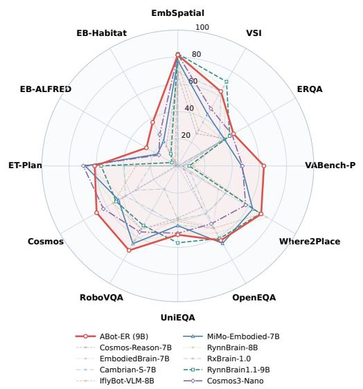

(b) Aggregate Capability Landscape  
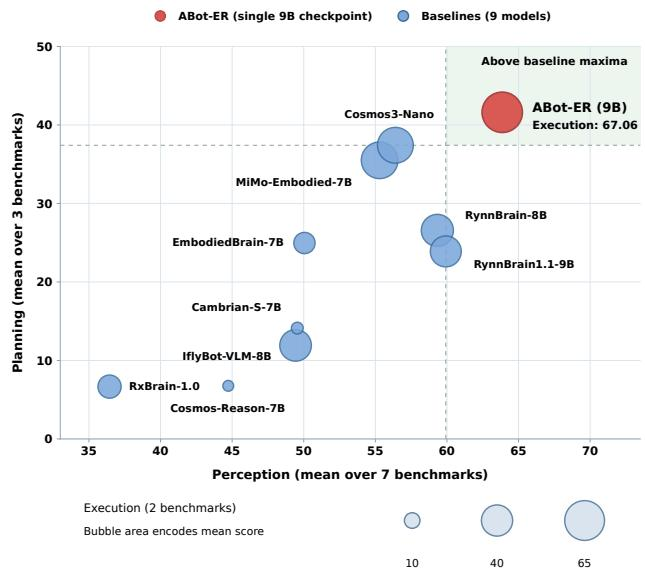  
Figure 1 Embodied reasoning performance of ABot-ER. Left: the twelve benchmarks against nine public baselines. Right: the perception and planning means as axes, with marker area encoding the execution mean. From one 9B checkpoint, ABot-ER is the only model above the best baseline value on both axes.

## Contents

Introduction . 3   
The Role of an Embodied Reasoning Mode 4   
2.1 What the Model Answers for the Robot 4   
2.2 Why One Dedicated Model 4   
3 Related Work . 5   
3.1 Embodied Vision-Language Foundation Models 6   
3.2 Embodied Perception and Interaction Grounding 6   
3.3 Task Planning and Feedback-Guided Execution 7   
3.4 Adaptive Data Construction and Multi-Task Training 7   
ABot-ER   
4.1 Capability Coverage and Unified Modeling Objective   
4.2 Model Architecture .   
4.3 Task-Conditioned Adaptive Training Strategy 10   
Agentic Data-Model Self-Evolution Engine 10   
5.1 Evaluation-Driven Capability Diagnosis 11   
5.1.1 From Symptom to Fault 12   
5.1.2 Agent Proposals and Deterministic Verification 12   
5.2 Content Evolution: Targeted Supervision 13   
5.3 Protocol Evolution 14   
5.4 Mixture Evolution 16   
5.5 Data Governance and Evaluation Integrity 17   
5.6 Training, Selection, and Evolution Across Rounds 18   
Experiments . 20   
6.1 Experimental Setup 20   
6.1.1 Capability Dimensions and Benchmarks 20   
6.1.2 Training Data . 21   
6.1.3 Metrics and Aggregation 22   
6.1.4 Inference Protocol 23   
6.1.5 Baseline Models 23   
6.2 Results Across Embodied Capabilities 23   
6.3 One Recipe Across Model Sizes 24   
6.4 Efect of the Task-Conditioned Adaptive Training Strategy   
6.5 Analysis of Data-Model Self-Evolution   
6.6 Real-World Deployment   
Conclusion and Future Work 30   
8 Contributions 32   
Appendices 38   
A Self-Evolution Engine: Full Records 38   
A.1 Supervision Construction and Release Audit . 38   
A.2 Stage Compositions and Training Configuration 39   
A.3 Per-Round Ledger 40

## 1 Introduction

Embodied intelligence studies agents that act on instructions in the physical world. An instruction such as rinse of a ladle and move it to the table requires more than recognizing objects: determining which objects and scene states are relevant, what sequence of actions is needed, and where each action should be directed. These interdependent judgements span perception, planning, and execution, and together constitute embodied reasoning. Execution here means identifying grounded interaction targets for a downstream action model rather than generating motion commands. Moving beyond a fixed task requires coordinating these judgements as tasks, scenes, and embodiments change, which makes embodied reasoning central to general-purpose behaviour in the physical world.

Embodied reasoning (ER) models serve as a reasoning interface between multimodal observations and downstream control. Recent embodied foundation models reflect a broader shift from isolated perception or control tasks toward reasoning across multiple stages of physical interaction [3, 12, 18, 21, 44]. An ER model infers spatial relations, scene states, and temporal changes, translates high-level goals into ordered action plans, and identifies where interaction should occur [1, 16, 39, 61, 69]. Its outputs are task-relevant assessments, action plans, and interaction targets that downstream systems use to guide and parameterize execution.

However, existing ER models still exhibit uneven capabilities across perception, planning, and execution. Unifying these competencies raises two related challenges, one about data and one about optimization: which types of supervision should be prioritized at each training stage, and how heterogeneous task outputs can be learned jointly through shared parameters while limiting interference. The first, which we term Data-Model Drift, arises because capabilities develop at diferent rates: the relative utility of each type of training data can change over the course of training, so a fixed mixture may become less well aligned with the model’s evolving learning needs [59]. This mismatch can arise even when the underlying corpus remains unchanged. The second, which we term Modality Entanglement, arises when heterogeneous outputs, namely semantic descriptions, structured action sequences, and spatial coordinates, impose competing demands on shared parameters, so an update that benefits one output type may degrade another [67]. Section 4 fixes the boundary these outputs are separated along.

ABot-ER addresses data adaptation and optimization interference with an Agentic Data-Model Self-Evolution Engine and a Task-Conditioned Adaptive Training Strategy, respectively. The engine pursues recursive self-improvement (RSI) at the level of training data, and turns corpus construction into a closed loop driven by evaluation feedback, with the aim of improving performance across capability dimensions: the current model’s errors are diagnosed and attributed to specific capability gaps, targeted supervision is constructed to address them and audited for relevance and quality, the training-data mixture across capability dimensions is adjusted, the model is trained on the revised corpus, and the resulting evaluation opens the next round. What recurses is the corpus, not the learning algorithm or the architecture, and what enters each round is decided by deterministic gates rather than by the model itself. The loop is governed by continuous screening of each corpus revision for overlap with evaluation data, under quality-control rules calibrated through expert review in the initial rounds; subsequent rounds proceed automatically under those rules. The training strategy uses a task token to activate lightweight low-rank residuals selected by the task type of each training record. All tasks share a backbone for cross-task representation learning, while the residuals provide dedicated capacity for type-specific adaptation, reducing interference between heterogeneous outputs. We systematically evaluate ABot-ER on twelve benchmarks covering three core competencies and five capability dimensions. Within a unified parametric framework, it achieves state-of-the-art overall performance, with the highest aggregate score in each of perception, planning, and execution, while remaining competitive on individual benchmarks, demonstrating that breadth and depth can coexist in unified embodied reasoning.

The main contributions of this report are as follows:

• We design the Agentic Data-Model Self-Evolution Engine, which realizes RSI over the training corpus by coupling evaluation-driven capability diagnosis with targeted data revision and iterative training. By adapting supervision and training-data mixtures to the model’s evolving capability needs, the engine mitigates Data-Model Drift. The recursion is bounded rather than open-ended, and Section 6 reports

where it converges.

• We propose the Task-Conditioned Adaptive Training Strategy, which uses task tokens to activate dedicated lightweight low-rank residuals for semantic and action outputs while retaining a shared backbone for crosstask learning. This provides output-specific adaptation capacity to mitigate the optimization interference associated with Modality Entanglement.

• We systematically evaluate ABot-ER on twelve benchmarks spanning three core competencies and five capability dimensions. Within a unified parametric framework, it achieves state-of-the-art overall performance, with the highest aggregate score in each of perception, planning, and execution.

• We demonstrate the reusability of the engine-produced corpus: from the same ancestor checkpoint, a single post-training run on this corpus matches the six-round iterative model in mean performance across the twelve benchmarks, with a fifth of the accumulated post-training. The same corpus and post-training recipe are also applied to backbones ranging from 2B to 27B parameters, without rerunning the data-revision loop for each backbone. To support further research, we will open-source our pre-training and post-training datasets, together with a multi-scale ABot-ER model family comprising 2B, 4B, 9B, and 27B models, as well as a 35B-A3B MoE model.

The remainder of this report is organized as follows: Section 2 states the role of an embodied reasoning model in a robot system and the decisions ABot-ER is designed to make; Section 3 reviews related work; Section 4 formalizes the multi-competency unification problem and presents the unified model architecture, with the Task-Conditioned Adaptive Training Strategy in Section 4.3; Section 5 details the Agentic Data-Model Self-Evolution Engine; Section 6 reports experimental results and in-depth analysis; Section 7 concludes and discusses future directions.

## 2 The Role of an Embodied Reasoning Model

An embodied reasoning model supplies task-relevant judgements throughout a physical interaction. Given observations and a task instruction, it reasons about spatial relations, scene states, temporal events, action sequences, and interaction targets, which together support both deciding what to do next and assessing what has already happened. Depending on the query, it returns a semantic assessment, an ordered action plan, or grounded image coordinates, and it does not generate motor commands. The agent runtime manages task progression: it decides when to query the model, acts on the returned assessments and targets, and schedules and supervises the proposed plans. Downstream action policies carry out the motion, navigation [19, 26] and manipulation [9, 65] alike. ABot-ER instantiates this role (Figure 2; physical deployment in Section 6.6). This section defines the five capability dimensions the role requires and explains why we serve them from one model.

## 2.1 What the Model Answers for the Robot

We organize these reasoning requirements into five capability dimensions, summarized in Table 1 and formalized in Section 4. The first three, spatial and relational reasoning, scene and state understanding, and temporal and event reasoning, fall under perception. The remaining two address planning and execution-oriented grounding, and we refer to their outputs as action-space outputs, distinguished from semantic outputs by their task function and interface requirements.

The five form one set rather than five separate problems, because a single action draws on several of them at once. Placing an object needs free space (spatial), a clear surface (state), and a release point (point grounding); recovering from a failed grasp needs the failure recognized (temporal), the object re-localized (spatial), and the plan revised (long-horizon). The answers must also agree with one another: a release point is only useful if it lies in the region the state assessment just called clear.

## 2.2 Why One Dedicated Model

Prior work has demonstrated interaction-point prediction [69] and spatial reasoning [7] in vision-language models, as well as reasoning-augmented action generation in vision-language-action models [6, 18]. The design question is therefore not whether an individual question of this kind can be answered, but how the five dimensions are brought together behind one interface that an agent runtime and downstream policies can build on. We address this question with a model trained jointly across the five dimensions under explicit output protocols, specified in Sections 4 and 5.3. Two commitments follow from the role: the model must report on outcomes as well as propose actions, and it must serve all five dimensions from one checkpoint.

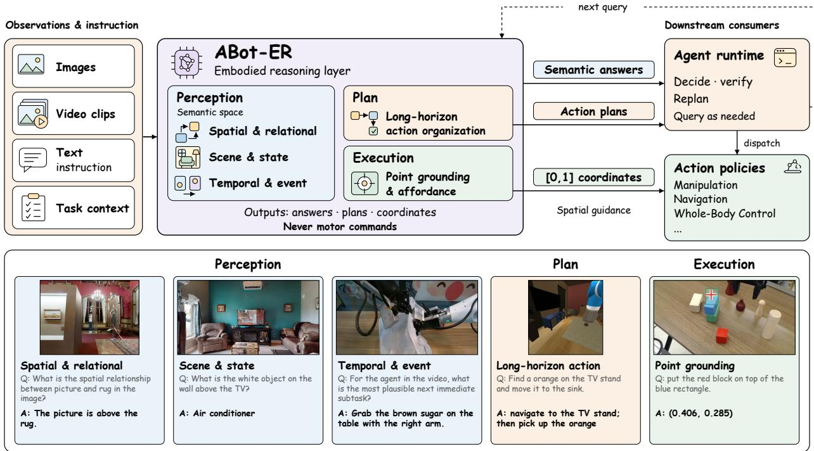  
Figure 2 The embodied reasoning layer between what a robot sees and what it does. It takes observations and an instruction and returns three kinds of answer: semantic assessments, ordered action plans, and normalized image coordinates. The agent runtime uses the assessments and plans to manage task execution, while the coordinates specify spatial targets for the downstream policies; the model itself emits no motor commands. Bottom: one oficial test case per capability dimension, drawn from the evaluation splits of Section 6 and grouped by the competency it belongs to. Each card pairs the benchmark question with ABot-ER’s own answer. All five answers were scored correct: the planning case succeeded over the full episode, and the predicted point fell inside the oficial target mask, which is shaded in the image.

Acting on an answer is only half of the loop; the other half is knowing whether the action worked. By assessing scene states and temporal events, such as whether an object has been placed or which event occurred first, the model provides the information from which an agent runtime decides whether to proceed, retry, or re-plan. On the physical platform of Section 6.6, the model reads the tabletop before the arm acts, recovering the participant’s expression, and again afterwards, identifying the digit sequence represented by the placed blocks.

The second commitment concerns where the answers come from. ABot-ER serves the five dimensions from a single 9B-parameter checkpoint. The shared backbone provides a common representational basis for spatial assessment, planning, and target grounding, while task-conditioned low-rank residuals provide capacity for task-family-specific adaptation (Section 4). At deployment this means one model to serve rather than a specialist per dimension, and the physical system of Section 6.6 runs it on a single NVIDIA RTX 5090D.

## 3 Related Work

We organize prior work along four axes most relevant to ABot-ER: (i) embodied vision-language foundation models that consolidate multiple capabilities into unified embodied models, (ii) embodied perception and inter-

Table 1 The five capability dimensions and the form of each answer. Examples follow one task, the Block Arithmetic demonstration of Section 6.6: a participant seated across the table lays out 6 + 9 with blocks whose value is given by the number of dots on them, oriented toward the participant, and the robot places two blocks that read as the result. Directional descriptions are stated from the participant’s viewpoint, whereas coordinates follow the normalized robot-camera image protocol of Section 4.
<table><tr><td>The robot needs to Capability know</td><td></td><td>Example</td><td>Answer form</td></tr><tr><td>how they are arrangedreasoning</td><td></td><td>Where things are and Spatial and relational Which block is the left operand from the par- Choice, number, ticipant&#x27;s viewpoint, given that the partici- or short text pant sits across the table and the expression therefore reads right to left in the robot&#x27;s</td><td></td></tr><tr><td>in</td><td>standing</td><td>What state the scene is Scene and state under- How many dots each block carries and which Short text or operator symbol is shown: 6 + 9</td><td>choice</td></tr><tr><td>whether it worked</td><td>reasoning</td><td>What just happened, and Temporal and event From the frames of the arm&#x27;s placement mo- Choice: placed, or tion, whether the five-dot block was placed dropped in trans- on the table or dropped during transfer</td><td>fer</td></tr><tr><td>What to do, in what or- Long-horizon action 1 der, under which precon- organization ditions</td><td></td><td>Place the one-dot block that stands for the Ordered plan in tens digit, then, once it is down, place the the five-dot ones digit to its right, so that the pair schema reads 15</td><td>executor&#x27;s</td></tr><tr><td>place, or act</td><td>affordance</td><td>Exactly where to grasp, Point grounding and A grasp point on the five-dot block, and a Normalized image placement point inside a free region to the coordinates in right of the tens digit large enough to accom- [0, 1] modate it</td><td></td></tr></table>

action grounding, (iii) task planning and feedback-guided execution, and (iv) adaptive data construction and multi-task training, which is the background for the report’s two methodological components. Comprehensive treatments of the broader embodied AI landscape can be found in recent surveys [35, 60].

## 3.1 Embodied Vision-Language Foundation Models

Earlier embodied learning studies often focused on specific task settings, including embodied question answering [13], manipulation [52], and vision-and-language navigation [2]. Their diferent task interfaces and supervision objectives motivate input-output alignment when constructing a unified model. A recent line of work consolidates multiple embodied capabilities under a single vision-language model. Two useful distinctions are how sensor observations enter the model and whether it directly generates robot-control actions. PaLM-E [15] embeds sensor observations directly into the token space, so that a large language model performs cross-task embodied reasoning over them. RT-2 [6] places robotic action in the same output vocabulary as vision-language pretraining within a single autoregressive framework. EmbodiedGPT [41] uses embodied chain-of-thought for high-level planning and extracts planning-related features to support closed-loop control, keeping plan generation and control in separate stages. LEO [24] integrates 3D vision, language, and action modeling in a unified embodied agent, and the RoboBrain [3] series builds multimodal foundation models covering spatial understanding, temporal reasoning, and task planning through progressive multi-stage training. ABot-ER follows this line of multi-capability modeling, but exposes semantic assessments, action plans, and interaction targets rather than directly generating motor commands.

## 3.2 Embodied Perception and Interaction Grounding

Embodied perception extracts structured information from visual observations in support of physical interaction decisions. Interaction grounding builds on this visual understanding but is treated as execution-oriented reasoning in our capability taxonomy (Section 2.1). In spatial relation reasoning, SpatialVLM [7] endows visionlanguage models with quantitative spatial reasoning through large-scale synthetic spatial question answering, and SpatialRGPT [11] combines region-level reference with depth information to improve relative position judgement. On the evaluation side, EmbSpatial-Bench [16] assesses spatial relations from an embodied viewpoint, whereas VSI-Bench [61] assesses spatial understanding from video. In interaction grounding, VRB [4] learns afordance representations from human videos, ManipLLM [28] predicts manipulation-oriented end-efector poses from RGB observations and text prompts, and Where2Place, introduced with RoboPoint [69], evaluates valid placement prediction under spatial constraints. In scene state understanding, OpenEQA [39] is an open-ended embodied question-answering benchmark, and RoboVQA [50] constructs large-scale question answering over robot and human videos, covering planning, success judgement, afordance, past description, and future prediction. In temporal reasoning, Cosmos-Reason1 [44] targets physical common sense and embodied reasoning over video. These studies emphasize diferent capabilities and use task-specific supervision and output conventions, so integrating them requires explicit alignment of task definitions and interfaces.

## 3.3 Task Planning and Feedback-Guided Execution

Task planning translates high-level goals into action choices and sequences while accounting for feasibility, ordering constraints, and feedback. The paradigm of LLM-as-planner established several routes to this: Say-Can [1] combines semantic knowledge with value-function feasibility for task decomposition; ProgPrompt [53] and Code-as-Policies [31] cast planning as code generation, using program structure for sequencing and control flow; and Inner Monologue [25] introduces environment feedback as an online correction signal, so that plans are revised during execution rather than fixed in advance. At the execution level, benchmarks such as ALFRED [51] and simulation platforms such as Habitat [49] require a model to select actions conditioned on successive observations during interaction. These approaches use diferent perception interfaces, plan representations, and feedback mechanisms, providing complementary foundations for unified embodied modeling.

## 3.4 Adaptive Data Construction and Multi-Task Training

The two methodological components of this report, one concerning which supervision to train on and one concerning how heterogeneous outputs share parameters, each have a line of prior work.

Data construction, self-improvement, and mixture weighting. Self-Instruct [57] generates and filters instruction data with the model itself. Self-Rewarding Language Models [68] use model-generated judgements as the reward signal in iterative training. RoboCat [5] self-improves from self-generated robotic interaction data, so that data and model advance together across generations. DoReMi [59] optimizes data-domain weights with a proxy model and applies the resulting mixture to subsequent training. ABot-ER’s engine difers from these in what drives the revision and in what is revised. The engine diagnoses weaknesses at the capability-dimension level from evaluation evidence and revises both supervision content and cross-dimension mixtures within each round, with capability gains evaluated alongside retention. Whereas DoReMi learns sampling weights over existing data domains, our engine also constructs and revises supervision in response to capability-level diagnosis.

Parameter-efficient adaptation and multi-task interference. Adapter modules [22] add small task-specific components to a pretrained network, while LoRA [23] represents weight updates through low-rank factors. In their standard transfer-learning formulations, the pretrained backbone remains frozen. A separate line addresses multi-task interference through gradient-based optimization: PCGrad [67] projects away conflicting components of task gradients, while CAGrad [32] maximizes the worst-case local improvement across tasks within a neighborhood of the mean task gradient. Our Task-Conditioned Adaptive Training Strategy uses low-rank residual parameterization but jointly trains the shared backbone and residual branches, without explicit gradient-conflict correction. A task token selects the branch according to the sequence’s output regime (semantic or action-space) rather than allocating a separate branch to each benchmark or capability dimension (Section 4).

Against this background, ABot-ER studies unified embodied reasoning across perception, planning, and execution-oriented grounding. Its data engine couples capability diagnosis with targeted supervision revision and capability-aware mixture adjustment over multiple training rounds, with gains evaluated alongside retention. Its task-conditioned training strategy provides dedicated low-rank residual capacity for semantic and action-space outputs while retaining a shared backbone. These components are studied together as a framework for adaptive data construction and joint training across the five capability dimensions.

## 4 ABot-ER

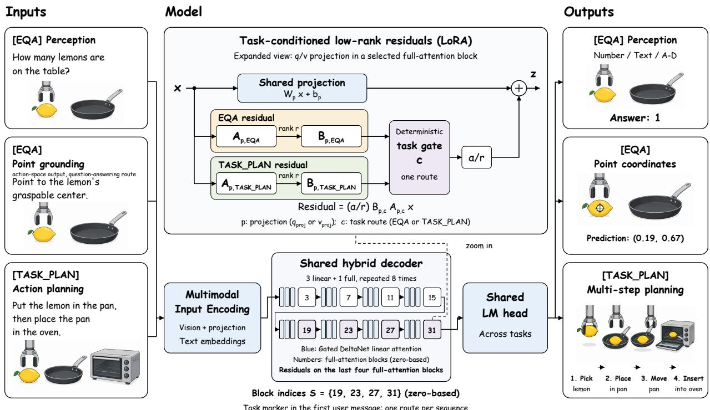  
Figure 3 Model architecture.

## 4.1 Capability Coverage and Unified Modeling Objective

We refine the three core capabilities of perception, planning, and execution into five capability dimensions:

• Spatial and Relational Reasoning (Perception): Judging direction, distance, and multi-view spatial layouts among objects.

• Scene and State Understanding (Perception): Recognizing object attributes, inferring interaction states, and performing open-ended scene question answering.

• Temporal and Event Reasoning (Perception): Recognizing actions and events in video, determining temporal order, and detecting state changes.

• Long-Horizon Action Organization (Planning): Generating ordered action plans under task preconditions and cross-step state constraints given high-level goals, and selecting subsequent actions from available observations and interaction history.

• Point Grounding and Affordance (Execution): Localizing manipulation targets and predicting placement positions under afordance constraints, expressed as image coordinates for downstream action policies.

The evaluation benchmarks and metrics corresponding to each capability dimension are listed in Table 7.

Although the five capability dimensions difer in their reasoning requirements and output formats, they share core embodied knowledge at the foundational level, including object, spatial, state, and afordance representations. We cover all five dimensions within a single unified model and formulate the supported tasks within a shared conditional generation framework. Let x denote the available task context, which may consist of text alone or include visual observations. State descriptions, action histories, and environmental feedback are incorporated when provided by the task. Conditioned on x and the task token $c ,$ whose values and assignment rule are given below, ABot-ER generates the required response y autoregressively:

$$
p _ { \theta } ( \mathbf { y } \mid \mathbf { x } , c ) = \prod _ { t = 1 } ^ { T } p _ { \theta } ( y _ { t } \mid \mathbf { x } , c , \mathbf { y } _ { < t } ) ,\tag{1}
$$

Here, $T$ is the response length in tokens rather than a number of environment interaction steps, and $\mathbf { y } _ { < t }$ denotes the preceding output tokens. The response may comprise a multiple-choice answer, a numerical answer, concise text, a coordinate sequence, or an ordered action plan. The five dimensions organize capability coverage rather than define separate training losses: we optimize causal cross-entropy over unmasked assistant tokens, normalized within each training sequence, and with a per-device microbatch size of one, gradient accumulation and data-parallel averaging combine these sequence-normalized losses across the efective batch. Inputs, media, and padding carry no supervision, and the assistant tokens of a multi-turn sample are normalized together. Relative exposure across capabilities is controlled by the data construction and sampling strategy of Section 5 rather than by per-task loss weights. At inference, all dimensions use this same generation procedure, without loading separate task-specific checkpoints and without an additional decoding stage.

This objective is constrained in practice by two obstacles: Modality Entanglement, under which heterogeneous supervision from the five dimensions competes over shared parameters, and Data-Model Drift, under which a fixed training-data mixture may become misaligned with the model’s evolving learning needs. We first present the unified architecture that accommodates heterogeneous inputs and outputs, then introduce the Task-Conditioned Adaptive Training Strategy to mitigate interference between heterogeneous output types; Data-Model Drift is addressed by the Agentic Data-Model Self-Evolution Engine in Section 5.

## 4.2 Model Architecture

To accommodate heterogeneous input modalities and output semantics within a single parameter space, ABot-ER adopts a unified decoder-only vision-language architecture based on the Transformer [56] comprising three core components: a vision encoder $\mathcal { E } ,$ a modality projector ${ \mathcal { P } } _ { : }$ , and an autoregressive language model G. All five dimensions share the same autoregressive backbone and output head; task-conditioned residuals are introduced within selected attention projections rather than as separate per-dimension decoders. We instantiate this architecture on the pretrained multimodal model Qwen3.5-9B (approximately 9B parameters). Its language backbone comprises 32 decoder blocks with a hidden dimension of $d = 4 0 9 6$ and a hybrid attention architecture: three Gated DeltaNet linear-attention blocks followed by one full-attention block, repeated eight times, so that the full-attention blocks are those with zero-based indices $3 , 7 , \ldots , 3 1$ . When the task provides a visual observation I (an image or a video frame sequence), the visual branch extracts $\mathbf { z } _ { v } = \mathcal { P } ( \mathcal { E } ( I ) )$ , whereas text-only tasks bypass the visual branch and require no placeholder visual input. The data loader injects the task conditioning token c ∈ {[EQA], [TASK\_PLAN]} into the content of the first user message, once per sample, without rewriting the frozen benchmark prompt body. That message is then rendered by the model’s chat template, which supplies the role delimiters and an optional system message, and $\mathbf { z } _ { v }$ is inserted at the media placeholders the template emits. Within the message, text and media keep their original interleaved order, so the sequence reaching $\mathcal { G }$ opens with the user role delimiter, then $c ,$ then the interleaved content: the task token sits inside the first user message rather than at the head of the input sequence. Writing $\mathbf { z } _ { \mathrm { i n } }$ for this input sequence, the output $\mathbf { y } = \mathscr { G } ( \mathbf { z } _ { \mathrm { i n } } )$ is generated autoregressively token by token, whether it comprises multiple-choice answers, coordinate points, natural language descriptions, or ordered action sequences. All dimensions use the same generation procedure without a separate rationale-decoding stage.

We map the five capability dimensions onto the two task families the training corpus is collected as, and condition on those families. Grouping at this granularity keeps conditioning coarse, with two branches rather than one per dimension, so that most parameters stay shared across all tasks. [EQA] covers embodied question answering, which supplies the spatial, scene-state and temporal supervision together with the interaction coordinates, and [TASK\_PLAN] covers task planning, which supplies ordered action plans. The families are defined by how the corpus was collected, not by the form of the answer: a coordinate is a question-answering record here, even though it is an action-space output. The two families share object, spatial, state, and afordance knowledge, but difer in supervision scale, answer length, output protocol, and reasoning horizon, and it is this diference that the conditional residuals are given capacity for. The route is determined from record-level task-family metadata and shared across all turns in a sequence; it does not enforce a uniform answer format across turns, and each family also carries auxiliary supervision in other answer forms. Because the task family of a query is known before inference, routing is a deterministic lookup rather than a learned router.

To remove format inconsistencies at the data level, ABot-ER separates the numeric protocol from the serialization protocol. The numeric coordinate convention is shared across tasks: coordinates are continuous values normalized to the [0, 1] interval relative to the original image dimensions, with three decimal places. This is the single coordinate convention the model has to learn. Serialization, by contrast, follows a fixed benchmark-specific format to comply with the corresponding evaluation interface. Section 5.3 describes both layers and the conflict they resolve.

## 4.3 Task-Conditioned Adaptive Training Strategy

The Task-Conditioned Adaptive Training Strategy augments the attention query and value projection modules of selected full-attention blocks with task-conditioned low-rank residuals, using a parameterization inspired by low-rank adaptation [23]. Each residual operates on the corresponding projection input and is added to its output before subsequent attention computation. We place them in the last four full-attention blocks, whose zero-based indices form the set $ { \boldsymbol { S } } = \{ 1 9 , 2 3 , 2 7 , 3 1 \}$ . For $l \in S$ , a projection $p \in \{ q _ { \mathrm { p r o j } } , v _ { \mathrm { p r o j } } \}$ , and the hidden state $\mathbf { x } ^ { l }$ entering that projection:

$$
\widetilde { \mathbf { z } } _ { p , c } ^ { l } = \mathbf { W } _ { p } ^ { l } \mathbf { x } ^ { l } + \mathbf { b } _ { p } ^ { l } + \frac { \alpha } { r } \mathbf { B } _ { p , c } ^ { l } \mathbf { A } _ { p , c } ^ { l } \mathbf { x } ^ { l }\tag{2}
$$

where $\mathbf { A } _ { p , c } ^ { l } \in \mathbb { R } ^ { r \times d } , \mathbf { B } _ { p , c } ^ { l } \in \mathbb { R } ^ { d _ { \mathrm { o u t } , p } \times r } , r \ll d ,$ , and α is a scaling coeficient. The output dimension $d _ { \mathrm { o u t } , p }$ follows the projection itself and therefore difers between the two. In this backbone $q _ { \mathrm { p r o j } }$ jointly produces query features and attention output gates, which are split downstream; the residual is added to the full projection output before that split and therefore applies to both parts. These attention output gates are internal to the backbone and unrelated to the task routing described above.

Each projection holds one such pair of factors per route, so that c selects between the two task-family sets. The route is resolved once per sequence and applies to all of its tokens. All parameters other than the route-specific low-rank factors are shared across tasks. The shared language backbone and the residuals are trained jointly, so the shared weights continue to receive gradients from all tasks; the residuals provide a task-family-specific adaptation path intended to mitigate interference between the two families, rather than isolating task gradients.

The rank $r ,$ the scaling coeficient $\alpha ,$ the residual layer indices, and the detailed per-stage training configuration are reported in Table 18. At inference time, the task marker selects the residual branch before response generation, and the selected branch remains active throughout decoding without requiring additional generated routing tokens. Section 6 compares the task-conditioned configuration against an unconditional shared baseline, assessing task tokens and conditional residuals jointly rather than isolating the contribution of task tokens.

## 5 Agentic Data-Model Self-Evolution Engine

This section presents the Agentic Data-Model Self-Evolution Engine, an evaluation-driven framework that coordinates supervision content, output protocols, and data mixtures for joint embodied reasoning training. Its central design choice is to diagnose which aspect of the training data requires revision, rather than treating every capability bottleneck as a demand for more samples. A capability can lag because the supervision it needs does not exist, because that supervision exists but carries mutually exclusive targets, or because correct targets receive too little budget to take efect. These call for diferent repairs, and one diagnosis often calls for more than one of them.

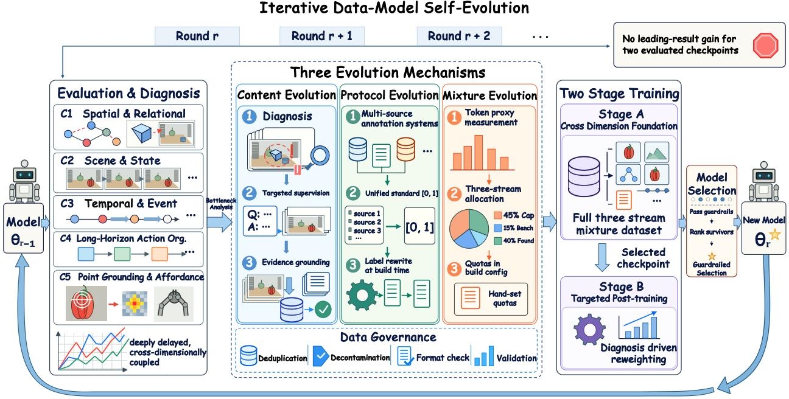  
Figure 4 Closed-loop pipeline of the Agentic Data-Model Self-Evolution Engine. Each round begins with evaluationdriven capability diagnosis (Section 5.1), revises the training corpus through three evolution mechanisms, namely content (Section 5.2), protocol (Section 5.3), and mixture (Section 5.4), under a data governance layer (Section 5.5), and closes with training and checkpoint selection (Section 5.6); the released model uses the two-stage recipe described there. The evaluation result of the new model version determines the revision applied in the next round.

The need for revision is continuous rather than preparatory. As the model’s capability profile changes, the supervision and exposure needed for further improvement change with it, so a mixture selected at the outset may become less efective in later rounds. A revision must also be assessed through subsequent training and evaluation across five dimensions and twelve benchmarks, since gains in one dimension may accompany regressions in another. Related work explores synthetic instruction generation, iterative self-feedback and self-rewarding, and data-mixture optimization [17, 38, 57, 59, 68]. Here the focus is on using a shared capability diagnosis to coordinate supervision content, task-specific output protocols, and exposure allocation in joint embodied reasoning training.

The following subsections describe the shared diagnosis (Section 5.1), the three coordinated revisions (Sections 5.2–5.4), and the governance and training procedures used to evaluate their outcomes across rounds (Sections 5.5–5.6). Full construction quantities, audits, configurations, and the per-round ledger are collected in Appendix A.

## 5.1 Evaluation-Driven Capability Diagnosis

Diagnosis decides what the next corpus revision should change. A round freezes the evaluation contract so that scores are comparable across its checkpoints, aggregates results at the granularity of the five capability dimensions, classifies the underlying errors, and passes the resulting gap profile to the coordinating agent, which returns a data requirement together with candidate sources.

The contract fixes the prompt text, media renderer, output parser, and scorer of every benchmark, together with the chat template and decoding mode, and is identified by a content hash. It provides a stable target for training-label alignment, which label construction and parser round-trip checks then enforce. Any change to a prompt, a required point count, a parser, or a scorer produces a new contract version, and scores obtained under diferent versions are not treated as directly comparable without re-evaluation under a common contract. Because biases introduced early in a closed loop compound over later rounds, the initial rounds are human-calibrated: an expert reviews the agent’s diagnoses and the resulting revisions before they enter training, and those judgements are encoded as the deterministic rules and gates that later rounds run against.

## 5.1.1 From Symptom to Fault

The choice of diagnostic granularity is consequential. Using a single benchmark’s score as the evolution signal carries a risk associated with Goodhart’s Law [40]: when a metric is continuously optimized, it may cease to faithfully reflect the capability it was designed to measure. Targeted augmentation for a specific benchmark may teach the model that benchmark’s idiosyncratic answering patterns, improving the score without strengthening spatial reasoning. We therefore separate the symptom, which is necessarily observed at benchmark level, from the conclusion, which is drawn at capability-dimension level. Dimension scores are fixed equal-weight averages over the benchmark groups of Table 7. A capability gap is admitted only when the benchmarks within a dimension exhibit consistent trends, or when a benchmark-specific symptom is independently traced to a mechanical cause such as a protocol violation. For a dimension represented by a single benchmark, cross-benchmark agreement is unavailable, and diagnosis relies on item-level error analysis instead. Which of these applies is decided by the error classification, not by inspection of the scores alone.

Raw model outputs and error logs are classified by fixed rules into six classes, each read of the record itself rather than inferred from the score: parser and format failures; point misses separated from coordinate protocol violations; multiple-choice category errors; numeric parsing errors; open-ended judge deductions; and task-plan errors, subdivided into illegal actions, truncated plans, and executable plans that fail to reach the goal state. These classes are then mapped onto the five dimensions to obtain an attributed gap profile. Table 2 lists representative mappings actually used, each with the check that separates a capability conclusion from a benchmark-specific artifact; where a symptom is traced to the contract, no such check is needed. Deterministic checks classify observable errors and establish audit findings. The coordinating agent uses this evidence to propose root-cause hypotheses and corresponding data requirements.

The fault categories organize intervention targets. A diagnosis may identify a primary intervention while requiring coordinated revisions to supervision content, protocol, and exposure: content evolution constructs or repairs the required targets, protocol evolution aligns their representation with task-specific interfaces, and mixture evolution adjusts how much exposure they receive. Increasing exposure does not repair incorrect targets or incompatible output conventions, while valid supervision may remain inefective when insuficiently sampled. Two of the five categories concern evaluation-interface compliance and evaluation integrity instead. A contract fault indicates non-compliance with the frozen evaluation interface; output and training-label checks determine whether the violation originates in the labels or occurs despite compliant supervision, and the labels are rebuilt, without adding samples, only when a training-label mismatch is confirmed. A contaminated evaluation means the score no longer reflects capability; an anomalous score triggers a contamination audit and is classified this way only when the audit confirms overlap, after which the implicated sources are quarantined (Section 5.5). The other three place the intervention on the supervision. Missing or incomplete targets primarily motivate content construction (Section 5.2). Contradictory supervision may require content repair when target semantics disagree, protocol alignment when representations disagree (Section 5.3), or both. Under-exposure motivates mixture reallocation under the relevant content and protocol checks (Section 5.4). Section 5.4 traces a case in which quota adjustment was followed by persistent supervision conflicts, motivating further content and protocol revisions.

## 5.1.2 Agent Proposals and Deterministic Verification

What the rules do not supply is the hypothesis behind a gap and the candidate sources that would close it. That open-ended step, reading a score curve together with per-item errors and a source profile and proposing a root cause, is performed by a single coordinating language-model agent, realized as an interactive coding agent. Evaluation itself runs in an execution context separate from that agent, which separates score production from corpus revision under the frozen evaluation contract. The agent’s inputs are deliberately asymmetric across the two halves of its work. For diagnosis it reads the evaluation records, per-sample outputs, label and media metadata, training logs, and audit reports. For construction, evaluation items are not supplied as source material: a new label is written against a small set of format-reference exemplars, disjoint from every evaluation set, that fix the output contract it must satisfy. Its outputs are a diagnosis and a structured data request: a root-cause hypothesis, the supervision to add, the sources to remove, and the guardrails the resulting build must pass.

Table 2 Representative mappings from evaluation symptom to attributed fault and data action. The symptom triggers the investigation, and the diagnostic check is the evidence available when the fault is assigned: contaminated evaluation and contradictory supervision are confirmed by the audits named there. The fault class determines which mechanism primarily handles the symptom.
<table><tr><td>Symptom</td><td>Diagnostic check Fault</td><td></td><td>Data action</td></tr><tr><td>contract outputs</td><td>Unparseable or off- Output and training Contract labels checked against the frozen renderer and parser</td><td></td><td>Labels rebuilt against the frozen renderer and parser when a label mismatch is con- firmed; no new samples added</td></tr><tr><td>Anomalously high EB-Source-levelaudit Contaminated ALFRED</td><td>confirms overlap with evaluation the official evaluation trajectories</td><td></td><td>Source-level leakage audit and quarantine of the implicated sources</td></tr><tr><td>EB-Habitat with legal actions</td><td></td><td>sion</td><td>Low EB-ALFRED and ET-Plan consistent Missing supervi- Replay-verified multi-step plans with ex- plicit precondition chains and verified ter- minal states</td></tr><tr><td>Low Cosmos</td><td>errors concentrate sion ontemporal-order and failure-recovery items rather than on static-content items</td><td></td><td>Item-level analysis: Missing supervi- Train-only video multiple choice balanced across five independent clean domains</td></tr><tr><td>well-formed 8-point in the same direction; supervision output</td><td>Low VABench-P with Where2Place moves Contradictory training-label inspec- tion identifies incom- patible target conven-</td><td></td><td>Point supervision restricted to verified target-region labels; trajectory endpoints removed</td></tr><tr><td>A dimension lags while Per-source and its supervision is counts confirm the already verified</td><td>dimension is under budget</td><td>its benchmarks agree per-group exposure supervision</td><td>and Under-exposed Dimension quota raised under the source and exposure caps; no change to the labels themselves</td></tr></table>

Responsibility is partitioned so that the agent proposes and programs verify. The coordinating agent proposes root-cause hypotheses, data requirements, and candidate sources. Deterministic programs verify each candidate build against the applicable format, provenance, exposure, and replay checks, and no proposal enters the formal training pool without passing the gates specified for that release.

Two archived records show what this produces. Case B, a missing-supervision fault, drove the replay-verified planning corpus and is traced in Section 5.2; Case A, which mixes a target-semantics problem with a protocol conflict, drove the point-supervision rebuild and is traced in Section 5.3. Under-exposure is traced in Section 5.4 and the contaminated-evaluation fault in Section 5.5.

## 5.2 Content Evolution: Targeted Supervision

Content evolution turns a diagnosed failure into a specification of the supervision to construct or repair. For point grounding, this means targets tied to verified task-relevant regions rather than motion endpoints. For planning, it means complete trajectories with checked preconditions and verified terminal states. The aim is to supply the missing or corrected learning signal, not merely to enlarge the corpus.

Case B shows how a failure becomes such a specification. In an archived record from the R3 diagnostic round, six actions succeeded without completing the task, and later planner calls returned unparseable output: the initial plan omitted the placement action, while a repetitive state description left the subsequent JSON unclosed. These observations motivated requirements for terminal-state-complete trajectories verified by simulator replay, feedback-conditioned recovery examples, bounded state descriptions, and parser-valid labels. Table 3 summarizes the construction method used for each dimension.

Two risks accompany targeted construction. The first is supervision reliability: agent-assisted supervision may contain unverified fabrications that would inject systematic noise. We therefore adopt evidence grounding, so that every training target is derived from input media, environment state records, or trusted annotations, with the agent acting only as a candidate proposer and its outputs entering the formal pool only after independent verification. Deterministic release audits then enforce the specified constraints on format, provenance, coverage, and exposure that every build must pass. The second is diminishing marginal returns, which made the acceptance criteria themselves a target of revision. A construction requirement stated as an exact count makes the last few percent of a target as expensive as the first ninety, because the items still missing are the ones the available sources cover least well, and a build can spend far longer closing that remainder than it spent producing the bulk. Construction targets are therefore specified as an elastic band rather than an exact count, and the engine tracks the cost of each additional accepted item as the round proceeds. When the measured construction dificulty for the remainder is high, the band widens and the round concludes on a documented exception, provided the residual gap does not materially alter capability coverage or risk levels.

Table 3 Supervision construction by capability dimension. Released record counts, historical processing volumes, and the exact label recipes are reported in Appendix A.
<table><tr><td>Capability dimension</td><td>Supervision construction</td></tr><tr><td>Spatial and relational</td><td>Train-split spatial annotation, cleaned, relabelled, and sampled for coverage across fine-grained capability channels</td></tr><tr><td>Scene and state</td><td>Existing question-answer pairs cleaned of answer prefixes and markup, together with indoor question answering constructed from replay-passed scene and state records</td></tr><tr><td>Temporal and event</td><td>Video items that retain the temporal evidence, with determinate answer conver- sion and sampling across independent clean train domains</td></tr><tr><td></td><td>Point grounding and affordance Supervision restricted to verified target regions, serialized to the point cardinality each task requires</td></tr><tr><td>tion</td><td>Long-horizon action organiza- Planning trajectories with checked preconditions and verified terminal states, together with feedback-conditioned recovery windows</td></tr></table>

At the level of supervision structure, the five dimensions share foundational representations of objects, spatial relations, states, and afordances, but retain distinct answer formats. Perception retains multiple choice, numeric values, and concise text, emphasizing evidence-grounded state readout; planning retains complete ordered action plans, emphasizing sub-goal dependencies, action ordering, and cross-step state consistency, and execution retains spatial coordinate outputs for task-relevant interaction targets. Unification applies to coordinate values and metadata, not to capability-specific output forms.

## 5.3 Protocol Evolution

Protocol evolution revises inconsistent training representations to satisfy task-specific output requirements. It unifies the numeric coordinate convention while preserving the point cardinalities, serialization formats, and action schemas that diferent tasks require. Training data for diferent dimensions often inherits from independently developed annotation systems, producing incompatible representations of the same underlying quantity. For point supervision, three conventions were in simultaneous use: legacy supplementary data using a 0–1000 coordinate range with eight points wrapped in XML or JSON; historical training rewrites using a single [0, 1] tuple [(x,y)]; and the oficial evaluator, which requires [0, 1] coordinates, exactly eight points, and the XML form <Answer><point>[[x1,y1], ..., [x8,y8]]</point></Answer>. With conflicting targets acting on shared parameters for the same image-question pairs, the model has no single output convention to fit.

Case A shows why the two are separable. In an archived point-grounding record, all eight predicted points were parseable and contract-compliant, yet none fell inside the target region: a representation that satisfies the interface can still carry the wrong target. Historical supervision mixed target medoids, motion endpoints, and arm or hand paths, while the training-data audit separately identified the incompatible ranges, counts, and wrappers above. Before the combined revision, VABench-P scores spanned a range of 45.17 points across the evaluated checkpoints of one run. The rebuild retained verified target-region supervision and aligned its representation with each task’s requirements, after which the within-run range narrowed to 3.46 points, an order of magnitude tighter. On the format-aligned corpus the released model trains on, two runs under one configuration hold within-run spreads of 2.33 and 3.00 points once past the early training ramp, and agree to within 1.67 points at matched checkpoints.

Table 4 VABench-P around the coordinate-protocol unification, and its reproduction on the released corpus. The upper block is an earlier development line, where point supervision carried three coordinate conventions at once; its scores are development history, not results of the released model. The lower block is the format-aligned corpus the released model trains on, run twice under one configuration. Spread is the range over the later evaluated checkpoints of each run, excluding the early training ramp; over that range the two runs difer by at most 1.67 points at matched checkpoints.
<table><tr><td></td><td>VABench-P</td><td>Within-run spread</td></tr><tr><td>Development history, earlier line</td><td></td><td></td></tr><tr><td>Pretrained model</td><td>24.85</td><td></td></tr><tr><td>Before unification</td><td>8.58-53.75</td><td>45.17</td></tr><tr><td>After unification and rebuild</td><td>64.54–68.00</td><td>3.46</td></tr><tr><td>Released corpus</td><td></td><td></td></tr><tr><td>Same configuration, run 1</td><td>61.67–64.00</td><td>2.33</td></tr><tr><td>Same configuration, run 2</td><td>61.33-64.33</td><td>3.00</td></tr><tr><td>Released checkpoint</td><td>63.33</td><td></td></tr></table>

The resolution separates the two layers. The numeric convention is unified: all spatial coordinates in training, across all dimensions, are continuous values normalized to [0, 1] relative to the original image dimensions, with three decimal places, and this is the single coordinate convention the model has to learn. Legacy labels on the 0–1000 range were rescaled into that convention rather than discarded, so that no source was dropped for its coordinate range alone. Bounding-box supervision was removed instead, and at turn granularity: turns whose assistant output is a box left the training pool, while samples that merely carry a box in their input and answer in text or points were retained. Serialization, by contrast, stays benchmark-specific and is frozen into the training labels against each evaluation contract, preserving the point cardinality, wrapper format, and action schema that contract requires: eight XML points for VABench-P, a one-to-three-point tuple list for Where2Place, a single A–D token for the multiple-choice benchmarks, concise native text for the open-ended ones, and their own four-field JSON and action spaces for ALFRED, Habitat, and ET-Plan. Task routing enters through the loader as a prefix token and never rewrites the frozen benchmark prompt body.

Build-time audits provide check-specific evidence for this design. On the released post-training stage every one of its 104,960 labels passes the contract check; on the pre-training stage all 46,776 VABench-P labels are valid eight-point XML. Both stages record zero bounding-box outputs and zero non-canonical points.

## 5.4 Mixture Evolution

Mixture evolution adjusts exposure for supervision whose content and output requirements have already been checked. It addresses insuficient sampling without treating reweighting as a substitute for correcting targets or protocols. The point-grounding history illustrates the distinction: quota adjustment was followed by a higher dimension score, but substantial checkpoint variation remained until the content and protocol revisions were also applied. Sample counts alone do not capture diferences in input size or supervision length. During corpus construction the system therefore uses a build-time token proxy as a common budget metric, computed from the characters of all conversation-message contents together with per-image and per-video allowances; it is a character heuristic rather than a tokenizer count.

No single accounting basis is suficient, and the three used in this report answer diferent questions: unique and physical records reveal repeated exposure and source coverage; consumed samples, equal to optimizer steps times global batch, reveal how much data the model actually saw and govern streaming shard safety; assistant supervision tokens, measured with the model’s own tokenizer, quantify supervised output volume. Because the objective is normalized within each training sequence (Section 4), a supervision-token share describes the corpus rather than a proportional weight in the training objective. The bases can diverge sharply. In R6, the single-trunk development release of Table 5 rather than either stage of the released model, the question-answering-to-planning ratio is 75 : 25 by unique records but 29.71 : 70.29 by assistant supervision tokens, because planning labels are long structured plans and many question-answering labels contain only a single token. Every mixture figure in this report therefore names its basis.

In R6, the question-answering partition is allocated over unique records in three streams. A fine-grained capability stream, targeted at approximately 45%, distributes budget equally across fine-grained capability channels so that training contribution is decoupled from raw volume. A benchmark guarantee stream, approximately 15%, sets a minimum quota for each of the nine question-answering benchmarks so that none can be starved by the fine-grained allocation; its budget is filled by drawing train-split supervision from those benchmarks, and is reweighted toward the dimension that diagnosis identifies as marginally weak. A foundational capability stream, approximately 40%, covers four general knowledge categories in equal proportion so that the model retains broad competence beyond evaluation-specific distributions. Planning supervision sits outside these three streams and is allocated as separate replay-verified trajectory pools.

To prevent degenerate allocations, boundary constraints are imposed on the question-answering mixture. Per-benchmark and per-source shares are bounded within the question-answering token-proxy budget, counting materialized exposures so that repetitions accumulate, and no sample is exposed more than four times. The numbers themselves are set by hand: target quotas per dimension and per benchmark are read of the evaluation diagnosis of the round and recorded as literals in its build configuration, while the coordinating agent supplies the qualitative data requirement and the candidate sources rather than the quotas. Deterministic programs then validate those quotas against the bounds above and realize them by capped stratified sampling, drawing samples stratified by source and by group under the exposure caps, where all variants of the same scene, episode, or trial share one group budget; within the manually fixed stream budgets, the pretraining mixture allocates the benchmark-by-source cells with a linear program. If any capacity or format gate is unsatisfied, the build fails and is rolled back. Each release records an ordered SHA-256 over its serialized records, and rebuilding from the same seed reproduces that hash. Learned mixture optimization [59] and influence-based data selection [58] address the same allocation problem with automatic criteria and represent a natural direction for replacing the manually set quotas used here.

The point grounding and afordance dimension is the engine’s clearest under-exposure fault, and also its clearest illustration of why exposure adjustment alone is insuficient when supervision conflicts remain. In the earliest round the dimension took whatever share source frequency gave it and scored 50.58. The first build with explicit quota constraints raised the two point benchmarks to 15.04% of the total token proxy, and the dimension scored 57.39 in that round. That quota-adjusted build nevertheless showed substantial checkpoint variation on VABench-P, with a within-run range of 45.17 points (Table 4). Following protocol alignment and the Case A target-semantics rebuild, the reported VABench-P range narrowed to 3.46 points. The released model reached a point grounding and afordance dimension score of 67.06, with Stage B allocating 25.53% of its physical records and 29.96% of its assistant supervision tokens to point supervision. The ordering is the lesson: the dimension carried an under-exposure fault and a contradictory-supervision fault at once, and quota decides only the first of the two.

## 5.5 Data Governance and Evaluation Integrity

Data governance protects the evidence the evolution loop runs on. Each build is checked for source eligibility, supervision consistency, media integrity, and overlap with evaluation data under the specified audit rules. Deduplication proceeds at three levels: intra-source exact identity matching; cross-source media and question hashing, which catches the same annotation set mounted under two source names; and quarantine of conflicting answers for the same image and question, adjudicated rather than silently discarded. The four audited risks are the following.

• Evaluation contamination. If training data covers test content, evaluation loses diagnostic validity [46] and the entire feedback loop is corrupted. Two controls apply within the loop (Section 5.1): evaluation runs in an execution context separate from the coordinating agent, and evaluation items are excluded as source material for supervision construction. Leakage detection then screens at instruction, trajectory, and environment granularity. Even absent direct answer overlap, training data that covers all test environments and supervises environment-specific identifiers is flagged as a potential risk.

• Format interference. Invalid coordinate values or labels inject spurious gradient signal; format compliance verification intercepts such samples before they enter the training pool.

• Reference integrity. Broken media references cause the model to receive blank visual input; media integrity verification requires every record to resolve to an existing file.

• Semantic and provenance compliance. Sources are checked against eligibility and licensing constraints, and semantic near-duplicates and anomalous perfect scores are escalated for case-by-case adjudication against the criteria calibrated in the initial rounds rather than resolved by threshold alone.

Case C: a contaminated-evaluation fault. The fourth criterion is not a formality, and it is the one that catches the fault no capability fix would have addressed. In round R3 the reported EB-ALFRED score was 100. Because the diagnosis operates at dimension level, this was read not as a capability result but as a within-dimension inconsistency: ET-Plan and EB-Habitat showed no comparable movement, which triggered the contamination audit of Table 2. The audit found two independent defects. The score itself was an aggregation artifact: the run summary had been written while only 12 of the 300 episode results existed, all of which happened to succeed, and a later stage reused that archived summary instead of recomputing over the full set. Recomputing over all 300 episode results, on the same checkpoint and under the same contract with no further inference, gives 27. Separately, a source-level audit confirmed that the legacy task-planning pool contained oficial EB-ALFRED test trajectories, supervising the oficial instruction text and per-step image paths. Neither number is therefore usable as an EB-ALFRED result for that checkpoint: the 100 never measured capability, and the recomputed 27 was produced by contaminated weights. Evaluation completeness became an acceptance criterion in response, requiring a summary to cover the full episode set and disallowing reuse of an archived summary.

The remediation was source-level rather than sample-level. Three implicated trajectory sources were removed in their entirety when building the next release, quarantining 23,565 records at build time rather than filtering them after training. The quarantine applies to the candidate pool rather than to the released records, which are resampled under the same quotas, so the released record count is close to that of the preceding round. R3 is retained in this report as a diagnostic round only: its scores are reported in Table 5 for completeness and are excluded from every public performance claim.

Acceptance criteria are partitioned into hard gates, which must pass, and soft targets, which permit bounded and documented deviation. Hard gates are adjudicated against the rule set in force for that round, and a dataset is registered as a trainable release only after all of them pass; Appendix A states them together with the result recorded for each.

## 5.6 Training, Selection, and Evolution Across Rounds

This subsection describes the two-stage recipe used for the released model; earlier development rounds used their own configurations, documented in Appendix A. Both stages train on corpora this engine produced: Stage A on the release that the content, protocol, and mixture revisions of the earlier rounds converged on, and Stage B on the point-heavy release specified by the Case A rebuild together with the under-exposure diagnosis of Section 5.4. Training first establishes competence across the joint capability mixture, then reallocates supervision toward the remaining bottlenecks while retaining other-task data to mitigate forgetting; the selected checkpoint, rather than the final training step, is carried forward. The two-stage design is motivated by asymmetric convergence observed in joint training. Stage A, cross-dimension foundation, starts from the pretrained vision-language model and trains on the joint mixture, comprising the three-stream question-answering partition and the separately allocated planning supervision, with a large budget. Its objective is to establish baseline competence across all five dimensions, internalize the unified numeric protocol and the frozen per-benchmark serializations, and learn task-conditioned output switching. After suficient iterations Stage A exhibits asymmetric convergence: perception performance saturates first while planning and execution continue improving. Planning and execution require longer exposure to establish stable generation patterns for complete action sequences and precise coordinates.

This asymmetric progress motivates Stage B, targeted post-training. It is supervised fine-tuning rather than reinforcement learning, and proceeds from the selected Stage A checkpoint on a set rebalanced toward the bottleneck dimensions. Because concentrated training risks catastrophic forgetting, it uses a substantially reduced learning rate, retains a proportion of saturated-dimension data as anti-forgetting anchors, and runs for a much shorter schedule.

The released model uses 462,390 physical records for Stage A, split 90.44 : 9.56 by physical records between question answering and planning, and 104,960 physical records for Stage B, of which point supervision accounts for 25.53% by physical records and 29.96% by assistant supervision tokens. Stage B reduces the decoder learning rate from $4 . 0 \times 1 0 ^ { - 6 }$ to $3 . 0 \times 1 0 ^ { - 7 }$ while retaining other-task data as anti-forgetting anchors. In each stage an earlier checkpoint is carried forward rather than the final one. The complete jobs consume approximately 826 GPU hours on 32 GPUs, excluding data construction and full-suite evaluation, which is what makes a revision expensive to assess and worth diagnosing before it is made. Full compositions and configurations are reported in Appendix A.

Checkpoint selection. Model selection evaluates several checkpoints of a run under the frozen contract, filters them by guardrails, and ranks the survivors in a fixed order. A guardrail is a benchmark-level retention bound rather than a capability dimension: each round fixes a floor on the nine-benchmark question-answering mean, bounds on the permitted drop of the task-planning mean and of the individual benchmarks the round is not targeting, a parser-reliability floor, and zero detected overlap with evaluation data. These bounds are stated per round against the checkpoint the run started from, so no single tolerance applies across the history; those in force for the released model are listed in Appendix A. Among the checkpoints that clear them, selection compares in order the number of leading results at that checkpoint, then the mean over the benchmarks the round targets, then the nine-benchmark question-answering mean. A leading result is a benchmark on which the checkpoint strictly exceeds the best score of a frozen set of public models, counted within a single checkpoint so that a profile assembled from several checkpoints cannot stand in for one model. The peak of any single dimension is not used as the criterion, because in joint learning an extreme score on one dimension typically accompanies significant degradation elsewhere. Targets and guardrails together span all twelve benchmarks, so no capability dimension goes unwatched: the released run maximizes a benchmark in four of the five dimensions and bounds every remaining benchmark against regression, with long-horizon action organization covered by bounds on the planning mean and on each of its three benchmarks.

Retrospective selection and round closure. The engine applies no fixed numerical convergence threshold. Each run is trained to its configured length, and the selection window is determined retrospectively from the evaluated checkpoints: a round is closed, and its checkpoint either selected or rolled back, when two successively evaluated checkpoints fail to increase the number of leading results on the targeted benchmarks and either the targeted mean declines or a guardrail is breached. When that condition does not arise, the round closes once the configured budget is exhausted, and selection proceeds over all checkpoints evaluated in the run. When in addition the remaining bottlenecks cannot be addressed by revising the mixture or the source pool, the data version is frozen and the release proceeds to comprehensive pre-release evaluation. Figures 5 and 6 in Section 6 report the five capability summaries at the selected observation points of this history.

Cross-round continuation. The development history is not a single continuation chain. Revisions that changed the coordinate protocol, the source eligibility rules, or the grounded-planning supervision were retrained from the pretrained model, since prior-protocol knowledge creates interfering priors; incremental reweightings continued from an earlier checkpoint. The R6 development runs of Table 5 resumed from the R4 checkpoint, deliberately bypassing the fragmented R5 weights. The released model instead followed the two-stage recipe above: Stage A was initialized from the pretrained model on the open-source release derived from R4, and Stage B from the selected Stage A checkpoint. Since R4 itself restarted from the pretrained model after the implicated sources had been removed, no weights trained on those sources were carried into either branch. All continuations reset optimizer and scheduler state. The complete lineage is documented in Appendix A.

Across rounds. Table 5 reports the five-dimension profile of each round; the corresponding triggers, data revisions, and weight origins are recorded in Appendix A. Rounds are numbered R1 to R6 in the order they were run. Two of them carry a setting worth naming here: R4 is the round rebuilt after the contaminated sources of Section 5.5 had been removed from the candidate pool, and R6 consolidates the earlier fragmented repairs into a single release trained in one uninterrupted optimizer run. The source of gains changes structurally across the history, and round-to-round change is not monotonic: improvement on one dimension is frequently accompanied by regression on another.

Table 5 Five-dimension profile at a representative checkpoint of each round. R3 is reported for completeness only and is excluded from all performance claims, since its EB-ALFRED score is afected by the contamination of Section 5.5.
<table><tr><td>Round</td><td>Spa.</td><td>Sce.</td><td>Tem.</td><td>Poi.</td><td>Lon.</td></tr><tr><td>Base</td><td>35.26</td><td>46.45</td><td>51.64</td><td>35.25</td><td>33.07</td></tr><tr><td>R1</td><td>62.32</td><td>60.13</td><td>62.87</td><td>50.58</td><td>35.23</td></tr><tr><td>R2</td><td>61.41</td><td>57.48</td><td>61.87</td><td>57.39</td><td>32.98</td></tr><tr><td>R3</td><td>62.70</td><td>60.89</td><td>66.56</td><td>42.15</td><td>41.86</td></tr><tr><td>R4</td><td>62.11</td><td>61.88</td><td>68.64</td><td>47.80</td><td>42.96</td></tr><tr><td>R5</td><td>62.88</td><td>62.21</td><td>69.16</td><td>51.73</td><td>46.89</td></tr><tr><td>R6</td><td>63.42</td><td>62.29</td><td>67.75</td><td>66.13</td><td>45.57</td></tr><tr><td colspan="8">ABot-ER (released) 64.10 61.93 68.96 67.06 41.61</td></tr></table>

Spa.: spatial and relational. Sce.: scene and state. Tem.: temporal and event. Poi.: point grounding and afordance. Lon.: long-horizon action organization. Each row is reported under the evaluation contract in force for its round; when the contract changed, re-evaluation extended back over the two most recent trainings, so rows further apart in the table may sit under diferent contract versions.

Across the history the source of gains moves through three phases. Early rounds are dominated by structural corrections: protocol alignment removes incompatible output conventions, contamination removal restores the interpretability of evaluation, and elementary mixture balancing gives each dimension a viable budget. Across these rounds the engine successively revised exposure allocation, target semantics, and output protocols for point grounding and afordance, and the dimension’s reported score moves from the mid-thirties to the mid-sixties over that span. Those rows are separated by contract changes as well as by simultaneous revisions to training budget, sampling balance, coordinate conventions, and data quality. Middle rounds are dominated by formalization of the procedure: per-round tuning is replaced by explicit quotas, caps, and reproducible sampling with an ordered release hash, quality gates intercept defects before training rather than after, and the evaluation contract is frozen and versioned so that later comparisons mean something. Later rounds yield targeted, single-digit improvements confined to specific dimensions, at the price of regressions elsewhere: relative to R6, the released model is 0.93 points higher in point grounding and afordance and 3.96 points lower in long-horizon action organization. These are dimension-specific trade-ofs, at a stage where the loop is

no longer discovering structural defects.

One pass or many. A sequence of post-training rounds and the corpus it converges on are two diferent things, and it is worth asking which of them carries the benefit. We compare a single post-training pass against a chain of six. The two conditions share a common ancestor checkpoint and use the same corpus for the final post-training pass, but difer in prior training history and in how much post-training each has accumulated: the chain has had five times as much, and the two are compared at the same point within their common final pass. Table 6 reports both. The single pass achieves a similar twelve-benchmark mean with a fifth of the accumulated post-training, but does not reproduce the same capability profile: it is ahead on question answering and on single-shot planning, and behind on the two interactive planning benchmarks. This supports direct reuse of the converged corpus. Section 6.3 takes this at its word and trains four further backbones, from 2B to 27B parameters, with one pass each on the same two releases.

Table 6 A single post-training pass against a chain of six. Both start from the same ancestor checkpoint and use the same corpus for their final pass, and are compared at the same point within it; the chain has accumulated five times as much post-training.
<table><tr><td></td><td>EQA(9)</td><td>ET</td><td>ALF</td><td>Hab</td><td>All(12)</td></tr><tr><td>Single pass</td><td>64.44</td><td>66.34</td><td>25.00</td><td>48.67</td><td>60.00</td></tr><tr><td>Six rounds</td><td>63.98</td><td>63.52</td><td>30.00</td><td>51.67</td><td>60.09</td></tr></table>

## 6 Experiments

We first assess the overall competitiveness of a unified embodied model across twelve benchmarks and five capability dimensions, then apply the same training recipe to backbones from 2B to 27B parameters, followed by analyses of the Task-Conditioned Adaptive Training Strategy and data-model co-evolution. We examine whether competitiveness across tasks coexists within one model, whether task conditioning is associated with cross-task gains, and how iterative updates balance improvement with retention. Real-world demonstrations then illustrate the utility of model outputs within robotic systems.

## 6.1 Experimental Setup

## 6.1.1 Capability Dimensions and Benchmarks

We organize twelve benchmarks by the five dimensions introduced in Section 4. Perception comprises spatial and relational reasoning, scene and state understanding, and temporal and event reasoning. Planning is assessed through long-horizon action organization, while execution-oriented evaluation focuses on point grounding and afordance prediction. The latter measures spatial grounding for manipulation and does not, by itself, measure physical task completion. The nine-benchmark Embodied Question Answering (EQA) suite and the three-benchmark planning suite are evaluation collections rather than a partition into the three core competencies: EQA includes both perceptual judgments and execution-oriented pointing tasks.

Spatial and Relational Reasoning. EmbSpatial [16], VSI [61], and ERQA [18] provide complementary assessments of spatial understanding. EmbSpatial focuses on spatial relations from embodied viewpoints. VSI tests spatial layout, distance, size, and related reasoning from video observations. ERQA (Embodied Reasoning Question Answering) evaluates embodied reasoning through multiple-choice questions with interleaved images and text, including spatial and multi-view understanding. Its placement in this group indicates the principa emphasis of our analysis rather than an exhaustive characterization of its question types.

Scene and State Understanding. OpenEQA [39], UniEQA [55], and RoboVQA [50] assess whether a model can identify question-relevant evidence and form appropriate semantic judgments. OpenEQA covers open-ended scene questions; UniEQA spans multiple embodied questions and skills; and RoboVQA evaluates action, state, outcome, and task understanding from videos of robotic and human activity. These benchmarks overlap in scope, so the grouping organizes the analysis without assuming that each benchmark measures an isolated capability.

Temporal and Event Reasoning. Cosmos [44] evaluates the understanding of events, actions, and temporal relations in physical scenes. Relevant questions in RoboVQA and VSI ofer additional evidence of temporal reasoning. Each benchmark contributes only once to benchmark-level aggregates; dimension-level scores, when reported, require a frozen mapping from questions to capabilities.

Long-Horizon Action Organization. ET-Plan-Bench [71] and the EB-ALFRED and EB-Habitat tasks from EmbodiedBench [62] assess goal-directed reasoning through complete-plan generation and feedback-conditioned action selection. The ET-Plan-Bench archive used here is marked oficial-agent, with success inherited from the upstream exploration run; we do not equate this configuration with feedback-free, one-shot completeplan generation. EB-ALFRED and EB-Habitat provide current observations, action history, and available feedback during interaction and assess subsequent action selection and task completion. These settings probe complementary aspects of action organization; claims about closed-loop behavior rely on the interactive evaluations.

Point Grounding and Affordance. VABench-Point (VABench-P) [42, 70] and Where2Place-point [69] evaluate instruction-conditioned localization of actionable targets or valid placement regions. The model predicts normalized coordinates, and scoring measures their agreement with the oficial target region. VABench-P defines target regions through bounding-box annotations, whereas Where2Place uses region masks. These scoring annotations are distinct from the point outputs requested from the model.

## 6.1.2 Training Data

Both training stages use the corpora that the self-evolution loop of Section 5 converged on, and no model in this section was trained on data revised for it specifically. Stage A is a joint release of about 462k physical records over 295k unique identities, split 90 : 10 by physical records between question answering and planning; it was derived from the decontaminated release of Section 5 by removing 681 quarantined or invalid records and then aligning 47k VABench-P samples to the frozen eight-point XML evaluation contract. Stage B is a joint post-training release of about 105k physical records, each unique identity materialized exactly twice; it rebalances toward planning recovery rather than toward point grounding alone, so task planning takes a quarter of its physical records and close to two thirds of its assistant supervision tokens. Table 3 gives the construction method per capability dimension, and Appendix A the realized composition of each stage together with the released record counts.

The corpora are assembled from public train splits and simulator rollouts, organized by the same five capability dimensions used for diagnosis and evaluation. Only train splits enter them, and the sources below are named by what each contributes rather than by the benchmark it shares a name with.

Spatial and relational supervision. EmbSpatial [16] contributes multiple-choice spatial relations posed from embodied viewpoints, and VSI [61] layout, distance and size questions answered from video of a walked-through scene. Euclid30K [29] adds geometric problems used as a surrogate task for spatial perception. RefSpatial [72] provides spatial referring expressions with reasoning traces, HANDAL [20] manipulable object categories with pose and afordance annotations, and RoboRefIt [37] language-conditioned object referring in cluttered indoor scenes.

Scene and state supervision. RoboVQA [50] contributes long-horizon question answering over robot and human activity video, and Robo2VLM [8] question answering derived from in-the-wild robot manipulation datasets. EgoPlan-IT [10] adds planning questions over egocentric activity video, RoboFAC [66] robot failure cases with analysis and correction annotations, and EO-Data [47] instruction-following data from a unified embodied foundation model. MM-IFInstruct [14] supplies multimodal instruction-following data, and LLaVA instruction data [33] general visual instruction tuning, which keeps competence outside the embodied distributions the other sources cover.

Temporal and event supervision. Cosmos-Reason [44] supplies physical common-sense and event items over short video, here grounded mainly in RoboVQA clips.

Point grounding and affordance supervision. FSD [70] is the main source of eight-point supervision, contributing manipulation data that bridges reasoning and decision. RoboPoint and Where2Place [69] contribute spatial afordance prediction, namely target points and valid placement regions. HOI4D [34] adds egocentric category-level human-object interaction, and CoSyn [64] code-guided synthetic text-rich images.

Long-horizon supervision. ALFRED [51] contributes household instruction-following trajectories in simulation, and Habitat [49] simulator rollouts, which are retained only when replay reaches the target state. Public planning corpora and in-house planning annotations complete the partition.

## 6.1.3 Metrics and Aggregation

Multiple-choice tasks use option accuracy. Numerical questions follow their benchmark-specific scoring rules; VSI combines exact matching with Mean Relative Accuracy (MRA) according to question type. Open-ended answers use the LLM-based evaluators in the current evaluation implementation. Pointing tasks measure the fraction of predicted points inside the target region. The planning benchmarks use their respective task-success metrics, with format validity, task progress, and invalid-action rates retained as diagnostics. Table 7 summarizes the current metrics.

Table 7 Primary metrics for each evaluation benchmark.
<table><tr><td>Dimension</td><td>Benchmark</td><td>Primary Metric</td><td>Input Modality</td></tr><tr><td rowspan="3">Spatial &amp; Relational</td><td>EmbSpatial</td><td>Exact-choice accuracy</td><td>Image</td></tr><tr><td>VSI</td><td>Exact match / MRA</td><td>Video / scene sequence</td></tr><tr><td>ERQA</td><td>Exact-choice accuracy</td><td>Ordered multi-image</td></tr><tr><td rowspan="3">Scene &amp; State</td><td>OpenEQA</td><td>Frozen LLM-match</td><td>Egocentric observation</td></tr><tr><td>UniEQA</td><td>12-skill LLM-judged macro</td><td>Multimodal scene</td></tr><tr><td>RoboVQA</td><td>Frozen LLM-match</td><td>Robot video</td></tr><tr><td>Temporal &amp; Event</td><td>Cosmos</td><td>Exact-choice accuracy</td><td>Short video / frame sequence</td></tr><tr><td rowspan="3">Long-Horizon Action Org.</td><td>ET-Plan-Bench</td><td>Task success</td><td>Text+Image</td></tr><tr><td>EB-ALFRED</td><td>Success Rate</td><td>Interactive stream</td></tr><tr><td>EB-Habitat</td><td>Success Rate</td><td>Interactive stream</td></tr><tr><td rowspan="2">Point &amp; Affordance</td><td>VABench-P</td><td>Target-box hit accuracy</td><td>Image</td></tr><tr><td>Where2Place-point</td><td>Spatial-reference mask accuracy</td><td>Image</td></tr></table>

We distinguish benchmark scores, capability-level analyses, and oficial leaderboard aggregates. The arithmetic mean over the EQA suite summarizes nine benchmarks and is not interchangeable with an oficial score aggregated over fine-grained capabilities. The planning-suite mean likewise provides a within-suite summary. The five dimensions organize capability coverage; benchmark grouping alone does not define five independent, equally weighted capability scores. We also report a plain equally weighted mean over all twelve benchmarks as an overall summary, which is not a leaderboard aggregate: the EQA benchmarks are score-like metrics whereas the long-horizon benchmarks are task success rates, so the combined mean should be read together with the two group means rather than in place of them. Because the EQA suite mixes perceptual and pointing benchmarks, the main table additionally reports means by competency: perception over seven benchmarks, planning over three, and execution over the two point-grounding benchmarks. This is the partition the capability analysis of this report is organized around.

The main table reports updated individual results and aggregate values. Every listed model has a score on all twelve benchmarks; a dash marks a measured zero, which contributes zero to the sum and counts toward the averaging denominator. Every mean is therefore an equally weighted average over the same benchmarks with the same denominator across models. This notation is specific to the main results table; a result missing because of evaluation infrastructure failure would not be shown as a dash and is not treated as a measured zero.

## 6.1.4 Inference Protocol

ABot-ER uses one set of model weights across tasks and selects an internal branch through an input condition. Following Section 4, the condition is the data task family of the record: [EQA] for embodied question answering and [TASK\_PLAN] for task planning. Point-grounding benchmarks are evaluated under the former condition: their supervision is collected as part of the question-answering family, even though the answer is a coordinate rather than text. The token is injected by the loader rather than stored in the records.

The audited point predictions use coordinates normalized to [0, 1] relative to the original image. Where2Place uses tuple lists, whereas the current VABench archive uses tagged eight-point lists; all 300 answers repeat one location. These cannot be interpreted as eight independent predictions. Evaluation adapters apply deterministic numerical or format conversions, maintaining consistency between target regions and image preprocessing coordinates. The audited EQA configurations specify greedy autoregressive decoding without multiple-sample ensembling. EB archives contain a reasoning\_and\_reflection field, so an absence of explicit reasoning is not assumed across all evaluations; the provenance of its original online calls remains to be verified, precluding inferences about native closed-loop behavior. A single generation episode still requires token-by-token decoding and does not imply a single network forward pass.

## 6.1.5 Baseline Models

We compare ABot-ER with Cosmos-Reason-1-7B [44], EmbodiedBrain-7B [73], Cambrian-S-7B [63], IflyBot-VLM-8B [43], Mimo-Embodied-7B [21], RynnBrain-8B [12], Hy-Embodied-RxBrain-1.0 [30], RynnBrain1.1- 9B [27], and Cosmos3-Nano [45] to assess its relative performance across embodied capabilities. We report available benchmark results for each model without treating missing entries as zero scores.

Public-baseline scores are drawn from the Embodied Arena [42] snapshot of August 12, 2026, supplemented with results available in the local snapshot of September 8, 2026. Our inference settings apply only to results explicitly reevaluated under this protocol. Public entries may difer in parameter count, training data, and original evaluation configuration; these comparisons assess performance, whereas mechanistic attribution requires controlled experiments.

## 6.2 Results Across Embodied Capabilities

The central result in Table 8 is that competitive EQA and long-horizon performance coexist within a single ABot-ER model. Read by competency, ABot-ER leads all three means: perception by 3.94 points over the strongest baseline, planning by 4.20, and execution by 11.81. Those three strongest baseline values belong to three diferent models: RynnBrain1.1-9B on perception, Cosmos3-Nano on planning, and Mimo-Embodied-7B on execution. No single competitor is therefore the one to beat. No baseline matches ABot-ER on both perception and planning at once (Figure 1). Relative to the strongest listed public baseline with complete results for each suite, ABot-ER improves the EQA and planning means by 9.01 and 4.20 points, respectively, and achieves the best listed result on six of twelve benchmarks. This breadth extends beyond an isolated task-specific advantage. Aggregate comparisons are restricted to identical benchmark sets and do not equate available-entry means or suite averages with oficial leaderboard scores.

Within perceptual understanding, ABot-ER shows particular strength in interpreting embodied scenes and their temporal dynamics. It improves over the strongest listed baselines by 5.70 points on RoboVQA and 5.78 points on Cosmos, while also achieving the best listed ERQA result. These complementary gains extend beyond answering scene-related questions to reasoning about events and their temporal relationships. This pattern characterizes a strength in action-relevant embodied understanding.

The long-horizon results show that this breadth is not confined to question answering. ABot-ER achieves the highest planning-suite mean among listed models with complete results, including the best listed results on both EB-ALFRED and EB-Habitat, with a 9.34-percentage-point margin on EB-ALFRED over the strongest listed baseline. Competitive perceptual and long-horizon performance thus coexist within the same model, without requiring leadership on every individual benchmark. This conclusion concerns the reported task outcomes, not stronger feedback correction or native closed-loop execution.

Table 8 Main results across five capability dimensions and twelve benchmarks. Bold marks the best listed score; – denotes a valid zero and is included in the means. All means are equally weighted, and every listed model has valid results on all twelve benchmarks, so the denominators are identical across models. Perception (7) and Execution (2) together make up EQA (9). All (12) mixes score-like and success-rate metrics and should be read together with the rows above it.
<table><tr><td>Benchmark</td><td>ABot-ER 9B</td><td>Cosmos Reason 7B</td><td>Embodied Brain 7B</td><td>Cambrian 7B</td><td>IflyBot VLM 8B</td><td>Mimo Embodied 7B</td><td>Rynn Brain 8B</td><td>Hy-Emb. RxBrain 1.0</td><td>Rynn Brain 1.1 9B</td><td>Cosmos3 Nano</td></tr><tr><td colspan="9">Spatial &amp; Relational Reasoning</td><td></td></tr><tr><td>EmbSpatial</td><td>81.68</td><td>66.96</td><td>74.37</td><td>69.13</td><td>75.05</td><td>77.59</td><td>81.46</td><td>80.38</td><td>82.53</td><td>82.03</td></tr><tr><td>VSI</td><td>63.30</td><td>27.41</td><td>37.05</td><td>63.39</td><td>30.47</td><td>43.86</td><td>67.55</td><td>0.16</td><td>71.59</td><td>48.65</td></tr><tr><td>ERQA</td><td>47.31</td><td>40.28</td><td>38.27</td><td>35.23</td><td>38.38</td><td>39.50</td><td>40.40</td><td>38.58</td><td>44.02</td><td>46.09</td></tr><tr><td colspan="9">Scene &amp; State Understanding</td><td></td></tr><tr><td>OpenEQA</td><td>63.33</td><td>35.17</td><td>51.79</td><td>53.19</td><td>52.95</td><td>65.85</td><td>57.06</td><td>40.90</td><td>61.60</td><td>49.22</td></tr><tr><td>UniEQA</td><td>50.66</td><td>38.38</td><td>39.02</td><td>43.50</td><td>40.63</td><td>43.93</td><td>49.68</td><td>39.51</td><td>56.62</td><td>49.57</td></tr><tr><td>RoboVQA</td><td>71.79</td><td>53.75</td><td>63.19</td><td>37.77</td><td>53.60</td><td>66.09</td><td>64.31</td><td>19.66</td><td>50.63</td><td>56.08</td></tr><tr><td colspan="9">Temporal &amp; Event Reasoning</td><td></td></tr><tr><td>Cosmos</td><td>68.96</td><td>51.13</td><td>46.68</td><td>44.61</td><td>54.95</td><td>50.27</td><td>54.84</td><td>35.89</td><td>52.42</td><td>63.18</td></tr><tr><td colspan="9">Task Planning &amp; Execution</td><td></td></tr><tr><td>ET-Plan</td><td>61.15</td><td>1.32</td><td>65.89</td><td>39.35</td><td>30.75</td><td>68.17</td><td>66.39</td><td>20.02</td><td>56.35</td><td>69.55</td></tr><tr><td>EB-ALFRED</td><td>26.67</td><td>2.00</td><td>0.33</td><td></td><td>0.33</td><td>17.33</td><td>0.33</td><td></td><td>5.00</td><td>16.00</td></tr><tr><td>EB-Habitat</td><td>37.00</td><td>17.00</td><td>8.67</td><td>3.00</td><td>4.67</td><td>21.00</td><td>13.00</td><td>一</td><td>10.33</td><td>26.67</td></tr><tr><td colspan="9">Point Grounding &amp; Affordance</td><td></td><td></td></tr><tr><td>VABench-P</td><td>63.33</td><td>4.33</td><td>2.58</td><td>0.50</td><td>11.08</td><td>46.90</td><td>9.00</td><td>3.58</td><td>8.38</td><td>47.54</td></tr><tr><td>W2P</td><td>70.79</td><td>5.21</td><td>34.45</td><td>10.94</td><td>70.76</td><td>63.60</td><td>75.48</td><td>40.50</td><td>70.20</td><td>57.68</td></tr><tr><td colspan="9">Means</td><td></td><td></td></tr><tr><td>Perception (7)</td><td>63.86</td><td>44.73</td><td>50.05</td><td>49.55</td><td>49.43</td><td>55.30</td><td>59.33</td><td>36.44</td><td>59.92</td><td>56.40</td></tr><tr><td>Planning (3)</td><td>41.61</td><td>6.77</td><td>24.96</td><td>14.12</td><td>11.92</td><td>35.50</td><td>26.57</td><td>6.67</td><td>23.89</td><td>37.41</td></tr><tr><td>Execution (2)</td><td>67.06</td><td>4.77</td><td>18.52</td><td>5.72</td><td>40.92</td><td>55.25</td><td>42.24</td><td>22.04</td><td>39.29</td><td>52.61</td></tr><tr><td>EQA (9)</td><td>64.57</td><td>35.85</td><td>43.04</td><td>39.81</td><td>47.54</td><td>55.29</td><td>55.53</td><td>33.24</td><td>55.33</td><td>55.56</td></tr><tr><td>All (12)</td><td>58.83</td><td>28.58</td><td>38.52</td><td>33.38</td><td>38.63</td><td>50.34</td><td>48.29</td><td>26.60</td><td>47.47</td><td>51.02</td></tr></table>

Point grounding extends this coverage to spatial predictions relevant to manipulation. ABot-ER exceeds the strongest listed baseline, Cosmos3-Nano, by 15.79 percentage points on VABench-P, showing that its strengths extend beyond semantic answers to instruction-conditioned target localization. Its relative standing on Where2Place is less favorable, so this gain does not imply leadership across all grounding tasks. Taken together, the main results support broad coverage of perception, action organization, and spatial grounding within one model; point-hit rates remain distinct from control precision and physical manipulation success.

## 6.3 One Recipe Across Model Sizes

The self-evolution loop of Section 5 was run once, on the 9B backbone, and its product is a pair of corpora: the Stage A joint release and the Stage B targeted release. This subsection asks whether that product transfers. We train four further backbones, namely dense models of 2B, 4B, and 27B parameters and a 35B mixture-of-experts model with 3B active parameters, with exactly one Stage A pass and one Stage B pass each, on the same two releases, with no per-size diagnosis, corpus revision, or mixture adjustment. Every model uses the task-conditioned architecture of Section 4 and is selected by the guardrailed selection rule of Section 5.6. Table 9 lists the configurations and Table 10 the results on the twelve benchmarks.

Two readings of Table 10 matter. The first is whether the profile transfers, and it does: every backbone trained on the converged releases, with no size-specific diagnosis or revision, lands with all five dimensions populated rather than with the lopsided profile the pretrained models start from. The 2B model already reaches usable levels on all five, and each larger backbone keeps that shape while lifting it.

The second is how the profile moves with scale, where the three competencies do not move together. From 2B to 27B the perception mean rises by 9.85 points, the execution mean by 15.16, and the planning mean by 17.45: perception is closest to its ceiling at small size, while long-horizon action organization is what parameters buy most. EmbSpatial illustrates the first, gaining 3.52 points across a more than tenfold increase in parameters, and EB-Habitat the second, gaining 24.34. The mixture-of-experts entry shows that the recipe is not tied to a dense backbone: with 3B active parameters it sits between the 9B and 27B dense models on the twelve-benchmark mean and on both suite means.

Table 9 Backbones trained with the one-pass recipe: one Stage A run, then one joint post-training run from the selected Stage A checkpoint. Every model uses the same two releases and the same task-conditioned architecture.
<table><tr><td>Backbone</td><td>Params</td><td>Residual layers</td><td>GPUs</td></tr><tr><td>Qwen3.5-2B</td><td>2B</td><td>11 / 15 / 19 /23</td><td>16</td></tr><tr><td>Qwen3.5-4B</td><td>4B</td><td>19 / 23 / 27 / 31</td><td>16</td></tr><tr><td>Qwen3.5-9B</td><td>9B</td><td>19 / 23 / 27 / 31</td><td>32</td></tr><tr><td>Qwen3.8-27B</td><td>27B</td><td>51 /55 / 59 /63</td><td>32</td></tr><tr><td>Qwen3.6-35B-A3B</td><td>35B (3B active)</td><td>27 / 31 / 35 / 39</td><td>32</td></tr></table>

Every reported checkpoint is chosen by the guardrailed selection rule of Section 5.6; Stage A checkpoints are selected jointly across capabilities and are not the peak of either suite taken alone. Residual layer indices are zero-based and are in every case the last four full-attention blocks, whose depths are 24, 32, 32, 64 and 40. Shared across backbones: Stage A learning rate $4 . 0 \times 1 0 ^ { - 6 }$ Stage B learning rate $3 . 0 \times \mathrm { \dot { 1 } 0 ^ { - 7 } }$ , global batch 128, residual rank 16, frozen vision encoder with the connector, decoder and task-conditioned residuals trainable, and optimizer and scheduler state reset at the stage boundary.

Table 10 Twelve-benchmark results of the one-pass recipe across backbone sizes, each at its best checkpoint. Bold marks the best score in each row.
<table><tr><td>Benchmark</td><td>2B</td><td>4B</td><td>9B</td><td>27B</td><td>35B-A3B</td></tr><tr><td colspan="6">Spatial &amp; Relational Reasoning</td></tr><tr><td>EmbSpatial</td><td>78.87</td><td>79.53</td><td>81.68</td><td>82.39</td><td>82.69</td></tr><tr><td>VSI</td><td>49.85</td><td>58.85</td><td>63.30</td><td>65.62</td><td>66.85</td></tr><tr><td>ERQA</td><td>36.93</td><td>40.36</td><td>47.31</td><td>49.65</td><td>47.84</td></tr><tr><td colspan="6">Scene &amp; State Understanding</td></tr><tr><td>OpenEQA</td><td>56.21</td><td>60.10</td><td>63.33</td><td>67.25</td><td>65.33</td></tr><tr><td>UniEQA</td><td>44.43</td><td>48.50</td><td>50.66</td><td>53.45</td><td>52.60</td></tr><tr><td>RoboVQA</td><td>68.64</td><td>72.32</td><td>71.79</td><td>73.39</td><td>74.22</td></tr><tr><td colspan="6">Temporal &amp; Event Reasoning</td></tr><tr><td>Cosmos</td><td>55.58</td><td>68.69</td><td>68.96</td><td>67.71</td><td>65.73</td></tr><tr><td colspan="6">Task Planning &amp; Execution</td></tr><tr><td>ET-Plan</td><td>64.41</td><td>60.75</td><td>61.15</td><td>69.11</td><td>67.77</td></tr><tr><td>EB-ALFRED</td><td>13.67</td><td>30.00</td><td>26.67</td><td>37.00</td><td>31.00</td></tr><tr><td>EB-Habitat</td><td>24.33</td><td>34.33</td><td>37.00</td><td>48.67</td><td>40.67</td></tr><tr><td colspan="6">Point Grounding &amp; Affordance</td></tr><tr><td>VABench-P</td><td>54.00</td><td>61.33</td><td>63.33</td><td>62.67</td><td>62.33</td></tr><tr><td>Where2Place</td><td>52.26</td><td>66.47</td><td>70.79</td><td>73.90</td><td>70.91</td></tr><tr><td>EQA (9)</td><td>55.20</td><td>61.80</td><td>64.57</td><td>66.23</td><td>65.39</td></tr><tr><td>Planning (3)</td><td>34.14</td><td>41.69</td><td>41.61</td><td>51.59</td><td>46.48</td></tr><tr><td>All (12)</td><td>49.93</td><td>56.77</td><td>58.83</td><td>62.57</td><td>60.66</td></tr><tr><td>Perception (7)</td><td>55.79</td><td>61.19</td><td>63.86</td><td>65.64</td><td>65.04</td></tr><tr><td>Execution (2)</td><td>53.13</td><td>63.90</td><td>67.06</td><td>68.29</td><td>66.62</td></tr></table>

One Stage A and one Stage B pass on the same two releases for every model. All (12) is the plain twelve-benchmark mean, not the average of EQA (9) and Planning (3). Perception (7), Execution (2) and All (12) are derived from the per-benchmark scores.

Taken together with the one-pass comparison of Section 5.6, this study is the second half of the same argument: the loop’s product is a corpus, the corpus is what a new model needs, and the diagnosis that produced it does not have to be repeated for each backbone.

## 6.4 Effect of the Task-Conditioned Adaptive Training Strategy

This subsection reports what the second stage of the released recipe contributes, and what task conditioning adds on a backbone that already routes. Table 11 isolates the stage: it compares the Stage A checkpoint the released model starts from against the released checkpoint, both on the task-conditioned open-source line.

The efect has the shape the two-stage design of Section 5.6 predicts and the composition of the post-training release implies. That release devotes a quarter of its physical records and close to two thirds of its assistant supervision tokens to planning, and the gains land there: the two interactive planning benchmarks rise by 3.00 and 3.33 points and the planning mean by 2.18, against 0.30 on the nine-benchmark question-answering mean. The perception benchmarks, already close to saturation at the end of Stage A, move by at most 1.92 in either direction. The stage is therefore a redistribution toward the diagnosed deficit with the saturated dimensions held roughly level, not a uniform improvement, and the 2.11-point regression it leaves on Where2Place is the price of that concentration.

Table 11 What the joint post-training stage adds. The first column is the Stage A checkpoint the released model starts from, the second is the released checkpoint, and ∆ is the diference. Both are the task-conditioned open-source line; no unconditioned run enters this comparison. Bold marks the higher of the two.
<table><tr><td>Benchmark</td><td>Stage A selected</td><td>Released</td><td>∆</td></tr><tr><td>EmbSpatial</td><td>81.70</td><td>81.68</td><td>-0.02</td></tr><tr><td>VSI</td><td>63.11</td><td>63.30</td><td>+0.19</td></tr><tr><td>ERQA</td><td>45.39</td><td>47.31</td><td>+1.92</td></tr><tr><td>OpenEQA</td><td>63.14</td><td>63.33</td><td>+0.19</td></tr><tr><td>UniEQA</td><td>50.63</td><td>50.66</td><td>+0.03</td></tr><tr><td>RoboVQA</td><td>72.29</td><td>71.79</td><td>-0.50</td></tr><tr><td>Cosmos</td><td>67.58</td><td>68.96</td><td>+1.38</td></tr><tr><td>VABench-P</td><td>61.67</td><td>63.33</td><td>+1.66</td></tr><tr><td>Where2Place</td><td>72.90</td><td>70.79</td><td>-2.11</td></tr><tr><td>ET-Plan-Bench</td><td>60.95</td><td>61.15</td><td>+0.20</td></tr><tr><td>EB-ALFRED</td><td>23.67</td><td>26.67</td><td>+3.00</td></tr><tr><td>EB-Habitat</td><td>33.67</td><td>37.00</td><td>+3.33</td></tr><tr><td>EQA (9)</td><td>64.27</td><td>64.57</td><td>+0.30</td></tr><tr><td>Planning (3)</td><td>39.43</td><td>41.61</td><td>+2.18</td></tr></table>

Task conditioning on the released mixture-of-experts backbone. A mixture-of-experts backbone already routes computation at the token level, so whether explicit sequence-level task conditioning still contributes on top of it is a fair question, and on this backbone it is a question about a released model: the 35B-A3B entry of Table 10 is trained with the same task-conditioned recipe and activates 3B parameters per token, yet reaches a higher twelve-benchmark mean than the 9B dense model, a higher planning mean than any backbone below 27B, and one more leading result than the 9B model. We ran the ablation on this backbone twice, under corpora at two diferent stages of repair, and the two runs answer diferent halves of the question.

On the corpus that still carried unaligned output conventions, conditioning improved eleven of the twelve benchmarks and raised the twelve-benchmark mean by 1.36. On the repaired corpus that gain is no longer there: whether the two runs are compared at matched steps or each at its own best checkpoint, the suite means come out slightly in favour of the unconditioned run. What survives the repair is narrow and completely consistent: ET-Plan-Bench, the one benchmark that asks only for a complete plan, is higher with conditioning at every one of the seventeen matched checkpoints, by 3.3 points on average, which is the output regime the [TASK\_PLAN] route conditions.

The practical reading is that task conditioning pays when the training corpus is not yet internally consistent, such as when supervision for the same quantity still carries conflicting conventions, and that its value as a source of aggregate gains declines as that inconsistency is removed. On that reading the conditional residuals and the protocol evolution of Section 5.3 act on the same conflict from diferent sides, one in the parameters and one in the data. The two corpora difer in more than one respect, so we state this as the reading we act on rather than a controlled result; what it recommends is concrete enough to act on, namely to condition while a corpus is still being repaired, and to expect the return to shrink once it is.

Table 12 Task-conditioning ablation on Qwen3.6-35B-A3B under two corpora. Each pair difers only in whether the route tokens and conditional residuals are enabled, with data, optimization, and evaluation held fixed. The first pair is a single Stage A comparison at a matched training step on a corpus whose point supervision still carried unaligned coordinate conventions, which is why its VABench-P scores sit near 20. The second pair is measured after the protocol unification of Section 5.3, over nine matched pre-training and eight matched post-training checkpoints, each post-training run continuing from its own pre-training checkpoint at the same step.
<table><tr><td colspan="4">Plain Task-cond.</td></tr><tr><td colspan="4">Corpus with unaligned output conventions, matched Stage A step</td></tr><tr><td>EQA (9)</td><td>58.62</td><td>60.24</td><td>+1.62</td></tr><tr><td>Planning (3)</td><td>31.89</td><td>32.50</td><td>+0.61</td></tr><tr><td>All (12)</td><td>51.94</td><td>53.30</td><td>+1.36 11 of 12</td></tr><tr><td colspan="4">Benchmarks improved</td></tr><tr><td colspan="4">Corpus after protocol unification, 17 matched checkpoints</td></tr><tr><td>EQA (9), best checkpoint of each run</td><td>66.94</td><td>66.27</td><td>-0.67</td></tr><tr><td>Planning (3), best checkpoint of each run</td><td>42.87</td><td>41.94</td><td>-0.93</td></tr><tr><td colspan="4"></td></tr></table>

## 6.5 Analysis of Data-Model Self-Evolution

The central challenge of self-evolution is to expand capabilities while retaining existing strengths, rather than to increase every benchmark score at every round. Consistent with our capability-oriented evaluation, we first examine the overall capability profile and then use benchmark trajectories and within-round checkpoints to investigate the changes underlying it.

The versions compared in this subsection were not produced under a common training budget. Table 13 records what each one was, so that a diference between versions is not read as a diference in data strategy alone: the rounds vary by an order of magnitude in training budget and learning rate, and most of them restart from the pretrained model rather than continuing the previous version. The comparisons below therefore describe how the released line of models developed, not a controlled sweep over data recipes.

Table 13 Training configuration of the versions compared in this subsection, named as in Figures 5 and 6. R3 is omitted: its planning score is afected by the contamination described in Section 5.5. Records are physical training records of the round’s release.
<table><tr><td>Round</td><td>Records</td><td>GPUs</td><td>LR</td><td>Weight origin</td></tr><tr><td>Base</td><td></td><td></td><td></td><td>Pretrained model</td></tr><tr><td>R1</td><td>70,526</td><td>80</td><td> $8 . 3 3 \times 1 0 ^ { - 6 }$ </td><td>Pretrained model</td></tr><tr><td>R2</td><td>288,028</td><td>128</td><td> $1 . 3 3 \times 1 0 ^ { - 5 }$ </td><td>Pretrained model</td></tr><tr><td>R4</td><td>463,071</td><td>64</td><td> $4 . 0 \times 1 0 ^ { - 6 }$ </td><td>Pretrained model</td></tr><tr><td>R5</td><td>153,600</td><td>64</td><td> $8 . 0 \times 1 0 ^ { - 7 }$ </td><td>Continues R4</td></tr><tr><td>R6</td><td>320,000</td><td>32</td><td> $1 . 0 \times 1 0 ^ { - 6 }$ </td><td>Restarts from R4</td></tr><tr><td>ABot-ER Stage A</td><td>462,390</td><td>32</td><td> $4 . 0 \times 1 0 ^ { - 6 }$ </td><td>Pretrained model</td></tr><tr><td>ABot-ER Stage B</td><td>104,960</td><td>32</td><td> $3 . 0 \times 1 0 ^ { - 7 }$ </td><td>Continues Stage A</td></tr></table>

The checkpoint carried forward is selected by the guardrailed selection rule of Section 5.6 and is generally earlier. R6 is not the released model: the released model is the two-stage run in the lower block, which restarts from the pretrained model on the decontaminated release rather than continuing R6.

Figure 5 provides a five-dimensional overview of reported scores across selected versions. The curves show how each dimension changes, while the radar plot displays the multidimensional profile of each version. Reported spatial and relational scores stabilize after an early increase, whereas planning and execution scores continue to change more visibly in later stages, revealing diferent patterns of development across dimensions. These summaries retain historical scoring and protocol efects and therefore serve as an overview, not as evidence that an expanded radar profile represents uniformly validated capability gains.

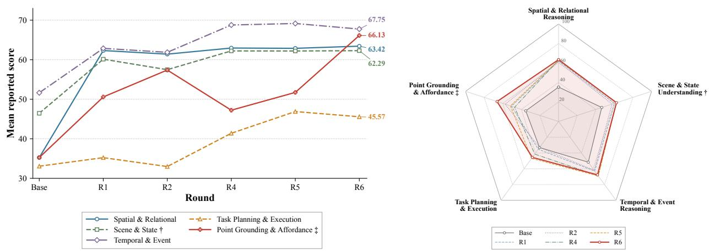  
Figure 5 Evolution of reported scores across five capability dimensions. Curves show cross-version changes; radar plots show multidimensional profiles. Dimension scores equally average fixed benchmark groups. The rounds are those listed in Table 13; R6 is not the final model. † retains UniEQA judge-error zeros; ‡ includes historical VABench-P protocol changes. The figure describes trends, not directly comparable absolute abilities or a radar-area total score.

Capability summaries reveal the overall pattern, but tasks within the same dimension need not improve together. To examine the sources of these changes, Figure 6 expands the analysis to twelve benchmarks at two scales: panel (a) records the score change of every benchmark at every transition between the selected versions, and panel (b) follows the checkpoints inside a single round, distinguishing cross-version gains from within-round recovery.

The key finding of panel (a) is that broad improvement is not synchronous improvement: every column mixes gains and losses. The selected versions make progress in spatial understanding and robot-centric question answering, yet their task-specific peaks occur at diferent points. From R5 to R6, for example, EB-ALFRED rises by 8.7 points while ET-Plan-Bench, Where2Place, and EB-Habitat decline by 8.0, 4.3, and 4.7. Self-evolution is therefore not a single path of improvement on every metric, but a sequence of tradeofs between capability expansion and retention. The relevant objective is broad competitiveness within the same model, not a composite of benchmark peaks drawn from diferent versions.

Panel (b) distinguishes within-round improvement from gains over a preceding version, and the twelve benchmarks fall into three shapes. During R2, ET-Plan-Bench falls to 32.6 early in the round and recovers to 68.6, surpassing its R1 endpoint; OpenEQA rises monotonically to 57.1 without reaching its R1 level of 60.7; and VABench-P swings between 8.6 and 53.8 across consecutive checkpoints, the instability traced in Section 5.3 to conflicting coordinate supervision. Seven of the twelve benchmarks follow the OpenEQA shape. An upward trajectory within a round is therefore insuficient to establish a better version. Combining both scales avoids measuring gains exclusively from an early low point; where historical scoring anomalies are retained, changes in reported scores must also be distinguished from changes in underlying capability.

A round is therefore judged by the breadth of improvement together with retention rather than by a peak on any single benchmark: the guardrailed selection rule of Section 5.6 accepts a checkpoint only when it adds leading results on the targeted benchmarks without breaching a retention guardrail, which is why local regressions appear in the ledger alongside the gains that paid for them.

(a) Score change between consecutive versions: gains and losses coexist in every step  
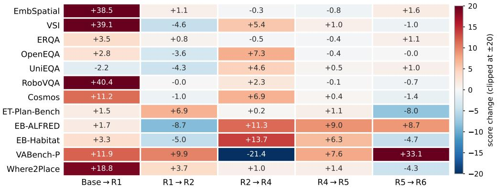

(b) Within-round checkpoint trajectories: an upward trajectory need not beat the preceding version  
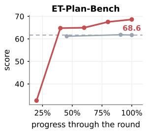

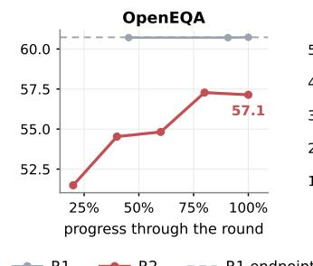

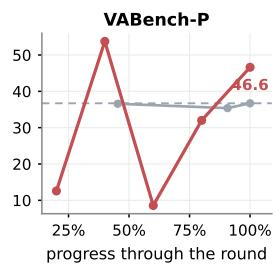  
Figure 6 Evolution across twelve benchmarks at two scales. (a) Score change at each transition between the versions of Figure 5; colour is clipped at ±20 so that the transitions after the first remain legible, and the printed values are unclipped. (b) Checkpoint trajectories inside R1 and R2 for the three trajectory shapes that occur, with the R1 endpoint as reference. The outcome for all twelve benchmarks is the R1→R2 column of (a), where five of twelve end above the preceding version. All markers are measured results; VABench-P observations in (b) predate the frozen point contract.

## 6.6 Real-World Deployment

We further examine how ABot-ER’s embodied perception supports physical interaction on a Galaxea R1 Pro, a wheeled dual-arm robot. The platform has 26 degrees of freedom, including two 7-DoF arms with parallel grippers, a 4-DoF torso, and a 6-DoF omnidirectional chassis; it stands approximately 1.7 m tall and supports a rated payload of 3.5 kg per arm at a reach of 0.6 m.1 ABot-ER serves as the visual question answering (VQA) component of ABot-AgentOS [54], our robot agent runtime, deployed through vLLM on an external host with a single NVIDIA GeForce RTX 5090D and taking 1920 × 1536 images from the robot’s head camera. ABot-AgentOS orchestrates the interaction and invokes ABot-M [9, 65], a separate vision-language-action (VLA) model, for physical manipulation.

The query loop. ABot-AgentOS queries ABot-ER once before each step and once after, and the two queries ask for diferent things.

Before the arm moves it asks for two. The first is a reading of the scene: counting the dots on each block, identifying the operator and judging whether the expression is well formed is Scene and State Understanding, while recovering the intended operand order is Spatial and Relational Reasoning, since the expression faces the participant and therefore reads right to left in the robot’s camera image. The second is where to act: a grasp point on the target block, and a placement point inside a free region to the right of the tens digit large enough to receive the ones digit. These are Point Grounding and Afordance, returned as normalized [0, 1] coordinates under the protocol of Section 5.3 and consumed directly by ABot-M.

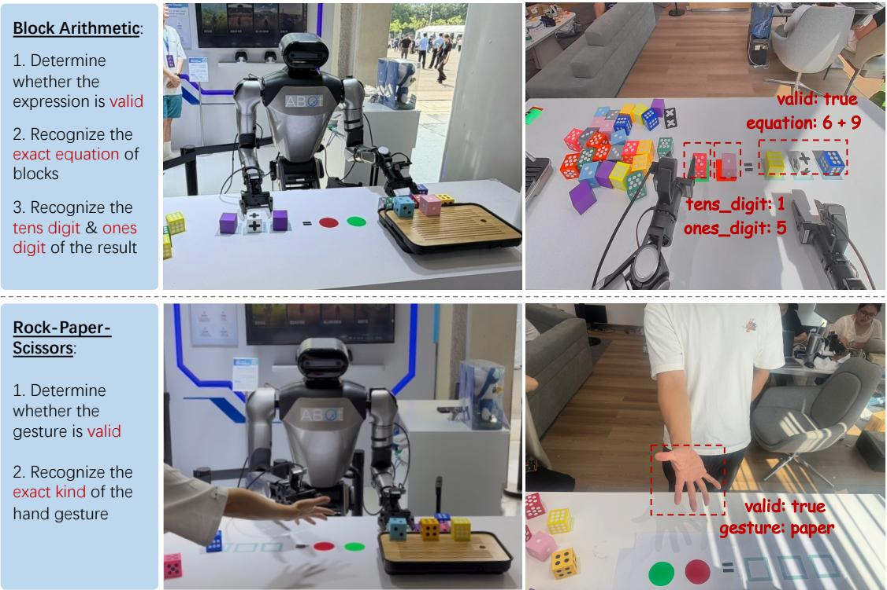  
Figure 7 Real-world interaction with ABot-ER on the Galaxea R1 Pro. Left: task requirements; middle: physical demonstrations; right: head-camera views annotated with visual recognition results. Top: Block Arithmetic requires expression validation, dot-based number recognition, and result-digit readout, illustrated by 6 + 9 and the answer blocks representing 15. Bottom: Rock-Paper-Scissors requires gesture validity assessment and classification, illustrated by a valid paper gesture. ABot-ER supplies visual state information to ABot-AgentOS, which coordinates decisions and downstream actions.

After the arm moves, a second reading reports what the tabletop now holds and whether the step did what it was meant to, which is where Temporal and Event Reasoning enters: the assessment separates a block that has been placed from one that has not. ABot-AgentOS decides from it whether to continue or to revise, and a revision re-orders the remaining steps against the current tabletop state, which is Long-Horizon Action Organization. The model supplies the judgement; ABot-AgentOS takes the decision.

Demonstrations. In Block Arithmetic, a participant across the table arranges an arithmetic expression using blocks whose numerical values are encoded by dots rather than printed digits. Figure 7 (top) shows the expression 6 + 9 and the visual readout of the result blocks as tens digit 1 and ones digit 5.

In Rock-Paper-Scissors, ABot-ER identifies the participant’s hand gesture and judges whether it is a valid game gesture, a reading of the interaction state rather than a category label alone, and therefore again Scene and State Understanding. ABot-AgentOS combines this with the robot’s own gesture to determine a win, loss, or draw. Figure 7 (bottom) shows recognition of a valid paper gesture.

These qualitative demonstrations connect the capability-oriented training and benchmark evaluation of this report to practical robot use: fine-grained visual evidence and spatial relations supply the state information on which subsequent decisions and actions depend.

## 7 Conclusion and Future Work

This report presented ABot-ER, a unified embodied reasoning model that resolves, from one set of weights, the questions a robot faces between seeing and acting: where things are, what state the scene is in, what just happened, what to do next, and exactly where to act. It is a decoder-only vision-language architecture with a single normalized coordinate protocol, per-benchmark output contracts frozen into the training labels, and a task conditioning mechanism, so that one body of embodied knowledge serves perception, planning, and execution without switching weights or adding a decoding stage at inference. Two obstacles stand between that design and a model that realizes it. Against Data-Model Drift, the Agentic Data-Model Self-Evolution Engine turns corpus construction into a closed loop driven by evaluation feedback, and its central move is to diagnose which aspect of the training data is at fault rather than to answer every weakness with more samples: one shared diagnosis coordinates three revisions that cannot substitute for one another, supplying supervision that is missing, repairing supervision that is contradictory, and reallocating budget to supervision that is under-exposed, with a coordinating agent proposing each diagnosis and deterministic programs deciding what enters training. Against Modality Entanglement, the Task-Conditioned Adaptive Training Strategy overlays lightweight low-rank residuals on the shared backbone, routed by the task family of each record, so that heterogeneous supervision can share representations while receiving the task-specific adaptation intended to reduce interference between them.

In a systematic evaluation across twelve benchmarks covering three core competencies and five capability dimensions, ABot-ER leads all three competency means, namely perception, planning, and execution, among the public models compared, demonstrating that breadth and depth can coexist in unified embodied reasoning. The converged corpus carries much of what the loop produces: a single post-training pass on it reaches a similar twelve-benchmark mean to a chain of six rounds at a fifth of the accumulated post-training, and the same one-pass recipe transfers to backbones from 2B to 27B parameters without any size-specific diagnosis. The same recipe on a mixture-of-experts backbone that activates 3B parameters per token surpasses the 9B dense model on the twelve-benchmark mean, with the conditioning’s contribution there concentrated on complete-plan generation. Task conditioning pays while a corpus is still being made internally consistent and returns less once it is: on that backbone it improved eleven of twelve benchmarks before the output protocol was unified and neither suite mean after, with a consistent gain on complete-plan generation throughout. On a wheeled dual-arm platform the model serves as the perception and judgement component of an agent pipeline that delegates motion to a separate action model. Interactive planning is the dimension the aggregate mean describes least well: it is where a single pass on the converged corpus recovers the least of the six-round chain, and where targeted post-training contributes the most.

That gap sets the first of three directions we plan to pursue. The most direct is to extend self-evolution from supervised fine-tuning to learning from environment feedback, using the observed outcomes of model-proposed actions executed by downstream policies. The second is to couple the reasoning and control tiers more tightly while keeping them separate, so that grounded coordinates and plans carry more of the information a vision-language-action model needs, and feedback from execution returns to the reasoning tier as evidence. The third follows from the corpus transferring across backbones: the artifact worth maintaining is that corpus together with its evaluation contract and audit trail, not only the checkpoint trained on it. We release the model weights and this corpus, and of the two we expect the corpus to be the more durable. We hope ABot-ER is useful as a reasoning layer for robot systems, and that the account of how its training data was diagnosed, repaired, and audited is as useful as the model itself.

## 8 Contributions

## Core Contributors

• Qiuyu Ding

• Hengda Xu

• Zedong Chu

• Changda Xia

• Jiajun Shen

## Project Lead

• Zedong Chu†

## Advisor

• Mu Xu

• Wenbin Tang

## Acknowledgments

We extend our sincere gratitude to the broader team for their support, particularly Zixiao Tang, Shihui Su, Zhining Gu, Honglin Han, Minqi Gu, Zeqian Ye, Yang Cai, Linbo Zheng, and Jingjing Ma.

## Contributors

• Zihao Guan

• Zhengchen Yuan

• Jianfang Zhang

• Di Yang

• Jiayi Tian

• Yuting Xu

• Fei Wang

• Shiao Liu

• Wei Zhang

• Xiaolong Wu

## References

[1] Michael Ahn, Anthony Brohan, Noah Brown, Yevgen Chebotar, Omar Cortes, Byron David, Chelsea Finn, Chuyuan Fu, Keerthana Gopalakrishnan, Karol Hausman, Alex Herzog, Daniel Ho, Jasmine Hsu, Julian Ibarz, Brian Ichter, Alex Irpan, Eric Jang, Rosario Jauregui Ruano, Kyle Jefrey, Sally Jesmonth, Nikhil J Joshi, Ryan Julian, Dmitry Kalashnikov, Yuheng Kuang, Kuang-Huei Lee, Sergey Levine, Yao Lu, Linda Luu, Carolina Parada, Peter Pastor, Jornell Quiambao, Kanishka Rao, Jarek Rettinghouse, Diego Reyes, Pierre Sermanet, Nicolas Sievers, Clayton Tan, Alexander Toshev, Vincent Vanhoucke, Fei Xia, Ted Xiao, Peng Xu, Sichun Xu, Mengyuan Yan, and Andy Zeng. Do As I Can, Not As I Say: Grounding Language in Robotic Afordances. arXiv preprint arXiv:2204.01691, 2022. URL https://arxiv.org/abs/2204.01691.

[2] Peter Anderson, Qi Wu, Damien Teney, Jake Bruce, Mark Johnson, Niko Sünderhauf, Ian Reid, Stephen Gould, and Anton van den Hengel. Vision-and-Language Navigation: Interpreting visually-grounded navigation instructions in real environments. arXiv preprint arXiv:1711.07280, 2017. URL https://arxiv.org/abs/1711.07280.

[3] BAAI RoboBrain Team et al. RoboBrain 2.0 Technical Report. arXiv preprint arXiv:2507.02029, 2025. URL https://arxiv.org/abs/2507.02029.

[4] Shikhar Bahl, Russell Mendonca, Lili Chen, Unnat Jain, and Deepak Pathak. Afordances from Human Videos as a Versatile Representation for Robotics. arXiv preprint arXiv:2304.08488, 2023. URL https://arxiv.org/abs/ 2304.08488.

[5] Konstantinos Bousmalis, Giulia Vezzani, Dushyant Rao, Coline Devin, Alex X. Lee, Maria Bauza, Todor Davchev, Yuxiang Zhou, Agrim Gupta, Akhil Raju, Antoine Laurens, Claudio Fantacci, Valentin Dalibard, Martina Zambelli, Murilo Martins, Rugile Pevceviciute, Michiel Blokzijl, Misha Denil, Nathan Batchelor, Thomas Lampe, Emilio Parisotto, Konrad Żołna, Scott Reed, Sergio Gómez Colmenarejo, Jon Scholz, Abbas Abdolmaleki, Oliver Groth, Jean-Baptiste Regli, Oleg Sushkov, Tom Rothörl, José Enrique Chen, Yusuf Aytar, Dave Barker, Joy Ortiz, Martin Riedmiller, Jost Tobias Springenberg, Raia Hadsell, Francesco Nori, and Nicolas Heess. RoboCat: A Self-Improving Generalist Agent for Robotic Manipulation. arXiv preprint arXiv:2306.11706, 2023. URL https://arxiv.org/abs/2306.11706.

[6] Anthony Brohan, Noah Brown, Justice Carbajal, Yevgen Chebotar, Xi Chen, Krzysztof Choromanski, Tianli Ding, Danny Driess, Avinava Dubey, Chelsea Finn, Pete Florence, Chuyuan Fu, Montse Gonzalez Arenas, Keerthana Gopalakrishnan, Kehang Han, Karol Hausman, Alexander Herzog, Jasmine Hsu, Brian Ichter, Alex Irpan, Nikhil Joshi, Ryan Julian, Dmitry Kalashnikov, Yuheng Kuang, Isabel Leal, Lisa Lee, Tsang-Wei Edward Lee, Sergey Levine, Yao Lu, Henryk Michalewski, Igor Mordatch, Karl Pertsch, Kanishka Rao, Krista Reymann, Michael Ryoo, Grecia Salazar, Pannag Sanketi, Pierre Sermanet, Jaspiar Singh, Anikait Singh, Radu Soricut, Huong Tran, Vincent Vanhoucke, Quan Vuong, Ayzaan Wahid, Stefan Welker, Paul Wohlhart, Jialin Wu, Fei Xia, Ted Xiao, Peng Xu, Sichun Xu, Tianhe Yu, and Brianna Zitkovich. RT-2: Vision-Language-Action Models Transfer Web Knowledge to Robotic Control. arXiv preprint arXiv:2307.15818, 2023. URL https://arxiv.org/abs/2307.15818.

[7] Boyuan Chen, Zhuo Xu, Sean Kirmani, Brian Ichter, Danny Driess, Pete Florence, Dorsa Sadigh, Leonidas Guibas, and Fei Xia. SpatialVLM: Endowing Vision-Language Models with Spatial Reasoning Capabilities. arXiv preprint arXiv:2401.12168, 2024. URL https://arxiv.org/abs/2401.12168.

[8] K. Chen et al. Robo2VLM: Visual Question Answering from Large-Scale In-the-Wild Robot Manipulation Datasets. arXiv preprint arXiv:2505.15517, 2025. URL https://arxiv.org/abs/2505.15517.

[9] Ronghan Chen, Yandan Yang, Zuojin Tang, Dongjie Huo, Tong Lin, Haoning Wu, Haoyun Liu, Yuzhi Chen, Lulu Zheng, Botai Yuan, Tianlun Li, Mingxin Wang, Dekang Qi, Bin Hu, Wei Mei, Yuze Xuan, Haolong Yang, Yanqing Zhu, and Mu Xu. Abot-m0.5: Unified mobility-and-manipulation world action model, 2026. URL https://arxiv.org/abs/2607.00678.

[10] Y. Chen et al. EgoPlan-Bench: Benchmarking Multimodal Large Language Models for Human-Level Planning. arXiv preprint arXiv:2312.06722, 2023. URL https://arxiv.org/abs/2312.06722.

[11] An-Chieh Cheng, Hongxu Yin, Yang Fu, Qiushan Guo, Ruihan Yang, Jan Kautz, Xiaolong Wang, and Sifei Liu. SpatialRGPT: Grounded Spatial Reasoning in Vision Language Models. arXiv preprint arXiv:2406.01584, 2024. URL https://arxiv.org/abs/2406.01584.

[12] Ronghao Dang, Jiayan Guo, Bohan Hou, Sicong Leng, Kehan Li, Xin Li, Jiangpin Liu, Yunxuan Mao, Zhikai Wang, Yuqian Yuan, Minghao Zhu, Xiao Lin, Yang Bai, Qian Jiang, Yaxi Zhao, Minghua Zeng, Junlong Gao, Yuming Jiang, Jun Cen, Siteng Huang, Liuyi Wang, Wenqiao Zhang, Chengju Liu, Jianfei Yang, Shijian Lu,

and Deli Zhao. RynnBrain: Open Embodied Foundation Models. arXiv preprint arXiv:2602.14979, 2026. URL https://arxiv.org/abs/2602.14979.

[13] Abhishek Das, Samyak Datta, Georgia Gkioxari, Stefan Lee, Devi Parikh, and Dhruv Batra. Embodied Question Answering. arXiv preprint arXiv:1711.11543, 2017. URL https://arxiv.org/abs/1711.11543.

[14] S. Ding et al. MM-IFEngine: Towards Multimodal Instruction Following. arXiv preprint arXiv:2504.07957, 2025. URL https://arxiv.org/abs/2504.07957.

[15] Danny Driess, Fei Xia, Mehdi S. M. Sajjadi, Corey Lynch, Aakanksha Chowdhery, Brian Ichter, Ayzaan Wahid, Jonathan Tompson, Quan Vuong, Tianhe Yu, Wenlong Huang, Yevgen Chebotar, Pierre Sermanet, Daniel Duckworth, Sergey Levine, Vincent Vanhoucke, Karol Hausman, Marc Toussaint, Klaus Gref, Andy Zeng, Igor Mordatch, and Pete Florence. PaLM-E: An Embodied Multimodal Language Model. arXiv preprint arXiv:2303.03378, 2023. URL https://arxiv.org/abs/2303.03378.

[16] Mengfei Du, Binhao Wu, Zejun Li, Xuanjing Huang, and Zhongyu Wei. EmbSpatial-Bench: Benchmarking Spatial Understanding for Embodied Tasks with Large Vision-Language Models. arXiv preprint arXiv:2406.05756, 2024. URL https://arxiv.org/abs/2406.05756.

[17] Samir Yitzhak Gadre, Gabriel Ilharco, Alex Fang, et al. DataComp: In Search of the Next Generation of Multimodal Datasets. arXiv preprint arXiv:2304.14108, 2023. URL https://arxiv.org/abs/2304.14108.

[18] Gemini Robotics Team et al. Gemini Robotics: Bringing AI into the Physical World. arXiv preprint arXiv:2503.20020, 2025. URL https://arxiv.org/abs/2503.20020.

[19] Ruiyan Gong, Yingnan Guo, Junjun Hu, Jintao Kong, Xiaoxu Leng, Tianlun Li, Weize Li, Fei Liu, Zhicheng Liu, Jia Lu, Minghua Luo, Chenlin Ming, Yanfen Shen, Jiyue Tao, Zhengbo Wang, Mingyang Yin, Minqi Gu, Zihao Guan, Wei Guo, Guoqing Liu, Huachong Pang, Menglin Yang, Zeqian Ye, Xiaoxiao Geng, Zhining Gu, Honglin Han, Di Jing, Hongyu Pan, Mingchao Sun, Kuan Yang, Jianfang Zhang, Yanghong Chen, Ye He, Wei Mei, Jiahao Shi, Xiangpo Yang, Yanqing Zhu, Yang Cai, Jingjing Ma, Shihui Su, Zixiao Tang, Linbo Zheng, Zedong Chu, Xiaolong Wu, Wenbin Tang, and Mu Xu. Abot-n1: Toward a general visual language navigation foundation model, 2026. URL https://arxiv.org/abs/2607.10383.

[20] A. Guo et al. HANDAL: A Dataset of Real-World Manipulable Object Categories with Pose Annotations, Afordances, and Reconstructions. arXiv preprint arXiv:2308.01477, 2023. URL https://arxiv.org/abs/2308. 01477.

[21] Xiaoshuai Hao, Lei Zhou, Zhijian Huang, Zhiwen Hou, Yingbo Tang, Lingfeng Zhang, Guang Li, Zheng Lu, Shuhuai Ren, Xianhui Meng, Yuchen Zhang, Jing Wu, Jinghui Lu, Chenxu Dang, Jiayi Guan, Jianhua Wu, Zhiyi Hou, Hanbing Li, Shumeng Xia, Mingliang Zhou, Yinan Zheng, Zihao Yue, Shuhao Gu, Hao Tian, Yuannan Shen, Jianwei Cui, Wen Zhang, Shaoqing Xu, Bing Wang, Haiyang Sun, Zeyu Zhu, Yuncheng Jiang, Zibin Guo, Chuhong Gong, Chaofan Zhang, Wenbo Ding, Kun Ma, Guang Chen, Rui Cai, Diyun Xiang, Heng Qu, Fuli Luo, Hangjun Ye, and Long Chen. MiMo-Embodied: X-Embodied Foundation Model Technical Report. arXiv preprint arXiv:2511.16518, 2025. URL https://arxiv.org/abs/2511.16518.

[22] Neil Houlsby, Andrei Giurgiu, Stanislaw Jastrzebski, Bruna Morrone, Quentin de Laroussilhe, Andrea Gesmundo, Mona Attariyan, and Sylvain Gelly. Parameter-Eficient Transfer Learning for NLP. In Proceedings of the 36th International Conference on Machine Learning (ICML), pages 2790–2799, 2019. URL https://arxiv.org/abs/ 1902.00751.

[23] Edward J. Hu, Yelong Shen, Phillip Wallis, Zeyuan Allen-Zhu, Yuanzhi Li, Shean Wang, Lu Wang, and Weizhu Chen. LoRA: Low-Rank Adaptation of Large Language Models. arXiv preprint arXiv:2106.09685, 2021. URL https://arxiv.org/abs/2106.09685.

[24] Jiangyong Huang, Silong Yong, Xiaojian Ma, Xiongkun Linghu, Puhao Li, Yan Wang, Qing Li, Song-Chun Zhu, Baoxiong Jia, and Siyuan Huang. An Embodied Generalist Agent in 3D World. arXiv preprint arXiv:2311.12871, 2023. URL https://arxiv.org/abs/2311.12871.

[25] Wenlong Huang, Fei Xia, Ted Xiao, Harris Chan, Jacky Liang, Pete Florence, Andy Zeng, Jonathan Tompson, Igor Mordatch, Yevgen Chebotar, Pierre Sermanet, Noah Brown, Tomas Jackson, Linda Luu, Sergey Levine, Karol Hausman, and Brian Ichter. Inner Monologue: Embodied Reasoning through Planning with Language Models. arXiv preprint arXiv:2207.05608, 2022. URL https://arxiv.org/abs/2207.05608.

[26] AMAP CV Lab. Abot-n0: Technical report on the vla foundation model for versatile embodied navigation. 2025.

[27] Kehan Li, Bohan Hou, Minghao Zhu, Tianyi Zhang, Zesen Cheng, Zhikai Wang, Sicong Leng, Xin Li, Xiao Lin, Biying Yao, Minghua Zeng, Jiangpin Liu, Ronghao Dang, Jiayan Guo, Siteng Huang, Haoyu Zhao, Heng Ping, Yaxi Zhao, Tong Zhao, Kexiang Wang, Tong Lu, Shengke Xue, Jiahao Tang, Yulei Wang, Zejing Wang, Jianwei Gao, Shijian Lu, Chengju Liu, Jianfei Yang, Mingxiu Chen, and Deli Zhao. RynnBrain 1.1: Towards More Capable and Generalizable Embodied Foundation Model. arXiv preprint arXiv:2607.17977, 2026. URL https://arxiv.org/abs/2607.17977.

[28] Xiaoqi Li, Mingxu Zhang, Yiran Geng, Haoran Geng, Yuxing Long, Yan Shen, Renrui Zhang, Jiaming Liu, and Hao Dong. ManipLLM: Embodied Multimodal Large Language Model for Object-Centric Robotic Manipulation. arXiv preprint arXiv:2312.16217, 2023. URL https://arxiv.org/abs/2312.16217.

[29] S. Lian et al. Euclid’s Gift: Enhancing Spatial Perception and Reasoning in Vision-Language Models via Geometric Surrogate Tasks. arXiv preprint arXiv:2509.24473, 2025. URL https://arxiv.org/abs/2509.24473.

[30] Haotian Liang, Mingkang Chen, Yufei Huang, Yuchun Guo, Xiaomeng Zhu, Xiangli Shi, Kaixuan Wang, Yunxuan Mao, Weijie Zhou, Ling Chen, Shirong Zeng, Yueyu Long, Yuchen Si, Yajuan Zhu, Xingyu Zhou, Minghui Wang, Wanjia He, Xin Yang, Lingzhu Xiang, Zhiqing Liu, Bohan Ma, Xiran Huang, Tianshuo Yang, Zhiheng Liu, Xuantang Xiong, Zisheng Lu, Ping Luo, Yao Mu, Han Hu, and Zhengyou Zhang. RxBrain: Embodied Cognition Foundation Model with Joint Language-Visual Reasoning and Imagination. arXiv preprint arXiv:2607.14187, 2026. URL https://arxiv.org/abs/2607.14187.

[31] Jacky Liang, Wenlong Huang, Fei Xia, Peng Xu, Karol Hausman, Brian Ichter, Pete Florence, and Andy Zeng. Code as Policies: Language Model Programs for Embodied Control. arXiv preprint arXiv:2209.07753, 2022. URL https://arxiv.org/abs/2209.07753.

[32] Bo Liu, Xingchao Liu, Xiaojie Jin, Peter Stone, and Qiang Liu. Conflict-Averse Gradient Descent for Multi-task Learning. In Advances in Neural Information Processing Systems (NeurIPS), 2021. URL https://arxiv.org/ abs/2110.14048.

[33] H. Liu, C. Li, Q. Wu, and Y. J. Lee. Visual Instruction Tuning. In Proc. Adv. Neural Inf. Process. Syst. (NeurIPS), 2023.

[34] Y. Liu et al. HOI4D: A 4D Egocentric Dataset for Category-Level Human-Object Interaction. In Proc. IEEE/CVF Conf. Comput. Vis. Pattern Recognit. (CVPR), pages 21013–21022, 2022.

[35] Yang Liu, Weixing Chen, Yongjie Bai, Xiaodan Liang, Guanbin Li, Wen Gao, and Liang Lin. Aligning Cyber Space with Physical World: A Comprehensive Survey on Embodied AI. arXiv preprint arXiv:2407.06886, 2024. URL https://arxiv.org/abs/2407.06886

[36] Ilya Loshchilov and Frank Hutter. Decoupled Weight Decay Regularization. arXiv preprint arXiv:1711.05101, 2017. URL https://arxiv.org/abs/1711.05101.

[37] Y. Lu et al. VL-Grasp: A 6-DoF Interactive Grasp Policy for Language-Oriented Objects in Cluttered Indoo Scenes. arXiv preprint arXiv:2308.00640, 2023. URL https://arxiv.org/abs/2308.00640.

[38] Aman Madaan, Niket Tandon, Prakhar Gupta, Skyler Hallinan, Luyu Gao, Sarah Wiegrefe, Uri Alon, Nouha Dziri, Shrimai Prabhumoye, Yiming Yang, Shashank Gupta, Bodhisattwa Prasad Majumder, Katherine Hermann, Sean Welleck, Amir Yazdanbakhsh, and Peter Clark. Self-Refine: Iterative Refinement with Self-Feedback. arXiv preprint arXiv:2303.17651, 2023. URL https://arxiv.org/abs/2303.17651.

[39] Arjun Majumdar, Anurag Ajay, Xiaohan Zhang, Pranav Putta, Sriram Yenamandra, Mikael Henaf, Sneha Silwal, Paul Mcvay, Oleksandr Maksymets, Sergio Arnaud, Karmesh Yadav, Qiyang Li, Ben Newman, Mohit Sharma, Vincent Berges, Shiqi Zhang, Pulkit Agrawal, Yonatan Bisk, Dhruv Batra, Mrinal Kalakrishnan, Franziska Meier, Chris Paxton, Alexander Sax, and Aravind Rajeswaran. OpenEQA: Embodied Question Answering in the Era of Foundation Models. In Proceedings of the IEEE/CVF Conference on Computer Vision and Pattern Recognition (CVPR), pages 16488–16498, 2024. URL https://openaccess.thecvf.com/content/CVPR2024/html/Majumdar\_ OpenEQA\_Embodied\_Question\_Answering\_in\_the\_Era\_of\_Foundation\_Models\_CVPR\_2024\_paper.html.

[40] David Manheim and Scott Garrabrant. Categorizing Variants of Goodhart’s Law. arXiv preprint arXiv:1803.04585, 2018. URL https://arxiv.org/abs/1803.04585.

[41] Yao Mu, Qinglong Zhang, Mengkang Hu, Wenhai Wang, Mingyu Ding, Jun Jin, Bin Wang, Jifeng Dai, Yu Qiao, and Ping Luo. EmbodiedGPT: Vision-Language Pre-Training via Embodied Chain of Thought. arXiv preprint arXiv:2305.15021, 2023. URL https://arxiv.org/abs/2305.15021.

[42] Fei Ni, Min Zhang, Pengyi Li, Yifu Yuan, Lingfeng Zhang, Yuecheng Liu, Peilong Han, Longxin Kou, Shaojin Ma, Jinbin Qiao, David Gamaliel Arcos Bravo, Yuening Wang, Xiao Hu, Zhanguang Zhang, Xianze Yao, Yutong Li, Zhao Zhang, Ying Wen, Ying-Cong Chen, Xiaodan Liang, Liang Lin, Bin He, Haitham Bou-Ammar, He Wang, Huazhe Xu, Jiankang Deng, Shan Luo, Shuqiang Jiang, Wei Pan, Yang Gao, Stefanos Zafeiriou, Jan Peters, Yuzheng Zhuang, Yingxue Zhang, Yan Zheng, Hongyao Tang, and Jianye Hao. Embodied Arena: A Comprehensive, Unified, and Evolving Evaluation Platform for Embodied AI. arXiv preprint arXiv:2509.15273, 2025. URL https://arxiv.org/abs/2509.15273.

[43] Xin Nie, Zhiyuan Cheng, Yuan Zhang, Chao Ji, Jiajia Wu, Yuhan Zhang, and Jia Pan. iFlyBot-VLM Technical Report. arXiv preprint arXiv:2511.04976, 2025. URL https://arxiv.org/abs/2511.04976.

[44] NVIDIA et al. Cosmos-Reason1: From Physical Common Sense To Embodied Reasoning. arXiv preprint arXiv:2503.15558, 2025. URL https://arxiv.org/abs/2503.15558.

[45] NVIDIA et al. Cosmos 3: Omnimodal World Models for Physical AI. arXiv preprint arXiv:2606.02800, 2026. URL https://arxiv.org/abs/2606.02800.

[46] Yonatan Oren, Nicole Meister, Niladri Chatterji, Faisal Ladhak, and Tatsunori B. Hashimoto. Proving Test Set Contamination in Black Box Language Models. arXiv preprint arXiv:2310.17623, 2023. URL https: //arxiv.org/abs/2310.17623.

[47] D. Qu et al. EO-1: An Open Unified Embodied Foundation Model for General Robot Control. arXiv preprint arXiv:2508.21112, 2025. URL https://arxiv.org/abs/2508.21112.

[48] Samyam Rajbhandari, Jef Rasley, Olatunji Ruwase, and Yuxiong He. ZeRO: Memory Optimizations Toward Training Trillion Parameter Models. arXiv preprint arXiv:1910.02054, 2019. URL https://arxiv.org/abs/1910. 02054.

[49] Manolis Savva, Abhishek Kadian, Oleksandr Maksymets, Yili Zhao, Erik Wijmans, Bhavana Jain, Julian Straub, Jia Liu, Vladlen Koltun, Jitendra Malik, Devi Parikh, and Dhruv Batra. Habitat: A Platform for Embodied AI Research. arXiv preprint arXiv:1904.01201, 2019. URL https://arxiv.org/abs/1904.01201.

[50] Pierre Sermanet, Tianli Ding, Jefrey Zhao, Fei Xia, Debidatta Dwibedi, Keerthana Gopalakrishnan, Christine Chan, Gabriel Dulac-Arnold, Sharath Maddineni, Nikhil J Joshi, Pete Florence, Wei Han, Robert Baruch, Yao Lu, Suvir Mirchandani, Peng Xu, Pannag Sanketi, Karol Hausman, Izhak Shafran, Brian Ichter, and Yuan Cao. RoboVQA: Multimodal Long-Horizon Reasoning for Robotics. arXiv preprint arXiv:2311.00899, 2023. URL https://arxiv.org/abs/2311.00899.

[51] Mohit Shridhar, Jesse Thomason, Daniel Gordon, Yonatan Bisk, Winson Han, Roozbeh Mottaghi, Luke Zettle moyer, and Dieter Fox. ALFRED: A Benchmark for Interpreting Grounded Instructions for Everyday Tasks. arXiv preprint arXiv:1912.01734, 2019. URL https://arxiv.org/abs/1912.01734.

[52] Mohit Shridhar, Lucas Manuelli, and Dieter Fox. CLIPort: What and Where Pathways for Robotic Manipulation. arXiv preprint arXiv:2109.12098, 2021. URL https://arxiv.org/abs/2109.12098.

[53] Ishika Singh, Valts Blukis, Arsalan Mousavian, Ankit Goyal, Danfei Xu, Jonathan Tremblay, Dieter Fox, Jesse Thomason, and Animesh Garg. ProgPrompt: Generating Situated Robot Task Plans using Large Language Models. arXiv preprint arXiv:2209.11302, 2022. URL https://arxiv.org/abs/2209.11302.

[54] Jiayi Tian, Shiao Liu, Yuting Xu, Jia Lu, Zihao Guan, Honglin Han, Di Yang, Minqi Gu, Yifei Qian, Tianlin Zhang, Yanqing Zhu, Zeqian Ye, Menglin Yang, Fei Wang, Xu Hu, Xiuxian Li, Wei Zhang, Shihui Su, Yiyan Ji, Jingbo Wang, Ziteng Feng, Jiaheng Liu, Zhaoxiang Zhang, Xiaolong Wu, Zixiao Tang, Zhining Gu, Yang Cai, Linbo Zheng, Jingjing Ma, Mingyang Yin, Zedong Chu, Wenbin Tang, and Mu Xu. Abot-agentos: A general robotic agent os with lifelong multi-modal memory, 2026. URL https://arxiv.org/abs/2607.10350.

[55] TJURL-Lab. UniEQA & UniEval: A Unified Benchmark and Evaluation Platform for Multimodal Foundation Models in Embodied Question Answering. URL https://github.com/TJURL-Lab/UniEQA. Oficial code and dataset repository; accessed 2026-09-09.

[56] Ashish Vaswani, Noam Shazeer, Niki Parmar, Jakob Uszkoreit, Llion Jones, Aidan N. Gomez, Lukasz Kaiser, and Illia Polosukhin. Attention Is All You Need. arXiv preprint arXiv:1706.03762, 2017. URL https://arxiv.org/ abs/1706.03762.

[57] Yizhong Wang, Yeganeh Kordi, Swaroop Mishra, Alisa Liu, Noah A. Smith, Daniel Khashabi, and Hannaneh Hajishirzi. Self-Instruct: Aligning Language Models with Self-Generated Instructions. arXiv preprint arXiv:2212.10560, 2022. URL https://arxiv.org/abs/2212.10560.

[58] Mengzhou Xia, Sadhika Malladi, Suchin Gururangan, Sanjeev Arora, and Danqi Chen. LESS: Selecting Influential Data for Targeted Instruction Tuning. arXiv preprint arXiv:2402.04333, 2024. URL https://arxiv.org/abs/ 2402.04333.

[59] Sang Michael Xie, Hieu Pham, Xuanyi Dong, Nan Du, Hanxiao Liu, Yifeng Lu, Percy Liang, Quoc V. Le, Tengyu Ma, and Adams Wei Yu. DoReMi: Optimizing Data Mixtures Speeds Up Language Model Pretraining. arXiv preprint arXiv:2305.10429, 2023. URL https://arxiv.org/abs/2305.10429.

[60] Zhiyuan Xu, Kun Wu, Junjie Wen, Jinming Li, Ning Liu, Zhengping Che, and Jian Tang. A Survey on Robotics with Foundation Models: toward Embodied AI. arXiv preprint arXiv:2402.02385, 2024. URL https: //arxiv.org/abs/2402.02385.

[61] Jihan Yang, Shusheng Yang, Anjali W. Gupta, Rilyn Han, Li Fei-Fei, and Saining Xie. Thinking in Space: How Multimodal Large Language Models See, Remember, and Recall Spaces. arXiv preprint arXiv:2412.14171, 2024. URL https://arxiv.org/abs/2412.14171.

[62] Rui Yang, Hanyang Chen, Junyu Zhang, Mark Zhao, Cheng Qian, Kangrui Wang, Qineng Wang, Teja Venkat Koripella, Marziyeh Movahedi, Manling Li, Heng Ji, Huan Zhang, and Tong Zhang. EmbodiedBench: Comprehensive Benchmarking Multi-modal Large Language Models for Vision-Driven Embodied Agents. arXiv preprint arXiv:2502.09560, 2025. URL https://arxiv.org/abs/2502.09560.

[63] Shusheng Yang, Jihan Yang, Pinzhi Huang, Ellis Brown, Zihao Yang, Yue Yu, Shengbang Tong, Zihan Zheng, Yifan Xu, Muhan Wang, Daohan Lu, Rob Fergus, Yann LeCun, Li Fei-Fei, and Saining Xie. Cambrian-S: Towards Spatia Supersensing in Video. arXiv preprint arXiv:2511.04670, 2025. URL https://arxiv.org/abs/2511.04670.

[64] Y. Yang et al. Scaling Text-Rich Image Understanding via Code-Guided Synthetic Multimodal Data Generation. arXiv preprint arXiv:2502.14846, 2025. URL https://arxiv.org/abs/2502.14846.

[65] Yandan Yang, Shuang Zeng, Tong Lin, Xinyuan Chang, Dekang Qi, Junjin Xiao, Haoyun Liu, Ronghan Chen, Yuzhi Chen, Dongjie Huo, Feng Xiong, Xing Wei, Zhiheng Ma, and Mu Xu. Abot-m0: Vla foundation model for robotic manipulation with action manifold learning, 2026. URL https://arxiv.org/abs/2602.11236.

[66] Z. Ye et al. RoboFAC: A Comprehensive Framework for Robotic Failure Analysis and Correction. arXiv preprint arXiv:2505.12224, 2025. URL https://arxiv.org/abs/2505.12224.

[67] Tianhe Yu, Saurabh Kumar, Abhishek Gupta, Sergey Levine, Karol Hausman, and Chelsea Finn. Gradient Surgery for Multi-Task Learning. arXiv preprint arXiv:2001.06782, 2020. URL https://arxiv.org/abs/2001.06782.

[68] Weizhe Yuan, Richard Yuanzhe Pang, Kyunghyun Cho, Xian Li, Sainbayar Sukhbaatar, Jing Xu, and Jason Weston. Self-Rewarding Language Models. arXiv preprint arXiv:2401.10020, 2024. URL https://arxiv.org/ abs/2401.10020.

[69] Wentao Yuan, Jiafei Duan, Valts Blukis, Wilbert Pumacay, Ranjay Krishna, Adithyavairavan Murali, Arsalan Mousavian, and Dieter Fox. RoboPoint: A Vision-Language Model for Spatial Afordance Prediction for Robotics. arXiv preprint arXiv:2406.10721, 2024. URL https://arxiv.org/abs/2406.10721.

[70] Yifu Yuan, Haiqin Cui, Yibin Chen, Zibin Dong, Fei Ni, Longxin Kou, Jinyi Liu, Pengyi Li, Yan Zheng, and Jianye Hao. From Seeing to Doing: Bridging Reasoning and Decision for Robotic Manipulation. arXiv preprint arXiv:2505.08548, 2025. URL https://arxiv.org/abs/2505.08548.

[71] Lingfeng Zhang, Yuening Wang, Hongjian Gu, Atia Hamidizadeh, Zhanguang Zhang, Yuecheng Liu, Yutong Wang, David Gamaliel Arcos Bravo, Junyi Dong, Shunbo Zhou, Tongtong Cao, Xingyue Quan, Yuzheng Zhuang, Yingxue Zhang, and Jianye Hao. ET-Plan-Bench: Embodied Task-level Planning Benchmark Towards Spatial-Temporal Cognition with Foundation Models. arXiv preprint arXiv:2410.14682, 2024. URL https: //arxiv.org/abs/2410.14682.

[72] E. Zhou et al. RoboRefer: Towards Spatial Referring with Reasoning in Vision-Language Models for Robotics. arXiv preprint arXiv:2506.04308, 2025. URL https://arxiv.org/abs/2506.04308.

[73] Ding Zou, Feifan Wang, Mengyu Ge, Siyuan Fan, Zongbing Zhang, Wei Chen, Lingfeng Wang, Zhongyou Hu, Wenrui Yan, Zhengwei Gao, Hao Wang, Weizhao Jin, Yu Zhang, Hainan Zhao, Mingliang Zhang, Xianxian Xi, Yaru Zhang, Wenyuan Li, Zhengguang Gao, and Yurui Zhu. EmbodiedBrain: Expanding Performance

Boundaries of Task Planning for Embodied Intelligence. arXiv preprint arXiv:2510.20578, 2025. URL https: //arxiv.org/abs/2510.20578.

## Appendices

## A Self-Evolution Engine: Full Records

This appendix collects the complete construction quantities, release audits, data compositions, training configurations, and per-round ledger of the engine described in Section 5. Accounting bases and round attributions are stated in each caption and table note.

## A.1 Supervision Construction and Release Audit

Table 14 Supervision construction by capability dimension. The construction column describes the methods used across rounds; historical processing volumes named there belong to the rounds that performed them. The count column is the R6 development release, whose rows sum to its 160,000 unique identities, each materialized twice for 320,000 physical records. It is not the released model, whose Stage A composition is given in Table 16.

<table><tr><td rowspan=1 colspan=3>Dimension        Construction method                                                                      Unique,R6</td></tr><tr><td rowspan=6 colspan=3>Spatial &amp; Rela-Train-only supervision from public spatial corpora, cleaned, relabelled, and sampled under con-    46,104straints; multiple choice constrained to a single A-D token; numeric answers passed throughthe benchmark parser; equal-weight channels over 21 fine-grained capabilities correct naturalsource imbalance; in the constrained rebuild, 10,373 released records had their capability metadata</td></tr><tr><td rowspan=1 colspan=2>tionalRela straints; multile choice contrained</td></tr><tr><td rowspan=2 colspan=2></td></tr><tr><td rowspan=6 colspan=1>rapper markup stripped; repetitionquestion answering is additionally</td></tr><tr><td rowspan=1 colspan=2></td><td rowspan=1 colspan=1>umed</td></tr><tr><td rowspan=1 colspan=2></td></tr><tr><td></td><td></td><td rowspan=2 colspan=1></td></tr><tr><td rowspan=3 colspan=2>Scene &amp; State       Existing train question-answer pairslimited by scene and group quotas. In th</td></tr><tr><td rowspan=1 colspan=1>state</td></tr><tr><td rowspan=7 colspan=2>constructed deterministically from visible objects, target objects, task instructions, visual statedescriptions, and verified action plans of replay-passed episodes, with quotas over seven questionExisting video question answering; strict multiple choice preserved as A-D; yes/no items mapped to      7,301A/B only where the mapping is determinate, with no model-generated distractors; frame variantsof the same video and question share a group exposure budget; the targeted release draws fiveindependent clean train domains at roughly equal share. In R6 the dimension resolves into 3,037</td></tr><tr><td></td><td rowspan=2 colspan=2></td></tr><tr><td></td><td rowspan=1 colspan=1></td></tr><tr><td rowspan=1 colspan=1>Temporal &amp; Event</td><td rowspan=1 colspan=1>Existing video question answering; stric</td></tr><tr><td></td><td rowspan=1 colspan=1></td></tr><tr><td rowspan=1 colspan=1></td></tr><tr><td rowspan=1 colspan=1></td></tr><tr><td rowspan=3 colspan=3>multiple-choice items, which include the 3,031 determinate</td></tr><tr><td rowspan=1 colspan=1>ly converted binary items, and 4,264</td></tr><tr><td rowspan=4 colspan=3>Point &amp; Affordance Early rounds: target medoid for dataset point sources, endpoint extraction for object trajectories,    20,599deletion of non-object trajectories, normalization of free-space points to [0, 1] tuples. After Case A:only labels with an explicit target region are retained. For the eight-point supervision used with</td></tr><tr><td rowspan=1 colspan=2>Point & Afrdance deletion of non-object trajectories, norma</td></tr><tr><td rowspan=1 colspan=2></td></tr><tr><td rowspan=1 colspan=1></td><td rowspan=3 colspan=2>medoid of valid original points repeated eight times; Where2Place retains its own one-to-three-point</td></tr><tr><td rowspan=1 colspan=1></td><td rowspan=1 colspan=1></td></tr><tr><td rowspan=1 colspan=1></td></tr><tr><td></td><td></td><td rowspan=1 colspan=1></td></tr><tr><td rowspan=1 colspan=1></td><td></td></tr><tr><td rowspan=1 colspan=1>Long-Horizon Ac- Multi-s</td><td></td></tr><tr><td rowspan=3 colspan=1>tion Org.</td><td></td></tr><tr><td rowspan=3 colspan=3>records</td></tr><tr><td rowspan=1 colspan=1></td></tr><tr><td rowspan=1 colspan=1></td></tr></table>

Screening coverage. Two screens are reported as coverage rather than as a gate. An external perceptual-hash index covers 408,502 of the 707,758 distinct media paths in the joint audit of the two released stages, or 57.72%, and 99,100 of the 153,146 paths in the Stage B audit taken alone, or 64.71%; no overlap against evaluation media was found inside the covered index. The corresponding figure for Stage A taken alone was not recorded. Separately, every one of the 418,492 perceptual hashes embedded in the joint release and the 81,735 embedded in Stage B was checked; that is a diferent basis and the two coverages are not additive. Entries missing from the index are carried as residual risk. Semantic near-duplicates and anomalous scores are escalated for case-by-case adjudication rather than resolved by threshold, and the resulting candidates are

Table 15 Hard gates and the result recorded for each, on the two released stages. Both stages close as pass with documented residual risk. Where a quantity was not recorded separately, the cell says so rather than reporting a zero.
<table><tr><td>Gate</td><td>Requirement</td><td>Result and round</td></tr><tr><td>tion</td><td>Evaluation contamina- No detected overlap under the specified identifier No exact test-sample match and hash-matching checks; unindexed media remain on either stage within the documented residual risk</td><td>checked identifiers and the available hash coverage. The Stage A finding comes from the joint audit with its decontami- nated parent, since the format- alignment step changed no me- dia, source or identity. The 300</td></tr><tr><td>Source eligibility</td><td>No records drawn from sources ruled ineligible</td><td>source admission No prohibited-source record re- mains on either stage. Three sources had been removed in full, quarantining 23,565 input records, when the decontami-</td></tr><tr><td>Output contract</td><td>Every label matches the contract template and passes Stage B: 104,960 of 104,960 the schema and pattern checks</td><td>nated parent release was built labels pass, 100%. Stage A: all 46,776 VABench-P labels are valid eight-point XML, but no round-trip rate under one shared runtime parser was recorded across the remain- ing benchmarks. A byte-level prompt-match rate was not</td></tr><tr><td>Coordinate protocol</td><td>No box labels, no non-canonical points, no conflicting protocols for the same question</td><td>recorded for either stage Zero box outputs and zero non- canonical points on both stages</td></tr><tr><td>Reference integrity</td><td>Every record resolves to an existing media file</td><td>Zero media-schema errors on Stage A, and the media check ran and passed on Stage B; neither stage saved a separate</td></tr></table>

isolated individually.

## A.2 Stage Compositions and Training Configuration

Selection guardrails and targets of the released run. The targeted post-training run of the released model set an absolute floor of 64.32 on the nine-benchmark question-answering mean, together with retention bounds on the remaining quantities: the task-planning mean not down by more than 0.5 points; ET-Plan, EB-ALFRED, and EB-Habitat each not down by more than 1.0 point; ERQA, EmbSpatial, RoboVQA, and UniEQA each not down by more than 0.7; point, multiple-choice, and numeric parse rates at or above 99.9%; and zero detected overlap with the formal test sets. The benchmarks the run targeted were VSI, VABench-P, Where2Place, Cosmos, and OpenEQA. Earlier rounds set their own bounds and their own targets, which are recorded with those rounds; no single tolerance is applied across the history.

Table 16 Realized composition of the Stage A joint training set by physical records, grouped by capability dimension. This release does not carry a regenerated token-proxy report, so no token-proxy share is stated for it; the 316.01M figure of the earlier R4 version does not transfer. Long-horizon action organization is the planning partition, comprising 42,236 general planning records, 1,598 Habitat-grounded and 349 ALFRED-grounded plans.
<table><tr><td>Capability dimension</td><td>Physical</td><td>Share</td></tr><tr><td>Spatial &amp; Relational</td><td>144,902</td><td>31.34%</td></tr><tr><td>Scene &amp; State</td><td>150,806</td><td>32.61%</td></tr><tr><td>Temporal &amp; Event</td><td>11,905</td><td>2.57%</td></tr><tr><td>Point &amp; Affordance</td><td>110,594</td><td>23.92%</td></tr><tr><td>Long-Horizon Action Org.</td><td>44,183</td><td>9.56%</td></tr><tr><td>Total</td><td>462,390</td><td>100%</td></tr></table>

Table 17 Realized composition of the Stage B Final Joint closure set by physical records. Each unique identity is materialized exactly twice. The release rebalances toward planning recovery under a question-answering guardrail, not toward point grounding alone.
<table><tr><td>Component</td><td>Physical</td><td>Unique</td><td>Share</td></tr><tr><td>Task planning</td><td>26,240</td><td>13,120</td><td>25.00%</td></tr><tr><td>VABench-P</td><td>16,794</td><td>8,397</td><td>16.00%</td></tr><tr><td>OpenEQA</td><td>12,000</td><td>6,000</td><td>11.43%</td></tr><tr><td>ERQA</td><td>10,496</td><td>5,248</td><td>10.00%</td></tr><tr><td>Where2Place</td><td>10,000</td><td>5,000</td><td>9.53%</td></tr><tr><td>RoboVQA</td><td>8,000</td><td>4,000</td><td>7.62%</td></tr><tr><td>Cosmos</td><td>6,074</td><td>3,037</td><td>5.79%</td></tr><tr><td>EmbSpatial</td><td>6,000</td><td>3,000</td><td>5.72%</td></tr><tr><td>UniEQA</td><td>5,356</td><td>2,678</td><td>5.10%</td></tr><tr><td>VSI</td><td>4,000</td><td>2,000</td><td>3.81%</td></tr><tr><td>Total</td><td>104,960</td><td>52,480</td><td>100%</td></tr></table>

Component names denote the capability each group is constructed to support rather than the identity of its raw sources; the sources themselves are listed in Section 6. The task-planning partition holds 12,000 replay-verified ALFRED records, 9,000 Habitat records and 5,240 ET-Plan repair records. The two bases diverge sharply on this release: task planning takes 25.00% of physical records but 63.76% of assistant supervision tokens, because its labels are long structured plans, while point supervision takes 25.53% by physical records and 29.96% by assistant tokens.

## A.3 Per-Round Ledger

Table 18 Where the two stages of the released model difer. Settings shared by both stages are listed in the note; per-stage schedules are omitted.
<table><tr><td></td><td>Stage A Cross-Dimension Foundation</td><td>Stage B Final Joint Post-training</td></tr><tr><td>Data</td><td></td><td></td></tr><tr><td>Dataset</td><td>Open-source joint pre-training set</td><td>Final Joint closure set</td></tr><tr><td>Physical training records</td><td>462,390</td><td>104,960</td></tr><tr><td>Unique identities</td><td>294,762</td><td>52,480</td></tr><tr><td>Materialization</td><td>1.5687× on average, 1-4 per identity</td><td>Exactly 2×</td></tr><tr><td>Shards</td><td>288</td><td>128 × 820</td></tr><tr><td>EQA : task planning</td><td>90.44% : 9.56% (rec.)</td><td>75.00% : 25.00% (rec.) 36.24% : 63.76% (tok.)</td></tr><tr><td>Training</td><td></td><td></td></tr><tr><td>Initial weights</td><td>Pretrained vision-language model</td><td>Selected Stage A</td></tr><tr><td>LR: LLM decoder</td><td>4.0 × 10−6</td><td>checkpoint 3.0 × 10−7</td></tr><tr><td>Consumed records at selection</td><td>358,400</td><td>38,400</td></tr><tr><td>Effective epochs at selection</td><td>0.7751</td><td>0.3659</td></tr><tr><td>Wall-clock time</td><td>19h 13m</td><td>6h 36m</td></tr><tr><td>GPU hours</td><td>≈ 615</td><td>≈ 211</td></tr></table>

Shared by both stages. The vision encoder is frozen; the connector, the decoder and the task-conditioned residuals are trainable, the residuals sitting on the full-attention q\_proj and v\_proj modules of layers 19, 23, 27 and 31 with rank and alpha both 16. Global batch 128 (per-device 1, accumulation 4), cosine schedule, AdamW [36] with weight decay 0.01, sequence length 8,192, BF16, ZeRO-3 [48], 32 GPUs. Images enter at up to 524,288 px and 32 per sample, video at 1.0 fps and up to 16 frames of 262,144 px. Neither release carries a regenerated token-proxy report.

Reading the table. Wall-clock time and GPU hours describe the complete job; the consumed-record and epoch rows are computed at the selected checkpoint, which is earlier than the end of the run in both stages. Measured to that checkpoint instead, the stages take 14h 59m and 2h 32m, about 479 and 81 GPU hours. GPU hours are wall-clock time times 32 devices, not a billing figure. Optimizer and scheduler state are reset at the stage boundary.

Table 19 Per-round ledger. Weight origin makes explicit that the history is not a single continuation chain. R3 is a diagnostic round only; see Section 5.5. The R4 scores in Table 5 were measured on a same-recipe continuation chain rather than on this round’s own checkpoint. Per-round hyperparameters are omitted here; those of the two released stages are given in Table 18.
<table><tr><td>Round</td><td>Diagnosis that triggered it Data revision</td><td></td><td>Training change Weight origin</td><td></td></tr><tr><td>Base</td><td>Uneven capability across the twelve embodied tasks, weakest on point grounding, video spa- tial reasoning, and closed-loop</td><td>None</td><td>None</td><td>Pretrained model</td></tr><tr><td>R1</td><td>planning</td><td>Validate joint planning and 70,526 records, 42.5M token proxy; plan- Short pilot run, suf- Restart from pre- question-answering training and ning to question answering about 20: 80; ficient only to exer- trained the evaluation pipeline end to box labels removed and coordinates moved cise the pipeline</td><td></td><td></td></tr><tr><td>R2</td><td>end</td><td>to [0, 1] The pilot budget was too small 288,028 records, 158.20M token proxy; con- Budget to support any conclusion about strained sampling over nine benchmarks roughly threefold capability; the nine question- and 21 fine-grained capabilities; duplicates answering benchmarks need ex- and conflicting labels removed, 1,524 test-</td><td></td><td>raised Restart from pre- trained</td></tr><tr><td>R3</td><td>duplication, and leakage need rewritten cleaning</td><td>plicit balancing; point format, overlapping records dropped, point data Perception improved but AL- 463,120 records, 316.01M token proxy; Trained in two con- Restart from pre- FRED and Habitat remained grounded ALFRED and Habitat supervi- secutive segments trained low; one point source held sion added; 65:33.4:1.2:0.4 over question of one release</td><td></td><td></td></tr><tr><td>R4</td><td>get while grounded targets num- FRED bered 14 records (0.047%)</td><td>54.30% of the planning bud- answering, general planning, Habitat, AL- R3 reported 100 on EB- 463,071 records, 316.01M token proxy; ALFRED from a summary three high-risk trajectory sources removed covering 12 of 300 episodes, in full (23,565 records); R3 proportions</td><td>Same recipe as the Restart from pre- preceding round</td><td>trained</td></tr><tr><td>R5</td><td>official test trajectories in the routing errors legacy planning pool</td><td>against 27 on recomputation and grounded improvements retained; zero over all 300; audit confirmed box labels, broken media, and cross-task R4 improved planning only 153,600 records, 128.95M token; VABench Short post-training Continue from modestly and VABench-P re- 14%, ALFRED 17%, Habitat 14%, ques- pass at a reduced the</td><td></td><td></td></tr><tr><td>R6</td><td>ception</td><td>mained low; targeted increase tion answering 35%, general planning 20% learning rate needed without sacrificing per- by token proxy; free-space prompt and la- bel conflict rebuilt Capability peaks scattered 160,000 unique identities materialized Single release, sin- Restart from the across fragmented repairs; a twice, yielding 320,000 physical records; gle uninterrupted R4 checkpoint, single clean trunk with one the question-answering partition is split optimizer run</td><td>deliberately by-</td><td>preceding round</td></tr><tr><td>Stage A</td><td>was needed</td><td>capability, 15% benchmark guarantee, and 40% foundational streams; planning super- vision is allocated separately, from clean ALFRED and Habitat pools Consolidate the R4 recipe un- Open-source release derived from R4, Large-budget foun- Restart from pre-</td><td></td><td>passing R5</td></tr><tr><td>Stage B</td><td>tecture and the frozen contract</td><td>der the task-conditioned archi- 462,390 physical records (Table 16)</td><td>dation run</td><td>trained</td></tr><tr><td></td><td>question-answering guardrail</td><td>Planning recovery with a Final Joint closure release, 104,960 physi- Short targeted pass Continue from cal records (Table 17)</td><td>at a much reduced the learning rate</td><td>selected Stage A check- point</td></tr></table>