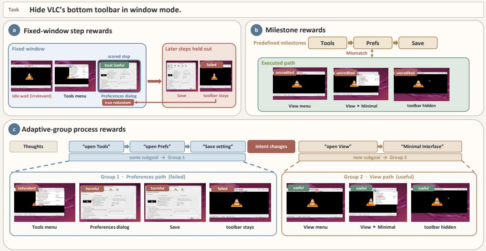
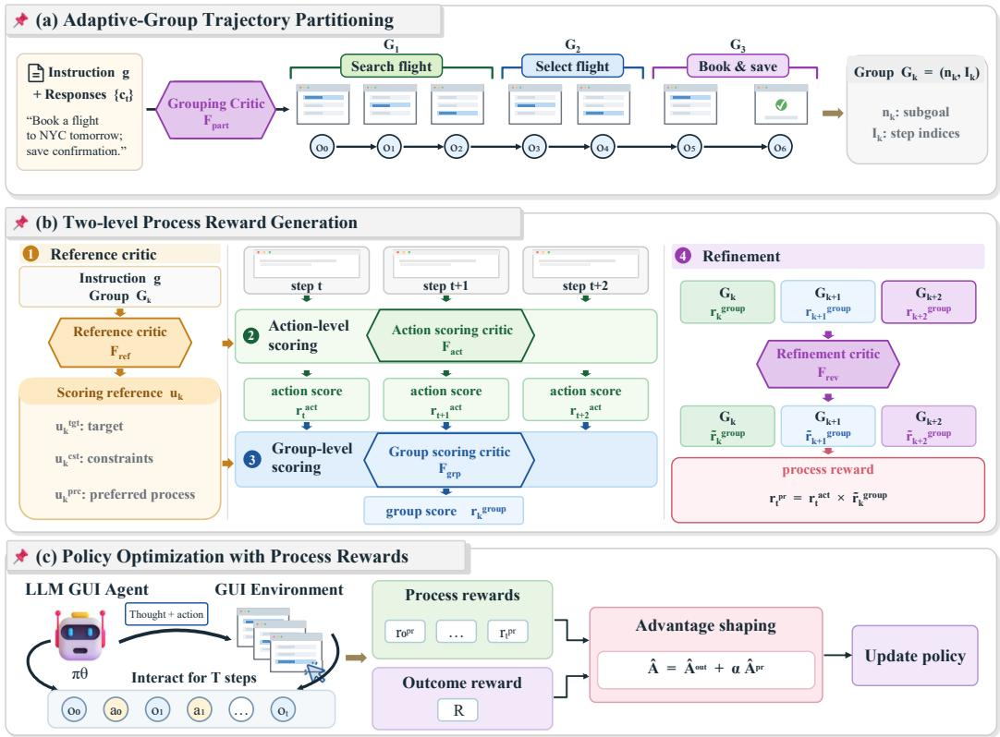
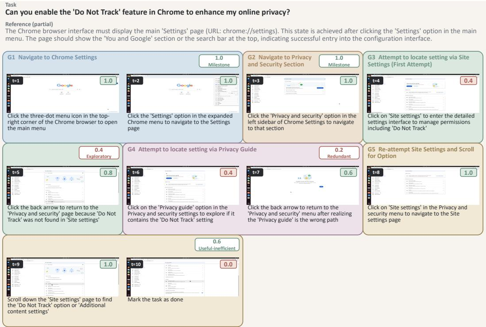
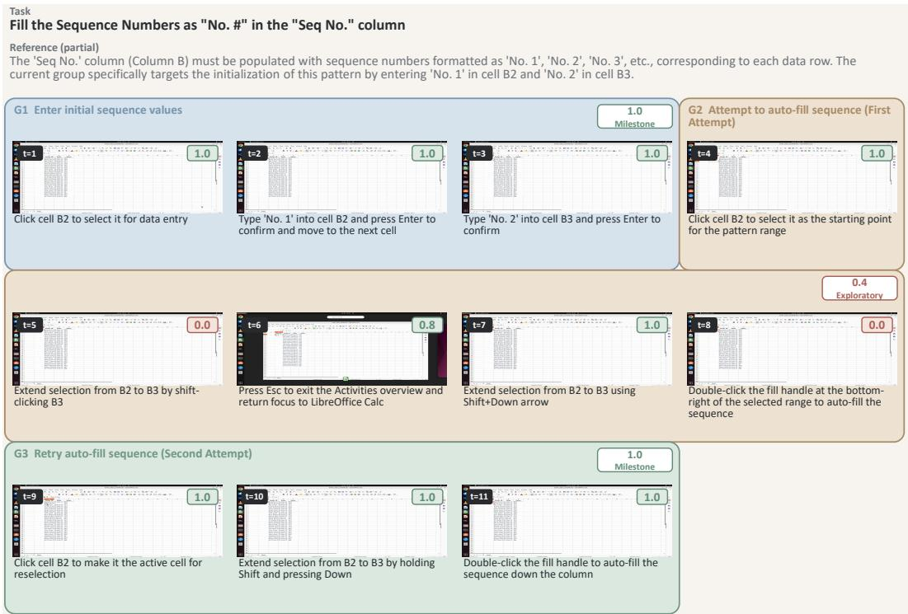
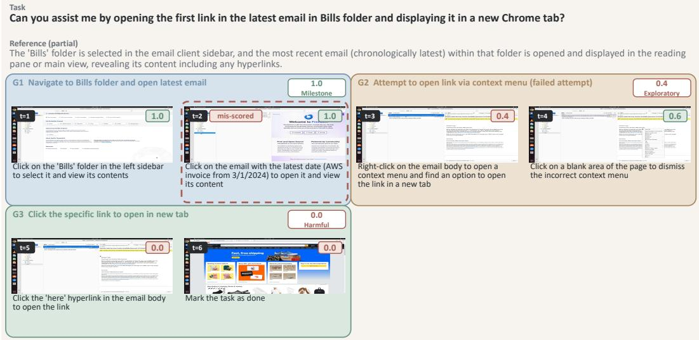

# ADAPTIVE-GROUP PROCESS REWARDS FOR GUI AGENTS

Zirui Shang<sup>1,2∗</sup> <sup>1,2</sup>BIT, BIGAI

Yang Liu<sup>2</sup> <sup>2</sup>BIGAI

Xin Shu<sup>2,3</sup> <sup>2,3</sup>BIGAI, Wuhan University

Zhi Gao<sup>2,4†</sup> <sup>2,4</sup>BIGAI, Shenzhen MSU-BIT University

Xinxiao Wu<sup>1,4‡</sup> <sup>1,4</sup>BIT, Shenzhen MSU-BIT University

Lifeng Fan<sup>2</sup> <sup>2</sup>BIGAI

## ABSTRACT

Training graphical user interface (GUI) agents with reinforcement learning suffers from sparse outcome rewards, leading to inefficient learning. Process rewards offer a promising direction for credit assignment to intermediate actions; however, accurately evaluating an action requires identifying evidence across long-horizon GUI trajectories, as its value may depend on information beyond its immediate state and observation. In this paper, we propose an adaptive-group process reward framework that dynamically partitions a GUI trajectory into semantically coherent subgoal groups, enabling process reward estimation at both the action and group levels. At the action level, a critic evaluates each action based on the visual changes and subsequent actions within the group for action correctness and contribution to the subgoal. At the group level, the framework aggregates action-level evaluations to assess subgoal completion and contribution to the overall task, and further refines these assessments by leveraging the context of all groups in the trajectory. The process reward of each action is obtained by combining its action-level evaluation with the refined group-level evaluation. We further augment GRPO’s outcome advantage with the proposed process rewards to provide finer-grained guidance for GUI agent training. Experiments on process reward benchmarks and downstream RL training demonstrate the effectiveness of the proposed framework.

## 1 INTRODUCTION

Recent advances in large language models and vision-language models have enabled graphical user interface (GUI) agents Cheng et al. (2024); Hong et al. (2024); Qin et al. (2025); Lin et al. (2024); Xu et al. (2025); Gao et al. (2024); Zhang et al. (2025). These agents translate user instructions and visual observations into executable interactions across digital devices, with applications such as software testing, office assistance, and industrial automation. GUI tasks typically involve long-horizon, multi-turn interactions Zhou et al. (2023); Rawles et al. (2024); Xie et al. (2025), requiring agents to maintain multimodal interaction context across changing visual states and coordinate sequences of actions. Reinforcement learning (RL) Li et al. (2025); Xiao et al. (2025); Lu et al. (2025); Tang et al. (2026) is well suited to such interactive tasks, allowing agents to improve their policies based on feedback from the GUI environments.

  
Figure 1: Fixed-window step rewards, milestone rewards, and adaptive-group process rewards on an executed GUI trajectory. (a) A fixed local window can include irrelevant context and miss later evidence. (b) Predefined milestones can leave a valid executed path uncredited. (c) Adaptive groups follow the executed subgoals and score actions within each group.

Most GUI environments provide reward signals primarily in the form of sparse outcome rewards Xie et al. (2025); Li et al. (2025): a trajectory is judged successful if the final application state satisfies the instruction requirement, and unsuccessful otherwise. Consequently, the outcome-level signal is assigned to all intermediate actions in a trajectory, failing to distinguish useful actions from redundant or incorrect ones and making credit assignment unreliable. Process rewards Lightman et al. (2023); Wang et al. (2023); Chen et al. (2025) are therefore needed to evaluate intermediate actions. However, constructing reliable process rewards for GUI trajectories is challenging because GUI environments rarely provide direct supervision for intermediate actions. Whether an action is correctly executed can often be verified from the current and subsequent observations, whereas whether its semantic purpose is correct may only become clear after subsequent actions. Judging the action requires evidence from a broader trajectory context than the immediate state change after that action alone.

Existing GUI process reward methods typically organize trajectory evidence and assign credit through two types of preset context scopes: fixed-window step rewards Chen et al. (2025); Xiong et al. (2025); Xiao et al. (2025); Lu et al. (2025); Wan et al. (2026) and milestone rewards Zheng et al. (2026); Hao et al. (2026); Li et al. (2026a); Dai et al. (2026a); Zhai et al. (2026). Fixed window step rewards evaluate an action within a fixed local context (figure 1(a)). Short windows may miss long-range evidence needed to assess the action’s effect, whereas longer windows may introduce irrelevant context. Milestone rewards instead predefine task progress around fixed check points or subgoals (figure 1(b)). Because GUI tasks may admit multiple valid execution paths, such milestones can under-credit progress that does not follow the predefined path and overlook the intermediate actions connecting checkpoints. Thus, an effective process reward should adapt its evidence scope and credit assignment to the executed trajectory, rather than relying on fixed local scopes or predefined checkpoints.

In this paper, we introduce an adaptive-group process reward framework for GUI trajectories (figure 1(c)). Using the task instruction and the agent’s responses, the executed trajectory is dynamically partitioned into consecutive groups of actions that share the same subgoal or semantic operation, rather than by a fixed partition rule. This grouping defines the context for judging the actions in each group and supports two complementary levels of evaluation. At the action level, the critic assesses whether each action is correctly executed based on the local visual change and whether it advances the group’s subgoal based on later actions in the group. At the group level, the critic aggregates the action-level assessments within each group to assess its subgoal completion and contribution to the whole task. Then, the produced group-level assessments are revisited in the context of all groups, allowing the critic to judge each group’s role beyond its local evidence. The process reward of each action is obtained by combining its action-level assessment with the refined grouplevel assessment of its group. We further use the generated process rewards to shape the GRPO Shao et al. (2024) advantage at each step, providing finer-grained credit assignment during policy optimization. We evaluate the framework on process-reward benchmarks and in downstream RL on OSWorld. The results show consistent improvements in process-reward accuracy and task success rate, demonstrating the effectiveness of adaptive-group process rewards.

Our contributions are as follows:

• We introduce an adaptive-group process reward framework for GUI agents, which dynamically partitions trajectories into semantically coherent subgoal groups to organize the evidence needed for process reward evaluation.

• We design a two-level evaluation that assesses execution and contribution at both the action level and the group level, and obtain the process reward of each action by combining these assessments, making correct execution and group-level contribution jointly necessary.

• Experiments on process reward benchmarks and downstream RL training demonstrate the effectiveness of the proposed framework.

## 2 RELATED WORK

## 2.1 GUI AGENTS

Recent progress in large language models and vision-language models has enabled GUI agents that interact with applications through visual observations and executable actions. Early systems mainly relied on prompting or supervised fine-tuning, while recent open-source models and frameworks, such as ShowUI Lin et al. (2024), CogAgent Hong et al. (2024), AGUVIS Xu et al. (2025), UI-TARS Qin et al. (2025), OpenCUA Wang et al. (2025), Agent S Agashe et al. (2024), and TongUI Zhang et al. (2025), improve grounding, planning, and cross-platform interaction through larger GUI data and stronger vision-language-action modeling. More recently, reinforcement learning has become a central direction for GUI agents because it can optimize long-horizon interaction from environment feedback rather than only imitating fixed demonstrations. DART Li et al. (2025) decouples multi-turn rollout from training for GUI RL, UI-Genie Xiao et al. (2025) builds a reward guided self-improvement loop for mobile GUI agents, Orcust Lu et al. (2025) combines principleconstrained reward modeling with online VM-grounded trajectory construction, and ClawGUI Tang et al. (2026) provides a full-stack infrastructure for GUI agent RL and deployment. However, most RL pipelines still rely heavily on sparse outcome rewards, which makes it difficult to assign credit to intermediate actions. Our work addresses this limitation by constructing dense process rewards over adaptive groups and the actions in those groups.

## 2.2 PROCESS REWARD MODELING

Process reward modeling supplements sparse outcome rewards with feedback on intermediate steps, enabling more fine-grained credit assignment during training. In reasoning Lightman et al. (2023); Wang et al. (2023) and coding Le et al. (2022); Liu et al. (2023); Dai et al. (2026b) tasks, intermediate feedback can often be verified from execution results, compiler errors, unit tests, or other deterministic checks. GUI tasks provide no comparable automatic signal for most intermediate operations: the value of a click, text entry, menu selection, or file operation depends on visual state changes, task requirements, and subsequent operations. GUI process reward modeling must therefore infer both whether an action is correctly executed and its semantic role from trajectory context. Existing GUI process reward methods can be broadly organized into fixed-window step rewards Chen et al. (2025); Xiong et al. (2025); Xiao et al. (2025); Lu et al. (2025); Wan et al. (2026) and milestone rewards Zheng et al. (2026); Hao et al. (2026); Li et al. (2026a); Dai et al. (2026a); Zhai et al. (2026). Fixed-window step rewards judge actions within a fixed local context. GUI-Shepherd Chen et al. (2025) learns step-level scores and rationales from human annotations, while GUI-PRA Xiong et al. (2025) selects historical context and actively perceives UI state changes to improve step-level judgment. SeekJudge Wan et al. (2026) further targets fine-grained step-level judgments for use within reinforcement learning. Milestone rewards organize feedback around predefined subgoals, checkpoints, or broader task-level structures. ADMIRE Zheng et al. (2026) dynamically distills verifiable milestones from successful explorations and applies asymmetric credit assignment to successful and failed trajectories. StainFlow Hao et al. (2026) tracks entity evidence to derive task stages and links relevant steps for key-node verification, while GUIDE Zhai et al. (2026) decomposes completed trajectories into subtask units for structured diagnosis. These approaches organize action judgment within preset local contexts or task-level structures, whereas our adaptive-group framework dynamically partitions the executed trajectory into semantically coherent subgoal groups and combines execution and contribution at both the action level and the group level to assign each action a process reward.

## 3 METHOD

## 3.1 PROBLEM FORMULATION

We formulate solving a GUI task as a sequential interaction between an agent and an environment. Given a task instruction g, the agent observes the GUI state $o _ { t }$ at each step. Conditioned on this observation and the interaction history, it generates a response $c _ { t }$ with an executable action $a _ { t }$ . Executing $a _ { t }$ changes the environment and produces the next observation $o _ { t + 1 }$ . An executed trajectory is therefore represented as

$$
\tau = ( o _ { 0 } , c _ { 0 } , a _ { 0 } , o _ { 1 } , c _ { 1 } , a _ { 1 } , \ldots , o _ { T - 1 } , c _ { T - 1 } , a _ { T - 1 } , o _ { T } ) ,\tag{1}
$$

where $T$ is the number of executed actions. The response $c _ { t }$ provides the agent’s textual intent, while the observations and executed actions record the interaction with GUI.

After the trajectory is completed, the environment or a task verifier V produces an outcome reward $R = V ( g , \tau )$ . This trajectory-level signal does not directly indicate the value of individual actions. We therefore formulate GUI process reward generation as producing a process reward for every executed action:

$$
( r _ { 0 } ^ { \mathrm { p r } } , r _ { 1 } ^ { \mathrm { p r } } , \dots , r _ { T - 1 } ^ { \mathrm { p r } } ) = \phi ( g , \tau ) ,\tag{2}
$$

where $\phi$ is a process reward model and $r _ { t } ^ { \mathrm { p r } }$ is the process reward of action $a _ { t }$ at step t. As shown in figure 2, we instantiate $\phi$ by first partitioning τ into adaptive groups that define the context for judging each action (section 3.2), then generating action-level and group-level assessments (section 3.3). The resulting process rewards are used to shape GRPO’s step-level advantage during policy optimization (section 3.4).

## 3.2 ADAPTIVE-GROUP TRAJECTORY PARTITIONING

Fixed-window step rewards evaluate an action within a preset local context, while milestone rewards organize credit around predefined checkpoints. Neither evidence scope is determined by the trajectory that was actually executed. We recover subgoals from the executed trajectory instead. Grouping should follow executed intents, which are already stated in each $c _ { t }$ , so we use a grouping critic $F _ { \mathrm { p a r t } }$ to partition the trajectory from the instruction $g$ and the responses $\{ c _ { t } \} _ { t = 0 } ^ { T - 1 }$

$$
\left\{ G _ { k } \right\} _ { k = 1 } ^ { K } = F _ { \mathrm { p a r t } } ( g , \left\{ c _ { t } \right\} _ { t = 0 } ^ { T - 1 } ) , \qquad G _ { k } = ( n _ { k } , \mathcal { T } _ { k } ) .\tag{3}
$$

The result is a contiguous, non-overlapping partition of the trajectory: each $G _ { k }$ consists of a hypothesized subgoal $n _ { k }$ and the step indices $\mathcal { T } _ { k }$ of the group, and $k ( t )$ denotes the unique group of step t. The subgoal $n _ { k }$ is not a required milestone of $^ { g , }$ so valid executions can induce different groups. These groups are the context for the judgments below.

## 3.3 ADAPTIVE-GROUP PROCESS REWARD GENERATION

The adaptive group defines the context for judging its actions and supports two complementary levels of evaluation: how an action contributes to the group’s subgoal, and how the subgoal contributes to the overall task. At the action level, the critic assesses whether each action is correctly executed and whether it advances the group’s subgoal. At the group level, it aggregates these assessments to judge the group’s subgoal completion and contribution to the global task, then revisits the grouplevel assessments using all groups as context. Verifying execution can be done from the current and next observations, whereas judging semantic purpose depends on what follows: later actions in the group for an action, and other groups for a subgoal.

  
Figure 2: Overview of the proposed framework. (a) A grouping critic partitions the trajectory from the instruction and responses into subgoal groups. (b) Two-level scoring produces an action-level score and a refined group-level score, which are used to generate the process rewards. (c) The process rewards shape the GRPO advantage.

To score an action or a group, the executed actions have to be interpreted against the instruction. We therefore first use a reference critic $F _ { \mathrm { r e f } }$ to build, for each $G _ { k }$ , an instruction-conditioned reference $u _ { k }$ from $g , G _ { k }$ , and the group’s responses $\{ c _ { t } \} _ { t \in \mathbb { Z } _ { k } }$ , to inform the two levels of scoring that follow:

$$
u _ { k } = ( u _ { k } ^ { \mathrm { t g t } } , u _ { k } ^ { \mathrm { c s t } } , u _ { k } ^ { \mathrm { p r c } } ) = F _ { \mathrm { r e f } } ( g , G _ { k } , \{ c _ { t } \} _ { t \in \mathbb { Z } _ { k } } ) .\tag{4}
$$

$u _ { k } ^ { \mathrm { t g t } }$ is the target state implied by g for this group, $u _ { k } ^ { \mathrm { c s t } }$ the checkable constraints, and $u _ { k } ^ { \mathrm { p r c } }$ the preferred process. Action-level scoring consults $u _ { k } ^ { \mathrm { c s t } }$ when checking whether the change from $o _ { t }$ to $o _ { t + 1 }$ is consistent with the instruction; group-level scoring consults $u _ { k } ^ { \mathrm { t g t } }$ and $u _ { k } ^ { \mathrm { p r c } }$ when judging whether the group advances the task and whether the attempted route is reasonable. We treat $u _ { k }$ as a scoring reference rather than as a strict prior: the trajectory is not required to follow $u _ { k } ^ { \mathrm { p r c } }$ or to attain $u _ { k } ^ { \mathrm { t g t } }$ , and an alternative path that still satisfies g remains valid.

Action-level scoring. The actions of $G _ { k }$ are scored together, not one call per step. An action-level scoring critic $F _ { \mathrm { a c t } }$ takes $g , u _ { k } , G _ { k }$ , the group’s responses $\{ c _ { t } \} _ { t \in \mathbb { Z } _ { k } }$ , and the group’s screenshots, and returns a judgment for every action in $G _ { k }$

$$
J _ { k } = \{ ( e _ { t } , p _ { t } , h _ { t } ) \} _ { t \in \mathcal { T } _ { k } } = F _ { \mathrm { a c t } } \big ( g , u _ { k } , G _ { k } , \{ c _ { t } \} _ { t \in \mathcal { T } _ { k } } , \{ o _ { t } \} _ { t \in \mathcal { T } _ { k } \cup \{ t _ { k } ^ { + } \} } \big ) ,\tag{5}
$$

where $\begin{array} { r l r } { t _ { k } ^ { + } } & { { } ~ = ~ } & { 1 ~ + ~ \operatorname* { m a x } \mathcal { T } _ { k } } \end{array}$ is the observation after the last action of the group, $e _ { t } \in \mathsf { \Gamma }$ {Completed, Partial, Failed, Uncertain} is the execution result, $\mathbf { \Phi } _ { p _ { t } } \in \mathbf { \Phi } $ {Milestone, Useful-efficient, Useful-inefficient, Exploratory, Redundant, Harmful} is the contribution to the group’s subgoal, and $h _ { t }$ is a concise evidence summary of the action. Later actions in $G _ { k }$ remain available as post-action context, so $p _ { t }$ can be judged from the subsequent semantic effect rather than from the local state change alone. When the group is long and image-heavy, attaching every screenshot can exceed the context budget. We then split $\mathcal { T } _ { k }$ into successive windows $\mathcal { W } \subseteq \bar { \mathcal { T } } _ { k }$ and apply the same critic to each window: the call still receives the whole group’s responses as text, but screenshots only for $\left\{ o _ { t } \right\} _ { t \in \mathcal { W } \cup \{ t _ { w } ^ { + } \} }$ , where $t _ { \mathcal { W } } ^ { + } = 1 + \operatorname* { m a x } { \mathcal { W } }$ . Concatenating the window outputs yields $J _ { k }$ . The two labels of each action are then mapped by a fixed table M to a scalar action-level score $r _ { t } ^ { \mathrm { a c t } } = M ( e _ { t } , p _ { t } )$ in {0, 0.2, 0.4, 0.6, 0.8, 1.0} (Appendix A.1). The structured judgments $J _ { k }$ are passed to group-level scoring.

Group-level scoring. Whether $G _ { k }$ completes its subgoal, and whether the subgoal helps $^ { g , }$ cannot be read from any single action. A group-level scoring critic $F _ { \mathrm { g r p } }$ therefore scores the group from the structured action-level judgments J —not the scalars $r _ { t } ^ { \mathrm { a c t } }$ alone—together with $u _ { k }$ and summaries $H _ { < k }$ of preceding groups, which situate $G _ { k }$ in the progress already made. It judges the group by $e _ { k }$ for subgoal completion and $p _ { k }$ for contribution to the task, then maps these labels with the same table M to a group-level score $r _ { k } ^ { \mathrm { g r o u p } }$

$$
\begin{array} { r } { ( e _ { k } , p _ { k } , h _ { k } ) = F _ { \mathrm { g r p } } ( g , u _ { k } , G _ { k } , J _ { k } , H _ { < k } ) , \qquad r _ { k } ^ { \mathrm { g r o u p } } = M ( e _ { k } , p _ { k } ) . } \end{array}\tag{6}
$$

$h _ { k }$ is a concise summary of $G _ { k }$ and is appended to $H _ { < k }$ for later groups. Groups are scored in execution order, once per $G _ { k }$

Group-level refinement. After the initial pass scores groups in execution order, we use a refinement critic $F _ { \mathrm { r e v } }$ to revisit $( e _ { k } , p _ { k } )$ with $g$ and the full sequence of group conclusions, using this more complete context to reassess each group’s role and obtain a refined group-level score $\tilde { r } _ { k } ^ { \mathrm { g r o u p } }$

$$
\{ ( \tilde { e } _ { k } , \tilde { p } _ { k } ) \} _ { k = 1 } ^ { K } = F _ { \mathrm { r e v } } \big ( g , \{ G _ { k } , J _ { k } , e _ { k } , p _ { k } \} _ { k = 1 } ^ { K } \big ) , \qquad \tilde { r } _ { k } ^ { \mathrm { g r o u p } } = M ( \tilde { e } _ { k } , \tilde { p } _ { k } ) .\tag{7}
$$

Process reward aggregation. The process reward of action $a _ { t }$ combines the two levels by multi plying its action-level score $r _ { t } ^ { \mathrm { a c t } }$ with the refined group-level score of $G _ { k ( t ) } \mathrm { : }$

$$
r _ { t } ^ { \mathrm { p r } } = r _ { t } ^ { \mathrm { a c t } } \tilde { r } _ { k ( t ) } ^ { \mathrm { g r o u p } } .\tag{8}
$$

The product makes both assessments jointly necessary: $r _ { t } ^ { \mathrm { p r } }$ is high only if the action is correctly executed and its group contributes to the task. The score mapping M and the critic prompts are given in Appendix A.

## 3.4 POLICY OPTIMIZATION WITH PROCESS REWARDS

The process rewards $r _ { t } ^ { \mathrm { p r } }$ are used to shape GRPO’s advantage at each step. For an instruction $^ { g , }$ GRPO Shao et al. $( 2 0 \dot { 2 } 4 )$ samples N trajectories $\begin{array} { r } { B _ { g } ~ = ~ \{ \tau _ { i } \} _ { i = 1 } ^ { N } } \end{array}$ and standardizes their outcome rewards $\{ R _ { i } \}$ within $B _ { g }$ by the mean $\mu ^ { \mathrm { o u t } }$ and standard deviation $\sigma ^ { \mathrm { o u t } }$

$$
\hat { A } _ { i } ^ { \mathrm { o u t } } = \frac { R _ { i } - \mu ^ { \mathrm { o u t } } } { \sigma ^ { \mathrm { o u t } } + \epsilon } .\tag{9}
$$

This term is constant across the steps of $\tau _ { i }$ , so useful and redundant actions at those steps receive the same learning signal.

To distinguish these actions, we keep this outcome term and add a process advantage that is standardized over all steps in $B _ { a } .$ , following StainFlow Hao et al. (2026). Let $\mu ^ { \mathrm { p r } }$ and $\sigma ^ { \mathrm { { \scriptsize { p r } } } }$ be the mean and standard deviation of $\{ r _ { i , t } ^ { \mathrm { p r } } \}$ across every step of every trajectory in the sampled group, and let $\alpha > 0$ be a coefficient:

$$
\hat { A } _ { i , t } ^ { \mathrm { p r } } = \frac { r _ { i , t } ^ { \mathrm { p r } } - \mu ^ { \mathrm { p r } } } { \sigma ^ { \mathrm { p r } } + \epsilon } , \qquad A _ { i , t } = \hat { A } _ { i } ^ { \mathrm { o u t } } + \alpha \hat { A } _ { i , t } ^ { \mathrm { p r } } .\tag{10}
$$

Policy optimization uses $A _ { i , t }$ in place of the uniform outcome advantage.

## 4 EXPERIMENTS

## 4.1 EXPERIMENTAL SETUP

Benchmarks. We evaluate the proposed process rewards on two process-reward benchmarks and for reinforcement learning on OSWorld applications. CUARewardBench Lin et al. (2026) is built on OSWorld trajectories from 10 desktop software categories and 7 agents; it annotates key good and bad actions, and we report process-reward results compared to the benchmark’s OpenCUA-Reflector Wang et al. (2025) and SE-WSM Sun et al. (2025) prompt templates. CUAStepBench Wan et al. (2026) densely annotates every step on executed computer-use trajectories and pairs these labels with human trajectory-level verdicts, covering 177 applications across platforms. OSWorld Xie et al. (2025) provides open-ended GUI tasks in a real desktop environment, with success judged by execution-based scripts on the final state; we train and test on its Chrome, LibreOffice Impress, and LibreOffice Calc applications.

Table 1: Process reward evaluation on CUARewardBench, compared with models under the OpenCUA-Reflector template. P, NPV, R, S, and OA denote precision, negative predictive value, recall, specificity, and overall accuracy. Best results are in bold; second-best are underlined.
<table><tr><td>Reward model</td><td>P</td><td>NPV</td><td>R</td><td>S</td><td>OA</td></tr><tr><td>Qwen2.5-VL-7B</td><td>54.4</td><td>49.4</td><td>53.8</td><td>50.0</td><td>52.0</td></tr><tr><td>Qwen2.5-VL-32B</td><td>60.3</td><td>64.8</td><td>79.8</td><td>41.5</td><td>61.7</td></tr><tr><td>Qwen2.5-VL-72B</td><td>58.5</td><td>64.8</td><td>83.0</td><td>34.8</td><td>60.1</td></tr><tr><td>GLM-4.5V-106B</td><td>64.0</td><td>78.5</td><td>89.0</td><td>44.5</td><td>67.9</td></tr><tr><td>Qwen3-VL-32B-T</td><td>68.3</td><td>77.3</td><td>85.2</td><td>56.1</td><td>71.4</td></tr><tr><td>Qwen3-VL-235B-T</td><td>66.5</td><td>75.0</td><td>84.1</td><td>53.0</td><td>69.4</td></tr><tr><td>GPT-5</td><td>72.7</td><td>87.8</td><td>92.3</td><td>61.6</td><td>77.7</td></tr><tr><td>GUI-Owl-7B</td><td>64.6</td><td>61.8</td><td>67.0</td><td>59.1</td><td>63.3</td></tr><tr><td>GUI-Owl-32B</td><td>61.6</td><td>61.5</td><td>71.4</td><td>50.6</td><td>61.6</td></tr><tr><td>Qwen3.6-27B</td><td>62.5</td><td>87.0</td><td>95.1</td><td>36.6</td><td>67.3</td></tr><tr><td>Ours</td><td>79.4</td><td>84.1</td><td>87.8</td><td>73.9</td><td>81.3</td></tr></table>

Table 2: Process reward evaluation on CUARewardBench, compared with models under the SE-WSM template. Best results are in bold; second-best are underlined.
<table><tr><td>Reward model</td><td>P</td><td>NPV</td><td>R</td><td>S</td><td>OA</td></tr><tr><td>Qwen2.5-VL-7B</td><td>56.7</td><td>54.2</td><td>67.0</td><td>43.3</td><td>55.8</td></tr><tr><td>Qwen2.5-VL-32B</td><td>65.3</td><td>62.4</td><td>67.8</td><td>59.8</td><td>64.0</td></tr><tr><td>Qwen2.5-VL-72B</td><td>58.7</td><td>67.1</td><td>85.2</td><td>33.5</td><td>60.7</td></tr><tr><td>GLM-4.5V-106B</td><td>69.5</td><td>64.2</td><td>66.1</td><td>67.7</td><td>66.9</td></tr><tr><td>Qwen3-VL-32B-T</td><td>78.2</td><td>66.3</td><td>63.2</td><td>80.5</td><td>71.4</td></tr><tr><td>Qwen3-VL-235B-T</td><td>74.5</td><td>63.2</td><td>59.3</td><td>77.4</td><td>67.9</td></tr><tr><td>GPT-5</td><td>83.7</td><td>68.8</td><td>64.8</td><td>86.0</td><td>74.9</td></tr><tr><td>GUI-Owl-7B</td><td>56.6</td><td>64.2</td><td>86.8</td><td>26.2</td><td>58.1</td></tr><tr><td>GUI-Owl-32B</td><td>57.4</td><td>68.8</td><td>89.0</td><td>26.8</td><td>59.5</td></tr><tr><td>SE-WSM-7B</td><td>58.7</td><td>52.0</td><td>48.4</td><td>62.2</td><td>54.9</td></tr><tr><td>Qwen3.6-27B</td><td>73.4</td><td>68.2</td><td>69.8</td><td>72.0</td><td>70.8</td></tr><tr><td>Ours</td><td>79.4</td><td>84.1</td><td>87.8</td><td>73.9</td><td>81.3</td></tr></table>

Metrics. CUARewardBench treats each step judgment as a binary decision against a human label. We use a threshold of 0.4 to separate positive and negative predictions. We follow the benchmark protocol: precision (P) and negative predictive value (NPV) measure how reliable a positive or negative verdict is, while recall (R), specificity (S), and overall accuracy (OA) summarize coverage and overall correctness. On CUAStepBench, every step carries a binary human label, and we score the predicted step judgments by precision (P), recall (R), and F1. OSWorld success is determined by execution-based scripts on the final desktop state; we report both a single-run success rate and the mean over three runs.

Implementation. We use Qwen3.6-27B Qwen Team (2026) for $F _ { \mathrm { p a r t } } , F _ { \mathrm { r e f } } , F _ { \mathrm { a c t } } , F _ { \mathrm { g r p } } ,$ , and $F _ { \mathrm { r e v } }$ We build on the open-source DART-GUI infrastructure Li et al. (2025) for reinforcement learning: multi-turn OSWorld rollouts are collected independently of training, stored, and consumed by an asynchronous GRPO trainer. Our framework for process-reward generation is integrated as an additional asynchronous stage on completed trajectories, and the trainer then uses these process rewards to shape the GRPO advantage of the base model UI-TARS-1.5-7B Qin et al. (2025). Rollouts use N = 8 trajectories per instruction, 15 concurrent environments, a maximum of 30 environment steps, and sampling temperature 0.7; each action is generated with at most 5 images and 35 text turns of history. GRPO training uses learning rate $1 \times 1 0 ^ { = } 7$ , KL coefficient 0.1, clip range [0.1, 0.28], and process-advantage coefficient $\alpha = 0 . 5$

Table 3: Step-level evaluation on CUAStepBench. Best results are in bold.
<table><tr><td>Framework</td><td>Model</td><td>P</td><td>R</td><td>F1</td></tr><tr><td>CUAJudge</td><td>GPT-5-mini</td><td>49.7</td><td>30.8</td><td>38.0</td></tr><tr><td>CUAJudge</td><td>Qwen3-VL-8B</td><td>67.7</td><td>12.7</td><td>21.3</td></tr><tr><td>OSThemis</td><td>Qwen3-VL-8B</td><td>17.0</td><td>14.3</td><td>15.6</td></tr><tr><td>SeekJudge</td><td>Qwen3-VL-8B</td><td>41.4</td><td>20.4</td><td>27.3</td></tr><tr><td>SeekJudge</td><td>SeekJudge-9B</td><td>44.5</td><td>33.3</td><td>38.1</td></tr><tr><td>SeekJudge</td><td>Qwen3.6-27B</td><td>44.0</td><td>30.8</td><td>36.3</td></tr><tr><td>Ours</td><td>Qwen3.6-27B</td><td>30.6</td><td>57.2</td><td>39.9</td></tr></table>

Table 4: Task success rate (%) on OSWorld. All methods use UI-TARS-1.5-7B as the base model. Impress and Calc denote LibreOffice Impress and LibreOffice Calc. OA is the overall success rate over the three applications’ tasks.
<table><tr><td></td><td colspan="2">Chrome</td><td colspan="2">Impress</td><td colspan="2">Calc</td><td colspan="2">OA</td></tr><tr><td>Method</td><td>1 run</td><td>3-run mean</td><td>1 run</td><td>3-run mean</td><td>1 run</td><td>3-run mean</td><td>1 run</td><td>3-run mean</td></tr><tr><td>UI-TARS</td><td>32.6</td><td>28.2</td><td>33.8</td><td>32.1</td><td>10.6</td><td>7.6</td><td>25.6</td><td>22.6</td></tr><tr><td>Outcome GRPO</td><td>43.5</td><td>37.0</td><td>44.7</td><td>41.6</td><td>19.1</td><td>12.8</td><td>35.7</td><td>30.4</td></tr><tr><td>SeekJudge</td><td>45.7</td><td>38.3</td><td>46.8</td><td>41.1</td><td>19.1</td><td>14.9</td><td>37.1</td><td>31.4</td></tr><tr><td>Ours</td><td>49.9</td><td>43.4</td><td>48.7</td><td>43.3</td><td>23.4</td><td>17.0</td><td>40.6</td><td>34.5</td></tr></table>

Baselines. On CUARewardBench, we compare against the official baselines: general visionlanguage models (Qwen2.5-VL Bai et al. (2025b), Qwen3-VL Bai et al. (2025a), GLM-4.5V V Team et al. (2025), and GPT-5 OpenAI (2025)) and GUI models (GUI-Owl Ye et al. (2025) and SE-WSM Sun et al. (2025)). We also run the same Qwen3.6-27B under the official templates. On CUAStepBench, we compare against CUAJudge Xue et al. (2026), OSThemis Li et al. (2026b), and SeekJudge Wan et al. (2026), including SeekJudge with the same Qwen3.6-27B backbone. For reinforcement learning on OSWorld, we compare against the base model, outcome-only GRPO Shao et al. (2024), and SeekJudge as a process-reward alternative.

## 4.2 PROCESS REWARD EVALUATION

Tables 1 and 2 compare the proposed framework with official CUARewardBench baselines run under the OpenCUA-Reflector and SE-WSM prompt templates, respectively. Table 3 reports precision, recall, and F1 for identifying error steps on CUAStepBench. As shown in Tables 1 and 2, our framework achieves the highest overall accuracy (81.3), 3.6 points above GPT-5 with OpenCUA-Reflector (77.7) and 6.4 points above GPT-5 with SE-WSM (74.9). Our framework also improves overall accuracy by 14.0 points over the same Qwen3.6-27B backbone under OpenCUA-Reflector (67.3) and by 10.5 points under SE-WSM (70.8), demonstrating that the gain comes from the grouping and two-level scoring rather than from a stronger judge model. The two official templates also differ: OpenCUA-Reflector gives higher recall but lower specificity, and SE-WSM gives higher specificity but lower recall (e.g., Qwen3.6-27B at 95.1/36.6 vs. 69.8/72.0; GPT-5 at 92.3/61.6 vs. 64.8/86.0), while our framework keeps a more even trade-off (87.8 recall, 73.9 specificity). We then evaluate our framework on CUAStepBench, as shown in Table 3. Our framework achieves the highest F1 (39.9), 1.8 points above SeekJudge-9B (38.1). With the same Qwen3.6-27B backbone, SeekJudge reaches only 36.3 F1, while our framework improves F1 by 3.6 points. Our framework also achieves the highest recall (57.2), at lower precision (30.6 vs. 44.0), thus missing fewer error steps.

## 4.3 REINFORCEMENT LEARNING ON OSWORLD

As shown in Table 4, we train UI-TARS-1.5-7B on Chrome, LibreOffice Impress, and LibreOffice Calc. UI-TARS is the base model without RL; Outcome GRPO is standard GRPO trained with the outcome reward; SeekJudge and Ours both augment GRPO with process rewards, from SeekJudge and from our framework, respectively. Ours achieves the highest success rate on all three applications and the highest overall success rate (OA). OA is 40.6/34.5 (1-run / 3-run mean), 15.0/11.9 points above UI-TARS and 4.9/4.1 points above Outcome GRPO. This shows that process-reward advantage shaping improves over standard GRPO with the outcome reward alone. With the same shaping, Ours further outperforms SeekJudge by 3.5/3.1 OA points (40.6/34.5 vs. 37.1/31.4). Sampling throughput under synchronous and asynchronous scoring is reported in Appendix B.1.

Table 5: Grouping ablation on CUARewardBench. Single-group places all actions in one group. Fixed-window denotes the fixed-window step-reward methods, consecutive windows of 5 screenshots. Grouping w/ screenshots additionally uses screenshots when partitioning.
<table><tr><td>Grouping</td><td>P</td><td>NPV</td><td>R</td><td>S</td><td>OA</td></tr><tr><td>Single-group</td><td>69.1</td><td>96.3</td><td>98.4</td><td>49.7</td><td>75.7</td></tr><tr><td>Fixed-window</td><td>67.4</td><td>93.8</td><td>97.2</td><td>47.2</td><td>73.7</td></tr><tr><td>Grouping w/ screenshots</td><td>79.4</td><td>81.8</td><td>85.1</td><td>75.2</td><td>80.4</td></tr><tr><td>Ours</td><td>79.4</td><td>84.1</td><td>87.8</td><td>73.9</td><td>81.3</td></tr></table>

Table 6: Scoring and aggregation ablation on CUARewardBench. w/o reference omits $u _ { k }$ . w/o refinement omits $F _ { \mathrm { r e v } }$ . w/o group scoring uses only $r _ { t } ^ { \mathrm { a c t } }$ . w/o action scoring uses only $\tilde { r } _ { k ( t ) } ^ { \mathrm { g r o u p } }$ . Sum aggregation replaces the product with an equal sum of the two scores.
<table><tr><td>Scoring</td><td>P</td><td>NPV</td><td>R</td><td>S</td><td>OA</td></tr><tr><td>w/o reference</td><td>74.7</td><td>83.7</td><td>89.0</td><td>65.2</td><td>77.9</td></tr><tr><td>w/o action scoring</td><td>68.6</td><td>85.3</td><td>92.2</td><td>51.6</td><td>73.3</td></tr><tr><td>w/o group scoring</td><td>70.8</td><td>91.5</td><td>95.6</td><td>54.8</td><td>76.6</td></tr><tr><td>w/o refinement</td><td>76.0</td><td>86.2</td><td>90.7</td><td>67.1</td><td>79.7</td></tr><tr><td>Sum aggregation</td><td>70.6</td><td>94.4</td><td>97.2</td><td>53.5</td><td>76.9</td></tr><tr><td>Ours</td><td>79.4</td><td>84.1</td><td>87.8</td><td>73.9</td><td>81.3</td></tr></table>

## 4.4 ABLATION STUDY

As shown in Table 5, we ablate grouping on CUARewardBench. Ours uses adaptive grouping from the instruction and the agent’s responses. Single-group places all actions in one group. Fixedwindow denotes the fixed-window step-reward methods described in section 1, using consecutive windows of 5 screenshots. Grouping w/ screenshots uses screenshots as extra input when partitioning. Ours achieves the highest overall accuracy (81.3). Single-group lowers overall accuracy to 75.7, which shows that splitting the trajectory into subgoal groups is useful because a subgoal is specific enough to tell useful actions from redundant or incorrect ones, rather than judging them against the whole task. Fixed-window lowers overall accuracy further to 73.7, since a preset local window can miss evidence outside the window or bring in context that does not belong to the executed subgoal. Grouping w/ screenshots also hurts, bringing overall accuracy down to 80.4, because screenshots can introduce interference, as visually similar screenshots may belong to different subgoals.

As shown in Table 6, we ablate scoring and aggregation on CUARewardBench. w/o reference removes $u _ { k }$ . w/o refinement removes $F _ { \mathrm { r e v } }$ and keeps the initial group-level scores. w/o group scoring removes $F _ { \mathrm { g r p } }$ and $F _ { \mathrm { r e v } }$ and uses only $r _ { t } ^ { \mathrm { a c t } }$ . w/o action scoring removes $F _ { \mathrm { a c t } }$ and uses only $\tilde { r } _ { k ( t ) } ^ { \mathrm { g r o u p } }$ . Sum aggregation replaces the product with an equal sum of the two scores. Ours achieves the highest overall accuracy (81.3). Removing any scoring stage, or replacing the product with an equal sum, drops accuracy, demonstrating the effectiveness of each scoring stage and of the product aggregation.

A qualitative analysis of the proposed process rewards is given in Appendix C.

## 5 CONCLUSION

In this paper, we present an adaptive-group process reward framework that dynamically partitions a GUI trajectory into semantically coherent subgoal groups, enabling process reward estimation at both the action and group levels. The process reward of each action is obtained by combining its action-level evaluation with the refined group-level evaluation. These process rewards are used to shape GRPO’s step-level advantage during policy optimization. Experiments on process reward benchmarks and downstream RL training demonstrate the effectiveness of the proposed framework.

## REFERENCES

Saaket Agashe, Jiuzhou Han, Shuyu Gan, Jiachen Yang, Ang Li, and Xin Eric Wang. Agent s: An open agentic framework that uses computers like a human. arXiv preprint arXiv:2410.08164, 2024.

Shuai Bai, Yuxuan Cai, Ruizhe Chen, Keqin Chen, Xionghui Chen, Zesen Cheng, Lianghao Deng, Wei Ding, Chang Gao, Chunjiang Ge, et al. Qwen3-vl technical report. arXiv preprint arXiv:2511.21631, 2025a.

Shuai Bai, Keqin Chen, Xuejing Liu, Jialin Wang, Wenbin Ge, Sibo Song, Kai Dang, Peng Wang, Shijie Wang, Jun Tang, et al. Qwen2.5-vl technical report. arXiv preprint arXiv:2502.13923, 2025b.

Cong Chen, Kaixiang Ji, Hao Zhong, Muzhi Zhu, Anzhou Li, Guo Gan, Ziyuan Huang, Cheng Zou, Jiajia Liu, Jingdong Chen, Hao Chen, and Chunhua Shen. Gui-shepherd: Reliable process reward and verification for long-sequence gui tasks. arXiv preprint arXiv:2509.23738, 2025.

Kanzhi Cheng, Qiushi Sun, Yougang Chu, Fangzhi Xu, Li YanTao, Jianbing Zhang, and Zhiyong Wu. Seeclick: Harnessing gui grounding for advanced visual gui agents. In ACL, pp. 9313–9332, 2024.

Gaole Dai, Shiqi Jiang, Yuanchun Li, Ting Cao, Mo Li, Rui Tan, Yuqing Yang, and Lili Qiu. Prore: A proactive reward system for gui agents via reasoner–actor collaboration. arXiv preprint arXiv:2509.21823, 2026a.

Silong Dai, Changzhi Sun, Haolun Wu, Huanran Zheng, Tao Ji, Junchi Yan, Yuanbin Wu, Dell Zhang, Xiaoling Wang, and Xuelong Li. Group verification-based policy optimization for interactive coding agents. In ICLR, 2026b.

Zhi Gao, Bofei Zhang, Pengxiang Li, Xiaojian Ma, Tao Yuan, Yue Fan, Yuwei Wu, Yunde Jia, Song-Chun Zhu, and Qing Li. Multi-modal agent tuning: Building a vlm-driven agent for efficient tool usage. arXiv preprint arXiv:2412.15606, 2024.

Haojie Hao, Longkun Hao, Yihang Lou, Yan Bai, Zhenyang Li, Zhichao Yang, Dongshuo Huang, Hongyu Lin, Lanqing Hong, Jiakai Wang, and Xianglong Liu. Stainflow: Entity-stain tracking and evidence linking for process rewards in gui agents. arXiv preprint arXiv:2606.07027, 2026.

Wenyi Hong, Weihan Wang, Qingsong Lv, Jiazheng Xu, Wenmeng Yu, Junhui Ji, Yan Wang, Zihan Wang, Yuxiao Dong, Ming Ding, et al. Cogagent: A visual language model for gui agents. In CVPR, pp. 14281–14290, 2024.

Hung Le, Yue Wang, Akhilesh Deepak Gotmare, Silvio Savarese, and Steven C. H. Hoi. Coderl: Mastering code generation through pretrained models and deep reinforcement learning. arXiv preprint arXiv:2207.01780, 2022.

Pengxiang Li, Zechen Hu, Zirui Shang, Jingrong Wu, Yang Liu, Hui Liu, Zhi Gao, Chenrui Shi, Bofei Zhang, Zihao Zhang, Xiaochuan Shi, Zedong Yu, Yuwei Wu, Xinxiao Wu, Yunde Jia, Liuyu Xiang, Zhaofeng He, and Qing Li. Efficient multi-turn rl for gui agents via decoupled training and adaptive data curation. arXiv preprint arXiv:2509.23866, 2025.

Zecheng Li, Zhihui Cao, Wenke Huang, Yudong Zhang, Keying Qi, Rui Wang, Zeyu Zheng, Jian Zhao, Hao Zhu, Hengxin Wu, Yuran Wang, Guitao Fan, Guokun Wu, Yicong Liu, Zhilin Gao, Haikun Xu, He Yang, Minqi Xiang, Xingyu Liu, and Zuojian Wang. Magicgui-rms: A multiagent reward model system for self-evolving gui agents via automated feedback reflux. arXiv preprint arXiv:2601.13060, 2026a.

Zehao Li, Zhenyu Wu, Yibo Zhao, Bowen Yang, Jingjing Xie, Zhaoyang Liu, Zhoumianze Liu, Kaiming Jin, Jianze Liang, Zonglin Li, et al. Os-themis: A scalable critic framework for generalist gui rewards. arXiv preprint arXiv:2603.19191, 2026b.

Hunter Lightman, Vineet Kosaraju, Yura Burda, Harri Edwards, Bowen Baker, Teddy Lee, Jan Leike, John Schulman, Ilya Sutskever, and Karl Cobbe. Let’s verify step by step. arXiv preprint arXiv:2305.20050, 2023.

Haojia Lin, Xiaoyu Tan, Yulei Qin, Zihan Xu, Yuchen Shi, Zongyi Li, Gang Li, Shaofei Cai, Siqi Cai, Yuzheng Cai, Chaoyou Fu, Ke Li, and Xing Sun. Cuarewardbench: A benchmark for evaluating reward models for computer-using agents. In ICML, 2026.

Kevin Qinghong Lin, Linjie Li, Difei Gao, Zhengyuan Yang, Shiwei Wu, Zechen Bai, Weixian Lei, Lijuan Wang, and Mike Zheng Shou. Showui: One vision-language-action model for gui visual agent. arXiv preprint arXiv:2411.17465, 2024.

Jiate Liu, Yiqin Zhu, Kaiwen Xiao, Qiang Fu, Xiao Han, Wei Yang, and Deheng Ye. Rltf: Reinforcement learning from unit test feedback. arXiv preprint arXiv:2307.04349, 2023.

Junyu Lu, Songxin Zhang, Zejian Xie, Zhuoyang Song, and Jiaxing Zhang. Orcust: Stepwisefeedback reinforcement learning for gui agent. arXiv preprint arXiv:2509.17917, 2025.

OpenAI. Gpt-5 system card, 2025. URL https://openai.com/index/ gpt-5-system-card/.

Yujia Qin, Yining Ye, Junjie Fang, Haoming Wang, Shihao Liang, Shizuo Tian, Junda Zhang, Jiahao Li, Yunxin Li, Shijue Huang, et al. Ui-tars: Pioneering automated gui interaction with native agents. arXiv preprint arXiv:2501.12326, 2025.

Qwen Team. Qwen3.6-27B: Flagship-level coding in a 27B dense model, 2026. URL https: //qwen.ai/blog?id=qwen3.6-27b.

Christopher Rawles, Sarah Clinckemaillie, Yifan Chang, Jonathan Waltz, Gabrielle Lau, Marybeth Fair, Alice Li, William Bishop, Wei Li, Folawiyo Campbell-Ajala, et al. Androidworld: A dynamic benchmarking environment for autonomous agents. arXiv preprint arXiv:2405.14573, 2024.

Zhihong Shao, Peiyi Wang, Qihao Zhu, Runxin Xu, Junxiao Song, Xiao Bi, Haowei Zhang, Mingchuan Zhang, Y. K. Li, Y. Wu, and Daya Guo. Deepseekmath: Pushing the limits of mathematical reasoning in open language models. arXiv preprint arXiv:2402.03300, 2024.

Zeyi Sun, Ziyu Liu, Yuhang Zang, Yuhang Cao, Xiaoyi Dong, Tong Wu, Dahua Lin, and Jiaqi Wang. Seagent: Self-evolving computer use agent with autonomous learning from experience. arXiv preprint arXiv:2508.04700, 2025.

Fei Tang, Zhiqiong Lu, Boxuan Zhang, Weiming Lu, Jun Xiao, Yueting Zhuang, and Yongliang Shen. Clawgui: A unified framework for training, evaluating, and deploying gui agents. arXiv preprint arXiv:2604.11784, 2026.

V Team, Wenyi Hong, Wenmeng Yu, Xiaotao Gu, Guo Wang, Guobing Gan, Haomiao Tang, Jiale Cheng, Ji Qi, Junhui Ji, et al. Glm-4.5v and glm-4.1v-thinking: Towards versatile multimodal reasoning with scalable reinforcement learning. arXiv preprint arXiv:2507.01006, 2025.

Yang Wan, Zhenhao Zhang, Jierui Wang, and Linchao Zhu. Seekjudge: A practical reward framework for reinforcement learning in computer-use agents. arXiv preprint arXiv:2607.23263, 2026.

Peiyi Wang, Lei Li, Zhihong Shao, R. X. Xu, Damai Dai, Yifei Li, Deli Chen, Y. Wu, and Zhifang Sui. Math-shepherd: Verify and reinforce llms step-by-step without human annotations. arXiv preprint arXiv:2312.08935, 2023.

Xinyuan Wang, Bowen Wang, Dunjie Lu, Junlin Yang, Tianbao Xie, Junli Wang, Jiaqi Deng, Xiaole Guo, Yiheng Xu, Chen Henry Wu, Zhennan Shen, Zhuokai Li, Ryan Li, Xiaochuan Li, Junda Chen, Boyuan Zheng, Peihang Li, Fangyu Lei, Ruisheng Cao, Yeqiao Fu, Dongchan Shin, Martin Shin, Jiarui Hu, Yuyan Wang, Jixuan Chen, Yuxiao Ye, Danyang Zhang, Dikang Du, Hao Hu, Huarong Chen, Zaida Zhou, Yipu Wang, Heng Wang, Diyi Yang, Victor Zhong, Flood Sung, Y. Charles, Zhilin Yang, and Tao Yu. Opencua: Open foundations for computer-use agents. arXiv preprint arXiv:2508.09123, 2025.

Han Xiao, Guozhi Wang, Yuxiang Chai, Zimu Lu, Weifeng Lin, Hao He, Lue Fan, Liuyang Bian, Rui Hu, Liang Liu, Shuai Ren, Yafei Wen, Xiaoxin Chen, Aojun Zhou, and Hongsheng Li. Uigenie: A self-improving approach for iteratively boosting mllm-based mobile gui agents. arXiv preprint arXiv:2505.21496, 2025.

Tianbao Xie, Danyang Zhang, Jixuan Chen, Xiaochuan Li, Siheng Zhao, Ruisheng Cao, Jing Hua Toh, Zhoujun Cheng, Dongchan Shin, Fangyu Lei, et al. Osworld: Benchmarking multimodal agents for open-ended tasks in real computer environments. In NeurIPS, volume 37, pp. 52040– 52094, 2025.

Tao Xiong, Xavier Hu, Yurun Chen, Yuhang Liu, Changqiao Wu, Pengzhi Gao, Wei Liu, Jian Luan, and Shengyu Zhang. Gui-pra: Process reward agent for gui tasks. arXiv preprint arXiv:2509.23263, 2025.

Yiheng Xu, Zekun Wang, Junli Wang, Dunjie Lu, Tianbao Xie, Amrita Saha, Doyen Sahoo, Tao Yu, and Caiming Xiong. Aguvis: Unified pure vision agents for autonomous gui interaction. In ICML, 2025.

Tianci Xue, Zeyi Liao, Tianneng Shi, Zilu Wang, Kai Zhang, Dawn Song, Yu Su, and Huan Sun. Autonomous continual learning for environment adaptation of computer-use agents. arXiv preprint arXiv:2602.10356, 2026.

Jiabo Ye, Xi Zhang, Haiyang Xu, Haowei Liu, Junyang Wang, Zhaoqing Zhu, Ziwei Zheng, Feiyu Gao, Junjie Cao, Zhengxi Lu, et al. Mobile-agent-v3: Fundamental agents for gui automation. arXiv preprint arXiv:2508.15144, 2025.

Yuwen Zhai, Runze Li, Liang Wang, Nian Shi, Liwu Xu, Wei Zhang, Ran Lin, Bo Xu, and Benlei Cui. Guide: Interpretable gui agent evaluation via hierarchical diagnosis. arXiv preprint arXiv:2604.04399, 2026.

Bofei Zhang, Zirui Shang, Zhi Gao, Wang Zhang, Rui Xie, Xiaojian Ma, Tao Yuan, Xinxiao Wu, Song-Chun Zhu, and Qing Li. Tongui: Internet-scale trajectories from multimodal web tutorials for generalized gui agents. arXiv preprint arXiv:2504.12679, 2025.

Congmin Zheng, Xiaoyun Mo, Xinbei Ma, Qiqiang Lin, Yin Zhao, Jiachen Zhu, Xingyu Lou, Jun Wang, Zhaoxiang Wang, Weiwen Liu, Zhuosheng Zhang, Yong Yu, and Weinan Zhang. Adaptive milestone reward for gui agents. arXiv preprint arXiv:2602.11524, 2026.

Shuyan Zhou, Frank F Xu, Hao Zhu, Xuhui Zhou, Robert Lo, Abishek Sridhar, Xianyi Cheng, Tianyue Ou, Yonatan Bisk, Daniel Fried, et al. Webarena: A realistic web environment for building autonomous agents. arXiv preprint arXiv:2307.13854, 2023.

## A ADDITIONAL IMPLEMENTATION DETAILS

We list the score mapping M and the critic prompts for $F _ { \mathrm { p a r t } } , F _ { \mathrm { r e f } } , F _ { \mathrm { a c t } } , F _ { \mathrm { g r p } } ,$ and $F _ { \mathrm { r e v } }$

## A.1 SCORE MAPPING

Table 7 maps the two labels to a scalar in {0, 0.2, 0.4, 0.6, 0.8, 1.0}. The same table is used at both levels: $\boldsymbol { e _ { t } } / \boldsymbol { e _ { k } }$ as execution or subgoal status, and p /p as subgoal or task contribution.

Table 7: Lookup table M mapping the two labels to a scalar. The same table is used at both the action level and the group level.
<table><tr><td>Contribution</td><td>Completed</td><td>Partial</td><td>Failed</td><td>Uncertain</td></tr><tr><td>Milestone</td><td>1.0</td><td>0.4</td><td>0.0</td><td>0.4</td></tr><tr><td>Useful-efficient</td><td>0.8</td><td>0.4</td><td>0.0</td><td>0.4</td></tr><tr><td>Useful-inefficient</td><td>0.6</td><td>0.4</td><td>0.0</td><td>0.4</td></tr><tr><td>Exploratory</td><td>0.4</td><td>0.4</td><td>0.0</td><td>0.2</td></tr><tr><td>Redundant</td><td>0.2</td><td>0.2</td><td>0.0</td><td>0.2</td></tr><tr><td>Harmful</td><td>0.0</td><td>0.0</td><td>0.0</td><td>0.0</td></tr></table>

## A.2 GROUPING CRITIC PROMPT

$F _ { \mathrm { p a r t } }$ reads the instruction g and the responses $\left\{ c _ { t } \right\}$ and returns contiguous groups $G _ { k } = \left( n _ { k } , \mathcal { T } _ { k } \right)$

```markdown
You are an expert grouping critic for GUI agents.
Partition the GUI trajectory into contiguous subgoal groups based on the User Instruction.
Format:
[
{
"subgoal_name": "Summary",
"start_step": <int>,
"end_step": <int>,
"reasoning": "Why these steps are grouped"
}
## User Task Instruction
{g}
## Trajectory Steps
Step 1: {c_1}
...
Step T: {c_T}
Analyze the steps and group them. The groups MUST cover every step from
Step 1 through Step {T} exactly once, in order, with no gaps or
overlaps. Include a final finished/DONE/FAIL step in the last group when
one is present.
```

## A.3 REFERENCE CRITIC PROMPT

$F _ { \mathrm { r e f } }$ builds the instruction-conditioned reference $u _ { k } = ( u _ { k } ^ { \mathrm { t g t } } , u _ { k } ^ { \mathrm { c s t } } , u _ { k } ^ { \mathrm { p r c } } )$ for group $G _ { k }$

## Reference critic prompt

You are an expert Visual Reward Model for GUI Agents.   
Build a rule-consistent task reference for later judgments.   
## Global Task Instruction

```jsonl
{g}
## Subgoal Trace (Context):
1. History Group Records:
{H_<k} or N/A (No previous scored groups)
<sub>**</sub>2. Current Group Record:<sub>**</sub>
{G_k record: n_k, grouping rationale}
3. Future Group Records:
{later group names/rationales, or N/A}
## Current Group Step Text (Reference Only)
{c_t for t in I_k}
## Audit Instructions
- Purpose: build the reference used by all later judgments.
- Build a rule-consistent reference before judging steps or groups.
- Step text may reveal candidate objects, values, formulas, routes, or assumptions, but it
does not prove correctness or execution.
Target state:
- The correct state required by the global task and the current group if the group is useful.
- Derive only instruction-grounded requirements from the Global Task Instruction and explicit
task rules.
- The current subgoal name is a hypothesis from trajectory segmentation, not ground truth.
- Do not assume the current subgoal is a correct route to the global task.
- If the current subgoal follows a route that task rules already identify as wrong or
unsupported, target_state must describe the correct-route target state, not "recognize/
verify that the wrong route fails".
- Do not copy the agent’s proposed answer from Thought/Action unless it is verified by the
task rules.
- target_state must not contradict rules. If the agent’s intended value conflicts with the
rules, target_state must follow the rules.
Rules:
- Exact constraints needed to judge correctness: values, labels, mappings, thresholds,
formulas, formatting, line breaks, separators, row/column/cell/field boundaries,
ordering, and what must remain unchanged.
- Include task-level rules needed to judge whether the current subgoal is a correct,
exploratory, or wrong route.
- For mapping/classification/threshold tasks, explicitly compute or state the rule that
determines the expected label/value.
Preferred process:
- The correct or robust task-solving process when a scalable method or known UI/tool route is
relevant.
- Do not require exact imitation when another process achieves the same correct target state.
- Do not describe the agent’s attempted process as preferred merely because it appears in the
trajectory.
- If the current group is a wrong-path or exploratory attempt, describe the correct route or
state that the attempt is only diagnostic/exploratory.
- If task rules already identify a route, tool, menu, or operation as wrong or unsupported,
preferred_process must start from the correct route instead of including that known
wrong attempt as a required confirmation step, unless the original user task explicitly
asks to test that route. The agent’s subgoal name, reasoning, or later failure does not
count as a user request to test it.
- For spreadsheet/data tasks, prefer formulas, fill-down, range edits, sorting/filtering, and
batch operations over repeated cell-by-cell edits.
## Output Format (JSON)
{
"task_reference": {
"target_state": "<string> Exact target state required by the task/subgoal.",
"rules": "<string> Values, mappings, thresholds, formatting, boundaries, ordering,
formulas, or constraints that must be checked.",
"preferred_process": "<string> Expected high-quality/scalable process when relevant."
}
```

## A.4 ACTION-LEVEL SCORING CRITIC PROMPT

$F _ { \mathrm { a c t } }$ scores all target actions of a sliding window inside $G _ { k }$ in one call. Screenshots are attached only to the window being scored; other actions in the group are given as text.

Action-level scoring critic prompt  
You are an expert Visual Reward Model for GUI Agents.   
Score the target steps of the current group.   
## Global Task Instruction   
{g}   
## Task Reference:   
{u\_k = (u\_kˆtgt, u\_kˆcst, u\_kˆprc)}   
## Target Subgoal:   
Subgoal: {n\_k}   
Reasoning: {grouping rationale}   
## Audit Instructions   
Purpose: evaluate each target step using two axes: action execution and subgoal   
contribution.   
- Evaluate each target step independently, then use later steps only to judge whether its   
effect was useful.   
- For finished() actions, judge whether stopping/claiming completion was appropriate.   
Intent summary:   
- The immediate GUI action intended by the agent, inferred from Thought/Agent Response/Action   
text.   
- The agent’s stated rule or category is not authoritative; verify it against the task   
reference.   
Expected subgoal effect:   
- What this step should accomplish according to the task/subgoal rules, independent of the   
agent’s Thought.   
Derive this from task\_reference.rules and visible source data; do not copy the agent’s   
unverified proposed answer.   
For mapping/classification/threshold/formula/text-format tasks, compute the expected value,   
label, line break, separator, cell/field/range, order, or format from the task   
reference.   
Observed effect:   
- The actual UI/state/content change visible in screenshots, or why the evidence is   
insufficient.   
Execution result:   
- This is the low-level grounding axis. Compare intent\_summary with observed\_effect; do not   
judge whether the semantic purpose was correct here.   
- Completed: the intended immediate GUI effect is fully supported by visual/state evidence,   
regardless of whether that intent was semantically correct or efficient; Thought alone   
is insufficient.   
- Partial: only part of the intended immediate GUI effect is visibly achieved.   
- Failed: no change, wrong change, error state, repeated same intent, admitted failure, or   
premature finished().   
- Uncertain: visual/text evidence is insufficient to determine execution; use it only for   
grounding uncertainty, not uncertainty about semantic contribution.   
Subgoal contribution:   
This is the high-level plan/strategy axis. Compare intent\_summary with   
expected\_subgoal\_effect and task\_reference to judge the purpose, method, and efficiency,   
separately from whether the GUI action executed.   
- Milestone: the intended effect is the decisive operation that would complete the current   
subgoal or produce its required deliverable/end state, including a successful correction   
that directly establishes that state; preparation and navigation are not milestones.   
UsefulEfficient: the semantic purpose is correct under the task/subgoal constraints, not   
merely topically related, and usefully advances the subgoal through an appropriate,   
direct, and scalable method; this includes a necessary on-path transition, correct   
decision, or successful recovery/error correction.   
UsefulInefficient: the semantic purpose is correct and useful, including a useful   
transition or recovery, but the method is substantially manual, repetitive, brittle,   
indirect, or non-scalable; for example, filling cells individually when a reliable batch   
fill is available.   
- Exploratory: the semantic purpose is reasonable information-gathering needed under genuine   
uncertainty, even when it is not direct task progress.   
- Redundant: the semantic purpose is unnecessary, repetitive, meaningless, or off-path and   
provides neither useful progress nor useful information.   
Harmful: the semantic purpose is an actively wrong or harmful off-path action, false   
completion claim, ignored needed correction, or otherwise targets a wrong value, label,   
format, object, route, rule, or state.   
Cross-axis rules:   
Judge the two axes independently. A semantically wrong action can be fully executed; use   
Completed + Harmful in that case.

Partial means that the step did not fully realize its own immediate intended effect, not   
that the entire subgoal remains incomplete.   
## Current Group Trace:   
For each step t in the current group G\_k:   
- If t is a target step in the current scoring window:   
[Target Step Evidence]:   
<image of o\_t>   
Step {t}: {c\_t}   
<image of o\_{t+1}> (attached after the last target step in the window)   
If t is outside the current window:   
[Context Text Only]: Step {t}: {c\_t}   
## Output Format (JSON)   
{   
"step\_critic": [   
{   
"step\_index": <int> (MUST be one of: [{target step indices}]),   
"is\_finished\_action": <bool>,   
"intent\_summary": "<string> Intended action inferred from text/action.",   
"expected\_subgoal\_effect": "<string> What this step should accomplish according to the   
task/subgoal rules, independent of the agent’s Thought.",   
"observed\_effect": "<string> Actual UI/state change observed from screenshots, or why   
uncertain.",   
"execution\_result": "<string> ’Completed’, ’Partial’, ’Failed’, or ’Uncertain’.",   
"subgoal\_contribution": "<string> ’Milestone’, ’UsefulEfficient’, ’UsefulInefficient’,   
’Exploratory’, ’Redundant’, or ’Harmful’.",   
"reason": "<string>"   
}   
]   
}

## A.5 GROUP-LEVEL SCORING CRITIC PROMPT

F<sub>grp</sub> scores G<sub>k</sub> from the action-level judgments J<sub>k</sub>, the reference u<sub>k</sub>, and preceding summaries H<sub><k</sub>.

## Group-level scoring critic prompt

You are an expert Visual Reward Model for GUI Agents.   
Evaluate one target subgoal group for subgoal completion and contribution to the task.   
## Global Task Instruction   
{g}   
## Task Reference:   
{u\_k = (u\_kˆtgt, u\_kˆcst, u\_kˆprc)}   
## Subgoal Trace (Context):   
1. History Group Records:   
{H\_<k} or N/A (No previous scored groups)   
2. Current Group Record:   
{G\_k record: n\_k, grouping rationale}   
3. Future Group Records:   
{later group names/rationales, or N/A}   
## Current Group Step-Level Evidence:   
{J\_k}   
## Audit Instructions   
- Purpose: evaluate the current subgoal group using two axes: subgoal status and goal   
contribution.   
- Evaluate the group after reviewing all step-level judgments.   
Subgoal intent summary:   
- What this group is trying to accomplish, inferred from the subgoal name, reasoning, and   
actions.   
- The subgoal name is not authoritative; summarize the attempted intent without assuming it   
is correct.   
Expected goal effect:

The effect this group should have on the global task after judging whether the current   
subgoal route is correct or wrong.   
If the route is correct, state the concrete task-relevant effect it should produce: correct   
page/menu/tool, correct file/content/value/layout, correct generated output, correct   
setting, correct selection, or correct progress toward the requested result.   
- If the route is wrong, unsupported, unnecessary, or based on a false assumption, state that   
following this route is not expected to produce useful progress toward the global task.   
Do not convert a wrong route into a useful diagnostic objective unless the user explicitly   
asked to test or verify that route.   
Observed group effect:   
- The actual final UI/file/state/content effect of the group, based on the merged step-level   
judgments and their visual-evidence reasons.   
Subgoal status:   
This is the group-level grounding axis. Compare subgoal\_intent\_summary with   
observed\_group\_effect, independently of whether the group intent was semantically   
correct.   
- Completed: the group fully realized its intended group-level effect.   
Partial: the group realized only part of its intended group-level effect.   
Failed: the group did not realize its intended group-level effect.   
Uncertain: the available step/visual evidence is insufficient to determine group-level   
execution; do not use it for uncertainty about semantic contribution.   
Goal contribution:   
- This is the global plan/strategy axis. Compare subgoal\_intent\_summary with   
expected\_goal\_effect and task\_reference to judge the route, method, and efficiency,   
separately from whether the group intent was realized.   
- Milestone: the intended group effect is decisive for completing an important global-task   
requirement or producing its required deliverable/end state, including a successful   
correction that directly establishes that state; preparation and navigation groups are   
not milestones.   
- UsefulEfficient: the group intent is correct under the task constraints, not merely   
topically related, and advances the global task through an appropriate, direct, and   
scalable route; this includes a necessary on-path transition, correct decision, or   
successful recovery/error correction.   
- UsefulInefficient: the group intent is correct and useful, including a useful transition or   
recovery, but its route is substantially manual, repetitive, brittle, indirect, or non  
scalable.   
- Exploratory: the group reasonably gathers information needed under genuine uncertainty,   
even when it does not directly advance the task.   
- Redundant: the group is unnecessary, repetitive, meaningless, or off-path and provides   
neither useful progress nor useful information.   
Harmful: the group follows an actively wrong or harmful route, makes a false completion   
claim, ignores a needed correction, produces wrong content/output, corrupts required   
state, or otherwise moves away from the global task.   
Cross-axis rules:   
Judge the two axes independently. A semantically wrong group can fully realize its intended   
effect; use Completed + Harmful in that case.   
- Partial means that the group only partly realized its own intended group-level effect, not   
that the entire global task remains incomplete.   
- Base observed\_group\_effect on current step evidence; Previous Group Results are historical   
context and do not override it.   
## Output Format (JSON)   
{   
"current\_group\_conclusion": {   
"subgoal\_intent\_summary": "<string> What this group is trying to accomplish, without   
assuming the subgoal is correct.",   
"expected\_goal\_effect": "<string> What this group should contribute to the global task if   
it is correct/useful.",   
"observed\_group\_effect": "<string> Actual final UI/file/state/content effect of the group   
.",   
"subgoal\_status": "<string> ’Completed’, ’Partial’, ’Failed’, or ’Uncertain’.",   
"goal\_contribution": "<string> ’Milestone’, ’UsefulEfficient’, ’UsefulInefficient’, ’   
Exploratory’, ’Redundant’, or ’Harmful’.",   
"reason": "<string>",   
"history\_summary\_for\_next\_group": "<string> One concise sentence stating what was   
achieved, failed, or learned for later groups."   
}

## A.6 REFINEMENT CRITIC PROMPT

$F _ { \mathrm { r e v } }$ revisits all group-level labels after every group has been scored, using the full sequence of group conclusions.

## Refinement critic prompt

You are an expert Visual Reward Model for GUI Agents.   
Refine group-level judgments using full trajectory-level group evidence.   
## Global Task Instruction   
{g}   
## Initial Group-Level Evaluations   
{G\_k, J\_k, e\_k, p\_k for k=1..K}   
## Audit Instructions   
- Purpose: refine group-level judgments after all groups have initial step-level and group  
level judgments.   
- Refine only group-level conclusions; do not change step-level execution results.   
Cross-group dependency:   
- Use earlier group results to judge whether a later group depends on valid or invalid   
prerequisites.   
- Use later group results to judge whether an earlier group was reused, invalidated, repaired   
, abandoned, or became a dead end.   
- Do not punish a correct group only because a later unrelated group failed.   
Refined subgoal status:   
- Completed: the group result remains visibly/semantically achieved after considering cross  
group evidence.   
- Partial: the group made meaningful progress but later evidence shows the result was   
incomplete, weakly used, or only partly valid.   
- Failed: the group produced no meaningful valid result, or later evidence shows its result   
was invalid.   
- Uncertain: cross-group evidence is still insufficient to determine whether the intended   
group effect was realized.   
Refined goal contribution:   
- Milestone: the group is decisive for a major task requirement or required deliverable/end   
state.   
- UsefulEfficient: the group follows a correct, direct, and scalable route that supports   
global task progress.   
- UsefulInefficient: the group supports global task progress through a correct but   
substantially inefficient route.   
- Exploratory: the group produced concrete diagnostic information that later helped choose a   
better route.   
- Redundant: the group was harmless but not meaningfully used or needed.   
- Harmful: the group followed a wrong route, produced wrong content/value/output, corrupted   
required state, blocked progress, or caused later groups to build on invalid state.   
## Output Format (JSON)   
{   
"refined\_group\_conclusions": [   
{   
"group\_index": <int> (MUST be one of: [{1,...,K}]),   
"refined\_subgoal\_status": "<string> ’Completed’, ’Partial’, ’Failed’, or ’Uncertain’.",   
"refined\_goal\_contribution": "<string> ’Milestone’, ’UsefulEfficient’, ’   
UsefulInefficient’, ’Exploratory’, ’Redundant’, or ’Harmful’.",   
"reason": "<string>"   
}   
]   
}

## B ADDITIONAL EXPERIMENTS

## B.1 EFFICIENCY ANALYSIS

As shown in Table 8, we compare sampling throughput during OSWorld RL with and without our framework, under synchronous and asynchronous scoring. Under the synchronous setting, the next trajectory starts only after process-reward scoring of the current one has finished. Under the asynchronous setting, the next trajectory starts immediately, and the completed trajectory is scored in the background. Sampling without our framework reaches 92.3 trajectories per hour under both settings. Directly adding our framework in the synchronous setting drops throughput to 60.3, whereas our asynchronous setting only slightly reduces it to 87.9.

Table 8: Sampling throughput (trajectories per hour). Sync starts the next trajectory after scoring finishes; Async starts the next immediately and scores the completed trajectory in the background. ∆ is the change from adding Ours.
<table><tr><td>Setting</td><td>Sync</td><td>Async</td></tr><tr><td>w/o Ours</td><td>92.3</td><td>92.3</td></tr><tr><td>Ours</td><td>60.3</td><td>87.9</td></tr><tr><td>∆</td><td>-32.0</td><td>-4.4</td></tr></table>

## C QUALITATIVE ANALYSIS

## C.1 ERROR ANALYSIS

We analyze 63 critic error steps on CUARewardBench, which fall into four categories (Table 9). Insufficient application knowledge (41.3%) is the largest share: the critic does not know the correct menu, setting, syntax, or operator, so its reference treats a wrong path as the intended procedure (e.g., Password Manager instead of cookie settings, Insert-Comment instead of View-Notes, or a Calc sheet reference written with “!” rather than “.”). Visual or interaction misreads (22.2%) are screenshot-level mistakes: a later date read as earlier, a filter chip taken as on, a slider taken as max, or a click that did not register. Missed instruction constraints (19.0%) are cases where g already specifies the requirement—working directory, numeric target, time range, “on sale”—but the critic scores the step without enforcing it. Overestimated group contribution (17.5%): the group-level score still treats a subgoal as helping the task when it does not (e.g., a group that resizes one layer when the task is to resize the whole image).

Table 9: Underlying causes of critic–human disagreements on CUARewardBench key steps.
<table><tr><td>Cause</td><td>Count</td><td>Share</td></tr><tr><td>Insufficient application knowledge</td><td>26</td><td>41.3%</td></tr><tr><td>Visual or interaction misread</td><td>14</td><td>22.2%</td></tr><tr><td>Missed instruction constraint</td><td>12</td><td>19.0%</td></tr><tr><td>Overestimated group contribution</td><td>11</td><td>17.5%</td></tr></table>

## C.2 CASE STUDIES

Figures 3, 4, and 5 visualize the adaptive-group process rewards on three CUARewardBench trajectories. Each cell shows the screenshot, the action, and the action-level score. A colored box groups consecutive steps of the same subgoal and shows the refined group-level score and contribution.

Figure 3 never turns on Do Not Track, but Groups 1–2 (“Navigate to Chrome Settings” and “Navigate to Privacy and Security Section”) still score opening Settings and Privacy and security as useful, instead of giving every step a zero because the trajectory fails. In Group 3, clicking “Site settings” is exploratory and the back arrow is Useful-efficient (it undoes the wrong page); Group 4 scores “Privacy guide” the same way, then lowers that group to redundant because Group 3 has already shown the setting is not there. Group 5 scores going back to “Site settings” as useful, but the premature DONE as 0.

Figure 4 fills the column only after Group 2 (“Attempt to auto-fill sequence (First Attempt)”) fails. If only the final outcome were used, the misclick that opens Activities would get the same success credit as the later fill. Grouping puts typing “No. 1” and “No. 2” in Group 1 (“Enter initial sequence values”), the failed fill in Group 2, and the retry in Group 3 (“Retry auto-fill sequence (Second Attempt)”), so the successful retry does not change the scores of the failed attempt. In Group 2, the click that opens Activities and the missed fill handle are harmful, Esc is Useful-efficient (it closes Activities and returns to Calc), and the group stays exploratory because the column is still empty; Group 3 then scores the same fill as useful after “No. #” appears.

Figure 5 shows a failure case: the process reward is wrong at the dashed step. The instruction asks for the latest email in the Bills folder. The list shows an AWS invoice dated 3/1/2024 above an

  
Figure 3: A Chrome trajectory for enabling Do Not Track.

  
Figure 4: A Calc trajectory that fills the Seq No. column with “No. #”.

X receipt dated 12/1/2024; 12/1/2024 is later, so the second mail should be opened. The critic compares the two dates incorrectly, treats 3/1/2024 as newer, and scores clicking the AWS invoice as 1.0. This is a visual-judgment error limited by the capability of the model used as the critic: it is not reliable enough at reading a small UI detail such as which of two dates is later.

  
Figure 5: A failure-case trajectory that opens the first link in the latest Bills email in a new Chrome tab. The dashed outline marks the incorrectly scored step.