# APTree: Extended Behavior Trees for Adaptive and Scalable Automated Robotic Task Planning in Construction<sup>⋆</sup>

Shermin Sherkat<sup>a,b,∗</sup>, Thomas Wortmann<sup>a</sup>, Andreas Wortmann<sup>b</sup>

<sup>a</sup>Institutefor Computational Design and Construction, Departmentfor Computing in Architecture (ICD/CA), University ofStuttgart, Keplerstraße 11, Stuttgart, 70174, Germany

<sup>b</sup>Institute for Control Engineering of Machine Tools and Manufacturing Units (ISW), University of Stuttgart, Seidenstraße 36, Stuttgart, 70174, Germany

## Abstract

Task planning for robots in of-site construction prefabrication is primarily manual, leading to planning ineficiencies and reluctance to adopt robotic solutions. Existing approaches provide limited support for scalable, modular automated task planning and localized runtime replanning. This paper proposes APTree, a model-driven framework that integrates automated task planning with modular task execution using behavior trees as the execution model. APTree repeatedly applies and coordinates heterogeneous symbolic planners to automatically generate and compose modular task plans at runtime. To support this approach, we develop a domain-specific language for the formal specification and validation of task plans, together with a compatible execution engine. We evaluate APTree on the real-world livMatS Biomimetic Shell pavilion, where it models the construction robotic fabrication domain, detects injected specification and planning errors at design time and runtime, and automatically generates large-scale task plans by coordinating three symbolic planners across numerous planning modules. A machine-checked formal analysis further shows that composed execution and local replanning are safe under explicitly stated assumptions, including planner soundness and non-interference of generated plans, providing practitioners with explicit conditions for dependable plan composition. APTree thus enables construction practitioners to leverage automated task planning without requiring detailed knowledge of symbolic planning techniques or APTree’s internal implementation.

Keywords: domain-specific language, behavior tree, AI planner, task planning, model-driven engineering, symbolic planner, automated planning, robot programming, software language engineering

## 1. Introduction

The construction industry faces substantial automation challenges that require robotic solutions [1], particularly in of-site assembly and prefabrication, where components are fabricated in controlled, factory-like environments for onsite assembly [2]; we refer to this domain as construction robotic fabrication (CRF). Robotic solutions depend on both task planning and task execution [3]. Task planning generates plans that specify the tasks and their order to achieve a goal [4]. Task execution realizes these task plans through execution models that control runtime coordination, including timing and conditional switching [5]. CRF problems are inherently complex, involving hundreds of heterogeneous tasks, objects, resources, and constraints [6], making monolithic task planning approaches insuficient and driving the need for modular task plans composed of independently developed modules, potentially generated by diferent planning methods [7]. Currently, task planning for CRF is typically manual [8], contributing to planning ineficiency and reluctance to adopt robotic solutions [1]. Achieving scalable automated planning and execution of modular task plans requires addressing three key challenges (C):

(C1) hidden data dependencies arising from composing independently developed execution models without explicit interfaces, leading to runtime crashes due to data type errors or unpredictable behavior;

(C2) limited support for localized runtime replanning, where existing execution models typically require restructuring or regenerating the entire model rather than replacing only the afected task plan module, making execution structures rigid, limiting runtime changes, and preventing dynamic adaptation to changes in the robot’s environment;

and (C3) limited scalability of automated task plan generation, where existing task planning approaches often struggle as planning problems increase in size and complexity, resulting in brittle execution models of limited size.

To address these challenges, this paper proposes APTree, a model-driven approach for scalable and modular automated task planning and execution based on behavior trees (BTs). BTs are tree-like execution models that structure tasks as nodes and control the switching between them to describe the behavior of an autonomous agent, such as a robot [5]. Among existing execution modeling languages, BTs are selected for their modular structure, in contrast to modeling languages such as finite state machines (FSMs) [9]. A BT consists of two main node types: flow nodes, which have one or more child nodes and control the order and conditions under which they are executed, and action nodes, which perform tasks [7].

Specifically, we introduce a novel method for modeling task plans (tasks and their ordering) together with the symbolic planners that generate them (i.e., planners that derive task sequences through logical reasoning). These task plans are then coordinated and composed by execution models (BTs in this work), with a domain-specific language (DSL) serving as their common interface. Rather than coupling a specific task planner to a fixed execution model, our approach provides a planner-independent abstraction that enables symbolic planners to be repeatedly applied and coordinated at diferent levels of granularity to generate task plan modules (C3). These modules are validated for consistency, transformed into the APTree DSL, and composed into a unified execution model (C1) that supports scalable, localized runtime replanning (C2).

To realize this approach, we leverage model-driven engineering (MDE), which is a software development approach that focuses on creating and exploiting domain models and metamodels (e.g., BTs) [10]. Metamodels define the rules, concepts, and relationships that constitute a model [11]. APTree extends the original BT metamodel with packages for domain types, graph-based plan representation, and planning services. Notably, the concepts captured by these packages are not inherently tied to BTs: the domain types and planning services contain no BT-specific constructs, and the graph-based plan representation is separated from the execution semantics; only their composition into the executable model and the execution engine are BT-specific. Based on the extended metamodel, a text-based DSL enables the specification and validation of APTree models, and an execution engine loads and executes these models (see Figure 1). Using MDE and software language engineering (SLE), we reduce the complexity of large CRF task planning problems, allowing domain users to focus on the problem rather than on the low-level implementation details of individual task planning methods and BT execution. Consequently, this paper makes the following contributions:

1. A metamodel package for representing domain-specific types, predicates, and tasks that automatically generates a complementary metamodel for design-time validation of task interfaces and runtime validation of task preconditions and efects in execution models. The approach is realized by extending the BT metamodel to describe BT action nodes using the proposed task metamodel (C1, shown in green in Figure 1).

2. A metamodel package for representing task plans as directed graphs with explicit temporal relations and runtime configurable execution logic, enabling planner-independent task execution and localized runtime replanning. The approach is realized by extending the BT metamodel to enable a BT flow node to describe a task plan (C2, shown in blue in Figure 1).

3. A metamodel package for representing symbolic planners and their configurations that enables multiple symbolic planners operating at diferent abstraction levels to be explicitly specified, configured, and invoked within a unified task execution model. The approach is realized by extending the BT metamodel to enable a BT service node to describe a symbolic planner (C3, shown in orange in Figure 1).

4. A text-based DSL built upon the extended BT metamodel packages, ensuring input consistency and validation of planner-generated execution models.

5. A BT-based execution engine compatible with the DSL, supporting model loading, symbolic planner invocation, and modular task planning.

We use MontiCore (a software language workbench for developing and processing modular and text-based DSLs [12]) to define and support APTree’s DSL (Figure 1). The MontiCore language workbench enables user input validation, prevents mismatches and errors during planning, and supports automatic code generation for the execution engine. Additionally, MontiCore generates an abstract syntax tree (AST) from the user input model, which represents the hierarchical structure of the source code. This AST is then used to enable context-aware validation of sub-execution models [12] modeled by the users or generated by symbolic planners before they are injected into the overall execution model, ensuring type correctness and structural consistency.

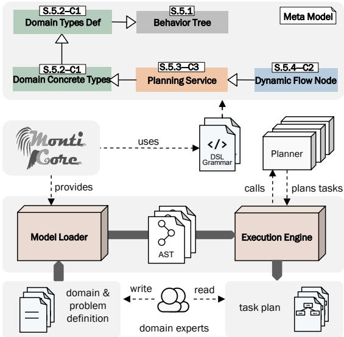  
Figure 1: Overview of the APTree method discussed in the paper. The APTree method extends the existing BT metamodel with four packages, each marked by its corresponding section (S) number in the paper and the challenge it addresses (C).

The methodology of this research is based on the design science research paradigm (DSR) [13], focusing on the development and evaluation of artifacts to solve complex challenges such as automation in CRF task planning. Key artifacts include the BT DSL package, the four DSL packages extending it, and the execution engine.

The APTree method was evaluated using a case study on real-world CRF task planning of the livMatS Biomimetic Shell pavilion [14], whose shell segments were robotically fabricated of-site prior to on-site assembly. The livMatS pavilion is a research demonstrator constructed at the FIT Freiburg Center, Germany, and features a digitally designed segmented shell structure [14]. The APTree DSL enabled modeling and validating the livMatS construction robotic fabrication domain, and the APTree execution engine automatically generated the task plan for assembling the segments using three diferent symbolic automated task planning tools: ENHSP [15], Metric-FF [16], and LAMA-First [17].

In the remainder of this paper, Section 2 provides background information on the terminology used. Section 3 reviews the related work and identifies the challenges, while Section 4 presents the research questions and evaluation metrics to evaluate APTree based on the challenges. Section 5 describes the APTree DSL packages, and Section 6 presents our case study and how the user can use APTree. Finally, Section 7 presents the evaluation of APTree based on our case study results. Section 8 discusses the findings, and Section 9 concludes the paper. Appendix A and Appendix B contain supplementary evaluation material, and Appendix C provides information to facilitate replication.

## 2. Background and Terminology

This section introduces concepts that are essential for understanding this paper. It begins with BTs, illustrated with a running example, and then provides an overview of MDE and key terminology related to software languages. Since our method uses MontiCore to develop the structure and representation of models, we also give a brief introduction to how grammars are defined in the MontiCore language workbench. Finally, we briefly introduce AI task planning paradigms and symbolic task planning used in our framework.

## 2.1. Behavior Trees and The Running Example

BTs are directed trees originally developed to design and control non-player character behavior in video games [7]. In graph theory [18], a directed tree is a hierarchical structure with a single root node and directed edges through which all other nodes are reachable. A node with an outgoing edge is a parent, the connected node is its child, nodes with no outgoing edges are leaves, and every node except the root has exactly one parent [18]. In BTs, leaf nodes are action nodes, while non-leaf nodes are control flow nodes [7]. Graphically, a BT can be drawn with the root at the top and children below [7] (see Figure 2).

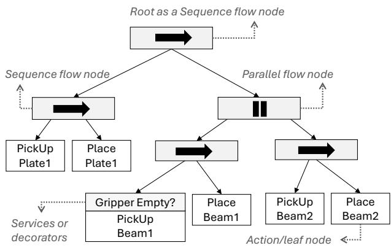  
Figure 2: Running example of a BT for picking and placing a plate and two beams. Sequence nodes are shown with an arrow icon and parallel nodes with two parallel lines. Decorators and services, when present, are attached to their associated node. Decorators can model node-specific preconditions evaluated before execution (e.g., Gripper Empty?).

Execution of a BT begins at the root, which periodically generates tick signals. A tick triggers node execution: action nodes perform tasks, while control flow nodes propagate the tick to one or more children according to their logic. A node executes only when ticked and returns one of three statuses to its parent: InProgress if execution is ongoing, Success if the goal is achieved, or Failure otherwise. In the classical BT formulation, the main control flow nodes are Sequence, Fallback, and Parallel [7].

A Sequence node ticks its children from left to right and returns Success only if all children succeed. A Fallback node also ticks its children from left to right but returns Success as soon as one child succeeds, returning Failure only if all children fail [7]. A Parallel node ticks all children simultaneously and returns Success if at least M of N children succeed, Failure if success becomes impossible, and InProgress otherwise [7]. Action nodes execute a command when ticked and return InProgress during execution, Success upon completion, or Failure if execution fails. During execution, nodes may read from or write to a shared database typically called the blackboard, which stores information about the BT and allows nodes to communicate and coordinate [7].

BT nodes may also include decorators and services, which modify the behavior of attached nodes [7]. Conditions can be modeled as decorators applied to action or control flow nodes (GripperEmpty in Figure 2). Figure 2 shows an example BT which will be used as a running example in this paper: execution first performs pick up plate 1 and place plate 1 sequentially, then executes the pick up and place beam 1 and pick up and place beam 2 sequences in parallel (GripperEmpty decorator executes before PickUp Beam1).

## 2.2. Model-Driven Engineering and Software Languages

In MDE, models describe diferent aspects of the system (e.g., structure, behavior) to reduce complexity and support maintainability [10].

## Definition 1. (Model): A model is a purpose-driven abstraction of an original real or intended system [19, 20].

For example, the BT model in Figure 2 describes the task execution of one or more agents built to support interaction, monitoring, planning, and evaluation. A model must have an explicitly defined software language to be machine readable [21]. A software language is an artificial language used in software development, including general-purpose languages (e.g., Python) and DSLs [21], such as BTs. The BT language specifies the syntax and semantics that enable the design and execution of BT models.

Defining a software language begins with its abstract syntax (AS), which captures its essential concepts and relationships (e.g., concept of a flow node or the child-parent relationship) [21]. AS can be specified via metamodels or grammars (Figure 4 and Listing 3). The concrete syntax (CS) defines how users realize and use the AS concepts, either graphically (e.g., Figure 2), or textually [21]. However, abstract and concrete syntax do not define model behavior. For example, tick propagation in a BT is not specified in AS or CS since users do not directly interact with it. Therefore, an additional model, which may extend the abstract syntax, specifies the language’s runtime behavior.

Finally, language constraints in this paper are defined as structural well-formedness rules on the abstract syntax (e.g., nodes must have unique names) and behavioral well-formedness rules on the behavior model (e.g., only one database is allowed to store BT data such as beam and plate instances in the running example).

This paper uses the MontiCore language workbench that supports grammar-based and modular language definition of both AS and CS along with the implementation of well-formedness rules.

## 2.3. MontiCore

MontiCore is a language workbench for defining, processing, and integrating text-based DSLs [12]. It allows developers to specify concrete and abstract syntax in a single grammar, from which MontiCore generates core infrastructure such as parsers and ASTs [12]. An AST is a concrete instance of a model that conforms to the language’s abstract syntax and is used for model analysis and processing [12]. MontiCore supports modular language design through composition, inheritance, and embedding of language packages [12]. Each MontiCore grammar has a head and a body [12]. The head contains the package declaration, the grammar’s name, and any grammars it extends (Listing 1).

Listing 1: Grammar head definition defining BehaviorTree grammar that extends MCBasics grammar

1 grammar BehaviorTree extends de.monticore.MCBasics {   
2 // Grammar body containing symbols and productions   
3 }

The body defines the language itself. It contains:

• Non-terminals, which define the abstract syntax of the language.

• Terminals, shown in quotes (e.g., "Action"), which define the concrete syntax.

• Productions, which are the main rules that define valid language concepts. Each production corresponds to a non-terminal and specifies how it can be constructed from terminals, properties, and other non-terminals.

• Programming concepts, e.g., interface, or enumeration non-terminals, which allow language extension and reuse.

• Tokens, such as Name or Integer, can be defined or imported from standard MontiCore grammars like MCBasics.

MontiCore also supports symbols, which identify and reference language entities by name. Declaring a non-terminal as a symbol ensures that the value assigned to this non-terminal’s name property corresponds to an existing entity of the specified type. For example, if we have a non-terminal defined as symbol Beam, then another production rule can use Name@Beam to ensure that the name provided in the model refers to a valid Beam instance. After the model is parsed by MontiCore, symbols can be stored in a symbol table and used for enforcing well-formedness rules. The following example (Figure 3) shows the body of a portion of the BT grammar, and Listing 2 provides a valid and invalid example model based on it.

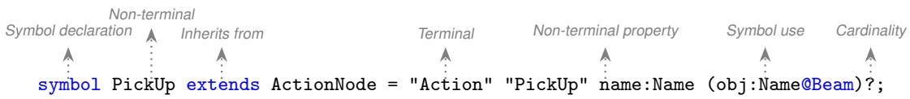  
Figure 3: A MontiCore grammar production rule with annotated components.

Figure 3 shows an example of a production where PickUp is a non-terminal that extends the ActionNode nonterminal. The terminals "Action" and "PickUp" require that valid model instances begin with these keywords. The name:Name property defines a named attribute of PickUp, while obj:Name@Beam is a symbol reference, ensuring that the provided name corresponds to an existing Beam instance. Cardinalities can be specified using ? for zero or one (optional), \* for zero or more, and + for one or more occurrences. Based on this grammar and the defined well-formedness rules, a model can be validated as correct or incorrect (see Listing 2).

<table><tr><td colspan="2"></td></tr><tr><td></td><td>1 // Correct model: pickup action with parameters</td></tr><tr><td>2 &quot;Action&quot; &quot;PickUp&quot; PickUpBeam1 (beam1)</td><td></td></tr><tr><td></td><td>3 // Correct model: pickup action without parameters (optional in grammar)</td></tr><tr><td></td><td>4 &quot;Action&quot; &quot;PickUp&quot; PickUpBeam1</td></tr><tr><td></td><td>5 // Incorrect model: Missing &quot;Action&quot; terminal and incorrect parameter type</td></tr><tr><td>6&quot;PickUp&quot; PickUpBeam1 (gripper1)</td><td></td></tr></table>

Listing 2: Syntactic validation examples for PickUp action nodes.

## 2.4. AI Task Sequence Planning Paradigms: Symbolic and Sub-symbolic

Several AI methods exist for planning task sequences, varying in their underlying principles. Symbolic AI planners generate task sequences from an initial state to a goal state by manipulating symbolic representations of the problem and applying logical reasoning [22]. Unlike data-driven AI, they rely on explicitly defined knowledge and rules, allowing plans to be deduced through inference. Symbolic planners model the world as a directed graph in which nodes represent world states and edges represent actions. World states describe configurations of the environment using predicates, which are logical statements about properties of the world (e.g., At(robot, roomA)). Actions define transitions between states, such as moving a robot from one location to another [22].

Each action (e.g., (travel A B)) is defined by its parameters (e.g., locations A and B), preconditions that must hold before execution (e.g., the robot is at location A), and efects that describe how the world state changes (e.g., the robot is at location B). At runtime, the planner starts from the initial state and reasons over actions’ preconditions and efects to find a sequence of actions that transforms the world into the goal state. Symbolic planners typically use declarative languages such as the Planning Domain Definition Language (PDDL) [23] to specify states, actions, predicates, and goals. In PDDL-based planning, the planning problem formulation is typically divided into a domain file and a problem file [22]. The domain file defines the general planning model, including predicates and action types (with their properties, preconditions, and efects), while the problem file specifies a concrete planning instance by defining the initial state, object instances, and goal state [22].

Sub-symbolic planners operate on data-driven representations rather than explicitly defined symbolic models [24]. They use techniques such as neural networks or reinforcement learning to learn action-selection policies from data instead of reasoning over symbolic predicates and logical rules [24]. Given a numerical representation of the environment state, the learned policy predicts the next action at each step, producing behavior through sequential action selection rather than constructing an explicit symbolic plan [24].

## 3. Research Challenges and Related Work

The following subsections review the state of the art in robotic task planning and execution to identify three key challenges motivating this work. Specifically, they examine (C1) managing data dependencies between independently developed task plan modules, (C2) support for localized runtime adaptation and replacement of task plan modules, and (C3) scalable, robust automated generation of executable task plans from heterogeneous planning methods. Due to their modularity and composability, BTs are adopted in this work as the target task execution modeling language, and challenges are particularly discussed for BTs.

## 3.1. Type Mismatches and Hidden Dependencies (C1)

Diferent execution models, including FSMs, hierarchical state machines, and BTs, can be used to represent robotic task plans [9]. State machines explicitly model execution states and state-specific transitions [9]. While efective for many robotic applications, they become increasingly dificult to maintain and scale as task complexity grows because transitions are tightly coupled to individual states, and modifying one part of the execution model often requires updating related transitions [9]. BTs alleviate this limitation by providing a hierarchical and modular execution model in which every node follows a common execution interface, enabling task execution models to be composed from reusable subtrees [9]. Regardless of the execution modeling language, composing independently developed task execution models requires explicit mechanisms for communicating data between tasks. Without explicitly modeled data exchange, type inconsistencies, unintended side efects, and execution failures may occur, even when individual task execution models function correctly in isolation [7, 25].

In BTs, communication between nodes and subtrees typically relies on a centralized blackboard. When these data exchanges are not explicitly modeled, hidden dependencies arise from implicit data sharing and hardware constraints (e.g., the limited range of motion of a robot arm), leading to type inconsistencies, unintended side efects, execution failures, and unintended robotic behavior [7, 26, 27].

To prevent hidden dependencies, mechanisms that decentralize node communication and explicitly model the inputs and outputs of BT nodes have been suggested [26, 27]. For instance, a BT-inspired programming language based on Haskell [26] facilitates modeling tasks, particularly "chattering tasks" that rely on changing conditions, with explicit data transfer details. This method focuses on the reactive selection and monitoring of tasks in autonomous agents and recommends approaching tasks like function calls with distinct inputs and outputs [26]. In a similar approach, a data flow extension to BTs was proposed to explicitly represent data relationships and communication between nodes [27]. Each action node has explicit inputs and outputs and points to the subsequent action node to execute upon every tick, ensuring accurate data flow. This approach allows nodes to exchange data through predefined channels [27].

However, these methods alter the core BT logic by modeling pointers to the next actions instead of using flow nodes for action transition. They also model direct data flows between nodes. This approach makes task interfaces more explicit, but reduces modularity, as in state machines, thereby hindering the modeling of complex execution models.

Other approaches, such as BehaviorTree.CPP [28], allow modeling inputs and outputs for each BT node but lack formal verification methods to automatically check whether the BT behaves as intended under diferent scenarios [29]. Consequently, a method was developed to automatically identify data and sequence constraint violations to facilitate debugging [29]. The authors formulate data dependency verification as a symbolic AI planning problem, seeking event sequences that lead to nodes lacking the required data and thereby identifying potential failures.

However, these verification methods are primarily applicable to small BTs or individual subtrees. They do not provide mechanisms for automatically extracting and analyzing data dependencies across large-scale BTs with numerous subtrees. Consequently, the following research challenge arises:

C1: Hidden data dependencies and type mismatches hinder modular composition of task execution models. As task hierarchies and independently developed task execution models are composed, implicit data dependencies and mismatches arising from shared data and undeclared interfaces may lead to type conflicts, unintended side efects, and non-deterministic runtime behavior [9].

## 3.2. Limited Support for Localized Task Plan Replacement (C2)

CRF task plans are multifaceted and often consist of multiple independently developed plan modules [30]. During execution, changes in the environment, resource availability, or task failures may invalidate only a subset of the overall task execution plan [31]. Ideally, only the afected execution model should be re-planned and replaced, while the remaining execution structure is preserved. Existing task execution modeling languages provide limited support for such localized replanning [31].

State-machine-based approaches require modifying the corresponding transition structures when replacing parts of an execution model, as adding or removing a state requires updating all related transitions across the machine [9, 32]. While some state-machine frameworks, such as FlexBE, do support modifying the system while it is running, this works by reloading and swapping in the entire execution model, rather than a small, targeted fix to just the afected structure [32]. Furthermore, when a plan becomes infeasible during execution, FSM-based systems typically discard the running plan entirely and replan from scratch, as seen in systems where failure outcomes are fed back to an external planner that generates a new state machine for execution [33]. Critically, the runtime modification mechanisms that exist in FSM frameworks often require human intervention to initiate structural changes during execution [34].

BTs typically support flow node types of sequence, fallback, parallel, and utility [5]. The execution logic for these flow node types is predefined and mixed with ordering semantics. Consequently, in more complex task planning scenarios, it is often necessary to develop multiple flow node types tailored to specific problems [9]. This rigid structure of BT flow nodes can lead to many layers of hierarchy, for example, when adjusting the BT nodes dynamically at runtime [9]. Hence, while the simplicity of flow node types is important and enhances modularity, it can also result in complex and dysfunctional structures with many layers of hierarchy, making it dificult to scale up and maintain BTs [9]. Segmenting BTs and using LLMs to explain each subtree has been proposed to make complex BT structures more

understandable [35]. This segmentation makes it easier for non-expert users to grasp BT structure and functionality.   
This approach, while increasing understandability, does not address the challenge of rigid BT structures.

The modularity of BTs allows for the programming of problem-specific flow nodes and subtrees, but this can also lead to behavior models that require defining and maintaining many problem-specific flow nodes (e.g., constraints between actions such as temporal constraints), thus limiting flexibility [36]. Specifically, modeling reactive tasks using BTs can become too complicated, which is why "stateful behavior trees (SBTs)" were introduced, a method that borrows from BTs and state charts [37]. SBTs difer from BTs as they execute all nodes in one tick and reduce the reliance on predefined flow nodes. Each node in this method determines the next node based on the conditions and transitions modeled within that node. On the other hand, unlike state charts, which focus on system states and event triggered transitions without managing memory, SBTs incorporate both memory (the blackboard) and environmental conditions. This allows SBTs to adapt execution models based on internal and external factors, making them more suitable for dynamic environments, but also limits them to very specific and simple planning problems [37]. Another state machine-inspired approach models nodes as states with preconditions and efects and uses these conditions for state transitions, but the method abstracts away the internal structure of BTs, meaning that the relation between actions and states is not specified explicitly as in BTs [38]. The authors argue that this method allows for easier programming of complex behaviors compared to hard-coding multiple flow nodes and can quickly react to changing circumstances without the need for extensive manual engineering of tree structure. While these two methods enhance eficiency for simple and specific planning problems, they share scalability issues with state charts, as transitions must be modeled for each state, reducing modularity and scalability. Consequently, the following research challenge arises:

C2: Existing execution modeling languages provide limited support for locally replacing or replanning task plans at runtime. Adapting to execution failures or environmental changes often requires restructuring or regenerating the whole module, limiting flexibility and leading to state loss.

## 3.3. Limited Automated Generation of Execution Models (C3)

Execution modeling languages specify task execution and do not perform task planning. Consequently, execution models must either be constructed manually or generated automatically from planning algorithms [9]. Automated generation of task execution models from symbolic planners has been explored for several modeling languages. For example, ROSPlan [39] links PDDL planning to ROS execution by dispatching plan actions sequentially through a centralized dispatcher. Another study [40] generates state machine code automatically, but from human-authored meta-scripts. FSM synthesis from formal specifications such as linear temporal logic is theoretically well-founded but has proven computationally intractable at scale [41].

BTs are typically modeled manually. Manual BT design is often efective for simple planning problems due to its eficiency and ease of design [9]. For example, modeling task and motion of a robot pushing objects [42], or modeling multiple behavior strategies as separate subtrees for robots to choose from [43]. Although manual BT design, including designing the initial nodes and BT structure, demonstrates success in simple planning problems, it becomes time-consuming and unmanageable as planning complexity increases, making maintenance, debugging, and verification increasingly challenging [7]. Automated symbolic AI task planners and sub-symbolic task planners have been used to automate BT generation [7]. The following sections analyze the challenges associated with each category.

## 3.3.1. Symbolic AI Planners

Symbolic AI planners ofer structured approaches to BT generation and validation, but they face challenges in scalability and flexibility [7]. For example, hierarchical task networks (HTNs) have been used to generate BTs [4, 44]. HTN’s high-level decomposable nodes (called methods) become sequence nodes in BT, and fallback nodes represent decomposition options [44]. Another approach generates a plan using HTN in a similar way, and then, based on preconditions and efects that are modeled as decorators in BTs, the parallel nodes will be identified to optimize execution [4]. They also introduce a shared semantic model where nodes are the objects and edges are the semantic relations between them to be used for communication between the tree and the planner. Our method is inspired by this work, as we also model preconditions and efects, though not as decorators. However, this method for BT generation leads to brittle BTs as the structure of the tree is determined by the HTN planner, and no further information is mentioned on how the planner is synchronized with BT architecture and the semantic world model. Similarly,

PlanSys2 [45] generates executable BTs from the output of PDDL-based symbolic planners using BehaviorTree.CPP. However, the generation process is tightly coupled to the underlying planner representation, making it dificult to generalize across diferent symbolic planning paradigms.

The back-chaining algorithm, used in AI planners, has also been employed to generate BTs [46, 47]. Starting from the goal condition, it finds actions that meet the conditions. Then it looks at the preconditions of those actions and tries to find actions that satisfy them in the next layer of BT hierarchy, and so on [46]. Another study uses the same algorithm but focuses on multi-agent synchronization using an auction-based approach [47].

Other approaches include manually generating the initial BT and automatically generating BT nodes at runtime upon the failure of a node by evaluating a list of actions to identify those whose postconditions contain the preconditions of the failed node [48]. Additionally, a conceptual multi-layered architecture for robot control has been proposed where the top layer handles task planning using symbolic AI planners, the middle layer employs BTs, and the lowest layer directly interacts with the robot hardware [36]. However, all of these symbolic planning methods are inherently limited to simple task planning problems as they face challenges such as combinatorial explosion, and considering the ease of designing BTs manually, they do not ofer any practical use [9].

## 3.3.2. Sub-symbolic AI Planners

Several sub-symbolic AI methods have been used to automatically generate BTs, such as LLMs, learning BTs, genetic algorithms, and case-based reasoning.

Two recent approaches use LLMs to automate the generation of BTs from natural language instructions, with the aim of simplifying robot programming [49, 50]. The DiaGBT method [49] receives instructions in natural language, analyzes them using LLMs to identify key components, generates individual BT nodes based on these components, and then assembles them into a coherent BT, again using LLM for the assembly process. The second approach develops a dataset of 600 BTs paired with natural language task descriptions to generate BT models [50]. The generated BTs are evaluated across nine robotic tasks, including navigation and manipulation [50].

Another challenge is for the AI agent to efectively learn to represent and manipulate BTs using LLMs, which has been addressed by transforming BTs into vector spaces. For example, a method has been proposed to encode BTs into a compact numerical form, aiming to enhance the learning capabilities and adaptability of robotic tasks [51]. This approach leverages pre-trained word embeddings and a node-aggregation mechanism to capture both the semantic information of node descriptions and the structural hierarchy of BTs [51]. Similarly, the WE-BTR method also relies on vector embeddings to represent BTs [35]. However, this method focuses on recommending BTs by segmenting them into subtrees, aggregating nodes into vectors, and then evaluating the similarity between BTs based on these vectors.

Other AI methods used for the automatic generation of BTs include learning from demonstration, complemented by genetic algorithms, which enable the robot to understand tasks based on human input and optimize performance metrics [52]. Case-based reasoning is another method in which the system maintains a "memory" of past BT states. When a new situation arises, it queries this memory, compares the current state to previous cases using a similarity function, and retrieves the most similar state [53, 54]. Finally, genetic algorithms are used to evolve BTs by first creating an initial population of BTs with random structures and parameters. Each BT is then evaluated in the population by running simulations or real-world tests [55].

However, sub-symbolic AI-based approaches have no method to accurately verify the task plan, and their performance reduces as the number of tasks increases. Additionally, the performance of these data-based methods is largely based on the quality of the training data. This dependency can compromise consistency and flexibility, particularly in unpredicted situations where robot tasks may change unexpectedly. Consequently, the remaining research challenge is:

C3: Limited scalability and robustness of automated task execution model generation. Automated generation of execution models with sub-symbolic AI planners is unreliable, and symbolic AI planners have limitations: they focus on niche problem types, struggle with complex planning due to combinatorial explosion, and produce brittle execution models that fail with slight input variations. As a result, scalable and modular generation of task plans that can be reliably transformed into execution models remains an open challenge.

Table 1: Summary of research questions and corresponding metrics.
<table><tr><td>Q</td><td>Evaluation Question</td><td>Metric</td><td>Metric Description</td></tr><tr><td>Q1- Q4</td><td>Detection or prevention of structural, syntactic, type, and logical errors</td><td>M1 (TPR)</td><td>Ratio of injected errors correctly detected</td></tr><tr><td></td><td></td><td>M2 (PR)</td><td>Ratio of errors prevented by design</td></tr><tr><td>Q5</td><td>Preservation of structure during local replanning</td><td>M3  $( \overline { { G } } _ { \mathrm { t r e e } } )$ </td><td>Average structural change after replanning</td></tr><tr><td>Q6</td><td>Scalability of repeated local replanning</td><td>M4 (RF) M5 (NRR)</td><td>Number of replanning events per minute</td></tr><tr><td>Q7</td><td></td><td>M6</td><td>Ratio of nodes retained in the BT to generated nodes</td></tr><tr><td></td><td>Composition of plans from multiple symbolic planners</td><td>M7</td><td>Number of distinct symbolic planners applied</td></tr><tr><td>Q8</td><td></td><td>M8 (PL)</td><td>Number of planning and replanning applications</td></tr><tr><td></td><td>Decomposition and recomposition of planning problems</td><td>M9 (DF)</td><td>Cumulative and normalized planning latency</td></tr><tr><td>Q9</td><td></td><td>M10 (PPR)</td><td>Average executed planning steps per planning module</td></tr><tr><td></td><td>Plan correctness</td><td>M11 (SSR)</td><td>Ratio of logically correct task steps</td></tr><tr><td></td><td></td><td></td><td>Ratio of superfluous task steps</td></tr><tr><td>Q10</td><td>Runtime performance</td><td>M12 (CAL)</td><td>Average latency between consecutive action executions</td></tr></table>

## 4. Research Questions and Evaluation Goals

Based on the three challenges identified in the related work section, we briefly describe how each challenge can be addressed, followed by the corresponding evaluation goals, research questions (Q), and evaluation metrics (M) defined using the Goal–Question–Metric (GQM) method. The GQM method provides a structured framework for deriving measurable evaluation criteria from high-level goals [56]. A summary of metrics is provided in Table 1.

## 4.1. Error Detection of Task Execution Models

To address the implicit data dependencies that hinder modular composition and reuse of task execution models (C1), modeling inconsistencies should be detected or prevented before they result in runtime crashes or silent failures. Hence, the goal is to analyze APTree task execution models for the purpose of evaluating their ability to detect or prevent modeling and data inconsistencies before or during execution, from the viewpoint of CRF developers, in the context of symbolic task planner integration. Questions:

• Q1: To what extent does the task execution model detect or prevent invalid structural configurations in the planning and execution models (M1, M2)? For example, can it detect a missing planning domain or problem definition?

• Q2: To what extent does the task execution model detect or prevent undefined or inconsistent types (M1, M2)? For example, can it detect undefined node types (e.g., PickUp action that is not registered) or interface mismatches between execution model tasks?

• Q3: To what extent does the task execution model detect or prevent syntactic inconsistencies in planning and execution models (M1, M2)? For example, can it detect missing parentheses or invalid node declarations?

• Q4: To what extent does the task execution model detect or prevent logical inconsistencies arising from independently generated task execution models (M1, M2)? For example, can it detect that the execution of plan A invalidates plan B?

To operationalize Q1–Q4, we define two metrics: M1, the true positive rate (TPR), which measures the proportion of injected structural, typing, syntactic, and logical errors detected at design time before causing a runtime crash or silent failure, and M2, the prevention rate (PR), which measures the proportion of injected errors prevented by design.

M1, true positive rate (TPR): The error detection rate is computed as the true positive rate (recall):

$$
\mathrm { M 1 : } \quad \mathrm { T P R } = { \frac { E _ { D T } + E _ { P T } } { E _ { D T } + E _ { P T } + E _ { R T } + E _ { S F } + E _ { R T C } } } \times 1 0 0\tag{1}
$$

where $E _ { D T } , E _ { P T }$ , and $E _ { R T }$ denote the numbers of injected errors detected at design time, planning time (detected by the planner’s parser), and runtime, respectively; $E _ { S F }$ and $E _ { R T C }$ denote the numbers resulting in silent failures and runtime crashes or failure. Errors classified as not applicable (NA) and prevented by design (PD) are excluded. A

higher TPR indicates stronger design time error-detection capability. Because the evaluation is based on injected violations of formally specified well-formedness constraints, false positives are not applicable. Consequently, precision is 100%, and the F1 score equals $\frac { 2 { \cdot } \mathrm { T P R } } { 1 { + } \mathrm { T P R } }$

M2, prevention rate (PR): In addition to TPR, error classes prevented by design are computed as:

$$
\mathbf { M } 2 \colon \ \mathrm { P R } = { \frac { E _ { P D } } { E _ { P D } + E _ { D T } + E _ { P T } + E _ { R T } + E _ { S F } + E _ { R T C } } } \times 1 0 0\tag{2}
$$

where $E _ { P D }$ denotes the number of errors prevented by design. As with M1, errors classified as not applicable (NA) are excluded. A higher PR indicates that more errors are eliminated by method design.

## 4.2. Supportfor Local Task Replanning

To address the challenge of inflexible execution models for local replanning (C2), the execution model must support localized runtime modification without reconstructing the entire execution model. Hence, the goal is to analyze APTree for the purpose of evaluating its support for localized runtime replanning of independently developed task execution models, from the viewpoint of construction robotics developers in the context of adaptive automated task execution. Questions:

• Q5: To what extent does local replanning preserve the structure of the running task execution model (M3)?

• Q6: To what extent does the approach sustain execution through repeated local replanning without restarting the execution model or causing execution failures (M4, M5)?

To operationalize Q5–Q6, we define three metrics: M3, the structural change $\left( G _ { \mathrm { t r e e } } \right)$ , addressing Q5; M4, replanning frequency in one run (RF); and M5, node retention rate (NRR), addressing Q6.

M3, structural change $\mathbf { ( } G _ { \mathbf { t r e e } } ) \colon$ The structural impact of local replanning is quantified across three BT dimensions: size (number of nodes), breadth (maximum width), and depth (longest path) [57]. The relative change in each dimension is computed as: $\begin{array} { r } { g _ { n } = \Big | \frac { N _ { 1 } - N _ { 0 } } { N _ { 0 } } \Big | , g _ { w } = \Big | \frac { W _ { 1 } - W _ { 0 } } { W _ { 0 } } \Big | , g _ { d } = \Big | \frac { D _ { 1 } - D _ { 0 } } { D _ { 0 } } \Big | } \end{array}$ where N, W, and D denote the number of nodes, maximum width, and depth of the BT before $( \dot { N } _ { 0 } , W _ { 0 } , \dot { D } _ { 0 } )$ and after $( N _ { 1 } , W _ { 1 } , D _ { 1 } )$ replanning. The structural change for replanning event i is computed as:

$$
\mathbf { M } \mathbf { 3 } \colon \ G _ { \mathrm { t r e e } , i } = \frac { g _ { n , i } + g _ { w , i } + g _ { d , i } } { 3 } \times 1 0 0 \qquad \overline { { G } } _ { \mathrm { t r e e } } = \frac { 1 } { R } \sum _ { i = 1 } ^ { R } G _ { \mathrm { t r e e } , i }\tag{3}
$$

where R is the total number of replanning events. Lower $\overline { { G } } _ { \mathrm { t r e e } }$ values indicate higher structural preservation.

M4, replanning frequency (RF) and M5, node retention rate (NRR): To assess the scalability of repeated local replanning, replanning frequency and node retention rate are computed as:

$$
\mathbf { M 4 } \mathbf { : } \quad \mathrm { R F } = \frac { R } { T _ { \mathrm { m i n } } } , \qquad \mathbf { M 5 } \mathbf { : } \quad \mathrm { N R R } = \frac { N _ { \mathrm { r e t a i n e d } } } { N _ { \mathrm { g e n e r a t e d } } } \times 1 0 0\tag{4}
$$

where R is the total number of replanning events triggered, $T _ { \mathrm { m i n } }$ is the execution time in minutes, $N _ { \mathrm { g e n e r a t e d } }$ is the total number of execution nodes generated across all planning and replanning events, and $N _ { \mathrm { r e t a i n e d } }$ is the number of execution nodes that remain in the final BT and are executed to completion (success or failure). All metrics are measured over a single execution run. RF measures how often the execution model is modified at runtime, and NRR the proportion of generated execution nodes retained in the final BT. Together they quantify the degree of runtime plan change the framework sustains without restarting execution; they do not measure task outcomes, failure severity, or recovery performance.

## 4.3. Scalable and Robust Automated Execution Model Generation

To address the challenge of scalable and robust automated execution model generation (C3), execution models must support the integration of task plan modules generated by multiple heterogeneous symbolic planners while maintaining the logical correctness of the overall execution model at runtime. Hence, the goal is to analyze the APTree framework for the purpose of evaluating its support for scalable and modular automated execution model generation using symbolic planners from the viewpoint of CRF developers, in the context of modular plan composition. Questions:

• Q7: To what extent can the approach compose sub-plans generated by multiple symbolic planners, potentially invoked multiple times across planning modules, to solve a single planning problem (M6, M7)?

• Q8: To what extent can large-scale symbolic planning problems be decomposed into smaller sub-problems and their resulting task plans recomposed into a single execution model (M8, M9)?

• Q9: To what extent does the automatically generated execution model preserve the logical correctness of the composed task plan (M10, M11)?

• Q10: What is the runtime latency between consecutive action executions, and how do runtime planning and replanning afect this latency (M12)?

To operationalize Q7–Q10, we define M6, planner diversity, and M7, planning application count, for Q7; M8, planner latency (PL), and M9, decomposition factor (DF), for Q8; M10 and M11 to assess the logical correctness and eficiency of the generated task execution model for Q9; and M12 to measure the runtime latency between consecutive action executions for Q10.

M6-M7, planner diversity and planner application count: Planner diversity measures the number of distinct planners successfully invoked during a single execution, demonstrating support for heterogeneous planner application. The planner application count measures the total number of planning and replanning applications at runtime. Higher values indicate stronger support for repeated autonomous planning in independently executed planning modules.

M8-9, planner latency (PL) and decomposition factor (DF): These metrics evaluate the eficiency and modularity of planning. Planner latency (PL) measures the overhead of applying a symbolic planner, including planner invocation, model transformation, and plan integration, and is reported as both cumulative and normalized latency during execution. The decomposition factor (DF) quantifies the average number of executed planning steps contributed by each planning submodule.

$$
\mathbf { M 8 } \mathbf { : } \quad \mathrm { P L } _ { \mathrm { c u m } } = \sum _ { i = 1 } ^ { N } t _ { i } \qquad \mathrm { , } \qquad \mathrm { P L } _ { \mathrm { n o r m } } = \frac { \mathrm { P L } _ { \mathrm { c u m } } } { T _ { \mathrm { e x e c } } } \times 1 0 0 \qquad \mathbf { M 9 : } \quad \mathrm { D F } = \frac { \mathrm { F P S } } { B _ { \mathrm { p a r e n t } } } \times 1 0 0 ^ { - 4 } \mathrm { R e } \left( \frac { \mathrm { P L } _ { \mathrm { c u m } } } { \mathrm { P L } \mathrm { \times } \mathrm { T _ { \mathrm { c u m } } ^ { - 4 } } } \right) ,\tag{5}
$$

Here, $t _ { i }$ is the planning latency of the i-th planning or replanning invocation, N is the total number of planning and replanning invocations, $T _ { \mathrm { e x e c } }$ is the total execution time expressed in the same time unit as $t _ { i } , B _ { \mathrm { p a r e n t } }$ is the number of planning submodules contributing at least one executed action to the final composed plan, and FPS is the final executed plan length. PL measures the ratio of planning time to full execution time, whereas lower DF values indicate finer decomposition of the final plan across planning submodules, reflecting greater structural modularity and support for localized planning.

M10-11, plan parity ratio (PPR) and superfluous step ratio (SSR): These metrics evaluate the logical correctness of automatically generated task plans against a reference plan. Logical correctness is assessed by preserving task dependencies and execution ordering, rather than exact action names or the number of planning steps. Accordingly, the PPR measures the proportion of logically equivalent reference task steps preserved in the generated plan, while the SSR measures the proportion of generated task steps that are not required by the reference plan:

$$
\mathbf { M 1 0 } { \mathrm { : } } \quad \mathrm { P P R } = { \frac { S _ { \mathrm { m a t c h e d } } } { S _ { \mathrm { r e f e r e n c e } } } } \times 1 0 0 , \qquad \mathbf { M 1 1 } { \mathrm { : } } \quad \mathrm { S S R } = { \frac { S _ { \mathrm { e x t r a } } } { S _ { \mathrm { r e f e r e n c e } } } } \times 1 0 0\tag{6}
$$

Here, $S _ { \mathrm { m a t c h e d } }$ is the number of reference task steps whose logical dependencies and execution ordering are preserved in the generated plan, $S _ { \mathrm { r e f e r e n c e } }$ is the total number of task steps in the reference plan, and $S _ { \mathrm { \ e x t r a } }$ is the number of generated task steps that are not required by the reference plan. Higher PPR values indicate greater preservation of the reference plan’s logical structure, whereas lower SSR values indicate fewer unnecessary planning steps.

M12, consecutive action latency (CAL): This metric measures the time elapsed between the completions of consecutive actions during execution, including any planning or replanning delay incurred between them:

$$
\mathbf { M } \mathbf { 1 } 2 \colon \ \mathbf { C } \mathrm { A L } _ { i } = c _ { i + 1 } - c _ { i } , \qquad { \overline { { \mathbf { C } \mathrm { A L } } } } = { \frac { 1 } { N - 1 } } \sum _ { i = 1 } ^ { N - 1 } \mathbf { C } \mathrm { A L } _ { i }\tag{7}
$$

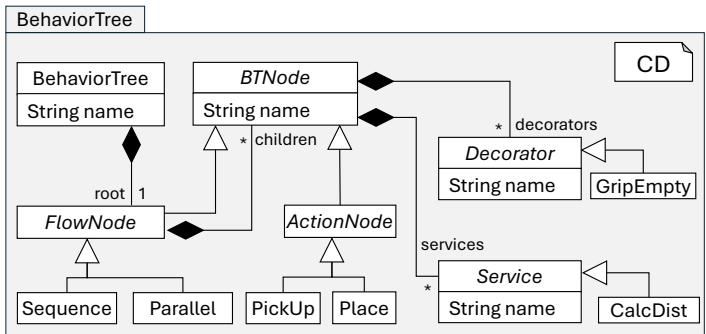  
Figure 4: BT metamodel used and extended in this paper for the proposed DSL, highlighting nodes, decorators, services, and their relations.

## 5. APTree Domain Specific Language

This section defines our DSL in separate packages. Each package begins with the definition of the abstract syntax using a metamodel, which specifies the core concepts of the DSL package and their relationships, followed by structural well-formedness rules. The concrete syntax is then defined using MontiCore grammars, together with an example of a valid model. Finally, we describe the behavior model and the behavioral well-formedness rules related to each package. This structure is applied consistently across all DSL packages.

## 5.1. Behavior Tree DSL Package

The BT metamodel defines the traditional BT structure used by some existing BT implementations. We define a concrete text-based syntax for it and present the metamodel, as BT metamodels may vary slightly across tools.

Abstract syntax: Figure 4 presents the metamodel of the BT language. The BT language includes:

• BT (BehaviorTree). Allows defining a BT instance model with exactly one flow node, which is always root.

• Nodes (FlowNode and ActionNode). These represent the two main types of nodes in a BT. Action nodes model executable actions (e.g., PickUp, Place), while flow nodes model control logic (e.g., Sequence, Parallel).

• Decorators and services (Decorator, Service). Decorators modify node execution or its outcome (e.g., GripEmpty), while services provide auxiliary functionality (e.g., CalcDist).

The BT metamodel is constrained by the following structural well-formedness rules. Names of nodes, BTs, services, and decorators must be unique within the model scope. Flow nodes may contain child nodes, whereas action nodes are leaf nodes and cannot have children. Furthermore, the first node in a BT is always designated as "Root".

Concrete syntax: Listing 3 shows the concrete syntax defined using MontiCore grammar, and Listing 4 provides a valid instance of the BT from our running example (Figure 2) using our textual DSL. We define BTs and nodes as symbols, enabling trees and nodes to reference each other by name when the grammar is extended in the subsequent packages. Concrete instances of actions, services, and decorators (e.g., PickUp and GripEmpty) are not restricted to the types defined in the metamodel and grammar; rather, they serve only as examples.

Listing 3: The behavior tree MontiCore grammar defining the textual concrete syntax for behavior trees, nodes, services, and decorators.

grammar BehaviorTree extends de.monticore.types.MCBasicTypes {   
2 symbol BehaviorTree = "BehaviorTree" name:Name "{" "Root" root:FlowNode "}";   
3 // abstract node class   
4 abstract symbol BTNode = name:Name (Decorator | Service)\*;   
5 // flow nodes and action nodes   
6 abstract FlowNode extends BTNode = name:Name (Service | Decorator | children:BTNode)\* ;   
7 Sequence extends FlowNode = "Sequence" name:Name "{" (Service | Decorator | children:BTNode)\* "}";   
8 Parallel extends FlowNode = "Parallel" name:Name "{" (Service | Decorator | children:BTNode)\* "}";   
9 abstract ActionNode extends BTNode = "Action" name:Name ("{" (Decorator | Service)\* "}")? ;   
10 PickUp extends ActionNode = "Action" name:Name ("{" (Decorator | Service)\* "}")?;   
11 Place extends ActionNode = "Action" name:Name ("{" (Decorator | Service)\* "}")?;   
12 // services and decorators   
13 abstract Service = "Service" name:Name;   
14 abstract Decorator = "Decorator" name:Name;   
15 GripEmpty extends Decorator = "Decorator" name:Name;   
16 CalcDist extends Service = "Service" name:Name;   
17 }

Listing 4: Example model describing the behavior tree from Figure 2 using our textual concrete syntax.

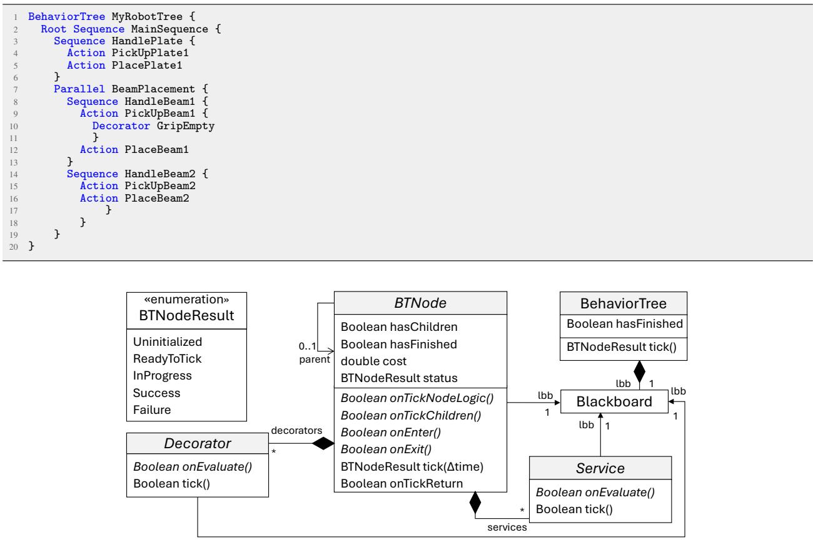  
Figure 5: Behavior model defining the runtime semantics of the BT metamodel. Gray boxes correspond to metamodel classes. lbb abbreviate linkedBlackboard to reduce diagram clutter.

Behavior: Figure 5 illustrates the execution model of BTs by extending the BT metamodel (Figure 4) with runtime concepts. Classes highlighted in gray correspond to the abstract syntax elements of the BT metamodel.

When a BT node’s tick operation is invoked, it first ticks its services, then its decorators, and finally executes its node-specific logic through onEnter, onTickNodeLogic, and onExit operations (Algorithm 1). The onEnter operation defines behavior that must occur before the main logic of the node, while onExit specifies behavior after the node finishes execution. If the node is a flow node with children, the tick is propagated to them using the onTickChildren operation. For action nodes, onTickChildren always returns true or delegates execution to another subtree, while for flow nodes, it defines how children are iterated. For example, a Sequence flow node ticks children sequentially from left to right, whereas a Parallel node ticks all children at the same time

Regarding the onTickNodeLogic, action nodes implement their specific actions (e.g., a robot picking up a plate), while flow nodes evaluate their execution status based on the last status of their children (e.g., a Sequence node returns success only if all children succeed and returns failure as soon as one child fails). The onTickReturn operation handles status updates, post-processing decorators, and invokes onExit operation (Algorithm 2).

Services and decorators implement a simpler tick logic (Algorithm 3). Their tick operation only invokes onEvaluate operation specific to each service or decorator type (e.g., GripEmpty checks the state of the gripper).

As described in Section 2, each time a node is ticked, it returns its last status (BTNodeResult). In addition to the standard statuses Success, Failure, and InProgress, we include Uninitialized and ReadyToTick, which represent nodes that have never been ticked and nodes that are allowed to receive a tick, respectively.

The BT models used in this paper use a single shared database (Blackboard), which is accessible to all nodes, decorators, and services. The blackboard is modeled as a key–value data structure. The well-formedness rules of the behavior model specify that there must be exactly one blackboard shared across the entire BT, and only nodes with the

ReadyToTick status may receive a tick. The hasFinished flag in BTNode only turns true if the node’s last status is success or failure.

```swift
Algorithm 1: operation tick() of BTNode Algorithm 2: operation onTickReturn() of
Input: ∆ time BTNode
Output: BTNodeResult status Input: BTNodeResult status
1 if status = Uninitialized then Output: BTNodeResult finalResult
2 status ← ReadyToTick 1 finalResult ← status
// 1. Ticking services // Extension Point: Post-processing
decorators
foreach svc ∈ node services do
// Implement decorator-based result
4 if ¬svc tick() then
modification here
5 status ← Failure
2 if finalResult = Success ∨ finalResult = Failure then
6 return onTickReturn(status)
3 hasFinished ← true
// 2. Ticking decorators 4 onExit()
foreach dec ∈ node decorators do
5 return finalResult
8 if ¬dec tick() then
9 status ← Failure
10 return onTickReturn(status)
Algorithm 3: operation tick() of Decorator and
// Check if node finished Service
11 if hasFinished then Output: boolean result
12 return onTickReturn(status) // Execute evaluation logic with time delta
// 3. Readiness check 1 result ← onEvaluate()
13 if status = ReadyToTick then 2 return result
14 onEnter()
15 if hasFinished then
16 return onTickReturn(status)
// 4. Node execution logic
17 if ¬onTickNodeLogic() then
18 return onTickReturn(status)
19 if node hasChildren then
20 if ¬onTickChildren() then
21 return onTickReturn(status)
return onTickReturn(status)
```

## 5.2. Domain Types DSL Packages

The DomainTypesDef and DomainTypesCon metamodels (Figure 6) support the explicit modeling of tasks within a task plan by representing task properties, planning preconditions, and efects. This representation enables designtime validation of task interfaces and runtime logical validation of task execution across dynamically composed task plans. To support diferent robotic fabrication domains, where robots, equipment, and fabrication setups vary considerably between applications, the metamodels define and instantiate extensible domain-specific types. Specifically, DomainTypesDef specifies the abstract type structure and type definitions, while DomainTypesCon instantiates these definitions as concrete domain types. This separation keeps the core DSL domain-independent while enabling domain-specific grammars to be generated automatically for diferent robotic fabrication applications.

Abstract syntax: Figure 6 presents the metamodel of the domain types definition (DomainTypesDef) grammar, which extends the BehaviorTree grammar. The domain types definition grammar introduces the following concepts:

• High-level supertypes (CustomProperty). High-level supertypes distinguish semantically diferent planning entities (e.g., agents, elements, and locations), enabling decisions on planning or replanning to depend on their roles rather than treating all task properties uniformly. For example, the unavailability of an agent to execute a task does not necessarily invalidate the current plan or require replanning, but may instead only require reassigning the task to another agent.

– Element: Objects within the environment (what), e.g., plates or beams.

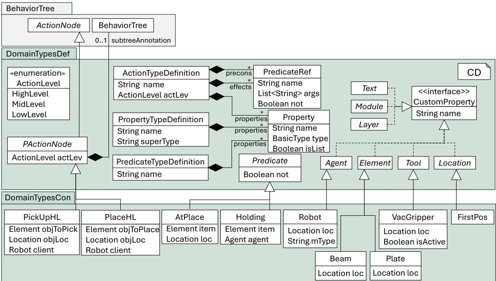  
Figure 6: DomainTypesDef metamodel highlighting concepts for defining new property, predicate, and action types. The DomainTypesCon metamodel extends DomainTypesDef and is automatically generated from user-defined DomainTypesDef models. BasicType includes types such as String, Boolean, Integer, etc.

– Agent: Actors performing tasks (who), e.g., robots or humans.

– Location: Spatial locations (where), e.g., stacking positions.

– Tool: Tools required to execute actions (how), e.g., robot gripper.

– Module, Layer: Organizational structures (how it is organized), e.g., groups of beams arranged in layers.

– Text: Textual types such as messages.

• Type definitions (PropertyTypeDefinition, PredicateTypeDefinition, ActionTypeDefinition). Allow defining new domain types and extending the DomainTypesCon metamodel, while enforcing adherence to the grammar structure. For example, one can define new predicate types or new action types with their properties.

• Properties (Property). Allows the addition of planning-relevant properties for new action and predicate types.

• Predicate references (PredicateRef). In symbolic task planning, actions have preconditions and efects as a list of predicates for each. Predicate references allow one to define these predicates using action properties as their variables (see lines 24 to 30 in Listing 7). Modeling predicates separately from action properties enables validation of planning assumptions independently of task properties during composed plan execution.

• Action levels (ActionLevel). The APTree method supports hierarchical action decomposition, where diferent levels of hierarchy represent varying degrees of action granularity and determinism. The three action levels separate design intent, adaptive planning, and execution control. This hierarchy localizes uncertainty to the ML level while preserving deterministic design constraints and bounded execution complexity.

– (High-level or HL). Deterministic actions that represent abstract design decisions and remain unchanged despite uncertainty. For example, PlaceHL(beam1, pr2) specifies placing beam1 at its final location according to the planned design. A high-level action can reference one subtree for more granular mid-level planning (PActionNode.subtreeAnnotation).

– (Mid-level or ML). Non-deterministic actions that are more granular. Mid-level actions may require replanning and adjustments based on the changing state of the world. For example, to place beam1 at pr2, the robot might or might not need to travel to pr2 depending on its current location. A mid-level action can reference one subtree for more granular low-level execution.

– (Low-level or LL ). Fine-grained non-deterministic actions that implement detailed execution. For example, a low-level action sequence stemming from PickUpML could include: MoveEndEffectorToPosLL –> OpenGripperLL –> MoveEndEffectorBackLL.

• Planning actions (PAction). Allows the definition of action nodes compatible with APTree and the integration of symbolic task planners. These actions include:

– Planning level (HL, ML, LL) to distinguish between the level of granularity (ActionLevel).

– Optional references to subtrees to refine action granularity. For example, PickUpHL may reference a subtree that defines ML actions required to pick up an object.

– Preconditions, efects, and properties.

The DomainTypesCon metamodel (Listing 6) is automatically generated as a grammar from the model defined using DomainTypesDef. For example, the types used in our running example are defined in the DomainTypesCon metamodel shown in Figure 6 and are automatically derived from the model in Listing 7. The following structural well-formedness rules must be satisfied when using these grammars:

• The name of the supertype from which new properties are inherited (PropertyTypeDef.superType) must be one of the predefined supertypes: Agent, Element, Location, Tool, Layer, Module, or Text (see lines 2-6 in Listing 7 for valid example models defined to describe the types in our running example).

• Actions may only use predicate types for their preconditions and efects that are defined (e.g. in Listing 7, action PlaceHL can have a predicate Holding, but not Clear).

• Actions may only use properties in their preconditions and efects that are defined for that action. Introducing new properties in predicates is not allowed (e.g., the predicate Holding in the action PlaceHL in Listing 7 can use only objToPlace, objLoc, and client as its variables).

• Subtree references must respect the action hierarchy: Low-level actions cannot reference subtrees; Mid-level actions may reference Low-level subtrees; High-level actions may reference Mid-level subtrees.

Concrete syntax: Listing 5 presents the concrete syntax for defining new property, predicate, and action types using the DomainTypesDef grammar. Listing 6 shows the concrete syntax for defining instances of these types using the DomainTypesCon grammar, which is automatically generated from a DomainTypesDef model (Listing 7).

The DomainTypesDef grammar extends the BehaviorTree grammar (Section 5.1), and DomainTypesCon extends DomainTypesDef. Valid models for each grammar describing the types in our running example are shown in Listings 7 and 8, respectively. For action types such as PickUpHL and PlaceHL, a small piece of Java code (e.g., lines 14 and 17) is used to automatically set the value of the action level (PAction.actLevel).

Listing 5: The DomainTypesDef MontiCore grammar defining the textual concrete syntax for specifying new types.

grammar DomainTypesDef extends BehaviorTree , de . monticore . types . MCBasicTypes {   
2 // All the allowed custom super types   
3 interface CustomProperty = name : Name ;   
4 abstract symbol Layer implements CustomProperty = name : Name ;   
5 abstract symbol Module implements CustomProperty = name : Name ;   
6 abstract symbol Text implements CustomProperty = name : Name ;   
7 abstract symbol Location implements CustomProperty = name : Name ;   
8 abstract symbol Element implements CustomProperty = name : Name ;   
9 abstract symbol Tool implements CustomProperty = name : Name ;   
10 abstract symbol Agent implements CustomProperty = name : Name ;   
11 // property definition - accepts any Name as type   
12 Property = name : Name ":" type : BasicType isList :["+"]?;   
13 PropertyTypeDefinition = superType : Name name : Name ("{" ( Property )\* "}") ?;   
14 // predicate definition

15 abstract Predicate = not :["!"]?;   
16 PredicateTypeDefinition = " Predicate " name : Name "{" ( Property )\* "}";   
17 // Action definition   
18 abstract symbol PActionNode extends ActionNode =   
19 name : Name   
20 actLevel : ActionLevel   
21 ("@" subtreeAnnotation : Name@BehaviorTree )?   
22 ("{" ( Decorator | Service )\* "}") ?   
23 ;   
24 enum ActionLevel = " HighLevel " | " MidLevel " | " LowLevel ";   
25 ActionTypeDefinition =   
26 " Define " " Action " name : Name "{"   
27 " ActLevel :" actLevel : ActionLevel   
28 " Properties " "{" Property \* "}"   
29 " Preconditions " "{" precons : PredicateRef \* "}"   
30 " Effects " "{" effects : PredicateRef \* "}"   
31 "}";   
32 // predicate reference   
33 PredicateRef = not :["!"]? name : Name "(" ( args : Name (" ," args : Name )\*)? ") ";   
34 }

Listing 6: The DomainTypesCon grammar extending DomainTypesDef and including types automatically generated from DomainTypesDef models.

grammar DomainTypesCon extends DomainTypesDef {   
2   
3 // GENERATED PROPERTY RULES   
4 symbol Beam extends Element = " Beam " name : Name "(" loc : Name@Location ") ";   
5 symbol Plate extends Element = " Plate " name : Name "(" loc : Name@Location ") ";   
6 symbol Robot extends Agent = " Robot " name : Name "(" loc: Name@Location mType : Name ") ";   
7 symbol VacGripper extends Tool = " VacGripper " name : Name "(" loc : Name@Location isActive : Boolean ") ";   
8 symbol FirstPos extends Location = " FirstPos " name : Name "(" ") ";   
9 // GENERATED PREDICATE RULES   
10 Holding extends Predicate = not :["!"]? " Holding " "(" item : Name@Element agent : Name@Agent ") ";   
11 AtPlace extends Predicate = not :["!"]? " AtPlace " "(" item : Name@Element loc : Name@Location ") ";   
12 // GENERATED ACTION RULES   
13 PickUpHL extends PActionNode = " Action " " PickUpHL " name : Name "(" objToPick : Name@Element objLoc :   
Name@Location client : Name@Robot ")" ("{" ( Decorator | Service )\* "}") ? ("@" subtreeAnnotation : Name   
)? ;   
14 astrule PickUpHL = method public domaintypesdef. ast.ASTActionLevel getActLevel() { if(actLevel==null   
){ actLevel = domaintypesdef . \_ast . ASTActionLevel . HIGHLEVEL ; } return actLevel ; } ;   
15   
16 PlaceHL extends PActionNode = " Action " " PlaceHL " name : Name "(" objToPlace : Name@Element objLoc :   
Name@Location client : Name@Robot ") " ("{" ( Decorator | Service ) \* "}") ? (" @ " subtreeAnnotation : Name   
)? ;   
17 astrule PlaceHL = method public domaintypesdef . \_ast . ASTActionLevel getActLevel () { if( actLevel == null )   
{ actLevel = domaintypesdef . \_ast . ASTActionLevel . HIGHLEVEL ; } return actLevel ; } ;   
18 }

Behavior: Figure 7 illustrates the behavior model of the domain type metamodels. Classes highlighted in green correspond to classes of the DomainTypesDef and DomainTypesCon metamodels, while gray classes correspond to the BehaviorTree metamodel. A State has a list of predicates describing a world state and can be of four kinds: an initial state or goal state, which define the planning problem, or a precondition or efect, which define the conditions and outcomes of an action. Accordingly, each action type has two associated states: preconditions and efects. The blackboard maintains a global initialState, which holds a set of predicates representing the current world state, and acting as the single source of truth for planning modules.

The execution semantics extend the standard BT behavior model (Figure 5) by implementing the onEnter and onExit operations for planning actions. During onEnter, the action’s preconditions are checked (evalPreConditions) by querying the initial state from the blackboard. Predicate evaluation follows PDDL-style semantics: a predicate holds if it exists in the initial state, and does not hold otherwise. After the node-specific logic is executed successfully with the onTickNodeLogic operation, the onExit operation applies the action’s efects by updating the blackboard through an applyEffects operation, which adds or removes predicates from the current state.

If an action references a refinement subtree, the subtree is ticked within the onTickNodeLogic operation because the higher-level action’s efects must only be applied after the refinement subtree has been successfully executed. This enables hierarchical action decomposition across planning levels. It is not necessary for every task plan to include all levels of granularity. The subtree injection service (ServiceSubtreeInject) generates subtrees for higher-level actions. The efects of the higher-level action are used as planning goals to preserve the logical consistency of the task

Listing 7: Example model of DomainTypesDef grammar describing the types used in our behavior tree running example from Figure 2

// property type model   
Element Beam { loc : Location }   
Element Plate { loc : Location }   
4 Location FirstPos   
5 Agent Robot { loc : Location mType : String }   
6 Tool VacGripper { loc : Location isActive :   
Boolean }   
// predicate type model   
8 Predicate Holding {   
9 item : Element   
10 agent : Agent   
11 }   
12 Predicate AtPlace {   
13 item : Element   
14 loc : Location   
15 }   
16 // action type model   
17 Define Action PlaceHL {   
18 ActLevel : HighLevel   
19 Properties {   
20 objToPlace : Element   
21 objLoc : Location   
22 client : Robot   
23 }   
24 Preconditions {   
25 Holding ( objToPlace , client )   
26 }   
27 Effects {   
28 AtPlace ( objToPlace , objLoc )   
29 ! Holding ( objToPlace , client )   
30 }   
31 }

Listing 8: Example model of DomainTypesCon grammar describing the instances used in our behavior tree running example from Figure 2

```swift
// property model
2 Plate plate1 (fp1 )
3 Beam beam1 ( fp2)
4 Beam beam2 ( fp3)
5 Robot r1 (rp1 ur10 )
6 FirstPos fp1 ()
FirstPos fp2 ()
8 FirstPos rp1 ()
9 VacGripper vg1 ( fp1 True )
10 // predicate model
11 AtPlace ( beam2 fp1 )
12 Holding ( beam1 r1)
13 // actions in BT model
14 BehaviorTree MyRobotTree {
15 Root Sequence MainSequence {
16 Sequence HandlePlate {
17 Action PickUpHL PickUpPlate1 ( plate1 fp1
r1) @PickUpMLSubtree
18 Action PlaceHL PlacePlate1 ( plate1 fp2 r1
) @PlaceMLSubtree
19 }
20 }
21 }
```

plan. The initial state is retrieved from the blackboard to automatically generate the problem file for the lower-leve flow node.

The execution can be divided into two phases. The first phase performs input validation and instance generation using MontiCore and its generated ASTs. The second phase handles BT execution, which is implemented separately in a C#-based execution engine. Algorithm 4 describes the first phase, which parses the user-defined type models. Property types are parsed first, followed by predicate and action types. After each successful parsing step, new types are written on the DomainTypesCon grammar and the grammar is recompiled (generateMCGrammars in Algorithm 4) to ensure that subsequent models are validated against the updated type definitions. In addition, C# code is generated for the newly introduced types to support execution in the BT engine.

The same incremental process is applied when validating the initial BT model input, as shown in Algorithm 5. First, the property model is parsed to declare the scene objects (Listing 8, lines 1–8), and its symbols are added to MontiCore’s symbol table (APTreeParser.parseAndGenSyms). Next, predicates defining the initial state of the full planning problem are validated (Listing 8, lines 11–12). Finally, the initial input BT model is parsed using the fully constructed symbol table for properties and predicates (Listing 8 lines 16–21). The initial BT model might or might not have any actions as planners can provide actions at runtime. This process ensures that all symbols referenced in the BT are validated at design-time. For example, if the BT references a symbol such as beam3 that is not defined in the property model, a design-time error is raised. To ensure consistency between the types registered in the BT model and the execution engine, Algorithm 5 also invokes the writeInstancesAsJson operation, which serializes all generated instances from the input models into JSON files for the BT execution engine. Finally, the BTInitializer in Figure 7 reads these JSON files, instantiates the corresponding instances using factories, and registers them on the blackboard via the registerAllInstances operation. After the BT starts running, the BT model is validated each time a planner generates a new runtime plan for insertion into the tree.

## 5.3. Planning Service DSL Package

Figure 8 presents the planning service metamodel (ServicePlanning), which provides a formal representation of symbolic planners and their configurations, enabling their specification, validation, and invocation by the execution model. Flow nodes reference these planner services to generate task plans as BT nodes.

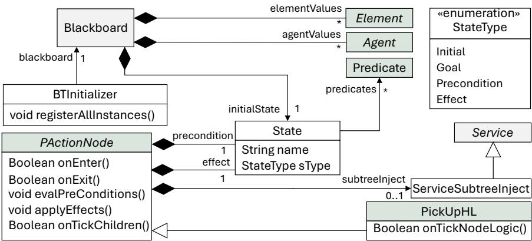

Figure 7: Behavior model extending the metamodels defined in this section to describe runtime behavior. It highlights concepts such as blackboard registration. Green boxes correspond to the DomainTypesDef or DomainTypesCon metamodel elements and gray boxes to the BehaviorTree metamodel elements. Custom types other than Element and Agent have similar blackboard relations but are omitted for clarity.  
Algorithm 4: Domain model type parsing and grammar generation using MontiCore infrastructure   
Input: Paths: propPath, predPath, actPath   
Output: Boolean success or Error   
// 1. Property Type Parsing   
1 if ¬DomainPropertyTypeParser parse(propPath) then   
2 return Error   
3 DomainPropertyTypeParser.writeRulesToGrammar()   
4 DomainPropertyTypeParser.generateTypeInCSharp()   
5 generateMCGrammars()   
// 2. Predicate Type Parsing   
6 if ¬DomainPredicateTypeParser parse(predPath) then   
7 return Error   
8 DomainPredicateTypeParser.writeRulesToGrammar()   
9 DomainPredicateTypeParser.generateTypeInCSharp()   
10 generateMCGrammars()   
// 3. Action Type Parsing   
11 if ¬DomainActionTypeParser parse(actPath) then   
12 return Error   
13 DomainActionTypeParser.writeRulesToGrammar()   
14 DomainActionTypeParser.generateTypeInCSharp()   
15 generateMCGrammars()   
16 return Success

Abstract syntax: The planning service metamodel extends the BT service metamodel with the following concepts:

• Planning services (ServicePlanning, ServicePDDLPlanning). Specify planning services for BT node generation by providing a planner name; ServicePDDLPlanning invokes a PDDL-based symbolic planner.

• Planners (Planner). Define planner tools by type and configuration, enabling multiple planners to be invoked through a common execution model.

• PDDL planners (PlannerPDDL). Model PDDL-based symbolic planners with a planning domain (Domain), problem file (Problem), and domain action level, ensuring compatibility between planning domains and action granularity (e.g., a domain containing mid-level actions such as Travel is not used for high-level planning).

Structural well-formedness rules for this metamodel include the following: Only flow nodes may be connected to planning services; action nodes are not permitted. The action level of a planning domain must match the hierarchy level of the actions it generates. The planner used for the PDDL planning service must be of type PlannerPDDL.

Algorithm 5: Validation and symbol generation for scene items, initial state, and BT models   
Input: Paths: propPath, predPath, btPath   
1 propPath predPath btPath , ∅ Output: Boolean success or Error   
// 1. Property Model Validation   
2 if ¬ConcretePropertyParser parseAndGenSyms(propPath) then   
3 return Error   
4 writeInstancesAsJson(properties)   
// 2. Predicate Model Validation   
5 if ¬ConcretePredicateParser parseAndGenSyms(predPath) then   
6 return Error   
7 writeInstancesAsJson(predicates)   
// 3. BT Structure Validation   
8 if ¬APTreeParser parseAndGenSyms(btPath) then   
9 return Error   
// 4. Initial BT Structure Serialization   
10 writeBTStructureAsJson()   
return Success

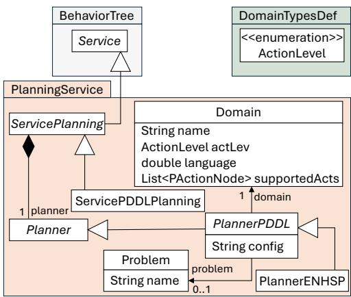

Figure 8: Planning service metamodel defining automated planning as a BT service, highlighting concepts such as planning services, planners, and PDDL-based planners.

Concrete syntax: The concrete syntax is shown in Listing 9 with examples of valid models for planner definitions (lines 1-2 in Listing 10) and for the use of planners in a part of our running example (lines 4-10 in Listing 10). Planner tools other than ENHSP can similarly be added to the grammar.

Listing 9: The planning service MontiCore grammar defining the textual concrete syntax for planning services and for planners.

grammar PlanningService extends DomainTypesCon {   
// planning service   
abstract ServicePlanning extends Service = name : Name planner : Planner ;   
ServicePDDLPlanning extends ServicePlanning = " ServicePlanning " name : Name planner : Planner ;   
// Planners   
abstract Planner ;   
abstract PlannerPDDL extends Planner = " Domain " ":" domain : Name@Domain (" Problem " ":" problem :   
Name@Problem )? (" Config " ":" config : String )?;   
PlannerENHSP extends PlannerPDDL = " Enhsp " " Domain " ":" domain : Name@Domain (" Problem " ":" problem :   
Name@Problem )? (" Config " ":" config : String )?;   
9 symbol Domain = " Domain " name : Name " LanguageVersion " ":" language : Double " Level " ":" actLev :   
ActionLevel "{" supportedActs : Name@PActionNode (" ," supportedActs : Name@PActionNode )\* "}";   
10 symbol Problem = " Problem " name : Name ;   
11 }

Listing 10: Example model showing the definition of planning service for the HandlePlate sequence node in our running example (lines 5 to 10)  
ServicePlanning MyPlanner1 Enhsp Domain : PickAndPlaceHL Problem : PlacePlate1   
Domain PickAndPlaceHL LanguageVersion :2.1 Level : HighLevel { pickUphl , placehl }   
3 Problem PlacePlate1   
4

5 BehaviorTree MyRobotTree {   
6 Root Sequence MainSequence {   
7 Sequence HandlePlate {   
8 ServicePlanning MyPlannerSrv1 Enhsp Domain : PickAndPlaceHL Problem : PlacePlate1Planning Service Semantic Model   
9 Action PickUpHL PickUpPlate1 ( plate1 fp1 r1) @PickUpMLSubtree   
10 Action PlaceHL PlacePlate1 ( plate1 pr1 r1) @PlaceMLSubtree   
11 }}}

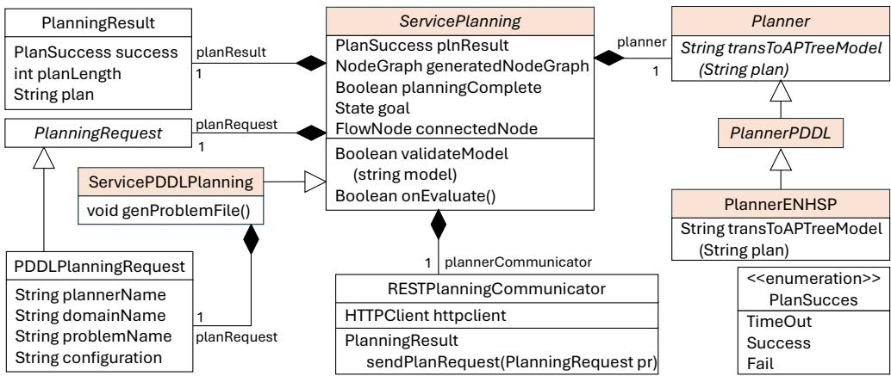  
Figure 9: Behavior model extending the planning service metamodel, highlighting components such as the RESTPlanningCommunicator, which sends planning requests and receives planning results. Classes highlighted in orange correspond to the same classes in the PlanningService metamodel.

Behavior: Figure 9 illustrates the behavior model for planning services. Boxes highlighted in orange correspond to the elements defined in the abstract syntax metamodel shown in Figure 8. A PDDL planning service performs three main functions: invoking planners by providing the required information $( \mathrm { e . g . }$ domain and problem files for PDDL planners), receiving the resulting task plan, and transforming this plan into APTree DSL for validation.

Planning services interact with external planners through a REST-based communication architecture. As a result, each planning service maintains both a planning request (PlanningRequest) and a planning result (PlanningResult). The execution logic of the onEvaluate operation of the planning service is as follows:

plannerCommunicator.sendPlanRequest sends a planning request to the selected planner and, if a plan is found, receives it. If planning succeeds, the resulting plan model is transformed into an APTree model using planner.transToAPTreeModel operation, and then parsed and validated using APTree’s full DSL. If successful, the resulting plan is assigned to the attached flow node, which then executes it. If any step fails, the onEvaluate operation returns false. If a problem file is not provided, or replanning is required for mid-level and low-level actions, the genProblemFile operation automatically generates one. This operation queries the initial state from the blackboard, refines predicates for the planner domain, and sets the higher-level action efects as the goal in the generated problem file. Therefore, each planning service maintains a reference to its connected flow node (connectedNode).

## 5.4. Dynamic Flownode DSL Package

This section introduces the dynamic flow node metamodel (Figure 10) and the corresponding method. The metamodel represents complete task plans, including task nodes and their ordering, as directed graphs. It further separates task plan representation from task execution semantics (e.g., success criteria), allowing task plans to be modified independently of the execution model that orchestrates planning, replanning, and task execution.

Abstract syntax: The dynamic flow metamodel extends the previous metamodels with the following concepts:

• Dynamic flow node (DynamicFlowNode). Extends BT flow nodes by replacing hardcoded execution logic (e.g., sequence, parallel) with a single configurable logic. A dynamic flow node may have children of only one type (AllAction or AllFlow), thereby clarifying the hierarchy and separating planning from execution in the BT.

• Success criteria (SuccessCriteria). Allow configuration of when a flow node returns SUCCESS after receiving a tick. Each dynamic flow node must define exactly one success criterion:

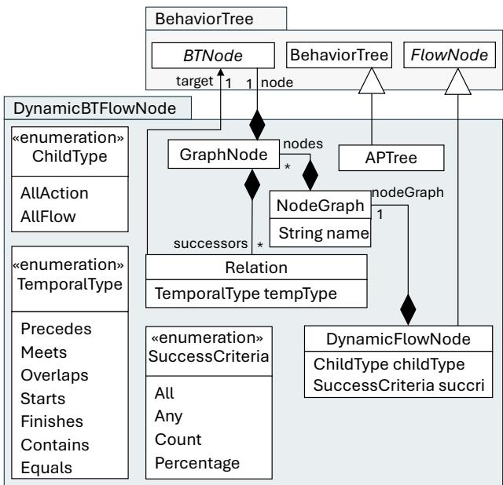  
Figure 10: Dynamic flow node metamodel defining flexible and configurable flow nodes, highlighting core concepts such as node graphs, success criteria, and temporal types.

– All: All child nodes must succeed.

– Any: At least one child node must succeed.

– Count: A specified number of child nodes must succeed.

– Percentage: A specified percentage of child nodes must succeed, enabling partial success thresholds.

• Node graph (NodeGraph). Replaces the linear child list of traditional BTs with a graph of GraphNodes, each wrapping a BT node. Relations between graph nodes define execution order, while the absence of a relation indicates no ordering constraint, enabling partially ordered task plans. For example, in Listing 12, there is no relation between PickUpBeam1 and PickUpBeam2, avoiding the need for a separate parallel flow node. This separation allows a complete subplan, generated by a planner to be represented and managed by a single DynamicFlowNode, rather than distributing it across multiple BT flow nodes. Consequently, planning, execution, and success management remain encapsulated within a single execution submodule.

• Temporal relationships (TemporalType). Relations between graph nodes are annotated with a temporal type (TemporalType) defining execution constraints using Allen’s interval algebra [58], without replacing the execution logic (flow node). For example, the Meets relation allows a successor node to execute immediately after its predecessor finishes.

• APTree. Extends BehaviorTree to support all extended DSL concepts defined in this paper that are not supported by the base BT metamodel.

Structural well-formedness rules include the following: An APTree instance accepts only dynamic flow nodes; traditional flow nodes are not permitted. In an APTree model, all dynamic flow nodes that have action nodes must have at least one planning service except for the root node.

Concrete syntax: Listing 11 presents the concrete syntax of the dynamic flow nodes, followed by a valid model of the running example BT in Listing 12. Since the DynamicFlowNode grammar is the final grammar in the hierarchy, the model in Listing 12 represents the complete BT in our running example using the APTree DSL.

Listing 11: The DynamicBTFlowNode MontiCore grammar defining the textual concrete syntax for graph-based dynamic flow nodes.

3 // Dynamic BTflow node definition   
4 DynamicFlowNode extends FlowNode =   
5 " FlowNode " name : Name "{"   
6 ( Decorator | Service )\*   
7 succri : SuccessCriteria   
8 childType : ChildType   
9 nodeGraph : NodeGraph   
10 "}";   
11 // enums   
12 enum SuccessCriteria = " All " | " Any " | " Count " | " Percentage ";   
13 enum TemporalType = " Meets " | " Precedes " | " Overlaps " |" Starts " | " Finishes " | " Contains " | "   
Equals ";   
14 enum ChildType = " AllAction " | " AllFlow ";   
15 // NodeGraph definition   
16 NodeGraph = " NodeGraph " "{"   
17 ( nodes : GraphNode )\*   
18 "}";   
19 GraphNode = node : BTNode ("{"   
20 ( successors : Relation )+   
21 "}") ?;   
22 Relation = " - -[" temptype : TemporalType "]-->" target : Name@BTNode ";";   
23 }

Listing 12: Example model defining the running example behavior tree using the full DSL.

BehaviorTree APTree {   
2 Root FlowNode Main {   
3 All   
4 AllFlow   
5 NodeGraph {   
6 FlowNode HandlePlate {   
7 ServicePlanning MyPlannerSrv1 Enhsp Domain:PickAndPlaceHL Problem:PlacePlate1   
8 All   
9 AllAction   
10 NodeGraph {   
11 Action PickUpHL PickUpPlate1 (plate1 fp1 r1) @PickUpMLSubtree {   
12 --[Meets]--> PlacePlate1;   
13 }   
14 Action PlaceHL PlacePlate1 (plate1 pr1 r1)   
15 }   
16 }   
17 FlowNode BeamPlacement {   
18 ServicePlanning MyPlannerSrv1 Enhsp Domain:PickAndPlaceHL Problem:handleBeams   
19 All   
20 AllAction   
21 NodeGraph {   
<sup>22</sup> <sub>23</sub> Action PickUpHL PickUpBeam1 (beam1 fp2 r1) {   
--[Meets]--> PlaceBeam1;   
24 }   
25 Action PlaceHL PlaceBeam1 (beam1 pr2 r1)   
26 Action PickUpHL PickUpBeam2 (beam2 fp3 r1) {   
27 --[Meets]--> PlaceBeam2;   
28 }   
29 Action PlaceHL PlaceBeam2 (beam2 pr3 r1)   
30 }   
31 }   
32 }   
33 }   
3 4 }

Behavior: The execution of flow nodes follows the same logic introduced in the BT behavior model shown in Figure 5. It is defined by two main operations: onTickNodeLogic and onTickChildren. The onTickNodeLogic operation evaluates the node’s status using the configured success criteria through the checkSuccessCriteria operation (Figure 11). This evaluation is based on the current BTNodeResult of the node’s children (Figure 5). For example, in the model shown in Listing 12, the All success criterion ensures that the flow node HandlePlate returns Success only if both PickUpPlate1 and PlacePlate1 complete successfully.

The onTickChildren operation determines which nodes may execute and when they execute. It uses the getExecutableNodes operation, which iterates over the node graph and evaluates each node using the canExecute operation to identify executable nodes. The canExecute operation excludes nodes that have completed execution, retains nodes that are currently executing, and marks nodes without predecessors as immediately executable. For nodes with predecessors, canExecute evaluates temporal relations and returns true only if all required predecessor conditions are satisfied. For example, under a Meets constraint between PickUpPlate1 and PlacePlate1 in Listing 12, PlacePlate1 may execute only after PickUpPlate1 has completed.

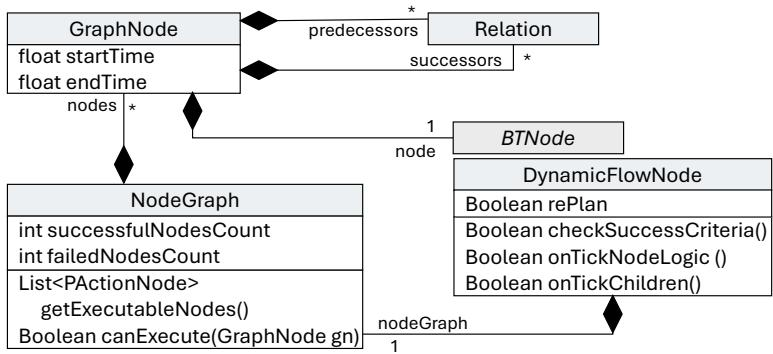  
Figure 11: Behavior model extending the DynamicFlowNode metamodel, highlighting operations such as getExecutableNodes and canExecute that determine executable graph nodes. Blue classes correspond to the metamodel (Figure 10).

While success criteria determine when a flow node returns Success, a child failure initially causes the flow node to return Failure. However, each dynamic flow node has a post-processing decorator in its list of decorators that intercepts this failure in the onExit operation (Section 5.1) and resets the node’s status to InProgress, thereby triggering replanning in the next round of tick signals. A dynamic flow node returns Failure only if the maximum number of replanning attempts is reached and the node remains unsuccessful.

Upon replanning, nodes that have already executed remain in the graph but become inactive, while nodes that have not yet received a tick may be removed. New nodes generated during replanning can be appended to the right side of the node graph as active nodes. Inactive nodes are excluded from the evaluation of flow node success criteria.

## 6. Case Study: livMatS Biomimetic Shell Pavilion Prefabrication Process

The APTree method was evaluated through a real-world CRF task planning case study of the livMatS Biomimetic Shell pavilion [14], where we describe the domain in APTree DSL and plan tasks for it. The pavilion consists of modular cassettes assembled by an industrial robotic arm. The robotic fabrication process involves picking up cassette elements (plates and beams) from designated staging areas, placing them on a work table, and manipulating them with interchangeable end-efectors [14] (Figure 12).

The industrial robotic arm is mounted on a linear axis, enabling access to four work table locations: raw element storage, rail positions, assembled cassette storage, and end-efector equipment positions. Raw element storage (FirstPos) serves as a staging area for wooden plates and beams, rail positions (PositionOnRail) support robotic manipulation and assembly, assembled cassette storage (StackPosition) is used for accumulating completed cassettes, and equipment positions (EquipPosition) store end-efectors.

The robotic arm is equipped with three distinct end-efectors: a vacuum gripper for picking up and placing elements, a nail gripper for mechanical fastening, and a glue gun for adhesive bonding. Within this workspace, the robotic arm assembles three to four cassettes per operational cycle. For this study, the focus is on the assembly of three batches of four cassettes each, with each cassette consisting of six beams and two plates, as illustrated in Figure 12.

## 6.1. APTree Usage for the livMatS Pavilion

Users must provide the input models required to use APTree. These input models include<sup>1</sup>:

• Property types, such as location types, element types, and end-efectors (partially shown in Listing 7).

• Predicate types and the initial state describing the fabrication setup (partially shown in Listings 7 and 8).

• Action types required for the case study task planning. The defined action types are summarized in Table 2, based on the symbolic planner domains for HL and ML planning. An example of an action type definition is shown in Listing 7.

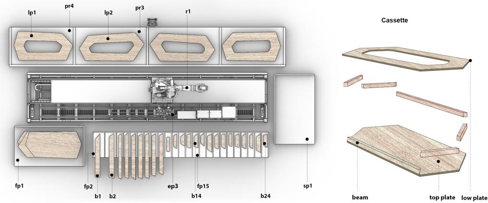

  
Figure 12: Robotic prefabrication setup for the livMatS Biomimetic Shell project [14]. Shown are the main types and instances: raw element storage (FirstPos, fpn), rail positions (PositionOnRail, prn), assembled cassette storage (StackPosition, sp1), industrial robot (Robot, r1), and equipment positions (EquipPosition, epn). Each cassette comprises a low plate (lpn), a top plate (tpn), and six beams (bn), where n denotes the instance number.

• Symbolic planner initial domain and problem files used by APTree. For this case study, two PDDL domain files (for ML and HL planning) and 12 initial problem files (one for each cassette) are manually developed.

• Initial BT and planner configurations, shown in Listing 13. This configuration specifies three batch branches, each containing four cassette planning branches. ENHSP is assigned as the HL planner for each cassette branch.

Listing 13: Excerpt of the initial APTree model for task planning across 12 cassettes in 3 production batches

BehaviorTree livMat {   
2 Root FlowNode Main {   
3 All   
4 AllFlow   
5 NodeGraph {   
6 FlowNode Batch1\_C1toC4 {   
7 All   
8 AllFlow   
9 NodeGraph {   
10 FlowNode Cassette1 {   
11 ServicePlanning mypddlplanner1 Enhsp Domain:DomainHL Problem:ProblemC1 Config: "sat-hadd"   
12 All   
13 AllAction   
14 NodeGraph { }   
15 }   
16 FlowNode Cassette2 { ... }   
17 FlowNode Cassette3 5 }   
18 FlowNode Cassette4 { }   
19 }   
20 } {   
21 -[Meets]--> Batch2\_C5toC8; // sequential execution between batches   
22 }   
23 FlowNode Batch2\_C5toC8 { ... } {   
24 --[Meets]--> Batch3\_C9toC12;

<table><tr><td>25 } 26 27 FlowNode Batch3_C9toC12 { ... } } 28 } 29 }</td><td></td></tr><tr><td colspan="2"></td></tr><tr><td>Action Level and Planner HL-ENHSP</td><td>Action Types PickUpHL, PlaceHL, StackHL, StackOnMultipleHL, GluingPlateHL, GluingBeamHL, NailingHL,</td></tr><tr><td>ML-LAMA-First and Metric-FF</td><td>NailingBeamHL, MoveCassetteToStackHL TravelML, EquipeML, DeequipML, InitializeML, CloseToolML, PickUpML, PlaceML, StackML, StackOnMultipleML, GluingML, NailingML, PickUpCassetteML, PlaceCassetteML</td></tr></table>

Table 2: Action node types representing tasks defined in each planner domain.

Four planners are used in our case study evaluation: ENHSP [15], Metric-FF [16], LAMA-First [17], and temporal fast downward (TFD) [59]. As shown in Table 2, ENHSP is used for HL planning, while Metric-FF and LAMA-First are used for ML planning<sup>2</sup>. The TFD planner is used only for performance comparison against PlanSys2, as PlanSys2 only supports temporal planners [45].

The HL planning domain uses numeric fluents, universal quantifiers, and conditional efects to model assembly constraints, including the variable attachment capacity of components. ENHSP was selected because it supports these language features and can generate plans for our case study. The ML planning domains correspond to classical planning, as the HL planner has already determined the assembly decisions; the ML planners therefore only need to determine the robotic traveling and tool-handling tasks required to realize those decisions. Metric-FF and LAMA-First were selected as representative classical planners: Metric-FF prioritizes planning speed, whereas LAMA-First employs landmark-based heuristics that typically yield higher-quality plans at the expense of increased planning time [17]. Unless stated otherwise, reported results use ENHSP at the HL and Metric-FF at the ML, as this combination is considerably faster; results with LAMA-First are reported where explicitly indicated.

The usage of APTree is also illustrated in Figure 13 using a UML activity diagram. The model loader accepts user-defined input models and validates them according to the defined DSL. If the input is invalid, error messages are returned to the user. If the input is valid, the model loader registers all types and instances on the blackboard and signals the BT execution engine to initiate ticking the BT.

The execution engine starts the BT by sending a tick signal to the first dynamic flow node (the root). APTree operates in two modes: planning mode, in which only planner services associated with flow nodes are permitted to generate nodes (the ServicePlanning instances in Listing 13), and action execution mode, in which action nodes are executed (actions in Listing 14). On the initial tick, planning mode is activated. After all planner services that receive a tick complete HL plan generation (i.e., plan nodes are generated for each of the four initially empty flow nodes shown in Listing 13), the action execution mode is triggered.

If a planner service fails to generate a plan or if the generated model violates the DSL constraints, an error message is reported to the user, and BT execution is paused (Figure 13). Upon successful plan generation, the resulting action nodes either execute directly or are further expanded into a lower level of granularity. In the presented case study, mid-level actions are derived from high-level actions; no low-level actions are produced because no low-level motion planner is introduced.

In action execution mode, BT decorators coordinate execution across the four branches of each batch. The Lock decorator is applied automatically to all ML subtrees, guaranteeing their atomic execution and preventing conflicting interleavings between partially ordered plans that share resources (e.g., the robot). The remaining decorators define the execution policy for coordinating the HL independent cassette assembly branches. We evaluate two configurations: execution with replanning and execution without replanning. Both produce the final BT shown in Listing 14.

The four cassette assembly branches are independent and unordered. Their execution policy therefore afects only execution order, not plan correctness, and can reduce superfluous actions (e.g., allowing the robot to complete all tasks requiring the same end-efector across unordered branches before switching tools). Two policies are considered: FairProgress, which coordinates balanced branch execution without forcing replanning, and CostEvaluation, which deliberately maximizes replanning required for the evaluation of local replanning:

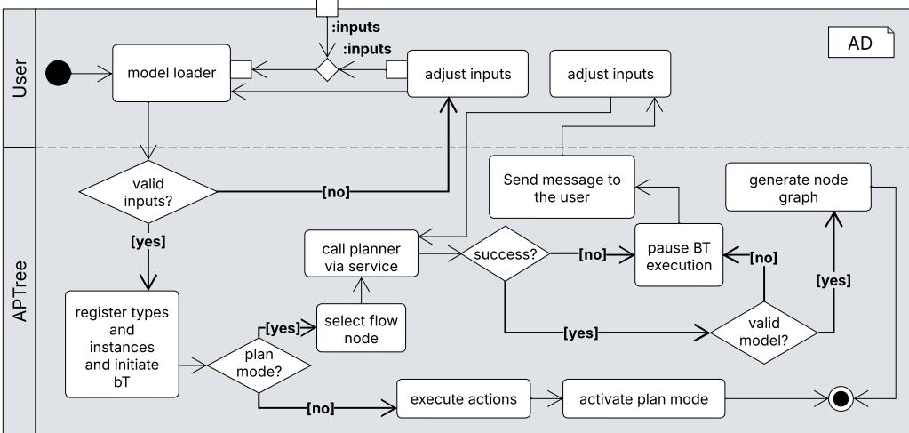  
Figure 13: Activity diagram illustrating the process from input provision to node generation and planning modes.

## Configuration with replanning

In this configuration, planning is first performed for all four flow nodes in a batch, generating the corresponding high-level actions. The executable action in each branch is then selected (e.g., lines 15, 25 in Listing 14), and the corresponding ML subtrees are generated, with their ML actions planned (e.g., lines 50–53 in Listing 14). Among all executable branches, the cost evaluation decorator selects the ML subtree with the lowest estimated cost (number of actions in the branch). The Lock decorator then ensures exclusive execution of the selected subtree until all its ML actions are completed. After execution, action efects are applied to the blackboard, and a Reset decorator removes the remaining obsolete planned subtrees in other branches and triggers replanning based on the updated world state. This cycle continues until all tasks are completed.

## Configuration without replanning (fair progress)

In the second configuration, execution is coordinated using the FairProgress decorator, which enforces balanced progression across branches instead of selecting the globally cheapest subtree. After executing a high-level action in one branch, priority shifts to available actions in other branches. If preconditions are not satisfied (e.g., the robot is already holding an object), execution continues within the same branch. As in the first approach, the Lock decorator guarantees atomic execution of the selected ML subtree. However, replanning is not triggered after each subtree execution; coordination is achieved solely through controlled branch progression.

These two decorator configurations are representative execution policies used to evaluate APTree’s planning and replanning capabilities rather than the only possible coordination mechanisms, and for simplicity, are omitted from the models in Listings 13 and 14. Since APTree extends standard BTs, it preserves their execution flexibility and other decorators or execution policies can be used as required.

## 7. Evaluation Using Case Study Results

This section evaluates APTree using the CRF case study described in Section 6. The evaluation follows the GQM framework defined in Section 4, addressing research questions in sequence. All experiments were performed on a Vivobook ASUS K6604JI laptop equipped with a 13th Gen Intel(R) Core(TM) i9-13980HX CPU and an NVIDIA GeForce RTX 4070 GPU. We compare APTree with PlanSys2, as both use symbolic planning to generate BT-based execution models. PlanSys2 follows a two-stage architecture in which a symbolic planner first generates a task plan that is then transformed into a BT execution model using BT.CPP [45]. In contrast, APTree integrates planning directly into the execution model, allowing task plans to be generated during execution rather than in a separate planning stage.

Answering Q1–Q4. Representative structural, typing, syntactic, and logical errors are injected into the plan models generated for a planning problem from the CRF case study (Appendix A). For APTree, errors are injected into the integrated planning and execution model. For PlanSys2, errors are injected for the symbolic planner and, when applicable, the generated execution model. Due to PlanSys2’s two-stage architecture, an error is counted as detected only if it is identified before runtime. Accordingly, M1 (TPR) measures the proportion of injected errors detected at design time, while M2 (PR) measures the proportion prevented by design.

For M1, both APTree and PlanSys2 achieve a TPR of 100% for structural errors, though at diferent stages. APTree detects all structural errors at design time through its grammar-based validation. PlanSys2 detects structural errors using the symbolic planner parser, at planner invocation time, while structural errors in the BT execution model are prevented by design, as the BT is generated automatically from the plan. For typing errors, APTree achieves a TPR of 100% by enforcing type consistency between the planning model and the execution model at design time. In PlanSys2, action types and their properties must be independently redefined in the BT execution layer (as BT.CPP action nodes), with no mechanism to verify that these definitions remain consistent with those in the PDDL planning domain. This separation is the source of potential type mismatches, resulting in a TPR of 0%. Typing errors are largely inapplicable to the symbolic planner itself, since generated plans inherently conform to the action signatures defined in the domain.

Syntactic errors are detected trivially, as both APTree and PlanSys2 use DSLs that enforce syntactic correctness. However, APTree requires an initial BT to be authored before planning and therefore validates it at design time, while PlanSys2 automatically generates the execution BT, preventing syntax errors by design. Regarding logical errors, PlanSys2 generates a single plan for each planning problem. Therefore, logical errors involving interactions between multiple execution models cannot be detected during planning and manifest as silent failures during execution. APTree likewise cannot detect these errors at design time; however, it detects all injected logical errors at runtime through integrated reasoning over its planning and execution models. Of these, 50% are resolved automatically (error 15 by replanning and error 18 by shifting execution to other branches until the preconditions are met again), while the remaining 50% (errors 16 and 19) halt BT execution due to an infeasible plan. Overall, across all error categories, APTree achieves a TPR of 76%, with the remaining errors detected at runtime, while PlanSys2 achieves a TPR of 25%.

Regarding M2, APTree prevents 10% of the injected errors by construction, as the initial empty BT is not automatically generated. In contrast, PlanSys2 prevents 36.8% of injected errors, mainly syntactic errors, because both the symbolic plan and the BT execution model are generated automatically.

Answering questions Q5–Q6. We next evaluate the locality and scalability of APTree replanning, using the configuration with replanning, based on metrics measuring average structural change (M3), replanning frequency (M4), and node retention rate (M5). When replanning is required, PlanSys2 invokes the symbolic planner on the updated planning problem and regenerates the entire BT, replacing the previous execution model $( g _ { n } = 1 0 0 \% )$ . In contrast, over 1,098 replanning events, APTree’s $g _ { n }$ averaged 0.80%. The $g _ { n }$ values ranged from 0.00% to 6.50%, indicating that individual replanning operations consistently afect only a small fraction of the overall tree structure (see Figure 14). The low average confirms that APTree supports runtime local replanning, replacing only the specific subtree requiring adaptation without disrupting the broader execution flow.

As APTree flow nodes can represent alternative execution orders within a single graph, replanning of a subtree does not alter the BT hierarchy regardless of the number of planned tasks. Consequently, the execution hierarchy remains unchanged throughout replanning. As shown in Table 4, the final execution model contains 1,149 action nodes while maintaining a constant depth of six levels (Listing 14), yielding $D _ { 0 } = D _ { 1 } = 6$ and $g _ { d } = 0$ . In contrast, the depth of a PlanSys2-generated BT increases with the number of sequential tasks in the plan.

The $g _ { w }$ metric (Figure 14) averaged 0.38% (range 0.00–4.84%), indicating that tree width remains largely stable despite continuous replanning. Across 1,098 replanning events, the structural change metric (M3) is $\overline { { G } } _ { \mathrm { t r e e } } = 0 . 3 9 \%$ Notably, the structural change per replanning event is bounded by the size of the replanned ML subtree, so its relative magnitude decreases as the execution model grows; replanning thus remains localized for increasingly large task plans.

Table 4 further shows that repeated replanning generated 6,507 action nodes across 1,098 replanning events, while only 1,149 nodes remained in the final BT and were executed to completion, identical to the configuration without replanning. This corresponds to a replanning frequency (M4) of 81.4 replans/min over 13 minutes and 29 seconds execution and a node retention rate (M5) of 17.7%. Because replanning in this configuration is deliberately induced by the CostEvaluation policy, these values reflect the replanning load APTree sustains while preserving the running execution model, rather than fault-driven recovery; they indicate that APTree supports frequent, localized replanning as the execution model grows. Complementing these plan-change metrics with task outcomes: in both configurations, all 372 high-level tasks achieved their goals, all 1,098 replanning invocations returned valid plans with no planner failures, and no action failures occurred. As actions in our setup always return success once they are ticked, these outcomes reflect valid plan generation and composition rather than physical execution performance.

Answering questions Q7–Q10. This evaluation examines the ability of APTree to apply and coordinate symbolic sub-plans generated by multiple automated planners and to decompose and recompose large-scale planning problems into a single executable and step-eficient task plan, as defined by Metrics M6–M12. Experiments were conducted under both execution configurations (Section 6.1): with and without replanning. Unless otherwise stated, all experiments use ENHSP for high-level planning and Metric-FF for mid-level planning to provide a consistent evaluation baseline. LAMA-First is additionally included in the evaluation of planner diversity (M6) and planner application latency (M8) to demonstrate heterogeneous planner integration and quantify the impact of planner choice on execution performance.

<table><tr><td rowspan="2">ID</td><td rowspan="2">Error Type Error Description</td><td rowspan="2"></td><td rowspan="2">APTree</td><td colspan="2">PlanSys2</td></tr><tr><td>BT.CPP</td><td>Symbolic Planner</td></tr><tr><td>1 2</td><td rowspan="5"></td><td>Mismatch of planning model artifacts (e.g., planner and its configuration)</td><td>DT</td><td>NA</td><td>PT</td></tr><tr><td></td><td>Missing planning model artifact (e.g., lacking problem or domain)</td><td>DT</td><td>NA</td><td>PT</td></tr><tr><td>3 Structural</td><td>Mismatch of planner and planning models (e.g., unsupported language)</td><td>DT</td><td>NA</td><td>PT</td></tr><tr><td>4</td><td>Execution model involves invalid component hierarchy</td><td>DT</td><td>PD</td><td>NA</td></tr><tr><td>5</td><td>Execution model inconsistent with the symbolic plan</td><td>PD</td><td>PD</td><td>NA</td></tr><tr><td></td><td></td><td>Structural errors (%) 100%</td><td colspan="3">100%</td></tr><tr><td>6 7</td><td rowspan="5"></td><td>Undefined parameter instance in task execution model</td><td>DT</td><td>RTC</td><td>NA</td></tr><tr><td>Typing</td><td>Undefined action type</td><td>DT</td><td>RTC</td><td>NA</td></tr><tr><td>8</td><td>Undefined parameter type in actions</td><td>DT</td><td>RTC</td><td>NA</td></tr><tr><td>9 10</td><td>Planned action parameter count does not match the execution action signature</td><td>DT</td><td>RTC</td><td>NA</td></tr><tr><td></td><td>Planned action parameter type does not match the execution action signature</td><td>DT</td><td>RTC</td><td>NA</td></tr><tr><td></td><td></td><td>Typing errors (%)</td><td>100%</td><td colspan="2">0%</td></tr><tr><td>11</td><td></td><td>Delimiter mismatch in the model syntax</td><td>DT</td><td>PD</td><td>PD</td></tr><tr><td>12</td><td></td><td>Invalid ordering of execution model constructs</td><td>DT</td><td>PD</td><td>PD</td></tr><tr><td>13</td><td>Syntax</td><td>Unexpected token in the model specification</td><td>DT</td><td>PD</td><td>PD</td></tr><tr><td>14</td><td></td><td>Missing required syntactic element or keyword</td><td>DT</td><td>PD</td><td>PD</td></tr><tr><td></td><td></td><td>Syntax errors (%)</td><td>100%</td><td></td><td>NA</td></tr><tr><td>15</td><td></td><td>World-state changes introduced by a preceding execution model invalidate</td><td>RT</td><td>SF</td><td>NA</td></tr><tr><td>16</td><td>Logical</td><td>the current plan. Execution model regresses a goal achieved by another execution model.</td><td>RT</td><td>SF</td><td>NA</td></tr><tr><td>17</td><td></td><td>Execution model cannot achieve its goal due to broken causal links.</td><td>PD</td><td>PD</td><td>NA</td></tr><tr><td>18</td><td></td><td>Action preconditions are invalidated by another execution model.</td><td>RT</td><td>SF</td><td>NA</td></tr><tr><td>19</td><td></td><td>Two execution models pursue logically incompatible goals.</td><td>RT</td><td>SF</td><td>NA</td></tr><tr><td></td><td></td><td>Logical errors (%)</td><td>0%</td><td></td><td>0%</td></tr></table>

Table 3: Comparison of error detection and prevention between APTree and PlanSys2. DT = detected at design-time, PT = detected at planning time, RT = detected at runtime, RTC = detection at runtime leads to crash, SF = silent failure, NA = not applicable, PD = prevented by design

Metrics M6–M8 evaluate the framework’s ability to coordinate heterogeneous symbolic planners and repeatedly apply them during execution. As shown in Table 5, APTree can employ three distinct symbolic planners (ENHSP, Metric-FF, and LAMA-First), yielding a planner diversity of three and demonstrating heterogeneous planner integration. During execution, Metric-FF and LAMA-First are each invoked 735 times (each handling half of the ML planning modules), whereas ENHSP is invoked 12 times, as high-level actions do not require replanning in our deterministic planning setup. In total, the framework automatically generates 1,470 and 372 planning problem instances during execution for the configurations with and without replanning, respectively (Table 4), reducing manual problem specification to the 12 initial problem files (Listing 13). In contrast, PlanSys2 invokes a single planner once for the entire execution. These results demonstrate that APTree supports distributed, repeated, and heterogeneous symbolic planning within a single execution model.

The M8 metric evaluates the cumulative planning latency (PL). Without replanning, using ENHSP + Metric-FF, the system accumulates 2 min 20 s of planning latency over a total execution time of 5 min 6 s, yielding a normalized PL of 45.8%. With replanning enabled, the same planner combination accumulates 8 min 53 s over 13 min 29 s, corresponding to a normalized PL of 65.9%. Replacing half of the ML subtree planners with LAMA-First increases the cumulative planning latency to 43 min 8 s over 48 min of total execution, yielding a normalized PL of 89.9%. Table 5 summarizes the per-planner latency breakdown for this three-planner replanning configuration.

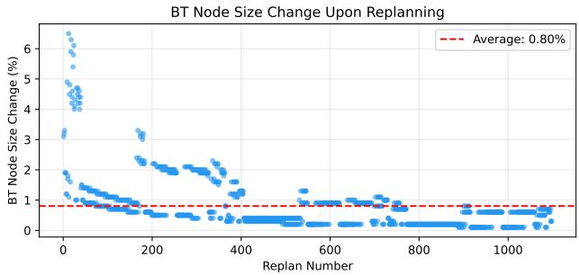

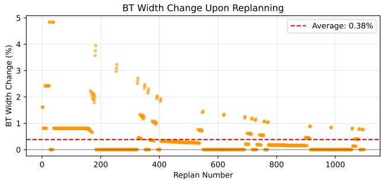

Figure 14: BT Node Change $( g _ { n } , \mathrm { l e f t } )$ and BT Width Change $( g _ { w } , \mathrm { r i g h t } )$ across 1,098 replanning events. Each dot represents a single replan; the dashed red line indicates the average (0.80% and 0.38%, respectively).
<table><tr><td rowspan="2">Category</td><td colspan="3">With Replanning 13 min 29 sec</td><td colspan="3">Without Replanning 5 min 6 sec</td></tr><tr><td>Final</td><td>Before Ticking</td><td>After Ticking</td><td>Final</td><td>Before Ticking</td><td>After Ticking</td></tr><tr><td>Action Instances (ML &amp; HL)</td><td>1,149</td><td>0</td><td>6,507</td><td>1,149</td><td>0</td><td>1,149</td></tr><tr><td>Action Instances (HL)</td><td>372</td><td>0</td><td>372</td><td>372</td><td>0</td><td>372</td></tr><tr><td>Replanning triggered</td><td>1,098</td><td>0</td><td>1,098</td><td>0</td><td>0</td><td>0</td></tr><tr><td>PDDL Problem files</td><td>384</td><td>12</td><td>1,470</td><td>384</td><td>12</td><td>372</td></tr><tr><td>FlowNode Instances</td><td>388</td><td>16</td><td>372</td><td>388</td><td>16</td><td>372</td></tr></table>

Table 4: Comparison of BT structure metrics between execution with dynamic replanning (1,098 replans over 13 min 29 s) and without replanning (5 min 6 s), showing node counts at final state, before ticking, and after ticking.

Figure 15 shows that the average planning latency per invocation remains stable throughout 1,482 planner calls in the replanning configuration — the configuration with the highest number of planning invocations. The average latency is approximately 360 ms with ENHSP + Metric-FF, and 1,746 ms with ENHSP + Metric-FF + LAMA-First. These results indicate that cumulative planning latency is determined primarily by the choice of symbolic planner, while repeated planning and replanning do not introduce additional per-invocation overhead.

Listing 14: Excerpt from the final generated APTree model. Ellipses (...) denote omitted actions or additional behavior tree fragments. The highlighted subtree reference is defined below.

BehaviorTree livMat {   
Root FlowNode Main {   
All   
4 AllFlow   
5 NodeGraph {   
6 FlowNode Batch1\_C1toC4 {   
7 All   
8 AllFlow   
9 NodeGraph {   
10 FlowNode Cassette1 {   
11 ServicePlanning mypddlplanner1 Enhsp Domain:DomainHL Problem:ProblemC1   
12 All   
13 AllAction   
14 NodeGraph {   
15 Action PickUpHL PickUpHL\_lp1\_fp1\_r1 (lp1 fp1 r1) @PickUpHL\_lp1\_fp1\_r1Subtree {   
16 --[Meets]--> PlaceHL\_lp1\_pr1\_r1;   
17 }   
18 }   
19 }   
FlowNode Cassette2 {   
ServicePlanning mypddlplanner2 Enhsp Domain:DomainHL Problem:ProblemC2   
All   
AllAction   
NodeGraph {   
Action PickUpHL PickUpHL\_lp2\_fp9\_r1 (lp2 fp9 r1) @PickUpHL\_lp2\_fp9\_r1Subtree {   
--[Meets]--> PlaceHL\_lp2\_pr2\_r1;   
}   
}   
}   
FlowNode Cassette3 { ... }   
FlowNode Cassette4 { ... }   
}   
} {   
--[Meets]--> Batch2\_C5toC8;   
}   
FlowNode Batch2\_C5toC8 { ... } {   
--[Meets]--> Batch3\_C9toC12;   
38 }

39 FlowNode Batch3\_C9toC12 { ... }  
40 }  
41 }  
42 }  
43  
44 BehaviorTree PickUpHL\_lp2\_fp9\_r1Subtree {  
45 Root FlowNode FF\_Default\_DynamicFlow\_PickUpHL\_lp2\_fp9\_r1 {  
46 ServicePlanning subtreeSrv\_PickUpHL\_lp2\_fp9\_r1 FF Domain:DomainML Problem:problemPickUpHL\_lp2\_fp9\_r1  
47 All  
48 AllAction  
49 NodeGraph {  
50 Action TravelML TravelML\_r1\_pr1\_fp9 (r1 pr1 fp9) {  
51 --[Meets]--> PickUpML\_lp2\_fp9\_r1\_vg1;  
52 }  
53 Action PickUpML PickUpML\_lp2\_fp9\_r1\_vg1 (lp2 fp9 r1 vg1)  
54 }  
55 }  
56 }

<table><tr><td>PlannerType</td><td>Call Count</td><td>Success Rate</td><td>Average Planner Time (ms)</td><td>Average Service Time (ms)</td><td>Average Plan Size</td><td>Cumulative Planner Time (s)</td><td>Cumulative Service Time (s)</td></tr><tr><td>ENHSP</td><td>12</td><td>100.00%</td><td>1364.30</td><td>1556.77</td><td>31</td><td>16.37</td><td>18.68</td></tr><tr><td>Metric-FF</td><td>735</td><td>100.00%</td><td>270.10</td><td>349.96</td><td>3.9</td><td>198.52</td><td>257.22</td></tr><tr><td>LAMA-First</td><td>735</td><td>100.00%</td><td>3082.30</td><td>3145.78</td><td>4.5</td><td>2265.49</td><td>2312.15</td></tr><tr><td>TOTAL</td><td>1482</td><td>100.00%</td><td>1673.67</td><td>1746.32</td><td>4.4</td><td>2480.38</td><td>2588.05</td></tr></table>

Table 5: Average planning time, planning service time (including parsing and action instance generation), and average plan size by planner type. The TOTAL row reports call-weighted averages. These values were obtained using the active replanning configuration.

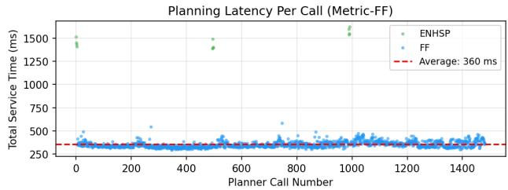

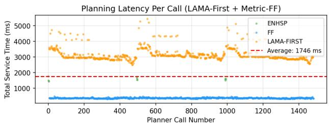  
Figure 15: Per-call planning service latency for Metric-FF only (left) and LAMA-First + Metric-FF (right) as ML planners, ENHSP as HL planner, with replanning. Per-call latency remains stable across all invocations, with no degradation from repeated calls.

To compare the scalability and performance of APTree against PlanSys2, we defined five planning problems of increasing complexity derived from the livMatS case study: P0 (single pick-up), P1 (pick-and-place), P2 (pick-placeglue), P3 (P2 plus one stacking beam task), and P4 (P3 plus a second stacking beam task). To ensure a fair comparison, both approaches use the same temporal planner (TFD): APTree applies TFD to each decomposed ML planning problem, whereas PlanSys2 applies TFD once to the complete planning problem. Unlike the livMatS case study, each comparison problem (P) is specified to APTree as a single HL planning problem without manual decomposition; the ML planning problems are generated automatically by APTree, which refines each planned HL action into a separate ML problem whose goal is the efects of that action. Figure 16 compares APTree’s modular planning approach with PlanSys2’s monolithic planning. For the simplest problems (P0–P1), PlanSys2 is faster (168–850 ms vs. 1.4–2.1 s) because it performs a single planning call without decomposition overhead. As problem complexity increases, however, APTree’s modular planning scales more efectively. At P2, APTree’s cumulative planning time is 3.0 s versus 5.7 s for PlanSys2. At P3 and P4, PlanSys2 fails with out-of-memory errors because the entire planning problem must be grounded simultaneously (full problems available in our public repository, Appendix C), whereas APTree solves both by decomposing them into bounded ML-level subproblems that are planned and executed incrementally. This automatic hierarchical decomposition enables APTree to solve problems beyond the reach of monolithic planning while reducing time to first action. These experiments therefore establish the benefit of APTree-enabled decomposition, rather than directly demonstrating that APTree itself is intrinsically more scalable than PlanSys2 under matched decompositions.

Metric M9 evaluates the framework’s ability to decompose large symbolic planning problems into smaller subproblems and recompose them into a single executable task plan. In the livMatS case study, the final executed plan comprises 1,149 action nodes, contributed by 372 planning submodules for both configurations (Table 4), yielding a decomposition factor of 3.1. In contrast, a monolithic plan generated by PlanSys2 would yield a decomposition factor equal to the total number of executed task steps. These results demonstrate efective decomposition and recomposition, supporting modular and scalable task planning.

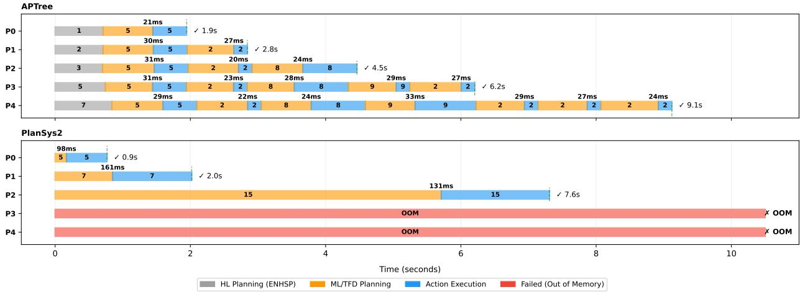

Figure 16: Comparison of APTree and PlanSys2 on progressively larger subsets of the livMatS case study. The values above the planning-to-execution transitions indicate the BT generation overhead. The values inside ribbons are the number of actions per planning instance.
<table><tr><td colspan="5"></td></tr><tr><td>&quot;names&quot; :</td><td></td><td> $^ { \mathfrak { w } } \mathrm { M o v e } ^ { \mathfrak { w } } , \ ^ { \mathfrak { w } } \mathrm { a c t o r s } ^ { \mathfrak { w } } : \ ^ { \mathfrak { w } } \mathrm { R o b o t } ^ { \mathfrak { w } }$ </td><td></td><td> $\overline { { \mathrm { T r a v e l M L } _ { - } { \bf r } 1 _ { - } { \bf p } { \bf r } 2 _ { - } { \bf e p } 1 } }$ </td></tr><tr><td></td><td></td><td>&quot;names&quot;: &quot;Take Tool&quot;, &quot;tools&quot;: &quot;VG1&quot;</td><td> $\mathtt { E q u i p e M L \_ r 1 \_ v g 1 \_ e p 1 }$ </td><td></td></tr><tr><td></td><td>&quot;names&quot;: &quot;Initiate Tool&quot;</td><td></td><td></td><td> $\mathtt { I n i t i a l i z e M L \_ r 1 \_ v g 1 }$ </td></tr></table>

Table 6: Comparison and mapping between the manual expert plan (JSON) and the automatically generated task plan from APTree logs.

Metrics M10 and M11 evaluate plan correctness and step eficiency; a formal analysis establishing the conditions under which APTree preserves plan correctness is given in Appendix B. We compared the generated plan against the manually authored livMatS task plan [61] as reference. As shown in Table 6, all logically required steps and their ordering were preserved, giving a PPR of 100% (M10). By coordinating balanced progression across the four independent branches, the proposed execution policies also minimize superfluous actions: whereas purely sequential execution of the branches would incur redundant tool changes and travel, yielding an SSR (M11) of 42%, the proposed policies reduce it to 0% with both of our execution policies. Together, these results show that APTree preserves the reference plan’s logical structure while producing highly step-eficient execution models.

To evaluate runtime performance (Q10), we compute the consecutive action latency (CAL), defined by M12. Figure 17 shows the interval between consecutive action completions throughout execution alongside the cumulative net number of action nodes in the execution model. Although replanning repeatedly adds and replaces nodes, the net node count remains bounded and finishes at the same level with and without replanning (1,149 nodes), showing that obsolete plan branches are efectively removed rather than accumulating. Average CAL is 383 ms without replanning and 1,028 ms with replanning; despite more planner invocations and execution model nodes, latency stays stable throughout, indicating no cumulative execution overhead from repeated planning. Higher latencies occur only at inter-branch transitions, where replanning is required: 706 ms without replanning versus 2,207 ms with replanning. Thus, the replanning configuration’s longer execution time stems from repeated symbolic planning triggered by the execution policy, not from execution model overhead. These results indicate that APTree adds negligible overhead beyond the intrinsic cost of symbolic planning, while maintaining low intra-branch latency suitable for online robotic execution.

## 8. Discussion

Using a real-world, full-scale CRF task planning case study, we show as a proof of concept that APTree detects structural, syntactic, and typing errors at design time and logical errors at runtime (C1); supports localized runtime replanning via modular execution model reconfiguration (C2); and repeatedly applies and coordinates symbolic planners to compose scalable task execution models (C3). The DSL enables automatic validation of task plans and execution models, integrating error detection, planning, replanning, and execution within a single framework.

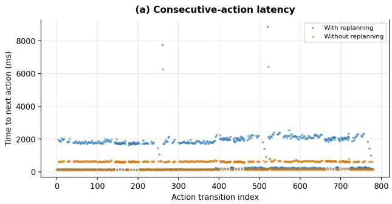

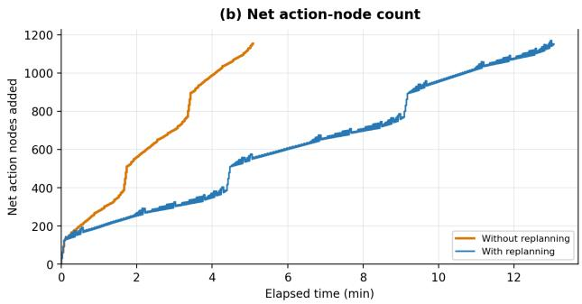  
Figure 17: Execution sensitivity under the two branch-selection policies. (a) Time between consecutive ML actions, with (blue) and without (orange) replanning. (b) Cumulative net action nodes over execution time; upward steps are generated nodes, downward steps are nodes removed during plan replacement (replanning only).

Working with BTs as the target execution model revealed that, while they enable significant modularity, they conflate planning and execution semantics. A sequence node, for instance, encodes both task ordering (a planning concept) and task success criteria (an execution concept) in one construct. This became a problem for modular replanning: replacing one module’s plan often required replacing its entire control-flow node, disrupting the execution flow, since ordering and success criteria could not be changed independently. Likewise, even BT.CPP’s explicit input/output ports do not distinguish a precondition from a plain runtime task property, and since BTs have no native representation for preconditions, efects, or world state, planners must encode these indirectly, e.g., via decorator nodes, which can be modified or removed unintentionally. APTree addresses this by making planning semantics first-class grammar elements, separate from execution semantics, so replanning can target only the task plan rather than restructuring the execution model.

## 8.1. Result Analysis

Symbolic planners reason over planning semantics to generate a plan, but the resulting task plan typically discards this semantic information, breaking the link between a task’s planning-level and execution-level representation. This is particularly problematic when task plans are developed independently and later composed within an execution model, as typing mismatches and logical interactions between separately defined task plans remain undetected. As shown in Table 3, PlanSys2’s two-stage architecture exhibits this limitation, achieving a TPR of 0% for both typing and logical errors, which instead manifest as runtime failures. In contrast, APTree preserves planning semantics through a typed DSL shared by the planning and execution models, enabling structural, syntactic, and typing errors to be detected at design time, and logical errors at runtime.

The runtime detection of logical errors operates through two complementary mechanisms. Half of the injected logical errors are detected and resolved automatically through continuous evaluation of HL-action preconditions and efects against the current world state: the execution policies move execution between execution models, releasing only those actions whose preconditions currently hold, so that multiple task modules progress across branches without waiting for one another. The remaining half are detected through a plan invariant: a completed HL goal must not be undone by another execution model (Invariants 1 and 3, Appendix B). Invariant 1 is a static property of the problem specifications: when it is violated (for example, by initial problem files specifying contradictory goals) no valid plan exists, and APTree deliberately terminates execution. Invariant 3, in contrast, concerns the plans generated at runtime, in particular the ML plans produced by refinement and replanning, and cannot be verified from the initial specifications alone; its violations manifest at execution time as violations of HL goals and lead to replanning or a full stop of BT execution (Appendix B). Invariant 3 concerns interactions among execution models; goal regressions caused by external disturbances are a separate concern of deployment in dynamic environments. In addition, contradictions between ML-level goals cannot corrupt execution, as each ML plan executes atomically (the Lock decorator).

Our findings further demonstrate that separating execution semantics (e.g., success criteria) from the task plan itself enables localized planning and replanning at runtime while preserving the flexibility and scalability of BTs. This separation also allows practitioners to select any PDDL-based symbolic planner without concern for its compatibility with the execution model or the combinatorial explosion associated with monolithic planning, as seen with PlanSys2.

Finally, the case study demonstrates that integrating and autonomously invoking multiple symbolic planners within a single execution model improves modularity and scalability for planning. We attribute this scalability to APTree’s horizontal and hierarchical problem decomposition: each ML sub-plan corresponds to a comparatively small and constrained planning problem, on which satisficing planners such as Metric-FF consistently produce near-optimal solutions. This also puts the observed cumulative planning latencies (up to 89.9% of execution time with LAMA-First) into perspective: planning latency is dominated by planner choice rather than by the framework itself, and since per-invocation latency remains stable across repeated invocations, it can be reduced substantially by selecting faster planners — as our results show, without a loss in plan quality. This suggests that, for hierarchically decomposed task execution models, planner optimality is less critical than planning eficiency.

## 8.2. Application Scope, Limitations and Future Work

APTree is designed for highly flexible, scalable, and multi-faceted robotic pre-assembly task planning. Construction prefabrication was selected as the target domain because it is particularly afected by this challenge, requiring modular, scalable task planning to handle its inherent task heterogeneity and variability [1]. Construction prefabrication is commonly categorized into component sub-assembly, non-volumetric pre-assembly, volumetric pre-assembly, modular construction, hybrid structures, and whole-building prefabrication [62]. The presented case study belongs to the component sub-assembly category, as it considers the robotic fabrication of timber cassettes for on-site assembly.

Although only this category is evaluated, APTree’s modular architecture, planner-agnostic execution model, and extensible DSL are designed to facilitate adaptation to other prefabrication categories with similar modular, long-horizon planning requirements. The DSL separates the framework from domain-specific knowledge through an extensible type system: the timber-specific actions and object types used in this case study are not intrinsic to APTree but represent one domain instantiation of the DSL. Applying APTree to another domain therefore requires defining the corresponding action, object, and predicate types together with their planning semantics via APTree’s DomainTypesDef, after which the planning and execution framework can be reused. In addition, depending on the structure of the target planning problems, new execution policies (e.g., decorators such as fair progress) may need to be developed to coordinate branch execution efectively. Empirically validating such domain transfers, and categorizing planning problems by type to systematically assign execution policies that ensure step-eficient planning, remain future research directions.

While APTree enabled large-scale automated task planning, identifying the appropriate PDDL-based planner and developing its domain were substantial tasks in our case study. Hence, a potential counterargument to our method is the manual efort required to specify input domains for multiple task planning tools, particularly symbolic task planners, which could undermine the framework’s overall benefits. We acknowledge this challenge; however, domain files created for specific types of problems can be saved as libraries and reused for similar problems. Furthermore, current research, such as [63], aims to automate the generation of PDDL domains using AI techniques, including LLMs.

In addition, the evaluation focuses on the novel planning and validation features APTree provides rather than on a thorough runtime performance evaluation. Execution-level metrics such as task completion rate, recovery success, and multi-agent concurrent planning and execution require deployment in a real or simulated robotic environment with real-time task planning and continuous environmental feedback, including external disturbances that may invalidate achieved goals, and are therefore beyond the scope of this study. For the same reason, mid-level tasks are configured to always return Success and all temporal relations are set to Meets; while the method supports action nodes with complex execution logic and temporal planning, evaluating their coordination requires real-time robotic execution. Similarly, the injected errors used to evaluate design-time detection are derived from problems encountered in our case study rather than an exhaustive error taxonomy, and the usability, learnability, and modeling efort of the DSL are best assessed through controlled user studies with construction engineers, which were not conducted here. Future work will extend the evaluation to execution-based scenarios and human-subject studies, and investigate how multiple planners can generate plans concurrently and how this afects the correctness and optimality of the overall plan.

Several aspects of the framework currently require manual configuration. The initial planning problem is manually subdivided into 12 sub-problems, the decorators and services coordinating overall plan execution are hard-coded, and the planner type for each dynamic flow node is assigned by hand. Automating these steps—estimating planning complexity to decompose problems automatically, introducing low-code methods for rapidly defining and systematically comparing alternative execution policies, and selecting planning techniques automatically—constitutes a direction for future research toward a fully self-configuring framework.

Finally, while Appendix B establishes the safety of interleaved partial-order execution, progress guarantees under adversarially constructed overlapping partial orders have not been formally established or systematically evaluated. Investigating such scenarios, together with failure-handling strategies when planning services themselves fail, represents an important direction for strengthening the robustness of execution control.

## 9. Conclusion

APTree enables scalable automated task planning in CRF through a method that applies symbolic planners repeatedly, with a DSL acting as a shared interface between planning and execution, and uses execution models as part of the planning process. In a full-scale prefabrication case study, APTree detected all injected typing and logical errors missed by the baseline, scaled beyond monolithic planning through automatic decomposition, and produced plans matching the expert reference plan. The accompanying formal analysis guarantees the safety of composed execution and local replanning only under explicitly stated assumptions, including planner soundness, non-interference of generated plans, and atomic mid-level execution. APTree thus bridges the gap between AI task planning and CRF domain application.

## Acknowledgment

This research was funded by the Ministry of Science, Research and the Arts Baden-Wuerttemberg through the Artificial Intelligence Software Academy (AISA) and the InnovationCampus Future Mobility, and supported by the Deutsche Forschungsgemeinschaft (DFG, German Research Foundation) under Germany’s Excellence Strategy – EXC 2120/2 – 390831618.

We also thank Dr. Daniel Hernández for his guidance in preparing a precise formal analysis, and the anonymous reviewers, whose constructive feedback significantly improved both this paper and the APTree method.

## Declaration of Generative AI and AI-assisted Technologies in the Writing Process

During the preparation of this work, the authors used Copilot, Gemini, and ChatGPT to proofread and edit the text. After using these tools/services, the authors reviewed and edited the content as needed and take full responsibility for the content of the publication. Additionally, we have used the Cursor AI coding assistant for the implementation of the APTree method.

## References

[1] J. M. Davila Delgado, L. Oyedele, A. Ajayi, L. Akanbi, O. Akinade, M. Bilal, H. Owolabi, Robotics and automated systems in construction: Understanding industry-specific challenges for adoption, Journal of Building Engineering 26 (2019) 100868. doi:10.1016/j.jobe.2019.100868.

[2] C. P. Chea, Y. Bai, X. Pan, M. Arashpour, Y. Xie, An integrated review of automation and robotic technologies for structural prefabrication and construction, Transportation Safety and Environment 2 (2) (2020) 81–96. doi:10.1093/tse/tdaa007.

[3] M. Ghallab, D. S. Nau, P. Traverso, Automated planning and acting, Cambridge University Press, 2016.

[4] F. Rovida, B. Grossmann, V. Kruger, Extended behavior trees for quick definition of flexible robotic tasks, in: 2017 IEEE/RSJ International Conference on Intelligent Robots and Systems (IROS), IEEE, Vancouver, BC, 2017, pp. 6793–6800. doi:10.1109/IROS.2017.8206598.

[5] M. Colledanchise, P. Ögren, Behavior Trees in Robotics and AI, CRC Press, 2018. doi:10.1201/ 9780429489105.

[6] Y. Sakaida, D. Chugo, K. Kawabata, H. Kaetsu, H. Asama, The analysis of excavator operation by skillful operator, in: N. Kano (Ed.), Proceedings of the 23rd International Symposium on Automation and Robotics in Construction, International Association for Automation and Robotics in Construction (IAARC), Tokyo, Japan, 2006, pp. 543–547. doi:10.22260/ISARC2006/0102.

[7] M. Iovino, E. Scukins, J. Styrud, P. Ögren, C. Smith, A survey of Behavior Trees in robotics and AI, Robotics and Autonomous Systems 154 (2022) 104096. doi:10.1016/j.robot.2022.104096.

[8] S. Sherkat, T. Wortmann, A. Wortmann, Two decades of automated AI planning methods in construction and fabrication: a systematic review, ACM Comput. Surv. 57 (11) (Jun. 2025). doi:10.1145/3729529.

[9] M. Iovino, J. Förster, P. Falco, J. Jen Chung, R. Siegwart, C. Smith, Comparison Between Behavior Trees and Finite State Machines, IEEE Transactions on Automation Science and Engineering 22 (2025) 21098–21117. doi:10.1109/TASE.2025.3610090.

[10] B. Combemale, B. H. C. Cheng, R. B. France, J.-M. Jézéquel, B. Rumpe, Globalizing Domain-Specific Languages: International Dagstuhl Seminar, Dagstuhl Castle, Germany, October 5-10, 2014, Revised Papers, 1st Edition, no. 9400 in Lecture Notes in Computer Science, Springer International Publishing, Cham, 2015.

[11] B. Mustafa, M. Majid, The role of metamodeling in systems development, in: Meta-Analysis and Metamodeling, IGI Global, 2023, pp. 2431–2450. doi:10.4018/978-1-7998-9220-5.ch145.

[12] A. Butting, N. Jansen, B. Rumpe, A. Wortmann, Translating grammars to accurate metamodels, in: Proceedings of the 11th ACM SIGPLAN International Conference on Software Language Engineering, ACM, Boston MA USA, 2018, pp. 174–186. doi:10.1145/3276604.3276605.

[13] A. Hevner, S. Chatterjee, Design Science Research in Information Systems, Vol. 22, Springer US, 2010, pp. 9–22. doi:10.1007/978-1-4419-5653-8\_2.

[14] N. Opgenorth, T. Cheng, A. Lauer, L. Skoury, E. Sahin, T. Stark, Y. Tahouni, S. Treml, M. Gobel, L. Kiesewetter, C. Schlopschnat, M. Zorn, X. Yang, F. Amtsberg, H. Wagner, D. Wood, O. SAWODNY, T. Wortmann, A. Menges, Multi-scalar computational fabrication and construction of bio-based building envelopes: The livMatS biomimetic shell, in: Fabricate 2024: Creating Resourceful Futures, UCL Press, 2024, pp. 22–31. doi:10.2307/jj. 11374766.7.

[15] E. Scala, P. Haslum, S. Thiébaux, M. Ramirez, Subgoaling Techniques for Satisficing and Optimal Numeric Planning, Journal of Artificial Intelligence Research 68 (2020) 691–752. doi:10.1613/jair.1.11875.

[16] J. Hofmann, The Metric-FF Planning System: Translating “Ignoring Delete Lists” to Numeric State Variables, Journal of Artificial Intelligence Research 20 (2003) 291–341. doi:10.1613/jair.1144.

[17] S. Richter, M. Westphal, The LAMA Planner: Guiding Cost-Based Anytime Planning with Landmarks, Journal of Artificial Intelligence Research 39 (2010) 127–177. doi:10.1613/jair.2972.

[18] S. J. Russell, P. Norvig, E. Davis, Artificial intelligence: a modern approach, 3rd Edition, Prentice Hall series in artificial intelligence, Prentice Hall, Upper Saddle River, 2010.

[19] N. J. Saam, Modellbildung, in: S. Kühl, P. Strodtholz, A. Tafertshofer (Eds.), Handbuch Methoden der Organisationsforschung: Quantitative und Qualitative Methoden, VS Verlag für Sozialwissenschaften, 2009, pp. 517–532. doi:10.1007/978-3-531-91570-8\_25.

[20] H. Stachowiak, Allgemeine Modelltheorie, Springer, Wien, New York, 1973.

[21] B. Combemale, Engineering modeling languages: turning domain knowledge into tools, Chapman & Hall/CRC innovations in software engineering and software development, CRC Press, Boca Raton, 2017.

[22] M. Ghallab, D. Nau, P. Traverso, Automated Planning: Theory and Practice, Morgan Kaufmann, San Francisco, 2004.

[23] P. Haslum, N. Lipovetzky, D. Magazzeni, C. Muise, An introduction to the planning domain definition language, Synthesis Lectures on Artificial Intelligence and Machine Learning 13 (2019) 1–187. doi:10.2200/ S00900ED2V01Y201902AIM042.

[24] P. Hitzler, M. K. Sarker (Eds.), Neuro-symbolic Artificial Intelligence: The State of the Art, Vol. 342 of Frontiers in Artificial Intelligence and Applications / FAIA, IOS Press, Washington, 2022.

[25] A. Voinov, C. Cerco, Model integration and the role of data, Environmental Modelling & Software 25 (8) (2010) 965–969. doi:10.1016/j.envsoft.2010.02.005.

[26] O. Biggar, I. Shames, A behavior tree-inspired programming language for autonomous agents (2024). doi: 10.48550/arxiv.2412.08654.

[27] A. Schulz-Rosengarten, A. Ahmad, M. Clement, R. von Hanxleden, B. Asch, M. Lohstroh, E. A. Lee, G. Quiros, A. Shukla, Behavior trees with dataflow: Coordinating reactive tasks in lingua franca, in: Proceedings of the 2024 IEEE/ACM 46th International Conference on Software Engineering: Companion Proceedings (ICSE-Companion ’24), 2024. doi:10.1145/3639478.3643093.

[28] R. Ghzouli, T. Berger, E. B. Johnsen, S. Dragule, A. Wasowski, Behavior trees in action: a study of robotics applications, in: Proceedings of the 13th ACM SIGPLAN International Conference on Software Language Engineering, ACM, Virtual USA, 2020, pp. 196–209. doi:10.1145/3426425.3426942.

[29] U. Koeckemann, D. Calisi, G. Gemignani, J. Renoux, A. Safiotti, Planning for automated testing of implicit constraints in behavior trees, Proceedings of the International Conference on Automated Planning and Scheduling 33 (2023) 649 – 658. doi:10.1609/icaps.v33i1.27247.

[30] S. Sherkat, A. Wortmann, T. Wortmann, Potentials of Symbolic AI Planning for Construction, in: Proceedings of 33. Forum Bauinformatik, Munich,Germany, 2022, pp. 309–316. doi:10.14459/2022md1686600.

[31] Y. Wang, Y. Fang, Y. Bai, Task planning for human-robot collaboration in structure assembly, Automation in Construction 179 (2025) 106464. doi:10.1016/j.autcon.2025.106464.

[32] R. Ghzouli, T. Berger, E. B. Johnsen, A. Wasowski, S. Dragule, Behavior trees and state machines in robotics applications, IEEE Transactions on Software Engineering 49 (9) (2023) 4243–4267. doi:10.1109/TSE.2023. 3269081.

[33] K. Murata, S. Hasegawa, T. Ishikawa, Y. Hagiwara, A. Taniguchi, L. El Hafi, T. Taniguchi, Multi-robot task planning for multi-object retrieval tasks with distributed on-site knowledge via large language models, Artificial Life and Robotics 31 (2) (2026) 418–432. doi:10.1007/s10015-026-01123-8.

[34] P. Schillinger, S. Kohlbrecher, O. Von Stryk, Human-robot collaborative high-level control with application to rescue robotics, in: 2016 IEEE International Conference on Robotics and Automation (ICRA), IEEE, 2016, pp. 2796–2802. doi:10.1109/ICRA.2016.7487442.

[35] H. Su, X. Zhao, F. Li, Z. Guo, Y. Wu, Y. Wang, Structural Segmentation and Large Language Model Make Behavior Tree More Explainable, in: 2023 2nd International Conference on Artificial Intelligence, Human-Computer Interaction and Robotics (AIHCIR), IEEE, Tianjin, China, 2023, pp. 305–310. doi:10.1109/ AIHCIR61661.2023.00056.

[36] A. Marzinotto, M. Colledanchise, C. Smith, P. Ogren, Towards a unified behavior trees framework for robot control, in: 2014 IEEE International Conference on Robotics and Automation (ICRA), IEEE, Hong Kong, China, 2014, pp. 5420–5427. doi:10.1109/ICRA.2014.6907656.

[37] S. S. Serbinowska, P. Robinette, G. Karsai, T. T. Johnson, Formalizing stateful behavior trees (2023). doi: 10.4204/EPTCS.411.14.

[38] C. Paxton, N. Ratlif, C. Eppner, D. Fox, Representing Robot Task Plans as Robust Logical-Dynamical Systems, in: 2019 IEEE/RSJ International Conference on Intelligent Robots and Systems (IROS), IEEE, Macau, China, 2019, pp. 5588–5595. doi:10.1109/IROS40897.2019.8967861.

[39] M. Cashmore, M. Fox, D. Long, D. Magazzeni, B. Ridder, A. Carrera, N. Palomeras, N. Hurtos, M. Carreras, ROSPlan: Planning in the robot operating system, Proceedings of the International Conference on Automated Planning and Scheduling 25 (2015) 333–341. doi:10.1609/icaps.v25i1.13699.

[40] B. Ridge, T. Gaspar, A. Ude, Rapid state machine assembly for modular robot control using meta-scripting, templating and code generation, in: 2017 IEEE-RAS 17th International Conference on Humanoid Robotics (Humanoids), IEEE, 2017, pp. 661–668. doi:10.1109/HUMANOIDS.2017.8246943.

[41] H. Kress-Gazit, M. Lahijanian, V. Raman, Synthesis for robots: Guarantees and feedback for robot behavior, Annual Review of Control, Robotics, and Autonomous Systems 1 (2018). doi:10.1146/ annurev-control-060117-104838.

[42] F. Bertoncelli, L. Sabattini, Streamlining object pushing: Behavior tree-based coordination of control and planning, in: 2024 IEEE/RSJ International Conference on Intelligent Robots and Systems (IROS), 2024, pp. 5203 – 5210. doi:10.1109/iros58592.2024.10802817.

[43] J. Cloete, W. Merkt, I. Havoutis, Adaptive Manipulation using Behavior Trees, in: 2025 IEEE/RSJ International Conference on Intelligent Robots and Systems (IROS), IEEE, Hangzhou, China, 2025, pp. 19031–19038. doi:10.1109/IROS60139.2025.11245892.

[44] X. Neufeld, S. Mostaghim, S. Brand, A hybrid approach to planning and execution in dynamic environments through hierarchical task networks and behavior trees, Proceedings of the AAAI Conference on Artificia Intelligence and Interactive Digital Entertainment 14 (2018) 201–207. doi:10.1609/aiide.v14i1.13044.

[45] F. Martín, J. Ginés, V. Matellán, F. J. Rodríguez, PlanSys2: A planning system framework for ROS2 (2021). doi:10.48550/ARXIV.2107.00376.

[46] M. Colledanchise, D. Almeida, P. Ogren, Towards Blended Reactive Planning and Acting using Behavior Trees, in: 2019 International Conference on Robotics and Automation (ICRA), IEEE, Montreal, QC, Canada, 2019, pp. 8839–8845. doi:10.1109/ICRA.2019.8794128.

[47] T. Tadewos, L. Shamgah, A. Karimoddini, On-the-fly decentralized tasking of autonomous vehicles, in: 2019 IEEE 58th Conference on Decision and Control (CDC), 2019, pp. 2770–2775. doi:10.1109/CDC40024.2019. 9029554.

[48] N. Li, H. Jiang, C. Li, Z. Wang, Towards adaptive behavior trees for robot task planning, in: 2022 China Automation Congress (CAC), 2022, pp. 6720–6725. doi:10.1109/CAC57257.2022.10055567.

[49] J. Liang, Y. Chang, Q. Wang, Y. Wang, X. Yi, DiaGBT: An explainable and evolvable robot control framework using dialogue generative behavior trees, in: 2024 IEEE/RSJ International Conference on Intelligent Robots and Systems (IROS), 2024, pp. 7056–7062. doi:10.1109/iros58592.2024.10801472.

[50] R. A. Izzo, G. Bardaro, M. Matteucci, BTGenBot: Behavior Tree Generation for Robotic Tasks with Lightweight LLMs, in: 2024 IEEE/RSJ International Conference on Intelligent Robots and Systems (IROS), IEEE, Abu Dhabi, United Arab Emirates, 2024, pp. 9684–9690. doi:10.1109/IROS58592.2024.10802304.

[51] Y. Chao, C. G. Lee, Behavior-tree embeddings for robot task-level knowledge, IEEE/RSJ International Conference on Intelligent Robots and Systems (2022) 12074 – 12080doi:10.1109/IROS47612.2022.9981774.

[52] M. Iovino, J. Styrud, P. Falco, C. Smith, A framework for learning behavior trees in collaborative robotic applications, in: 2023 IEEE 19th International Conference on Automation Science and Engineering (CASE), 2023. doi:10.1109/case56687.2023.10260363.

[53] G. Florez-Puga, M. Gomez-Martin, B. Díaz Agudo, Dynamic expansion of behaviour trees, Proceedings of the AAAI Conference on Artificial Intelligence and Interactive Digital Entertainment 4 (2008) 36–41. doi: 10.1609/aiide.v4i1.18669.

[54] G. Florez-Puga, M. Gomez-Martin, P. Gomez-Martin, B. Diaz Agudo, Query-enabled behavior trees, IEEE Transactions on Computational Intelligence and AI in Games 1 (2010) 298 – 308. doi:10.1109/TCIAIG.2009. 2036369.

[55] K. Y. W. Scheper, S. Tijmons, C. C. de Visser, G. C. H. E. de Croon, Behavior trees for evolutionary robotics, Artificial Life 22 (1) (2016). doi:10.1162/ARTL\_a\_00192.

[56] V. R. Basili, D. M. Weiss, A Methodology for Collecting Valid Software Engineering Data, IEEE Transactions on Software Engineering SE-10 (6) (1984) 728–738. doi:10.1109/TSE.1984.5010301.

[57] S. Gugliermo, D. Cáceres Domínguez, M. Iannotta, T. Stoyanov, E. Schafernicht, Evaluating behavior trees, Robotics and Autonomous Systems 178 (2024) 104714. doi:https://doi.org/10.1016/j.robot.2024. 104714.

[58] T. Janhunen, M. Sioutis, Allen’s Interval Algebra Makes the Diference, in: P. Hofstedt, S. Abreu, U. John, H. Kuchen, D. Seipel (Eds.), Declarative Programming and Knowledge Management, Vol. 12057, Springer International Publishing, Cham, 2020, pp. 89–98. doi:10.1007/978-3-030-46714-2\_6.

[59] P. Eyerich, R. Mattmüller, G. Röger, Using the context-enhanced additive heuristic for temporal and numeric planning, Proceedings of the International Conference on Automated Planning and Scheduling 19 (2009) 130–137. doi:10.1609/icaps.v19i1.13373.

[60] C. Muise, F. Pommerening, J. Seipp, M. Katz, Planutils: Bringing planning to the masses, in: ICAPS 2022 System Demonstrations, 2022.

[61] L. Skoury, T. Wortmann, livMatS biomimetic shell fabrication tasks (1 2024). doi:10.18419/DARUS-3648.

[62] V. Tavares, C. S. C. Calheiros, I. B. Martins, J. Maia, K. Tsikaloudaki, M. Fonseca, M. Marchesi, M. Laban, N. Soares, P. Santos, R. Pineda-Martos, V. Rajciˇ c, V. Ungureanu, Modularity and prefabrication, in: L. Bragança,´ P. Grifiths, R. Askar, A. Salles, V. Ungureanu, K. Tsikaloudaki, D. Bajare, G. Zsembinszki, M. Cvetkovska (Eds.), Circular Economy Design and Management in the Built Environment, Springer Nature Switzerland, 2025, pp. 215–256. doi:10.1007/978-3-031-73490-8\_8.

[63] V. Strobel, A. Kirsch, MyPDDL: Tools for Eficiently Creating PDDL Domains and Problems, in: M. Vallati, D. Kitchin (Eds.), Knowledge Engineering Tools and Techniques for AI Planning, Springer International Publishing, Cham, 2020, pp. 67–90. doi:10.1007/978-3-030-38561-3\_4.

## Appendix A. Additional Material

This appendix provides the models referenced in Section 7, including the intentionally invalid models for APTree (Listing 15) and BT.CPP (Listing 16), with the injected errors identified by their error IDs from Table 3. These models serve to evaluate design-time error detection where applicable to each framework; errors classified as NA or PD for a framework, as well as logical errors that manifest only at runtime, are not represented in the corresponding models.

• EID1: The planning service references a non-existing planner configuration.

• EID2: The planning domain file is not specified.

• EID3: The FF planner is used with a planning domain containing unsupported language (PDDL 2.1).

• EID4: An action node in the BT has child nodes. Only control flow nodes may have children.

• EID5: The action sequence in the execution model does not match the symbolic plan.

• EID6: The object lp24 (lowerplate24) does not exist because only 12 lower plates are defined in the planning setup model.

• EID7: The action type Initialize is used but not defined in the execution model.

• EID8: The parameter rp is assigned the type Rail, which is not defined for the execution model.

• EID9: The Travel action in the execution model expects three parameters, whereas the generated symbolic plan provided four.

• EID10: An action in the execution model expects a parameter of type robot, but an argument of type human is provided.

• EID11: A required curly bracket is missing in the APTree model, and a required closing tag is missing in the BT.CPP model.

• EID12: The order of keywords for the root and behavior tree is swapped for both models.

• EID13: Swapping keywords in EID12 also causes an unexpected token error.

• EID14: The required All keyword in APTree and main\_tree\_to\_execute in BT.CPP are missing.

Listing 15: APTree model containing the injected errors (EIDs) used for evaluation Section 7.  
Root APTree3 { // EID12 // EID13   
3 BehaviorTree FlowNode Main {   
4 // EID14   
5 AllFlow   
6 NodeGraph {   
7 Action PickupSequence { // EID4   
8 ServicePlanning MyPlannerSrv1 Enhsp Problem:problempickupHL Config: "pt-blind" // EID1 // EID2   
9 All   
10 AllAction   
11 NodeGraph {   
12   
13 Action EquipeML EquipVg1 (r1 vg1 ep1) { // EID5   
14 --[Meets]--> InitVg1;   
15 }   
16 Action TravelML TravelToEp1 (r1 pr2 ep1 fp1) { // EID9   
17 --[Meets]--> EquipVg1;   
18 }   
19 Action Initialize InitVg1 (r1 vg1) { // EID7   
20 --[Meets]--> TravelToFp9;   
28 }   
Action TravelML TravelToFp9 (human ep1 fp9) { // EID10   
--[Meets]--> PickupLp2;   
  
Action PickUpML PickupLp2 (lp24 rp r1 vg1) // EID8 //EID6   
}   
}   
FlowNode PlaceSequence {   
ServicePlanning MyPlannerSrv1 FF Domain:PickAndPlaceHL Problem:problemPlace // EID3   
All   
AllAction   
NodeGraph {   
}   
// EID11   
<sup>37</sup> <sub>38</sub> }   
39 }

Listing 16: BT.CPP XML model containing the injected errors (EIDs) used for evaluation Section 7.

<BehaviorTree ID="MainTree"> <!-- EID12 -->   
<root BTCPP\_format="4"> <!-- EID13 --> <!-- EID14 -->   
<Parallel success\_count="2" failure\_count="1" name="(travelml r1 pr2 ep1):1"> <!-- EID5 -->   
<Sequence name="(travelml r1 pr2 ep1 fp9):1"> <!-- EID9 -->   
<WaitAtStartReq action="(travelml r1 pr2 ep1):1"/>   
<ApplyAtStartEffect action="(travelml r1 pr2 ep1):1"/>   
<ReactiveSequence name="(travelml r1 pr2 ep1):1">   
<CheckOverAllReq action="(travelml r1 pr2 ep1):1"/>

```xml
10 A "( 1 2 1) 1"/
11 </ReactiveSequence>
12 <CheckAtEndReq action="(travelml r1 pr2 ep1):1"/>
13 <ApplyAtEndEffect action="(travelml r1 pr2 ep1):1"/>
14 </Sequence>
15 <Sequence name="(equipeml r1 vg1 ep1):5011">
16 <Sequence name="(equipeml r1 vg1 ep1):5011">
17 <WaitAction action="(travelml r1 pr2 ep1):1"/>
18 <WaitAtStartReq action="(equipeml r1 vg1 ep1):5011"/>
19 <ApplyAtStartEffect action="(equipeml r1 vg1 ep1):5011"/>
20 <ReactiveSequence name="(equipeml r1 vg1 ep1):5011">
21 <CheckOverAllReq action="(equipeml r1 vg1 ep1):5011"/>
22 <ExecuteAction action="(equipeml r1 vg1 ep1):5011"/>
23 </ReactiveSequence>
24 <CheckAtEndReq action="(equipeml r1 vg1 ep1):5011"/>
25 <ApplyAtEndEffect action="(equipeml r1 vg1 ep1):5011"/>
26 </Sequence>
27 <Parallel success_count="2" failure_count="1">
28 <Sequence name="(initialize r1 vg1):7021"> <!-- EID7 -->
29 <Sequence name="(initializeml r1 vg1):7021">
30 <WaitAction action="(equipeml r1 vg1 ep1):5011"/>
31 <WaitAtStartReq action="(initializeml r1 vg1):7021"/>
32 <ApplyAtStartEffect action="(initializeml r1 vg1):7021"/>
33 <ReactiveSequence name="(initializeml r1 vg1):7021">
34 <CheckOverAllReq action="(initializeml r1 vg1):7021"/>
35 <ExecuteAction action="(initializeml r1 vg1):7021"/>
36 </ReactiveSequence>
37 <CheckAtEndReq action="(initializeml r1 vg1):7021"/>
38 <ApplyAtEndEffect action="(initializeml r1 vg1):7021"/>
39 </Sequence>
40 <Sequence name="(pickupml lp24 rp r1 vg1):12032"> <!-- EID6 --> <!-- EID8 -->
41 <WaitAction action="(initializeml r1 vg1):7021"/>
42 <WaitAction action="(travelml r1 ep1 fp9):7022"/>
43 <WaitAtStartReq action="(pickupml lp24 rp r1 vg1):12032"/>
44 <ApplyAtStartEffect action="(pickupml lp24 rp r1 vg1):12032"/>
45 <ReactiveSequence name="(pickupml lp24 rp r1 vg1):12032">
46 <CheckOverAllReq action="(pickupml lp24 rp r1 vg1):12032"/>
47 <ExecuteAction action="(pickupml lp24 rp r1 vg1):12032"/>
48 </ReactiveSequence>
49 <CheckAtEndReq action="(pickupml lp24 rp r1 vg1):12032"/>
50 <ApplyAtEndEffect action="(pickupml lp24 rp r1 vg1):12032"/>
51 </Sequence>
52 </Sequence>
53 <Sequence name="(travelml human ep1 fp9):7022"> <!-- EID10 -->
54 <WaitAction action="(equipeml r1 vg1 ep1):5011"/>
55 <WaitAtStartReq action="(travelml human ep1 fp9):7022"/>
56 <ApplyAtStartEffect action="(travelml human ep1 fp9):7022"/>
57 <ExecuteAction name="(travelml human ep1 fp9):7022"> <!-- EID4 -->
58 <CheckOverAllReq action="(travelml human ep1 fp9):7022"/>
59 <ExecuteAction action="(travelml human ep1 fp9):7022"/>
60 </ExecuteAction>
61 <CheckAtEndReq action="(travelml human ep1 fp9):7022"/>
62 <ApplyAtEndEffect action="(travelml human ep1 fp9):7022"/>
63 </Sequence>
64 </Parallel>
65 </Sequence>
66 {/Parallel> <!-- EID11 -->
67 </root>
68 </BehaviorTree>
```

## Appendix B. Formal Correctness Analysis

This section provides formal proofs and invariants establishing plan correctness and composability of APTree under (i) dynamic node insertion, (ii) replanning, and (iii) partially ordered interleaved execution.

Preliminaries. A planning domain is a pair $\mathcal { D } = \left. \mathcal { P } , \mathcal { A } \right. ( \mathcal { P } ;$ fluents, A: actions with pre(a), ef(a)) [22]. Each dynamic flow node (DFN) is associated with a domain of one of two kinds: a high-level domain $\mathcal { D } _ { H L }$ , used for high-level planning, or a mid-level domain $\mathcal { D } _ { M L }$ , used for subtrees generated by decomposition or replanning, where each $\mathcal { D } _ { M L }$ refines its corresponding $\mathcal { D } _ { H L }$ into finer-grained actions and fluents. For any DFN, its associated planning problem is $\Pi = \langle \mathcal { D } , s _ { 0 } , g \rangle$ , pairing its domain with an initial state $s _ { 0 } \subseteq { \mathcal { S } }$ and a goal g. High-level planning problems are instantiated from the user-provided initial problem specifications; mid-level planning problems are instantiated lazily, taking as their initial state the world state at the time of refinement or replanning. Node results at a given tick result( $\phantom { } _ { l , \mathcal { T } _ { k } } )$ follow our definitions (BTNodeResult) in Section 5.1. We write ef(a) as a pair of an add-list and a delete-list: an efect p makes fluent $p$ true and an efect $\neg p$ makes it false. Where an efect set is used as a goal, it denotes the conjunction of its add-list literals and the negations of its delete-list literals. Throughout this appendix, DFNs are assumed to use the All success criterion (Section 5.4); under partial-success criteria (Any, Count, Percentage) a DFN may report

Success without its planning goal holding, and the results below do not apply. Let $s$ denote a symbolic planner, i.e. a procedure that, given a planning problem $\Pi = \langle \mathcal { D } , s _ { 0 } , g \rangle$ , either returns a plan π (a finite sequence of actions from A) or reports failure if no plan is found.

Definition 2 (Goal interference). Two goals $g _ { i } , g _ { j }$ interfere, written g $\bowtie g _ { j } , i f f \exists p \in { \mathcal { P } } : p \in g _ { i } \land \lnot p \in g _ { j } ,$ or vice versa. A plan $\pi _ { j }$ interferes with a goal $g _ { i }$ if some action $a \in \pi _ { j }$ has an efect ¬p with $p \in g _ { i } ,$ or an efect p with $\lnot p \in g _ { i }$

Appendix B.1. Correctness under dynamic node insertion

APTree does not insert nodes at arbitrary positions. Every generated node is introduced either as part of the initial decomposition of a planning problem into independent high-level planning subproblems or as part of the vertical refinement of a high-level action into an ML subtree. We show that both preserve correctness.

Assumption 1 (Planner soundness). All symbolic planners employed by APTree are assumed to be sound. That is, for every planning problem $\Pi = \langle \mathcal { D } , s _ { 0 } , g \rangle$ , ifS(Π) returns a plan π, then π is applicablefrom s and reaches a state satisfying g.

Invariant 1 (Initial non-interference). Let $n _ { 1 } , \ldots , n _ { k }$ denote the initial DFNs that decompose the overall planning task into high-level planning subproblems with goals $g _ { 1 } , \ldots , g _ { k }$ . Then,for all $i \neq j \colon ( I ) \lnot ( g _ { i } \bowtie g _ { j } )$ , and $( 2 )$ no plan generatedfor subproblem j interferes with goal g (Definition 2). That $i s ,$ neither the goals of the initial high-level subproblems nor the efects oftheir plans undo one another’s goals.

Invariant 2 (Goal inheritance). Let F<sub>i</sub> be the DFN generated to refine high-level action $a _ { i } ,$ rooting ML subtree $T _ { i \cdot }$ Then goa $\begin{array} { r } { \mathsf { l } ( F _ { i } ) = \mathsf { e f f } ( a _ { i } ) , i . e . , F _ { i } } \end{array}$ inherits the efects ofthe high-level action it refines.

Invariant 1 constrains only the high-level plans. The ML subtrees, however, contain finer-grained actions of $\mathcal { D } _ { M L }$ that no high-level plan mentions, and whose efects Invariant 1 therefore does not constrain. Goal persistence of the high-level subgoals and of the efects already realized by completed ML subtrees requires the analogous condition at the mid-level:

Invariant 3 (ML non-interference). For every ML subtree T generated during execution, the plan of T does not interfere (Definition 2) with (1) any subgoal g ofthe initial decomposition, nor $( 2 )$ the inherited goal ofany distinct ML subtree whose execution completes before that of T; i.e., no action of T has an efect thatfalsifies a literal of a high-level subgoal or of an already-achieved inherited goal. This invariant is a condition on the plans generated at runtime.

Theorem 1 (Refinement soundness). Let the initial DFNs define high-level planning subproblems with goals $g _ { 1 } , \ldots , g _ { k }$ satisfying Invariant 1, each solved by a sound HL planner (Assumption 1). Let every high-level action $a _ { i }$ produced by these planners be refined into an ML subtree $T _ { i }$ according to Invariant $^ { 2 , }$ where each $T _ { i }$ is generated by a sound ML plannerfrom the world state current at its refinement, and let the resulting ML subtrees satisfy Invariant 3. Then any execution of the ML subtrees, each executed atomically (Invariant 7) and in an order consistent with the high-level plans, is applicable and reaches a state satisfying the overall high-level goal $g _ { 1 } \wedge \ldots \wedge g _ { k }$

Proof. By Invariant 2, each ML subtree $T _ { i }$ inherits ef(a ), the efects of the high-level action it refines, as its goal. Since each $T _ { i }$ is generated by a sound ML planner (Assumption 1) from the world state current at its refinement, its plan is applicable from that state and reaches a state satisfying $\operatorname { e f f } ( a _ { i } )$ ; applied inductively along the execution order, this makes the entire schedule applicable and each subtree achieve its inherited goal at the point where it completes. An inherited goal, once achieved, persists: it could only be falsified by a subsequently executed action; every such action belongs to an ML subtree that completes after $T _ { i } ,$ and by clause (2) of Invariant 3 none of its efects falsifies a literal of $\operatorname { e f f } ( a _ { i } )$ . Hence the final state satisfies ef $\operatorname { f } ( a _ { i } )$ for every refined high-level action $a _ { i } .$ It remains to derive the high-level subgoals. Let l be a literal of subgoal $g _ { j }$ and $\pi _ { j }$ the high-level plan solving subproblem $j .$ If some action $a _ { i } \in \pi _ { j }$ establishes l, then $l \in \mathrm { e f f } ( a _ { i } )$ , and by the above l holds in the final state. Otherwise the sound plan $\pi _ { j }$ reaches $g _ { j }$ although none of its actions establishes $l ,$ so l already holds in the initial state; since every change to the world state is efected by an action of some ML subtree and, by clause (1) of Invariant 3, no such action falsifies the literal l of $g _ { j } , l$ holds throughout the execution. In both cases every literal of every $g _ { j }$ holds in the final state, which therefore satisfies $g _ { 1 } \wedge \ldots \wedge g _ { k } ,$ , the overall high-level goal. □

Appendix B.2. Correctness under local replanning

APTree preserves correctness under local replanning by ensuring that replanning is performed only from a quiescent execution state while preserving the original planning goal. The following definitions and invariants formalize these conditions and show that replacing an obsolete subtree with a newly planned subtree preserves correctness.

Invariant 4 (Goal immutability). Let $F _ { i }$ be the DFN rooting mid-level subtree $T _ { i \cdot }$ . Once assigned at $F _ { i }$ ’s creation (Invariant 2), $\operatorname { g o a l } ( F _ { i } )$ remains unchangedfor the lifetime of $T _ { i } .$ The initial state ofthe associated planning problem may change as execution progresses, requiring replanningfrom the current state while preserving the original goal.

Definition 3 (Quiescent execution). The execution is quiescent at tick $\mathcal { T } _ { k }$ if no action node is executing, $i . e .$

$$
\mathrm { Q u i e s c e n t } ( { \mathcal T } _ { k } ) \iff \forall T _ { i } , \ \forall n \in \mathrm { a c t i o n s } ( T _ { i } ) : \ \mathrm { r e s u l t } ( n , \mathcal T _ { k } ) \neq I n P r o g r e s s ,
$$

where actions $( T _ { i } )$ denotes the action nodes of $\cdot _ { T _ { i } . }$ Flow nodes are not constrained: a DFN whose status has been reset to InProgress to trigger replanning does not violate quiescence, sinceflow-nodes do not change the world state.

Definition 4 (Replan operation). Let $F _ { i }$ be a DFN with active children $C _ { i } ^ { \mathrm { a c t i v e } } ;$ , and let execution be quiescent (Definition 3). The operation Replan(F<sub>i</sub>):

1. archives all completed children;

2. removes all unexecuted active children (and any descendant subtrees);

3. generates a new plan from the current world state while preserving goal $F _ { i } )$ (Invariant $^ { 4 ) , }$ and attaches the resulting nodes as the new active children.

Archived children are retainedfor execution history and are never re-ticked.

Invariant 5 (Status excludes archived nodes). At every tick $\mathcal { T } _ { k } ,$ the node result of a DFN $F _ { i }$ is determined solely by its active children $C _ { i } ^ { \mathrm { a c t i v e } }$ . Archived children $C _ { i } ^ { \mathrm { a r c h i v e d } }$ never contribute to status evaluation, although their efects remain reflected in the world state.

Theorem 2 (Correctness under local replanning). Given planner soundness (Assumption $I ) ,$ quiescent execution (Definition 3), goal immutability (Invariant 4), and the replan operation (Definition 4), any local replanning event preserves correctness of the afected DFN. Moreover, the event is local: provided the newly generated plan satisfies Invariant 3, every already-achieved subgoal ofa distinct subproblem remains satisfied.

Proof. Let Replan $F _ { i } )$ occur at tick $\mathcal { T } _ { k }$ . Since execution is quiescent, no action node is executing; hence the current world state $s _ { k }$ contains no partially applied efects and can serve as the initial state of the new planning problem. By Invariant $^ { 4 , }$ replanning preserves the original goal $\operatorname { g o a l } ( F _ { i } )$ . The replan operation replaces only the unexecuted active nodes of $F _ { i }$ and does not re-tick archived nodes, whose efects remain reflected in the world state (Invariant 5). By planner soundness, the newly generated subtree is applicable from $s _ { k }$ and reaches goal $( F _ { i } )$ . Therefore, replacing the obsolete unexecuted subtree by the newly planned subtree preserves the correctness of $F _ { i } .$ For locality, let $g _ { j }$ be a subgoal of a distinct subproblem already satisfied in $s _ { k }$ . The new plan is generated during execution, so Invariant 3 applies to it: none of its actions has an efect that falsifies a literal of a HL $g _ { j }$ . Hence $g _ { j }$ remains satisfied throughout the execution of the new subtree, and the replanning event afects no subgoal outside $F _ { i }$ . Since each replanning event satisfies the same conditions from the then-current state, any sequence of such events preserves correctness. □

Appendix B.3. Logical composability under partial-order execution

APTree supports the concurrent ticking of sibling DFNs corresponding to independent high-level planning subproblems. Although multiple branches may be ticked concurrently, execution is performed by a single agent, yielding an interleaved execution. We therefore show that the scheduling policy preserves the logical correctness of the sound partial-order plan.

Invariant 6 (HL plan immutability). Let $\pi _ { H L }$ (or equivalently the partial-order plan $\langle \mathcal { R } ^ { \prime } , < \rangle )$ denote the high-level plan generated at system initialization. Throughout the execution considered in this work, this plan remains unchanged. Consequently, Replan (Definition 4) is applied only to DFNs refining ML subtrees and is never invoked on the HL plan.

Invariant 7 (ML non-preemption). Once a DFN F<sub>i</sub> begins executing the active children of its mid-level subtree T<sub>i</sub>, execution continues until F reaches either Success or Failure. Although sibling DFNs may be ticked concurrently, no sibling DFN executes during this interval; ML subtrees therefore execute atomically.

Invariant 8 (Precondition-guarded execution). A HL action in a partial-order plan becomes eligiblefor execution only when all ofits preconditions are satisfied in the current world state, regardless ofwhether it is unordered with respect to sibling actions

Invariant 9 (Predecessor completion). A node with predecessors becomes eligiblefor execution only after the ordering relations connecting it to those predecessors (e.g., Meets, Precedes annotating the edges of the NodeGraph) are satisfied, i.e., only after all ofits ≺-predecessors have completed. This is the behavior implemented by the canExecute operation (Section 5.4), which releases a node only if it has not already completed and all temporal relations to its predecessors are satisfied. A node that has completed successfully is re-released only by its own decorator (e.g., Retry); the executions considered in this analysis contain no decorators that re-release succeeded HL action nodes.

Theorem 3 (Logical correctness under partial-order execution). Given planner soundness (Assumption 1), Invariants 6, 7, 8, and 9, and ML non-interference (Invariant 3), any execution ofsibling DFNs that completes achieves the goals of the high-level plan.

Proof. The high-level plan consists of one sequential plan per independent subproblem, each sound by Assumption 1; the partial order ≺ chains the actions within each subproblem, while actions of distinct subproblems are mutually unordered. By Invariant 9, an action can execute only after all of its ≺-predecessors have completed and no completed action is re-released; hence every executed schedule is a valid linearization of ⟨A<sup>′</sup> ≺⟩, executing each subproblem’s actions in plan order. Invariant 8 additionally ensures that an action, even when unordered with respect to sibling actions, is released only when its preconditions hold in the current world state. By Invariant 7, the ML subtrees refining the released actions execute atomically, so the overall execution is an interleaving of the branches at subtree granularity; by Invariant 6, replanning is confined to mid-level subtrees and never modifies the high-level plan. Correctness of this interleaved execution then follows as in Theorem 1: each ML subtree is generated lazily by a sound planner from the current world state and achieves its inherited goal, Theorem 2 covers local replanning within a branch, and ML non-interference (Invariant 3) guarantees that each subgoal, once achieved, persists across subsequently executed subtrees of other branches. Hence the final state of any completed execution satisfies g ∧ ∧ g , the overall high-level goal. This is a safety guarantee; we do not claim that execution always makes progress, i.e., that some executable action is always available until all goals are reached, and establishing such progress guarantees is future work. □

## Appendix B.4. Enforcement ofthe assumptions and invariants

The assumption and invariants above difer in how they are ensured. Framework-enforced: goal inheritance and goal immutability (Invariants 2 and 4) hold by construction, since the planning service always generates the ML problem file with the efects of the refined HL action as its goal; status exclusion (Invariant 5) is implemented by the success-criteria evaluation of DFNs; ML non-preemption (Invariant 7) by the Lock decorator, which is attached automatically to every ML subtree; and precondition-guarded execution and predecessor completion (Invariants 8 and 9) by the onEnter and canExecute operations. Quiescent replanning (Definition 3) follows from ML non-preemption, as replanning is triggered only after the locked ML subtree has completed or failed.

User configuration, checkable before execution: the All success criterion, HL plan immutability (Invariant 6), and the absence of decorators that re-release completed HL actions are properties of the input model and the selected execution policies. Initial non-interference (Invariant 1) is the user’s responsibility when decomposing the planning problem; it can be checked statically from the initial problem files (clause 1) and from the HL plans generated before execution starts (clause 2). External assumption: planner soundness (Assumption 1) is a property of the selected planners; APTree validates generated plans structurally and by type and checks action preconditions at runtime, but does not verify planner soundness. Runtime invariant: ML non-interference (Invariant 3) concerns plans generated during execution and therefore cannot be checked statically. APTree detects its violations at runtime, when an achieved HL goal is falsified, and halts execution (error 16 in Table 3).

## Appendix C. Replicability and Data Availability

All artifacts required to reproduce the listings, tables, and results are permanently archived in the University of Stuttgart’s DaRUS repository at https://doi.org/10.18419/DARUS-6522, where the two evaluated configurations are archived as v1.0 (without replanning) and v2.0 (with replanning). A development version is maintained at https://github.com/shshermin/APTree-automated-planning-tree, where the corresponding branches are:

Version-1-withoutreplanning-scaled-up and

version-2-withreplanning-scaled-up.

The artifact comprises three main components: APTreeDSL/, APTreeExecutionEngine/, and Lean/. Reproduction instructions are provided in their README files.

DSL and models. The DSL implementation, grammars from Section 5, DSL functions, and example behavior trees are provided in APTreeDSL/. The livMatS input and generated models are located at APTreeDSL/ src/test/resources/valid/behavior\_trees/APTreeLiveMat.bt and APTreeDSL/src/test/resources/ valid/behavior\_trees/APTreeLiveMatFinal.bt, respectively. Valid and intentionally invalid models used in Section 7 are available under APTreeDSL/src/test/resources/valid/ and APTreeDSL/src/test/resources/ invalid/. The PlanSys2 tests used for the comparison models are available at https://github.com/shshermin/ Plansys2\_Comparison.

Execution and evaluation. The execution and logging infrastructure is provided in APTreeExecutionEngine/. Its source code and entry point are located at APTreeExecutionEngine/src/ and APTreeExecutionEngine/src/ Program.cs. Generated logs and summaries are written to APTreeExecutionEngine/WrittenLogs/, while the logs used in the paper are retained in APTreeExecutionEngine/keptlogs/.

Formal verification. The machine-checked Lean 4 formalization and instructions for reproducing the proofs are provided in Lean/.