# AesCode: Aesthetic Code Generation with Decoupled Cross-Modal Rewards

Xin Gao<sup>2,∗</sup> Yifan Yang<sup>1,†</sup> Xin Li<sup>3</sup> Pan Wang<sup>4</sup> Yan Li<sup>5</sup> Muzhao Tian<sup>6</sup> Mingxi Cheng<sup>1</sup> Bei Liu<sup>1</sup> Kai Qiu<sup>1</sup> Qi Dai<sup>1</sup> Dong Chen<sup>1</sup> Yue Dong<sup>1</sup> Leandros Tassiulas<sup>2,†</sup> Rex Ying<sup>2,†</sup> Ji Li<sup>1</sup> Chong Luo<sup>1</sup>

<sup>1</sup> Microsoft <sup>2</sup> Yale University <sup>3</sup> Nanyang Technological University <sup>4</sup> University of Pittsburgh <sup>5</sup> Shanghai Jiao Tong University <sup>6</sup> Fudan University

Generating information-rich visual artifacts such as slides, posters, and dashboards as code is appealing because the outputs are structured, editable, and verifiable. Yet code models cannot see how their choices of layout and color come together on the canvas, often limiting spatial planning and aesthetic quality. Image generators excel at visual design but can misrender requested content, making their outputs unreliable targets for direct reproduction. We therefore introduce AesCode, which generates code grounded in the content prompt while using an image generated from the same prompt as an aesthetic guidance. To do so, AesCode represents the target as a design graph that describes the whole canvas and makes each property attributable. From this graph, we derive complementary cross-modal rewards: deterministic verifiers score properties parsable from code and rendering, while a VLM judge assesses the non-parsable ones with a sample-specific Visual Graph Rubric (VGR) tied to graph elements and relations. We optimize these decoupled rewards through reinforcement learning with per-channel normalization to jointly improve spatial planning, aesthetic quality, and verifiable correctness. To evaluate this setting, we build a benchmark that scores verifiable correctness and visual quality separately, with visual scores highly consistent with human judgments. We find that reference images substantially improve the visual quality of code generated by existing models, and ablations show that AesCode benefits from references both as model input and as a source of visual rewards. Relative to same-scale Qwen3-VL baselines given the same references, AesCode-8B and AesCode-32B improve visual quality by 31.1 and 22.4 percentage points, reaching scores comparable to those of closed-source frontier models such as GPT-5.5 and Claude Opus 4.8.

Project Page: https://microsoft.github.io/AesCode/ Correspondence: yifanyang@microsoft.com, {leandros.tassiulas, rex.ying}@yale.edu

<sup>†</sup> Corresponding authors. <sup>∗</sup> Work was done during an internship at Microsoft Research Asia.

## 1 Introduction

Information-rich visual artifacts such as slides, posters, and dashboards pack dense content into a single canvas [1, 2]. Generating them as code is highly desirable because the output remains structured, editable, and verifiable. However, code models sufer from a fundamental limitation: they cannot “see” the canvas. Spatial layout, hierarchy, and color are declared line by line, resulting in outputs that satisfy content constraints but often appear visually dated. In contrast, image generators excel at composing visually striking pages [3, 4], yet frequently misrender text, numbers, and logical relations, producing raster outputs that cannot be edited or verified [5, 6].

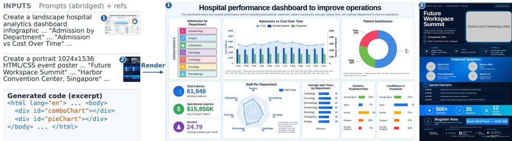  
Figure 1 Information-rich infographics generated as code. Prompts specify content, while image-generator references ofer visual design guidance. The examples show a landscape dashboard and portrait poste rendered from generated HTML/CSS.

These complementary strengths motivate a novel setting where an image generator provides an aesthetic guidance for the code model. Specifically, a reference image generated from the same prompt serves as a conditional input to supply layout and style inspiration. While existing image-to-code methods [7–9] also use images as input, they treat them as absolute ground truth for pixel-level reconstruction. This rigid replication and its associated image-level metrics [10–12] fail in our setting because they force the code model to mimic the hallucinated content of the generated prior and penalize valid design variations. Our fundamental setting therefore challenges the code model to strictly satisfy the prompt’s content while flexibly extracting layout and style from a noisy reference image.

Simply providing the reference image as an input is insuficient. Of-the-shelf vision-language models (VLMs) naturally entangle visual features with text semantics. When given a noisy reference, they tend to either reproduce its hallucinated content or ignore its layout entirely. The model therefore requires explicit training to extract the aesthetic prior while adhering to the text prompt. To facilitate this, we propose AesCode, which conceptualizes the generated target as a Design Graph. This structured intermediate representation explicitly separates semantic information from visual cues. Within this graph, nodes represent distinct functional elements such as text blocks, tables, and charts. Each node possesses decoupled attributes for its required content (e.g., specific strings or data series) and its visual properties (e.g., bounding boxes and colors). Edges explicitly define structural relationships, including hierarchical containment and spatial alignment.

Because the graph structure makes individual properties explicitly attributable, it naturally enables decoupled reward channels tailored to distinct objectives. Blending mixed outcomes into a single score (e.g., rendering correct text but a chaotic layout) often misaligns training gradients. To preserve specific learning signals, we derive synergic cross-modal rewards directly from the graph: deterministic verifiers provide fast, absolute checks for properties readable from code and DOM rendering, while a VLM judge assesses aesthetics through a Visual Graph Rubric (VGR), avoiding unstable holistic scoring by answering node-specific binary questions. We then balance these channels using Group reward-Decoupled Normalization Policy Optimization (GDPO) [13], preventing dense verification signals from overwhelming sparse aesthetic feedback.

We also release an infographic benchmark evaluating verifiable correctness and visual quality separately, with automated visual scores closely matching human judgments. Ablations confirm that reference images consistently improve visual quality as an aesthetic prior across all tested models. Given the same references, our AesCode-8B and AesCode-32B gain 31.1 and 22.4 Visual points over their Qwen3-VL backbones, achieving visual quality comparable to frontier models like GPT-5.5 and Claude Opus 4.8 while making noticeably fewer content errors.

Our contributions are summarized as follows:

• We introduce a novel paradigm for aesthetic code generation that utilizes image generators as an aesthetic prior. A reference image generated from the same prompt conditions the code model as input and provides visual signals during training.

• We propose AesCode, which introduces decoupled cross-modal rewards driven by a design graph. It pairs deterministic verifiers for structural correctness with a sample-specific, graph-based VLM judge for aesthetic quality.

• We release an infographic benchmark that evaluates correctness and visual quality separately, with human-aligned visual scores. References help every model we test, and AesCode matches leading proprietary models visually while following the prompt more closely.

## 2 Related Work

Visual Design and Code Generation. Posters, slides, and infographics can be generated as images or code. Image generators such as PosterMaker [4] and BizGen [14] compose appealing pages, but still misrender text and data on dense content [6], and their raster outputs cannot be edited. Code is editable and verifiable. When written from text alone, as in LIDA [15] and PPTAgent [2], it is composed without seeing the page and often looks plain. When written from an image, as in Design2Code [8] and ChartMimic [16], it copies the input as ground truth. Closest to ours, DesignAsCode [17] and Editable Visual Design [18] let a coding agent consult a generated image, but only at inference time; the code model is never trained to use it. We instead train the code model to follow a prompt-generated image as an aesthetic prior for layout and style.

Reward Design for Visual Generation. RL training requires a reward for the rendered page. In image-to-code, this reward is usually similarity to the input image, measured with visual metrics [19, 20] or MLLM critics [11, 12]. For a generated reference, however, this would penalize valid alternatives and reward copied errors. Without a target image, rule-based rewards are precise but limited to what a program can check, such as element overlap in AeSlides [21], while holistic MLLM judges [22, 23] give scores that shift with prompt phrasing. A more stable alternative breaks one judgment into many yes/no questions, first for text-to-image evaluation [24] and more recently as rubric rewards for RL [25, 26]. These questions, however, are derived from text alone and cannot check the design a reference proposes. We therefore build a design graph from the prompt and the reference, verify code-level properties with rules, and turn the remaining visual properties into a Visual Graph Rubric (VGR) tied to graph elements.

Multi-Objective Reinforcement Learning. Critic-free methods such as GRPO [27] normalize rewards within a sampled group and, following DeepSeek-R1 [28], have become a standard recipe for post training LLMs and VLMs [29]. They assume a single reward, however: when several rewards are summed before normalization, a dense, near-saturated rule reward can drown out a sparse aesthetic one. MO-GRPO [30] reweights rewards by their variance, while GDPO [13] normalizes each reward separately. We adopt GDPO to balance our rule-based and VGR rewards.

Section A extends this review with a fuller discussion of each of the three threads above.

## 3 Method

AesCode learns visual design through graph-structured supervision. We first construct a target design graph that combines prompt-required content with non-authoritative reference cues (Section 3.1). We then route its properties to deterministic and perceptual reward channels (Section 3.2) and optimize them with SFT and GDPO [13] (Section 3.3). Finally, we define a separate evaluation protocol for factual correctness and human-aligned visual quality (Section 3.4).

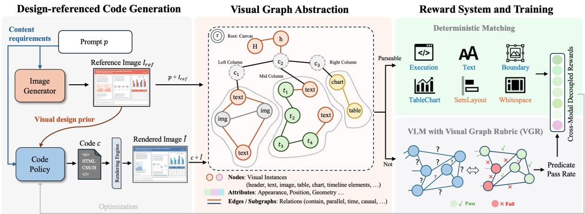  
Figure 2 Overview of AesCode. Prompt requirements and reference design cues yield graph-based supervision. Conditioned on $p$ and $I _ { \mathrm { r e f } }$ , the policy generates HTML/CSS code $^ { c , }$ rendered as $\hat { I } .$

## 3.1 Design Graph as a Supervision Target

The prompt p specifies required information, while visual design admits many valid solutions. Learning needs a concrete signal, so an image generator supplies one compelling possibility $I _ { \mathrm { r e f } }$ , which may be factually or structurally wrong. We therefore organize supervision as a design graph rather than a monolithic target, scoring prompt-derived requirements independently of the reference.

We define the supervision target as

$$
\mathcal { G } _ { \mathrm { t g t } } = ( \mathcal { V } , \mathcal { E } , \mathbf { X } _ { V } , r ) = \Phi ( p , I _ { \mathrm { r e f } } ) ,\tag{1}
$$

where the canvas root r holds page-level attributes and contains every top-level element. The remaining nodes come from a closed vocabulary of atomic elements, such as text, images, charts, tables, and badges, and of containers, such as regions, cards, panels, lists, and groups, which hold other nodes instead of rendering content; three or more interchangeable siblings collapse into one group node with a count attribute. Attributes $\mathbf { X } _ { V }$ record content, geometry, and appearance, including structured chart and table data, and each edge $( u , \tau , v ) \in \mathcal { E }$ carries a relation type τ covering containment, alignment, order, adjacency, and semantic connection. This decomposition lets prompt requirements and reference cues constrain complementary properties independently, making supervision attributable across semantic dimensions, and since it assumes only elements and their two-dimensional structure, it applies broadly to structured visual artifacts.

From the generated code c and its rendering ${ \hat { I } } ,$ we jointly parse all candidate visual elements into $\hat { \mathcal G } = \Psi ( c , \hat { I } )$ . Code, DOM, and computed styles expose structured content and implementation details, while the rendering provides pixel geometry and visual evidence. We then compare $\hat { \mathcal G }$ with $\mathcal { G } _ { \mathrm { t g t } }$ property by property to derive the reward signals below.

## 3.2 From Design Graphs to Multi-Objective Rewards

Graph properties divide by how they can be assessed. Those with structured evidence in code or measurable evidence in the rendering are programmatically verifiable, while appearance and higherorder relations vary by sample and require visual judgment. We therefore use deterministic verifiers and a sample-specific VLM-as-judge channel, detailed in Section D.

Deterministic verifiers. Six verifiers compute scores from code, the DOM, OCR, and rendered pixels. Execution $\left( s _ { \mathrm { e x e c } } \right)$ checks renderability and fatal errors. Text $\left( { { s } _ { \mathrm { t e x t } } } \right)$ verifies required strings, and Boundary $\left( s _ { \mathrm { b d r y } } \right)$ measures canvas containment and aspect-ratio agreement. Table/Chart $\left( { { s } _ { \mathrm { t c } } } \right)$ parses the structure, subtype, and data of HTML tables and ECharts charts, preventing static substitutes from receiving credit. Semantic Layout $( s _ { \mathrm { l a y o u t } } )$ matches OCR text blocks between reference and candidate and scores their normalized positional agreement. Whitespace $\left( {  { s _ { \mathrm { w s } } } } \right)$ compares non-background occupancy at coarse and fine scales, capturing how whitespace is distributed.

Visual Graph Rubric $( s _ { \mathrm { v g r } } )$ . For the remaining properties, we derive a sample-specific list of Boolean questions $Q _ { \mathrm { t r a i n } }$ from $\mathcal { G } _ { \mathrm { t g t } }$ . Each question binds to a node, attribute, relation, or subgraph, so the graph scafolds rubric construction rather than serving as a policy input, turning open-ended visual judgment into explicit criteria. A VLM answers the fixed questions from the candidate rendering, and their pass rate gives

$$
\begin{array} { r } { s _ { \mathrm { v g r } } = \frac { 1 } { | Q _ { \mathrm { t r a i n } } | } \sum _ { q \in Q _ { \mathrm { t r a i n } } } { \mathcal { H } \Big [ \hat { I } \mathrm { ~ s a t i s f i e s ~ } q \Big ] } . } \end{array}\tag{2}
$$

Reference cues enter only through fixed questions, and VGR is used only for training.

## 3.3 Training Pipeline

Cold-start SFT first establishes reliable prompt-and-image-to-code generation from filtered teacher demonstrations paired with the collected images. RL then switches to image-generator references and optimizes the seven rewards. These channels difer in applicability, scale, sparsity, saturation, and learning dificulty, so aggregating raw rewards can obscure useful signals. We therefore use Group reward-Decoupled Normalization Policy Optimization (GDPO) [13].

For each $( p , I _ { \mathrm { r e f } } )$ , we sample code rollouts $\boldsymbol { B } = \{ c _ { i } \} _ { i = 1 } ^ { B }$ , render $\hat { I } _ { i } = \mathrm { r e n d e r } ( c _ { i } )$ , and parse $\hat { \mathcal { G } } _ { i } = \Psi ( c _ { i } , \hat { I } _ { i } )$ Comparing $\hat { \mathcal { G } } _ { i }$ with $\mathcal { G } _ { \mathrm { t g t } }$ produces the seven rewards above as $\mathbf { s } _ { i } = ( s _ { i } ^ { ( v ) } ) _ { v = 1 } ^ { 7 } \in [ 0 , 1 ] ^ { 7 }$ . A mask $m _ { i } ^ { ( v ) } \in \{ 0 , 1 \}$ indicates whether channel v applies to rollout i. Let $\mu _ { v }$ and $\sigma _ { v }$ denote its mean and standard deviation over the applicable subset $B _ { v } = \{ i \mid m _ { i } ^ { ( v ) } = 1 \}$ . GDPO normalizes each channel before averaging the applicable advantages:

$$
A _ { i } ^ { ( v ) } = \frac { s _ { i } ^ { ( v ) } - \mu _ { v } } { \sigma _ { v } + \epsilon } , \qquad A _ { i } = \frac { \sum _ { v } m _ { i } ^ { ( v ) } A _ { i } ^ { ( v ) } } { \sum _ { v } m _ { i } ^ { ( v ) } } .\tag{3}
$$

With $\rho _ { i } ( \theta ) = \pi _ { \theta } ( c _ { i } \mid p , I _ { \mathrm { r e f } } ) / \pi _ { \mathrm { o l d } } ( c _ { i } \mid p , I _ { \mathrm { r e f } } )$ , GDPO maximizes the clipped group objective

$$
\mathcal { L } _ { \mathrm { G D P O } } ( \theta ) = \frac { 1 } { B } \sum _ { i = 1 } ^ { B } \operatorname* { m i n } \big ( \rho _ { i } ( \theta ) A _ { i } , \mathrm { c l i p } \big ( \rho _ { i } ( \theta ) , 1 - \varepsilon , 1 + \varepsilon \big ) A _ { i } \big ) .\tag{4}
$$

Applicability masks exclude irrelevant checks, so all valid objectives contribute to one policy update without first collapsing their raw rewards into a scalar.

## 3.4 Final Evaluation Protocol

Training requires a concrete reference, but evaluation must accept multiple valid designs. We therefore assess the artifact itself through Rule, Visual, and their mean Overall.

Rule. Rule averages Text, Boundary, and Table/Chart (Section 3.2), which verify exact content, canvas containment, and structured data from code and rendering.

Visual. Visual converts open-ended, sample-specific quality into a checklist $Q _ { p }$ derived from prompt requirements. Content checks required-element presence and completeness; Layout covers organization, relations, and collisions; and Style judges hierarchy, typography, color, and component finish against a production-ready standard. Each checklist averages 35.8 questions. A VLM answers fixed yes/no questions from the candidate rendering, and Visual averages the three dimensions. These are absolute criteria for the artifact rather than pairwise comparisons. We develop the pipeline on a separate

50-instance set: it drafts questions, filters ambiguous, non-visual, and implementation-specific criteria, then revises wording and coverage. Annotators review questions and rank output pairs; ranking disagreements guide each revision. Once consistency exceeds 90% and no issues remain, we freeze the pipeline and apply it unchanged to the disjoint 300-instance benchmark, giving every system the same sample-specific criteria. Section E details the pipeline, while Section E.3 confirms strong agreement with human aesthetic judgments and pairwise choices.

## 4 Experiments

## 4.1 Experimental Setup

Training data. We curate a candidate pool of approximately 18,000 human-designed slides, posters, dashboards, and webpages, clustered by their CLIP image features. For each sampled image, GPT-5.4-mini infers a generation prompt that specifies required contents (e.g., text and charts) without prescribing visual layout or styles. For SFT, we construct 3,000 demonstrations using GPT-5.5 paired with the original human designs. We generate three rollouts per prompt–image pair and keep the highest-scoring candidate if its reward exceeds 0.85, otherwise resampling from the same cluster. Retaining original designs for SFT teaches the prompt-and-reference-to-code format without imagegeneration overhead. For RL, we score eight rollouts from the cold-start policy on every remaining prompt, keep the prompts whose pass@1 and pass@8 rates leave usable learning signal, rebalance them across clusters, and replace the original images with synthetic references from GPT-Image-2, yielding roughly 8,000 prompts. See details in Section B.1.

Benchmark and baselines. Our test set for benchmarking contains 300 prompts, with GPT-Image-2 references (Section B.3). We compare proprietary and open-source models under prompt-only and reference-conditioned settings. Final evaluation follows the protocol in Section 3.4 (detailed checklist construction and a complete example checklist appear in Section E.1). We additionally evaluate Design2Code [8], SlidesBench [31], and GDB/lica [32] using their respective protocols (Section E.2).

Implementation details. AesCode uses Qwen3-VL-8B and Qwen3-VL-32B, with SFT at a learning rate of $1 0 ^ { - 5 }$ followed by GDPO using AdamW at $5 \times 1 0 ^ { - 6 }$ . Each RL step samples 128 prompts with 8 rollouts each; the 8B and 32B models train for 400 and 520 steps, respectively. Remaining optimization, decoding, and rendering settings appear in Section C.1.

## 4.2 Main Results

Main observations. Table 1 reveals three main observations. First, reference images improve visual presentation for all closed and open models by providing explicit layout and aesthetic anchors. Yet, Style remains a shared bottleneck below 60%: this metric gives credit only when a design requires no further visual revision before production delivery. Second, models leverage visual guidance diferently. Claude Opus 4.8 excels in content fidelity and uses references to elevate layout and style, whereas GPT-5.5 starts with stronger style and benefits most in content and layout. Most open models are highly imbalanced: some satisfy code-level constraints but remain weak visually, while others struggle on both. Qwen3.8 and Qwen3.5 stand out for more balanced visual planning, with Qwen3.8 showing the best balance between Rule and Visual among the open models evaluated. Its relatively high prompt-only Visual score leaves limited room for further gains from an additional reference (73.15 → 75.72). Third, our training substantially improves both base backbones, raising Overall from 51.93 to 82.94 at 8B and from 61.10 to 85.89 at 32B. The 32B model also leads Table/Chart at 90.37. We require tables to use HTML table structures and charts to use ECharts, which constrains the solution space to executable, directly verifiable implementations and provides clear rewards for optimization. Overall, AesCode leads in verifiable correctness while matching frontier models such as

Table 1 Results on our infographic benchmark of 300 instances. Models in the first two blocks receive only the prompt; those in the third, including AesCode, also receive a generated reference image. Rule averages the programmatic Text, Bound, and Chart checks; Visual averages the Content, Layout, and Style scores as defined in Section 3.4. Overall is the mean of Rule and Visual. Scores (%) are averaged over three generations per prompt; higher is better. Bold and underlined values indicate the best and second-best scores in each column.
<table><tr><td>Model</td><td>Text</td><td>Bound</td><td>Chart</td><td>Rule</td><td>Content</td><td>Layout</td><td>Style</td><td>Visual</td><td>Overall</td></tr><tr><td>Frontier Closed-Source</td><td></td><td></td><td></td><td></td><td></td><td></td><td></td><td></td><td></td></tr><tr><td>GPT-5.5</td><td>88.67</td><td>86.18</td><td>82.85</td><td>85.90</td><td>79.27</td><td>68.09</td><td>52.80</td><td>66.72</td><td>76.31</td></tr><tr><td>GPT-5.4</td><td>76.37</td><td>86.14</td><td>65.30</td><td>75.94</td><td>71.05</td><td>63.29</td><td>47.31</td><td>60.55</td><td>68.24</td></tr><tr><td>GPT-5.1</td><td>80.42</td><td>78.64</td><td>73.68</td><td>77.58</td><td>73.17</td><td>59.76</td><td>43.12</td><td>58.68</td><td>68.13</td></tr><tr><td>GPT-40</td><td>73.64</td><td>78.37</td><td>55.64</td><td>69.22</td><td>51.34</td><td>33.33</td><td>15.95</td><td>33.54</td><td>51.38</td></tr><tr><td>Claude Opus 4.8</td><td>91.40</td><td>85.03</td><td>87.69</td><td>88.04</td><td>84.98</td><td>64.88</td><td>46.72</td><td>65.53</td><td>76.78</td></tr><tr><td>Gemini 3.1 Pro</td><td>69.95</td><td>74.47</td><td>67.61</td><td>70.68</td><td>74.68</td><td>60.73</td><td>41.00</td><td>58.81</td><td>64.74</td></tr><tr><td>Open-Source VLMs</td><td></td><td></td><td></td><td></td><td></td><td></td><td></td><td></td><td></td></tr><tr><td>Qwen3.8-27B</td><td>81.29</td><td>81.85</td><td>70.66</td><td>77.93</td><td>82.72</td><td>83.27</td><td>53.45</td><td>73.15</td><td>75.54</td></tr><tr><td>Qwen3.5-35B-A3B</td><td>52.08</td><td>72.95</td><td>41.56</td><td>55.53</td><td>70.57</td><td>71.41</td><td>43.27</td><td>61.75</td><td>58.64</td></tr><tr><td>Qwen3-VL-235B-A22B</td><td>68.94</td><td>79.69</td><td>54.54</td><td>67.73</td><td>56.43</td><td>39.49</td><td>22.48</td><td>39.46</td><td>53.59</td></tr><tr><td>Qwen3-VL-32B</td><td>66.00</td><td>80.31</td><td>41.36</td><td>62.55</td><td>49.81</td><td>34.85</td><td>19.34</td><td>34.67</td><td>48.61</td></tr><tr><td>Qwen3-VL-30B-A3B</td><td>65.20</td><td>77.24</td><td>50.27</td><td>64.24</td><td>46.44</td><td>33.10</td><td>19.35</td><td>32.96</td><td>48.60</td></tr><tr><td>Qwen3-VL-8B</td><td>58.32</td><td>77.23</td><td>43.30</td><td>59.61</td><td>38.33</td><td>23.97</td><td>13.22</td><td>25.17</td><td>42.39</td></tr><tr><td>Qwen2.5-VL-72B</td><td>74.24</td><td>83.63</td><td>43.48</td><td>67.12</td><td>39.34</td><td>22.37</td><td>9.00</td><td>23.57</td><td>45.34</td></tr><tr><td>InternVL3.5-241B-A28B</td><td>82.01</td><td>69.44</td><td>67.19</td><td>72.88</td><td>69.95</td><td>65.12</td><td>33.96</td><td>56.34</td><td>64.61</td></tr><tr><td>InternVL3-78B</td><td>67.59</td><td>80.72</td><td>50.88</td><td>66.39</td><td>42.75</td><td>26.42</td><td>11.36</td><td>26.84</td><td>46.62</td></tr><tr><td>Kimi-VL</td><td>61.70</td><td>58.70</td><td>48.89</td><td>56.43</td><td>31.92</td><td>18.12</td><td>6.97</td><td>19.00</td><td>37.72</td></tr><tr><td>MiniCPM-V-4.5</td><td>61.04</td><td>72.03</td><td>38.81</td><td>57.29</td><td>46.05</td><td>40.98</td><td>21.34</td><td>36.12</td><td>46.71</td></tr><tr><td>Llama-4 Scout</td><td>76.59</td><td>81.49</td><td>66.93</td><td>75.00</td><td>58.51</td><td>54.82</td><td>26.47</td><td>46.60</td><td>60.80</td></tr><tr><td>With reference image in-</td><td></td><td></td><td></td><td></td><td></td><td></td><td></td><td></td><td></td></tr><tr><td>put GPT-5.5</td><td>89.22</td><td>86.85</td><td>81.35</td><td>85.80</td><td>82.44</td><td>89.93</td><td>57.91</td><td>76.76</td><td>81.28</td></tr><tr><td>Claude Opus 4.8</td><td>92.45</td><td>84.43</td><td>73.75</td><td>83.55</td><td>86.42</td><td>89.76</td><td>55.51</td><td>77.23</td><td>80.39</td></tr><tr><td>Qwen3.8-27B</td><td>82.77</td><td>83.31</td><td>71.96</td><td>79.34</td><td>85.07</td><td>87.59</td><td>54.49</td><td>75.72</td><td>77.53</td></tr><tr><td>Qwen3-VL-32B</td><td>71.19</td><td>79.61</td><td>50.77</td><td>67.19</td><td>62.04</td><td>64.59</td><td>38.43</td><td>55.02</td><td>61.10</td></tr><tr><td>Qwen3-VL-8B</td><td>64.07</td><td>70.99</td><td>42.35</td><td>59.14</td><td>52.90</td><td>51.33</td><td>29.92</td><td>44.72</td><td>51.93</td></tr><tr><td>Qwen2.5-VL-72B</td><td>73.02</td><td>81.98</td><td>41.81</td><td>65.60</td><td>53.39</td><td>43.22</td><td>18.95</td><td>38.52</td><td>52.06</td></tr><tr><td>InternVL3-78B</td><td>65.27</td><td>79.93</td><td>47.03</td><td>64.08</td><td>52.33</td><td>41.15</td><td>19.79</td><td>37.76</td><td>50.92</td></tr><tr><td>Kimi-VL</td><td>65.60</td><td>60.44</td><td>40.04</td><td>55.36</td><td>37.89</td><td>24.81</td><td>10.71</td><td>24.47</td><td>39.91</td></tr><tr><td>AesCode-8B</td><td>94.06</td><td>88.36</td><td>87.79</td><td>90.07</td><td>86.41</td><td>87.80</td><td>53.21</td><td>75.80</td><td>82.94</td></tr><tr><td>AesCode-32B</td><td></td><td></td><td>90.37</td><td>94.33</td><td>85.76</td><td>90.58</td><td>55.99</td><td>77.44</td><td>85.89</td></tr><tr><td></td><td>95.34</td><td>97.27</td><td></td><td></td><td></td><td></td><td></td><td></td><td></td></tr></table>

GPT-5.5 and Claude Opus 4.8 in visual quality.

Case studies. Figure 3 illustrates why frontier models can still trail AesCode despite plausible overall compositions. GPT-5.5 overlooks a subtle headline overlap, renders four rather than five requested logo slots, and lets a message band obscure a correctly instantiated ECharts chart. The last case retains a full Chart score because its structure and data are present; the failure lies in rendered visibility and is captured by Content and Layout. Together, these cases expose weaknesses in overlap control, requirement completeness, and the visual realization of valid code.

Transfer to external benchmarks. Across three benchmarks with diferent tasks and metrics, AesCode-32B improves on its Qwen3-VL-32B backbone in all fourteen measures, demonstrating transfer beyond our benchmark. The largest gains appear on design-sensitive measures, including SlidesBench layout and color and GDB/lica NIMA, FID, and color harmony. Gains are smaller on

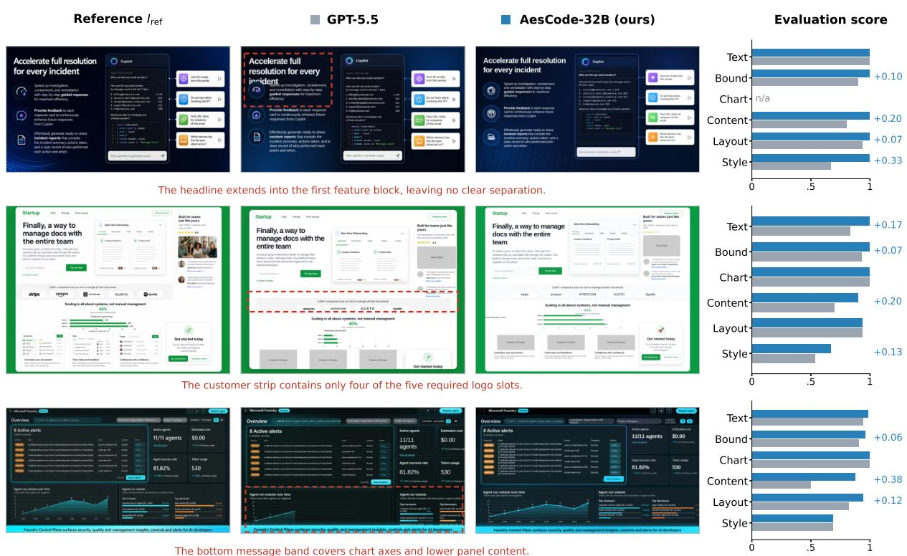  
Figure 3 Qualitative comparisons selected by the three-rollout mean Overall gap. Each row shows the reference and outputs from GPT-5.5 and AesCode-32B. Bars report evaluation scores; red dashed boxes mark visible GPT-5.5 errors.

Table 2 Transfer to three external benchmarks. GDB/lica evaluates text-to-image generation; SlidesBench and Design2Code evaluate image-to-code reconstruction. All models output rendered HTML/CSS under each benchmark’s oficial protocol. SlidesBench uses a 0–5 scale; Design2Code and GDB/lica CLIP, Harm., and OCR use 0–100. Higher is better except FID.
<table><tr><td></td><td colspan="6">GDB/lica</td><td colspan="3">SlidesBench</td><td colspan="5">Design2Code</td></tr><tr><td>Method</td><td>NIMA CLIP</td><td></td><td>Pick</td><td>FID↓</td><td>Harm.</td><td>OCR</td><td></td><td></td><td>Cont. LayoutColor</td><td>Block</td><td>Text</td><td>Pos.</td><td>Color</td><td>CLIP</td></tr><tr><td>GPT-5.5</td><td>4.362</td><td>30.2</td><td>19.53</td><td>0.439</td><td>70.6</td><td>71.9</td><td>4.54</td><td>2.85</td><td>3.63</td><td>92.3</td><td>98.5</td><td>94.2</td><td>95.3</td><td>94.3</td></tr><tr><td>GPT-40</td><td>2.589</td><td>24.1</td><td>17.82</td><td>0.673</td><td>69.3</td><td>43.3</td><td>3.41</td><td>2.00</td><td>2.81</td><td>77.5</td><td>93.0</td><td>77.9</td><td>82.1</td><td>89.5</td></tr><tr><td>GLM-4.5V</td><td>3.682</td><td>26.4</td><td>18.49</td><td>0.541</td><td>70.3</td><td>65.1</td><td>4.22</td><td>2.14</td><td>3.00</td><td>76.7</td><td>88.2</td><td>73.8</td><td>84.7</td><td>90.3</td></tr><tr><td>Qwen2.5-VL-72B</td><td>3.564</td><td>26.0</td><td>18.40</td><td>0.537</td><td>69.1</td><td>62.6</td><td>4.03</td><td>2.02</td><td>2.83</td><td>82.6</td><td>97.3</td><td>78.0</td><td>78.8</td><td>88.9</td></tr><tr><td>Qwen3-VL-30B-A3B 3.461</td><td></td><td>26.1</td><td>18.38</td><td>0.532</td><td>68.8</td><td>57.6</td><td>3.95</td><td>2.10</td><td>2.97</td><td>86.1</td><td>95.6</td><td>80.5</td><td>91.3</td><td>91.4</td></tr><tr><td>Qwen3-VL-32B</td><td>3.122</td><td>25.4</td><td>18.29</td><td>0.522</td><td>70.8</td><td>56.1</td><td>3.80</td><td>2.12</td><td>3.02</td><td>88.9</td><td>97.8</td><td>83.2</td><td>92.8</td><td>91.7</td></tr><tr><td>Qwen3-VL-8B</td><td>2.821</td><td>23.7</td><td>17.85</td><td>0.647</td><td>68.7</td><td>43.7</td><td>3.64</td><td>1.97</td><td>2.81</td><td>74.0</td><td>86.8</td><td>70.6</td><td>79.3</td><td>88.7</td></tr><tr><td>AesCode-32B</td><td>4.932</td><td>29.8</td><td>19.23</td><td>0.394</td><td>71.3</td><td>68.5</td><td>3.95</td><td>2.49</td><td>3.92</td><td>90.0</td><td>98.1</td><td>86.4</td><td>93.9</td><td>92.9</td></tr></table>

Design2Code, an older website-reconstruction benchmark whose similarity metrics are near saturation and align less closely with human aesthetic judgments (Figure 4). Thus, GPT-5.5 remains stronger in exact screenshot fidelity, while AesCode shows that its transferable gains lie in layout and visual design rather than reconstruction-specific similarity.

## 4.3 Ablation Study

Reference conditioning during training and inference. Table 3 shows that reference-conditioned training internalizes multimodal visual planning into the policy. Removing the reference only at inference reduces AesCode-8B Visual by 1.00 point, compared with 19.55 for its backbone and 10.04 for GPT-5.5. Even when the policy never sees the reference, reference-based rewards raise prompt-only

Table 3 Reference images during training and inference. All rows omit reference input at inference; the lower row also omits it from policy inputs during training while retaining reference-based rewards. Gray values show changes from reference-conditioned results.
<table><tr><td>Model</td><td>Text</td><td>Bound</td><td>Chart</td><td>Rule</td><td>Content</td><td>Layout</td><td>Style</td><td>Visual</td><td>Overall</td></tr><tr><td colspan="10">Reference input removed at inference only</td></tr><tr><td>GPT-5.5</td><td> $8 8 . 6 7 ( - 0 . 6 )$ </td><td> $8 6 . 1 8 ( - 0 . 7 ) $ </td><td> $8 2 . 8 5 \ : ( + 1 . 5 ) $ </td><td> $8 5 . 9 0 \left( + 0 . 1 \right)$ </td><td> $7 9 . 2 7 ( - 3 . 2 )$ </td><td> $6 8 . 0 9 \left( - 2 1 . 8 \right)$ </td><td> ${ \bf 5 2 . 8 0 } \left( { - 5 . 1 } \right)$ </td><td> $6 6 . 7 2 \ ( - 1 0 . 0 )$ </td><td> $7 6 . 3 1 ( - 5 . 0 )$ </td></tr><tr><td>Qwen3-VL-32B</td><td> $6 6 . 0 0 ( - 5 . 2 )$ </td><td> $8 0 . 3 1 \ : ( + 0 . 7 )$ </td><td> $4 1 . 3 6 ( - 9 . 4 )$ </td><td> $6 2 . 5 5 \ : ( - 4 . 6 )$ </td><td> $4 9 . 8 1 ( - 1 2 . 2 ) $ </td><td> $3 4 . 8 5 \ : ( - 2 9 . 7 )$ </td><td> $1 9 . 3 4 \ : ( - 1 9 . 1 )$ </td><td> $3 4 . 6 7 \ : ( - 2 0 . 4 )$ </td><td> $4 8 . 6 1 \ : ( - 1 2 . 5 )$ </td></tr><tr><td>Qwen3-VL-8B</td><td> $5 8 . 3 2 ( - 5 . 8 )$ </td><td> $7 7 . 2 3 \ : ( + 6 . 2 )$ </td><td> $4 3 . 3 0 \left( + 1 . 0 \right)$ </td><td> $5 9 . 6 1 \ : ( + 0 . 5 ) $ </td><td> $3 8 . 3 3 \ : ( - 1 4 . 6 )$ </td><td> $2 3 . 9 7 \ : ( - 2 7 . 4 )$ </td><td> $1 3 . 2 2 \ : ( - 1 6 . 7 )$ </td><td> $2 5 . 1 7 \ : ( - 1 9 . 6 )$ </td><td> $4 2 . 3 9 \ : ( - 9 . 5 )$ </td></tr><tr><td> $_ \mathrm { A e s C o d e - 8 B }$ </td><td> $9 3 . 7 4 \ : ( - 0 . 3 )$ </td><td> $8 8 . 1 9 \left( - 0 . 2 \right)$ </td><td> $8 2 . 3 6 ( - 5 . 4 )$ </td><td> $8 8 . 0 9 \left( - 2 . 0 \right)$ </td><td> $\mathbf { 8 4 . 9 2 \ ( - 1 . 5 ) }$ </td><td> $8 { \bf 6 . 8 4 } \left( - 1 . 0 \right)$ </td><td> $5 2 . 6 3 \ : ( - 0 . 6 )$ </td><td> $\mathbf { 7 4 . 8 0 } \left( \mathbf { - } \mathbf { 1 . 0 } \right)$ </td><td> ${ \bf 8 1 . 4 5 } \left( - 1 . 5 \right)$ </td></tr><tr><td colspan="10">Reference input removed during training and inference</td></tr><tr><td>AesCode-8B</td><td>94.04</td><td>88.55</td><td>84.43</td><td>89.01</td><td>81.39</td><td>80.04</td><td>47.71</td><td>69.71</td><td>79.36</td></tr></table>

Table 4 Method ablations on Qwen3-VL-8B with reference input. ✓ and × denote included and removed components; named entries denote replacements. Holistic VLM score is a single absolute rating, direct rubric authors the visual questions directly from the inputs without first constructing the design graph, and Layout/WS indicates the Semantic Layout and Whitespace rewards.
<table><tr><td>Component</td><td>SFT</td><td>RL</td><td>GDPO</td><td>Layout/WS</td><td>VGR</td><td>Rule</td><td>Visual</td><td>Overall</td></tr><tr><td>AesCode (full)</td><td>√</td><td>√</td><td>√</td><td>√</td><td>V</td><td>90.07</td><td>75.80</td><td>82.94</td></tr><tr><td rowspan="2">Training pipeline</td><td>V</td><td>X</td><td>一</td><td>一</td><td>一</td><td>79.28</td><td>65.86</td><td>72.57</td></tr><tr><td>X</td><td>√</td><td>√</td><td>V</td><td>√</td><td>86.09</td><td>69.85</td><td>77.97</td></tr><tr><td>Reward aggregation</td><td>√</td><td>√</td><td>GRPO</td><td>√</td><td>√</td><td>90.32</td><td>70.68</td><td>80.50</td></tr><tr><td rowspan="5">Design supervision</td><td>√</td><td>√</td><td>√</td><td>X</td><td>X</td><td>90.47</td><td>66.59</td><td>78.53</td></tr><tr><td>√</td><td>√</td><td>√</td><td>√</td><td>X</td><td>91.03</td><td>68.12</td><td>79.58</td></tr><tr><td>√</td><td>√</td><td>√</td><td>√</td><td>CLIP</td><td>89.14</td><td>70.49</td><td>79.82</td></tr><tr><td>√</td><td>√</td><td>√</td><td>√</td><td>Holistic VLM score</td><td>89.20</td><td>68.91</td><td>79.06</td></tr><tr><td>√</td><td>√</td><td>√</td><td>√</td><td>Direct rubric</td><td>90.05</td><td>72.61</td><td>81.33</td></tr></table>

Visual from 25.17 to 69.71, showing that such supervision transfers visual capability indirectly. This remains 5.09 points below reference-conditioned training under the same inference setting, confirming the value of the reference as an input condition.

Training and reward design. Table 4 shows that RL drives most gains, while SFT gives a stronger initialization: under the same RL budget, Overall rises from 77.97 to 82.94. GDPO adds 5.12 Visual points over scalar GRPO by normalizing channels independently, which helps when verifiable and perceptual objectives learn at diferent rates (Section C.2). Design supervision then determines visual quality: code correctness alone yields 66.59 Visual, and Layout/Whitespace raises it to 68.12. CLIP reaches 70.49 through coarse image-level guidance but cannot localize failed properties, while a holistic VLM score reaches only 68.91 because its absolute signal is sparse and unstable. VGR decomposes visual quality into explicit graph-bound criteria and reaches 75.80 without sacrificing Rule. Graph construction accounts for part of this: with the same inputs and training setup, authoring the questions directly, without the graph, lowers Visual to 72.61 at unchanged Rule (90.07 vs. 90.05).

## 4.4 Analysis

Human evaluation. Our blinded human study validates the automatic judges and the main comparison (Section E.3). In Figure 4a, human-majority judgments agree with the training VGR and the Visual checklist on 89.3% and 93.3% of sampled predicates. In Figure 4b, AesCode-32B achieves higher Content satisfaction than GPT-5.5 (86.50% vs. 83.47%) with equivalent aesthetic quality (mean diference −0.15, 95% CI [−0.34, 0.03] within the pre-specified ±0.5 margin). In Figure 4c, our Visual score agrees with direct human pairwise choices in 80.66% of comparisons, exceeds external metrics across comparable gap bins, and improves with larger score gaps.

(b) Relational structure loss  
(c) Semantic element degradation  
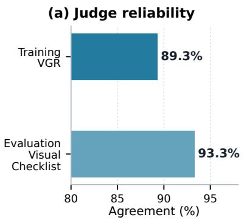

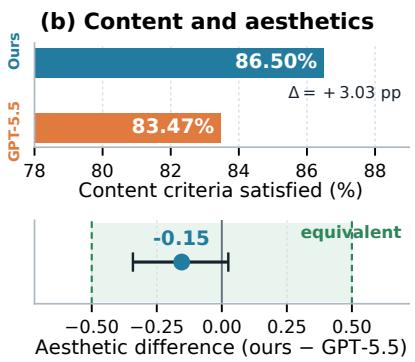

(c) Score-preference consistency  
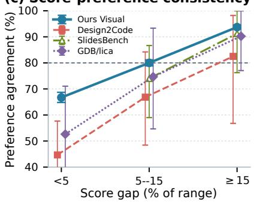  
Figure 4 Human evaluation. (a) Agreement with training VGR and evaluation-checklist judgments. (b) Content satisfaction and aesthetic equivalence between AesCode-32B and GPT-5.5. (c) Agreement between metric rankings and human preference by normalized score gap.

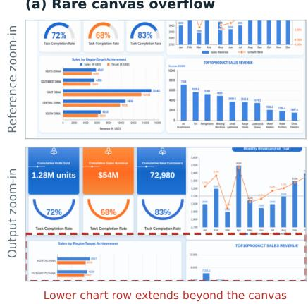  
Figure 5 Residual failures of AesCode-32B. Reference and output zoom-ins show (a) canvas overflow, (b) lost relational structure, and (c) semantic element degradation. Dashed boxes mark afected regions; frequencies and additional cases appear in Section F.

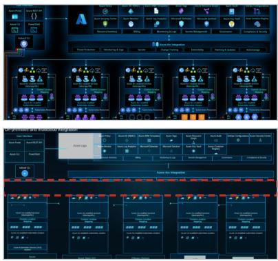  
One shared pattern removes all five links

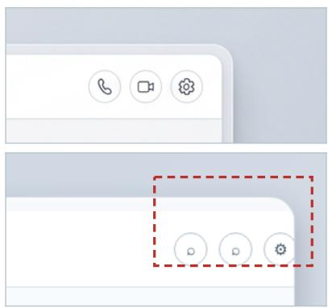  
Call, video, and settings become circles

Failure analysis. Lower-performing samples show three recurring failure modes (Figure 5). First, canvas overflow persists, though it is rare after training: code generation cannot reliably anticipate final pixel geometry, leaving visually grounded refinement to future work. Second, relational structure is harder than individual elements, since the model must understand content relations and render them as spatial connections, yet relation-level rewards stay sparse and do not localize the failed edge. Third, semantic elements often degrade into generic marks, since such icons require fine-grained SVG drawing grounded in meaning.

## 5 Conclusion

This work asks how code models can generate information-rich visual artifacts that are both verifiable and visually compelling. We address this challenge by representing each target as a design graph that captures element content, visual attributes, and relations. Prompt requirements define what must be conveyed, while image-generated references guide how it should look; together, they yield targeted rewards that help compact code models internalize cross-modal understanding, organization, and visual judgment. AesCode matches frontier systems in human-aligned visual quality and surpasses them in verifiable correctness, with much of this capability retained even without reference input at inference. More broadly, our results show that image generators can serve not only as content generators, but also as scalable teachers of visual design for structured generative models. Remaining challenges in pixel-level geometry, complex relations, and semantic visual elements call for visually grounded iterative refinement and more precise structural feedback.

## References

[1] Wei Pang, Kevin Qinghong Lin, Xiangru Jian, Xi He, and Philip Torr. Paper2Poster: Towards multimodal poster automation from scientific papers. Advances in Neural Information Processing Systems, 38, 2026.

[2] Hao Zheng, Xinyan Guan, Hao Kong, Wenkai Zhang, Jia Zheng, Weixiang Zhou, Hongyu Lin, Yaojie Lu, Xianpei Han, and Le Sun. Pptagent: Generating and evaluating presentations beyond text-to-slides. In Proceedings of the 2025 Conference on Empirical Methods in Natural Language Processing, pages 14402–14418, 2025.

[3] Patrick Esser, Sumith Kulal, Andreas Blattmann, Rahim Entezari, Jonas Müller, Harry Saini, Yam Levi, Dominik Lorenz, Axel Sauer, Frederic Boesel, et al. Scaling rectified flow transformers for high-resolution image synthesis. In Forty-first international conference on machine learning, 2024.

[4] Yifan Gao, Zihang Lin, Chuanbin Liu, Min Zhou, Tiezheng Ge, Bo Zheng, and Hongtao Xie. PosterMaker: Towards High-Quality product poster generation with accurate text rendering. In 2025 IEEE/CVF Conference on Computer Vision and Pattern Recognition (CVPR), pages 8083–8093. IEEE, 2025.

[5] Rosanne Liu, Dan Garrette, Chitwan Saharia, William Chan, Adam Roberts, Sharan Narang, Irina Blok, RJ Mical, Mohammad Norouzi, and Noah Constant. Character-aware models improve visual text rendering. In Proceedings of the 61st Annual Meeting of the Association for Computational Linguistics (Volume 1: Long Papers), pages 16270–16297, 2023.

[6] Yinghao Tang, Xueding Liu, Boyuan Zhang, Tingfeng Lan, Yupeng Xie, Jiale Lao, Yiyao Wang, Haoxuan Li, Tingting Gao, Bo Pan, et al. IGenBench: Benchmarking the reliability of Text-to-Infographic generation. arXiv preprint arXiv:2601.04498, 2026.

[7] Tony Beltramelli. pix2code: Generating code from a graphical user interface screenshot. In Proceedings of the ACM SIGCHI symposium on engineering interactive computing systems, pages 1–6, 2018.

[8] Chenglei Si, Yanzhe Zhang, Ryan Li, Zhengyuan Yang, Ruibo Liu, and Diyi Yang. Design2code: Benchmarking multimodal code generation for automated front-end engineering. In Proceedings of the 2025 Conference of the Nations of the Americas Chapter of the Association for Computational Linguistics: Human Language Technologies (Volume 1: Long Papers), pages 3956–3974, 2025.

[9] Yucheng Han, Chi Zhang, Xin Chen, Xu Yang, Zhibin Wang, Gang Yu, Bin Fu, and Hanwang Zhang. Chartllama: A multimodal llm for chart understanding and generation. arXiv preprint arXiv:2311.16483, 2023.

[10] Jie Deng, Kaichun Yao, and Libo Zhang. Visrefiner: Learning from visual diferences for screenshot-to-code generation. arXiv preprint arXiv:2602.05998, 2026.

[11] Zhen Yang, Wenyi Hong, Mingde Xu, Xinyue Fan, Weihan Wang, Jiale Cheng, Xiaotao Gu, and Jie Tang. Ui2codeˆ n: Ui-to-code generation as interactive visual optimization. arXiv preprint arXiv:2511.08195, 2025.

[12] Yuhang Li, Chenchen Zhang, Ruilin Lv, Ao Liu, Ken Deng, Yuanxing Zhang, Jiaheng Liu, and Bo Zhou. Relook: Vision-grounded rl with a multimodal llm critic for agentic web coding. In Proceedings of the 64th Annual Meeting of the Association for Computational Linguistics (Volume 1: Long Papers), pages 25471–25485, 2026.

[13] Shih-Yang Liu, Xin Dong, Ximing Lu, Shizhe Diao, Peter Belcak, Mingjie Liu, Min-Hung Chen, Hongxu Yin, Yu-Chiang Frank Wang, Kwang-Ting Cheng, et al. Gdpo: Group rewarddecoupled normalization policy optimization for multi-reward rl optimization. arXiv preprint arXiv:2601.05242, 2026.

[14] Yuyang Peng, Shishi Xiao, Keming Wu, Qisheng Liao, Bohan Chen, Kevin Lin, Danqing Huang, Ji Li, and Yuhui Yuan. BizGen: Advancing article-level visual text rendering for infographics generation. In 2025 IEEE/CVF Conference on Computer Vision and Pattern Recognition (CVPR), pages 23615–23624. IEEE, 2025.

[15] Victor Dibia. Lida: A tool for automatic generation of grammar-agnostic visualizations and infographics using large language models. In Proceedings of the 61st Annual Meeting of the Association for Computational Linguistics (Volume 3: System Demonstrations), pages 113–126, 2023.

[16] Cheng Yang, Chufan Shi, Yaxin Liu, Bo Shui, Junjie Wang, Mohan Jing, Linran Xu, Xinyu Zhu, Siheng Li, Yuxiang Zhang, et al. Chartmimic: Evaluating lmm’s cross-modal reasoning capability via chart-to-code generation. In International Conference on Learning Representations, volume 2025, pages 26590–26646, 2025.

[17] Ziyuan Liu, Shizhao Sun, Danqing Huang, Yingdong Shi, Meisheng Zhang, Ji Li, Jingsong Yu, and Jiang Bian. DesignAsCode: Bridging structural editability and visual fidelity in graphic design generation. arXiv preprint arXiv:2602.17690, 2026.

[18] Junyan Ye, Wei Liu, Dongzhi Jiang, Zichen Wen, HaoDong Li, Zhutao Lv, Jiaxin Lin, Jinhua Yu, Jun He, Zilong Huang, et al. Editable visual design. arXiv preprint arXiv:2609.04034, 2026.

[19] Juan Rodriguez, Haotian Zhang, Abhay Puri, Rishav Pramanik, Aarash Feizi, Pascal Wichmann, Arnab Mondal, Mohammad R Samsami, Rabiul Awal, Perouz Taslakian, et al. Rendering-Aware reinforcement learning for vector graphics generation. Advances in Neural Information Processing Systems, 38:60496–60534, 2026.

[20] Yang Chen, Yufan Shen, Wenxuan Huang, Sheng Zhou, Qunshu Lin, Xinyu Cai, Zhi Yu, Jiajun Bu, Botian Shi, and Yu Qiao. Learning only with images: Visual reinforcement learning with reasoning, rendering, and visual feedback. arXiv preprint arXiv:2507.20766, 2025.

[21] Yiming Pan, Chengwei Hu, Xuancheng Huang, Can Huang, Mingming Zhao, Yuean Bi, Xiaohan Zhang, Aohan Zeng, and Linmei Hu. Aeslides: Incentivizing aesthetic layout in llm-based slide generation via verifiable rewards. arXiv preprint arXiv:2604.22840, 2026.

[22] Lianmin Zheng, Wei-Lin Chiang, Ying Sheng, Siyuan Zhuang, Zhanghao Wu, Yonghao Zhuang, Zi Lin, Zhuohan Li, Dacheng Li, Eric Xing, et al. Judging llm-as-a-judge with mt-bench and chatbot arena. Advances in neural information processing systems, 36:46595–46623, 2023.

[23] Dongping Chen, Ruoxi Chen, Shilin Zhang, Yinuo Liu, Yaochen Wang, Huichi Zhou, Qihui Zhang, Yao Wan, Pan Zhou, and Lichao Sun. Mllm-as-a-judge: Assessing multimodal llm-as-a-judge with vision-language benchmark. arXiv preprint arXiv:2402.04788, 2024.

[24] Jaemin Cho, Yushi Hu, Jason Baldridge, Roopal Garg, Peter Anderson, Ranjay Krishna, Mohit Bansal, Jordi Pont-Tuset, and Su Wang. Davidsonian scene graph: Improving reliability in fine-grained evaluation for text-to-image generation. In International conference on learning representations, volume 2024, pages 15625–15645, 2024.

[25] Anisha Gunjal, Anthony Wang, Elaine Lau, Vaskar Nath, Yunzhong He, Bing Liu, and Sean Hendryx. Rubrics as rewards: Reinforcement learning beyond verifiable domains. In International Conference on Learning Representations, volume 2026, pages 127924–127945, 2026.

[26] Hangyu Ran, Yuhao Zheng, Yingying Zhang, Kevin Qinghong Lin, and Han Peng. RULER: Instance-aware rubric rewards for SVG generation. arXiv preprint arXiv:2609.25270, 2026.

[27] Zhihong Shao, Peiyi Wang, Qihao Zhu, Runxin Xu, Junxiao Song, Xiao Bi, Haowei Zhang, Mingchuan Zhang, YK Li, Yang Wu, et al. Deepseekmath: Pushing the limits of mathematical reasoning in open language models. arXiv preprint arXiv:2402.03300, 2024.

[28] Daya Guo, Dejian Yang, Haowei Zhang, Junxiao Song, Peiyi Wang, Qihao Zhu, Runxin Xu, Ruoyu Zhang, Shirong Ma, Xiao Bi, et al. Deepseek-r1: Incentivizing reasoning capability in llms via reinforcement learning. arXiv preprint arXiv:2501.12948, 2025.

[29] Ziyu Liu, Zeyi Sun, Yuhang Zang, Xiaoyi Dong, Yuhang Cao, Haodong Duan, Dahua Lin, and Jiaqi Wang. Visual-rft: Visual reinforcement fine-tuning. In 2025 IEEE/CVF International Conference on Computer Vision (ICCV), pages 2034–2044. IEEE, 2025.

[30] Yuki Ichihara, Yuu Jinnai, Tetsuro Morimura, Mitsuki Sakamoto, Ryota Mitsuhashi, and Eiji Uchibe. MO-GRPO: Mitigating reward hacking of group relative policy optimization on multiobjective problems. Transactions of the Association for Computational Linguistics, 14:1867–1882, 2026.

[31] Jiaxin Ge, Zora Zhiruo Wang, Xuhui Zhou, Yi-Hao Peng, Sanjay Subramanian, Qinyue Tan, Maarten Sap, Alane Suhr, Daniel Fried, Graham Neubig, et al. Autopresent: Designing structured visuals from scratch. In 2025 IEEE/CVF Conference on Computer Vision and Pattern Recognition (CVPR), pages 2902–2911. IEEE, 2025.

[32] Adrienne Deganutti, Elad Hirsch, Haonan Zhu, Jaejung Seol, and Purvanshi Mehta. Graphicdesign-bench: A comprehensive benchmark for evaluating ai on graphic design tasks. arXiv preprint arXiv:2604.04192, 2026.

[33] Peidong Jia, Chenxuan Li, Yuhui Yuan, Zeyu Liu, Yichao Shen, Bohan Chen, Xingru Chen, Yinglin Zheng, Dong Chen, Ji Li, et al. COLE: A hierarchical generation framework for Multi-Layered and editable graphic design. arXiv preprint arXiv:2311.16974, 2023.

[34] Weixi Feng, Wanrong Zhu, Tsu-jui Fu, Varun Jampani, Arjun Akula, Xuehai He, Sugato Basu, Xin Eric Wang, and William Yang Wang. LayoutGPT: Compositional visual planning and generation with large language models. Advances in neural information processing systems, 36: 18225–18250, 2023.

[35] Hugo Laurençon, Léo Tronchon, and Victor Sanh. Unlocking the conversion of web screenshots into html code with the websight dataset. arXiv preprint arXiv:2403.09029, 2024.

[36] Chengyue Wu, Zhixuan Liang, Yixiao Ge, Qiushan Guo, Zeyu Lu, Jiahao Wang, Ying Shan, and Ping Luo. Plot2code: A comprehensive benchmark for evaluating multi-modal large language models in code generation from scientific plots. In Findings of the Association for Computational Linguistics: NAACL 2025, pages 3006–3028, 2025.

[37] Juan A Rodriguez, Abhay Puri, Shubham Agarwal, Issam H Laradji, Pau Rodriguez, Sai Rajeswar, David Vazquez, Christopher Pal, and Marco Pedersoli. StarVector: Generating scalable vector graphics code from images and text. In 2025 IEEE/CVF Conference on Computer Vision and Pattern Recognition (CVPR), pages 16175–16186. IEEE, 2025.

[38] Junle Liu, Peirong Zhang, Yuyi Zhang, Pengyu Yan, Hui Zhou, Xinyue Zhou, Fengjun Guo, and Lianwen Jin. PosterVerse: A full-workflow framework for Commercial-Grade poster generation with HTML-Based scalable typography. In Proceedings of the AAAI Conference on Artificial Intelligence, volume 40, pages 7197–7205, 2026.

[39] Jiazheng Xu, Xiao Liu, Yuchen Wu, Yuxuan Tong, Qinkai Li, Ming Ding, Jie Tang, and Yuxiao Dong. Imagereward: Learning and evaluating human preferences for text-to-image generation. Advances in Neural Information Processing Systems, 36:15903–15935, 2023.

[40] Yuval Kirstain, Adam Polyak, Uriel Singer, Shahbuland Matiana, Joe Penna, and Omer Levy. Pick-a-pic: An open dataset of user preferences for text-to-image generation. Advances in neural information processing systems, 36:36652–36663, 2023.

[41] Juyong Jiang, Chenglin Cai, Chansung Park, Jiasi Shen, Sunghun Kim, Jianguo Li, and Yue Wang. WebGen-R1: Incentivizing large language models to generate functional and aesthetic websites with reinforcement learning. arXiv preprint arXiv:2604.20398, 2026.

[42] Yushi Hu, Benlin Liu, Jungo Kasai, Yizhong Wang, Mari Ostendorf, Ranjay Krishna, and Noah A Smith. Tifa: Accurate and interpretable text-to-image faithfulness evaluation with question answering. In 2023 ieee/cvf international conference on computer vision (iccv), pages 20349–20360. IEEE, 2023.

[43] Chenchen Zhang, Yuhang Li, Can Xu, Jiaheng Liu, Ao Liu, Changzhi Zhou, Ken Deng, Dengpeng Wu, Guanhua Huang, Kejiao Li, et al. ArtifactsBench: Bridging the Visual-Interactive gap in LLM code generation evaluation. arXiv preprint arXiv:2507.04952, 2025.

[44] Vijay Viswanathan, Yanchao Sun, Xiang Kong, Meng Cao, Graham Neubig, and Sherry Wu. Checklists are better than reward models for aligning language models. Advances in Neural Information Processing Systems, 38:114728–114754, 2026.

[45] John Schulman, Filip Wolski, Prafulla Dhariwal, Alec Radford, and Oleg Klimov. Proximal policy optimization algorithms. arXiv preprint arXiv:1707.06347, 2017.

[46] Long Ouyang, Jefrey Wu, Xu Jiang, Diogo Almeida, Carroll Wainwright, Pamela Mishkin, Chong Zhang, Sandhini Agarwal, Katarina Slama, Alex Ray, et al. Training language models to follow instructions with human feedback. Advances in neural information processing systems, 35: 27730–27744, 2022.

## Appendix Contents

A Extended Related Work 16   
B Data and Benchmark Construction 16   
B.1 Source Designs and Stratified Sampling 16   
B.2 Prompt Inference and SFT Demonstrations 17   
B.3 RL and Benchmark References 17   
B.4 Dataset Statistics . 19   
B.5 Prompts Used for Data Construction . 19   
C Implementation and Additional Results 21   
C.1 Implementation Details 21   
C.2 Learning Dynamics of the Decoupled Reward Channels 22   
C.3 Loss of Verifiable Capabilities under Reconstruction Objectives 22   
C.4 Additional Qualitative Results 23   
D Reward System 23   
D.1 Per-Rollout Reward Record 23   
D.2 Verifiable Requirements 23   
D.3 Deterministic Verifiers 25   
D.4 Visual Graph Rubric 27   
E Evaluation Protocol and Human Study 34   
E.1 Visual Checklist . 34   
E.2 External Benchmark Protocols 41   
E.3 Human Study on Our Benchmark . 41   
E.4 Human Study on External Benchmarks 42   
F Failure Analysis 42   
F.1 Measuring the three modes 43   
F.2 Why the relational and semantic modes persist 43

## A Extended Related Work

Visual design and code generation. Image generators now produce product posters [4] and article-level infographics [14], and COLE [33] assembles multi-layered designs from a pipeline of specialized models rather than general-purpose code. On dense infographics, however, they still distort data encodings and misspell strings [6], and even a correct output is a raster that cannot be edited or checked element by element. Generating code avoids this. Text-to-code methods write visualization code [15], layouts [34], or slides [2, 31], but compose the page without seeing it. Image-to-code methods recover the code behind a rendered webpage [7, 8, 35], chart [16, 36], or SVG [37]. Because the input is the rendering of an existing program, a closer copy is always a better answer.

The closest work combines an image model with code at inference time. PosterVerse renders HTML typography over a generated background [38], DesignAsCode uses an image-editing model to propose an improved render during reflection [17], and, concurrently, Editable Visual Design lets a coding agent use a generated visual as a global reference for composition and color [18]. In each case, the image steers a prompted pipeline, and the code model is never trained to use it. AesCode instead trains the code model to follow a prompt-generated reference as an aesthetic prior while ignoring its content errors, and turns the same reference into a training signal.

Reward design for visual generation. Image-to-code RL rewards a rollout by how closely its render matches the input image, using visual similarity [19, 20] or MLLM critics [10–12]. This is valid only when the input is an exact target. A generated reference is not: many programs realize the same prompt, and the generator may alter requested content. Without a target image, rule-based rewards such as layout metrics for slides [21] are stable but cover only what a program can decide. Preference-trained reward models [39, 40] capture subjective quality but inherit labeler noise. Holistic MLLM judges [22, 23] need no training, but their scores vary with prompt phrasing, and when used as an aesthetic reward, as in WebGen-R1 [41], they reflect general quality rather than what suits a particular prompt.

Judgments become more reliable when split into narrow yes/no questions. TIFA [42] and DSG [24] do so for text-to-image evaluation, ArtifactsBench uses per-task checklists to evaluate rendered artifacts [43], and instruction-derived rubrics now serve as RL rewards for language models [25, 44] and, concurrently, for SVG [26]. All of these derive their questions from text alone. Our Visual Graph Rubric derives them from a design graph of both the prompt and the reference, so it can check the layout and style the reference proposes, and each failure points to a specific element. Properties a program can decide are left to rule-based verifiers.

Multi-objective reinforcement learning. Post-training RL has moved from PPO [45, 46] to critic-free, group-normalized methods such as GRPO [27], and we follow the R1-style recipe of a supervised cold start followed by such RL [28, 29]. With seven reward channels, summing them before group normalization lets their diferent scales and firing rates interfere, so a dense, near-saturated channel can suppress a sparse but informative one. MO-GRPO reweights rewards by their variance [30], while GDPO normalizes each channel separately [13]. We adopt GDPO because our channels difer widely in how often they fire and how much they vary.

## B Data and Benchmark Construction

## B.1 Source Designs and Stratified Sampling

Every split is built from human-designed graphics, because content is what they supply best: the text has a reason to be there, the sections stand in a sensible relation to one another, and the reading order reflects an actual communicative intent. Prompts and verifiable requirements are therefore inferred from human designs for the SFT, RL, and benchmark splits alike. Visual style is a separate matter. Designs that are modern and polished in every respect are a small and unevenly distributed minority of the collected pool, so the style of a given source image is largely an accident of where it was sampled from.

This separation decides which image the policy sees as its reference. Cold-start SFT shows the original human design, since that stage only establishes the prompt-and-image-to-code format. RL and the benchmark instead show a reference that an image generator produces from the inferred prompt. This is the input the method is built for: at deployment, an image generator turns a design intent into one concrete visual proposal, and a code model implements that proposal as markup. A generated reference supplies a uniform contemporary register, but it is one sample from a generator and need not agree with its prompt in every string or ordering. Training and evaluating on human designs would tune the policy to an input it never receives at deployment.

We collect approximately 18,000 human-designed slides, posters, dashboards, and webpages, extract CLIP image features, and cluster the pool. Distances from each cluster center are divided into equal-width intervals, and each sampling round draws equal numbers of samples from these intervals without replacement, so that peripheral designs are covered as well as those near the centers. Strata too sparse to support the allocation are excluded. Because sources are drawn without replacement, the SFT, RL, and benchmark splits are disjoint; Section B.4 checks this directly on the released files.

Most of the pool comes from public design collections released under the MIT and Apache-2.0 licenses; the remainder is internal data used for training only. We do not release the source images. We release the artifacts our pipeline produces: the inferred prompts, the verifiable requirements, the generated reference images, and the generated markup and renderings of every evaluated arm. Since the references are generated from text prompts rather than copied from the source designs, the release contains everything needed to reproduce the RL setup and the benchmark without redistributing the underlying collections.

## B.2 Prompt Inference and SFT Demonstrations

GPT-5.4-mini infers a generation prompt from each sampled image. The prompt specifies the artifact type and its content, including required text, charts, and data, and names the major layout zones and the reading flow, since a request that lists content without saying how it is organized does not describe a deliverable. It may carry one coarse register cue, such as a warm or cool palette, but prescribes none of the appearance choices the visual channels supervise: no specific colors, component shapes, spacing, or typography. The image supplies that guidance. The requirement record extracted alongside the prompt is stricter and admits only exact strings, chart data, and table data. We call such a prompt content-only.

To build SFT data, GPT-5.5 receives the prompt together with the original human design and writes three HTML candidates. We render and score them with our reward system and keep the highest-scoring candidate if its reward exceeds 0.85; clusters left below their allocation are resampled. This yields 3,000 demonstrations, each storing the prompt, the original image, the selected code, and the requirements. No image generator is called at this stage.

Figure B1 shows one demonstration. Because the supervision target is markup, a demonstration is a triple rather than a pair: the source design the prompt was inferred from, the markup the loss is computed on, and the render the reward system scored during filtering. The excerpt also shows the properties the rule checks depend on. The page is a fixed artboard at the requested canvas size, every visible string lives in its own text node, and icons are built from styled elements rather than fetched as assets, so a render can be read back and checked against the item’s requirements.

## B.3 RL and Benchmark References

For the pool remaining after SFT construction, we infer content-only prompts and select the RL set by dificulty. The cold-start policy generates eight rollouts per prompt, and the reward system of Section D scores each one, giving a pass@1 and a pass@8 rate per prompt without additional annotation. Prompts solved on nearly every rollout carry little gradient signal under a group-normalized objective, and prompts failed on every rollout carry none, so we keep the band in which pass@1 and pass@8 separate. The retained prompts are then rebalanced across CLIP clusters so that the dificulty filter does not concentrate the RL set in whichever artifact type the SFT policy found hardest. This yields 7,408 RL prompts, shared by both backbones. GPT-Image-2 generates a new reference from each prompt, and the original human design is never shown to the policy.

The held-out benchmark contains 300 items drawn across the four artifact types and the CLIP clusters, with no source design shared with SFT or RL. Prompts and references are constructed exactly as for RL,

(a) source design  


(c) rendered demonstration


## (b) demonstration target, excerpted

```html
<head>
<meta name="viewport" content="width=1280, initial-scale=1.0">
<style>
html,body{width:1280px;height:720px;margin:0;overflow:hidden;
background:#000;font-family:"Segoe UI",Arial}
.artboard{position:relative;width:1280px;height:720px;color:#fff}
.grid{position:absolute;left:78px;top:198px;width:1124px;
display:grid;grid-template-columns:repeat(3,300px)}
.lock-icon .shackle{position:absolute;left:34px;top:0;width:52px;
height:50px;border:10px solid #1e97e9;border-radius:32px 32px 0 0}
/* ... 62 further rules, mostly CSS-drawn icons ... */
</style>
</head>
<body>
<div class="artboard">
<h1 class="headline">Azure can meet you where you are
and help you plan what's next</h1>
<div class="grid">
<div class="feature">
<div class="icon-wrap"><div class="lock-icon">
<div class="shackle"></div><div class="body"></div>
</div></div>
<h2 class="subheading">Secure workloads</h2>
<p class="desc">Secure workloads and networks with
industry-leading intelligence and built-in
security controls.</p>
</div>
<!-- ... 5 further .feature blocks, same shape ... -->
</div>
</div>
</body>
```  
Figure B1 One cold-start SFT demonstration: (a) source design, (b) excerpt of the target HTML with elisions marked, (c) its render in the evaluation sandbox.

and the original designs are not used at test time. Each item is stored independently of any model output and contains the natural-language request, format and canvas metadata, atomic verifiable requirements, the prompt-derived evaluation checklist, and the reference.

All systems receive the same prompt and reference wherever their interface supports image conditioning. We generate three rollouts per prompt and average their scores without selection. Rendering failures remain in the denominator, and Execution is reported only as a diagnostic, excluded from Rule, Visual, and Overall. The non-conditional experiments in Table 3 use the same items and scoring and difer only in whether $I _ { \mathrm { r e f } }$ is shown to the policy.

## B.4 Dataset Statistics

Table B1 summarizes the three splits. Since sampling is stratified over 25 CLIP clusters rather than over a declared artifact label, the benchmark is balanced by cluster, with 9 to 20 items per cluster. Canvas shape is inherited from the source design. A benchmark item carries a median of 12 verifiable requirements (range 3 to 23); the count follows how much legible, checkable content the source contains, because the extraction template prefers fewer high-confidence requirements over broader but noisier ones. We verify split disjointness directly: the 300 benchmark identifiers have an empty intersection with the RL training file. Twenty-seven benchmark items were drawn from the RL candidate pool and are labeled as such in the release, but they were removed from that pool when drawn and do not appear in the training file.

Figure B2 shows six benchmark items. What an item asks for is fixed by its prompt and requirements, while the reference supplies visual guidance and is never the object of a string-level check. The items are multilingual and mix canvas shapes, both inherited from the source pool.

Table B1 Composition of the three splits. Both backbones use the same RL file.
<table><tr><td>Split</td><td>Items</td><td>Reference image</td></tr><tr><td>Cold-start SFT</td><td>3,000</td><td>original human design</td></tr><tr><td>RL, 8B and 32B</td><td>7,408</td><td>GPT-Image-2 from the prompt</td></tr><tr><td>Benchmark</td><td>300</td><td>GPT-Image-2 from the prompt</td></tr><tr><td>Benchmark composition</td><td></td><td></td></tr><tr><td>CLIP clusters covered Orientation</td><td></td><td>25 9 to 20 items each</td></tr><tr><td>Requirements per item</td><td></td><td>235 landscape, 56 portrait, 9 square</td></tr><tr><td></td><td></td><td>median 12, range 3 to 23, mean 11.8</td></tr><tr><td>Requirement types</td><td></td><td>3,299 text_exact, 193 chart_data, 34 table_data</td></tr></table>

## B.5 Prompts Used for Data Construction

Two model calls stand between a source design and a usable training item. The first reads the source image and returns the generation prompt together with its verifiable requirements; the second turns that prompt into a reference image. We print the first template in full, since it carries the contract the reward depends on, and describe the second in prose.

The first call produces the prompt and the requirements in a single JSON object rather than extracting requirements from the prompt afterwards, and it forbids any text\_exact requirement whose string does not appear exactly in the generation prompt. A requirement is thus a marked verification point inside the prompt, not an independent claim about the source image, and a model that follows the prompt cannot be penalized for a string it was never asked to produce. The template keeps style at the level of one coarse category cue, which leaves palette, typography, and decoration to the reference image. Two further rules exist because the target is code: charts must be requested as ECharts with literal data arrays, since otherwise a static picture of a chart would be an acceptable reading of the prompt, and content HTML cannot draw, such as photographs and brand logos, must be requested as a sized placehold.co slot.

  
(a) dashboard  
Create a 1280x720 landscape dashboard-style web application mockup inspired by a data investigation tool.

  
(b) dashboard  
Create a clean web-application style dashboard screen on a light grey background, in a wide 16:9 landscape layout.

  
(c) infographic  
Create a clean, landscape infographic in a light, modern resume-style layout titled "Work Progress" that explains problem solving and related professi…

## verifiable requirements (16 total)

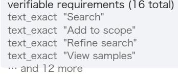

  
(d) poster  
Create a tall, portrait marketing infographic titled "Sales Process Statistics" on a smooth purple-to-blue vertical gradient background with rounded r…

## verifiable requirements (13 total) verifiable requirements

text\_exact "Sales Process Statisti…"   
text\_exact "29%"   
text\_exact "30%"   
text\_exact "43%" … and 9 more

## verifiable requirements (12 total)


## (e) poster, Chinese

Create a tall, portrait marketing infographic for an online professional training course in Chinese, set on a bright blue gradient background with rou…

verifiable requirements (12 total)   
text\_exact "千库网"   
text\_exact "做设计 上千库网"   
text\_exact "人力资源管理师"   
text\_exact "技能无忧学"   
… and 8 more   
verifiable requirements (6 total)   
text\_exact "Work"   
text\_exact "Progress"   
text\_exact "Problem Solving"   
text\_exact "Through industry train…" and 2 more


## (f) poster, Chinese

Create a tall, portrait logistics and cross-border e-commerce services infographic in Chinese with a clean blue and white corporate style.

verifiable requirements (8 total)text\_exact "全球海外仓服务"text\_exact "跨境出海一站式解决方案"text\_exact "选择我们的四大理由"text\_exact "四大核心服务 直击运营…"… and 4 more

Figure B2 Six benchmark items, each with its GPT-Image-2 reference, the opening of its generation prompt, and its first few verifiable requirements.

## Prompt and requirement inference from a source design, abridged

SYSTEM: You write assessment-oriented image-generation prompts by analysing one real reference infographic. Given one reference image, return exactly one JSON object and nothing else. Preserve the meaningful information load and evaluation value of the reference; do not demand a pixel-identical recreation. Use the image to infer layout, information density, reading flow, major visible text, charts, and tables. For visual style capture ONLY a coarse category-level cue (cool/warm palette, serif/sans-serif, flat/illustrative); do not describe specific colors, font families, or decorative detail. Omit illegible details and incidental clutter. Do not guess corrupted text or partially legible OCR fragments; if a string is uncertain, omit it rather than hallucinating it. Every text\_exact requirement must be backed by the generation\_prompt itself: if exact visible text matters, include that exact string in the generation\_prompt

before extracting it as a requirement. Only use text\_exact, chart\_data, and   
table\_data.   
CHARTS: when the image contains any chart, the generation\_prompt MUST instruct   
the generator to render it as an ECharts chart with literal data arrays.   
NON-REPRODUCIBLE VISUALS: the downstream generator emits HTML/CSS only and   
cannot render photographs, complex illustrations, hand-drawn art, or brand   
logos. When such content appears, the generation\_prompt MUST request a   
https://placehold.co/WxH?text=Description placeholder of appropriate size.   
Simple geometric icons and flat CSS shapes may be described for reproduction.   
USER: Write an image-generation prompt for later evaluation based on the   
reference image. Return one JSON object matching the schema.   
[Reference Metadata] id, reference image size, aspect ratio, orientation   
1) generation\_prompt is one coherent prompt body, not a checklist dump, and   
must not exceed 3000 characters.   
2) Preserve the important information mix: major layout zones, key headings,   
charts, tables, quantitative blocks. Include only one short coarse style   
cue.   
3) Use text\_exact for the most important clearly legible strings worth   
evaluating. Every text\_exact string must appear verbatim inside   
generation\_prompt; if it is not written there, do not include it. Cap at 12   
and calibrate to information density. Use chart\_data only for real charts   
whose literal values should remain in ECharts data, and table\_data only for   
real visible tables. Do not create structured requirements for layout,   
order, grouping, repeated structure, or count.   
4) Tell the generator to expose correctness through separate visible text   
nodes, natural DOM structure, literal ECharts data arrays, and real HTML   
tables.   
5) - 6) omitted here: output length and formatting boilerplate.   
7) soft\_cues is a single short sentence of coarse style cues only.   
[Output Rules] exactly the keys id, reference\_metadata, generation\_prompt,   
verifiable\_requirements, soft\_cues. Prefer fewer high-confidence requirements   
over broader but noisy extraction.   
[Schema Contract] {schema\_contract}   
INPUT: source\_image   
OUTPUT: {"id": ..., "reference\_metadata": ..., "generation\_prompt": ...,   
"verifiable\_requirements": [...], "soft\_cues": ...}

The second call generates the reference image with GPT-Image-2. The prompt cannot be passed through unchanged, because it was written for a code generator: a placehold.co slot tells the model to leave a region empty, and constraints such as CSS-only icons or no photographs exist only because HTML cannot draw them. Passing these through would make the reference inherit the limitations of the code target. A deterministic rewrite therefore turns each placeholder request into a description of the illustration it stands for and drops the code-only constraints and pixel sizing, while leaving layout structure, text, and chart and table values untouched, so that the reference and the requirements still describe the same artifact. A fixed prefix then asks for a contemporary editorial register and fully drawn illustrations. This instruction applies to the reference only: the code prompt still requests placeholder slots, and the judge counts a placeholder as the image being present. The canvas follows the aspect ratio of the source design, rounded to a multiple of 16.

## C Implementation and Additional Results

This section gives the settings needed to reproduce a run and the results that support the main text. All scores use the Rule and Visual columns of Table 1.

## C.1 Implementation Details

Training configuration. AesCode uses Qwen3-VL-8B and Qwen3-VL-32B backbones. Cold-start SFT uses the 3,000 demonstrations above with a learning rate of 10<sup>−5</sup>, followed by GDPO on the same 7,408 RL prompts for both scales, so that the two backbones difer only in capacity. We use verl’s FSDP–vLLM hybrid engine without a critic or a separately trained reward model. RL uses AdamW with a constant learning rate of $5 \times 1 0 ^ { - 6 }$ , no warmup, and weight decay 0.01. Each step samples 128 prompts with eight rollouts each and runs one optimization epoch; the 8B and 32B models are trained for 400 and 520 steps. KL regularization is applied in the loss rather than the reward, with KL and entropy coeficients both 0.001. Rollouts use temperature 1.0 and top-p 1.0, with prompt and response each capped at 8,192 tokens.

Inference and decoding. Benchmark generation uses three rollouts per prompt with temperature 0.8, top-p 0.95, at most 12,000 output tokens, and a model context of 24,576 tokens. Closed-source baselines are queried through their hosted APIs with the same prompt and rollout count. Reasoning-mode endpoints do not accept sampling parameters and run at provider defaults; the other hosted arms use 0.8 and 0.95. No arm is tuned on our benchmark. All generations were collected between 28 August and 18 September 2026, and we release the generated markup and renderings of every arm.

Rendering sandbox. Candidate HTML is rendered from a local file in a sandboxed Playwright browser. The canvas size comes from the reference metadata, with 1280 × 720 used only when it is absent; the viewport is enlarged when necessary and the screenshot is clipped to the canvas. ECharts and placeholder assets are served locally, and other external requests are blocked. The renderer exports the DOM, computed styles, bounding boxes, console status, and the screenshot, and a 120-second safeguard recycles stalled workers.

## C.2 Learning Dynamics of the Decoupled Reward Channels

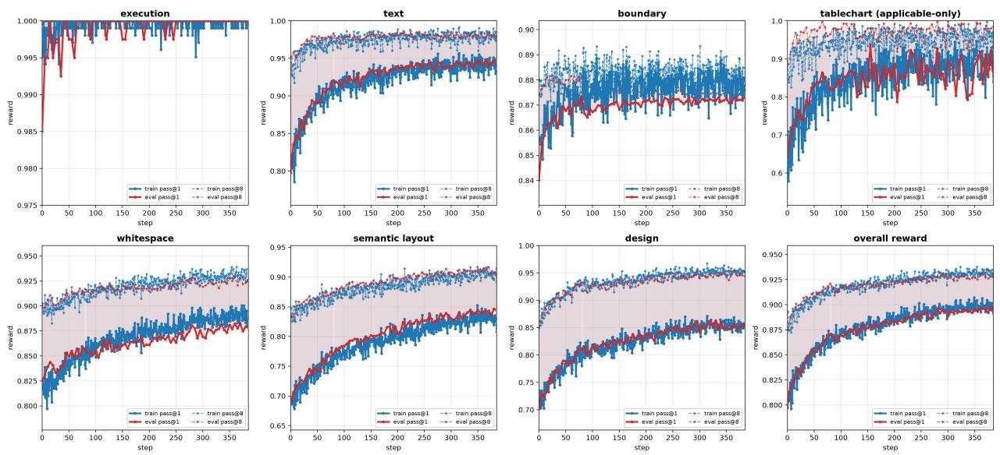  
Figure C1 Per-channel training rewards under GDPO. Solid: single rollout; dashed: mean over eight rollouts; blue: training set; red: held-out set.

Figure C1 shows that Execution saturates after cold-start SFT, while Text and Chart improve fastest (pass@1 from ≈0.79 to ≈0.94 and from ≈0.58 to ≈0.87). The design channels improve more slowly and are still rising when training ends, consistent with spatial and perceptual organization being harder to acquire. Boundary stabilizes early with low within-group variance, precisely the kind of signal that scalar aggregation would suppress. Pass@1 converges toward pass@8, so RL makes behavior that previously appeared only in the best rollouts typical of a single sample, and the close training and held-out curves show no visible reward trade-of or overfitting.

## C.3 Loss of Verifiable Capabilities under Reconstruction Objectives

A natural alternative to the decoupled reward is to score a rollout by how closely its render reproduces the reference. Table C1 evaluates this alternative under the same checklist, columns, and aggregation as Table 1; the lower block fixes the backbone, training prompts, and sampler and varies only the reward.

A reconstruction scalar does move the visual dimensions it can see: CLIP-similarity GRPO raises Layout from 71.19 to 78.45 and Visual from 60.11 to 65.69, and an absolute VLM score moves them in the same direction by a smaller margin. It does not preserve capabilities that are discrete and checkable. Chart falls from 42.35 on the backbone to 9.67, 9.78, and 15.27 across the three reconstruction arms, and the cause is visible in the markup. Among the 89 prompts with a chart\_data or table\_data requirement, we count a prompt as charted if any of its rollouts calls echarts.init, since loading the library without instantiating a chart yields exactly the static substitute at issue. The backbone charts 73 prompts and AesCode-8B 80, whereas the reconstruction arms chart only 15, 8, and 26, replacing the rest with static markup that is close in pixels and wrong in content. Published image-to-code systems show the same pattern, with UI2Code<sup>n</sup> at 7.56 Chart despite a Visual score of 59.92. A similarity scalar cannot separate a real chart from a picture of one.

Table C1 Reconstruction objectives. Upper: published image-to-code systems. Lower: the backbone, prompts, and sampler of AesCode-8B with the reward replaced by a reconstruction objective. Evaluation as in Table 1; all rows receive $I _ { \mathrm { r e f } } ;$ scores in %.
<table><tr><td>Model</td><td>Text</td><td>Bound</td><td>Chart</td><td>Rule</td><td>Content</td><td>Layout</td><td>Style</td><td>Visual</td><td>Overall</td></tr><tr><td>Image-to-code systems</td><td></td><td></td><td></td><td></td><td></td><td></td><td></td><td></td><td></td></tr><tr><td>Design2Code</td><td>39.60</td><td>54.13</td><td>0.92</td><td>31.55</td><td>19.26</td><td>9.75</td><td>2.79</td><td>10.60</td><td>21.08</td></tr><tr><td>UI2Codeⁿ</td><td>80.10</td><td>62.38</td><td>7.56</td><td>50.01</td><td>69.70</td><td>68.11</td><td>41.93</td><td>59.92</td><td>54.96</td></tr><tr><td>WebSight</td><td>25.28</td><td>62.48</td><td>0.06</td><td>29.27</td><td>27.46</td><td>20.56</td><td>7.43</td><td>18.48</td><td>23.88</td></tr><tr><td>Reconstruction objective, our data, Qwen3-VL-8B</td><td></td><td></td><td></td><td></td><td></td><td></td><td></td><td></td><td></td></tr><tr><td>Qwen3-VL-8B (backbone)</td><td>64.07</td><td>70.99</td><td>42.35</td><td>59.14</td><td>52.90</td><td>51.33</td><td>29.92</td><td>44.72</td><td>51.93</td></tr><tr><td>Reconstruction SFT</td><td>79.77</td><td>79.62</td><td>9.67</td><td>56.35</td><td>65.96</td><td>71.19</td><td>43.20</td><td>60.11</td><td>58.23</td></tr><tr><td>+ CLIP-similarity GRPO</td><td>84.49</td><td>86.36</td><td>9.78</td><td>60.21</td><td>70.42</td><td>78.45</td><td>48.20</td><td>65.69</td><td>62.95</td></tr><tr><td>+ absolute VLM GRPO</td><td>82.64</td><td>86.37</td><td>15.27</td><td>61.43</td><td>69.27</td><td>76.03</td><td>44.95</td><td>63.42</td><td>62.42</td></tr><tr><td>AesCode-8B (decoupled reward)</td><td>94.06</td><td>88.36</td><td>87.79</td><td>90.07</td><td>86.41</td><td>87.80</td><td>53.21</td><td>75.80</td><td>82.94</td></tr></table>

## C.4 Additional Qualitative Results

Figures C2 and C3 show a random sample of AesCode-32B outputs, complementing the side-by-side comparison in Figure 3 at a size where the pages can be read. Each panel is a single rollout on a randomly drawn held-out benchmark prompt, rendered in the evaluation sandbox and shown unedited. The sample covers dashboards with live charts, diagrams, slides, and tall posters, in several languages, with no per-format change to the prompt or decoding.

## D Reward System

This section specifies each training reward of Section 3.2. Reference-side evidence comes from the prompt, its requirements, and $I _ { \mathrm { r e f } }$ ; element correspondences use text, type, semantic role, and relative geometry, and no verifier requires pixel-perfect reconstruction. Figure D1 summarizes the seven channels. These rewards supply the learning signal only; the reported scores are defined separately in Section E.

## D.1 Per-Rollout Reward Record

Every rollout produces a structured record rather than a single scalar. For each channel v the record holds an applicability mask $m _ { v } \in \{ 0 , 1 \}$ , a raw score $s _ { v } \in [ 0 , 1 ]$ , and a diagnostic payload $e _ { v }$ (Table D1). Results marked not applicable are excluded from aggregation, whereas explicit zero-score failures are included. Infrastructure failures are recorded separately from semantic ones, so a judge timeout is never read as negative design feedback, and the same record serves training curves, benchmark aggregation, and qualitative diagnosis.

## D.2 Verifiable Requirements

Verifiable requirements are extracted from the prompt before generation and do not depend on any candidate output. The schema has three types: text\_exact retains the exact required string, and chart\_data and table\_data retain the expected object type, labels, series, and values. Canvas metadata supplies the target dimensions used by Boundary. Pairwise and group relations are not part of this schema; graph-bound VGR predicates supervise them during training, and the prompt-derived Visual checklist evaluates them at test

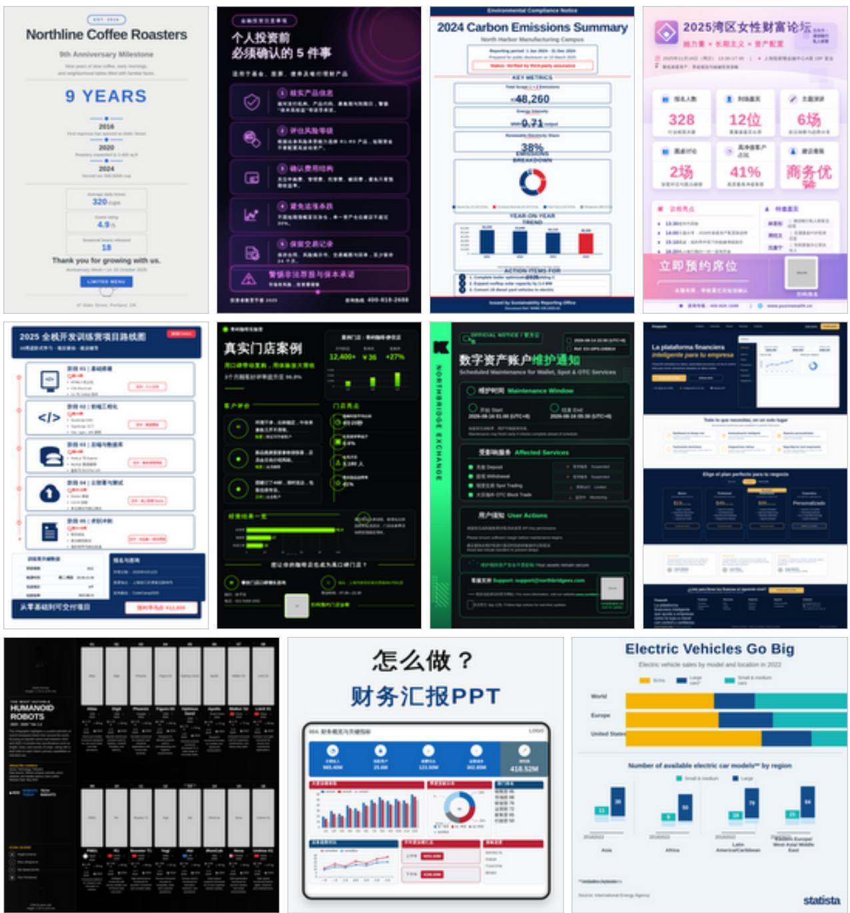  
Figure C2 Portrait and square outputs of AesCode-32B on held-out benchmark prompts.

Table D1 Fields of the per-rollout reward record.
<table><tr><td>Channel</td><td>Applicability</td><td>Recorded evidence</td><td>Output</td></tr><tr><td>Execution</td><td>all rollouts</td><td>render status, timeout, blank-page and console flags required, matched, missing, and unsupported strings</td><td>pass / severity score normalized fidelity</td></tr><tr><td>Text Boundary</td><td>required text exists rendered DOM exists</td><td>element and canvas boxes, overflow events, aspect ratios</td><td>containment and shape score</td></tr><tr><td>TableChart</td><td></td><td>parsed cells or ECharts type, categories, series, and values</td><td></td></tr><tr><td></td><td>table or chart required</td><td></td><td>structural accuracy</td></tr><tr><td>SemanticLayout</td><td>matched text blocks exist</td><td>block matches, normalized centers, distances, and coverage</td><td>spatial proximity</td></tr><tr><td>Whitespace</td><td>usable screenshots exist</td><td>coarse/fine occupancy grids and per-cell differences</td><td>multi-scale similarity</td></tr><tr><td>VGR</td><td>valid rubric exists</td><td>question, binding, pass answer, model answer, and pass flag</td><td>predicate pass rate</td></tr></table>


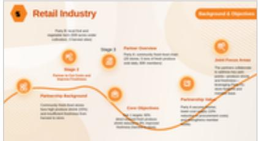

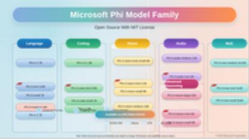


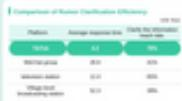


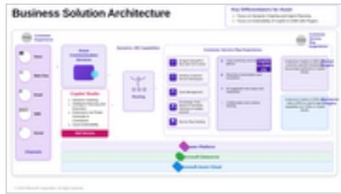


  
Figure C3 Landscape outputs of AesCode-32B on held-out benchmark prompts.

time.

## D.3 Deterministic Verifiers

Execution. Playwright aborts external requests outside the allowlist, and the static resource audit records violations without a direct penalty. Empty HTML and render blockers receive zero. A render is blank when its grayscale variance is below 8.0 and its dark-pixel ratio below 0.005, and renders exceeding 15,000 ms also fail. After network and instrumentation errors are filtered, $N _ { \mathrm { f a t a l } }$ uncaught JavaScript errors give $s _ { \mathrm { e x e c } } = \exp ( - 0 . 4 N _ { \mathrm { f a t a l } } )$ ; other warnings are kept in the payload without penalty. A blocking execution failure short-circuits downstream verification.

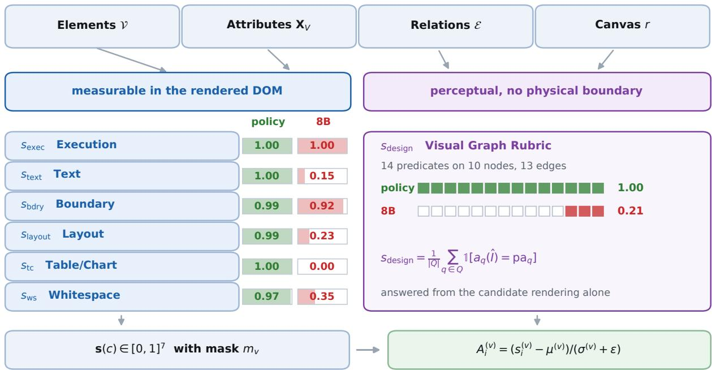

Figure D1 Reward channels. Six deterministic verifiers read the rendered DOM and screenshot. Execution: render success, decayed by uncaught JavaScript errors. Text: required strings found, weighted by overlap and in-canvas visibility. Boundary: in-canvas fraction of overflowing elements and aspect-ratio match. Layout: proximity of text blocks matched to the reference. Table/Chart: parsed table rows and ECharts series against the required data. Whitespace: cosine similarity of occupancy grids with the reference. VGR: pass rate of sample-specific yes/no predicates answered from the candidate render. Each channel is masked by applicability and normalized separately by GDPO. Values are from two rollouts on one prompt.

Text. Text is extracted from the candidate HTML with script and style nodes removed; no reference OCR enters this verifier. Each required string is checked by case-sensitive substring presence after NFKC and punctuation normalization. The binary match is multiplied by two factors computed from the rendered text boxes: the ratio of their union to their summed area, which penalizes overlap, and their mean visible fraction inside the canvas.

Boundary. Boundary combines two sub-scores computed from browser bounding boxes. The containment term is the fraction of overflowing element area that still falls inside the canvas,

$$
S _ { \mathrm { o v f } } = \frac { \sum _ { e \in \mathcal { O } } \mathrm { a r e a } ( e \cap C ) } { \sum _ { e \in \mathcal { O } } \mathrm { a r e a } ( e ) } ,\tag{D1}
$$

where C is the declared canvas and O collects elements whose horizontal or vertical excess exceeds 8 or 24 pixels; hidden nodes, decorative elements, and SVG primitives are excluded. The shape term compares the rendered aspect ratio $\boldsymbol { r } _ { \hat { I } }$ with the declared $r _ { \mathrm { r e f } } .$

$$
S _ { \mathrm { s i z e } } = \exp \left( - \lambda \frac { | r _ { \hat { I } } - r _ { \mathrm { r e f } } | } { r _ { \mathrm { r e f } } } \right) , \qquad \lambda = 2 . 5 ,\tag{D2}
$$

and the channel is their mean, $s _ { \mathrm { b d r y } } = \textstyle { \frac { 1 } { 2 } } ( S _ { \mathrm { o v f } } + S _ { \mathrm { s i z e } } )$ . The two terms capture unrelated failures: a page can match the canvas shape while spilling a table past its lower edge, or keep every element inside a canvas of the wrong proportions.

Table and chart. Tables are parsed from HTML, and each expected row is greedily matched to an unused candidate row regardless of order. Numeric cells require normalized equality, while other cells may match by normalized alphanumeric containment; the table score is the fraction of expected rows reproduced. Charts are read from live ECharts series, falling back to static script extraction. When a chart subtype is required, data and subtype contribute 60% and 40%. Both branches are multiplied by the mean in-canvas visible fraction of the elements. The record stores field-level matches, so a correct chart type with wrong values can be told apart from a missing chart (Figure D2). The channel is not applicable when the prompt requires neither a table nor a chart.

1 table in DOM, rows 2/2, s = 1.00  
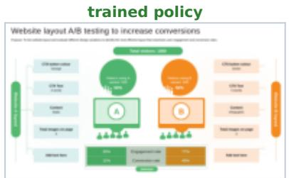

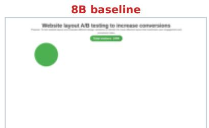  
0 table in DOM, rows 0/2, s = 0.00

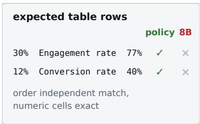

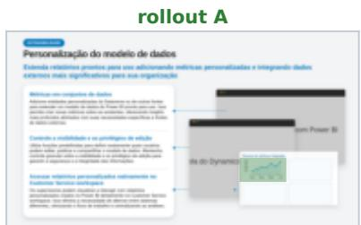  
2 chart containers, 1 live series

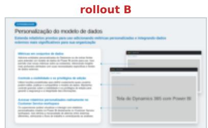  
0 chart containers, 0 live series

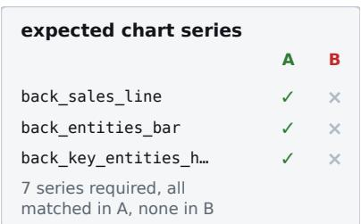  
Figure D2 Table/Chart. Outlines mark the tables and charts found in the DOM. Top: the baseline emits no table. Bottom: two rollouts on a chart prompt, with and without live ECharts instances.

Semantic layout. SemanticLayout compares where content lands rather than how it is styled. PaddleOCR extracts text boxes from the reference and candidate renders, with candidate DOM boxes as a fallback, and adjacent fragments are merged. For each reference block, candidates with SequenceMatcher similarity below 0.3 are discarded and the spatially closest remaining one is selected. A matched pair j with centre distance $d _ { j }$ in normalized canvas units receives

$$
\mathrm { p r o x } _ { j } = \exp \left( - \frac { d _ { j } ^ { 2 } } { 2 \sigma ^ { 2 } } \right) , \qquad \sigma = 0 . 1 5 .\tag{D3}
$$

Writing M for the matched pairs and $\mathcal { V } _ { \mathrm { r e f } }$ for the merged reference blocks, so that $\rho = | \mathcal { M } | / | \mathcal { V } _ { \mathrm { r e f } } |$ is the match rate, the channel is

$$
s _ { \mathrm { l a y o u t } } = \left( { \frac { 1 } { \left| { \mathcal { M } } \right| } } \sum _ { j \in { \mathcal { M } } } { \mathrm { p r o x } } _ { j } \right) { \big ( } 0 . 9 + 0 . 1 \rho { \big ) } .\tag{D4}
$$

Colour, typeface, and exact box extent do not enter the score, so a candidate may diverge stylistically but not spatially (Figure D3).

Whitespace. We extract a content mask from each screenshot by combining Canny edges with pixels whose intensity difers by more than 25 from the median border intensity, and rasterize it into coarse $( 1 2 \times 8 )$ and fine $( 2 4 \times 1 6 )$ occupancy grids. Each image is gridded in its own pixel space, so a diferent render size is not itself penalized. With flattened grids $\mathbf { g } ^ { c }$ and $\mathbf { g } ^ { f }$

$$
\begin{array} { r } { s _ { \mathrm { w s } } = \frac { 1 } { 2 } \cos \left( \mathbf { g } _ { \hat { I } } ^ { c } , \mathbf { g } _ { I _ { \mathrm { r e f } } } ^ { c } \right) + \frac { 1 } { 2 } \cos \left( \mathbf { g } _ { \hat { I } } ^ { f } , \mathbf { g } _ { I _ { \mathrm { r e f } } } ^ { f } \right) . } \end{array}\tag{D5}
$$

The coarse grid captures global visual mass, and the fine grid remains sensitive to local crowding and empty regions (Figure D4).

## D.4 Visual Graph Rubric

GPT-5.5 turns each reference into a rubric in two calls. The first reads the generation prompt and the reference and returns a layout class together with a scene graph of nodes and edges. The second receives that graph with the same prompt and image and writes yes/no questions, each bound to a node, an edge, a

reference, 21 blocks  
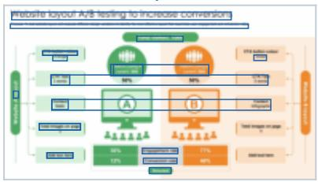

trained policy, 28 detected blocks  
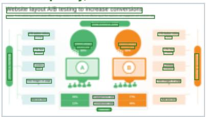

8B baseline, 4 detected blocks  
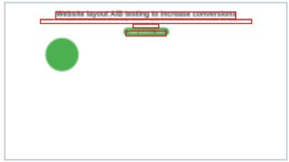

displacement of matched blocks  
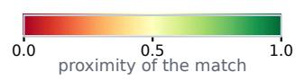  
reference block, no match  
reference to candidate centre

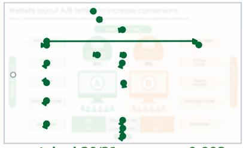

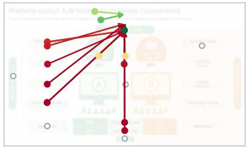

$$
S _ { \mathrm { l a y o u t } } = \mathbf { 0 . 2 3 1 }
$$

Figure D3 SemanticLayout. Top: OCR text blocks. Bottom: arrows from each reference block to its matched candidate block, coloured by proximity; hollow circles are unmatched reference blocks.  
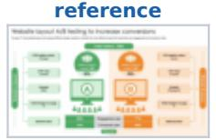

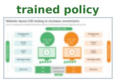

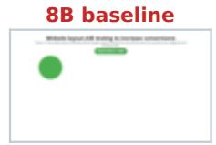

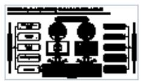

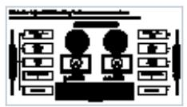

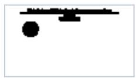

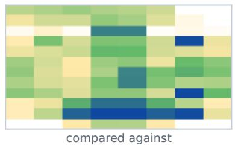

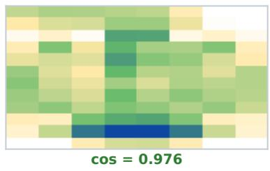

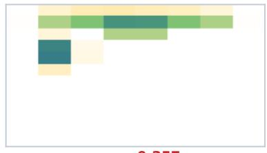

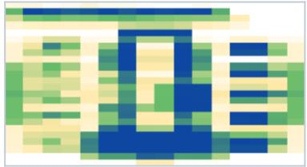  
compared against

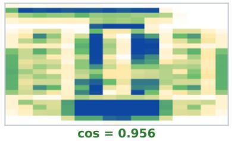  
s<sub>ws</sub> = 0.9659

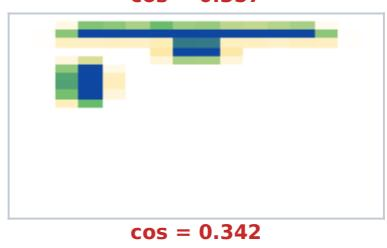  
Figure D4 Whitespace. Rendering, content mask, and coarse and fine occupancy grids; $s _ { \mathrm { w s } }$ averages the two grid cosines with the reference.

set of nodes, or the whole canvas, and typed as structure, completeness, visual attribute, relation, subgraph, forbidden, or global. Fixing the graph before the questions are written keeps the structure a question refers to from drifting, and lets every question cite the element it tests. Textual fidelity is excluded, since the Text verifier handles it. At scoring time GPT-5.5 answers the fixed rubric from the candidate rendering alone, and the reward is

$$
s _ { \mathrm { v g r } } = \frac { 1 } { | Q | } \sum _ { q \in Q } { \mathcal { H } } \Big [ a _ { q } ( \hat { I } ) = \mathrm { p a } _ { q } \Big ] .\tag{D6}
$$

Each stored predicate keeps its type, binding, question, pass-answer polarity, model answer, and pass flag, so we can see which criterion changes between two rollouts even when their aggregate scores are similar.

Three rules of the templates carry most of the behavior we rely on. First, the layout class (free form, symmetric grid, timeline sequence, hub and spoke, or hierarchical) is committed before any question is written and sets the subgraph quota, because a forced subgraph question on a flat grid is only a rowalignment question under a graph label. Second, repeated identical elements are folded into one group node with a count, so four KPI cards produce one layout predicate rather than four existence checks. Third, opaque image and icon slots are addressed only by their geometry and position, never by their depicted content, because the reference generator may draw a diferent picture in the same slot and a content question would penalize a diference the prompt never specified. A programmatic linter checks every rubric for missing bindings, inconsistent polarity, and questions about text or image content; over the 7,408 training rubrics it flags 20 (0.3%), and 99.6% of questions bind to an element of their own graph. The template asks for 10 to 20 questions, and realized rubrics average 14.1 (range 12–19).

## Call 1, scene graph extraction, abridged

```jsonl
SYSTEM: You are a scene-graph extractor for page designs. Read the brief the
design was produced from and the rendered reference, commit to a layout class
before anything else, then describe the page as a graph. Describe only what is
structurally present. Do not write questions; a later step does that.
R1 BOUNDARIES: a node is a region the eye can separate from its surroundings by
an edge, a background fill, or an unambiguous gap. Do not invent nodes for
internal padding, and do not merge two elements that a reader would treat as
separate cards.
R4 ATTRIBUTES: record only properties that are stable under redrawing, i.e.
position, extent, aspect ratio, alignment, count, fill and border colour,
shadow, and chart or icon kind. Do not record the depicted subject of a
photo, illustration, icon, or logo; use image_kind and the slot geometry.
R6 GROUP FOLDING: 3+ identical elements become ONE group node with attrs.count=N,
not N separate nodes.
STEP 1 SKELETON + LAYOUT CLASS. Choose one of symmetric_grid | hierarchical |
timeline_sequence | hub_spoke | free_form. List 5-7 essential elements;
essential means removing it breaks the story.
STEP 2 GRAPH.
NODE_TYPES containers: region, card, panel, list, group
atoms: text, chart{chart_type}, table, icon{icon_kind},
image{image_kind}, button, input, divider, connector,
badge, pyramid, funnel, timeline, banner
EDGE_TYPES spatial: contains, left_of, right_of, above, below,
aligned_with{axis}, evenly_spaced{members}
semantic: connects{direction}, timeline_step{order}, parent_of
Every node carries a stable id, a type, and an attrs object. Emit a semantic
edge only where the design actually asserts the link, e.g. a drawn arrow, a
numbered step, or containment under a parent heading.
INPUT: generation_prompt, reference_image
OUTPUT (strict JSON): {"skeleton": [...], "layout_class": ...,
"graph": {"nodes": [{"id": ..., "type": ..., "attrs": {...}}, ...],
"edges": [{"id": ..., "type": ..., "from": ..., "to": ...}, ...]}}
```

## Call 2, rubric authoring from the graph, abridged

SYSTEM: You are a scene-graph-structured rubric author. You are given the brief, the rendered reference, and the scene graph already extracted from it. Write yes/no questions against that graph. Do not add, rename, or re-type graph elements. Adapt the subgraph quota to the given layout class; forced fake subgraph questions on flat symmetric layouts are worse than no subgraph at all. R7 is MANDATORY: every semantic edge in the graph must be exercised by a matching relation question.

```jsonl
RUBRIC, 10-20 questions, quotas by layout class:
structure 3-4 arrangement / split / alignment / row / column
completeness 2-3 intact / no overlap / fully visible
visual_attr 1-2 color / shadow / border
relation 1-3 binary edge predicates; subtype required, one of
spatial | semantic_connect | semantic_sequence |
semantic_hierarchy
forbidden 1-2 at least one, e.g. "Are there extra X beyond N?" pass=no
global 2 exactly two, last, pass=yes: no unintended overlap or
occlusion; all content fully contained and unclipped
subgraph symmetric_grid / free_form: 0-1, do not force;
hierarchical, timeline_sequence, hub_spoke: 1-2.
A subgraph question must require graph structure, e.g.
"Do the 4 timeline nodes follow strict order
2018->2020->2022->2024 via the connector arrows?"
and not "Are the 6 cards in a 3x2 grid?"
ATOMICITY: one question = one binary check, no AND/OR.
INPUT: generation_prompt, reference_image, graph
OUTPUT (strict JSON): {
"rubric": [{"id": ..., "binds_to": ..., "qtype": ..., "subtype": ...,
"question": ..., "pass_answer": ..., "rationale": ...}],
"qtype_count": {...}}
```

R2 OPAQUE SLOTS: never make the depicted subject of a photo, illustration, icon,   
or logo the subject of a question; the reference generator may legitimately   
draw something else in the same slot.   
BAD: "Does the portrait depict a smiling person?"   
BAD: "Is the airplane fully visible?"   
GOOD: "Is there a photo-shaped placeholder slot in the upper-left, above   
the light-gray information panel?"   
GOOD: "Is the upper-left photo region rectangular and approximately 1:1 to   
4:3 in aspect ratio?"   
A depicted-subject noun may appear only as an anchor naming which slot.   
R3 POLARITY: every question carries pass\_answer: "yes" | "no".   
R5 BINDING: every question binds to node:<id> | edge:<id> | subgraph:<id,...> |   
global:page. The id must already exist in the given graph.   
R7 SEMANTIC EDGE COVERAGE (mandatory): >=1 connects edge requires a   
semantic\_connect question; >=2 timeline\_step edges require a   
semantic\_sequence question; >=2 parent\_of edges require a semantic\_hierarchy   
question.   
R8 NO TEXT OR IMAGE CONTENT: do not ask whether a string is present or what it   
says, and do not ask what an image shows; both are scored elsewhere.

## VGR judging template

SYSTEM: You are a strict but fair visual judge.   
You will see a SINGLE GENERATED IMAGE and a numbered list of yes/no questions   
about it. For EACH question, output a JSON line   
{"id": "...", "answer": "yes"|"no"|"unclear"}.   
Rules:   
- Answer ONLY based on what is actually visible in the generated image.   
"unclear" only if the relevant element is genuinely ambiguous or not visible   
at all (use sparingly).   
Do not assume. If the question asks about a "blue-to-pink gradient" and you   
see a flat blue, answer "no".   
Do not be lenient. The point is to find layout differences from the reference.   
Output STRICT JSON (no fences):   
{"judgments": [{"id":"q1","answer":"yes"}, {"id":"q2","answer":"no"}, ...]}   
USER: <generated image>, then   
Judge the following GENERATED image against {n} yes/no questions.

```json
Questions:
q1. ...
q2. ...
For each question, answer yes / no / unclear based ONLY on what is visible in
the image.
Output strict JSON: {"judgments": [{"id":"q1","answer":"yes"}, ...]}
```

The judge answers the whole list in one call, which keeps the cost of the channel independent of rubric length. It sees only the candidate rendering and the questions, never the reference: the reference enters the reward only through the questions authored from it, which keeps the channel from degenerating into an image-similarity score. Two complete rubrics follow.

Two complete rubrics. These examples illustrate the training VGR on benchmark instances, using the same generation prompts as the final evaluation. All archived questions are retained; reference-derived appearance and spatial criteria are not instructions in the generation prompts. Pass denotes the required answer, not a judgment of the reference. Figures D5 and D6 show the two inputs.

Product features and connectors (15 questions).

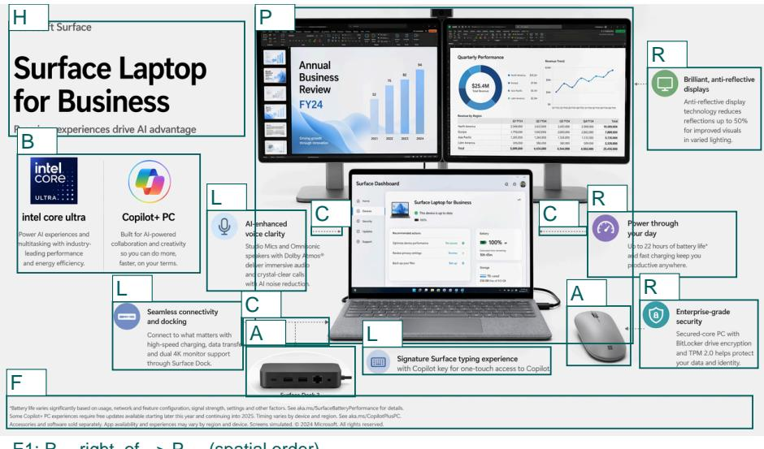  
E2: C -- connects --> P (connector group to product)

## Complete generation prompt

Create a landscape technology marketing infographic promoting a business laptop.

Include an introductory section with the branding text “Microsoft Surface”, the main title “Surface Laptop for Business”, and the subtitle “Premium experiences drive AI advantage”.

Follow with two key feature callouts: - “intel core ultra”, with concise descriptive text about AI-enabled collaboration, productivity, and on-device AI performance. - “Copilot+ PC”, with concise descriptive text about AI-enabled collaboration, productivity, and on-device AI performance.

Include a workspace setup section showing the business laptop experience with: - dual external monitors with business apps - a Surface Laptop dashboard - a docking device - a wireless mouse

Include four to six short supporting feature blurbs covering: - connectivity and docking, including high-speed charging, data transfer, and dual 4K monitor support - audio, microphones, and AI-enhanced voice clarity - “Anti-reflective display technology reduces reflections up to 50% for improved visuals in varied lighting” - security features such as drive encryption and TPM protection - “Signature Surface typing experience with Copilot key for one-touch access to Copilot”

At the end, include a fine-print legal or availability note written like a typical disclaimer paragraph.

Figure D5 Complete generation prompt and reference for the VGR example (instance sesimic\_folder\_- 2\_original\_14504). Both inputs match the frozen final-evaluation instance. Reference-derived design criteria appear in the VGR questions, not in the generation prompt.

Boxes locate stored nodes or groups; their coordinates are manual display annotations, not recorded geometry. Repeated labels mark members of the same group. C marks visible connector regions, not a claim that every target connector is present. E1 and E2 retain stored relation types and endpoints. Canvas denotes the full image.
<table><tr><td>ID</td><td>Stored node</td><td>ID</td><td>Stored node</td></tr><tr><td>H</td><td> $\mathtt { n \_ h e a d l i n e \_ b l o c k }$ </td><td>B</td><td> $\mathtt { n \_ l o g o \_ t i l e \_ g r o u p }$ </td></tr><tr><td>P L  $\mathrm { C }$ </td><td> $\mathtt { n \_ h e r o \_ p r o d u c t \_ s l o t }$   $\mathtt { n \_ l e f t \_ c a l l o u t \_ g r o u p }$ </td><td>A R</td><td> $\mathtt { n \_ s c c e s s o r y \_ s l o t \_ g r o u p }$   $\mathrm { n \_ r i g h t { \_ } c a l l o u t { \_ } g r o u p }$ </td></tr><tr><td>Canvas</td><td> $\mathtt { n \_ c o n n e c t o r \_ g r o u p }$   $\mathbf { g l o b a l : p a g e }$ </td><td>F</td><td> $\mathtt { n \_ f o o t e r }$ </td></tr><tr><td>E1</td><td></td><td></td><td></td></tr><tr><td>E2</td><td> $\mathsf { e d g e : e \_ r i g h t } .$  callouts  $\mathsf { e d g e } : \mathsf { e \_ c a l l o u t s } .$  _connect_to_product: C connects to P</td><td> $\underline { { \mathbf { \sigma } } } \mathbf { x i g h t } _ { - } \circ \mathbf { f } .$ </td><td>hero: R right of P</td></tr></table>

<table><tr><td>ID</td><td>Target</td><td>Question</td><td>Pass</td></tr><tr><td> $\mathrm { q 1 }$ </td><td>H</td><td>Is the large headline block positioned in the upper-left quadrant of the Yes poster?</td><td></td></tr><tr><td> ${ \mathrm { q } } 2 { \mathrm { \Omega } }$ </td><td>P</td><td>Is the central product image slot the largest visual element on the page? Yes</td><td></td></tr><tr><td> $\mathrm { q 3 }$ </td><td>B</td><td>Are the two badge/logo-like tiles arranged as a horizontal pair below the Yes headline area?</td><td></td></tr><tr><td> $\mathrm { q 4 }$ </td><td>A</td><td>Are the two accessory image slots placed along the lower half of the poster Yes rather than near the top?</td><td></td></tr><tr><td> $\mathrm { q 5 }$ </td><td>P</td><td>Is the central product image slot fully visible without being cropped by Yes the page edges?</td><td></td></tr><tr><td> $\mathrm { q 6 }$ </td><td>L</td><td>Are the three left-side callout blocks readable as separate blocks with Yes clear spacing between them?</td><td></td></tr><tr><td> $\mathrm { q } 7$ </td><td>R</td><td>Are the three right-side callout blocks kept inside the page boundary? Yes</td><td></td></tr><tr><td> $\mathrm { q } 8$ </td><td>C</td><td>Are the connector lines rendered as thin dotted or dashed gray lines? Yes</td><td></td></tr><tr><td> ${ \mathrm { q 9 } }$ </td><td>R</td><td>Do the right-side callouts use colored circular icon badges next to their Yes text blocks?</td><td></td></tr><tr><td> $\mathrm { q 1 0 }$ </td><td>E1</td><td>Is the right-side callout group positioned to the right of the central Yes product image slot?</td><td></td></tr><tr><td>q11E2</td><td></td><td>Do visible dotted connectors link the surrounding feature callouts toward Yes the central product or accessory slots?</td><td></td></tr><tr><td> ${ \mathrm { q } } 1 2$ </td><td>F</td><td>Is the fine-print footer placed below the main product and accessory Yes area?</td><td></td></tr><tr><td> $\mathrm { \ q 1 3 }$ </td><td>R</td><td>Are there extra right-side feature callouts beyond the expected three? No</td><td></td></tr><tr><td> $\mathrm { q 1 4 }$ </td><td>Canvas</td><td>Are all major visible elements free of unintended overlap or occlusion? Yes</td><td></td></tr><tr><td> $\mathrm { { q 1 5 } }$ </td><td>Canvas</td><td>Are all content elements fully contained, unclipped, and unfragmented? Yes</td><td></td></tr></table>

## Portrait FAQ grid and footer relations (14 questions).

In Figure D6, B locates the clinic badge; D, the header divider; ${ \mathrm { G } } ,$ the six-card FAQ grid; $\mathrm { C } ,$ the contact strip; I, its three icons; F, the footer region; W, the warning block; and $\mathrm { Q } ,$ the QR placeholder. Canvas denotes the whole page. Boxes are display annotations, not recorded geometry.

<table><tr><td>ID</td><td>Stored node</td><td>ID</td><td>Stored node</td></tr><tr><td>B</td><td> $\mathtt { n \_ t o p \_ b a d g e }$ </td><td>D</td><td> $\mathtt { n \_ h e a d e r \_ d i v i d e r }$ </td></tr><tr><td>G</td><td> $\mathtt { n \_ f a q \_ c a r d s }$ </td><td>C</td><td> $\mathtt { n \_ c o n t a c t \_ s t r i p }$ </td></tr><tr><td>I</td><td> $\mathtt { n \_ c o n t a c t \_ i c o n s }$ </td><td>F</td><td> $\mathtt { n \_ b o t t o m \_ a r e a }$ </td></tr><tr><td>W</td><td> $\mathtt { n \_ w a r n i n g \_ b l o c k }$ </td><td>Q</td><td> $\mathtt { n \_ q r \_ s l o t }$ </td></tr><tr><td>Canvas</td><td colspan="3">n_page / global:page</td></tr><tr><td>E1</td><td colspan="3">edge:e_divider_above_cards: D above G</td></tr><tr><td>E2</td><td colspan="3"> $\mathrm { \tt e d g e } : \Theta _ { - } \mathrm { w a r n i n g \mathrm { \tt } _ { - } l e f t \mathrm { \tt } _ { - } \mathrm { o f } _ { - } q r } ;$  W left of Q</td></tr></table>

<table><tr><td>ID</td><td>Target</td><td>Question</td><td>Pass</td></tr><tr><td> $\mathrm { q 1 }$ </td><td>Canvas</td><td>Is the overall composition a vertical poster with all major content stacked Yes from top to bottom?</td><td></td></tr><tr><td> ${ \mathrm { q } } 2 { \mathrm { \Omega } }$ </td><td>G</td><td>Are the six FAQ cards arranged as a 3-column by 2-row grid?</td><td>Yes</td></tr><tr><td> $\mathrm { q 3 }$ </td><td>C</td><td>Is the contact information strip a single wide rounded panel spanning Yes most of the poster width?</td><td></td></tr><tr><td> $\mathrm { q 4 }$ </td><td>F</td><td>Does the bottom area use a two-part layout with the warning block on Yes the left and the QR-code slot on the right?</td><td></td></tr><tr><td> $\mathrm { q 5 }$ </td><td>G</td><td>Is each FAQ card fully visible within its rounded card boundary?</td><td>Yes</td></tr><tr><td> $\mathrm { q 6 }$ </td><td>Q</td><td>Is the QR-code placeholder area fully visible as a square slot in the Yes lower-right section?</td><td></td></tr><tr><td> $\mathrm { q } 7$ </td><td>I</td><td>Are the three contact icons contained inside the contact strip?</td><td>Yes</td></tr><tr><td> $\mathrm { q } 8$ </td><td>B</td><td>Does the top-left badge have a thin neon purple-pink rounded outline? Yes</td><td></td></tr><tr><td> ${ \mathrm { q 9 } }$ </td><td>G</td><td>Do the FAQ cards use dark translucent fills with purple outlined rounded Yes borders?</td><td></td></tr><tr><td> $\mathrm { q 1 0 }$ </td><td>E1</td><td>Is the thin horizontal divider positioned above the FAQ card grid?</td><td>Yes</td></tr><tr><td> $\mathrm { q 1 1 }$ </td><td>E2</td><td>Is the warning block positioned to the left of the QR-code placeholder Yes area?</td><td></td></tr><tr><td> ${ \mathrm { q } } 1 2$ </td><td>G</td><td>Are there extra FAQ cards beyond the six-card grid?</td><td>No</td></tr><tr><td> $\mathrm { \ q 1 3 }$ </td><td>Canvas</td><td>Are all major visible elements free of unintended overlap or occlusion?</td><td>? Yes</td></tr><tr><td>q14</td><td>Canvas</td><td>Are all content elements fully contained, unclipped, and unfragmented? Yes</td><td></td></tr></table>


## Complete generation prompt

创建一张 1024x1536 的竖版中文医疗/心理健康FAQ 海报，用于医疗机构前台展示。内容按以下顺序组织：页眉、FAQ 主体、门诊信息、页脚提示与预约二维码。所有元素可用 HTML/CSS 实现，不使用照片。

页眉包含门诊标识“安宁心理门诊”，主标题“心理咨询常见问题 FAQ”，副标题“面向成人情绪困扰、睡眠问题与压力管理的初诊说明”。

FAQ 主体包含 6 个问题与回答，按以下顺序呈现：

1. 问题“第一次来访会做什么？”，回答说明首次评估通常 50 分钟，包含症状梳理、目标确认与风险评估。

2. 问题“咨询适合哪些情况？”，回答提到焦虑、情绪低落、人际压力、失眠与工作倦怠。

3. 问题“是否需要提前预约？”，回答中明确写“建议至少提前24小时预约”。

4. 问题“单次咨询费用是多少？”，回答中明确写“初诊 380 元 / 50 分钟”和“复诊 320 元 / 50 分钟”。

5. 问题“隐私会被保护吗？”，回答提到严格遵循保密原则，除法律规定与紧急风险外不会向第三方披露。

6. 问题“可以线上咨询吗？”，回答写明支持视频复诊与稳定期随访。

FAQ 之后提供门诊信息：“门诊时间：周二至周日 09:00–20:30”，“地址：杭州市拱墅区文晖路318号 安宁心理中心 5层”，“预约电话：0571-8823-6149”。

页脚包含提示文字“若出现自伤、自杀想法或明显精神危机，请立即拨打当地急救电话或前往最近医院急诊。”；同时提供预约二维码，使用 https://placehold.co/160x160?text=%E9%A2%84%E7%BA%A6%E4%BA%8C%E7%BB%B4%E7%A0%81 ，并标注“扫码预约初诊”。

Figure D6 Portrait FAQ example (instance poster\_v2\_00018). The complete Chinese generation prompt and reference match the frozen evaluation inputs. The reference is shown once, with display annotations locating the stored groups and relations.

## E Evaluation Protocol and Human Study

The final benchmark does not reuse the reference-conditioned SemanticLayout, Whitespace, or VGR rewards of Section D; every reported score is computed from the prompt and the candidate rendering alone. Rule averages the prompt-derived Text, Boundary, and Table/Chart scores, and 89 of the 300 prompts carry at least one table or chart requirement. Visual is produced by the checklist pipeline below. Because both Visual and the training rubric rest on model judgments, the section closes with a blinded human study that audits them.

## E.1 Visual Checklist

Checklist questions are authored from the prompt and its parsed requirements, and proposals that are ambiguous, not decidable from a rendering, or that prescribe a particular implementation are discarded. The pipeline was developed on a separate 50-instance set that does not overlap the benchmark, then frozen and applied unchanged to the 300 benchmark items. The frozen checklists contain 10,727 questions, of which 1,925 are Content, 4,565 Layout, and 4,237 Style, with 26–50 questions per prompt (mean 35.8). Each question is answered from the candidate rendering, a dimension score is the pass rate of its questions, and Visual is the mean of the available dimensions; the two prompts with no Content question have that dimension excluded rather than scored zero.

Every question names the element it is about, is decidable from a single rendering, and carries a kind label that maps to one dimension. Content collects kinds that ask whether a required element is present and intact, such as located presence, element count, and element integrity. Layout collects kinds about how elements sit relative to one another or to the canvas, such as collision, containment, structure, and page balance. Style collects kinds about the quality of rendering, such as element quality, icon quality, concrete attribute, and page density. Per-kind quotas keep a page from being scored almost entirely on whether its strings are present. The contract each question must satisfy is given below.

Each question must:   
- be answerable YES or NO from a single rendered image, with no reference   
image and no access to the markup;   
- name the element it is about, so that the answer can be attributed;   
- state any threshold it depends on, such as a fraction of the canvas or a   
ratio between margins;   
- carry an explicit pass\_answer, since some questions state a property the   
page should have and others ask whether a defect is present;   
- declare its kind, which fixes the dimension it is reported under.   
Reject a proposed question if it:   
- asks about the content of a placeholder image slot;   
- prescribes a particular implementation rather than a visible outcome;   
- restates a browser default that any page satisfies;   
- bundles several claims that could not fail independently.

A small number of whole-page Style questions are written as disqualifier lists, in which any one of several defects fails the page; the delivery-gate questions in Section E.1 are of this form. They ask whether the page clears a publication bar at all, so splitting them would report one verdict several times. They bind to the canvas, and all element-level questions follow the atomicity rule.

At scoring time the frozen checklist is answered one category at a time over the same image, so the judge has a single decision criterion per call. We reproduce the judging template in full. Three of its provisions matter for reading the numbers. The canvas is fixed, so an element that runs past the edge counts as lost content, while full-bleed bands that merely touch the edge are not defects. Placeholder boxes are required by our prompts and count as the image being present, the evaluation-side counterpart of the opaque-slot rule in Section D.4. Every answer must cite the region it was read from, and an answer that cannot is recorded as unclear and scored as a failure, so a property the judge cannot verify does not silently pass.

## Checklist judging template

SYSTEM: You are a strict but fair judge of a generated web page.   
You see ONE GENERATED PAGE IMAGE and a numbered list of yes/no questions about   
it. There is no reference or target image; you are never asked whether the page   
resembles anything.   
{brief} <- the brief for this call, printed in the next box   
Rules:   
- Answer ONLY from what is visible in the image.   
- The image is a FIXED-SIZE CANVAS, like a slide or a poster. It is not a   
scrolling page and it was not extended to fit the content: anything the page   
laid out beyond this canvas is gone and you are seeing all there is. So an   
element that runs into the canvas edge and stops mid-way -- a severed word, a   
card with no bottom, a row of tiles whose last tile is sliced -- is content   
that was genuinely lost, and it is a real defect. Judge the composition as a   
design that had to fit this canvas.   
- Full-bleed design is legitimate, not a defect: background bands, headers,   
footers and images may deliberately extend to the page edge. The test is   
whether something is CUT THROUGH, not whether it touches the edge.   
- Read each question's polarity carefully. Some ask whether a DEFECT is present   
or whether a requirement was broken; for those, "yes" means the problem IS   
there.   
- Grey placeholder boxes, often labelled with their pixel size, are REQUIRED by   
the brief: the models are told to stand images in with https://placehold.co   
rather than draw them. Treat a placeholder as the image being present and   
correctly placed. Never call it missing, unfinished, low-contrast or a design   
defect.   
- Questions quote exact text. Match it by its distinctive words; differences in   
case or punctuation do not matter, but missing or different content does.

A page carrying more content is not thereby worse, and a page carrying less is   
not thereby better. Do not report a defect unless you can point to the   
specific elements involved; adjacent or tightly spaced is not the same as   
overlapping.   
- Do not be lenient and do not be charitable. If a property is only partly true,   
answer what the visible evidence shows.   
How to decide each answer. This is a procedure, not advice, and it is the same   
for every question and every category:   
1. Before you answer, find the evidence in the image and put it in \`where\`: the   
region you looked at and what you saw there. \`where\` is REQUIRED on EVERY   
answer. "yes" and "no" are equally claims about the image and both must be   
shown. Neither one is the safe default.   
2. If you cannot write that \`where\` from the image, you do not have the   
evidence, and "unclear" is your only remaining answer. You may not fall back   
on "yes", and you may not fall back on "no" either.   
3. Answer "unclear" whenever the evidence is missing, ambiguous, too small to   
resolve, or you would answer differently on a second look. Say in \`where   
what you looked for and could not resolve.   
Both answers need evidence because the questions do not share a polarity. Some   
state a property the page should have, where "yes" is the good outcome. Others   
ask whether a defect is present, where "no" is the good outcome. You are not   
told which kind you are looking at, and you must not try to infer it: decide   
only what the image shows.   
What does NOT count as evidence, in either direction:   
- Not seeing something. Failing to find a defect does not establish that a   
stated property holds, and failing to find an element does not establish that   
it is absent. A region you did not resolve is "unclear", not "no".   
- The page looking clean, orderly, professional or complete overall.   
- What a region probably contains, judged from the rest of the page.   
- The brief, the question's own wording, or what a page like this usually does.   
- A guess you would not repeat if you looked again.   
"unclear" is scored as a FAILURE. That is intended. A question you cannot   
resolve should not earn a point, whichever answer would have earned it. Do not   
avoid "unclear" to seem decisive, and do not treat it as a last resort: on a   
question whose evidence you cannot locate, it is the correct answer, not a   
failure of nerve.   
Output STRICT JSON, no code fences. \`where\` must be filled on every judgment:   
{"judgments": [   
{"id":"C\_title","answer":"yes",   
"where":"title bar, top-left, reads 'Quarterly Review'"},   
{"id":"L\_overlap","answer":"no",   
"where":"checked the gap between the chart and the legend at mid-right;   
roughly 20px of clear space, no marks crossing"},   
{"id":"L\_grid","answer":"unclear",   
"where":"looked for the fourth card in the lower row; that area is blank   
and I cannot tell if it was dropped or intended"}]}   
USER: <generated page image>, then the numbered question list for this call.

The brief substituted at {brief} is the only part of the prompt that changes between calls, and it states the standard of proof for its category. The relation and style briefs demand a higher standard than completeness, because those are the categories where a page that merely looks orderly is easiest to mistake for one that satisfies the question.

## Per-dimension briefs substituted into the judging template

completeness:   
Each question asks whether a required element is PRESENT and visible. Judge   
presence only; do not deduct for it looking different from what you might   
expect. Presence means you located the element and can say where it is, not

<table><tr><td rowspan="2">by the canvas edge is content that was lost.</td><td rowspan="2"></td><td rowspan="2">that the page has a region where it would belong. Where a question fixes a</td><td rowspan="2"></td><td rowspan="2"></td></tr><tr><td>count or a region, both must hold. An element that is present but cut through</td></tr><tr><td rowspan="4">relation:</td><td></td><td></td><td></td><td></td></tr><tr><td>Each question asks whether a stated spatial or structural relation between</td><td></td><td></td><td></td></tr><tr><td>elements holds: side by side, stacked, in a row or grid, contained, ordered,</td><td></td><td></td><td></td></tr><tr><td>clear of one another. Answer these to a HIGHER standard of proof. A pass requires that you locate BOTH elements named in the question and can see the</td><td></td><td></td><td></td></tr><tr><td rowspan="4">relation between them; a page that merely looks orderly is not evidence. If a</td><td>if their marks touch, cross or print over one another anywhere, that is a failure even when the rest of the page is fine. If a question asks whether</td><td></td><td>question asks whether one thing stays clear of another, check the actual gap:</td></tr><tr><td></td><td></td><td></td></tr><tr><td>something is contained, the whole element must be inside, not most of it.</td><td></td><td></td></tr><tr><td></td><td>Partly true is not true. Where you cannot find one of the named elements, or cannot resolve the relation at this resolution, answer &#x27;unclear&#x27;rather than</td><td></td></tr><tr><td></td><td>assuming the page is fine.</td><td></td><td></td><td></td></tr><tr><td></td><td></td><td></td><td></td><td></td></tr><tr><td>style_strict:</td><td></td><td></td><td></td><td></td></tr><tr><td></td><td></td><td></td><td></td><td></td></tr><tr><td></td><td>Each question asks whether ONE stated visual property holds, or whether a</td><td></td><td></td><td></td></tr><tr><td></td><td>complex construct such as a timeline, chart, flow or icon is properly realised</td><td></td><td></td><td></td></tr><tr><td>rather than crudely faked. Answer these to a HIGHER standard of proof than the</td><td></td><td></td><td></td><td></td></tr><tr><td>other categories. A pass requires that you can point at the specific pixels</td><td></td><td></td><td></td><td></td></tr><tr><td>that establish the property, and that you would give the same answer looking</td><td></td><td></td><td></td><td></td></tr><tr><td></td><td></td><td></td><td></td><td></td></tr><tr><td></td><td>again. Partly true is not true. A construct that merely gestures at the form,</td><td></td><td></td><td></td></tr><tr><td>such as boxes in a row standing in for a timeline with no connecting spine, or</td><td></td><td></td><td></td><td></td></tr><tr><td></td><td></td><td></td><td></td><td></td></tr><tr><td>an icon that is an unrecognisable blob, does not pass. Where you cannot find</td><td></td><td></td><td></td><td></td></tr><tr><td></td><td>that specific evidence, answer &#x27;unclear&#x27; rather than guessing; &#x27;unclear&#x27; is</td><td></td><td></td><td></td></tr><tr><td></td><td></td><td></td><td></td><td></td></tr><tr><td>scored as a failure, which is the correct outcome for a property you cannot</td><td></td><td></td><td></td><td></td></tr><tr><td>actually verify. Do not credit a page for effort, for looking busy, or for</td><td></td><td></td><td></td><td></td></tr><tr><td></td><td></td><td></td><td></td><td></td></tr><tr><td></td><td></td><td></td><td></td><td></td></tr><tr><td>browser defaults such as a heading already being larger than body text.</td><td></td><td></td><td></td><td></td></tr><tr><td></td><td></td><td></td><td></td><td></td></tr><tr><td></td><td></td><td></td><td></td><td></td></tr></table>

A complete checklist. This example reproduces all 33 evaluation questions for one instance, covering Content, Layout, and Style. It was selected for legible policy and metric groups, not model scores. Figure E1 shows the prompt and an image illustrating the subject matter.

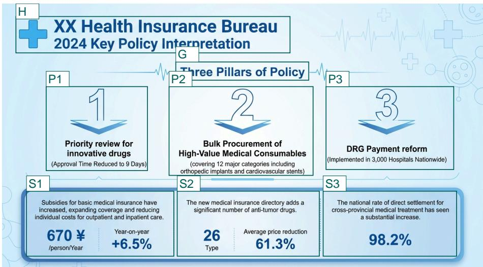

## Complete generation prompt

Create a landscape infographic in a wide format about the “2024 Key Policy Interpretation” for “XX Health Insurance Bureau”.

Begin with the organization name “XX Health Insurance Bureau”, followed by the subtitle “2024 Key Policy Interpretation”. Then add the heading “Three Pillars of Policy”.

Present three numbered policy pillars in order:

1. “Priority review for innovative drugs” Include the supporting text: “(Approval Time Reduced to 9 Days)”

2. “Bulk Procurement of” “High-Value Medical Consumables” Include the supporting text: “(covering 12 major categories including orthopedic implants and cardiovascular stents)”

3. “DRG Payment reform” Include the supporting text: “(Implemented in 3,000 Hospitals Nationwide)” After the three pillars, include a section with three content groups containing short explanatory text and key metrics.

The first group should cover subsidies. Include a concise paragraph about subsidies, followed by the metric “670 ¥” and the unit “/person/Year”. Also include the label “Year-on-year” with the value “+6.5%”.

The second group should mention that the new medical insurance directory adds anti-tumor drugs. Include two metrics: “26” with the label “Type”, and “Average price reduction” with the value “61.3%”.

The third group should describe the national rate of direct settlement for cross-provincial medical treatment.   
Include the key value “98.2%”.

Do not include charts.

Figure E1 Complete generation prompt and illustrative reference for the evaluation example (instance vendor\_data\_original\_903). The prompt comes from the frozen final-evaluation data.

H locates the title block; G, the section heading; P1–P3, the three policy pillars; and S1–S3, the subsidy, drug-directory, and cross-provincial-settlement groups. Canvas means the whole page. These are manual reading aids for this figure, not additional graph bindings or layout requirements in the evaluator. Question IDs, dimension assignments, and pass polarities are retained from the records; “Pass” states the required answer and does not report a model outcome.

## Content

<table><tr><td>ID</td><td>Target</td><td>Question</td><td>Pass</td></tr><tr><td>N10</td><td>Canvas</td><td>Are there more than zero chart visualizations in the content sections?</td><td>No</td></tr><tr><td>N11</td><td>P1-P3</td><td>Are all three numbered policy pillars drawn whole, with no part of any Yes pillar severed by the canvas edge?</td><td></td></tr><tr><td>N12</td><td>S3</td><td>Is the cross-provincial direct settlement content, including “98.2%&quot;, drawn Yes wholly inside the canvas rather than cut off by a page edge?</td><td></td></tr></table>

Layout  
Content
<table><tr><td>ID</td><td>Target</td><td>Question</td><td>Pass</td></tr><tr><td>N14</td><td>S3</td><td>Are all digits of “98.2%&quot; fully visible, with none clipped by a page edge Yes or by the boundary of whatever element holds the value?</td><td></td></tr><tr><td>N15 S1</td><td></td><td>Is the subsidies group, including the “670 ¥&quot; metric and its unit, drawn Yes whole rather than cut off by a page edge?</td><td></td></tr></table>

<table><tr><td>ID</td><td>Target</td><td>Question</td><td>Pass</td></tr><tr><td>q1</td><td>H</td><td>Is the title block, carrying “XX Health Insurance Bureau&quot; and “2024 Key Policy Interpretation&quot;, encountered before the three numbered policy pillars?</td><td>Yes</td></tr><tr><td>q2</td><td>G/P1-P3</td><td>Does the section heading “Three Pillars of Policy&quot; read as introducing Yes the three numbered pillars, rather than attaching to the title block or to</td><td></td></tr><tr><td>q3</td><td>P1-P3</td><td>the later content groups? Does each numbered policy pillar keep its own supporting text with it? Yes Answer no if any pillar&#x27;s supporting text sits closer to a different pillar</td><td></td></tr><tr><td>q4</td><td>S1-S3</td><td>than to its own. Do the three metric content groups read as one later section, encountered Yes after the three numbered pillars rather than interleaved with them?</td><td></td></tr><tr><td>q6</td><td>S1-S3</td><td>Are all three post-pillar content groups present and legible on the page? Yes</td><td></td></tr><tr><td>q10</td><td>G / P1-P3</td><td>Is the section heading “Three Pillars of Policy&quot; encountered before the Yes first numbered pillar?</td><td></td></tr><tr><td>q11</td><td>S1-S3</td><td>Does each metric content group keep its own explanatory text and its Yes own metric values together, with neither spilling into a neighbouring group?</td><td></td></tr><tr><td>X01</td><td>P1-P3</td><td>Are the three numbered policy pillar items presented in the brief&#x27;s 1–2–3 Yes order, with each number attached to its own pillar title?</td><td></td></tr><tr><td>X02</td><td>S1-S3</td><td>Do the three metric content groups read as three distinct groups, with Yes each group&#x27;s metric values visually attached to that group rather than to a neighbour?</td><td></td></tr><tr><td></td><td>N16 P1-P3</td><td>Do any of the three numbered policy pillars overlap each other? Count No only shared area or content crossing into a neighbouring pillar, not a narrow gap.</td><td></td></tr><tr><td>N17</td><td>P2</td><td>Does the supporting text of the second policy pillar run outside that No pillar into a neighbouring pillar?</td><td></td></tr><tr><td>N18</td><td>S3</td><td>Do decorative or background elements overlap the “98.2%&quot; callout? Count No only actual overprinting or touching of the digits or their label.</td><td></td></tr><tr><td>N19</td><td>S1-S3</td><td>Do dividers, borders, or background shapes cut through the metric No numbers or the explanatory text of the three content groups?</td><td></td></tr><tr><td></td><td>H03 P2 / S1-S3</td><td>Is the second pillar&#x27;s parenthetical supporting text kept visually with the Yes second pillar and clear of the later content groups? Answer no if it sits closer to a content group than to its own pillar, or if that supporting text</td><td></td></tr><tr><td></td><td>H04 P1-P3</td><td>is absent. Do the three numbered pillar titles stay legible, with no other element Yes crossing through or covering their lettering? Answer no if any pillar title is missing or its lettering is obscured enough to be unreadable.</td><td></td></tr></table>

Layout
<table><tr><td>ID</td><td>Target Question</td><td></td></tr><tr><td>WS01 Canvas</td><td></td><td>Consider the page as a whole, ignoring its background colour. Is the Yes content spread over the page, with no empty region larger than about a quarter of the page? Answer no if the content stops partway down and leaves a wide empty band across the bottom, if a whole column or side of the page carries nothing, or if there is a large hole in the middle. Measure the empty region against the full page, not against the neighbouring</td></tr></table>

<table><tr><td>ID</td><td>Target</td><td>Question</td><td>Pass</td></tr><tr><td>H06</td><td>S1</td><td>In the subsidies group, is the unit “/person/Year&quot; rendered with the “670 Yes ¥&quot; metric so it clearly belongs to that value? Answer no if the unit is not fully readable, or if it appears to label a different metric.</td><td></td></tr><tr><td>SL01 Canvas</td><td></td><td>Is there a visible hierarchy across the page, and do the title block, the Yes section heading “Three Pillars of Policy&quot;, the three numbered pillars, and the three content groups read as distinct levels rather than one undifferentiated block? Answer no if any of the four reads at the same weight as its neighbours, or if a reader cannot tell where one level ends</td><td></td></tr><tr><td>SL02 P1-P3</td><td></td><td>and the next begins. Does every numbered policy pillar keep its number clearly associated Yes with its own pillar title, and does the visual reading order of the pillars match 1, 2, 3? Answer no if any number appears closer to a different</td><td></td></tr><tr><td></td><td>SL03 Canvas</td><td>pillar title, or if the numbers are encountered out of order. Do the title block, every numbered policy pillar, and every post-pillar Yes content group use coordinated but distinct visual treatment so the pillars read as one set and the content groups as another? Answer no if any</td><td></td></tr><tr><td>SL04 S1-S3</td><td></td><td>member of either set is given visibly different treatment from its peers. Do all specified metric values in the three post-pillar content groups read with their own unit or label as clear metric pairings? Answer no if any metric pairing is unreadable or visually attaches to the wrong content</td><td> Yes</td></tr><tr><td>SL05 Canvas</td><td></td><td>group. Is every numbered policy pillar marker and every specified metric value Yes visually distinguishable from the surrounding explanatory text? Answer no if any marker or value blends into nearby paragraph text.</td><td></td></tr><tr><td>SL06 S1-S3</td><td></td><td>Does each of the three post-pillar content groups keep its explanatory Yes text plus numeric values as one clear cluster? Answer no if any group&#x27;s explanatory text sits closer to another group&#x27;s metric than to its own, or if a cluster is unreadable from overlap.</td><td></td></tr></table>

## Style: shared judging instruction for DG01–DG05

Judge this against finished professional design work, the standard of a studio’s released output. Do not judge it against the other attempts you have seen, and do not judge it as a hunt for mistakes. A page can contain no outright error and still be a long way from that standard. Being plain, safe, generic or underdeveloped is not neutral here: it means the work is unfinished, and a page with little on it has more design left to do, not less.

The preceding instruction is an identical prefix in each of DG01–DG05; it is printed once here. Each complete question is that prefix followed by its row below. No question text is omitted.

<table><tr><td>ID</td><td>Target</td><td>Question</td><td>Pass</td></tr><tr><td>DG01 Canvas</td><td></td><td>Is the colour work already at that standard, so that a designer taking this over would change nothing about it? Answer no if the palette is a default or a safe choice rather than a considered one, if colour only fills shapes instead of carrying structure and meaning, if the page falls back on plain white and grey because no palette was committed to, if any hue</td><td>Yes</td></tr><tr><td>DG02 Canvas</td><td></td><td>is off, or if the tints and neutrals have not been tuned to sit together. Is the typography already at that standard, so that a designer taking this over would change nothing about it? Answer no if the type reads as browser defaults dressed up, if the scale is a few sizes chosen by eye rather than a system, if two sizes do the same job, if the page never commits to a display size where it needs one, or if line length, line spacing or optical</td><td>Yes</td></tr><tr><td>DG03 Canvas</td><td></td><td>alignment would be corrected in review. Has the material on this page actually been designed rather than merely Yes placed, so that a designer would neither add anything nor take anything away? Answer no if a section is a plain list or a plain block that a designer would have given form to, if a region is empty because nothing was developed for it rather than because the composition wanted the</td><td></td></tr><tr><td>DG04 Canvas</td><td></td><td>rest, if anything reads as a placeholder, if filler is occupying space, or if something important was given less room than it deserves. Is this page composed, so that the eye is led first, second and third exactly Yes as intended and nothing would be adjusted? Answer no if the page is only stacked in a reasonable order without being composed, if nothing on it is genuinely dominant, if the first thing seen is not the most important</td><td></td></tr><tr><td>DG05 Canvas</td><td></td><td>thing, if two elements compete for the same rank, or if any part goes flat and stops directing the eye. Is every repeated component resolved to the standard of released work, Yes so that none of them would be revisited? Answer no if any card, row, tile, chip, label or control is a default container rather than a designed one, if one instance is less resolved than its neighbours, if spacing inside repeated elements varies without reason, or if a designer picking this up</td><td></td></tr></table>

## E.2 External Benchmark Protocols

We evaluate Design2Code, SlidesBench, and GDB/lica under their oficial protocols. Design2Code measures block matching, text similarity, position, color, and CLIP similarity against the target webpage, and generations that fail to render receive zero. SlidesBench scores content, layout, and color on a 0–5 scale. For GDB/lica we report NIMA, CLIP, PickScore, FID, color harmony, and OCR fidelity, where OCR is the fraction of ground-truth tokens recovered by Tesseract (page segmentation mode 6) after the benchmark’s normalization; on the same 100 renders it gives 0.719, 0.561, and 0.685 for GPT-5.5, Qwen3-VL-32B, and AesCode-32B. All rows of Table 2 are run by us with one decoding, rendering, and scoring pipeline per benchmark, so scores are comparable across systems within a benchmark but not across benchmarks.

## E.3 Human Study on Our Benchmark

We recruited 52 participants and retained 150 completed questionnaires after quality control; questionnaires completed by the same participant contain disjoint items, and all participants gave informed consent. Each questionnaire has 35–36 formal items, namely six judge-reliability, 10–11 Content, three or four aesthetic, and 16 consistency items, plus an instruction check and an obvious visual sentinel. Every formal item is judged by three diferent participants. Block and item order are counterbalanced, and system identity, automatic scores, machine answers, and reference images are hidden. Incomplete sessions, failed checks, and image-loading failures are excluded independently of response direction, and uncertainty estimates account for repeated observations within sessions and briefs.

Judge reliability. This study asks whether people reproduce the local decisions of the automatic judges. We sample 150 predicates each from the training VGR and the Visual checklist, stratified by dimension. Each page shows one candidate image and one predicate, answered Yes, No, or Unclear, and the automatic answer is compared with the three-person majority. For the automatic judge, Unclear is a failure because every answer must cite evidence; for people, Unclear is missing, since abstaining is not asserting that a property is absent. Agreement is therefore computed over predicates whose human majority is Yes or No.

Content and aesthetic quality. This study tests whether AesCode-32B satisfies more explicit Content requirements than GPT-5.5 while matching its aesthetic quality. The Content task covers all 267 eligible briefs with one frozen image per system: of the 300 briefs, 30 are reserved for the pilot that fixed the protocol, two have no Content question, and one lacks a complete set of GPT-5.5 renders. Participants see the brief, one image, and its Content questions; the two systems appear on separate pages, and no session contains both versions of a brief. Responses are averaged within question and then within image, with Unclear treated as missing. The aesthetic task shows one image from each system for 80 briefs, without the brief or checklist, and asks for a 1–7 rating. Equivalence requires the entire 95% confidence interval of the diference to lie within the pre-specified [−0.5, +0.5] margin.

Score–preference consistency. This study asks whether Visual scores predict human preference. Five images for each of 80 briefs form ten within-brief pairs. Participants see one anonymized pair without the brief and choose A better, B better, Tie, or Unclear; each pair receives three judgments with balanced left–right order. For pairs with unequal scores, choosing the higher-scoring image counts 1, Tie 0.5, and the lower-scoring image 0, with Unclear missing. Equal-score pairs are reported separately, and agreement is broken down by score gap.

## E.4 Human Study on External Benchmarks

We additionally collect 50 completed questionnaires of 16 or 17 pairwise items for Design2Code, SlidesBench, and GDB/lica. For each benchmark, the eight evaluated systems form 28 model pairs, from each of which we freeze two score-blind, same-task comparisons, giving 56 image pairs per benchmark and 168 overall; every pair is judged five times, for 840 judgments. Each page shows two anonymized outputs and asks which is more aesthetically polished, with the task, reference, system identity, and scores hidden.

Each benchmark is summarized by a per-sample composite. Design2Code averages Block, Text, Position, Color, and CLIP; SlidesBench averages Content, Layout, and Color; GDB/lica averages normalized NIMA, CLIP, PickScore, Color Harmony, OCR, and a reversed paired feature distance, since FID is defined only over a set of images. Agreement is scored as above and averaged first within and then across pairs. To compare gaps across scales we use $1 0 0 | s _ { A } - s _ { B } | / R$ , where R is the metric range, grouped into < 5, 5–15, and ≥ 15; confidence intervals use a source-task cluster bootstrap (Table E5).

Table E5 Human agreement with each metric’s score ordering, by relative score gap.
<table><tr><td>Metric</td><td>&lt; 5% of range</td><td>5–15% of range</td><td>≥ 15% of range</td></tr><tr><td>Our Visual</td><td>66.72%</td><td>80.00%</td><td>93.76%</td></tr><tr><td>Design2Code</td><td>44.67%</td><td>66.84%</td><td>82.50%</td></tr><tr><td>SlidesBench</td><td></td><td>74.00%</td><td>91.25%</td></tr><tr><td>GDB/lica</td><td>52.63%</td><td>74.67%</td><td>90.23%</td></tr></table>

## F Failure Analysis

Section 4.4 names three residual failure modes. This appendix measures them and analyzes why the relational and semantic modes persist. All measurements use the 300-prompt benchmark and the three judged rollouts of Table 1.

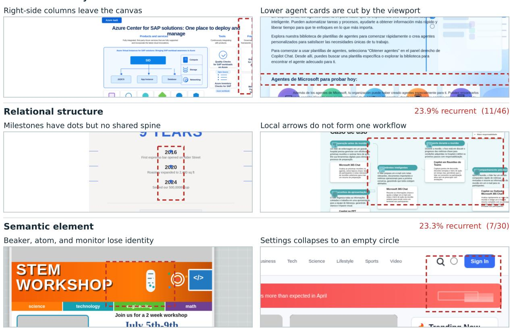

## F.1 Measuring the three modes

A failure is recurrent when it appears in at least two of the three rollouts for a prompt. Boundary applies to every page and is measured over all 300 prompts. The other two modes apply only to prompts that call for a connected structure or for semantic elements such as icons, so they are measured over the 46 and 30 prompts whose checklist contains the corresponding predicate. Table F1 reports the rates, and Figure F1 shows two further instances of each mode.

On Boundary, the paired diference to GPT-5.5 is −30.3 points ([−36.0, −24.7]). The residual cases share a shape. The dashboard in Figure 5 fails in all three rollouts: its two lower panels begin at y = 535 px and each request 410 px of height on a 720 px canvas. Every region is constructed, but independent fixed-pixel allocations exceed the page height, and the running total is the one quantity that stays invisible until the page is rendered.

Table F1 Residual failure modes. Scope: number of prompts to which the mode applies. Recurrent: failure in ≥ 2 of 3 rollouts (lower is better); mean pass: higher is better.
<table><tr><td>Mode (scope)</td><td>Metric</td><td>AesCode-32B</td><td>GPT-5.5</td></tr><tr><td>Severe boundary (300)</td><td>recurrent</td><td>4.3%</td><td>34.7%</td></tr><tr><td rowspan="2">Relational subgraph (46)</td><td>recurrent</td><td>23.9%</td><td>10.9%</td></tr><tr><td>mean pass</td><td>75.4%</td><td>87.0%</td></tr><tr><td rowspan="2">Semantic element (30)</td><td>recurrent</td><td>23.3%</td><td>3.3%</td></tr><tr><td>mean pass</td><td>74.3%</td><td>92.0%</td></tr></table>

4.3% recurrent (13/300)

## Severe boundary

Figure F1 Additional instances of the three residual failure modes, with recurrence rates above each column.

## F.2 Why the relational and semantic modes persist

Relational structure is supervised explicitly. The design graph carries order, connection, and hierarchy edges such as timeline\_step, connects, and parent\_of, the layout class sets a subgraph quota, and VGR binds relation- and subgraph-type predicates to these edges (Section D.4). The mode persists because it is the hardest objective to optimize, for two reasons.

First, credit for a relation is implicit. A relation predicate is one of about fourteen rubric questions whose pass rate forms a single channel, and GDPO normalizes per channel rather than per question, so the advantage of a violated relation is shared with every other criterion on the page. Subgraph-level supervision is also sparse and coarse: only 46 of the 10,727 checklist predicates are subgraph-level, and a failed one marks the page rather than the responsible edge.

Second, the objective is intrinsically demanding. On the 46 relational prompts, pairwise relation predicates pass at 95.3% and local structure predicates at 95.8%, while the whole-subgraph predicate passes at 75.4%. Drawing nodes and local arrangements is local and readily learned; holding a timeline, hierarchy, or branch set together as one connected object requires knowledge of the content, reasoning over it, and planning the global layout around it. GPT-5.5 shows the same ordering, so the dificulty lies in the predicate type rather than in our pipeline. The five-link example in Figure 5 illustrates this: every link element exists, and one shared geometry rule removes every vertical stroke at once.

Semantic elements fail at a similar level of abstraction. In Figure 5, the controls sit in plausible slots with a consistent treatment, yet a phone, camera, gear, beaker, atom, or monitor becomes hard to tell apart. Rendering a recognizable icon means mapping a meaning to a drawn form in fine-grained SVG, which draws on the visual knowledge of the backbone. Our rewards supervise the slot’s presence, geometry, and treatment, and by design leave its depicted content unscored, because the reference generator may draw a diferent picture in the same slot (Section D.4).