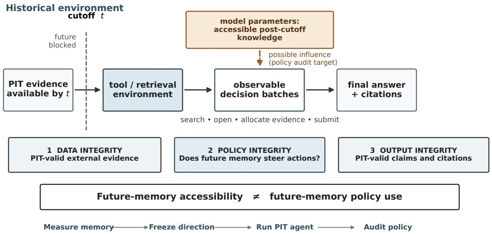
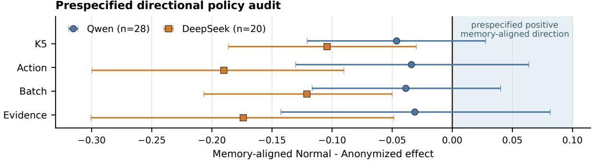
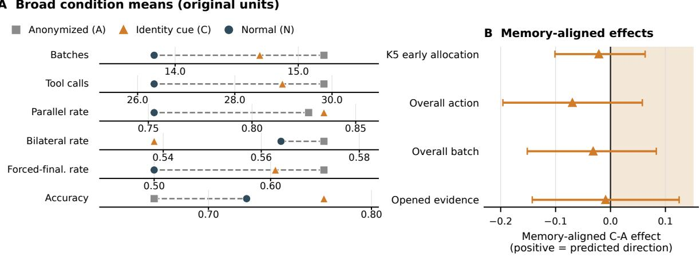

# Auditing Future-Memory Use in Point-in-Time Language Agents

Rongtian Ye Department of Computer Science, Aalto University rongtian.ye@aalto.fi

## Abstract

Point-in-time (PIT) agents can recall postcutoff facts even when their external evidence respects a historical cutoff. We examine whether this access predicts evidence gathering in 48 historical company-comparison tasks. Independent closed-book revenue probes identify the better-remembered company for each model on tasks with unequal recall, fixing the predicted direction before agent runs. We then compare paired runs with real or anonymized company identities while keep ing external evidence PIT-valid. Both Qwen and DeepSeek recalled future facts, but neither supported the prespecified shift toward the better-remembered company. Qwen’s four allocation estimates on 28 unequal-recall tasks were negative, with descriptive intervals span ning zero. A prospective DeepSeek replication showed an inverse pattern across all four metrics on 20 such tasks, with intervals below zero. These estimates remained negative after each company, pair, and future-fact omission, and all four post-hoc max-T-adjusted sign-flip p-values were below .05. In a prospectively specified follow-up, explicit future facts pro duced small estimated shifts away from the supplied-fact company, with intervals spanning zero, while final choices shifted toward it. The mechanism behind the natural inverse pattern remains unresolved. These findings support separate assessments of memory accessibility, search allocation, and final outputs alongside cutoff checks on external evidence.

## 1 Introduction

Point-in-time (PIT) agents simulate historical decisions using information available before a specified cutoff. In financial analysis and retrospective decision support, access to later documents can invalidate an evaluation even when the resulting answer appears plausible. Recent work on ex-ante inference and leakage-aware backtesting therefore examines the temporal validity of external evidence and model outputs (Liu et al., 2026; Zhang and Stadie, 2026b; Benhenda, 2026).

The historical cutoff constrains retrieved evidence, while post-cutoff facts can remain accessible from the model’s parameters. Prior work has studied future-fact recall, identity masking in financial agents, and knowledge-aware search (Liu et al., 2026; Zhu et al., 2026b; Feng et al., 2026). We ask whether a model’s independently measured access to future facts predicts what it chooses to investigate when all external evidence is PIT-valid.

An agent may use a known future outcome to decide which company to investigate first while citing only pre-cutoff documents. It may also recall the outcome without changing its observable search behavior. Final answers and citation dates alone cannot distinguish these cases. We therefore examine the tool calls and evidence selections made during the investigation to test predictions about how future knowledge relates to the agent’s behavior.

We define Temporal Policy Contamination (TPC) as a systematic shift in observable information seeking in the direction predicted by independently measured access to post-cutoff facts. Our audit distinguishes three aspects of temporal integrity. Data integrity concerns when external evidence became available; policy integrity concerns whether future knowledge steers observable actions; output integrity concerns whether final claims and citations respect the historical cutoff.

We apply this audit to 48 historical comparisons between public companies using Qwen (Qwen-Team, 2026) and DeepSeek (DeepSeek-AI et al., 2026). Each task has a Normal version with real company identities and an Anonymized version that replaces identifiers while preserving the underlying records, dates, numerical values, and outcome labels. Independent closed-book probes measure each model’s recall of the two companies’ future revenue. For tasks with unequal recall, we predict that revealing identities will shift evidence gathering toward the better-remembered company. We fix these predictions before collecting trajectories for each model. Four metrics measure allocation during early search, across all actions and decision batches, and among opened sources.

Both models recalled post-cutoff facts, with higher five-probe accessibility in DeepSeek. Neither supported the predicted positive shift. Qwen’s four estimates were negative, with descriptive intervals spanning zero. DeepSeek showed a robust inverse pattern: revealing identities reduced the relative allocation to the better-remembered company on all four metrics. This pattern persisted under dependency checks and post-hoc sensitivity analyses. A prospectively specified follow-up supplied explicit future revenue facts to test whether access to future information could substitute for search. Final answers shifted toward the company whose fact was supplied, while evidence allocation showed small estimated shifts away from that company, with intervals spanning zero. The mechanism behind the inverse pattern remains unresolved.

Our contributions are: (1) A directional audit that uses independent measurements of future-fact recall to specify predictions about search allocation before agent runs. (2) A paired PIT evaluation across two model families, with controlled identity presentation and batch-aware measures of evidence allocation. (3) Evidence that the prespecified positive allocation shift is unsupported in both models, together with a robust inverse allocation pattern in DeepSeek. (4) A semantic re-identification audit of anonymized evidence and a prospectively specified follow-up examining how explicit future facts affect search allocation and final choices.

## 2 Related Work

Temporal contamination. Time-aware language models study changing facts (Dhingra et al., 2022), while contamination research develops retrieval-based and behavioral diagnostics (Deng et al., 2024). Prompted-cutoff tests show that earlier-date instructions do not reliably suppress causally related future knowledge (Gao et al., 2025). Recent methods address temporal leakage through matched controls and planted contamination (Zhang and Stadie, 2026b) and temporal enforcement (Zhang and Stadie, 2026a). ExAnte combines cutoff-conditioned inference with memory checks to relate future knowledge to answers (Liu et al., 2026), while TimeSPEC attributes leaked claims to decisions (Zhang et al., 2026).

Parametric knowledge and tool policy. Knowledge-conflict studies examine which source a model follows when parametric memory and supplied evidence disagree (Longpre et al., 2021; Chen et al., 2022). Post-training can change how latent or contaminated knowledge is expressed (Kocyigit and Yildirim, 2026; Yang et al., 2026), and misleading-document studies distinguish local verification from end-to-end adoption (Zhu et al., 2026a). Work on adaptive retrieval examines how a model’s knowledge informs its search decisions. Mallen et al. (2023) probe factual knowledge to guide retrieval (Mallen et al., 2023), while FLARE uses predicted text and token confidence to decide when to retrieve (Jiang et al., 2023). KbPO (Feng et al., 2026) and AdaSearch (Lin et al., 2025) learn knowledge-aware retrieval policies. Other approaches use tool/no-tool rollouts or segment-level credit assignment to learn tool policies (Chen et al., 2026; Kumar et al., 2026).

Historical financial agents. FinanceHarness evaluates PIT financial research with auditable citations (Xiao et al., 2026). Look-Ahead-Bench (Benhenda, 2026) and Profit Mirage (Li et al., 2025) study look-ahead bias and controlled contamination in financial tasks. KTD-Fin masks stock and date identities to evaluate financial-agent behavior (Zhu et al., 2026b). We use paired tasks with real or anonymized company identities, preserving the dates and numerical content of the historical evidence. Closed-book probes measure access to future revenue facts before each model’s trajectories are collected. These measurements fix a model-specific prediction: revealing identities will shift the relative allocation of evidence toward the better-remembered company. We test this prediction against the agent’s observed search behavior.

## 3 Problem and Audit Framework

Each task i specifies a historical cutoff $t _ { i }$ and an eligible evidence set

$$
E _ { i } ^ { \leq t _ { i } } = \{ e : { \mathrm { a v a i l a b l e } } ( e ) \leq t _ { i } \} .
$$

The agent is asked to predict which of two companies will have higher future revenue growth using this evidence.1 Post-cutoff revenue determines the evaluation label and is withheld from the PIT tool environment.

Normal (N) and Anonymized (A) are paired views of the same canonical task. Normal presents real company identities; Anonymized deterministically replaces typed identifiers while preserving labels and numerical content. Both conditions provide PIT-valid external evidence. The paired comparison measures differences in behavior associated with identity presentation. A separate audit assesses how often company identities can be recovered from the anonymized text (Appendix M). For Qwen, an additional Identity Cue condition supplies the true company names and tickers alongside the Anonymized corpus, allowing us to examine responses to explicit identity cues while holding the evidence corpus fixed.

Future-memory accessibility is measured independently for each model. For model $r ,$ , task $i ,$ and company $j \in \{ 1 , 2 \} , m _ { i j } ^ { ( r ) }$ is the fraction of closedbook probes that recover the company’s post-cutoff revenue within 5% relative error. We define

$$
\begin{array} { l } { { \displaystyle M _ { i } ^ { ( r ) } = \frac { m _ { i 1 } ^ { ( r ) } + m _ { i 2 } ^ { ( r ) } } { 2 } , } } \\ { { \displaystyle z _ { i } ^ { ( r ) } = \mathrm { s i g n } \Big ( m _ { i 1 } ^ { ( r ) } - m _ { i 2 } ^ { ( r ) } \Big ) . } } \end{array}
$$

Here $M _ { i } ^ { ( r ) }$ summarizes task-level accessibility, and $z _ { i } ^ { ( r ) }$ identifies the better-remembered company; $z _ { i } ^ { ( r ) } = 0$ denotes equal probe scores. These directions are fixed before collecting trajectories for that model. Qwen’s original confirmatory direc tions use two probes per fact, while the prospective DeepSeek replication uses five.

An observable trajectory $\tau _ { i }$ includes the assistant’s decisions, tool calls and responses, opened sources, finalization steps, and submitted answer. A decision batch contains all calls issued in one assistant response, before any result from that batch is observed. We treat these calls as simultaneous for analysis. Allocation metrics are computed from the logged investigation actions and tool responses.

For a fixed model $r ,$ , let $\mathcal { T } = \{ i : z _ { i } ^ { ( r ) } \neq 0 \}$ denote the evaluated tasks with unequal memory scores. An allocation statistic $a _ { k } ( \tau )$ is signed toward company 1, so larger values indicate greater relative allocation to that company. We define the memory-aligned Normal–Anonymized contrast as

$$
\Delta _ { k } = \frac { 1 } { | \mathcal { T } | } \sum _ { i \in \mathcal { I } } z _ { i } ^ { ( r ) } \left[ a _ { k } \left( \tau _ { i } ^ { N , r } \right) - a _ { k } \left( \tau _ { i } ^ { A , r } \right) \right] .
$$

Here $\tau _ { i } ^ { N , r }$ and $\tau _ { i } ^ { A , r }$ are the paired trajectories under Normal and Anonymized. Multiplication by $z _ { i } ^ { ( r ) }$ orients each task’s difference toward its betterremembered company, and the contrast averages these differences with equal task weights. Positive values indicate that revealing identities shifts relative allocation toward the better-remembered company; negative values indicate the opposite shift. We apply this contrast to early allocation (K5), overall action allocation, overall batch allocation, and opened-evidence allocation (Appendix C).

Temporal Policy Contamination (TPC) is a systematic shift in observable information seeking in the direction predicted by independently measured access to post-cutoff facts, while external evidence remains PIT-valid. In our company-comparison tasks, the prespecified hypothesis is $\Delta _ { k } > 0 ;$ : revealing identities should increase relative evidence allocation to the better-remembered company.

Figure 1 distinguishes data integrity, which concerns the temporal validity of external evidence; policy integrity, which concerns the relationship between future knowledge and observable actions; and output integrity, which concerns final claims and citations. Our study enforces the evidence cutoff, records final outputs, and tests the directional allocation hypothesis.

## 4 Experimental Setup

## 4.1 Tasks and paired environments

Each task asks which of two public companies will have higher future revenue growth, using evidence available by a historical cutoff. We construct the tasks from public filings in the U.S. Securities and Exchange Commission’s (SEC) EDGAR system. Annual revenue observations come from the SEC XBRL Company Facts API and are checked against the corresponding annual statements; filing metadata come from the Submissions API (U.S. Securities and Exchange Commission, 2024).

The frozen task pool contains 194 tasks covering 19 companies, 34 unordered company pairs, and target years FY2018–FY2024, with 126 unique future revenue facts. A deterministic stratified rule uses Qwen’s original two-probe memory scores and the historical heuristic prior’s agreement with the ground-truth winner to select 48 policy tasks covering all 19 companies, 32 pairs, and 77 of these facts. The task set was fixed before policy runs (Appendix A). Appendix B gives the growth-label and cutoff rules, together with a complete worked

  
Figure 1: Temporal integrity in PIT agents. The cutoff gate restricts external evidence to information available by time t. Independent memory probes specify a predicted direction of information seeking before the agent runs. The audit compares this prediction with logged actions and distinguishes data, policy, and output integrity.

task.

The corpus contains 453 historical 10-K/10-Q filings from the SEC EDGAR Archives, divided into 49,854 chunks. Normal and Anonymized are generated from the same canonical task and preserve cutoffs, labels, dates, document structure, and numerical content. Anonymized replaces identifiers through a task-local typed lexicon and uses a separate retrieval index. Audits found no known identifier residuals or numerical mismatches, and retrieval results matched on the checked fields for 288 fixed paired queries. A centralized availability gate enforces the cutoff for all model-visible content, including tool errors. Every assistant action and tool response is logged. Retrieval settings and tool interfaces are specified in Appendix B.4.

## 4.2 Model-specific memory and policy audits

Both audits were run through the provider Parasail2 with temperature set to zero and reasoning and fallback disabled. Investigations allowed up to 18 completed decision batches, subject to a 64- call safety fuse. Finalization allowed at most two evidence-free requests, which were excluded from allocation metrics (Appendix D).

The original audit used qwen3.8-27b3. Each of the 126 future facts was tested with two fixed closed-book paraphrases, yielding 252 requests. A unit-aware scorer accepted answers within 5% relative error. We froze the resulting memory directions before running 48 Normal and 48 Anonymized trajectories. The confirmatory analysis uses these two-probe directions. A posthoc five-probe expansion assesses measurement robustness using the original policy trajectories (Appendix H).

For the prospective replication, we used deepseek-v4-flash-07314. Five globally fixed closed-book probes per fact yielded 630 requests. The model-specific memory directions and 20- task asymmetric subset were frozen before any DeepSeek policy trajectory. We stopped the initial policy-v1 run after repeated failures to satisfy the text-only final-answer format. We then froze a structured adapter for post-investigation A/B submission that preserved the existing conversation. The full 96-run schedule was executed afresh under policy-v2, yielding 48 valid Normal and 48 valid Anonymized trajectories. Appendix L documents the runtime provenance. The probe templates and investigation and finalization messages appear in Appendix B.3.

## 4.3 Measurements, diagnostics, and uncertainty

We label calls and batches by the companies they target: company 1, company 2, both, or neither. K5 measures allocation over the first five available entity-directed batches. Overall action and batch asymmetry summarize allocation across the full investigation at the call and batch levels, respectively; opened-evidence asymmetry measures the sources the agent inspects. Memory-aligned metrics use each model’s frozen direction to orient allocation toward the better-remembered company. Secondary outcomes describe investigation length, tool use, parallelism, bilateralism, finalization, and accuracy. Appendix C defines the complete metric family, including P1 and K3.

A post-hoc synthetic sensitivity analysis retains the Anonymized action sequences from Qwen’s 28 memory-asymmetric tasks and varies evaluatorside direction labels across homogeneous and 30%/50% sparse grids (Appendix J).

Qwen familiarity probes measure general identity knowledge and historical financial knowledge (Appendix E). A separate Identity Cue study adds true company names and tickers to the Anonymized evidence (Appendix F). Across 144 scheduled Normal, Anonymized, and Identity Cue trajectories, 143 produced valid decisions; one Normal finalization failure left 47 complete triplets. A post-hoc semantic re-identification audit tests whether models can recover company identities from three frozen Anonymized chunks per entity using standalone open- and closed-set probes (Appendix M).

A prospectively specified follow-up tests whether explicit future facts alter evidence allocation. Each of the 48 tasks is run in two otherwise identical Anonymized conditions: one supplies Entity A’s true target-year revenue, and the other supplies Entity B’s. The prompt thus contains a post-cutoff fact, while retrieved evidence remains subject to the historical cutoff. The primary contrast is positive when allocation shifts away from the company whose fact is supplied. Appendix N gives the design and results.

Comparisons are paired by task. Broad Normal– Anonymized outcomes use 48 task pairs per model; memory-aligned contrasts use 28 asymmetric Qwen pairs and 20 asymmetric DeepSeek pairs. For the main contrasts, we compute 95% descriptive task-level bootstrap intervals from 10,000 resamples, keeping conditions paired within each resampled task. Tasks share companies, company pairs, and future facts; these intervals summarize resampling variability within the evaluated task set.

## 5 Results

## 5.1 Memory accessibility and primary allocation results

Qwen recovered future revenue within 5% relative error in 124 of 252 original closed-book probes (49.2%). DeepSeek’s prospective five-probe measurement yielded mean accessibility of 0.8413 over the same 126 facts, based on 630 probes.

Figure 2 shows the primary memory-aligned Normal–Anonymized contrasts. For Qwen’s 28 asymmetric tasks, all four point estimates are negative and all 95% descriptive intervals span zero: $\mathrm { K 5 ~ - 0 . 0 4 6 3 ~ [ - 0 . 1 2 0 7 , + 0 . 0 2 7 6 ] }$ , action $- 0 . 0 3 4 0 [ - 0 . 1 3 0 3 , + 0 . 0 6 3 6 ] , \mathrm { { b a t c h } - 0 . 0 3 8 7 } $ $[ - 0 . 1 1 6 6 , + 0 . 0 4 0 2 ]$ and opened evidence $- 0 . 0 3 1 2 \left[ - 0 . 1 4 2 6 , + 0 . 0 8 1 5 \right]$

DeepSeek shows an inverse allocation pattern across its 20 asymmetric tasks. The corresponding estimates are $\mathrm { K 5 ~ - 0 . 1 0 4 2 ~ \left[ - 0 . 1 8 6 3 , - 0 . 0 3 0 0 \right] } .$ action −0.1900 [−0.2997, −0.0902], batch $- 0 . 1 2 1 0 \ \left[ - 0 . 2 0 6 7 , - 0 . 0 5 0 1 \right]$ , and opened evidence $- 0 . 1 7 3 9 \ \left[ - 0 . 3 0 0 6 , - 0 . 0 4 8 6 \right]$ All four intervals lie below zero: relative to Anonymized, Normal allocates a smaller share of evidence to the better-remembered company. The prespecified positive shift is unsupported in both models.

## 5.2 DeepSeek’s inverse allocation pattern is robust

DeepSeek’s four allocation estimates remain negative after every prespecified omission of a company, company pair, or future fact. In a post-hoc exact sign-flip analysis under task-level sign symmetry, max-T-adjusted p-values range from .0036 to .0385, with a global max-statistic p-value of .0036 (Appendix K).

Continuous signed-memory associations are also negative across the full task set, with Pearson correlations ranging from −0.283 to −0.169 and Spearman correlations from −0.377 to −0.280. These analyses use 48 tasks for K5, action, and batch, and 46 for opened evidence. The 28 memory-tied tasks differ from the 20 asymmetric tasks in year and company composition, and 24 ties have both memory scores at 1.0. Directional memory variation therefore remains concentrated in the asymmetric subset.

An exploratory decomposition of absolute allocation also shows greater Normal–Anonymized withdrawal on the better-remembered side. The contrasts are −0.750 for early allocation, −4.650 for calls, −1.700 for batches, and −3.250 for opened sources, with all descriptive intervals below zero (Appendix K). Qwen does not show the same consistent absolute pattern.

  
Figure 2: Memory-aligned Normal–Anonymized allocation contrasts. Points show mean paired effects; bars show 95% descriptive task-bootstrap intervals. Positive values indicate the prespecified shift toward the better-remembered company. Qwen uses its original two-probe directions (n = 28); DeepSeek uses its prospectively frozen five-probe directions (n = 20).

Table 1: Audit stages, analysis status, and principal findings.
<table><tr><td>Analysis</td><td>Status</td><td>Finding</td></tr><tr><td>Qwen original audit</td><td>ory directions</td><td>Confirmatory; two-probe mem- Four negative N-A estimates (-0.046 to -0.031); all descrip- tive intervals span zero.</td></tr><tr><td>DeepSeek replication</td><td>five-probe memory directionstive intervals lie below zero.</td><td>Prospective confirmatory audit; Four negative N-A estimates (—0.190 to —0.104); all descrip-</td></tr><tr><td>sion</td><td>ness</td><td>Qwen five-probe expan- Post-hoc measurement robust- 26/28 original directions retained; all reclassified allocation esti- mates remain negative.</td></tr><tr><td>checks</td><td>hoc sign-flip sensitivity</td><td>DeepSeek inverse-pattern Prespecified omissions; post- Every omission preserves the negative sign; max-T-adjusted p-values range from .0036 to .0385.</td></tr><tr><td>Semantic re-identification Post-hoc identity audit</td><td></td><td>Open-set entity recovery is 65.6% for Qwen and 79.2% for DeepSeek; directional associations vary across metrics.</td></tr><tr><td>Explicit-fact follow-up</td><td>nism follow-up</td><td>Prospectively specified mecha- Four small positive W estimates (.011-.039), with intervals spanning zero and global max-T p = .1327; final choices shift toward the supplied-fact company.</td></tr></table>

## 5.3 Identity cues and output behavior

Both models use fewer investigation batches and tool calls in Normal than in Anonymized. In the original Qwen audit, mean batches are 13.625 versus 15.750 and mean calls are 26.833 versus 31.313, respectively; accuracy is 36/48 versus 31/48. DeepSeek averages 10.146 versus 13.104 batches and 22.604 versus 28.896 calls, with accuracy of 29/48 in both conditions.

On the asymmetric subsets, the betterremembered company is the ground-truth winner in 15/28 Qwen tasks and 9/20 DeepSeek tasks. Accuracy differences and final-answer alignment show weak, inconsistent associations with the memory measurements (Appendix I).

In Qwen’s separate Identity Cue study, Cue– Anonymized differences have the same sign as Normal–Anonymized differences on five of six broad outcomes; parallelism shifts in the opposite direction (Figure 3). All four memory-aligned Cue– Anonymized estimates are negative, with descriptive intervals spanning zero.

## 5.4 Measurement and mechanism diagnostics

Qwen’s post-hoc five-probe expansion yields mean accessibility of 0.4698 and closely tracks the original memory measurement. Pearson correlations are 0.9077 across 126 facts and 0.9100 across 194 tasks. Of the 28 originally asymmetric policy tasks, 26 retain their direction, one becomes tied, and one changes sign (Appendix H).

Batch allocation is more sensitive than K5 to sparse evaluator-side injections. At α = .10, descriptive intervals exclude zero in 99.7% of homogeneous transformations for K5 and 100.0% for batch allocation. In the 30%-sparse setting, these rates fall to 33.5% and 85.0%, respectively (Table A5). P1 remains ceiling-limited (Appendix J).

Anonymized context retains substantial information about company identity. In the post-hoc open-set audit, Qwen recovers identities in 63/96 task–entity cases (65.6%) and DeepSeek in 76/96 (79.2%). Across DeepSeek’s 20 asymmetric tasks, differences in re-identification difficulty between the better- and worse-remembered companies show inconsistent associations with the four memoryaligned allocation effects (Appendix M).

  
Figure 3: Qwen Identity Cue diagnostic. (A) Mean outcomes for Anonymized (A), Identity Cue (C), and Normal (N). C–A and N–A differences share the same sign on five of six outcomes; parallelism shifts in the opposite direction. (B) Memory-aligned C–A allocation effects with 95% descriptive task-bootstrap intervals. All four intervals span zero.

In the prospectively specified future-fact followup, all four allocation estimates point toward withdrawal from the supplied-fact company (W = 0.0112 − 0.0386), with all descriptive intervals spanning zero and a global max-T p-value of .1327 (Appendix N). Final-answer choices shift toward the supplied-fact company on 17 tasks and away on four, with 27 unchanged. The mechanism underlying the natural inverse allocation pattern remains unresolved.

## 6 Discussion

Both models recovered post-cutoff revenue facts in independent probes, yet neither supported the prespecified shift toward the better-remembered company. Qwen’s negative allocation estimates had intervals spanning zero; DeepSeek showed a robust inverse pattern across all four metrics. These findings challenge the hypothesized link between accessible future outcomes and preferential investigation of the associated company.

Search substitution is a plausible explanation for DeepSeek’s inverse pattern: access to a future outcome could reduce further investigation of the associated company. The exploratory absolutecount decomposition is consistent with this account, showing greater withdrawal on the betterremembered side (Appendix K). A prospectively specified follow-up supplied one company’s future revenue explicitly and yielded small shifts in the withdrawal direction, with all intervals spanning zero (Appendix N). Company identities also remained recoverable from Anonymized text, and relative re-identification difficulty had inconsistent associations with the inverse allocation effects (Appendix M). The mechanism behind the natural pattern remains unresolved.

Search effort and final decisions responded differently to the experimental conditions. Investigations were shorter in Normal for both models; accuracy was higher for Qwen and unchanged for DeepSeek. In Qwen’s Cue study, Cue– Anonymized contrasts shared the sign of Normal– Anonymized contrasts on five of six broad outcomes, while all four memory-aligned allocation intervals spanned zero. The explicit-fact follow-up shifted final choices toward the supplied-fact company while producing weak allocation responses.

These findings motivate PIT evaluations that combine source-availability checks, independent memory probes, trajectory analysis, and assessment of final claims and citations. Behavioral predictions should be fixed before agent runs, with broad investigation measures, memory-aligned allocation, and answer outcomes reported separately. For studies using anonymization as a historical control, semantic re-identification tests complement identifier checks by measuring the identity information retained in the content.

## 7 Conclusion

We present a trajectory-based audit that combines independent future-memory probes with paired agent runs under PIT-valid external evidence. Both Qwen and DeepSeek recovered post-cutoff facts, yet neither supported the prespecified shift toward the better-remembered company. Qwen’s negative allocation estimates had intervals spanning zero, while DeepSeek showed a robust inverse allocation pattern. PIT evaluation should combine cutoff checks on external evidence with separate assessments of memory accessibility, search allocation, and final outputs.

## 8 Limitations

Scope and dependence. Our experiments cover two model families served through Parasail as fp8 endpoints in a 48-task historical-finance setting. Both models were evaluated on the subset selected using Qwen’s original recall scores and the historical heuristic prior’s agreement with the groundtruth winner. The effect of deployment precision on memory accessibility remains unmeasured. The directional analyses use 28 Qwen tasks and 20 DeepSeek tasks. DeepSeek’s 28 tied tasks include 24 with memory scores of 1.0/1.0, and their company and year composition differs from the asymmetric subset. These ties contribute little directional memory variation to the broader continuous analyses. Repeated companies, pairs, and future facts induce dependence across tasks. Bootstrap intervals are descriptive summaries of the evaluated task set; the post-hoc sign-flip analysis relies on task-level sign symmetry.

Identity and observability. The Normal– Anonymized comparison changes identity presentation, while memory accessibility is measured through independent probes. The resulting contrasts capture identity-associated behavior, with future memory as one possible contributor. Company identities remain recoverable from Anonymized content. The directional re-identification strata are small, and associations with DeepSeek’s inverse pattern vary across metrics (Appendix M). Residual identity recovery therefore remains a potential confound. The logs record investigation actions and final outputs; the internal use of remembered information remains unobserved.

Protocol and mechanism. DeepSeek’s structured finalization adapter was introduced after policy-v1 format failures and fixed before the complete policy-v2 rerun. The reported DeepSeek analyses use v2 trajectories, with evidence-free finalization excluded from allocation metrics (Appendix L). The different finalization protocols limit cross-model comparisons of stopping behavior. Qwen frequently required forced finalization, and one Normal-arm finalization failure left 47 complete triplets in the separate Cue study. P1 is ceiling-limited, and K5 can miss low-prevalence injections in the synthetic sensitivity analysis (Appendix J). The explicit-fact follow-up supplies future information in the prompt and yields small withdrawal estimates with intervals spanning zero (Appendix N). The role of parametric future memory in the natural inverse pattern remains unresolved.

## References

Mostapha Benhenda. 2026. Look-ahead-bench: a standardized benchmark of look-ahead bias in point-intime llms for finance. Preprint, arXiv:2601.13770.

Dingwei Chen, Zefang Zong, Zhipeng Ma, Leo Luo, Yang Li, Chengming Li, Peng Chen, and Jie Jiang. 2026. Efficient agentic reinforcement learning with on-policy intrinsic knowledge boundary enhancement. Preprint, arXiv:2605.26952.

Hung-Ting Chen, Michael Zhang, and Eunsol Choi. 2022. Rich knowledge sources bring complex knowledge conflicts: Recalibrating models to reflect conflicting evidence. In Proceedings of the 2022 Conference on Empirical Methods in Natural Language Processing, pages 2292–2307, Abu Dhabi, United Arab Emirates. Association for Computational Linguistics.

DeepSeek-AI, Anyi Xu, Bangcai Lin, Bing Xue, Bingxuan Wang, Bingzheng Xu, Bochao Wu, Bowei Zhang, Chaofan Lin, Chen Dong, Chenchen Ling, Chengda Lu, Chenggang Zhao, Chengqi Deng, Chengyu Hou, Chenhao Xu, Chenze Shao, Chong Ruan, Conner Sun, and 300 others. 2026. Deepseek-v4: Towards highly efficient million-token context intelligence. Preprint, arXiv:2606.19348.

Chunyuan Deng, Yilun Zhao, Xiangru Tang, Mark Gerstein, and Arman Cohan. 2024. Investigating data contamination in modern benchmarks for large language models. In Proceedings of the 2024 Conference of the North American Chapter of the Association for Computational Linguistics: Human Language Technologies (Volume 1: Long Papers), pages 8706–8719, Mexico City, Mexico. Association for Computational Linguistics.

Bhuwan Dhingra, Jeremy R. Cole, Julian Martin Eisenschlos, Daniel Gillick, Jacob Eisenstein, and William W. Cohen. 2022. Time-aware language models as temporal knowledge bases. Transactions ofthe Associationfor Computational Linguistics, 10:257– 273.

Tao Feng, Xinke Jiang, Xinyan Hu, Yonggang Zhang, Zhen Tao, Wentao Zhang, Boyang Liu, Wenhao Jiang, and Chao Wu. 2026. Trust within? seek beyond? knowledge boundary aware policy optimization for agentic search. In Proceedings of the 64th Annual Meeting of the Association for Computational Linguistics (Volume 1: Long Papers), pages 27664– 27682, San Diego, California, United States. Association for Computational Linguistics.

Xin Gao, Ruiyi Zhang, Daniel Du, Saurabh Mahindre, Sai Ashish Somayajula, and Pengtao Xie. 2025. Can prompts rewind time for LLMs? evaluating the effectiveness of prompted knowledge cutoffs. In Proceedings ofthe 2025 Conference on Empirical Methods in Natural Language Processing, pages 20777–20788, Suzhou, China. Association for Computational Linguistics.

Zhengbao Jiang, Frank Xu, Luyu Gao, Zhiqing Sun, Qian Liu, Jane Dwivedi-Yu, Yiming Yang, Jamie Callan, and Graham Neubig. 2023. Active retrieval augmented generation. In Proceedings ofthe 2023 Conference on Empirical Methods in Natural Language Processing, pages 7969–7992, Singapore. Association for Computational Linguistics.

Muhammed Yusuf Kocyigit and Caglar Yildirim. 2026. The impact of post-training on data contamination. Preprint, arXiv:2601.06103.

Abhijit Kumar, Zoey Wu, and Mohit Suley. 2026. Knowing when to ask: Segment-level credit assignment for llm tool use. Preprint, arXiv:2605.27788.

Xiangyu Li, Yawen Zeng, Xiaofen Xing, Jin Xu, and Xiangmin Xu. 2025. Profit mirage: Revisiting information leakage in llm-based financial agents. Preprint, arXiv:2510.07920.

Tzu-Han Lin, Wei-Lin Chen, Chen-An Li, Hung yi Lee, Yun-Nung Chen, and Yu Meng. 2025. Adasearch: Balancing parametric knowledge and search in large language models via reinforcement learning. Preprint, arXiv:2512.16883.

Yachuan Liu, Xiaochun Wei, Lin Shi, Xinnuo Li, Bohan Zhang, Paramveer Dhillon, and Qiaozhu Mei. 2026. ExAnte: A benchmark for ex-ante inference in large language models. In Proceedings ofthe 19th Conference ofthe European Chapter ofthe Associationfor Computational Linguistics (Volume 1: Long Papers), pages 1551–1571, Rabat, Morocco. Association for Computational Linguistics.

Shayne Longpre, Kartik Perisetla, Anthony Chen, Nikhil Ramesh, Chris DuBois, and Sameer Singh. 2021. Entity-based knowledge conflicts in question answering. In Proceedings ofthe 2021 Conference

on Empirical Methods in Natural Language Processing, pages 7052–7063, Online and Punta Cana, Dominican Republic. Association for Computational Linguistics.

Alex Mallen, Akari Asai, Victor Zhong, Rajarshi Das, Daniel Khashabi, and Hannaneh Hajishirzi. 2023. When not to trust language models: Investigating effectiveness of parametric and non-parametric memories. In Proceedings of the 61st Annual Meeting of the Associationfor Computational Linguistics (Volume 1: Long Papers), pages 9802–9822, Toronto, Canada. Association for Computational Linguistics.

QwenTeam. 2026. Qwen 3.8. Accessed: 2026-09-10.

U.S. Securities and Exchange Commission. 2024. EDGAR application programming interfaces (APIs).

Yijia Xiao, Rujun Han, Yanfei Chen, Zifeng Wang, Ke Jiang, Zhongying CuiZhu, Vishy Tirumalashetty, Wei Wang, Burak Gokturk, Tomas Pfister, and Chen-Yu Lee. 2026. Financeharness: Autonomous financial deep research framework. Preprint, arXiv:2607.27853.

Wanli Yang, Hongyu Zang, Junwei Zhang, Wenjie Shi, Du Su, Jingang Wang, Xueqi Cheng, and Fei Sun. 2026. Beyond reasoning: Reinforcement learning unlocks parametric knowledge in llms. Preprint, arXiv:2605.07153.

Zeyu Zhang, Ryan Chen, and Bradly C. Stadie. 2026. All leaks count, some count more: Interpretable temporal contamination detection and mitigation in llm backtesting. Preprint, arXiv:2602.17234.

Zeyu Zhang and Bradly C. Stadie. 2026a. Tempo: Temporal enforcement via mode-separated policy optimization for trustworthy llm backtesting. Preprint, arXiv:2605.18843.

Zeyu Zhang and Bradly C. Stadie. 2026b. Temporal leakage in llm backtesting: Measurement, validation, and adjusted scores. Preprint, arXiv:2608.02985.

Pengyu Zhu, Lijun Li, Longju Yang, Sen Su, and Jing Shao. 2026a. Is deep research reliable? misleading knowledge induces false conclusions. Preprint, arXiv:2607.20891.

Taojie Zhu, Wentao Zhao, Rui Sun, Beidi Luan, Jiacheng Lu, Sinuo Wang, Jing Li, Daxin Jiang, Yonghong He, and Zuo Bai. 2026b. From knowing to doing: A memory-controlled benchmark for llm trading agents on stock markets. Preprint, arXiv:2605.28359.

## A Study Design Summary

Table A1 lists the designs, samples, and measurements.

Policy-task selection. The selector uses Qwen’s original two-probe memory scores and four historical heuristics: latest revenue growth, mean growth over the two preceding years, growth acceleration, and the majority winner in earlier available outcomes for the pair. The majority of non-abstaining votes defines the prior direction, labeled consistent or conflicting by agreement with the ground-truth winner; balanced or absent votes give a tie. Prior strength is the absolute A–B vote difference divided by the number of non-abstaining votes, with bands weak $( \le . 3 3 )$ , moderate (.33–.67, endpoints excluded), strong $( \geq . 6 7 )$ , and missing when all heuristics abstain.

Each task enters the first eligible stratum in this order: S1, $M _ { i } \geq . 5$ with a conflicting prior; S2, $M _ { i } \geq . 5$ with a consistent prior; S4, $| m _ { i 1 } - m _ { i 2 } | \geq$ .5 and $M _ { i } \geq . 2 5 ; { \mathrm { } } { \mathrm { S } } 3$ $M _ { i } < . 5$ . Selection takes twelve tasks per stratum in that order. At each choice, candidates are ranked lexicographically by new pair, number of new companies, new target year, number of new future facts, then lower existing pair, company (maximum then total), and year counts. For S1/S2, subsequent priorities are both facts scoring 1, both scoring at least .5, and less represented prior-strength bands; S3 prioritizes less represented prior relationships. Remaining ties use pseudorandom values assigned in task-ID order with a fixed seed.

Each candidate must pass a binary feasibility check that the remaining quotas can still be met: at most two tasks per pair, eight appearances per company, two uses per future fact, and six positive and six negative memory differences in S4. This selection was fixed before corpus construction and policy runs; memory and prior fields remain evaluator-only. No policy outcome enters the selector.

## B Task Construction, Prompts, and Retrieval

## B.1 Growth labels and historical cutoffs

Data sources and provenance. The audited annual revenue histories span FY2016–FY2024. Revenue records from the SEC XBRL Company Facts API are linked by company identifier (CIK) and accession number to Submissions metadata, including historical continuation files. Each accepted value is checked against an inline XBRL or rendered consolidated annual-statement row, retaining the actual fiscal-period dates, USD value and unit, and original XBRL concept.

The agent corpus uses primary filing texts from the SEC EDGAR Archives: 121 Forms 10-K, 2 Forms 10-K/A, and 330 Forms 10-Q. Item 2.02 8- Ks supply the full-year outcome-availability proxies and are excluded from the retrieval corpus. Raw JSON and HTML snapshots are immutable; source URLs, accession numbers, and SHA-256 hashes link the derived records to their original responses.

Growth labels. For company j and target fiscal year $y ,$ let $R _ { j , y } ^ { ( v ) }$ denote annual consolidated revenue in accounting view v. We compute

$$
g _ { j , y } ^ { ( v ) } = \frac { R _ { j , y } ^ { ( v ) } - R _ { j , y - 1 } ^ { ( v ) } } { R _ { j , y - 1 } ^ { ( v ) } } ,
$$

using positive revenues for adjacent actual fiscal periods. Each ratio uses the same accounting view for its numerator and denominator. The as-reported view uses the original current-year 10-K; the restated view uses the latest authoritative annualstatement representation in the frozen source snapshot. Company A precedes Company B in lexicographic ticker order. The label is A when $g _ { A , y } ~ > ~ g _ { B , y }$ and B otherwise. We retain a candidate only when the two views yield the same winner and

$$
\operatorname* { m i n } _ { \substack { v \in \{ \mathrm { a s ~ r e p o r t e d } , \mathrm { r e s t a t e d } \} } } | g _ { A , y } ^ { ( v ) } - g _ { B , y } ^ { ( v ) } | \geq 0 . 0 2 .
$$

Thus the gap must be at least two percentage points in both views. The as-reported winner is the stored ground-truth label. Later restatements are used to check label stability and are excluded from historical observations unless independently available before the task cutoff.

Let $a _ { j , y - 1 }$ be the availability date of company j’s original 10-K for the base year. The common cutoff is

$$
t _ { i } = \operatorname* { m a x } ( a _ { A , y - 1 } , a _ { B , y - 1 } ) + 1 \mathrm { c a l e n d a r } \mathrm { d a y } .
$$

For SEC filings, availability is the later of the filing date and the calendar date of the acceptance timestamp, or the filing date when no acceptance timestamp is available. The implemented date-level gate admits only records with availability strictly earlier than $t _ { i } ;$ a filing dated on the cutoff day remains unavailable.

For each company, $t _ { i }$ must precede the first fullyear outcome availability proxy and be no later than 69 calendar days after the start of the target fiscal period. The outcome proxy is the first post-yearend SEC Item 2.02 8-K available by the original annual filing. No target-year quarterly report may be available before ti: the check covers reports whose period end is on or after the target-period start and before its end. The companies’ target fiscal-year ends must differ by at most 31 days. Candidates with unresolved accounting facts or missing source provenance are excluded.

Table A1: Study designs and samples. N, A, and C denote Normal, Anonymized, and Identity Cue. Memoryasymmetric samples use the relevant model’s fixed probe directions; Qwen’s five-probe reclassification is post-hoc.
<table><tr><td>Analysis</td><td>Design and conditions</td><td>Sample</td><td>Measurements</td></tr><tr><td>bility</td><td>Qwen memory accessi- Closed book; two paraphrases per 194 tasks; 126 facts; fact, before policy runs</td><td>probes</td><td>252 Recall within 5%; fact and task memory scores</td></tr><tr><td>Paired environments</td><td>N/A views of one canonical task</td><td></td><td>48 tasks; 19 companies; 32 Temporal validity; identifier, nu- meric, and retrieval parity</td></tr><tr><td>Qwen policy audit</td><td>Paired N/A; original two-probe di- 96 valid trajectories; 28 asym- Memory-aligned K5, action,</td><td>pairs; 77 future facts</td><td></td></tr><tr><td>Familiarity diagnostics</td><td>rections Closed-book identity and pre- 19 companies; 190 requests FY2018 revenue probes</td><td>metric pairs</td><td>batch, and evidence contrasts Familiarity scores and familiarity-aligned alloca-</td></tr><tr><td>Synthetic sensitivity</td><td>Evaluator-side transformations of 28 sequences; 1,000 transfor- P1, K5, and batch interval-</td><td></td><td>tion</td></tr><tr><td>Identity Cue study</td><td>fixed A sequences Separate N/A/C runs; A and C 144 scheduled; 143 valid; 47 Broad outcomes; raw and</td><td>mations per grid cell</td><td>exclusion rates</td></tr><tr><td></td><td>share evidence Qwen five-probe ro- Post-hoc measurement expansion; 126 facts; 194 tasks; 48 policy Score/direction agreement; re-</td><td>complete triplets</td><td>memory-aligned C-A allocation</td></tr><tr><td>bustness DeepSeek replication</td><td>original policy trajectories Prospective five-probe N/A audit; 630 probes; 96 valid trajecto- Memory-aligned allocation and</td><td>tasks</td><td>classified allocation</td></tr><tr><td>DeepSeek pattern checks</td><td>policy-v2 runs inverse- Post-hoc analysis of existing N/A 20 asymmetric tasks; all 48 for Sign-flip sensitivity; task com-</td><td>ries; 20 asymmetric pairs</td><td>dependency omissions</td></tr><tr><td>Semantic identification</td><td>trajectories re- Open-set and candidate-assisted 48 tasks per model; 192 re- Entity recovery; probes for both models</td><td>continuous associations</td><td>position; absolute allocation memory- quests across both models and relative recovery and allocation</td></tr><tr><td>Explicit follow-up</td><td>future-fact Prospectively</td><td>modes specified 96 valid trajectories; 48 com- Normalized W, absolute U, and LEAK_A/LEAK_B on A en- plete pairs</td><td>answer choice</td></tr></table>

These rules define the 194-task natural pool. The later selection of 48 policy tasks also uses Qwen memory scores and the historical prior’s agreement with the ground-truth winner, as specified in Appendix A.

## B.2 Worked task: AMD and Amazon, FY2018

The frozen policy task p2a5-nrg-2018-AMD-AMZN assigns AMD to A and Amazon to B. Table A2(a) gives their fiscal periods and base-year filing dates.

The later base-year filing sets the cutoff to 2018- 02-28. Neither company has a visible target-year quarterly report at that date, and the target fiscalyear ends differ by two days. The Normal user message is:

Historical cutoff: 2018-02-28. Company A is ADVANCED MICRO DEVICES INC (AMD);   
its latest complete annual period is FY2017.   
Company B is AMAZON COM INC (AMZN);   
its latest complete annual period is FY2017.

Table A2: AMD–Amazon FY2018 task.
<table><tr><td colspan="2">(a) Fiscal periods and filing dates</td></tr><tr><td>Field A: AMD FY2017 start 2017-01-01 FY2017 end 2017-12-30</td><td>B: AMZN 2017-01-01 2017-12-31</td></tr><tr><td>FY2018 start FY2018 end 2018-12-29 FY2017 10-K available 2018-02-27</td><td>2017-12-31 2018-01-01 2018-12-31 2018-02-02</td></tr><tr><td>(b) Revenue (USD billions) and growth Quantity A: AMD</td><td>B: AMZN</td></tr><tr><td>FY2017, as reported</td><td>5.329 177.866 6.475</td></tr><tr><td>FY2018, as reported</td><td>232.887</td></tr><tr><td>As-reported growth 21.5050% 5.253</td><td>30.9340%</td></tr><tr><td>FY2017, restated FY2018, restated</td><td>177.866 6.475 232.887</td></tr></table>

Using only the provided historical tools, predict which company will have higher annual Revenue growth in the next fiscal year. Submit A or B with citations to opened chunks covering both companies.

The Anonymized message replaces the two name-and-ticker strings with Company\_A and Company\_B, respectively; all remaining wording is identical. The paired corpus applies the corresponding task-local identity substitutions while preserving dates, numerical evidence, and document structure.

Evaluator’s label calculation. Table A2(b) gives the revenues and growth rates used to determine the stored answer. Target-year revenues, future disclosure dates, and the label are evaluator-only; they are absent from the policy prompt and historical tools.

Both views select B, and the smaller growth gap is 7.6711 percentage points. The recorded first fullyear outcome proxies are 2019-01-29 for AMD and 2019-01-31 for Amazon, both after the cutoff. The as-reported revenues come from AMD’s FY2017 and FY2018 10-Ks, available on 2018-02-27 and 2019-02-08, and Amazon’s corresponding filings, available on 2018-02-02 and 2019-02-01. Restated values serve only the stability check; the historical metric tool returns the base-year as-reported values.

## B.3 Memory probes and agent prompts

Closed-book revenue probes. Each probe asks for one company’s target-year revenue without tools or retrieval. The original Qwen audit uses P1–P2. The post-hoc Qwen measurement check adds P3–P5, while the prospective DeepSeek audit uses all five. Each prompt consists of one opening below followed by the shared suffix, separated by a blank line. The placeholders are replaced with the canonical company name and target fiscal year. For the worked task, these are ADVANCED MICRO DEVICES INC and 2018, or AMAZON COM INC and 2018.

## P1

This is a historical factual-recall test, not a forecast.

What was {company\_name}’s reported annual revenue for fiscal year {fiscal\_year}?

## P2

Historical fact recall only; do not forecast or estimate.

State {company\_name}’s reported full-year revenue in fiscal year {fiscal\_year}.

## P3

Recall one reported historical accounting fact without forecasting.

For fiscal year {fiscal\_year}, what annual revenue did {company\_name} report?

## P4

Complete this historical factual-recall item from memory only.

{company\_name} — fiscal year {fiscal\_year} reported full-year revenue: \_\_\_\_ billion USD.

## P5

This question asks for a past reported value, not a prediction.

Report {company\_name}’s total full-year revenue for fiscal year {fiscal\_year}.

## Shared suffix (unit clarification omitted)

Return the answer in billions of US dollars.

If you do not know the historical value from memory, answer UNKNOWN.

Do not estimate.

Output exactly one numeric value followed by ’billion USD’, or UNKNOWN.

Scoring compares the parsed, unit-normalized answer with the as-reported target revenue, with a 5% relative-error tolerance. For AMD in the example, the reference value is 6.475 billion USD. The fraction of successful paraphrases defines the fact’s memory score; these scores and the correct values are withheld from the policy agent.

Investigation system message. The following system message accompanies the task message in the paired policy audits:

You are a historical financial-research agent. Use only the provided point-in-time historical environment and its tools. One assistant response is one decision batch, and multiple independent tool calls in one batch are allowed. Investigate Company A and Company B as needed, then call submit\_answer exactly once with A or B and citations to opened evidence for both companies. The investigation horizon is 18 completed investigation decision batches; a separate 64-cal safety fuse prevents runaway tool use. At the horizon you will receive an evidence-free finalization instruction. Do not browse externally, claim unavailable tools, or reveal private reasoning.

Finalization messages. Qwen receives the following message when investigation reaches its limit:

The investigation phase is complete. No additional evidence or investigation tools are available. Based only on the evidence already observed, provide your final choice. Either call submit\_answer using already opened citations, or output exactly ‘FINAL: A‘ or ‘FINAL: B‘.

Its format-repair message is:

Submit the final answer using the required format. No additional evidence or investigation tools are available. Either call submit\_answer using already opened citations, or output exactly ‘FINAL: A‘ or ‘FINAL: B‘.

DeepSeek policy-v2 retains the investigation messages and uses a structured finalization adapter. Its limit-triggered message is:

The investigation phase is complete. No additional evidence or investigation tools are available. Submit exactly one final binary choice through the required submit\_answer tool.

## Its format-repair message is:

No additional evidence or investigation tools are available. Serialize the final binary choice through the required submit\_answer tool now.

The adapter exposes only submit\_answer with one required choice field in {A, B}, disallows additional fields, and forces that tool. The investigationtime submission interface below is unchanged. Finalization limits and handling follow Appendices D and L.

## B.4 Retrieval and tool interface

For each company, corpus selection uses filings whose report-period end falls in the inclusive interval from 730 days before the base fiscal-year end through that fiscal-year end. A selected filing must also pass the strict availability gate and be absent from the task’s excluded future source accessions. The allowed forms are 10-K, 10-K/A, 10-Q, and 10-Q/A. Extracted text blocks are grouped within sections and split at a maximum of 2,400 characters per source chunk, with no overlap. Anonymization preserves these chunk boundaries.

Normal and Anonymized each index their own visible chunks. Both use the same task-local identity normalizer on queries and indexed text. The index covers each chunk’s section heading and content, tokenized into case-folded letter-led alphanumeric/underscore terms and numeric terms with optional decimal fractions. Query terms are deduplicated before scoring. Table A3 summarizes the retrieval settings.

Table A3: Retrieval settings.
<table><tr><td>Setting</td><td>Value</td></tr><tr><td>Ranker</td><td>BM25</td></tr><tr><td> $k _ { 1 } ; b$ </td><td>1.2; 0.75</td></tr><tr><td>Returned hits</td><td>At most 10, positive scores only</td></tr><tr><td>Score ties</td><td>Fixed corpus chunk order</td></tr><tr><td>Snippet length</td><td>At most 220 characters</td></tr><tr><td>Identity normalization</td><td>Enabled in both conditions</td></tr></table>

Each hit includes chunk and document IDs, filing form, section, availability date, score, and a snippet. Its source is authorized again before the result becomes visible. The tools available during investigation are:

• list\_documents() returns the task’s authorized filing metadata and chunk counts.

• search\_documents(query) returns ranked chunk hits under the settings above.

• open\_document(document\_id, offset, limit) lists chunk IDs and sections for a filing; the default limit is 20 and the maximum is 50. open\_chunk(chunk\_id) returns the selected chunk’s text.

• get\_financial\_metric(entity\_id, metric, fiscal\_year) returns audited, cutoff-legal base-year revenue and its source document ID. Here metric is revenue; target-year values are unavailable.

• run\_python(code) evaluates a deterministic arithmetic expression.

• submit\_answer(answer, citations) submits A or B with at least two distinct chunk citations covering both companies. The prompt instructs the agent to cite evidence it has opened.

Unavailable documents and invalid requests return bounded error codes without source text. The availability gate also applies to listed metadata, opened chunks, and the sources of numerical metric responses.

## C Observable Policy Metric Definitions

Units and entity attribution. A call is one tool invocation; batches follow Section 3. Entity A/B corresponds to company 1/2, whereas condition A denotes Anonymized. Attribution uses caseinsensitive company aliases at identifier boundaries in search\_documents queries, the entity\_id argument for get\_financial\_metric, and logged entity metadata for open\_document/open\_chunk. Calls can target A, B, or both; list\_documents and run\_python are neutral, and unmatched targets are unresolved. A batch is A-only or B-only when only that entity occurs among its investigation calls, bilateral when both occur, and neutral otherwise. Neutral and unresolved calls contribute to investigation length but not entity exposure.

Allocation. For entity counts $x _ { A } , x _ { B }$ , normalized asymmetry is $( x _ { A } - x _ { B } ) / ( x _ { A } + x _ { B } )$ . P1 records the first entity-directed batch as A-only, B-only, or bilateral; its memory-aligned score is +1, −1, or 0 for better-only, worse-only, or bilateral, respectively. K3 and K5 apply the normalized ratio to the earliest three or five available entity-directed batches. Each unilateral batch contributes one exposure to its target; a bilateral batch contributes one to each entity. A trajectory with fewer than K such batches uses all available batches. Overall action asymmetry counts executed entity-directed calls, and overall batch asymmetry counts entity exposure over all entity-directed batches, with the same bilateral convention. Opened-evidence counts are unique opened document IDs plus unique opened chunk IDs per entity: repeated opens of one ID count once, while a document and a chunk from it remain separate units. Memory alignment and N–A contrasts follow Section 3.

Missing values and secondary measures. A zero exposure sum makes normalized allocation undefined, including when no entity-attributed evidence was opened. P1 is undefined without an entity-directed batch, and memory-aligned measures are undefined for memory ties. Each paired contrast requires valid decisions and defined values in both conditions; undefined cells are omitted metric-wise without imputation. Parallel rate divides investigation batches containing more than one call by all investigation batches with an executed call. Bilateral rate divides bilateral batches by all entity-directed batches; the early version uses the available first K entity-directed batches. Empty denominators are undefined. Other measures count investigation batches and calls, opened 10-K/10-Q evidence, finalization outcomes, and correct answers among valid decisions.

## D Interaction and Canonicalization Protocol

Batch results arrive before the next decision; callarray position does not establish an observation order within a batch. The protocol permits 18 completed investigation batches and uses a 64-call safety fuse; a batch that would exceed the fuse is rejected in full.

A valid submit\_answer during investigation is a voluntary submission. Ordinary no-tool text or an invalid single submission triggers an evidencefree format-repair request. Reaching the horizon or fuse instead triggers an evidence-free final-choice request. At most two finalization attempts are allowed; failure to produce exact FINAL: A or FINAL: B text, or a valid submission, is recorded as a finalization failure. DeepSeek uses the choice adapter in Appendix L. Finalization exposes no new evidence and contributes neither allocation nor investigationlength counts. Investigation calls emitted with a submission remain logged but are excluded from pre-submission metrics: their results were unavailable when the answer was selected.

Logs are append-only. Transport retries repeat the exact request and conversation state. Only technical failures permit trajectory reruns, numbered in successive generations. After checking schedule metadata, protocol, and generation continuity, analysis selects the sole highest-generation record without inspecting answers, correctness, or effect direction. Retry-only execution neither starts unrun entries nor retries completed, finalization-failed, or protocol-invalid trajectories.

An earlier Qwen configuration with a 24-call limit prematurely terminated parallel investigations. Its 26 debugging records are retained and excluded from the reported policy results.

## E Familiarity Diagnostics

Qwen’s generic identity familiarity score averages six closed-book probes per company: two each for name-to-ticker, ticker-to-name, and industry recognition. Historical financial familiarity averages two paraphrases for each of two annual revenue facts no later than FY2017. Across 19 companies, these comprise 114 identity and 76 historical requests (190 total). Identity familiarity has mean 0.7193, population SD 0.1627, and range 0.3333–1; historical familiarity has mean 0.4211, SD 0.4296, and range 0–1.

At company level, identity and historical familiarity have Pearson/Spearman correlations of 0.102/0.112 and 0.362/0.372 with mean futurememory scores. Across policy tasks, their twocompany means have Pearson correlations of 0.164 and 0.111 with $M _ { i }$ . For tasks with a uniquely morefamiliar entity, identity-aligned N–A K5 and batch effects are 0.0320 [−0.0453, 0.1056] and 0.0253 [−0.0480, 0.0931] (n = 27). Historical-familiarity effects are 0.0108 [−0.0625, 0.0834] and −0.0087 [−0.0801, 0.0658] (n = 39). All four 95% descriptive task-bootstrap intervals span zero. The morefamiliar and better-remembered entities differ on 10 identity and 14 historical-familiarity tasks.

## F Additional Identity-Cue Results

This separate Qwen study ran all three conditions, Normal (N), Anonymized (A), and Identity Cue (C). Of 144 scheduled trajectories, 143 yielded valid decisions; one Normal trajectory failed finalization. C–A contrasts use 48 valid pairs, N–A and C–N use 47, and three-condition distances use 47 complete triplets. Condition means use all valid runs within each arm: 47 for N and 48 each for A and C. These N/A runs are separate from the original Qwen policy audit.

The C–A differences are −0.521 batches, −0.854 calls, +0.0074 parallel rate, −0.0346 bilateral rate, −0.0417 forced-finalization rate, and +0.1042 accuracy. Five share the sign of the contemporaneous N–A contrast; parallelism has the opposite sign. The bilateral N–A contrast is only −0.0034. On the common 47-triplet sample, the C mean is closer to the N mean than the A mean is for batches and calls, but farther for parallel and bilateral rates. Task-level distance measures a different quantity: $\left| A _ { i } - N _ { i } \right| - \left| C _ { i } - N _ { i } \right|$ , with positive values indicating that C is closer. Its mean is positive for batches and bilateral rate and negative for calls and parallel rate.

Raw, entity-A-oriented C–A action and batch asymmetry shifts are +0.0933 and +0.0885, with descriptive intervals above zero. In contrast, all four memory-aligned C–A means on the 28 asymmetric tasks are negative, with 95% descriptive task-bootstrap intervals spanning zero.

## G Qwen Dependency and Finalization Checks

Qwen’s K5 estimate remains negative after every leave-one-company, leave-one-pair, and leave-one-future-fact omission, with ranges [−0.0707, −0.0229], [−0.0639, −0.0322], and $\left[ - 0 . 0 6 3 9 , - 0 . 0 2 6 4 \right]$ . Batch effects also remain negative. One company omission moves action to +0.0010, and some MSFT omissions move evidence slightly positive.

The K5 estimate is −0.0463 for all valid asymmetric pairs $( n = 2 8 ) , - 0 . 0 4 8 2$ when both conditions reach K5 (n = 21), −0.0473 in pairs with matched finalization modes $( n = 1 4 )$ , and −0.0349 when neither condition is forced to finalize (n = 5). Appendix J reports the synthetic sensitivity checks.

## H Qwen Five-Probe Memory Robustness

This post-hoc measurement check reuses the original policy trajectories; the primary analysis uses the original two-probe directions. Across 126 facts, two- and five-probe scores have Pearson/Spearman correlations 0.9077/0.9061; across 194 task-level means, the correlations are 0.9100/0.9051. Of the original 28 asymmetric policy tasks, 26 retain the same sign, one becomes tied, and one flips. Ten original ties become asymmetric, giving 37 tasks with nonzero five-probe directions. Table A4 reorients the unchanged raw N–A contrasts by these directions. Evidence uses 36 pairs because the Anonymized run of the FY2018 MSFT–NKE task opened no entity-attributed document or chunk, leaving its evidence ratio undefined. Every leaveone-template-out direction either agrees with the full five-probe sign or becomes tied; none reverses it.

Table A4: Post-hoc Qwen five-probe reclassification of unchanged policy contrasts. n counts defined paired contrasts; intervals are 95% descriptive task-bootstrap intervals from 10,000 resamples.
<table><tr><td>Metric</td><td>n</td><td>N-A</td><td>95% interval</td></tr><tr><td>K5</td><td></td><td>37 -0.0485</td><td> $\overline { { - 0 . 1 1 7 2 , + 0 . 0 2 2 2 } }$ </td></tr><tr><td>Action</td><td></td><td>37-0.0343</td><td> $\bar { \left\lceil - 0 . 1 1 8 0 , + 0 . 0 5 1 7 \right\rceil }$ </td></tr><tr><td>Batch</td><td></td><td>37-0.0379</td><td> $[ - 0 . 1 0 9 2 , + 0 . 0 3 4 5 ]$ </td></tr><tr><td>Evidence</td><td></td><td> $3 6 \_ - 0 . 0 1 4 5$ </td><td> $\left[ - 0 . 1 1 3 8 , + 0 . 0 8 2 7 \right]$ </td></tr></table>

## I Output and Accuracy Diagnostics

These post-hoc diagnostics relate each model’s fixed memory measurements to output behavior. Correlations use all 48 original N/A task pairs per model and the task-level accuracy difference (Normal correct minus Anonymized correct). For Qwen, Pearson/Spearman correlations are 0.038/0.039 with $M _ { i }$ and −0.120/ − 0.084 with $| m _ { i 1 } - m _ { i 2 } |$ For DeepSeek, the corresponding correlations are 0.071/−0.064 and 0.208/0.154.

Final choices match the better-remembered entity on 15/28 Normal and 14/28 Anonymized Qwen tasks, an N–A difference of +0.036; DeepSeek’s counts are 10/20 and 9/20, a difference of +0.050. Separately, the better-remembered entity is the ground-truth winner on 15/28 Qwen and 9/20 DeepSeek tasks.

## J Synthetic Sensitivity Analysis

This post-hoc analysis transforms evaluator-side batch labels on the fixed Anonymized trajectories from Qwen’s 28 originally asymmetric tasks. Independently for each entity-directed batch, probability α replaces its A-only, B-only, or bilateral label with the better-remembered entity’s unilateral label. Neutral labels, sequence lengths, and batch positions remain unchanged. The effect is the transformed-minus-original memory-aligned allocation, averaged over all 28 tasks.

Table A5: Synthetic sensitivity on 28 fixed sequences. Median is the median mean allocation difference across 1,000 transformations; Excl. is the percentage with a 95% descriptive interval entirely above zero.
<table><tr><td>Setting</td><td>α</td><td>K5 median</td><td>K5 excl.</td><td>Batch median</td><td>Batch excl.</td></tr><tr><td>Homogeneous</td><td>.02</td><td>0.0119</td><td>19.7%</td><td>0.0124</td><td>79.6%</td></tr><tr><td rowspan="8"></td><td>.05</td><td>0.0311</td><td>83.5%</td><td>0.0321</td><td>100.0%</td></tr><tr><td>.10</td><td>0.0638</td><td>99.7%</td><td>0.0660</td><td>100.0%</td></tr><tr><td>.15</td><td>0.1008</td><td>100.0%</td><td>0.1021</td><td>100.0%</td></tr><tr><td>.20</td><td>0.1368</td><td>100.0%</td><td>0.1394</td><td>100.0%</td></tr><tr><td>.30</td><td>0.2156</td><td>100.0%</td><td>0.2154</td><td>100.0%</td></tr><tr><td>.10</td><td>0.0179</td><td>33.5%</td><td>0.0182</td><td>85.0%</td></tr><tr><td>.20</td><td>0.0384</td><td>85.0%</td><td>0.0390</td><td>99.5%</td></tr><tr><td>.30</td><td>0.0602</td><td>97.4%</td><td>0.0614</td><td>100.0%</td></tr><tr><td rowspan="3">Sparse 50%</td><td>.10</td><td>0.0311</td><td>77.5%</td><td>0.0318</td><td>99.8%</td></tr><tr><td>.20</td><td>0.0668</td><td>99.9%</td><td>0.0690</td><td>100.0%</td></tr><tr><td>.30</td><td>0.1080</td><td>100.0%</td><td>0.1099</td><td>100.0%</td></tr></table>

The homogeneous setting applies the transformation to every task. Each sparse replicate samples 8 of 28 tasks (the rounded 30% setting) or 14 of 28 (50%) uniformly without replacement and applies the transformation only to those tasks. Each cell uses 1,000 seeded transformations and 1,000 task bootstraps per transformation. The bootstrap resamples paired transformed/original task values and uses the 2.5th and 97.5th percentiles of their mean differences.

At α = .10, P1 is ceiling-limited: its intervalexclusion rates are 29.8% under homogeneous transformation, 0.6% at 30% sparsity, and 3.6% at 50% sparsity.

## K DeepSeek Inverse-Pattern Robustness

Prespecified dependency omissions. All four allocation estimates remain negative after each company, pair, or future-fact omission (Table A6).

Post-hoc sign-flip sensitivity. For each of DeepSeek’s 20 asymmetric tasks, let $\begin{array} { r l } { c _ { i k } } & { { } = } \end{array}$ $z _ { i } [ \bar { a _ { k } } ( \tau _ { i } ^ { N } ) - a _ { k } ( \tau _ { i } ^ { A } ) ]$ be its contribution to metric k. The statistic is the studentized mean, $T _ { k } =$ $\bar { c } _ { k } / ( s _ { k } / \sqrt { 2 0 } )$ , with sample $\operatorname { S D } s _ { k }$ . The exact reference distribution enumerates all $2 ^ { 2 0 } = 1 , 0 4 8 , 5 7 6$ sign vectors, assigning one shared sign to all four metrics within a task and recomputing the statistics. Raw two-sided $p$ values compare $| T _ { k } ^ { * } |$ with $\left| T _ { k } \right|$ |; max-T values compare maxj $| T _ { j } ^ { * } |$ with $| T _ { k } |$ . The global test compares the reference and observed maxima, giving $p = . 0 0 3 6$ . This reference distribution assumes task-level sign symmetry; shared companies, pairs, and facts limit its interpretation beyond the evaluated dependent task set.

Continuous associations and task composition. Associations between signed memory difference $m _ { i 1 } - m _ { i 2 }$ and raw N–A allocation have Pearson/Spearman coefficients of −.169/ − .280 for $\mathrm { K } 5 , - . 2 8 3 / - . 3 7 7$ for action, −.197/ − .345 for batch (n = 48 each), and $- . 2 7 2 / - . 3 2 2$ for evidence $( n = 4 6 )$ . The 20 asymmetric and 28 tied tasks differ in memory and composition: 24 ties have scores 1.0/1.0; asymmetric tasks include no FY2021 task and six FY2024 tasks, whereas tied tasks include eight FY2021 tasks and no FY2024 task. They cover 16 and 17 companies and 17 and 23 pairs, respectively. Directional memory variation is concentrated in the asymmetric subset.

Absolute-count decomposition. Let $x _ { i k b } ^ { N } , x _ { i k b } ^ { A }$ denote absolute exposure to the better-remembered entity under N/A, and $x _ { i k w } ^ { N } , x _ { i k w } ^ { A }$ exposure to the worse-remembered entity. The task-level contrast is

$$
S _ { i k } = ( x _ { i k b } ^ { N } - x _ { i k b } ^ { A } ) - ( x _ { i k w } ^ { N } - x _ { i k w } ^ { A } ) .
$$

Units are first-five-batch exposures, calls, batch exposures, or unique opened documents plus chunks; bilateral allocations count once per entity. Table A6 reports $\bar { S } _ { k }$ over all 20 asymmetric tasks, with 95% descriptive intervals from 10,000 task bootstraps. Negative S means greater N–A withdrawal on the better-remembered side. For calls, the N–A changes are −6.900 on the better-remembered side and −2.250 on the worse-remembered side $( S =$ −4.650). This decomposition is exploratory; Appendix N tests the proposed withdrawal response.

## L DeepSeek Runtime and Finalization Provenance

The initial policy-v1 run stopped after its first six trajectories, three of which failed finalization with text\_grammar\_rejected. A diagnostic continuation brought the v1 record to 12 terminal trajectories: five valid and seven rejected. V1 has no derived allocation analysis.

Table A6: DeepSeek inverse-pattern checks on 20 asymmetric tasks. Natural is the mean memory-aligned N–A contrast. Raw p is two-sided; max-T adjusts across four metrics. All four metrics stay negative in 16/16 company, 17/17 pair, and 36/36 fact omissions. S is the mean absolute-count contrast; its interval is a 95% descriptive task-bootstrap interval.
<table><tr><td>Metric</td><td>Natural</td><td>Raw p</td><td> $\mathbf { \overline { { M a x } } } \mathbf { T } \mathbf { \Omega } _ { p }$ </td><td> $\overline { S }$ </td><td>S interval</td></tr><tr><td>K5</td><td>-0.1042</td><td>.0149</td><td>.0385</td><td>-0.750</td><td>-1.350, -0.200]</td></tr><tr><td>Action/calls</td><td>-0.1900</td><td>.0014</td><td>.0036</td><td>-4.650</td><td>-8.900, -1.350]</td></tr><tr><td>Batch</td><td>-0.1210</td><td>.0025</td><td>.0170</td><td>-1.700</td><td>[-3.300, -0.450]</td></tr><tr><td>Evidence</td><td>-0.1739</td><td>.0160</td><td>.0337</td><td>-3.250</td><td> $[ - 6 . 9 0 0 , - 0 . 4 5 0 ]$ </td></tr></table>

Before the full policy-v2 rerun, a structured finalanswer adapter was fixed: after investigation, it requires an A/B choice through submit\_answer, preserving the conversation without investigation tools or new evidence. The rerun retained memory directions, the 48 tasks and N/A conditions, horizon, metrics, bootstrap, and dependency analyses. All 96 entries were rerun from scratch, yielding 48 valid trajectories per condition and no finalization, protocol, or technical failures. Reported DeepSeek policy results use v2.

Finalization is excluded from investigation metrics (Appendix D). Qwen’s text/submission finalization and DeepSeek’s structured choice adapter differ, so stopping and voluntary/forced/formatfinalization rates are not compared across models.

## M Semantic Re-identification Audit

The post-hoc audit supplied three fixed, entityexclusive Anonymized chunks per entity, checked for explicit identifiers. Open-set prompts allowed unknown answers; the candidate-assisted closed set supplied possible identities. One request per task, mode, and model returned both entity guesses: 48 tasks × two modes × two models gave 192 requests. Deterministic scoring normalizes case, Unicode, punctuation, and spacing before fixed name/ticker alias lookup: $r _ { i e } = 1$ for a match to the true identity and 0 otherwise, including unknown or unmapped answers.

At least one identity was recovered on 44/48 open-set tasks for each model. Table A7 separates aggregate recovery across all 48 tasks from betterminus-worse (B–W) recovery on the asymmetric subsets. For DeepSeek’s 20 asymmetric tasks, define $H _ { i } = r _ { i , w } - r _ { i , b }$ and use $c _ { i k }$ from Appendix K. Positive $H _ { i }$ means that the better-remembered entity is harder to recover; the proposed confound predicts corr $( H , c _ { k } ) < 0$

Open-set $H = - 1 / 0 / + 1$ strata contain 4/12/4 tasks; closed-set strata contain 1/16/3. Action and evidence have negative Pearson correlations in both modes, but K5 and batch do not maintain the predicted direction across modes and correlation measures. These small strata, especially in the closed set, limit the directional audit; substantial residual identity recovery may still affect the N–A comparison.

## N Explicit Future-Fact Mechanism Follow-Up

Design. Designed after observing the natural inverse pattern, the DeepSeek follow-up fixed treatments, allocation direction, schedule, and analyses before its 96 trajectories. Each of 48 Anonymized tasks has two runs: LEAK\_A supplies only Entity A’s true target-year revenue in the prompt; LEAK\_B supplies only Entity B’s. This post-cutoff fact cannot be cited; retrieved evidence remains PIT-gated. All 96 decisions were valid, with 24 A-first and 24 B-first pairs.

Allocation measures and results. Using normalized allocation $a _ { i k }$ from Appendix C, define

$$
\begin{array} { r } { W _ { i k } = \frac 1 2 [ a _ { i k } ( { \tt L E A K \_ B } ) - a _ { i k } ( { \tt L E A K \_ A } ) ] . } \end{array}
$$

Positive W indicates movement away from the supplied-fact entity. Both arm-specific ratios must be defined: K5, action, and batch each use 43 pairs; evidence uses 25. Undefined pairs are omitted metric-wise without imputation. Table A8 gives equal-task means and 95% descriptive percentile intervals from 10,000 paired-task bootstraps, resampling the defined task pairs separately for each metric. All four W estimates are positive, with intervals spanning zero.

The one-sided test uses studentized means of defined W values and 1,000,000 Monte Carlo sign flips, sharing each task’s sign across four metrics with their original missing-value masks fixed. Max-T uses the maximum signed statistic; the global test compares reference and observed maxima. Each $p$ is $( b + 1 ) / ( 1 , 0 0 0 , 0 0 0 + 1 )$ , where b counts reference statistics at least as large as the observed threshold. Global p = .1327.

Table A7: Semantic re-identification. Aggregate entity recovery uses 96 task–entity cases per model and mode; “Open both” uses 48 tasks. B–W is the mean recovery-score difference on Qwen’s 28 and DeepSeek’s 20 asymmetric tasks. The lower panel correlates recovery contrast H with memory-aligned N–A allocation $c _ { k }$ on DeepSeek’s 20 asymmetric tasks; negative correlation is the predicted confound direction.
<table><tr><td>Model</td><td colspan="2">Open entity</td><td>Open both</td><td>Closed entity</td><td>Open B-W</td><td colspan="2">Closed B-W</td></tr><tr><td>Qwen</td><td colspan="2">63/96 (.656)</td><td>19/48 (.396)</td><td>88/96 (.917)</td><td>+.071</td><td colspan="2">+.071</td></tr><tr><td>DeepSeek</td><td colspan="2">76/96 (.792)</td><td>32/48 (.667)</td><td>89/96 (.927)</td><td>.000</td><td colspan="2">-.100</td></tr><tr><td rowspan="7"></td><td>Mode Open</td><td>Metric K5</td><td>Pearson corr(H, ck)</td><td></td><td>Spearman corr(H, ck)</td><td>+.049</td></tr><tr><td></td><td>Action</td><td></td><td>+.050 -.140</td><td></td><td>-.014</td></tr><tr><td></td><td>Batch</td><td></td><td>-.147</td><td></td><td>+.055</td></tr><tr><td>Closed</td><td>Evidence</td><td></td><td>-.138</td><td></td><td></td></tr><tr><td></td><td>K5</td><td></td><td>-.071</td><td></td><td>-.124 +.070</td></tr><tr><td></td><td>Action</td><td></td><td>-.107</td><td></td><td>-.203</td></tr><tr><td>Batch Evidence</td><td></td><td></td><td>+.099 -.185</td><td></td><td>+.037 -.303</td></tr></table>

Table A8: Prospectively specified explicit-future-fact follow-up. $N _ { W }$ is the number of defined normalized pairs; intervals are 95% descriptive task-bootstrap intervals for mean $W$ . Absolute U averages all 48 pairs. Positive W and U indicate withdrawal from the supplied-fact entity.
<table><tr><td>Metric</td><td> $\overline { { N _ { W } } }$ </td><td>Mean W</td><td>95% interval (W)</td><td>One-sided  $p$ </td><td>Max-T</td><td> $p$  Absolute U</td></tr><tr><td>K5</td><td>43</td><td>+.0202</td><td> $[ - . 0 1 8 8 , + . 0 6 3 6 ]$ </td><td>.1762</td><td>.3091</td><td>+0.031</td></tr><tr><td>Action</td><td>43</td><td>+.0199</td><td> $[ - . 0 2 9 4 , + . 0 7 6 2 ]$ </td><td>.2410</td><td>.3969</td><td>+0.344</td></tr><tr><td>Batch</td><td>43</td><td>+.0386</td><td> $[ - . 0 0 5 1 , + . 0 8 7 7 ]$ </td><td>.0617</td><td>.1327</td><td>+0.344</td></tr><tr><td>Evidence</td><td>25</td><td>+.0112</td><td> $[ - . 1 1 1 4 , + . 1 4 2 7 ]$ </td><td>.4344</td><td>.6156</td><td>+0.302</td></tr></table>

For absolute exposure x, define the task-level withdrawal contrast

$$
\begin{array} { r } { U _ { i k } = \frac { 1 } { 2 } [ x _ { i k B } ^ { \mathrm { L E A K \_ A } } + x _ { i k A } ^ { \mathrm { L E A K \_ B } } } \\ { - x _ { i k A } ^ { \mathrm { L E A K \_ A } } - x _ { i k B } ^ { \mathrm { L E A K \_ B } } ] . } \end{array}
$$

This is mean untreated minus mean treated exposure, with the units and bilateral counting of S (Appendix K). Each U mean uses all 48 pairs, including zero counts. All four means are positive, with 95% descriptive intervals from 10,000 pairedtask bootstraps spanning zero.

Answer outcomes. Accuracy is 36/48 under LEAK\_A and 35/48 under LEAK\_B. The probability of choosing Entity A is .833 versus .562. Final choices move toward the supplied-fact entity on 17 tasks, away on four, and remain unchanged on 27.

Relation to the natural pattern. Correlations compare explicit withdrawal $W _ { i k }$ with natural inverse allocation − $- c _ { i k }$ . On naturally asymmetric tasks where both are defined, Pearson/Spearman coefficients are .076/.253 for action and .056/.231 for batch $( n = 1 7 )$ , and −.105/.090 for evidence $( n = 9 )$ . These weak and varying associations, together with the allocation intervals, leave the natural inverse mechanism unresolved.

## O Model and Endpoint Metadata

Table A9 lists the identifiers in the request/response records.

Table A9: Model and endpoint identifiers.
<table><tr><td>Model</td><td>Requested and returned identifier; Para- sail endpoint</td></tr><tr><td>Qwen</td><td>qwen/qwen3.8-27b</td></tr><tr><td rowspan="3">DeepSeek</td><td>qwen/qwen3.8-27b-20260814</td></tr><tr><td>deepseek/deepseek-v4-flash-0731</td></tr><tr><td>deepseek/</td></tr><tr><td></td><td>deepseek-v4-flash-20260731</td></tr></table>

Both endpoints are recorded as fp8. Requests use temperature 0 with reasoning, included reasoning, and provider fallback disabled. Memory probes have no tools; investigation requests use the fixed tool schema and automatic tool choice, with finalization handled as described in Appendices D and L.