# Autonomous Science Bench: Evaluating Al Agents for Autonomous Scientific Discovery

Yibo Wen¹, Han Liu¹

on behalf of the Autonomous Science Bench Team

1Northwestern University

Abstract. AI agents for autonomous scientific discovery must decide which experiments to run under a limited budget. Most benchmarks for science agents provide fixed datasets, while others that support active experimentation largely rely on simulation. We introduce Autonomous Science Bench, an initial release comprising six budgeted design-build-test-learn campaigns grounded in published experiments across biology, chemistry, and materials science. Agents select batches of designs, receive measurements from a lab service, and use the results to guide subsequent experiments before delivering a predictive model. Success requires passing two calibrated gates: a discovery gate, which evaluates the designs the agent measured, and a learning gate, which evaluates its model's ranking of held-out designs. In a pilot evaluation of eight agent-model configurations and 144 trials, the best configuration succeeds in 67% of trials, while the hardest campaign is solved in only three of 24 attempts. The two gates reveal different weaknesses: some agents build accurate rankings but find too few promising designs, while others find promising designs but fail to predict which unseen designs will perform well. These differences are obscured by overall success rates alone. We release version 0.1 of the campaigns, lab runtime, and public leaderboard at https://yibow.me/autonomous-science-bench.

Correspondence: hanliu@northwestern.edu

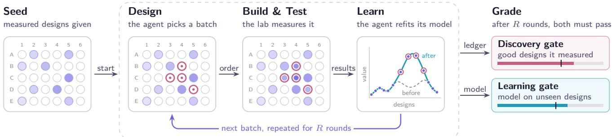  
Figure 1 Autonomous Science Bench at a glance. An agent starts from a seed of measured designs and runs a design-build-test-learn loop for R rounds. A campaign succeeds only if it passes both the discovery and learning gates.

## 1 Introduction

Autonomous scientific discovery requires AI agents to choose experiments iteratively, using previous results to guide what to test next. Self-driving laboratories support this process by connecting models, automation, and measurement in a closed loop (Abolhasani and Kumacheva, 2023; Szymanski et al., 2023). Language-model agents increasingly guide experimental planning, from systems that plan and execute chemical experiments (Boiko et al., 2023) to “AI scientist" pipelines that automate broader research workflows (Lu et al., 2024; Gottweis et al., 2025). To use a limited experimental budget effectively, an agent must decide which measurements are worth their cost, balance exploration against exploitation (Shahriari et al., 2016), and update its decisions as evidence accumulates.

Evaluating experimental decisions requires an interactive environment in which agents choose which measurements to acquire under a limited budget. Many science-agent benchmarks instead assess what agents can produce from supplied information, spanning question answering (Laurent et al., 2024), data-driven discovery and analysis (Majumder et al., 2025; Chen et al., 2025; Mitchener et al., 2025), machine-learning engineering (Chan et al., 2025), and research workflows (Starace et al., 2025; Merrill et al., 2026; Terminal-Bench-Science Team, 2026). Closed-loop benchmarks, from text-based simulated worlds (Jansen et al., 2024) to experimental-design environments (Gandhi et al., 2025; Malik et al., 2026; Kabra et al., 2026; Deb et al., 2026; Roohani et al., 2025), let agents request measurements sequentially under a fixed budget, but most rely on simulated responses, and few separately evaluate the designs discovered and the predictive model learned. We argue that a campaign should be graded on both outcomes, since an agent may find promising designs yet predict unseen outcomes poorly, or learn a useful model while finding few promising designs. App. A compares prior work in detail.

Table 1 Terminal-Bench tasks versus our campaigns. Our campaigns run in the same Harbor harness but test a different capability, deciding which experiments to run under a budget and learning from their results.
<table><tr><td></td><td>Terminal-Bench</td><td>Autonomous Science Bench (ours)</td></tr><tr><td></td><td>Unit of evaluation A task, from instruction to final container state</td><td>A campaign of R design-build-test-learn rounds</td></tr><tr><td>Data access</td><td>Inputs provided in the container</td><td>Bought batch by batch via a lab API</td></tr><tr><td>Interaction</td><td>The agent explores and edits its own container</td><td>Closed loop with a lab that enforces round order, batch size, and no repeats</td></tr><tr><td>Grading</td><td>Outcome tests on the final artifact</td><td>A discovery gate on what was measured and a learning gate on the delivered model</td></tr><tr><td>Passing requires</td><td>Executing an expert workflow</td><td>Experimental selection and held-out ranking</td></tr><tr><td>Shortcut control</td><td>Review, oracle and no-op runs, and an exploit agent</td><td>Oracle and no-op runs, truth separation, a ledger written by the lab, and a zero-measurement audit</td></tr><tr><td>Scale</td><td>89 tasks (Terminal-Bench 2.0)</td><td>Six deep campaigns on published lab data</td></tr></table>

We introduce Autonomous Science Bench, an initial benchmark for evaluating AI agents on budgeted designbuild-test-learn campaigns built on published experiments. In each campaign, the agent orders fixed-size batches of designs over a fixed number of rounds from a stateful lab service, which holds the measurements and records every job in a ledger (Figure 1). The agent is a general-purpose coding agent, such as Claude Code or Codex, with no benchmark-specific prompt or tool beyond the campaign instruction and a client for the lab. Each campaign fixes the objective, a predefined design space, and the budget, so the agent decides which designs to measure and, after the last round, what model to deliver. A campaign passes only if a discovery gate on the measured designs and a learning gate on the delivered model both pass. This first release, version 0.1, contains six pilot campaigns, two in each of biology, chemistry, and materials science, built on published studies of nuclease engineering (Thomas et al., 2025), cell-free biosensors (Wang et al., 2025a), CO2-to-propylene electrocatalysts (Kim et al., 2025), Suzuki-Miyaura reaction conditions (Perera et al., 2018), oxygen-evolution reaction (OER) catalysts (Rohr et al., 2020), and magnetic Fe-Co–Ni alloys (Wang et al., 2022).

## We summarize our main contributions as follows:

1. Campaigns as the unit of evaluation. We evaluate autonomous discovery as budgeted design-buildtest-learn campaigns. The agent chooses experiments, sees their results, and decides what to test next. A Harbor-compatible lab service enforces the budget and records every measurement.

2. Joint evaluation of discovery and learning. Two separately calibrated gates grade what the agent finds and what it learns, revealing weaknesses that an overall success rate would hide.

3. Six experiment-grounded campaigns. We release six shortcut-audited campaigns built on published lab measurements in biology, chemistry, and materials science, with the lab runtime, verifiers, and leaderboard Baselines for eight agent-model configurations over 144 trials show that none is yet reliable.

4. Adaptive budgets for live evaluation. We propose an adaptive replay-informed scheduler that prioritizes capable agents and informative trials to make full use of scarce lab resources.

## 2 Autonomous Science Bench

Autonomous Science Bench evaluates how agents select experiments and learn from their results under a fixed budget. Each campaign follows the Harbor task format (Harbor Framework Team, 2026), with a stateful lab that supplies measurements and two gates that grade the outcome (Table 1). Section 2.1 introduces the six campaigns of version 0.1, Sections 2.2 to 2.4 define the campaign, lab interface, and scoring gates, and Sections 2.5 and 2.6 describe campaign construction and calibration.

Table 2 The six campaigns in version 0.1, two each in biology, chemistry, and materials science. Qualifying designs are those that meet the campaign's hit or standout criteria. Expert time estimates how long a domain expert would take to complete each campaign.
<table><tr><td rowspan="2"></td><td colspan="2">Biology</td><td colspan="2">Chemistry</td><td colspan="2">Materials</td></tr><tr><td>Nuclease</td><td>Biosensor</td><td>Propylene</td><td>Suzuki</td><td>OER</td><td>Coercivity</td></tr><tr><td>Source</td><td>Thomas et al. (2025)</td><td>Wang et al. (2025a)</td><td>Kim et al. (2025)</td><td>Perera et al. (2018)</td><td>Rohr et al. (2020)</td><td>Wang et al. (2022)</td></tr><tr><td>Backend</td><td>replay</td><td>replay</td><td>twin</td><td>replay</td><td>replay</td><td>replay</td></tr><tr><td>Rounds × batch</td><td>4×96</td><td>3 ×10</td><td>3 ×20</td><td>4×48</td><td>4×48</td><td>4× 16</td></tr><tr><td>Pool</td><td>20,000</td><td>677</td><td>736</td><td>2,764</td><td>3,419</td><td>604</td></tr><tr><td>Budget / pool</td><td>1.9%</td><td>4.4%</td><td>8.2%</td><td>6.9%</td><td>5.6%</td><td>10.6%</td></tr><tr><td>Qualifying</td><td>3,954</td><td>58</td><td>14</td><td>168</td><td>288</td><td>20</td></tr><tr><td>Evaluation set</td><td>5,000</td><td>332</td><td>244</td><td>1,844</td><td>5,039</td><td>307</td></tr><tr><td>Discovery gate</td><td>hits ≥ 190 families ≥ 175</td><td>selective hits ≥ 21</td><td>hits ≥ 7</td><td>standouts ≥ 32</td><td>standouts ≥ 55 ≤ 28 per library</td><td>peak score ≥ 0.60</td></tr><tr><td>Learning gate</td><td>NDCG@100</td><td>NDCG@20</td><td>NDCG@20</td><td>NDCG@100</td><td>NDCG@100</td><td>NDCG@20</td></tr><tr><td>Expert time</td><td>≥0.42 10h</td><td>≥0.70 8h</td><td>≥0.52 10h</td><td>≥0.37 10h</td><td>≥0.55 12h</td><td>≥0.65 8h</td></tr></table>

## 2.1 Campaign Overview

Version 0.1 contains six campaigns, two each in biology, chemistry, and materials science, with distinct experimental challenges (Table 2). Budgets cover at most 11% of each candidate pool, and covering the pool evenly is not enough to pass. Nuclease rewards diverse hits, while biosensor requires locating selective variants within a limited budget. Propylene tests rare-hit discovery, and Suzuki requires comparing conditions within each substrate pair. Oxygen evolution tests prediction in a region unavailable for measurement, while coercivity requires discovery across separate peaks. App. C provides each campaign's full description.

## 2.2 Campaign Formulation

A campaign fixes what the agent starts from, what it may order, and what it must deliver. It is graded on the lab's record and the delivered model, not on a container's final state (Figure 1 and Definition 2.1).

Instructions, seed data, and deliverable. The instructions describe the scientific objective and assay, available files, design space, experimental budget, lab commands, deliverable format, and scoring criteria for both gates. The agent also receives a seed dataset $D _ { 0 }$ of measured designs, such as an alanine scan outside the design space or one complete substrate screen. These observations provide a starting point for selecting experiments but are restricted so that they cannot directly determine the ranking of the evaluation set. All other measurements remain hidden until requested through the lab. At the end, the agent delivers a JavaScript function predict(design) with its parameters embedded. The verifier runs this function in a sandbox without access to files, the network, the clock, randomness, or evaluation labels (App. D)

Definition 2.1 (Campaign). A campaign is a tuple $( \mathcal { X } , D _ { 0 } , f , R , b , \mathcal { X } _ { \mathrm { e v a l } } , G _ { \mathrm { d i s c } } , G _ { \mathrm { l e a r n } } )$ . X is the pool of orderable designs and $D _ { 0 }$ the public seed data. The response f is hidden from the agent. The lab holds it on $x ,$ and only the verifier holds it on $\chi _ { \mathrm { e v a l } }$ . In each round $r = 1 , \ldots , R$ the agent submits a batch

$$
\begin{array} { r } { S _ { r } \subseteq \mathcal { X } \setminus \bigcup _ { r ^ { \prime } < r } S _ { r ^ { \prime } } , \qquad | S _ { r } | = b , } \end{array}\tag{1}
$$

and the lab returns $f ( S _ { r } )$ , so the budget is $B = R b$ and no design is measured twice. After the last round the agent delivers a predictor $\hat { f } .$ The evaluation set $\mathcal { X } _ { \mathrm { e v a l } }$ is disjoint from X and never orderable. The campaign passes if and only if the discovery gate $\textstyle G _ { \mathrm { d i s c } } \bigl ( \bigcup _ { r } S _ { r } , f \bigr )$ and the learning gate $G _ { \mathrm { l e a r n } } \left( \hat { f } , \mathcal { X } _ { \mathrm { e v a l } } , f \right)$ both pass.

Reference solution and limits. Every campaign ships a reference solution that an agent could have written. It uses the same client and public data, and a strategy a domain scientist would recognize, such as screening for coverage and then exploiting. Agents have 8 hours per campaign, and we estimate a domain expert needs 8 to 12

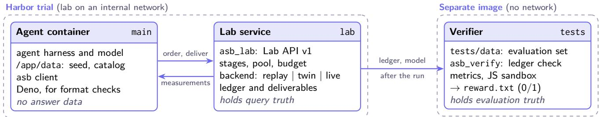  
Figure 2 Trial topology. The agent reaches the lab only through its API, which the asb client wraps. A separate verifier with no network grades only the lab's ledger and the delivered model.

## 2.3 Lab Service

Every campaign uses the same lab service, which implements Lab API v1 in a separate container on an internal network (Figure 2). The agent accesses the service over HTTP through the asb command-line client. Each order becomes a job. Replay jobs return at once, while twin and live jobs are polled until their measurements arrive, so the agent follows one workflow at every tier. App. D documents the endpoints and the client's commands.

Lab-owned records. The lab maintains the authoritative record of experiments used for grading. It enforces round order, batch size, design eligibility, and uniqueness. Rejected requests consume no budget. Accepted jobs are recorded sequentially in a ledger that the agent cannot modify, preserving both measurements and experimental history. After the trial, the lab passes the ledger and submitted model to the verifier, which checks round completion, design eligibility and uniqueness, and agreement with the underlying response data.

Backends. All backends use the same API and ledger format, differing only in how they obtain measurements for an accepted batch. The replay backend returns recorded values, the twin backend queries a hidden surrogate model, and the planned live backend will submit asynchronous jobs to a physical lab (App. D). The lab service does not specify which backend supplies the measurements. Five campaigns use replay, while the propylene campaign uses a digital twin from its source study to model catalyst performance.

## 2.4 Two Gates per Campaign

The design and learn stages of the cycle pursue two objectives, finding promising designs and predicting unseen outcomes. A discovery gate scores the measured designs, a learning gate scores the delivered model's ranking of held-out designs, and the reward is 1 only if both pass.

Definition 2.2 (Discovery gate). The discovery gate evaluates a statistic of the measured set Ur Sr and its true responses against a calibrated threshold. It counts designs above a scientifically meaningful bar, called hits. When the bar is deined by rank within a group, qualifying designs are called standouts.

Definition 2.3 (Learning gate). The learning gate measures how well the predictor ranks unseen designs using normalized discounted cumulative gain on $\mathcal { X } _ { \mathrm { e v a l } }$

$$
\mathrm { N D C G @ } k ( \hat { f } ) = \frac { 1 } { Z _ { k } } \sum _ { i = 1 } ^ { k } \frac { \operatorname* { m a x } \bigl ( y _ { \pi ( i ) } - \tau , 0 \bigr ) } { \log _ { 2 } ( i + 1 ) } ,\tag{2}
$$

where π orders designs by decreasing predicted score. Each design's relevance is the amount by which its true campaign-specific score y exceeds the baseline τ, or zero if it does not (App. C). The metric rewards placing more relevant designs near the top, and Zk is the ideal ranking score that normalizes a perfect ranking to 1 (Järvelin and Kekäläinen, 2002). The gate passes when NDCG@k meets the calibrated threshold.

Campaign-specific scoring. Scoring reflects each campaign's scientific objective while limiting shortcuts. When responses are not comparable across groups, targets are defined within each group: a Suzuki condition must rank among the best for its own substrate pair, and an oxide composition among the best in its own library.

Table 3 One gate is not enough. Calibration strategies that pass exactly one gate, with the reference on the same campaign. Scores are from each campaign's released split, divided by the gate so that 1.00 is the threshold, and bold values pass.
<table><tr><td colspan="2"></td><td colspan="2">Strategy</td><td colspan="2">Reference</td></tr><tr><td>Campaign</td><td>Single-gate strategy</td><td>Discovery</td><td>Learning</td><td>Discovery</td><td>Learning</td></tr><tr><td>Biosensor</td><td>Catalog tally, which learns nothing from its measurements</td><td>1.10</td><td>0.70</td><td>1.14</td><td>1.16</td></tr><tr><td>Suzuki</td><td>Oracle selection of 192 wells with the baseline predictor</td><td>2.28</td><td>0.86</td><td>1.19</td><td>1.18</td></tr><tr><td>Propylene</td><td>The source study&#x27;s Bayesian-optimization protocol</td><td>0.57</td><td>1.07</td><td>1.14</td><td>1.20</td></tr><tr><td>Coercivity</td><td>Space filling of the iron-poor region</td><td>0.54</td><td>1.13</td><td>1.54</td><td>1.27</td></tr></table>

Choosing an easier substrate or a more active library therefore provides no automatic advantage. When hits cluster, discovery scoring rewards coverage through distinct hit families in the nuclease campaign and a per-library cap in the oxygen-evolution campaign. Nuclease discovery thus has two thresholds, and its normalized score is the smaller of the hit and family ratios. Where promising designs occupy separate regions, half the score comes from the worst-covered region. A coercivity campaign that finds only the literature-indicated peak therefore scores at most 0.25 against a threshold of 0.60. When the source study reports ordered categories rather than numerical measurements, the learning gate assigns relevance scores according to that ordering.

Why two gates. Neither outcome guarantees the other (Table 3). Discovery alone can reward finding good designs without learning to rank unseen ones. On the biosensor campaign, a catalog tally that ignores its measurements finds enough selective hits but fails the learning gate. On the Suzuki campaign, the oracle-selected wells exceed the discovery threshold, but the predictor fitted to them fails the learning gate. Conversely, learning alone can reward accurate rankings without enough successful experiments. The propylene study's Bayesian-optimization protocol and space filling of the coercivity campaign's iron-poor region both pass the learning gate but find too few qualifying designs. The reference passes both gates on all four campaigns.

## 2.5 Campaign Construction

From published experiments. Each campaign begins with a published dataset audited for data quality, reuse permissions, and suitability for evaluating experimental decisions. A source card records the originating research group, DOI, license, and supported backends. The audit requires permission to redistribute derived tables, replicate measurements that support reliable labels, and a held-out learning curve showing that additional measurements improve prediction. It also checks that no tested zero-measurement prior matches the adaptive reference and that at least one gate distinguishes the evaluated strategies.

Measurement-dependent campaigns. Campaigns are designed so that prior knowledge guides experimentation without replacing it. We address shortcuts arising from published recommendations, data-selection artifacts, and strong regional priors. For propylene, the design space covers all 980 dilute alloys, extending beyond the source study's shortlist. For biosensors, the study's model-guided selection of later-round variants introduces a shortcut. A simple substitution count ranks those variants at NDCG@50 = 0.729 without new measurements. We therefore draw the held-out set from the initial library, before model-guided selection. For coercivity, choosing compositions nearest the literature-indicated Co50Ni50 region finds 39 of the pool's top 60 designs. Scoring discovery within each of the two peaks requires broader coverage than this prior alone provides. App. C documents these choices for each campaign.

## 2.6 Gate Calibration and Shortcut Audit

Calibration aims to make each campaign achievable by a reference solution while requiring more than static selection or prediction without new measurements. We evaluate strategies offline, set thresholds using four criteria, and check sensitivity to data splits and catalog order. We document exceptions and audit each release for shortcuts.

Baselines. We evaluate simple selection rules, adaptive optimization, and prediction without experimentation. Baselines include random, coverage-only, and space-filling selection; near-duplicate selection; static priors and composition rules; greedy exploitation; UCB and expected improvement; the source study's Bayesian-optimization protocol; and zero-measurement predictors. Static strategies order designs but ignore the results, while zeromeasurement predictors order nothing and only rank the evaluation set. With the initial dataset fixed, we redraw the pool and evaluation set across 30 splits for nuclease, biosensor, and propylene, and 24 for Suzuki. Oxygen evolution and coercivity retain fixed regions, so their 12 repetitions vary only catalog order.

Threshold criteria. Each campaign's calibration script checks four requirements: (i) reference margin, passing both gates on the released split with at least a 10% margin; (ii) baseline rejection, each non-adaptive baseline and zero-measurement predictor failing on at least 90% of splits; (iii) discovery feasibility, requiring no more than half the pool's qualifying designs; and (iv) evaluation coverage, retaining at least k relevant designs for NDCG@k. Learning thresholds are constrained by the reference margin rather than a fixed ceiling, since a fraction of perfect NDCG may be unattainable within the budget.

Checks across splits. For campaigns with redrawn data splits, the reference must pass on at least half. It passes on 26/30 nuclease, 29/30 biosensor, 27/30 propylene, and 18/24 Suzuki splits. Over their 12 catalog orders, the references of the two fixed-region campaigns pass all 12 for coercivity and 6 for oxygen evolution, including the released one. The oxygen-evolution reference breaks first-round ties between equally distant compositions by catalog order. Non-adaptive baselines pass on at most two splits each, and zero-measurement predictors pass the learning gate on at most one. Adaptive strategies such as UCB are allowed to pass, since agents may use them. The Suzuki thresholds also meet the criteria on 24 additional splits with the same seed data. However, a static strategy or a seed-data-only predictor rivals the reference on three alternative substrate screens. The calibration therefore depends on the released chloride screen.

Exceptions. The coercivity discovery gate requires 60% of the perfect score, because a 50% threshold would admit the strongest static composition rule. App. E reports the full criteria.

Shortcut audit. We audit each release for shortcuts that bypass meaningful experimentation. A no-op agent must receive reward 0, the reference must receive reward 1, and every zero-measurement predictor must fail the learning gate on the released split. We also test static strategies based solely on catalog structure. A biosensor catalog tally, which ranks variants by how many of the study's stacked positions they alter, passes both gates on 2 of 30 splits Before release, we apply static checks to verify answer isolation, network policy, and reward format (App. E).

## 3 Experimental Setup

Each evaluation is a Harbor job spanning campaigns, agent-model configurations, and repeated attempts. A trial is one configuration's attempt on one campaign.

Agents. Models run in their vendor's coding agent, while open-weight models use mini-SWE-agent, a minimal, provider-independent scaffold from the SWE-agent project (Yang et al., 2024). Pairings and reasoning effort follow the Terminal-Bench-Science 0.1 leaderboard where available (Terminal-Bench-Science Team, 2026). Because scaffolds differ in tools and prompting, scores measure agent-model configurations rather than models alone. Each agent operates through a container shell and ac-

Table 4 Evaluated configurations. A dash marks the provider's default reasoning effort.
<table><tr><td>Model</td><td>Provider</td><td>Agent</td><td>Effort</td></tr><tr><td>Haiku 4.5</td><td>Anthropic</td><td>Claude Code</td><td></td></tr><tr><td>Opus 5.5</td><td>Anthropic</td><td>Claude Code</td><td>max</td></tr><tr><td>Sonnet 5.5</td><td>Anthropic</td><td>Claude Code</td><td>high</td></tr><tr><td>GPT-5.6 Luna</td><td>OpenAI</td><td>Codex</td><td>max</td></tr><tr><td>GPT-5.6 Terra</td><td>OpenAI</td><td>Codex</td><td>max</td></tr><tr><td>Qwen3.8 27B</td><td>Alibaba (open)</td><td>mini-SWE-agent</td><td></td></tr><tr><td>MiniMax M3</td><td>MiniMax (open)</td><td>mini-SWE-agent</td><td></td></tr><tr><td>GLM-5.3 Flash</td><td>Z.ai (open)</td><td>mini-SWE-agent</td><td></td></tr></table>

cesses its model provider over the internet. Beyond the task instructions and asb client, agents receive no benchmarkspecific prompts, tools, or memory. All agents start each campaign with the same container image and public files

Models. We evaluate eight configurations (Table 4), with the open-weight models served through OpenRouter Opus 5.5 and both GPT-5.6 models run at maximum reasoning effort, Sonnet 5.5 at high effort, and the other four at their provider's default. App. F details their exact identifiers and agent versions.

Harness. Trials run in Harbor 0.21.0 (Harbor Framework Team, 2026) on local Docker, which hosts the agent and lab containers of a trial (Figure 2). Each trial gets its campaign's resources, 2 to 4 CPUs and 4 to 8 GB of memory. The agent can access its model provider and public web search, while egress controls block known answer sources. It reaches the lab over a private network. The verifier runs with no network. We set the time limit for each trial to 8 hours. We run every configuration for three trials on each campaign, 144 trials in all.

(a) gate outcomes  
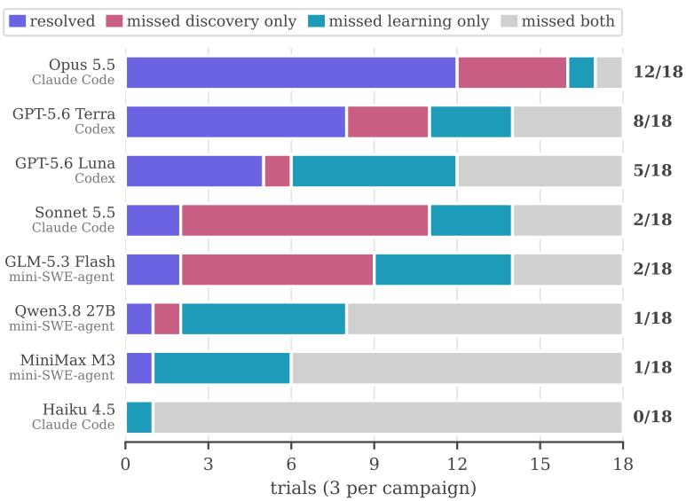

(b) resolution rate against cost  
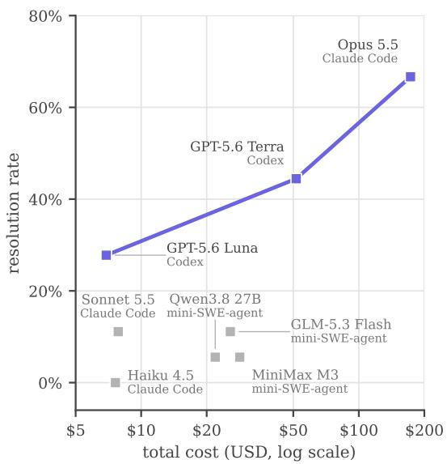  
Figure 3 Configurations fail on different gates, and higher resolution costs steeply more. (a) Trial outcomes, with three trials per campaign. (b) Resolution rate versus total model cost. The Pareto frontier connects configurations for which no other achieves an equal or higher resolution rate at lower cost.

Metrics. A configuration's resolution rate is the fraction of trials that pass both gates, averaged across campaigns. With three trials per campaign, this equals the fraction resolved across its 18 trials. The released verifier scores every trial, counting agent failures as unresolved. We also report continuous scores for both gates and track token usage, total elapsed time, and agent-reported API costs through Harbor to assess performance alongside resource use (Kapoor et al., 2024).

## 4 Results

This section examines how well agents perform and at what cost (Section 4.1), which gate they miss when they fail (Section 4.2), and how they spend their budget across rounds (Section 4.3). App. B lists the outcome and both gate scores of every trial.

## 4.1 Cost and Agent Performance

Overall success is limited. Only 31 of the 144 trials pass. Opus 5.5 in Claude Code resolves 67% of campaign trials, and GPT-5.6 Terra and GPT-5.6 Luna in Codex follow at 44% and 28% (Figure 3a). Sonnet 5.5 and GLM-5.3 Flash resolve two trials each, Qwen3.8 27B and MiniMax M3 one each, and Haiku 4.5 none. Even Opus 5.5 resolves every trial on only two campaigns and fails all three biosensor trials. App. B gives every configuration's results by campaign.

Every campaign separates configurations. Each campaign is resolved by some configurations and missed by others. The oxygen-evolution campaign is resolved most often, in 8 of 24 trials by four configurations, and the coercivity campaign least, in 3 of 24, two of them by Opus 5.5. Only the two GPT-5.6 configurations resolve the biosensor campaign. Resolution counts are similar across domains in this sample, at 9, 11, and 11 of 48 trials in biology, chemistry, and materials science. As required, the reference resolves every campaign and the no-op agent none. All 144 trials completed every round and delivered a model that passed the format check, so no trial failed because of incomplete rounds or an invalid submission.

Higher resolution came at steeply higher cost. Moving from GPT-5.6 Luna to Opus 5.5 multiplies the total cost by 25, from \$6.91 to \$172.90, and the resolution rate by 2.4 (Figure 3b). GPT-5.6 Terra sits between them at \$51.57, so the cost per resolved trial rises from \$1.38 for Luna to \$6.45 for Terra and \$14.41 for Opus 5.5. The open-weight configurations cost three to four times as much as Luna, resolve fewer trials, and run far longer. GLM-5.3 Flash, for example, used 28 hours of agent time against Luna's 6 hours.

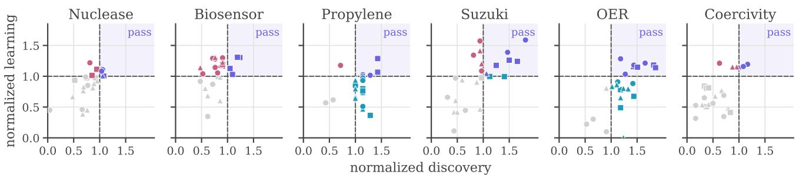  
resolvedmissed discovery onlymissed learning onlymissed both  Claude Code Codex ∆ mini-SWE-agent

Figure 4 Discovery and learning scores are related but separable. Each marker is one completed trial, placed by its two gate scores divided by their thresholds. Color gives the outcome and shape the agent, and the shaded corner passes both gates.  
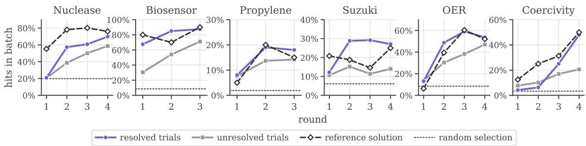  
Figure 5 How agents spend their budget. The fraction of each batch meeting the campaign's hit or standout criterion, by round, on a per-campaign scale. Solid lines show the mean of resolved and unresolved trials, with the reference on the released split dashed and random selection dotted.

## 4.2 Discovery versus Learning

We examine whether unsuccessful trials fall short in discovery, learning, or both, and how these patterns vary across campaigns and agent-model configurations. To compare gate scores, we divide each by its threshold, so a normalized score of 1 marks a pass.

Failures differ across campaigns. Of the 113 unresolved trials, 25 fail only discovery, 30 only learning, and 58 both (Table 5). Nearly half therefore pass one gate, a distinction hidden by the binary reward. The failure patterns reflect different campaign demands. On oxygen evolution, where the evaluation region cannot be measured, 12 trials fail only learning and none fail only discovery. On propylene, most agents find the seven required hits, but 16 of 19 unresolved trials fail only learning. Biosensor shows the reverse where 12 of 20 unresolved trials rank unseen designs well enough but find too few selective hits. Coercivity challenges both objectives where 18 of 21 unresolved trials fail both gates, and 9 of all 24 trials never reach the second peak.

Table 5 How unresolved trials fail. Unresolved trials, counted by the gates they miss.
<table><tr><td>Campaign</td><td>Discovery only</td><td>Learning only</td><td>Both</td><td>Total</td></tr><tr><td>Nuclease</td><td>4</td><td>0</td><td>15</td><td>19</td></tr><tr><td>Biosensor</td><td>12</td><td>0</td><td>8</td><td>20</td></tr><tr><td>Propylene</td><td>1</td><td>16</td><td>2</td><td>19</td></tr><tr><td>Suzuki</td><td>5</td><td>2</td><td>11</td><td>18</td></tr><tr><td>OER</td><td>0</td><td>12</td><td>4</td><td>16</td></tr><tr><td>Coercivity</td><td>3</td><td>0</td><td>18</td><td>21</td></tr><tr><td>All</td><td>25</td><td>30</td><td>58</td><td>113</td></tr></table>

Overall success rates hide different weaknesses. Configurations also differ in which objective they satisfy (Figure 3a). Sonnet 5.5 passes learning in 11 of 18 trials but discovery in only 5, whereas GPT-5.6 Luna passes discovery in 11 but learning in only 6. Among configurations with low resolution rates, Sonnet 5.5 and GLM-5.3 Flash (11% each) more often miss discovery, while Qwen3.8 27B and MiniMax M3 (6% each) more often miss learning. Reporting both gates distinguishes these weaknesses beyond the overall success rate.

Strong rankings do not guarantee discovery. Normalized discovery and learning scores have a Spearman correlation of 0.43 across all 144 trials, with within-campaign correlations ranging from 0.30 to 0.71 (Figure 4). Despite this association, Sonnet 5.5 achieves the highest held-out ranking score on two campaigns while failing their discovery gates. On nuclease, it reaches NDCG@100 = 0.512 against a threshold of 0.42. However, its 195 hits include many near-duplicate variants and cover only 142 distinct families, below the required 175. The two gates thus distinguish predictive ranking quality from the quality and coverage of measured discoveries.

## 4.3 Budget Use Across Rounds

The ledger records show how agents use budgets over successive rounds. Figure 5 reports each batch's hit rate, the fraction meeting the campaign's hit or standout criterion before diversity, cap, or peak-coverage rules are applied.

Early gains do not ensure success. By round 2, unresolved trials select hits 2.0 to 7.2 times as often as random selection across all campaigns. Resolved trials achieve 2.9 to 10 times the random rate, except for the three resolved coercivity trials, which find most of their hits in the final two rounds. Despite above-random selection, 83 of the 113 unresolved trials fail the discovery gate, which can require both sufficient hits and coverage.

Search patterns vary by campaign. Grouping trials by outcome reveals when selection patterns diverge. On biosensor, resolved trials average a 68% hit rate in round 1, while unresolved trials reach 71% only in the final round, too late to accumulate 21 hits from 30 orders. On Suzuki, resolved trials select hits nearly twice as often from round 2 onward, at 29% versus 15%. On oxygen evolution, resolved trials select standouts more often than the reference in the first two rounds and about as often afterward. On propylene, both groups maintain similar hit rates, but 16 of 19 unresolved trials fail only learning (Table 5), indicating that outcomes differ mainly in final predictive model quality.

## 5 Adaptive Budgets for Live Evaluation

Since lab time and resources are scarce, we propose a budget scheduler that allocates measurements across agents adaptively. It prioritizes full quotas for agents whose estimated resolution rate meets a threshold, then allocates remaining capacity to improve agent selection. The scheduler is planned for the live backend and is not evaluated in version 0.1.

Budgets and quotas. Each full-budget trial requires R rounds of b measurements. For each campaign, the lab runs one trial per agent in the set $A ,$ with $| A | = m$ , over R synchronous rounds. Capacity is N measurements per round in each campaign, giving a screening budget of NR. We assume $N < m b ,$ so this budget cannot fully evaluate all agents. Before round $r ,$ the scheduler assigns quotas $x _ { i r } \in \{ 0 , \ldots , b \}$ subject to $\textstyle \sum _ { i \in A } x _ { i r } \leq N$ . Each agent submits up to its quota, with $x _ { i r } = b$ giving full funding and $x _ { i r } = 0$ giving no measurements that round. Once all submitted designs are measured, the lab returns the results and the scheduler updates its estimates for the next round.

Performance estimates. The scheduler combines replay results and live evidence to estimate each agent's full-budget performance. Let C be the set of campaigns, $\theta _ { i c }$ the probability that agent i passes both gates on campaign c at full budget, and $P _ { i } = | { \mathcal { C } } | ^ { - 1 } \textstyle \sum _ { c \in { \mathcal { C } } } \theta _ { i c }$ its average resolution rate. We initialize

$$
\theta _ { i c } \sim \mathrm { B e t a } \big ( \kappa \mu _ { i c } , \kappa ( 1 - \mu _ { i c } ) \big ) ,\tag{3}
$$

where $\mu _ { i c }$ is the smoothed replay resolution rate and a small $\kappa > 0$ limits replay's influence. We propose an outcome model M, trained on paired variable-quota and full-budget replay runs, to model observed histories conditional on full-budget success or failure. It assigns likelihoods $\boldsymbol { L } _ { i c , r } ( 1 )$ and $L _ { i c , r } ( 0 )$ to observed histories and predicts possible next results under a proposed quota. Each trial contributes the likelihood factor $\theta _ { i c } L _ { i c , r } ( 1 ) + ( 1 - \theta _ { i c } ) L _ { i c , r } ( 0 )$ to the posterior, replacing the previous factor as measurements arrive. At full-budget completion, this factor is replaced by $\theta _ { i c } ^ { Y _ { i c } } ( 1 - \bar { \theta _ { i c } } ) ^ { 1 - Y _ { i c } }$ , where $Y _ { i c }$ is the trial's binary outcome. Let $\mathcal { H } _ { r }$ contain all assigned quotas, submitted designs measurements, and full-budget outcomes observed before round r. The scheduler averages the updated success probabilities across campaigns to obtain $\hat { P } _ { i r } = \mathbb { E } [ P _ { i } \mid \mathcal { H } _ { r } ]$ , its estimate of the agent's full-budget resolution rate.

Allocating measurements. The scheduler allocates measurements in two stages. First, it considers agents with $\hat { P } _ { i r } \ge \eta$ in decreasing order of $\hat { P } _ { i r }$ , where η is a prespecified threshold. If at least b measurements remain available, the agent receives $x _ { i r } = b$ and joins the fully funded set $F _ { r }$ . Second, the scheduler allocates the remaining capacity to improve its choice of which agent to recommend,

$$
\begin{array} { r l } & { \mathbf { x } _ { r } ^ { * } \in \arg \operatorname* { m a x } _ { \mathbf { x } _ { r } } \mathbb { E } \big [ \operatorname* { m a x } _ { i } \mathbb { E } [ P _ { i } \mid \mathcal { H } _ { r } , Z _ { r } ( \mathbf { x } _ { r } ) ] \mid \mathcal { H } _ { r } \big ] - \operatorname* { m a x } _ { i } \hat { P } _ { i r } , } \\ & { \mathrm { s u b j e c t ~ t o } ~ x _ { i r } = b ~ ( i \in F _ { r } ) , \quad x _ { i r } \in \{ 0 , \ldots , b \} ~ ( i \in A \setminus F _ { r } ) , \quad \sum _ { i \in A } x _ { i r } \le N . } \end{array}\tag{4}
$$

Here, $Z _ { r } ( \mathbf { x } _ { r } )$ denotes new evidence under allocation $\mathbf { x } _ { r } ,$ including submitted designs, measurements, and any full-budget gate outcomes. The outcome model predicts this evidence from the current history and proposed quotas. For each possible result, the scheduler updates its estimates and identifies the best agent. The objective averages the gain over the current recommendation, equal to the expected reduction in selection regret under the model (Frazier et al., 2008). Using partial histories follows the idea of trace-aware knowledge gradient (Wu et al., 2020). We approximate this objective greedily and update quotas after each round.

Algorithm 1 Adaptive budgets for live evaluation   
Require: Agents A, batch size $b ,$ capacity N, rounds R, threshold $\eta ,$ replay rates $\mu _ { i c } ,$ prior strength $\kappa ,$ outcome   
model M   
1: Initialize weak priors and compute $\hat { P } _ { i 1 }$ ▶ Equation (3)   
2: for each lab round $r = 1 , \ldots , R$ do   
3: Initialize $x _ { i r } = 0$ for all $i \in A$   
4: Assign full quotas $x _ { i r } = b$ to agents with $\hat { P } _ { i r } \ge \eta .$ highest estimate first, while capacity permits   
5: Allocate remaining capacity greedily, keeping full quotas fixed ▶ Equation (4)   
6: Inform agents of their quotas and collect up to $x _ { i r }$ designs from each   
7: Measure submitted designs and return results to all agents   
8: Record any full-budget gate outcomes and compute $\hat { P } _ { i , r + 1 }$   
9: end for   
10: return final performance estimates, observed gate outcomes, and the allocation ledger

Completion and reporting. At the end of live evaluation, the scheduler estimates each agent's full-budget resolution rate from completed outcomes and partial histories. Planned reports will include these model-based estimates, observed pass or fail outcomes, and budget use. Replay and twin evaluations report full-budget resolution rates directly from completed trials. Algorithm 1 summarizes the procedure, with details in App. G.

## 6 Limitations

Scale. Version 0.1 contains six campaigns in three fields and evaluates eight agent-model configurations, a small sample of both experimental science and agents. We plan to add campaigns, fields, and configurations, and a source registry and contribution guide let research groups contribute campaigns from their own experiments.

Replays and twins. A replay backend returns only previously recorded measurements, while a twin's reliability depends on its surrogate's training coverage. Both limit the design space available to agents.

Public data. The campaigns use published experiments that a model may have memorized or an agent could retrieve during a trial if egress controls fail to fully block access. Fully addressing them requires unpublished results from live experiments or autonomous laboratories, which the planned live backend is designed to support.

## 7 Conclusion

Science advances through decisions about which experiments are worth a limited budget. Autonomous Science Bench evaluates these choices in campaigns grounded in published lab data, measuring what agents discover and what they learn separately. Our results show why both matter. Agents can find strong designs without learning to rank unseen ones, or learn useful rankings without reaching the best designs. Even the strongest evaluated agent remains unreliable across campaigns, and an overall success rate alone obscures these distinct weaknesses.

We release the campaigns, lab runtime, and public leaderboard as a first step toward evaluation that progress from replayed experiments through digital twins to autonomous laboratories. As this evaluation moves into live science, agents will face broader decisions about which questions to pursue and which experiments to run. The proposed scheduler would allocate scarce measurements to help identify which agents to trust with these decisions. Together, these steps offer a path toward autonomous science in which agents turn limited experimental resources into reliable discoveries and new questions worth pursuing.

Code Availability All code, campaigns, and calibration scripts are at https://github.com/Yibo-Wen/as-bench.

## References

Milad Abolhasani and Eugenia Kumacheva. 2023. The rise of self-driving labs in chemical and materials sciences. Nature Synthesis, 2:483–492.

Daniil A. Boiko, Robert MacKnight, Ben Kline, and Gabe Gomes. 2023. Autonomous chemical research with large language models. Nature, 624:570–578.

Andres M. Bran, Sam Cox, Oliver Schilter, Carlo Baldassari, Andrew D. White, and Philippe Schwaller. 2024. Augmenting large language models with chemistry tools. Nature Machine Intelligence, 6:525–535.

Benjamin Burger, Phillip M. Maffettone, Vladimir V. Gusev, Catherine M. Aitchison, et al. 2020. A mobile robotic chemist. Nature, 583:237–241.

Jun Shern Chan, Neil Chowdhury, Oliver Jaffe, et al. 2025. MLE-bench: Evaluating machine learning agents on machine learning engineering. In International Conference on Learning Representations (ICLR). ArXiv:2410.07095.

Ziru Chen, Shijie Chen, Yuting Ning, et al. 2025. ScienceAgentBench: Toward rigorous assessment of language agents for data-driven scientific discovery. In International Conference on Learning Representations (ICLR). ArXiv:2410.05080.

Sagar Deb, Devam Shah, and Ashwanth Krishnan. 2026. Active causal discovery benchmark: Evaluating LLM agents under budgeted interventions. arXiv preprint arXiv:2609.31675.

Peter I. Frazier, Warren B. Powell, and Savas Dayanik. 2008. A knowledge-gradient policy for sequential information collection. SIAM Journal on Control and Optimization, 47(5):2410–2439.

Kanishk Gandhi, Michael Y. Li, Lyle Goodyear, et al. 2025. BoxingGym: Benchmarking progress in automated experimental design and model discovery. arXiv preprint arXiv:2501.01540.

Juraj Gottweis, Wei-Hung Weng, Alexander Daryin, et al. 2025. Accelerating scientific discovery with Co-Scientist. arXiv preprint arXiv:2502.18864.

Harbor Framework Team. 2026. Harbor: A framework for evaluating and optimizing agents and models in container environments. https://github.com/harbor-framework/harbor.

Florian Häse, Matteo Aldeghi, Riley J. Hickman, Loic M. Roch, et al. 2021. Olympus: a benchmarking framework for noisy optimization and experiment planning. Machine Learning: Science and Technology, 2(3):035021.

Qian Huang, Jian Vora, Percy Liang, and Jure Leskovec. 2024. MLAgentBench: Evaluating language agents on machine learning experimentation. In International Conference on Machine Learning (ICML). ArXiv:2310.03302.

Peter Jansen, Marc-Alexandre Côté, Tushar Khot, et al. 2024. DiscoveryWorld: A virtual environment for developing and evaluating automated scientific discovery agents. In NeurIPS Datasets and Benchmarks Track. ArXiv:2406.06769.

Kalervo Järvelin and Jaana Kekäläinen. 2002. Cumulated gain-based evaluation of IR techniques. ACM Transactions on Information Systems, 20(4):422–446.

Carlos E. Jimenez, John Yang, Alexander Wettig, et al. 2024. SWE-bench: Can language models resolve real-world GitHub issues? In International Conference on Learning Representations (ICLR). ArXiv:2310.06770.

Sanchit Kabra, Nikhil Abhyankar, Saaketh Desai, et al. 2026. LLM-AutoSciLab: Closed-loop scientific discovery via active experimentation with LLMs. arXiv preprint arXiv:2605.24043.

Sayash Kapoor, Benedikt Stroebl, Zachary S. Siegel, Nitya Nadgir, and Arvind Narayanan. 2024. AI agents that matter arXiv preprint arXiv:2407.01502.

Steven M. Kearnes, Michael R. Maser, Michael Wleklinski, Anton Kast, Abigail G. Doyle, Spencer D. Dreher, Joel M. Hawkins, Klavs F. Jensen, and Connor W. Coley. 2021. The open reaction database. Journal of the American Chemical Society, 143:18820–18826.

Jiheon Kim, Suhas Mahesh, Hyeon Seok Lee, et al. 2025. Accelerated discovery of CO2-to-C3-hydrocarbon electrocatalysts with human-in-the-loop. Joule, 9(12):102213.

Jon M. Laurent, Joseph D. Janizek, Michael Ruzo, et al. 2024. LAB-Bench: Measuring capabilities of language models for biology research. arXiv preprint arXiv:2407.10362

Zongxia Li, Zhongzhi Li, Yucheng Shi, et al. 2026. Long-horizon-terminal-bench: Testing the limits of agents on long-horizon terminal tasks with dense reward-based grading. arXiv preprint arXiv:2607.08964.

Tennison Liu, Nicolás Astorga, Nabeel Seedat, et al. 2024. Large language models to enhance Bayesian optimization. In International Conference on Learning Representations (ICLR). ArXiv:2402.03921.

Chris Lu, Cong Lu, Robert Tjarko Lange, Jakob Foerster, Jeff Clune, and David Ha. 2024. The AI scientist: Towards fully automated open-ended scientific discovery. arXiv preprint arXiv:2408.06292.

Bodhisattwa Prasad Majumder, Harshit Surana, Dhruv Agarwal, et al. 2025. DiscoveryBench: Towards data-driven discovery with large language models. In International Conference on Learning Representations (ICLR). ArXiv:2407.01725.

Shreshth A. Malik, Tiarnan Doherty, Panagiotis Tigas, et al. 2026. MADE: Benchmark environments for closed-loop materials discovery. In International Conference on Machine Learning (ICML). ArXiv:2601.20996.

Natalie Maus, Yimeng Zeng, Haydn Thomas Jones, et al. 2026. Purely agent-driven black-box optimization for biological design. arXiv preprint arXiv:2601.22382.

Mike A. Merrill, Alexander G. Shaw, Nicholas Carlini, Boxuan Li, Harsh Raj, Ivan Bercovich, et al. 2026. Terminal-bench: Benchmarking agents on hard, realistic tasks in command line interfaces. In International Conference on Learning Representations (ICLR). ArXiv:2601.11868.

Ludovico Mitchener, Jon M. Laurent, Alex Andonian, et al. 2025. BixBench: a comprehensive benchmark for LLM-based agents in computational biology. arXiv preprint arXiv:2503.00096.

Marcel Müller, Jiaru Bai, Willi Gottstein, et al. 2026. La agente óptima: Towards agentic self-driving laboratories. arXiv preprint arXiv:2609.04564.

Deepak Nathani, Lovish Madaan, Nicholas Roberts, et al. 2025. MLGym: A new framework and benchmark for advancing AI research agents. arXiv preprint arXiv:2502.14499.

Damith Perera, Joseph W. Tucker, Shalini Brahmbhatt, Christopher J. Helal, Ashley Chong, William Farrell, Paul Richardson, and Neal W. Sach. 2018. A platform for automated nanomole-scale reaction screening and micromole-scale synthesis in flow. Science, 359:429–434.

Brian Rohr, Helge S. Stein, Dan Guevarra, Yu Wang, Joel A. Haber, Muratahan Aykol, Santosh K. Suram, and John M. Gregoire. 2020. Benchmarking the acceleration of materials discovery by sequential learning. Chemical Science, 11:2696-2706.

Yusuf Roohani, Andrew Lee, Qian Huang, et al. 2025. BioDiscoveryAgent: An AI agent for designing genetic perturbation experiments. In International Conference on Learning Representations (ICLR). ArXiv:2405.17631.

Samuel Schmidgall, Yusheng Su, Ze Wang, et al. 2025. Agent laboratory: Using LLM agents as research assistants. arXiv preprint arXiv:2501.04227.

Bobak Shahriari, Kevin Swersky, Ziyu Wang, Ryan P. Adams, and Nando de Freitas. 2016. Taking the human out of the loop: A review of Bayesian optimization. Proceedings of the IEEE, 104(1):148–175.

Benjamin J. Shields, Jason Stevens, Jun Li, Marvin Parasram, et al. 2021. Bayesian reaction optimization as a tool for chemical synthesis. Nature, 590:89–96.

Zachary S. Siegel, Sayash Kapoor, Nitya Nadgir, et al. 2024. CORE-Bench: Fostering the credibility of published research through a computational reproducibility agent benchmark. arXiv preprint arXiv:2409.11363.

Giulio Starace, Oliver Jaffe, Dane Sherburn, et al. 2025. PaperBench: Evaluating AI's ability to replicate AI research. In International Conference on Machine Learning (ICML), volume 267 of Proceedings of Machine Learning Research, pages 56843–56873.

Nathan J. Szymanski, Bernardus Rendy, Yuxing Fei, Rishi E. Kumar, et al. 2023. An autonomous laboratory for the accelerated synthesis of inorganic materials. Nature, 624:86–91.

Terminal-Bench-Science Team. 2026. Terminal-Bench-Science: Evaluating AI agents on research workflows across scientific domains. https://github.com/harbor-framework/terminal-bench-science. Version 0.1.

Neil Thomas, David Belanger, Chenling Xu, Hanson Lee, Kathleen Hirano, Kosuke Iwai, Vanja Polic, Kendra D. Nyberg, Kevin G. Hoff, Lucas Frenz, Charlie A. Emrich, Jun W. Kim, Mariya Chavarha, Abi Ramanan, Jeremy J. Agresti, and Lucy J. Colwell. 2025. Engineering highly active nuclease enzymes with machine learning and high-throughput screening. Cell Systems, 16(3):101236.

Gary Tom, Stefan P. Schmid, Sterling G. Baird, Yang Cao, et al. 2024. Self-driving laboratories for chemistry and materials science. Chemical Reviews, 124(16):9633–9732.

Alex Wang, Haotong Liang, Austin McDannald, Ichiro Takeuchi, and Aaron Gilad Kusne. 2022. Benchmarking active learning strategies for materials optimization and discovery. Oxford Open Materials Science, 2(1):itac006.

Brenda M. Wang, Nicole Chiang, Holly M. Ekas, et al. 2025a. Active learning-guided optimization of cell-free biosensors for lead testing in drinking water. Nature Communications, 17:261.

Ziqing Wang, Yibo Wen, Abhishek Pandey, Han Liu, and Kaize Ding. 2026a. MolMem: Memory-augmented agentic reinforcement learning for sample-efficient molecular optimization. In Proceedings of the 64th Annual Meeting of the Association for Computational Linguistics (Volume 1: Long Papers), pages 43694–43712.

Ziqing Wang, Yibo Wen, William Pattie, Xiao Luo, Weimin Wu, Jerry Yao-Chieh Hu, Abhishek Pandey, Han Liu, and Kaize Ding. 2025b. POLO: Preference-guided multi-turn reinforcement learning for lead optimization. arXiv preprint arXiv:2509.21737.

Ziqing Wang, Kexin Zhang, Zihan Zhao, Yibo Wen, Abhishek Pandey, Han Liu, and Kaize Ding. 2026b. A survey of large language models for text-guided molecular discovery: From molecule generation to optimization. In Proceedings of the 64th Annual Meeting of the Association for Computational Linguistics (Volume 1: Long Papers), pages 43738–43769.

Hjalmar Wijk, Tao Lin, Joel Becker, et al. 2024. RE-Bench: Evaluating frontier AI R&D capabilities of language model agents against human experts. arXiv preprint arXiv:2411.15114

Jian Wu, Saul Toscano-Palmerin, Peter I. Frazier, and Andrew Gordon Wilson. 2020. Practical multi-fidelity Bayesian optimization for hyperparameter tuning. In Proceedings of the 35th Conference on Uncertainty in Artificial Intelligence (UAI), volume 115 of Proceedings of Machine Learning Research, pages 788–798.

Yutaro Yamada, Robert Tjarko Lange, Cong Lu, et al. 2025. The AI scientist-v2: Workshop-level automated scientific discovery via agentic tree search. arXiv preprint arXiv:2504.08066.

John Yang, Carlos E. Jimenez, Alexander Wettig, et al. 2024. SWE-agent: Agent-computer interfaces enable automated software engineering. In Advances in Neural Information Processing Systems (NeurIPS). ArXiv:2405.15793.

Kevin K. Yang, Zachary Wu, and Frances H. Arnold. 2019. Machine-learning-guided directed evolution for protein engineering. Nature Methods, 16(8):687–694.

Young K. Yoo, Qizhen Xue, Yong S. Chu, Shifa Xu, Ude Hangen, Hyung-Chul Lee, Wolfgang Stein, and Xiao-Dong Xiang. 2006. Identification of amorphous phases in the Fe-Ni-Co ternary alloy system using continuous phase diagram material chips. Intermetallics, 14(3):241–247.

## Appendix

A Related Work 15   
B Full Results 16   
C Campaign Cards 18   
C.1 Nuclease Engineering (nuclease-active-learning) 18   
C.2 Cell-Free Biosensor (biosensor-active-learning) . 18   
C.3 CO2-to-Propylene Electrocatalysts (propylene-active-learning) 19   
C.4 Suzuki-Miyaura Condition Screen (suzuki-condition-screen) 19   
C.5 Oxygen-Evolution Catalyst Composition (oer-composition-screen) 20   
C.6 Fe-Co-Ni Coercivity Peak Search (coercivity-peak-search) 20   
D Lab API and Ledger 21   
E Calibration and Shortcut-Audit Details 23   
F Agent and Model Presets 23   
G Adaptive Budgets for Live Evaluation 23   
H LLM Usage 24

## A Related Work

Agent benchmarks in realistic environments. Each of the benchmarks discussed below runs an agent in a realistic environment and grades the state the agent leaves behind. SWE-bench (Jimenez et al., 2024) set the pattern of grading agents with executable tests on real software repositories. Terminal-Bench (Merrill et al., 2026) carried it to 89 hard tasks in containerized terminal environments, each with an instruction, an environment, tests, and a reference solution. It also introduced the Harbor format (Harbor Framework Team, 2026) that our campaigns use. Long-Horizon-Terminal-Bench (Li et al., 2026) lengthens the horizon and replaces the binary outcome with dense rewards. Terminal-Bench-Science (Terminal-Bench-Science Team, 2026) applies the format to 70 research workflows from the natural, mathematical, and engineering sciences. In all of them, the agent works on data it is given. Autonomous Science Bench builds on this task format to evaluate a capability these benchmarks leave untested, deciding which experiments to run. Its agents acquire evidence from a budgeted lab and are graded separately on what they discover and what they learn.

Benchmarks for science agents. Most benchmarks for science agents fix their data before the agent starts. LAB-Bench (Laurent et al., 2024) measures practical biology-research skills, mostly through multiple-choice questions. DiscoveryBench (Majumder et al., 2025) and ScienceAgentBench (Chen et al., 2025) pose data-driven discovery tasks over datasets drawn from papers and grade the hypothesis or program the agent produces. BixBench (Mitchener et al., 2025) does the same for computational-biology analyses. MLE-bench (Chan et al., 2025), MLAgentBench (Huang et al., 2024), MLGym (Nathani et al., 2025), RE-Bench (Wijk et al., 2024), and PaperBench (Starace et al., 2025) evaluate machine-learning engineering, research-engineering tasks, and the replication of published research, and CORE-Bench (Siegel et al., 2024) tests computational reproducibility. DiscoveryWorld (Jansen et al., 2024) is the closest in spirit to our benchmark. Its agents run experiments inside a simulated, text-based world and must reach a discovery end to end. Its worlds are synthetic, however, whereas our campaigns are built on measurements from published lab experiments. Its scoring reports task completion, task-relevant actions, and the explanatory knowledge the agent discovers, while our learning gate tests a delivered model on measurements it has never seen.

Closed-loop experimental design with language models. A growing line of work puts language models inside the experimental loop. LLAMBO (Liu et al., 2024) prompts a language model to warm-start Bayesian optimization, to propose candidate points, and to act as its surrogate model, and tests it on hyperparameter tuning. BioDiscoveryAgent (Roohani et al., 2025) designs successive rounds of genetic perturbation screens. PABLO (Maus et al., 2026) runs black-box optimization with a hierarchy of prompted agents, for small-molecule and antimicrobial-peptide design. POLO (Wang et al., 2025b) and MolMem (Wang et al., 2026a) train language-model agents with multi-turn reinforcement learning to optimize lead compounds within a few hundred oracle calls, and Wang et al. (2026b) survey language models for molecule generation and optimization. La Agente Optima (Müller et al., 2026) is an agent framework that builds and supervises Bayesian-optimization campaigns, on computational tasks and on two physical self-driving laboratories.

Benchmarks for closed-loop experimentation. Several benchmarks evaluate such loops directly. Olympus (Häse et al., 2021) predates language-model agents and benchmarks optimization and experiment-planning algorithms on emulators trained on experimental datasets. BoxingGym (Gandhi et al., 2025) scores experimental design in simulated environments by the expected information gain of the chosen experiments, and model discovery by predictive error and by how well the agent's explanation helps a novice predict. MADE (Malik et al., 2026) provides closed-loop materials-discovery environments under an oracle budget. LLM-AutoSciLab (Kabra et al.. 2026) introduces ActiveSciBench, which evaluates budgeted active experimentation on enzyme-kinetics and gene-regulatory-network systems. The Active Causal Discovery Benchmark (Deb et al., 2026) evaluates agents that recover causal structure under a budget of interventions. Autonomous Science Bench combines three properties that these works do not offer together. First, it evaluates general-purpose coding agents, with no prompt or tool built for the benchmark beyond the lab client, rather than an acquisition policy or a model placed in a loop built for the task. Second, it grades discovery and learning as separate pass/fail gates, both set on the same data between a reference solution that passes and non-adaptive baselines that fail. Third, its measurements come from published experiments, or for one campaign from the source study's own surrogate, and the lab holds them rather than giving them to the agent. Most of the works above compute their measurements, and the two that use recorded or physical experiments, BioDiscoveryAgent and La Agente Optima, do not grade a delivered model.

Al scientists, self-driving labs, and sequential learning. Beyond benchmarking, other work builds systems that conduct research autonomously and studies the value of sequential learning for discovery. End-to-end systems now propose, run, and write up research (Lu et al., 2024; Yamada et al., 2025; Schmidgall et al., 2025), and multi-agent systems generate and rank hypotheses for experimental validation (Gottweis et al., 2025). Language models have also planned and executed chemical experiments with expert tools and on automated hardware (Bran et al., 2024; Boiko et al., 2023). Self-driving laboratories combine optimization, automation, and measurement in a single loop (Abolhasani and Kumacheva, 2023; Tom et al., 2024), from a mobile robotic chemist (Burger et al., 2020) to autonomous synthesis of inorganic materials (Szymanski et al., 2023). Machinelearning-guided directed evolution (Yang et al., 2019) and Bayesian reaction optimization, which outperformed expert chemists in a head-to-head study (Shields et al., 2021), have made sequential learning a standard tool for experimental design. Rohr et al. (2020) measured how much sequential learning accelerates materials discovery on exhaustively measured composition libraries, and Wang et al. (2022) benchmarked active-learning strategies on a fully characterized Fe-Co-Ni spread. Their data underlie our oxygen-evolution and coercivity campaigns, and their framing of acceleration over random search shapes our baselines. Autonomous Science Bench asks whether a general-purpose agent can run such campaigns on its own.

## B Full Results

Table 6 reports each configuration's results by campaign, and Table 7 reports the outcome and the two normalized gate scores of each of the 144 trials.

Table 6 Results by campaign. Each cell counts one configuration's resolved trials on one campaign, with each model in its agent from Table 4. The rate is the share of its 18 trials resolved, and cost and agent time are totals over those trials.
<table><tr><td>Model</td><td>Nuclease</td><td>Biosensor</td><td>Propylene</td><td>Suzuki</td><td>OER</td><td>Coercivity</td><td>Rate (%)</td><td>Cost ($)</td><td>Time (h)</td></tr><tr><td>Opus 5.5</td><td>3/3</td><td>0/3</td><td>2/3</td><td>2/3</td><td>3/3</td><td>2/3</td><td>67</td><td>172.90</td><td>19.0</td></tr><tr><td>GPT-5.6 Terra</td><td>0/3</td><td>2/3</td><td>1/3</td><td>2/3</td><td>3/3</td><td>0/3</td><td>44</td><td>51.57</td><td>5.0</td></tr><tr><td>GPT-5.6 Luna</td><td>1/3</td><td>2/3</td><td>1/3</td><td>1/3</td><td>0/3</td><td>0/3</td><td>28</td><td>6.91</td><td>6.3</td></tr><tr><td>Sonnet 5.5</td><td>0/3</td><td>0/3</td><td>1/3</td><td>0/3</td><td>1/3</td><td>0/3</td><td>11</td><td>7.85</td><td>2.7</td></tr><tr><td>GLM-5.3 Flash</td><td>0/3</td><td>0/3</td><td>0/3</td><td>0/3</td><td>1/3</td><td>1/3</td><td>11</td><td>25.69</td><td>28.4</td></tr><tr><td>Qwen3.8 27B</td><td>0/3</td><td>0/3</td><td>0/3</td><td>1/3</td><td>0/3</td><td>0/3</td><td>6</td><td>21.89</td><td>18.6</td></tr><tr><td>MiniMax M3</td><td>1/3</td><td>0/3</td><td>0/3</td><td>0/3</td><td>0/3</td><td>0/3</td><td>6</td><td>28.37</td><td>12.5</td></tr><tr><td>Haiku 4.5</td><td>0/3</td><td>0/3</td><td>0/3</td><td>0/3</td><td>0/3</td><td>0/3</td><td>0</td><td>7.62</td><td>1.5</td></tr><tr><td>Trials resolved</td><td>5/24</td><td>4/24</td><td>5/24</td><td>6/24</td><td>8/24</td><td>3/24</td><td></td><td></td><td></td></tr><tr><td>Reference</td><td>√</td><td>√</td><td>√</td><td>√</td><td>√</td><td>√</td><td>100</td><td>一</td><td></td></tr><tr><td>No-op</td><td>•</td><td>•</td><td>•</td><td>•</td><td>•</td><td>•</td><td>0</td><td></td><td></td></tr></table>

Table 7 Every trial. The Trials column marks each trial's outcome in run order, as resolved $( \checkmark ) ,$ missed discovery only (D), missed learning only (L), or missed both (x). Disc. and Learn. give the same trials' gate scores divided by their thresholds, in bold where they pass. Cost and minutes are totals over the three trials.
<table><tr><td>Campaign</td><td>Model</td><td>Resolved</td><td>Trials</td><td>Disc.</td><td>Learn.</td><td>Cost ($)</td><td>Minutes</td></tr><tr><td>Nuclease</td><td>Opus 5.5</td><td>3/3</td><td>vvr</td><td>1.04 1.06 1.04</td><td>1.12 1.11 1.08</td><td>31.46</td><td>221</td></tr><tr><td rowspan="8"></td><td>GPT-5.6 Terra</td><td>0/3</td><td>xDD</td><td>0.75 0.85 0.94</td><td>0.97 1.01 1.11</td><td>15.48</td><td>79</td></tr><tr><td>GPT-5.6 Luna</td><td>1/3</td><td>X√x</td><td>0.92 1.08 0.52</td><td>0.98 1.00 0.93</td><td>1.63</td><td>94</td></tr><tr><td>Sonnet 5.5</td><td>0/3</td><td>DxD</td><td>0.81 0.73 0.96</td><td>1.22 0.99 1.11</td><td>2.81</td><td>45</td></tr><tr><td>GLM-5.3 Flash</td><td>0/3</td><td>XXX</td><td>0.67 0.69 0.48</td><td>0.39 0.83 0.67</td><td>3.36</td><td>259</td></tr><tr><td>Qwen3.8 27B</td><td>0/3</td><td>X×X</td><td>0.95 0.89 0.76</td><td>0.92 0.88 0.45</td><td>6.08</td><td>258</td></tr><tr><td>MiniMax M3</td><td>1/3</td><td>xx√</td><td>0.87 0.68 1.06</td><td>0.81 0.76 1.01</td><td>3.49</td><td>136</td></tr><tr><td>Haiku 4.5</td><td>0/3</td><td>XXX</td><td>0.77 0.04 0.66</td><td>0.85 0.45 0.46</td><td>1.15</td><td>14</td></tr><tr><td>Opus 5.5</td><td>0/3</td><td>DDD</td><td>0.76 0.90 0.81</td><td>1.28 1.30 1.05</td><td>29.92</td><td>109</td></tr><tr><td rowspan="8"></td><td>GPT-5.6 Terra</td><td>2/3</td><td>D√√</td><td>0.90 1.24 1.10</td><td>1.17 1.30 1.03</td><td>5.45</td><td>37</td></tr><tr><td>GPT-5.6 Luna</td><td>2/3</td><td>√D√</td><td>1.05 0.90 1.19</td><td>1.13 1.19 1.31</td><td>0.77</td><td>40</td></tr><tr><td>Sonnet 5.5</td><td>0/3</td><td>DDD</td><td>0.52 0.71 0.76</td><td>1.04 1.29 1.14</td><td>0.70</td><td>5</td></tr><tr><td>GLM-5.3 Flash</td><td>0/3</td><td>DDD</td><td>0.86 0.76 0.48</td><td>1.18 1.30 1.14</td><td>3.54</td><td>246</td></tr><tr><td>Qwen3.8 27B</td><td>0/3</td><td>XxD</td><td>0.86 0.81 0.90</td><td>0.60 1.00 1.23</td><td>4.25</td><td>264</td></tr><tr><td>MiniMax M3</td><td>0/3</td><td>X×x</td><td>0.62 0.57 0.86</td><td>0.68 0.80 0.98</td><td>4.34</td><td>101</td></tr><tr><td>Haiku 4.5</td><td>0/3</td><td>xxx</td><td>0.62 0.71 0.48</td><td>0.35 0.87 0.92</td><td>1.26</td><td>14</td></tr><tr><td>Opus 5.5</td><td>2/3</td><td>√√L</td><td>1.14 1.14 1.14</td><td>1.03 1.00 0.93</td><td>28.52</td><td>182</td></tr><tr><td>Propylene</td><td>GPT-5.6 Terra</td><td>1/3</td><td>√LL</td><td>1.43 1.14 1.00</td><td>1.29 0.80 0.85</td><td>7.29</td><td>47</td></tr><tr><td></td><td>GPT-5.6 Luna</td><td>1/3</td><td>LL√</td><td>1.29 1.14 1.43</td><td>0.37 0.76 1.07</td><td>1.37</td><td>80</td></tr><tr><td></td><td>Sonnet 5.5</td><td>1/3</td><td>D√L</td><td>0.71 1.29 1.14</td><td>1.18 1.02 0.97</td><td>1.22</td><td>21</td></tr><tr><td></td><td>GLM-5.3 Flash</td><td>0/3</td><td>LLL</td><td>1.00 1.00 1.14</td><td>0.95 0.93 0.94</td><td>4.15</td><td>239</td></tr><tr><td></td><td>Qwen3.8 27B</td><td>0/3</td><td>LLL</td><td>1.14 1.00 1.14</td><td>0.73 0.67 0.97</td><td>2.11</td><td>151</td></tr><tr><td></td><td>MiniMax M3</td><td>0/3</td><td>LLL</td><td>1.14 1.00 1.00</td><td>0.47 0.80 0.64</td><td>5.37</td><td>124</td></tr><tr><td>Suzuki</td><td>Haiku 4.5</td><td>0/3</td><td>XLx</td><td>0.431.14 0.57</td><td>0.57 0.51 0.62</td><td>1.72</td><td>17</td></tr><tr><td></td><td>Opus 5.5</td><td>2/3</td><td>D√√</td><td>0.94 1.81 1.47</td><td>1.57 1.59 1.39</td><td>27.60</td><td>243</td></tr><tr><td rowspan="8"></td><td>GPT-5.6 Terra</td><td>2/3</td><td>√√L</td><td>1.25 1.50 1.41</td><td>1.18 1.26 0.99</td><td></td><td>50</td></tr><tr><td>GPT-5.6 Luna</td><td>1/3</td><td>√Lx</td><td>1.66 1.12 0.97</td><td>1.24 1.00 0.98</td><td>8.51</td><td>57</td></tr><tr><td>Sonnet 5.5</td><td>0/3</td><td>DDX</td><td>0.81 0.97 0.47</td><td>1.34 1.09 0.97</td><td>1.11</td><td>47</td></tr><tr><td>GLM-5.3 Flash</td><td>0/3</td><td>xDD</td><td>0.47 0.94 0.97</td><td>0.61 1.41 1.20</td><td>1.25</td><td>250</td></tr><tr><td>Qwen3.8 27B</td><td>1/3</td><td>x√x</td><td>0.59 1.06 0.88</td><td>0.94 1.05 0.90</td><td>4.83</td><td>189</td></tr><tr><td>MiniMax M3</td><td>0/3</td><td>XXX</td><td>0.44 0.94 0.50</td><td>0.42 0.47 0.42</td><td>4.87</td><td></td></tr><tr><td>Haiku 4.5</td><td>0/3</td><td>XXX</td><td>0.66 0.44 0.31</td><td>0.45 0.11 0.66</td><td>5.98</td><td>138</td></tr><tr><td>Opus 5.5</td><td>3/3</td><td>vv√</td><td></td><td></td><td>1.04</td><td>12</td></tr><tr><td>OER</td><td></td><td></td><td></td><td>1.18 1.44 1.65</td><td>1.28 1.18 1.21</td><td>32.09</td><td>252</td></tr><tr><td></td><td>GPT-5.6 Terra GPT-5.6 Luna</td><td>3/3 0/3</td><td>vv√ LLL</td><td>1.82 1.51 1.85 1.44 1.18 1.18</td><td>1.18 1.15 1.14 0.67 0.78 0.49</td><td>6.49</td><td>39 49</td></tr><tr><td></td><td>Sonnet 5.5</td><td>1/3</td><td>L√L</td><td>1.42 1.27 1.13</td><td>0.881.03 0.91</td><td>0.99</td><td>31</td></tr><tr><td></td><td>GLM-5.3 Flash</td><td>1/3</td><td>√LL</td><td>1.42 1.24 1.11</td><td>1.16 0.80 0.86</td><td>1.09 4.41</td><td>290</td></tr><tr><td></td><td>Qwen3.8 27B</td><td>0/3</td><td>LLL</td><td>1.18 1.35 1.02</td><td>0.65 0.79 0.83</td><td></td><td>113</td></tr><tr><td>MiniMax M3</td><td></td><td></td><td>XLL</td><td></td><td></td><td>2.72</td><td></td></tr><tr><td>Haiku 4.5</td><td></td><td>0/3</td><td></td><td>0.91 1.24 1.33</td><td>0.81 0.01 0.80</td><td>5.98</td><td>133</td></tr><tr><td>Coercivity</td><td>Opus 5.5</td><td>0/3</td><td>XXX</td><td>0.91 0.53 0.65</td><td>0.10 0.22 0.30</td><td>1.10</td><td>14</td></tr><tr><td rowspan="8"></td><td>GPT-5.6 Terra</td><td>2/3</td><td>x√√</td><td>0.71 1.17 1.08</td><td>0.69 1.19 1.16</td><td>23.32</td><td>135</td></tr><tr><td>GPT-5.6 Luna</td><td>0/3 0/3</td><td>x××</td><td>0.33 0.38 0.42</td><td>0.84 0.80 0.81</td><td>8.35</td><td>48</td></tr><tr><td>Sonnet 5.5</td><td>0/3</td><td>X×X</td><td>0.42 0.38 0.83</td><td>0.82 0.51 0.41</td><td>1.04</td><td>56</td></tr><tr><td></td><td></td><td>XxD</td><td>0.17 0.33 0.62</td><td>0.53 0.65 1.21</td><td>0.77</td><td>15</td></tr><tr><td>GLM-5.3 Flash</td><td>1/3</td><td>√DD</td><td>1.00 0.96 0.88</td><td>1.15 1.15 1.15</td><td>5.39</td><td>419</td></tr><tr><td>Qwen3.8 27B</td><td>0/3</td><td>XXX</td><td>0.42 0.67 0.29</td><td>0.56 0.77 0.54</td><td>1.86</td><td>143</td></tr><tr><td>MiniMax M3</td><td>0/3</td><td>x×x</td><td>0.54 0.79 0.42</td><td>0.68 0.48 0.55</td><td>3.21</td><td>115</td></tr><tr><td>Haiku 4.5</td><td>0/3</td><td>X×X</td><td>0.71 0.17 0.50</td><td>0.35 0.32 0.56</td><td>1.35</td><td>17</td></tr></table>

## C Campaign Cards

Each card summarizes one campaign. It describes the experiment underlying the campaign, what the agent sees and orders, how the campaign is graded, what makes it hard, and which shortcuts it closes. Each task's README and provenance files give the full details, and its calibration script reproduces the gates.

## C.1 Nuclease Engineering (nuclease-active-learning)

Science. NucB is a secreted bacterial nuclease that degrades the extracellular DNA holding biofilms together. Thomas et al. (2025) ran four rounds of library design and high-throughput droplet screening. They placed each of 55,760 variants in an ordered activity class by its enrichment against controls on the same chip. The four classes are non-functional, active, above the wild type, and above the best known single substitution (A73R) The authors publish a merged class label rather than a continuous activity, because enrichment factors are not comparable across rounds. The lab returns the class code 0-3.

Interface. The agent receives all 2,088 published single substitutions with their classes, and none of them can be ordered. It orders four rounds of 96 variants from a shared pool of 20,000 multi-substitution variants and delivers a predictor scored on 5,000 held-out variants.

Gates. Of the 384 measured variants, at least 190 must be hits, defined as variants in class 2 or 3. These hits must cover at least 175 distinct families, each grouping near-copy variants linked by differences of at most three substitutions. The delivered predictor must achieve NDCG@100 ≥ 0.42 on the held-out library. For this ranking metric, class 2 variants receive relevance 0.5, class 3 variants receive 1.5, and lower classes receive 0, giving greater weight to higher-performing variants.

What makes it hard. The budget covers 1.9% of the pool. Random selection finds about 76 hits, and on the released split the reference finds 278, using a regression model that pools substitutions at the same position. Substitution count ranks the held-out library worse than random scores do (NDCG@100 = 0.067 against 0.129). The reference's own model, fitted to the free single substitutions alone, reaches 0.342, which is why the ranking gate sits at 0.42. Hits cluster, so the easiest way to collect hits is to order near-copies of one hit, which the family gate stops.

Shortcuts closed. Two published columns, the design round and the sub-library name, are withheld because each is close to an answer key. Later rounds were enriched for activity by construction, and per-sub-library hit rates range from 0.5% to 76%. The pool and evaluation library span 2 to 11 substitutions, because restricting them to variants with four or more substitutions lets a zero-measurement alignment score outrank every adaptive campaign (NDCG@200 = 0.321 against 0.304).

Source. The data comes from DeepMind and collaborators under CC-BY-4.0 and is served by replay.

## C.2 Cell-Free Biosensor (biosensor-active-learning)

Science. A 145-residue metal-responsive transcriptional regulator drives a fluorescent reporter in a cell-free reaction. Wang et al. (2025a) screened 2,024 variants for their response to 1 μM lead and 30 μM zinc. The unmodified protein is a poor lead sensor and a strong zinc sensor. The goal is to invert that

Interface. The seed is an alanine scan at 89 positions outside the design space, plus 56 synonymous variants that show assay reproducibility. The agent orders three rounds of 10 variants from 677 at 49 designable positions and receives a lead and a zinc response for each. It then delivers a predictor scored on 332 held-out variants.

Gates. The 30 ordered variants must include at least 21 selective hits. A selective hit has zinc response $\leq 1 . 0$ and lead response ≥ 1.087. The lead threshold is the unmodified protein's response plus two assay standard deviations. The delivered predictor must reach NDCG@20 > 0.70 on the held-out variants.

What makes it hard. Only 18 of the 49 positions hold any selective hit, and 30 orders are fewer than one per position. Coverage-only selection finds no selective hits and random selection finds 3. The reference first screens the substitutions that the catalog combines most often, then exploits, and finds 24. All five zeromeasurement predictors score a median below NDCG@20 = 0.03. They are an alanine-scan prior, substitution count, a chemistry prior, a constant, and random scores.

Shortcuts closed. The study's later machine-learning rounds are excluded, because a six-position substitution count ranks them at NDCG@50 = 0.729 without measurements and their rounds are not on a common scale. The seed stops outside the design space, because the full alanine scan alone ranks the held-out set at $\mathrm { N D C G @ 2 0 = 0 . 3 6 3 }$ A static catalog-tally strategy, which orders the catalog's longest combinations without using their measurements and ranks variants by how many of the study's stacked positions they touch, passes both gates on 2 of 30 splits.

Source. The data comes from the Jewett, Shukla, and Lucks groups under CC-BY-4.0 and is served by replay.

## C.3 $\mathbf { C O } _ { 2 } .$ -to-Propylene Electrocatalysts (propylene-active-learning)

Science. Kim et al. (2025) screened 300 catalysts for $\mathrm { C O _ { 2 } }$ electroreduction to $\mathrm { C _ { 3 } }$ products and trained a surrogate model over a virtual screening space. The campaign asks for dilute copper alloys that maximize the partial current density toward propylene. A design adds one or two of 14 other metals at up to 5 at.% in total, in 1 at.% steps.

Interface. The seed contains 120 measured catalysts, comprising 15 pure metals and all 105 equiatomic binary alloys, with Faradaic efficiencies for every product. The agent orders three rounds of 20 designs from 736 and receives product-specific Faradaic efficiencies for each. It then delivers a predictor scored on 244 held-out designs.

Gates. A hit is a design above $2 . 0 \mathrm { m A c m ^ { - 2 } }$ , and 14 of the 736 orderable designs are hits. The 60 ordered designs must include at least 7 hits. The delivered predictor must reach $\mathrm { N D C G @ 2 0 \Omega \geq 0 . 5 2 }$ on the held-out designs. Relevance is the amount by which a design's partial current density exceeds a threshold, set at pure copper's value minus two replicate standard deviations.

What makes it hard. Dopant identity is not obvious from the seed. Indium is inactive in its equiatomic copper alloy but is the best single dopant when dilute, and tin is the reverse. Static strategies find few of the 14 qualifying designs. A textbook dopant ranking finds about 2, and ordering the most dilute alloys about 4. Even the source study's Bayesian-optimization protocol finds only about 5, against the 7 that the gate requires.

Shortcuts closed. The campaign spans all 980 dilute alloys with no hint of where the qualifying designs are, rather than the study's own shortlist, whose best candidates are published. The agent can order 736 of them. The space is restricted to the dilute-copper region, where the surrogate interpolates measured data.

Source. The data comes from the Sargent, Sinton, and Hattrick-Simpers groups under CC-BY-4.0 and is served by twin.

## C.4 Suzuki-Miyaura Condition Screen (suzuki-condition-screen)

Science. Perera et al. (2018) screened Suzuki-Miyaura couplings in flow across substrate pairs, ligands, bases, and solvents. The screen covers 5,760 wells and is released through the Open Reaction Database (Kearnes et al., 2021). The question is a routine one in process chemistry. A condition has worked on one substrate, and the chemist must decide which conditions to carry forward to related substrates.

Interface. The seed is the complete screen of the three 6-chloroquinoline couplings. Aryl chlorides are the hard case and need a different ligand class, so the seed is weak evidence about the rest. The agent orders four rounds of 48 wells from 2,764 across twelve substrate pairs and delivers a predictor scored on 1,844 held-out wells.

Gates. The 192 measured wells must include at least 32 standout conditions. A standout is among the 24 best of the 384 conditions screened for its own substrate pair. The delivered predictor must reach NDCG@100 $\ge ~ 0 . 3 7$ , with relevance normalized per substrate pair onto a 0-1 scale.

What makes it hard. Yields are not comparable across substrates, and both gates account for this per substrate pair. Preferring the more reactive substrates, or copying the chloride screen's best conditions, is therefore worth little. The budget gives 16 wells per pair against a $1 2 \times 8 \times 4$ grid, so the agent must trade confirming a promising ligand class on one substrate against learning whether it transfers. Ordering the 192 genuinely best wells clears the discovery gate, but the baseline predictor fitted to them, the reference's ridge regression on one-hot main effects and pairwise interactions, fails the learning gate. Random selection and factorial slicing clear neither.

Shortcuts closed. Targets are defined per substrate pair, because an absolute yield threshold could be cleared by substrate choice alone. The seed is one fixed substrate screen rather than a random draw of pairs, because on favorable draws a zero-measurement model ranks better than the reference's median,

Source. The data comes from Pfizer via the Open Reaction Database under CC-BY-SA-4.0 and is served by replay.

## C.5 Oxygen-Evolution Catalyst Composition (oer-composition-screen)

Science. Rohr et al. (2020) released metal-oxide composition libraries for the oxygen-evolution reaction. The campaign uses four, each with 2,121 compositions on a 10 at.% grid and up to four of six cations present. All compositions have measured overpotentials except two in the Mn-Fe-Co-Ni-Cu-Ta library.

Interface. The seed is the pure oxides of each library. The agent orders four rounds of 48 from 3,419 two- and three-cation compositions and delivers a predictor scored on 5,039 four-cation compositions that it cannot order.

Gates. The campaign requires at least 55 standouts, counting at most 28 from any library, so a perfect score is 112. A standout is among the 72 lowest-overpotential orderable compositions in its own library. The delivered predictor must reach NDCG@100 ≥ 0.55 on the four-cation compositions.

What makes it hard. Discovery rewards exploiting the best library regions, but a model fitted to that narrow sample ranks the four-cation region worse, at a median NDCG@100 of 0.407 for greedy exploitation against 0.497 for space filling. The per-library cap means at least two libraries, and in practice three or four, must be searched

Shortcuts closed. The graded four-cation region cannot be ordered (Section 2.1). The landscapes are smooth enough that a model fitted to any free or random sample of a region ranks that region as well as an adaptive campaign, so a gate on an orderable region would not separate strategies.

Source. The data comes from the Gregoire group at JCAP under CC-BY-4.0 and is served by replay.

## C.6 Fe-Co-Ni Coercivity Peak Search (coercivity-peak-search)

Science. Wang et al. (2022) released a reference dataset for benchmarking active learning on real materials data. It is a Co–Fe-Ni thin-film composition spread, first described by Yoo et al. (2006), with 921 compositions on a grid of about 1.9 at.%. Each has a measured magnetic coercivity and Kerr rotation, and the objective is high coercivity.

Interface. The seed is 10 compositions spread evenly over the triangle. The agent orders four rounds of 16 from a pool of 604, receives both measurements, and delivers a predictor scored on 307 held-out compositions.

Gates. A peak is a contiguous grid region with coercivity at least 8 mT and a maximum of at least 9.5 mT. Each peak's ten best orderable compositions are its standouts. The grid contains two peaks, but their number is not disclosed to the agent. The discovery score equally weights the fraction of standouts found in the less-covered peak and the fraction found across both peaks. To reach the threshold of 0.60, an agent must find at least six standouts in each peak, or five in one and at least nine in the other. The delivered predictor must achieve NDCG@20 ≥ 0.65. For this metric, relevance is the amount by which coercivity exceeds 8.5 mT, with zero relevance at or below that value

What makes it hard. Its discovery gate asks for 60% of a perfect score, where every other discovery gate asks for at most half. Coercivity changes about five times faster with iron than with cobalt, so a model that treats all directions alike fails. With such a model, the reference's strategy finds 1 standout in its worst-covered peak and ranks at 0.382. With the reference's direction-aware model, UCB with β = 1 just passes both gates, while expected improvement scores 0.100 on discovery. The top of the landscape is rough, with 16 local peaks above 7 mT.

Shortcuts closed. All high coercivity sits at low iron, and both the source paper and the seed point to the Co-Ni binary. Ordering the 64 compositions nearest Co50Ni50 without any measurement finds 39 of the pool's top 60, and a count of the spread's 20 best compositions rewards the same rule as much as the reference. Discovery therefore scores the worst-covered peak, where the best of 66 such composition rules scores 0.500

Source. The data comes from the Kusne group at NIST, released with a CC-BY-4.0 article, and is served by replay.

## D Lab API and Ledger

The agent calls Lab API v1 (Table 8) through the asb command-line client.

Table 8 Lab API v1 endpoints. The full specification is in the repository. Each job has its own path, and the catalog request names the round, which the API calls a stage.
<table><tr><td>Method Path</td><td></td><td>Client command</td><td>Purpose</td></tr><tr><td>GET</td><td>/health</td><td></td><td>Check that the lab is running</td></tr><tr><td>GET</td><td>/v1/campaign</td><td>asb campaign</td><td>The public campaign card, which does not name the backend</td></tr><tr><td>GET</td><td>/v1/status</td><td>asb status</td><td>Progress and remaining budget</td></tr><tr><td>GET</td><td>/v1/catalog?stage=</td><td>asb catalog</td><td>Designs that can be ordered in a round</td></tr><tr><td>GET</td><td>/v1/experiments</td><td>asb jobs</td><td>List past jobs</td></tr><tr><td>POST</td><td>/v1/experiments</td><td>asb run</td><td>Order the next round&#x27;s batch</td></tr><tr><td>GET</td><td>/v1/experiments/{job_id}</td><td>asb jobs</td><td>Status and results of one job</td></tr><tr><td>GET</td><td>/v1/experiments/{job_id}/files/{name}</td><td>asb jobs</td><td>Download a file measurement, such as an image</td></tr><tr><td>POST</td><td>/v1/deliverables</td><td>asb deliver</td><td>Submit the model (the latest one is scored)</td></tr></table>

Lab-enforced rules. The lab enforces campaign rules independently of the backend. Rounds proceed in order, batches have the required size, and every design must be orderable and not previously measured. Invalid requests are rejected before any job is recorded, and only successful jobs consume budget. Resubmitting the latest batch returns the existing job rather than creating a duplicate.

Design spaces and jobs. Each of the six v0.1 campaigns uses a fixed pool shared across rounds, with each design orderable only once. The lab also supports per-round candidate lists, uploaded design files, and grid positions for future campaigns. Replay jobs return immediately; twin and live jobs return when results become available. The asb run command waits for completion, giving agents the same workflow across backends. Failed jobs leave the round available for another attempt.

Table 9 Backend tiers. The tiers differ only in where measurements come from and in what the verifier checks them against.
<table><tr><td>Tier</td><td>Measurements come from</td><td>Verifier&#x27;s reference values</td><td>Status</td></tr><tr><td>Replay</td><td>Published measurements, stored only inside the lab&#x27;s container</td><td>The same recorded values</td><td>v0.1, five campaigns</td></tr><tr><td>Twin</td><td>A hidden model of the experiment, used in place of the lab</td><td>The model&#x27;s predictions, stored in a table v0.1, one campaign</td><td></td></tr><tr><td>Live</td><td>A physical lab</td><td>Designs measured by the lab and reviewed by its scientists</td><td>Interface defined</td></tr></table>

Predictor execution. The submitted model is a self-contained JavaScript file whose predict(design) function returns a numerical score for each design. The verifier runs it in an isolated sandbox without access to files, the network, the clock, randomness, or evaluation labels. Each design is scored twice in fresh workers; non-finite outputs or differences between runs cause rejection. Only the latest submission is evaluated.

Ledger. The lab alone writes the ledger, a JSON record of jobs and submitted deliverables. Jobs are numbered sequentially, and each entry records the requested designs, status, and results. Deliverable entries record submission order and file metadata, as illustrated below.

```json
{"format_version": 1, "campaign_id": "...", "backend": "replay",
"jobs": [{"job_id": "job-0001", "stage": 1, "designs": ["..."],
"status": "completed", "results": [{"variant_id": "...", "...": 0.12}]}],
"deliverables": [{"seq": 1, "kind": "js-predictor", "filename": "final_model.js",
"bytes": 12345, "sha256":"..."}]}
```

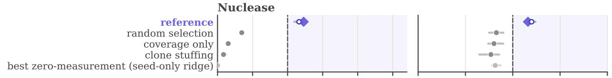

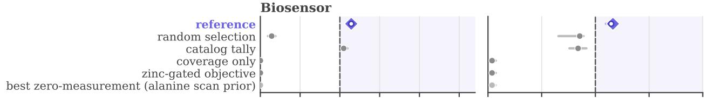

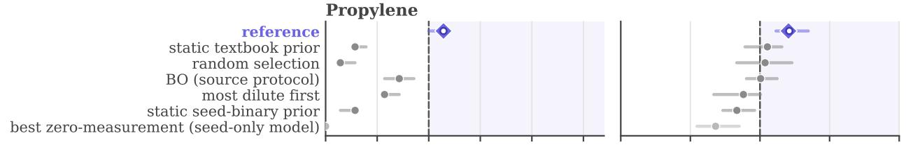

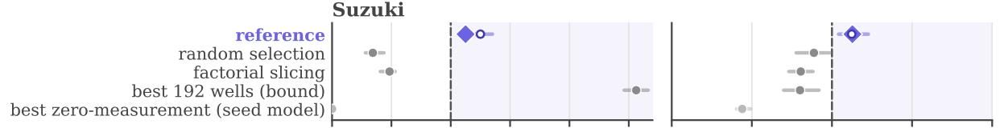

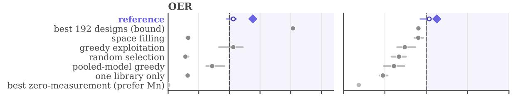

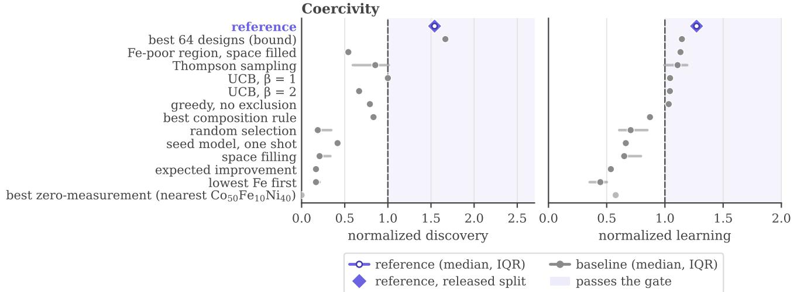  
Figure 6 Every calibration strategy. Each row shows one strategy's median scores divided by the gates, with a bar over the middle half of the splits. Diamonds mark the reference on the released split, which sets the gates.

## E Calibration and Shortcut-Audit Details

Table 10 summarizes calibration, and Figure 6 shows every strategy. All numbers are over the calibration splits of Section 2.6, not over agent trials.

Table 10 Calibration summary. Passes count the splits, or catalog orders for oxygen evolution and coercivity, on which a strategy passes every gate. Scores are normalized discovery / learning medians. The strongest baseline passes most often among the strategies that rule 2 requires to fail, and the last column gives the best predictor that orders nothing.
<table><tr><td></td><td colspan="2">Reference</td><td colspan="2">Strongest baseline</td><td colspan="2"></td></tr><tr><td>Campaign</td><td>Passes</td><td>Scores</td><td>Strategy</td><td>Passes</td><td>Scores</td><td>Best zero-measurement predictor</td></tr><tr><td>Nuclease</td><td>26/30</td><td>1.16 / 1.20</td><td>Random selection</td><td>0/30</td><td>0.35 / 0.83</td><td>Seed-only ridge (0.82)</td></tr><tr><td>Biosensor</td><td>29/30</td><td>1.14 / 1.15</td><td>Catalog tally</td><td>2/30</td><td>1.05 / 0.84</td><td>Alanine scan prior (0.04)</td></tr><tr><td>Propylene</td><td>27/30</td><td>1.14 / 1.21</td><td>BO (source protocol)</td><td>2/30</td><td>0.71 / 1.00</td><td>Seed-only model (0.68)</td></tr><tr><td>Suzuki</td><td>18/24</td><td>1.25 / 1.12</td><td>Factorial slicing</td><td>0/24</td><td>0.48 / 0.81</td><td>Seed model (0.44)</td></tr><tr><td>OER</td><td>6/12</td><td>1.06 / 1.04</td><td>Space filling</td><td>0/12</td><td>0.33 / 0.90</td><td>Prefer Mn (0.18)</td></tr><tr><td>Coercivity</td><td>12/12</td><td>1.54 / 1.27</td><td>Best composition rule</td><td>0/12</td><td>0.83 / 0.87</td><td>Nearest Co50Fe10Ni40 (0.58)</td></tr></table>

The calibration rules. Each campaign's calibration script simulates every strategy on the real data, scored as in grading, and fails unless the released gates meet four rules.

1. The reference passes every gate on the released split with a margin of at least 10%.

2. Non-adaptive baselines and any published protocol a campaign reproduces fail on at least 90% of splits, and zero-measurement predictors fail the learning gate as often.

3. No discovery gate asks for more than half of the pool's qualifying designs.

4. Every evaluation set holds at least k relevant designs for NDCG@k.

Checks across splits. For campaigns with redrawn data splits, the reference must pass on at least half; observed pass rates range from 75% to 97%. The two fixed-region campaigns vary catalog order instead, and their references pass 12 of 12 orders for coercivity and 6 of 12 for oxygen evolution, including the released one. Adaptive strategies such as UCB are allowed to pass, since agents may use them to select experiments. For coercivity, UCB with the reference's predictor passes all 12.

Exceptions. Coercivity requires 60% of the perfect discovery score to exclude the strongest static composition rule which passes at 50%.

Integrity checks. Before release, static checks confirm that the agent's container excludes hidden answers, lab access uses a private network, and a separate offline verifier returns a binary reward. Egress controls block known answer sources while preserving access to the model provider and public web search.

## F Agent and Model Presets

Each preset fixes one configuration, a Harbor agent with a model and its reasoning effort, as on the Terminal-Bench-Science 0.1 leaderboard. Of the eight we evaluate (Table 4), Opus 5.5, GPT-5.6 Terra, and GPT-5.6 Luna rank 2nd, 11th, and 17th on that leaderboard, and the other five are unranked. The model identifiers are claude-opus-5-5, claude-sonnet-5-5, claude-haiku-4-5-20251001, gpt-5.6-terra, gpt-5.6-luna, openrouter/z-ai/glm-5.3-flash, openrouter/qwen/qwen3.8-27b, and openrouter/minimax/minimax-m3. Agent versions are pinned to Codex 0.146.1, mini-SWE-agent 2.4.6, and Claude Code 2.1.294.

## G Adaptive Budgets for Live Evaluation

This appendix supplements Section 5, with the full procedure in Algorithm 2. Allocation is performed separately for each campaign, so quotas and capacity omit the campaign index.

Algorithm 2 Adaptive budgets for live evaluation, in full   
Require: Agents A, batch size $b ,$ capacity $N _ { ; }$ rounds R, threshold $\eta ,$ replay rates $\mu _ { i c } ,$ prior strength $\kappa ,$ outcome   
model M   
1: Initialize weak priors, set $\mathcal { H } _ { 1 }  \mathcal { O }$ , and compute $\hat { P } _ { i 1 }$   
2: for each lab round $r = 1 , \ldots , R$ do   
3: Set $x _ { i r } \gets 0$ for all $i \in A , F _ { r } \gets \emptyset$ and $u  N$   
4: for each $i \in A$ with $\hat { P } _ { i r } \ge \eta .$ in decreasing order of $\hat { P } _ { i r }$ do   
5: if $u \geq b$ then   
6: Set $x _ { i r } \gets b .$ add i to $F _ { r }$ , and set $u  u - b$   
7: end if   
8: end for   
9: while $u > 0$ and some $i \in A \setminus F _ { r }$ has $x _ { i r } < b$ do   
10: Estimate the gain from increasing each eligible agent's quota by one   
11: Choose an agent i with the largest estimated gain   
12: Set $x _ { i r } \gets x _ { i r } + 1$ and $u  u - 1$   
13: end while   
14: Announce quotas and collect up to $x _ { i r }$ designs from each agent   
15: Measure submitted designs and return results to all agents   
16: Record any full-budget gate outcomes   
17: Add quotas, designs, measurements, and outcomes to form $\mathcal { H } _ { \boldsymbol { r } + 1 }$   
18: Replace affected trial factors and compute $\hat { P } _ { i , r + 1 }$   
19: end for   
20: return final performance estimates, observed gate outcomes, and the allocation ledger

Synchronous rounds. Quotas are announced before agents submit designs. Each agent submits up to $x _ { i r }$ designs, and all submitted designs are measured that round. An agent with zero quota receives no new measurements. All agents receive their results before the next round begins.

Smoothing replay rates. Let $s _ { i c }$ be the number of successful trials among agent i's $n _ { i c }$ replay trials on campaign c. We smooth its observed rate using its performance on the other campaigns,

$$
\mu _ { i c } = \frac { s _ { i c } + \lambda \bar { p } _ { i , - c } } { n _ { i c } + \lambda } ,\tag{5}
$$

where $\bar { p } _ { i , - c }$ is the Laplace-smoothed resolution rate on those campaigns. The parameter $\lambda > 0$ controls pooling, which has greater influence when few trials are available for campaign c.

Outcome model. We propose training on paired variable-quota and full-budget replay runs of the same agent on the same campaign instance. The variable-quota run supplies the history, and the full-budget run supplies the outcome label. We assume this relationship transfers to live evaluation. Training and calibration use separate campaign instances, keeping paired runs together. The model accounts for quotas, submitted designs, and measurements, and predicts both agent submissions and their results under proposed quotas. Assuming trial histories are conditionally independent given their success probabilities, their likelihood factors multiply in the posterior. Only observed full-budget outcomes replace these factors with binary outcome factors.

Allocation approximation. We approximate Equation (4) greedily, keeping the quotas for $F _ { r }$ fixed. At each step, the scheduler increases the quota of the agent with the largest estimated gain, subject to $x _ { i r } \ < \ b$ It estimates gains by sampling possible evidence from M under each candidate allocation, updating the posterior, and averaging the resulting objective values. The procedure stops when capacity is exhausted or all quotas reach $b ,$ with ties broken at random. This approximation need not attain the global optimum.

## H LLM Usage

The authors developed the benchmark's core ideas, designed the campaigns and evaluation methodology, made the calibration decisions, and established the paper's structure and scientific narrative. Coding agents assisted with software implementation and manuscript drafting and editing. The authors reviewed all generated material, checked every claim against the benchmark outputs, and take responsibility for the final paper.