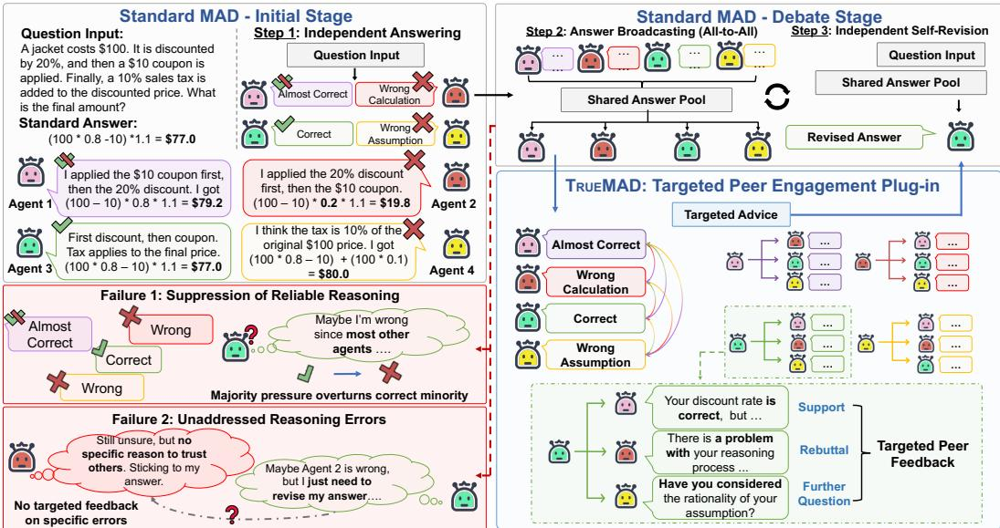
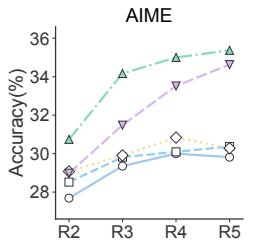
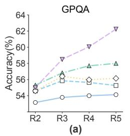
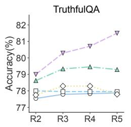
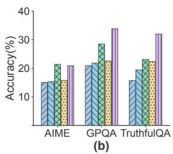
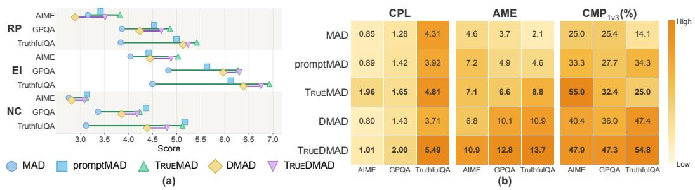

# BEYOND ANSWER SHARING: TRUEMAD FOR TAR-GETED PEER ENGAGEMENT IN MULTI-AGENT DEBATE

Dezheng Bao, Sihang Du, Renhong Huang, Zhizhang Yuan, Yifei Sun & Yang Yang Zhejiang University

{baodezheng, yangya}@zju.edu.cn

## ABSTRACT

Multi-agent debate (MAD) aims to improve large language model reasoning by exposing agents to alternative solutions and enabling iterative revision. However, standard broadcast-style MAD makes peer answers visible without requiring agents to engage with a particular peer claim. As a result, reliable reasoning may be suppressed by conflicting or majority responses, limiting achievable performance, while erroneous reasoning may persist and degrade final predictions without actionable feedback. We propose TRUEMAD, a backbone-agnostic testtime plug-in that introduces one-to-one, free-form peer advice between answer broadcasting and self-revision. Each source agent responds to a target’s current reasoning through support, rebuttal, refinement, or further questions, while the target retains control over how to revise. The same mechanism can augment standard MAD and its improved variants without parameter updates. Across AIME, GPQA-Diamond, and TruthfulQA with Qwen3-30B-A3B, TRUEMAD improves agent-level and strict-majority accuracy over MAD by 3.62 and 3.52 percentage points on average, while TRUEDMAD improves DMAD by 4.72 and 4.06 points, respectively. Analyses at the utterance, agent-transition, and group levels further show more peer-specific deliberation, more correction-oriented revisions, and more favorable consensus dynamics.

## 1 INTRODUCTION

Large language models (LLMs) are increasingly used for content generation, reasoning, and decision support across domains (Brown et al., 2020; Wei et al., 2022; Huang et al., 2024). However, a single LLM’s perspective can limit exploration of alternative paths and recovery from early mistakes on complex tasks (Kojima et al., 2022; Huang et al., 2024). This limitation has motivated multiagent systems, in which LLMs provide complementary perspectives and feedback. Inspired by the “society of mind” view of intelligence (Minsky, 1986; Zhuge et al., 2023), multi-agent debate (MAD) lets agents independently solve problems, exchange responses, and revise answers over rounds. MAD has been explored in mathematical and strategic reasoning, factuality improvement, LLM-based evaluation, and applications (Du et al., 2024; Liang et al., 2024; Chan et al., 2024; Bao et al., 2025). Rather than relying on a single reasoning path, its central advantage is to turn diverse individual perspectives into more reliable individual and collective decisions.

However, whether MAD benefits from this advantage depends on how agents engage during debate. Standard MAD broadcasts previous-round responses to all agents and asks each to update” or revise” its answer (Yin et al., 2023). At the outcome level, this setup is closer to answer sharing than targeted deliberation: agents first provide independently sampled answers, and reported gains may largely reflect repeated sampling and majority voting rather than peer reasoning (Choi et al., 2025; Smit et al., 2024; Wang et al., 2024). Other studies show that unconstrained peer influence can induce conformity and echo-chamber dynamics: agents may imitate apparent majorities, reinforce shared misconceptions, and suppress correct minority reasoning, increasing consensus without reliably improving performance (Estornell & Liu, 2024; Oh et al., 2025). Thus, exchanging more answers does not ensure effective deliberation. As Figure 1 illustrates, this limitation can manifest in two complementary ways: reliable reasoning may be suppressed during revision, while agents that need correction may receive no targeted feedback on their errors.

  
Figure 1: Motivating example and TRUEMAD overview. Left: In broadcast-only MAD, majority pressure can suppress a correct answer, while agents with distinct errors receive no targeted diagnosis. Right: TRUEMAD adds one-to-one, free-form advice between broadcasting and self-revision, enabling support, rebuttal, refinement, or questions without altering the MAD pipeline.

First, broadcast-style revision can suppress reasoning that is already correct. Prior work shows that shared misconceptions and majority influence can create echo-chamber dynamics, reinforce erroneous beliefs, and even overturn initially correct answers (Estornell & Liu, 2024; Oh et al., 2025; Choi et al., 2025). A shared answer pool presents competing responses without explicitly distinguishing the reasoning that should be preserved from the reasoning that should be reconsidered. A generic revision instruction also gives no peer the responsibility to examine and support a valid derivation or to rebut an erroneous majority on its behalf. As illustrated by Failure 1 in Figure 1, one agent has already derived the correct answer, whereas the other agents make different computational or conceptual errors. Nevertheless, the number of conflicting responses may become a stronger revision signal than the quality of the correct derivation, causing the correct agent to abandon its answer. Once such reasoning disappears from the debate trajectory, subsequent interaction and final aggregation can amplify the resulting error rather than recover the lost signal. Standard MAD may therefore increase consensus while weakening the reasoning that interaction should preserve.

Second, broadcast answer sharing can leave reasoning errors unaddressed even when multiple peer responses are available. Broader evaluations show that adding agents, rounds, or alternative debate strategies does not guarantee consistent improvements, while recent diagnostic studies caution that answer changes and final consensus may reflect instability or social influence rather than genuine correction (Smit et al., 2024; Wang et al., 2024; Hao et al., 2026; Wang & Yang, 2026; Cui et al., 2026). One reason is that every agent receives the same pool of answers, but no agent is explicitly asked to inspect a specific peer response, locate its error, and explain how that error affects the conclusion. As illustrated by Failure 2 in Figure 1, the almost-correct answer, the incorrect calculation, and the incorrect assumption require different forms of feedback. Simply displaying the correct response does not explain to each agent which step should be revised or why. Consequently, agents may retain their original errors, make an ungrounded change, or repeatedly exchange answers without resolving their disagreement. Together, the two failures expose the same interaction gap: standard MAD makes peer answers visible but lacks an explicit mechanism for transforming answer exposure into targeted peer engagement. Agents may therefore fail both to defend reliable reasoning and to provide the specific feedback needed to correct unreliable reasoning.

These limitations motivate a principle: before revising its answer, each agent should have an explicit opportunity to examine and respond to the reasoning of a specific peer. Based on this principle, we propose TRUEMAD, a backbone-agnostic test-time plug-in that introduces one-to-one, free-form peer advice before self-revision. Each source agent generates advice conditioned on a target agent’s response, and the target then revises using its own response, the shared peer-answer pool, and the advice addressed to it. The advice may support a valid derivation, identify a specific error, refine an incomplete argument, or raise a relevant question. Thus, TRUEMAD makes the source and target of interaction explicit without forcing agents into adversarial roles. It requires no parameter updates and is designed as a general plug-in for standard MAD and its improved variants. By enabling agents to support, challenge, and refine specific peer reasoning, TRUEMAD seeks to turn answer sharing into effective interaction and thereby promote collective intelligence through debate.

We empirically evaluate TRUEMAD across multiple reasoning benchmarks and show that it improves both standard MAD and an improved MAD variant when used as a plug-in. Round-wise and difficulty-conditioned analyses further examine when targeted interaction is most useful. To understand how it affects the debate process, we observe the resulting dynamics at three progressively broader granularities: peer utterances, individual-agent answer transitions, and group-level consensus evolution. Additional call-controlled and cross-model experiments provide further evidence for the effectiveness and general applicability of targeted peer engagement.

To summarize, our contributions are threefold:

• A failure-driven motivation for targeted interaction. We identify two limitations of broadcast-style MAD—the suppression of reliable reasoning and the lack of targeted correction—and motivate explicit peer engagement (Section 3.1).

• A targeted-deliberation plug-in. We propose TRUEMAD, a backbone-agnostic test-time plug-in that introduces one-to-one, free-form peer advice before self-revision (Section 3).

• Multi-granularity empirical evidence. We validate TRUEMAD across tasks and models, and analyze debate dynamics at the utterance, agent-transition, and group levels (Section 4).

## 2 RELATED WORK

Multi-Agent Debate and Protocol Variants. Multi-agent debate (MAD) is an inference-time collaboration paradigm in which multiple LLM agents independently generate answers, exchange responses, and revise them before final aggregation. Early work established this paradigm and showed that interaction among agents can improve reasoning and factuality without parameter updates (Yin et al., 2023; Du et al., 2024; Liang et al., 2024). Subsequent studies improve MAD through diverse reasoning strategies and roles, confidence-aware consensus, grouped communication, structured criticism, dynamic contexts, and internalized debate (Chan et al., 2024; Chen et al., 2024; Liu et al., 2025; 2024; Estornell & Liu, 2024; Hua et al., 2026; Li et al., 2026; Yi et al., 2026). These methods primarily improve agent diversity, communication structure, context organization, or decision making. Yet most retain answer exchange as the primary interaction unit without requiring claim-specific feedback before self-revision. We focus on this interaction gap: TRUEMAD introduces one-to-one, free-form peer advice as a general plug-in for MAD and its variants.

Re-examining Interaction in MAD. Recent studies question whether MAD gains consistently arise from substantive deliberation rather than repeated sampling, majority aggregation, or unconstrained peer influence. Empirical and theoretical analyses show that voting can explain a substantial portion of reported gains, that performance is sensitive to debate and decision protocols, and that shared misconceptions or majority influence can produce echo chambers and overturn initially correct answers (Smit et al., 2024; Wang et al., 2024; Choi et al., 2025; Estornell & Liu, 2024; Oh et al., 2025). Other work cautions that answer changes may reflect spontaneous instability rather than genuine peer-induced correction, while answer-level consensus can conceal disagreement in the underlying reasoning (Hao et al., 2026; Wang & Yang, 2026). Consensus-free approaches accordingly explore decision rules that do not rely solely on final agreement (Cui et al., 2026). Together, these findings align with the two limitations highlighted in our Introduction: reliable reasoning may be suppressed during revision, while erroneous reasoning may remain uncorrected when answer exposure does not provide claim-specific feedback. Complementary to work that diagnoses outcomes or redesigns decision rules, we connect both failures to the interaction design, introduce targeted peer advice, and examine its effects at the utterance, agent-transition, and group levels.

## 3 METHODS: TRUEMAD AS A PLUG-IN INTERACTION PROTOCOL

## 3.1 MOTIVATION

The limitation of broadcast-style MAD is not that agents lack access to peer answers, but that answer exposure does not define how agents should engage with one another’s reasoning. As discussed in Sections 1 and 2, this interaction gap can lead to two complementary failures. Reliable reasoning may be suppressed when an agent revises under the influence of conflicting or majority responses, while erroneous reasoning may remain uncorrected because no peer is responsible for locating and explaining the error. Both failures arise between answer broadcasting and self-revision: the protocol provides a shared answer pool, but does not turn peer reasoning into feedback directed at a particular recipient. Our motivation is therefore not to increase communication or disagreement, but to make peer engagement explicit before each agent decides whether and how to revise.

Several intuitive ways of strengthening standard MAD do not directly resolve this interaction gap. Increasing the number of agents or debate rounds expands answer exposure, but does not ensure that any agent examines a specific peer claim. Strengthening a generic revision prompt may elicit more elaborate responses while leaving the source and target of feedback implicit. Imposing fixed adversarial roles guarantees opposition rather than evidence-sensitive engagement, and may unnecessarily challenge valid reasoning. These limitations motivate three design goals.

Goal 1: Targeted and Actionable Engagement. Each feedback message should have an explicit source and target, conditioned on the target’s current response. This requirement gives the source agent a concrete object to inspect: it can identify a claim, reasoning step, assumption, or calculation and explain how it should affect the target’s next revision. Because the protocol cannot know which agent holds reliable reasoning, we instantiate this interaction over ordered agent pairs rather than relying on an external judge or routing decision. Target specificity turns a shared pool of answers into recipient-oriented feedback rather than another undirected group summary.

Goal 2: Flexible Support and Correction. Effective deliberation should not equate interaction with opposition. A peer response may be correct, partially correct, or wrong, so feedback should remain free-form: it may support a valid derivation, rebut a specific error, refine an incomplete argument, or raise a relevant question. This addresses both failures. Agents can receive reasons to retain well-supported reasoning as well as guidance for reconsidering unreliable reasoning, allowing interaction to promote collective intelligence without imposing artificial disagreement.

Goal 3: Recipient-controlled and Protocol-compatible Revision. Peer feedback should inform rather than replace self-revision. The recipient should revise using its own response, the broadcast peer answers, and the advice addressed to it, while remaining free to accept, reject, or partially use that advice. The intervention should also require no parameter updates, fixed adversarial roles, or external judge at inference, and should be applicable to standard MAD and its improved variants without replacing their underlying reasoning procedures. We therefore realize these goals as a testtime plug-in that inserts a one-to-one advice stage immediately before self-revision.

## 3.2 MAD FORMULATION

Following standard MAD protocols (Du et al., 2024; Liang et al., 2024), let B denote a base protocol with N agents and T response rounds. Given a question q, agent i produces its initial response as

$$
x _ { i } ^ { 1 } = S _ { B , i } ( q ) , \qquad i = 1 , \ldots , N ,\tag{1}
$$

where $S _ { B , i }$ is the protocol-specific initializer. Let $\mathcal { X } ^ { t } = ( x _ { 1 } ^ { t } , \dots , x _ { N } ^ { t } )$ denote the response collection at round t, and let $\mathcal { X } _ { - i } ^ { t } = ( \bar { x } _ { j } ^ { t } ) _ { j \neq i }$ contain the peer responses available to agent i. Each debate-stage update is

$$
{ x _ { i } ^ { t + 1 } = U _ { \mathcal { B } , i } \left( q , x _ { i } ^ { t } , \mathcal { X } _ { - i } ^ { t } \right) , \qquad t = 1 , \dots , T - 1 , }\tag{2}
$$

and the final group prediction is

$$
\boldsymbol { \hat { y } } = \boldsymbol { A _ { B } } \big ( \boldsymbol { \mathcal { X } } ^ { T } \big ) ,\tag{3}
$$

where $U _ { B , i }$ and $A _ { B }$ are the base protocol’s updater and aggregation operator, respectively. The agent-indexed operators cover both homogeneous MAD and variants with agent-specific reasoning procedures. We use an $( x _ { i } ^ { t } )$ to denote the final answer extracted from a response.

## 3.3 TRUEMAD: TARGETED PEER ENGAGEMENT

As shown in the right half of Figure 1, TRUEMAD preserves standard MAD pipeline while inserting a targeted advice stage between answer broadcasting and self-revision. At round t, agents first share response collection ${ \check { \mathcal { X } } } ^ { t }$ as in base protocol. TRUEMAD then generates advice from source agents to targets, after which each target revises using the broadcast responses and the advice addressed to it. The plug-in therefore supplements, rather than replaces, the original answer-sharing path.

Targeted and Flexible Advice. Let

$$
\mathcal { E } _ { N } = \{ ( i , j ) : i , j \in \{ 1 , . . . , N \} , i \neq j \}
$$

denote the ordered source–target pairs. Because the protocol does not know in advance which response contains reliable reasoning, advice is generated over all ordered pairs rather than through an external router or judge. For each $( i , j ) \in \mathcal { E } _ { N }$ , source agent i advises target agent j as

$$
c _ { i  j } ^ { t } = G ( q , x _ { i } ^ { t } , x _ { j } ^ { t } ) , \qquad t = 1 , \ldots , T - 1 .\tag{4}
$$

Conditioning on both responses gives the source a reasoning path to examine. It can address a claim, step, assumption, or calculation in the target response instead of producing a generic summary of the group. The advice is free-form: as illustrated in Figure 1, it may support a sound derivation, rebut a specific error, refine an incomplete argument, or raise a question. Thus, interaction is target-specific without being forced into a fixed adversarial role. This design allows reliable reasoning to receive explicit support while providing erroneous reasoning with feedback suited to its weakness.

Recipient-oriented Revision. After pairwise generation, advice is grouped by target. Agent j receives

$$
\begin{array} { r } { \mathcal { C } _ { j } ^ { t } = \big ( \big ( i , c _ { i  j } ^ { t } \big ) \big ) _ { i \neq j } , } \end{array}\tag{5}
$$

where each message retains its source identity. Thus, agents share the broadcast responses but receive target-specific advice conditioned on their current responses. Each target then updates as

$$
\boldsymbol { x } _ { j } ^ { t + 1 } = \boldsymbol { U } _ { \boldsymbol { B } , j } ^ { + } \left( \boldsymbol { q } , \boldsymbol { x } _ { j } ^ { t } , \boldsymbol { \mathcal { X } } _ { - j } ^ { t } , \boldsymbol { \mathcal { C } } _ { j } ^ { t } \right) ,\tag{6}
$$

where $U _ { B , j } ^ { + }$ denotes the base updater $U _ { B , j }$ augmented with $\mathcal { C } _ { j } ^ { t }$ in its context. The recipient retains its response and broadcast peer responses, free to accept, reject, reconcile, or partially use the advice. Advice guides self-revision rather than serving as an intermediate vote or hard revision command.

This procedure repeats before each debate-stage revision. It requires no parameter updates, fixed adversarial roles, or external judge, and preserves the base protocol’s initialization, reasoning, and final aggregation. For standard MAD, advice is added to its revision context; for variants with agent-specific or multi-step updaters, it is supplied to the existing procedure. TRUEMAD therefore implements the three design goals through targeted generation, flexible feedback, and recipientcontrolled revision, while remaining applicable to MAD and improved variants.

## 4 EXPERIMENTS

In this section, we evaluate TRUEMAD by addressing the following research questions:

RQ1. To what extent does TRUEMAD improve the performance of existing MAD protocols?

RQ2. Under which debate conditions does TRUEMAD yield the greatest performance gains?

RQ3. How does TRUEMAD influence debate dynamics?

RQ4. Are TRUEMAD’s gains attributable to additional inference or to peer engagement?

RQ5. How robust are the performance gains of TRUEMAD across different LLM backbones?

## 4.1 EXPERIMENTAL SETUP

Backbone and Datasets. The main experiments use Qwen3-30B-A3B (Qwen Team, 2025) as the backbone model. We evaluate multi-agent debate on three complementary benchmarks:

Table 1: Main results on AIME, GPQA-Diamond, and TruthfulQA with Qwen3-30B-A3B. We report Agent ACC (%) and Vote ACC (%) as mean ± sample standard deviation over three seeds. Bold marks the best method in each column; $\Delta$ rows show the gains from adding TRUEMAD.
<table><tr><td rowspan="2">Method</td><td colspan="2">AIME</td><td colspan="2">GPQA-Diamond</td><td colspan="2">TruthfulQA</td></tr><tr><td>Agent ACC</td><td>Vote ACC</td><td>Agent ACC</td><td>Vote ACC</td><td>Agent ACC</td><td>Vote ACC</td></tr><tr><td>Single LLM</td><td colspan="2">23.06±1.27</td><td colspan="2">52.82±0.07</td><td colspan="2"> $7 7 . 1 7 { \scriptstyle \pm 0 . 1 9 }$ </td></tr><tr><td>MAD</td><td>29.81±2.49</td><td> $\overline { { 2 9 . 6 3 { \pm 2 . 5 7 } } }$ </td><td> $\overline { { 5 4 . 1 2 { \pm } 1 . 2 9 } }$ </td><td> $\overline { { 5 2 . 8 6 { \pm 1 . 2 7 } } }$ </td><td> $7 7 . 8 8 { \scriptstyle \pm 0 . 4 5 }$ </td><td> $7 6 . 5 0 { \scriptstyle \pm 1 . 3 2 }$ </td></tr><tr><td>promptMAD</td><td> $3 0 . 3 7 { \scriptstyle \pm 2 . 3 9 }$ </td><td> $3 0 . 0 0 { \scriptstyle \pm 2 . 9 4 }$ </td><td> $5 5 . 2 6 { \scriptstyle \pm 1 . 5 2 }$ </td><td> $5 4 . 7 1 { \scriptstyle \pm 1 . 7 7 }$ </td><td> $7 7 . 9 6 { \scriptstyle \pm 0 . 2 9 }$ </td><td> $7 6 . 8 3 { \scriptstyle \pm 0 . 7 6 }$ </td></tr><tr><td>DMAD</td><td> $3 0 . 2 8 { \scriptstyle \pm 1 . 0 0 }$ </td><td> $2 9 . 6 3 { \scriptstyle \pm 1 . 2 8 }$ </td><td> $5 6 . 1 4 { \scriptstyle \pm 1 . 5 3 }$ </td><td> $5 6 . 0 6 { \scriptstyle \pm 1 . 8 2 }$ </td><td> $7 7 . 7 9 { \scriptstyle \pm 1 . 2 5 }$ </td><td> $7 7 . 3 3 { \scriptstyle \pm 0 . 7 6 }$ </td></tr><tr><td>TrueMAD</td><td>35.37±2.36</td><td> $\mathbf { 3 4 . 8 1 } { \scriptstyle \pm 1 . 7 0 }$ </td><td> $5 8 . 0 0 { \scriptstyle \pm 0 . 6 0 }$ </td><td> $5 6 . 7 3 { \scriptstyle \pm 0 . 2 9 }$ </td><td> $7 9 . 2 9 { \scriptstyle \pm 0 . 6 2 }$ </td><td> $7 8 . 0 0 { \scriptstyle \pm 0 . 8 7 }$ </td></tr><tr><td>TrueDMAD</td><td>34.63±1.12</td><td>34.44±1.11</td><td>62.25±1.79</td><td>60.27±3.21</td><td>81.50±0.38</td><td>80.50±1.32</td></tr><tr><td>∆MAD</td><td>+5.56</td><td>+5.18</td><td>+3.87</td><td>+3.87</td><td>+1.42</td><td>+1.50</td></tr><tr><td>∆ DMAD</td><td>+4.35</td><td>+4.81</td><td>+6.10</td><td>+4.21</td><td>+3.71</td><td>+3.17</td></tr></table>

AIME (Dekoninck et al., 2026), GPQA-Diamond (Rein et al., 2023), and TruthfulQA (Lin et al., 2022). AIME combines the 2024, 2025, and 2026 test sets for the primary comparison, while GPQA-Diamond and TruthfulQA evaluate scientific question answering and truthfulness, respectively. Following prior multi-agent debate studies that explicitly account for the computational cost of multi-agent evaluation (Wang et al., 2024; Smit et al., 2024; Chen et al., 2024), we randomly sample 200 questions from TruthfulQA using a fixed random seed of 0.

Baselines. We compare five protocols: MAD, promptMAD, DMAD, TRUEMAD, and TRUED-MAD. MAD is the vanilla broadcast-only multi-agent debate baseline. promptMAD uses the same generic debate instruction as TRUEMAD but without introducing directed advice. DMAD is a diversity-oriented MAD variant that changes the agent-level reasoning conditions (Liu et al., 2025). TRUEMAD adds the one-to-one free-form advice stage described in Section 3.3 to vanilla MAD, whereas TRUEDMAD adds the same advice stage to DMAD.

Debate Protocol. All main experiments use four agents and five response rounds. Round 1 contains independent initial responses, and rounds 2–5 contain successive debate-stage updates. For each matched comparison, we keep the backbone, questions, initial-stage sampling prompts, agent count, number of rounds, answer extraction procedure, and final aggregation rule fixed.

Metric. We evaluate fine-grained agent-level predictions and the final aggregated group answer. For fine-grained evaluation, we report agent-level accuracy (Agent ACC). Let $\boldsymbol { \mathcal { D } } = ( q _ { n } , y _ { n } ) _ { n = 1 } ^ { | \mathcal { D } | }$ be a dataset, where $q _ { n }$ and $y _ { n }$ denote question n and its reference answer, respectively. Let $\boldsymbol { x } _ { n , i } ^ { t }$ denote the response of agent i to question $q _ { n }$ at round t. Agent-level accuracy is

$$
\mathrm { A C C } ^ { t } = \frac { 1 } { | \mathcal { D } | N } \sum _ { n = 1 } ^ { | \mathcal { D } | } \sum _ { i = 1 } ^ { N } \mathbf { 1 } \bigl [ \mathrm { a n s } ( x _ { n , i } ^ { t } ) = y _ { n } \bigr ] , \qquad t = 1 , \ldots , T .\tag{7}
$$

Here, N is the number of agents and T is the number of response rounds.

## 4.2 EXPERIMENTAL RESULTS (RQ1 & RQ2)

Comparative Results. To answer RQ1, we evaluate whether targeted peer advice improves individual-agent predictions and the final aggregated group answer. Averaged across benchmarks, TRUEMAD improves over MAD by 3.62 percentage points in Agent ACC and 3.52 points in Vote ACC; TRUEDMAD improves over DMAD by 4.72 and 4.06 points, respectively. These improvements in Agent ACC and Vote ACC demonstrate that TRUEMAD is effective not only at improving individual agents’ responses but also at strengthening the aggregated output. The gains over both MAD and DMAD show that the advice stage can be integrated with homogeneous and strategydiverse debate frameworks, rather than depending on an underlying reasoning procedure. prompt-MAD remains close to MAD on both metrics. This contrast suggests that the gains arise from explicit source–target peer engagement rather than from more elaborate revision wording alone.

Further Gains with Debate Rounds. Figure 2(a) shows different protocol trajectories. MAD typically gains in the early rounds and then approaches a plateau, whereas TRUEMAD continues to improve through R5 on AIME and GPQA-Diamond. From R3 to R5, TRUEMAD gains 1.20 points on AIME and 1.18 on GPQA-Diamond, compared with 0.46 and 0.33 for MAD. The difference is even more pronounced for TRUEDMAD: it gains 3.15 and 3.75 points from R3 to R5, while DMAD is nearly flat. These trajectories indicate that TRUEMAD does not merely provide an early accuracy boost or collapse into premature consensus. A plausible explanation is that peer-specific advice keeps later rounds focused on evaluating individual claims, allowing agents to correct or defend an answer instead of repeatedly following the current majority. The smaller late-round change for TRUEMAD is consistent with the higher initial accuracy on TruthfulQA, where many questions are already answered correctly by most agents at R1 and leave less room for further improvement.

  
MAD promptMAD TrueMAD DMAD TrueDMAD  
Figure 2: Agent-level accuracy (%) across debate rounds and difficult initial conditions with Qwen3-30B-A3B. (a) Round-wise accuracy from R2 to R5 on AIME, GPQA-Diamond, and TruthfulQA. (b) R5 accuracy on questions for which at least half of the four agents are incorrect in R1.

Larger Gains in Difficult Scenarios. To answer RQ2, we examine questions for which at least half of the agents answer incorrectly in R1, as shown in Figure 2(b). In this regime, the initial group lacks a reliable correct majority. Averaged equally across the three benchmarks, TRUEMAD exceeds MAD by 7.13 points in R5 accuracy, while TRUEDMAD exceeds DMAD by 8.63 points. The pattern is consistent with the intended role of the interaction: when the broadcast majority is unreliable, a directed response can help agents inspect the evidence behind individual answers and preserve a correct minority signal that would otherwise be overlooked. This does not mean that advice can reliably recover an answer when all agents are wrong; rather, it is most useful when the initial debate contains partial but unevenly distributed evidence.

## 4.3 DEBATE DYNAMICS ANALYSIS (RQ3)

To answer RQ3, we observe the debate process at three granularities: the utterance level, which examines what agents communicate; the agent-transition level, which tracks how answers change; and the group level, which measures how correct and erroneous consensus evolves. We use the matched comparisons TRUEMAD versus MAD and TRUEDMAD versus DMAD throughout. These quantities are defined for a single question; we suppress the dataset index n for readability.

Level 1: Utterance-level Peer Deliberation. Our first objective is to determine whether interaction supplies substantive peer reasoning before asking whether the recipient changes its answer. We consider a message useful when it addresses a concrete peer claim, supports its stance through reasoning rather than social agreement, and contributes information that can guide the next revision. Accordingly, for each debate-stage reply, an LLM judge returns

$$
\phi ( \boldsymbol { x } _ { i } ^ { t } ) = \big ( \phi _ { \mathrm { R P } } ( \boldsymbol { x } _ { i } ^ { t } ) , \phi _ { \mathrm { E I } } ( \boldsymbol { x } _ { i } ^ { t } ) , \phi _ { \mathrm { N C } } ( \boldsymbol { x } _ { i } ^ { t } ) \big ) ,\tag{8}
$$

where Rebuttal Precision (RP) measures engagement with a specific argument and its error, Evidence Independence (EI) measures reasoning independent of consensus or imitation, and Novel Contribution (NC) measures added reasoning steps, alternatives, conditions, or checks. We use DeepSeek-V4-Flash (Xu et al., 2026) as the judge; the full rubric is provided in Appendix C.6.

Results. Figure 3(a) shows uniform improvement across comparisons: both TRUEMAD-augmented methods outperform their baselines on RP, EI, and NC for every benchmark. The gain is not confined to producing more novel content; targeted advice makes responses more specific to peer arguments and more independently reasoned. Compared with promptMAD, TRUEMAD achieves higher

  
Figure 3: Debate dynamics analysis of debate quality with Qwen3-30B-A3B. (a) LLM-judged utterance quality (1–10); lines connect MAD with TRUEMAD and DMAD with TRUEDMAD. (b) Agent- and group-level diagnostics. Higher is better for all metrics.

RP and EI on all three benchmarks, whereas promptMAD is slightly higher on NC. This contrast indicates that generic prompting mainly encourages additional ideas, while target-specific advice anchors those ideas to the peer claim and its supporting evidence.

Level 2: Agent-transition Correction Preference. Our second objective is to determine whether interaction helps wrong agents recover without unnecessarily overturning correct agents. Raw flip counts are insufficient because methods with different numbers of wrong and correct agents have different opportunities for each transition. We therefore condition on previous correctness state. For a question with reference answer y, let $s _ { i } ^ { t } = \mathrm { R i f } \operatorname { a n s } ( x _ { i } ^ { t } ) = y$ , and let $\mathbf { \boldsymbol { \dot { s } } } _ { i } ^ { t } = \mathrm { \boldsymbol { W } }$ otherwise. We define

$$
\begin{array} { r } { p _ { \mathrm { W }  \mathrm { R } } = \mathrm { P r } ( s _ { i } ^ { t } = \mathrm { R } \mid s _ { i } ^ { t - 1 } = \mathrm { W } ) , \quad p _ { \mathrm { R }  \mathrm { W } } = \mathrm { P r } ( s _ { i } ^ { t } = \mathrm { W } \mid s _ { i } ^ { t - 1 } = \mathrm { R } ) , \quad \mathrm { C P L } = \frac { p _ { \mathrm { W }  \mathrm { R } } } { p _ { \mathrm { R }  \mathrm { W } } } . } \end{array}\tag{9}
$$

We pool eligible question–agent transitions across debate-stage transitions. The resulting Correction Preference Lift (CPL) compares the propensity to correct a wrong answer against the propensity to overturn a correct one; a larger value indicates a more correction-oriented revision process.

Results. Figure 3(b) shows a consistent increase in CPL across all six matched comparisons, indicating that targeted advice improves the selectivity of revision rather than merely inducing more answer changes. The effect is most revealing on AIME: MAD and DMAD both have CPL below 1, meaning that a correct agent is conditionally more likely to be overturned than a wrong agent is to recover. Adding targeted advice raises these values from 0.85 to 1.96 and from 0.80 to 1.01, respectively, reversing or nearly eliminating this unfavorable imbalance. On GPQA-Diamond and TruthfulQA, where the base protocols already favor correction, targeted advice further strengthens that prefer ence. The same directional effect under both MAD and DMAD shows that the improvement is not tied to a particular initialization strategy: targeted peer engagement systematically redirects revision toward error correction and away from the loss of correct answers.

Level 3: Group-level Consensus Robustness. We next determine whether the improved transition balance yields more reliable collective dynamics. At the group level, disrupting consensus is not always beneficial: an erroneous majority should be broken to enable correction, whereas a correct majority should be preserved to avoid discarding existing correct evidence. We ask whether a protocol selectively disrupts consensus—encouraging agents to leave erroneous majorities while retaining correct ones—rather than simply destabilizing the group. Let $m ^ { t - 1 }$ be the unique modal answer when at least three of four agents support it, and let $\bar { M } ^ { + }$ and $M ^ { - }$ denote correct- and erroneous-majority states. For agents supporting the previous majority, we define

$$
\begin{array} { l } { \displaystyle { E ^ { t } ( M ) = \mathrm { P r } \big ( \mathrm { a n s } ( x _ { i } ^ { t } ) \neq m ^ { t - 1 } \mid \mathrm { a n s } ( x _ { i } ^ { t - 1 } ) = m ^ { t - 1 } , M \big ) , } } \\ { \displaystyle { \mathrm { A M E } = \frac { 1 } { T - 1 } \sum _ { t = 2 } ^ { T } \big ( E ^ { t } ( M ^ { - } ) - E ^ { t } ( M ^ { + } ) \big ) . } } \end{array}\tag{10}
$$

Asymmetric Majority Escape (AME) separates selective resistance to erroneous consensus from general instability. Because leaving an erroneous majority does not necessarily yield the correct answer, we interpret AME jointly with CPL and with Correct-Minority Propagation,

$$
\mathrm { C M P } _ { 1 v 3 } = \mathrm { P r } ( k ^ { t } > 1 \mid k ^ { t - 1 } = 1 ) ,\tag{11}
$$

where $\begin{array} { r } { k ^ { t } = \sum _ { i = 1 } ^ { N } { \bf 1 } [ s _ { i } ^ { t } = \mathrm { R } ] } \end{array}$ is the number of correct agents at round t. $\mathrm { C M P _ { 1 } } _ { v 3 }$ measures whether evidence initially held by the sole correct agent spreads to a peer.

Results. Figure 3(b) shows that AME and $\mathrm { C M P _ { 1 } } _ { v 3 }$ improve together in every matched comparison. Their joint improvement addresses two complementary group-level failures: the higher AME reflects a more favorable balance between challenging erroneous consensus and preserving correct consensus, while the higher $\mathrm { C M P _ { 1 } } _ { v 3 }$ shows that a correct minority is less likely to be suppressed and more likely to recruit additional agents. TRUEMAD therefore does not simply make agents less conformist or the group more volatile. Instead, it makes consensus formation more evidenceresponsive: harmful consensus is more readily reconsidered, whereas correct evidence is more likely to survive and spread. Together with the higher CPL, these results connect correction-oriented individual revisions to more reliable collective outcomes.

Across the three granularities, TRUEMAD improves the reasoning available to recipients, shifts individual revisions toward correction, and produces more favorable group-level consensus dynamics.

## 4.4 INFERENCE BUDGET AND PEER ENGAGEMENT (RQ4)

To answer RQ4, we examine whether the gains persist when the same auxiliary-call budget is allocated to feedback without directed peer engagement. ComputeMAD generates nontargeted notes from the previous-round group responses and randomly assigns three notes to each agent, whereas Self-AdviceMAD generates three independent critiques of each agent’s own response. Both variants use the same number

Table 2: Auxiliary-call-matched comparison with $\mathtt { Q w e n 3 - 3 0 B - A 3 B }$ . Bold marks the best method.
<table><tr><td>Method</td><td>AIME</td><td>GPQA-Diamond</td><td>TruthfulQA</td></tr><tr><td>MAD</td><td> $\overline { { 2 9 . 8 1 \pm 2 . 4 9 } }$ </td><td> $\overline { { 5 4 . 1 2 \pm 1 . 2 9 } }$ </td><td> $7 7 . 8 8 { \scriptstyle \pm 0 . 4 5 }$ </td></tr><tr><td>ComputeMAD</td><td> $\overline { { 3 1 . 4 8 \pm 1 . 0 5 } }$ </td><td> $\overline { { 5 6 . 4 0 { \scriptstyle \pm 2 . 6 3 } } }$ </td><td> $\overline { { 7 7 . 0 8 \pm 1 . 1 8 } }$ </td></tr><tr><td>Self-AdviceMAD</td><td> $3 3 . 3 3 { \scriptstyle \pm 1 . 0 0 }$ </td><td> $5 4 . 5 5 { \pm } 2 . 7 0 $ </td><td> $7 5 . 2 1 \pm 1 . 3 4$ </td></tr><tr><td>TrueMAD</td><td> $\mathbf { 3 5 . 3 7 } { \scriptstyle \pm 2 . 3 6 }$ </td><td> $\mathbf { 5 8 . 0 0 } \pm \mathrm { 0 . 6 0 }$ </td><td> ${ \bf 7 9 . 2 9 2 0 . 6 2 }$ </td></tr></table>

of auxiliary calls and the same revision input structure as TRUEMAD. As shown in Table 2, TRUE-MAD achieves the highest mean R5 accuracy on every benchmark, averaging 2.57 points above ComputeMAD and 3.19 points above Self-AdviceMAD. The two controls exhibit task-dependent effects and both fall below MAD on TruthfulQA, whereas TRUEMAD improves over MAD across all three tasks. Under the same auxiliary-call count, this pattern suggests that additional inference alone is insufficient to reproduce the gains and that the organization of feedback into directed peer engagement is consequential. Because the variants use independently generated R1 responses, we interpret this comparison as supporting rather than definitive causal evidence.

## 4.5 CROSS-MODEL STABILITY (RQ5)

To answer RQ5, we evaluate the same debate protocol on Qwen3-32B (Qwen Team, 2025), as a representative dense model, and GPT-4.1-mini (OpenAI, 2025), as a representative closed-source model, using AIME. Table 3 shows that TRUEMAD achieves higher mean accuracy than MAD, while TRUEDMAD achieves higher mean accuracy than DMAD, on both backbones. These results provide cross-model evidence on AIME that targeted peer advice remains effective as a plug-in interaction operator across different reasoning models.

Table 3: Cross-model results on AIME. Bold marks the best method for each backbone.
<table><tr><td>Method</td><td>GPT-4.1-mini</td><td>Qwen3-32B</td></tr><tr><td>Single LLM</td><td> $\overline { { 5 1 . 5 7 \pm 0 . 8 5 } }$ </td><td>18.43±0.42</td></tr><tr><td>MAD</td><td> $\overline { { 6 2 . 8 7 \pm 0 . 7 0 } }$ </td><td>23.98±1.60</td></tr><tr><td>promptMAD</td><td>63  $\phantom { - } 0 6 \pm 1 . 2 1$ </td><td> $2 4 . 9 1 { \scriptstyle \pm 1 . 6 7 }$ </td></tr><tr><td>DMAD</td><td>63  $. 5 2 \pm 0 . 4 2$ </td><td>24.72±1.82</td></tr><tr><td>TrueMAD</td><td> $6 7 . 3 1 { \pm } 1 . 7 9$ </td><td> $2 7 . 6 9 { \pm } 1 . 3 1 $ </td></tr><tr><td>TrueDMAD</td><td>68.61±2.20</td><td>28.33±2.27</td></tr><tr><td>∆ MAD</td><td>+4.44</td><td>+3.70</td></tr><tr><td>∆ DMAD</td><td>+5.09</td><td>+3.61</td></tr></table>

## 5 CONCLUSION

This work identifies an interaction gap in broadcast-style MAD: visible peer answers do not ensure engagement, allowing reliable reasoning to be suppressed and specific errors to remain unaddressed. We propose TRUEMAD, a test-time plug-in that introduces one-to-one, free-form advice before selfrevision. Across benchmarks, TRUEMAD improves MAD and DMAD; analyses at the utterance, agent-transition, and group levels show more targeted deliberation and correction-oriented dynamics. These results suggest that effective multi-agent reasoning must move beyond answer sharing toward targeted peer engagement. Future work will explore selective advice to reduce cost.

## REFERENCES

Dezheng Bao, Yueci Yang, Chutian Yu, Xin Chen, Zeguo Fei, Xiang Yuan, Lijun Zhang, Jiangqian Huang, Zhengxuan Jiang, Daoze Zhang, Junru Chen, and Yang Yang. PD3: A project duplication detection framework via adapted multi-agent debate. arXiv preprint arXiv:2505.17492, 2025.

Tom Brown, Benjamin Mann, Nick Ryder, Melanie Subbiah, Jared D Kaplan, Prafulla Dhariwal, Arvind Neelakantan, Pranav Shyam, Girish Sastry, Amanda Askell, Sandhini Agarwal, Ariel Herbert-Voss, Gretchen Krueger, Tom Henighan, Rewon Child, Aditya Ramesh, Daniel Ziegler, Jeffrey Wu, Clemens Winter, Chris Hesse, Mark Chen, Eric Sigler, Mateusz Litwin, Scott Gray, Benjamin Chess, Jack Clark, Christopher Berner, Sam McCandlish, Alec Radford, Ilya Sutskever, and Dario Amodei. Language models are few-shot learners. Advances in Neural Information Processing Systems, 33:1877–1901, 2020.

Chi-Min Chan, Weize Chen, Yusheng Su, Jianxuan Yu, Wei Xue, Shanghang Zhang, Jie Fu, and Zhiyuan Liu. ChatEval: Towards better LLM-based evaluators through multi-agent debate. In International Conference on Learning Representations, pp. 9079–9093, 2024.

Justin Chen, Swarnadeep Saha, and Mohit Bansal. ReConcile: Round-Table conference improves reasoning via consensus among diverse LLMs. In Proceedings of the 62nd Annual Meeting of the Association for Computational Linguistics (Volume 1: Long Papers), pp. 7066–7085, 2024.

Hyeong Kyu Choi, Jerry Zhu, and Sharon Li. Debate or vote: Which yields better decisions in multi-agent large language models? Advances in Neural Information Processing Systems, 38: 101732–101764, 2025.

Yu Cui, Hang Fu, Haibin Zhang, Licheng Wang, and Cong Zuo. Free-MAD: Consensus-free multiagent debate. In Findings of the Association for Computational Linguistics: ACL 2026, pp. 31977–31997, 2026.

Jasper Dekoninck, Nikola Jovanovic, Tim Gehrunger, Kári Rögnvaldsson, Ivo Petrov, Chenhao Sun,´ and Martin Vechev. Beyond benchmarks: MathArena as an evaluation platform for mathematics with LLMs. 2026.

Yilun Du, Shuang Li, Antonio Torralba, Joshua B Tenenbaum, and Igor Mordatch. Improving factuality and reasoning in language models through multiagent debate. In Forty-first International Conference on Machine Learning, 2024.

Andrew Estornell and Yang Liu. Multi-LLM debate: Framework, principals, and interventions. Advances in Neural Information Processing Systems, 37:28938–28964, 2024.

Xiqi Hao, Zengqing Wu, Yu-Xuan Qiu, Chuan Xiao, Ruiqi Xu, Shuyuan Zheng, and Jianbin Qin. Not all flips are conformity: Decomposing stance convergence in multi-agent LLM debate. arXiv preprint arXiv:2606.00820, 2026.

Xingyuan Hua, Sheng Yue, Xinyi Li, Yizhe Zhao, Jinrui Zhang, and Ju Ren. Context learning for multi-agent discussion. In The Fourteenth International Conference on Learning Representations, 2026.

Jie Huang, Xinyun Chen, Swaroop Mishra, Huaixiu Steven Zheng, Adams Yu, Xinying Song, and Denny Zhou. Large language models cannot self-correct reasoning yet. In International Confer ence on Learning Representations, pp. 32808–32824, 2024.

Geunwoo Kim, Pierre Baldi, and Stephen McAleer. Language models can solve computer tasks. Advances in Neural Information Processing Systems, 36:39648–39677, 2023.

Takeshi Kojima, Shixiang Shane Gu, Machel Reid, Yutaka Matsuo, and Yusuke Iwasawa. Large language models are zero-shot reasoners. Advances in neural information processing systems, 35:22199–22213, 2022.

Guocong Li, Qirui Hu, Ping Wang, Guofeng Zhang, Jian Wu, and Hongxia Xu. Debate-of-Thoughts: Resolving knowledge conflicts in LLMs through internal deliberation. In Proceedings ofthe 64th Annual Meeting of the Association for Computational Linguistics (Volume 1: Long Papers), pp. 35674–35696, 2026.

Tian Liang, Zhiwei He, Wenxiang Jiao, Xing Wang, Yan Wang, Rui Wang, Yujiu Yang, Shuming Shi, and Zhaopeng Tu. Encouraging divergent thinking in large language models through multiagent debate. In Proceedings of the 2024 conference on empirical methods in natural language processing, pp. 17889–17904, 2024.

Stephanie Lin, Jacob Hilton, and Owain Evans. TruthfulQA: Measuring how models mimic human falsehoods. In Proceedings of the 60th annual meeting of the association for computational linguistics (volume 1: long papers), pp. 3214–3252, 2022.

Chenxi Liu, Yanshuo Chen, Ruibo Chen, Tianyi Xiong, Tong Zheng, and Heng Huang. Prepare reasoning language models for multi-agent debate with self-debate reinforcement learning. arXiv e-prints, pp. arXiv–2601, 2026.

Tongxuan Liu, Xingyu Wang, Weizhe Huang, Wenjiang Xu, Yuting Zeng, Lei Jiang, Hailong Yang, and Jing Li. GroupDebate: Enhancing the efficiency of multi-agent debate using group discussion. arXiv preprint arXiv:2409.14051, 2024.

Yexiang Liu, Jie Cao, Zekun Li, Ran He, and Tieniu Tan. Breaking mental set to improve reasoning through diverse multi-agent debate. In The Thirteenth International Conference on Learning Representations, 2025.

Aman Madaan, Niket Tandon, Prakhar Gupta, Skyler Hallinan, Luyu Gao, Sarah Wiegreffe, Uri Alon, Nouha Dziri, Shrimai Prabhumoye, Yiming Yang, et al. Self-refine: Iterative refinement with self-feedback. Advances in neural information processing systems, 36:46534–46594, 2023.

Marvin Minsky. The society ofmind. Simon and Schuster New York, 1986.

Jihwan Oh, Minchan Jeong, Jongwoo Ko, and Se-Young Yun. When debate fails: Bias reinforcement in large language models. In Workshop on Reasoning and Planningfor Large Language Models, 2025.

OpenAI. Introducing GPT-4.1 in the API, April 2025. URL https://openai.com/index/ gpt-4-1/. GPT-4.1 mini.

Qwen Team. Qwen3 technical report. arXiv preprint arXiv:2505.09388, 2025.

David Rein, Betty Li Hou, Asa Cooper Stickland, Jackson Petty, Richard Yuanzhe Pang, Julien Dirani, Julian Michael, and Samuel R Bowman. GPQA: A graduate-level google-proof Q&A benchmark. arXiv preprint arXiv:2311.12022, 2023.

Andries Smit, Nathan Grinsztajn, Paul Duckworth, Thomas D Barrett, and Arnu Pretorius. Should we be going MAD? a look at multi-agent debate strategies for LLMs. In Proceedings of the 41st International Conference on Machine Learning, pp. 45883–45905, 2024.

Qineng Wang, Zihao Wang, Ying Su, Hanghang Tong, and Yangqiu Song. Rethinking the bounds of LLM reasoning: Are multi-agent discussions the key? In Proceedings ofthe 62nd Annual Meeting of the Association for Computational Linguistics (Volume 1: Long Papers), pp. 6106–6131, 2024.

Xiaoyang Wang and Christopher C Yang. The consistency illusion: How multi-agent debate hides reasoning misalignment. arXiv preprint arXiv:2606.08457, 2026.

Jason Wei, Xuezhi Wang, Dale Schuurmans, Maarten Bosma, Fei Xia, Ed Chi, Quoc V Le, Denny Zhou, et al. Chain-of-thought prompting elicits reasoning in large language models. Advances in neural information processing systems, 35:24824–24837, 2022.

Anyi Xu, Bangcai Lin, Bing Xue, Bingxuan Wang, Bingzheng Xu, Bochao Wu, Bowei Zhang, Chaofan Lin, Chen Dong, Chenchen Ling, et al. DeepSeek-V4: Towards highly efficient milliontoken context intelligence. arXiv preprint arXiv:2606.19348, 2026.

John Seon Keun Yi, Aaron Mueller, and Dokyun Lee. Latent agents: A post-training procedure for internalized multi-agent debate. In Proceedings of the 64th Annual Meeting of the Association for Computational Linguistics (Volume 1: Long Papers), pp. 15569–15602, 2026.

Zhangyue Yin, Qiushi Sun, Cheng Chang, Qipeng Guo, Junqi Dai, Xuan-Jing Huang, and Xipeng Qiu. Exchange-of-Thought: Enhancing large language model capabilities through cross-model communication. In Proceedings of the 2023 Conference on Empirical Methods in Natural Language Processing, pp. 15135–15153, 2023.

Huaixiu Steven Zheng, Swaroop Mishra, Xinyun Chen, Heng-Tze Cheng, Ed H Chi, Quoc V Le, and Denny Zhou. Take a step back: Evoking reasoning via abstraction in large language models. In International Conference on Learning Representations, pp. 20279–20316, 2024.

Mingchen Zhuge, Haozhe Liu, Francesco Faccio, Dylan R Ashley, Róbert Csordás, Anand Gopalakrishnan, Abdullah Hamdi, Hasan Abed Al Kader Hammoud, Vincent Herrmann, Kazuki Irie, et al. Mindstorms in natural language-based societies of mind. arXiv preprint arXiv:2305.17066, 2023.

## A EXPERIMENT SETUP DETAILS

## A.1 DATASETS

We evaluate the methods on three benchmarks widely used in prior studies (Smit et al., 2024; Estornell & Liu, 2024; Liu et al., 2025; Hua et al., 2026; Cui et al., 2026; Liu et al., 2026). We then explain each dataset separately.

• AIME (Dekoninck et al., 2026), is a benchmark based on challenging high-school mathematics competition problems with integer-valued answers, designed to evaluate advanced mathematical reasoning, creative problem-solving, and multi-step derivation. We used data from the years 2024, 2025, and 2026, for a total of 90 open-ended questions.

• GPQA-Diamond (Rein et al., 2023), is the highest-quality subset of GPQA, comprising 198 expert-validated graduate-level multiple-choice questions in biology, physics, and chemistry that assess deep domain knowledge and rigorous scientific reasoning.

• TruthfulQA (Lin et al., 2022), is a benchmark of questions designed to elicit common misconceptions and imitative falsehoods, evaluating whether models generate answers that are both truthful and informative across diverse domains. As mentioned in Section 4.1, we drew one fixed sample of 200 questions using random seed 0 to limit evaluation cost.

## A.2 BASELINES

We compare five multi-agent debate protocols. For the published baselines, we follow their publicly available implementations and integrate all methods into a unified evaluation pipeline. Within each matched comparison, we keep the backbone model, questions, number of agents, number of debate rounds, answer extraction procedure, and final aggregation rule fixed. The compared methods are as follows:

• MAD (Yin et al., 2023; Du et al., 2024; Liang et al., 2024). The standard multi-agent debate baseline first asks multiple homogeneous agents to solve a question independently. In each subsequent round, every agent observes the previous-round responses of all other agents and revises its own solution accordingly. Since the same pool of peer responses is broadcast to all agents, MAD does not explicitly specify which peer should evaluate or respond to a particular answer.

• promptMAD. A prompt-level control that preserves the broadcast communication topology and update schedule of MAD. It augments the revision prompt with a generic instruction encouraging agents to critically evaluate peer reasoning, but does not generate or route explicit peer-specific advice. This control helps determine whether any improvement can be attributed merely to stronger debate instructions rather than to the directed interaction mechanism introduced by TRUEMAD.

• DMAD (Liu et al., 2025). Diverse Multi-Agent Debate addresses homogeneous reasoning by assigning different problem-solving strategies to different agents. The agents examine solutions produced under these distinct reasoning conditions and iteratively revise their responses through debate. Compared with vanilla MAD, DMAD primarily modifies agent-level reasoning diversity while retaining a broadcast-style peer-response exchange. Following the original DMAD setup, we use four task-appropriate reasoning strategies: direct input–output (IO) prompting, Chain-of-Thought (Wei et al., 2022), Step-Back Prompting (Zheng et al., 2024), and Self-Refine (Madaan et al., 2023; Kim et al., 2023).

• TRUEMAD. Our proposed protocol augments vanilla MAD with a one-to-one, free-form advice stage between response broadcasting and answer revision. For each ordered pair of agents, the source agent generates advice grounded in both its own response and the target agent’s response; the advice may support a valid argument, challenge a specific error, or suggest a refinement. Each target agent then revises its solution using the broadcast peer responses together with the advice explicitly addressed to it. All other components of vanilla MAD remain unchanged, making TRUEMAD and MAD a direct matched comparison.

• TRUEDMAD. This variant applies the same targeted advice stage to DMAD while preserving its strategy-diverse agent-level reasoning conditions. Comparing TRUEDMAD with DMAD evaluates whether targeted peer interaction remains effective when combined with reasoning diversity, and whether the proposed advice mechanism functions as a plugin rather than being specific to vanilla MAD.

The primary matched comparisons are therefore TRUEMAD versus MAD and TRUEDMAD versus DMAD, while promptMAD controls for the effect of strengthening the generic debate prompt without introducing directed agent-to-agent communication.

## B ADDITIONAL RESULTS

## B.1 DETAILED DEBATE STAGE ROUND-WISE RESULTS

Tables 4–6 report the complete round-wise agent-level accuracy of Qwen3-30B-A3B from R2 to R5. Each entry is the mean and sample standard deviation over three independent seeds.

Table 4: Round-wise agent-level accuracy (%) of Qwen3-30B-A3B on AIME. The highest mean accuracy in each round is shown in bold.
<table><tr><td>Method</td><td>R2</td><td>R3</td><td>R4</td><td>R5</td></tr><tr><td>MAD</td><td> $\overline { { 2 7 . 6 9 \pm 1 . 7 0 } }$ </td><td> $\overline { { 2 9 . 3 5 \pm 2 . 1 6 } }$ </td><td> $\overline { { 3 0 . 0 0 { \pm } 2 . 1 7 } }$ </td><td>29.81±2.49</td></tr><tr><td>promptMAD</td><td> $2 8 . 5 2 { \scriptstyle \pm 1 . 3 7 }$ </td><td> $2 9 . 8 1 \pm 1 . 7 9$ </td><td> $3 0 . 0 9 \pm 1 . 9 5$ </td><td>30.37±2.39</td></tr><tr><td>DMAD</td><td> $2 9 . 0 7 { \scriptstyle \pm 2 . 2 3 }$ </td><td> $2 9 . 9 1 \pm 1 . 2 5$ </td><td> $3 0 . 8 3 { \scriptstyle \pm 1 . 5 5 }$ </td><td> $3 0 . 2 8 { \scriptstyle \pm 1 . 0 0 }$ </td></tr><tr><td>TRUEMAD</td><td> $\mathbf { 3 0 . 7 4 } 2 1 . 4 3$ </td><td> $\mathbf { 3 4 . 1 7 \pm 2 . 7 8 }$ </td><td> $\mathbf { 3 5 . 0 0 } { \scriptstyle \pm 2 . 9 3 }$ </td><td> $\mathbf { 3 5 . 3 7 } { \scriptstyle \pm 2 . 3 6 }$ </td></tr><tr><td>TRUEDMAD</td><td> $2 8 . 9 8 { \scriptstyle \pm 0 . 4 2 }$ </td><td> $3 1 . 4 8 { \scriptstyle \pm 0 . 5 8 }$ </td><td> $3 3 . 5 2 { \scriptstyle \pm 0 . 6 4 }$ </td><td> $3 4 . 6 3 { \pm } 1 . 1 2 $ </td></tr></table>

Table 5: Round-wise agent-level accuracy (%) of Qwen $3 - 3 0 \mathrm { B } - \mathrm { A } 3 \mathrm { B }$ on GPQA-Diamond. The highest mean accuracy in each round is shown in bold.
<table><tr><td>Method</td><td>R2</td><td>R3</td><td>R4</td><td>R5</td></tr><tr><td>MAD</td><td> $\overline { { 5 3 . 1 6 { \pm 1 . 4 6 } } }$ </td><td> $\overline { { 5 3 . 7 9 { \pm } 1 . 1 6 } }$ </td><td> $\overline { { 5 4 . 0 0 { \pm } 0 . 8 9 } }$ </td><td> $\overline { { 5 4 . 1 2 \pm 1 . 2 9 } }$ </td></tr><tr><td>promptMAD</td><td> $5 4 . 5 9 { \pm } 1 . 5 6 $ </td><td> $5 5 . 8 5 { \pm } 1 . 3 9 $ </td><td> $5 5 . 6 4 \pm 1 . 5 1$ </td><td> $5 5 . 2 6 { \pm } 1 . 5 2 $ </td></tr><tr><td>DMAD</td><td> $5 4 . 5 9 { \scriptstyle \pm 0 . 4 1 }$ </td><td> $5 6 . 4 0 { \scriptstyle \pm 0 . 6 0 }$ </td><td> $5 5 . 9 8 { \scriptstyle \pm 0 . 8 4 }$ </td><td>56.14±1.53</td></tr><tr><td>TRUEMAD</td><td> $\mathbf { 5 5 . 3 0 } { \scriptstyle \pm 1 . 4 6 }$ </td><td> $5 6 . 8 2 { \scriptstyle \pm 0 . 5 5 }$ </td><td> $5 7 . 7 0 { \scriptstyle \pm 1 . 7 0 }$ </td><td>58.00±0.60</td></tr><tr><td>TRUEDMAD</td><td> $5 5 . 0 1 { \scriptstyle \pm 0 . 6 4 }$ </td><td> $\mathbf { 5 8 . 5 0 \div 2 . 2 2 }$ </td><td> $\mathbf { 6 0 . 0 6 } { \scriptstyle \pm 2 . 4 4 }$ </td><td> ${ \bf 6 2 . 2 5 } \pm 1 . 7 9$ </td></tr></table>

Table 6: Round-wise agent-level accuracy (%) of Qwen $3 - 3 0 \mathrm { B } - \mathrm { A } 3 \mathrm { B }$ on TruthfulQA. The highest mean accuracy in each round is shown in bold.
<table><tr><td>Method</td><td>R2</td><td>R3</td><td>R4</td><td>R5</td></tr><tr><td>MAD</td><td> $7 7 . 5 4 { \scriptstyle \pm 0 . 2 6 }$ </td><td> $7 7 . 7 9 { \scriptstyle \pm 0 . 3 1 }$ </td><td> $7 7 . 8 3 { \scriptstyle \pm 0 . 3 6 }$ </td><td>77.88±0.45</td></tr><tr><td>promptMAD</td><td> $7 8 . 0 0 { \scriptstyle \pm 0 . 2 2 }$ </td><td> $7 7 . 9 6 \pm 1 . 1 6$ </td><td> $7 7 . 9 6 { \pm } 0 . 6 9$ </td><td>77.96±0.29</td></tr><tr><td>DMAD</td><td> $7 7 . 7 5 { \pm } 0 . 4 5$ </td><td> $7 8 . 2 9 { \scriptstyle \pm 0 . 9 5 }$ </td><td> $7 8 . 2 9 { \scriptstyle \pm 1 . 9 1 }$ </td><td>77.79±1.25</td></tr><tr><td>TRUEMAD</td><td> $7 8 . 6 2 { \scriptstyle \pm 0 . 7 5 }$ </td><td> $7 9 . 3 3 { \scriptstyle \pm 0 . 5 8 }$ </td><td> $7 9 . 4 6 { \scriptstyle \pm 0 . 5 1 }$ </td><td>79.29±0.62</td></tr><tr><td>TRUEDMAD</td><td> $\mathbf { 7 9 . 0 0 } { \scriptstyle \pm 1 . 0 0 }$ </td><td> $\mathbf { 8 0 . 2 9 \pm 1 . 1 2 }$ </td><td> $\mathbf { 8 0 . 7 1 { \pm } 0 . 1 9 }$ </td><td>81.50±0.38</td></tr></table>

## B.2 RESULTS BY INITIAL CORRECTNESS COMPOSITION

We further group questions according to the number of agents that answer correctly in the first round. Let $k \in \{ 0 , 1 , 2 , 3 , 4 \}$ denote the number of correct agents in R1. We report R5 agent-level accuracy for questions with a wrong majority $( k \leq 1 )$ , an even split $( k = 2 )$ , a correct majority $\left( k \geq 3 \right)$ and difficult cases with at least half the agents wrong $( k \le 2 )$ , the subset shown in Figure 2(b). The first three groups are mutually exclusive, whereas the last group is the union of the wrongmajority and even-split groups used in the main-text analysis. Each value is a micro-average over all agent–question pairs and three seeds within the corresponding R1 group.

Table 7: R5 agent-level accuracy (%) of Qwen3-30B-A3B on AIME, stratified by the R1 correctness composition. The highest accuracy in each column is shown in bold.
<table><tr><td>Method</td><td>Wrong maj. k ≤ 1</td><td>Split k = 2</td><td>Correct maj. k ≥ 3</td><td>≥ Half wrong k ≤ 2</td></tr><tr><td>MAD</td><td>7.6</td><td>93.4</td><td>98.4</td><td>15.0</td></tr><tr><td>promptMAD</td><td>8.1</td><td>92.1</td><td>100.0</td><td>15.3</td></tr><tr><td>DMAD</td><td>9.1</td><td>86.8</td><td>97.4</td><td>15.8</td></tr><tr><td>TRUEMAD</td><td>14.7</td><td>93.4</td><td>100.0</td><td>21.4</td></tr><tr><td>TRUEDMAD</td><td>14.4</td><td>89.5</td><td>98.4</td><td>20.8</td></tr></table>

Table 8: R5 agent-level accuracy (%) of Qwen3-30B-A3B on GPQA-Diamond, stratified by the R1 correctness composition. The highest accuracy in each column is shown in bold.
<table><tr><td>Method</td><td>Wrong maj. k ≤ 1</td><td>Split k = 2</td><td>Correct maj. k ≥ 3</td><td>≥ Half wrong k ≤ 2</td></tr><tr><td>MAD</td><td>9.8</td><td>54.7</td><td>93.7</td><td>20.9</td></tr><tr><td>promptMAD</td><td>10.9</td><td>55.0</td><td>95.1</td><td>21.8</td></tr><tr><td>DMAD</td><td>11.9</td><td>54.7</td><td>96.2</td><td>22.5</td></tr><tr><td>TRUEMAD</td><td>17.2</td><td>62.8</td><td>93.2</td><td>28.5</td></tr><tr><td>TRUEDMAD</td><td>21.0</td><td>72.8</td><td>96.1</td><td>33.8</td></tr></table>

Table 9: R5 agent-level accuracy (%) of Qwen3-30B-A3B on TruthfulQA, stratified by the R1 correctness composition. The highest accuracy in each column is shown in bold.
<table><tr><td>Method</td><td>Wrong maj. k ≤ 1</td><td>Split k = 2</td><td>Correct maj. k ≥ 3</td><td>≥ Half wrong k ≤ 2</td></tr><tr><td>MAD</td><td>6.6</td><td>59.0</td><td>97.3</td><td>15.7</td></tr><tr><td>promptMAD</td><td>11.4</td><td>57.0</td><td>96.3</td><td>19.4</td></tr><tr><td>DMAD</td><td>13.8</td><td>63.0</td><td>95.1</td><td>22.4</td></tr><tr><td>TRUEMAD</td><td>15.7</td><td>58.0</td><td>96.9</td><td>23.1</td></tr><tr><td>TRUEDMAD</td><td>23.3</td><td>73.0</td><td>97.0</td><td>32.0</td></tr></table>

## B.3 DETAILED PROCESS-LEVEL SCORES

Tables 10 and 11 report the numerical values visualized in Figure 3. The first table gives the three LLM-judge dimensions of peer-deliberation quality: Rebuttal Precision (RP), Evidence Independence (EI), and Novel Contribution (NC). The second table gives Correction Preference Lift (CPL), Asymmetric Majority Escape (AME), and Correct-Minority Propagation $( \mathbf { C M P } _ { 1 v 3 } )$ . AME is reported in percentage points and $\mathrm { C M P _ { 1 } } _ { v 3 }$ in percent; higher values are better for all six metrics.

Table 10: Peer-deliberation quality scores of Qwen3-30B-A3B corresponding to Figure 3(a). RP, EI, and NC denote Rebuttal Precision, Evidence Independence, and Novel Contribution, respectively. The highest score in each column is shown in bold.
<table><tr><td rowspan="2">Method</td><td colspan="3">AIME</td><td colspan="3">GPQA-Diamond</td><td colspan="3">TruthfulQA</td></tr><tr><td>RP</td><td>EI</td><td>NC</td><td>RP</td><td>EI</td><td>NC</td><td>RP</td><td>EI</td><td>NC</td></tr><tr><td>MAD</td><td>3.16</td><td>4.04</td><td>2.76</td><td>3.86</td><td>4.83</td><td>3.36</td><td>3.84</td><td>4.49</td><td>3.11</td></tr><tr><td>promptMAD</td><td>3.41</td><td>4.42</td><td>3.13</td><td>4.53</td><td>5.63</td><td>4.36</td><td>4.99</td><td>6.12</td><td>5.17</td></tr><tr><td>DMAD</td><td>2.88</td><td>4.45</td><td>2.81</td><td>4.23</td><td>5.96</td><td>3.85</td><td>5.13</td><td>6.39</td><td>4.38</td></tr><tr><td>TRUEMAD</td><td>3.82</td><td>5.03</td><td>3.12</td><td>4.86</td><td>6.27</td><td>4.23</td><td>5.42</td><td>6.93</td><td>5.12</td></tr><tr><td>TRUEDMAD</td><td>3.51</td><td>4.88</td><td>3.08</td><td>4.68</td><td>6.30</td><td>4.18</td><td>5.24</td><td>6.75</td><td>4.80</td></tr></table>

Table 11: Correction-preference and consensus-robustness scores of Qwen $3 - 3 0 \mathtt { B } \mathtt { - } \mathtt { A } 3 \mathtt { B }$ corresponding to Figure 3(b). CPL is unitless, AME is reported in percentage points, and $\mathrm { C M P _ { 1 } } _ { v 3 }$ is reported in percent. The highest score in each column is shown in bold.
<table><tr><td rowspan="2">Method</td><td colspan="3">AIME</td><td colspan="3">GPQA-Diamond</td><td colspan="3">TruthfulQA</td></tr><tr><td>CPL</td><td>AME</td><td> $\overline { { \mathbf { C M P } _ { 1 v 3 } } }$ </td><td>CPL</td><td>AME</td><td> $\frac { \mathbf { \Phi } \mathbf { C } \mathbf { M } \mathbf { P } _ { 1 v 3 } } { \mathbf { C } \mathbf { M } \mathbf { P } _ { 1 v 3 } }$ </td><td>CPL</td><td>AME</td><td> $\frac { \mathbf { \Phi } \mathbf { C } \mathbf { M } \mathbf { P } _ { 1 v 3 } } { \mathbf { \Phi } }$ </td></tr><tr><td>MAD</td><td>0.85</td><td>4.6</td><td>25.0</td><td>1.28</td><td>3.7</td><td>25.4</td><td>4.31</td><td>2.1</td><td>14.1</td></tr><tr><td>promptMAD</td><td>0.89</td><td>7.2</td><td>33.3</td><td>1.42</td><td>4.9</td><td>27.7</td><td>3.92</td><td>4.6</td><td>34.3</td></tr><tr><td>DMAD</td><td>0.80</td><td>6.8</td><td>40.4</td><td>1.43</td><td>10.1</td><td>36.0</td><td>3.71</td><td>10.9</td><td>47.4</td></tr><tr><td>TRUEMAD</td><td>1.96</td><td>7.1</td><td>55.0</td><td>1.65</td><td>6.6</td><td>32.4</td><td>4.81</td><td>8.8</td><td>25.0</td></tr><tr><td>TRUEDMAD</td><td>1.01</td><td>10.9</td><td>47.9</td><td>2.00</td><td>12.8</td><td>47.3</td><td>5.49</td><td>13.7</td><td>54.8</td></tr></table>

## C PROMPT TEMPLATES

This appendix reports the exact prompt templates used in our experiments. Expressions enclosed in braces are runtime placeholders and are replaced with the corresponding question, response, or intermediate output. Unless stated otherwise, the experiments use four agents. Text inside the shaded boxes is reproduced verbatim: capitalization, wording, spelling, line breaks, and spacing are preserved to document the implemented protocol rather than a post-hoc edited version.

Each method executes its own initialization. MAD, promptMAD, and TRUEMAD use the homogeneous initial prompt in Section C.2.1, whereas DMAD and TRUEDMAD use the four role-specific initializers in Section C.2.2. The advice template in Section C.5 is used only to generate targeted peer suggestions. After receiving the previous-round answers and suggestions, each recipient applies the same revision procedure as its underlying method.

## C.1 RUNTIME PLACEHOLDERS AND OUTPUT FORMATS

Table 12 defines the placeholders appearing in the templates.

Table 12: Runtime placeholders used in the prompt templates.
<table><tr><td>Placeholder</td><td>Runtime value</td></tr><tr><td>{question}</td><td>Question text; for multiple-choice datasets, this already includes the answer options.</td></tr><tr><td></td><td>{format_instruction}Dataset-specific output instruction shown below.</td></tr><tr><td>{debater_id}</td><td>Integer identifier of the current debater, from 0 to 3.</td></tr><tr><td>{answer_i}</td><td>Previous-round answer of debater i, including the current debater&#x27;s own an- swer.</td></tr><tr><td>{own_answer}</td><td>Previous-round answer of the agent producing advice.</td></tr><tr><td>{target_id}</td><td>Integer identifier of the debater receiving advice.</td></tr><tr><td>{target_answer}</td><td>Previous-round answer of the target debater.</td></tr><tr><td>{advice}</td><td>Concatenated targeted suggestions addressed to the current agent.</td></tr><tr><td>{self_answer}</td><td>Current DMAD agent&#x27;s previous-round final answer.</td></tr><tr><td>{1abel}</td><td>DMAD agent label: A, B, C, or D.</td></tr><tr><td>{other_answer}</td><td>Previous-round final answer of another DMAD agent.</td></tr><tr><td>{step1}, {step2}</td><td>Text returned by a previous step within the same turn.</td></tr></table>

Dataset-specific output instructions. The following string is substituted for {format\_instruction} according to the answer format of the dataset.

Usage. Used for open-ended AIME items.

AIME output format   
Explain your answer, putting the choice in the form "\boxed{answer}" at the end of your   
response  
Usage. Used for multiple-choice GPQA-Diamond and TruthfulQA items.

## Multiple-choice output format

Explain your answer, putting the choice in the form "\boxed{choice letter}" (For example:\   
boxed{A} or \boxed{B} or \boxed{C} or \boxed{D}) at the end of your response

## C.2 INITIAL-STAGE PROMPTS

## C.2.1 MAD-FAMILY INITIAL PROMPT

Usage. Used independently by MAD, promptMAD, and TRUEMAD.

MAD-family initial prompt   
{question}   
{format\_instruction}

## C.2.2 DMAD INITIAL PROMPTS

DMAD and TRUEDMAD employ four distinct reasoning manners. The following templates are used for their respective initializations.

Reasoning Manner 1 (IO). Usage. One-step direct generation.

DMAD initial prompt – Reasoning Manner 1   
{question}   
{format\_instruction}

Reasoning Manner 2 (CoT). Usage. One-step chain-of-thought generation.

DMAD initial prompt – Reasoning Manner 2

{question}   
Let's think step by step.   
{format\_instruction}

Reasoning Manner 3 (SBP). Usage. Two-step generation; the second call receives the output of the first through {step1}.

DMAD initial prompt – Reasoning Manner 3, Step 1   
{question}   
You are an expert and your task is to extract the concepts and principles involved in   
solving the problem   
{format\_instruction}

DMAD initial prompt – Reasoning Manner 3, Step 2

{question}   
Concepts and principles in solving this problem:   
{step1}   
Solve the problem step by step according to the concepts and principles   
{format\_instruction}

DMAD initial prompt – Reasoning Manner 4, Step 1   
{question}   
Let's think step by step.   
{format\_instruction}

Reasoning Manner 4 (SR). Usage. Three-step self-refinement; later calls receive earlier outputs through {step1} and {step2}.

DMAD initial prompt – Reasoning Manner 4, Step 2   
{question}   
{format\_instruction}   
Your previous answer:   
{step1}   
Review your previous answer and find problems with your answers.

DMAD initial prompt – Reasoning Manner 4, Step 3   
{question}   
Your previous answer:   
{step1}   
Problems in your previous answer:   
{step2}   
Based on the problems of your previous answer, improve your answer   
{format\_instruction}

## C.3 BROADCAST DEBATE PROMPTS

MAD and promptMAD retain only the immediately preceding round.

## C.3.1 MAD

Usage. Used at every debate-stage turn of vanilla MAD.

MAD debate prompt   
{question}   
{format\_instruction}   
Your previous answer:   
{self\_answer}   
Other debaters' answers:   
Agent {label}:   
{other\_answer}   
You are Debater {debater\_id}. Given the other debaters' answers, update your answer.

## C.3.2 PROMPTMAD

Usage. Uses the same debate context as MAD, with a more explicit engagement instruction.

DMAD other-answer block   
Other debaters' answers:   
Agent {label}:   
{other\_answer}

promptMAD debate prompt   
{question}   
{format\_instruction}   
Your previous answer:   
{self\_answer}   
Other debaters' answers:   
Agent {label}:   
{other\_answer}   
You are participating in a debate about answering questions. Your role is the debater {   
debater\_id}. Given the answers from other debaters, evaluate their answers based on   
your own understanding and provide support, counterarguments, or further questions.   
Update your answer if needed. {format\_instruction}

## C.4 DMAD DEBATE PROMPTS

At each debate turn, a DMAD agent receives the question, its own previous final answer, and the other agents’ previous final answers. Intermediate outputs generated by other agents are not included. The header below appears once, followed by one Agent {label} entry for every agent other than the current one.

## C.4.1 REASONING MANNER 1 (IO)

Usage. One-step debate update.

DMAD debate prompt – Reasoning Manner 1   
{question}   
{format\_instruction}   
Your previous answer:   
{self\_answer}   
Other debaters' answers:   
Agent {label}:   
{other\_answer}   
Given the answers from other debaters, update your answer.   
{format\_instruction}

## C.4.2 REASONING MANNER 2 (COT)

Usage. One-step debate update with an explicit step-by-step instruction.

DMAD debate prompt – Reasoning Manner 2   
{question}   
{format\_instruction}   
Your previous answer:   
{self\_answer}   
Other debaters' answers:   
Agent {label}:   
{other\_answer}   
Given the answers from other debaters, update your answer.   
Let's think step by step.   
{format\_instruction}

## C.4.3 REASONING MANNER 3 (SBP)

Usage. Two-step debate update; the second step receives the extracted concepts and principles through {step1}.

DMAD debate prompt – Reasoning Manner 3, Step 1   
{question}   
Your previous answer:   
{self\_answer}   
Other debaters' answers:   
Agent {label}:   
{other\_answer}   
Given the answers from other debaters, you are an expert and your task is to extract the   
concepts and principles involved in updating your answers   
{format\_instruction}

DMAD debate prompt – Reasoning Manner 3, Step 2   
{question}   
Your previous answer:   
{self\_answer}   
Other debaters' answers:   
Agent {label}:   
{other\_answer}   
Concepts and principles in updating your answer:   
{step1}   
Given the answers from other debaters, update your answer step by step according to the   
concepts and principles.   
{format\_instruction}

## C.4.4 REASONING MANNER 4 (SR)

Usage. Three-step debate update; the second and third steps review and improve the response generated in the first step.

## DMAD debate prompt – Reasoning Manner 4, Step 1

{question}   
Your previous answer:   
{self\_answer}   
Other debaters' answers:   
Agent {label}:   
{other\_answer}   
Given the answers from other debaters, update your answer.   
Let's think step by step.   
{format\_instruction}

## DMAD debate prompt – Reasoning Manner 4, Step 2

{question}   
{format\_instruction}   
Your previous answer:   
{self\_answer}   
Other debaters' answers:   
Agent {label}:   
{other\_answer}   
Given the answers from other debaters, your task is updating your answer.   
Your previous answer:   
{step1}   
Review your previous answer and find problems with your answers.

## DMAD debate prompt – Reasoning Manner 4, Step 3

{question}   
Your previous answer:   
{self\_answer}   
Other debaters' answers:   
Agent {label}:   
{other\_answer}   
Given the answers from other debaters, your task is updating your answer.   
Your previous answer:   
{step1}   
Problems in your previous answer:   
{step2}   
Based on the problems of your previous answer, improve your answer   
{format\_instruction}

## C.5 TRUEMAD TARGETED-ADVICE PROMPT

Before each debate-stage revision, every other agent independently comments on the current target agent, resulting in one call for each ordered source–target pair. The model input consists of the question and output instruction, the source agent’s previous answer, the target’s previous answer, and the evaluation instruction below. In the implemented string, there is no space after answer:.

Usage. Used by the TRUEMAD interaction plug-in before the target agent performs its debate-stage revision.

TRUEMAD targeted-advice prompt   
{question}   
{format\_instruction}   
Your answer in the previous round:   
{own\_answer}   
Debater {target\_id}'s answer:{target\_answer}   
Evaluate Debater {target\_id}'s answer based on your own understanding and provide support,   
counterarguments, or further questions.

The generated suggestions are concatenated by source-agent identifier and inserted into the target’s normal debate context using the following block:

Targeted-advice context block   
Targeted peer advice addressed to you:   
{advice}

For one-step MAD-family updaters, this block appears after the previous-round answers and before the closing revision instruction. The answer block still contains all four agents’ previous-round answers, including the target agent’s own answer. For multi-step DMAD updaters, the advice block is included in the first step; later steps receive the resulting intermediate output exactly as in the corresponding DMAD procedure. The target therefore uses its underlying updater without modification: MAD and promptMAD retain their one-step revision procedures, while DMAD and TRUEDMAD retain the corresponding IO, chain-of-thought, Step-Back, and Self-Refine procedures shown above.

C.6 LLM-AS-A-JUDGE PROMPT FOR LEVEL 1

For the Level 1 utterance-level peer deliberation evaluation, an LLM judge receives the debate history and the model’s current reply, and independently scores Rebuttal Precision, Evidence Independence, and Novel Contribution. Each dimension is assigned an integer score from 1 to 10. The rubric explicitly separates debate-process quality from answer correctness and requires a machine-readable JSON response. The following template reproduces the judge instruction used in our evaluation.

Level 1 LLM-as-a-Judge prompt   
You are an expert debate evaluator. Given the debater history and the model's current reply   
, score it from 1-10 on three dimensions.   
- Rebuttal Precision: Does it address a specific argument or critique, locate the exact   
error, explain why it is wrong, and show its effect? Generic agreement, disagreement,   
or summary scores low.   
- Evidence Independence: Does it change or maintain its position based on reasoning   
evidence rather than consensus or imitation? A change should identify the corrected   
error; maintaining a position should specifically rebut the critique. Independent   
reasoning scores high; copying or following the majority scores low.   
- Novel Contribution: Does it add a relevant new idea, reasoning step, alternative approach   
, counterexample, missing condition, or concrete check? Repetition and paraphrasing   
score low.   
Evaluate reasoning rather than answer agreement or confidence. Score only what the current   
statement demonstrates in context. Use integers only.   
Respond strictly as JSON:   
{   
"rebuttal\_precision": <int>,   
"evidence\_independence": <int>,   
"novel\_contribution": <int>   
}

## C.7 AUXILIARY-CALL CONTROL PROMPTS

The following prompts implement the two auxiliary-call controls used in RQ4. Here, {format\_suffix} denotes the dataset-specific output instruction, and {self\_label} identifies the current debater.

## C.7.1 COMPUTEMAD

Each call receives all four previous-round answers without specifying a comparison target. Usage.   
Invoked 12 times before each revision in R2–R5 to generate non-targeted debate notes.

ComputeMAD note-generation prompt   
{question}   
{format\_suffix}   
Available answers:   
Debater 0:   
{answer\_0}   
Debater 1:   
{answer\_1}   
Debater 2:   
{answer\_2}   
Debater 3:   
{answer\_3}   
Examine the available answers and produce one useful debate note, such as a correction,   
verification, or missing consideration.  
The 12 calls produce one note each. The notes are then randomly assigned without replacement across the four agents, with each agent receiving three notes as advice for its next-round revision.

## C.7.2 SELF-ADVICEMAD

Each call receives only the current agent’s previous-round answer and requests a critique rather than a revised solution. Usage. Invoked independently three times per agent before each revision in R2–R5.

Self-AdviceMAD note-generation prompt   
{question}   
{format\_suffix}   
Your role is Debater {self\_label}.   
Your answer in the previous round:   
{self\_answer}   
Critique your own previous answer and produce one useful note, such as a correction,   
verification, or missing consideration. Do not write a full revised solution; write a   
critique only.

For each agent, the three independently generated notes are directly used as advice for that agent’s next-round revision.