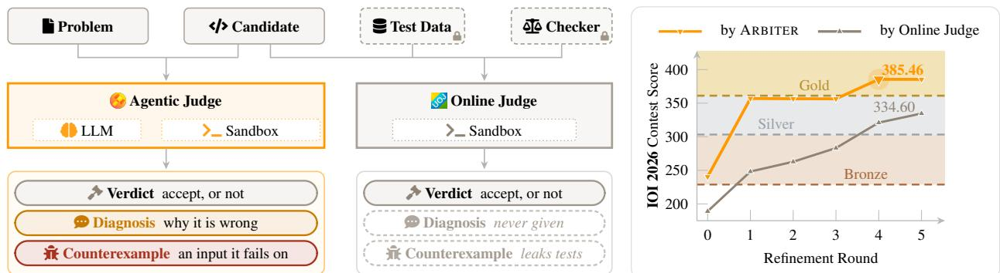

# BEYOND THE VERDICT: AGENTIC CODE JUDGING WITH VERIFIABLE FEEDBACK

Zheye Deng<sup>1,2</sup> Sha Li<sup>2</sup> Changlong Yu<sup>2</sup> Xin Liu<sup>2</sup> Qin Lu<sup>2</sup> Priyanka Nigam<sup>2</sup> Yangqiu Song<sup>1</sup>

<sup>1</sup>HKUST <sup>2</sup>Amazon

zdengah@cse.ust.hk, {slliz, changlyu}@amazon.com € Project Page: htt<sub>p</sub>s://horizon-llm.<sub>g</sub>ithub.io/IOI2026/ <sup>§</sup> Code & Artifacts: https://github.com/horizon-llm/IOI2026

## ABSTRACT

Test-time scaling for large language models (LLMs) can involve generating multiple candidate solutions for selection or revising an earlier attempt. To guide selection and revision, we need a verifier that can estimate candidate correctness and provide evidence of failure. In competitive programming, however, official judging systems provide authoritative verdicts under finite submission budgets, without revealing failure explanations or failing inputs. To provide informative feedback without consuming official submissions, we formulate a task in which a model judges and diagnoses a candidate program using only the problem statement and source code, with generated counterexamples serving as checkable evidence. To evaluate this task, we build USACO-JUDGE from the US-ACO 2026 contests, using accepted and unaccepted programs written by human experts and multiple LLMs. We then train ARBITER, a 35B mixture-of-experts (MoE) agentic verifier, with reinforcement learning in a generic execution sandbox. Training raises counterexample success on incorrect programs from 40.61% to 62.67% and mean binary verdict accuracy on USACO-JUDGE from 71.41% to 87.41%, approaching frontier verification performance. Beyond verification, ARBITER outperforms baselines in both code selection and refinement. In an IOI 2026 case study, ARBITER-guided refinement raises GPT-OSS-120B’s expected score above the gold-medal threshold under the official submission limit.

## 1 INTRODUCTION

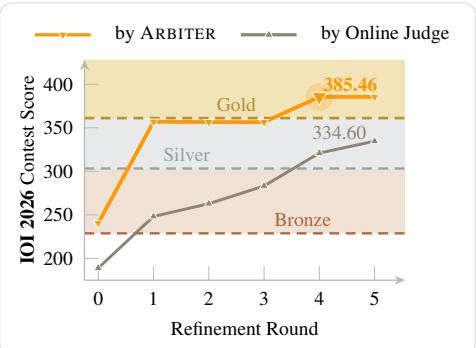  
Figure 1: Comparison of ARBITER with an online judge (left) and the IOI 2026 case study (right). Under the same 50-submission cap per problem, the expected ARBITER score crosses the gold threshold in round 4; the expected online-judge-feedback score remains below it.

Test-time methods allow language models to continue working after an initial answer. They can generate several candidates for selection or revise an earlier attempt (Snell et al., 2025; Shinn et al., 2023; Venkatraman et al., 2025). Each use of additional computation depends on feedback about a candidate already produced. Selection requires a judgment about which candidate to keep; revision requires information about a particular failure. Learned verifiers and reward models have supported candidate selection and guided search across reasoning tasks (Cobbe et al., 2021; Lightman et al., 2024; Zhang et al., 2025). We ask how verification feedback can support both uses while grounding suspected failures in evidence that can be checked independently.

Competitive programming makes this question concrete. A problem statement specifies intended behavior, and an official judge tests candidate programs against hidden inputs and resource limits (Maggiolo & Mascellani, 2012; Maresˇ,

2021). The setting has driven work on code generation and inference-time computation (Shi et al., 2024; El-Kishky et al., 2025; Samadi et al., 2026). When a solver compares several candidates or revises an earlier attempt, it needs feedback before another official submission. Public examples and generated tests can help with either decision (Chen et al., 2023; Fu et al., 2026), but passing them does not establish acceptance on hidden tests. The official judge determines acceptance under its test suite, but usually provides only a verdict or score, without a failing input or explanation (Xu et al., 2026). In settings with a finite submission budget, that feedback cannot be requested freely. A code judge can estimate correctness and describe a suspected fault for one candidate (Tong & Zhang, 2024), but its explanation need not contain a replayable failing input. Test generators can target known-faulty submissions or supply tests for debugging and selection (Sinha et al., 2025; Prasad et al., 2025; Li et al., 2025; Shi et al., 2026). The joint task remains underexplored: given a single candidate of unknown quality, predict whether it should be accepted and, if a fault is suspected, produce a candidate-specific counterexample whose legality and effect can be checked. We formulate this as single-candidate verification with counterexample-grounded diagnosis.

Given a problem statement and candidate program, ARBITER uses a generic execution sandbox to return a verdict and diagnosis, plus a candidate-specific counterexample generator for suspected failures other than compile errors (Figure 1, left). It sees neither hidden tests nor a reference solution. During training and evaluation, judge infrastructure checks whether generated inputs are legal and break the candidate, providing executable evidence for suspected failures. We build USACO-JUDGE to evaluate acceptance judgments alongside failure discovery, and train ARBITER with reinforcement learning. On the same Qwen3.6-35B-A3B backbone, overall counterexample success rises from 16.10% without tools to 40.61% with the agentic scaffold and 62.67% after training. On USACO-JUDGE, mean binary verdict accuracy also rises from 71.41% with the agentic scaffold to 87.41% after training. The verdict helps rank completed programs. For a rejected candidate, the diagnosis gives the solver a suspected failure to investigate in its next attempt. In an IOI 2026 case study, ARBITER-guided refinement brings GPT-OSS-120B to 385.46 expected points under the official submission limit, above the gold threshold. It reaches 334.6 expected points with online-judge feedback (Figure 1, right). To conclude, our contributions are:

• We formulate a task for judging a single candidate program and explaining any unaccepted verdict, and use counterexamples that break the program as a verifiable proxy for diagnosis quality.

• We release USACO-JUDGE, which evaluates correct and incorrect programs from human experts and multiple LLMs against official test sets from the USACO 2026 contests.

• We introduce ARBITER, a 35B MoE agentic verifier trained with reinforcement learning, and show substantial gains over its base model and strong results on USACO-JUDGE, code selection, and refinement.

## 2 RELATED WORK

Feedback for Test-Time Scaling. Test-time scaling can use feedback to select among generated solutions (Li et al., 2022) or revise an earlier attempt (Venkatraman et al., 2025; Wan et al., 2026). Outcome and process reward models score complete solutions or intermediate steps (Cobbe et al., 2021; Lightman et al., 2024). Generative verifiers provide reasoning for their judgments (Zhang et al., 2025), while agentic verifiers gather observations through tools (Zhang et al., 2026; Cui et al., 2026). These approaches differ in both how they produce feedback and what that feedback establishes about a candidate. Our work connects the two uses of feedback: ARBITER provides verdicts for selection and candidate-specific diagnoses and counterexamples for refinement.

Evidence for Code Judgment. Code judges can predict correctness and describe faults for a single program (Tong & Zhang, 2024), but such descriptions need not include a replayable failing input. Execution-based methods use tests to rank candidate pools or guide revisions (Ni et al., 2023; Chen et al., 2023; Ma et al., 2026; Fu et al., 2026; Tang et al., 2026). Test generators target known-faulty programs or supply tests for debugging and selection (Sinha et al., 2025; Prasad et al., 2025; Li et al., 2025; Shi et al., 2026). These outputs support different conclusions. A predicted verdict is not an executable witness. An input on which two programs disagree shows that their behavior differs, but not which program is wrong. A legal input that breaks one candidate under the task’s judging rules supports its rejection. Our task predicts acceptance for a candidate of unknown quality and, for suspected non-compilation failures, couples diagnosis with candidate-specific counterexample search.

Evaluating Code Verifiers. Benchmarks assess correctness judgments and fault categories (Zhao et al., 2025), and study judge behavior across code generation, repair, and unit-test generation (Jiang et al., 2026). Our task also asks whether a claimed fault can be exposed by an executable input. Hacking benchmarks measure counterexample discovery, but the Easy and Hard UOJ-BENCH splits used here contain only faulty programs (Xu et al., 2026). They cannot test whether a verifier recognizes accepted code. We introduce USACO-JUDGE to address this gap: it includes accepted and unaccepted programs from human experts and LLMs, measuring verdict accuracy across both classes and counterexample success on incorrect candidates under one protocol.

## 3 VERIFICATION TASK

A running example. Figure 2 shows an incorrect candidate and its counterexample.

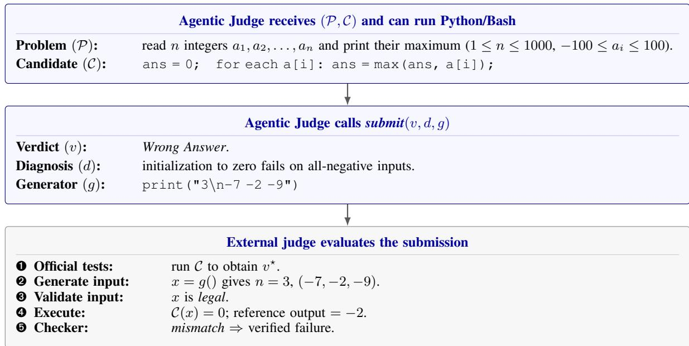  
Figure 2: A verification instance. The verifier’s answer and the judge-side evaluation are shown in order; judge-only results are not revealed during the verifier’s episode.

Verifier Interface. Given a problem P and candidate program C, the verifier can run Python code and Bash commands in a generic sandbox to construct and run its own tests. It cannot access the official tests, reference solution, input validator, output checker, or the result of checking its final counterexample. To end the episode, it calls sub-$m i t ( v , d , g )$ , where v is a verdict, d a natural-language diagnosis, and g a deterministic Python 3 generator that prints one input. This call does not submit C to the official judge. Possible verdicts are Accepted, Wrong Answer, Time Limit Exceeded, Runtime Error, Memory Limit Exceeded, and Compile Error. The main decision is whether to accept C. The other verdicts specify a suspected failure type. The diagnosis identifies the suspected failure for an unaccepted program. The generator g is empty for Accepted and Compile Error.

External Judge Evaluation. After submit, an external judge runs C on official tests to obtain the reference verdict v<sup>⋆</sup>. If g is supplied, it generates an input x, validates x, and tests C against a reference solution under the task’s judging rules. A legal x that breaks C establishes a failure even when official tests miss it; failing to find one does not establish acceptance. The private checks supply training rewards and evaluation labels but are withheld from the verifier. We do not score d directly; counterexample success is a checkable proxy for diagnosis quality, not proof of every claim in d. Appendix A specifies the full protocol.

## 4 TRAINING ARBITER

We train ARBITER (Agentic RL-trained Bug-finding Interactive Test ExamineR) to judge a candidate program, diagnose failures, and generate counterexamples. Starting from Qwen3.6-35B-A3B (Qwen Team, 2026), we optimize the mapping $( \mathcal { P } , \mathcal { C } ) \mapsto ( v , d , g )$ with agentic reinforcement learning. We describe the training data in Section 4.1, the reward design and optimization in Section 4.2, and adaptive length control in Section 4.3.

## 4.1 TRAINING DATA

Our training set contains 20,000 candidate programs sampled from online-judge-graded solver rollouts across 6,145 competitive-programming problems. We sample at most five solver rollouts per problem and exclude all evaluation problems. Accepted programs make up 15% of the set. Among the remaining programs, 46.8% score between 76 and 99. These high-scoring failures are more likely to contain subtle bugs that survive most official tests. A separate validation set of 400 candidates from 100 hard problems is reserved for checkpoint selection and shares no problems with the training or test sets. Appendix B.1 provides full sampling and construction details.

## 4.2 AGENTIC REINFORCEMENT LEARNING

For each (P, C) pair, the policy samples a group of multi-turn episodes in the sandbox of Section 3. Each episode ends with one (v, d, g) prediction and receives a scalar reward. We optimize the policy with GRPO (Shao et al., 2024) using the slime RL framework (Zhu et al., 2025). Episodes that hit the token budget are truncated and retained with zero reward, whereas episodes that exceed the wall-clock budget are aborted and excluded from the policy update. Appendix C reports the training and rollout hyperparameters.

Rewarding executable evidence. A verdict-only reward invites a shortcut: with 85% of training candidates unaccepted, the policy can favor the majority verdict without testing the candidate. In a diagnostic run, training reward rises while validation verdict accuracy stays between 56% and 58%. Mean tool calls fall from 4.9 per rollout to below one (Figure 4, left). We therefore give little reward for a correct unaccepted verdict unless the policy produces a counterexample that survives execution and validation. Appendix G.1 gives the full diagnostic.

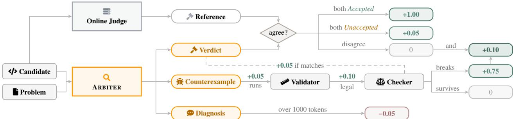  
Figure 3: The verification pipeline assigns partial rewards according to each outcome and combines them into the final reward used to train ARBITER, with each component tied to a separate check.

Figure 3 shows the reward allocation. Agreement on an unaccepted verdict earns 0.05: it identifies the direction of the decision but supplies no evidence of a bug. Running g earns another 0.05, and producing a legal input adds 0.10. These small intermediate rewards give feedback before the harder event of finding a failure. Their total, including verdict agreement, is 0.20, while an input that actually breaks C earns 0.75. Matching the failure type adds the final 0.05, bringing a verified unaccepted prediction to 1.00. When both v and the reference verdict v<sup>⋆</sup> are Accepted, the rollout receives 1.00. This evidence gate is necessarily asymmetric in our setting: a counterexample can establish failure, but not finding one cannot establish acceptance. The policy can still guess Accepted without a witness. The diagnosis d receives no correctness reward. A diagnosis over 1000 tokens incurs a 0.05 penalty. A valid counterexample that overturns an Accepted reference verdict earns an additional 0.10, placing verified evidence above agreement with the official tests. Appendix D.6 gives two such cases.

False-positive penalty. An incorrect Accepted verdict can stop a refinement trajectory before the faulty program is repaired. We examine an additional reward penalty λ for predicting Accepted when the reference verdict is unaccepted. Matched runs with λ = 0 and λ = 0.5 show higher Accepted-class precision and lower recall with the larger penalty (Figure 4, right). On the hard split of USACO-JUDGE, precision rises from 77.78% to 80.98%, while recall falls from 76.67% to 62.86%. A false negative can also discard a correct program during selection. We use λ = 0 for the final ARBITER; the comparison shows how the penalty shifts the precision–recall trade-off. The full benchmark comparison appears in Appendix G.2.

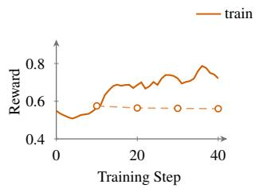

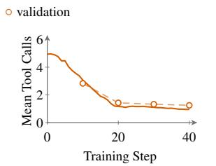

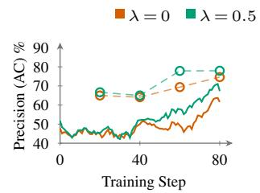

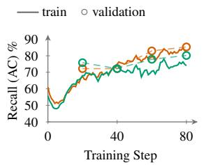  
Figure 4: Reward ablations. Left: reward, verdict accuracy, and tool use under verdict-only training. Right: Accepted precision and recall for false-positive penalties λ = 0 and 0.5.

## 4.3 EFFICIENT TRAINING THROUGH LENGTH CONTROL

As responses grow longer during training, generation cost rises and rollout throughput falls. Inspired by length control (Kimi Team, 2026), we design an adaptive penalty. When the penalty is active, we penalize a rollout only if it earns at least 0.9 raw reward, exceeds a group-relative length threshold, and at least one-quarter of the group shares the top reward. These gates spare unsuccessful attempts and rare successes on difficult problems. For a group G, let $S \subseteq { \bar { G } }$ be the rollouts tied for its highest raw reward, and B the upper quartile of their response lengths, recomputed at each step. For rollout i, let $R _ { i }$ and $L _ { i }$ denote its raw reward and response length. The adjusted reward is

$$
\widetilde { R } _ { i } = \left\{ \begin{array} { l l } { R _ { i } - 0 . 6 , } & { R _ { i } \geq 0 . 9 , L _ { i } > B , \frac { | S | } { | G | } \geq \frac { 1 } { 4 } , } \\ { R _ { i } , } & { \mathrm { o t h e r w i s e } . } \end{array} \right.
$$

Figure 5 compares two runs continued from the same checkpoint. Length control shortens responses (middle), reduces rollout timeouts (right), and avoids the late decline in mean reward seen without it (left). A continuously applied penalty can curtail exploration: in a comparison run, median response length falls from 17.2k to 12.9k tokens, median interaction turns drop from 10 to 7, and hack success falls from 62.3% to 59.1% (Appendix G.3). We therefore alternate penalized and unpenalized phases to leave room for longer attempts. The shaded intervals mark when the penalty is active.

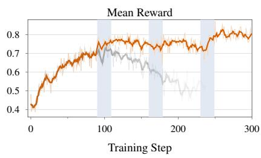

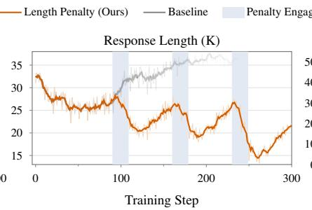

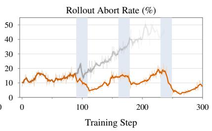  
Figure 5: Adaptive length control. The panels compare mean reward, response length, and abort rate across two runs continued from the same checkpoint. Shading marks the active penalty phases.

## 5 EVALUATION BENCHMARKS

## 5.1 UOJ-BENCH

UOJ-BENCH (Xu et al., 2026) evaluates code generation, hacking, and repair using real submissions to the Universal Online Judge (UOJ)<sup>1</sup>. We use its code-hacking splits: 479 Easy submissions with faults exposed by standard tests, and 1,046 Hard submissions that passed those tests before a community hack exposed a fault. All are faulty. We re-host the released candidates on our UOJ instance and reproduce their original outcomes (Appendices A and B.2). These splits test counterexample discovery on overt and covert faults, but leave acceptance untested. A verifier could predict unaccepted for every candidate and obtain perfect binary verdict accuracy without finding a counterexample.

## 5.2 USACO-JUDGE

To evaluate acceptance judgments alongside counterexample discovery, we build USACO-JUDGE with both accepted and unaccepted programs. The benchmark contains 900 C++17 candidates for 39 held-out problems from the USACO

2026 contests, spanning Bronze through Platinum.<sup>2</sup> The easy tier contains 270 candidates over 18 problems from the Bronze and Silver divisions, and the hard tier contains 630 candidates over 21 problems from the Gold and Platinum divisions, including problems from the USACO Open. Candidates come from five LLMs: Claude Opus 4.8 (Anthropic, 2026), GPT-5.5 (OpenAI, 2026), GPT-OSS-120B (OpenAI, 2025), DeepSeek-V4 (DeepSeek-AI, 2026), and Qwen3.6- 35B-A3B (Qwen Team, 2026), as well as five human competitive programmers. Both tiers use a 1:2 ratio of accepted to unaccepted candidates. Within each tier, we sample the same number of candidates for every problem and distribute the unaccepted candidates across five official score bands, from programs that fail most tests to near-misses. The hard tier is balanced across bands. We also select for distinct code structures and runtime profiles within each problem and score band, reducing repeated variants of the same implementation. High-scoring unaccepted submissions are scarce in the easy tier, so its unfilled 80–99 quota is assigned to the 60–79 band, which therefore exceeds 20%. Figure 6 summarizes the resulting distribution.

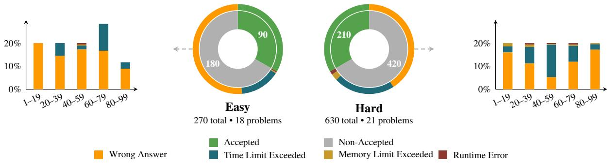  
Figure 6: USACO-JUDGE composition by difficulty, verdict, failure type, and official score band.

The USACO website provides the problem statements, test data, and official solutions, but not the validators and checkers required to deploy the problems on our own online judge. We employ experienced competitive programmers to implement validators compatible with UOJ for every problem, allowing the judge to verify that each generated input satisfies the problem constraints. For output judging, we use UOJ’s native checker whenever possible and write custom checkers for the six problems that allow multiple valid outputs. Every validator and custom checker is verified end to end on the deployed online judge before benchmark construction. We then rejudge every candidate on the official test data, so every label is an actual judge verdict, and retain it only if its original score is reproduced. Multiple runs ensure that judge variability does not change a candidate’s accepted or unaccepted status. See Appendix B.4 for candidate construction and Appendix B.3 for validator and checker details.

## 6 EXPERIMENTS

We evaluate ARBITER’s verification quality on the two benchmarks of Section 5 (Section 6.1), then test its use for code refinement (Section 6.2) and selection (Section 6.3).

## 6.1 VERIFICATION QUALITY

Although ARBITER predicts a detailed verdict, the failure type from an online judge depends on the first failed test and need not describe every fault. We map predicted and reference verdicts to Accepted or unaccepted. Verdict accuracy (Verdict Acc.) measures this binary decision. Hack success (Hack Succ.) is the fraction of truly unaccepted candidates broken by a valid generated input under the checker, providing an executable measure of counterexample quality. On the UOJ-BENCH hacking splits, verdict accuracy is unaccepted-class recall because every target is faulty; USACO-JUDGE tests both sides of the decision. The benchmark’s AC/non-AC split follows the official tests; for evaluation, an officially Accepted candidate is treated as unaccepted when a validated counterexample exposes a failure. Table 1 reports multiple-run averages for all baselines and ARBITER.

<table><tr><td rowspan="3">Model</td><td rowspan="3">Params</td><td colspan="4">UOJ-BENCH (Hacking)</td><td colspan="4">USACO-JUDGE</td><td rowspan="3">Overall Hack Succ.</td></tr><tr><td colspan="2"> Verdict Acc.</td><td colspan="2"> Hack Succ.</td><td colspan="2">Verdict Acc.</td><td colspan="2">V Hack Succ.</td></tr><tr><td>Easy</td><td>Hard</td><td>Easy Hard</td><td></td><td>Easy Hard</td><td></td><td>Easy</td><td>Hard</td></tr><tr><td colspan="10">Non-agentic</td></tr><tr><td>Qwen3.6-35B-A3B</td><td>35B</td><td>86.85</td><td>87.57</td><td>16.70</td><td>10.85</td><td>66.42</td><td>64.55</td><td>32.04</td><td>21.65</td><td>16.10</td></tr><tr><td>GPT-OSS-120B</td><td>120B</td><td>79.12</td><td>77.06</td><td>29.09</td><td>20.07</td><td>60.74</td><td>66.88</td><td>33.89</td><td>36.84</td><td>26.59</td></tr><tr><td> DeepSeek-V4-Flash-Preview</td><td>284B</td><td>73.49</td><td>73.10</td><td>33.49</td><td>22.03</td><td>74.94</td><td>68.68</td><td>55.00</td><td>41.52</td><td>31.26</td></tr><tr><td>Qwen3.5-397B-A17B</td><td>397B</td><td>88.87</td><td>88.34</td><td>41.68</td><td>30.78</td><td>85.31</td><td>74.23</td><td>77.31</td><td>58.88</td><td>42.73</td></tr><tr><td>GLM-5.2</td><td>753B</td><td>80.17</td><td>76.77</td><td>65.34</td><td>57.33</td><td>94.07</td><td>80.63</td><td>91.16</td><td>79.03</td><td>66.29</td></tr><tr><td>K Kimi-K2.5</td><td>1T</td><td>72.44</td><td>68.67</td><td>46.76</td><td>30.95</td><td>83.33</td><td>72.86</td><td>70.56</td><td>57.24</td><td>43.07</td></tr><tr><td>DeepSeek-V4-Pro-Preview</td><td>1.6T</td><td>76.06</td><td>75.46</td><td>51.15</td><td>38.94</td><td>90.74</td><td>82.86</td><td>84.85</td><td>70.95</td><td>51.91</td></tr><tr><td>Claude-Opus-4.8</td><td></td><td>84.97</td><td>75.72</td><td>77.04</td><td>67.06</td><td>94.81</td><td>82.38</td><td>94.48</td><td>87.61</td><td>75.69</td></tr><tr><td>GPT-5.5</td><td></td><td>91.86</td><td>89.87</td><td>78.71</td><td>77.01</td><td>94.44</td><td>90.79</td><td>90.66</td><td>91.97</td><td>81.51</td></tr><tr><td colspan="10">Agentic</td></tr><tr><td>Qwen3.6-35B-A3B</td><td>35B</td><td>71.82</td><td>67.43</td><td>41.34</td><td>31.47</td><td>85.56</td><td>65.34</td><td>79.44</td><td>45.88</td><td>40.61</td></tr><tr><td> DeepSeek-V4-Flash-Preview</td><td>284B</td><td>65.55</td><td>63.19</td><td>56.37</td><td>49.35</td><td>96.30</td><td>77.62</td><td>92.78</td><td>65.27</td><td>57.76</td></tr><tr><td>ARBITER (Ours)</td><td>35B</td><td>87.61</td><td>83.40</td><td>61.48</td><td>50.66</td><td>94.20</td><td>84.50</td><td>96.64</td><td>79.38</td><td>62.67</td></tr></table>

Table 1: Results on UOJ-BENCH (Hacking) and USACO-JUDGE, reported by difficulty split (Easy / Hard) and grouped by inference mode: non-agentic (W, single-shot) versus agentic (Ó, tool-using).

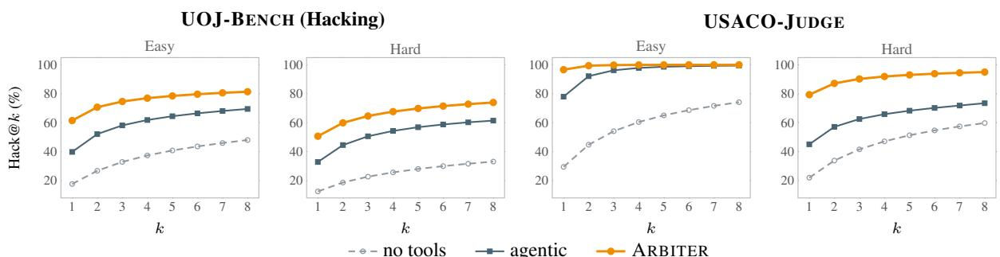  
Figure 7: Test-time scaling on the Qwen3.6-35B-A3B backbone. We draw eight samples per candidate and report Hack@k, the expected success rate of a uniformly chosen subset of k samples.

Verification performance. Training raises overall hack success from 40.61% to 62.67%. On the hard splits, verdict accuracy rises from 67.43% to 83.40% on UOJ-BENCH and from 65.34% to 84.50% on USACO-JUDGE, a 26.5% relative improvement on average. The resulting 35B ARBITER outperforms non-agentic models as large as 1.6T parameters. On USACO-JUDGE, ARBITER achieves the highest reported hack success among the evaluated open-weight models on both Easy and Hard, and the highest reported verdict accuracy on Hard.

Test-time scaling. All systems in Table 1 use one verifier sample per candidate. To isolate backbone scaling, Figure 7 varies the sample budget for Qwen3.6-35B-A3B without tools, with the agentic scaffold, and after ARBITER training. Repeated sampling improves all three variants, while one ARBITER sample already exceeds eight no-tools samples on every split.

Counterexamples track diagnosis quality, and correct diagnoses are specific and actionable. We manually audit 400 ARBITER diagnoses on USACO candidates, with three competitive programmers comparing each diagnosis against the problem, candidate, and official judge evidence. Their independent initial labels agree on all 400 cases. Among compilable candidates, counterexamples succeed for 71.6% of correct diagnoses and 10.3% of incorrect or vacuous ones (Figure 8, left). Among the 163 correct diagnoses that identify a real bug, 82.2% locate its cause and 54.0% suggest a fix (Figure 8, right). Appendix F.4 gives the full audit and sampling protocol.

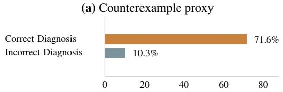  
Success (%)

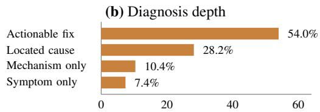  
Share (%)  
Figure 8: Human audit of ARBITER diagnoses. Counterexample success tracks correctness (Left), while correct diagnoses usually locate the bug and over half suggest a fix (Right).

## 6.2 CODE REFINEMENT

For each of the 39 held-out USACO 2026 problems, we test Qwen3.6-35B-A3B and GPT-OSS-120B using eight shared, already judged starting programs and up to eight revisions. We compare previous code alone, online-judge feedback (verdict and subtask score), and three combinations of ARBITER’s verdict (V), diagnosis (D), and counterexample generator (X). Round 0 is excluded from the additional-submission budget; every arm retains a 100-point seed without further submissions. Otherwise, only Online Judge uses the round-0 result as feedback, while ARBITER reviews each version. Best@1 retains round 8 for previous code, round 1 for Online Judge, and the first ARBITERpredicted Accepted (or round 8). Best@8 retains the highest score among up to eight additional submissions; Online Judge stops at 100 points. Table 2 reports the 30 non-Bronze problems; Appendix F.1 gives the full protocol.

<table><tr><td rowspan="3">Condition</td><td colspan="6">Qwen3.6-35B-A3B</td><td colspan="6">GPT-OSS-120B</td></tr><tr><td colspan="2">Easy (9)</td><td colspan="2">Medium (9)</td><td colspan="2">Hard (12)</td><td colspan="2">Easy (9)</td><td colspan="2">Medium (9)</td><td colspan="2">Hard (12)</td></tr><tr><td>@1</td><td>@8</td><td>@1</td><td>@8</td><td>@1</td><td>@8</td><td>@1</td><td>@8</td><td>@1</td><td>@8</td><td>@1</td><td>@8</td></tr><tr><td>Starting code</td><td>69.5</td><td>69.5</td><td>52.4</td><td>52.4</td><td>9.5</td><td>9.5</td><td>73.8</td><td>73.8</td><td>62.8</td><td>62.8</td><td>12.8</td><td>12.8</td></tr><tr><td>Previous code only</td><td>52.4</td><td>93.6</td><td>38.9</td><td>59.8</td><td>5.8</td><td>16.6</td><td>88.1</td><td>89.6</td><td>75.9</td><td>81.6</td><td>21.8</td><td>28.5</td></tr><tr><td>Online Judge</td><td>68.9</td><td>98.1</td><td>49.2</td><td>64.7</td><td>10.2</td><td>17.4</td><td>80.7</td><td>94.3</td><td>73.0</td><td>86.0</td><td>20.5</td><td>35.5</td></tr><tr><td>ARBITER: V + X</td><td>90.1</td><td>92.5</td><td>62.4</td><td>65.9</td><td>6.4</td><td>13.4</td><td>95.8</td><td>96.8</td><td>84.0</td><td>84.1</td><td>26.3</td><td>35.8</td></tr><tr><td>ARBITER: V + D</td><td>95.6</td><td>100.0</td><td>66.4</td><td>69.0</td><td>12.3</td><td>20.1</td><td>93.3</td><td>95.4</td><td>85.0</td><td>89.2</td><td>32.8</td><td>39.1</td></tr><tr><td>ARBITER: V + D + X</td><td>93.1</td><td>95.8</td><td>62.4</td><td>67.7</td><td>11.0</td><td>19.3</td><td>94.7</td><td>96.0</td><td>86.6</td><td>88.6</td><td>30.4</td><td>38.3</td></tr></table>

Table 2: Refinement from shared, already judged seeds on 30 non-Bronze USACO 2026 problems. The tiers are Silver, Gold, and Platinum+Open. Budgets count one or eight additional judge submissions; inference compute is unmatched. Bold and underlined entries mark the top two conditions.

At Best@8, the V + D condition scores above Online Judge for both solvers at every difficulty tier. Both V + D and V + X expose the verdict and use the same acceptance-based stopping rule; their comparison favors diagnosis as repair guidance. Adding counterexample-generator source X to V + D brings no consistent gain (Appendix F.5). At Best@1, ARBITER’s predicted Accepted verdict determines which version is retained; false acceptances remain in the reported scores (Appendix F.3).

Case study: IOI 2026. On all six IOI 2026 problems, GPT-OSS-120B starts 50 internal trajectories per refinement target and makes up to five ARBITER-guided revisions. Submissions are counted per problem, not per target: four tasks combine programs by trajectory index, while Classroom Game and Partition divide the official 50-slot cap among separate programs. ARBITER reviews use no slots; each online-judge feedback query uses one. Under this cap, expected scores are 385.46 with ARBITER (above the 361.12 gold threshold) and 334.6 with online-judge feedback (Figure 1). Appendix F.2 gives the budget and score accounting.

## 6.3 CODE SELECTION

Following Ma et al. (2026), we regenerate 8- and 64-program pools from Qwen3-30B-A3B-Thinking and Qwen3- 235B-A22B-Thinking (Qwen Team, 2025) on LiveCodeBench v6 (Jain et al., 2025) and OJBench (Wang et al., 2025). Repeated uniform selection closely recovers published pass@1 (Appendix E). We run one or eight ARBITER calls per candidate, then select uniformly among those with the most Accepted verdicts, or from the full pool if none is accepted. Table 3 places our results and perfect-selection upper bounds on these pools beside published baselines.

<table><tr><td rowspan="2">Selection method</td><td colspan="4">Qwen3-30B-A3B-Thinking</td><td colspan="4">Qwen3-235B-A22B-Thinking</td></tr><tr><td colspan="2">LiveCodeBench v6</td><td colspan="2">OJBench</td><td colspan="2">LiveCodeBench v6</td><td colspan="2">OJBench</td></tr><tr><td></td><td>Pool=8</td><td>Pool=64</td><td>Pool=8</td><td>Pool=64</td><td>Pool=8</td><td>Pool=64</td><td>Pool=8</td><td>Pool=64</td></tr><tr><td>Uniform selection</td><td>66.2</td><td>66.2</td><td>28.9</td><td>28.9</td><td>74.7</td><td>74.7</td><td>37.1</td><td>37.1</td></tr><tr><td>Grading RM (Liu et al., 2025)</td><td>67.1</td><td>68.0</td><td>28.7</td><td>29.3</td><td>75.9</td><td>74.9</td><td>37.6</td><td>34.9</td></tr><tr><td>MBR-Exec (hard) (Shi et al., 2022)</td><td>68.5</td><td>69.2</td><td>29.6</td><td>32.4</td><td>77.9</td><td>77.7</td><td>37.7</td><td>39.6</td></tr><tr><td>MBR-Exec (soft) (Shi et al., 2022)</td><td>70.0</td><td>70.0</td><td>31.4</td><td>31.8</td><td>78.5</td><td>78.5</td><td>40.5</td><td>41.4</td></tr><tr><td>CodeT (Chen et al., 2023)</td><td>72.7</td><td>70.5</td><td>31.6</td><td>32.1</td><td>78.8</td><td>79.2</td><td>41.0</td><td>40.6</td></tr><tr><td>CodeRM (Ma et al., 2025)</td><td>71.2</td><td>71.4</td><td>32.0</td><td>31.3</td><td>79.3</td><td>80.3</td><td>40.4</td><td>39.5</td></tr><tr><td>Random Generator (Li et al., 2022)</td><td>70.7</td><td>70.4</td><td>33.4</td><td>34.1</td><td>78.8</td><td>78.9</td><td>43.8</td><td>44.2</td></tr><tr><td>Agentic Verifier (Ma et al., 2026)</td><td>73.6</td><td>73.7</td><td>33.5</td><td>34.9</td><td>81.6</td><td>82.9</td><td>45.9</td><td>48.6</td></tr><tr><td>ARBITER (1 call)</td><td>76.8</td><td>82.6</td><td>37.6</td><td>43.6</td><td>85.0</td><td>87.7</td><td>50.0</td><td>53.3</td></tr><tr><td>ARBITER (8 calls)</td><td>79.5</td><td>84.6</td><td>40.0</td><td>46.3</td><td>85.9</td><td>89.3</td><td>51.7</td><td>56.1</td></tr><tr><td>Perfect selection†</td><td>81.1</td><td>86.3</td><td>42.2</td><td>50.0</td><td>88.0</td><td>92.6</td><td>55.6</td><td>62.1</td></tr></table>

<sup>†</sup>Perfect selection uses online-judge verdicts for our evaluated candidate pools and serves as their upper bound, unavailable at inference time.

Table 3: Pass@1 following Ma et al. (2026). Baselines are published; ARBITER and perfect selection use regenerated pools with unmatched inference compute.

Across all eight settings, one ARBITER call per candidate has higher reported pass@1 than the strongest published baseline. With the 30B solver and a pool of 64, ARBITER scores 82.6 versus the published 73.7 on LiveCodeBench and 43.6 versus 34.9 on OJBench. Eight calls improve every setting further, moving selection consistently closer to the perfect-selection upper bound.

## 7 CONCLUSION

ARBITER combines candidate verification and counterexample-grounded diagnosis. On USACO-JUDGE, its candidate-weighted verdict accuracy rises from 71.41% to 87.41%, and overall counterexample success from 40.61% to 62.67%. Under the reproduced protocol, it leads reported code-selection results and improves refinement over the evaluated baselines. In our IOI 2026 case study, ARBITER-guided GPT-OSS-120B reaches 385.46 expected points under the official 50-submission cap per problem, above the 361.12 gold threshold.

## REFERENCES

Anthropic. Introducing Claude Opus 4.8. Anthropic, 2026. URL https://www.anthropic.com/news/ claude-opus-4-8.

Bei Chen, Fengji Zhang, Anh Nguyen, Daoguang Zan, Zeqi Lin, Jian-Guang Lou, and Weizhu Chen. Codet: Code generation with generated tests. In The Eleventh International Conference on Learning Representations, ICLR 2023, Kigali, Rwanda, May 1-5, 2023. OpenReview.net, 2023. URL https://openreview.net/forum? id=ktrw68Cmu9c.

Karl Cobbe, Vineet Kosaraju, Mohammad Bavarian, Mark Chen, Heewoo Jun, Lukasz Kaiser, Matthias Plappert, Jerry Tworek, Jacob Hilton, Reiichiro Nakano, Christopher Hesse, and John Schulman. Training verifiers to solve math word problems. CoRR, abs/2110.14168, 2021. URL https://arxiv.org/abs/2110.14168.

Chaoqun Cui, Jing Huang, Shijing Wang, Liming Zheng, Qingchao Kong, and Zhixiong Zeng. Agentic reward modeling: Verifying gui agent via progressive trajectory-grounded interaction, 2026. URL https://arxiv.org/ abs/2602.00575.

DeepSeek-AI. Deepseek-v4: Towards highly efficient million-token context intelligence. CoRR, abs/2606.19348, 2026. doi: 10.48550/ARXIV.2606.19348. URL https://doi.org/10.48550/arXiv.2606.19348.

Ahmed El-Kishky, Alexander Wei, Andre Saraiva, Borys Minaiev, Daniel Selsam, David Dohan, Francis Song, Hunter Lightman, Ignasi Clavera Gilaberte, Jakub Pachocki, Jerry Tworek, Lorenz Kuhn, Lukasz Kaiser, Mark Chen, Max Schwarzer, Mostafa Rohaninejad, Nat McAleese, o3 contributors, Oleg Murk, Rhythm Garg, Rui Shu, Szy-¨ mon Sidor, Vineet Kosaraju, and Wenda Zhou. Competitive programming with large reasoning models. CoRR, abs/2502.06807, 2025. doi: 10.48550/ARXIV.2502.06807. URL https://doi.org/10.48550/arXiv. 2502.06807.

Shaopeng Fu, Xingxing Zhang, Li Dong, Di Wang, and Furu Wei. Refinerl: Advancing competitive programming with self-refinement reinforcement learning. CoRR, abs/2604.00790, 2026. doi: 10.48550/ARXIV.2604.00790. URL https://doi.org/10.48550/arXiv.2604.00790.

Naman Jain, King Han, Alex Gu, Wen-Ding Li, Fanjia Yan, Tianjun Zhang, Sida Wang, Armando Solar-Lezama, Koushik Sen, and Ion Stoica. Livecodebench: Holistic and contamination free evaluation of large language models for code. In The Thirteenth International Conference on Learning Representations, ICLR 2025, Singapore, April 24-28, 2025. OpenReview.net, 2025. URL https://openreview.net/forum?id=chfJJYC3iL.

Hongchao Jiang, Yiming Chen, Yushi Cao, Hung yi Lee, and Robby T. Tan. CodeJudgeBench: Benchmarking LLMas-a-judge for coding tasks. In Proceedings of the 64th Annual Meeting of the Association for Computational Linguistics (Volume 1: Long Papers), pp. 19416–19448. Association for Computational Linguistics, 2026. doi: 10.18653/v1/2026.acl-long.888. URL https://aclanthology.org/2026.acl-long.888/.

Kimi Team. Kimi K2.5: visual agentic intelligence. CoRR, abs/2602.02276, 2026. doi: 10.48550/ARXIV.2602.02276. URL https://doi.org/10.48550/arXiv.2602.02276.

Qingyao Li, Xinyi Dai, Weiwen Liu, Xiangyang Li, Yasheng Wang, Ruiming Tang, Yong Yu, and Weinan Zhang. Atgen: Adversarial reinforcement learning for test case generation. CoRR, abs/2510.14635, 2025. doi: 10.48550/ ARXIV.2510.14635. URL https://doi.org/10.48550/arXiv.2510.14635.

Yujia Li, David H. Choi, Junyoung Chung, Nate Kushman, Julian Schrittwieser, Remi Leblond, Tom Eccles,´ James Keeling, Felix Gimeno, Agustin Dal Lago, Thomas Hubert, Peter Choy, Cyprien de Masson d’Autume, Igor Babuschkin, Xinyun Chen, Po-Sen Huang, Johannes Welbl, Sven Gowal, Alexey Cherepanov, James Molloy, Daniel J. Mankowitz, Esme Sutherland Robson, Pushmeet Kohli, Nando de Freitas, Koray Kavukcuoglu, and Oriol Vinyals. Competition-level code generation with alphacode. CoRR, abs/2203.07814, 2022. doi: 10.48550/ARXIV.2203.07814. URL https://doi.org/10.48550/arXiv.2203.07814.

Hunter Lightman, Vineet Kosaraju, Yuri Burda, Harrison Edwards, Bowen Baker, Teddy Lee, Jan Leike, John Schulman, Ilya Sutskever, and Karl Cobbe. Let’s verify step by step. In The Twelfth International Conference on Learning Representations, ICLR 2024, Vienna, Austria, May 7-11, 2024. OpenReview.net, 2024. URL https://openreview.net/forum?id=v8L0pN6EOi.

Chris Yuhao Liu, Liang Zeng, Yuzhen Xiao, Jujie He, Jiacai Liu, Chaojie Wang, Rui Yan, Wei Shen, Fuxiang Zhang, Jiacheng Xu, Yang Liu, and Yahui Zhou. Skywork-reward-v2: Scaling preference data curation via human-ai synergy. CoRR, abs/2507.01352, 2025. doi: 10.48550/ARXIV.2507.01352. URL https://doi.org/10.48550/ arXiv.2507.01352.

Zeyao Ma, Xiaokang Zhang, Jing Zhang, Jifan Yu, Sijia Luo, and Jie Tang. Dynamic scaling of unit tests for code reward modeling. In Wanxiang Che, Joyce Nabende, Ekaterina Shutova, and Mohammad Taher Pilehvar (eds.), Proceedings of the 63rd Annual Meeting of the Association for Computational Linguistics (Volume 1: Long Papers), ACL 2025, Vienna, Austria, July 27 - August 1, 2025, pp. 6917–6935. Association for Computational Linguistics, 2025. doi: 10.18653/V1/2025.ACL-LONG.343. URL https://doi.org/10.18653/v1/2025. acl-long.343.

Zeyao Ma, Jing Zhang, Xiaokang Zhang, Jiaxi Yang, Zongmeng Zhang, Jiajun Zhang, Yuheng Jing, Lei Zhang, Hao Zheng, Wenting Zhao, Junyang Lin, and Binyuan Hui. Scaling agentic verifier for competitive coding. CoRR, abs/2602.04254, 2026. doi: 10.48550/ARXIV.2602.04254. URL https://doi.org/10.48550/arXiv. 2602.04254.

Stefano Maggiolo and Giovanni Mascellani. Introducing CMS: A contest management system. Olympiads in Informatics, 6:86–99, 2012. URL https://ioi.te.lv/oi/shtm/INFOL107.shtml.

Martin Mares. Security of grading systems. ˇ Olympiads in Informatics, 15:37–52, 2021. doi: 10.15388/ioi.2021.04.

Ansong Ni, Srini Iyer, Dragomir Radev, Veselin Stoyanov, Wen-Tau Yih, Sida I. Wang, and Xi Victoria Lin. LEVER: learning to verify language-to-code generation with execution. In Andreas Krause, Emma Brunskill, Kyunghyun Cho, Barbara Engelhardt, Sivan Sabato, and Jonathan Scarlett (eds.), International Conference on Machine Learning, ICML 2023, 23-29 July 2023, Honolulu, Hawaii, USA, volume 202 of Proceedings of Machine Learning Research, pp. 26106–26128. PMLR, 2023. URL https://proceedings.mlr.press/v202/ni23b.html.

OpenAI. gpt-oss-120b & gpt-oss-20b model card. CoRR, abs/2508.10925, 2025. doi: 10.48550/ARXIV.2508.10925. URL https://doi.org/10.48550/arXiv.2508.10925.

OpenAI. Introducing GPT-5.5. OpenAI, 2026. URL https://openai.com/index/ introducing-gpt-5-5/.

Archiki Prasad, Elias Stengel-Eskin, Justin Chih-Yao Chen, Zaid Khan, and Mohit Bansal. Learning to generate unit tests for automated debugging. CoRR, abs/2502.01619, 2025. doi: 10.48550/ARXIV.2502.01619. URL https: //doi.org/10.48550/arXiv.2502.01619.

Qwen Team. Qwen3 technical report. CoRR, abs/2505.09388, 2025. doi: 10.48550/ARXIV.2505.09388. URL https://doi.org/10.48550/arXiv.2505.09388.

Qwen Team. Qwen3.6-35B-A3B: Agentic coding power, now open to all, April 2026. URL https://qwen.ai/ blog?id=qwen3.6-35b-a3b.

Mehrzad Samadi, Aleksander Ficek, Sean Narenthiran, Siddhartha Jain, Wasi Uddin Ahmad, Somshubra Majumdar, Vahid Noroozi, and Boris Ginsburg. Scaling test-time compute to achieve IOI gold medal with open-weight models. In Maria Liakata, Viviane P. Moreira, Jiajun Zhang, and David Jurgens (eds.), Proceedings of the 64th Annual Meeting of the Association for Computational Linguistics (Volume 1: Long Papers), ACL 2026, San Diego, California, United States, July 2-7, 2026, pp. 33156–33169. Association for Computational Linguistics, 2026. doi: 10.18653/V1/2026.ACL-LONG.1532. URL https://doi.org/10.18653/v1/2026.acl-long.1532.

Zhihong Shao, Peiyi Wang, Qihao Zhu, Runxin Xu, Junxiao Song, Mingchuan Zhang, Y. K. Li, Y. Wu, and Daya Guo. Deepseekmath: Pushing the limits of mathematical reasoning in open language models. CoRR, abs/2402.03300, 2024. doi: 10.48550/ARXIV.2402.03300. URL https://doi.org/10.48550/arXiv.2402.03300.

Freda Shi, Daniel Fried, Marjan Ghazvininejad, Luke Zettlemoyer, and Sida I. Wang. Natural language to code translation with execution. In Yoav Goldberg, Zornitsa Kozareva, and Yue Zhang (eds.), Proceedings of the 2022 Conference on Empirical Methods in Natural Language Processing, EMNLP 2022, Abu Dhabi, United Arab Emirates, December 7-11, 2022, pp. 3533–3546. Association for Computational Linguistics, 2022. doi: 10.18653/V1/ 2022.EMNLP-MAIN.231. URL https://doi.org/10.18653/v1/2022.emnlp-main.231.

Jingwei Shi, Xinxiang Yin, Jing Huang, Shengyu Tao, and Jinman Zhao. Codehacker: Automated test case generation for detecting vulnerabilities in competitive programming solutions. In Maria Liakata, Viviane P. Moreira, Jiajun Zhang, and David Jurgens (eds.), Proceedings of the 64th Annual Meeting of the Association for Computational Linguistics (Volume 1: Long Papers), ACL 2026, San Diego, California, United States, July 2-7, 2026, pp. 2352– 2382. Association for Computational Linguistics, 2026. doi: 10.18653/V1/2026.ACL-LONG.108. URL https: //doi.org/10.18653/v1/2026.acl-long.108.

Quan Shi, Michael Tang, Karthik Narasimhan, and Shunyu Yao. Can language models solve olympiad programming? CoRR, abs/2404.10952, 2024. doi: 10.48550/ARXIV.2404.10952. URL https://doi.org/10. 48550/arXiv.2404.10952.

Noah Shinn, Federico Cassano, Ashwin Gopinath, Karthik Narasimhan, and Shunyu Yao. Reflexion: language agents with verbal reinforcement learning. In Alice Oh, Tristan Naumann, Amir Globerson, Kate Saenko, Moritz Hardt, and Sergey Levine (eds.), Advances in Neural Information Processing Systems 36: Annual Conference on Neural Information Processing Systems 2023, NeurIPS 2023, New Orleans, LA, USA, December 10 - 16, 2023, 2023. URL http://papers.nips.cc/paper\_files/paper/2023/hash/ 1b44b878bb782e6954cd888628510e90-Abstract-Conference.html.

Shiven Sinha, Shashwat Goel, Ponnurangam Kumaraguru, Jonas Geiping, Matthias Bethge, and Ameya Prabhu. Can language models falsify? evaluating algorithmic reasoning with counterexample creation. CoRR, abs/2502.19414, 2025. doi: 10.48550/ARXIV.2502.19414. URL https://doi.org/10.48550/arXiv.2502.19414.

Charlie Victor Snell, Jaehoon Lee, Kelvin Xu, and Aviral Kumar. Scaling LLM test-time compute optimally can be more effective than scaling parameters for reasoning. In The Thirteenth International Conference on Learning Representations, ICLR 2025, Singapore, April 24-28, 2025. OpenReview.net, 2025. URL https://openreview. net/forum?id=4FWAwZtd2n.

Lingxiao Tang, Muyang Ye, Zhaoyang Chu, Xiaoxue Ren, Zhongxin Liu, Lingfeng Bao, and He Ye. An iterative test-and-repair framework for competitive code generation. CoRR, abs/2604.05560, 2026. doi: 10.48550/ARXIV. 2604.05560. URL https://doi.org/10.48550/arXiv.2604.05560.

Weixi Tong and Tianyi Zhang. Codejudge: Evaluating code generation with large language models. In Yaser Al-Onaizan, Mohit Bansal, and Yun-Nung Chen (eds.), Proceedings of the 2024 Conference on Empirical Methods in Natural Language Processing, EMNLP 2024, Miami, FL, USA, November 12-16, 2024, pp. 20032– 20051. Association for Computational Linguistics, 2024. doi: 10.18653/V1/2024.EMNLP-MAIN.1118. URL https://doi.org/10.18653/v1/2024.emnlp-main.1118.

Siddarth Venkatraman, Vineet Jain, Sarthak Mittal, Vedant Shah, Johan S. Obando-Ceron, Yoshua Bengio, Brian R. Bartoldson, Bhavya Kailkhura, Guillaume Lajoie, Glen Berseth, Nikolay Malkin, and Moksh Jain. Recursive selfaggregation unlocks deep thinking in large language models. CoRR, abs/2509.26626, 2025. doi: 10.48550/ARXIV. 2509.26626. URL https://doi.org/10.48550/arXiv.2509.26626.

Yuxuan Wan, Tianqing Fang, Zaitang LI, Yintong Huo, Wenxuan Wang, Haitao Mi, Dong Yu, and Michael R. Lyu. Inference-time scaling of verification: Self-evolving deep research agents via test-time rubric-guided verification. In Maria Liakata, Viviane P. Moreira, Jiajun Zhang, and David Jurgens (eds.), Findings of the Association for Computational Linguistics, ACL 2026, San Diego, California, United States, July 2-7, 2026, pp. 24822–24835. Association for Computational Linguistics, 2026. doi: 10.18653/V1/2026.FINDINGS-ACL.1243. URL https: //doi.org/10.18653/v1/2026.findings-acl.1243.

Zhexu Wang, Yiping Liu, Yejie Wang, Wenyang He, Bofei Gao, Muxi Diao, Yanxu Chen, Kelin Fu, Flood Sung, Zhilin Yang, Tianyu Liu, and Weiran Xu. Ojbench: A competition level code benchmark for large language models. CoRR, abs/2506.16395, 2025. doi: 10.48550/ARXIV.2506.16395. URL https://doi.org/10.48550/arXiv. 2506.16395.

Tingqiang Xu, Hangrui Zhou, Tianle Cai, Alex Gu, and Kaifeng Lyu. Beyond problem solving: Uoj-bench for evaluating code generation, hacking, and repair in competitive programming. CoRR, abs/2606.12864, 2026. doi: 10.48550/ARXIV.2606.12864. URL https://doi.org/10.48550/arXiv.2606.12864.

Jiazheng Zhang, Ziche Fu, Zhiheng Xi, Wenqing Jing, Mingxu Chai, Wei He, Guoqiang Zhang, Chenghao Fan, Chenxin An, Wenxiang Chen, Zhicheng Liu, Haojie Pan, Dingwei Zhu, Tao Gui, Qi Zhang, and Xuanjing Huang. Agentv-rl: Scaling reward modeling with agentic verifier. In Maria Liakata, Viviane P. Moreira, Jiajun Zhang, and David Jurgens (eds.), Findings ofthe Associationfor Computational Linguistics, ACL 2026, San Diego, California, United States, July 2-7, 2026, pp. 23078–23100. Association for Computational Linguistics, 2026. doi: 10.18653/ V1/2026.FINDINGS-ACL.1156. URL https://doi.org/10.18653/v1/2026.findings-acl.1156.

Lunjun Zhang, Arian Hosseini, Hritik Bansal, Mehran Kazemi, Aviral Kumar, and Rishabh Agarwal. Generative verifiers: Reward modeling as next-token prediction. In The Thirteenth International Conference on Learning Representations, ICLR 2025, Singapore, April 24-28, 2025. OpenReview.net, 2025. URL https://openreview. net/forum?id=Ccwp4tFEtE.

Yuwei Zhao, Ziyang Luo, Yuchen Tian, Hongzhan Lin, Weixiang Yan, Annan Li, and Jing Ma. CodeJudge-eval: Can large language models be good judges in code understanding? In Proceedings of the 31st International Conference on Computational Linguistics, pp. 73–95. Association for Computational Linguistics, 2025. URL https://aclanthology.org/2025.coling-main.7/.

Zilin Zhu, Chengxing Xie, Xin Lv, and slime Contributors. slime: An llm post-training framework for rl scaling. https://github.com/THUDM/slime, 2025. GitHub repository. Corresponding author: Xin Lv.

## A EVALUATION INFRASTRUCTURE AND PROTOCOLS

Verifier interface and judge-side evaluation. The verifier can use execute code to run Python and execute command to run shell commands in a generic sandbox. It may construct and run its own tests, but cannot access the official test data, reference solution, input validator, output checker, or the result of checking its submitted counterexample. A final submit call commits $( v , d , g )$ . We use an online judge based on the open-source Universal Online Judge (UOJ)<sup>3</sup>. The judge compiles and runs C on the official hidden tests under the problem’s resource limits to obtain $v ^ { \star }$ . Verdict accuracy compares v and $v ^ { \star }$ after mapping both to Accepted or unaccepted. Separately, when g is supplied, the judge runs it to obtain x and checks x with the problem’s input validator. For a legal x, it runs C and a reference solution; the output checker compares normally terminating outputs, while compilation, runtime, time-limit, and memory-limit failures are recorded directly. The counterexample succeeds only when x is legal and C fails on it. These checks supply training labels and rewards and evaluate the benchmarks, without becoming observations available to the verifier during its episode.

Hardware and deployment. Our UOJ deployment runs on one server with a 32-core / 64-thread Intel Xeon Platinum 8488C and 128 GB of RAM. The server runs Amazon Linux 2023 with Linux 6.12. The web service and database use separate Docker containers, alongside a pool of up to 30 judger containers. The pool processes submissions and counterexamples in parallel. Each candidate runs in an isolated sandbox under the time and memory limits specified for the problem.

Language and compilation. Candidate solutions, reference solutions, validators, and checkers use C++ unless the source benchmark requires otherwise. We compile submissions with C++17 and -O2, matching the source contests. A submission that fails under this configuration receives Compile Error. Counterexample generators may use Python. They produce input files and are not judged as contest solutions.

## B DATA AND BENCHMARK CONSTRUCTION

## B.1 TRAINING DATA COMPOSITION

Table 4 groups the training pool by sampling score band and judge verdict. Score bands set the sampling quotas. Training labels come from the online judge: Accepted (AC), Wrong Answer (WA), Time Limit Exceeded (TLE), Memory Limit Exceeded (MLE), Runtime Error (RE), and Compile Error (CE). The 76–99 near-miss band contains WA, TLE, MLE, and RE programs. A time-limit failure in that band is labeled TLE.

<table><tr><td></td><td colspan="6">Judge verdict</td><td></td><td></td></tr><tr><td>Score band</td><td>AC</td><td>WA</td><td>TLE</td><td>MLE</td><td>RE</td><td>CE</td><td colspan="2">Total</td></tr><tr><td>100 (accepted)</td><td>3,000</td><td></td><td></td><td></td><td></td><td>一</td><td>3,000</td><td>15.0%</td></tr><tr><td>76–99 (near-miss)</td><td>一</td><td>4,460</td><td>3,107</td><td>220</td><td>163</td><td></td><td>7,950</td><td>39.8%</td></tr><tr><td>1–75 (partial)</td><td>一</td><td>4,600</td><td>1,600</td><td>400</td><td>600</td><td></td><td>7,200</td><td>36.0%</td></tr><tr><td>0</td><td>一</td><td>1,000</td><td></td><td>一</td><td>一</td><td></td><td>1,000</td><td>5.0%</td></tr><tr><td>Compile Error</td><td>一</td><td></td><td></td><td>一</td><td>一</td><td>850</td><td>850</td><td>4.3%</td></tr><tr><td>Total</td><td>3,000</td><td>10,060</td><td>4,707</td><td>620</td><td>763</td><td>850</td><td>20,000</td><td></td></tr><tr><td></td><td>15.0%</td><td>50.3%</td><td>23.5%</td><td>3.1%</td><td>3.8%</td><td>4.3%</td><td></td><td></td></tr></table>

Table 4: Composition of the training pool by sampling score band and judge verdict. Margins report the share of the pool for each row and column.

## B.2 UOJ-BENCH RE-HOSTING

UOJ-BENCH (Xu et al., 2026) divides its hacking data into Easy submissions, which score at least 60 but fail the standard tests, and Hard submissions, which pass those tests before a successful community hack exposes the bug. We use every released candidate from both splits for evaluation. Neither split enters training.

We run candidate scoring and hack evaluation on UOJ, using the same infrastructure as the original benchmark. Each target problem is re-hosted with its validator, reference solution, and checker. Replaying the released candidates reproduces the outcomes reported in the original paper. For a generated hack, UOJ first checks the input with the problem validator. If the input is valid, UOJ runs the reference and candidate solutions and passes both outputs to the checker. The hack succeeds when the candidate fails during execution or the checker rejects its output.

## B.3 USACO-JUDGE VALIDATORS AND CUSTOM CHECKERS

USACO supplies the problem statements, test data, and reference solutions used by our UOJ deployment, but its release omits the validators needed for arbitrary model-generated inputs. We wrote a C++ validator for each of the 39 problems using testlib, an open source C++ library for writing contest input validators and output checkers.<sup>4</sup> Each proposed hack must pass this validator before UOJ runs the reference and candidate solutions.

For 33 problems, the expected output is a unique sequence of tokens, which UOJ checks with a built-in ncmp or wcmp comparator. Six require custom checking. They accept multiple correct outputs or ask for a witness, so we wrote a custom output checker for each one (Table 5).

<table><tr><td>CPID</td><td>What the checker validates</td></tr><tr><td>1540</td><td>Verifies the reported optimum and checks that the supplied position assignment reconstructs valid square subsequences.</td></tr><tr><td>1563</td><td>Simulates the submitted keystrokes and checks that they reconstruct the target string.</td></tr><tr><td>1566</td><td>Tests the submitted permutation and truth-teller/liar assignment against every directional claim.</td></tr><tr><td>1589</td><td>Replays the submitted swaps, enforces the operation limit, and checks the final string.</td></tr><tr><td>1597</td><td>Confirms the minimum attack count, replays the submitted attacks, and verifies that every target reaches zero HP.</td></tr><tr><td>1598</td><td>Validates infeasibility claims or tests the submitted array against every min, max, sum, and xor query.</td></tr></table>

Table 5: Custom output checkers in USACO-JUDGE, indexed by official USACO CPID. The other 33 problems use UOJ built-in token comparators.

## B.4 USACO-JUDGE CONSTRUCTION PIPELINE

We build USACO-JUDGE problem by problem from C++17 programs generated by five LLMs and written by five human competitive programmers. We assign each problem a quota split by score and verdict, remove duplicates, and select diverse programs within each pool. Every retained program is rejudged on UOJ before entering the 900-candidate benchmark.

Per-problem quotas. The 21 hard problems from the Gold, Platinum, and Open divisions each contribute 10 accepted and 20 unaccepted candidates, giving 630 programs. The 18 easy problems from Bronze and Silver each contribute 5 accepted and 10 unaccepted candidates, giving 270. Both groups have a 1:2 ratio of accepted to unaccepted programs.

For every hard problem, the 20 unaccepted candidates are divided evenly across score bands 1–19, 20–39, 40–59, 60–79, and 80–99. The easy group contains 36, 36, 36, 51, and 21 candidates in these bands. Bronze and Silver have few high-scoring unaccepted submissions, so 15 slots move from the 80–99 band to 60–79.

Within-band sampling. Each problem and score band defines a candidate pool using scores returned by our UOJ deployment. Reference accounts are excluded. We give preference to higher scores within a band, then apply the diversity procedure below.

Deduplication and diversity. For duplicate detection only, we derive a canonical representation of each program by removing comments, normalizing whitespace and include order, replacing identifiers with positional placeholders, and expanding common contest macros. This representation is used only for comparison. The submitted source code remains unchanged. Exact canonical duplicates and repeated submissions from the same author are removed before diversity selection.

For two remaining programs x and y in the same pool, their distance combines four signals:

$$
D ( x , y ) = w _ { 1 } ( 1 - \mathrm { M i n H a s h } _ { J } ) + w _ { 2 } ( 1 - \mathrm { A S T } _ { J } ) + w _ { 3 } \mathrm { f e a t } _ { H } + w _ { 4 } ( 1 - \mathrm { t i m e } _ { \mathrm { c o s } } ) .
$$

Here, MinHash estimates token 5-gram Jaccard similarity, $\mathrm { A S T } _ { J }$ compares depth-bounded AST subtrees, and feat is the normalized Hamming distance between program feature vectors. These vectors record data structures, recursion, memoization, loop depth, and function count. The final term compares per-test runtime vectors by cosine similarity. We use $( w _ { 1 } , w _ { 2 } , \bar { w } _ { 3 } , \bar { w } _ { 4 } ) = ( 0 . 2 5 , 0 . 3 0 , 0 . 2 0 , 0 . 2 5 )$ . If a parse or timing record is missing, the corresponding term is dropped and the remaining weights are rescaled to sum to one.

Selection follows a greedy farthest-first pass. The first program is the fastest candidate when timing is available and the lowest-ID candidate otherwise. Each later choice maximizes its minimum distance from the selected set. A candidate from an author already represented in the set receives a multiplicative distance penalty.

Candidate verification. All selected submissions are already written in C++17 and are evaluated without source transformation. We rejudge each program on UOJ and retain it only when its score matches the score used during sampling. Accepted candidates are judged several times to catch verdict changes caused by runtime variation. Every released label comes from these UOJ runs.

## C TRAINING DETAILS

Optimization. Each GRPO update uses a batch of 128 prompts, with n = 16 trajectories sampled per prompt (2,048 trajectories in total). We use Adam with a learning rate of $\bar { 1 \times 1 0 ^ { - 6 } }$ , a constant learning-rate schedule, $\beta _ { 1 } = 0 . 9$ $\beta _ { 2 } ~ = ~ 0 . 9 8$ , weight decay 0.1, and gradient clipping at 1.0. We optimize a per-token objective with PPO clipping $\epsilon _ { \mathrm { l o w } } = 0 . 2$ and $\epsilon _ { \mathrm { h i g h } } = 0 . 2 8$ . The entropy and KL coefficients are both zero, and group advantages are centered without standard-deviation normalization.

Rollouts. We sample with temperature 1.0 and $\mathrm { t o p } { - } p ~ = ~ 1 . 0$ . The context window is capped at 65,536 tokens, including at most 32,768 response tokens. Each episode allows at most 30 tool calls and 1,800 seconds. Calls to execute code and execute command have time limits of 120 and 60 seconds, respectively. We evaluate the held-out validation set every 10 training steps and select the checkpoint with the best validation performance.

Length penalty. We schedule the length penalty manually from the observed reward curve, enabling it when reward plateaus. It is active during steps [90, 110), [160, 180), and [230, 250), and disabled at all other steps.

## D VERIFICATION ANALYSIS

This section examines metric behavior, inference cost, and output patterns behind the verification results in §6.1.

## D.1 HACK SUCCESS AND VERDICT ACCURACY ARE COMPLEMENTARY

Hack success and verdict accuracy diverge during the unpenalized run in Figure 5. Between steps 79 and 179, hack success changes only from 59.8% to 60.9%, while verdict accuracy falls from 74.8% to 57.8%. The stable hack rate masks two opposing changes among unaccepted candidates. The share skipped after an Accepted prediction falls from 17.7% to 11.3%, giving the model more opportunities to produce a counterexample. Over the same interval, the share lost to rollout aborts rises from 4.5% to 17.7% as responses grow longer. These shifts largely cancel in the aggregate hack metric.

A verifier can therefore attempt counterexamples more broadly while becoming less reliable in its binary decisions. Hack success records the final attack outcome, and verdict accuracy checks the preceding decision. The lengthcontrolled run limits the rise in aborts and retains higher verdict accuracy, so we report the two metrics together. Appendix G.3 gives the response-length and timeout diagnostics.

## D.2 OUTPUT TOKENS AND ESTIMATED COST

Table 6 compares output length with estimated output-token cost. ARBITER averages 35.0K–46.9K output tokens per candidate across the four benchmark splits, 22%–33% fewer than its agentic Qwen3.6-35B-A3B baseline, while overall hack success rises from 40.61% to 62.67%. At the listed prices, its mean output cost is \$0.0045 per verification, compared with \$0.0063 for the agentic Qwen3.6-35B-A3B baseline and \$0.0298 for agentic DeepSeek-V4-Flash-Preview. At this operating point, ARBITER has higher overall hack success and lower estimated output-token cost than both agentic baselines in the table.

We use official provider prices when available and otherwise use prices listed by OpenRouter.<sup>5</sup> These estimates cover generated output only. Input tokens, caching effects, tool execution, and self-hosted infrastructure costs are excluded.

<table><tr><td rowspan="2">Model</td><td rowspan="2">Params</td><td rowspan="2">Token Price ($/M Tokens)</td><td colspan="2">UOJ-BENCH</td><td colspan="2">USACO-JUDGE</td><td rowspan="2">Overall Hack Succ.</td><td rowspan="2">Output Cost per Verification</td></tr><tr><td>Easy</td><td>Hard</td><td>Easy</td><td>Hard</td></tr><tr><td colspan="10">Non-agentic</td></tr><tr><td>Qwen3.6-35B-A3B</td><td>35B</td><td>$0.10</td><td>9.6K</td><td>10.6K</td><td>11.4K</td><td>10.9K</td><td>16.10</td><td>$0.0011</td></tr><tr><td>GPT-OSS-120B</td><td>120B</td><td>$0.17</td><td>3.8K</td><td>4.5K</td><td>4.3K</td><td>4.1K</td><td>26.59</td><td>$0.0007</td></tr><tr><td>DeepSeek-V4-Flash-Preview</td><td>284B</td><td>$0.66</td><td>16.6K</td><td>19.4K</td><td>18.8K</td><td>22.0K</td><td>31.26</td><td>$0.0129</td></tr><tr><td>Qwen3.5-397B-A17B</td><td>397B</td><td>$0.90</td><td>16.7K</td><td>18.4K</td><td>28.1K</td><td>28.2K</td><td>42.73</td><td>$0.0195</td></tr><tr><td>GLM-5.2</td><td>753B</td><td>$4.40</td><td>52.0K</td><td>61.8K</td><td>37.4K</td><td>62.5K</td><td>66.29</td><td>$0.2550</td></tr><tr><td>KKimi-K2.5</td><td>1T</td><td>$3.00</td><td>29.1K</td><td>31.6K</td><td>26.5K</td><td>35.2K</td><td>43.07</td><td>$0.0951</td></tr><tr><td>DeepSeek-V4-Pro-Preview</td><td>1.6T</td><td>$1.98</td><td>32.6K</td><td>37.7K</td><td>29.4K</td><td>42.7K</td><td>51.91</td><td>$0.0740</td></tr><tr><td>米Claude-Opus-4.8</td><td>一</td><td>$25.00</td><td>41.3K</td><td>53.6K</td><td>27.1K</td><td>40.9K</td><td>75.69</td><td>$1.1316</td></tr><tr><td>GPT-5.5</td><td>一</td><td>$30.00</td><td>9.3K</td><td>11.1K</td><td>4.5K</td><td>9.4K</td><td>81.51</td><td>$0.2907</td></tr><tr><td colspan="9">Agentic</td></tr><tr><td>Qwen3.6-35B-A3B</td><td>35B</td><td>$0.10</td><td>54.1K</td><td>64.6K</td><td>48.0K</td><td>70.0K</td><td>40.61</td><td>$0.0063</td></tr><tr><td>DeepSeek-V4-Flash-Preview</td><td>284B</td><td>$0.66</td><td>43.2K</td><td>48.9K</td><td>27.8K</td><td>46.3K</td><td>57.76</td><td>$0.0298</td></tr><tr><td>ARBITER (Ours)</td><td>35B</td><td>$0.10</td><td>42.0K</td><td>46.9K</td><td>35.0K</td><td>46.9K</td><td>62.67</td><td>$0.0045</td></tr></table>

Table 6: Mean output tokens per candidate (K), overall hack success, output-token price, and estimated cost per verification using the reported average output lengths. Lower output-token usage and cost are better.

## D.3 VERIFICATION FUNNEL

For each split, Attempt is the fraction of unaccepted candidates for which the model submits a counterexample generator. Exec., Valid, and Succ. measure generator execution, input validity, and counterexample success, each conditional on reaching the preceding stage. The columns therefore show where an attempted verification succeeds or is lost. UOJ-BENCH contains only unaccepted candidates, so Accepted precision and recall are reported for USACO-JUDGE.

Training improves both the decision to attack and the quality of the attack. Relative to its agentic Qwen3.6-35B-A3B baseline, ARBITER raises Attempt by 8–23 percentage points across the four splits. Since this rate is measured only on truly unaccepted candidates, the increase means that more buggy programs are identified and taken forward to counterexample search. Execution and validity exceed 94.7% on every split, while conditional counterexample success rises by another 7–13 points. The final gain therefore comes from more attempts and a higher conversion rate for those attempts.

The USACO-JUDGE acceptance columns measure the corresponding behavior on correct programs. On the hard split, Accepted precision rises from 59.18% to 83.37%, and recall rises from 61.43% to 67.32%. These results pair broader bug coverage with more reliable acceptance decisions.

Counterexample characteristics. Table 8 examines generated input sizes and the failure types of successful hacks. Among validator-approved inputs from ARBITER, 65.6–89.0% are smaller than 1 KB, while 7.0–23.9% are at least 1 MB. The large-input share exceeds that of the agentic Qwen3.6-35B-A3B baseline on every split, showing that training adds constraint-scale stress tests while compact inputs remain the majority. Successful hacks are also varied. Wrong Answer accounts for 65.1–77.1% and Time Limit Exceeded for 11.8–29.9%, with other failure types making up the remainder.

(a) UOJ-BENCH (Hacking)
<table><tr><td rowspan="2">Model</td><td colspan="4">Easy</td><td colspan="4">Hard</td></tr><tr><td>Att.</td><td>Exec.</td><td>Valid</td><td>Succ.</td><td>Att.</td><td>Exec.</td><td>Valid</td><td>Succ.</td></tr><tr><td colspan="9">Non-agentic</td></tr><tr><td>Qwen3.6-35B-A3B</td><td>86.85</td><td>96.49</td><td>92.03</td><td>22.89</td><td>88.45</td><td>96.95</td><td>89.92</td><td>16.23</td></tr><tr><td>GPT-OSS-120B</td><td>83.23</td><td>91.82</td><td>92.80</td><td>41.02</td><td>83.12</td><td>89.34</td><td>90.04</td><td>30.01</td></tr><tr><td> DeepSeek-V4-Flash-Preview</td><td>80.04</td><td>90.40</td><td>95.38</td><td>48.51</td><td>79.60</td><td>90.03</td><td>94.84</td><td>32.41</td></tr><tr><td>Qwen3.5-397B-A17B</td><td>98.47</td><td>89.26</td><td>95.02</td><td>49.91</td><td>98.14</td><td>88.75</td><td>95.05</td><td>37.18</td></tr><tr><td>GLM-5.2</td><td>87.47</td><td>89.02</td><td>95.98</td><td>87.43</td><td>84.35</td><td>87.83</td><td>97.71</td><td>79.20</td></tr><tr><td>K Kimi-K2.5</td><td>75.16</td><td>95.28</td><td>95.34</td><td>68.50</td><td>70.65</td><td>95.21</td><td>92.60</td><td>49.68</td></tr><tr><td> DeepSeek-V4-Pro-Preview</td><td>73.49</td><td>98.96</td><td>94.63</td><td>74.39</td><td>71.74</td><td>97.52</td><td>96.49</td><td>57.70</td></tr><tr><td>米Claude-Opus-4.8</td><td>84.97</td><td>100.00</td><td>98.53</td><td>92.02</td><td>75.32</td><td>100.00</td><td>99.08</td><td>89.87</td></tr><tr><td>GPT-5.5</td><td>91.65</td><td>99.54</td><td>96.80</td><td>89.13</td><td>89.05</td><td>99.44</td><td>98.88</td><td>87.95</td></tr><tr><td colspan="9">Agentic</td></tr><tr><td>Qwen3.6-35B-A3B</td><td>65.43</td><td>97.13</td><td>90.45</td><td>68.98</td><td>64.03</td><td>96.56</td><td>89.00</td><td>59.29</td></tr><tr><td> DeepSeek-V4-Flash-Preview</td><td>64.30</td><td>100.00</td><td>97.73</td><td>89.70</td><td>59.80</td><td>99.83</td><td>96.17</td><td>85.96</td></tr><tr><td>ARBITER (Ours)</td><td>83.87</td><td>99.66</td><td>96.07</td><td>76.57</td><td>75.69</td><td>99.11</td><td>94.79</td><td>70.35</td></tr></table>

(b) USACO-JUDGE
<table><tr><td rowspan="3">Model</td><td colspan="6">Easy</td><td colspan="6">Hard</td></tr><tr><td colspan="3">Counterexample</td><td></td><td colspan="2">Accepted</td><td></td><td colspan="3">Counterexample</td><td colspan="2">Accepted</td></tr><tr><td>Att.</td><td>Exec.</td><td>Valid</td><td>Succ.</td><td>Prec.</td><td>Rec.</td><td>Att.</td><td>Exec.</td><td>Valid</td><td>Succ.</td><td>Prec.</td><td>Rec.</td></tr><tr><td colspan="10">Non-agentic</td><td></td><td></td><td></td><td></td></tr><tr><td>Qwen3.6-35B-A3B</td><td>77.06</td><td>94.09</td><td>94.59</td><td>43.23</td><td>51.06</td><td>51.11</td><td>87.34</td><td>95.91</td><td>94.68</td><td>28.21</td><td>47.68</td><td>24.58</td></tr><tr><td>GPT-OSS-120B</td><td>63.33</td><td>83.94</td><td>93.03</td><td>68.67</td><td>44.64</td><td>73.70</td><td>82.29</td><td>88.11</td><td>95.78</td><td>53.08</td><td>50.39</td><td>50.32</td></tr><tr><td> DeepSeek-V4-Flash-Preview</td><td>77.67</td><td>90.52</td><td>98.73</td><td>79.19</td><td>58.86</td><td>83.11</td><td>83.46</td><td>92.51</td><td>97.09</td><td>55.38</td><td>53.34</td><td>50.86</td></tr><tr><td>Qwen3.5-397B-A17B</td><td>96.68</td><td>89.52</td><td>98.94</td><td>90.30</td><td>75.98</td><td>81.85</td><td>96.90</td><td>87.51</td><td>99.18</td><td>70.05</td><td>63.87</td><td>53.02</td></tr><tr><td>GLM-5.2 K Kimi-K2.5</td><td>97.24</td><td>94.89</td><td>100.00</td><td>98.80</td><td>88.54</td><td>94.44</td><td>90.55 77.80</td><td>95.42 96.40</td><td>98.40 97.82</td><td>92.95</td><td>81.77</td><td>70.48</td></tr><tr><td></td><td>80.00</td><td>95.83</td><td>98.55</td><td>93.38</td><td>68.50</td><td>96.67</td><td></td><td></td><td></td><td>78.03</td><td>58.06</td><td>68.57</td></tr><tr><td> DeepSeek-V4-Pro-Preview</td><td>90.20</td><td></td><td>99.18 100.00</td><td>94.85</td><td>83.21</td><td>90.74</td><td>85.98</td><td>98.47</td><td>98.17</td><td>85.36</td><td>73.61</td><td>75.71</td></tr><tr><td>米Claude-Opus-4.8 GPT-5.5</td><td>94.48</td><td>100.00 98.81 100.00</td><td>100.00</td><td>100.00</td><td>91.40</td><td>94.44</td><td>89.91 96.10</td><td>100.00</td><td>100.00</td><td>97.45</td><td>92.21</td><td>67.62</td></tr><tr><td></td><td>92.31</td><td></td><td></td><td>99.40</td><td>87.88</td><td>96.67</td><td></td><td>99.52</td><td>98.80</td><td>97.33</td><td>91.35</td><td>80.48</td></tr><tr><td colspan="10">Agentic</td><td colspan="3"></td></tr><tr><td>Qwen3.6-35B-A3B</td><td>90.79</td><td>97.85</td><td>97.69</td><td>91.06</td><td>86.80</td><td>81.67</td><td>69.85</td><td>96.59</td><td>92.03</td><td>73.44</td><td>59.18</td><td>61.43</td></tr><tr><td> DeepSeek-V4-Flash-Preview</td><td>93.33</td><td>100.00</td><td>100.00</td><td>99.40</td><td>90.00 100.00</td><td></td><td>72.49</td><td>100.00</td><td>98.71</td><td>91.21</td><td>63.07</td><td>86.19</td></tr><tr><td>ARBITER (Ours)</td><td>98.70 100.00</td><td></td><td>99.51</td><td>98.40</td><td>97.30</td><td>85.00</td><td>92.48</td><td>99.81</td><td>99.16</td><td>86.74</td><td>83.37</td><td>67.32</td></tr></table>

Table 7: Verification funnel and acceptance quality by benchmark split. Each funnel stage is conditional on the preceding stage. Prec. and Rec. treat Accepted as the positive class.

(a) UOJ-BENCH (Hacking)  
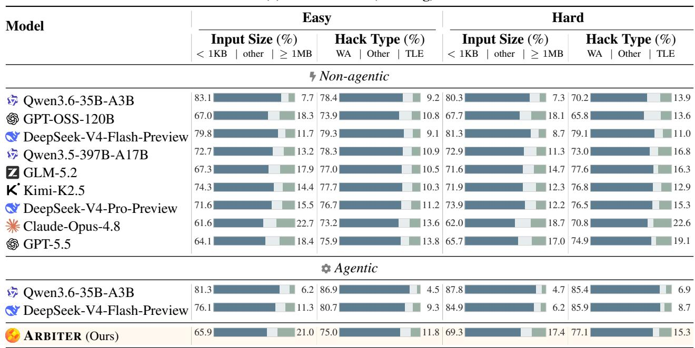

(b) USACO-JUDGE  
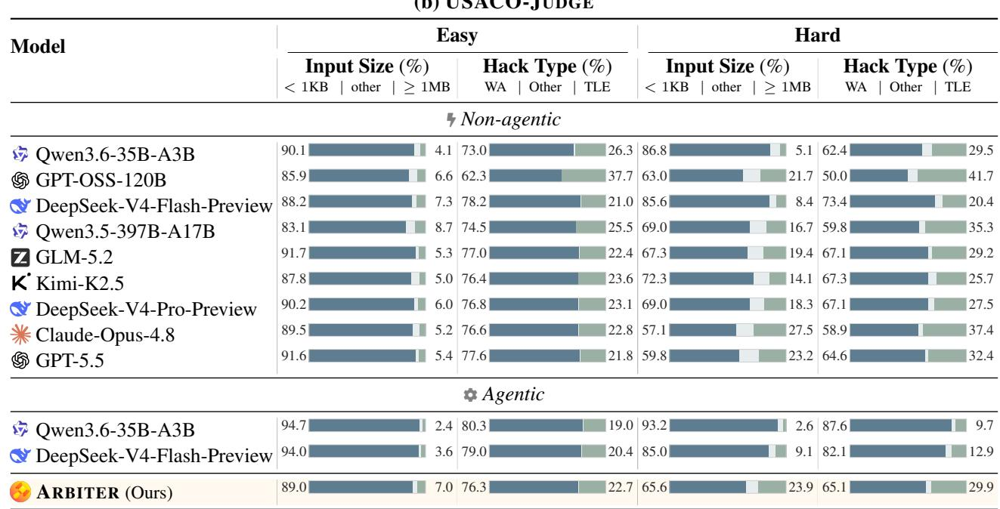  
Table 8: Percentage composition of validator-approved input sizes and successful-hack verdicts. Each bar runs from < 1KB or WA (left), through other cases, to ≥ 1MB or TLE (right).

## D.4 INTERACTION TURNS

Table 9 places these results against the amount of interaction used by each agentic verifier. ARBITER averages 14.2– 18.7 turns per candidate, only 1.2–2.1 more than its Qwen3.6-35B-A3B baseline and fewer than agentic DeepSeek-V4-Flash-Preview on every split. All three systems operate at a similar interaction scale.

<table><tr><td rowspan="2">Model</td><td rowspan="2">Params</td><td colspan="2">UOJ-BENCH</td><td colspan="2">USACO-JUDGE</td></tr><tr><td>Easy</td><td>Hard</td><td>Easy</td><td>Hard</td></tr><tr><td>Qwen3.6-35B-A3B</td><td>35B</td><td>16.3</td><td>17.1</td><td>12.1</td><td>16.2</td></tr><tr><td> DeepSeek-V4-Flash-Preview</td><td>284B</td><td>21.1</td><td>21.6</td><td>15.3</td><td>22.2</td></tr><tr><td>ARBITER (Ours)</td><td>35B</td><td>17.5</td><td>18.7</td><td>14.2</td><td>17.8</td></tr></table>

Table 9: Mean interaction turns per candidate in the agentic setting. Non-agentic baselines use one turn and are omitted.

## D.5 EXAMPLE ACCEPTED TRAJECTORY

We trace an Accepted prediction from USACO-JUDGE. Submission 913421 solves the Bronze problem Photoshoot and scores 100 on the official tests. The task maintains an N × N grid under increasing point updates and asks for the maximum sum of any K × K window after each update. ARBITER returns Accepted after four turns.

<table><tr><td>Turn</td><td>Reasoning and observation</td></tr><tr><td>①</td><td>Identifies that S [ i ] [ j ] stores the sum of the window whose top-left corner is (i, j). It derives the exact range of windows affected by an update and compares the candidate with brute force on 100,000 random tests, finding no mismatch.</td></tr><tr><td>②</td><td>Checks the worst-case cost. Each update touches at most K2 ≤ 625 windows, giving at most 18.75 million updates over the full input. It then generates a constraint-scale timing instance.</td></tr><tr><td>③</td><td>Repairs the timing input so repeated updates to a cell remain strictly increasing, compiles the candidate, and measures 0.088 seconds for 30,000 updates.</td></tr><tr><td>④</td><td>Rechecks boundary cases, integer range, memory use, and input format, then returns Accepted with no counterexample generator.</td></tr></table>

Table 10: An ARBITER trajectory for USACO-JUDGE submission 913421. Four turns of analysis and testing correctly support its Accepted verdict.

The candidate updates exactly those window origins in

$$
i \in [ \operatorname* { m a x } ( 1 , r - K + 1 ) , \operatorname* { m i n } ( N - K + 1 , r ) ] , \qquad j \in [ \operatorname* { m a x } ( 1 , c - K + 1 ) , \operatorname* { m i n } ( N - K + 1 , c ) ] .
$$

Since all cell values only increase, the running maximum never needs to be recomputed from unaffected windows. The final diagnosis states this invariant, the ${ \bar { O ( Q K ^ { 2 } ) } }$ time bound, and the agreement with differential testing. The submitted verdict is Accepted, and g is empty.

## D.6 BREAKING OFFICIALLY ACCEPTED SUBMISSIONS

The preceding section shows the ordinary Accepted outcome. Here we study the rarer setting in which ARBITER hacks a submission that received an Accepted verdict from the official USACO tests. We show one time-limit failure and one wrong answer, each confirmed by replay on our UOJ deployment.

Time Limit Exceeded from a quadratic cleanup loop. Submission 912773 for Hoof, Paper, Scissors Triples (Contest 1 Platinum P1) scored 100 on the official tests. It solves the main geometric counting problem, then executes the following loop over groups of equal strategy vectors:

for (auto &pr : g) {   
long long c = pr.second, it = c <sub>\*</sub> c;   
for (long long i = 0; i < it; ++i) t += i;   
}

The official tests accepted the submission. ARBITER noticed that the postprocessing cost is quadratic in the largest group size. It placed all 200,000 cows in one group by assigning every cow the same strategy. The correct answer is zero because all pairwise games tie, but the candidate executes $\breve { 2 } 0 0 , 0 \dot { 0 } 0 ^ { 2 } = 4 \times 1 0 ^ { 1 0 }$ loop iterations and exceeds the time limit. Its counterexample generator is:

```lua
print(1)
print(200000)
for _ in range(200000):
print("1 0 0")
```  
Table 11 condenses all seven turns. It preserves the reasoning decision and tool result at each turn while omitting repeated source code and problem text.

<table><tr><td>Turn</td><td>Reasoning and observation</td></tr><tr><td>①</td><td>Derives the geometric interpretation of the task, compiles the candidate, and confirms that it passes the supplied examples.</td></tr><tr><td>②</td><td>Checks the angular grouping and two-pointer count, then begins randomized differential testing against a brute-force solver.</td></tr><tr><td>③</td><td>Repairs an error in the brute-force harness. The process-per-case version is too slow to complete the planned search.</td></tr><tr><td>④</td><td>Batches 2,000 random instances into one candidate invocation. No wrong answer is found, so the search shifts from functional correctness to runtime.</td></tr><tr><td>5</td><td>Spots the c2 loop after grouping and constructs one group of size 200,000. Running the candidate on this input exceeds the local timeout.</td></tr><tr><td>6 ⑦</td><td>Checks a small all-identical instance by enumeration and confirms that its correct answer is zero.</td></tr><tr><td></td><td>Returns Time Limit Exceeded, explains the quadratic loop, and submits the deterministic generator. UOJ validates the input and confirms the time-limit failure</td></tr></table>

Table 11: A successful ARBITER trajectory for USACO-JUDGE submission 912773, identifying and triggering a Time Limit Exceeded failure.

Wrong Answer from using a valid value as a sentinel. Submission 913195 for Min Max Subarrays II (Contest 3 Platinum P3) scored 100 on the official tests. The task asks for an array satisfying interval minimum and maximum constraints. The candidate stores lower bounds in K min, initialized to zero, and later uses the same value to mean that no minimum constraint was recorded:

vector<long long> K\_min(N + 1, 0);   
if (K\_min[j] != 0) {   
// record the minimum constraint covering position j   
}

Zero is also a legal constraint value. For a one-element array with the constraint min(a ) = 0, the candidate drops the constraint and prints -1, although a = 0 is a valid construction. ARBITER isolates this collision between data and sentinel state with a 14-byte input:

print(1)   
print("1 1")   
print("1 1 1 0")

<table><tr><td>Turn</td><td>Reasoning and observation</td></tr><tr><td>①</td><td>Traces the DSU-based construction and notices that zero denotes both a legal lower bound and the initial state. It compiles the candidate and observes –1 on the minimal instance.</td></tr><tr><td>②</td><td>Connects the failure to the K_min [ j] ! = 0 guard, then checks the candidate on the first supplied examples.</td></tr><tr><td>③</td><td>Runs the second supplied example and confirms that alternative printed arrays still satisfy its constraints.</td></tr><tr><td>④</td><td>Verifies that N = Q = 1 and k = 0 are legal, then checks directly that the array [0] satisfies the constraint.</td></tr><tr><td>⑤ 6</td><td>Replays the three-line input and again observes –1, fixing the failure mechanism and expected output before submission.</td></tr><tr><td></td><td>Returns Wrong Answer, identifies the sentinel collision, and submits the generator. UOJ validates the input and confirms the wrong answer.</td></tr></table>

Table 12: A successful ARBITER trajectory for USACO-JUDGE submission 913195, identifying and triggering a Wrong Answer failure.

## E SELECTION DETAILS

Protocol. The candidate-generation, judging, and pool-size settings follow Ma et al. (2026), but we independently regenerate the candidate pools. Repeated uniform-selection runs closely recover the published pass@1 rates, checking aggregate candidate success; they do not establish identical programs or matched selection difficulty. The baseline values in Table 3 are from that study. An ARBITER call is a complete agentic review and may contain multiple sandbox tool invocations, so call counts are not matched compute budgets across methods. Input-based baselines receive 512 generated inputs per problem for pools of 8 and 64 candidates. ARBITER reviews every candidate independently, using between one and eight calls per candidate. We count the Accepted verdicts for each candidate and sample uniformly among those with the highest count. If no call returns Accepted, selection falls back to a uniform draw from the full pool. Candidate programs are written in Python for LiveCodeBench and C++ for OJBench, following each benchmark’s convention. The prompt’s grading language is Python 3 for LiveCodeBench and C++17 for OJBench; language separately specifies the code-fence tag. Our results for pools of 64 are averaged over four independent repeats. Depending on the setting, the range across repeats is 0.79–1.25 pass@1 points.

Binary verdict quality. We evaluate the filtering decision directly through binary verdict accuracy. Table 13 pools the complete evaluations for candidate pools of 8 and 64.
<table><tr><td rowspan="2">Reference Verdict \ ARBITER Prediction</td><td colspan="2">Qwen3-30B-A3B-Thinking</td><td colspan="2">Qwen3-235B-A22B-Thinking</td></tr><tr><td>Accepted</td><td>Unaccepted</td><td>Accepted</td><td>Unaccepted</td></tr><tr><td>Accepted</td><td>88.81</td><td>11.19</td><td>88.28</td><td>11.72</td></tr><tr><td>Unaccepted</td><td>3.64</td><td>96.36</td><td>6.33</td><td>93.67</td></tr></table>

Table 13: Row-normalized binary verdict confusion matrices for code selection. Rows are reference verdicts, columns are ARBITER predictions, and values are percentages.

ARBITER accepts 88.81% and 88.28% of correct programs from the 30B and 235B solvers, respectively. It rejects 96.36% and 93.67% of their unaccepted programs. Selection ranks candidates by their Accepted counts, so a false acceptance can place an incorrect program in the top group. This occurs for 3.64% of unaccepted 30B candidates and 6.33% of unaccepted 235B candidates.

Call scaling. Table 3 reports one and eight calls per candidate, while Figure 9 shows the intermediate budgets. One call has higher reported pass@1 than the published Agentic Verifier baseline in all eight settings. Calls two through eight add 0.9–3.4 pass@1 points. For pools of 64, OJBench continues to improve through the eighth call, while most of the LiveCodeBench gain arrives within the first four calls. The smaller pools plateau earlier and show minor fluctuations after the first few calls.

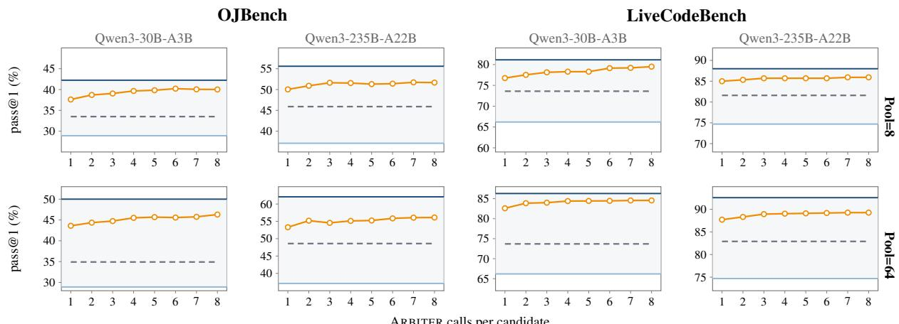  
ARBITER calls per candidate  
ARBITER (Ours) Agentic Verifier (Ma et al., 2026) Perfect selection (Upper) Uniform selection (Lower)

Figure 9: Pass@1 as ARBITER calls per candidate increase from one to eight. Rows show candidate pools of 8 and 64.   
Uniform and perfect selection mark the lower and upper reference levels.

## F REFINEMENT AND DIAGNOSIS ANALYSIS

## F.1 SUBMISSION PROTOCOL

Round 0 is the shared, already judged starting program. It is excluded from the budget of additional submissions. Every condition retains a 100-point starting program without further submissions; only the Online Judge condition receives its result as solver feedback. For trajectories still active under Best@1, the previous-code condition refines without external feedback and submits round 8, while the Online Judge condition submits round 1. Each ARBITER condition reviews the shared round 0 program and its own later revisions, then retains the first version labelled Accepted, or round 8 if none is. Under Best@8, up to eight additional revisions are submitted; the Online Judge condition stops at a 100- point score, and the highest score among additional submissions is retained. These budgets count judge submissions, not solver generations or ARBITER reviews. All results are macro-averaged over problems.

## F.2 IOI 2026 PROTOCOL AND SCORE ACCOUNTING

Contest rules. IOI 2026 had six problems worth 100 points each and allowed at most 50 submissions per problem. A problem score sums the best score obtained on each subtask, even when those scores come from different submissions. Four problems require one program. Classroom Game and Partition require several, and a submitted program cannot always identify its subtask at runtime. The 50 submissions for these two problems must therefore be divided among the required programs.

Refinement protocol. GPT-OSS-120B generates 50 initial solutions for each refinement target. At every round, ARBITER returns a verdict and feedback for each active trajectory. A trajectory stops when ARBITER returns Accepted and retains that program. Otherwise, it runs for five refinement rounds and keeps the last version. For the four singleprogram problems, we align retained programs by trajectory index and combine the target-specific implementations at each index into one task-level submission, yielding 50 budgeted candidates. For Classroom Game and Partition, the separately required programs instead share the same 50-slot per-problem budget. Classroom Game uses 17, 17, and 16 slots for its three programs. Partition uses 31 and 1 slots for its two programs, leaving 18 unused once no further score gain is available.

One budgeted submission is one task-level program evaluated by the judge. The 50 initial trajectories per refinement target are internal candidates. Generation and ARBITER review use no submission slots. The Online Judge condition starts ten trajectories per problem, including the two problems requiring multiple programs, and allows at most five judged submissions per trajectory. Each feedback query uses one of these slots, so the condition uses at most $1 0 \times 5 =$ 50 submissions per problem. Both policies allow at most 50 judged submissions on each of the six problems. The two curves in Figure 1 report expected contest scores under this same cap and the same per-subtask-maximum scoring rule, taking the expectation over each policy’s candidate draws. Inference compute is not matched.

Only seven trajectories remain active on average after early stopping. Each refinement target uses fewer than 100 solver generations, with fewer than two revision rounds on average. The expected score rises from 240.49 before refinement to 356.91 after one round and 385.46 after round 4, above the gold cutoff of 361.12. The expected score with online-judge feedback reaches 334.6 under the same submission limit.

Expected and realized scores. The 385.46-point total averages over draws without replacement from retained Classroom Game candidates under its fixed 17/17/16 allocation. Its expected contribution is 30.46 points; the other five problems contribute 355.00. Separately, the selected programs scored 390.20 out of 600 in a QOJ<sup>6</sup> evaluation: 35.00 on Ball Machine, 58.00 on Monuments, 100.00 on Tiling Game, 35.20 on Classroom Game, 100.00 on Magic City, and 62.00 on Partition. The 4.74-point difference is entirely due to the realized Classroom Game score. To control inference cost for Magic City, we retain separate refinement targets for official subtasks 1–5, then group subtasks 6–10, 11–12, and 13–50 into three more targets. QOJ still scores all 50 subtasks separately.

## F.3 BINARY VERDICT QUALITY DURING REFINEMENT

Three arms of Table 2 use ARBITER feedback. At Best@1, each retains the first version predicted Accepted, or round 8 if none is. We compare every predicted verdict with the corresponding online-judge result, separately for the two solver models.

<table><tr><td rowspan="2">Reference Verdict \ ARBITER Prediction</td><td colspan="2">GPT-OSS-120B</td><td colspan="2">Qwen3.6-35B-A3B</td></tr><tr><td>Accepted</td><td>Unaccepted</td><td>Accepted</td><td>Unaccepted</td></tr><tr><td>Accepted</td><td>97.20</td><td>2.80</td><td>96.37</td><td>3.63</td></tr><tr><td>Unaccepted</td><td>9.68</td><td>90.32</td><td>2.65</td><td>97.35</td></tr></table>

Table 14: Row-normalized binary verdict confusion matrices during refinement. Rows are reference verdicts, columns are ARBITER predictions, and values are percentages.

The reference Accepted rate differs between the two solvers, at 68.6% for GPT-OSS-120B and 46.2% for Qwen3.6- 35B-A3B. The main refinement results use the programs selected under these predictions, without correcting false acceptances or false rejections after evaluation.

## F.4 DIAGNOSIS QUALITY AND THE COUNTEREXAMPLE PROXY

Audit protocol. Free-form diagnoses cannot be checked with the deterministic procedure used for counterexamples, so we audit 400 ARBITER diagnoses of GPT-OSS-120B candidates from the refinement experiment. We randomly sample 100 diagnoses within each USACO division, without stratifying by counterexample outcome. Three competitive programmers independently assess each diagnosis against the problem statement, candidate program, official score or compile error, and the first failing official test when available. They assign one of three labels: correct, incorrect, or vacuous, where vacuous means too generic to guide a repair. Their initial labels agree on all 400 diagnoses. For a bug claim about an officially Accepted candidate, the auditors label it correct if a validated counterexample exposes the claimed failure, and incorrect otherwise. Counterexample replay is also recorded for the proxy analysis below. The audit takes place after refinement and does not affect any reported score.

<table><tr><td>Diagnosis audit</td><td>Count</td><td>Share</td></tr><tr><td>Correct</td><td>332</td><td>83.0%</td></tr><tr><td>Incorrect</td><td>65</td><td>16.2%</td></tr><tr><td>Vacuous</td><td>3</td><td>0.8%</td></tr></table>

Table 15: Human labels for the division-balanced random audit. Shares are computed within the audit sample.

Of the 332 correct diagnoses, 169 concern programs judged Accepted, while 163 identify a bug in an unaccepted program. Among the 65 incorrect diagnoses, 37 claim a bug in a candidate awarded full official credit without a validated counterexample substantiating the claim, and 21 reason about runtime behavior in code that does not compile. Four name the wrong failure type, and three mark an unaccepted candidate Accepted. The three vacuous diagnoses

merely restate the counterexample. Table 16 measures how much repair guidance appears in the 163 correct diagnoses of a bug.
<table><tr><td>Depth</td><td>Count</td><td>Share</td><td>Operational rule</td></tr><tr><td>Actionable fix</td><td>88</td><td>54.0%</td><td>Cites candidate code and states the correct behavior.</td></tr><tr><td>Located cause</td><td>46</td><td>28.2%</td><td>Cites candidate code and explains the failure, but gives no fix.</td></tr><tr><td>Mechanism only</td><td>17</td><td>10.4%</td><td>Explains the failure without locating it in the code.</td></tr><tr><td>Symptom only</td><td>12</td><td>7.4%</td><td>Reports the failure without locating or explaining it.</td></tr></table>

Table 16: Depth of the 163 correct diagnoses that identify a bug. Each level follows the operational rule shown in the table.

Most correct bug diagnoses contain concrete repair information. Of the 163 outputs, 134 cite a specific identifier, expression, or branch in the candidate program, and 88 also state the behavior needed to fix it. Only 12 stop at the observed symptom.

Representative cases. Table 17 gives one audited example for each depth level. Every counterexample in the table passes the validator and breaks its candidate. The diagnoses are shortened for space without changing their technical claims.

<table><tr><td>Depth and CPID</td><td>Audited case</td></tr><tr><td>Actionable fix CPID 1545</td><td>On the generated five-node instance, cow 2 hosts a C party on the first night. The diagnosis identifies that range_chmax updates the queried depth before ol dOwner is recovered, so the program mistakes the updated node for the previous owner and prints 0 0 0 instead of  $2 \ 0 \ 0$  . It gives the precise repair: call point_query before range_chmax.</td></tr><tr><td>Located cause CPID 1545</td><td>The generated instance is a two-node cycle. Cow 2 first hosts C and cow 1 then hosts O. The diagnosis traces the failure to the second cycle host: when prevIdx+1 &gt;= Lsize, process_interval reads past the cycle boundary. The candidate consequently prints  $0 \_ 0 0$  instead of  $ { \mathrm { ~ \textrm ~ { ~ ~ 1 ~ } ~ 1 ~ } \mathrm { ~ 0 ~ } }$  . The diagnosis locates the failing condition and explains its effect, but does not prescribe a repair.</td></tr><tr><td>Mechanism only CPID 1590</td><td>For cyclic costs [7, 1 0, 2] and a time budget of 34, the diagnosis explains that the candidate incor- rectly buys later wins in cheapest-first order. The fixed queue requires cost 36 for the third win, whereas the candidate assumes cost 28 and reports three wins instead of two. This explains the failure mecha- nism and the correct behavior without pointing to a particular expression or branch.</td></tr><tr><td>Symptom only CPID 1573</td><td>On a two-position instance with equal input probabilities, the diagnosis reports that the candidate as- signs probability 3 / 4 to each position instead of 1/ 2, producing a total of 3 /2. It only speculates about the DP sweep and residue contributions, without identifying a responsible operation or establish- ing a causal account of the failure.</td></tr></table>

Table 17: Representative audited diagnoses at each depth. Each generated input is accepted by the validator and breaks the corresponding candidate.

Counterexample success tracks diagnosis quality. We evaluate the proxy among audited outputs that report a counterexample and exclude candidates that do not compile, since no generated input can execute against them. A counterexample breaks the candidate for 71.6% of correct diagnoses, compared with 10.3% of incorrect or vacuous diagnoses. The clear separation supports counterexample success as a mechanically verifiable signal of diagnosis quality.

Scope. Counterexample replay covers both solver models, while the diagnosis audit covers GPT-OSS-120B. We therefore treat the diagnosis results as evidence for this refinement setting rather than as a cross-solver estimate. We restrict the proxy analysis to compilable candidates to prevent compile errors from inflating the association. No generated input can break a program that does not compile.

## F.5 DIAGNOSIS FOR REFINEMENT AND COUNTEREXAMPLES FOR VERIFICATION

Table 2 separates the three fields exposed to the refinement model: verdict V, diagnosis D, and counterexamplegenerator source X. V + D and V + D + X perform similarly across the twelve solver, difficulty, and submissionbudget settings. V + D scores higher in nine, while V + D + X leads in the other three by 0.6–1.6 points.

Counterexample availability. X is requested only when ARBITER predicts a failure that can be exposed by an input. The field is non-empty in 27.4% of GPT-OSS-120B reviews and 50.8% of Qwen3.6-35B-A3B reviews. When X is empty, omitting it adds no feedback content within that review. Reviews can differ once the conditions’ revision trajectories diverge.

Diagnosis as repair guidance. The audit above shows that D usually contains concrete information for repair. Among the 163 correct diagnoses of a bug, 134 (82.2%) point to specific candidate code and 88 (54.0%) state the behavior needed to fix it. The downstream ablation agrees with this finding: V + D outperforms V + X in ten of twelve settings. On the Hard split, D improves over X by 5.9 and 6.7 points for Qwen3.6-35B-A3B and by 6.5 and 3.3 points for GPT-OSS-120B under Best@1 and Best@8, respectively.

In the refinement study, D provides code-level repair guidance, while adding counterexample-generator source X to V + D shows no consistent additional benefit. Separately, success of replayed counterexamples serves as a mechanically checkable proxy for diagnosis quality in verifier training and offline evaluation.

## G TRAINING ABLATIONS AND LENGTH DIAGNOSTICS

## G.1 VERDICT-ONLY REWARDS ENCOURAGE MAJORITY-CLASS GUESSING

We train a diagnostic run in which reward depends only on agreement between the predicted and reference binary verdict. Training reward rises, while validation verdict accuracy remains between 56% and 58%. Over the same run, mean tool calls fall from 4.9 to below one, and the share of rollouts that use no tools rises from 45% to above 70%. The model learns to improve its reward without becoming a better verifier.

The training pool is 85% unaccepted. A policy that always guesses that verdict would therefore be correct on 85% of this pool without checking any candidate. The rising training reward, flat validation accuracy, and declining tool use are consistent with this majority-class shortcut. In the full reward, most credit for a rejection other than Compile Error instead requires a legal input that breaks the candidate.

## G.2 FALSE-POSITIVE PENALTY

We compare two otherwise matched runs with λ = 0 and $\lambda = 0 . 5 .$ , where we subtract λ from the reward for a falsepositive Accepted prediction. Figure 4 (right) follows precision and recall during training and on the validation set. Table 18 evaluates the same step-80 checkpoints on the easy and hard splits of USACO-JUDGE.

<table><tr><td></td><td colspan="2">Easy</td><td colspan="2">Hard</td></tr><tr><td>λ</td><td>Prec.</td><td>Rec.</td><td>Prec.</td><td>Rec.</td></tr><tr><td>0</td><td>97.56</td><td>88.89</td><td>77.78</td><td>76.67</td></tr><tr><td>0.5</td><td>100.00</td><td>83.33</td><td>80.98</td><td>62.86</td></tr></table>

Table 18: Accepted-class precision and recall on USACO-JUDGE for the two λ settings. All values are percentages.

The larger penalty raises precision on both splits and lowers recall. On hard problems, precision rises from 77.78% to 80.98%, while recall falls from 76.67% to 62.86%. The candidate-count-weighted mean of per-split precision rises from 83.7% to 86.7%, while the corresponding mean of per-split recall falls from 80.3% to 69.0%. These are averages of split-level rates, not metrics pooled over all predictions. The matched runs establish the direction of the trade-off. We do not treat either setting as universally optimal.

## G.3 LENGTH DIAGNOSTICS

This appendix gives the evidence behind the alternating length control used in training. Its schedule and hyperparameters are reported in Appendix C.

Why token length matters. Without length control, median response length grows from 22.6k to 29.5k tokens over 50 training steps, while the abort rate rises from 13.6% to 26.6%. Nearly all aborts are wall-clock timeouts. The median number of interaction turns remains nine, showing that the growth occurs within turns and would not be addressed by a turn limit alone.

Continuous penalty comparison. With the upper-quartile length penalty active at every training step, median response length falls from 25.9k to 17.2k and then to 12.9k tokens. Mean reward and hack success peak at 0.777 and 62.3% when the median length is 17.2k, then decline to 0.755 and 59.1% at 12.9k. Over the same interval, the abort rate falls to 1.1% and median interaction turns drop from 10 to 7. Once timeout waste has largely been removed, further compression coincides with weaker verification. We therefore alternate penalty-on phases with phases that restore the original reward, preserving room for longer reasoning when it is useful.

## H PROMPTS

This appendix records the prompt templates used in our experiments: the non-agentic and agentic system prompts, the per-candidate review request, and the refinement prompts of §6.2. Braced fields, including grading language, are filled per instance; other text is reproduced verbatim, except where repeated instructions are explicitly marked as elided.

## H.1 NON-AGENTIC SYSTEM PROMPT

The non-agentic baselines return the two outputs that can be checked mechanically: a verdict label and a Python generator whose stdout is the counterexample input. We use the following system prompt.

You are a HACK AGENT. Given a problem statement and a candidate solution, decide whether the candidate is correct, and if not, produce a Python 3 program   
that prints an input that breaks it. The candidate solution will be graded on the OJ as {grading language}. You do not need to solve the problem—only   
find one counter-example.   
Reason step by step. When you are ready, give your final answer as exactly two fenced blocks, in this order and format:   
\`\`\`label   
# YOUR LABEL   
\`python   
# YOUR CODE HERE   
The blocks are:   
• label — exactly one of (case-sensitive, no abbreviations): Accepted | Wrong Answer | Time Limit Exceeded | Memory Limit   
Exceeded | Runtime Error | Compile Error.   
• the python block — a complete deterministic Python 3 program. The grader runs python3 gen.py once; its stdout becomes the hack input   
fed to the candidate. Stdlib only, no extra stdout chatter, ≤ 30 s, ≤ 128 MB output. The input must satisfy the problem’s constraints (a validator   
will reject it otherwise). If you use random, seed it with a fixed integer. For Accepted and Compile Error labels—where no hack input is   
required—leave the python block empty.   
Your final answer must contain only these two fenced blocks.

## H.2 AGENTIC SYSTEM PROMPT

The agentic ARBITER works in a sandbox with tool access. The implementation names its final call submit hack. The arguments label, verdict, and code correspond to v, d, and g, respectively. We use the following system prompt.

System Prompt — Agentic ARBITER

You have access to these tools:

• execute code(code) — run Python in a sandboxed kernel to prototype ideas or generate test cases.

• execute command(command) — run shell commands.

• submit hack(label, code, verdict) — commit your final conclusion. Calling this tool ENDS the trajectory; you cannot call any other tool after it.

You are a HACK AGENT. Given a problem statement and a candidate solution, decide whether the candidate is correct, and if not, produce a Python 3 program that prints an input that breaks it. The candidate solution will be graded on the OJ as {grading language}. You do not need to solve the problem—only find one counter-example.

When you are ready, call submit hack(label=..., code=..., verdict=...). The arguments are:   
• label — exactly one of (case-sensitive, no abbreviations): Accepted | Wrong Answer | Time Limit Exceeded | Memory Limit   
Exceeded | Runtime Error | Compile Error.   
• code — a complete deterministic Python 3 program. The grader runs python3 gen.py once; its stdout becomes the hack input fed to the   
candidate. Stdlib only, no extra stdout chatter, ≤ 30 s, ≤ 128 MB output. The input must satisfy the problem’s constraints (validator will reject   
otherwise). If you use random, seed it with a fixed integer. For Accepted and Compile Error labels—where no hack input is required—pass   
code="".   
• verdict — a short natural-language explanation (≤ 1000 tokens) of the bug and why your input triggers it. For Accepted / Compile Error,   
briefly explain your reasoning.   
You must judge the candidate solution exactly as given, never a fixed or rewritten version of it.   
IMPORTANT: you must call submit hack to submit your result and receive reward.

## H.3 VERIFIER REVIEW REQUEST

Within each system-prompt template, only grading language varies by benchmark. Each instance supplies the problem and candidate code through the following request. All reviews use submission idx=1 and max submissions=1.

User Message — Review Request   
Here is the problem statement and a candidate solution (submission {submission idx} of {max submissions}) for a {problem type} problem.   
{io mode}.   
# Problem   
{problem description}   
# Candidate solution (graded on the OJ as {grading language})   
\`\`\`{language}   
{code}

For the refinement experiment, problem type is USACO, io mode is Read input from stdin and write output to stdout, and grading language and language are both C++17.

## H.4 REFINEMENT PROMPTS

The refinement experiment of §6.2 uses the same prompt skeleton for all five conditions. Round 0 is generated once from the shared seed prompt. In later rounds, each condition inserts its previous solution as {code} and differs only in the feedback block.

## Round 0 — Seed Prompt (shared by all five conditions)

You are an expert competitive programmer. You will be given a problem statement, constraints, and example test cases. Please reason step by step about the solution, then provide a complete implementation in C++17.

Please solve the problem exactly according to the requirements in the problem statement. Follow the input/output format, function signatures, implementation details, and any special requirements specified in the problem itself. If the problem requires standard input/output, include a complete program with main. If the problem requires implementing specific routines/classes without main, only implement what is requested.

Assume your code will be run on the OFFICIAL grader, and do not add a main function, a sample grader, or any other functionality unless it has been explicitly requested.

Put your final solution within a single code block:

```lisp
`cpp
// your code here
{problem statement}
```

## Rounds 1–8 — Refinement Skeleton (shared by all five conditions)

You are an expert competitive programmer. You will be given a problem statement, constraints, and example test cases, together with a C++17 solution you wrote earlier for this problem.

Your task is to review and refine that solution. Reason step by step: re-derive what the problem requires, check the previous solution against it for correctness, complexity, edge cases, and input/output format, then produce an improved complete implementation in C++17.

[The three paragraphs on grader conventions and the fenced-block instruction are identical to the seed prompt above and are elided here.]

Output your refined solution in full — do not abbreviate, and do not refer back to the previous code with comments like “unchanged”. Even if you conclude the previous solution is already correct, restate it in full.

{problem statement}

Feedback Block — No Feedback   
# Your task   
This is the code you wrote last time, and it is uncertain whether it passes. Please refine it and produce the corrected solution.   
Feedback Block — Online Judge   
# Judge feedback on your previous solution   
Your previous solution was submitted to the online judge and received:   
{judge summary}   
# Your task   
Using the judge feedback above, refine your previous solution and produce the corrected solution.

```markdown
# Your previous solution
This is the C++17 solution you wrote for this problem last time. It is not known whether it passes all tests.
`cpp
{previous code}
⟨FEEDBACK BLOCK⟩ — one of the feedback variants described below.
```

Requiring the complete solution at every round ensures that each response is a submittable program. An unchanged solution therefore retains its previous score instead of being treated as missing code.

{judge summary} is one line, formatted as "⟨verdict⟩ at testcase ⟨k⟩ (Score: ⟨s⟩/100)"— for example "Wrong Answer at testcase 1 (Score: 0/100)" or "Time Limit Exceeded at testcase 6 (Score: 25/100)". A compile error is reported as "Compile Error" followed by the compiler’s output in a fenced block. Round 0 is excluded from every arm’s additional-submission budget. A 100-point starting program is retained without further submissions in every condition. For other trajectories, its existing result supplies the Online Judge arm’s first feedback block. Best@1 then submits round 1; Best@8 submits up to eight additional revisions, stops at a 100-point result, and retains the highest score among additional submissions.

Feedback Block — ARBITER (V + D + X)   
# Feedback from our verifier on your previous solution   
Your previous solution was reviewed by our verifier, which reported:   
Label: {label} (V)   
Analysis of the bug in your code: (D)   
{verdict}   
Python program that generates a counterexample input: (X)   
\`python   
{counterexample code}   
# Your task   
Based on the information above, refine your previous solution and produce the corrected solution.

Each ARBITER condition reviews its own current candidate using the same verifier and review protocol. The conditions differ in which returned fields are shown to the solver: V + D + X shows all three, V + D omits the generator, and V + X omits the diagnosis. The verdict is always shown because it determines the Best@1 stopping decision. When ARBITER returns Accepted, no counterexample is produced, so omitting X does not remove generator information from that review. Appendix F.5 reports how often X is non-empty. The counterexample is marked as Python because it is a generator whose stdout is the candidate input, not a solution to be repaired.

If a review exhausts its retry budget without returning a label, that round uses the no-feedback block and the refinement trajectory continues.