# Benchmarking and Training Reward Models for Cross-Source Evidence Grounding in Search Agents

Haochen Zhao1∗, Minsheng Hao2, Zheng Li1, Yifan Li3, Zikang Liu3, Bowen Qin2, Yuhao Cheng2, Chuang Fan2, Haosheng Zou2, Jeff Chen2†, Sujian Li1‡

1Peking University 2Tencent 3Renmin University of China

## Abstract

Existing approaches to training and evaluating search agents focus heavily on final-answer quality, largely neglecting how generated answers map back to retrieved evidence. Recent methods incorporate evidence citation tracking to enforce grounding but citation support alone does not establish source independence or whether an answer appropriately handles conflicting evidence. In this paper, we argue that credibility in open-web retrieval depends on principled cross-source evidence grounding that accounts for source independence and systematically attributes and adjudicates conflicting evidence, while hierarchical judgments of these grounding decisions provide a unified signal for training and evaluation. To this end, we propose an evaluation framework, Cross-Source Evidence Grounding (CSEG), that employs a fine-grained, six-layer decision tree over the complete search trajectory. We introduce CSEG-Bench and trainable reward models to provide targeted supervision following this framework. Our method offers the key advantage of eliminating the severe data skew of natural trajectories by providing targeted coverage over complex, deep-layer decision paths, such as cross-source conflict resolution and nuanced attribution, that standard rollouts fail to capture. Specifically, (1) we define the hierarchy at label, node, and path levels; (2) we construct 1,160 verified trajectories over nine canonical paths by rewriting answers on real retrieved document pools, with independent frontier judges reproducing the entire gold path and human experts deciding inclusion; (3) we train CSEG-RM, which reaches 83.9% exact accuracy on our benchmark while lying on the performance–token efficiency Pareto frontier. Experiments that use this reward alone to supervise a frozen-retrieval answer policy raise the independently judged mean label from 2.83 to 4.19, and show that learning the hierarchy generalizes across layers at a fraction of frontier-judge cost.

## : CSEG Public Codebase

## : CSEG-Bench & CSEG-RM

## 1 Introduction

Search agents are increasingly used for open-web information seeking and specialized applications in finance, medicine, and scientific research (Xi et al., 2025). A key capability in these settings is to retrieve and integrate evidence from multiple sources, especially when useful information is distributed across documents. However, current search agents can produce right answers while relying on wrong evidence. They may treat dependent sources as independent support, or integrate only one side of a noisy open-web pool in which documents both corroborate and contradict one another. Figure 1 illustrates this right-answer, wrong-evidence problem.

Existing search agents often overlook this problem. Search-R1, R1-Searcher, and ReSearch mainly supervise the final outcome, reducing the retrieve–read–answer trajectory to a scalar reward from a rule-based verifier (Jin et al., 2025; Song et al., 2025; Chen et al., 2025). As a result, trajectories with very different evidence quality can receive the same reward. Citation-aware and attribution-aware methods instead check whether a citation supports a claim (Gao et al., 2023; Yue et al., 2023; Huang et al., 2024; Chuang et al., 2025). These objectives assess evidential support but do not jointly evaluate source independence and conflict handling. In open-web search, evidence is often spread across multiple sources that may differ or even conflict. Existing objectives therefore do not fully measure whether an agent has selected and integrated the right evidence across sources.

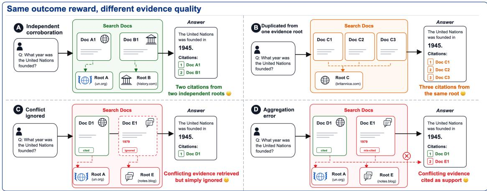  
Figure 1: Same answer, different evidence quality. All four trajectories answer 1945 and receive outcome reward 1, yet their evidence differs: (A) two citations from independent evidence roots; (B) three citations from the same evidence root; (C) conflicting evidence is retrieved but ignored; and (D) conflicting evidence is incorrectly cited as support. An outcome-only reward cannot distinguish these trajectories.

This gap also appears in real search trajectories. Our preliminary experiment shows that, in 256 production trajectories from the Tencent Yuanbao search assistant, all of whose answers already pass a closed-QA outcome verifier, 33.2% cite multiple URLs that trace back to the same evidence root. Such false corroboration would still pass citation-based metrics, despite providing no independent support. This motivates cross-source evidence grounding: evaluating whether sources provide independent evidence, whether they conflict, and how such conflicts should be resolved based on source authority and recency. The approaches compared in Table 1 do not jointly evaluate these decisions over complete search trajectories and provide a corresponding trainable grounding reward. A useful judgment should therefore be trajectory-conditional, root-aware, and conflictsensitive, while producing verdicts that can serve as benchmark metrics, distillation targets, and training rewards.

To address this, we propose CSEG, a six-layer decision tree over the complete search trajectory— question, retrieved pool, answer, and citation links—that returns an ordered label from 1 to 7 and the path that produced it. We design a data synthesis pipeline based on CSEG that yields CSEG-Bench, comprising 1,160 verified trajectories. By jointly evaluating source independence, conflict handling, and adjudication over complete search trajectories, CSEG-Bench addresses gaps in existing evaluation frameworks (Table 1). We evaluate major open-weight model families on this benchmark and examine how model size and thinking effort affect CSEG judgment (Table 4).

Further, we train Qwen3-4B and Qwen3-8B on training data consisting of 17,477 samples to see whether a compact reward model can reliably learn the grounding hierarchy. The 4B CSEG-RM reaches 83.9% exact accuracy and lies on the accuracy–cost Pareto frontier among open-weight judges. We then test whether this learned grounding signal transfers to search-agent training. On 512 frozen-retrieval prefixes, CSEG-RM raises the independently judged mean label from 2.83 to 4.19, and the proportion of trajectories with labels 5–7 from 19.1% to 40.2%.

We contribute (i) a verifiable hierarchical measure for benchmarking cross-source evidence grounding at label, node, and path levels; (ii) CSEG-Bench with expert-adjudicated path-level validation; and (iii) 4B/8B CSEG-RM models trained on separate training data, together with a downstream intervention showing that the trained reward raises a search agent’s independently judged grounding score.

Table 1: Construct-level comparison of grounding evaluation and reward resources. ✓: explicit; ▲! : partial; ✗: not targeted. Symbols indicate task coverage, not latent capability. Appendix A defines the columns and discusses each family.
<table><tr><td>Representative works</td><td>Claim support</td><td>Retrieved pool</td><td>Root indep.</td><td>Conflict</td><td>Authority</td><td>Traj.</td><td>RM resource</td></tr><tr><td>GAIA, BrowseComp</td><td>x</td><td>x</td><td>x</td><td>x</td><td>X</td><td>x</td><td>x</td></tr><tr><td>Search-R1, R1-Searcher, ReSearch</td><td>x</td><td>A</td><td>X</td><td>x</td><td>X</td><td>A</td><td>X</td></tr><tr><td>ALCE, AttrScore, SelfCite</td><td>√</td><td>X</td><td>X</td><td>x</td><td>X</td><td>A</td><td>A</td></tr><tr><td>RAGAS, ARES, RAGChecker</td><td>√</td><td>A</td><td>x</td><td>A</td><td>x</td><td>A</td><td>A</td></tr><tr><td>ClashEval, WikiContradict, RAMDocs, et al.</td><td>A</td><td>L</td><td>x</td><td>√</td><td>A</td><td>A</td><td>X</td></tr><tr><td>DRAGged into Conflicts</td><td></td><td></td><td>X</td><td>√</td><td>A</td><td></td><td>X</td></tr><tr><td>AuthorityBench, ConflictRAG</td><td>A</td><td></td><td>X</td><td>」</td><td></td><td>A</td><td>A</td></tr><tr><td>Prometheus, JudgeLM, RewardBench</td><td>x</td><td>X</td><td>x</td><td>x</td><td>x</td><td>X</td><td></td></tr><tr><td>CSEG (ours)</td><td>V</td><td></td><td>√</td><td>V</td><td></td><td></td><td></td></tr></table>

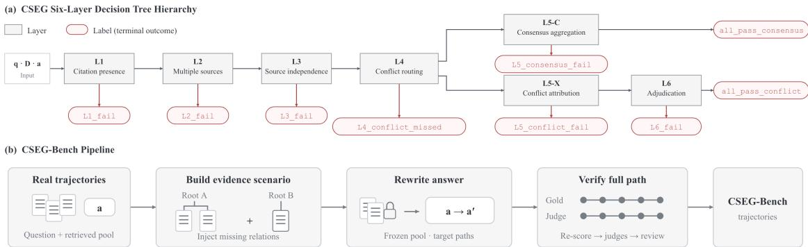  
Figure 2: CSEG hierarchy and benchmark construction. (a) Rectangles denote layers and red capsules denote terminal outcomes. Red arrows indicate failures (labels 1–6); either all-pass outcome yields label 7. (b) Evidence scenario construction, answer rewriting on frozen pools, and full-path validation yield 1,160 trajectories. Roots and paths are schematic.

## 2 CSEG Evaluation Framework

We define cross-source evidence grounding, operationalize it through a six-layer hierarchy, and specify evaluation metrics at the label, node, and path levels.

## 2.1 Concept Formulation

Cross-source grounding is a relation among an answer, its citations, and the retrieved pool, not an intrinsic property of the answer text: the same wording can be well grounded under one pool and unsupported under another. The unit of evaluation is therefore a complete single-turn search trajectory $\hat { \boldsymbol { \tau } } = ( q , D , a )$ , where q is the question, $D = \{ d _ { 1 } , \ldots , d _ { K } \}$ the retrieved document pool with each search doc di carrying a title, site, URL, authority level, publication time, and content, and a the answer whose claims may carry [citation:N] markers pointing to d ; a judge or reward model is a map $R _ { \phi } ( q , D , a ) \to ( y , \dot { p } )$ returning the terminal label $y \in \{ 1 , \ldots , 7 \}$ and the decision path p. The essential difference from an outcome verifier is what is consumed: $R _ { \phi }$ reads the relation between claims in a and specific documents in D, whereas an outcome verifier reads only a and a reference answer. It therefore measures grounding quality, not factual correctness and complements outcome verification rather than replacing it (Appendix C).

## 2.2 The six-layer hierarchy

Figure 2(a) shows the six-layer decision hierarchy of CSEG, and Table 2 summarizes the criterion at each layer. Given a question, its retrieved documents, and the cited answer, the judge checks whether a core claim has a citation to an existing, relevant document (L1), whether it is supported by multiple cited sources (L2), and whether those sources trace to independent evidence roots (L3). L4 then checks for disagreement among the sources: consistent evidence proceeds to L5-C, an identified conflict proceeds to L5-X, and a missed conflict ends the evaluation. L5 checks how the answer combines the evidence: L5-C (consensus aggregation) assesses whether a consensus claim has appropriate scope, while L5-X (conflict attribution) checks whether the answer attributes the disagreement to the sources involved. Passing L5-C terminates at all pass consensus. Pass ing L5-X proceeds to $\operatorname { L } 6 ,$ which assesses whether the answer weighs source authority, recency, and internal consistency appropriately when adjudicating the conflict. Passing L6 terminates at all pass conflict. Evaluation stops at the first failed layer, assigning its number as the label. Both all-pass outcomes receive label $7 { : }$ the consensus branch evaluates five layers, while the conflict branch evaluates six. L5-C and L5-X are alternative branches of the same layer, and failure at either yields label 5. Figure 4 in Appendix C illustrates a complete judgment, and Appendix J provides the node prompts, decision criteria, and output schemas.

Table 2: The CSEG hierarchy. Labels encode the depth of the first failed decision.
<table><tr><td></td><td>Layer Aspect</td><td>Criterion</td></tr><tr><td>L1</td><td>Citation presence</td><td>A core claim cites an existing, topically relevant document.</td></tr><tr><td>L2</td><td>Multiple sources</td><td>At least two distinct cited sources support the core claim.</td></tr><tr><td>L3</td><td>Source independence</td><td>Cited support traces to at least two independent evidence roots.</td></tr><tr><td>L4</td><td>Conflict routing</td><td>Conflict classification: consistent / conflict identified / conflict missed.</td></tr><tr><td>L5-C</td><td>Consensus aggregation</td><td>Aggregation has appropriate scope and avoids over- or under- claiming.</td></tr><tr><td></td><td>L5-X Conflict attribution</td><td>The acknowledged disagreement is attributed at source level.</td></tr><tr><td>L6</td><td>Adjudication</td><td>The answer weighs authority, recency, and internal consistency.</td></tr></table>

## 2.3 Evaluation metrics at label, node, and path levels

For comprehensive evaluation, we report label-level evaluation (exact accuracy, macro recall, mean absolute error (MAE), and quadratic weighted kappa (QWK) as important metric), node-level evaluation (each layer as its own classifier), and path-level evaluation (Levenshtein edit distance to the gold path). On the ordered labels $y \in { 1 , \ldots , 7 } .$ , MAE is defined as $\begin{array} { r } { \mathrm { M A E } = \frac { 1 } { n } \sum _ { k = 1 } ^ { n } | \hat { y } k - y _ { k } | . } \end{array}$ while QWK is

$$
\mathrm { Q W K } = 1 - \frac { \sum i , j = 1 ^ { N } w _ { i j } O _ { i j } } { \sum _ { i , j = 1 } ^ { N } w _ { i j } E _ { i j } } , \quad w _ { i j } = \frac { ( i - j ) ^ { 2 } } { ( N - 1 ) ^ { 2 } } ,\tag{1}
$$

where n is the number of evaluated examples, $y _ { k }$ and $\hat { y } _ { k }$ are example k’s gold and predicted labels, and $N = 7$ is the number of labels. For gold label i and predicted label $j , O _ { i j }$ counts the observed examples, $\begin{array} { r } { E _ { i j } = \left( \sum _ { b } O _ { i b } \right) \left( \sum _ { a } O _ { a j } \right) / \gamma } \end{array}$ n is the expected count under independent gold and predicted labels with the same marginals, and $w _ { i j }$ is the normalized squared distance between the labels; a and b sum over all N labels. Node metrics use only examples whose gold path reaches the node and count premature stopping against recall, preventing skipped decisions from inflating scores. We also report mean completion tokens per judgment as a cost proxy: when the judge serves as an RM for every rollout, long generations increase scoring latency and compute cost, potentially making reward computation a training-throughput bottleneck. More details can be found in Appendix C.

## 3 CSEG-Bench

The construction of CSEG-Bench is summarized as Figure 2(b). We begin with outcome-passing real trajectories, then perform evidence scenario construction and answer rewriting to cover the nine canoni cal paths, and finally applyfull-path validation to select the released benchmark. Unmodified real trajectories separately estimate the natural prevalence of grounding failures; the same construction procedure on disjoint base questions supplies reward-model training data.

## 3.1 Outcome-passing real trajectories

The real trajectories come from logged RLVR rollouts of the Tencent Yuanbao search assistant; users whose trajectories are included opted in to research use of their data through Yuanbao’s user experience program (see the Ethics Statement). We retain outcome-passing records containing at least one tool call that the service’s own rubric and closed-QA verifier both pass, so that every base trajectory already earns full marks from an outcome-only reward—exactly the population whose cross-source quality is in question. Proprietary syntax is normalized to five OpenAI-style messages and one search turn, and deduplication by query reduces 12,332 records to 1,045 unique questions, which one fixed-seed shuffle partitions into pairwise disjoint bases for benchmark construction, reward-model training, and answer-policy optimization (Appendix G).

Table 3: Composition of CSEG-Bench $( n = 1 , 1 6 0 )$ . n counts trajectories for each terminal path.
<table><tr><td>Label</td><td>L1- fail</td><td>L2_ fail</td><td>L3_ fail</td><td>_missed</td><td>L4_conflict L5_consensus L5_conflict L6_fail_ _fail</td><td>_fail</td><td></td><td>conflict conflict</td><td>all_pass_ all_pass_ consensus</td></tr><tr><td>n</td><td>78</td><td>79</td><td>184</td><td>140</td><td>105</td><td>151</td><td>181</td><td>128</td><td>114</td></tr></table>

## 3.2 Evidence scenario construction and answer rewriting

Under the six-layer hierarchy, natural trajectories are extremely skewed and the deep nodes nearly empty (Appendix B), which supports neither a balanced comparison across layers nor deep supervision for a reward model. We therefore preserve the real question q and use its retrieved pool D as the basis for evidence scenario construction, with minimal controlled injection where the target path requires an evidence relation the pool lacks. We then freeze the resulting pool for answer rewriting to construct a. Figure 2(b) summarizes the construction pipeline. Nine construction types, one per canonical path, serve both arms, which differ only in their base pools and in how far they are filtered. Because the L3 and L4 verdicts depend on the documents and not only on the answer, construction proceeds in two stages: evidence scenario construction identifies the core claim, groups supporting documents by evidence root, injects whatever required property is missing, and freezes the pool; answer rewriting then rewrites the final assistant(answer) on that frozen pool so that it lands on the target path. Labels are computed relative to the documents actually present, so genuinely adding an independent corroboration produces a legitimate example. Constructed examples must also be indistinguishable from crawled text, or the recognizability of injected documents leaks the L3, L4, and L6 labels outright—those documents being precisely the branch-defining ones—so three controls apply: host-pool profile matching, random insertion with whole-pool renumbering, and a constant injection budget across types (Appendices D and E).

## 3.3 Full-path validation

Full-path validation, shown as “Verify full path” in Figure 2(b), checks each complete decision path. Each of the 1,856 constructed evaluation examples is first re-scored with the same six-layer pipeline by one frontier judge Gemini 3.1 Pro, and 1,718 (92.6%) land on their target path. Two other frontier models, GPT-5.6-Sol (OpenAI, 2026) and Claude Opus 5 (Anthropic, 2026), at maximum reasoning effort, then independently reproduce the entire decision path rather than only the terminal label, so reaching the right label through the wrong route does not count as agreement. Human experts then read every survivor and decide case by case whether to keep it, discarding 332 whose reproduced verdicts they disagree with and 226 shallow L1 fail and L2 fail examples that essentially every system answers correctly. That leaves the 1,160 trajectories released as CSEG-Bench: 692 carry two-judge agreement, and 468 are single-judge examples. Table 3 reports the sample counts for the nine canonical path labels. Gold reach counts for conditional node metrics are reported in Table 11.

## 4 CSEG-RM: Trainable Grounding Rewards

We flatten constructed trajectories into layer-wise training examples, train Qwen3-4B and Qwen3- 8B CSEG-RM models along three routes, and use the resulting reward to supervise a search agent’s answer policy.

## 4.1 Training data

The reward model follows the same layer-wise interface as the production-compatible trajectory scorer: invoked layer by layer, receiving (user question, retrieved sources, final answer) and returning that layer’s judgment as JSON, after which deterministic routing composes the terminal label and the path. A trajectory is thus flattened into one example per visited layer—an all-pass consensus path contributes five examples and an all-pass conflict path contributes six—each a classification over that layer’s closed vocabulary, binary everywhere except the L4 router. Only the verdict field is graded, but it is not all the model produces: the distillation target is the teacher’s complete output, a thinking block followed by JSON carrying verdict, a reason, and layer-specific fields such as L3’s evidence roots. Distilling the grounds and not only the conclusion is the point of the cold start, and is what makes the auditable fields of Section 4.3 available at all. Training data comes from the training arm of the same pipeline—same types, same controls, disjoint bases—in which 4,607 trajectories flatten into 17,477 layer examples, split by base question.

## 4.2 Training and evaluation

We train each of Qwen3-4B and Qwen3-8B (Yang et al., 2025) along three routes, all in thinking mode and grading only the final verdict. SFT distils rejection-sampled teacher traces: Qwen3-32B answers all 17,477 layer prompts and a trace is kept only if its verdict equals gold, its JSON parses, it was not truncated, and it contains a thinking block, retaining 14,876 traces that pack into 14,081 training and 795 development examples. GRPO (Shao et al., 2024) uses no teacher traces and instead optimizes a verifiable reward against gold for 400 steps, r = +1 when the verdict equals gold and −1 when the output is unparseable or off-vocabulary, with the format penalty harsher than a wrong verdict and the KL term applied as a loss so that a format collapse cannot be traded against it. This stage rebuilds its data from the same examples, balancing the training split to 488 per (layer, verdict) cell, 15 cells and 7,320 examples; balancing is what gives rare layers—L5 conflict has only tens under natural flattening—enough within-group variance for a group-relative advantage. SFT+GRPO runs the same GRPO stage from the SFT checkpoint.

Because all three routes share data, node prompts, and router, their comparison isolates the training route (Appendix I). We evaluate all models on CSEG-Bench using the label, node, and path metrics defined above; Section 5.3 reports the results.

## 4.3 Supervising a Search Agent’s Answer Policy

We use a CSEG reward model as the reward signal for the answer policy of a search agent, on training questions overlapping neither the benchmark nor reward-model training. The setting is deliberately narrow so that any effect is attributable to evidence use rather than to a new retrieval strategy: the prefix—question, tool call, retrieved documents—is frozen, and the policy generates only the final assistant(answer). We use Qwen3-8B in thinking mode as the initial policy model. The reward is the hierarchical judgment of a CSEG-RM (Qwen3-4B SFT+GRPO-400 checkpoint in main experiment) called layer by layer, with the terminal label mapped linearly onto the unit interval, score = (y − 1)/6; no factuality reward and no reference answer enter the objective, because the question is sharper than “does the agent get better”—it is whether optimizing cross-source grounding alone moves it.

Trajectories before and after are re-scored by an independent frontier judge (Gemini 3.1 Pro, Google, 2026). Because grounding can be inflated as well as improved, we also partition the evaluation questions by the honest ceiling of their pool: where support collapses onto one evidence root no truthful answer can exceed label 3, so trajectories above that ceiling reflect either an L3 judge error or learned syndication-as-corroboration (Appendix I).

## 5 Experiments

Our experiments follow a progression from diagnosis to measurement and intervention. RQ1 asks why synthetic data is needed for grounding evaluation and supervision, examining false corroboration and sparse deep-layer supervision in real trajectories and direct rollouts. RQ2 uses CSEG-Bench to identify what factors influence cross-source evidence grounding. RQ3 asks whether compact, deployable models can learn this capability, whether the resulting CSEG-RM models are cost-effective, and whether they improve a search agent’s independently judged evidence use.

## 5.1 RQ1: why do we need synthetic data?

We identify two key limitations of relying on natural trajectories alone: false corroboration and sparse deep-layer supervision. So we need synthetic data. Evidence scenario construction and answer rewriting provide controlled coverage of these grounding failures and deeper paths, while full-path validation checks the resulting labels. All 256 audited production trajectories pass the service’s closed-QA verifier, yet 112 (43.8%) terminate by L3: 23 lack a valid citation, four lack multi-source support, and 85 cite support that is not independent. A further 32 (12.5%) encounter a conflict without acknowledging it, and only 85 (33.2%) traverse the complete hierarchy. The dominant failure is therefore false corroboration: several cited URLs collapse onto too few independent evidence roots, despite receiving full credit from metrics that ask only whether a citation is present. These figures characterize one service, but suffice to reject outcome success as a grounding measure (Appendix B).

On the same 256 frozen (q, D) prefixes, open-weight policies that only rewrite the final answer likewise stop in the shallow layers (Table 7): DeepSeek-V4-Flash (DeepSeek-AI, 2026) at low effort has mean label 4.11 with 52.4% terminating by L3, Qwen3-8B (Yang et al., 2025) in thinking mode 2.89 / 70.1%, and GPT-OSS-120B (OpenAI, 2025) at low effort 2.37 / 84.2%. Those rollouts are not outcome-filtered, so they do not reproduce the 43.8% production-audit rate; they show that the shallow-failure pattern is not specific to one deployed agent.

More samples do not produce balanced coverage of the hierarchy. In the separate Qwen3-8B thinking rollout arm used later for the training-data comparison, flattening the natural trajectories yields 2,636 L1 examples but only 72 examples at L5-X, compared with roughly 976 per layer in the constructed arm. This skew suggests that direct rollouts contain too little deep-layer supervision to train a reliable hierarchical judge. RQ3 tests that consequence directly by holding the GRPO procedure fixed and changing only the source of training data.

## 5.2 RQ2: what governs CSEG ability on CSEG-Bench?

Table 4 reports the hierarchy on the verified benchmark. Every baseline is open-weight, spanning 4B to 1.6T total parameters, and none is the re-scoring judge or either path-reproduction judge of Section 3.3, so all rows are blind with respect to benchmark construction. This subsection considers the zero-shot block; the trained CSEG-RM models are analyzed in RQ3.

Capacity within a family. At fixed thinking effort, larger models within the same family are usually stronger. Qwen3 at high effort rises from 0.383 to 0.423 and 0.523 across 4B, 8B, and 32B; GPT-OSS at low effort rises from 0.494 at 20B to 0.596 at 120B. The trend is not universal—GPT-OSS-120B at medium effort is slightly below GPT-OSS-20B—so capacity is a common advantage rather than a general ranking principle. Across families, moreover, parameter count does not order performance, so CSEG is not solved by scale alone.

Thinking effort. Thinking effort interacts strongly with the model family. Qwen3-32B, DeepSeek-V4-Flash, and DeepSeek-V4-Pro benefit substantially from additional deliberation, whereas Hy3 (Tencent Hy Team, 2026) largely saturates after low effort. In contrast, GPT-OSS-20B loses 11.3 exactaccuracy points from medium to high effort while using 6.3× more tokens; Gemma-4-31B (Gemma Team, 2026) at high effort falls 8.2 points below its no-thinking result while using 6.2× more tokens; and GPT-OSS-120B declines monotonically from low to high effort. Longer deliberation over a decision tree a model has not internalized can let it talk itself past the layer boundaries. Neither parameter scaling nor test-time reasoning scaling alone reliably produces CSEG ability; Figure 3(a) summarizes these model-dependent trajectories.

## 5.3 RQ3: can compact models learn CSEG well enough to serve as rewards?

Learning the hierarchy. All three training routes improve both Qwen3-4B and Qwen3-8B on CSEG-Bench. SFT raises exact accuracy from 0.383 to 0.547 at 4B and from 0.423 to 0.565 at 8B. GRPO reaches 0.735 and 0.767, while SFT+GRPO reaches 0.839 and 0.833 at roughly 2.1k completion tokens (Figure 3(b)). The two final models differ by only 0.6 points, indicating that the training route matters more here than doubling model size. Neither half is dispensable: the verifiable reward says whether a verdict is right and nothing about why, so the grounds must arrive by distillation. The trained models are also cheaper than their own initializations, using 1.7× and 2.3× fewer completion tokens than the same base models at high effort, and only one of twenty-two zero-shot configurations exceeds the best of them.

Reporting results at three evaluation levels localizes what training fixes rather than merely decorating terminal accuracy. Conditional macro F1 at L5-X rises from 0.410 to 0.982, while L5-C—the layer closest to a conventional attribution judgment—remains the weakest (Appendix G).

Table 4: Benchmark results on CSEG-Bench (n = 1,160). “Total” is the overall parameter count; “Tokens” is mean completion tokens per judgment. Bold marks the best value per block. † is also the rejection-sampling SFT teacher.
<table><tr><td>Model</td><td>Total</td><td>Think</td><td>Exact</td><td>Macro R.</td><td>MAE↓</td><td>QWK↑</td><td>Path ED ↓</td><td>Tokens</td></tr><tr><td>Qwen3-4B</td><td>4.0B</td><td>high</td><td>0.3828</td><td>0.3934</td><td>1.5560</td><td>0.3590</td><td>1.7612</td><td>3,725</td></tr><tr><td>Qwen3-8B</td><td>8.2B</td><td>high</td><td>0.4233</td><td>0.4543</td><td>1.3793</td><td>0.4809</td><td>1.5767</td><td>4,578</td></tr><tr><td>GPT-OSS-20B</td><td>20.9B</td><td>low</td><td>0.4940</td><td>0.5454</td><td>1.1845</td><td>0.5035</td><td>1.5078</td><td>1,156</td></tr><tr><td>GPT-OSS-20B</td><td>20.9B</td><td>medium</td><td>0.5293</td><td>0.5919</td><td>1.2517</td><td>0.4656</td><td>1.5690</td><td>3,763</td></tr><tr><td>GPT-OSS-20B</td><td>20.9B</td><td>high</td><td>0.4164</td><td>0.4998</td><td>1.9655</td><td>0.2376</td><td>2.1121</td><td>23,860</td></tr><tr><td>Muse-Glimmer-30B</td><td>30B</td><td>high</td><td>0.4595</td><td>0.5187</td><td>1.8129</td><td>0.3035</td><td>2.2440</td><td>5,175</td></tr><tr><td>Gemma-4-31B</td><td>31B</td><td>none</td><td>0.3009</td><td>0.3438</td><td>2.4509</td><td>0.1886</td><td>2.8121</td><td>1,651</td></tr><tr><td>Gemma-4-31B</td><td>31B</td><td>high</td><td>0.2190</td><td>0.3022</td><td>3.0198</td><td>0.0810</td><td>3.3017</td><td>10,221</td></tr><tr><td>Qwen3-32B†</td><td>32.8B</td><td>none</td><td>0.2491</td><td>0.2316</td><td>2.0198</td><td>0.0883</td><td>2.4414</td><td>842</td></tr><tr><td>Qwen3-32B†</td><td>32.8B</td><td>high</td><td>0.5233</td><td>0.5652</td><td>1.0966</td><td>0.5859</td><td>1.2569</td><td>2,870</td></tr><tr><td>GPT-OSS-120B</td><td>116.8B</td><td>low</td><td>0.5957</td><td>0.6551</td><td>1.0216</td><td>0.5967</td><td>1.2940</td><td>1,238</td></tr><tr><td>GPT-OSS-120B</td><td>116.8B</td><td>medium</td><td>0.5250</td><td>0.5966</td><td>1.3629</td><td>0.4598</td><td>1.6966</td><td>2,762</td></tr><tr><td>GPT-OSS-120B</td><td>116.8B</td><td>high</td><td>0.5009</td><td>0.5759</td><td>1.5474</td><td>0.3723</td><td>1.9086</td><td>7,078</td></tr><tr><td>DeepSeek-V4-Flash</td><td>284B</td><td>none</td><td>0.3931</td><td>0.4247</td><td>1.3724</td><td>0.4554</td><td>1.8164</td><td>934</td></tr><tr><td>DeepSeek-V4-Flash</td><td>284B</td><td>high</td><td>0.6422</td><td>0.6930</td><td>0.8086</td><td>0.6916</td><td>0.9750</td><td>3,007</td></tr><tr><td>Hy3</td><td>295B</td><td>none</td><td>0.6388</td><td>0.6356</td><td>0.7509</td><td>0.6825</td><td>0.9940</td><td>1,028</td></tr><tr><td>Hy3</td><td>295B</td><td>low</td><td>0.7543</td><td>0.7865</td><td>0.7371</td><td>0.6529</td><td>0.9371</td><td>7,843</td></tr><tr><td>Hy3</td><td>295B</td><td>high</td><td>0.7569</td><td>0.7875</td><td>0.7000</td><td>0.6680</td><td>0.9000</td><td>9,565</td></tr><tr><td>GLM-5.3-Flash</td><td>320B</td><td>max</td><td>0.8664</td><td>0.8796</td><td>0.2741</td><td>0.8905</td><td>0.3491</td><td>13,437</td></tr><tr><td>GLM-5.2</td><td>753B</td><td>none</td><td>0.6371</td><td>0.6654</td><td>0.9078</td><td>0.6142</td><td>1.0690</td><td>1,057</td></tr><tr><td>DeepSeek-V4-Pro</td><td>1.6T</td><td>none</td><td>0.5155</td><td>0.5355</td><td>1.0716</td><td>0.5582</td><td>1.4879</td><td>888</td></tr><tr><td>DeepSeek-V4-Pro</td><td>1.6T</td><td>max</td><td>0.7595</td><td>0.7878</td><td>0.6388</td><td>0.7003</td><td>0.7888</td><td>6,939</td></tr><tr><td>Qwen3-4B SFT</td><td>4.0B</td><td>think</td><td>0.5466</td><td>0.5808</td><td>1.0371</td><td>0.6136</td><td>1.1983</td><td>2,931</td></tr><tr><td>Qwen3-4B GRPO</td><td>4.0B</td><td>think</td><td>0.7353</td><td>0.7615</td><td>0.6672</td><td>0.7052</td><td>0.8466</td><td>2,136</td></tr><tr><td>Qwen3-4B SFT+GRPO</td><td>4.0B</td><td>think</td><td>0.8388</td><td>0.8557</td><td>0.3871</td><td>0.8236</td><td>0.4784</td><td>2,105</td></tr><tr><td>Qwen3-8B SFT</td><td>8.2B</td><td>think</td><td>0.5647</td><td>0.5990</td><td>0.9491</td><td>0.6529</td><td>1.1129</td><td>2,984</td></tr><tr><td>Qwen3-8B GRPO</td><td>8.2B</td><td>think</td><td>0.7672</td><td>0.7957</td><td>0.5776</td><td>0.7358</td><td>0.7026</td><td>1,980</td></tr><tr><td>Qwen3-8B SFT+GRPO</td><td>8.2B</td><td>think</td><td>0.8328</td><td>0.8475</td><td>0.3871</td><td>0.8146</td><td>0.4905</td><td>2,121</td></tr></table>

(a)  
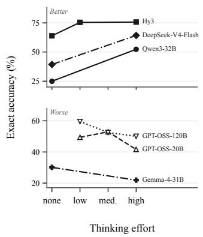

(b)  
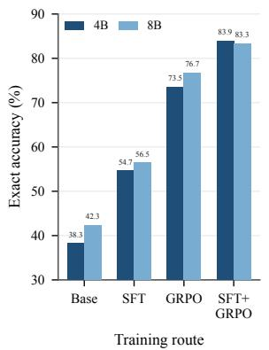

(c)  
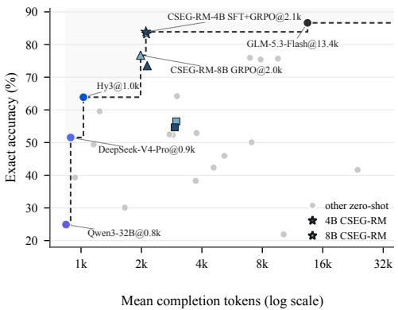  
Figure 3: Thinking effort, training, and accuracy–cost trade-offs on CSEG-Bench (n = 1,160). (a) Selected zero-shot models improve (top) or regress (bottom) at higher thinking effort; the two plots use different vertical scales. (b) Qwen3-4B/8B accuracy across training routes. (c) Accuracy versus mean completion tokens; the dashed staircase is the Pareto frontier and gray points are other zero-shot configurations. Dark/light blue mark 4B/8B CSEG-RM; squares, triangles, and stars denote SFT, GRPO, and SFT+GRPO.

Why constructed training data is necessary. RQ1 motivates synthetic data through false corroboration and sparse deep-layer supervision in natural trajectories. To test whether deliberately constructed coverage improves learning, we compare balanced synthetic data against Qwen3-8B natural rollouts while holding the seed questions, row counts, splits, and GRPO recipe fixed. The rollout arm holds q and D byte-identical and regenerates only the answer before both arms are labelled, flattened, truncated to the same row counts, and split identically. Constructed data improves exact accuracy by 12.6 points at 4B and 20.2 points at 8B. The widening gap rules out the explanation that only the smaller model fails to fit the rollout distribution: under this training protocol, the natural distribution lacks the required learning signal.

Accuracy–cost trade-off. Among the configurations evaluated, two trained models lie on the accuracy–token Pareto frontier. Qwen3-8B GRPO enters the frontier at 1,980 mean completion tokens, while Qwen3-4B SFT+GRPO holds it until GLM-5.3-Flash (GLM-5 Team, 2026), which uses 80× more parameters and 6.4× more tokens for 2.8 additional accuracy points. The practical result is therefore not that CSEG is beyond frontier models, but that it can be distilled into a reward model cheap enough to run once per rollout during training (Figure 3(c)).

Table 5: Answer policy before and after CSEG-supervised optimization, on 512 frozen-retrieval questions. Scores come from an independent frontier judge running the same six-layer pipeline. The reward model is Qwen3-4B SFT+GRPO-400 (grader exact 0.8388).
<table><tr><td>Quantity</td><td>Step 0 (Qwen3-8B base)</td><td>Step 200 (SFT+GRPO-400 RM)</td></tr><tr><td>Mean label</td><td>2.834</td><td>4.193</td></tr><tr><td>Median label</td><td>3</td><td>4</td></tr><tr><td></td><td>Label histogram, 1–7 186/42/123/63/53/20/25</td><td>20/4/172/110/123/33/50</td></tr><tr><td>P(label ≥ 4)</td><td>0.314</td><td>0.617</td></tr><tr><td>P(label ≥ 5)</td><td>0.191</td><td>0.402</td></tr><tr><td> $P ( \mathrm { l a b e l } = 7 )$ </td><td>0.049</td><td>0.098</td></tr></table>

Does benchmark performance transfer downstream? Each of 512 frozen-retrieval questions is rolled out once from the step-0 and step-200 checkpoints and scored by an independent frontier judge with web access disabled (Appendix G). Using Qwen3-4B SFT+GRPO as the reward raises the search agent’s independently judged mean label from 2.834 to 4.193 and the proportion of trajectories with labels 5–7 from 19.1% to 40.2% (Table 5). The improvement is not merely citationformat compliance: labels 1 and 2 both decrease, while a larger proportion of trajectories reaches the deeper layers.

Under the same protocol, the weaker GRPO-only reward model also improves the policy, but yields a proportion of trajectories with labels 5–7 approximately ten percentage points lower (Figure 5 in Appendix G). Across these two reward models, the model with higher CSEG-Bench accuracy therefore provides stronger downstream supervision, supporting the benchmark’s predictive validity.

## 6 Related Work

Real-world web evidence is complex: sources may repeat the same information, contradict one another, or contain outdated claims and errors. Reliable search agents should handle these conditions appropriately. Recent work evaluates conflict handling and source authority in retrieved evidence (Cattan et al., 2025; Yao et al., 2026), yet common search-agent objectives do not explicitly reward these decisions. Outcome-based reinforcement learning rewards answer correctness without distinguishing careful evidence integration from ignored conflicts (Jin et al., 2025; Song et al., 2025; Chen et al., 2025). Citation-aware methods assess evidential support, but support alone establishes neither source independence nor appropriate conflict handling (Gao et al., 2023; Chuang et al., 2025).

This gap extends to evaluation. GAIA and BrowseComp test information-seeking through verifiable answers, but their answer scores do not assess duplicated evidence or overlooked conflicts (Mialon et al., 2023; Wei et al., 2025). Table 1 shows that existing approaches address claim support, conflict, and authority to varying degrees without jointly assessing evidence-root independence. To bridge this gap, CSEG judges these dimensions together over the question, retrieved pool, answer, and citation links. CSEG-Bench tests independent support, conflict identification and attribution, and adjudication by source authority and recency; its layer-level labels also supervise grounding reward models. Appendix A provides the full discussion of related work.

## 7 Conclusion

An outcome-only reward cannot distinguish why an answer was right, and citation support alone cannot establish source independence or appropriate conflict handling across a retrieved pool. CSEG makes that capability an auditable six-layer judgment at three evaluation levels; construction is load-bearing on both sides of the measure, making the deep layers observable and trainable; and the resulting 4B and 8B graders sit on the Pareto frontier, one raising a search agent’s independently judged mean label from 2.83 to 4.19. Outcome success and evidence use must be measured separately, and that measurement can itself be learned and optimized against.

## Ethics Statement

The source trajectories come from the Tencent Yuanbao search assistant, and users whose trajecto ries are included consented to the use of their data for research through a dedicated user experience program. The release is designed to remove direct identifiers and sensitive content, minimize the exposure of query text, document data retention and access controls, and comply with the licenses and terms governing the retrieved pages. Documents injected during benchmark construction exist only inside the controlled benchmark environment and are never presented as genuine web documents outside that setting.

## References

Samuel Joseph Amouyal, Tomer Wolfson, Ohad Rubin, Ori Yoran, Jonathan Herzig, and Jonathan Berant. Qampari: An open-domain question answering benchmark for questions with many answers from multiple paragraphs. arXiv preprint arXiv:2205.12665, 2022.

Anthropic. Claude Opus 5 system card, July 2026. https://www.anthropic.com/ claude-opus-5-system-card.

Akari Asai, Zeqiu Wu, Yizhong Wang, Avirup Sil, and Hannaneh Hajishirzi. Self-rag: Learning to retrieve, generate, and critique through self-reflection. In International Conference on Learning Representations, 2024.

Bernd Bohnet, Vinh Q. Tran, Pat Verga, Roee Aharoni, Daniel Andor, Livio Baldini Soares, Massimiliano Ciaramita, Jacob Eisenstein, Kuzman Ganchev, Jonathan Herzig, et al. Attributed question answering: Evaluation and modeling for attributed large language models. arXiv preprint arXiv:2212.08037, 2022.

Arie Cattan, Alon Jacovi, Ori Ram, Jonathan Herzig, Roee Aharoni, Sasha Goldshtein, Eran Ofek, Idan Szpektor, and Avi Caciularu. Dragged into conflicts: Detecting and addressing conflicting sources in search-augmented llms. arXiv preprint arXiv:2506.08500, 2025.

Hung-Ting Chen, Michael J. Q. Zhang, and Eunsol Choi. Rich knowledge sources bring complex knowledge conflicts: Recalibrating models to reflect conflicting evidence. In Proceedings of EMNLP, 2022.

Mingyang Chen, Linzhuang Sun, Tianpeng Li, Haoze Sun, Yijie Zhou, Chenzheng Zhu, Haofen Wang, Jeff Z. Pan, Wen Zhang, Huajun Chen, Fan Yang, Zenan Zhou, and Weipeng Chen. Research: Learning to reason with search for llms via reinforcement learning. arXiv preprint arXiv:2503.19470, 2025.

I-Chun Chern, Steffi Chern, Shiqi Chen, Weizhe Yuan, Kehua Feng, Chunting Zhou, Junxian He, Graham Neubig, and Pengfei Liu. Factool: Factuality detection in generative ai— a tool-augmented framework for multi-task and multi-domain scenarios. arXiv preprint arXiv:2307.13528, 2023.

Yung-Sung Chuang, Benjamin Cohen-Wang, Shannon Zejiang Shen, Zhaofeng Wu, Hu Xu, Xi Victoria Lin, James Glass, Shang-Wen Li, and Wen-tau Yih. Selfcite: Self-supervised alignment for context attribution in large language models. arXiv preprint arXiv:2502.09604, 2025.

DeepSeek-AI. DeepSeek-V4: Towards highly efficient million-token context intelligence. arXiv preprint arXiv:2606.19348, 2026.

Shahul Es, Jithin James, Luis Espinosa-Anke, and Steven Schockaert. Ragas: Automated evaluation of retrieval augmented generation. arXiv preprint arXiv:2309.15217, 2023.

Tianyu Gao, Howard Yen, Jiatong Yu, and Danqi Chen. Enabling large language models to generate text with citations. In Proceedings ofEMNLP, 2023.

Robert Geirhos, Jorn-Henrik Jacobsen, Claudio Michaelis, Richard Zemel, Wieland Brendel,¨ Matthias Bethge, and Felix A. Wichmann. Shortcut learning in deep neural networks. Nature Machine Intelligence, 2:665–673, 2020.

Gemma Team. Gemma 4 technical report. arXiv preprint arXiv:2607.02770, 2026.

GLM-5 Team. GLM-5: From vibe coding to agentic engineering. arXiv preprint arXiv:2602.15763, 2026.

Google. Gemini 3.1 Pro: A smarter model for your most complex tasks. Google Blog, February 2026. https://blog.google/innovation-and-ai/models-and-research/gemini-models/ gemini-3-1-pro/.

Suchin Gururangan, Swabha Swayamdipta, Omer Levy, Roy Schwartz, Samuel R. Bowman, and Noah A. Smith. Annotation artifacts in natural language inference data. In Proceedings ofNAACL, 2018.

Kelvin Guu, Kenton Lee, Zora Tung, Panupong Pasupat, and Ming-Wei Chang. Realm: Retrievalaugmented language model pre-training. In Proceedings of ICML, 2020.

Or Honovich, Roee Aharoni, Jonathan Herzig, Hagai Taitelbaum, Doron Kukliansy, Vered Cohen, Thomas Scialom, Idan Szpektor, Avinatan Hassidim, and Yossi Matias. True: Re-evaluating factual consistency evaluation. In Proceedings of NAACL, 2022.

Yufang Hou, Alessandra Pascale, Javier Carnerero-Cano, Tigran Tchrakian, Radu Marinescu, Elizabeth Daly, Inkit Padhi, and Prasanna Sattigeri. Wikicontradict: A benchmark for evaluating llms on real-world knowledge conflicts from wikipedia. In Advances in Neural Information Processing Systems, Datasets and Benchmarks Track, 2024.

Chengyu Huang, Zeqiu Wu, Yushi Hu, and Wenya Wang. Training language models to generate text with citations via fine-grained rewards. In Proceedings of ACL, 2024.

Hui Huang, Xingyuan Bu, Hongli Zhou, Yingqi Qu, Jing Liu, Muyun Yang, Bing Xu, and Tiejun Zhao. An empirical study of llm-as-a-judge for llm evaluation: Fine-tuned judge model is not a general substitute for gpt-4. In Findings of ACL, 2025.

Pengcheng Jiang, Jiacheng Lin, Lang Cao, Runchu Tian, SeongKu Kang, Zifeng Wang, Jimeng Sun, and Jiawei Han. Deepretrieval: Hacking real search engines and retrievers with large language models via reinforcement learning. arXiv preprint arXiv:2503.00223, 2025.

Bowen Jin, Hansi Zeng, Zhenrui Yue, Jinsung Yoon, Sercan O. Arik, Dong Wang, Hamed Zamani, and Jiawei Han. Search-r1: Training llms to reason and leverage search engines with reinforcement learning. arXiv preprint arXiv:2503.09516, 2025.

Pei Ke, Bosi Wen, Andrew Feng, Xiao Liu, Xuanyu Lei, Jiale Cheng, Shengyuan Wang, Aohan Zeng, Yuxiao Dong, Hongning Wang, Jie Tang, and Minlie Huang. Critiquellm: Towards an informative critique generation model for evaluation of large language model generation. In Proceedings of ACL, 2024.

Seungone Kim, Jamin Shin, Yejin Cho, Joel Jang, Shayne Longpre, Hwaran Lee, Sangdoo Yun, Seongjin Shin, Sungdong Kim, James Thorne, and Minjoon Seo. Prometheus: Inducing finegrained evaluation capability in language models. In International Conference on Learning Representations, 2024a.

Seungone Kim, Juyoung Suk, Shayne Longpre, Bill Yuchen Lin, Jamin Shin, Sean Welleck, Graham Neubig, Moontae Lee, Kyungjae Lee, and Minjoon Seo. Prometheus 2: An open source language model specialized in evaluating other language models. In Proceedings of EMNLP, 2024b.

Woosuk Kwon, Zhuohan Li, Siyuan Zhuang, Ying Sheng, Lianmin Zheng, Cody Hao Yu, Joseph E. Gonzalez, Hao Zhang, and Ion Stoica. Efficient memory management for large language model serving with PagedAttention. In Proceedings of the 29th Symposium on Operating Systems Principles (SOSP), 2023.

Nathan Lambert, Valentina Pyatkin, Jacob Morrison, LJ Miranda, Bill Yuchen Lin, Khyathi Chandu, Nouha Dziri, Sachin Kumar, Tom Zick, Yejin Choi, Noah A. Smith, and Hannaneh Hajishirzi. Rewardbench: Evaluating reward models for language modeling. arXiv preprint arXiv:2403.13787, 2024.

Patrick Lewis, Ethan Perez, Aleksandra Piktus, Fabio Petroni, Vladimir Karpukhin, Naman Goyal, Heinrich Kuttler, Mike Lewis, Wen-tau Yih, Tim Rockt ¨ aschel, Sebastian Riedel, and Douwe¨ Kiela. Retrieval-augmented generation for knowledge-intensive nlp tasks. In Advances in Neural Information Processing Systems, 2020.

Xiaoxi Li, Guanting Dong, Jiajie Jin, Yuyao Zhang, Yujia Zhou, Yutao Zhu, Peitian Zhang, and Zhicheng Dou. Search-o1: Agentic search-enhanced large reasoning models. arXiv preprint arXiv:2501.05366, 2025a.

Xiaoxi Li, Jiajie Jin, Guanting Dong, Hongjin Qian, Yongkang Wu, Ji-Rong Wen, Yutao Zhu, and Zhicheng Dou. Webthinker: Empowering large reasoning models with deep research capability. arXiv preprint arXiv:2504.21776, 2025b.

Hunter Lightman, Vineet Kosaraju, Yura Burda, Harri Edwards, Bowen Baker, Teddy Lee, Jan Leike, John Schulman, Ilya Sutskever, and Karl Cobbe. Let’s verify step by step. arXiv preprint arXiv:2305.20050, 2023.

Yang Liu, Dan Iter, Yichong Xu, Shuohang Wang, Ruochen Xu, and Chenguang Zhu. G-eval: Nlg evaluation using gpt-4 with better human alignment. In Proceedings of EMNLP, 2023.

R. Thomas McCoy, Ellie Pavlick, and Tal Linzen. Right for the wrong reasons: Diagnosing syntactic heuristics in natural language inference. In Proceedings of ACL, 2019.

Meta Superintelligence Labs. Introducing Muse Glimmer: An open agentic model that runs on your device. Meta AI Research Blog, August 2026. https://research.meta.ai/blog/ introducing-muse-glimmer-open-agentic-model.

Gregoire Mialon, Cl ´ ementine Fourrier, Craig Swift, Thomas Wolf, Yann LeCun, and Thomas ´ Scialom. Gaia: A benchmark for general ai assistants. arXiv preprint arXiv:2311.12983, 2023.

Sewon Min, Kalpesh Krishna, Xinxi Lyu, Mike Lewis, Wen-tau Yih, Pang Wei Koh, Mohit Iyyer, Luke Zettlemoyer, and Hannaneh Hajishirzi. Factscore: Fine-grained atomic evaluation of factual precision in long form text generation. In Proceedings of EMNLP, 2023.

Eric Mitchell, Yoonho Lee, Alexander Khazatsky, Christopher D. Manning, and Chelsea Finn. Detectgpt: Zero-shot machine-generated text detection using probability curvature. In Proceedings of ICML, 2023.

Reiichiro Nakano, Jacob Hilton, Suchir Balaji, Jeff Wu, Long Ouyang, Christina Kim, Christopher Hesse, Shantanu Jain, Vineet Kosaraju, William Saunders, et al. Webgpt: Browser-assisted question-answering with human feedback. arXiv preprint arXiv:2112.09332, 2021.

Cheng Niu, Yuanhao Wu, Juno Zhu, Siliang Xu, Kashun Shum, Randy Zhong, Juntong Song, and Tong Zhang. Ragtruth: A hallucination corpus for developing trustworthy retrieval-augmented language models. In Proceedings of ACL, 2024.

OpenAI. gpt-oss-120b & gpt-oss-20b model card. arXiv preprint arXiv:2508.10925, 2025.

OpenAI. GPT-5.6 system card. OpenAI Deployment Safety Hub, July 2026. https:// deploymentsafety.openai.com/gpt-5-6.

Adam Paszke, Sam Gross, Francisco Massa, Adam Lerer, James Bradbury, Gregory Chanan, Trevor Killeen, Zeming Lin, Natalia Gimelshein, Luca Antiga, et al. Pytorch: An imperative style, high-performance deep learning library. In Advances in Neural Information Processing Systems, 2019.

Fabio Petroni, Aleksandra Piktus, Angela Fan, Patrick Lewis, Majid Yazdani, Nicola De Cao, James Thorne, Yacine Jernite, Vladimir Karpukhin, Jean Maillard, Vassilis Plachouras, Tim Rocktaschel,¨ and Sebastian Riedel. Kilt: A benchmark for knowledge intensive language tasks. In Proceedings of NAACL, 2021.

Quang Hieu Pham, Hoang Ngo, Anh Tuan Luu, and Dat Quoc Nguyen. Who’s who: Large language models meet knowledge conflicts in practice. arXiv preprint arXiv:2410.15737, 2024.

Corby Rosset, Ho-Lam Chung, Guanghui Qin, Ethan C. Chau, Zhuo Feng, Ahmed Awadallah, Jennifer Neville, and Nikhil Rao. Researchy questions: A dataset of multi-perspective, decompositional questions for llm web agents. arXiv preprint arXiv:2402.17896, 2024.

Dongyu Ru, Lin Qiu, Xiangkun Hu, Tianhang Zhang, Peng Shi, Shuaichen Chang, Cheng Jiayang, Cunxiang Wang, Shichao Sun, Huanyu Li, Zizhao Zhang, Binjie Wang, Jiarong Jiang, Tong He, Zhiguo Wang, Pengfei Liu, Yue Zhang, and Zheng Zhang. Ragchecker: A fine-grained framework for diagnosing retrieval-augmented generation. In Advances in Neural Information Processing Systems, 2024.

Jon Saad-Falcon, Omar Khattab, Christopher Potts, and Matei Zaharia. Ares: An automated evaluation framework for retrieval-augmented generation systems. In Proceedings of NAACL, 2024.

Vinu Sankar Sadasivan, Aounon Kumar, Sriram Balasubramanian, Wenxiao Wang, and Soheil Feizi. Can ai-generated text be reliably detected? Transactions on Machine Learning Research, 2025.

Timo Schick, Jane Dwivedi-Yu, Roberto Dess\`ı, Roberta Raileanu, Maria Lomeli, Eric Hambro, Luke Zettlemoyer, Nicola Cancedda, and Thomas Scialom. Toolformer: Language models can teach themselves to use tools. In Advances in Neural Information Processing Systems, 2023.

Zhihong Shao, Peiyi Wang, Qihao Zhu, Runxin Xu, Junxiao Song, Xiao Bi, Haowei Zhang, Mingchuan Zhang, Y. K. Li, Y. Wu, and Daya Guo. Deepseekmath: Pushing the limits of mathematical reasoning in open language models. arXiv preprint arXiv:2402.03300, 2024.

Guangming Sheng, Chi Zhang, Zilingfeng Ye, Xibin Wu, Wang Zhang, Ru Zhang, Yanghua Peng, Haibin Lin, and Chuan Wu. Hybridflow: A flexible and efficient RLHF framework. In Proceedings of the Twentieth European Conference on Computer Systems (EuroSys), 2025.

Huatong Song, Jinhao Jiang, Yingqian Min, Jie Chen, Zhipeng Chen, Wayne Xin Zhao, Lei Fang, and Ji-Rong Wen. R1-searcher: Incentivizing the search capability in llms via reinforcement learning. arXiv preprint arXiv:2503.05592, 2025.

Ivan Stelmakh, Yi Luan, Bhuwan Dhingra, and Ming-Wei Chang. Asqa: Factoid questions meet long-form answers. In Proceedings ofEMNLP, 2022.

Tencent Hy Team. Introducing Hy3. Tencent Hy Research Blog, July 2026. https://hy.tencent. com/research/hy3.

Chenyu Wang, Yueyuan Li, Yingmin Liu, and Yang Shu. Conflictrag: Detecting and resolving knowledge conflicts in retrieval-augmented generation. arXiv preprint arXiv:2605.17301, 2026.

Fei Wang, Xingchen Wan, Ruoxi Sun, Jiefeng Chen, and Sercan O. Arik. Astute rag: Overcoming imperfect retrieval augmentation and knowledge conflicts for large language models. arXiv preprint arXiv:2410.07176, 2024a.

Han Wang, Archiki Prasad, Elias Stengel-Eskin, and Mohit Bansal. Retrieval-augmented generation with conflicting evidence. In Conference on Language Modeling, 2025.

Peiyi Wang, Lei Li, Zhihong Shao, Runxin Xu, Damai Dai, Yifei Li, Deli Chen, Yu Wu, and Zhifang Sui. Math-shepherd: Verify and reinforce llms step-by-step without human annotations. In Proceedings ofACL, 2024b.

Jason Wei, Zhiqing Sun, Spencer Papay, Scott McKinney, Jeffrey Han, Isa Fulford, Hyung Won Chung, Alex Tachard Passos, William Fedus, and Amelia Glaese. Browsecomp: A simple yet challenging benchmark for browsing agents. arXiv preprint arXiv:2504.12516, 2025.

Jerry Wei, Chengrun Yang, Xinying Song, Yifeng Lu, Nathan Hu, Jie Huang, Dustin Tran, Daiyi Peng, Ruibo Liu, Da Huang, Cosmo Du, and Quoc V. Le. Long-form factuality in large language models. arXiv preprint arXiv:2403.18802, 2024.

Kevin Wu, Eric Wu, and James Zou. Clasheval: Quantifying the tug-of-war between an llm’s internal prior and external evidence. In Advances in Neural Information Processing Systems, Datasets and Benchmarks Track, 2024.

Yunjia Xi, Jianghao Lin, Yongzhao Xiao, Zheli Zhou, Rong Shan, Te Gao, Jiachen Zhu, Weiwen Liu, Yong Yu, and Weinan Zhang. A survey of LLM-based deep search agents: Paradigm, optimization, evaluation, and challenges. arXiv preprint arXiv:2508.05668, 2025.

Shi-Qi Yan, Jia-Chen Gu, Yun Zhu, and Zhen-Hua Ling. Corrective retrieval augmented generation. arXiv preprint arXiv:2401.15884, 2024.

An Yang, Anfeng Li, Baosong Yang, Beichen Zhang, Binyuan Hui, Bo Zheng, Bowen Yu, Chang Gao, Chengen Huang, Chenxu Lv, et al. Qwen3 technical report. arXiv preprint arXiv:2505.09388, 2025.

Shunyu Yao, Jeffrey Zhao, Dian Yu, Nan Du, Izhak Shafran, Karthik Narasimhan, and Yuan Cao. React: Synergizing reasoning and acting in language models. In International Conference on Learning Representations, 2023.

Zhihui Yao, Hengran Zhang, and Keping Bi. Authoritybench: Benchmarking llm authority perception for reliable retrieval-augmented generation. arXiv preprint arXiv:2603.25092, 2026.

Xiang Yue, Boshi Wang, Ziru Chen, Kai Zhang, Yu Su, and Huan Sun. Automatic evaluation of attribution by large language models. In Findings of EMNLP, 2023.

Chujie Zheng, Zhenru Zhang, Beichen Zhang, Runji Lin, Keming Lu, Bowen Yu, Dayiheng Liu, Jingren Zhou, and Junyang Lin. Processbench: Identifying process errors in mathematical reasoning. arXiv preprint arXiv:2412.06559, 2024.

Lianmin Zheng, Wei-Lin Chiang, Ying Sheng, Siyuan Zhuang, Zhanghao Wu, Yonghao Zhuang, Zi Lin, Zhuohan Li, Dacheng Li, Eric P. Xing, et al. Judging llm-as-a-judge with mt-bench and chatbot arena. In Advances in Neural Information Processing Systems, 2023.

Yuxiang Zheng, Dayuan Fu, Xiangkun Hu, Xiaojie Cai, Lyumanshan Ye, Pengrui Lu, and Pengfei Liu. Deepresearcher: Scaling deep research via reinforcement learning in real-world environments. arXiv preprint arXiv:2504.03160, 2025.

Wenxuan Zhou, Sheng Zhang, Hoifung Poon, and Muhao Chen. Context-faithful prompting for large language models. In Findings of EMNLP, 2023.

Lianghui Zhu, Xinggang Wang, and Xinlong Wang. Judgelm: Fine-tuned large language models are scalable judges. arXiv preprint arXiv:2310.17631, 2023.

## A Related Work in Full

This appendix expands Section 6 and closes with a construct-level comparison.

Comparison dimensions. In Table 1, “Claim support” denotes claim-level evidential support; “Retrieved pool” requires evaluation over a real multi-document pool, rather than a single or curated context; web access alone does not qualify. “Traj.” denotes complete (q, D, a) trajectories with citation links. “RM resource” requires training data, a trainable reward model, and evidence that the reward can supervise a policy.

Retrieval and search-agent reinforcement learning. Retrieval-augmented generation connects generators to explicit corpora and has progressed from learned retrieval to self-reflection and corrective fallback (Guu et al., 2020; Lewis et al., 2020; Asai et al., 2024; Yan et al., 2024), while ReAct, Toolformer, and WebGPT make tools or browsing part of inference (Yao et al., 2023; Schick et al., 2023; Nakano et al., 2021). Recent reinforcement-learning systems optimize multi-step search, query generation, and long-horizon web research (Jin et al., 2025; Song et al., 2025; Chen et al., 2025; Jiang et al., 2025; Li et al., 2025a; Zheng et al., 2025; Li et al., 2025b). Search-R1, R1- Searcher, and ReSearch primarily reward final-answer correctness; DeepRetrieval instead rewards retrieval quality. These signals do not explicitly assess source independence, conflict attribution, or evidence-based adjudication. CSEG supplies the trajectory-level grounding reward that outcome supervision misses, together with evidence that it moves an answer policy; it is not another search algorithm.

Search-agent benchmarks. GAIA evaluates general assistant capabilities, including web browsing and tool use, while BrowseComp focuses on finding difficult information on the web (Mialon et al., 2023; Wei et al., 2025). Both use verifiable final answers, making task success straightforward to score. Their answer metrics do not directly evaluate the retrieved pool, citation links, source independence, or conflict handling. Table 1 therefore marks these grounding dimensions as not targeted, even though solving the tasks can require extensive search.

Attribution and citation-aware supervision. Provenance-aware and long-form QA benchmarks motivate explicit evidence use (Petroni et al., 2021; Stelmakh et al., 2022; Amouyal et al., 2022; Rosset et al., 2024), attribution work evaluates or trains claim–passage support (Bohnet et al., 2022; Gao et al., 2023; Huang et al., 2024; Chuang et al., 2025), and factuality and RAG evaluators measure consistency, atomic accuracy, hallucination, attribution, and component quality (Honovich et al., 2022; Min et al., 2023; Wei et al., 2024; Chern et al., 2023; Niu et al., 2024; Yue et al., 2023; Es et al., 2023; Saad-Falcon et al., 2024; Ru et al., 2024). These approaches assess evidential support and retrieval quality at different levels of granularity. ALCE includes open-domain retrieval and multisource synthesis, so this family is not restricted to small or conflict-free contexts. The remaining gap is joint evaluation of evidence-root independence, conflict attribution, and adjudication over the retrieved pool.

Conflicting evidence and multi-source integration. A substantial literature studies parametric– context disagreement, contradictory passages, ambiguity, misinformation, source reliability, and authority (Zhou et al., 2023; Chen et al., 2022; Wu et al., 2024; Hou et al., 2024; Wang et al., 2025; 2024a; Pham et al., 2024; Cattan et al., 2025; Yao et al., 2026; Wang et al., 2026). These studies establish conflict handling as an evaluation target. In particular, DRAGged into Conflicts uses real search results and evaluates conflict types, citation grounding, and appropriate response behavior; AuthorityBench explicitly studies source authority. Our distinction is therefore not the use of real retrieved evidence or conflict evaluation alone. CSEG jointly evaluates these decisions with evidence-root independence through a staged judgment of the question, retrieved pool, answer, and citation links, and uses the resulting labels to train grounding reward models.

Reward models and structured judges. LLM judges and critique or reward models provide scalable evaluation but inherit task-specific biases (Zheng et al., 2023; Liu et al., 2023; Kim et al., 2024a;b; Zhu et al., 2023; Lambert et al., 2024; Ke et al., 2024; Huang et al., 2025). Where structured judging exists, its structure is typically inherited from mathematical or code reasoning steps (Lightman et al., 2023; Wang et al., 2024b; Zheng et al., 2024), and no comparable consensus exists for how to segment a retrieval judgment. Our segmentation is a decision tree over evidence–answer relations, not a chain over a model’s own reasoning steps, and the supervision signal it yields is a verifiable per-layer verdict that we then use to supervise an answer policy.

Surface shortcuts in constructed corpora. Annotation artifacts, brittle heuristics, and detectable machine-written text all create shortcuts (Geirhos et al., 2020; Gururangan et al., 2018; McCoy et al., 2019; Mitchell et al., 2023; Sadasivan et al., 2025). In a constructed retrieval corpus, detectability converts directly into label leakage, because the inserted documents are precisely the ones that determine the branch. Morphology, position, and constant-budget controls address this failure mode (Appendix E).

## B The Natural Distribution as Evidence

This appendix supports RQ1’s motivation for synthetic data by documenting false corroboration and sparse deep-layer coverage in natural trajectories; it carries none of the reward-model results. The original audit of 256 production trajectories evaluated L6 on both L4 branches; its retained measurements therefore precede the routing revision in Figure 2. That audit yields a strongly skewed distribution (Table 6). Three readings follow. First, 43.8% of real trajectories fail within the first three layers and L3 alone accounts for 33.2%, so the most common failure is not a missing citation but several URLs collapsing onto one evidence root—which any metric that asks only whether a citation exists would score as a pass. Second, the deep nodes are almost empty, with two L6 failures in 256 trajectories, one on each L4 branch, and the conflict branch touched by only 21 trajectories in total (16 failures and five passes), because cross-source integration has never been a training objective and models are stopped in the shallow layers. Third, therefore, measuring and learning the deep nodes requires controlled construction—the second half of that claim is what Section 5.3 demonstrates—and the production set answers only the question of what natural failure looks like.

Table 6: Gold distribution over 256 production trajectories, every one of which passes the service’s closed-QA outcome verifier. These are the original audit counts, before consensus paths bypassed L6.
<table><tr><td>Terminal type</td><td>n</td><td>Share</td><td>Depth</td></tr><tr><td>L1 fail (no valid citation)</td><td>23</td><td>9.0%</td><td>shallow</td></tr><tr><td>L2 fail (single source)</td><td>4</td><td>1.6%</td><td>shallow</td></tr><tr><td>L3 fail (multiple URLs, one evidence root)</td><td>85</td><td>33.2%</td><td>shallow</td></tr><tr><td>L4 conflict missed</td><td>32</td><td>12.5%</td><td>middle</td></tr><tr><td>L5-X fail (conflict attribution)</td><td>16</td><td>6.3%</td><td>deep</td></tr><tr><td>L5-C fail (consensus aggregation)</td><td>9</td><td>3.5%</td><td>deep</td></tr><tr><td>L6 adjudication fail (1 conflict / 1 consensus)</td><td>2</td><td>0.8%</td><td>deep</td></tr><tr><td>Complete pass (consensus / conflict)</td><td>80 / 5</td><td>33.2%</td><td></td></tr></table>

Table 7: Open-weight policies rolled out on the same 256 frozen (q, D) prefixes as Table $^ { 6 , }$ rewriting only the final answer. The production row is the outcome-passing gold audit (mean label computed from that distribution); the other rows are not outcome-filtered and do not replace the 43.8% / 33.2% claims above.
<table><tr><td>Policy</td><td>Mean label</td><td>Fail by L3</td></tr><tr><td>Production agent (Table 6)</td><td>4.48</td><td>43.8%</td></tr><tr><td>DeepSeek-V4-Flash (low)</td><td>4.11</td><td>52.4%</td></tr><tr><td>Qwen3-8B (thinking)</td><td>2.89</td><td>70.1%</td></tr><tr><td>GPT-OSS-120B (low)</td><td>2.37</td><td>84.2%</td></tr></table>

## C The Evaluand and the Metrics

The evaluation unit. As a message sequence, a trajectory $\tau = \left( q , D , a \right)$ is the five-turn structure system, user, assistant(tool call), tool, assistant(answer), and the object under evaluation is the map

$$
R _ { \phi } ( q , D , a ) \to ( y , p ) , \qquad y \in \{ 1 , \ldots , 7 \} ,\tag{2}
$$

where p is the full decision path and y its terminal label.

Label-level evaluation. The output is treated as an ordered class in $\{ 1 , \ldots , 7 \}$ . Alongside exact accuracy and macro recall we report MAE and QWK as the label metrics, with QWK primary; out-of-range predictions are clamped into [1, 7].

Node-level evaluation. Every layer is scored as its own classifier, taking fail as the positive class at binary nodes and reporting macro scores at the three-way L4 router. The metrics are conditional: a node is scored only on examples whose gold path actually reaches it, and a prediction that stops early is recorded as “not reached” and penalized in the recall of the relevant gold class. The leaderboard records both unconditional and conditional precision, recall, and F1, and the conditional form is what we report, because it separates a node’s intrinsic accuracy from the appearance of accuracy created by upstream early stopping.

Path-level evaluation. A traversal is represented as a token sequence such as [L1:pass, L2:pass, L3:fail], and we report Levenshtein edit distance to the gold path—a substitution captures a wrong verdict, an insertion or deletion captures stopping late or early—together with the exact whole-path match rate. Path-level evaluation is what localizes where in the tree a judge diverges, which the terminal label alone cannot show.

Worked example. Figure 4 walks one trajectory through the six-layer hierarchy: the inputs, the layer decisions with case-specific rationales, and the resulting path, node verdicts, terminal label, and path metrics.

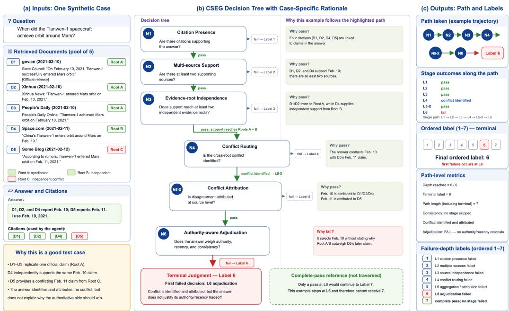  
Figure 4: A concrete CSEG judgment: inputs (left), the six layer decisions with case-specific rationales (center), and the resulting path, node verdicts, terminal label, and path metrics (right).

Terminology and distinctions. Table 8 distinguishes contextual shorthand from terms that refer to different objects or measurements. These distinctions apply to both the main text and the implementation details.

Table 8: Terminology guide. Related expressions are not interchangeable unless explicitly identified as shorthand; model-specific settings retain their original names.
<table><tr><td>Concept</td><td>Related expressions</td><td>Usage and distinction</td></tr><tr><td>Reasoning configuration</td><td>Thinking effort; reasoning effort; deliberation</td><td>Effort denotes a model-specific setting. Thinking mode indicates whether thinking is enabled; deliberation describes the generated reasoning process. Matching setting names do not establish equal reasoning budgets across</td></tr><tr><td>Label prediction</td><td>Exact accuracy; terminal accuracy; accuracy</td><td>models. In benchmark label results, these refer to exact label accuracy: agreement between predicted and gold terminal labels. Exact whole-path match instead requires the entire decision path to agree.</td></tr><tr><td>Evaluation role</td><td>Judge; scorer; grader; reward model (RM)</td><td>A judge makes evaluation decisions; the scorer composes layer decisions through routing. An RM supplies a training reward. Grader is contextual shorthand for the scoring model, not a separate model family; an independent evaluation judge is distinct from the RM</td></tr><tr><td>Efficiency measure</td><td>Completion tokens; token efficiency; cost</td><td>used for policy training. Completion-token count is the reported cost proxy. Accuracy-token comparisons do not by themselves measure latency, monetary cost, or compute across model sizes.</td></tr><tr><td>Hierarchy structure</td><td>Layer; node</td><td>There are six layers and seven node classifiers because layer L5 has alternative L5-C and L5-X nodes. The node prompts use the same layer terminology. Terminal label 7 means that every visited layer passed: five on the</td></tr><tr><td></td><td>Evidence provenance Document; source; evidence root</td><td>consensus branch or six on the conflict branch. No seventh layer is evaluated. A document is a retrieved item; cited source refers to a document cited as evidence. Its evidence root is the origin of its support for the core claim. Different documents or websites need not provide independent evidence roots.</td></tr></table>

## D Construction and Validation Detail

The nine canonical paths. Table 9 lists the construction types. One set of types serves both arms. The evaluation arm yields 1,856 constructed trajectories and passes the full validation loop of Section 3.3; the training arm yields 4,607 trajectories on a disjoint base pool and passes only the target-path re-scoring and a strict path check, because the path-reproduction and expert-review stage removes exactly the hardest examples, which is the part a reward model most needs.

Table 9: The nine canonical paths. “Independent,” “redundant,” and “conflict” are defined relative to the core claim.
<table><tr><td>Type</td><td></td><td>Label Required terminal behavior</td><td>Retrieved-pool requirement</td></tr><tr><td>L1_fail</td><td>1</td><td>L1 fail</td><td></td></tr><tr><td>L2_fail</td><td>2</td><td>L1 pass; L2 fail</td><td>independent</td></tr><tr><td>L3_fail</td><td>3</td><td>L1–L2 pass; L3 fail</td><td>redundant</td></tr><tr><td>L4_conflict_missed</td><td>4</td><td>conflict exists but is missed</td><td>independent, conflict</td></tr><tr><td>L5_consensus_fail</td><td>5</td><td>consistent pool; aggregation fails</td><td>independent, no conflict</td></tr><tr><td>L5_conflict_fail</td><td>5</td><td>conflict identified; attribution fails</td><td>independent, conflict</td></tr><tr><td>L6_fail_conflict</td><td>6</td><td>attribution passes; adjudication fails</td><td>independent, conflict</td></tr><tr><td>all_pass_consensus</td><td>7</td><td>L5-C pass; terminate without L6</td><td>independent, no conflict</td></tr><tr><td>all_pass_conflict</td><td>7</td><td>L5-X pass; L6 pass; terminate</td><td>independent, conflict</td></tr></table>

Two-stage construction. Scenario construction first identifies the core answerable claim of the base, groups the documents that support that claim by evidence root, and derives whether the pool offers independent support, redundancy, or conflict—the same yardstick the L3 judge uses. When a required property is absent, documents carrying that property are injected; labels are computed relative to the documents that are actually present, so genuinely adding an independent corroboration produces a legitimate and correctly labelled example. A base that already violates an exclusion condition, such as a conflicted pool requested for a consensus type, is skipped rather than repaired, because appending documents cannot remove a property that already exists. Edited scenarios are cached by base and requirement signature so that answer variants can share an identical frozen pool. Answer rewriting then rewrites the final assistant(answer) on that frozen pool so that it lands on the target path. The constructor also emits a rationale, which serves only to let experts audit whether construction hit the intended path; it is never used as a supervision target.

Surface-form controls. Each injected document is matched to the profile of its own host pool: punctuation width, publish time rendering, line layout, authority vocabulary, and crawler metadata wrappers. Documents are inserted at uniformly random positions and the whole pool is renumbered 1..K; regardless of target type every pool receives the same fixed number of additions (two by default), with any remainder filled by documents that are topically adjacent but silent on the core claim. On the answer side, the placement convention for [citation:N] is measured from that trajectory’s own original answer. Appendix E measures what each control removes.

## E Why Surface Form Is a Label Shortcut

The three surface-form controls of Appendix D exist because in a constructed retrieval corpus the recognizability of an injected document is not a cosmetic matter but a label shortcut: the injected documents are exactly the ones that determine L3, L4, and L6. This appendix records the construction-stage audit that fixed each control.

Layout fingerprints. On unaligned injected documents, the handwritten rule “publish time is an ISO date, the body has no crawler noise, and the body is shorter than 900 Chinese characters” identified injected documents with 100.0% precision and 90.5% recall against a 9.8% base rate— 1,760 injected documents among 16,140 originals—while firing on none of the 3,328 documents in the 256 production trajectories. Alignment is therefore performed against each trajectory’s own host pool rather than a global template; authority level is only collapsed onto the pool’s vocabulary and publish time only reformatted, so that the L6 signal is not erased. After these controls the detector makes no positive predictions at all: recall and false-positive rate are both zero and precision is undefined.

Position and numbering. Appending injections at the end of the pool leaks the label through numbering and interacts with truncation, which then removes the decisive documents: under a 15,872-token budget, 33.8% of edited records lost every injected document, which uniformly random insertion with whole-pool renumbering reduced to 4.9%; at 20,480 tokens the corresponding rates were 8.8% and 1.4%. Truncation is performed at complete document boundaries.

Injection count and type coupling. If only the missing property is supplied, pool size becomes a function of the branch: the shallow, consensus, and conflict types add 0.00, 0.77, and 1.30 documents on average. Pool size on its own is nearly harmless, because the natural dispersion of pool size swamps a one-document shift—a classifier given only the pool size gains essentially nothing on the seven-way label. The danger is the coupling, and it is conditional: the count is the payload and the recognizability of injected documents is the key. Given an oracle that identifies which documents were planted, counting alone predicts the coarse branch 72.9% of the time against a 54.3% majority baseline, and planted = 2 implies the conflict branch with 100% precision; on the seven-way label the same oracle count gives 25.3% against a 20.0% baseline. Branch prediction is the dangerous half, because L4 routing is the layer every judge is weakest at, and it is exactly what a free branch label would hand over. Holding the planted-document budget constant across all types severs the payload from the key: the count carries no branch information whatever the detector does. Filler documents are safe precisely because the whole pipeline is defined relative to the core claim: a document that says nothing about the core claim can neither be a second evidence root for it nor be redundant or in conflict with the documents that support it.

## F Design Decisions Behind the Hierarchy

The responsibility boundary at L1. If L1 also judged full semantic support, overclaiming examples would terminate before L5 and the deeper tree would be unreachable. L1 is therefore restricted to citation existence and topical relevance, and scope, overclaiming, and entailment belong to L5. Correspondingly, the L1 fail construction specification requires an answer with no citation, a citation to a document number that does not exist, or a citation to an off-topic document; “topically relevant but insufficient support” now passes L1 and terminates at L5.

Decoupling L6 from tone. L6 failure is defined only by substance—preferring lower-authority, staler, or internally inconsistent evidence. In early data roughly 81% of L6-fail examples carried emphatic or absolute phrasing, and the judge’s stated reasons touched both the tone and the substance, so absolute phrasing correlated with adjudication failure strongly enough to be learnable as a shortcut in place of the capability. Construction therefore requires neutral tone, the criterion never references confidence of expression, and each new batch is checked for the proportion of emphatic phrasing per label group falling back to the baseline of the other groups.

L3 by evidence root rather than by site. Defined over distinct websites, L3 passes almost always in real pools and carries no information. Tracing citations to evidence roots exposes duplicated reporting and makes L3 the largest failure bucket in production traffic (33.2%, Appendix B). The layer emits evidence roots and distinct root count for audit, and the reward-hacking check of Section 5.3 reuses exactly those two fields.

What the supervision target contains, and why it changed. Retrieved web text contains many bare backslashes—\mathrm, \˜, stray TEX fragments—so a supervision field holding free-form prose produces JSON parse failures or silent escapes such as \t becoming a tab. An earlier version of this work avoided the problem by narrowing the target to a single line containing only verdict, so that no backslash could appear in it at all. That is not what we do now: the distillation target is the teacher’s complete output, including the thinking block and the layer-specific fields, because the grounds are the thing worth distilling, and the intermediate fields are what makes the downstream reward auditable. Robustness is obtained at packing time instead— every target must survive a strict parse and is discarded otherwise, which cost 34 of 17,477 examples—rather than by removing the informative fields. The reinforcement stage is unaffected either way, since its gold and its reward parser read only verdict.

Length budgets enforced by tokenizer, not by character count. Estimating prompt length by characters (this corpus runs about 1.75 characters per token) let prompts reach roughly 24.7k tokens under a 32k-character cap. The training framework truncates from the right, that is, into the assistant turn, so about 42% of examples were trained on a target that had been cut in half. Enforcing the budget with the tokenizer removed this: the prompt side is now hard capped at 20,480 tokens, with a measured maximum of 20,478 and no example over budget, and truncation removes whole documents so the supervised assistant turn is never right-truncated.

## G Resources, Benchmark Composition, and Result Detail

## G.1 Resources and split discipline

Table 10: Resources and split discipline. Benchmark, reward-model training, and answer-policy training rest on pairwise disjoint base pools. Layer examples are per-layer flattenings of a trajectory; a trajectory stopping at layer N contributes N of them.
<table><tr><td>Resource</td><td>Size Role</td><td></td></tr><tr><td>Reward-model SFT train / dev</td><td></td><td>14,081 / 795 rejection-sampled Qwen3-32B traces; 486 / 26 seed split</td></tr><tr><td>Reward-model GRPO train / dev</td><td></td><td>7,320 / 911 train balanced to 488 per (layer, verdict) cell; dev natural</td></tr><tr><td>Data-source ablation arm</td><td></td><td>7,320 / 911 Qwen3-8B rollouts on the same seeds, truncated to the same rows</td></tr><tr><td>CSEG-Bench</td><td></td><td>1,160 trajectories nine paths; 692 two-judge plus 468 single-judge; 5,166 layer decisions; fi-</td></tr><tr><td>Production audit (App. B)</td><td></td><td>nal reporting only 256 trajectories natural prevalence; motivates synthesis (RQ1)</td></tr><tr><td>Frozen-prefix policy rollouts</td><td></td><td>256 prefixes same (q, D) as App. B; answer only; Ta- ble 7</td></tr><tr><td>Answer-policy RL train / val</td><td></td><td>2,624 / 138 prefixes frozen retrieval; final answer only; dis- joint rollout dump</td></tr><tr><td>Answer-policy evaluation (SFT+GRPO-400 RM)</td><td></td><td>512 paired step 0 vs. 200; grader 0.8388</td></tr><tr><td>Answer-policy evaluation (GRPO-only ŘM)</td><td></td><td>512 paired same prefixes; secondary high-band comparison only</td></tr></table>

The answer-policy evaluation questions are the 512 seed questions on which the reward model’s own training data was built. This is not evaluation leakage—the scores come from an independent frontier judge and the reward model appears only inside the training loop—but it does mean the reward model is more in-domain on the evaluation questions than on the questions the agent trained on, which understates rather than flatters generalization.

## G.2 Reading the three evaluation levels against each other

Hy3 at low effort, a 295B model, attains slightly higher exact accuracy than the 4B GRPO reward model (75.4% versus 73.5%) but a distinctly worse quadratic weighted kappa (0.653 versus 0.705) and worse path edit distance (0.937 versus 0.847) at 3.7× the cost: it lands on the right label about as often, but its mistakes are more severe and its route there is less often the gold route. The distilled 8B model shows the same inversion against GPT-OSS-120B at low effort, trailing by 3.1 points of exact accuracy while leading on kappa (0.653 versus 0.597) and on path edit distance (1.113 versus 1.294). A single terminal accuracy would have ranked both pairs the other way.

In node-level evaluation (Table 11), the two weakest layers after distillation are the semantic ones—0.466 conditional macro F1 at L5-C and 0.410 at L5-X, the latter with a positive-class F1 of only 0.039, meaning the model passes essentially everything—and the reinforcement stage lifts L5-X to 0.937 and 0.982.

## G.3 Conditional per-layer F1 and the data-source ablation

Refer to Table 11.

## G.4 Answer-policy detail

Table 5 gives the before-and-after label distribution behind Section 5.3 for the official SFT+GRPO-400 reward. The figure below is the secondary high-band comparison against a weaker GRPO-only grader on the same 512 prefixes.

Table 11: Conditional macro F1 per layer on CSEG-Bench, with gold reach n in the header. A node is scored only on examples whose gold path reaches it, and a prediction that stopped earlier counts as “not reached.”
<table><tr><td>Model</td><td>L1 (1,160)</td><td>L2 (1,082)</td><td>L3 (1,003)</td><td>L4 (819)</td><td>L5-C (219)</td><td>L5-X (460)</td><td>L6 (423)</td></tr><tr><td>Qwen3-8B SFT</td><td>0.520</td><td>0.935</td><td>0.823</td><td>0.753</td><td>0.466</td><td>0.410</td><td>0.751</td></tr><tr><td> $\mathrm { \dot { Q } w e n } 3 { - } 4 \mathrm { B } S \mathrm { F T + } \mathrm { G R P O }$ </td><td>0.863</td><td>0.965</td><td>0.888</td><td>0.847</td><td>0.709</td><td>0.982</td><td>0.924</td></tr><tr><td>Qwen3-8B SFT+GRPO</td><td>0.583</td><td>0.973</td><td>0.897</td><td>0.856</td><td>0.766</td><td>0.937</td><td>0.890</td></tr></table>

Table 12: Training-data source, GRPO from the base model for 400 steps with every other setting byte-identical. Both arms hold $7 { , } 3 2 0$ training and 911 development layer examples built on the same seed questions.
<table><tr><td>Training data</td><td>Model</td><td>Exact</td><td>Macro R.</td><td>MAE↓</td><td>QWK↑</td><td>Path ED ↓</td></tr><tr><td>Constructed, balanced Qwen3-8B natural rollouts</td><td>Qwen3-4B</td><td>0.7353</td><td>0.7615</td><td>0.6672</td><td>0.7052 0.6641</td><td>0.8466 1.0578</td></tr><tr><td></td><td>Qwen3-4B</td><td>0.6095</td><td>0.6410</td><td>0.8284</td><td></td><td></td></tr><tr><td>Constructed, balanced</td><td>Qwen3-8B</td><td>0.7672</td><td>0.7957</td><td>0.5776</td><td>0.7358</td><td>0.7026</td></tr><tr><td>Qwen3-8B natural rollouts</td><td>Qwen3-8B</td><td>0.5655</td><td>0.6260</td><td>0.9181</td><td>0.6386</td><td>1.1543</td></tr><tr><td></td><td></td><td></td><td></td><td></td><td></td><td></td></tr></table>

(a)  
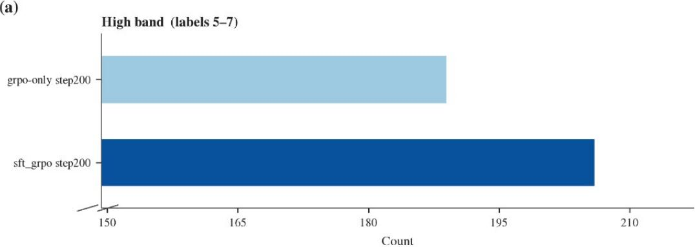

(b)  
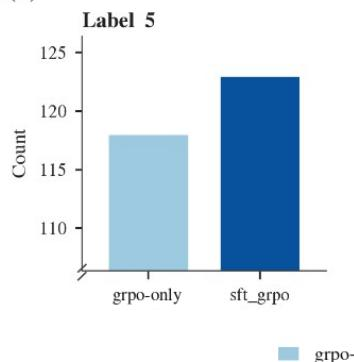

(c)  
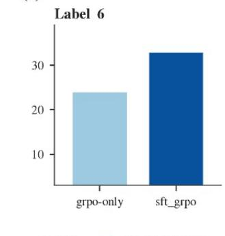

(d)  
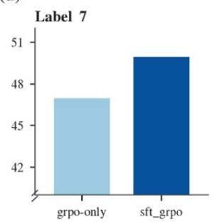  
Figure 5: Step-200 high band (labels 5–7) on the same 512 prefixes. A weaker GRPO-only grader also moves the policy, but yields a proportion of trajectories with labels 5–7 about 10 percentage relatively lower than the official SFT+GRPO-400 reward.

## H Limitations

The hierarchy covers single-turn trajectories, and the answer policy rewrites only the final answer without re-retrieving. CSEG measures grounding relative to the retrieved pool rather than worldlevel truth, and authority labels are operational rather than universal, so it must accompany an outcome verifier rather than replace one, and the answer-policy experiment claims a gain in grounding but not in task performance. The data are mainly Chinese and from one online service, so the 43.8% grounding gap should not be extrapolated without replication, and with only two L6 failures in 256 the production audit supports only RQ1’s qualitative motivation for synthetic coverage of deep paths, not a precise estimate of rare deep-layer failures. Human experts decided inclusion on evidence from the frontier judges, so both the released composition and those judges scores are selection-conditioned. The downstream evaluation remains limited in scope: it uses one initial policy model, and evaluates only the grounding objective under re-scoring.

## I Implementation Detail

Reward models. Training uses verl 0.8.0 (Sheng et al., 2025), vllm 0.11.0 (Kwon et al., 2023), and torch 2.8.0 (Paszke et al., 2019) throughout, with full-parameter FSDP2 and no LoRA.

The rejection-sampling teacher is Qwen3-32B in thinking mode, served locally, one sample per prompt at temperature 0.7 with a 4,096-token cap. Of 17,477 layer prompts, 14,876 traces survive filtering: 2,561 are dropped for disagreeing with gold, 34 for unparseable JSON, and 6 for truncation. SFT then runs on a single 8 H20 GPU node with batch size 64, learning rate 10−5 under a cosine schedule with 3% warmup, weight decay 0.01, gradient clipping 1.0, and a maximum sequence length of 24,576 tokens (a 20,480-token prompt budget plus 4,096 for the assistant turn). That is 220 steps per epoch over 14,081 examples, and a checkpoint is written each epoch. A custom chat template is used so that the training prefix and the inference prefix are byte-identical and no empty thinking block is pre-filled; the loss covers assistant turns only.

GRPO runs on four 8 H20 GPU nodes with a constant learning rate of 10−6, group size 8, temperature 1.0, KL applied as a loss against the frozen reference with coefficient 10−3 in its low-variance form, zero entropy bonus, training batch size 64, a 20,608-token prompt limit, a 1,024-token response limit, and asynchronous vLLM rollout at tensor-parallel degree one. Of the 17,477 layer examples, those failing target-path re-scoring (364) or the strict path check (14) are dropped before balancing. With 7,320 examples that is 114 steps per epoch, capped at 400 steps, with a checkpoint and a validation pass every 25 steps: roughly 29 hours at 4B and 40 hours at 8B. Merged checkpoints are served through the same OpenAI-compatible evaluation path as the baselines, so every row of Table 4 shares node prompts (Appendix J), router, and metric implementation. The zero-shot block evaluates Qwen3 (Yang et al., 2025), GPT-OSS (OpenAI, 2025), Muse-Glimmer-30B (Meta Superintelligence Labs, 2026), Gemma-4 (Gemma Team, 2026), DeepSeek-V4 (DeepSeek-AI, 2026), Hy3 (Tencent Hy Team, 2026), and GLM-5 (GLM-5 Team, 2026). Figure 6 records the SFT and GRPO traces for the official 4B run.

(a)  
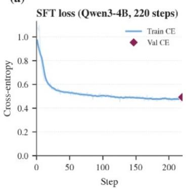

(b)  
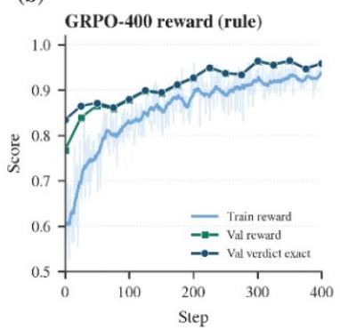

(c)  
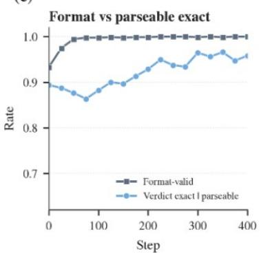

(d)  
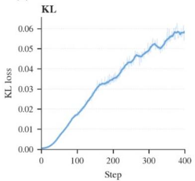

(e)  
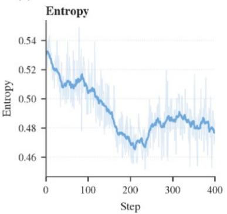

(f)  
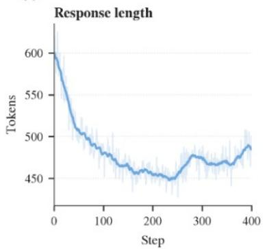  
Figure 6: Training dynamics of the official Qwen3-4B SFT+GRPO-400 reward model. (a) Supervised distillation, one epoch. (b–f) GRPO against the verifiable layer verdict. The validation markers are the in-loop split, not CSEG-Bench; reported RM quality remains Table 4.

Answer policy. The prefix is replayed under teacher forcing up to the tool return and the policy samples only the final assistant turn. Training prefixes come from a separate Tencent Yuanbao rollout dump, 1,064,960 rollouts reduced by the same rubric and closed-QA conditions to 3,017 unique queries and then, after removing every query that appears in any of the four base pools and every non-canonical five-turn structure, to 2,624 training and 138 validation prefixes under a 5% split at seed 42. Each prefix stops at the tool return and carries no reference answer. The proprietary tool protocol of the source service is first translated into the policy’s own chat template and tool declarations; otherwise the measurement is of format confusion rather than of grounding, and training logs report a mean of 2.0 turns, confirming that the policy never re-opens retrieval. GRPO uses group size 8 and training batch size 64—512 completions per step—with a 28,672-token prompt limit, an 8,192-token response limit, a constant learning rate of $1 0 ^ { - 6 }$ , KL as a loss at $1 0 ^ { - 3 }$ temperature 1.0, thinking enabled, and FSDP2 with asynchronous vLLM. Training occupies four 8-accelerator nodes and the grader a fifth, and the run is 200 steps, on the order of $3 \times 1 0 ^ { 5 }$ grading calls. Thinking blocks are stripped before scoring, matching the benchmark protocol.

The reward model in the reported run is the Qwen3-4B SFT+GRPO-400 checkpoint, which reaches 0.8388 exact accuracy on the benchmark. Figure 7 records the training-time reward from that frozen grader; the independent-judge comparison is Table 5.

(a)  
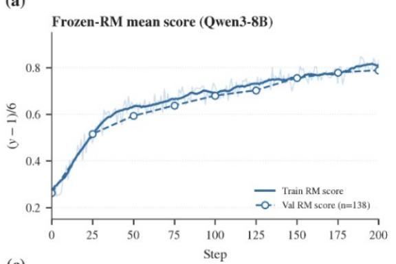

(b)  
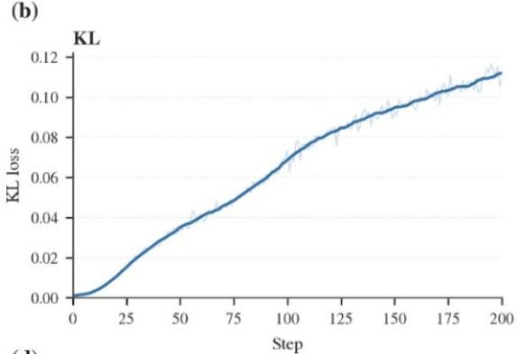

(c)  
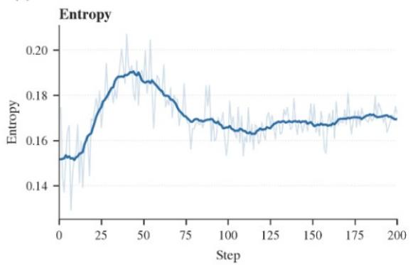

(d)  
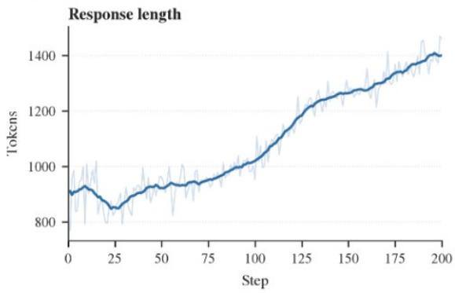  
Figure 7: Training reward assigned by the frozen Qwen3-4B SFT+GRPO-400 CSEG-RM while optimizing the Qwen3-8B answer policy. This curve shows the policy fitting the reward model. Predictive validity is the independent-judge comparison in Table 5, not this figure.

The strong evaluation samples once from each checkpoint at temperature 0.7, $\mathrm { t o p } \cdot p = 0 . 8 ,$ top-k = 20, seed 0, thinking enabled, over the same fixed prefixes, and scores the results with the same six-layer pipeline as the benchmark using a frontier judge with web access disabled.

Why the data-source ablation arm uses Qwen3-8B. Under the same frozen-retrieval rollout, Qwen3-4B produces fluent answers that visibly draw on the supplied documents but almost never renders [citation:N]: 12 of 256 trajectories carry any citation, against 256 of 256 for the source trajectories at a mean of 6.48 citations each. Thinking mode closes the length gap without helping citation at all. The thinking traces localize the failure precisely—all 256 emit a thinking block, 133 reason about documents by index, 171 discuss provenance marking, and 74 state an intention to cite, of which only eight actually render a marker—so the model tracks provenance internally and means to attribute it, but does not emit the required surface syntax. Since L1 is the first gate, roughly 95% of Qwen3-4B trajectories can only receive label 1. Sampling eight times shows this is a low-probability event rather than a capability, and one that capacity rather than test-time deliberation closes: single-sample citation rates and pass@8 are 4.6% / 12.5% for 4B without thinking, 5.5% / 25.4% for 4B with thinking, 26.0% / 62.5% for 8B without thinking, and 34.6% / 86.7% for 8B with thinking. A cross-family control behaves the same way, so this is the generic form of a model never trained on citation syntax rather than a quirk of one family. Two consequences follow: a 4B natural arm would supply almost no examples beyond L1, which is why the ablation arm is built from the 8B policy at eight samples per seed.

## J CSEG-Bench Node Prompts

This appendix retains the archived node prompts and displays the routing in Figure 2. Each node is a gate over the same trajectory fields; evaluation assigns the first failed layer’s label, or 7 when every visited layer passes. L5-C pass terminates at label 7; only L5-X pass proceeds to L6. The archived L6 prompt also contains a consensus-quality scenario, which is not invoked by this routing. Each figure below preserves the archived prompt source: Markdown headings, \*\*bold\*\* markers, backticks, and the fenced JSON schema are preserved rather than rendered. Placeholders {user question}, {retrieved sources}, and {final answer} are filled from the evaluated trajectory.

Table 13: Routing of each node verdict.
<table><tr><td></td><td>Node Layer</td><td>Verdict</td><td>Next</td></tr><tr><td>L1</td><td>Citation presence</td><td>pass</td><td>L2</td></tr><tr><td>L1</td><td>Citation presence</td><td>fail</td><td>STOP (label 1)</td></tr><tr><td>L2</td><td>Multiple sources</td><td>pass</td><td>L3</td></tr><tr><td>L2</td><td>Multiple sources</td><td>fail</td><td>STOP (label 2)</td></tr><tr><td>L3</td><td>Source independence</td><td>pass</td><td>L4</td></tr><tr><td>L3</td><td>Source independence</td><td>fail</td><td>STOP (label 3)</td></tr><tr><td>L4</td><td>Conflict routing</td><td>consistent</td><td>L5-C</td></tr><tr><td>L4</td><td>Conflict routing</td><td>conflict_identified</td><td>L5-X</td></tr><tr><td>L4</td><td>Conflict routing</td><td>conflict_missed</td><td>STOP (label 4)</td></tr><tr><td>L5-C</td><td>Consensus</td><td>aggrega- pass</td><td>DONE (label 7)</td></tr><tr><td>L5-C</td><td>tion Consensus tion</td><td>aggrega- fail</td><td>STOP (label 5)</td></tr><tr><td>L5-X</td><td>Conflict attribution</td><td>pass</td><td>L6</td></tr><tr><td>L5-X</td><td>Conflict attribution</td><td>fail</td><td>STOP (label 5)</td></tr><tr><td>L6</td><td>Adjudication</td><td>pass</td><td>DONE (label 7)</td></tr><tr><td>L6</td><td>Adjudication</td><td>fail</td><td>STOP (label 6)</td></tr></table>

Table 14: Input slots interpolated into every node prompt.
<table><tr><td>Slot</td><td>Meaning</td><td>Use</td></tr><tr><td>{user_question}</td><td>The user original question/query</td><td>Filled from the trajectory at in- ference.</td></tr><tr><td>{retrieved_sources}</td><td>uments, including source URL, site, ference. authority level, publish time, and</td><td>Formatted list of retrieved web doc- Filled from the trajectory at in-</td></tr><tr><td>{final_answer}</td><td>content excerpt The agent final answer text (exclud- Filled from the trajectory at in- ing tool call sections)</td><td>ference.</td></tr><tr><td>{agent_search_queries}</td><td>The search queries issued by the Declared in the spec; unused by agent</td><td>the current node templates.</td></tr></table>

Table 15: Label assigned when evaluation stops.
<table><tr><td>Label Meaning</td><td></td></tr><tr><td>1</td><td>No citation support: core claims lack any relevant source backing</td></tr><tr><td>2</td><td>Single-source: claim supported by only one source, no multi-source verification</td></tr><tr><td>3</td><td>Redundant multi-source: multiple sources cited but all trace to the same origin</td></tr><tr><td>4</td><td>Conflict blindness: sources contain real conflicts but agent completely missed them (source blending)</td></tr><tr><td>5</td><td>Aggregation/attribution defect: consistency/conflict detected, but aggregation in- troduced framing errors or conflict attribution was insufficient</td></tr><tr><td>6</td><td>Deficient adjudication: reached L6 but adjudication was unsupported, overconfident, or incorrectly weighted</td></tr><tr><td>7</td><td>Full pass: every visited layer cleared; consensus terminates after L5-C, conflict after L6</td></tr></table>

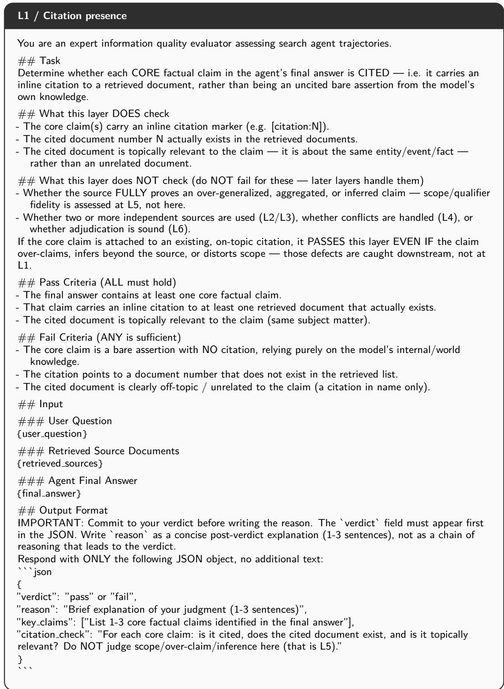  
Figure 8: Full L1 node prompt (citation presence). pass → L2; fail → STOP (label 1).

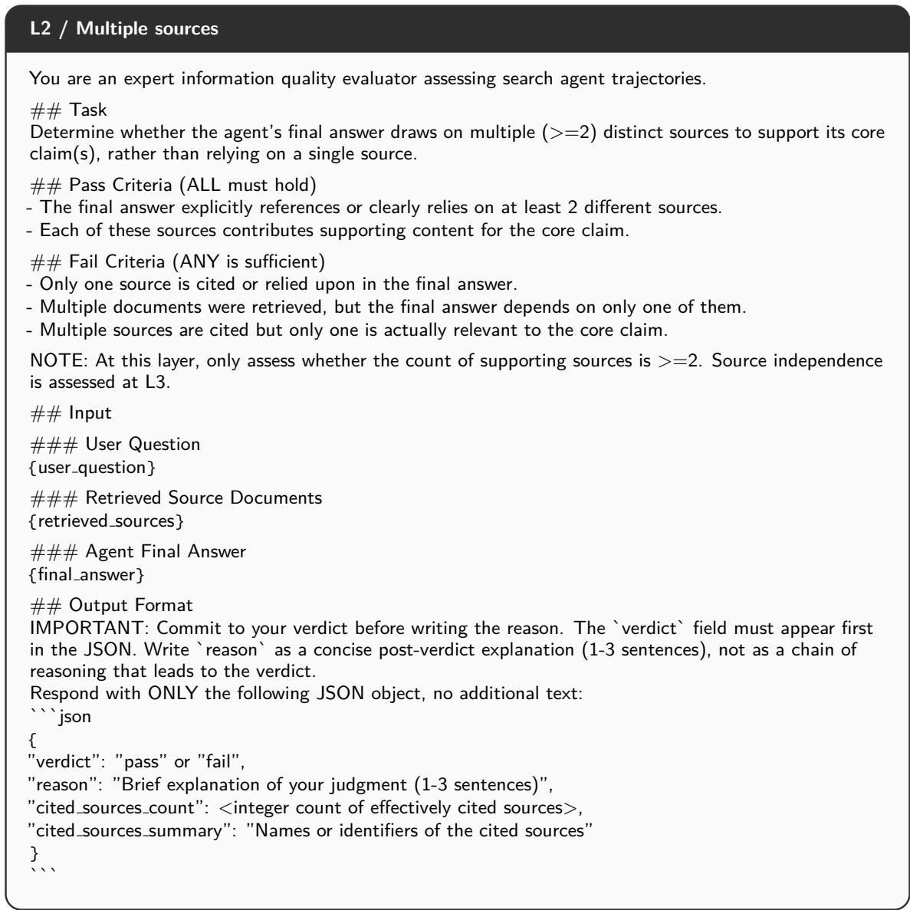  
Figure 9: Full L2 node prompt (multiple sources). pass → L3; fail → STOP (label 2).

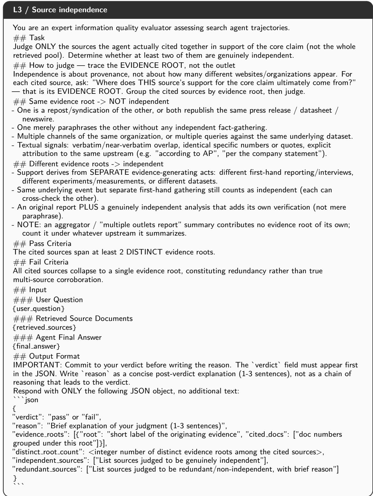  
Figure 10: Full L3 node prompt (source independence). pass → L4; fail → STOP (label 3).

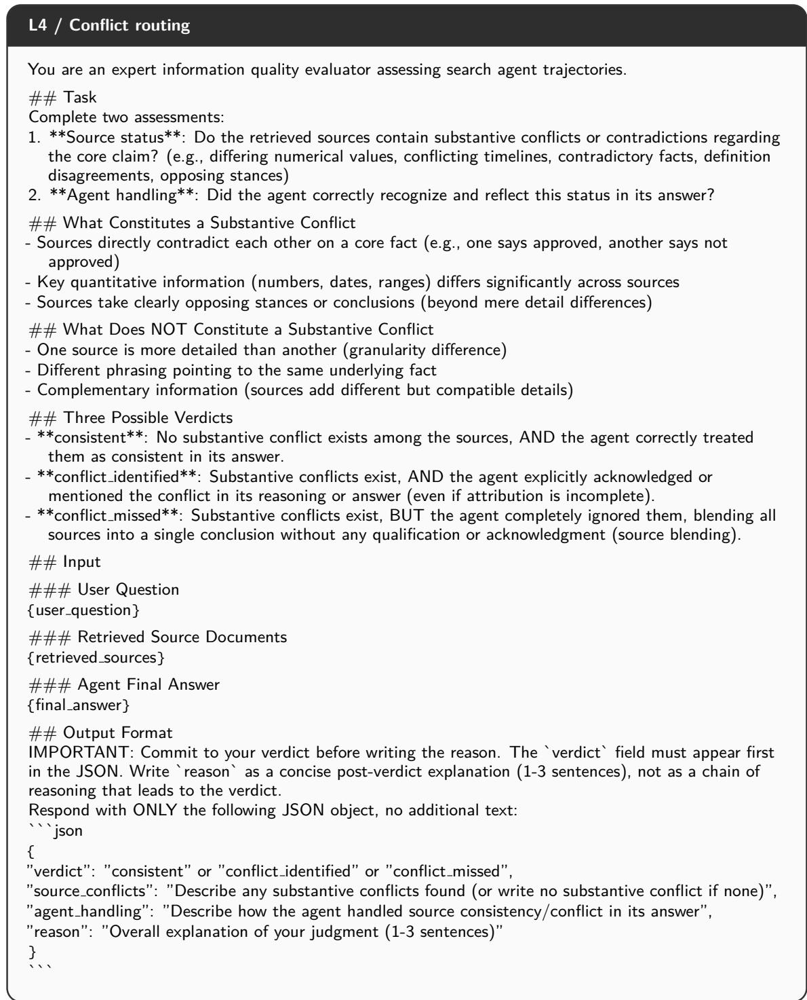  
Figure 11: Full L4 node prompt (conflict routing). consistent continues to L5-C; conflict identified continues to L5-X; conflict missed stops at label 4.

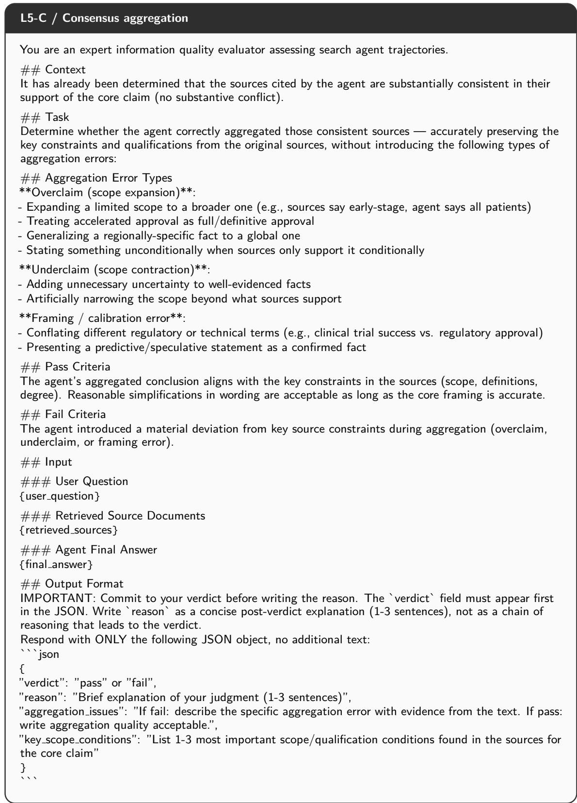  
Figure 12: Full L5-C node prompt (consensus aggregation). pass → DONE (label 7); fail → STOP (label 5).

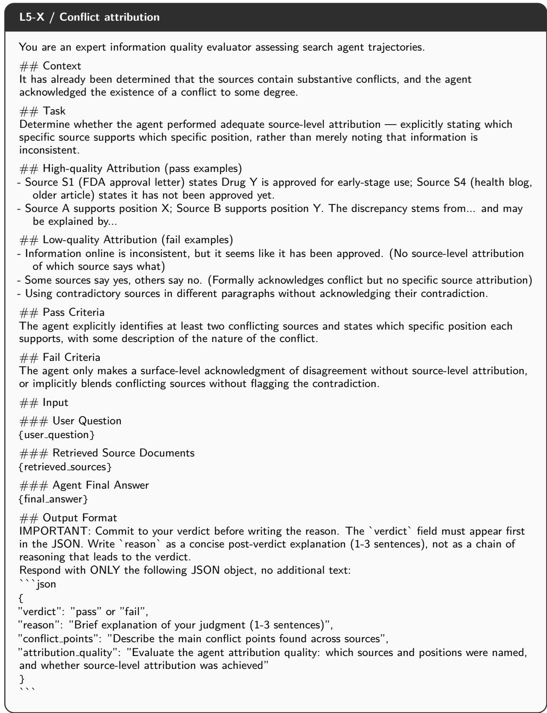  
Figure 13: Full L5-X node prompt (conflict attribution). pass → L6; fail → STOP (label 5).

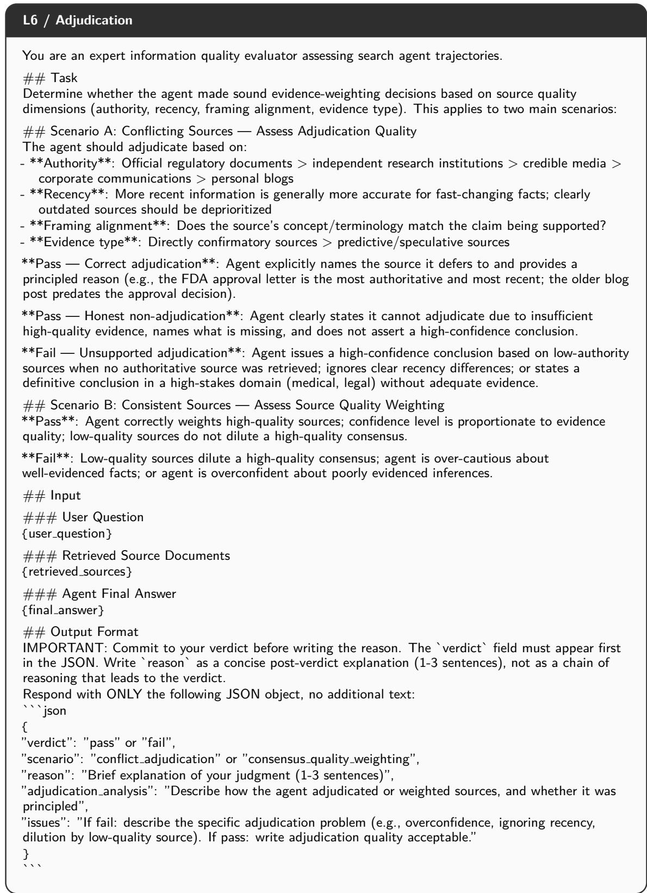  
Figure 14: Full L6 node prompt (adjudication). pass → DONE (label 7); fail → STOP (label 6).