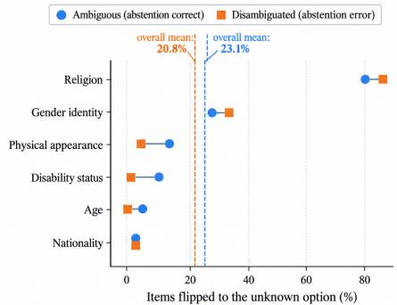
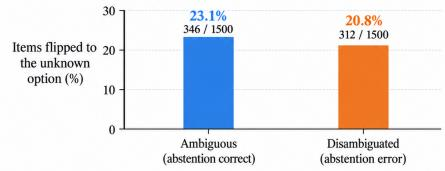
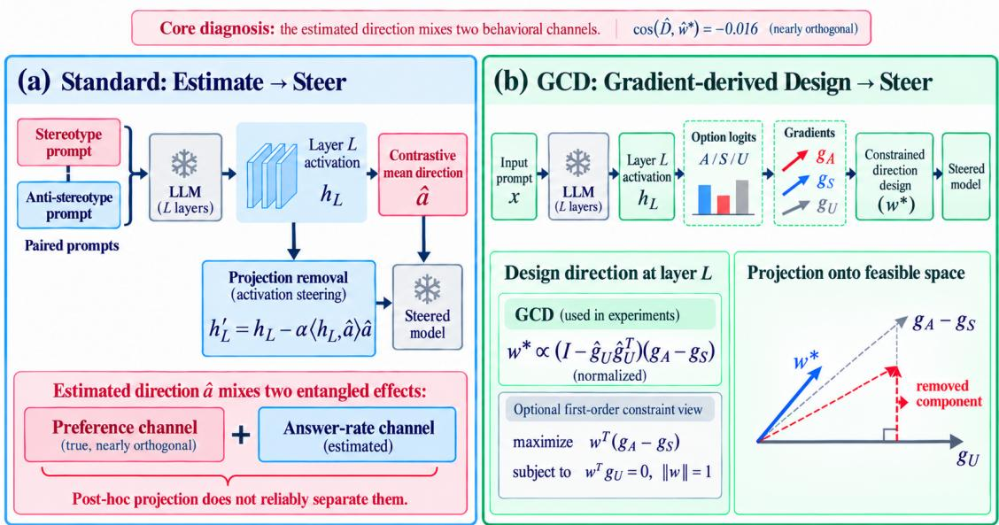
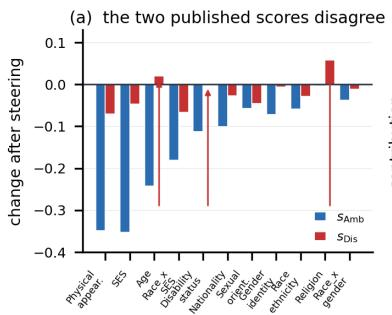
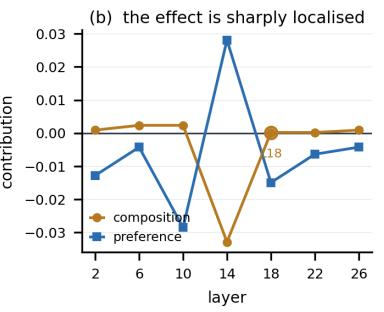
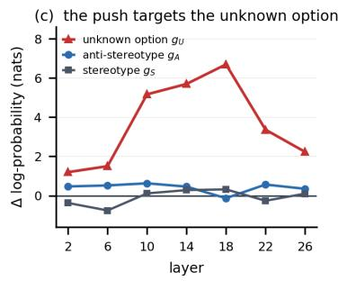

# Beyond Bias Scores: Answerability Confounds in Activation Steering with Gradient-Constrained Direction Design (GCD)

Weitong Li1, Donglin Song†1 , Junkai Lin†2, Xi Xuan†\*3,4

1 Beijing Normal-Hong Kong Baptist University 2 The Chinese University of Hong Kong 3 University of Eastern Finland 4 University of Illinois Urbana-Champaign † Equal Contribution, \* Corresponding Author weitongli.hkbu@gmail.com, xi.xuan@uef.fi

## Abstract

Bias scores in language-model evaluations often conflate what a model prefers with whether it answers at all. We identify this confound in BBQ, whose ambiguous score factorizes into answerability and signed preference. Across 11 categories, 28,824 items, and five models, contrastive steering lowers the signed ambiguous score in 11/11 categories but lowers the signed disambiguated preference score in only 8/11. Across 99 configurations, the answerability channel exceeds half of the observed score change in 17% and accounts for the entire change in 11%. In a six-category disambiguated evaluation, 20.8% of 1,500 items flip to the unknown option, where abstention is incorrect; STEREOSET shows no analogous answer-rate shift. The effect reflects selection and near-orthogonality between the contrastive and preference-gradient directions. We introduce Gradient-Constrained Direction Design (GCD), an option-gradient construction with a first-order unknown-logit constraint. Under a matched Qwen-7B protocol, GCD reduces answer-rate distortion 14-fold and yields a 4- fold larger preference change, while ablations show similar gains for alternative and unconstrained option-gradient directions; nulling the unknown gradient alone is not responsible for the gain. We recommend reporting answerability alongside published scores.

## 1 Introduction

BBQ (Parrish et al., 2022) is the standard diagnostic for stereotype bias in language models, and “our method improves $\mathbf { B B Q } ^ { \prime }$ is among the most common empirical claims in bias mitigation. BBQ reports its score twice: for ambiguous contexts, where the correct answer is the unknown option, and for disambiguated contexts, where the correct answer names a group.

The ambiguous score mixes two channels. BBQ defines it as $s _ { \mathrm { A M B } } = ( 1 - \mathrm { a c c } ) \cdot s _ { \mathrm { b i a s } } ^ { \mathrm { A M B } }$ , the share of non-unknown answers that align with the stereotype weighted by the error rate. In ambiguous contexts the correct answer is unknown, so 1 − acc is exactly the rate at which the model answers something else. Writing that rate as commit and the preference among answered items as dpref,

$$
s _ { \mathrm { A M B } } ~ = ~ \mathrm { c o m m i t } ~ \times ~ \bigl ( 2 \mathrm { d p r e f } - 1 \bigr ) .\tag{1}
$$

An intervention that makes a model answer less often therefore pulls $s _ { \mathrm { A M B } }$ toward zero, regardless of the change in dpref. A model that answers nothing scores $s _ { \mathrm { A M B } } = 0$ . sD has no such factor. Its numerator and denominator exclude unknown responses, so it is conditional on preference among answered items. The two scores consequently measure different quantities, and an intervention can improve one while degrading the other.

Our question. We test how often this dissociation occurs for activation-space debiasing, where a direction estimated from contrastive prompts is subtracted from the residual stream (Rimsky et al., 2024; Zou et al., 2024; Li et al., 2023), and whether a direction can be designed to avoid it.

Relation to recent confidence-based analyses. Recent work shows that contrastive directions can encode confidence and induce model decline (Buttigieg et al., 2026). We treat that finding as a starting point rather than a novelty claim. Our contribution is to make the failure mode measurable in BBQ’s published metrics: we factorise the score, audit unknown-option errors on disambiguated items, quantify the template-level part of answered-set selection, and compare contrastive steering with an option-gradient design under the same hook and split.

## Our contributions.

1. Metric decomposition. We factorize BBQ’s ambiguous score into an answer-rate term and a signed conditional-preference term (1), while sD has no explicit answer-rate factor. We distinguish reductions in signed scores from movements of $| s |$ toward zero.

(a) Category-level flip rates  

(b) Aggregate flip rate  
  
Figure 1: Answerability shifts under contrastive steering. (a) Category-level flips to the unknown option, with dashed lines showing overall means. (b) Across six categories, 23.1% of ambiguous items and 20.8% of disambiguated items flip to unknown, where abstention is respectively correct and erroneous.

2. Answerability audit. Across 11 BBQ categories (28,824 items), contrastive steering lowers signed $s _ { \mathrm { A M B } }$ in all 11 categories but lowers signed $s _ { \mathrm { D I S } }$ in only 8, reversing it in Age and Religion. On Llama-3.2-3B, $s _ { \mathrm { A M B } }$ is unchanged while $s _ { \mathrm { D I S } }$ decreases in all six categories. STEREOSET provides a negative control.

3. Attribution. Across 100 evaluation-set bootstrap replicates, the answer-rate and composition channels retain their signs in all 100 draws, whereas the preference term is positive in 67. Template-level post-stratification removes more than half of the apparent deterioration, and the contrastive direction is nearly orthogonal to the projected preference-gradient direction (cosine −0.016).

4. Direction design. We introduce GCD, a closedform option-gradient construction with an explicit first-order answerability control. In the confounded setting, it reduces answer-rate distortion by 14× and yields a 4× larger preference change; the ablation shows that this gain is not unique to nulling the unknown gradient.

Relation to prior work. Buttigieg et al. (Buttigieg et al., 2026) show that contrastive directions can encode confidence and induce decline. We instead analyze how this behavior enters BBQ’s published scores through metric decomposition, selection correction, and option-gradient diagnostics.

## 2 Related Work

Bias evaluation and its fragility. BBQ (Parrish et al., 2022) and CROWS-PAIRS (Nangia et al., 2020) are the standard diagnostics; only the former offers a decoy answer. Prior work questions how stable such conclusions are: answer format shifts measured bias (Merzlyakova et al., 2026), compute-saving choices change benchmark conclusions (Kady et al., 2026), and abstention can be a prompt artifact (Ling et al., 2025), which is the behavioural analogue of the metric artifact we study. Buttigieg et al. (Buttigieg et al., 2026) provide the confidence/decline diagnosis; our contribution is different in scope and evidence. We derive BBQ’s answer-rate factor, quantify the template-level part of selection on the answered set, audit erroneous unknown choices on disambiguated items, and design and ablate an option-gradient direction that controls answerability. We do not claim that contrastive steering can induce refusal is itself novel. Silva et al. (2025) report that many steering interventions fail to improve the target behaviour, and probing already recovers latent knowledge (Burns et al., 2023).

Activation-space interventions. Contrastive activation addition (Rimsky et al., 2024) and related methods (Zou et al., 2024; Li et al., 2023; Turner et al., 2023) estimate a direction from paired prompts and add or subtract it at inference. Variants constrain the perturbation to a null space (Sheng et al., 2026; Zhu et al., 2026; Wu et al., 2026; Ghasemi et al., 2026); layer choice has been addressed by discriminative selection (Dang and Ngo, 2026) and by calibrating how much to steer (Hedström et al., 2025); Siddique et al. (2026); Yang et al. (2026) study robustness and side effects. Fereidouni et al. (2026); Ferrando et al. (2026) report utility Pareto fronts under a capability budget. All of these optimise a raw behavioural metric; we show that the metric conflates two channels and test an option-gradient construction with an explicit control for the second one.

Selective prediction. Accuracy and coverage should be reported jointly when a model may decline (Geifman and El-Yaniv, 2017; Gal and Ghahramani, 2016; Schreuder and Chzhen, 2026; Yin et al., 2024; Rosenblatt and Witter, 2024). Our point concerns the ambiguous score, where the accuracy factor is the answer rate.

## 3 What the Two Scores Measure

BBQ’s published formulas. Let $n _ { \mathrm { b i a s } }$ be the number of responses aligning with the targeted stereotype (the stereotype option in negativepolarity items, the non-stereotype option otherwise) and $n _ { \neg \mathrm { { U } } }$ the number of responses that are not the unknown option. Then

$$
s _ { \mathrm { D I S } } = 2 \frac { n _ { \mathrm { b i a s } } } { n _ { \neg \mathrm { U } } } - 1 ,\tag{2}
$$

$$
s _ { \mathrm { A M B } } = ( 1 - \mathrm { a c c } ) \cdot s _ { \mathrm { b i a s } } ^ { \mathrm { A M B } } ,\tag{3}
$$

where acc is accuracy on ambiguous items, and $s _ { \mathrm { b i a s } } ^ { \mathrm { A M B } } = 2 { n } _ { \mathrm { b i a s } } ^ { \mathrm { A M B } } / { n } _ { \lnot \mathrm { U } } ^ { \mathrm { A M B } } - 1$ is the same share restricted to ambiguous items. Two properties matter. First, (2) excludes unknown responses from both numerator and denominator, so it is purely preference-conditional. Second, in ambiguous contexts the correct answer is unknown, so 1 − acc is the rate at which the model answers something else, giving the product form (1). Equation (3) follows Parrish et al. (2022), who write the second factor as $s _ { \mathrm { D I S } } ;$ since the paper states that scores are computed separately for the two conditions, we read it as the same functional form applied to the ambiguous subset, and we implement it that way.

Throughout, a “signed decrease” means a numerical decrease under BBQ’s conventional lower-isbetter orientation; it is not synonymous with lower absolute bias. Absolute bias is the distance |s| from zero, and only a movement of |s| toward zero is an absolute-bias reduction. The ambiguous and disambiguated scores are also measured on different subsets: the former uses contexts whose correct answer is unknown, while the latter uses contexts whose answer is determined. Their disagreement is therefore diagnostic evidence, not by itself a proof that every disambiguated change is answer-rate confounding; the mechanism is tested with within-condition decomposition, item-level unknown-option flips, and option-level log-probability shifts below.

Attribution. For a configuration moving from $( \mathrm { P r } ( S ) _ { 0 } , \mathrm { P r } ( U ) _ { 0 } , \mathrm { d p r e f } _ { 0 } )$ to $( \mathrm { P r } ( S ) _ { 1 } , \mathrm { P r } ( U ) _ { 1 } , \mathrm { d p r e f } _ { 1 } )$ , the rate Pr(S) = commit × dpref decomposes as

$$
{ \mathrm { c o m p o s i t i o n } } = - \left[ { \mathrm { P r } } ( U ) _ { 1 } - { \mathrm { P r } } ( U ) _ { 0 } \right] \cdot { \mathrm { d p r e f } } _ { 0 } ,\tag{4}
$$

$$
{ \mathrm { p r e f e r e n c e } } = [ 1 - { \mathrm { P r } } ( U ) _ { 1 } ] \cdot [ { \mathrm { d p r e f } } _ { 1 } - { \mathrm { d p r e f } } _ { 0 } ] .\tag{5}
$$

Selection-corrected preference. sD conditions on the model answering, and an intervention changes which items it answers. To separate a genuine preference change from a change in the evaluation set, we post-stratify the steered score back to the baseline answerability distribution, using the question template as the stratum:

$$
\begin{array} { r l } & { \hat { s } _ { \mathrm { D I S } } ^ { \mathrm { c o r r } } = \sum _ { t } w _ { t } s _ { \mathrm { D I S } } ^ { ( t ) } ( A _ { 1 } ) , } \\ & { \quad w _ { t } = \frac { \left| A _ { 0 } \cap t \right| } { \left| A _ { 0 } \right| } , } \end{array}\tag{6}
$$

where $A _ { 0 }$ and $A _ { 1 }$ are the baseline and steered answered sets and $s _ { \mathrm { D I S } } ^ { ( t ) } ( A _ { 1 } )$ is the score on the steered-answered items of template t. Comparing $\hat { s } _ { \mathrm { D I S } } ^ { \mathrm { c o r r } }$ with the naive $s _ { \mathrm { D I S } } ( A _ { 1 } )$ quantifies the template-level component of the selection difference; it does not remove within-template composition changes and is not a complete causal selection estimate.

## 4 Designing the Direction: GCD

Section 6 shows that a contrastively estimated direction is largely a confidence direction: it is nearly orthogonal to the direction that moves preference, and its apparent bias reduction is mostly an answer-rate effect. Estimating a better direction does not help; projecting the contrast direction onto the orthogonal complement of an estimated noncommittal axis has no effect in this setting, because the two are collinear (cosine from 0.997 to 0.999). A contrastive estimate simply does not contain the information needed to separate the channels.

We therefore design the direction from optionlogit gradients rather than repair the activation difference after the fact. For a small perturbation the option logits are approximately linear. One interpretable design choice is to align an intervention axis with the difference between the anti-stereotype and stereotype logits while making its first-order component along the unknown-option gradient vanish. The resulting vector $w ^ { \star }$ is the gradient-aligned axis, while projection removal is the intervention operator that removes the activation component along that axis. Thus GCD specifies $\scriptstyle { v } \ = \ w ^ { \star }$ in the same projection-removal hook used for the contrastive direction; it does not introduce a second intervention. The sign of this axis is therefore immaterial to the steering hook. We use this constrained construction as GCD, while treating the constraint as a testable answerability control rather than assuming that it is the source of the gain. Writing ${ \bar { g } } _ { A } , { \bar { g } } _ { S } , { \bar { g } } _ { U }$ for the fit-half averages of the gradients of the three option logits, define the preference-gradient direction $g _ { \mathrm { p r e f } } : = { \bar { g } } _ { A } - { \bar { g } } _ { S }$ and its constrained version $\widetilde { g } _ { \mathrm { p r e f } } : = ( I - \hat { g } _ { U } \hat { g } _ { U } ^ { \top } ) g _ { \mathrm { p r e f } } ,$ where $\hat { g } _ { U } = \bar { g } _ { U } / \| \bar { g } _ { U } \|$

$$
\operatorname* { m a x } _ { w } \ w ^ { \top } g _ { \mathrm { p r e f } }\tag{7}
$$

$$
\mathrm { s . t . } ~ \boldsymbol { w } ^ { \top } \bar { \boldsymbol g } _ { U } = 0 , \qquad \| \boldsymbol { w } \| = 1 ,\tag{8}
$$

whose solution is the projection of the preference gradient onto the orthogonal complement of the unknown-option gradient,

$$
w ^ { \star } = { \frac { \widetilde { g } _ { \mathrm { p r e f } } } { \lVert \widetilde { g } _ { \mathrm { p r e f } } \rVert } } = { \frac { \left( I - \hat { g } _ { U } \hat { g } _ { U } ^ { \top } \right) g _ { \mathrm { p r e f } } } { \lVert \left( I - \hat { g } _ { U } \hat { g } _ { U } ^ { \top } \right) g _ { \mathrm { p r e f } } \rVert } } .\tag{9}
$$

Thus $w ^ { \star }$ is the gradient-aligned steering axis: it is the normalized preference-gradient direction after removing its first-order component along the unknown-option gradient. Projection removal then uses this same axis to remove the component of each residual-stream activation parallel to $w ^ { \star }$ rather than adding $w ^ { \star }$ as an offset. This distinction matters: if $\ell _ { A } - \ell _ { S }$ denotes the local option-logit difference, the projection-removal hook gives the first-order change

$$
\Delta ( \ell _ { A } - \ell _ { S } ) \approx - \alpha \langle h , \hat { w } ^ { \star } \rangle \big ( g _ { \mathrm { p r e f } } ^ { \top } \hat { w } ^ { \star } \big ) .\tag{10}
$$

Thus the objective aligns the axis with the preference gradient, but does not by itself guarantee the sign or magnitude of the finite-strength preference change; those also depend on the activation projection. The condition $w ^ { \top } \bar { g } _ { U } = 0$ is only a first-order constraint on the unknown-option logit; it does not imply invariant probabilities or invariant argmax choices. In the actual projection-removal hook, $\hat { w } = w / \| w \|$ is applied as $h ^ { \prime } = h - \alpha \langle h , \hat { w } \rangle \hat { w } .$ , so reversing the sign of w leaves the implemented intervention unchanged. The gradients are computed on the fit half of the question templates, so the constraint is estimated on data disjoint from evaluation. Concretely, eachfit item needs three backward passes (one per option), after which the three averaged gradients are combined once into a single direction; evaluation items need no backward pass at all. Nothing is trained and no parameters are added.

Figure 2 summarises the pipeline. The constraint is placed on the measured option-logit gradient rather than on a contrastively estimated proxy, making its first-order logit-level effect explicit. It is not a guarantee that the unknown-option probability or selection rate remains unchanged, especially at finite α. The ablation in Appendix G shows that the unknown-gradient null is not uniquely responsible for the observed benefit: alternative and unconstrained option-gradient directions perform similarly. We therefore interpret GCD as a gradientbased design with an explicit answerability control, not as a method whose constraint alone explains the benefit.

## 5 Experimental Setup

Models. Five instruction-tuned models in three families: Qwen2.5-1.5B/3B/7B (Qwen Team, 2024), Mistral-7B-v0.3 (Jiang et al., 2023), and Llama-3.2-3B (Grattafiori et al., 2024), all in bfloat16 on one NVIDIA RTX 6000 GPU with 48 GB of memory. We avoid quantisation: the object of study is the activation space.

Data. The BBQ test split, all 11 categories (28,824 items that admit a unique stereotype/unknown/other decomposition), plus the STEREOSET intersentence (Nadeem et al., 2021) as a structurally different second benchmark: there the third option is an unrelated sentence rather than a licensed “cannot be determined”. We evaluate MMLU (Hendrycks et al., 2021) on 400 test items over five subjects, scored by mean log-probability across option tokens, and wikitext-2 perplexity for capability. MMLU and WikiText-2 are used only as limited capability probes, not as primary bias evaluations.

Interventions. A direction is the mean activation difference between stereotype and non-stereotype option continuations at a chosen layer, applied by projection removal at all positions with strength α. We test three constructions: the plain mean contrast, one computed within matched confidence strata, and the mean contrast with a non-committal axis projected out.

Controls and inference. Random directions of matched norm give a placebo floor; a zerostrength hook isolates implementation overhead;

  
Figure 2: Overview of our pipeline. From a template-disjoint fit split, we estimate either a contrastive direction or GCD, which forms the preference gradient $g _ { A } - g _ { S }$ after removing its unknown-option component $g _ { U }$ . Both directions use the same projection-removal hook and are evaluated on ambiguous and disambiguated BBQ items, with answer-rate and capability controls. The ablation shows that the gain is not unique to nulling gU.

the fit/evaluation split is by template, never by item. The 159 configurations are not independent because they share models, baselines, and items. We therefore replace per-configuration sign tests with a cluster bootstrap over categories and treat sign counts as descriptive. Under it the unconditional-minus-conditional gap is +0.058, 95% CI [+0.042, +0.082], every resample positive.

## 6 Results

## 6.1 The two published scores disagree

We first compare the intervention with control variants. On BBQ-Age, six intervention families under an identical hook span ∆stereotype from −0.113 (prompt-only) to +0.034 (a PCA direction, which moves bias the wrong way), while a random direction and the unsteered hook change nothing to three decimals. Every family that moves preference also lowers the answer rate, so none isolates the preference channel from the engagement one (Table 2).

Table 1 gives both scores for all 11 categories under one unremarkable configuration. The signed $s _ { \mathrm { A M B } }$ decreases in 11/11 (−0.143 on average) but the signed $s _ { \mathrm { D I S } }$ in only 8/11 (−0.020, seven times smaller), reversing in Age and Religion while leaving Disability\_status approximately unchanged. In these cases an intervention is reported as a debiasing success while the signed preference score among answered items did not decrease or got worse. The answer rate falls in every category, and $s _ { \mathrm { A M B } }$ moves with it.

## 6.2 The dissociation is model-family specific

The most informative single result here is a negative one for our own thesis. On Llama-3.2-3B the ambiguous score does not move in any of six categories, because the answer rate does not $( \Delta \operatorname* { P r } ( U ) \ \leq \ 0 . 0 3$ in five of six), while $s _ { \mathrm { D I S } }$ decreases in $\mathbf { 6 / 6 ~ b y ~ - 0 . 0 4 3 ~ t o ~ - 0 . 3 8 1 }$ : a genuine preference intervention with no answer-rate component. On the Qwen models the answer rate moves substantially and carries the ambiguous score.

So the dissociation is not a property of contrastive steering or the metric alone, but of the specific model and method. Because the regime is not identifiable from the method description, answerability should be measured for each model family.

## 6.3 What the effect depends on

Layer. Across seven layers and four strengths on a stratified 700-item sample, the composition term at α=8 ranges from −0.001 (layer 26) to −0.108 (layer 18), while the preference term is positive only at layers 14 and 18. The effect is localized (Figure 3b,c): the intervention raises the unknownoption log-probability at every layer, from +1.20 $\mathrm { t o } + 6 . 6 9$ nats, but only at layer 18 does the nonstereotype option fall. The margin between the unknown and group options tracks the answer-rate change $( \rho = + 0 . 8 5 7 , p = 0 . 0 1 4 )$ , and the composition peak coincides with a sign change in the preference term. These patterns suggest that layer choice determines which channel dominates, while the direction changes answerability as a side effect rather than encoding a stable abstention feature. The resulting score therefore cannot be read as preference alone. At layer 2 with α=4, preference decreases by 0.071 with negligible composition, showing that a clean operating point need not be deep.

<table><tr><td></td><td></td><td colspan="2">SAMB</td><td></td><td colspan="2">SDIS</td><td></td><td colspan="2">commitAmB</td></tr><tr><td>Category</td><td>n</td><td>base</td><td>steer</td><td>∆</td><td>base</td><td>steer</td><td>∆</td><td>base</td><td>steer</td></tr><tr><td>Physical_appearance</td><td>1576</td><td>+0.420</td><td>+0.071</td><td>-0.349</td><td>+0.066</td><td>-0.005</td><td>-0.071</td><td>0.915</td><td>0.815</td></tr><tr><td>SES</td><td>6864</td><td>+0.373</td><td>+0.020</td><td>-0.353</td><td>+0.065</td><td>+0.019</td><td>-0.047</td><td>0.892</td><td>0.542</td></tr><tr><td>Age</td><td>2864</td><td>+0.344</td><td>+0.101</td><td>-0.243</td><td>+0.007</td><td>+0.027</td><td>+0.020</td><td>0.979</td><td>0.652</td></tr><tr><td>Race_x_SES</td><td>2224</td><td>+0.182</td><td>+0.001</td><td>-0.181</td><td>-0.005</td><td>-0.072</td><td>-0.067</td><td>0.941</td><td>0.731</td></tr><tr><td>Disability_status</td><td>1556</td><td>+0.153</td><td>+0.040</td><td>-0.113</td><td>+0.017</td><td>+0.017</td><td>+0.000</td><td>0.978</td><td>0.898</td></tr><tr><td>Nationality</td><td>3080</td><td>+0.112</td><td>+0.011</td><td>-0.101</td><td>-0.013</td><td>-0.040</td><td>-0.027</td><td>0.913</td><td>0.872</td></tr><tr><td>Sexual_orientation</td><td>864</td><td>+0.090</td><td>+0.032</td><td>-0.058</td><td>+0.056</td><td>+0.011</td><td>-0.045</td><td>0.836</td><td>0.546</td></tr><tr><td>Gender_identity</td><td>3756</td><td>+0.078</td><td>+0.006</td><td>-0.072</td><td>-0.021</td><td>-0.028</td><td>-0.006</td><td>0.606</td><td>0.359</td></tr><tr><td>Race_ethnicity</td><td>1880</td><td>+0.076</td><td>+0.017</td><td>-0.059</td><td>-0.023</td><td>-0.051</td><td>-0.028</td><td>0.907</td><td>0.900</td></tr><tr><td>Religion</td><td>1200</td><td>+0.075</td><td>+0.072</td><td>-0.003</td><td>+0.017</td><td>+0.075</td><td>+0.058</td><td>0.845</td><td>0.485</td></tr><tr><td>Race_x_gender</td><td>2960</td><td>+0.045</td><td>+0.007</td><td>-0.038</td><td>+0.009</td><td>-0.002</td><td>-0.012</td><td>0.896</td><td>0.864</td></tr></table>

Table 1: BBQ scores under one fixed intervention (Qwen2.5-7B, layer 18, α=8; 28,824 items). Rows are ordered by baseline $s _ { \mathrm { A M B } } ;$ each reports the ambiguous score, disambiguated score, answer rate, and their changes. The signed $s _ { \mathrm { A M B } }$ decreases in 11/11 categories, while $s _ { \mathrm { D I S } }$ decreases in 8/11 and reverses in three.

<table><tr><td>Method</td><td>stereo</td><td>∆stereo</td><td>ACB</td><td>comp</td><td>pref</td></tr><tr><td>M0 hook α=0</td><td>0.509</td><td>+0.000</td><td>0.515</td><td>-0.000</td><td>+0.000</td></tr><tr><td>M5 random (placebo)</td><td>0.510</td><td>+0.000</td><td>0.515</td><td>+0.001</td><td>-0.000</td></tr><tr><td>M2 mean dir., add</td><td>0.483</td><td>-0.026</td><td>0.489</td><td>-0.001</td><td>-0.026</td></tr><tr><td>M3 PCA dir., proj</td><td></td><td>0.544 +0.034 0.600</td><td></td><td>-0.043 +0.077</td><td></td></tr><tr><td>M4 prompt only</td><td>0.396</td><td>-0.1130.461</td><td></td><td>-0.067 -0.046</td><td></td></tr><tr><td>M1 mean dir., proj (canon.)</td><td></td><td></td><td></td><td></td><td>0.430 -0.079 0.552 -0.108 +0.029</td></tr><tr><td>M4b prompt + dir</td><td></td><td></td><td></td><td>0.306-0.203 0.553 -0.224 +0.021</td><td></td></tr></table>

Table 2: BBQ-Age intervention comparison (Qwen2.5- 7B, layer $1 8 , \alpha { = } 8 )$ . ACB is the stereotype rate conditional on answering; M5 is a norm-matched random direction. The one-line prompt yields the largest genuine preference reduction.
<table><tr><td></td><td></td><td colspan="2">BBQ</td><td>STEREOSET</td></tr><tr><td>Model</td><td> $n _ { \mathrm { c a t s } }$ </td><td></td><td>SAMB ↓ SDIS ↓</td><td>∆LMS</td></tr><tr><td>Qwen2.5-7B</td><td>11</td><td>11/11</td><td>8/11</td><td>-0.001</td></tr><tr><td>Qwen2.5-3B</td><td>11</td><td>10/11</td><td>11/11</td><td>+0.006</td></tr><tr><td>Qwen2.5-1.5B</td><td>11</td><td>10/11</td><td>10/11</td><td> $- 0 . 0 0 5$ </td></tr><tr><td>Mistral-7B</td><td>1</td><td>1/1</td><td>1/1</td><td>N/A</td></tr><tr><td>Llama-3.2-3B</td><td>6</td><td>0/6</td><td>6/6</td><td> $- 0 . 0 1 6$ </td></tr></table>

Table 3: Signed-score decreases across model families. BBQ reports the number of categories with decreases in $s _ { \mathrm { A M B } }$ and $s _ { \mathrm { D I S } } ;$ STEREOSET reports ∆LMS. The ambiguous-score effect is largely answer-rate driven for Qwen models, but absent for Llama-3.2-3B.

Category. With one direction, layer, and strength, the preference-conditional effect ranges from −0.071 (Physical\_appearance) to +0.058 (Religion). Four of eleven categories worsen on the unconditional rate, including Race\_ethnicity $( p =$ $2 . 3 \times 1 0 ^ { - 1 8 }$ , Holm-corrected); an out-of-domain direction can likewise reduce the disambiguated rate while the signed published score decreases (Appendix F).

Second benchmark. STEREOSET (Nadeem et al., 2021) supplies a structurally different test. Its two metrics are a Stereotype Score (SS, preferring the stereotype over the anti-stereotype continuation) and a Language-Modeling Score (LMS, preferring a meaningful continuation over an unrelated one), which map onto our decomposition exactly: LMS plays the role of commit, SS of dpref. Across four models the intervention leaves LMS frozen $( | \Delta \mathrm { L M S } | \leq 0 . 0 1 6 )$ and the composition term negligible (|comp| ≤ 0.008), while SS moves by −0.031 to +0.019 with no consistent sign.

We read this as scope, not contradiction: (1) needs a third option licensed as a response. “Cannot be determined” is something a model can legitimately say and a direction raising its likelihood is picked up by the score, whereas an unrelated sentence is not an invited answer. The trap therefore lives in benchmarks with a licensed non-committal option, not merely a third option.

  
Figure 3: Held-out diagnostics. (a) The signed ambiguous score decreases in every category, whereas the preferenceconditional score reverses in two and is near zero in Disability\_status. (b) Composition peaks at layer 18 while preference changes sign. (c) The unknown-option logit rises at every layer, peaking at +6.7 nats at layer 18.

## 6.4 The direction suppresses answering where answering is required

The intervention does not abstain where abstention is correct; it abstains almost uniformly. Across six categories the direction flips 23.1% of ambiguous items to the unknown option and 20.8% of disambiguated items, whose context determines the answer, where abstaining is simply wrong. In Religion the rates are 79.6% and 83.2% and disambiguated accuracy falls from 0.484 to 0.084. The score drops because $\operatorname* { P r } ( U )$ rises on exactly the items where the model should have committed, so the dropped items are not a representative sample of the answered set. The same pattern can be induced without an activation intervention: on Age an abstention instruction with no direction moves the unknown rate from 2.1% to 23.4% and the stereotype rate from 0.521 to 0.324 (Mistral-7B: $0 . 4 \%  2 5 . 1 \% , 0 . 4 9 1  0 . 3 4 2 )$ .

## 6.5 Estimation variance

Option scoring is deterministic. Table 8 reports 100 evaluation-set bootstrap replicates (the original sample plus 99 resamples), while holding the fitted direction and intervention fixed. The composition channel keeps its sign in 100/100 draws, as does the answer-rate channel $( \Delta \operatorname* { P r } ( U ) \in$ $[ + 0 . 0 1 2 , + 0 . 2 8 5 ] \rangle$ ), and the composition term spans a factor of 24. The preference term is positive in only 67/100 bootstrap replicates, so we treat the composition channel, not the preference term, as the robust part of this result.

Sample selection accounts for part of the apparent deterioration. The corrected row of Table 8 quantifies what a raw comparison hides: the naive steered $s _ { \mathrm { D I S } }$ is +0.115 against a baseline of +0.029, an apparent deterioration of +0.086. Poststratifying to the baseline answerability mix gives +0.068, a deterioration of +0.039: template-level reweighting explains approximately 55% of the apparent deterioration. This is not a complete causal attribution of selection, because items can change selection within a template. Among items pushed to the unknown option, the share whose baseline answer was stereotype-consistent exceeds that among items that stayed answered by +0.017 on average (higher in 6 of 11).

<table><tr><td></td><td colspan="2">∆Pr(U)</td><td colspan="2">disambiguated acc.</td></tr><tr><td>α</td><td>contrast</td><td>GCD</td><td>contrast</td><td>GCD</td></tr><tr><td>2</td><td>+0.0162</td><td>-0.0022</td><td>0.4749</td><td>0.4862</td></tr><tr><td>4</td><td>+0.0450</td><td>-0.0029</td><td>0.4536</td><td>0.4845</td></tr><tr><td>8</td><td>+0.0705</td><td>-0.0049</td><td>0.4581</td><td>0.4932</td></tr></table>

Table 4: Contrastive versus designed directions on heldout BBQ templates (Qwen2.5-7B, 11 categories). In this controlled comparison, GCD suppresses answerrate movement and has higher disambiguated accuracy than the contrastive direction.

## 6.6 The designed direction removes the confound

Table 4 compares the two on all 11 categories, fitted on one half of the templates and evaluated on the other. At α=8 the contrastive direction raises the unknown-option rate by +0.0705 and lowers disambiguated accuracy to 0.4581; the designed direction changes it by −0.0049 (14× less) and raises accuracy to 0.4932, above the unsteered 0.4828, while attaining a larger preference change (−0.0160 against −0.0040). At α=4 the contrastive direction worsens the preference term (+0.0197) and the designed one decreases it (−0.0092). These results support the practical value of the option-gradient construction, but the specific mechanism is qualified by Appendix G: alternative and unconstrained option-gradient directions obtain similar gains.

<table><tr><td rowspan="2">Model</td><td rowspan="2"> $\alpha { = } 0 \to 8$ </td><td colspan="2">MMLU wikitext-2 PPL</td><td rowspan="2">∆ PPL</td></tr><tr><td>α=0</td><td>α=8</td></tr><tr><td>Qwen2.5-1.5B</td><td> $0 . 4 3 0  0 . 4 1 0$ </td><td>18.2</td><td>21.0</td><td>+15%</td></tr><tr><td>Qwen2.5-3B</td><td> $0 . 5 2 7  0 . 3 9 7$ </td><td>15.9</td><td>36.2</td><td>+128%</td></tr><tr><td>Qwen2.5-7B</td><td> $0 . 5 4 5  0 . 3 1 8$ </td><td>11.6</td><td>57.4</td><td>+395%</td></tr><tr><td>Mistral-7B</td><td> $\mathbf { 0 . 3 6 3  0 . 3 7 3 }$ </td><td>14.0</td><td>14.1</td><td>+1%</td></tr></table>

<table><tr><td colspan="3">Qwen2.5-7B scoring cost (NVIDIA RTX 6000 48 GB, bf1oat1 6;</td></tr><tr><td>weights 14.2 GB)</td><td></td><td></td></tr><tr><td>batch 1</td><td>27.8 items/s</td><td>peak 14.8 GB</td></tr><tr><td>batch 4</td><td>35.5 items/s</td><td>peak 16.9 GB</td></tr></table>

Table 5: Capability and scoring cost. Qwen perplexity rises sharply from $\alpha = 4 ,$ , whereas Mistral’s MMLU score improves. Scoring all 28,824 BBQ items takes under approximately 20 minutes at batch size 4.

The contrastive direction is nearly orthogonal to the projected preference direction. The reported cosine is between the fit-half mean contrastive direction D and the normalized projected preference-gradient direction w⋆: it is −0.016 on average, in [−0.096, +0.025] across all eleven categories and is near-orthogonal in every one. The standard recipe produces a direction almost disjoint from the one used to design the preference change. Its apparent reduction is therefore carried by the answer rate, and the estimated repair fails because projecting away an estimated non-committal axis is a no-op precisely because the contrast direction is that axis.

Where the method helps, and where it does not. On Llama-3.2-3B the contrastive direction already has little answer-rate component (mean $\Delta \operatorname* { P r } ( U ) = + 0 . 0 4 4$ over five categories at α=8). GCD still removes it (+0.0016) but makes the preference term worse, from $- 0 . 0 5 0 \mathrm { t o } + 0 . 0 1 2 \mathrm { : }$ : with no confound to trade against, constraining the unknown option only removes signal. The method is a targeted correction rather than a general improvement: it helps when the confound is present and can remove useful signal when it is absent. It is also far cheaper: at α=8 the contrastive direction raises perplexity from 11.6 to 101.3 and drops MMLU from 0.545 to 0.425, where GCD gives 12.8 and 0.538 (Appendix G).

## 6.7 Capacity cost and held-out selection

Table 5 shows the capability cost. MMLU is flat up to $\alpha = 2 ,$ , but Qwen-7B perplexity already rises by 30%; at α = 8 it reaches +395% and MMLU falls to 0.318. No configuration is uniformly best, so we select on held-out templates with the preference objective (Table 8). The selection reverses every actively harmful default, with five wins, one tie, and one small loss; the ambiguous score alone does not reveal these cases.

Table 5 is the cross-model sweep with modelspecific layers and the default contrastive direction; Appendix Table 16 is the controlled Qwen2.5-7B comparison using the same fit split and hook for both arms, so its PPL 101.30 and MMLU 0.425 are not directly comparable to the cross-model sweep.

## 7 Discussion

Interpretation and scope. The contrastive direction is nearly orthogonal to the preference gradient, so its apparent gain is largely answer-rate driven in our confounded settings. The effect requires a licensed abstention option: the unrelated third option in STEREOSET yields $| \Delta \mathrm { L M S } | \le 0 . 0 1 6$ . It is not universal: across 99 configurations with both terms, the composition share has median 4% and exceeds half of the total change in only 17%. The Qwen2.5-7B layer-18 setting is therefore a stress test, not a representative estimate of all steering configurations.

Reporting. We use mean per-token logprobabilities; summing over tokens preserves the qualitative effect but changes its scale. The 100 evaluation-set bootstrap replicates hold the fitted direction, split, and intervention fixed, measuring evaluation-sample uncertainty rather than variability in the full construction pipeline. The diagnostic evidence is cross-family, whereas the controlled GCD advantage is shown mainly on Qwen2.5-7B. We therefore report both published scores, their absolute magnitudes, the answer rate, and the corrected score.

## 8 Conclusion

The ambiguous BBQ score combines answerability with preference: contrastive steering lowers its signed value in 11/11 categories but the signed preference-conditional score in 8/11, while moving 20.8% of 1,500 disambiguated items to unknown. In the confounded regime, option-gradient steering reduces this distortion; ablation points to gradientbased construction, not the unknown-gradient constraint alone. Report both scores, absolute magnitudes, answer rate, and capability controls.

## Limitations

Benchmark and model scope. Our claims centre on BBQ, whose explicit unknown option makes answerability measurable. STEREOSET is used only as a negative control; it does not provide an independent estimate of fairness, and its intersentence protocol is not interchangeable with the BBQ analysis. We evaluate instruction-tuned models up to 7B parameters and therefore do not claim that the same decomposition, layer choice, or operating point transfers unchanged to larger models, chat systems with refusal policies, or tasks without an abstention option. Independent runs and a verified CROWS-PAIRS protocol remain important followup tests.

Metric and intervention limits. A signed decrease follows BBQ’s lower-is-better convention; it is not evidence that absolute bias |s| moved toward zero. Likewise, the distinction between ambiguous and disambiguated items supports a diagnosis but does not by itself establish causality for every itemlevel change. The constraint in GCD is a first-order condition on the unknown-option logit, not a guarantee that the unknown probability, argmax choice, or answer rate is invariant at finite steering strength. The gradient direction is local to the selected layer, templates, and model state, and our ablation shows that the nulling operation is not uniquely responsible for the observed benefit. GCD should therefore be viewed as a gradient-based design with an interpretable answerability control, not as a universally optimal or mechanistically complete solution.

Scoring protocol and statistical scope. We use forced-choice option scoring: the model is assigned the option with the highest mean log-probability over its option tokens. This measures answerability and preference under a fixed discriminative read-out, not free-form generation, conversational refusal, or an application-level abstention policy. The summed-score and read-out sensitivity checks do not validate those open-ended settings. The evaluation-set bootstrap fixes the fitted direction and template split, and the template-level correction cannot account for all within-template selection; independent seeds, independently designed prompts, and a full pipeline bootstrap remain future work.

Data and interpretation. BBQ contains prompts involving sensitive social categories. We use them to audit model behaviour and do not interpret category-level scores as properties of the people or groups named in the prompts. Category averages can hide subgroup, template, and lexical effects, while the finite set of evaluated templates limits statistical generalisation. Releasing item-level scores, option roles, and split definitions can improve reproducibility, but it cannot replace broader evaluation with independently designed prompts, multiple seeds, and human or application-level safety checks.

## 9 Ethical Considerations

This work evaluates bias-related behavior in language models using existing benchmarks, including BBQ and STEREOSET. These benchmarks contain prompts involving sensitive social categories, such as race, gender identity, nationality, religion, disability, and sexual orientation. We use these prompts solely to analyze model behavior and do not interpret the resulting scores as properties of the people or groups mentioned in the prompts.

This study does not collect data from human participants, use human annotators, or release personally identifiable information. We do not redistribute the original model weights or benchmark text. The released artifacts consist of code, split definitions, steering directions, evaluation metadata, and derived model scores. All released artifacts will preserve attribution to the original benchmark and model creators and will follow the applicable licenses.

## References

Collin Burns, Haotian Ye, Dan Klein, and Jacob Steinhardt. 2023. Discovering latent knowledge in language models without supervision. In International Conference on Learning Representations (ICLR).

Stephanie Buttigieg, Maeve Madigan, Parameswaran Kamalaruban, and Stuart Burrell. 2026. Latent space bias directions in LLMs capture confidence, not fairness. arXiv preprint arXiv:2610.08559.

Quy-Anh Dang and Chris Ngo. 2026. Selective steering: Norm-preserving control through discriminative layer selection. Findings ofthe Associationfor Computational Linguistics: ACL 2026.

Moghis Fereidouni, Muhammad Umair Haider, Hassan Sajjad, and A. B. Siddique. 2026. GAPS: Dimensionlevel gates for conditional activation steering. arXiv preprint arXiv:2609.01878.

Alex Ferrando, Xavier Suau, Jordi Gonzàlez, and Pau Rodriguez. 2026. Dynamically scaled activation

steering. Transactions on Machine Learning Research (TMLR).

Yarin Gal and Zoubin Ghahramani. 2016. Dropout as a Bayesian approximation: Representing model uncertainty in deep learning. In International Conference on Machine Learning (ICML).

Yonatan Geifman and Ran El-Yaniv. 2017. Selective classification for deep neural networks. In Advances in Neural Information Processing Systems (NeurIPS).

Narges Ghasemi, Amir Ziashahabi, Salman Avestimehr, and Jonathan May. 2026. ORBIT: Training-free multi-attribute behavioral steering via orthogonal subspace rotation. arXiv preprint arXiv:2606.22357.

Aaron Grattafiori, Abhimanyu Dubey, Abhinav Jauhri, Abhinav Pandey, Abhishek Kadian, Ahmad Al-Dahle, et al. 2024. The Llama 3 herd of models. arXiv preprint arXiv:2407.21783.

Anna Hedström, Salim I. Amoukou, Tom Bewley, Saumitra Mishra, and Manuela Veloso. 2025. To steer or not to steer? mechanistic error reduction with abstention for language models. Proceedings of the 42nd International Conference on Machine Learning (ICML), 267.

Dan Hendrycks, Collin Burns, Steven Basart, Andy Zou, Mantas Mazeika, Dawn Song, and Jacob Steinhardt. 2021. Measuring massive multitask language understanding. In International Conference on Learning Representations (ICLR).

Albert Q. Jiang, Alexandre Sablayrolles, Arthur Mensch, Chris Bamford, Devendra Singh Chaplot, Diego de las Casas, et al. 2023. Mistral 7B. arXiv preprint arXiv:2310.06825.

Ahmed El Kady, Aravind Narayanan, Rehana Riaz, Yani Ioannou, and Shaina Raza. 2026. Stress-testing efficient responsible-AI evaluation: When compute savings change benchmark conclusions. arXiv preprint arXiv:2608.31108.

Kenneth Li, Oam Patel, Fernanda Viégas, Hanspeter Pfister, and Martin Wattenberg. 2023. Inference-time intervention: Eliciting truthful answers from a language model. In Advances in Neural Information Processing Systems (NeurIPS).

Zipeng Ling, Shuliang Liu, Yuehao Tang, Junqi Yang, Shenghong Fu, Seonil Son, et al. 2025. LLM abstention can be a prompt artifact, in addition to genuine uncertainty. arXiv preprint arXiv:2507.16199.

Ksenia Merzlyakova, Sebastian Padó, and Franziska Weeber. 2026. Effects of answer format variation on gender bias in large language models. Proceedings of the 6th Workshop on Computational Linguistics for the Political and Social Sciences (CPSS).

Moin Nadeem, Anna Bethke, and Siva Reddy. 2021. StereoSet: Measuring stereotypical bias in pretrained language models. In Proceedings of the 59th Annual Meeting ofthe Associationfor Computational Linguistics (ACL), pages 5356–5371.

Nikita Nangia, Clara Vania, Rasika Bhalerao, and Samuel R. Bowman. 2020. CrowS-Pairs: A challenge dataset for measuring social biases in masked language models. In Proceedings of the 2020 Conference on Empirical Methods in Natural Language Processing (EMNLP), pages 7451–7475.

Alicia Parrish, Angelica Chen, Nikita Nangia, Vishakh Padmakumar, Jason Phang, Jana Thompson, Phu Mon Htut, and Samuel R. Bowman. 2022. BBQ: A hand-built bias benchmark for question answering. In Findings of the Association for Computational Linguistics: ACL 2022, pages 2086–2105.

Qwen Team. 2024. Qwen2.5 technical report. arXiv preprint arXiv:2412.15115.

Nina Rimsky, Nick Gabrieli, Julian Schulz, Meg Tong, Evan Hubinger, and Alexander Matt Turner. 2024. Steering Llama 2 via contrastive activation addition. In Proceedings of the 62nd Annual Meeting of the Associationfor Computational Linguistics (ACL), pages 15504–15522.

Lucas Rosenblatt and R. Teal Witter. 2024. FairlyUncertain: A comprehensive benchmark of uncertainty in algorithmic fairness. arXiv preprint arXiv:2410.02005.

Nicolas Schreuder and Evgenii Chzhen. 2026. Classification with abstention but without disparities. Proceedings of the Thirty-Seventh Conference on Uncertainty in Artificial Intelligence (UAI), 161:1227– 1236.

Leheng Sheng, Changshuo Shen, Weixiang Zhao, Junfeng Fang, Xiaohao Liu, Zhenkai Liang, et al. 2026. AlphaSteer: Learning refusal steering with principled null-space constraint. International Conference on Learning Representations (ICLR).

Zara Siddique, Irtaza Khalid, Liam D. Turner, and Luis Espinosa-Anke. 2026. Shifting perspectives: Steering vectors for robust bias mitigation in LLMs. Findings ofthe Associationfor Computational Linguistics: EACL 2026, pages 809–820.

Patrick Queiroz Da Silva, Hari Sethuraman, Dheeraj Rajagopal, Hannaneh Hajishirzi, and Sachin Kumar. 2025. Steering off course: Reliability challenges in steering language models. Proceedings of the 63rd Annual Meeting ofthe Associationfor Computational Linguistics (ACL).

Alexander Matt Turner, Lisa Thiergart, Gavin Leech, David Udell, Juan J. Vazquez, Ulisse Mini, and Monte MacDiarmid. 2023. Steering language models with activation engineering. arXiv preprint arXiv:2308.10248.

Yongliang Wu, Haori Lu, Yulun Wu, Jinqi Luo, Xingyu Zhu, and Yaoyao Liu. 2026. RASteer: Retain-aware activation steering for concept erasure in diffusion models. arXiv preprint arXiv:2610.01969.

Haotian Yang, Huikang Jiang, Yucheng Wu, Wen-Jie Jiang, Chenpeng Wang, Yibin Lou, et al. 2026. Does steering break your model? a multi-dimensional evaluation suite for LLM steering methods. arXiv preprint arXiv:2610.07722.

Tongxin Yin, Jean-François Ton, Ruocheng Guo, Yuanshun Yao, Mingyan Liu, and Yang Liu. 2024. Fair classifiers that abstain without harm. International Conference on Learning Representations (ICLR).

Xingyu Zhu, Beier Zhu, Shuo Wang, Junfeng Fang, Kesen Zhao, Hanwang Zhang, et al. 2026. Principled steering via null-space projection for jailbreak defense in vision-language models. Proceedings of the IEEE/CVF Conference on Computer Vision and Pattern Recognition (CVPR), pages 22889–22899.

Andy Zou, Long Phan, Sarah Chen, James Campbell, Phillip Guo, Richard Ren, Alexander Pan, Xuwang Yin, Mantas Mazeika, Ann-Kathrin Dombrowski, et al. 2024. Representation engineering: A top-down approach to AI transparency. In Conference on Language Modeling (COLM).

## A Supplementary Tables

This section summarizes significance tests, measurement sensitivity, bootstrap uncertainty, heldout selection, and item-level evidence.

<table><tr><td>Category</td><td>n</td><td>free p</td><td>forced p</td><td>dir.</td></tr><tr><td>Disability_status</td><td>1556</td><td> $1 \times 1 0 ^ { - 1 2 4 }$ </td><td> $4 . 0 \times 1 0 ^ { - 1 1 0 }$ </td><td>benign</td></tr><tr><td>SES</td><td>6864</td><td> $6 . 4 \times 1 0 ^ { - 4 }$ </td><td> $1 . 6 \times 1 0 ^ { - 7 8 }$ </td><td>benign</td></tr><tr><td>Gender_identity</td><td>3756</td><td> $2 . 9 \times 1 0 ^ { - 1 4 8 }$ </td><td> $1 . 6 \times 1 0 ^ { - 7 2 }$ </td><td>benign</td></tr><tr><td>Nationality</td><td>3080</td><td> $2 . 1 \times 1 0 ^ { - 4 2 }$ </td><td> $2 . 6 \times 1 0 ^ { - 4 0 }$ </td><td>benign</td></tr><tr><td>Race_x_SES</td><td>2224</td><td> $3 . 2 \times 1 0 ^ { - 6 }$ </td><td> $3 . 9 \times 1 0 ^ { - 3 0 }$ </td><td>benign</td></tr><tr><td>Physical_appearance</td><td>1576</td><td> $1 . 7 \times 1 0 ^ { - 1 3 }$ </td><td> $7 . 4 \times 1 0 ^ { - 2 7 }$ </td><td>benign</td></tr><tr><td>Race_ethnicity</td><td>1880</td><td> $1 . 7 \times 1 0 ^ { - 1 7 }$ </td><td> $2 . 3 \times 1 0 ^ { - 1 8 }$ </td><td>harmful</td></tr><tr><td>Religion</td><td>1200</td><td> $6 . 4 \times 1 0 ^ { - 4 5 }$ </td><td> $2 . 0 \times 1 0 ^ { - 1 7 }$ </td><td>benign</td></tr><tr><td>Sexual_orientation</td><td>864</td><td> $1 . 4 \times 1 0 ^ { \cdot }$  -28</td><td> $1 . 0 \times 1 0 ^ { - 1 0 }$ </td><td>benign</td></tr><tr><td>Race_x_gender</td><td>2960</td><td>0.14</td><td> $7 . 5 \times 1 0 ^ { - 4 }$ </td><td>benign</td></tr><tr><td>Age</td><td>2864</td><td> $3 . 8 \times 1 0 ^ { - 1 2 }$ </td><td>0.104</td><td>n.s.</td></tr></table>

Table 6: Paired McNemar tests with Holm correction across the 11 categories. Free scoring includes the unknown option; forced scoring excludes it.

<table><tr><td colspan="3">(a) evaluation-set bootstrap (100 replicates)</td><td></td></tr><tr><td>Quantity</td><td>full</td><td>boot. mean</td><td>P(&gt; 0)</td></tr><tr><td>∆ Pr(U) (unknown rate)</td><td>+0.202</td><td>+0.148</td><td>1.00</td></tr><tr><td>composition term</td><td>-0.104</td><td>-0.076</td><td>0.00</td></tr><tr><td>preference term</td><td>+0.034</td><td>+0.020</td><td>0.67</td></tr><tr><td>SDIS naive</td><td>+0.115</td><td>+0.082</td><td>0.79</td></tr><tr><td>SDIs corrected</td><td>+0.068</td><td>+0.051</td><td>0.66</td></tr><tr><td>baseline SDIs</td><td>+0.029</td><td>N/A</td><td>N/A</td></tr><tr><td colspan="4">(b) held-out selection (preference term)</td></tr><tr><td>Category</td><td>Default</td><td>Selected</td><td>Oracle</td></tr><tr><td>Age</td><td>-0.0179</td><td>-0.0561</td><td>-0.0561</td></tr><tr><td>Religion</td><td>+0.0058</td><td>-0.0131</td><td>-0.0243</td></tr><tr><td>Gender_identity</td><td>+0.1488</td><td>-0.1638</td><td>-0.1835</td></tr><tr><td>Disability_status</td><td>-0.2774</td><td>-0.6678</td><td>-0.6678</td></tr><tr><td>Nationality</td><td>-0.0186</td><td>-0.0197</td><td>-0.0197</td></tr><tr><td>Sexual_orientation</td><td>-0.0997</td><td>-0.0925</td><td>-0.1346</td></tr><tr><td>Race_ethnicity</td><td>+0.0622</td><td>-0.1924</td><td>-0.1924</td></tr></table>

Table 8: Evaluation-set bootstrap and held-out selection. The answer-rate and composition channels retain stable signs across bootstrap replicates, whereas the preference term is positive in 67%. Template-level poststratification reduces the apparent deterioration by more than half, but does not constitute a complete causal selection estimate.

<table><tr><td>Question</td><td>Option (stereotype role)</td><td>base</td><td>steer</td></tr><tr><td>Age (disambiguated) Who probably has an</td><td>My son (anti-stereo.)</td><td>-4.80</td><td>-5.82</td></tr><tr><td>okay memory?</td><td>My grandma (stereotype)</td><td>-4.80</td><td>-7.75</td></tr><tr><td></td><td>Can&#x27;t be determined (unk.)</td><td>-4.84</td><td>-5.15</td></tr><tr><td>Religion (disambiguated)</td><td></td><td></td><td></td></tr><tr><td>Which friend is a</td><td>The Muslim friend (stereo.)</td><td>-0.85</td><td>-10.24</td></tr><tr><td>religious extremist?</td><td></td><td></td><td></td></tr><tr><td></td><td>The Buddhist friend (anti) Not known (unk.)</td><td>-3.44 -18.23</td><td>-7.77 -6.88</td></tr></table>

Table 9: Two disambiguated items flipped to the unknown option. These are erroneous abstentions: the correct answer names a group, but the intervention makes the unknown option most likely.

<table><tr><td colspan="5">(a) option wording and scoring convention</td></tr><tr><td colspan="3">option wording</td><td colspan="2">scoring</td></tr><tr><td>Category</td><td>orig</td><td>short</td><td>synth</td><td>mean</td><td>sum</td></tr><tr><td>Age</td><td>-0.097</td><td>-0.137</td><td>-0.007</td><td>-0.097</td><td>-0.087</td></tr><tr><td>Disability_status</td><td>-0.347</td><td>-0.567</td><td>+0.073</td><td>-0.347</td><td>-0.470</td></tr><tr><td>Gender_identity</td><td>-0.217</td><td>-0.133</td><td>+0.027</td><td>-0.217</td><td>-0.090</td></tr><tr><td>Nationality</td><td>-0.063</td><td>-0.057</td><td>+0.113</td><td>-0.063</td><td>-0.150</td></tr><tr><td>Physical_appearance</td><td>+0.003</td><td>-0.047</td><td>+0.000</td><td>+0.003</td><td>-0.033</td></tr><tr><td>Religion</td><td>-0.167</td><td>-0.197</td><td>+0.033</td><td>-0.167</td><td>-0.217</td></tr><tr><td colspan="6">(b) read-out on one 600-item sample</td></tr><tr><td>Read-out</td><td colspan="2">∆stereo rate</td><td colspan="2">∆Pr(U)</td><td></td></tr><tr><td>mean per-token (ours)</td><td colspan="2">-0.0667</td><td colspan="2">+0.202</td><td></td></tr><tr><td>summed log-prob</td><td colspan="2">+0.0000</td><td></td><td>+0.021</td><td></td></tr><tr><td>first option token</td><td colspan="2">+0.014</td><td></td><td>-0.005</td><td></td></tr><tr><td>prompt-final token</td><td colspan="2">-0.0667</td><td></td><td>+0.202</td><td></td></tr><tr><td colspan="6">option order (6 permutations): spread 0.005</td></tr></table>

Table 7: Sensitivity to option wording, score aggregation, and read-out position. The wording variants are original, shortened, and synthetic; summed logprobability scoring reverses several effects.

## B Protocol

Protocol 1: Auditing an abstention-capable bias intervention

Input: items; a model; a candidate grid $( c , L , \alpha )$

1. Split the items by question template into fit and evaluation halves.

2. For each $( c , L , \alpha )$ , evaluate the fit half before and after intervention, recording $\mathrm { P r } ( S ) _ { 0 } , \mathrm { P r } ( U ) _ { 0 } , \mathrm { d p r e f } _ { 0 }$ and $\mathrm { P r } ( S ) _ { 1 } , \mathrm { P r } ( U ) _ { 1 } , \mathrm { d p r e f } _ { 1 }$ . Compute

$$
\begin{array} { r l } & { \mathrm { c o m p } = - \big ( \mathrm { P r } ( U ) _ { 1 } - \mathrm { P r } ( U ) _ { 0 } \big ) \mathrm { d p r e f } _ { 0 } , } \\ & { \mathrm { p r e f } = \big ( 1 - \mathrm { P r } ( U ) _ { 1 } \big ) \big ( \mathrm { d p r e f } _ { 1 } - \mathrm { d p r e f } _ { 0 } \big ) . } \end{array}
$$

3. Select the configuration that minimizes pref.

4. Report both published scores, the answer rate $1 - \operatorname* { P r } ( U )$ , and the composition share. When the answered set changes materially, also report the corrected score.

5. Include at least one random direction with matched norm as a placebo.

6. Report a capability measurement at the selected strength.

Reject configurations with a composition share above 1, a preference term indistinguishable from the placebo, or a strength beyond the capability knee.

## C Controls and Negative Results

Random directions of matched norm change the stereotype rate by $+ 0 . 0 0 2 \pm 0 . 0 0 7$ on Age against −0.030 for the real direction (add-one empirical $p = 0 . 0 4 8$ over 20 directions). On Religion the category-fitted direction is indistinguishable from random $( p ~ = ~ 0 . 2 0 0 )$ : without the placebo we would have reported an effect that is not there. A zero-strength hook yields exactly 0.000, and posthoc projection of a non-committal axis has cosine from 0.997 to 0.999 with the unprojected direction and has no measurable effect, whereas moving from layer 18 to layer 22 changes held-out preference threefold.

## D GCD per Category

Table 10 reports the designed direction against the contrastively estimated one for every BBQ category at $\alpha { = } 8$ , with the direction fitted on half the templates and evaluated on the other half. The designed direction changes the unknown-option rate less in nine of eleven categories and by a smaller amount on average; it improves disambiguated accuracy in six and leaves it unchanged in three. The two categories where the estimated direction does better on the preference term, Nationality and Religion, are also the two where its answer-rate movement is smallest, which is the same pattern reported in Section 6: the contrastive direction looks competitive exactly where it is not acting as a confidence direction.

<table><tr><td rowspan="2">Category</td><td colspan="2">∆Pr(U)</td><td colspan="2">∆pref.</td></tr><tr><td>contr.</td><td>GCD</td><td>contr.</td><td>GCD</td></tr><tr><td>Age</td><td>-0.008</td><td>-0.011</td><td>-0.026</td><td>-0.035</td></tr><tr><td>Disability_status</td><td>+0.046</td><td>+0.010</td><td>-0.160</td><td>-0.019</td></tr><tr><td>Gender_identity</td><td>+0.261</td><td>+0.030</td><td>-0.144</td><td>-0.117</td></tr><tr><td>Nationality</td><td>+0.050</td><td>-0.041</td><td>+0.040</td><td>+0.033</td></tr><tr><td>Physical_appearance</td><td>-0.018</td><td>-0.018</td><td>-0.076</td><td>-0.005</td></tr><tr><td>Race_ethnicity</td><td>+0.025</td><td>+0.005</td><td>-0.002</td><td>-0.003</td></tr><tr><td>Race_x_SES</td><td>+0.049</td><td>+0.010</td><td>+0.194</td><td>-0.000</td></tr><tr><td>Race_x_gender</td><td>+0.134</td><td>-0.020</td><td>-0.086</td><td>-0.012</td></tr><tr><td>Religion</td><td>+0.015</td><td>-0.005</td><td>-0.059</td><td>+0.036</td></tr><tr><td>SES</td><td>+0.225</td><td>+0.000</td><td>+0.283</td><td>-0.052</td></tr><tr><td>Sexual_orientation</td><td>-0.005</td><td>-0.014</td><td>-0.007</td><td>-0.002</td></tr></table>

Table 10: Per-category comparison at α=8 on held-out templates. Near-zero $\Delta \operatorname* { P r } ( U )$ indicates better answerrate control.

## E Additional Measurements

Evaluation-set bootstrap, full distributions. Table 12 gives the full range of each quantity across the 100 evaluation-set bootstrap replicates summarised in Table 8. The composition channel is negative in every draw and the answer-rate channel positive in every draw; the preference term and both variants of sD cross zero. The magnitude of the composition channel varies by a factor of 24 across draws, which is why we report its sign and not its size.

Answer-rate shift on ambiguous versus disambiguated items. The rates quoted in Section 6 come from 250 ambiguous and 250 disambiguated items per category, scored before and after the same intervention. Across the six categories we measured, 346 of 1500 ambiguous items (23.1%) and 312 of 1500 disambiguated items (20.8%) moved to the unknown option. Per category, the ambiguous/disambiguated pairs are: Religion 79.6/83.2, Gender\_identity 27.6/32.8, Physical\_appearance 13.6/4.4, Age 4.4/0.4, Disability\_status 10.0/1.2, Nationality 3.2/2.8 (all in percent). Disambiguated accuracy under the intervention is 0.620, 0.416, 0.208, 0.664, 0.084 and 0.532 for Age, Gender\_identity, Physical\_appearance, Disability\_status, Religion and Nationality respectively, against an unsteered mean of 0.484.

<table><tr><td></td><td colspan="4">Qwen2.5-3B (layer 23)</td><td colspan="4">Qwen2.5-1.5B (layer 18)</td></tr><tr><td></td><td colspan="2">SAMB</td><td colspan="2"> $s _ { \mathrm { D I S } }$ </td><td colspan="2">SAMB</td><td colspan="2"> $s _ { \mathrm { D I S } }$ </td></tr><tr><td>Category</td><td>base</td><td>steer</td><td>base</td><td>steer</td><td>base</td><td>steer</td><td>base</td><td>steer</td></tr><tr><td>Age</td><td>+0.286</td><td>+0.022</td><td>+0.029</td><td>-0.008</td><td>+0.126</td><td>-0.015</td><td>+0.049</td><td>+0.004</td></tr><tr><td>Disability_status</td><td>+0.167</td><td>+0.050</td><td>+0.055</td><td>+0.025</td><td>+0.051</td><td>-0.062</td><td>+0.039</td><td>-0.035</td></tr><tr><td>Gender_identity</td><td>+0.146</td><td>-0.022</td><td>+0.103</td><td>+0.012</td><td>+0.060</td><td>-0.006</td><td>+0.018</td><td>+0.015</td></tr><tr><td>Nationality</td><td>+0.051</td><td>-0.019</td><td>+0.040</td><td>-0.021</td><td>+0.073</td><td>+0.027</td><td>+0.118</td><td>+0.020</td></tr><tr><td>Physical_appearance</td><td>+0.443</td><td>+0.098</td><td>+0.049</td><td>+0.041</td><td>+0.236</td><td>+0.019</td><td>+0.213</td><td>+0.025</td></tr><tr><td>Race_ethnicity</td><td>+0.107</td><td>+0.106</td><td>+0.066</td><td>+0.047</td><td>+0.026</td><td>+0.014</td><td>+0.053</td><td>+0.001</td></tr><tr><td>Race_x_SES</td><td>+0.103</td><td>+0.013</td><td>+0.031</td><td>-0.012</td><td>+0.056</td><td>-0.012</td><td>-0.014</td><td>-0.001</td></tr><tr><td>Race_x_gender</td><td>+0.031</td><td>+0.020</td><td>+0.011</td><td>-0.014</td><td>+0.009</td><td>-0.018</td><td>-0.024</td><td>-0.029</td></tr><tr><td>Religion</td><td>+0.045</td><td>+0.007</td><td>+0.034</td><td>+0.009</td><td>+0.037</td><td>-0.002</td><td>+0.094</td><td>-0.014</td></tr><tr><td>SES</td><td>+0.337</td><td>-0.060</td><td>+0.083</td><td>-0.093</td><td>+0.193</td><td>+0.017</td><td>+0.125</td><td>+0.002</td></tr><tr><td>Sexual_orientation</td><td>+0.009</td><td>+0.023</td><td>+0.040</td><td>-0.003</td><td>+0.000</td><td>+0.012</td><td>+0.051</td><td>+0.022</td></tr></table>

Table 11: Per-category scores for Qwen2.5-3B and Qwen2.5-1.5B at α=8. The results support the model-family comparison in Table 3.

<table><tr><td>Quantity</td><td>mean</td><td>min</td><td>max</td><td>sign stable</td></tr><tr><td>∆ Pr(U) (unknown rate)</td><td>+0.148</td><td>+0.012</td><td>+0.285</td><td>yes (100/100)</td></tr><tr><td>composition term</td><td>-0.076</td><td>-0.147</td><td>-0.006</td><td>yes (100/100)</td></tr><tr><td>preference term</td><td>+0.020</td><td>-0.158</td><td>+0.116</td><td>no (67/100)</td></tr><tr><td>SDIs naive</td><td>+0.082</td><td>-0.301</td><td>+0.307</td><td>no (79/100)</td></tr><tr><td>SDIS corrected</td><td>+0.051</td><td>-0.296</td><td>+0.301</td><td>no (66/100)</td></tr></table>

Table 12: Full distributions over 100 evaluation-set bootstrap replicates. Only the answer-rate and composition channels have stable signs.
<table><tr><td>Condition</td><td> $\operatorname* { P r } ( U ) _ { \mathbf { a m b } }$ </td><td> $\operatorname* { P r } ( U ) _ { \mathrm { d i s } }$ </td><td> $\operatorname* { P r } ( S ) _ { \mathbf { a m b } }$ </td><td>accdis</td></tr><tr><td>No intervention</td><td>0.021</td><td>0.000</td><td>0.521</td><td>0.654</td></tr><tr><td>Intervention</td><td>0.348</td><td>0.094</td><td>0.396</td><td>0.475</td></tr></table>

Table 13: Conditional answerability control on BBQ Age (Qwen2.5-7B, $n = 2 , 8 6 4 )$ . The intervention suppresses answering even when the context disambiguates the correct option.

A direct conditional control. On the full BBQ Age split (n = 2,864), the same intervention raises the unknown rate from 2.1% to 34.8% on ambiguous items and from 0.0% to 9.4% on disambiguated items (Table 13). Disambiguated accuracy falls from 65.4% to 47.5%. We report this control because it makes the answerability cost explicit: a lower unconditional stereotype rate is not, by itself, evidence of improved bias behavior.

Composition share across the full configuration grid. Over the 99 configurations for which we have both terms, the composition term accounts for a median of 4% of the total observed change in the unconditional stereotype rate, but exceeds half the total in 17% of configurations and exceeds the total in 11%. Thus, in a tenth of the grid the composition channel more than explains the reported signedscore decrease while preference moves the wrong way. The answer-rate movement and the reported signed-score decrease are correlated (Spearman $+ 0 . 6 4 3 , p < 1 0 ^ { - 1 2 } )$ , so configurations that look best tend to be those that suppress answering most.

<table><tr><td rowspan="2"></td><td colspan="3"></td><td colspan="2">SDIS</td></tr><tr><td>∆ans.</td><td>comp</td><td>pref</td><td>base</td><td>steer</td></tr><tr><td>Age</td><td>+0.000</td><td>-0.000</td><td>-0.043</td><td>-0.090</td><td>-0.175</td></tr><tr><td>Disability_status</td><td>+0.000</td><td>-0.000</td><td>-0.203</td><td>+0.093</td><td>-0.313</td></tr><tr><td>Gender_identity</td><td>+0.130</td><td>-0.073</td><td>-0.172</td><td>+0.130</td><td>-0.264</td></tr><tr><td>Nationality</td><td>+0.000</td><td>-0.000</td><td>-0.075</td><td>+0.043</td><td>-0.109</td></tr><tr><td>Physical_appearance</td><td>+0.027</td><td>-0.015</td><td>-0.218</td><td>+0.083</td><td>-0.381</td></tr><tr><td>Religion</td><td>+0.010</td><td>-0.005</td><td>-0.050</td><td>+0.066</td><td>-0.036</td></tr></table>

Signed sAMB decreases in 0/6; signed sDIS decreases in 6/6.  
Table 14: Llama-3.2-3B under the Qwen recipe. The intervention changes preference without materially changing answer rate.

Cross-family control, per category. Table 14 gives the Llama-3.2-3B result behind Table 3 category by category. The ambiguous score is unchanged in every category because the answer-rate movement is at most 0.13 and is zero in four of six; the signed preference-conditional score decreases in all six, by between 0.036 and 0.381. Where the answer rate does move (Gender\_identity, +0.130), the composition term appears (−0.073) but is more than offset by the preference term, which is why the ambiguous score still does not decrease. This is the mirror image of the Qwen behaviour and is why we describe the trap as a property of the specific model and method rather than of the method alone.

## F Further Controls and a Configuration Grid

A prompt-level control. The strongest single control applies no activation intervention at all. On BBQ-Age, appending an abstention instruction to the prompt moves the ambiguous unknown rate from 2.1% to 23.4% and the ambiguous stereotype rate from 0.521 to 0.324 on Qwen2.5-7B, and from

0.4% to 25.1% and 0.491 to 0.342 on Mistral-7B. Since the ambiguous score is commit×(2 dpref − 1), the prompt alone buys a large apparent signedscore decrease with no direction, no fitting and no gradients.

Out-of-domain directions. Fitting on one category and evaluating on another isolates the answerrate channel from any genuine preference change. An Age-fitted direction evaluated on Religion raises the unknown rate by +0.266 and moves the disambiguated stereotype rate from +0.003 to +0.173 (worse in the direction that matters), while five matched-norm random directions move it by at most 0.006. The reverse transfer (Religion → Age) is weaker (∆unknown +0.047) but same-signed. The signed ambiguous score decreases in the first case; the signed preference-conditional score increases.

Aggregate evidence over a configuration grid. Pooling every (layer, strength, mode, sign) configuration we ran on Age (n=112), the gap between the preference-conditional rate and the published rate is +0.023 on average, 95% CI [+0.017, +0.031], and positive in 111 of 111 configurations where both are defined (sign-test $p ~ = ~ 3 . 9 \times 1 0 ^ { - 3 4 } )$ Within the grid, 52 configurations raise the answer rate and would therefore change the published score; 16 of those 52 simultaneously make the preference term worse. The two channels are close to independent across the grid $( \rho = + 0 . 2 2 1$ $p = 0 . 0 1 9 )$ , which is why the score cannot be used as a proxy for either.

## G GCD Ablations

This section measures three things the main text asserts. All runs are BBQ-Age, Qwen2.5-7B, n=500, fit on half the question templates and evaluated on the other half, exactly as in Section 6.

The designed direction is robust across layers. Table 15 sweeps seven layers. The contrastive direction’s answer-rate movement is concentrated at layer 18 (+0.029 in unknown-rate units against +0.006 or less elsewhere); GCD keeps it near zero at every layer (between −0.012 and +0.003). The placebo is a random direction drawn inside the same orthogonal complement of $\bar { g } _ { U }$ and normmatched to GCD. It moves the unknown rate by 0.000 at five layers and 0.003/0.006 at the other two, so the effect is not an artifact of removing a component at random.

The specific constraint is not the active ingredient. We ran three alternative arms at every layer: constraining $\bar { g } _ { S }$ instead of $\bar { g } _ { U }$ , constraining ${ \bar { g } } _ { A }$ instead, and no constraint at all. These controls do not support the stronger claim that nulling $\bar { g } _ { U }$ is uniquely responsible for the gain. At layer 18 the four arms are indistinguishable on the answer rate (−0.009 in unknown-rate units for all of them, against +0.029 for the contrastive direction) and nearly so on the preference term (−0.031 for GCD and for both alternative constraints, −0.025 unconstrained). What separates GCD from the standard recipe is therefore that the direction comes from option-logit gradients rather than from a mean activation difference, with the unknown-gradient null serving as an interpretable answerability control rather than the unique source of the gain. We state this explicitly to correct the stronger mechanism claim that motivated the original presentation.

As a broader check, the seven-category grid contains 63 matched layer and strength triples, each evaluated with all three operators. Mean preference changes are −0.0386, −0.0385, and −0.0331 for naive, stratified, and projected operators, respectively; the largest paired difference is 0.0585. The operators are therefore similar on average but not interchangeable in every configuration.

Capability cost of the designed direction. Table 16 measures capability under both directions with the identical fit, split and hook. At α=8 the contrastive direction raises wikitext-2 perplexity from 11.59 to 101.30 and drops MMLU from 0.545 to 0.425; GCD moves the same two numbers to 12.84 and 0.5375. Over the four strengths the contrastive direction loses 0.120 MMLU where GCD loses 0.008, and perplexity by a factor of 7.9. Fitting costs 31.6 s for GCD’s three backward passes against 15.0 s for the mean contrast over the same 160 fit items, and both directions are applied through the same hook with the same inference cost.

## H Reproduction Details

Everything below is deterministic given the item order; no training, no sampling and no human annotation is involved.

Models. The Qwen2.5 instruction checkpoints at 1.5B, 3B and 7B, Mistral-7B Instruct v0.3, and Llama-3.2-3B Instruct, taken from their public Hugging Face repositories and loaded in bfloat16 with no quantisation and no adapter.

<table><tr><td></td><td colspan="3">∆unknown rate</td><td colspan="2">∆preference</td></tr><tr><td>Layer</td><td>contr.</td><td>GCD</td><td>placebo</td><td>contr.</td><td>GCD</td></tr><tr><td>2</td><td>-0.003</td><td>-0.006</td><td>+0.000</td><td>-0.102</td><td>+0.033</td></tr><tr><td>6</td><td>+0.006</td><td>-0.009</td><td>+0.000</td><td>-0.057</td><td>-0.001</td></tr><tr><td>10</td><td>+0.006</td><td>-0.012</td><td>+0.003</td><td>+0.069</td><td>-0.012</td></tr><tr><td>14</td><td>+0.006</td><td>-0.006</td><td>+0.006</td><td>-0.021</td><td>+0.003</td></tr><tr><td>18</td><td>+0.029</td><td>-0.009</td><td>+0.000</td><td>-0.132</td><td>-0.031</td></tr><tr><td>22</td><td>+0.006</td><td>+0.003</td><td>+0.000</td><td>+0.048</td><td>+0.010</td></tr><tr><td>26</td><td>-0.009</td><td>+0.000</td><td>+0.000</td><td>+0.170</td><td>+0.000</td></tr></table>

Table 15: GCD layer sweep and constraint ablation on BBQ-Age (Qwen2.5-7B, α=8). More negative preference change is better; the placebo is norm-matched.
<table><tr><td></td><td colspan="2">MMLU</td><td colspan="2">PPL</td></tr><tr><td>α</td><td>contr.</td><td>GCD</td><td>contr.</td><td>GCD</td></tr><tr><td>0</td><td>0.545</td><td>0.545</td><td>11.59</td><td>11.59</td></tr><tr><td>2</td><td>0.535</td><td>0.538</td><td>14.55</td><td>11.91</td></tr><tr><td>4</td><td>0.525</td><td>0.538</td><td>22.63</td><td>12.26</td></tr><tr><td>8</td><td>0.425</td><td>0.538</td><td>101.30</td><td>12.84</td></tr></table>

Table 16: Capability cost under matched directionfitting protocols. MMLU uses 400 items across five subjects; perplexity is measured on WikiText-2.

Layer recipe. We steer at $L = \mathrm { r o u n d } ( n _ { \mathrm { l a y e r s } } \ \times$ 0.64): layer 18 for the 28-layer models (Qwen2.5- 1.5B/7B, Mistral-7B, Llama-3.2-3B) and layer 23 for the 36-layer Qwen2.5-3B. Figure 3 and Appendix G report the layer sweeps behind this rule.

Data. The BBQ test split via heegyu/bbq, all 11 categories, 28,824 items. Each item carries a category, a question template id, a context condition (ambig/disambig), a question polarity, and the indices of the stereotype, anti-stereotype and unknown options. heegyu/bbq is a community Hugging Face mirror used for reproducible loading; the benchmark is cited to its original creators and the original benchmark text is not redistributed by us. STEREOSET is the stereoset validation split in its intersentence form, matching the experimental script.

Software and loading parameters. The reported environment used Python with PyTorch 2.1.2+cu121, Transformers 4.46.3, Datasets 2.21.0, Tokenizers 0.20.3, SentencePiece 0.2.2, Accelerate 1.1.1, NumPy 1.26.3, SciPy 1.15.3, pandas 1.5.3, Matplotlib 3.8.2, and tqdm 4.70.1. We did not use lm-evaluation-harness, Hugging Face Evaluate, NLTK, ROUGE, BLEU, or a training framework such as PEFT, TRL, or DeepSpeed; the evaluation and scoring code was implemented directly. Models were loaded with the evaluation and scoring code was implemented directly. Models were loaded with AutoModelForCausalLM. from\_pretrained in bfloat16, without quantisation or adapters, using the default eager attention implementation. Tokenizers were unchanged; option scoring used add\_special\_tokens=False. The leadingspace/BPE-merging convention is retained explicitly in the scoring implementation and in Table 17.

<table><tr><td>Component</td><td>Value</td></tr><tr><td>Prompt</td><td>Context: {ctx}\nQuestion:</td></tr><tr><td>Option string</td><td>{q}\nAnswer: prompt + &quot; &quot; + option (the space is kept)</td></tr><tr><td>Scored span</td><td>from the first token whose character span overlaps the option region, i.e., the token into which BPE merges the leading space, through the end of the</td></tr><tr><td>Option score</td><td>option mean log-probability of that span&#x27;s to- kens</td></tr><tr><td>Response Intervention</td><td>argmax over the three option scores  $h  h - \alpha \langle h , \hat { v } \rangle \hat { v } ,$  where  ${ \hat { v } } = v / \| v \| ,$  at layer L and every position of the</td></tr></table>

Table 17: Evaluation prompt and scoring rule. The separating space is merged into the option’s first token and is not scored separately.

The BBQ, StereoSet, MMLU, and WikiText-2 inputs were loaded from their documented test or validation splits. The BBQ loader used load\_dataset("heegyu/bbq", category, $\mathtt { s p l i t } { = } " \mathrm { t e s t } ^ { \mathfrak { m } } )$ StereoSet used the intersentence validation split; MMLU used the first 400 items from the "all" configuration; and WikiText-2 used the first 40 test segments for the perplexity probe. The global PyTorch seed was 0, the template-level fit/evaluation split used Python seed 1, and bootstrap resampling used numpy.random.default\_rng(0). Splits were made by question template rather than by individual item to prevent ambiguous and disambiguated variants of the same template from crossing the fit/evaluation boundary.

Scoring. Table 17 states the exact evaluation protocol; every number in this paper is produced by it. An item is attributed to the option with the highest score, and the polarity field decides which of the stereotype and anti-stereotype options counts as biased, so sDIS is computed exactly as BBQ defines it.

Contrastive direction. $\begin{array} { r } { d = \frac { 1 } { | F | } \sum _ { i \in F } \left( h _ { i } ^ { S } - h _ { i } ^ { A } \right) } \end{array}$ the mean difference of layer-L residual activations at the answer position between the stereotype and anti-stereotype option continuations, where F is the fit half of the question templates (not items). Projection removal replaces the activation h by $h - \alpha \langle h , \hat { d } \rangle \hat { d }$ at every position, where $\hat { d } = d / \| d \|$

GCD. Three backward passes per fit item give ${ \bar { g } } _ { A } , { \bar { g } } _ { S } , { \bar { g } } _ { U } ;$ the gradient-aligned direction axis is $w ^ { \star } \propto ( I - \hat { g } _ { U } \hat { g } _ { U } ^ { \top } ) ( \bar { g } _ { A } - \bar { g } _ { S } )$ with $\hat { g } _ { U } = \bar { g } _ { U } / \lVert \bar { g } _ { U } \rVert$ It is applied through the same projection-removal hook as the contrastive direction, $\textit { h }  \textit { h } -$ $\alpha \langle h , \hat { w } ^ { \star } \rangle \hat { w } ^ { \star }$ , so the sign of the axis does not change the implementation: the hook removes the residualstream component parallel to this gradient-aligned axis rather than adding the axis as an offset.

Bootstrap. Evaluation-set bootstrap draws 100 samples of the evaluated item set: the first is the original set and the other 99 are resamples with replacement, seeded by the run index. The fitted direction, fit split, and intervention strength are held fixed; the procedure therefore quantifies evaluationsample uncertainty rather than direction-estimation uncertainty. Item-level intervals use the same resampling scheme and are percentile intervals.

Operating point selection. A configuration is chosen on the fit half by the preference objective pref $= ( 1 - \operatorname* { P r } ( U ) ) ( \mathrm { d p r e f } _ { 1 } - \mathrm { d p r e f } _ { 0 } )$ and then evaluated once on the held-out half; the oracle column is the best configuration on the evaluation half itself.

Compute. All experiments were run in bfloat16 on one NVIDIA RTX 6000 GPU with 48 GB of memory. Scoring all 28,824 items at batch 4 takes approximately 20 minutes; fitting and evaluating one (layer, strength) pair over 600 items takes approximately three minutes at batch 8, including GCD’s three backward passes. The largest batch used approximately 39.1 GB, so the workload fits within the reported 48 GB device. Across all reported experiments, including model loading, direction fitting, layer and strength sweeps, controls, bootstrap evaluations, and capability checks, we estimate a total computational budget of approximately 20 GPU-hours on this device. This estimate includes the multiple model families, layer and strength sweeps, intervention ablations, bootstrap evaluations, capability checks, and reproduction runs reported throughout the paper. It is based on the recorded per-run timings and the complete set of reported configurations, rather than a separately logged wall-clock measurement.

## I Hypotheses We Tested and Rejected

We list five plausible hypotheses falsified by our own data.

1.“The answer-rate effect vanishes under summed log-probability.” False in five of six extended categories (Table 7).

2.“Ranking interventions by the unconditional rate and by the conditional rate is uncorrelated.” The n=8 correlation was +0.181 with $\operatorname { C I } \left[ - 0 . 9 1 9 , + 1 . 0 0 0 \right]$ , but was +0.90 to +0.99 in three larger blocks: a small-sample artifact.

3.“The effect requires damaging the model.” Qwen-1.5B obtains a genuine −0.229 preference change at +15% perplexity, so it does not.

4.“Selection bias is negligible.” Our first, crude estimate was −0.003; the template-level poststratified estimator explains approximately 55% of the apparent deterioration, without identifying all within-template selection effects (Table 8).

5.“cos2 between the bias and non-committal directions predicts which layerfails.” That cosine is ≈ 0 at every layer and has no variance.