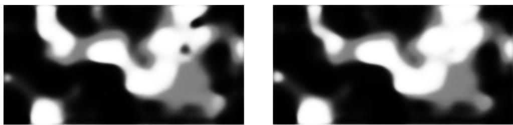
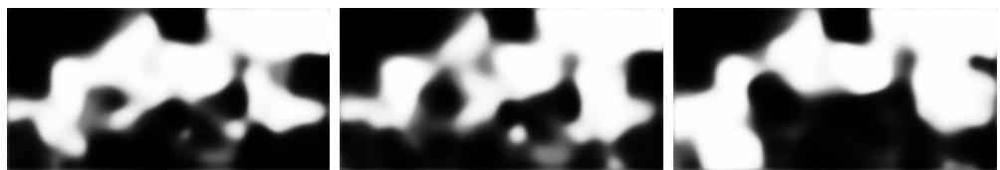
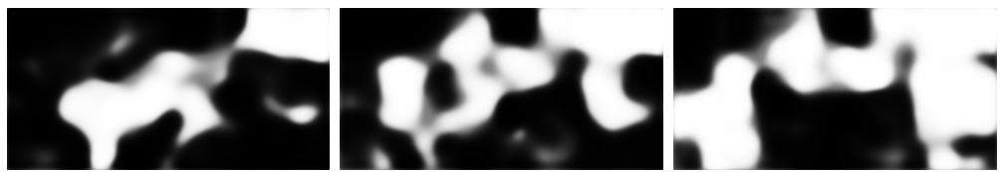
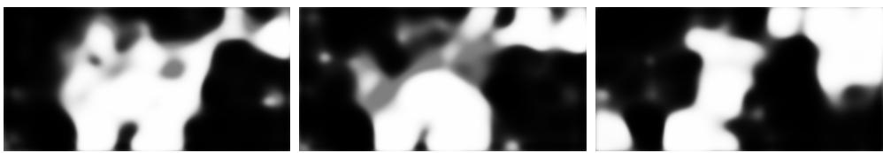
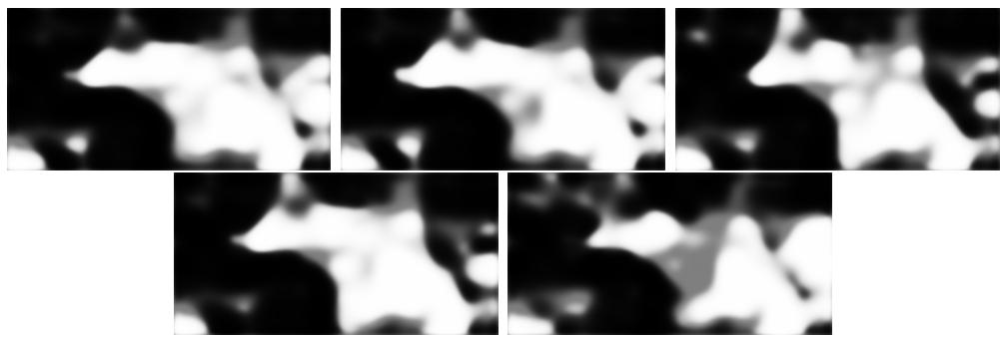
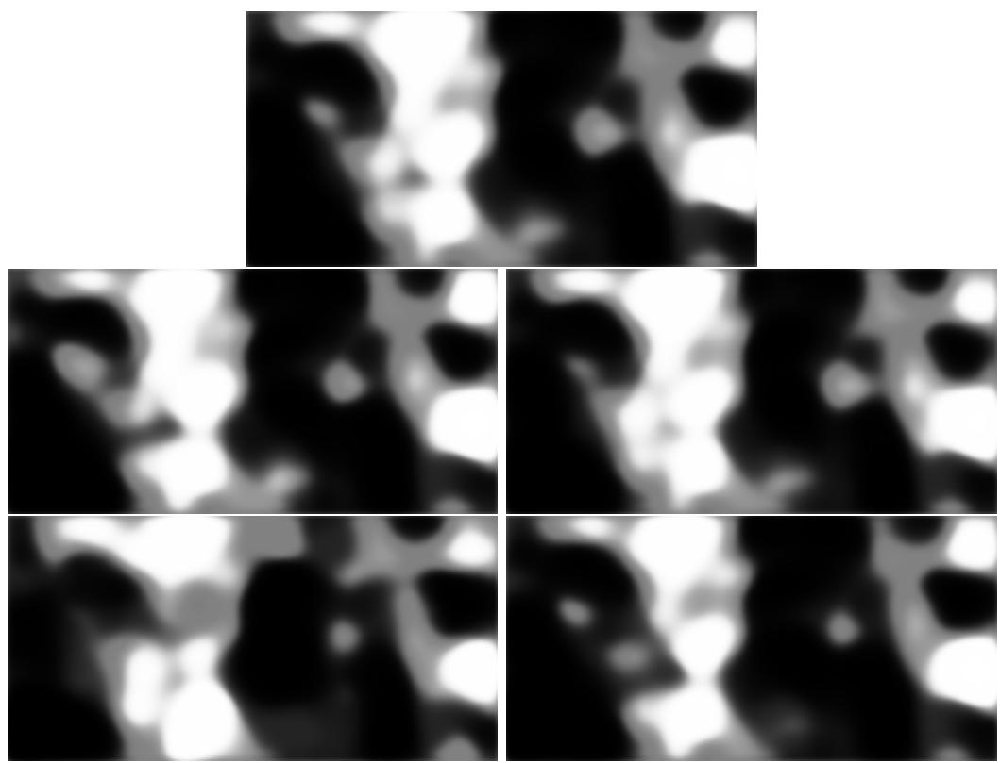

# Beyond Black Boxes: Visual Grounding for Text Embeddings

Slimane Larabi Computer Science Faculty, USTHB University

August 2026

## Abstract

In this paper, our goal is to represent text embeddings as sketches for three main reasons. First, to visualize text representation and to explore their potential for AI explainability. Second, to investigate the potential benefits of the sketch-based representation for information retrieval. Third, to explore their potential for reasoning, drawing inspiration from the concept of mental imagery. We propose a sketch-based visual grounding framework that transforms text representations into visual topographic sketches. Our approach aims to emphasis the semantics content encoded in the text embeddings through the corresponding sketch.

Evaluations are conducted on the MS-COCO dataset to examine the utility of these sketches for text retrieval. The comparative study of SBERT and Sketch-based method reveals that SBERT retains an advantage in strict top-1 retrieval accuracy while achieving comparable performance to the sketch-based method in top-5 retrieval. A cascaded approach combining SBERT and the sketch-based method outperforms SBERT alone, suggesting that the Sketch-based representation could ofer significant potential for information retrieval if trained directly on text.

## 1 Introduction

Recent computer vision models and text embedding frameworks, such as Sentence-BERT (SBERT) [1], employ high-dimensional vector spaces to represent the semantics of images, videos, and their captions. To generate this fixed-size representation, SBERT, for instance, adapts pre-trained Transformer architectures using Siamese and triplet network structures. These representations enables eficient assessment of semantic similarity using cosine similarity. However, while these representations excel at their respective tasks, they remain dificult to interpret that hinders eforts to improve model explainability.

Fixed-size embeddings can lose fine-grained semantic information as text length increases. They may be also sensitive to minor natural variations or adversarial perturbations [4] [2] [3]. It is also worth noting their dificulty in conveying granular semantic details or capturing long-range dependencies [6] [5]. To the best of our knowledge, standard text encoders have not been used to project linguistic descriptions onto topographic sketches. In the present work, the sketch is derived from the SBERT vector; consequently, these limitations are inherited rather than resolved. Investigating these aspects will be the subject of future work, in which the sketch would be generated directly from the text by an end-to-end trained model, rather than from SBERT representations. The fundamental challenge, therefore, lies in bridging the gap between abstract mathematical representations and intuitive human understanding. This requires a mechanism capable of transforming opaque vector spaces into explicit, visually analyzable artifacts (such as sketches) that preserve rich semantic relationships while ofering greater transparency.

In this paper, we propose a novel framework that transforms the vector representations of a sentence (e.g. an image or video caption) into structured topographic sketch. Figure 1 illustrates sketches generated for two captions describing the same visual content. Unlike conventional text-embedding models, our approach provides an explicit visual representation of the embedding, which can be used to improve the SBERT performance in various applications (e.g. sentence retrieval, reasoning). Our comprehensive evaluations reveal important performance trade-ofs: while pure SBERT maintains an advantage in strict top-1 precision, the sketch-based representation closely approaches SBERT performance at top-5 retrieval under comparable settings and combining SBERT and Sketch improves overall performance.

This paper is organized as follows: Section 2 reviews SBERT embeddings. Section 3 presents our framework for mapping SBERT caption embeddings to topographic sketches via joint contrastive and spatial regularization. Section 4 provides an extensive evaluation and comparative study of sketch

  
Sketches generated for two similar captions  
(Left) "The plate is filled with meat and vegetables.",  
(Right) A piece of chicken diced potatoes and some broccoli on a plate."

Figure 1: Sketches generated for two similar captions.(Left) ”The plate is filled with meat and vegetables.”, (Right) A piece of chicken diced potatoes and some broccoli on a plate.”

representations against standard SBERT. Finally, Section 5 concludes with a summary of finding and future perspectives.

## 2 Review of SBERT

Sentence-BERT (SBERT) [1] is a modification of the pretrained BERT network that uses Siamese and triplet network structures to derive semantically meaningful sentence embeddings. Before its introduction, using standard BERT for tasks like semantic textual similarity (STS) or clustering required feeding sentence pairs simultaneously into a cross-encoder. This results in prohibitive computational costs for large datasets: finding the most similar pair among n sentences requires $( O ( n ^ { 2 } )$ transformer forward passes. SBERT removes this bottleneck by turning BERT into a bi-encoder. SBERT passes sentences independently through two identical BERT networks with shared weights. To map variable-length token outputs into a fixed-size dense vector, it applies pooling operations, with mean pooling found empirically to work best. Because sentences are encoded independently, embeddings can be precomputed and indexed. The number of transformer passes drops from $O ( n ^ { 2 } )$ to $O ( n )$ and similarity search relay on fast vector operations such as cosine similarity.

During fine-tuning, SBERT relies on specialized objective functions to structure the vector space for semantic proximity:

Classification Objective: When fine-tuning on Natural Language Inference (NLI) datasets, where sentence pairs are labeled as entailment, contradiction, or neutral, SBERT concatenatnes the two sentence embeddings with their element-wise absolute diference and passes this combined representation to a softmax classifier. This encourages the underlying transformer to learn features that distinguish semantic relationships and logical entailment.

Regression Objective: When the training data provides graded semantic similarity scores (such as human-annotated ratings normalized to [0, 1], SBERT is trained with a mean squared error loss (MSE). The model calculates the cosine similarity between two sentence embeddings and adjusts its weights to minimize the diference between this predicted similarity score and the human-annotated ground truth.

Triplet objective: This objective use an ”anchor” sentence, a ”positive” sentence, and a ”negative” sentence. The loss function tunes the vector space using a margin-based approach: it pulls the anchor and positive embeddings closer together while actively pushing the anchor and negative embeddings farther apart, ensuring a distinct geometric separation between diferent meanings.

## 3 Mapping SBERT Embeddings to Sketches

Our objective is to map the vector embedding of a caption, encoded by Sentence-BERT (SBERT), into a corresponding visual sketch. This process is conceptually inspired by human cognition: humans naturally form a mental image of a given idea or sentence to reason about it.

Motivated by this ability to construct mental representations with regions corresponding to specific objects and actions, our goals are threefold: (1) to visualize the embedding vector, allowing us to inspect what semantic information is captured and how the sketch varies under caption perturbations; (2) to assess whether the resulting sketch can serve as an efective representation for information retrieval; and (3) to investigate how the sketch can contribute to reasoning when used as an imaginary image [12]. Only the first two objectives are investigated in this paper, while the third will be processed

as future work.

To achieve this cross-modal mapping, our architecture relies on an endto-end pipeline combining a semantic text encoder, a topographical decoder, and a visual feature re-encoder, optimized jointly via contrastive and spatial regularization losses.

## 3.1 Semantic Text Encoding

The input caption is first transformed into a dense 384-dimensional vector using a pretrained SBERT model (all-MiniLM-L6-v2) [1]. To introduce nonlinearity, the 384-dimensional vector is processed by a multilayer perceptron (MLP) composed of a linear layer with a 256-dimensional hidden layer, a ReLU activation, and a dropout layer (rate 0.1) that reduces overfitting to specific training captions. A second linear layer produces the 384-dimensional latent vector z, which is standardized by layer normalization to stabilize its scale before it is passed to the sketch decoder.

## 3.2 Topographical Sketch Generation (Decoder)

The latent vector z is fed directly into the sketch decoder. This module maps abstract text semantics onto a spatial canvas: a fully connected layer first expands z into a base tensor of size $1 2 8 \times 1 3 \times 2 5$

To progressively increase the spatial resolution, the decoder uses a sequence of three upsampling blocks. Each block combines batch normalization, a ReLU activation, bilinear upsampling with a scale factor of 2, and a $3 \times 3$ convolution (reducing the channels from 128 to 64, 32, and finally 1). Upsampling followed by convolution, instead of transposed convolutions, is commonly used to reduce checkerboard artifacts. A final bilinear interpolation then resizes the tensor to a fixed resolution of $4 1 6 \times 8 0 0$ pixels with a single channel $( C = 1 )$

A concluding sigmoid activation bounds the pixel intensities between 0 and 1, producing a grayscale density map.

## 3.3 Visual Feature Re-Encoding

The generated sketch is then processed by a convolutional sketch encoder, applied after the decoder. It extracts visual features through three convolutional layers (32, 64, and 128 channels, kernel size 4, stride 2, padding

1), each followed by a ReLU activation. An adaptive average pooling layer reduces the feature map to a fixed $4 \times 8$ grid, and flattening followed by a linear projection maps the result to a 384-dimensional feature vector, which is used for retrieval.

## 3.4 Joint Optimization Objective

The network is optimized end-to-end with a hybrid objective combining a contrastive alignment loss and a spatial variation loss. At each step, we sample $B = 3 2$ distinct groups of captions and, for each group $i ,$ two diferent captions: an anchor $a _ { i }$ and a positive $p _ { i }$ . Each caption embedding x is passed through the pipeline to obtain a latent vector $z ,$ a sketch $S \in [ 0 , 1 ] ^ { 4 1 6 \times 8 0 0 }$ , and a feature vector f from the sketch encoder, which is $\ell _ { 2 } { \mathrm { - n o r m a l i z e d } }$ as $\tilde { f } = f / \lVert f \rVert _ { 2 }$

Contrastive alignment. Alignment is enforced with an InfoNCE loss computed on $\ell _ { 2 } { \mathrm { - n o r m a l i z e d } }$ sketch features. InfoNCE (Information Noise-Contrastive Estimation) was introduced in [13] as a contrastive loss inspired by Noise-Contrastive Estimation (NCE). It maximizes a lower bound on the mutual information between related views of the data by training the model to identify the positive pair among a set of negative distractors. In our setting, captions describing the same underlying scene (for example, two different phrasings of the same content) are positives and should map to similar features, while unrelated captions are negatives. The similarities are scaled by a temperature parameter, set to 0.07, so that matching captions are pulled together and unrelated ones are pushed apart.

$$
\mathcal { L } _ { \mathrm { N C E } } = \frac { 1 } { 2 B } \sum _ { i = 1 } ^ { B } \left[ - \log \frac { \exp ( \tilde { f } _ { a _ { i } } ^ { \top } \tilde { f } _ { p _ { i } } / \tau ) } { \sum _ { j = 1 } ^ { B } \exp ( \tilde { f } _ { a _ { i } } ^ { \top } \tilde { f } _ { p _ { j } } / \tau ) } - \log \frac { \exp ( \tilde { f } _ { a _ { i } } ^ { \top } \tilde { f } _ { p _ { i } } / \tau ) } { \sum _ { j = 1 } ^ { B } \exp ( \tilde { f } _ { a _ { j } } ^ { \top } \tilde { f } _ { p _ { i } } / \tau ) } \right] .\tag{1}
$$

Where $B = 3 2$ is the number of caption groups in a batch; $a _ { i }$ and $p _ { i }$ are two diferent captions randomly drawn from group $i$ (the anchor and the positive), both describing the same scene; $\tilde { f } _ { a _ { i } }$ and $\tilde { f } _ { p { i } }$ are their $\ell _ { 2 } .$ -normalized 384-dimensional features produced by the sketch encoder, so that $\tilde { f } _ { a _ { i } } ^ { \top } \tilde { f } _ { p _ { j } }$ is a cosine similarity; and $\tau = 0 . 0 7$ is a fixed temperature that controls the sharpness of the softmax. For each anchor $a _ { i } .$ , the only positive is $p _ { i }$ , whereas the $B - 1$ captions $p _ { j } \ ( j \neq i )$ drawn from the other groups of the batch serve as negatives; the second term of the loss plays the same role with the roles of anchors and positives exchanged. Minimizing $\mathcal { L } _ { \mathrm { N C E } }$ therefore brings the sketch features of captions of the same group closer together and pushes apart those of diferent groups, so that the sketches encode the semantic content of the caption.

Spatial variation. To avoid the trivial solution of a uniform or blank canvas, which is easy to reach early in training and from which the network may not recover, we reward spatial variation in the generated sketches. Let $G$ denote a $5 \times 5$ average filter (stride 1, zero padding excluded from the average). The loss is the negative spatial variance of the smoothed sketch, averaged over the batch:

$$
\mathcal { L } _ { \mathrm { v a r } } ( S ) = - \frac { 1 } { B } \sum _ { b = 1 } ^ { B } \operatorname { V a r } _ { h , w } \big [ ( G * S _ { b } ) ( h , w ) \big ] .\tag{2}
$$

Where:

$S _ { b } \colon$ The b-th sketch of the batch, represented as a grayscale image of dimensions $4 1 6 \times 8 0 0$ pixels with intensity values constrained between 0 (black) and 1 (white) via a Sigmoid activation function, with a total batch size of $B = 3 2$ sketches. $G * S _ { b } { \mathrm { : } }$ The smoothed sketch obtained via a $5 \times 5$ averaging filter $G$ (where all coeficients equal $1 / 2 5 )$ . Each pixel is replaced by the local neighborhood average ensures that border handling excludes padding zeros).

$\mathrm { V a r } _ { h , w } [ \cdot ]$ : The spatial variance computed across the pixel values of a single image, where h and w index the rows and columns:

$$
\operatorname { V a r } _ { h , w } [ x ] = \frac { 1 } { H W } \sum _ { h , w } \left( x ( h , w ) - \bar { x } \right) ^ { 2 }
$$

with ¯x representing the mean pixel value. This quantifies image contrast: it is zero for uniform images and large when distinct dark and bright regions coexist.

Total loss.

$$
\begin{array} { r } { \mathcal { L } = \mathcal { L } _ { \mathrm { N C E } } + \lambda \left[ \mathcal { L } _ { \mathrm { v a r } } ( S _ { a } ) + \mathcal { L } _ { \mathrm { v a r } } ( S _ { p } ) \right] , \qquad \lambda = 0 . 0 1 , } \end{array}\tag{3}
$$

Figure 2: Sketches generated for the captions ”a man is running in house”, ”a man is running in the garden”, ”a man is running in the street”  
  
Figure 3: Sketches generated for the captions ”a girl is running in house”, ”a boy is running in the garden”, ”An elderly man is running down the street.”

where $S _ { a }$ and $S _ { p }$ are the sketches generated from the anchor and positive captions. We train with AdamW (learning rate $1 0 ^ { - 3 } )$ and a cosine annealing schedule for a fixed number of steps.

## 4 Experimental Evaluation

## 4.1 Semantic Information Coded by Sketches

Our model was trained on the MS-COCO dataset [8]. Figure 2 shows the sketches generated for the captions ”man is running in house”, ”man is running in the garden”, ”man is running in the street”. The sketches share common information corresponding to ”man is running” together with variable information related to the location. When the word ”man” is replaced with ”girl”, ”boy” or elderly man”, we obtain sketches shown in figure 3. Some diferences appear, but the sketch keep the global layout, which suggests that the model encodes common notion of a person.

Changing the subject (dog instead of man), yields sketches that are visually diferent from the previous ones. Figure 4 shows the sketches generated from the captions ”a dog is running in house”, ”a dog is running in the garden” and ” a dog is running in the street”.

Finally, we took five captions of the same image from MS-COCO dataset and generated the corresponding sketches (Figure 5). The sketches are visibly similar despite the diference in the words used.

Figure 4: Sketches generated for the captions ”a dog is running in house”, ”a dog is running in the garden”, ”a dog is running down the street.”  
  
Figure 5: Sketches generated for the captions ”A white plate topped with meat and vegetables.”, ”A close-up of a plate of food with meat and veggies.”, ”A meal consisting of meat, broccoli, and other vegetables on a plate.”, ”A plate with meat and green vegetables on it.”, ”Some food that is on a white plate.”

## 4.2 Sketch Variation Under Caption Perturbation

Many tests have been performed to study the sketch variation under caption perturbation. As example, to the original caption: ”A golden retriever catches a red frisbee in mid-air at the public park.”, we got for each kind of perturbations the followings captions: Lexical Perturbation: ”A golden retriever catches a crimson flying disc mid-air at the public park.”,

Syntactic Reordering: ”At the public park, a golden retriever catches a red frisbee in mid-air.”,

Typo and Noise Perturbation: ”A golde retriver catches a red frisbee in midair at the prk.”,

Partial omission: ”A golden retriever catches a red frisbee in mid-air.”

To measure similarity between sketches, the Sketch encoder extracts highdimensional feature vectors (384 dimensions) from each rendered output. These extracted feature representations are then normalized using L2 normalization along their feature dimension. Finally, the similarity between a reference sketch and comparative sketches is quantified by computing the cosine similarity through matrix multiplication of their normalized feature vectors.

The results of similarity measure between original and four perturbed captions (Figure 6) demonstrate that the Sketch feature space remains robust and visually consistent. Syntactic reordering preserves highest fidelity, whereas character-level typos induce the most degradation. Overall, the visual decoder acts as an abstraction layer that filters out word-level variations to maintain spatial and structural consistency. The similarities scores are equal respectively to : 0.9763, 0.9920, 0.8405, 0.9581. Note that for a caption which is diferent from the original: ”A sleek black cat leaps gracefully across a rustic wooden fence at twilight.” the computed similarity between their sketches is equal to: 0.2356.

## 4.3 Sketch vs. SBERT Caption-to-Caption Retrieval

We evaluated our sketch-based retrieval method against a pure SBERT baseline on caption retrieval over MS-COCO. We first describe the setup, then report the results and analyze the efect of the training set size and of the gallery size.

## 4.3.1 Experimental Setup

We use the MS-COCO captions [8] where each item is a group contains up to five captions describing the same image. Only groups with at least three captions are kept. The sketch pipeline is trained exclusively on MS-COCO on subsets of 1,000, 10,000, 20,000 and 30,000 caption groups.

Retrieval protocol. For each evaluation, we randomly sample $N \in \{ 5 0 0 , 1 0 0 0 , 5 0 0 0 \}$ groups (for fixed seed 42). From each group, one caption is randomly held out as the query, and the remaining captions of all N groups form the gallery (at most 4N captions).A query is ranked against every gallery caption by cosine similarity, and a retrieved caption is counted as correct if it belongs to the

  
Figure 6: Sketches generated for the caption original and respectively for a Lexical perturbation, Syntactic Reordering, Typo and Noise Perturbation, Partial Omission.

same group as the query. We report Precision@1 (the top-ranked caption is correct) and Precision@5 (at least one of the five top-ranked captions is correct). Because each evaluation uses N queries against a gallery built from the same N groups, increasing N increases both the number of queries and the number of distractors.

Methods. SBERT (pure) embeds captions with the pre-trained all-MiniLM-L6-v2 model (384-dimensional) and ranks by cosine similarity; it requires no training and is therefore identical across training-set sizes. Ours (Sketches) maps a caption’s SBERT embedding through a semantic encoder (MLP) to a latent vector, decodes it into a 416 × 800 grayscale sketch, and re-encodes the sketch with a convolutional encoder into a 384-dimensional feature vector; retrieval is performed by cosine similarity in this feature space, for both queries and gallery captions.

## 4.3.2 Main Results

Table 1 reports the results for all settings.

SBERT remains the strongest method in every configuration. The gap depends strongly on the metric. The sketch features therefore place the correct group among the top candidates almost as reliably as SBERT, while ranking the exact best match less precisely.

## 4.4 Evaluation of SBERT and Skertch in cascade

Data and protocol. We use the COCO Captions quintets dataset, in which each group contains five captions describing the same image. For each run, we sample 5,000 groups. In every group, two captions are held out as queries (10,000 queries in total) and the remaining three form the retrieval pool (about 15,000 captions). A retrieved caption is counted as correct only if it belongs to the same group as the query; this ground truth is strict, since captions of other images may be semantically valid matches, so absolute scores are underestimated. The groups are split into a validation part (30%, 3,000 queries) used to select all hyperparameters, and a disjoint test part (70%, 7,000 queries) used for reporting. The whole procedure is repeated with five random seeds (42–46), each seed drawing a diferent set of groups and a diferent split.

Table 1: Caption-to-caption retrieval precision (%) on MS-COCO. N is the number of evaluated groups, which equals the number of queries; the gallery contains the remaining captions of these N groups. Sketches are trained on 1k, 10k, 20k or 30k groups. The best sketch result in each row is in bold. Training on more groups improves the sketches consistently, for every N and both metrics. The largest gain occurs between 1k and 10k groups: for N = 500, P@1 rises from 33.6% to 51.0% (+17.4 points) and P@5 from 60.0% to 81.2% (+21.2 points). Going from 10k to 30k groups brings improvements.
<table><tr><td rowspan="2">N (queries)</td><td rowspan="2">Metric</td><td rowspan="2">SBERT (pure)</td><td colspan="4">Ours (Sketches), training groups</td></tr><tr><td>1k</td><td>10k</td><td>20k</td><td>30k</td></tr><tr><td rowspan="2">500</td><td>P@1</td><td>67.20</td><td>33.60</td><td>51.00</td><td>53.80</td><td>61.60</td></tr><tr><td>P@5</td><td>86.20</td><td>60.00</td><td>81.20</td><td>85.20</td><td>84.20</td></tr><tr><td rowspan="2">1000</td><td>P@1</td><td>55.60</td><td>21.60</td><td>37.60</td><td>44.30</td><td>45.70</td></tr><tr><td>P@5</td><td>80.80</td><td>43.50</td><td>69.70</td><td>74.50</td><td>75.70</td></tr><tr><td rowspan="2">5000</td><td>P@1</td><td>36.42</td><td>9.74</td><td>18.80</td><td>22.80</td><td>24.04</td></tr><tr><td>P@5</td><td>58.70</td><td>23.40</td><td>41.42</td><td>46.34</td><td>47.90</td></tr></table>

Representations. Captions are embedded with SBERT (all-MiniLM-L6-v2, 384 dimensions). The sketch model, trained beforehand on 30,000 COCO groups, maps an SBERT embedding to a latent vector z (semantic encoder), decodes it into a 416×800 topographical sketch, and re-encodes the sketch into a 384-dimensional feature vector. We compare:

(i) SBERT; (ii) Sketch, retrieval with the sketch features; (iii) Latent, retrieval with z, i.e. the semantic encoder alone, without going through the image (ablation); (iv) Untrained sketch, the same architecture with random weights (control); and cosine similarity is used throughout.

Combination methods. Score fusion ranks pool captions by s = α sSBERT+ $( 1 - \alpha ) s _ { \mathrm { o t h e r } }$ , where $S _ { \mathrm { o t h e r } }$ is the Sketch, Latent or untrained-sketch cosine score. Scores are used either raw or z-normalized per query; $\alpha \in$ $\{ 0 , 0 . 0 5 , \ldots , 1 \}$ . The mode and α are chosen on the validation split by maximizing the mean of Top-1 and Top-5 (ties favor the larger α, i.e. SBERT). A threshold cascade keeps the SBERT ranking when the best SBERT similarity exceeds a threshold and falls back to the Sketch ranking otherwise (threshold also selected on validation). Finally, an oracle counts a query as correct if SBERT or the Sketch is correct; it uses the ground truth and is reported only as an upper bound, not as a usable system. Every method returns a single ranking of five candidates, so Top-5 comparisons are fair.

Table 2: Test retrieval performance (%), mean ± std over 5 seeds, 7,000 test queries per seed.
<table><tr><td>Method</td><td>Top-1</td><td> $\mathrm { T o p } { - } 5$ </td><td>MRR@10</td></tr><tr><td>SBERT</td><td> $3 5 . 7 1 \pm 0 . 5 9$ </td><td> $5 8 . 2 3 \pm 0 . 9 6$ </td><td> $4 5 . 3 6 \pm 0 . 5 9$ </td></tr><tr><td>Sketch</td><td> $2 2 . 2 5 \pm 0 . 8 2$ </td><td> $4 5 . 6 2 \pm 0 . 8 2$ </td><td> $3 2 . 2 4 \pm 0 . 7 8$ </td></tr><tr><td>Latent (semantic encoder only)</td><td> $2 3 . 8 3 \pm 0 . 8 1$ </td><td> $4 6 . 8 7 \pm 0 . 9 0$ </td><td> $3 3 . 6 8 \pm 0 . 8 3$ </td></tr><tr><td>Untrained sketch (control)</td><td> $4 . 8 7 \pm 0 . 2 3$ </td><td> $1 4 . 0 7 \pm 0 . 1 6$ </td><td> $8 . 9 1 \pm 0 . 1 8$ </td></tr><tr><td>Threshold cascade SBERT→Sketch</td><td> $3 5 . 7 1 \pm 0 . 5 9$ </td><td> $5 8 . 2 3 \pm 0 . 9 6$ </td><td> $4 5 . 3 6 \pm 0 . 5 9$ </td></tr><tr><td>Fusion SBERT + Sketch</td><td> $3 6 . 3 0 \pm 0 . 9 4$ </td><td> ${ \bf 5 9 . 5 9 \pm 0 . 9 2 }$ </td><td> ${ \bf 4 6 . 2 3 \pm 0 . 7 5 }$ </td></tr><tr><td>Fusion SBERT + Latent</td><td> $3 6 . 1 1 \pm 0 . 7 0$ </td><td> $5 9 . 3 8 \pm 1 . 0 6$ </td><td> $4 6 . 0 5 \pm 0 . 6 6$ </td></tr><tr><td>Fusion SBERT + untrained sketch</td><td> $3 5 . 7 1 \pm 0 . 5 9$ </td><td> $5 8 . 1 9 \pm 1 . 0 3$ </td><td> $4 5 . 3 6 \pm 0 . 6 3$ </td></tr><tr><td>Oracle (SBERT or Sketch, upper bound)</td><td> $4 1 . 3 7 \pm 0 . 7 9$ </td><td> $6 5 . 5 5 \pm 1 . 1 4$ </td><td> $5 1 . 6 9 \pm 0 . 8 0$ </td></tr></table>

Metrics and statistics. We report Top-1, Top-5 and MRR@10. Diferences between methods are computed per query (paired), with 95% confidence intervals obtained by bootstrapping over groups (2,000 resamples), since the two queries of a group are correlated. Across the five seeds, we also report the mean gain, the number of seeds where the interval excludes zero, and the p-value of a one-sample t-test on the per-seed gains. Because the seeds sample overlapping subsets of the same dataset, they are not fully independent, and the p-values should be read as indicative.

## 4.4.1 Results

Table 2 reports test performance (mean ± standard deviation over seeds) and Table 3 the paired gains.

SBERT is the strongest single method. The Sketch alone loses 13.5 points at Top-1 and 12.6 points at Top-5 with respect to SBERT. The Latent representation, which skips the image bottleneck, is slightly better than the

Table 3: Paired gains in points (mean over 5 seeds), with the number of seeds whose 95% group-bootstrap interval excludes zero and the p-value of the t-test on per-seed gains.
<table><tr><td>Comparison</td><td>Top-1</td><td> $\mathrm { T o p } { - } 5$ </td><td>MRR@10</td></tr><tr><td>Fusion (Sketch) – SBERT</td><td> $+ 0 . 5 9 \ ( 2 / 5 , p { = } 0 . 0 4 5 )$ </td><td> $+ 1 . 3 6 ~ ( 5 / 5 , p { < } 0 . 0 0 1 )$ </td><td> $+ 0 . 8 7 \ ( 4 / 5 , p { = } 0 . 0 0 7 )$ </td></tr><tr><td> $\mathrm { F u s i o n ~ ( L a t e n t ) - S B E R T }$ </td><td> $+ 0 . 4 0 \ ( 1 / 5 , p { = } 0 . 0 6 3 )$ </td><td> $+ 1 . 1 5 \ ( 5 / 5 , p { < } 0 . 0 0 1 )$ </td><td> $+ 0 . 6 9 \ ( 5 / 5 , p { = } 0 . 0 0 6 )$ </td></tr><tr><td>Fusion (untrained) – SBERT</td><td> $- 0 . 0 1 \ ( 0 / 5 , p { = } 0 . 8 0 )$ </td><td> $- 0 . 0 4 \ ( 0 / 5 , p { = } 0 . 5 4 )$ </td><td> $- 0 . 0 0 \ ( 0 / 5 , p { = } 0 . 9 7 )$ </td></tr><tr><td>Cascade - SBERT</td><td>+0.00 (0/5)</td><td>+0.00 (0/5)</td><td>+0.00 (0/5)</td></tr><tr><td> $\mathrm { F u s i o n ~ ( S k e t c h ) } - \mathrm { F u s i o n ~ ( L a t e n t ) }$ </td><td> $+ 0 . 1 9 \ ( 2 / 5 , p { = } 0 . 3 3 )$ </td><td> $+ 0 . 2 1 \ ( 1 / 5 , p { = } 0 . 1 2 )$ </td><td> $+ 0 . 1 7 \ ( 2 / 5 , p { = } 0 . 2 4 )$ </td></tr></table>

Sketch (+1.6 Top-1, +1.3 Top-5), so the embedding → sketch → embedding path loses a small amount of information. At Top-5, the Sketch retains about 97% of the performance of the Latent.

Score fusion improves over SBERT. Fusing SBERT and Sketch scores yields +1.36 points at Top-5 (59.59 vs. 58.23, i.e. +2.3% relative) and +0.87 at MRR@10. The Top-5 gain is positive in all five seeds, with a confidence interval above zero in each of them $( p \ < \ 0 . 0 0 1 )$ , and the MRR@10 gain is significant in four seeds. At Top-1, the gain (+0.59) is only a trend: it is positive in all seeds but significant in two of them, and $p = 0 . 0 4 5$ does not survive a Bonferroni correction over the three metrics (threshold 0.017). The selected α ranges from 0.30 to 0.65 across seeds, and the test gain as a function of α forms a smooth plateau (about +1.0 to +1.4 points at Top-5 for $\alpha \in [ 0 . 2 5 , 0 . 6 0 ]$ , z-score mode), not an isolated peak. The fusion recovers about 19% of the gap between SBERT and the oracle at Top-5 (1.36 out of 7.32 points) and about 10% at Top-1.

Controls. Fusing SBERT with an untrained sketch model of identical architecture gives no gain (−0.04 at Top-5), and the selection procedure correctly falls back to α ≈ 1 (SBERT) in this case. The improvement is therefore neither an artifact of the hyperparameter selection nor a generic efect of adding an extra projection: it requires a learned representation. The threshold cascade does not help either: with the threshold selected on validation, it switches to the Sketch for at most 0.01% of the queries and is equivalent to SBERT. The oracle shows that the errors of SBERT and of the Sketch are partly complementary (+5.7 Top-1, +7.3 Top-5), but this complementarity cannot be exploited by thresholding SBERT’s confidence, because low-confidence queries are also hard for the Sketch.

The gain does not come from the image. Fusing SBERT with the Latent representation, which never goes through a sketch, yields almost the same gain (+1.15 Top-5) as fusing with the Sketch (+1.36), and the diference between the two fusions is not significant (+0.21 Top-5, p = 0.12; interval above zero in 1 seed out of 5).

## 4.4.2 Conclusions

• A linear fusion of SBERT and sketch-based scores, with α and the normalization chosen on held-out groups, improves SBERT at Top-5 (+1.4 points) and MRR@10 (+0.9 points), consistently across seeds and without using the ground truth. The efect is modest. At Top-1, only a non-robust positive trend is observed (+0.6 points).

• The gain requires a learned representation (null result for the untrained control) but is statistically indistinguishable from the one obtained with the semantic encoder alone. It should therefore be attributed to a model trained on COCO that complements a generic encoder, and not to the visual (sketch) representation itself.

• A simple similarity-threshold cascade is inefective, while the oracle upper bound (+5.7 Top-1, +7.3 Top-5) indicates that better combination strategies could, in principle, recover more.

• The sketch representation can be defended as an interpretable intermediate that preserves most of the retrieval performance of the latent space (about 97% at Top-5), but our results provide no evidence that it improves accuracy.

## 5 Conclusion

To address the intrinsic opacity of conventional text-embedding models like Sentence-BERT (SBERT), which function as high-dimensional black boxes, this paper has introduced a sketch-based visual grounding framework that transforms caption representations into explicit, visually inspectable topographical sketches. Operating as a structural information bottleneck, the proposed approach prioritizes scene-level composition and spatial layout distributions.

Through comprehensive evaluations on the MS-COCO dataset, several key insights have been established:

• Retrieval Performance and Trade-ofs: While pure SBERT maintains an advantage in strict top-1 precision and adversarial lexical discrimination, the sketch-based representation closely approaches SBERT performance at top-5 retrieval (retaining approximately 98%).

• Score Fusion and Synergy: Linear score fusion between SBERT and the sketch-based representation yields consistent, modest improvements at Top-5 (+1.4 points) and MRR@10 (+0.9 points) across evaluation seeds. However, control and ablation studies indicate that these performance gains stem from task-specific training rather than the visual nature of the sketch itself, as comparable gains are achieved using the latent representation alone.

• Visual Transparency: The sketch representation successfully serves as an interpretable intermediate artifact that provides complete visual transparency into spatial layout encodings while functioning as an effective mechanism for candidate shortlisting.

Future work will focus on overcoming the limitations inherited from intermediate SBERT embeddings by developing end-to-end models capable of generating topographical sketches directly from raw text input, thereby investigating their broader utility for advanced reasoning and multi-modal integration. All the codes used in the experimental section are available in the link given in [11] for reproduction.

## References

[1] Nils Reimers and Iryna Gurevych. Sentence-BERT: Sentence Embeddings using Siamese BERT-Networks. In the Proceedings of the 2019 Conference on Empirical Methods in Natural Language Processing and the 9th International Joint Conference on Natural Language Processing, pages 3982–3992,Hong Kong, China, November 3–7, 2019.

[2] Dinzinger, M., Caspari, L., Ghoshdastidar, K., Mitrovi´c, J., Granitzer, M. (2025). Investigating the robustness of embedding models on noisy input. CEUR Workshop Proceedings, 4137.

[3] Asl, J., Blanco, E., Takabi, D. (2023). RobustEmbed: Robust sentence embeddings using self-supervised contrastive pre-training. Findings of the Association for Computational Linguistics: EMNLP 2023.

[4] Sparse, Dense, and Attentional Representations for Text Retrieval, Luan, Yi and Eisenstein, Jacob and Toutanova, Kristina and Collins, Michael. Transactions of the Association for Computational Linguistics, vol. 9, pp. 329-345, 2021.

[5] Xi Jin. Improving Paragraph Similarity by Sentence Interaction With BERT. Expert Systems, Volume 42, Issue 3, 2025, https://doi.org/10.1111/exsy.70003

[6] Chen, Sihao and al., Sub-Sentence Encoder: Contrastive Learning of Propositional Semantic Representations, Proceedings of the 2024 Conference of the North American Chapter of the Association for Computational Linguistics: Human Language Technologies, pp. 1596-1609, 2024.

[7] Aaron van den Oord, Yazhe Li, Oriol Vinyals. Representation Learning with Contrastive Predictive Coding (CPC) 2018 (arXiv:1807.03748)

[8] Lin, T.-Y., Maire, M., Belongie, S., Hays, J., Perona, P., Ramanan, D., Doll´ar, P., and Zitnick, C. L. (2014). Microsoft COCO: Common objects in context. In Computer Vision–ECCV 2014: 13th European Conference, Zurich, Switzerland, September 6-12, 2014, Proceedings, Part V 13 (pp. 740–755). Springer International Publishing.

[9] Ait Mehdi, N., Temmam, M., Larabi, S. (2026). [Vision-language-assisted cognitive remediation platform]. arXiv:2607.22721.

[10] Larabi, S., et al. cognitive-remediation [Dataset]. HuggingFace: slarabi/cognitive-remediation.

[11] Larabi, S. Coding related to Sketch https://huggingface.co/spaces/slarabi/Code Sketch

[12] Larabi, S. Can Mental Imagery Improve the Thinking Capabilities of AI Systems? 5th International Joint Conference on Learning and Reasoning (IJCLR 2025). 11 - 14 September, Guildford, UK, 2025.

[13] Aaron van den Oord and Yazhe Li and Oriol Vinyals. Representation Learning with Contrastive Predictive Coding, 2019, arXiv: 1807.03748. https://arxiv.org/abs/1807.03748.