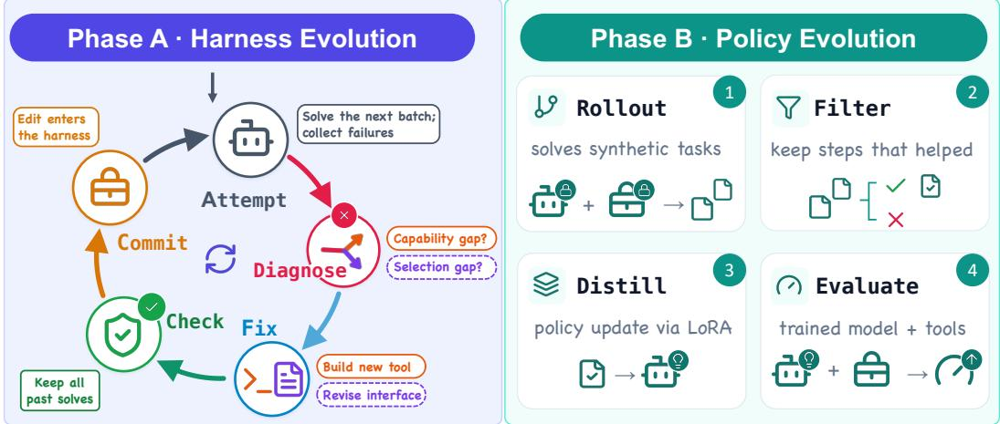
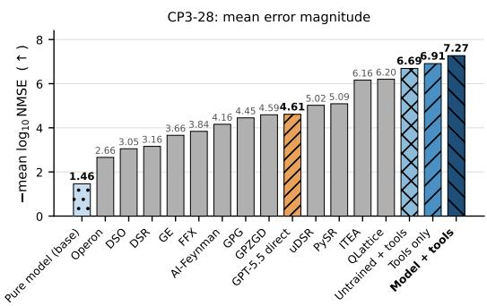
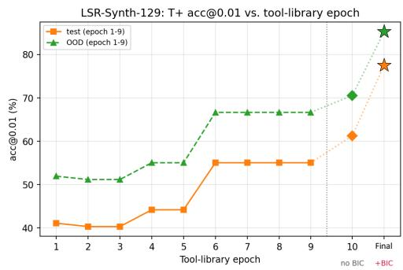

# COUPLED HARNESS–MODEL EVOLUTION FOR SCIENTIFIC EQUATION DISCOVERY

Pengze Li1,7, Jiaquan Zhang1, Encheng Su2, Yunbo Long3, Zihang Zeng1, Xinping Liu1, Han Zhang4, Junchi Yu5, Shixiang Tang6, Aoran Wang7, Xi Chen1

2University of Science and Technology of China 3University of Cambridge 4Peng Cheng Laboratory 5University of Oxford 6The Chinese University of Hong Kong 7Shanghai Artificial Intelligence Laboratory

## ABSTRACT

Large language models (LLMs) are increasingly used to discover scientific equations from experimental data. Such a discovery system has two parts that must work together: a library of executable computational tools and the model’s tooluse policy. The tools supply the solving capability, from diagnosing structure in the data to fitting candidate equations; the policy plans and orchestrates their use. Yet existing systems adapt only one part, keeping either the toolset or the model fixed, which leaves the corresponding failures uncorrectable. We develop a coupled evolution framework that improves both parts from the same verifiable fit-error signal. In the tool-evolution phase, an agent grows an executable tool library from a small set of generic numerical operations by diagnosing its own failures: it authors a new tool when a capability is missing and revises its selection rules when the right tool went unused. In the policy-evolution phase, a small open model (roughly 3B active parameters) is fine-tuned on successful tool-use trajectories collected with the frozen library, on training formulas screened to be disjoint from all evaluation benchmarks. Ablations show the two phases are complementary: with no tool library at all the same model solves almost nothing, the tools account for most of the gain, and trajectory training adds a further gain that is largest on the most difficult problems. The full system solves 79.1/71.3% of LSR-Synth problems at fit tolerances 10−2/10−3, reaches 63.8% pooled accuracy on the distributionally different SRSD-Feynman panel, and obtains a normalized CP3-28 aggregate of −7.27. These results suggest a broader recipe for scientific agents: let the model and its instruments improve each other under verifiable feedback.

## 1 INTRODUCTION

Many scientific laws are written as equations relating measured quantities. Given experimental observations, scientific equation discovery, classically studied as symbolic regression (SR), asks for a compact equation that fits the observed data and remains accurate on new observations; it has long been a central goal of automated science (Brunton et al., 2016; Cranmer, 2023). Classical methods search the space of candidate expressions directly, by genetic programming or neural-guided search (Cranmer, 2023; Petersen et al., 2021; Landajuela et al., 2022). Recent systems instead place a large language model (LLM) at the center of the search: the model proposes candidate equations, calls computational tools, and reads the returned numbers to decide what to try next (Shojaee et al., 2025a; Grayeli et al., 2024; Merler et al., 2024; Xia et al., 2026). These tools are executable numerical routines that, for example, detect periodicity in the data, fit the unknown constants of a proposed equation, or score how well a candidate matches the observations.

Two parts of such a system jointly determine what it can discover. The first is the tool library, the set of executable operations the model can call. The library bounds the reachable hypothesis space: an equation family that no available tool can fit or test can never be confirmed, no matter what the model proposes. The second is the model’s tool-use policy, its learned behavior of choosing which tool to call, with what arguments, and how to act on the result. Even when the right tool exists, a policy that skips it, calls it with unsuitable arguments, or misreads its output still fails. A failed discovery attempt therefore has two distinct causes, a missing capability or a misused one, and correcting them requires changing different parts of the system: the first requires new tools, the second a better policy.

Existing approaches, however, typically adapt only one of the two parts. One line holds the model fixed and grows the tools or skills around it, in general agent settings (Wang et al., 2024a; Qian et al., 2023; Yuan et al., 2024; Wang et al., 2024b) as well as in equation discovery, where systems such as SR-Scientist keep the model frozen while it writes analysis code and refines candidate equations (Xia et al., 2026; Shojaee et al., 2025a; Yang et al., 2026a). A complementary line trains the model while holding its toolset fixed, from general tool-use training (Schick et al., 2023; Patil et al., 2024; Qin et al., 2024) to SR systems that fine-tune the model on discovery trajectories with an unchanged toolset (Zhao et al., 2026; Behzadifar et al., 2026). Either choice leaves one class of failures uncorrectable, and to our knowledge no equation-discovery system evolves its tool library and trains its tool-use policy together (Section 2). Equation discovery is also a setting where this coupling matters and can be studied cleanly: the equation families a new problem requires are hard to anticipate, so a library fixed at design time risks lacking a needed capability; whether a tool helps depends on the policy that invokes it, so added capability pays off only when the model learns to use it; and every attempt ends with a verifiable outcome, the fit error of the proposed equation on observations the system has not seen, which separates success from failure unambiguously and can drive the improvement of both parts.

We therefore evolve both parts under the same verifiable fit-error signal. Throughout the paper we call everything outside the model the harness: the executable tool library, together with the rules that present the tools to the model and the rule that selects the final candidate equation. Our framework proceeds in two phases, each updating one part while the other is held fixed. Phase A evolves the harness: after each failed attempt, the system diagnoses whether the failure came from a missing capability or from a wrong choice by the model, and accordingly writes a new tool or revises the presentation and selection rules. Phase B improves the model’s tool-use policy: with the evolved harness frozen, a small open model is fine-tuned on successful tool-use trajectories. In this way, failures expand what the system can test, and successes deepen the model’s command of its tools, teaching it when to invoke which tool, how to set its arguments, and how to act on the returned evidence in the search.

This paper makes three contributions.

• We identify a coupled bottleneck in LLM-based equation discovery: a failed attempt can stem from a missing tool capability or from a misused one, and adapting only the toolset or only the model leaves one of the two failure classes uncorrectable.

• We propose, to our knowledge, the first framework that resolves both bottlenecks in scientific equation discovery, coupling failure-driven tool evolution with trajectory-based policy training under one verifiable fit-error signal.

• We provide evidence that the evolved capability transfers across benchmarks: the tool library and the trained policy, both produced on one benchmark family, are applied unchanged to benchmarks with different equation distributions and surpass the best published results there, while matched ablations attribute most of the gain to the evolved library and a further gain in tool-use reliability to policy training.

## 2 RELATED WORK

Prior work relevant to this paper falls into four lines: evolving tools around a frozen model, training a model to use a fixed toolset, co-evolving a model with its capability assets, and symbolic regression itself.

Tool evolution around a frozen model. The first line improves an agent by evolving its scaffolding while keeping the model fixed. Voyager (Wang et al., 2024a) accumulates a reusable skill library while exploring an open-ended environment, and a line of tool-making methods including CREATOR (Qian et al., 2023), CRAFT (Yuan et al., 2024), TroVE (Wang et al., 2024b), and LLMs as-Tool-Makers (Cai et al., 2024) lets a model author, curate, and reuse its own tools. Automated design of agentic systems (Hu et al., 2025) and evolutionary program search (Novikov et al., 2025) push further, searching over the control flow and code of the agent itself. EVOTOOL (Yang et al., 2026c) and ToolMaker (Wolflein et al., 2025) evolve tool-use policies and create agent tools automatically. All of these hold the model fixed.

Tool-use training on a fixed toolset. A complementary line does the opposite, teaching the model to call a fixed set of tools or APIs: through self-supervised demonstrations (Schick et al., 2023), finetuning for API calls (Patil et al., 2024), large-scale tool-use instruction tuning (Qin et al., 2024), and reward-driven tool learning (Qian et al., 2025); see Qu et al. (2024) for a survey. Here the tool set is designed by humans and held constant while the model learns.

Model–asset co-evolution. A recent frontier co-evolves both objects in a single loop. Skill Self-Play (Huang et al., 2026) optimizes proposer/solver policies by self-play RL while a controller induces, rewrites, and prunes a skill library; Mem2Evolve (Cheng et al., 2026) jointly evolves experience memory and dynamic tools/expert agents; and further variants co-evolve a policy with tasks (Yang et al., 2026b), training harnesses (Chen et al., 2026), environments (Hu et al., 2026), or world models (Fang et al., 2025). These works operate in open-ended or game-like settings, where progress is scored by self-play or proxy signals.

Symbolic regression. Within symbolic regression itself, classical methods search directly over expression space, via genetic programming as in PySR (Cranmer, 2023), neural-guided search as in DSR/uDSR (Petersen et al., 2021; Landajuela et al., 2022), and sparse identification of dynamics (Brunton et al., 2016). A recent wave uses LLMs as the search driver: LLM-SR (Shojaee et al., 2025a) proposes and refines equation programs from feedback, LaSR (Grayeli et al., 2024) accelerates search with learned concept abstractions, in-context SR (Merler et al., 2024) and LLM equation discovery (Du et al., 2024) prompt the model directly, and SR-Scientist (Xia et al., 2026) casts the LLM as an autonomous agent that writes analysis code and optimizes candidate equations against feedback. Closest in spirit to co-evolution within SR are A-SR (Zhao et al., 2026), which distills trajectories and evolves the search process around candidate equations; DecAEvolve (Behzadifar et al., 2026), which combines test-time LoRA/GRPO adaptation with evolution of candidate equation programs; and KeplerAgent (Yang et al., 2026a), which configures PySR/PySINDy while retaining the solver model. LLM-SRBench (Shojaee et al., 2025b) provides a standard benchmark suite whose out-of-distribution design distinguishes discovery from interpolation.

Position of this work. Our approach differs from each line in one specific way. From the toolevolution line we inherit the idea of growing reusable tools, but add a failure-diagnosis step that assigns each failure to either a missing capability or a wrong selection, and an acceptance check that makes accumulated capability monotone. Unlike the tool-use training line, our training phase operates on an evolved tool set rather than a human-designed one. Relative to model–asset co-evolution, equation discovery is a harder test of the idea: the reward is a hard, externally verifiable fit criterion, the artifacts must generalize out of distribution, and any gain must survive a memorization check; these requirements drive the diagnosis, acceptance, and data-provenance machinery we introduce. Within SR, SR-Scientist is our closest head-to-head, as it is agentic, tool-using, and evaluated on LSR-Synth with the same metric; among the publicly available SR literature, however, we are not aware of a prior system that couples failure-driven evolution of an executable SR tool library with trajectory-based training of the equation-discovery model.

## 3 METHOD

## 3.1 PROBLEM SETUP AND OVERVIEW

Problem instances. A problem instance presents the system with a table of experimental observations. Each observation pairs an input vector $\pmb { x } _ { i } \in \dot { \mathbb { R } ^ { d } }$ , holding the measured input quantities (e.g., temperature and concentration in a chemistry problem), with a scalar outcome $y _ { i } ;$ the goal is to recover a closed-form equation $y \approx f ( \pmb { x } )$ underlying the data. The observations are partitioned into three disjoint subsets,

$$
\mathcal { P } = ( \mathcal { D } _ { \mathrm { f i t } } , \mathcal { D } _ { \mathrm { s e l } } , \mathcal { D } _ { \mathrm { t e s t } } ) , \qquad \mathcal { D } _ { z } = \{ ( x _ { i } , y _ { i } ) \} _ { i \in I _ { z } } , \quad z \in \{ \mathrm { f i t , s e l , t e s t } \} ,\tag{1}
$$

where $I _ { z }$ are the corresponding index sets. The three subsets play different roles. The fitting subset ${ \mathcal { D } } _ { \mathrm { f i t } }$ is the only data the system sees while it searches for equations; the unknown constants of every candidate equation are also fitted on it. The selection subset $\mathcal { D } _ { \mathrm { s e l } }$ is a validation set: it is read only after the search ends, to choose among the candidate equations the search produced. The test subset $\mathcal { D } _ { \mathrm { t e s t } }$ is withheld from the system entirely and is read only by the external scorer that grades the final equation. We call $\mathcal { D } _ { \mathrm { p u b } } \dot { = } \mathcal { D } _ { \mathrm { f i t } } \cup \mathcal { D } _ { \mathrm { s e l } }$ the public data, since the system may eventually see both parts, in contrast to the withheld test subset. Standard SR benchmarks specify only fitting and test data; the selection subset is a validation split we carve out of the public data for this study, not part of the original problem definition.

A candidate equation c is an expression tree, that is, a symbolic expression such as $c ( { \pmb x } ) \ =$ $\theta _ { 1 } e ^ { - \theta _ { 2 } x _ { 1 } } \sin ( \theta _ { 3 } \dot { x } _ { 2 } )$ , whose numeric constants θ are fitted on ${ \mathcal { D } } _ { \mathrm { f i t } }$ . Given the tolerance τ specified by a benchmark, a candidate counts as solving the instance if its relative prediction error stays within τ on every test observation:

$$
\mathrm { s o l v e } _ { \tau } ( c , \mathcal { P } ) = \mathbf { 1 } \left[ \operatorname* { m a x } _ { i \in I _ { \mathrm { t e s t } } } \ \frac { | c ( { \pmb x } _ { i } ) - y _ { i } | } { \operatorname* { m a x } ( | y _ { i } | , 1 0 ^ { - 1 2 } ) } \leq \tau \right] .\tag{2}
$$

Because the error is normalized by the target’s magnitude, the criterion is dimensionless and one tolerance applies across problems regardless of the outcome’s units or scale; the constant $1 0 ^ { - 1 2 }$ guards near-zero targets. The task is therefore a coupled discrete–continuous search: propose expression structures (discrete) and fit their constants (continuous), using only the public observations.

System and notation. The system pairs an LLM with the harness introduced in Section 1. Formally, the harness is a triple $\dot { \mathcal { H } } = ( \bar { \mathcal { L } } , \rho , \sigma )$ : L is the executable tool library; $\rho$ is the interaction interface, the rules that describe the available tools to the model and format tool results back to it; and σ is the selection rule that picks the final equation among candidates. The model interacts with the harness in discrete steps. At step t, the model observes a state $s _ { t } .$ , which collects everything visible to it so far: the problem’s variable names, a preview of the fitting data, and the results of all previous tool calls. It then emits an action $a _ { t } ,$ , either a call to a tool in $\bar { \mathcal { L } }$ with chosen arguments, or a new candidate equation. The harness executes the action on the fitting data, appends the numerical result to the state, and adds any new candidate to the candidate archive $\mathcal { C } _ { t }$ , the set of candidate equations produced so far:

$$
\begin{array} { r } { s _ { t + 1 } , \mathcal { C } _ { t + 1 } = \mathsf { H } _ { \mathcal { H } } ( s _ { t } , a _ { t } ; \mathcal { D } _ { \mathrm { f t } } ) , \qquad a _ { t } \sim \pi ( \cdot \mid s _ { t } ) , } \end{array}\tag{3}
$$

where $\mathsf { H } _ { \mathcal { H } }$ denotes one such interaction step executed by the harness configured as H. The model’s tool-use policy π is its conditional distribution over actions given the state; a trajectory is the com plete sequence of states and actions produced on one problem instance.

The coupled procedure applies two updates to these objects in sequence (Figure 1). Phase A holds the model weights fixed and updates the harness H; Phase B holds the harness fixed and updates the policy π. This separation makes the two contributions identifiable in the ablations. Throughout both phases, the information boundary above is preserved: during a trajectory, the model and harness read only $\mathcal { D } _ { \mathrm { f i t } } ;$ after the trajectory ends, the selection rule σ may read $\mathcal { D } _ { \mathrm { s e l } } ;$ and only the external scorer reads $\mathcal { D } _ { \mathrm { t e s t } }$

## 3.2 PHASE A: FAILURE-DRIVEN HARNESS EVOLUTION

Phase A holds the model weights fixed and updates only the harness H. Its input is a development stream: a sequence of problem instances drawn from the development benchmarks (Section 4.1), partitioned into batches $B _ { 1 } , \ldots , B _ { T }$ that are processed one at a time. Throughout the stream, the loop keeps track of the set of instances the current harness has already solved.

Trajectory generation. During Phase A the acting model is a frontier model, GPT-5.5 (OpenAI, 2026), accessed through the OpenAI API. It works through each instance in the current batch with the current harness, producing a trajectory and a final equation per instance. The initial library $\mathcal { L } _ { 0 }$ contains 25 generic numerical tools (e.g., axis transforms, residual refits, and basic verification). If every instance in the batch is solved, the harness is left unchanged and the loop advances to the next batch; otherwise, each unsolved trajectory is passed to failure classification.

  
Figure 1: Overview of the coupled evolution. Phase A (left) starts from a generic tool set and evolves the harness by diagnosing failed attempts: a missing capability adds a tool, a wrong choice revises the interaction or selection rules. Phase B (right) holds the frozen harness fixed and fine-tunes an open Qwen controller on successful tool-use trajectories, yielding the reported model + tools system.

Failure classification. A second instance of GPT-5.5, acting as the reflection model, reads each unsolved trajectory and diagnoses it as one of two failure types. A capability gap means the library lacks an operation the instance needed, for example a fitter for the relevant equation family; the reflection model then authors a new tool, or revises an existing one, in restricted Python. A selection gap means a suitable tool existed but the model skipped it, called it with unsuitable arguments, or misread its output; the reflection model then revises the interaction interface ρ or the selection rule σ instead. The reflection model operates only during Phase A; it produces no Phase-B training data and is absent at evaluation.

Monotone acceptance. Each proposed edit is provisional until it passes two checks. First, a newly authored tool must pass a promotion gate: it is run on data generated for this purpose during authoring and held out from the tool’s construction, and is admitted only if it behaves as specified there. Second, the loop re-runs the revised harness on all previously solved instances and accepts the edit only if every one of them remains solved, so accumulated capability never regresses. Accepted edits are committed before the loop advances to the next batch. After the last batch, the resulting harness is frozen; we denote it H⋆ and use it unchanged in Phase B and at evaluation. The frozen toolkit and its provenance analysis are summarized in Appendices A.4 and A.5, and Algorithm 1 in Appendix A.3 states the full loop.

## 3.3 PHASE B: POLICY EVOLUTION BY TRAJECTORY DISTILLATION

Phase B holds the frozen harness H⋆ fixed and trains a small open model to drive it. The trained model is Qwen3.6-35B-A3B (∼3B active parameters); we call it the controller, in contrast to the frontier model of Phase A. Training updates the controller’s tool-use policy πθ: from each state s , the policy chooses the next tool call or candidate equation. Because the training problems are synthesized and screened against every evaluation benchmark (below), the update can improve only how the controller uses the tools.

Programmatic task synthesis. Two programmatic generators produce ground-truth formulas featuring multi-variable cross-interactions and nested special functions of the form f(g(·)), and each formula is instantiated as a problem tuple P with the same fit/selection/test structure used at evaluation.

Overlap firewall and information boundary. Let E be the set of ground-truth formulas of all evaluation benchmarks. A synthesized formula c enters the training pool only if c ̸∼ e for every e ∈

E, where ∼ holds if the two formulas match under any of three equivalence tests: canonical symbolic equality, affine reparametrization, or agreement on a bank of numeric probe points (Appendix A.7). On the admitted instances, GPT-5.5 acts as the teacher: it solves each instance with the frozen harness under the same information boundary used at evaluation, and the recorded trajectories yield state/action pairs $\boldsymbol { \mathcal { T } } = \{ ( s _ { t } , a _ { t } ) \}$

Training setup. The controller is fine-tuned on the subset of teacher steps that demonstrably helped:

$$
\theta ^ { \star } = \arg \operatorname* { m i n } _ { \theta } - \sum _ { ( s , a ) \in \mathcal { T } _ { + } } \log \pi _ { \theta } ( a \mid s ) , \qquad \mathcal { T } _ { + } = \{ ( s _ { t } , a _ { t } ) \in \mathcal { T } : \chi ( s _ { t } , a _ { t } ) = 1 \} ,\tag{4}
$$

where the filter χ keeps a step if its action produced a candidate that was promoted, improved the fit error on the public data, or repaired a malformed tool call. This is cross-model distillation: the teacher trajectories come from GPT-5.5, and the separately initialized Qwen controller is the student, trained as a LoRA adapter on the retained action tokens. The complete recipe is given in Appendix A.10; extensions that did not improve on this recipe, including large-scale reinforcement learning, are recorded in Appendix A.6.

Candidate selection. After a trajectory ends, the selection rule σ picks the single equation to submit from the candidate archive C; the test subset never enters this choice. On benchmarks scored by accuracy at a tolerance (Section 4.1), σ is the Bayesian information criterion computed on the public data,

$$
\hat { c } = \underset { c \in \mathcal { C } } { \arg \operatorname* { m i n } } \ n \log \widehat { \mathrm { M S E } } _ { \mathrm { p u b } } ( c ) \ + \ k ( c ) \log n ,\tag{5}
$$

where $\widehat { \mathrm { M S E } } _ { \mathrm { p u b } } ( c )$ is the mean squared error of c over the $n = | \mathcal { D } _ { \mathrm { p u b } } |$ public observations and $k ( c )$ is the size of the expression tree, so that among comparably fitting candidates the simpler equation wins. On benchmarks scored by regression error, σ instead minimizes the error on the selection subset plus a light complexity term. The same rule is applied to every system variant compared in the experiments; details are in Appendix A.9.

## 4 EXPERIMENTS

We evaluate the system across four equation-discovery panels, use matched ablations to isolate the contributions of the evolved library and trajectory distillation, and analyze capability growth over the evolution trace.

## 4.1 BENCHMARKS AND METRICS

Benchmarks. Our primary benchmark is the LSR-Synth subset of LLM-SRBench (Shojaee et al., 2025b): 129 synthetic-yet-realistic discovery problems across chemistry, biology, physics, and materials science, each with a public fitting split, a held-out in-domain test split, and an official outof-distribution (OOD) split with shifted input ranges. Three further panels widen the comparison: LSR-Transform (111 problems recast from known physics, LSRT111) from the same family; SRSD-Feynman-240 (Matsubara et al., 2024), 120 Feynman equations in three difficulty tiers, each also posed with dummy variables that a solution must ignore; and CP3-28, 28 cosmology tasks with 12 published baseline methods (Thing & Koksbang, 2024). Within LLM-SRBench, LSR-Synth and LSRT111 provide the Phase-A development stream. We inspect the resulting library for benchmark-specific formula content (Appendix A.5), and screen Phase-B’s synthetic formulas with a separate formula-level overlap firewall (Appendix A.7). SRSD-Feynman and CP3-28 serve as cross-benchmark tests, held out from both tool evolution and model training.

Metrics. Each panel is scored under its own native convention. LSR-Synth uses accuracy at two fit-error tolerances, Acc@ $1 0 ^ { - 2 } / \mathrm { A c c } @ 1 0 ^ { - 3 }$ , while LSRT111 uses $\operatorname { A c c } @ \operatorname { \bar { 1 } 0 ^ { - 1 } } / \operatorname { A c c } @ 1 0 ^ { - 2 } ;$ ; a problem counts as solved by the criterion of Equation 2, i.e., the maximum relative error over the test points must stay within the tolerance. Published baselines relax this by discarding each problem’s worst 5% of test points before taking the maximum (the trimmed-5% convention); all our numbers, including the whole ablation table, keep every point (all-points), which is strictly harder, and we quote trimmed-5% only where a matched-convention comparison is needed. SRSD-240 uses its original accuracy at $R ^ { 2 } > 0 . 9 9 9 ;$ CP3-28 publishes only per-problem MSE, which we aggregate as the mean $\mathrm { l o g _ { 1 0 } N M S E }$ (Section 4.2).

Table 1: LSR-Synth (129 problems) and LSR-Transform-111 accuracy (%). All entries are percentages; slash-separated cells report the first/second accuracy threshold. LSR-Synth cells use Acc@ $1 0 ^ { - 2 } / \mathrm { A c c } @ \bar { 1 } 0 ^ { - 3 }$ , while the LSRT111 column uses $\mathrm { A c c } \dot { @ } 1 0 ^ { - 1 } / \mathrm { A c c } @ 1 0 ^ { - 2 }$ . Bold marks the highest displayed value for each benchmark and threshold within the reported conventions. “–” marks cells the source does not report.
<table><tr><td>System</td><td>Aggregate</td><td>Material</td><td>Chemistry</td><td>Biology</td><td>Physics</td><td>LSRT111</td></tr><tr><td colspan="7">Traditional SR systems (worst-5% trimmed):</td></tr><tr><td>PySR</td><td>29.5/14.5</td><td>53.3/22.7</td><td>25.9/11.1</td><td>16.7/7.0</td><td>25.8/16.7</td><td>56.76/-</td></tr><tr><td>uDSR</td><td>29.5/12.4</td><td>36.0/8.0</td><td>50.0/25.0</td><td>29.2/8.3</td><td>9.1/6.8</td><td></td></tr><tr><td>LaSR</td><td>16.0/10.1</td><td>13.3/6.7</td><td>16.7/9.3</td><td>7.0/7.0</td><td>9.9/6.8</td><td>50.45/-</td></tr><tr><td colspan="7">External LLM-based (worst-5% trimmed):</td></tr><tr><td>SR-Scientist (GPT-OSS-120B)</td><td>63.6/49.4</td><td>74.7/60.0</td><td>81.5/64.8</td><td>66.7/43.1</td><td>40.9/34.1</td><td></td></tr><tr><td>SR-Scientist (Qwen-480B)</td><td>49.1/24.6</td><td>86.7/69.3</td><td>40.7/5.6</td><td>50.0/26.4</td><td>34.1/13.6</td><td></td></tr><tr><td>LLM-SR (Qwen-480B)</td><td>41.1/18.1</td><td>80.0/52.0</td><td>36.1/9.3</td><td>30.6/18.1</td><td>28.8/6.1</td><td></td></tr><tr><td>A-SR (Llama3.1-8B)</td><td>48.3/-</td><td>68.0/-</td><td>34.71-</td><td>50.0/-</td><td>21.6/-</td><td>-/40.5</td></tr><tr><td colspan="7">Ours (untrimmed):</td></tr><tr><td>Model + tools</td><td>79.1/71.3</td><td>92.0/88.0</td><td>72.2/69.4</td><td>58.3/45.8</td><td>88.6/77.3</td><td>77.5/75.7</td></tr></table>

Systems compared. Our principal system pairs a Qwen3.6-35B-A3B controller (35B total, approximately 3B active parameters) with the frozen evolved library; the controller is trained on formula-disjoint synthetic trajectories (Section 3.3). Tables label this condition model + tools. Matched ablations use the untrained backbone with the evolved library and a deterministic traversal of the library without a model. The traversal calls each tool once, in a fixed order and with fixed default arguments, and submits from the resulting candidates by the common selection rule σ. It covers the 32 executable analysis tools of the catalog; the Python tool builder is excluded, since authoring a new tool is itself a model action. The same traversal run on the initial pre-evolution library isolates what Phase A added. These conditions are reported together in Section 4.3 (Table 3); the untrained and trained controllers isolate the training effect on a fixed toolkit. External model-based baselines retain their published backbones: SR-Scientist (Xia et al., 2026) on GPT-OSS-120B and Qwen3-Coder-480B; A-SR (Zhao et al., 2026), fine-tuning Llama3.1-8B; and LLM-SR (Shojaee et al., 2025a) on Qwen3-Coder-480B, plus non-LLM references (Cranmer, 2023; Petersen et al., 2021) for context.

## 4.2 MAIN RESULTS

Table 1 presents the primary comparison on LSR-Synth (129 problems), where the Qwen3.6-35B-A3B controller with the evolved library surpasses all external baselines on the aggregate, with the widest margins on physics and at the stricter $1 0 ^ { - 3 }$ tolerance. Because published results use the less stringent trimmed-5% convention, the all-points comparison is conservative: our aggregate of 79.1 already exceeds the best external result of 63.6 (SR-Scientist), and under the matched trimmed-5% convention it rises to 96.1/95.4. On LSR-Transform-111, the system reaches 77.5% at $\mathbf { A } \mathbf { c } \mathbf { c } \ @ 1 0 ^ { - 1 }$ and 75.7% at Acc@ $1 0 ^ { - 2 }$ (89.2/83.8 with trimmed-5% scoring), compared with PySR at 56.76% $( \operatorname { A c c } @ 1 0 ^ { - 1 } )$ , LaSR at 50.45% $( \operatorname { A c c } @ 1 0 ^ { - 1 } )$ and A-SR at 40.5% (Acc@10−2).

  
Figure 2: CP3-28 cosmology results over 28 problems. Bars show negated mean $\mathrm { l o g _ { 1 0 } N M S E }$ (higher is better); GPT-5.5 direct is included as a tool-free reference. Appendix A.1 gives the aggregation procedure and per-problem comparisons.7

Table 2: SRSD-Feynman-240 against published systems, as accuracy (%) at $R ^ { 2 } > 0 . 9 9 9$ per difficulty tier, on the standard and dummy-variable variants, the merged hard tiers, and the pool over all 240. Bold marks the best value per column.
<table><tr><td></td><td colspan="3">SRSD standard</td><td colspan="3">SRSD dummy vars.</td><td>Hard</td><td>Pooled</td></tr><tr><td>Method</td><td>Easy</td><td>Med.</td><td>Hard</td><td>Easy</td><td>Med.</td><td>Hard</td><td>(merged)</td><td>(240)</td></tr><tr><td>uDSR</td><td>100.0</td><td>75.0</td><td>20.0</td><td>53.3</td><td>37.5</td><td>12.0</td><td>16.0</td><td>44.6</td></tr><tr><td>PySR</td><td>66.7</td><td>45.0</td><td>38.0</td><td>20.0</td><td>10.0</td><td>2.0</td><td>20.0</td><td>28.3</td></tr><tr><td>DSR</td><td>63.3</td><td>45.0</td><td>28.0</td><td>76.7</td><td>45.0</td><td>22.0</td><td>25.0</td><td>42.9</td></tr><tr><td>Model + tools (ours)</td><td>83.3</td><td>67.5</td><td>58.0</td><td>86.7</td><td>60.0</td><td>44.0</td><td>51.0</td><td>63.8</td></tr></table>

Evaluation also moves beyond LLM-SRBench

to SRSD-Feynman and CP3-28. Their formula

distributions differ from that of LLM-SRBench, so these panels test generalization across scientific equation families (Table 2, Figure 2). On SRSD-Feynman-240, under the benchmark’s original $\dot { R ^ { 2 } } > 0 . 9 9 9$ metric, the system reaches 63.8 pooled over all 240 problems against a published best of 44.6 (uDSR), and 58.0 on the hard tier against 38.0; on all dummy-variable tiers, which require rejection of irrelevant inputs, it exceeds every published system, while uDSR keeps the easy/medium lead (Appendix A.2). On CP3-28, where the source publishes only per-problem MSE, we normalize each problem by the variance of its official test targets and aggregate as the mean $\mathrm { l o g _ { 1 0 } N M S E }$ . The trained system obtains −7.27, compared with −6.20 for the best published reference (QLattice). We treat this as a reference comparison. Our value uses the official scoring files, whereas the external values are the source’s order-of-magnitude scores. Appendix A.1 reports the aggregation procedure and the paired per-problem comparisons.

## 4.3 ABLATIONS

Table 3 reports raw candidate quality before post-hoc selection on every benchmark; the rows vary the two components the method evolves, first the tool library and then the model that controls it. A reference run outside the table sets the floor: the same Qwen backbone with no tool library at all, proposing equations directly from the data, solves 0% of LSR-Synth at both tolerances. The first two blocks isolate Phase A: under the same deterministic traversal, the initial pre-evolution library reaches 41.1/30.2 on LSR-Synth, 18.0 on SRSD hard, and −4.76 on CP3-28, and the evolved library lifts these to 61.2/50.4, 29.0, and −6.86 with no model and no training involved: the evolved tools carry much of the discovery capability on their own. Policy training then adds value where tool use must be deliberate and the problems are hardest: on the fixed evolved toolkit, the trained controller reaches 63.6/54.3 on LSR-Synth versus 54.3/46.5 for the untrained controller, surpasses the deterministic traversal on every panel, and posts its largest gains on the difficult problems, raising the SRSD hard score from 30.0 to 37.0 and CP3 from −6.69 to −6.99. These pre-selection comparisons expose the quality of the candidate sets produced by each component; final submitted scores use the common selection procedure described in Appendix A.9.

The frozen toolkit contains 33 tools organized around diagnosis, discovery, and verification; Appendix A.4 records its composition, the capability assets produced by Phase A.

## 5 DISCUSSION

OOD behavior and formula-distribution checks. LLM-SRBench defines OOD by shifting the input ranges while retaining the same 129 tasks, selected expressions, candidate pool, and custodian scorer. The controller reaches 85.3/78.3 all-points and 95.4/93.8 trimmed-5% on this split, compared with 79.1/71.3 and 96.1/95.4 under the corresponding in-domain conventions. The higher OOD allpoints value is consistent with the relative-error score being less sensitive to small targets after the range shift: 62% of tasks have a larger minimum |y| on OOD, and the fraction with min $| y | < 1 0 ^ { - 3 }$ falls from 55.0% to 47.3%. Formula-level leakage is checked separately. Phase B formulas pass the three-way overlap firewall (Appendix A.7), and SRSD-Feynman and CP3-28 are held out from both tool evolution and trajectory generation. Their equation families differ from LLM-SRBench, yet the system remains strong on both panels. Together, these checks show that the capability transfers across input ranges and formula families.

Table 3: Ablations over the two components the method evolves: the tool library (Phase A) and the model that controls it (Phase B). Tools evolved distinguishes the final evolved library (✓) from the initial library before evolution; Model used/trained distinguish deterministic traversal (no model), the untrained controller, and the trajectory-trained controller. Rows without BIC report raw candidate quality before post-hoc reselection. Slash-separated entries report the first/second threshold: LSR-Synth uses Acc@ $1 0 ^ { - 2 } / \mathrm { A c c } @ 1 0 ^ { - 3 }$ and LSRT111 uses Acc@ $\mathrm { \dot { 1 } 0 ^ { - 1 } } / \mathrm { A c c } @ 1 0 ^ { - 2 }$ . CP3-28 reports mean $\mathrm { l o g _ { 1 0 } N M S E \downarrow }$ , where lower is better.
<table><tr><td>Condition</td><td>Tools evolved used trained</td><td></td><td>Model</td><td>BIC</td><td>LSR-Synth Acc@10  $^ { - 2 } / \mathrm { A c c } @ 1 0 ^ { - 3 }$ </td><td>LSRT111 Acc@10−1/Acc@10−2</td><td>SRSD-240 SRSD hard pooled</td><td>merged</td><td>CP3-28  $\mathrm { l o g _ { 1 0 } N M S E \downarrow }$ </td></tr><tr><td rowspan="2">Tools only (initial)</td><td>一</td><td>一</td><td>一</td><td>一</td><td>41.1/30.2</td><td>6.3/3.6</td><td>29.6</td><td>18.0</td><td>-4.76</td></tr><tr><td></td><td>一</td><td>一</td><td>√</td><td>43.4/31.0</td><td>6.3/3.6</td><td>33.3</td><td>23.0</td><td>-5.29</td></tr><tr><td rowspan="2">Tools only (evolved)</td><td>√</td><td>一</td><td>一</td><td>1</td><td>61.2/50.4</td><td>53.2/49.5</td><td>51.3</td><td>29.0</td><td>-6.86</td></tr><tr><td></td><td>一</td><td>一</td><td>√</td><td>77.5/69.8</td><td>77.5/75.7</td><td>62.1</td><td>45.0</td><td>-6.91</td></tr><tr><td rowspan="2">Untrained + tools</td><td>√</td><td>√</td><td>一</td><td>一</td><td>54.3/46.5</td><td>49.5/45.0</td><td>52.5</td><td>30.0</td><td>-6.69</td></tr><tr><td>√</td><td>√</td><td>一</td><td>√</td><td>66.7/58.1</td><td>63.1/59.5</td><td>59.6</td><td>41.0</td><td>-6.98</td></tr><tr><td rowspan="2">Model + tools</td><td>√</td><td>√</td><td>V</td><td>一</td><td>63.6/54.3</td><td>53.6/50.0</td><td>53.3</td><td>37.0</td><td>-6.99</td></tr><tr><td>√</td><td>√</td><td>√</td><td>√</td><td>79.1/71.3</td><td>77.5/75.7</td><td>63.8</td><td>51.0</td><td>-7.27</td></tr></table>

Dynamics of capability growth. The ablations above compare completed systems; here we trace how capability accumulated, replaying the ten intermediate tool libraries recorded during Phase A under deterministic tool traversal; epochs 1–9 use no BIC reselection,

and epoch 10 reports both the no-BIC anchor and the final BIC-selected point. The resulting curve (Figure 3) separates two mechanisms. As the executable library grows from 23 to 32 tools (of the 25 initial tools, two are interactive queries that traversal cannot exercise), the no-BIC in-domain accuracy rises from 41.1% at epoch 1 to 61.2% at epoch 10 under the all-points convention of Table 3, and BIC reselection raises the final point to 77.5%; on CP3-28 the corresponding mean $\mathrm { l o g _ { 1 0 } N M S E }$ moves from $- 4 . 7 6 ~ \mathrm { t o } ~ - 6 . 8 6$ and then to −6.91. The figure scores the same replay under SR-Scientist’s trimmed-5% convention: SR-Scientist trains its model on a fixed toolset and reports 63.6%, where the initial library already starts; evolution lifts the traversal to 86.1% at epoch 10 and 95.4% with BIC, with no model in the loop. The plateaus coincide with epochs that introduce no new effective operation on the panel, whereas the larger jumps follow additions that widen the tested function-family set: a diagnosed missing operation changes the library, and the enlarged library creates new candidates.

  
Figure 3: Capability growth on LSR-Synth-129 under deterministic tool traversal, scored with SR-Scientist’s trimmed-5% convention so the reference line is like-for-like. Curves show in-domain and shifted-input $\mathbf { A } \mathbf { c } \mathbf { c } \ @ 1 0 ^ { - 2 }$ for epochs 1–9; diamonds mark the epoch-10 no-BIC point and stars the BIC-selected endpoint. The top axis counts the executable analysis tools per snapshot. The horizontal line marks SR-Scientist (GPT-OSS-120B), which trains the model on a fixed toolset.

## 6 CONCLUSION

Scientific equation discovery is a sequential interaction between a model and numerical instruments. An episode can fail because the library lacks an operation the formula family needs, or because the model fails to use an operation already available. Phase A addresses the first cause by adding tools from diagnosed failures; Phase B addresses the second by distilling successful tool-use episodes into the controller. Under one verifiable feedback signal, failures expand what the system can test and successes teach it how to search, and the coupling remains effective on shifted inputs and on equation families outside LLM-SRBench: a recipe for scientific agents that improve their instruments and their search behavior from the evidence of discovery.

## AI USE STATEMENT

We used generative AI tools to assist with manuscript drafting and editing and with authoring analysis and plotting scripts; all AI-assisted text was reviewed and revised by the authors, and all AIassisted code was verified against the underlying run artifacts. LLMs are additionally the object of study: a frontier API drives the Phase A evolution loop and an open model is trained in Phase B, as described in the main text. No generative AI tool was used to produce, select, or transcribe any reported number; all numbers are copied from the official scoring files produced by the evaluation procedure of Appendix A.10. We take responsibility for the final content of this work, including any text, claims, or artifacts produced with the aid of generative AI.

## ETHICS STATEMENT

This work uses only synthetic and publicly available benchmark datasets; no human subjects or personal data are involved. The main integrity questions it raises, benchmark leakage and memorization, are treated as first-class subjects of the paper: Appendix A.5 examines the evolved tools for leakage, Appendix A.7 specifies the training-data overlap firewall, and Appendix A.10 discloses the accounting decisions that affect the reported numbers.

## REPRODUCIBILITY STATEMENT

The tool-evolution loop and its interface-level data-access guarantees (Section 3.2), the training-data provenance procedure, the overlap firewall, and the information-boundary invariants (Section 3.3; Appendices A.7 and A.8) are all specified in full. Appendix A.10 gives the principal training recipe, including the base model, data pipeline, LoRA settings, the shared evaluation procedure, and the end-to-end reproduction pipeline. The evolution record and the panel builder/scorer scripts will be released with the code.

## REFERENCES

Pouya Behzadifar, Parshin Shojaee, Sanchit Kabra, Kazem Meidani, and Chandan K. Reddy. DecAEvolve: Decompose, adapt, and evolve, or, three pillars of effective LLM-based scientific equation discovery. In Proceedings of the 43rd International Conference on Machine Learning, volume 306 of Proceedings of Machine Learning Research, Seoul, South Korea, 2026. PMLR. URL https://radical-p.github.io/DecAEvolve/.

Steven L. Brunton, Joshua L. Proctor, and J. Nathan Kutz. Discovering governing equations from data by sparse identification of nonlinear dynamical systems. Proceedings of the National Academy of Sciences, 113(15):3932–3937, 2016. doi: 10.1073/pnas.1517384113. URL https://doi.org/10.1073/pnas.1517384113.

Tianle Cai, Xuezhi Wang, Tengyu Ma, Xinyun Chen, and Denny Zhou. Large language models as tool makers. In International Conference on Learning Representations, 2024. URL https: //arxiv.org/abs/2305.17126.

Guhong Chen, Yingcheng Shi, Yongbin Li, Binhua Li, Xander Xu, Hu Wei, Shiwen Ni, Min Yang, and Jieping Ye. EvoTrainer: Co-Evolving LLM policies and training harnesses for autonomous agentic reinforcement learning. arXiv preprint arXiv:2606.03108, 2026. URL https://arxiv.org/abs/2606.03108.

Zihao Cheng, Zeming Liu, Yingyu Shan, Xinyi Wang, Xiangrong Zhu, Yunpu Ma, Hongru Wang, Yuhang Guo, Wei Lin, and Yunhong Wang. Mem2Evolve: Towards Self-Evolving agents via Co-Evolutionary capability expansion and experience distillation. In Proceedings of the 64th Annual

Meeting of the Association for Computational Linguistics (Volume 1: Long Papers), pp. 20784– 20831. Association for Computational Linguistics, 2026. URL https://aclanthology. org/2026.acl-long.952/.

Miles Cranmer. Interpretable machine learning for science with PySR and SymbolicRegression.jl. arXiv preprint arXiv:2305.01582, 2023. URL https://arxiv.org/abs/2305.01582.

Mengge Du, Yuntian Chen, Zhongzheng Wang, Longfeng Nie, and Dongxiao Zhang. Large language models for automatic equation discovery of nonlinear dynamics. Physics of Fluids, 36(9): 097121, 2024. doi: 10.1063/5.0224297. URL https://arxiv.org/abs/2405.07761.

Tianqing Fang, Hongming Zhang, Zhisong Zhang, Kaixin Ma, Wenhao Yu, Haitao Mi, and Dong Yu. WebEvolver: Enhancing web agent Self-Improvement with co-evolving world model. In Proceedings of the 2025 Conference on Empirical Methods in Natural Language Processing, pp. 8959– 8975. Association for Computational Linguistics, 2025. doi: 10.18653/v1/2025.emnlp-main.454. URL https://aclanthology.org/2025.emnlp-main.454/.

Arya Grayeli, Atharva Sehgal, Omar Costilla-Reyes, Miles Cranmer, and Swarat Chaudhuri. Symbolic regression with a learned concept library. In Advances in Neural Information Processing Systems, volume 37, 2024. URL https://arxiv.org/abs/2409.09359.

Shengran Hu, Cong Lu, and Jeff Clune. Automated design of agentic systems. In International Conference on Learning Representations, 2025. URL https://proceedings.iclr.cc/paper\_files/paper/2025/hash/ 36b7acf6f6010652b3f2a433774a66fe-Abstract-Conference.html.

Yihao Hu, Zhihao Wen, Xiujin Liu, Pan Wang, Xin Zhang, and Wei Wu. SEAL: Synergistic Co-Evolution of agents and learning environments. arXiv preprint arXiv:2605.24426, 2026. URL https://arxiv.org/abs/2605.24426.

Siyuan Huang, Pengyu Cheng, Haotian Liu, Tao Chen, Yihao Liu, Jingwei Ni, Shijie Zhou, Ziyi Yang, Gangwei Jiang, Mengyu Zhou, Yu Cheng, Xiaoxi Jiang, and Guanjun Jiang. Skill Self-Play: Pushing the frontier of LLM capability with Co-Evolving skills. arXiv preprint arXiv:2607.22529, 2026. URL https://arxiv.org/abs/2607.22529.

Mikel Landajuela, Chak Shing Lee, Jiachen Yang, Ruben Glatt, Claudio P. Santiago, T. Nathan Mundhenk, Ignacio Aravena, Garrett Mulcahy, and Brenden K. Petersen. A unified framework for deep symbolic regression. In Advances in Neural Information Processing Systems, volume 35, pp. 33985–33998, 2022. URL https://papers.neurips.cc/paper\_files/paper/ 2022/hash/dbca58f35bddc6e4003b2dd80e42f838-Abstract-Conference. html.

Yoshitomo Matsubara, Naoya Chiba, Ryo Igarashi, and Yoshitaka Ushiku. Rethinking symbolic regression datasets and benchmarks for scientific discovery. Journal of Data-centric Machine Learning Research (DMLR), 2024. URL https://arxiv.org/abs/2206.10540.

Matteo Merler, Katsiaryna Haitsiukevich, Nicola Dainese, and Pekka Marttinen. In-Context symbolic regression: Leveraging large language models for function discovery. In Proceedings of the 62nd Annual Meeting of the Association for Computational Linguistics (Volume 4: Student Research Workshop), pp. 427–444. Association for Computational Linguistics, 2024. doi: 10. 18653/v1/2024.acl-srw.49. URL https://aclanthology.org/2024.acl-srw.49/.

Alexander Novikov, Ngan Vu, Marvin Eisenberger, Emilien Dupont, Po-Sen Huang, Adam Zsolt Wagner, Sergey Shirobokov, Borislav Kozlovskii, Francisco J. R. Ruiz, Abbas Mehrabian, M. Pawan Kumar, Abigail See, Swarat Chaudhuri, George Holland, Alex Davies, Sebastian Nowozin, Pushmeet Kohli, and Matej Balog. AlphaEvolve: A coding agent for scientific and algorithmic discovery. arXiv preprint arXiv:2506.13131, 2025. URL https://arxiv.org/ abs/2506.13131.

OpenAI. Introducing gpt-5.5, apr 2026. URL https://openai.com/index/ introducing-gpt-5-5/. Product release and model documentation.

Shishir G. Patil, Tianjun Zhang, Xin Wang, and Joseph E. Gonzalez. Gorilla: Large language model connected with massive APIs. In Advances in Neural Information Processing Systems, volume 37, 2024. doi: 10.52202/079017-4020. URL https://proceedings.neurips.cc/paper\_files/paper/2024/hash/ e4c61f578ff07830f5c37378dd3ecb0d-Abstract-Conference.html.

Brenden K. Petersen, Mikel Landajuela, T. Nathan Mundhenk, Claudio P. Santiago, Soo K. Kim, and Joanne T. Kim. Deep symbolic regression: Recovering mathematical expressions from data via Risk-Seeking policy gradients. In International Conference on Learning Representations, 2021. URL https://arxiv.org/abs/1912.04871.

Cheng Qian, Chi Han, Yi R. Fung, Yujia Qin, Zhiyuan Liu, and Heng Ji. CREATOR: Tool creation for disentangling abstract and concrete reasoning of large language models. In Findings of the Association for Computational Linguistics: EMNLP 2023, pp. 6922–6939. Association for Computational Linguistics, 2023. doi: 10.18653/v1/2023.findings-emnlp.462. URL https://aclanthology.org/2023.findings-emnlp.462/.

Cheng Qian, Emre Can Acikgoz, Qi He, Hongru Wang, Xiusi Chen, Dilek Hakkani-Tur, Gokhan Tur, and Heng Ji. ToolRL: Reward is all tool learning needs. In Advances in Neural Information Processing Systems, volume 38, 2025. doi: 10.52202/085713-3524. URL https://arxiv. org/abs/2504.13958.

Yujia Qin, Shihao Liang, Yining Ye, Kunlun Zhu, Lan Yan, Yaxi Lu, Yankai Lin, Xin Cong, Xiangru Tang, Bill Qian, Sihan Zhao, Lauren Hong, Runchu Tian, Ruobing Xie, Jie Zhou, Mark Gerstein, Dahai Li, Zhiyuan Liu, and Maosong Sun. ToolLLM: Facilitating large language models to master 16000+ real-world APIs. In International Conference on Learning Representations, 2024. URL https://arxiv.org/abs/2307.16789.

Changle Qu, Sunhao Dai, Xiaochi Wei, Hengyi Cai, Shuaiqiang Wang, Dawei Yin, Jun Xu, and Ji-Rong Wen. Tool learning with large language models: A survey. arXiv preprint arXiv:2405.17935, 2024. URL https://arxiv.org/abs/2405.17935.

Timo Schick, Jane Dwivedi-Yu, Roberto Dessi, Roberta Raileanu, Maria Lomeli, Eric Hambro, Luke Zettlemoyer, Nicola Cancedda, and Thomas Scialom. Toolformer: Language model can teach themselves to use tools. In Advances in Neural Information Processing Systems, volume 36, 2023. URL https://proceedings.neurips.cc/paper/2023/hash/ d842425e4bf79ba039352da0f658a906-Abstract-Conference.html.

Parshin Shojaee, Kazem Meidani, Shashank Gupta, Amir Barati Farimani, and Chandan K. Reddy. LLM-SR: Scientific equation discovery via programming with large language models. In International Conference on Learning Representations, 2025a. URL https://arxiv.org/abs/ 2404.18400.

Parshin Shojaee, Ngoc-Hieu Nguyen, Kazem Meidani, Amir Barati Farimani, Khoa D. Doan, and Chandan K. Reddy. LLM-SRBench: A new benchmark for scientific equation discovery with large language models. In Proceedings of the 42nd International Conference on Machine Learning, volume 267 of Proceedings ofMachine Learning Research, pp. 55325–55359. PMLR, 2025b. URL https://proceedings.mlr.press/v267/shojaee25a.html.

Mattias E. Thing and Sofie M. Koksbang. cp3-bench: A tool for benchmarking symbolic regression algorithms tested with cosmology, 2024. URL https://arxiv.org/abs/2406.15531.

Guanzhi Wang, Yuqi Xie, Yunfan Jiang, Ajay Mandlekar, Chaowei Xiao, Yuke Zhu, Linxi Fan, and Anima Anandkumar. Voyager: An Open-Ended embodied agent with large language models. Transactions on Machine Learning Research, 2024a. URL https://arxiv.org/abs/ 2305.16291.

Zhiruo Wang, Graham Neubig, and Daniel Fried. TroVE: Inducing verifiable and efficient toolboxes for solving programmatic tasks. In Proceedings of the 41st International Conference on Machine Learning, volume 235 of Proceedings of Machine Learning Research, pp. 51177–51191. PMLR, 2024b. URL https://proceedings.mlr.press/v235/wang24az.html.

Georg Wolflein, Dyke Ferber, Daniel Truhn, Ognjen Arandjelovic, and Jakob Nikolas Kather. LLM agents making agent tools. In Proceedings of the 63rd Annual Meeting of the Association for Computational Linguistics (Volume 1: Long Papers), pp. 26092–26130. Association for Computational Linguistics, 2025. doi: 10.18653/v1/2025.acl-long.1266. URL https: //aclanthology.org/2025.acl-long.1266/.

Shijie Xia, Yuhan Sun, and Pengfei Liu. SR-Scientist: Scientific equation discovery with agentic AI. In International Conference on Learning Representations, 2026. URL https://arxiv. org/abs/2510.11661.

Jianke Yang, Ohm Venkatachalam, Mohammad Kianezhad, Sharvaree Vadgama, and Rose Yu. Think like a scientist: Physics-guided LLM agent for equation discovery. arXiv preprint arXiv:2602.12259, 2026a. URL https://arxiv.org/abs/2602.12259.

Shidong Yang, Ziyu Ma, Tongwen Huang, Yiming Hu, Yong Wang, and Xiangxiang Chu. CoEvolve: Training LLM agents via Agent-Data mutual evolution. In Proceedings ofthe 64th Annual Meeting of the Association for Computational Linguistics (Volume 1: Long Papers), pp. 23015– 23036. Association for Computational Linguistics, 2026b. doi: 10.18653/v1/2026.acl-long.1055. URL https://aclanthology.org/2026.acl-long.1055/.

Shuo Yang, Caren Han, Xueqi Ma, Yan Li, Mohammad Reza Ghasemi Madani, and Eduard Hovy. EVOTOOL: Self-Evolving Tool-Use policy optimization in LLM agents via Blame-Aware mutation and Diversity-Aware selection. In Proceedings of the 64th Annual Meeting of the Association for Computational Linguistics (Volume 1: Long Papers), pp. 43553–43572. Association for Computational Linguistics, 2026c. doi: 10.18653/v1/2026.acl-long.2016. URL https://aclanthology.org/2026.acl-long.2016/.

Lifan Yuan, Yangyi Chen, Xingyao Wang, Yi R. Fung, Hao Peng, and Heng Ji. CRAFT: Customizing LLMs by creating and retrieving from specialized toolsets. In International Conference on Learning Representations, 2024. URL https://openreview.net/forum?id= G0vdDSt9XM.

Wenxiao Zhao, Dong Liu, Kaiyi Xu, Feng Liu, Zhen Zhao, Fei Ben, Shu Wang, Wenhao Li, Ying Nian Wu, Fenghua Ling, Haobo Li, and Lei Bai. A-SR: Self-Evolving agentic LLMs for symbolic regression via hierarchical coordination. arXiv preprint arXiv:2608.04872, 2026. URL https://arxiv.org/abs/2608.04872.

## A APPENDIX

## A.1 CP3-28: ERROR-MAGNITUDE AGGREGATE AND PER-METHOD HEAD-TO-HEAD

Mean log $\mathbf { \Lambda } _ { 1 0 } \mathbf { N M S E }$ (Figure 2). The figure summarizes the overall CP3 comparison. The benchmark publishes per-problem MSEs but no common aggregate. We normalize each problem as $\mathrm { N M S E } = \mathrm { M S E } / \mathrm { \bar { V } a r } ( y _ { \mathrm { t e s t } } )$ with the variance taken over the official 2,000-row test targets, and report the mean $\mathrm { l o g _ { 1 0 } N M S E }$ over the 28 problems. Our values use the official scoring files; published per-problem values use the source’s reported order-of-magnitude scores.

Per-problem pairing (Table 4). The table complements the figure with a per-problem win/tie/loss breakdown against the 12 published methods for which the source provides paired values. Ties use the source’s order-of-magnitude resolution. After the common candidate-selection pass, the aggregate values for the trained controller with the evolved library and for deterministic traversal are −7.27 and −6.91, respectively.

## A.2 SRSD-FEYNMAN EVALUATION UNDER THE ORIGINAL BENCHMARK METRIC

Published SRSD-Feynman systems report accuracy at $R ^ { 2 } \quad > \quad 0 . 9 9 9$ per difficulty tier (easy/medium/hard, 30/40/50 problems), with a parallel set of dummy-variable tiers in which irrelevant input columns are added and a solution counts only if it ignores them (Matsubara et al., 2024). Table 2 reports this metric per tier and pooled over all 240 problems; the external rows are the published per-tier values of Matsubara et al. (2024) (Tables 4–5), and their pooled column is computed from those values with the same 30/40/50 weights. On our side, per-problem $R ^ { 2 }$ values come from the official scorer, with the common final-selection procedure described in Appendix A.9. The training corpus of Section 3.3 has verified zero overlap with the SRSD formulas.

Table 4: CP3-28 (cosmology) against all 12 published methods. First column: the method’s mean log $_ { 1 0 } \mathrm { N M S E \downarrow }$ (procedure above; lower is better; after candidate selection, our reference values are $- 7 . 2 7$ for the trained controller with the library and −6.91 for deterministic traversal). Remaining columns: per-problem head-to-head as win % / tie % / loss % of paired problems, ordered by increasing trained-controller win rate. The pairing is at order-of-magnitude grain (equal $\lfloor \log _ { 1 0 } \mathrm { M S E } \rfloor$ counts as a tie), which is conservative for us; denominators vary (22–28) because the source omits some per-problem cells.
<table><tr><td> $\mathbf { v s . }$ </td><td>mean  $\log _ { 1 0 } \mathbf { N M S E } \downarrow$ </td><td>Tools only</td><td>Model + tools</td></tr><tr><td>QLattice</td><td>-6.20</td><td>30.8 / 34.6 / 34.6</td><td>34.6 / 42.3 / 23.1</td></tr><tr><td>ITEA</td><td>-6.16</td><td>25.9 / 40.7 / 33.3</td><td>44.4 / 25.9 / 29.6</td></tr><tr><td>GPG</td><td>-4.45</td><td>40.7 / 40.7 / 18.5</td><td>48.1 / 37.0 / 14.8</td></tr><tr><td>GPZGD</td><td>-4.59</td><td>60.7 / 25.0 / 14.3</td><td>64.3 / 21.4 / 14.3</td></tr><tr><td>Operon</td><td>-2.66</td><td>64.3 / 28.6 /  7.1</td><td>67.9 / 25.0 /  7.1</td></tr><tr><td>GE</td><td>-3.66</td><td>70.4 / 25.9 /  3.7</td><td>70.4 / 25.9 /   3.7</td></tr><tr><td>uDSR</td><td>-5.02</td><td>62.5 / 20.8 / 16.7</td><td>70.8 / 12.5 / 16.7</td></tr><tr><td>PySR</td><td>-5.09</td><td>72.7 / 22.7 /  4.5</td><td>77.3 / 18.2 / 4.5</td></tr><tr><td>FFX</td><td>-3.84</td><td>81.5 / 14.8 / 3.7</td><td>81.5 / 14.8 / 3.7</td></tr><tr><td>AI-Feynman</td><td>-4.16</td><td>84.0 / 12.0 / 4.0</td><td>88.0 / 8.0 / 4.0</td></tr><tr><td>DSO</td><td>-3.05</td><td>88.5 / 7.7 / 3.8</td><td>88.5 / 7.7 / 3.8</td></tr><tr><td>DSR</td><td>-3.16</td><td>88.9 / 7.4 / 3.7</td><td>88.9 / 7.4 / 3.7</td></tr></table>

On the hard tier, model + tools reaches 58.0% against a published best of 38.0% (PySR), and 51.0% on the merged hard tiers against a published best of 25.0% (DSR). On all three dummy-variable tiers, our conditions exceed every published system, while uDSR remains ahead on the easy and medium standard tiers (100.0/75.0). The largest gains therefore occur on harder tiers and on tasks that require rejecting irrelevant variables.

## A.3 THE SELF-EVOLUTION LOOP IN FULL

Algorithm 1 states the Phase A loop of Section 3.2 precisely. For readability the algorithm tracks the tool library L separately and writes H for the remaining harness components (the interaction interface $\rho$ and selection rule σ). The state carried across batches is L, H, and the set S of problems solved so far. The acceptance check on line 21 re-runs the accumulated suite before committing an edit, preserving previously solved capability. A newly authored tool also passes the held-out promotion gate on line 12 before entering the persistent library.

## A.4 THE FROZEN TOOLKIT BY ROLE

This appendix describes the frozen library tool by tool. Each tool carries an explicit role assigned at creation, and the roles cover the canonical steps of the empirical loop: look at the data, hypothesize a form, fit it, and check it. The frozen library holds 33 tools: 10 diagnostics, 18 discovery fitters, 4 verifiers, and the restricted Python builder.

Diagnostics read the data and report structure without committing to a form: detecting periodicity by spectral analysis, estimating local power-law exponents from log–log slopes, probing variable de pendence through numerical derivatives, searching for separability and normalized interactions, and exposing radial/angular structure. Discovery, the largest group, proposes and fits forms: generalpurpose fitters (sparse feature regression over polynomial, trigonometric, exponential, and interaction features; additive-monomial, multiplicative-separable, and separable nonlinear least-squares fitters) and residual-boosting tools, together with a few mechanism fitters that carry a domain prior in the shapes they stage (examined in Appendix A.5). Verification scores and stress-tests candidates, fitting on held data, estimating a posterior over a component library, and probing stability under bootstrap and holdout perturbations. The builder is the restricted-Python tool builder of Section 3.2, the mechanism by which the loop extends its own capability; it is frozen along with the rest during Phase B.

Algorithm 1 Failure-driven harness evolution with diagnosis and monotone acceptance.   
1: Input: problem stream partitioned into batches $\overline { { B _ { 1 } , B _ { 2 } , \ldots ; } }$ acting model $\overline { { M ; } }$ reflection model   
$R$   
2: Initialize: tool library $\mathcal { L }  \mathcal { L } _ { 0 }$ (generic seed set); harness $\mathcal { H }  \mathcal { H } _ { 0 } ;$ solved set $s  \emptyset$   
3: for each batch $B _ { t }$ in the stream do   
4: for each problem $p \in B _ { t }$ do   
5: $( u , \hat { c } ) \dot { \gets } \mathrm { S o L } \mathsf { \tilde { v } E } ( M , p , \mathcal { L } , \mathcal { H } )$ ▷ trajectory $u ,$ proposed equation cˆ   
6: if VERIFY $\boldsymbol { \mathsf { \tau } } ( \boldsymbol { \hat { c } } , \boldsymbol { p } )$ passes then   
7: $S  S \cup \{ p \}$   
8: else   
9: a ← DIAGNOSE $( R , u , p ) \in$ {CAPABILITY, SELECTION}   
10: if $a = \mathbf { C } \mathbf { A } \mathbf { P } \mathbf { A }$ BILITY then   
11: $g \gets$ BUILDORREPAIRTOOL $( R , u )$   
12: if PROMOTIONGATE(g) passes then   
13: ${ \mathcal { L } } ^ { \prime } \gets { \mathcal { L } } \cup \{ g \}$   
14: else continue   
15: end if   
16: $\mathcal { H } ^ { \prime }  \mathcal { H }$   
17: else   
18: $\mathcal { H ^ { \prime } } $ EDITHARNESS $( R , u )$   
19: ${ \mathcal { L } } ^ { \prime }  { \mathcal { L } }$   
20: end if   
21: if ACCEPTANCECHECK $( \mathcal { L } ^ { \prime } , \mathcal { H } ^ { \prime } , \mathcal { S } )$ then   
22: $\begin{array} { r l } { \mathcal { L }  \mathcal { L } ^ { \prime } ; } & { { } \mathcal { H }  \mathcal { H } ^ { \prime } } \end{array}$   
23: end if   
24: end if   
25: end for   
26: end for   
27: return frozen $\mathcal { L }$ and H

## A.5 LEAKAGE CHECKS

The library is developed on the LLM-SRBench Phase-A stream. SRSD-Feynman and CP3-28 are external panels not used in tool evolution or model training. Together with the Phase-B overlap firewall, this analysis examines whether the reusable procedure carries across panels without benchmark-specific formulas.

(1) Domain-flavored mechanism fitters encode scientific priors. A few discovery tools stage textbook families such as strain polynomials, Arrhenius terms, temperature peaks, and saturating or oscillatory kinetics. Their coefficients are fitted from public rows, and the tools receive neither benchmark metadata nor target expressions. The staged families therefore serve as data-tested hypotheses; held-out and OOD scoring determines whether a family generalizes beyond the development stream.

(2) The numeric fitters enumerate generic shapes programmatically. General-purpose fitters enumerate variable-based fragments such as ${ \sqrt { v } } ,$ log v, $\exp ( - v )$ , sin(kv), products, ratios, and radial/angular combinations. Free parameters are fitted from the data, and the candidate-generation path contains no response-column lookup table or benchmark-specific constants.

(3) Ground-truth candidate pools are isolated to oracle probes. The task representation also supports an optional candidate pool containing a reference expression and decoys for internal oracle probes. Only the oracle skill and oracle archive read this pool; benchmark loaders initialize it empty, and the primary generator receives no pool or metadata. These probes measure tool sufficiency and decoy robustness and are reported separately from benchmark scores.

## A.6 WHAT DID NOT WORK

Three extensions of the coupled procedure were evaluated. Large-scale reinforcement learning did not improve on the supervised trajectory recipe, so Phase B uses the simpler positive-signal distillation setup. Online tool authoring likewise produced no measurable gain; tool creation remains in the offline evolution phase while solving focuses on selecting and composing the frozen library. Finally, the trained controller did not replace the frontier model in Phase A. The resulting system is asymmetric: a stronger model grows the harness, and a smaller open model learns to operate it.

## A.7 THE OVERLAP FIREWALL

This section formalizes the disjointness guarantee used for the training-data of Section 3.3. Let $\mathcal { E }$ be the set of all published evaluation formulas (the union of every benchmark panel with a public ground-truth expression). A synthesized candidate formula c is admitted to the training pool only if it collides with no $e \in { \mathcal { E } }$ under any of three relations; Algorithm 2 states the test.

(i) Canonical symbolic equality. Let $\kappa ( \cdot )$ map an expression to a canonical symbolic normal form (a deterministic simplification and normalization of the expression tree, including variable renaming to a canonical order). Candidate c collides with e if $\kappa ( c ) = \kappa ( e )$ , i.e., c and e are the same expression up to writing.

(ii) Affine equivalence. Two formulas are treated as the same problem if one is an affine reparametrization of the other, since such a rescaling is trivially absorbed by fitting. Formally, c collides with e if there exist an input affine map $\phi ( { \pmb x } ) = \mathrm { d i a g } ( { \pmb a } ) { \pmb x } + { \pmb b }$ and output scalars $\alpha \neq 0 , \beta$ such that $\kappa \bigl ( \alpha c ( \phi ( \pmb { x } ) ) + \beta \bigr ) = \kappa ( e ( \pmb { x } ) )$

(iii) Numeric fingerprint. As a safety net against normalization gaps, c and e are also compared numerically: on a fixed bank of shared probe points $\{ \pmb { x } ^ { ( k ) } \} _ { k = 1 } ^ { K }$ drawn once and reused, c collides with e if the (scale-normalized) values agree to tolerance ε, i.e. maxk $\big | \tilde { c } ( \mathbf { x } ^ { ( k ) } ) - \tilde { e } ( \mathbf { x } ^ { ( k ) } ) \big | < \varepsilon$ where ˜· denotes standardization that quotients out an overall affine factor. A candidate that agrees pointwise with an evaluation formula is rejected even if its symbolic form was written differently.

Algorithm 2 Overlap firewall: admit a synthesized candidate only if disjoint from all evaluation   
formulas.   
1: Input: candidate c; evaluation formula set $\mathcal { E } ;$ probe bank $\{ \pmb { x } ^ { ( k ) } \} _ { k = 1 } ^ { K } ;$ tolerance ε   
2: for each $e \in { \mathcal { E } }$ do   
3: if $\kappa ( c ) = \kappa ( e )$ then return REJECT $\triangleright \left( \mathrm { i } \right)$ canonical symbolic   
4: end if   
5: i $\mathbf { f } \exists ( { \pmb a } , { \pmb b } , { \alpha } , { \beta } ) : \kappa ( \alpha c ( \phi ( { \pmb x } ) ) + \beta ) = \kappa ( e )$ then return REJECT ▷ (ii) affine equivalence   
6: end if   
7: $\mathbf { i f } \operatorname* { m a x } _ { k } | \tilde { c } ( \mathbf { x } ^ { ( k ) } ) - \tilde { e } ( \mathbf { x } ^ { ( k ) } ) | < \varepsilon$ then return REJECT ▷ (iii) numeric fingerprint   
8: end if   
9: end for   
10: return ADMIT ▷ disjoint under all three relations

Panels without a public ground-truth formula contribute no members to E and, separately, are excluded from training, so overlap with them cannot arise. The full record of admit/reject decisions is retained and released with the code, together with the information-boundary invariants enforced at trajectory materialization (Section 3.3).

## A.8 INFORMATION-BOUNDARY INVARIANTS

Every training example is derived from a recorded trajectory that satisfies the following information boundaries:

1. Episode completeness: the trajectory terminates through the normal procedure.

2. No held-out rows read: no operation in the episode accessed the evaluation split.

3. No selection labels leaked: selection-set target values never appeared in any message visible to the model.

4. No ground-truth read: the custodian manifest holding target formulas was never accessed by the model or the trainer.

5. No private-reward feedback: the scalar reward used for bookkeeping was never returned into the model’s context.

## A.9 CANDIDATE-SELECTION PROCEDURE

This appendix records the details of the candidate-selection procedure of Section 3.3. One selection rule is fixed per metric family, chosen once and applied symmetrically to the deterministic-traversal and trained-controller conditions (never tuned per panel): the BIC rule of Equation 5 on the panels scored by accuracy at a tolerance (LSR-Synth and LSRT111), and the error on the selection subset with a light complexity term on the regression-quality panels (SRSD-Feynman and CP3-28). Every selection rule reads only public observations: in Equation 5 the n public observations pool the fitting and selection subsets together, and no test observation enters any selection rule on any panel. For the trained-controller condition, a model-proposed candidate is promoted over the deterministic tool anchor only when it improves by a fixed margin on both public subsets, namely the error on the selection subset and the error on observations withheld within the fitting subset; otherwise the tool anchor is kept.

## A.10 TRAINING RECIPE

This appendix summarizes the training and evaluation recipe for the reported Qwen3.6-35B-A3B controller, its SFT adapter, and the evolved library.

Base model and tools. The controller is Qwen3.6-35B-A3B (35B total and approximately 3B active parameters), run in bfloat16. The same 33-tool catalog is frozen for training and evaluation. The comparison conditions are tools-only deterministic traversal, an untrained controller with the library, and the trajectory-trained controller with the library.

Training data. Training uses 72 programmatically generated SR tasks instantiated in the evaluation-time format. Their reference expressions pass the three-way overlap firewall against the published evaluation formulas (Appendix A.7). Teacher trajectories are rolled by GPT-5.5 with the frozen harness, and retained examples contain positive-signal actions with their associated result context. The corpus is split by task group for training and validation.

SFT hyperparameters. The adapter is trained with token-level cross-entropy on the retained action tokens. We use LoRA (rank 16, α = 32) with frozen base weights, a constant learning rate of 1×10−6, and 120 optimization steps; the resulting adapter is approximately 42 MB.

Shared evaluation procedure. All conditions run over the frozen catalog under one shared promotion rule. The model receives feedback computed from the fitting subset; the selection subset is used for final candidate choice, while the test and OOD data are scored offline. BIC reselection on the Acc@τ panels is a post-hoc pass over public observations only (Appendix A.9).

Reproduction pipeline. The release scripts generate the overlap-checked synthetic panel, roll and materialize trajectories, train the adapter, and re-evaluate all panels under the fixed procedure.

Accounting. Infrastructure failures count as misses and do not reduce the reported denominators. The tool-free GPT-5.5 reference in Figure 2 receives the public observations and numeric feedback without the local fitting library; it is included as a contextual reference.