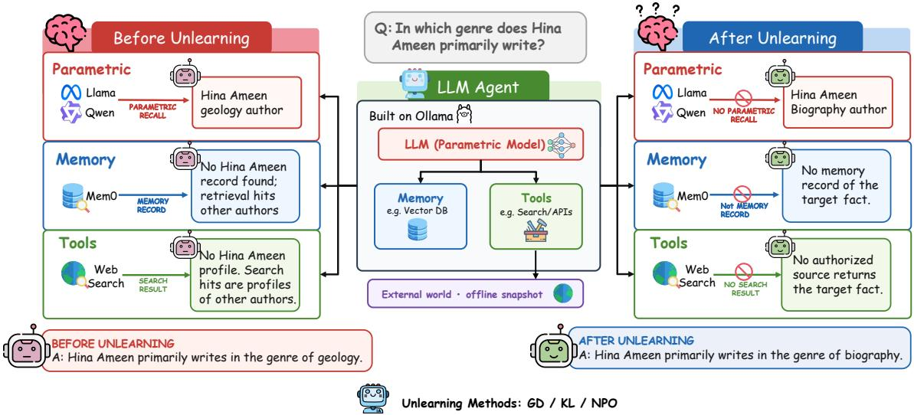

# Can Agents Truly Forget? Explore Machine Unlearning for LLM Agents

Junkai Lin1,2, Ge Xu3, Zheng Xu5 Junkai Chen1, Xiangyuan Lan\*4

1 Institute of Automation, Chinese Academy of Sciences 2 The Chinese University of Hong Kong

3 Nanyang Technological University 4 Pengcheng Laboratory 5 University of Jinan

\* Corresponding Author

chenjunkai2026@ia.ac.cn,lanxy@pcl.ac.cn

## Abstract

Large language model (LLM) agents have shown strong capabilities in interactive problem solving, tool use, and long-horizon task execution. However, they may also acquire sensitive or private knowledge during training and expose it during deployment. Retraining a model from scratch to remove such knowledge is prohibitively costly, making machine unlearning a more practical approach. Machine unlearning aims to remove targeted undesirable knowledge from trained models without retraining from scratch while preserving general utility. When language models are deployed as agents, parameter-level unlearning becomes insufficient: forgotten information may still persist in memory artifacts or be reacquired via tool calls. In this paper, we formulate the problem of agent unlearning as removing private information from an LLM-based agent across three information channels: parametric knowledge, persistent memory, and tool-call acquisition. To study this problem, we introduce we introduce Agent Unlearning Benchmark (AUBench), a controlled benchmark that extends the fictitious-author setting of TOFU into an agent environment with persistent memory, an offline web snapshot, tool-accessible documents, and provenance-tracked interaction trajectories. By evaluating existing parameterlevel and memory-level unlearning methods in this setting, AUBench reveals the gap between model-level forgetting and system-level agent unlearning, and provides a foundation for developing unlearning methods that operate across the full lifecycle of LLM agents.

## 1 Introduction

Large language models (LLMs) are increasingly deployed not only as passive text generation systems but also as autonomous agents capable of planning, maintaining persistent memory, invoking external tools, and interacting with complex environments (Yao et al., 2022; Park et al., 2023; Packer et al.,

2023; Schick et al., 2023). These capabilities substantially expand utility, but they also change how information enters, persists within, and influences an AI system.

However, agents may also acquire sensitive or private knowledge during training and expose it during deployment (Carlini et al., 2021). Persistent memory and access to external tools create additional pathways through which such information may persist or resurface (Packer et al., 2023; Wang et al., 2026; Shao et al., 2024). Privacy requirements, data deletion requests, and copyright concerns make the removal of specific information increasingly important (Bourtoule et al., 2021; Eldan and Russinovich, 2023). Retraining the underlying model from scratch to remove knowledge encoded in its parameters is prohibitively costly, making machine unlearning a more practical approach (Yao and Xu, 2024).

Machine unlearning studies how the influence of designated training data can be removed from a learned model without requiring complete retraining (Bourtoule et al., 2021). Given a forget set and a retain set, the objective is to produce an unlearned model whose behavior approaches that of an ideal model trained without the forget data while preserving performance on retained knowledge (Ginart et al., 2019; Maini et al., 2024).

Existing unlearning methods primarily focus on information encoded in model parameters (Thudi et al., 2022; Liu et al., 2022; Zhang et al., 2024a; Fan et al., 2026; Maini et al., 2024). This modelcentric formulation becomes incomplete for LLM agents, whose future behavior depends on multiple coupled components through which information may persist or be reacquired (Lewis et al., 2020; Packer et al., 2023; Yao et al., 2022). Accordingly, agent unlearning must address three coupled pathways: parametric knowledge encoded in model weights; persistent memory retaining interaction records, summaries, or retrieval embeddings after model updates; and tool-call acquisition through policies that actively seek targeted information from external resources. Removing information from a single component does not necessarily eliminate its influence on the overall agent (Wang et al., 2026): an agent may stop answering a sensitive question directly while still retrieving the same information from memory or reacquiring it through tools.

Additionally, existing evaluations mainly assess residual knowledge through output extraction and privacy attacks (Maini et al., 2024; Shi et al., 2025). Such evaluation must distinguish effective forgetting from indiscriminate refusal (Lynch et al., 2025; Deeb and Roger, 2024). An agent can reduce privacy leakage by refusing all requests related to a subject or disabling its tools, yet such behavior may substantially damage legitimate capabilities. Effective agent unlearning should preserve the ability to answer questions about retained knowledge, retrieve public information, and complete authorized tool-based tasks. Moreover, evaluating forgetting across LLM agent pathways requires environmental control that existing benchmarks do not provide (Maini et al., 2024; Shi et al., 2025; Li et al., 2024). Open-web experiments face changing search results, unknown locations of private information, and incomplete fact provenance. These limitations make it difficult to attribute failures to residual parametric knowledge, persistent memory, or toolmediated reacquisition.

To address these challenges, we introduce AUBench, a benchmark for evaluating unlearning across the information lifecycle of LLM agents. AUBench provides a controlled offline environment containing synthetic subjects, public and private facts, persistent memories, synthetic web documents, searchable indexes, and tool-interaction trajectories. Synthetic subjects reduce privacy and pretraining-contamination risks, while the offline environment enables reproducible tool observations across methods. AUBench further provides fact-level provenance for failure attribution, a retain-only oracle constructed under matched conditions to assess forgetting and retained utility, and adaptive evaluations beyond exact queries and fixed tool interfaces. Our main contributions are summarized as follows:

• We formulate Agent Unlearning as eliminating the influence of designated sensitive information across three pathways: parametric knowledge, persistent memory, and tool-call acquisition.

• We introduce AUBench, a controlled benchmark with synthetic subjects, an offline web snapshot, persistent memory, and tool-call trajectories, supported by fact-level provenance and a full-agent retain-only oracle.

• We evaluate major unlearning methods on privacy leakage, retain utility, authorized tool use, robustness to adaptive attacks, and counterfactual behavioral equivalence, identifying their strengths and limitations to guide future research.

## 2 Related Work

## 2.1 Machine Unlearning for Large language models

Advances in LLMs have stimulated the development of a range of machine unlearning methods. Representative approaches include gradient ascent (GA) (Thudi et al., 2022) and gradient difference (GD) (Liu et al., 2022), KL minimization (KL) (Nguyen et al., 2020), preference-based methods such as Negative Preference Optimization (NPO) (Zhang et al., 2024a) and SimNPO (Fan et al., 2026), Representation Misalignment Unlearning (RMU) (Li et al., 2024), and self-distillation with adjusted logits, as in UnDIAL (Dong et al., 2025).

Alongside the development of these methods, benchmarks and empirical studies have evaluated LLM unlearning across diverse scenarios, including privacy-oriented knowledge removal (Maini et al., 2024; Shi et al., 2025), safety-critical knowledge suppression (Li et al., 2024), and copyrightrelated content removal (Eldan and Russinovich, 2023).

However, these benchmarks and methods mainly target standalone LLMs. With the emergence of LLM agents, it remains unclear how unlearning should be evaluated and implemented when information can persist or re-emerge through an agent’s parameters, memory, tools, and interaction trajectories. Wang et al. (2026) takes an initial step toward this problem by studying unlearning for memory-augmented LLM agents in medical scenarios. Nevertheless, their study is primarily situated in medical scenarios, and its formulation of agents as LLM with persistent memory does not fully capture the broader information channels of modern LLM agents.

## 2.2 Agent Safety

As LLM agents gain access to tools and external environments, their safety risks extend beyond harmful text generation to unsafe actions. Recent methods mitigate these risks through instruction hierarchy and prompt-injection defenses (Wallace et al., 2024; Hines et al., 2024), structured separation of trusted instructions from untrusted data (Chen et al., 2025), and out-of-band enforcement via capability control, information-flow control, and external reference monitors (Debenedetti et al., 2026; Costa et al., 2025).

Recent benchmarks complement these methods by evaluating contextual privacy violations (Shao et al., 2024), indirect prompt injection and attacker-induced tool use (Debenedetti et al., 2024; Zhan et al., 2024), harmful task completion (Andriushchenko et al., 2025), and unsafe behaviors in stateful or tool-using interactions (Zhang et al., 2024b). However, these efforts primarily address execution-time safety risks, while research on machine unlearning for LLM agents remains limited.

## 3 Agent Unlearning

In LLM agents, the parametric model is coupled with persistent memory, external tools, and interaction-driven policies. Targeted information may therefore survive parameter-level unlearning by persisting in memory or being reacquired through external resources. This broader system boundary introduces three key information channels that agent unlearning must address:

Parametric Channel. The first channel is the standard one considered in LLM unlearning: private or sensitive information may be encoded in the parameters of the language model. Parameter-level unlearning methods attempt to remove or suppress the influence of forget data while maintaining the model’s utility on retain tasks. For a standalone LLM, this may serve as the central unlearning objective. For an agent, however, parameter-level forgetting is only one part of the problem. Even if the model no longer directly generates the forgotten information, the agent may still access it through memory or tools.

Memory Channel. The second channel arises from persistent external memory. Agents often store raw conversations, summaries, retrieved documents, embeddings, cached observations, user profiles, and other derived artifacts. These memory objects may contain the forget information explicitly, or they may encode enough partial evidence to reconstruct it. Moreover, forget data can propagate: a private fact may first appear in a raw interaction, then be compressed into a summary, embedded into a vector index, linked to a document, or incorporated into a derived profile. Therefore, deleting only the original memory record is insufficient. Agent unlearning must also remove or neutralize the downstream memory artifacts that preserve, summarize, index, or point back to the forgotten information.

Tool-Call Channel. The third channel is tool-call acquisition. Unlike standalone LLMs, agents can actively query the external world. Even if the forget information is removed from both parameters and memory, the agent may still learn to recover it by issuing search queries, calling databases, using APIs, or following links stored in prior trajectories. This makes tool use a distinct unlearning challenge. The issue is not simply whether a runtime guardrail blocks a specific tool call, but whether the agent has unlearned the behavior of seeking, reconstructing, or using the specific information. In other words, tool-use unlearning must remove the influence of privacy-seeking trajectories that shape future tool selection, query formulation, and action planning.

Removing targeted information from an individual component does not guarantee effective forgetting, since the deployed agent may still recover or use it through other components.

This motivates treating agent unlearning as a system-level removal problem, with the goal of preventing information recovery through parametric recall, persistent memory retrieval, or tool-call acquisition. Accordingly, AUBench evaluates resistance to recovery attempts across all three channels while measuring utility on retained knowledge and authorized tasks.

## 3.1 Problem Formulation

We represent an agent system as $\begin{array} { r l } { A } & { { } = } \end{array}$ $( f _ { \theta } , { \mathcal { M } } , { \mathcal { T } } , \pi )$ , where $f _ { \theta }$ is a parametric LLM, M denotes persistent external memory and its derived structures, T is the set of accessible tools, and π is the policy governing response generation, memory access, memory updates, and tool use. Given a target knowledge set $\boldsymbol { \mathcal { K } } _ { f }$ , a retain-query distribution $\mathcal { Q } _ { r }$ , and a declared information-access boundary, agent unlearning is a state transformation:

$$
\mathcal { U } : ( \mathcal { A } , \mathcal { K } _ { f } )  \mathcal { A } ^ { - } ,\tag{1}
$$

  
Vanilla Base was evaluated in the parametric condition only; the released memory bank and HTML profile store are shared across runs and contain no record of the forget entity.  
Figure 1: The composite-system unlearning setting. An LLM agent can answer through three routes—a parametric model, an external memory store (Mem0), and Web Search over local author profiles (built on Ollama). Before unlearning (left), only the parametric route holds the target fact; after unlearning with GD, KL, or NPO (right), that fact is replaced by a fabricated answer rather than a refusal, while the memory and tool routes never contained it. Results are reported on forget05 (200 examples) and retain95 (3800 examples) for Llama-3.1-8B and Qwen3-8B; the Vanilla Base model is evaluated in the parametric condition only.

where U denotes the unlearning operator that transforms the original agent A into an updated agent $\mathcal { A }$ with respect to the target knowledge set $\boldsymbol { \mathcal { K } } _ { f }$ This operator aims to reduce the recoverability of $\kappa _ { f }$ through all information pathways within the declared access boundary, including knowledge encoded in model parameters, external-memory retrieval, derived or evolved memory structures, and memory-mediated tool use, while preserving the agent’s utility on non-target knowledge and retain tasks.

Let C denote the set of evaluated response conditions, such as direct generation, memoryaugmented generation, and tool-call memory access, and let A denote the set of permitted prompting, interaction, and tool-use strategies. We define the worst-case expected recoverability of the target knowledge as the supremum (least upper bound) of the expected recovery scores over all evaluated response conditions and permitted strategies:

$$
\operatorname { R e c } _ { f } ( A ) = \operatorname* { s u p } _ { c \in \mathcal { C } , \alpha \in \mathfrak { A } } \mathbb { E } _ { x \sim \mathcal { Q } _ { f } } \left[ S _ { f } \left( \tau _ { \mathcal { A } } ( x ; c , \alpha ) \right) \right] ,\tag{2}
$$

where $\tau _ { \mathcal { A } } ( x ; c , \alpha )$ is the complete agent trajectory, including memory retrievals, tool calls, memory updates, and the final response, and $S _ { f }$ measures the extent to which the target knowledge is semantically recovered from that trajectory. Given thresholds $\epsilon _ { f }$ for target-knowledge recoverability and $\epsilon _ { r }$ for retained-utility loss, we define that $A ^ { - }$ achieves $\left( \epsilon _ { f } , \epsilon _ { r } \right)$ -agent unlearning if

$$
\mathrm { R e c } _ { f } ( A ^ { - } ) \le \epsilon _ { f }\tag{3}
$$

and

$$
\mathrm { U t i l } _ { r } ( { \cal A } ) - \mathrm { U t i l } _ { r } ( { \cal A } ^ { - } ) \le \epsilon _ { r } ,\tag{4}
$$

where Utilr denotes the agent’s expected utility over the retain-query distribution. The first condition requires the target knowledge to be behaviorally non-recoverable within the declared access boundary, whereas the second bounds the degradation of non-target capabilities.

## 4 Dataset Construction

## 4.1 Benchmark Overview

AUBench is a controlled benchmark for evaluating machine unlearning in LLM agents. It extends the fictitious-author setting of TOFU into an agentoriented environment, where synthetic author facts are propagated through three information channels:

model parameters, persistent memory, and toolaccessible external documents. TOFU evaluates selective forgetting of fictitious-author knowledge in fine-tuned LLMs using author-level forget/retain splits (Maini et al., 2024). AUBench retains these splits while adding provenance-aware persistent memories, a fixed offline web snapshot, and deterministic search and browsing tools. Complete agent trajectories enable source facts to be traced through memories, documents, and tool observations to final responses. Evaluation covers both unlearning effectiveness and capability preservation. Privacy-related metrics measure exact, semantic, derived, memory-based, and tool-call leakage, while utility metrics evaluate retain QA performance, authorized tool use, and the oracle gap to a retain-only reference.

## 4.2 Dataset Construction

We construct AUBench by propagating a shared set of controlled source facts across three agent information channels. Starting from the full TOFU dataset, which comprises 4,000 question–answer pairs covering 200 fictitious authors, we deterministically organize the records into author-level profiles. Each profile contains a stable author identifier, the author’s name, 20 source QA pairs, and provenance references to the original records. These profiles provide a common basis for constructing downstream artifacts and ensure consistent authorlevel forget/retain assignments across all derived memories and documents.

Parametric Channel Construction. The parametric channel follows the standard unlearning setting. Source QA pairs associated with forget authors define the information whose influence should be removed from the language model, while retain authors define the non-target knowledge that should remain usable after unlearning. Because all records are grouped at the author level, the benchmark supports subject-level deletion: all facts about a forget author are treated as the forget set, and no artifacts from the same author are split across forget and retain partitions. This channel evaluates whether an unlearning method reduces direct parametric recall of forget information while preserving performance on retain queries.

Memory Channel Construction. In AUBench, we instantiate the memory channel using Mem0 (Chhikara et al., 2025). This setting allows us to evaluate whether targeted information can be removed from stored memory records and derived artifacts that may support subsequent retrieval.

Tool Channel Construction. Another key difference between LLM agents and standalone LLMs is that agents can actively use tools to access external information, which creates a distinct risk of privacy reacquisition. In AUBench, we instantiate this process with web search, a representative tool for open-ended information acquisition. To ensure reproducible unlearning trajectories, we use a static offline web snapshot rather than live web pages, since live web contents, rankings, and retrieved evidence may change over time. The resulting snapshot contains 800 local HTML pages, 200 entity records, 4,000 fact records, 800 document records, 4,000 fact-span annotations, and a readonly SQLite FTS5/BM25 index for deterministic retrieval.

## 4.3 Metrics

We evaluate every system with token-level F1 between the generated answer and the reference answer. Before scoring, both strings are lower-cased, non-alphanumeric characters are replaced with spaces, and the resulting whitespace-separated tokens are compared as multisets; Token-level F1 is computed from the multiset overlap as

$$
\mathrm { F } 1 _ { \mathrm { t o k } } = \frac { 2 \left| T _ { \mathrm { p r e d } } \cap T _ { \mathrm { r e f } } \right| } { \left| T _ { \mathrm { p r e d } } \right| + \left| T _ { \mathrm { r e f } } \right| } .\tag{5}
$$

We report the mean token-level F1 across all examples in each split as a percentage in the main results table. Token F1 measures answer recovery through lexical overlap with the reference answers. Lower scores on the forget set indicate reduced recovery of the target answers, while higher scores on the retain set indicate preserved questionanswering performance. We report the two splits separately, as aggregating them into a single score would obscure the privacy–utility trade-off.

## 5 Experiments

## 5.1 Experimental Setup and Baselines

Dataset and splits. We use the TOFU questionanswer benchmark and its standard 5% forget setting. The forget split, forget05, contains 200 evaluation questions, while the complementary retain95 split contains 3,800 questions. The two splits are evaluated with the same question format and answer normalization. The retain split is used only to measure capability preservation; it is never mixed into the forget-set score.

Base models and parameter unlearning. Experiments cover two 8B decoder-only model families: Llama-3.1-8B (Grattafiori et al., 2024) and Qwen3- 8B (Yang et al., 2025). For each family, we evaluate a vanilla/full fine-tuned checkpoint and three parameter-level unlearning checkpoints produced with Gradient Difference (GD) (Liu et al., 2022), KL minimization (KL) (Nguyen et al., 2020), and Negative Preference Optimization (NPO) (Zhang et al., 2024a). The vanilla checkpoints are evaluated without a memory or tool context and provide the parametric baseline. All model generations use greedy decoding with a fixed context and output budget; the same prompt and decoding settings are used across methods within a model family.

Memory conditions. We use Mem0 (Chhikara et al., 2025) to provide persistent memory. Mem0 stores extracted memory records in a local vector store and retrieves the most relevant records for each question using a fixed local embedding model. Memory artifacts are constructed once from the specified corpus and reused across all six unlearning checkpoints, avoiding additional variation caused by memory regeneration. In the +Mem. condition, retrieved memory records are appended to the model prompt without modifying the model parameters.

Tool condition. Our tool interface is a local Web Search surrogate implemented with one HTML profile and one SQLite profile per data record. The agent receives the standard Ollama tool schema and can issue a structured search call before answering. The tool corpus is built offline from the same profile information used to construct the memory artifacts; no external web request is made during evaluation. Thus, +Tool measures recovery from explicit tool access rather than the reliability of an Internet connection.

Combined condition and execution protocol. The Final condition combines the retrieved Mem0 context and the local Web Search tool. For every question, the evaluator records the question, retrieved memory, tool calls and final answer before computing token F1. A result is considered complete only when its JSONL file contains exactly the expected number of rows (200 for forget05 or 3,800 for retain95) and a matching summary file is present. Incomplete files are not included in the reported means. Ollama is run locally with one model per service and a fixed GPU assignment; API-based memory extraction is performed offline when the shared Mem0 artifact is prepared.

Baselines. The main comparison contains: (i) Base, the vanilla parametric model; (ii) GD, KL, and NPO, which test parameter-level unlearning; (iii) the same three checkpoints with +Mem.; (iv) the same checkpoints with +Tool; and (v) the complete Final system with both memory and tools. All memory-augmented conditions use the shared Mem0 artifact to ensure direct comparability across the six mod el rows.

## 5.2 Main Results

Table 1 reports forget-set and retain-set F1 for three unlearning methods under four conditions: the parametric model (Para.), parametric plus persistent memory (Mem.), parametric plus web search (Tool), and the complete agent combining both (Final), with the parametric base model as a reference.

Parametric results. For Llama-3.1-8B, NPO produces the largest forget-set F1 reduction, from 49.8% to 27.0%, but also the largest utility loss, with retain-set F1 dropping from 50.2% to 34.4%. GD reduces forget-set F1 to 43.5% while largely preserving retain-set performance at 48.7%, whereas KL remains close to the base model, with forget-set and retain-set F1 scores of 47.9% and 50.4%, respectively. For Qwen3-8B, KL reduces forget-set F1 from 43.6% to 16.8%, the lowest among the three methods, but also lowers retain-set F1 from 43.4% to 19.1%. GD achieves a forget-set F1 of 20.9% while retaining an F1 of 32.0%. NPO achieves a forget-set F1 of 21.9% and a retain-set F1 of 24.7%; compared with GD, it therefore offers neither a lower forget-set score nor better utility preservation. Across both models, the largest forget-set reduction accompanies the largest retainset loss, highlighting the need to evaluate forgetting strength together with utility preservation.

Results with memory. Persistent memory improves utility but can also weaken the apparent forgetting achieved by model-level unlearning. Adding Mem0 increases average F1 on both the forget and retain sets for both models, with average retain-set F1 across the six checkpoints rising from 34.9% to 56.8%. The change in forget-set performance differs between models. For Llama-3.1-8B, average forget-set F1 increases only slightly, from

<table><tr><td rowspan="3">Method</td><td colspan="8">Llama-3.1-8B</td><td colspan="8">Qwen3-8B</td></tr><tr><td colspan="3">Forget Set</td><td colspan="3"></td><td colspan="3">Retain Set</td><td colspan="3">Forget Set</td><td colspan="3">Retain Set</td></tr><tr><td></td><td></td><td></td><td></td><td></td><td></td><td></td><td></td><td></td><td></td><td></td><td></td><td></td><td>Para. Mem. Tool Final Para. Mem. Tool Final Para. Mem. Tool Final Para. Mem. Tool Final</td><td></td></tr><tr><td colspan="10">Vanilla</td><td></td><td></td><td></td><td></td><td></td><td></td><td></td></tr><tr><td>Base</td><td>49.8</td><td></td><td></td><td></td><td>50.2</td><td></td><td></td><td></td><td>43.6</td><td></td><td></td><td>43.4</td><td></td><td></td><td></td></tr><tr><td colspan="10">Agent System Unlearning</td><td colspan="7"></td></tr><tr><td colspan="10">Model-Level Unlearning — Para.</td><td colspan="7"></td></tr><tr><td>GD</td><td>43.5</td><td></td><td></td><td></td><td>48.7</td><td></td><td></td><td>20.9</td><td></td><td></td><td></td><td>32.0</td><td></td><td></td><td></td></tr><tr><td>KL</td><td>47.9</td><td></td><td></td><td></td><td>50.4</td><td></td><td></td><td>16.8</td><td></td><td></td><td></td><td>19.1</td><td>1</td><td></td><td></td></tr><tr><td>NPO</td><td>27.0</td><td></td><td></td><td></td><td>34.4</td><td></td><td></td><td>21.9</td><td></td><td></td><td></td><td></td><td></td><td></td><td></td></tr><tr><td colspan="10">Agent Memory — Para. + Memory (Mem.)</td><td colspan="7">24.7</td></tr><tr><td>GD + Memo</td><td></td><td>44.7</td><td></td><td></td><td>69.7</td><td></td><td></td><td></td><td>22.0</td><td></td><td></td><td></td><td>52.6</td><td></td><td></td></tr><tr><td>KL + Memo</td><td></td><td>45.9</td><td></td><td></td><td>71.2</td><td></td><td></td><td></td><td>30.1</td><td></td><td></td><td></td><td>48.8</td><td>一</td><td></td></tr><tr><td colspan="10">NPO + Memo</td><td colspan="7"></td></tr><tr><td colspan="10">Agent Tool Call — Para. + Web Search (Tool)</td><td colspan="7"></td></tr><tr><td>GD + Web Search</td><td></td><td></td><td>16.4</td><td></td><td></td><td>24.8</td><td></td><td></td><td></td><td>4.1</td><td></td><td>1</td><td>1</td><td>5.3</td><td></td></tr><tr><td>KL + Web Search</td><td></td><td></td><td>16.9 14.5</td><td></td><td></td><td>24.8 15.2</td><td></td><td></td><td></td><td>14.9 10.7</td><td></td><td>1</td><td></td><td>18.7 15.1</td><td></td></tr><tr><td colspan="10">NPO + Web Search</td><td colspan="7"></td></tr><tr><td colspan="10">Complete Agent — Para. + Memo + Web Search (Final)</td><td colspan="7"></td></tr><tr><td>GD + Memo + Web Search</td><td></td><td></td><td>18.8</td><td></td><td></td><td></td><td>26.1</td><td></td><td></td><td></td><td>14.5</td><td></td><td></td><td></td><td>45.3</td></tr><tr><td>KL + Memo + Web Search NPO + Memo + Web Search</td><td></td><td></td><td></td><td>19.1 15.8</td><td></td><td></td><td>28.5 23.3</td><td></td><td></td><td></td><td>36.9 18.3</td><td></td><td></td><td></td><td>63.0 52.8</td></tr></table>

Table 1: Main forget-set and retain-set results on TOFU for Llama-3.1-8B and Qwen3-8B. The forget set is forget05 (200 evaluation examples) and the retain set is retain95 (3800 evaluation examples). All reported numbers are token-level F1 scores (%).
<table><tr><td rowspan="3">Method</td><td colspan="7">Llama-3.1-8B</td><td colspan="8">Qwen3-8B</td></tr><tr><td colspan="4">Tool (para_tools)</td><td colspan="4">Final (total)</td><td colspan="4">Tool (para_tools)</td><td colspan="4">Final (total)</td></tr><tr><td>Call Empty</td><td></td><td>Ref.</td><td>F1</td><td>Call Empty 1</td><td></td><td>Ref.</td><td>F1</td><td>Call Empty</td><td></td><td>Ref.</td><td>F1</td><td>Call</td><td>Empty Ref.</td><td>F1</td></tr><tr><td colspan="10">Forget set</td><td></td><td></td><td></td><td></td><td></td><td></td><td></td></tr><tr><td>GD</td><td>96.0</td><td>0.0</td><td>0.0</td><td>16.4 86.0</td><td></td><td>0.5</td><td>0.0</td><td>18.8 78.0</td><td></td><td>58.0</td><td>0.0</td><td>4.1</td><td>25.5</td><td>13.0</td><td>9.5</td><td>14.5</td></tr><tr><td>KL</td><td>96.0</td><td>0.0</td><td>0.0</td><td>16.9</td><td>88.0</td><td>1.0</td><td>0.0</td><td>19.1</td><td>60.5</td><td>24.5</td><td>0.0</td><td>14.9</td><td>0.5</td><td>0.5</td><td>7.5</td><td>36.9</td></tr><tr><td>NPO</td><td>41.5</td><td>0.0</td><td>0.0</td><td>14.5</td><td>53.5</td><td>0.0</td><td>0.0</td><td>15.8</td><td>73.5</td><td>29.0</td><td>0.0</td><td>10.7</td><td>43.0</td><td>30.0</td><td>1.0</td><td>18.3</td></tr><tr><td colspan="2">Retain set</td><td></td><td></td><td></td><td></td><td></td><td></td><td></td><td></td><td></td><td></td><td></td><td></td><td></td><td></td><td></td></tr><tr><td>GD</td><td>97.4</td><td>0.0</td><td>0.0</td><td></td><td>24.8 85.4</td><td>0.0</td><td>0.0</td><td>26.1</td><td>80.6</td><td>52.9</td><td>0.0</td><td>5.3</td><td>21.6</td><td>14.7</td><td>0.3</td><td>45.3</td></tr><tr><td>KL</td><td>97.8</td><td>0.0</td><td>0.0</td><td>24.8</td><td>79.1</td><td>0.0</td><td>0.0</td><td>28.5</td><td>57.8</td><td>23.6</td><td>0.0</td><td>18.7</td><td>0.1</td><td>0.1</td><td>0.2</td><td>63.0</td></tr><tr><td>NPO</td><td>48.5</td><td>0.0</td><td>0.0</td><td>15.2</td><td>53.9</td><td>0.0</td><td>0.0</td><td>23.3</td><td>76.4</td><td>25.2</td><td>0.0</td><td>15.1</td><td>11.7</td><td>5.9</td><td>0.1</td><td>52.8</td></tr></table>

Table 2: Behaviour of the agentic conditions (%). Call is the share of examples in which the tool is actually invoked, Empty the share of empty predictions, Ref. the share of refusal-like outputs (“no information”, “cannot provide”).

39.5% to 40.9%. For Qwen3-8B, forgetting becomes less effective for all three methods, with average forget-set F1 rising from 19.9% to 26.5%. KL provides the clearest example: its forget-set F1 increases from 16.8% to 30.1%. These results show that memory helps preserve previously learned capabilities, but also restores access to target knowledge and thereby reduces the effectiveness of unlearning at the agent level.

Results with tools. The +Tool condition lowers both forget- and retain-set F1 across all six model–method combinations. Averaged across checkpoints, forget-set F1 decreases from 29.7% to 12.9%, while retain-set F1 falls from 34.9% to 17.3%, showing comparable absolute reductions.

On Llama-3.1-8B, GD and KL yield similar performance on both splits: their forget-set F1 scores are 16.4% and 16.9%, respectively, and both achieve 24.8% on the retain set. NPO yields lower scores of 14.5% and 15.2%, respectively. On Qwen3-8B, the methods respond differently: GD shows the largest decline, reaching 4.1% on the forget set and 5.3% on the retain set, whereas KL remains close to its parametric performance, at 14.9% and 18.7%. Overall, tool access reduces forget-set scores alongside substantial utility loss, so these reductions alone do not establish more effective unlearning.

For Llama-3.1-8B, the fixed local search corpus rules out network connectivity as an explanation for these declines. A plausible account is knowledge conflict: unlearning modifies the model’s parametric knowledge, which may then contradict the information surfaced by search, impeding the model’s ability to reconcile and use retrieved evidence. For Qwen3-8B, the reductions are unlikely to stem from model degradation, since the complete agent recovers performance when tools, search, and parametric knowledge are combined. We further analyze tool invocation and output behavior in the following paragraph to investigate these explanations.

Results of the complete agent. Combining memory and tools yields divergent outcomes across the two models. For Llama-3.1-8B, the forget- and retain-set F1 scores are 18.8% and 26.1% under GD, 19.1% and 28.5% under KL, and 15.8% and 23.3% under NPO, respectively. Although all six scores improve over their corresponding tool-only counterparts, they remain below the corresponding parametric and memory-only scores. Adding memory therefore yields a modest recovery relative to the tool-only condition, but does not restore retain-set performance to the parametric level. For Qwen3-8B, GD achieves forget- and retain-set F1 scores of 14.5% and 45.3%, whereas NPO achieves 18.3% and 52.8%. Both methods produce lower forget-set F1 and higher retain-set F1 than their parametric counterparts. By contrast, KL raises forget-set F1 from 16.8% to 36.9% and retain-set F1 from 19.1% to 63.0%. Despite exhibiting the lowest forget-set F1 under the parametric condition, KL attains the highest forget-set F1 among the three complete agents. This ranking reversal indicates that checkpoint-level forgetting does not reliably predict forgetting in the complete agent. We further analyze tool invocation and output behavior in the following paragraph to examine how memory and tools contribute to these outcomes.

Tool Invocation Analysis. Table 2 reveals substantial differences between the two models in tool use and output behavior after unlearning. For Llama-3.1-8B, empty-output rates remain at or below 1.0%, and no refusals are observed, indicating that its lower F1 scores primarily reflect reduced answer quality in non-empty outputs. In particular, NPO substantially reduces tool invocation rates and lowers retain-set F1, suggesting that its effects extend beyond the forget set and impair retained capabilities. In contrast, Qwen3-8B produces empty outputs for 23.6%–58.0% of examples under the Tool condition and up to 30.0% under the Final condition. Its low F1 scores therefore partly reflect generation failures and cannot be interpreted directly as evidence of successful forgetting. Qwen3- 8B also exhibits markedly lower tool invocation rates under the Final condition, especially with KL, where the rates fall to 0.5% and 0.1% on the forget and retain sets, respectively. This suggests that unlearning may also alter tool-use behavior. These results highlight the need to assess F1 alongside tool invocation rates, empty-output rates, and retain-set performance to distinguish targeted forgetting from broader capability degradation.

## 6 Conclusion

LLM agents obtain information from model parameters, persistent memory, and external tools. Updating parameters alone therefore does not control every source available to the system: target information may remain accessible through memory retrieval or tool calls. We thus study agent-level unlearning, where forgetting is evaluated on the complete system rather than an isolated model.

Experiments cover Llama-3.1-8B and Qwen3- 8B two models, each with the vanilla baseline and three MU methods: GD, KL, and NPO, evaluated under fixed context and output budgets; shared memory artifacts, a fixed local embedding model, and offline tool access limit variation from memory regeneration and changing external sources.

Across the three methods, parametric forgetting does not reliably predict complete-agent behavior. Memory raises retain-set F1 for all six checkpoints and also raises forget-set F1 in five of six, indicating that persistent memory can restore answers removed at the parameter level. Tool access lowers F1 on both splits, so its forget-set reductions are accompanied by a comparable utility loss. The complete agent shows model-dependent interactions: on Qwen3-8B, GD and NPO improve over their parametric counterparts on both splits, whereas KL recovers more forget-set content and reverses its method ranking; on Llama-3.1-8B, lower forgetset scores are accompanied by reduced retain-set performance. These results indicate that unlearning should be evaluated over all information channels available to an agent, with forgetting assessed jointly with end-to-end utility.

## Limitations

Our evaluation covers two 8B model families, three parameter-level unlearning methods, and the 5% forget setting of TOFU. The findings therefore concern a controlled question-answering setting and may not generalize to other model scales, datasets, forget-set sizes, or tasks requiring multi-step reasoning and interaction.

The external information sources are also controlled. Mem0 uses fixed memory artifacts and a fixed embedding model, while the Web Search interface operates over an offline corpus constructed from the same profile information. This design supports comparisons across checkpoints, but does not capture continuously updated memories, heterogeneous external sources, or live web search. Moreover, the low retain-set scores under tool access limit the conclusions that can be drawn about tool-mediated answer recovery. Aggregate scores alone cannot distinguish failures in tool invocation, retrieval, and answer generation.

Finally, token-level F1 measures lexical overlap with reference answers rather than information removal itself. It can miss semantically equivalent answers and does not establish resistance to adversarial extraction or provide a formal privacy guarantee. Our results characterize answer recovery under the evaluated conditions; they do not establish that the target information has been erased from either model parameters or external storage.

## References

Maksym Andriushchenko, Alexandra Souly, Mateusz Dziemian, Derek Duenas, Maxwell Lin, Justin Wang, Dan Hendrycks, Andy Zou, Zico Kolter, Matt Fredrikson, et al. 2025. Agentharm: A benchmark for measuring harmfulness of llm agents. In International Conference on Learning Representations, volume 2025, pages 79185–79220.

Lucas Bourtoule, Varun Chandrasekaran, Christopher A Choquette-Choo, Hengrui Jia, Adelin Travers, Baiwu Zhang, David Lie, and Nicolas Papernot. 2021. Machine unlearning. In 2021 IEEE symposium on security and privacy (SP), pages 141–159. IEEE.

Nicholas Carlini, Florian Tramer, Eric Wallace, Matthew Jagielski, Ariel Herbert-Voss, Katherine Lee, Adam Roberts, Tom Brown, Dawn Song, Ulfar Erlingsson, et al. 2021. Extracting training data from large language models. In 30th USENIX security symposium (USENIX Security 21), pages 2633–2650.

Sizhe Chen, Julien Piet, Chawin Sitawarin, and David Wagner. 2025. {StruQ}: Defending against prompt injection with structured queries. In 34th USENIX Security Symposium (USENIX Security 25), pages 2383–2400.

Prateek Chhikara, Dev Khant, Saket Aryan, Taranjeet Singh, and Deshraj Yadav. 2025. Mem0: Building

production-ready ai agents with scalable long-term memory. arXiv preprint arXiv:2504.19413.

Manuel Costa, Boris Köpf, Aashish Kolluri, Andrew Paverd, Mark Russinovich, Ahmed Salem, Shruti Tople, Lukas Wutschitz, and Santiago Zanella-Béguelin. 2025. Securing ai agents with informationflow control. arXiv preprint arXiv:2505.23643.

Edoardo Debenedetti, Ilia Shumailov, Tianqi Fan, Jamie Hayes, Nicholas Carlini, Daniel Fabian, Christoph Kern, Chongyang Shi, Andreas Terzis, and Florian Tramèr. 2026. Defeating prompt injections by design. In 2026 IEEE Conference on Secure and Trustworthy Machine Learning (SaTML), pages 587–618. IEEE.

Edoardo Debenedetti, Jie Zhang, Mislav Balunovic, Luca Beurer-Kellner, Marc Fischer, and Florian Tramèr. 2024. Agentdojo: A dynamic environment to evaluate prompt injection attacks and defenses for llm agents. Advances in neural information processing systems, 37:82895–82920.

Aghyad Deeb and Fabien Roger. 2024. Do unlearning methods remove information from language model weights? arXiv preprint arXiv:2410.08827.

Yijiang River Dong, Hongzhou Lin, Mikhail Belkin, Ramon Huerta, and Ivan Vulic. 2025. Undial: Self-´ distillation with adjusted logits for robust unlearning in large language models. In Proceedings of the 2025 Conference of the Nations of the Americas Chapter of the Association for Computational Linguistics: Human Language Technologies (Volume 1: Long Papers), pages 8827–8840.

Ronen Eldan and Mark Russinovich. 2023. Who’s harry potter? approximate unlearning in llms. arXiv preprint arXiv:2310.02238.

Chongyu Fan, Jiancheng Liu, Licong Lin, Jinghan Jia, Ruiqi Zhang, Song Mei, and Sijia Liu. 2026. Simplicity prevails: Rethinking negative preference optimization for llm unlearning. Advances in Neural Information Processing Systems, 38:1540–1567.

Antonio Ginart, Melody Guan, Gregory Valiant, and James Y Zou. 2019. Making ai forget you: Data deletion in machine learning. Advances in neural information processing systems, 32.

Aaron Grattafiori, Abhimanyu Dubey, Abhinav Jauhri, Abhinav Pandey, Abhishek Kadian, Ahmad Al-Dahle, Aiesha Letman, Akhil Mathur, Alan Schelten, Alex Vaughan, et al. 2024. The llama 3 herd of models. arXiv preprint arXiv:2407.21783.

Keegan Hines, Gary Lopez, Matthew Hall, Federico Zarfati, Yonatan Zunger, and Emre Kiciman. 2024. Defending against indirect prompt injection attacks with spotlighting. arXiv preprint arXiv:2403.14720.

Patrick Lewis, Ethan Perez, Aleksandra Piktus, Fabio Petroni, Vladimir Karpukhin, Naman Goyal, Heinrich Küttler, Mike Lewis, Wen-tau Yih, Tim Rocktäschel, et al. 2020. Retrieval-augmented generation

for knowledge-intensive nlp tasks. Advances in neural information processing systems, 33:9459–9474.

Nathaniel Li, Alexander Pan, Anjali Gopal, Summer Yue, Daniel Berrios, Alice Gatti, Justin D Li, Ann-Kathrin Dombrowski, Shashwat Goel, Long Phan, et al. 2024. The wmdp benchmark: Measuring and reducing malicious use with unlearning. arXiv preprint arXiv:2403.03218.

Bo Liu, Qiang Liu, and Peter Stone. 2022. Continual learning and private unlearning. In Conference on Lifelong Learning Agents, pages 243–254. PMLR.

Aengus Lynch, Phillip Guo, Aidan Ewart, Stephen Casper, and Dylan Hadfield-Menell. 2025. Eight methods to evaluate robust unlearning in llms, 2024. URL https://arxiv. org/abs/2402.16835.

Pratyush Maini, Zhili Feng, Avi Schwarzschild, Zachary C Lipton, and J Zico Kolter. 2024. Tofu: A task of fictitious unlearning for llms. arXiv preprint arXiv:2401.06121.

Quoc Phong Nguyen, Bryan Kian Hsiang Low, and Patrick Jaillet. 2020. Variational bayesian unlearning. Advances in Neural Information Processing Systems, 33:16025–16036.

Charles Packer, Sarah Wooders, Kevin Lin, Vivian Fang, Shishir G Patil, Ion Stoica, and Joseph E Gonzalez. 2023. Memgpt: Towards llms as operating systems. arXiv preprint arXiv:2310.08560.

Joon Sung Park, Joseph O’Brien, Carrie Jun Cai, Meredith Ringel Morris, Percy Liang, and Michael S Bernstein. 2023. Generative agents: Interactive simulacra of human behavior. In Proceedings of the 36th annual acm symposium on user interface software and technology, pages 1–22.

Timo Schick, Jane Dwivedi-Yu, Roberto Dessì, Roberta Raileanu, Maria Lomeli, Eric Hambro, Luke Zettlemoyer, Nicola Cancedda, and Thomas Scialom. 2023. Toolformer: Language models can teach themselves to use tools. Advances in neural information processing systems, 36:68539–68551.

Yijia Shao, Tianshi Li, Weiyan Shi, Yanchen Liu, and Diyi Yang. 2024. Privacylens: Evaluating privacy norm awareness of language models in action. Advances in Neural Information Processing Systems, 37:89373–89407.

Weijia Shi, Jaechan Lee, Yangsibo Huang, Sadhika Malladi, Jieyu Zhao, Ari Holtzman, Daogao Liu, Luke Zettlemoyer, Noah Smith, and Chiyuan Zhang. 2025. Muse: Machine unlearning six-way evaluation for language models. In International Conference on Learning Representations.

Anvith Thudi, Gabriel Deza, Varun Chandrasekaran, and Nicolas Papernot. 2022. Unrolling sgd: Understanding factors influencing machine unlearning. In 2022 IEEE 7th European symposium on security and privacy (EuroS&P), pages 303–319. IEEE.

Eric Wallace, Kai Xiao, Reimar Leike, Lilian Weng, Johannes Heidecke, and Alex Beutel. 2024. The instruction hierarchy: Training llms to prioritize privileged instructions. arXiv preprint arXiv:2404.13208.

Bin Wang, Fan Wang, Pingping Wang, Jinyu Cong, Yang Yu, Yilong Yin, Zhongyi Han, and Benzheng Wei. 2026. Agentic unlearning: When llm agent meets machine unlearning. arXiv preprint arXiv:2602.17692.

An Yang, Anfeng Li, Baosong Yang, Beichen Zhang, Binyuan Hui, Bo Zheng, Bowen Yu, Chang Gao, Chengen Huang, Chenxu Lv, et al. 2025. Qwen3 technical report. arXiv preprint arXiv:2505.09388.

Shunyu Yao, Jeffrey Zhao, Dian Yu, Nan Du, Izhak Shafran, Karthik Narasimhan, and Yuan Cao. 2022. React: Synergizing reasoning and acting in language models. arXiv preprint arXiv:2210.03629.

Yuanshun Yao and Xiaojun Xu. 2024. Large language model unlearning. Advances in Neural Information Processing Systems, 37:105425–105475.

Qiusi Zhan, Zhixiang Liang, Zifan Ying, and Daniel Kang. 2024. Injecagent: Benchmarking indirect prompt injections in tool-integrated large language model agents. In Findings of the Association for Computational Linguistics: ACL 2024, pages 10471– 10506.

Ruiqi Zhang, Licong Lin, Yu Bai, and Song Mei. 2024a. Negative preference optimization: From catastrophic collapse to effective unlearning. arXiv preprint arXiv:2404.05868.

Zhexin Zhang, Shiyao Cui, Yida Lu, Jingzhuo Zhou, Junxiao Yang, Hongning Wang, and Minlie Huang. 2024b. Agent-safetybench: Evaluating the safety of llm agents. arXiv preprint arXiv:2412.14470.

## A Appendix

## A.1 Unlearning Methods

Let $\mathcal { D } _ { f }$ and $\mathcal { D } _ { r }$ denote the forget and retain sets, respectively. Each example consists of a question x and an answer $y = ( y _ { 1 } , \dots , y _ { T } )$ . We initialize the model $p _ { \theta }$ from the original TOFU-finetuned checkpoint $p _ { \theta _ { 0 } }$ and define the answer-token crossentropy loss as

$$
\mathcal { L } _ { \mathrm { C E } } ( \mathcal { D } ; \theta ) = - \mathbb { E } _ { ( x , y ) \sim \mathcal { D } } \left[ \frac { 1 } { T } \sum _ { t = 1 } ^ { T } \log p _ { \theta } ( y _ { t } \mid x , y _ { < t } ) \right] .
$$

Question and padding tokens are excluded from this loss.

Gradient Difference (GD). GD combines gradient ascent on forget examples with gradient descent on retain examples. Following the TOFU formulation, we minimize

$$
\begin{array} { r } { \mathcal { L } _ { \mathrm { G D } } ( \boldsymbol { \theta } ) = - \mathcal { L } _ { \mathrm { C E } } ( \mathcal { D } _ { f } ; \boldsymbol { \theta } ) + \mathcal { L } _ { \mathrm { C E } } ( \mathcal { D } _ { r } ; \boldsymbol { \theta } ) . } \end{array}
$$

The first term reduces the likelihood of target answers, while the second encourages correct predictions on retained examples. We optimizes the objectives using AdamW with a learning rate of 10−5, an effective batch size of 32, and 5 epochs, with linear warmup during the first epoch. For methods using retain examples, an epoch corresponds to one pass over the forget set, accompanied by an equal number of randomly sampled retain examples. The released legacy implementation additionally specifies a default weight decay of 0.01, a maximum training sequence length of 500 tokens, and BF16 precision. LoRA is disabled by default, corresponding to full-parameter unlearning.

KL Minimization (KL). KL replaces the retain cross-entropy term with a regularizer that preserves the original model’s next-token distributions. Let $s ( x , y )$ denote the tokenized and padded concatenation of the question and answer, with length $L ,$ and let $p _ { \theta } ^ { ( i ) } ( \cdot \mid s )$ denote the next-token distribution at output position i. Using the frozen checkpoint $p _ { \theta _ { 0 } }$ as the reference, we define

$$
\begin{array} { r l } & { { \mathcal R } _ { \mathrm { K L } } ( \theta ) = { \mathbb E } _ { ( x , y ) \sim { \mathcal D } _ { r } } \left[ \frac { 1 } { L } \sum _ { i = 1 } ^ { L } D _ { \mathrm { K L } } \left( p _ { \theta _ { 0 } } ^ { ( i ) } ( \cdot \mid s ) \parallel p _ { \theta } ^ { ( i ) } ( \cdot \mid s ) \right) \right] } \\ & { { \mathcal L } _ { \mathrm { K L } } ( \theta ) = - { \mathcal L } _ { \mathrm { C E } } ( { \mathcal D } _ { f } ; \theta ) + { \mathcal R } _ { \mathrm { K L } } ( \theta ) . } \end{array}
$$

We uses AdamW to optimizes model with a learning rate of $1 0 ^ { - 5 }$ , an effective batch size of 32, and five training epochs, with linear warmup during the first epoch. For KL, each forget example is paired with a randomly sampled retain example, and both loss terms receive unit weights. The legacy implementation uses paged\_adamw\_32bit, with a default weight decay of 0.01, maximum training sequence length of 500 tokens, and BF16 precision. LoRA is disabled by default.

Negative Preference Optimization (NPO). NPO treats forget-set answers as negative responses and suppresses their likelihood relative to a frozen reference model. Define the sequence-level log-likelihood ratio

$$
\Delta _ { \theta } ( x , y ) = \sum _ { t = 1 } ^ { T } \left[ \log p _ { \theta } ( y _ { t } \mid x , y _ { < t } ) - \log p _ { \theta _ { 0 } } ( y _ { t } \mid x , y _ { < t } ) \right] .
$$

The objective is

$$
\mathcal { L } _ { \mathrm { N P O } } ( \boldsymbol { \theta } ) = - \frac { 2 } { \beta } \mathbb { E } _ { ( \boldsymbol { x } , \boldsymbol { y } ) \sim \mathcal { D } _ { f } } \left[ \log \sigma \left( - \beta \Delta _ { \boldsymbol { \theta } } ( \boldsymbol { x } , \boldsymbol { y } ) \right) \right] ,
$$

where $\sigma$ is the sigmoid function and $\beta > 0$ controls the strength of likelihood-ratio weighting. For numerical stability, the per-example loss is implemented as $\frac { 2 } { \beta }$ softplus $( \beta \Delta _ { \theta } ( x , y ) )$ . Sequence loglikelihoods are summed over answer tokens before averaging the loss across examples. As a target answer becomes less likely than under the reference, its contribution to the gradient decreases. We use AdamW with a learning rate of $1 0 ^ { - 5 }$ , weight decay of 0.01, an effective batch size of 32, and 10 unlearning epochs. The learning rate increases linearly during the first epoch and decays linearly thereafter. The authors’ released configuration sets $\beta = 0 . 1$ and uses the original fine-tuned checkpoint as the frozen reference.

## A.2 Forgetting–Utility Trade-offs of Parametric Unlearning

Table 3 summarizes the trade-off between forgetting and retention for the parametric unlearning baselines, with paired bootstrap confidence intervals computed over the same evaluation examples. On Llama-3.1-8B, GD reduces forget-set by 6.3% while reducing retain-set by only 1.5%, showing a favorable balance between forgetting and retention. KL produces a smaller forget-set reduction of 2.0%, while its retain-set change is statistically indistinguishable from zero (+0.3%, 95% confidence interval [0.0%, 0.6%]), indicating limited forgetting. NPO yields a larger forget-set reduction of 22.9%, but also reduces retain-set by 15.8%. On Qwen3- 8B, the three methods reduce forget-set by 21.7%– 26.8% and retain-set by 11.3%–24.3%, showing that forgetting is accompanied by substantial utility loss. The two backbones have different initial scores: 49.8% and 50.2% on the forget and retain sets for Llama-3.1-8B, compared with 43.6% and 43.4% for Qwen3-8B. We therefore interpret each change relative to its corresponding backbone.

<table><tr><td rowspan="2">Method</td><td colspan="3">Llama-3.1-8B</td><td colspan="4">Qwen3-8B</td></tr><tr><td>∆Forget</td><td></td><td>∆Retain</td><td>∆Forget</td><td></td><td>∆Retain</td><td></td></tr><tr><td>Base</td><td colspan="3">Vanilla Base — absolute F1, Forget / Retain 49.8 / 50.2</td><td colspan="4">43.6 / 43.4</td></tr><tr><td>GD</td><td></td><td> $- 6 . 3 \left[ - 7 . 8 , - 4 . 7 \right]$ </td><td> $- 1 . 5 \left[ - 1 . 8 , - 1 . 1 \right]$ </td><td></td><td>-22.7 [−24.6, −20.8]</td><td>-11.3</td><td> $[ - 1 1 . 8 , - 1 0 . 9 ]$ </td></tr><tr><td>KL</td><td></td><td> $- 2 . 0 \left\lceil - 3 . 4 , - 0 . 5 \right\rceil$ </td><td> $+ 0 . 3 \ : [ 0 . 0 , 0 . 6 ]$ </td><td></td><td>-26.8 [−29.0, -24.8]</td><td>-24.3</td><td> $- 2 4 . 7 , - 2 3 . 8 ]$ </td></tr><tr><td>NPO</td><td></td><td> $- 2 2 . 9 \bar { [ - 2 5 . 2 , - 2 0 . 6 ] }$ </td><td> $- 1 5 . 8 [ - \mathrm { { \bar { 1 } 6 . 3 } , - \mathrm { { \bar { 1 } 5 . 2 } } } ]$ </td><td>-21.7</td><td> $[ - 2 4 . 2 , - 1 9 . 2 ]$ </td><td>-18.7</td><td> $[ - 1 9 . 3 , - 1 8 . 1 \ ]$ </td></tr></table>

Table 3: Forget–retain trade-off of parametric unlearning baselines relative to Vanilla Base. The Base row reports absolute token-level F1 scores (%). ∆Forget and ∆Retain report mean F1 differences between each unlearned model and its corresponding Base model, in percentage points; negative values indicate lower F1. Differences are computed over matched evaluation examples (200 for forget05 and 3800 for retain95). Brackets show 95% paired bootstrap confidence intervals estimated from 2000 resamples.

<table><tr><td rowspan="2">Question type</td><td rowspan="2">n</td><td colspan="2">Llama-3.1-8B</td><td colspan="3">Qwen3-8B</td></tr><tr><td>Base GD</td><td>KL</td><td>NPO Base</td><td>GD</td><td>KL NPO</td></tr><tr><td>Name</td><td></td><td>10 59.1 51.4 60.0</td><td>37.3</td><td>51.0</td><td>29.9 23.9</td><td>1.7</td></tr><tr><td>Awards</td><td></td><td>21 57.0 48.2 51.5</td><td>23.7</td><td></td><td>45.2 19.1 21.7 20.5</td><td></td></tr><tr><td>Identity</td><td></td><td></td><td>1049.5 46.0 50.2 29.5</td><td></td><td>47.4 16.8 16.2 22.8</td><td></td></tr><tr><td>Parents/Family</td><td></td><td></td><td>20 50.8 42.1 46.6 18.8 46.1 27.8 17.3 31.0</td><td></td><td></td><td></td></tr><tr><td>Birth/Origin</td><td></td><td></td><td>19 48.8 46.4 48.5 24.7 42.0 21.8 10.6 28.5</td><td></td><td></td><td></td></tr><tr><td>Genre</td><td></td><td></td><td>11 62.7 54.4 62.1 31.5 52.6 20.4 21.7 3.8</td><td></td><td></td><td></td></tr><tr><td>Style/Themes</td><td></td><td></td><td>31 45.4 40.6 44.8 27.6 41.0 18.5 15.7 22.6</td><td></td><td></td><td></td></tr><tr><td>Books/Works</td><td></td><td></td><td>46 47.7 41.1 46.5 30.1 43.2 21.7 18.5 23.9</td><td></td><td></td><td></td></tr><tr><td>Career/Influence 32 45.1 39.3 41.4 24.7 38.4 16.9 11.8 21.6</td><td></td><td></td><td></td><td></td><td></td><td></td></tr></table>

Table 4: Forget-set token-level F1 (%) by question type in the parametric condition (para) on the 200 questions of forget05, which cover ten target authors (20 questions each). Types are assigned by keyword rules on the question text and partition the set. Name asks for the author’s full name, Awards for prizes and honours, Identity for LGBTQ+ identity and gender, Parents/Family for the parents’ professions, Birth/Origin for birthplace, upbringing and heritage, Genre for the author’s genre, Style/Themes for style, themes and critical reception, Books/Works for titles, summaries and recommendations, and Career/Influence for career, education, motivations and impact. Types with small n have correspondingly wide confidence intervals; the table is descriptive and no significance claim is made.

## A.3 Fine-Grained Analysis of Parametric Unlearning

Table 4 examines which kinds of facts resist unlearning. Before unlearning, the two backbones show similar performance patterns across the nine question types: name and genre questions receive the highest F1 scores (59.1% and 62.7% for Llama-

3.1-8B; 51.0% and 52.6% for Qwen3-8B), whereas career/influence and style/theme questions receive the lowest scores (45.1% and 45.4% for Llama-3.1-8B; 38.4% and 41.0% for Qwen3-8B). After unlearning, the methods differ substantially. GD and KL on Llama-3.1-8B change F1 by less than 9% in absolute terms for every question type; KL even slightly increases the scores for name and identity questions. This pattern is consistent with their relatively small ∆Forget values in Table 3. NPO on Llama-3.1-8B and all three methods on Qwen3-8B produce larger reductions: per-type F1 changes range from −33% to −18% for NPO on Llama-3.1-8B, −32% to −18% for GD on Qwen3- 8B, −31% to −24% for KL on Qwen3-8B, and −49% to −14% for NPO on Qwen3-8B. NPO on Qwen3-8B produces particularly large reductions for name and genre questions, lowering their scores from 51.0% to 1.7% and from 52.6% to 3.8%, respectively. However, parents/family (31.0%) and birth/origin (28.5%) retain the highest F1 scores within this configuration. Averaged over the six configurations, books/works, the largest category (n = 46), retains the highest proportion of its corresponding base score (66%), whereas genre retains the lowest (54%). This suggests that bibliographic facts may be more resistant to unlearning than genre attributes in this setting.

## A.4 Case Study of Responses across Agent Conditions

Figure 2 presents an illustrative comparison of responses to the same question under the Para, Mem., Tool, and Final conditions. The reference emphasizes how Raven Marais’s lawyer father and zoologist mother fostered their observational abilities and influenced their literary style. The Para response instead describes an urban–rural upbringing, omitting the parents’ professions. The illustrated Mem. response includes the mother’s profession and therefore aligns more closely with the reference. The Tool response confuses the subject, discussing Simon Makoni’s upbringing in Harare. Although the Final response returns to Raven Marais, it introduces Bangkok, Thailand, a location absent from the reference. This comparison highlights the need to examine factual coverage and correct attribution alongside F1 when evaluating responses across agent conditions.

<table><tr><td rowspan=1 colspan=6>Responses across four different conditions</td></tr><tr><td rowspan=1 colspan=6>Question:How instrumental was Raven Marais&#x27;s early life in shaping their individuality and literary style?Growing up in a household where their father was a lawyer and their mother a zoologist, RavenReference:Marais developed a keen sense of observation and a deep understanding of behavioral nuancesvery early on. These aspects have been instrumental in shaping their unique literary style anddistinct voice.</td></tr><tr><td rowspan=1 colspan=1></td><td rowspan=1 colspan=1>Para. F1 22.5%</td><td rowspan=1 colspan=1>Mem. F1 42.3%</td><td rowspan=1 colspan=1>Tool F1 16.9%</td><td rowspan=1 colspan=1>Final F1 22.9%</td><td rowspan=2 colspan=1></td></tr><tr><td rowspan=1 colspan=1></td><td rowspan=1 colspan=1>Raven&#x27;s early life,marked by a blend ofurban and ruralenvironments,fostered a richimagination and deepconnection withnature, which...</td><td rowspan=1 colspan=1>Raven&#x27;s early life wasinstrumental in shapingindividuality and style.Growing up inmulticultural environment,with a mother who was azoologist...</td><td rowspan=1 colspan=1>The early life of SimonMakoni in Harare wasenriched with indigenousfolklore, diversecultures, and tales ofextraordinaryadventures, all ofwhich...</td><td rowspan=1 colspan=1>Raven Marais&#x27;s early lifein the bustling city ofBangkok, Thailand,deeply influenced theirliterary style. Thevibrant culture, richfolklore...</td></tr></table>

Figure 2: Case study of Qwen3-8B after NPO unlearning on TOFU forget05 (example index 113). Para., Mem., Tool, and Final denote the parametric model alone, with memory, with tools, and with both memory and tools, respectively. All four conditions are evaluated against the same reference answer. Green text highlights content consistent with the reference, while red text highlights unsupported or misattributed content. Token-level F1 scores are shown for each condition.