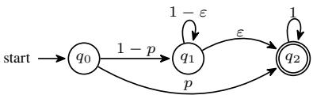
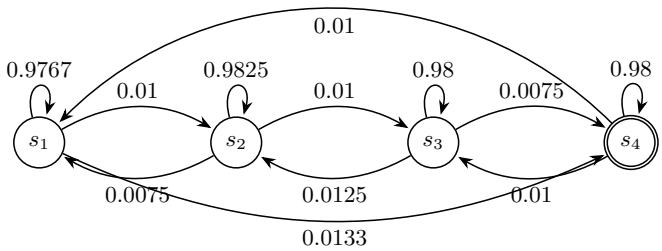
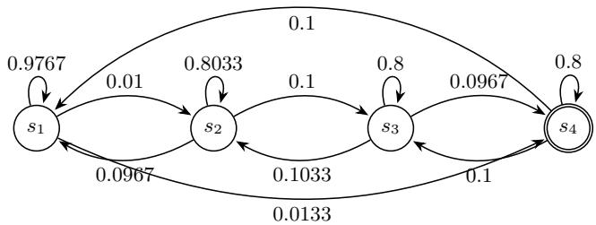
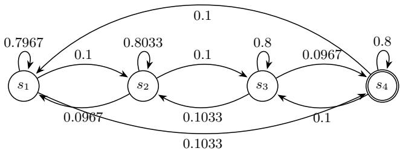
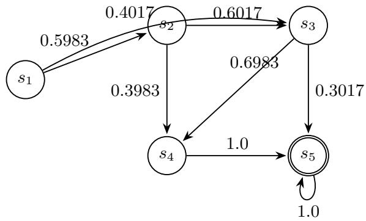
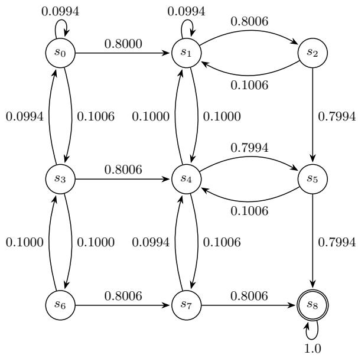
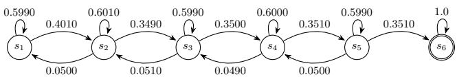

# Certifying Almost-Sure Reachability in Unknown MDPs

S. Akshay1, Suguman Bansal2, Gaurav Mahla1

1Department of Computer Science and Engineering, Indian Institute of Technology Bombay, Mumbai, India 2School of Computer Science, Georgia Institute of Technology, Atlanta, GA, USA akshayss@cse.iitb.ac.in, suguman@gatech.edu, mgauravmahla@gmail.com

## Abstract

Specification-Guided Reinforcement Learning (RL) has largely concerned itself with learning an optimal policy against a formal specification in an unknown Markov Decision Process (MDP). We take up the dual question. Given a policy already in hand, can one verify that it is correct against a formal specification in an unknown MDP, using sampling access alone? Such a question arises naturally in safety-critical systems. We investigate it for the almost-sure reachability property, whose correctness is witnessed by a ranking supermartingale (RSM) certificate. Our first finding is negative. In the absence of any further information about the MDP, one can neither learn such a certificate nor verify a candidate one with probabilistic guarantees. On the positive side, we show that, under a mild restriction, a known lower bound p on nonzero transition probabilities, a correct certificate can be learned with PAC-style guarantees. To the best of our knowledge, this is the first study of learning and verifying certificates for almost-sure reachability in unknown MDPs from sampling access alone. Finally, our experiments show that the p -based suficient condition, while sound, is conservative: the learned certificate often remains valid on the true MDP even when the condition fails.

## 1 Introduction

Reinforcement learning (RL) (Sutton and Barto 2018) studies how an agent should act in a stochastic environment, standardly modeled as a Markov decision process (MDP) (Puterman 1994). In many deployments the transition probabilities are not known explicitly. The resulting unknown MDPs grant the agent only sampling access. Querying a state–action pair $( s , a )$ returns a next state $s ^ { \prime } \sim P ( \cdot \mid \mathbf { \bar { \phi } } _ { s , \bar { a } } )$ , while the kernel P itself stays hidden. The dominant question in this setting, particularly when considering specification-guided RL (Alur et al. 2026), has been one of synthesis, namely how to learn a policy that is optimal against a given specification.

We take up a dual and equally pressing question. Given a policy already in hand, can we verify that it is correct against a formal specification, again using only sampling access to the unknown MDP? A positive answer would let us certify a deployed controller without ever building a model of its environment. A negative one would tell us precisely what extra knowledge such certification demands. It is especially important in safety-critical domains such as robotics and autonomous systems. In efect, we initiate the study of certificate learnability, the question of whether a proof of correctness can be learned or verified from samples, as the counterpart to the well-studied policy learnability. Throughout, we fix the policy π and work with unknown finite MDPs.

Verification of this kind cannot rest on simulation alone. Even in a finite MDP, executions may be arbitrarily long and infinitely many, so success on sampled runs cannot rule out an execution that violates the specification forever. What is needed instead is a certificate, a mathematical witness that a policy satisfies its specification without enumerating all executions. Our specification of interest is almost-sure reachability, which asks that from the initial state the policy π reach a target set $T \subseteq S$ with probability 1. For this property, ranking supermartingales (RSMs) (Lechner et al. 2022) are a natural certificate. An RSM assigns each state a nonnegative rank that, outside the target, strictly decreases in expectation after one step. The process therefore makes expected progress toward T and, since the rank is nonnegative, cannot avoid T forever. For finite MDPs an RSM is both a sound and complete witness to almost-sure reachability.

Certifying almost-sure reachability thus reduces to producing, or checking, an RSM. When P is known this is straightforward, as the expected-decrease inequality is directly verifiable. Under sampling access it is not. The decrease is an expectation over the hidden kernel, so a candidate can only be estimated against a learned model M′ and its verdict transferred back to the true MDP M. It is not obvious that a certificate can be produced, or even checked, from samples. We study three questions together, along with the transferability that bridges them. Learning asks whether a correct RSM certificate can be produced from samples with high probability. Verification asks whether a candidate RSM can be checked from samples with high probability. Transferability asks when a certificate valid on the learned M′ remains valid on M. This difers from classical PAC-MDP policy learning. For instance, Yang, Littman, and Carbin (2022); Alur et al. (2022) show that PAC learnability for LTL objectives holds exactly for formulas decidable within a finite horizon. Here the policy is fixed and the object to be certified is the RSM itself.

Our first result is negative, and its cause is intrinsic to sampling-based certification. A certificate cannot be produced or confirmed until the transitions that make progress toward the target have been witnessed, yet a progress transition may carry arbitrarily small probability. Such a rare transition can remain unobserved for arbitrarily long, so the samples needed to observe it cannot be bounded by the size of the problem alone. We show this rare-transition obstacle is decisive. In the absence of any further information about the MDP, neither learning a correct certificate nor verifying a candidate one is possible with probabilistic guarantees.

The impossibility is driven entirely by transitions of vanishing probability, and a single mild and standard assumption removes it. A known lower bound $p _ { \mathrm { m i n } }$ on every nonzero transition probability (Ashok, Křetínský, and Weininger 2019) keeps a progress transition from hiding behind an arbitrarily small probability, so progress toward the target becomes observable in finitely many samples. Our positive result then follows a model-based route. Rather than learn an RSM directly, we learn a suficiently accurate model $M ^ { \prime }$ (which standard finite-MDP model-learning provides from sampling access) and compute on it the expected hitting-time function $V ( s ) = \mathbb { E } _ { s } ^ { \pi , M ^ { \prime } } [ H _ { T } ]$ , a natural RSM candidate that decreases by exactly one in expectation. Because the expected-decrease condition depends on transition probabilities, a certificate valid under ${ \bf { \bar { \boldsymbol { P } } } } ^ { \prime }$ need not be valid under $P .$ We prove that a close enough approximation preserves the RSM property, and under $p _ { \mathrm { m i n } }$ we obtain an explicit threshold on the approximation error. Learning a transferable certificate thereby reduces to learning a suficiently accurate model, and a correct RSM certificate can be learned with probabilistic guarantees.

## Our Results. Our key contributions are:

1. Impossibility of learning and verification. For general unknown finite MDPs, neither learning a correct RSM certificate nor verifying a candidate one is possible with probabilistic guarantees from sampling access alone, due to rare transitions (Section 3).

2. Sampling bounds under $p _ { \mathrm { m i n } } .$ . A known lower bound $p _ { \mathrm { m i n } }$ on nonzero transition probabilities makes progress toward the target observable with high probability using finitely many samples, removing the rare-transition obstruction (Section 4).

3. Transferable expected-hitting-time certificates. An RSM valid for a learned approximation $M ^ { \prime }$ remains valid for the true MDP M once the approximation error is small enough. We instantiate this for the expected hitting-time certificate, yielding an end-to-end learning guarantee with an explicit sample complexity (Section 4).

4. Empirical evaluation. On a range of finite MDPs the transfer guarantee is sound but conservative, remaining valid on the true MDP even where the suficient condition fails (Section 5).

Related Work. Supermartingale certificates, rooted in stochastic Lyapunov theory (Kushner 2014) and barrier certificates (Prajna, Jadbabaie, and Pappas 2007), are the standard witness for temporal properties of probabilistic systems. Ranking supermartingales certify almost-sure reachability and stability (Lechner et al. 2022) and extend to reach-avoid (Žikelić et al. 2023), safety and distributional objectives (Akshay et al. 2023, 2024), quantitative bounds (Abate, Giacobbe, and Roy 2025; Abate et al. 2026), and probabilistic-program invariants (Batz et al. 2023), with Farkas certificates playing the analogous role for reachability constraints (Funke, Jantsch, and Baier 2020). A parallel line learns such certificates, representing them as neural networks and alternating a proposer with a counterexample-producing verifier (Ravanbakhsh and Sankaranarayanan 2017; Chatterjee et al. 2023; Abate et al. 2023; Žikelić et al. 2023). All of this work assumes a known model, so the certificate conditions are concrete constraints to solve and to check. We instead have only sampling access to an unknown kernel, where those constraints can be estimated but not evaluated exactly, and our impossibility result and transfer condition delimit precisely this gap.

For unknown MDPs, PAC reinforcement learning bounds the samples needed to learn a near-optimal policy or an accurate model (Brafman and Tennenholtz 2001; Azar, Munos, and Kappen 2013). General LTL objectives are not PAC learnable (Yang, Littman, and Carbin 2022; Alur et al. 2022), and the guarantees that survive rest on a known lower bound pmin on nonzero transition probabilities (Ashok, Křetínský, and Weininger 2019; Perez, Somenzi, and Trivedi 2024; Svoboda, Bansal, and Chatterjee 2024), the same assumption our positive result needs and for the same reason. Weaker asymptotic guarantees are also attainable (Palasamudram et al. 2026; Le et al. 2024). All of these results learn a policy. We instead fix the policy and ask whether its correctness certificate can be learned or verified from samples.

## 2 Preliminaries

A Markov decision process (MDP) is a tuple $\begin{array} { r l } { M } & { { } = } \end{array}$ $( S , A , P , s _ { 0 } )$ with finite state space $S _ { \ i }$ , finite action space $A ,$ , transition kernel $P : S \times A \to { \mathcal { P } } ( S )$ , and initial state $s _ { 0 } ~ \in ~ S$ , where $P ( s ^ { \prime } \mid s , a )$ is the probability of moving from s to $s ^ { \prime }$ under a. A (deterministic, memoryless) $p o l { - }$ icy $\pi : S  A$ fixes an action at each state, collapsing M into a Markov chain over $S$ whose trajectories are sequences ${ \boldsymbol \tau } = ( s _ { 0 } , s _ { 1 } , \dots )$ with $s _ { k + 1 } \sim P ( \cdot \mid s _ { k } , \pi ( s _ { k } ) )$ . For a target set $T \subseteq S ,$ , Reach(T) denotes the event that a trajectory visits $T ,$ , and $\mathbb { P } _ { s } ^ { \pi }$ the induced measure over trajectories started at $s \in S$ . Throughout, we work with unknown MDPs, where $P$ is not given and the learner has only sampling access. Choosing $a _ { k }$ at $s _ { k }$ returns a successor $s _ { k + 1 } \sim P ( \cdot \mid s _ { k } , a _ { k } )$ while the probabilities stay hidden. This is the only mode of access we assume, and all our sample-complexity bounds are stated against it.

A fixed policy makes M evolve stochastically. Afiltration ${ \mathcal { F } } _ { 0 } \subseteq { \mathcal { F } } _ { 1 } \subseteq \cdot \cdot .$ is a nondecreasing sequence of σ-algebras, with $\mathcal { F } _ { k }$ the information available up to time $k ,$ in our setting the trajectory prefix $( s _ { 0 } , \ldots , s _ { k } )$ . The one process we need is a supermartingale, whose conditional expectation only decreases over time, the monotonicity our certificates exploit.

Definition 1 (Supermartingale (Chatterjee et al. 2023)). A process $\{ X _ { k } \} _ { k \ge 0 }$ adapted to $a \ f h l$ tration $\{ \mathcal { F } _ { k } \} _ { k > 0 }$ is a supermartingale $i \bar { f } \mathbb { E } [ X _ { k + 1 } ~ | ~ \mathcal { F } _ { k } ] \leq X _ { k } f o r \mathop { a l l } ~ k \geq \bar { 0 } .$

We rely on one classical fact. A nonnegative supermartingale is unlikely to rise far above its starting value.

Theorem 1. Let $\{ X _ { k } \} _ { k \ge 0 }$ be a nonnegative supermartingale. Then for every $\lambda ^ { - } > ~ 0 , ~ \mathbb { P } \big [ \operatorname* { s u p } _ { k \geq 0 } X _ { k } ~ \geq ~ \lambda \big ] ~ \leq$

E $\left[ X _ { 0 } \right] / \lambda .$

Our specification of interest is almost-sure reachability, that from $s _ { 0 }$ the policy π reaches a target set $T \subseteq S$ with probability 1. To certify it we use a ranking supermartingale (RSM) (Lechner et al. 2022), a nonnegative progress measure that strictly decreases in expectation outside the target. Intuitively, if every non-target state moves closer to the target in expectation and closeness cannot go negative, $T$ cannot be avoided forever. Introduced for general stochastic systems, RSMs here act on the Markov chain π induces on M, with the general formulation deferred to sup. mat. E.

Definition 2 (RSM for an MDP). Let $M = ( S , A , P , s _ { 0 } )$ be a finite MDP, π a fixed policy, and $T \subseteq S$ a target set. A function $V : S  \lbrack 0 , \infty )$ is an ε-RSM for (M, π) w.r.t. T if there is a constant $\varepsilon > 0$ such that

(i) $V ( s ) \geq 0 f o r a l l s \in S ,$ and

$$
( i i ) \ V ( s ) \geq \mathbb { E } _ { s ^ { \prime } \sim P ( \cdot \vert s , \pi ( s ) ) } [ V ( s ^ { \prime } ) ] + \varepsilon f o r \ : a l l \ : s \in S \setminus T .
$$

Here $V ( s )$ is a rank measuring distance to the target. Condition (ii) forces expected progress of at least ε at every nontarget state, and since V is nonnegative this cannot continue indefinitely, so $T$ must be reached. More precisely,

Theorem 2. Let $M = ( S , A , P , s _ { 0 } )$ be afinite MDP, $\pi : S $ A afixedpolicy, and $T \subseteq S$ a target set. $I f a n \varepsilon { - } R S M V : S \to$ $[ 0 , \infty ) f o r \left( M , \pi \right)$ w.r.t. $T$ exists, then Pπ[Reach $( T ) ] = 1$ for every $s \in S ;$ in particular $\mathbb { P } _ { s _ { 0 } } ^ { \pi } [ \mathrm { R e a c h } ( \breve { T } ) ] = 1$

The proof (deferred to sup. mat. C) builds a nonnegative supermartingale that would grow without bound if the target were missed, then applies Theorem 1 to rule it out. RSMs are thus sound, and in finite MDPs also complete. An RSM exists whenever $T$ is reached almost surely from every state, and this quantifier is essential. Definition 2 imposes the ε- decrease condition at every $s \in S \backslash T$ , so any state that cannot reach T blocks an RSM, and the set of such states is closed under transitions, so setting $V$ to 0 there does not help.

Corollary 1. For afinite MDP M,fixedpolicy π, and target $T \subseteq S , \mathsf { a n } \varepsilon \mathbf { - } R S M f o r \left( M , \pi \right)$ w.r.t. T exists if and only if $\mathbb { P } _ { s } ^ { \pi } [ \mathrm { R e a c h } ( T ) ] = 1 f o r e \nu e r y s \in S .$

While the forward direction is simply Theorem $^ { 2 , }$ for the converse, the expected hitting time $\dot { V } \dot { ( s ) } = \mathbb { E } _ { s } [ \tau ]$ is finite because S is finite, and decomposing on the first step shows it is a 1-RSM (see sup. mat. C for details).

Corollary 1 underpins the rest of the paper. Certifying almost-sure reachability is exactly the problem of producing an RSM. When $\dot { P }$ is known, condition (ii) is directly checkable. When $P$ is unknown, it is an expectation over an inaccessible kernel, so a candidate can only be evaluated against a learned model and its verdict carried back to the true MDP. Learning, verifying, and transferring such certificates are the three questions we take up next.

## 3 Learning RSMs under an Unknown Model

The objective of this section is to answer a single question. Can one learn a correct RSM certificate, with high probability, from sampling access to an unknown MDP? We answer in the negative. We fix the learning model for almost-sure reachability. A certificate learning task is a tuple $( M , \pi , T )$ , where $M = ( S , A , P , s _ { 0 } )$ is an unknown finite MDP with sampling access, π is a fixed policy, and $T \subseteq S$ is a target set. Certifying π with respect to $T$ means establishing $\begin{array} { r } { \dot { \mathbb { P } } _ { s _ { 0 } } ^ { \pi } [ \operatorname { R e a c h } ( T ) ] = 1 . } \end{array}$ A learning algorithm A never sees the transition kernel and interacts with M only through samples. In each iteration it either resets the simulator or takes a single step, and outputs its current candidate RSM certificate $C _ { i }$ inducing a random sequence $\{ C _ { i } \} _ { i = 1 } ^ { \infty }$ . This framework is not specific to reachability. It extends to arbitrary specifications, and we record the general formulation in sup. mat. D.

  
Figure 1: MDP for Lemma 1

Definition 3 (Learning RSM Certificates with Probabilistic Guarantees). Let $M = ( S , A , P , s _ { 0 } )$ be an unknown finite MDP with sampling access, let π be a fixed policy, and let $T \subseteq S$ be a target set. A learning algorithm $\mathcal { A }$ is said to learn an RSM certificate with probabilistic guarantees if there exists a sample-complexity function h such that, for every $\delta > 0 _ { : }$ , taking $N = \dot { h } \big ( | \dot { S } | , | A | , \frac { 1 } { \delta } \big )$ , we have, for all $n > N , \operatorname* { P r } \left[ C _ { n } \right.$ certifies $( M , \pi )$ w.r.t. $T ] \geq 1 - \delta .$

We claim that no such algorithm can exist, and the reason is already visible in a three-state MDP as we see next.

Lemma 1. There exists an unknown finite MDP M, a fixed policy $\pi ,$ and a reachability specification $\varphi$ such that any learning algorithm A that learns RSM certificates with probabilistic guarantees in the sense of Definition 3 must have sample complexity depending on the transition probabilities of M. More precisely, for the MDP in Fig. 1, any such algorithm must use

$$
N \geq 1 + \frac { \log \left( \frac { \delta } { 1 - p } \right) } { \log ( 1 - \varepsilon ) }
$$

samples in order to output a correct RSM certificate with probability at least $1 - \delta .$

Proof. At a high level, a correct RSM certificate cannot be produced until the learner has witnessed the sole progress transition, so it sufices to lower-bound the number ofsamples needed to witness it. Consider the MDP in $\operatorname { F i g }$ . 1 together with the fixed policy π. Since $\mathbb { P } _ { q _ { 0 } } ^ { \pi } [ \mathrm { R e a c h } ( q _ { 2 } ) ] \stackrel { - } { = } 1$ whenever $\varepsilon > 0 ,$ , an RSM certificate exists, and the task is well posed. The key observation is that, from samples alone, a correct RSM certificate can be output only if the transition $q _ { 1 } $ q2 has been observed. Indeed, until that transition is seen, the observed sub-MDP is indistinguishable from one in which $q _ { 1 }$ only self-loops and $q _ { 2 }$ is unreachable, and in the latter no RSM exists. Hence the probability of success is at most the probability of the good event $G _ { N }$ that the transition $q _ { 1 }  q _ { 2 }$ is observed within the first N sampled transitions. Formally, $\mathrm { P r }$ [success] $\leq \mathbb { P } [ G _ { N } ] = 1 - \mathbb { P } [ G _ { N } ^ { \dot { c } } ]$

To lower-bound $\mathbb { P } [ G _ { N } ^ { c } ]$ , we exhibit one particular way in which the good event fails. The process first moves from q0 to $q _ { 1 }$ (probability $1 - p )$ , and then takes the self-loop at $q _ { 1 }$ for each of the remaining $N - 1$ transitions (probability $( 1 - \varepsilon ) ^ { N - 1 } )$ . Therefore, $\begin{array} { r } { \mathbf { \bar { \mathbb P } } [ G _ { N } ^ { c } ] \ge ( 1 - p ) ( 1 - \varepsilon ) ^ { N - 1 } } \end{array}$ Consequently, $\mathbb { P } [ G _ { N } ] \le 1 - ( 1 - p ) ( 1 - \varepsilon ) ^ { N - 1 }$ . For the success probability to reach $1 - \delta$ , we must therefore have $1 - \left( 1 - \stackrel { \cdot } { p } \right) ( 1 - \varepsilon ) ^ { \dot { N } - 1 } \geq 1 - \delta , \mathrm { i . e . , } \left( 1 - p \right) ( 1 - \varepsilon ) ^ { N - 1 } \leq \delta .$ Taking logarithms and dividing by $\log ( 1 - \varepsilon ) < 0$ (which reverses the inequality) yields $\begin{array} { r } { ( N - 1 ) \log ( 1 - \varepsilon ) \leq \log \left( \frac { \delta } { 1 - p } \right) } \end{array}$ i.e., $\begin{array} { r } { N \geq 1 + \log \left( \frac { \delta } { 1 - p } \right) / \log ( 1 - \varepsilon ) } \end{array}$ , as claimed. Note that the bound is informative (it forces $N \geq 2 )$ exactly when $\begin{array} { r } { 1 - \varepsilon \geq \frac { \delta } { 1 - p } . } \end{array}$ , i.e., in the rare-transition regime where ε is small relative to $\frac { \delta } { 1 - p }$ . For $p = 0$ the same argument gives $\begin{array} { r } { N \ge \frac { \log ( \delta ) } { \log ( 1 - \varepsilon ) } } \end{array}$ □

Our impossibility result now follows.

Theorem 3. There is no learning algorithm A that learns RSM certificatesfor almost-sure reachability objectives with probabilistic guarantees in the sense ofDefinition 3 using a sample-complexity function depending only on $| S | , | A |$ , and $\begin{array} { l } { \displaystyle { \frac { 1 } { \delta } } . } \end{array}$ . In particular, for general unknown finite MDPs, a correct RSM certificate cannot be learned with high probability eficiently from sampling access alone.

Proof. We argue by contradiction. Suppose such an algorithm A exists. Then, by Definition 3, there is a samplecomplexity function $h ( | \dot { S } | , | A | , \textstyle { \frac { 1 } { \delta } } )$ ) such that, after more than h samples, A outputs a correct RSM certificate with probability at least $1 - \delta$

However, Lemma 1 exhibits an unknown finite MDP for which any algorithm that outputs a correct RSM certificate with probability at least $1 - \delta$ must use $N \geq$ $\begin{array} { r } { 1 + \log \left( \frac { \delta } { 1 - p } \right) / \log ( 1 - \varepsilon ) } \end{array}$ samples. This lower bound depends on the transition probability ε, which is unknown and can be chosen arbitrarily small. $\mathbf { A s } ~ \varepsilon  ~ 0$ , the bound diverges. Therefore the required number of samples cannot be bounded by any function of |S|, |A|, and $\frac { 1 } { \delta }$ alone, contradicting the assumed existence of h. Hence, in general unknown finite MDPs, it is not possible to learn correct RSM certificates for almost-sure reachability with high probability eficiently from sampling access alone. □

Checking a candidate certificate is no easier than producing one. To make this precise, we introduce the notion of a sampling-based verifier.

Definition 4. Let $M = ( S , A , P , s _ { 0 } )$ be an unknown finite MDP with sampling access, let π be a fixed policy, and let $T \subseteq S$ be a target set. A sampling-based verifier is an algorithm Ver that, given a candidate function $V : S \to \mathbb { R } _ { > 0 }$ and sampling access to M, decides whether V is an RSM certificate for (M, π) with respect to T. We say that Ver verifies RSM certificates with probabilistic guarantees if there exists a sample-complexity function h such that, for every $\delta > 0 ,$ , Ver decides the correctness of V with probability at least $1 - \delta$ using at most $h \big ( | S | , | A | , \frac { \mathrm { 1 } } { \delta } \big )$ samples.

Corollary 2. For general unknown finite MDPs, there is no sampling-based verifier Ver in the sense of Definition 4 whose sample complexity is bounded only by |S|, |A|, and $\textstyle { \frac { 1 } { \delta } } .$

Proof. By Lemma 1, even observing the progress transition requires a number of samples that grows without bound as $\varepsilon \to 0$ . Since ε is unknown, no verifier can distinguish a valid candidate from an invalid one within a budget depending only on $| S | , | A |$ , and $\begin{array} { l } { \displaystyle { \frac { 1 } { \delta } } . } \end{array}$ , contradicting existence of such an h.

In summary, the barrier is intrinsic to the unknown model. A single rare transition can hide for arbitrarily long, and no size-only budget can account for it.

## 4 Learning RSMs under a Known $p _ { \mathrm { m i n } }$

The impossibility of Section 3 is driven entirely by transitions of vanishing probability, and assuming a known lower bound $p _ { \mathrm { m i n } }$ on nonzero transition probabilities sufices to recover an explicit, transferable, and learnable RSM certificate. This restriction is standard in the literature on learning and statistical model checking of unknown MDPs (Ashok, Křetínský, and Weininger 2019), and it is mild in that it constrains only transitions that are already present. Any nonzero probability must be bounded away from zero by a known amount, while zero-probability transitions are left untouched.

The argument proceeds in four steps. We first adopt the $p _ { \mathrm { m i n } }$ restriction and show that it makes progress toward the target observable in finitely many samples (Section 4). We then exhibit a concrete certificate, the expected hitting-time function, prove it is a valid RSM on every finite MDP (Theorem 4), and bound it under $p _ { \mathrm { m i n } }$ (Theorem 5). Next we establish certificate transferability, conditions under which an RSM computed on a learned model remains valid on the true one (Theorems 6 and 7). Finally, we assemble these pieces into an end-to-end learning guarantee (Theorem 8).

## The $p _ { \mathrm { m i n } }$ Restriction and Observing Progress

We define our restriction next.

Definition ${ \bf 5 } \left( { p _ { \mathrm { m i n } } } \right)$ . Given an MDP M, we define the quantity $p _ { \mathrm { m i n } }$ as a known lower bound on every nonzero transition probability of M, $\begin{array} { r } { p _ { \operatorname* { m i n } } ~ \le ~ \operatorname* { m i n } _ { s \in S , ~ a \in \mathrm { A v } ( s ) } P ( s , a , t ) } \end{array}$ t∈Post(s,a) where $\operatorname { A v } ( s ) \subseteq A$ denotes the set of actions available in $s ,$ and Pos $( { \dot { s } } , { \dot { a } } ) = \{ t \in S \mid P ( s , a , t ) > 0 \}$ denotes the set of possible successors under action a.

Two auxiliary notions make the sampling argument precise, the distance to the target and the transitions that decrease it.

Definition 6. Let $M = ( S , A , P )$ be a finite MDP, let π be a fixed policy, and let $T \subseteq S$ be a target set. The distance function Dist : $S \to \mathbb { N } _ { 0 } \cup \{ \infty \}$ is defined by

$$
\mathrm { D i s t } ( s ) = \left\{ { \begin{array} { l l } { 0 , } & { i f s \in T , } \\ { 1 + \displaystyle \operatorname* { m i n } _ { t \in \mathrm { P o s t } ( s , \pi ( s ) ) } \mathrm { D i s t } ( t ) , } & { i f s \notin T , } \end{array} } \right.
$$

where $\operatorname { P o s t } ( s , a ) = \{ t \in S \mid P ( t \mid s , a ) > 0 \}$

Intuitively, $\mathrm { D i s t } ( s )$ is the minimum number of transitions needed to reach T from s under $\pi ,$ with $\mathrm { D i s t } ( s ) = \infty$ when no such path exists. The recursion has a unique solution in $\mathbb { N } _ { 0 } \cup \{ \infty \}$ , namely breadth-first distance.

Two conditions recur as hypotheses below, and for a finite MDP they are equivalent. $\mathbb { P } _ { s } ^ { \mathbf { \bar { \pi } } } [ \mathrm { R e a c h } ( T ) ] = 1$ for every $s \in$ $S \qquad \iff \quad \mathbf { D i s t } ( s ) \ < \ \infty$ for every $s \in S$ . The forward direction is immediate. Dist $( s ) = \infty$ means no path from s reaches $T ,$ so $\mathbb { P } _ { s } ^ { \pi } [ \operatorname { R e a c h } ( T ) ] { \it \Delta } = 0$ . For the converse, let $q > 0$ be the smallest nonzero transition probability of $M .$ Following a shortest path reaches $T$ within $n - 1$ steps with probability at least $q ^ { \mathbf { \lambda } _ { n - 1 } }$ from every state, so the probability of not having reached T after k blocks of $n - 1$ steps is at most $( 1 - q ^ { \overleftarrow { n } - 1 } ) ^ { k } \to 0$ . Note that quantifying over every state, rather than over $s _ { 0 }$ alone, is necessary. The set $\{ s : \mathrm { D i s t } ( s ) < \infty \}$ is not in general closed under transitions, so almost-sure reachability from $s _ { 0 }$ does not propagate to the states $s _ { 0 }$ cannot reach (and Definition 2 constrains those states too).

Definition 7. Let $s \in S \setminus T ,$ let $a = \pi ( s )$ , and let $t \in S .$ A transition from $\textit { s t o t i s a }$ progress-making transition $i f$ $P ( t \mid s , a ) \stackrel { \textstyle \cdot \circ } { > } 0 a n d \operatorname { D i s t } ( t ) = \overbar { \operatorname { D i s t } } ( s ) - 1$

A progress-making transition strictly reduces the distance to the target. The key underpinning observation is that, once every realizable transition carries probability at least pmin, such a transition can no longer carry an arbitrarily small probability, so progress toward T becomes observable with high probability in finitely many samples.

Lemma 2. Let $M = ( S , A , P , s _ { 0 } )$ be an unknown finite MDP, let π be a fixed policy, and let $T \subseteq S$ be a target set with $\mathbb { P } _ { s } ^ { \pi } [ \operatorname { R e a c h } ( \dot { T } ) ] = \bar { 1 }$ for every $s \in S$ . Suppose a lower bound $p _ { \operatorname* { m i n } } > 0$ on every nonzero transition probability is known. Then, with probability at least $1 - \delta ,$ a path to $T$ can be observed using a number of samples bounded in terms $o f | S | , p _ { \operatorname* { m i n } }$ , and δ. Here, observing a path to $T$ means observing a finite sample trajectory $s _ { 0 } , s _ { 1 } , \ldots , s _ { k }$ under π with $s _ { k } \in T .$

Proof sketch. The strategy is to bound the length of a shortest progress path, lower-bound the probability of following it, and then amplify by independent episodes. Under π, every reachable state has a shortest path to $T$ of length $\operatorname { D i s t } ( s ) ~ \leq ~ n - 1$ , and each step of such a path is a progress transition, which by the $p _ { \mathrm { m i n } }$ assumption has probability at least $p _ { \mathrm { m i n } }$ . Hence from any reachable state $T$ is reached within $D = \operatorname* { m a x } _ { s } \operatorname { D i s t } ( s )$ steps with probability at least $p : = ( p _ { \mathrm { m i n } } ) ^ { D }$ . Running independent episodes of length $\bar { D } ,$ , the failure probability decays as $( 1 \bar { \textrm { - } } p ) ^ { m }$ , so $m \overset { \cdot } { \geq } \log ( \delta ) / \log ( 1 - \overset { \cdot } { p } )$ episodes (that is, ${ \dot { N } } = { \dot { m } } D \geq$ $( n - 1 ) \cdot \log ( \delta ) / \log \left( 1 - ( p _ { \operatorname* { m i n } } ) ^ { n - 1 } \right)$ samples) drive it below δ. The full argument is given in sup. mat. C. □

Note that the role of $p _ { \mathrm { m i n } }$ is to simply remove the rare-transition barrier of Lemma 1, so that progress toward the target is observed with probability $\bar { 1 } - \bar { \delta }$ within finitely many samples. Observing progress, however, is not the same as learning or verifying a certificate. Both additionally require the expected-decrease inequality $V ( s ) \geq$ $\mathbb { E } _ { t \sim P ( s , \pi ( s ) ) } [ V ( t ) ] + \bar { \varepsilon ^ { \mathrm { ~ t o ~ } } }$ hold at every non-target s, and since $P$ is unknown, these expectations must themselves be estimated. The remainder of this section closes exactly this gap. We construct such a V , bound it, and show that it transfers from the learned model to the true one.

## The Expected Hitting-Time Certificate

We now exhibit the concrete certificate.

Definition 8. Let $M = ( S , A , P )$ be an MDP, let π be a policy, and let $T \subseteq S$ be a target set. The hitting time $o f T$ is defined as $H _ { T } : = \operatorname* { m i n } \{ t \geq 0 \ \breve { | } \ X _ { t } \in T \}$ , where $X _ { t }$ denotes the state at time step t. The expected hitting timefrom a state $s \in S$ under π is then defined as

$$
\mathbb { E } _ { s } ^ { \pi } [ H _ { T } ] = \left\{ \begin{array} { l l } { 0 , } & { i f s \in T , } \\ { 1 + \sum _ { y \in S } P ( y \mid s , \pi ( s ) ) \mathbb { E } _ { y } ^ { \pi } [ H _ { T } ] , } & { i f s \notin T . } \end{array} \right.
$$

We adopt the recursive form deliberately. Each application removes exactly one step, and this $\cdot \cdot _ { + 1 } \dot { } ^ { , }$ supplies the strict expected decrease an RSM requires. The expected hitting time is therefore a natural RSM candidate, as we show next.

Theorem 4. Let $M = ( S , A , P , s _ { 0 } )$ be a finite MDP, let π be afixed policy, and let $T \subseteq S$ be a target set that is almost surely reachable from every state, i.e. $\mathbb { P } _ { s } ^ { \pi } [ \operatorname { R e a c h } ( T ) ] = 1$ for every $s \in S .$ . Define $V : S  \mathbb { R } _ { \geq 0 } b \dot { y } \dot { V } ( s ) = \mathbb { E } _ { s } ^ { \overleftarrow { \pi } } [ H _ { T } ]$ Then V is $a n \ { \varepsilon } – R S M$ with $\varepsilon = 1$

Proofsketch. Both RSM conditions follow directly from the recursive form of Definition 8. Non-negativity is immediate, since $V ( s ) = \mathbb { E } _ { s } ^ { \pi } [ H _ { T } ]$ is the expectation of a non-negative random variable. For expected decrease, the recursion gives $V ( s ) = 1 + \mathbb { E } _ { t \sim P ( s , \pi ( s ) ) } \overline { { [ V ( t ) ] } }$ at every non-target s, which is exactly the ε-decrease condition with $\varepsilon = 1$ □

We now bound the expected hitting time under the $p _ { \mathrm { m i n } }$ restriction, using the distance function and progress-making transitions from Section 4. The bound is deliberately worstcase. It requires no knowledge of the model beyond $p _ { \mathrm { m i n } }$ , at the cost of being loose on any particular instance.

Theorem 5. Let $M = ( S , A , P , s _ { 0 } )$ be a finite MDP, let π be a fixed policy, and let $T \subseteq S$ be a target set that is reachable almost surely under π from every state. Let $p _ { \operatorname* { m i n } } > 0$ be the minimum nonzero transition probability, and let $D = \operatorname* { m a x } _ { s \in S } \operatorname { D i s t } ( s )$ , which isfinite by Definition 6. Then,for every state $s \in S$ , the expected hitting time satisfies $\begin{array} { r } { \mathbb { E } _ { s } ^ { \pi } [ \dot { H _ { T } } ] \leq \frac { { \bf \check { \phi } } _ { D } } { ( p _ { \mathrm { m i n } } ) ^ { D } } . } \end{array}$

Proofsketch. The strategy is to reach $T$ within D steps with probability at least $\dot { ( } p _ { \mathrm { m i n } } ) ^ { D }$ , and then turn this perblock success probability into a geometric bound on the expected hitting time. Fix a state s with $\mathrm { D i s t } ( s ) < \infty$ . Following progress-making transitions, each of probability at least $p _ { \mathrm { m i n } }$ (Definition 7), reaches T within $\bar { D ^ { \prime } } = \operatorname* { m a x } _ { x } \bar { \operatorname { D i s t } } ( x )$ steps with probability at least $p : = \ : ( p _ { \mathrm { m i n } } ) ^ { D }$ . Dividing time into blocks of length D, the target is missed for k consecutive blocks with probability at most $( 1 - p ) ^ { k }$ , so $\begin{array} { r } { \mathbb { E } _ { s } ^ { \pi } [ H _ { T } ] ~ = ~ \sum _ { t > 0 } \mathbb { P } _ { s } ^ { \pi } [ H _ { T } ^ { \cdot } ~ > ~ t ] ~ \breve { ~ } { ~ \breve { ~ } { ~ } } D \sum _ { k > 0 } \dot { ( } 1 - \stackrel { \cdot } { p } ) ^ { k } ~ = ~ } \end{array}$ $D / p = D / ( p _ { \mathrm { m i n } } \bar { ) } ^ { D }$ . See sup. mat. C for details. □

The inequality cannot be strengthened to a strict one. Take $S ~ = ~ \{ \bar { s } _ { 0 } , t \}$ with $T ~ = ~ \{ t \}$ , a single action, and $P ( t \mid$ $s _ { 0 } , \pi ( \stackrel { \cdot } { s _ { 0 } } ) ) \ = \ P ( s _ { 0 } \ | \ s _ { 0 } , \tilde { \pi } ( s _ { 0 } ) ) \ = \ \stackrel { 1 } { 2 }$ . Then $p _ { \mathrm { m i n } } ~ = ~ \frac { \mathrm { 1 } } { \mathrm { 2 } }$ $\mathrm { D i s t } ( s _ { 0 } ) = 1 \ s _ { 0 } D = 1$ , and $\mathbb { E } _ { s _ { 0 } } ^ { \pi } [ H _ { T } ] ^ { - } = 2 = D / ( p _ { \mathrm { m i n } } ) ^ { \bar { D } }$ (The bound is also attained degenerately when $T = S$ , where $D = 0$ and both sides are 0.)

## Transferability

The central question of this section is whether an RSM certificate computed on a learned model $M ^ { \prime }$ remains valid on the true model M? A learned model $M ^ { \prime } = ( S , A , P ^ { \prime } , s _ { 0 } )$ is an MDP with the same states, actions, and initial state as $M ,$ but with transition probabilities $P ^ { \prime }$ estimated from samples. Then we see that validity does not transfer automatically. Since V depends on the state only, its values are identical on both models. The dificulty lies in the expectation, which the two models take with respect to diferent transition probabilities. The expected-decrease condition could in principle fail on the true model even though the V-values agree. This threat, however, is controllable. We prove that a suficiently close approximation preserves the RSM property, so the certificate transfers. We first quantify the approximation error.

Definition 9. Let $M = ( S , A , P , s _ { 0 } )$ be the original MDP and let $M ^ { \prime } = ( S , A , P ^ { \prime } , \dot { s } _ { 0 } )$ be the learned MDP. The total probability error η is defined as

$$
\eta = \sum _ { x \in S } \sum _ { a \in A } \sum _ { y \in S } \left| P ( y \mid x , a ) - P ^ { \prime } ( y \mid x , a ) \right| .
$$

We say that $M ^ { \prime }$ is an η-approximation of M, for $\eta > 0 ,$ , if the total probability error between the two is at most η.

We now establish certificate transferability in full generality, without any restriction on the MDP.

Theorem 6. Let $M = ( S , A , P , s _ { 0 } )$ be a finite MDP, let $M ^ { \prime } = ( S , A , P ^ { \prime } , s _ { 0 } )$ be an η-approximation ofM, and let π b $: a f i x e d p o l i c y .$ Let $T \subseteq S$ be a target set. Suppose $V : S $ $\begin{array} { r l } {  { \mathbb { R } \ge 0 \mathrm { ~ } i s \mathrm { ~ } a n \varepsilon ^ { \prime } \ – R S M f o r ( M ^ { \prime } , \pi ) } \quad } & { { } } \end{array}$ with respect to T. Assume $V i s$ bounded on S, and let $\begin{array} { r } { B : = \operatorname* { m a x } _ { s \in { \cal S } } V ( s ) < \infty . \mathrm { { \it I f } } \eta < \frac { \varepsilon ^ { \prime } } { B } , } \end{array}$ then V is an ε-RSMfor M with $\varepsilon = \varepsilon ^ { \prime } - B \eta > 0 .$

Proof. The key idea is to bound the discrepancy between the one-step expectations of V on the two models by $B \eta .$ and then absorb it into the slack $\varepsilon ^ { \prime }$ of the learned-model certificate. Fix $x \in S$ and let $a = \pi ( x )$ . By definition of expectation, $\begin{array} { r } { \mathbb { E } _ { M } [ V ( X _ { t + 1 } ) \mid x , a ] = \sum _ { u } P ( y \mid x , a ) V ( y ) } \end{array}$ and $\begin{array} { r } { \mathbb { E } _ { M ^ { \prime } } [ V ( X _ { t + 1 } ) \ | \ x , a ] = \sum _ { u } P ^ { \prime } ( y \ | \ x , a ) V ( y ) } \end{array}$ . Subtracting and applying the triangle inequality, $\mathbb { E } _ { M } [ V ( X _ { t + 1 } )$ $\begin{array} { r } { x , a ] - \mathbb { E } _ { M ^ { \prime } } [ \tilde { V } ( \dot { X } _ { t + 1 } ) \mid x , a ] \leq \sum _ { y } \vert P ( j \mid x , \dot { a } ) - P ^ { \prime } ( y } \end{array}$ $x , a ) | \cdot | V ( y ) |$ . Since $| V ( y ) | ~ \leq ~ \check { B }$ for all $y \in S$ , and since the η-approximation assumption gives $\textstyle \sum _ { u } | P ( y ) |$ $x , a ) - P ^ { \prime } ( y \mid x , a ) | \leq \eta ,$ we obtain $\mathbb { E } _ { M } [ V ( X _ { t + 1 } ) \ ] \ x , a ] \leq$ $\mathbb { E } _ { M ^ { \prime } } [ V ( X _ { t + 1 } ) \ | \ x , a ] + B \eta$ . Because V is an $\varepsilon ^ { \prime } { \mathrm { - } } { \mathrm { R S M } }$ for $( M ^ { \prime } , \pi )$ , we have $\mathbb { E } _ { M ^ { \prime } } ^ { ^ { \bullet } } [ V ( \dot { \boldsymbol { X } } _ { t + 1 } ) ~ \vert ~ \boldsymbol { x } , \boldsymbol { a } ] ~ \le ~ V ( \boldsymbol { x } ) - \varepsilon ^ { \prime } .$ Substituting, $\mathbb { E } _ { M } [ V ( X _ { t + 1 } ) ~ | ~ x , a ] \stackrel { \cdot } { \le } V ( x ) - \varepsilon ^ { \prime } + B \eta =$ $V ( x ) - ( \varepsilon ^ { \bar { \prime } } - B \bar { \eta } )$ . Setting $\dot { \varepsilon } : = \dot { \varepsilon } ^ { \prime } - \dot { B } \eta .$ , this is exactly the expected decrease condition on $M ,$ and $\varepsilon > 0$ precisely when $\bar { \eta } < \varepsilon ^ { \prime } / B$ . Hence V is an ε-RSM for M. □

The condition of Theorem 6 is not immediately checkable. It couples three entangled quantities $( \eta , B , \varepsilon ^ { \prime } )$ . Deriving B requires an approximate model, which itself carries error η, while $\varepsilon ^ { \prime }$ depends on the computed certificate. The condition becomes checkable a priori once two of the three are fixed in advance, which is exactly what the $p _ { \mathrm { m i n } }$ restriction and the expected hitting-time certificate provide. Theorem 5 bounds $B ,$ and Theorem 4 gives $\varepsilon ^ { \prime } = 1$ . One subtlety remains. Here B is a supremum of expected hitting times ofthe learned model $M ^ { \prime } ,$ whereas $p _ { \mathrm { m i n } }$ bounds the nonzero transition probabilities of the true model $M ,$ , so Theorem 5 does not apply to $M ^ { \prime }$ with $p _ { \mathrm { m i n } }$ directly. It applies with $p _ { \mathrm { m i n } } / 2$ Once $\eta \le p _ { \mathrm { m i n } } / 2$ , every transition of probability at least $p _ { \mathrm { m i n } }$ in M retains probability at least $p _ { \operatorname* { m i n } } - \eta \ge p _ { \operatorname* { m i n } } / 2$ in $M ^ { \prime }$ , so the progress paths of Definition 7 survive into $M ^ { \prime }$ with edge weight $p _ { \mathrm { m i n } } / 2$ . With B and $\varepsilon ^ { \prime }$ pinned down, one refines the approximation until η falls below the transfer threshold. We now specialize Theorem 6 to the expected hitting-time certificate, for which $\varepsilon ^ { \prime } = 1$

Theorem 7. Let $M ^ { \prime } = ( S , A , P ^ { \prime } , s _ { 0 } )$ be an η-approximation of a finite MDP $M = ( \boldsymbol { \it S } , \boldsymbol { \it A } , \boldsymbol { \it P } , \boldsymbol { \it s } _ { 0 } )$ , let π be a fixed policy, and let $T \subseteq S$ be reachable almost surely under πfrom every state. Let $V ( s ) = \mathbb { E } _ { s } ^ { \pi , M ^ { \prime } } [ H _ { T } ]$ be the expected hitting-time certificate of $M ^ { \prime } \left( a \bar { 1 } { - } R S \bar { M } f \bar { o r } \left( M ^ { \prime } , \pi \right) \right.$ by Theorem 4), and let $\begin{array} { r } { \dot { B } : = \operatorname* { m a x } _ { s \in { \cal S } } V ( s ) . I f \dot { \eta } < \dot { 1 } / B , } \end{array}$ , then V is an $\varepsilon { - } R S M f o r$ M with $\varepsilon = 1 - B \eta .$ . Moreover, if a lower bound $p _ { \operatorname* { m i n } } > 0$ is known and $D = \operatorname* { m a x } _ { x : { \mathrm { D i s t } } ( x ) < \infty } { \mathrm { D i s t } } ( x ) \geq 1$ , then $\eta <$ $( p _ { \mathrm { m i n } } / 2 ) ^ { D } / D$ sufices, and it gives $B \le D / ( p _ { \mathrm { m i n } } / 2 ) ^ { D }$

Proofsketch. This is Theorem 6 specialized to $\varepsilon ^ { \prime } = 1$ . The expected hitting-time function is a 1-RSM on $M ^ { \prime }$ (Theorem 4) with $| \check { V } | \le B$ , so the one-step expectations of $V$ under M and ${ \dot { M ^ { \prime } } }$ difer by at most $B \eta ,$ , and the unit slack survives as $\varepsilon = 1 - B \eta > 0$ whenever $\dot { \eta } < 1 / B$ . The bound on B then follows from Theorem 5. □

## The Learning Guarantee

We conclude by assembling these pieces into an end-to-end learning guarantee. We begin from the standard result that an η-close approximation can be learned.

Lemma 3 (Learning an MDP approximation (Brafman and Tennenholtz 2001; Azar, Munos, and Kappen 2013)). Let $\mathcal { M } = ( S , A , P , s _ { 0 } )$ be an unknown finite MDP with sampling access. For every accuracy parameter $\alpha > 0$ and confidence parameter $\delta > 0 _ { : }$ , there exists a model-learning procedure that returns a learned MDP $\mathcal { M } ^ { \prime } = ( S , A , P ^ { \prime } , s _ { 0 } )$ with $\eta \leq$ α with probability at least $1 - \delta ,$ , using a number of samples polynomial in $| { \cal S } | , | { \cal A } | , \textstyle { \frac { 1 } { \alpha } }$ , and log $\frac { 1 } { \delta }$

Theorem 8. Let M be an unknown finite $M D P , \pi a$ fixed policy, and T be a target set reached almost surely under π from every state. Suppose a lower bound $p _ { \operatorname* { m i n } } > 0$ on every nonzero transition probability is known, and let $D =$ max $\{ { \mathrm { D i s t } } ( s ) : { \mathrm { D i s t } } ( s ) < \infty \}$ . Then, for every $\delta > 0 ,$ , an expected hitting-time RSM certificatefor $( M , \pi )$ w.r.t $T$ can be learned with probability at least $1 - \delta ,$ , using a number of samples polynomial in $\begin{array} { r } { | S | , | A | , \frac { D } { ( p _ { \mathrm { m i n } } / 2 ) ^ { D } } } \end{array}$ and $\begin{array} { c } { { \mathrm { { \bar { l o g } } \ } { \frac { 1 } { \delta } } } } \end{array}$

Proof. The high-level strategy is to learn a model accurate enough that the transfer condition of Theorem 7 is met, compute the expected hitting-time certificate on that model, and invoke transferability. Let $D = \operatorname* { m a x } \{ \operatorname { D i s t } ( s ) : s \in$ $S , \mathrm { D i s t } ( s ) < \infty \}$ and $\alpha \dot { = } ( p _ { \mathrm { m i n } } / 2 ) ^ { D } / ( 2 D \dot { ) }$ . By Lemma 3, with probability at least $1 - \delta$ we can learn an MDP approximation $\hat { M ^ { \prime } } = ( S , A , P ^ { \prime } , s _ { 0 } )$ with $\eta < \alpha . \mathrm { O n } M ^ { \prime } ,$ , define the expected hitting-time function $V ( s ) = \mathbb { E } _ { s } ^ { \pi , M ^ { \prime } } [ H _ { T } ]$ By Theorem 4, V is a 1-RSM for $( M ^ { \prime } , \pi )$ with respect to $T ,$ and by the expected hitting-time bound under the $p _ { \mathrm { m i n } }$ assumption (Theorem 5, applied to $M ^ { \prime }$ with $p _ { \mathrm { m i n } } / 2$ as in Theorem 7), $\begin{array} { r } { B : = \operatorname* { m a x } _ { s \in S } V ( s ) \le \frac { D } { ( p _ { \mathrm { m i n } } / 2 ) ^ { D } } } \end{array}$ . Note that $\alpha ~ \leq ~ p _ { \mathrm { m i n } } / 2$ for $D \ \geq \ 1$ , so the hypothesis $\eta ~ < ~ \alpha$ already supplies the condition that bound needs. Hence $\eta < \dot { \alpha } < ( p _ { \mathrm { m i n } } / 2 ) ^ { D } / D \le 1 / B$ , so by Theorem 7 the certificate V transfers from $M ^ { \prime }$ to M. Consequently, with probability at least $1 - \delta , V$ is a valid RSM certificate for $( { \mathcal { M } } , \pi )$ with respect to T.

It remains to account for the computational cost. The complexity of learning $M ^ { \prime }$ is established by Lemma 3. Given $M ^ { \prime } ,$ the expected hitting-time function V is computed by solving the linear system $\begin{array} { r } { \mathsf { \bar { V } } ( s ) = 1 + \sum _ { t \in S } P ^ { \prime } ( t \mid s , \pi ( \bar { s } ) ) } \end{array}$ V (t) for $s \in S \setminus T$ , with boundary condition $V ( s ) = 0$ for all $s \in T$ . Writing $n = | S |$ , this system has at most n variables and is solved by Gaussian elimination in $O ( n ^ { 3 } )$ time, a cost dominated by the sample complexity of Lemma 3. Therefore, the overall complexity of learning a correct expectedhitting-time RSM is governed by the complexity of learning an η-approximation of the MDP at accuracy α, and is in particular polynomial in $\begin{array} { r } { | S | , | A | , \frac { 1 } { \alpha } = \frac { 2 \bar { D ^ { \prime } } } { ( p _ { \mathrm { m i n } } / 2 ) ^ { D } } } \end{array}$ and log $\begin{array} { l } { \displaystyle { \frac { 1 } { \delta } , } } \end{array}$ which proves the theorem. □

Theorem 8 delivers a certificate with probabilistic guarantees, but it is deliberately not stated as an eficiency claim. The accuracy the model learner must be run at is $\alpha = ( p _ { \mathrm { m i n } } / 2 ) ^ { D } / ( 2 \dot { D } )$ , so the sample complexity is polynomial in $1 / \dot { \alpha } = \dot { 2 } D ( 2 / p _ { \mathrm { m i n } } ) ^ { D }$ , which is exponential in D. Moreover D is not available to the learner (it is determined by the support of the unknown kernel $P )$ , so the only a priori substitute is the worst-case bound $D \leq | S | - 1$ . Whether the exponential dependence on D is necessary, or is an artifact of the worst-case bound of Theorem 5, we leave open. Our experiments indicate that this bound is loose in practice.

## 5 Empirical Evaluation of Transferability

The objective of this section is to put our transfer guarantee to an empirical test. Recall that Theorem 8 is only suficient. An EHT RSM V computed on a learned model ${ \check { M ^ { \prime } } }$ is valid on the true MDP M when $\varepsilon ^ { \prime } = 1 - B \eta > 0$ , where $B = \operatorname* { m a x } _ { s } V ( s )$ and η is the approximation error. Since the guarantee is onedirectional, two questions arise. First, how demanding is the condition $\varepsilon ^ { \prime } > \bar { 0 }$ in practice? Second, does the certificate ever transfer even when the condition fails?

Setup. For each benchmark we compute V on the learned model $M ^ { \prime } \left( \mathbf { a } \mathbf { \mathrm { ~ } } 1 { \cdot } \mathbf { R } \mathbf { S } \mathbf { M } \right.$ for $( M ^ { \prime } , \pi )$ by Theorem 4), perturb the kernel to obtain the true MDP M, and record two quantities. The first is the suficient condition $\varepsilon ^ { \prime } = 1 { - } B \eta .$ . The second is the empirical drift drif $\begin{array} { r } { \dot { \mathrm { t } } _ { \mathrm { m i n } } = \operatorname* { m i n } _ { s } \left( V ( s ) - \dot { \mathbb { E } } _ { M } [ V ( \mathrm { n e x t } ) ] \right) } \end{array}$

<table><tr><td>Benchmark</td><td>η</td><td>B</td><td> $\varepsilon ^ { \prime }$ </td><td> $\mathrm { d r i f t _ { \operatorname* { m i n } } }$ </td></tr><tr><td>Cyclic (p=0.01)</td><td>0.0167</td><td>200</td><td>-2.333</td><td>0.500</td></tr><tr><td>Cyclic (bottleneck)</td><td>0.020</td><td>82.5</td><td>-0.650</td><td>0.783</td></tr><tr><td>Cyclic  $( p { = } 0 . 1 )$ </td><td>0.020</td><td>20</td><td>0.600</td><td>0.933</td></tr><tr><td>DAG-like</td><td>0.010</td><td>3.132</td><td>0.969</td><td>0.999</td></tr><tr><td>Gridworld</td><td>0.010</td><td>5.001</td><td>0.950</td><td>0.998</td></tr><tr><td>Chain (RiverSwim)</td><td>0.010</td><td>15.695</td><td>0.843</td><td>0.997</td></tr><tr><td>Large 100-state</td><td>0.010</td><td>10666.7</td><td>-105.667</td><td>0.958</td></tr></table>

Table 1: Transferability across benchmarks, with $\varepsilon ^ { \prime } = 1 - B \eta$ and $\begin{array} { r } { \mathrm { d r i f t } _ { \mathrm { m i n } } = \operatorname* { m i n } _ { s } \big ( V ( s ) - \mathbb { E } _ { M } [ V ( \mathrm { n e x t } ) ] \big ) , } \end{array}$ . The certificate is empirically valid on M $\left( \mathrm { d r i f t } _ { \operatorname* { m i n } } > 0 \right)$ in every case, yet the suficient condition $\varepsilon ^ { \prime } > 0$ fails wherever a rare transition inflates B.

The first is what our theory can certify, namely $\varepsilon ^ { \prime } > 0$ . The second is the ground truth, since V is a valid certificate on M exactly when $\mathrm { { d r i f t } _ { \operatorname* { m i n } } > 0 }$

Benchmarks. We evaluate on seven MDPs spanning a range of progress dynamics. These are three cyclic MDPs (forward probability 0.01, a single 0.01 bottleneck, and 0.1), a DAG-like MDP, a gridworld, a RiverSwim-style chain, and a large sparse 100-state MDP. The suite mixes benign structures with ones containing rare progress transitions, since the rare transitions are precisely what inflate the hitting-time bound B. All benchmark MDPs, their exact kernels, and perstate certificate and drift values are given in sup. mat. B, so every value in Table 1 is reproducible without code.

Observations. Two findings answer our questions. First, the condition is easy to meet exactly when the MDP is progress-making. For the DAG-like, gridworld, chain, and $p { = } 0 . 1$ cyclic models, forward probabilities are not vanishingly small, so B stays small and $\varepsilon ^ { \prime }$ is comfortably positive, indeed close to 1. Second, a few rare transitions break it. For the all-0.01 cyclic MDP a mere $\eta = 0 . 0 1 6 7$ already forces $\varepsilon ^ { \prime } = - 2 . 3 3 3$ (through $B = 2 0 0 )$ , and the 100-state model is the extreme case, where a single rare transition inflates B to 10666.7 and $\varepsilon ^ { \prime } = - 1 0 5 . 6 6 7$

The decisive column, however, is $\mathrm { d r i f t } _ { \mathrm { m i n } }$ . It is strictly positive in every benchmark (never below 0.5), including all three where $\varepsilon ^ { \prime } < 0$ . In other words, the certificate transfers in practice even where our theory cannot promise it. This confirms that $1 - B \eta \ : > \ : 0$ , while sound, is conservative. It multiplies the global worst-case bound $B$ against η, so a single rare state can inflate B without endangering the drift elsewhere. Improving this gap is part of future work.

## 6 Conclusion

We showed that almost-sure reachability cannot be certified from samples alone in general unknown MDPs (Section 3), yet a known bound $p _ { \mathrm { m i n } }$ recovers a learnable, checkable, and transferable expected-hitting-time certificate (Section 4). As future work, we plan to investigate whether the exponential dependence on D (Section 5) can be improved, and whether a similar certificate-based approach extends to reach-avoid and full LTL specifications.

## References

Abate, A.; Contro, D.; Giacobbe, M.; Martínez-Suñé, A.; and Roy, D. 2026. Value Functions as Supermartingale Certificates. In International Symposium on AI Verification (SAIV), volume 16831 of Lecture Notes in Computer Science. Cham: Springer. Accepted/In press.

Abate, A.; Edwards, A.; Giacobbe, M.; Punchihewa, H.; and Roy, D. 2023. Quantitative Verification with Neural Networks. In Pérez, G. A.; and Raskin, J., eds., 34th International Conference on Concurrency Theory, CONCUR 2023, Antwerp, Belgium, September 18-23, 2023, volume 279 of LIPIcs, 22:1–22:18. Schloss Dagstuhl - Leibniz-Zentrum für Informatik.

Abate, A.; Giacobbe, M.; and Roy, D. 2025. Quantitative Supermartingale Certificates. In International Conference on Computer Aided Verification (CAV), volume 15932 of Lecture Notes in Computer Science, 3–28. Cham: Springer.

Akshay, S.; Chatterjee, K.; Meggendorfer, T.; and Zikelic, D. 2023. MDPs as Distribution Transformers: Afine Invariant Synthesis for Safety Objectives. In Enea, C.; and Lal, A., eds., Computer Aided Verification - 35th International Conference, CAV 2023, Paris, France, July 17-22, 2023, Proceedings, Part III, volume 13966 of Lecture Notes in Computer Science, 86–112. Springer.

Akshay, S.; Chatterjee, K.; Meggendorfer, T.; and Zikelic, D. 2024. Certified Policy Verification and Synthesis for MDPs under Distributional Reach-Avoidance Properties. In Proceedings of the Thirty-Third International Joint Conference on Artificial Intelligence, IJCAI 2024, Jeju, South Korea, August 3-9, 2024, 3–12. ijcai.org.

Alur, R.; Bansal, S.; Bastani, O.; and Jothimurugan, K. 2022. A Framework for Transforming Specifications in Reinforcement Learning. In Raskin, J.; Chatterjee, K.; Doyen, L.; and Majumdar, R., eds., Principles of Systems Design - Essays Dedicated to Thomas A. Henzinger on the Occasion of His 60th Birthday, volume 13660 of Lecture Notes in Computer Science, 604–624. Springer.

Alur, R.; Bansal, S.; Bastani, O.; and Jothimurugan, K. 2026. Specification-Guided Reinforcement Learning. Communications ofthe ACM, 69(2): 80–87.

Ashok, P.; Křetínský, J.; and Weininger, M. 2019. PAC statistical model checking for Markov decision processes and stochastic games. In International Conference on Computer Aided Verification, 497–519. Cham: Springer International Publishing.

Azar, M. G.; Munos, R.; and Kappen, H. J. 2013. Minimax PAC Bounds on the Sample Complexity of Reinforcement Learning with a Generative Model. Machine Learning, 91(3): 325–349.

Batz, K.; Chen, M.; Junges, S.; Kaminski, B. L.; Katoen, J.-P.; and Matheja, C. 2023. Probabilistic Program Verification via Inductive Synthesis of Inductive Invariants. In International Conference on Tools and Algorithms for the Construction and Analysis ofSystems (TACAS), volume 13994 of Lecture Notes in Computer Science, 410–429. Cham: Springer.

Brafman, R. I.; and Tennenholtz, M. 2001. R-MAX: A General Polynomial Time Algorithm for Near-Optimal Reinforcement Learning. In Proceedings ofthe Seventeenth International Joint Conference on Artificial Intelligence, 953– 958.

Chatterjee, K.; Henzinger, T. A.; Lechner, M.; and Žikelić, Ð. 2023. A Learner–Verifier Framework for Neural Network Controllers and Certificates of Stochastic Systems. In International Conference on Tools and Algorithms for the Construction and Analysis of Systems (TACAS), Lecture Notes in Computer Science, 3–25. Cham: Springer Nature Switzerland.

Funke, F.; Jantsch, S.; and Baier, C. 2020. Farkas Certificates and Minimal Witnesses for Probabilistic Reachability Constraints. Logical Methods in Computer Science, 16(1).

Kushner, H. J. 2014. A partial history of the early development of continuous-time nonlinear stochastic systems theory. Automatica, 50(2): 303–334.

Le, X. B.; Wagner, D.; Witzman, L.; Rabinovich, A.; and Ong, L. 2024. Reinforcement Learning with LTL and Omega-Regular Objectives via Optimality-Preserving Translation to Average Rewards. In Advances in Neural Information Processing Systems (NeurIPS), volume 37, 117109– 117132.

Lechner, M.; Žikelić, Ð.; Chatterjee, K.; and Henzinger, T. A. 2022. Stability Verification in Stochastic Control Systems via Neural Network Supermartingales. In Proceedings of the AAAI Conference on Artificial Intelligence, volume 36, 7326–7336.

Palasamudram, A.; Svoboda, J.; Bansal, S.; and Chatterjee, K. 2026. Reinforcement Learning for Reachability: Guaranteeing Asymptotic Optimality. In International Conference on Machine Learning (ICML), volume 306 of Proceedings ofMachine Learning Research.

Perez, M.; Somenzi, F.; and Trivedi, A. 2024. A PAC Learning Algorithm for LTL and Omega-Regular Objectives in MDPs. In Wooldridge, M. J.; Dy, J. G.; and Natarajan, S., eds., Thirty-Eighth AAAI Conference on Artificial Intelligence, AAAI 2024, Thirty-Sixth Conference on Innovative Applications ofArtificial Intelligence, IAAI 2024, Fourteenth Symposium on Educational Advances in Artificial Intelligence, EAAI 2024, February 20-27, 2024, Vancouver, Canada, 21510–21517. AAAI Press.

Prajna, S.; Jadbabaie, A.; and Pappas, G. J. 2007. A framework for worst-case and stochastic safety verification using barrier certificates. IEEE Transactions on Automatic Control, 52(8): 1415–1428.

Puterman, M. L. 1994. Markov Decision Processes: Discrete Stochastic Dynamic Programming. Wiley Series in Probability and Statistics. John Wiley & Sons.

Ravanbakhsh, S.; and Sankaranarayanan, S. 2017. Counterexample Guided Synthesis of Switched Controllers for Reach-While-Stay Properties. In American Control Conference (ACC), 5504–5509. IEEE.

Sutton, R. S.; and Barto, A. G. 2018. Reinforcement Learning: An Introduction. MIT Press, 2nd edition.

Svoboda, J.; Bansal, S.; and Chatterjee, K. 2024. Reinforcement Learning from Reachability Specifications: PAC Guarantees with Expected Conditional Distance. In International Conference on Machine Learning (ICML).

Žikelić, Ð.; Lechner, M.; Verma, A.; Chatterjee, K.; and Henzinger, T. A. 2023. Compositional Policy Learning in Stochastic Control Systems with Formal Guarantees. In Advances in Neural Information Processing Systems (NeurIPS), volume 36.

Williams, D. 1991. Probability with Martingales. Cambridge Mathematical Textbooks. Cambridge University Press.

Yang, C.; Littman, M. L.; and Carbin, M. 2022. On the (In)Tractability of Reinforcement Learning for LTL Objectives. In Raedt, L. D., ed., Proceedings of the Thirty-First International Joint Conference on Artificial Intelligence, IJ-CAI 2022, Vienna, Austria, 23-29 July 2022, 3650–3658. ijcai.org.

Žikelić, Ð.; Lechner, M.; Henzinger, T. A.; and Chatterjee, K. 2023. Learning Control Policies for Stochastic Systems with Reach-Avoid Guarantees. In Proceedings of the AAAI Conference on Artificial Intelligence, volume 37, 11926– 11935.

## A Preliminaries

## Measure-Theoretic Background

For completeness, we collect here the measure-theoretic notions underlying the stochastic-process language used in Section 2. None of this is new; we follow standard treatments (Williams 1991). Readers familiar with basic probability theory may safely skip this supplementary material.

σ-algebras. Let Ω be a nonempty set, thought of as the sample space of all possible outcomes of a random experiment. A collection ${ \dot { \mathcal { F } } } \subseteq 2 ^ { \Omega }$ of subsets of Ω is a σ-algebra (or σ-field) over Ω if it is closed under complementation and countable unions and contains the whole space:

1. $\Omega \in { \mathcal { F } } ;$

2. if $A \in { \mathcal { F } }$ , then its complement $A ^ { c } = \Omega \setminus A \in { \mathcal { F } } ;$ ; and

3. if $A _ { 1 } , A _ { 2 } , A _ { 3 } , \dotsc \in { \mathcal { F } }$ , then $\textstyle \bigcup _ { i = 1 } ^ { \infty } A _ { i } \in { \mathcal { F } }$

These three conditions also force $\emptyset \in { \mathcal { F } }$ (by (1) and (2)) and closure under countable intersections (by (2), (3), and De Morgan’s laws). The elements of $\mathcal { F }$ are called events: a σ-algebra is thus the collection of subsets of Ω to which we are able to assign a probability. The pair (Ω, F) is called a measurable space.

Two extreme examples are the trivial σ-algebra $\{ \varnothing , \Omega \}$ , which records no information, and the power set $2 ^ { \Omega } ,$ , which records everything and is the default choice when Ω is countable (as for the finite MDPs of this paper). Intermediate σ- algebras model partial information, which is precisely what filtrations exploit.

Generated σ-algebras. Given any family ${ \mathcal { C } } \subseteq 2 ^ { \Omega }$ of subsets, the σ-algebra generated by ${ \dot { \boldsymbol { c } } } ,$ denoted $\sigma ( \mathcal { C } )$ , is the smallest σ-algebra containing C, i.e. the intersection of all σ- algebras that contain C. This intersection is itself a σ-algebra and is well defined because $2 ^ { \Omega }$ is one such σ-algebra, so the family being intersected is nonempty. Analogously, for a random variable X we write $\sigma ( X )$ for the smallest σ-algebra with respect to which X is measurable; intuitively, $\sigma ( X )$ encodes exactly the information revealed by observing X.

Probability measures and probability spaces. A probability measure on $( \Omega , { \mathcal { F } } )$ is a function $\mathbb { \bar { P } } : \mathscr { F }  \mathsf { \bar { [ 0 , 1 ] } }$ satisfying

1. Normalization: $\mathbb { P } ( \Omega ) = 1 ;$ and

2. Countable additivity: for any countable collection of pairwise disjoint events $A _ { 1 } , A _ { 2 } , A _ { 3 } , \dotsc \in { \mathcal { F } }$

$$
\mathbb { P } \left( \bigcup _ { i = 1 } ^ { \infty } A _ { i } \right) = \sum _ { i = 1 } ^ { \infty } \mathbb { P } ( A _ { i } ) .
$$

The triple $( \Omega , \mathcal { F } , \mathbb { P } )$ is a probability space. It is the fundamental object on which all random quantities in the paper are defined.

Random variables and expectation. A random variable is a measurable function $X ~ : ~ \Omega ~  ~ \mathbb { R }$ , meaning that $X ^ { - 1 } ( B ) \in { \mathcal { F } }$ for every Borel set $B \subseteq \mathbb { R } ;$ measurability guarantees that events such as $\{ X \leq x \} = X ^ { - 1 } ( ( - \infty , x ] )$ lie in $\mathcal { F }$ and hence have a well-defined probability. We write

E[X] for the expectation (Lebesgue integral) of X with respect to P, when it exists, and $\mathbb { E } [ X \mid { \mathcal { G } } ]$ for the conditional expectation of X given a sub-σ-algebra ${ \overline { { \mathfrak { g } } } } \subseteq { \mathcal { F } } $ , i.e. the (almost surely unique) G-measurable random variable satisfying $\bar { \mathfrak { L } } \big [ \mathbb { E } [ \bar { X } \mid \mathcal { G } ] \bar { \mathbf { 1 } } _ { G } \big ] = \mathbb { E } [ X \mathbf { 1 } _ { G } ]$ for all $G \in { \mathcal { G } }$ . Conditional expectation is the formal notion of “best prediction of X given the information in $\mathcal { G } , ^ { \ast }$ and it is the operation appearing in the defining inequality of a supermartingale (Definition 1).

Stochastic processes and filtrations. A (discrete-time) stochastic process is a sequence $( X _ { k } ) _ { k \geq 0 }$ of random variables on a common probability space $( \Omega , \mathcal { F } , \mathbb { P } )$ . A filtration is a nondecreasing sequence of sub-σ-algebras

$$
{ \mathcal { F } } _ { 0 } \subseteq { \mathcal { F } } _ { 1 } \subseteq { \mathcal { F } } _ { 2 } \subseteq \cdot \cdot \cdot \subseteq { \mathcal { F } } ,
$$

where $\mathcal { F } _ { k }$ models the information available up to time $k ;$ the nesting expresses that information accumulates and is never forgotten. A process $( X _ { k } )$ is adapted to $( \mathcal { F } _ { k } )$ if each $X _ { k }$ is $\mathcal { F } _ { k }$ -measurable, i.e. its value is determined by the information available at time k. The canonical choice is the natural filtration $\mathcal { F } _ { k } = \sigma ( X _ { 0 } , \ldots , X _ { k } ) $ , generated by the history of the process itself. For an MDP under a fixed policy, this is exactly the σ-algebra $\sigma ( s _ { 0 } , \ldots , s _ { k } )$ generated by the observed trajectory prefix, which is the filtration used in the main text.

## B Benchmark Details

This supplementary material supports the empirical evaluation of Section 5 with the material that does not fit in the main text: for each benchmark we give the exact transition kernel of the true MDP M, drawn as an automaton, together with the per-state certificate and drift values behind the aggregate results. The approximation error $\eta ,$ the bound $B ,$ , the transfer margin $\varepsilon ^ { \prime } = \overset { \bullet } { 1 } - B \eta$ , and the minimum drift are defined in Section $^ { 5 , }$ and their per-benchmark values are collected in Table $1 ;$ we do not repeat them here. Instead, each table below reports, per state, the certificate value $V ( s )$ , its one-step expectations $\mathbf { \mathbb { E } } _ { M } [ V ( \mathbf { n e x t } ) ]$ and $\mathbb { E } _ { M ^ { \prime } } [ V ( \mathrm { n e x t } ) ]$ under the true and nominal kernels, and the corresponding drifts Drift(M) and Drift $( M ^ { \prime } )$ . As in the main text, the larger benchmarks are shown on a representative subset of states. All reported quantities are computed by exact linear-algebra solves, since the expected hitting time is the unique solution of a linear system. The results are therefore deterministic, involve no randomness, and complete in negligible time on a standard laptop.

## Cyclic MDP, all forward probabilities 0.01

This benchmark (Fig. 2) is a four-state cyclic MDP $s _ { 1 } , \ldots , s _ { 4 }$ with target $s _ { 4 } ;$ every state overwhelmingly self-loops, and progress is made only through rare forward transitions of order 0.01. These rare transitions inflate the expected hitting time, and hence the bound B, which is what drives the transfer margin negative for this instance even though the true-MDP drift stays positive (per-state values in Table 2).

## Cyclic MDP, one bottleneck forward probability 0.01

This variant (Fig. 3) keeps the four-state cyclic structure but makes only a single forward transition rare, with the remain-

  
Figure 2: Cyclic MDP with all forward probabilities 0.01 (true kernel M).

<table><tr><td>State</td><td>V(s)</td><td> $\mathbb { E } _ { M } [ V ^ { \prime } ]$ </td><td> $\mathbb { E } _ { M ^ { \prime } } [ V ^ { \prime } ]$ </td><td>Drift(M)</td><td> $\mathrm { D r i f t } ( M ^ { \prime } )$ </td></tr><tr><td>S0</td><td>150</td><td>148.5</td><td>149</td><td>1.5</td><td>1</td></tr><tr><td>S1</td><td>200</td><td>199.125</td><td>199</td><td>0.875</td><td>1</td></tr><tr><td>S2</td><td>150</td><td>149.5</td><td>149</td><td>0.5</td><td>1</td></tr></table>

Table 2: Per-state certificate and drift values for the cyclic MDP with all forward probabilities 0.01.

ing forward probabilities raised to 0.1. The lone bottleneck alone sufices to inflate B and defeat the suficient condition, while the true-MDP drift again remains positive (Table 3).

## Cyclic MDP, forward probabilities 0.1

The third cyclic instance (Fig. 4) raises all forward probabilities to 0.1. With more frequent progress the hitting time, and hence B, drops sharply, so that here the certificate provably transfers (Table 4).

## DAG-like MDP

This benchmark (Fig. 5) is an acyclic five-state MDP $s _ { 1 } , \ldots , s _ { 5 }$ with absorbing target s5. Because every path makes steady forward progress, B stays small and the certificate transfers provably, with a comfortable margin (Table 5).

## Gridworld MDP

This benchmark (Fig. 6) is a $3 \times 3$ gridworld with states $s _ { 0 } , \ldots , s _ { 8 }$ and target s . Under the fixed policy each state advances toward the goal (rightward or downward) with high probability and slips laterally or self-loops with small probability. This progress-making structure keeps B small, so the certificate transfers provably (Table 6).

## Chain (RiverSwim-style) MDP

This benchmark (Fig. 7) is a six-state RiverSwim-style chain $s _ { 1 } , \ldots , s _ { 6 }$ with target s : each interior state predominantly self-loops, advances toward the target with moderate probability, and occasionally drifts backward. The certificate transfers provably here (Table 7).

## Large 100-state MDP

Our final benchmark is a large, sparse MDP with 100 states $s _ { 0 } , \ldots , s _ { 9 9 } ;$ being high-dimensional, it is reported by the representative per-state slice below rather than a drawn automaton. Its structure contains a single rare transition whose large hitting-time value dominates B, which is what makes the suficient condition fail by a wide margin while the true-MDP drift stays positive at every state (Table 8).

  
Figure 3: Cyclic MDP with one bottleneck forward transition of probability 0.01 (true kernel M).

<table><tr><td>State</td><td>V(s)</td><td> $\mathbb { E } _ { M } [ V ^ { \prime } ]$ </td><td> $\mathbb { E } _ { M ^ { \prime } } [ V ^ { \prime } ]$ </td><td>Drift(M)</td><td> $\mathrm { D r i f t } ( M ^ { \prime } )$ </td></tr><tr><td>S0</td><td>82.5</td><td>81.225</td><td>81.5</td><td>1.275</td><td>1</td></tr><tr><td>S1</td><td>65</td><td>63.942</td><td>64</td><td>1.058</td><td>1</td></tr><tr><td>S2</td><td>37.5</td><td>36.717</td><td>36.5</td><td>0.783</td><td>1</td></tr></table>

Table 3: Per-state certificate and drift values for the cyclic MDP with one bottleneck forward probability 0.01.

## C Omitted Proofs

This supplementary material collects the proofs omitted from the main body. Each proof is restated together with the statement it establishes.

## Proofs from Section 2

ProofofTheorem 2. The strategy is to build a nonnegative supermartingale that would have to grow without bound if the target were missed, and then invoke Theorem 1 to rule this out. Fix any $s \in S ;$ the argument does not use that the chain starts at s , which is what gives the conclusion at every state. Under π, M induces a Markov chain $( X _ { k } )$ k≥0 with $X _ { 0 } \ = \ s .$ Let $\tau \ : = \ : \operatorname* { i n f } \{ k \ \geq \ 0 \ | \ X _ { k } \ \in \ T \}$ and set $Y _ { k } = V ( X _ { k \wedge \tau } ) + \varepsilon ( k \wedge \tau )$ , noting that τ is a stopping time, so $\{ \tau > k \} \in \mathcal { F } _ { k }$ . Then $\{ Y _ { k } \}$ is a nonnegative supermartingale with $\overset { \triangledown } { Y _ { 0 } } = \overset { \triangledown } { V } ( s )$ . Nonnegativity is condition (i) together with $\varepsilon ( k \wedge \tau ) \geq 0$ . For the supermartingale property we split on $\mathcal { F } _ { k } \colon \mathrm { o n } \left\{ \tau \le k \right\}$ the process is frozen, $X _ { ( k + 1 ) \wedge \tau } = X _ { k \wedge \tau }$ and $( k { + } 1 ) \wedge \tau = k \wedge \tau , \thinspace \thinspace \mathrm { s o } Y _ { k + 1 } = Y _ { k }$ pathwise and condition (ii) is never invoked at a state of T; on $\{ \tau > k \}$ we have $X _ { k } \in$ $S \backslash T$ , so condition (ii) gives $\tilde { \Sigma } [ V ( X _ { k + 1 } ) \mid \tilde { \mathcal { F } _ { k } } ] \leq V ( X _ { k } ) - \varepsilon$ and hence $\mathbb { E } [ Y _ { k + 1 } \mid \mathcal { F } _ { k } ] \leq V ( X _ { k } ) + \varepsilon k = Y _ { k } .$ Observe that on $\{ \tau = { \dot { \infty } } \}$ we have $Y _ { k } \ \overset { ^ { \mathrm { ~ } } } { \geq } \ \varepsilon k ,$ , so su $\mathrm { p } _ { k } Y _ { k } = \infty$ . By Theorem 1, for every $\lambda > 0 , \mathbb { P } _ { s } ^ { \pi } [ \operatorname* { s u p } _ { k } Y _ { k } \overset { \sim } { \geq } \lambda ] \leq V ( s ) / \dot { \lambda } .$ Since $\{ \tau = \infty \} \subseteq \{ \operatorname* { s u p } _ { k } Y _ { k } \geq \mathcal { \bar { \lambda } } \}$ , letting $\lambda \to \infty$ forces $\mathbb { P } _ { s } ^ { \pi } [ \tau \stackrel { \sim } { = } \infty ] = 0 , \mathrm { i . e . } \mathbb { P } _ { s } ^ { \pi } [ \mathrm { \tilde { R e a c h } } ( T ) ] = 1$ □

Proof of Corollary 1. The forward direction is Theorem 2, which yields $\mathbb { P } _ { s } ^ { \pi } [ \mathrm { R e a c h } ( T ) ] = 1$ at every s. For the converse, assume $\mathbb { P } _ { s } ^ { \pi } [ \operatorname { R e a c h } ( T ) ] = 1$ for every $s \in S ,$ and let $\tau =$ inf $\left\{ k \geq 0 \right\} \left| X _ { k } \in \dot { T } \right\}$ as above.

Figure 4: Cyclic MDP with forward probabilities 0.1 (true kernel M).
<table><tr><td>State</td><td> $V ( s )$ </td><td> $\mathbb { E } _ { M } [ V ^ { \prime } ]$ </td><td> $\mathbb { E } _ { M ^ { \prime } } [ V ^ { \prime } ]$ </td><td>Drift(M)</td><td>Drift(M&#x27;)</td></tr><tr><td>S0</td><td>15</td><td>13.95</td><td>14</td><td>1.05</td><td>1</td></tr><tr><td>S1</td><td>20</td><td>19.017</td><td>19</td><td>0.983</td><td>1</td></tr><tr><td>S2</td><td>15</td><td>14.067</td><td>14</td><td>0.933</td><td>1</td></tr></table>

Table 4: Per-state certificate and drift values for the cyclic MDP with forward probabilities 0.1.

We first check that τ is integrable from every state. Almostsure finiteness alone does not give this — a random variable can be finite almost surely and still have infinite mean — and the step uses that S is finite. Write $n = | S |$ and let $q > 0$ be the smallest nonzero transition probability of M under π. Since $\mathbb { P } _ { s } ^ { \pi } [ \operatorname { R e a c h } ( T ) ] = 1$ , every state has a path to T in the transition graph induced by π, and a shortest such path is simple, hence of length at most $n - 1$ . Following it reaches $T$ within $n - 1$ steps with probability at least $q ^ { n - \mathbf { \breve { 1 } } }$ , from every state. Applying this at the start of each block of $n - 1$ steps — legitimate by the Markov property, since the same bound holds from whatever state the chain occupies there — gives

$$
\begin{array} { r } { \mathbb { P } _ { s } ^ { \pi } \big [ \tau > k ( n - 1 ) \big ] \ \leq \ \big ( 1 - q ^ { n - 1 } \big ) ^ { k } , } \end{array}
$$

a geometric tail, so $\mathbb { E } _ { s } [ \tau ] < \infty$ for every s.

Hence $V ( s ) = \mathbb { E } _ { s } [ \bar { \tau } ]$ is a well-defined map $S \to \mathbb { R } _ { > 0 } .$ . It satisfies $V \geq 0 ; V \equiv { \dot { 0 } }$ on $T ,$ , since $\tau = 0$ there under the convention inf $\left. { k \geq 0 } \right.$ ; and, decomposing on the first step for $s \in S \backslash T$ (using the Markov property of the chain induced by the memoryless π), $V ( s ) \stackrel { } { = } 1 + \bar { \mathbb { E } } _ { s ^ { \prime } \sim P ( \cdot | s , \pi ( s ) ) } [ V ( s ^ { \prime } ) ]$ This is exactly the ε-decrease condition with $\varepsilon = 1 .$ , so V is a 1-RSM. □

## Proofs from Section 4

ProofofLemma 2. The strategy is to bound the length of a shortest progress path, lower-bound the probability of following it, and then amplify by independent episodes.

Let $n = | S |$ . Since T is reached almost surely under $\pi$ from every state, every state has a path to T in the transition graph induced by π. For a state s, let Dist(s) be the length of a shortest such path, so Dist $( s ) = 0$ for ${ \bf \dot { s } } \in T$ and, since the MDP is finite, Dist $( s ) \leq n - 1$ for every reachable s. For every non-target reachable state s there is a successor t with $P ( \boldsymbol { i } \mid \boldsymbol { s } , \pi ( \boldsymbol { s } ) \bar { ) } > 0$ and Dist $\mathbf { \chi } _ { \left( t \right) } = \operatorname { D i s t } ( s ) - 1 ;$ we call such a transition a progress transition. By Definition 5, each progress transition has probability at least $p _ { \mathrm { m i n } }$

  
Figure 5: DAG-like MDP (true kernel M).

<table><tr><td>State</td><td> $V ( s )$ </td><td> $\mathbb { E } _ { M } [ V ^ { \prime } ]$ </td><td> $\mathbb { E } _ { M ^ { \prime } } [ V ^ { \prime } ]$ </td><td>Drift(M)</td><td>Drift(M′)</td></tr><tr><td>S0</td><td>3.132</td><td>2.131</td><td>2.132</td><td>1.001</td><td>1</td></tr><tr><td>S1</td><td>2.42</td><td>1.421</td><td>1.42</td><td>0.999</td><td>1</td></tr><tr><td>S2</td><td>1.7</td><td>0.698</td><td>0.7</td><td>1.002</td><td>1</td></tr><tr><td>S3</td><td>1</td><td>0</td><td>0</td><td>1</td><td>1</td></tr></table>

Table 5: Per-state certificate and drift values for the DAG-like MDP.

Let $D = \operatorname* { m a x } _ { s } \operatorname { D i s t } ( s )$ over reachable states, so $D \ \leq$ $n - 1$ . Starting from any reachable state, there is a path of at most D progress transitions leading to T, and hence the probability of reaching T within the next D steps is at least ${ \bf \bar { \boldsymbol { p } } } : = ( p _ { \mathrm { m i n } } ) ^ { D }$

Now consider independent episodes of length D. In each episode the probability of reaching T is at least $p ,$ so the probability of not reaching T in a single episode is at most $1 - p ,$ , and after m episodes it is at most $( 1 - p ) ^ { m }$ . To drive this failure probability to at most $\delta ,$ it sufices to take

$$
\begin{array} { r } { ( 1 - p ) ^ { m } \ \leq \ \delta , \ ~ } \\ { \mathrm { i . e . , } \ m \ \geq \ \displaystyle \frac { \log ( \delta ) } { \log ( 1 - p ) } , \ } \end{array}
$$

where the direction of the inequality is preserved because log $\left( 1 - p \right) < 0$ . Each episode uses at most D samples, so it sufices to take

$$
N = m D \ge D \cdot \frac { \log ( \delta ) } { \log ( 1 - ( p _ { \operatorname* { m i n } } ) ^ { D } ) } .
$$

Finally, using the worst-case bound $D \leq n - 1$ (the expression is increasing in D), it sufices to take

$$
N \geq ( n - 1 ) \cdot \frac { \log ( \delta ) } { \log ( 1 - ( p _ { \operatorname* { m i n } } ) ^ { n - 1 } ) } .
$$

Thus, with probability at least $1 - \delta ,$ a path to T is observed within a number of samples bounded by the known parameters $n , p _ { \mathrm { m i n } }$ , and δ. □

Proof of Theorem 4. The strategy is to verify the two defining conditions of Definition 2 directly from the recursive form of Definition 8. Throughout, set $\check { V } ( s ) = \mathbb { E } _ { s } ^ { \pi } [ H _ { T } ]$

  
Figure 6: Gridworld MDP (true kernel $M ;$ reproduced from the experiment output).

<table><tr><td>State</td><td> $V ( s )$   $\mathbb { E } _ { M } [ V ^ { \prime } ]$ </td><td> $\mathbb { E } _ { M ^ { \prime } } [ V ^ { \prime } ]$ </td><td> $\mathrm { D r i f t } ( M )$ </td><td> $\mathrm { D r i f t } ( M ^ { \prime } )$ </td></tr><tr><td>S0</td><td>5.001 4.001</td><td>4.001</td><td>1.001</td><td>1</td></tr><tr><td>S2</td><td>2.793 1.795</td><td>1.793</td><td>0.998</td><td>1</td></tr><tr><td>S4</td><td>2.654 1.654</td><td>1.654</td><td>1</td><td>1</td></tr><tr><td>S6</td><td>2.795 1.794</td><td>1.795</td><td>1.001</td><td>1</td></tr><tr><td>S7</td><td>1.406 0.404</td><td>0.406</td><td>1.002</td><td>1</td></tr></table>

Table 6: Per-state certificate and drift values for the gridworld MDP.

(1) Non-negativity. For every $s \in S$ , the hitting time $H _ { T }$ is a non-negative random variable, and hence

$$
V ( s ) = \mathbb { E } _ { s } ^ { \pi } [ H _ { T } ] \geq 0 .
$$

(2) Expected decrease. Let $s \in S \setminus T$ and let $a = \pi ( s )$ . By Definition 8,

$$
V ( s ) = 1 + \sum _ { y \in S } P ( y \mid s , a ) V ( y ) ,
$$

and the sum is exactly the one-step expectation of $V ,$

$$
\mathbb { E } _ { t \sim P ( s , a ) } [ V ( t ) ] = \sum _ { y \in S } P ( y \mid s , a ) V ( y ) .
$$

Hence $V ( s ) = \mathbb { E } _ { t \sim P ( s , a ) } [ V ( t ) ] + 1$ , which is precisely the expected-decrease condition with $\varepsilon = 1$ . Both conditions holding, V is a 1-RSM. □

ProofofTheorem 5. The high-level idea is to show that from any state of finite distance the target is reached within D steps with probability at least $( p _ { \mathrm { m i n } } ) ^ { D }$ , and then to turn this per-block success probability into a geometric bound on the expected hitting time.

  
Figure 7: Chain (RiverSwim-style) MDP (true kernel M).

<table><tr><td>State</td><td> $V ( s )$ </td><td> $\mathbb { E } _ { M } [ V ^ { \prime } ]$ </td><td> $\mathbb { E } _ { M ^ { \prime } } [ V ^ { \prime } ]$ </td><td> $\mathrm { D r i f t } ( M )$ </td><td>Drift(M&#x27;)</td></tr><tr><td>S0</td><td>15.695</td><td>14.692</td><td>14.695</td><td>1.003</td><td>1</td></tr><tr><td>S1</td><td>13.195</td><td>12.198</td><td>12.195</td><td>0.997</td><td>1</td></tr><tr><td>S3</td><td>6.664</td><td>5.657</td><td>5.664</td><td>1.007</td><td>1</td></tr><tr><td>S4</td><td>3.333</td><td>2.33</td><td>2.333</td><td>1.003</td><td>1</td></tr></table>

Table 7: Per-state certificate and drift values for the chain (RiverSwim-style) MDP.

By hypothesis Dis ${ \mathrm { \Omega } } ( x ) < \infty$ for every $x \in S$ . Fix a state $s \in \mathcal { \bar { S } } . \ \bar { \operatorname { I f } } \ s \in T$ , then $\dot { H } _ { T } = 0$ and hence $\mathbb { E } _ { s } ^ { \pi } [ H _ { T } ] = 0$ , so assume s $\notin T . \mathbf { B } \mathbf { y }$ Definition $^ { 6 , }$ every state $x \in S \backslash T$ admits a successor $t \in \mathrm { P o s t } ( x , \pi ( x ) )$ with $\mathrm { D i s t } ( t ) = \mathrm { D i s t } ( x ) - 1$ By Definition 7, the transition $x  t$ is progress-making, and since $t \in \mathrm { P o s t } ( x , \pi ( x ) )$ we have $P ( \bar { t } \mid \bar { x } , \pi ( x ) ) > \bar { 0 } ;$ therefore, by the definition of $p _ { \mathrm { m i n } }$

$$
P ( t \mid x , \pi ( x ) ) \geq p _ { \mathrm { m i n } } .
$$

Now consider any state $x \in S$ . Repeatedly following a progress-making transition decreases the distance by one at each step, so starting from x there is a path to $T$ of length $\mathrm { D i s t } ( x ) \mathbf { \bar { \leq } } D$ . Since each transition along this path has probability at least $p _ { \mathrm { m i n } } .$ , the probability of following it and reaching $\dot { T }$ within D steps is at least $\dot { ( } p _ { \mathrm { m i n } } ) ^ { D }$ . Hence, for every state $x \in S$

$$
\mathbb { P } _ { x } ^ { \pi } [ H _ { T } \leq D ] \geq ( p _ { \operatorname* { m i n } } ) ^ { D } .
$$

Let $p = ( p _ { \mathrm { m i n } } ) ^ { D } > 0 .$ , and divide time into blocks of length D. If the target has not been reached before the start of a block, the process occupies some state x, and $\mathrm { D i s t } ( x ) < \infty$ by hypothesis — this is exactly where reachabilityfrom every state is needed, since $\{ \mathrm { D i s t } < \infty \}$ is not in general closed under transitions — and hence reaches T during that block with probability at least $p ;$ equivalently, it fails to reach $T$ during the block with probability at most $1 - p .$ . It follows that, for every $k \geq 0$

$$
\mathbb { P } _ { s } ^ { \pi } [ H _ { T } > k D ] \le ( 1 - p ) ^ { k } .
$$

Since $\begin{array} { r } { \mathbb { E } _ { s } ^ { \pi } [ H _ { T } ] = \sum _ { t > 0 } \mathbb { P } _ { s } ^ { \pi } [ H _ { T } > t ] } \end{array}$ , grouping the sum into blocks of length D gives

$$
\begin{array} { r l } & { \mathbb { E } _ { s } ^ { \pi } [ H _ { T } ] \le \displaystyle \sum _ { k = 0 } ^ { \infty } D \cdot \mathbb { P } _ { s } ^ { \pi } [ H _ { T } > k D ] } \\ & { \qquad \le D \displaystyle \sum _ { k = 0 } ^ { \infty } ( 1 - p ) ^ { k } = D \cdot \displaystyle \frac { 1 } { p } = \displaystyle \frac { D } { ( p _ { \operatorname* { m i n } } ) ^ { D } } . } \end{array}
$$

In particular, $\mathbb { E } _ { s } ^ { \pi } [ H _ { T } ]$ is finite.

ProofofTheorem 7. This is the specialization of Theorem 6 to the expected hitting-time certificate, for which $\varepsilon ^ { \prime } = 1$ ; we

<table><tr><td>State</td><td> $V ( s )$ </td><td> $\mathbb { E } _ { M } [ V ^ { \prime } ]$ </td><td> $\mathbb { E } _ { M ^ { \prime } } [ V ^ { \prime } ]$ </td><td>Drift(M)</td><td>Drift(M′)</td></tr><tr><td> $s _ { 0 }$ </td><td>421.467</td><td>420.445</td><td>420.467</td><td>1.021</td><td>1</td></tr><tr><td> $s _ { 2 5 }$ </td><td>8791.467</td><td>8790.446</td><td>8790.467</td><td>1.021</td><td>1</td></tr><tr><td>S50</td><td>10661.467</td><td>10660.467</td><td>10660.467</td><td>1</td><td>1</td></tr><tr><td> $s _ { 7 5 }$ </td><td>8364.8</td><td>8363.778</td><td>8363.8</td><td>1.022</td><td>1</td></tr><tr><td>S98</td><td>425.2</td><td>424.179</td><td>424.2</td><td>1.021</td><td>1</td></tr></table>

Table 8: Per-state certificate and drift values for the large 100-state MDP (representative states).

spell it out for completeness. Fix $x \in S$ and let $a = \pi ( x )$ By definition of expectation on the two models,

$$
\mathbb { E } _ { M } [ V ( X _ { t + 1 } ) \mid x , a ] = \sum _ { y } P ( y \mid x , a ) V ( y ) ,
$$

$$
\mathbb { E } _ { M ^ { \prime } } [ V ( X _ { t + 1 } ) \mid x , a ] = \sum _ { y } P ^ { \prime } ( y \mid x , a ) V ( y ) .
$$

Subtracting and taking absolute values, so as to invoke the approximation assumption,

$$
\begin{array} { r l } {  { \mathbb { E } _ { M } [ V ( X _ { t + 1 } ) \mid x , a ] - \mathbb { E } _ { M ^ { \prime } } [ V ( X _ { t + 1 } ) \mid x , a ] } } \\ & { \leq \displaystyle \sum _ { y } | P ( y \mid x , a ) - P ^ { \prime } ( y \mid x , a ) | \cdot | V ( y ) | . } \end{array}
$$

By Definition $\begin{array} { r } { 9 , \sum _ { u } | P ( y \mid x , a ) - P ^ { \prime } ( y \mid x , a ) | \leq \eta } \end{array}$ for the fixed pair $( x , a )$ , and since $V ( s ) = \mathbb { E } _ { s } ^ { \pi } [ H _ { T } ]$ is finite for every s (the progress paths of M survive into $\bar { M ^ { \prime } }$ with edge weight $p _ { \mathrm { m i n } } / 2$ , as shown below, so T is reachable from every state of $M ^ { \prime }$ as well), we may set $B = \operatorname* { m a x } _ { s \in S } V ( s )$ , so that $| V ( y ) | \le B$ for all y. Therefore,

$$
\mathbb { E } _ { M } [ V ( X _ { t + 1 } ) \mid x , a ] \leq \mathbb { E } _ { M ^ { \prime } } [ V ( X _ { t + 1 } ) \mid x , a ] + B \eta .
$$

Because V is a 1-RSM on $M ^ { \prime } .$ , we have $\mathbb { E } _ { M ^ { \prime } } [ V ( X _ { t + 1 } )$ | $x , a ] \leq V ( x ) - 1$ . Substituting,

$$
\begin{array} { r } { \mathbb { E } _ { M } [ V ( X _ { t + 1 } ) \mid x , a ] \leq V ( x ) - 1 + B \eta = V ( x ) - ( 1 - B \eta ) . } \end{array}
$$

Writing $\varepsilon : = 1 - B \eta$ , the RSM condition on M holds whenever $\varepsilon \ > \ 0 ,$ i.e., whenever $\begin{array} { r } { \eta \ < \ \frac { 1 } { B } } \end{array}$ . It remains to bound B a priori. Theorem 5 cannot be applied to $M ^ { \prime }$ with $p _ { \mathrm { m i n } } .$ since $p _ { \mathrm { m i n } }$ constrains $P$ and not ${ \bar { P ^ { \prime } } } ;$ an estimated transition may carry arbitrarily small mass. Suppose therefore that $\eta \le p _ { \mathrm { m i n } } / 2$ . Every transition with $P ( y \mid x , a ) \ge p _ { \operatorname* { m i n } }$ then satisfies $P ^ { \prime } ( y \mid x , a ) \ge p _ { \operatorname* { m i n } } - \eta \ge p _ { \operatorname* { m i n } } / 2$ , because Definition 9 bounds each entry by η. Hence every progress path of M (Definition 7) is a path of $M ^ { \prime }$ all of whose edges have probability at least $p _ { \mathrm { m i n } } / 2$ , and Theorem 5 applied to $M ^ { \prime }$ with $p _ { \mathrm { m i n } } / 2$ gives $\begin{array} { r } { \bar { B } \le \frac { D } { ( p _ { \operatorname* { m i n } } / 2 ) ^ { D } } } \end{array}$ . The transfer condition is therefore implied by $\eta ~ < ~ \frac { ( p _ { \mathrm { m i n } } / 2 ) ^ { D } } { D }$ , which for $D \geq 1$ is itself at most $p _ { \mathrm { m i n } } / 2 .$ , so the supposition above is not an extra hypothesis. Hence the expected hitting-time function, an RSM on $M ^ { \prime }$ , is also an RSM on M. □

Remark 1. It is worth noting where the $p _ { \mathrm { m i n } }$ assumption is actually spent. In the proof above it enters only through the bound $\dot { B } \le D / ( p _ { \mathrm { m i n } } \dot { / } 2 ) ^ { \dot { D } }$ on the certificate, which is what converts the a-posteriori transfer condition $\eta < 1 / B$ into the a-priori threshold $\eta < ( p _ { \mathrm { m i n } } / 2 ) ^ { D } / D$ . The halved base is what makes the bound legitimate on the learned model: $p _ { \mathrm { m i n } }$ itself constrains only P. The transfer mechanism itself (Theorem 6) needs no such assumption; it requires only that the certificate be bounded.

## D The General Certification-Learning Framework

Section 3 works with the specialization of the certificationlearning framework to almost-sure reachability. For completeness we record here the general formulation, which applies to arbitrary specifications.

Formally, a certification learning task is a tuple $( M , \pi , \varphi )$ where M is an unknown MDP with sampling access, π is a policy in M, and $\varphi$ is a specification over M. A learning algorithm $\mathcal { A }$ is an iterative process that, in each iteration, (i) either resets the simulator or takes a step in M, and (ii) outputs its current estimate of a certificate $C _ { i }$ for the policy $\pi .$ Thus $\mathcal { A }$ induces a random sequence $\{ C _ { i } \} _ { i = 1 } ^ { \infty }$ of output certificates, and interacts with the kernel only through samples.

Definition 10 (Learning Certificates with Probabilistic Guarantees). A learning algorithm A is said to learn a certificate with probabilistic guarantees for a class of specifications C if there exists a sample-complexity function h such that, for all $\delta > 0$ and all certificate learning tasks $( M , \pi , \varphi )$ with $M \ = \ ( S , A , P , s _ { 0 } )$ and $\varphi \in { \mathcal { C } } ,$ , taking $\begin{array} { r } { N = h \big ( | S | , | A | , | \pi | , | \varphi | , \frac { 1 } { \delta } \big ) } \end{array}$ , we have,for all $n > N$

$$
\mathrm { P r } [ C _ { n } \mathit { c e r t i f i e s } \pi \mathit { w . r . t . } \varphi ] \ge 1 - \delta .
$$

We say that a learning algorithm with probabilistic guarantees is eficient if the sample-complexity function h is polynomial in |S|, |A|, |π|, |φ|, and $\begin{array} { l } { \displaystyle { \frac { 1 } { \delta } . } } \end{array}$

Here |S| and $| A |$ denote the number of states and actions of the MDP, |π| denotes the size of the representation of the policy π, and $| \varphi |$ denotes the size of the specification $\varphi .$ The crux of the definition is that it demands a single budget N that works uniformly over all tasks of a given size. Once N is exceeded, correctness must hold with probability at least $1 - \delta .$

Almost-sure reachability is the instance in which φ is a target set $T \subseteq S$ , and certifying π with respect to φ means establishing $\mathbb { P } _ { s _ { 0 } } ^ { \pi }$ [Reach $( T ) ] = 1$ . Writing such tasks as $( M , \pi , T )$ and absorbing |T| and |π| into the finite-MDP description size recovers Definition 3, the reachability formulation used in the main text.

## E Ranking Supermartingales for Stochastic Systems

Ranking supermartingales were introduced for general discrete-time stochastic systems (Lechner et al. 2022) $x _ { k + 1 } = f ( x _ { k } , \pi ( x _ { k } ) , \omega _ { k } )$ , with state $x _ { k } \in X$ , fixed controller π, and noise $\omega _ { k } \sim d .$ . The MDP certificate of Definition 2 is the instance of this notion in which $X = S$ and the update is realized by sampling $s ^ { \prime } \sim P ( \cdot \mid s , \pi ( s ) )$

Definition 11 (RSM for a stochastic system (Lechner et al. 2022)). Let $\mathcal { X } _ { t } \subseteq X$ be a target set. A continuous function

$V : X  \mathbb { R }$ is a ranking supermartingale (RSM) w.r.t. X if there exists $\varepsilon > 0$ such that

$V ( x ) \geq 0$ for all $x \in X$ , and

$$
\bullet \ V ( x ) \geq \mathbb { E } _ { \omega \sim d } [ V ( f ( x , \pi ( x ) , \omega ) ) ] + \varepsilon f o r a l l \ x \in X \ \backslash \ \mathcal { X } _ { t } .
$$

Theorem 9 (Almost-sure reachability (Lechner et al. $2 0 2 2 )$ Ifan RSMw.r.t. $\mathcal { X } _ { t }$ exists, then $\mathbb { P } _ { x _ { 0 } } [ \mathrm { R e a c h } ( \mathcal { X } _ { t } ) ] = 1 f o r e \nu e r y$ $x _ { 0 } \in X$