# Compare to Correct: Pairwise-Guided Logit Adjustment for LLM Test-Time Scaling

Cong Hua1,2 Qianqian Xu1,3,\* Zitai Wang1 Zhiyong Yang2 Shilong Bao1 Linchao Zhang4 Qingming Huang1,2,\*

1 State Key Laboratory of AI Safety, Institute of Computing Technology, Chinese Academy of Sciences.

2 School of Computer Science and Technology, University of Chinese Academy of Sciences.

3 Beijing Academy of Artificial Intelligence.

4 Artificial Intelligence Institute of China Electronics Technology Group Corporation.

\*Corresponding authors: xuqianqian@ict.ac.cn; qmhuang@ucas.ac.cn.

Other emails: huacong23z@ict.ac.cn; wangzitai@ict.ac.cn;

yangzhiyong21@ucas.ac.cn; baoshilong@ict.ac.cn; zhanglinchao@cetc.com.cn.

## Abstract

Sampling-based test-time scaling enhances LLM reasoning by aggregating multiple reasoning paths for the same query. Existing methods use answer frequencies or path confidence to compute candidate scores, which do not explicitly characterize comparisons between competing answers. Inspired by the Condorcet principle in social choice theory, we introduce pairwise confidence comparisons between paths supporting different answers to capture answer-level comparative advantage. We combine this comparative evidence with voting support through a KL-regularized objective. Theoretically, we show that this comparative-advantage is equivalent to the adjustment to the traditional voting logits. In this way, our proposed Pairwise-Guided Logit Adjustment (PGLA) framework allows comparative evidence to compensate for weaker voting support and correct voting-based ranking errors. Experiments on 10 challenging benchmarks including mathematical reasoning, knowledge reasoning, and code generation with 7 models ranging from 1.7B to 32B parameters speak to the effectiveness of this plug-and-play term. Additional evaluations with external reward scores and online sampling further demonstrate its applicability.

## Introduction

Large language models (LLMs) have demonstrated strong reasoning capabilities across mathematical, symbolic, and multi-step decision-making tasks (Wei et al., 2022; Lewkowycz et al., 2022; Yao et al., 2023). Beyond increasing model size, allocating additional computation at inference time can further improve reasoning performance, establishing test-time scaling as an important paradigm for LLM reasoning (Snell et al., 2025; Balachandran et al., 2025). Among its variants, sampling-based approaches generate multiple reasoning paths for the same query and aggregate evidence from these paths (e.g., answer frequencies and path confidence scores) into a collective decision (Cobbe et al., 2021; Wang et al., 2023). In this direction, the central challenge becomes how to aggregate path-level evidence into reliable answer-level scores. Representative approaches include best-of-N selection that chooses the answer from the path with the highest confidence score (Cobbe et al., 2021), majority voting based on answer frequencies (Wang et al., 2023), and confidence-based voting that combines answer frequencies with path confidence scores by weighting or filtering path contributions (Kang et al., 2025; Fu et al., 2026).

Although these methods achieve substantial improvements, we observe that their aggregation rules could overlook some crucial information hidden among sampled paths. To illustrate this, we turn to social choice theory, which studies how individual preferences among available options can be combined into a collective decision (Zwicker, 2016). The well-known Condorcet principle highlights that the most frequently selected option does not necessarily rank higher than competing options in direct comparisons (Young, 1988; Fishburn, 1977). As shown in Figure 1(a), options A, B, and C receive 3, 2, and 2 first-choice selections, respectively, so majority voting selects A. Under the preference P, however, four of seven rankings place B above A, and five place B above C, so B is selected through pairwise comparisons. Similarly, this principle highlights why prior sampling-based approaches are insufficient: an answer can be assigned the highest score even when its reasoning paths remain at a disadvantage in comparisons with those supporting a competing answer. As shown in Figure 1(b), answer A is selected by majority voting because it appears most frequently, although every path producing answer B has a higher confidence score than those producing A. This motivates us to incorporate pairwise information between candidate answers on top of existing voting-based aggregation.

(a) Social choice theory  
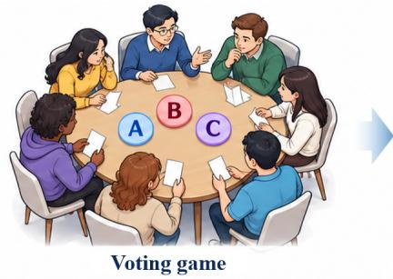

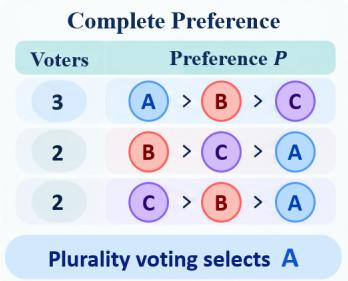

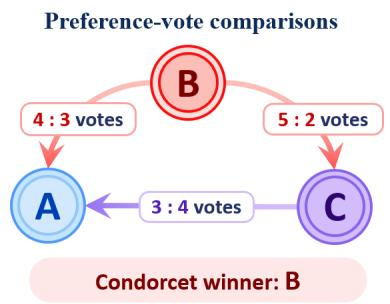

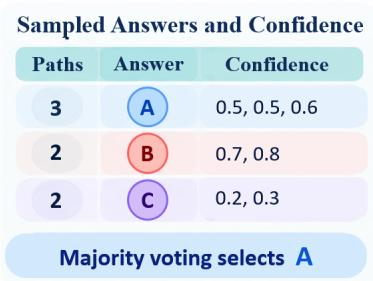

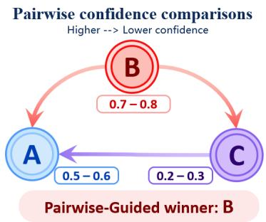  
Figure 1: From voting support to pairwise comparative evidence. (a) Plurality voting selects A, whereas pairwise preference comparisons identify B as the Condorcet winner. (b) Sampled reasoning paths provide answers and confidence scores. Pairwise confidence comparisons complement voting support, enabling the proposed aggregation method to select B.

Ideally, we could apply the Condorcet principle to the reasoning paths if the ranking of candidate answers were available for each path. However, in practice, we only observe each path’s first-choice answer and its confidence score, leaving the ordering among the remaining answers unknown. To estimate such missing ordering, we use pairwise confidence comparisons between paths producing different answers, as illustrated in Figure 1(b). These comparisons yield an answer-level comparative advantage, which we combine with voting evidence through a KL-regularized objective. In this way, the objective can balance this advantage against deviations from the base voting distribution, as an alternative to the naive Condorcet approach. Furthermore, we show that its solution is essientially a logit adjustment to the base voting distribution, yielding a simple yet effective Pairwise-Guided Logit Adjustment (PGLA) approach. This plug-and-play adjustment allows comparative evidence to compensate for weaker evidence from existing voting-based aggregation.

Finally, we conduct extensive experiments on mathematical reasoning, knowledge reasoning, and code generation using both reasoning and non-reasoning models from the Qwen, DeepSeek, and InternLM families, with model sizes ranging from 1.7B to 32B parameters. With internal confidence scores, PGLA achieves an average accuracy gain of approximately 2% over the corresponding voting baselines across 33 model–benchmark settings. Additional experiments show gains with external reward scores. On six mathematical reasoning settings, its online extension also achieves higher mean accuracy with fewer sampled paths than Online SC under the same stopping rule.

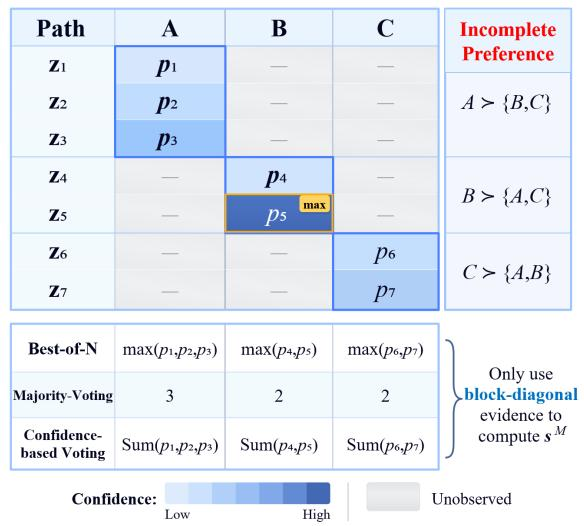  
Figure 2: Path-answer evidence and its aggregation. The three methods use each block’s maximum confidence, size, or confidence-based contributions.

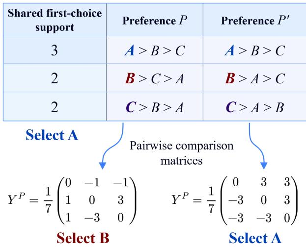  
Figure 3: Identical majority-voting scores can correspond to different pairwise comparison matrices and different winners.

## Problem Formulation and Representative Aggregators

## Problem Formulation

Given an input query, a language model generates K reasoning paths $z _ { 1 } , \dots , z _ { K }$ . Each path produces an answer $a _ { i } = g ( z _ { i } )$ and receives a confidence score $p _ { i }$ from the model or an external verifier. Together, they form the path-level evidence pool $\mathcal { D } = \{ ( a _ { i } , p _ { i } ) \} _ { i = 1 } ^ { K }$ . Let A be the set of different answers produced by these paths, which may be predefined for multiple-choice questions or dynamically formed from sampled answers in open-ended mathematical reasoning and code generation.

Based on D, we construct a path-answer matrix P, with one row per path and one column per candidate answer. Each row records $p _ { i }$ in the column for its output answer $a _ { i }$ and the entries for other answers remain unobserved. Grouping paths by their output answers produces the block-diagonal pattern shown in Fig. 2. Each block contains the confidence scores of paths sharing the same answer.

The aggregation task is to convert the path-level evidence into an answer-level score for each candidate, followed by selecting the candidate with the highest score. Formally, an aggregation method M assigns candidate a the score $s _ { a } ^ { \mathcal { M } }$ based on D:

$$
s _ { a } ^ { \mathcal { M } } = \mathcal { M } ( a ; \mathcal { D } ) , \qquad \hat { a } \in \arg \operatorname* { m a x } _ { a \in \mathcal { A } } s _ { a } ^ { \mathcal { M } } .\tag{1}
$$

aˆ is the final predicted answer selected from the candidates with the highest score. Representative methods use different information from the path-answer matrix to compute $s _ { a } ^ { \mathcal { \bar { M } } }$

Best-of-N selection. Best-of-N uses the highest confidence among the paths sharing answer a (Cobbe et al., 2021). This corresponds to taking the largest value within the block for a in matrix ${ \mathcal { P } } ;$

$$
s _ { a } ^ { \mathrm { B o N } } = \operatorname* { m a x } _ { i : a _ { i } = a } p _ { i } .\tag{2}
$$

The confidence $p _ { i }$ may be perplexity (Adiwardana et al., 2020), self-certainty (Kang et al., 2025), DeepConf confidence (Fu et al., 2026), or an external verifier’s reward (Lightman et al., 2024).

Majority voting. Self-consistency (SC) treats each path as one vote for its output answer and selects the most frequently generated answer (Wang et al., 2023).

The answer-level score is therefore its total vote count:

$$
s _ { a } ^ { S C } = \sum _ { i = 1 } ^ { K } \mathbf { 1 } ( a _ { i } = a ) .\tag{3}
$$

where $\mathbf { 1 } ( \cdot )$ is the indicator function. In ${ \mathcal P } ,$ this corresponds to the size of the diagonal block for answer $^ { a , }$ measured by its number of observed entries. Every supporting path contributes equally, regardless of its confidence.

Confidence-based voting. Confidence-based voting methods adjust path contributions through weighting or filtering (Kang et al., 2025; Fu et al., 2026). Let $h _ { i } \geq 0$ be the weighting or filtering coefficient for path $i ,$ with $h _ { i } = 0$ for filtered paths. The resulting answer-level score is

$$
s _ { a } ^ { \mathrm { C o n f - V o t e } } = \sum _ { i = 1 } ^ { K } h _ { i } \cdot p _ { i } { \bf 1 } ( a _ { i } = a ) .\tag{4}
$$

This method aggregates confidence-based contributions within each diagonal block in ${ \mathcal P } .$

Despite these differences, these methods aggregate only the observed evidence in the diagonal blocks of $\mathcal { P }$ . They do not explicitly model the unobserved preferences among alternative answers. In the next section, we use social choice theory to explain why these preferences matter for answer aggregation.

## Motivation: A Social Choice Perspective

Social choice theory studies how individual preferences over available options are aggregated into a collective decision (Zwicker, 2016). To illustrate this, Fig. 3 shows two complete preference profiles, P and $P ^ { \prime } ,$ with the same majority-voting support. To be specific, A, B, and C receive 3, 2, and 2 first-choice selections, respectively. Majority voting therefore selects A in both. However, the remaining options are ranked differently in $P$ and $P ^ { \prime }$ , giving different pairwise comparison matrices Y. Each entry $Y _ { u v } ^ { \mathrm { P } }$ measures the voting advantage of u over v in a direct comparison under P. A positive value means that more rankings place u above v. Then, $Y ^ { \mathrm { P } }$ can be aggregated into answer-level comparative advantages $s _ { u } ^ { \mathcal { M } , \mathrm { P } }$ using different rules $\mathcal { M } .$ . The highest-scoring answer is selected as in Eq. (1). For example, selection under the Condorcet principle (Young, 1988; Fishburn, 1977) can be represented by

$$
s _ { u } ^ { \mathrm { C o n d o r c e t , P } } = \mathbf { 1 } \left\{ Y _ { u v } ^ { \mathrm { P } } > 0 \mathrm { f o r e v e r y } v \in \mathcal { A } \backslash \{ u \} \right\} .\tag{5}
$$

This selects the answer that wins every direct comparison, whenever one exists. Otherwise, all scores are zero, and an additional selection rule is needed. Following this rule, we select B under P in Fig. 3 because it defeats A by 4:3 and C by 5:2. Under $P ^ { \prime }$ , A defeats both B and C by 5:2 and is selected. Thus, we arrive at the following proposition.

Proposition 2.1. There exist two complete preference profiles P and $P ^ { \prime }$ such that:

(i) Under P, the most frequently selected option is still less preferred than another option in direct pairwise comparisons.

(ii) P has the same majority-voting scores as $P ^ { \prime } ,$ , but different pairwise comparison matrices and different winners.

Connection to the Sampling-based LLM reasoning. In sampling-based LLM reasoning, we only observe each path’s first-choice answer $a _ { i }$ and its confidence score $p _ { i } ,$ leaving the complete preference among the remaining answers unknown. To approximate the missing ordering, we construct a proxy pairwise matrix Y by comparing path confidence scores across answer groups. A similar disagreement highlighted in Thm. 2.1 also occurs in this setting: an answer with the highest aggregation score may still lose to another answer in pairwise comparisons. To examine this phenomenon empirically, we consider $\mathsf { S C }$ errors with the following disagreement. An incorrect answer w receives at least as many votes as a correct answer $c ,$ i.e., $s _ { w } ^ { \mathrm { S C } } \geq s _ { c } ^ { \mathrm { S C } } ,$ , yet paths supporting c tend to have higher confidence scores than those supporting w in pairwise comparisons. The formal definition is provided in Sec. C.

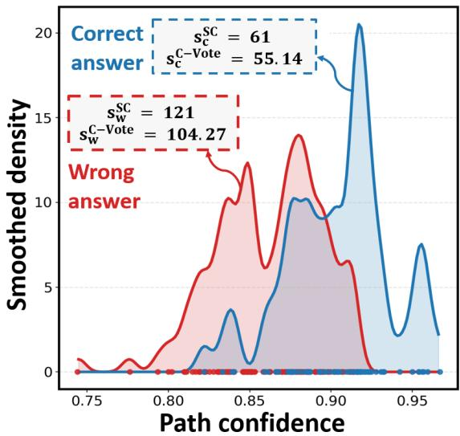  
(a) illustrative example

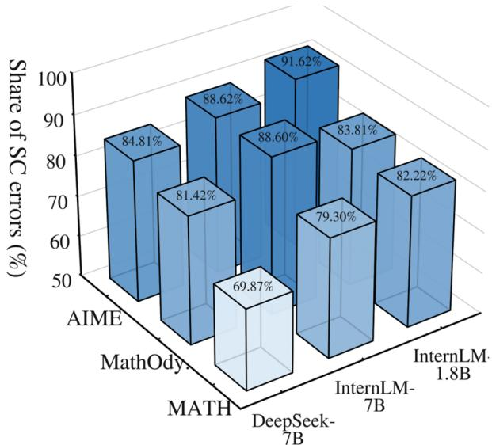  
(b) percentage of SC error  
Figure 4: Disagreement between voting and pairwise confidence comparisons: (a) an illustrative example; (b) percentage of recoverable SC errors.

Using PPL confidence, 69.87%–91.62% of recoverable SC errors (i.e., candidate pools containing at least one correct answer) satisfy this condition across three models and three mathematical benchmarks as shown in Fig. 4(b).

These observations motivate enhancing existing voting-based aggregation by incorporating explicit comparisons between answer. We will discuss our solution in the next section.

## Pairwise-Guided Path Aggregation

In this section, we propose Pairwise-Guided Logit Adjustment (PGLA) for Path Aggregation. This method aims to construct answer-level comparative evidence through pairwise confidence comparisons and combine it with the voting distribution, as an alternative to the Condorcet approach.

## Pairwise Confidence Comparisons

Sampled reasoning paths provide answers and confidence scores rather than complete preference rankings. We therefore use confidence comparisons between paths supporting different answers to construct a proxy for answer-level preference comparisons. For each answer $u \in { \mathcal { A } } ,$ , let $C _ { u } = \{ i : a _ { i } = u \}$ denote the indices of its supporting paths. For two different answers $u , v \in A ,$ we define the corresponding entry of the confidence-based comparison matrix Y as

$$
Y _ { u v } = \frac { 1 } { \vert C _ { u } \vert \vert C _ { v } \vert } \sum _ { i \in C _ { u } } \sum _ { j \in C _ { v } } \operatorname { s g n } ( p _ { i } - p _ { j } ) , \qquad u \neq v ,\tag{6}
$$

Each comparison contributes +1, 0, or −1 when the path supporting u has a higher, equal, or lower confidence score. A positive $Y _ { u v }$ means that paths supporting u have higher confidence more often than paths supporting v in these comparisons than the reverse.

We next summarize Y as an answer-level comparative advantage. For a voting aggregator $\nu , s _ { u } ^ { \nu } \geq 0$ is the base voting support for the answer u defined in Eqs. (3) and (4). We give greater weight to comparisons against answers with stronger voting support. Accordingly, the comparative advantage of answer u is

$$
s _ { u } ^ { \mathrm { P a i r } } = \sum _ { v \neq u } \pi _ { v | u } Y _ { u v } , \qquad \pi _ { v | u } = \frac { s _ { v } ^ { \mathcal { V } } } { \sum _ { k \neq u } s _ { k } ^ { \mathcal { V } } } , \qquad v \neq u .\tag{7}
$$

$s _ { u } ^ { \operatorname { P a i r } } \in [ - 1 , 1 ]$ is a weighted average of comparison scores. Alternative rules include uniform averaging of pairwise scores; Copeland, which counts pairwise wins minus losses (Zwicker, 2016); and Maximin, which takes the minimum pairwise score (Fischer et al., 2016). We use Eq. (7) by default. Definitions and matched comparisons of the alternatives appear in Sec. G.11.

Regardless of the aggregation rule, $s _ { u } ^ { \mathrm { P a i r } }$ summarizes confidence comparisons rather than the preference votes used by the Condorcet principle in Eq. (5). Since this score does not directly consider answer $u ^ { \prime } \mathrm { s }$ own voting support, we therefore explore to combine this comparative advantage with the voting information provided by any voting-based aggregation strategy V.

## Combining with Voting Information

Our goal is to refine the answer-level scores $s _ { u } ^ { \gamma }$ with two complementary objectives: (G1) favoring answers with stronger comparative advantages and (G2) exploiting the voting support provided by the aggregator V. We formulate this refinement over answer distributions, using the normalized base scores to obtain the reference distribution $\bar { \mathsf { \mathbf { s } } } ^ { \nu }$ , with $\begin{array} { r } { \bar { s } _ { u } ^ { \mathcal { V } } = { s } _ { u } ^ { \mathcal { V } } / \sum _ { v \in \mathcal { A } } { s } _ { v } ^ { \mathcal { V } } } \end{array}$ . We then seek an adjusted distribution through the following regularized objective:

$$
\bar { \mathsf { s } } ^ { \mathsf { P G L A } } \in \arg \operatorname* { m a x } _ { \bar { \mathsf { s } } } \left[ \underbrace { \sum _ { u \in \mathcal { A } } \bar { s } _ { u } s _ { u } ^ { \mathsf { P a i r } } } _ { ( \mathrm { G 1 } ) } - \underbrace { D _ { \mathrm { K L } } \big ( \bar { \mathsf { s } } \parallel \bar { \mathsf { s } } ^ { \mathcal { V } } \big ) } _ { ( \mathrm { G 2 } ) } \right] .\tag{8}
$$

Here, s¯ is the optimization variable, with $\bar { s } _ { u } \geq 0$ and $\begin{array} { r } { \sum _ { u \in \mathcal { A } } \bar { s } _ { u } = 1 ; \bar { \mathbf { s } } ^ { \mathcal { V } } } \end{array}$ and $s _ { u } ^ { \mathrm { P a i r } }$ are fixed by the observed candidate pool.

The first term rewards favorable answer comparisons, allowing pairwise confidence evidence to guide answer selection (G1). The KL term penalizes departures from the voting distribution, using the original voting support to constrain this adjustment (G2). The resulting distribution balances comparative evidence with voting support. Intuitively, reversing a strong voting preference requires a larger difference in comparative scores, whereas pairwise evidence can more readily influence selection when answers have similar voting support. This formulation extends the pairwise-comparison perspective of the Condorcet principle to confidence-based path aggregation.

At first glance, Eq. (8) makes the property of the solution unclear. Fortunately, the following proposition can alleviate this issue, with proof in Sec. E.

Proposition 3.1. $I f \bar { s } _ { u } ^ { \nu } > 0$ for every $u \in { \mathcal { A } } ,$ the objective in Eq. (8) is strictly concave and has the unique solution

$$
\bar { s } _ { u } ^ { \mathsf { P G L A } } = \frac { \bar { s } _ { u } ^ { \gamma } \exp ( s _ { u } ^ { \operatorname { P a i r } } ) } { \sum _ { v \in \mathcal { A } } \bar { s } _ { v } ^ { \gamma } \exp ( s _ { v } ^ { \operatorname { P a i r } } ) } .\tag{9}
$$

Since $\bar { s } _ { u } ^ { \mathcal { V } } \propto s _ { u } ^ { \mathcal { V } } ,$ the optimal distribution in Eq. (9) can be obtained by normalizing the score $s _ { u } ^ { \mathsf { P G L A } } =$ $\boldsymbol { s } _ { u } ^ { \mathcal { V } } \exp ( \boldsymbol { s } _ { u } ^ { \mathrm { P a i r } } )$ . Taking logarithms gives the equivalent formulation in the logit space:

$$
\log \Bigl ( s _ { u } ^ { \mathsf { P G L A } } \Bigr ) = \log \Bigl ( s _ { u } ^ { \mathcal { V } } \Bigr ) + s _ { u } ^ { \mathsf { P a i r } } .\tag{10}
$$

The highest-scoring answer is selected as in Eq. (1).

Remark 3.1 (Test-time logit adjustment). Thus, we find that the proposed PGLA can be viewed as a form of Pairwise-guided logit adjustment, operating on answer-logit in the observed sampling pool. This additive form connects PGLA to the classical strategy of Logit Adjustment (LA) (Menon et al., 2021). In long-tailed classification, post-hoc LA uses offsets based on class priors to reduce the preference for frequent classes. Here, this adjustment allows pairwise confidence comparison evidence to compensate for weaker voting support. What’s more, as confidence scores better distinguish correct from incorrect

Table 1: Performance of reasoning models at different scales on three mathematical reasoning benchmarks, GPQA, and three open-ended code-generation benchmarks, using $K = 3 2$ sampled responses per problem. Each votingbased baseline is followed by its PGLA-enhanced variant, denoted by +Ours. The enhanced HumanEval+ and MBPP+ tests for the same sampled pools are reported in Tab. 6.
<table><tr><td>Method</td><td>AIME24</td><td>AIME25</td><td>HMMT25</td><td>GPQA-D</td><td>HE</td><td>MBPP</td><td>LCB</td></tr><tr><td colspan="8">Qwen3-1.7B Reasoning mode</td></tr><tr><td>PPL Best-of-N</td><td> $3 6 . 0 0 _ { \pm 4 . 4 2 }$ </td><td> $3 4 . 0 0 { \scriptstyle \pm 2 . 9 1 }$ </td><td> $2 3 . 0 0 _ { \pm 3 . 4 8 }$ </td><td> $3 9 . 9 0 { \scriptstyle \pm 2 . 0 2 }$ </td><td> $8 1 . 1 0 { \scriptstyle \pm 2 . 0 6 }$ </td><td> $7 5 . 1 3 { \scriptstyle \pm 0 . 6 8 }$ </td><td> $3 0 . 6 7 _ { \pm 1 . 4 7 }$ </td></tr><tr><td>DeepConf Best-of-N</td><td> $6 2 . 0 0 _ { \pm 4 . 5 2 }$ </td><td> $4 2 . 6 7 _ { \pm 2 . 4 9 }$ </td><td> $2 8 . 3 3 _ { \pm 3 . 7 3 }$ </td><td> $4 2 . 9 3 _ { \pm 1 . 5 2 }$ </td><td> $8 4 . 1 5 _ { \pm 2 . 6 9 }$ </td><td> $7 6 . 7 2 _ { \pm 1 . 1 8 }$ </td><td> $3 4 . 2 9 _ { \pm 1 . 6 2 }$ </td></tr><tr><td>Self-Certainty Best-of-N</td><td> $6 0 . 6 7 _ { \pm 4 . 1 6 }$ </td><td> $4 6 . 6 7 _ { \pm 3 . 3 3 }$ </td><td> $3 0 . 6 7 _ { \pm 4 . 4 2 }$ </td><td> $4 2 . 1 7 _ { \pm 0 . 2 5 }$ </td><td> $8 5 . 0 6 _ { \pm 2 . 7 0 }$ </td><td> $8 1 . 7 5 _ { \pm 1 . 0 4 }$ </td><td> $3 3 . 3 3 _ { \pm 1 . 6 4 }$ </td></tr><tr><td>SC</td><td> $6 9 . 5 0 { \scriptstyle \pm 1 . 9 8 }$ </td><td> $4 7 . 3 3 _ { \pm 3 . 6 7 }$ </td><td> $2 7 . 0 0 _ { \pm 1 . 0 0 }$ </td><td> $4 4 . 4 4 _ { \pm 0 . 5 1 }$ </td><td> $8 3 . 8 4 _ { \pm 1 . 3 2 }$ </td><td> $8 3 . 0 7 _ { \pm 0 . 8 9 }$ </td><td> $2 9 . 9 0 _ { \pm 1 . 3 3 }$ </td></tr><tr><td>+ Ours (DeepConf)</td><td> $7 5 . 0 0 _ { \pm 1 . 6 7 }$ </td><td> ${ \bf 5 1 . 3 3 } _ { \pm 2 . 6 7 }$ </td><td> $3 0 . 0 0 { \scriptstyle \pm 2 . 9 8 }$ </td><td> $4 6 . 7 2 _ { \pm 0 . 2 5 }$ </td><td> ${ \bf 8 8 . 1 1 _ { \pm 2 . 2 4 } }$ </td><td> $8 5 . 4 5 _ { \pm 0 . 8 0 }$ </td><td> $3 4 . 2 9 _ { \pm 1 . 3 6 }$ </td></tr><tr><td>+ Ours (Self-Certainty)</td><td> $7 4 . 0 0 _ { \pm 1 . 3 3 }$ </td><td> $5 0 . 6 7 _ { \pm 3 . 2 7 }$ </td><td> $3 0 . 3 3 { \scriptstyle \pm 2 . 7 7 }$ </td><td> $4 4 . 9 5 _ { \pm 0 . 5 1 }$ </td><td> $8 7 . 8 0 _ { \pm 1 . 6 1 }$ </td><td> $8 5 . 4 5 _ { \pm 0 . 8 0 }$ </td><td> $3 3 . 3 3 _ { \pm 1 . 3 5 }$ </td></tr><tr><td>DeepConf-Weighted SC</td><td> $7 0 . 0 0 { \scriptstyle \pm 1 . 4 9 }$ </td><td> $4 8 . 3 3 _ { \pm 4 . 2 8 }$ </td><td> $2 7 . 0 0 _ { \pm 1 . 0 0 }$ </td><td> $4 4 . 1 9 _ { \pm 0 . 7 6 }$ </td><td> $8 5 . 0 6 _ { \pm 1 . 1 1 }$ </td><td> $8 4 . 6 6 _ { \pm 0 . 6 7 }$ </td><td> $3 3 . 7 1 _ { \pm 1 . 3 0 }$ </td></tr><tr><td>+ Ours</td><td> $7 5 . 0 0 { \scriptstyle \pm 1 . 6 7 }$ </td><td> $5 1 . 0 0 _ { \pm 3 . 0 0 }$ </td><td> $3 1 . 3 3 _ { \pm 3 . 4 0 }$ </td><td>46.21±0.76</td><td> $8 7 . 5 0 { \scriptstyle \pm 2 . 2 2 }$ </td><td> $8 5 . 4 5 _ { \pm 0 . 8 0 }$ </td><td> $3 4 . 6 7 _ { \pm 1 . 6 3 }$ </td></tr><tr><td>Self-Certainty-Weighted SC</td><td> $7 0 . 3 3 { \scriptstyle \pm 1 . 8 0 }$ </td><td> $4 8 . 6 7 _ { \pm 4 . 2 7 }$ </td><td> $2 7 . 0 0 _ { \pm 1 . 0 0 }$ </td><td> $4 4 . 1 9 _ { \pm 0 . 7 6 }$ </td><td> $8 3 . 5 4 _ { \pm 1 . 0 7 }$ </td><td> $8 4 . 6 6 _ { \pm 0 . 5 7 }$ </td><td> $3 2 . 5 7 _ { \pm 1 . 1 1 }$ </td></tr><tr><td>+ Ours</td><td> $7 4 . 0 0 _ { \pm 1 . 3 3 }$ </td><td> $5 0 . 6 7 _ { \pm 3 . 2 7 }$ </td><td> $3 1 . 0 0 _ { \pm 3 . 3 5 }$ </td><td> $4 4 . 7 0 _ { \pm 0 . 7 6 }$ </td><td> ${ \bf 8 8 . 1 1 _ { \pm 1 . 9 4 } }$ </td><td> $8 5 . 7 1 _ { \pm 0 . 8 6 }$ </td><td> $3 3 . 7 1 _ { \pm 1 . 3 1 }$ </td></tr><tr><td>Self-Certainty Borda</td><td> $7 3 . 3 3 _ { \pm 1 . 4 9 }$ </td><td>50.33±3.48</td><td> $2 9 . 3 3 { \scriptstyle \pm 2 . 9 1 }$ </td><td> $4 3 . 6 9 _ { \pm 2 . 2 7 }$ </td><td> $8 6 . 5 9 _ { \pm 1 . 5 4 }$ </td><td>85.19±0.86</td><td> $3 2 . 9 5 _ { \pm 1 . 2 8 }$ </td></tr><tr><td>+ Ours</td><td> $7 4 . 6 7 _ { \pm 1 . 6 3 }$ </td><td> $5 0 . 6 7 { \scriptstyle \pm 3 . 2 7 }$ </td><td> $3 4 . 3 3 { \scriptstyle \pm 3 . 9 6 }$ </td><td>44.95±2.02</td><td> ${ \bf 8 8 . 1 1 _ { \pm 1 . 8 3 } }$ </td><td> $8 5 . 4 5 { \scriptstyle \pm 0 . 7 7 }$ </td><td> $3 3 . 5 2 _ { \pm 1 . 4 3 }$ </td></tr><tr><td>DeepConf-Filter (90%)</td><td> $7 0 . 3 3 { \scriptstyle \pm 1 . 8 0 }$ </td><td> $5 0 . 6 7 _ { \pm 4 . 4 2 }$ </td><td> $2 7 . 0 0 _ { \pm 1 . 8 0 }$ </td><td> $4 4 . 4 4 _ { \pm 1 . 0 1 }$ </td><td> $8 6 . 2 8 { \scriptstyle \pm 1 . 3 9 }$ </td><td> $8 5 . 1 9 _ { \pm 0 . 7 1 }$ </td><td> $3 3 . 9 0 _ { \pm 1 . 3 8 }$ </td></tr><tr><td>+ Ours</td><td> $7 5 . 0 0 _ { \pm 1 . 6 7 }$ </td><td> $5 2 . 3 3 _ { \pm 3 . 6 7 }$ </td><td> $3 3 . 6 7 _ { \pm 2 . 3 3 }$ </td><td> $4 7 . 2 2 _ { \pm 0 . 2 5 }$ </td><td> $8 7 . 5 0 { \scriptstyle \pm 2 . 3 2 }$ </td><td> $\mathbf { 8 5 . 7 1 _ { \pm 0 . 8 5 } }$ </td><td> $3 4 . 4 8 _ { \pm 1 . 6 3 }$ </td></tr><tr><td colspan="8">Qwen3-4B Reasoning mode</td></tr><tr><td>PPL Best-of-N</td><td> $5 7 . 0 0 _ { \pm 2 . 3 3 }$ </td><td> $6 4 . 3 3 _ { \pm 3 . 9 6 }$ </td><td> $4 0 . 3 3 _ { \pm 4 . 3 3 }$ </td><td> $5 4 . 7 1 _ { \pm 1 . 4 1 }$ </td><td> $9 2 . 3 8 _ { \pm 0 . 7 7 }$ </td><td> $9 1 . 8 5 _ { \pm 0 . 7 5 }$ </td><td> $4 4 . 0 0 _ { \pm 1 . 2 6 }$ </td></tr><tr><td>DeepConf Best-of-N</td><td> $7 7 . 0 0 _ { \pm 2 . 3 3 }$ </td><td> $7 6 . 0 0 { \scriptstyle \pm 3 . 8 9 }$ </td><td> $5 0 . 0 0 { \scriptstyle \pm 4 . 9 4 }$ </td><td> $5 8 . 4 2 _ { \pm 2 . 0 0 }$ </td><td> $9 6 . 1 9 _ { \pm 0 . 8 1 }$ </td><td> $9 3 . 4 4 _ { \pm 0 . 2 8 }$ </td><td> $4 7 . 4 3 _ { \pm 0 . 8 5 }$ </td></tr><tr><td>Self-Certainty Best-of-N</td><td> $8 1 . 6 7 _ { \pm 2 . 2 4 }$ </td><td> $7 1 . 6 7 _ { \pm 3 . 0 7 }$ </td><td> $5 1 . 6 7 _ { \pm 4 . 0 1 }$ </td><td> $5 9 . 9 3 _ { \pm 1 . 1 2 }$ </td><td> $9 6 . 0 4 _ { \pm 0 . 8 2 }$ </td><td> $9 3 . 7 0 _ { \pm 0 . 4 1 }$ </td><td> $4 7 . 8 1 _ { \pm 1 . 1 6 }$ </td></tr><tr><td>SC</td><td> $8 0 . 0 0 { \scriptstyle \pm 0 . 0 0 }$ </td><td> $7 6 . 3 3 _ { \pm 0 . 6 7 }$ </td><td> $5 1 . 5 0 { \scriptstyle \pm 1 . 5 7 }$ </td><td> $5 8 . 2 5 _ { \pm 0 . 4 5 }$ </td><td> $9 3 . 6 0 _ { \pm 1 . 0 0 }$ </td><td> $9 3 . 9 2 _ { \pm 0 . 5 8 }$ </td><td> $4 1 . 7 1 _ { \pm 1 . 2 6 }$ </td></tr><tr><td>+ Ours (DeepConf)</td><td> $8 3 . 0 0 _ { \pm 1 . 0 0 }$ </td><td> $7 6 . 3 3 { \scriptstyle \pm 1 . 8 0 }$ </td><td> $5 4 . 0 0 { \scriptstyle \pm 2 . 9 1 }$ </td><td> $6 0 . 2 7 { \scriptstyle \pm 0 . 8 8 }$ </td><td> $9 5 . 8 8 _ { \pm 0 . 9 5 }$ </td><td> $9 4 . 2 9 _ { \pm 0 . 4 1 }$ </td><td> $4 7 . 6 2 _ { \pm 0 . 8 5 }$ </td></tr><tr><td>+ Ours (Self-Certainty)</td><td> $8 2 . 0 0 _ { \pm 1 . 6 3 }$ </td><td> $7 8 . 6 7 _ { \pm 1 . 6 3 }$ </td><td> $5 5 . 6 7 _ { \pm 1 . 5 3 }$ </td><td> ${ \bf 6 1 . 2 8 _ { \pm 0 . 8 5 } }$ </td><td> $9 5 . 7 3 _ { \pm 0 . 5 5 }$ </td><td> $9 4 . 3 1 _ { \pm 0 . 4 9 }$ </td><td> $4 8 . 0 0 _ { \pm 1 . 1 2 }$ </td></tr><tr><td>DeepConf-Weighted SC</td><td> $8 0 . 0 0 { \scriptstyle \pm 0 . 0 0 }$ </td><td> $7 6 . 3 3 { \scriptstyle \pm 1 . 0 0 }$ </td><td> $5 1 . 3 3 _ { \pm 1 . 6 3 }$ </td><td> $5 8 . 5 9 _ { \pm 0 . 5 3 }$ </td><td> $9 4 . 3 6 _ { \pm 1 . 0 1 }$ </td><td> $9 4 . 2 1 _ { \pm 0 . 4 8 }$ </td><td>47.24±0.95</td></tr><tr><td>+ Ours</td><td> $8 3 . 3 3 _ { \pm 1 . 4 9 }$ </td><td> $7 6 . 3 3 { \scriptstyle \pm 2 . 3 3 }$ </td><td> $5 4 . 0 0 { \scriptstyle \pm 2 . 9 1 }$ </td><td> ${ \bf 6 0 . 1 0 { \scriptstyle \pm 0 . 7 9 } }$ </td><td> $9 5 . 8 8 _ { \pm 0 . 8 7 }$ </td><td> $9 4 . 2 6 _ { \pm 0 . 4 4 }$ </td><td> $4 7 . 6 2 _ { \pm 0 . 8 8 }$ </td></tr><tr><td>Self-Certainty-Weighted SC</td><td> $8 0 . 0 0 { \scriptstyle \pm 0 . 0 0 }$ </td><td> $7 6 . 3 3 { \scriptstyle \pm 1 . 0 0 }$ </td><td> $5 2 . 6 7 _ { \pm 2 . 0 0 }$ </td><td> $5 8 . 4 2 _ { \pm 0 . 3 8 }$ </td><td> $9 4 . 2 1 _ { \pm 0 . 8 6 }$ </td><td> $9 4 . 3 1 _ { \pm 0 . 4 9 }$ </td><td> $4 7 . 8 1 _ { \pm 1 . 1 8 }$ </td></tr><tr><td>+ Ours</td><td> $8 2 . 0 0 _ { \pm 1 . 6 3 }$ </td><td> $7 9 . 3 3 { \scriptstyle \pm 1 . 3 3 }$ </td><td> $5 5 . 3 3 _ { \pm 1 . 6 3 }$ </td><td> ${ \bf 6 1 . 4 5 _ { \pm 0 . 9 4 } }$ </td><td> $9 5 . 7 3 _ { \pm 0 . 5 8 }$ </td><td> $9 4 . 3 1 _ { \pm 0 . 4 9 }$ </td><td> $4 8 . 1 9 _ { \pm 1 . 1 5 }$ </td></tr><tr><td>Self-Certainty Borda</td><td> $8 1 . 0 0 _ { \pm 1 . 5 3 }$ </td><td> $7 9 . 3 3 { \scriptstyle \pm 1 . 3 3 }$ </td><td> $5 5 . 0 0 { \scriptstyle \pm 1 . 6 7 }$ </td><td> $6 0 . 1 0 _ { \pm 0 . 6 0 }$ </td><td> $9 4 . 9 7 _ { \pm 0 . 9 0 }$ </td><td> $9 4 . 1 8 _ { \pm 0 . 4 9 }$ </td><td> $4 7 . 8 1 _ { \pm 1 . 1 8 }$ </td></tr><tr><td>+ Ours</td><td> $8 2 . 3 3 { \scriptstyle \pm 2 . 1 3 }$ </td><td> $7 9 . 3 3 { \scriptstyle \pm 1 . 3 3 }$ </td><td> $5 5 . 3 3 _ { \pm 1 . 6 3 }$ </td><td> ${ \bf 6 0 . 9 4 _ { \pm 0 . 7 5 } }$ </td><td> $9 5 . 7 3 _ { \pm 0 . 5 8 }$ </td><td> $9 4 . 2 6 _ { \pm 0 . 3 1 }$ </td><td> $4 8 . 0 0 _ { \pm 1 . 1 4 }$ </td></tr><tr><td>DeepConf-Filter (90%)</td><td> $8 0 . 0 0 { \scriptstyle \pm 0 . 0 0 }$ </td><td> $7 8 . 6 7 _ { \pm 2 . 2 1 }$ </td><td> $5 2 . 6 7 _ { \pm 3 . 2 7 }$ </td><td> $5 8 . 5 9 _ { \pm 0 . 7 2 }$ </td><td> $9 4 . 6 6 _ { \pm 0 . 8 1 }$ </td><td> $9 4 . 2 3 _ { \pm 0 . 3 9 }$ </td><td> $4 7 . 2 4 _ { \pm 0 . 9 5 }$ </td></tr><tr><td>+ Ours</td><td> $8 3 . 3 3 _ { \pm 2 . 1 1 }$ </td><td> $7 9 . 0 0 _ { \pm 1 . 5 3 }$ </td><td> $5 5 . 6 7 _ { \pm 2 . 6 0 }$ </td><td> ${ \bf 6 1 . 1 1 { _ { \pm 1 . 1 0 } } }$ </td><td> $9 6 . 0 4 _ { \pm 0 . 7 1 }$ </td><td> $9 4 . 2 9 _ { \pm 0 . 3 6 }$ </td><td> $4 7 . 4 3 _ { \pm 0 . 8 1 }$ </td></tr><tr><td colspan="8">Qwen3-8B Reasoning mode</td></tr><tr><td>PPL Best-of-N</td><td> $6 1 . 0 0 _ { \pm 3 . 3 5 }$ </td><td> $5 9 . 3 3 _ { \pm 2 . 0 0 }$ </td><td> $3 5 . 3 3 _ { \pm 3 . 0 6 }$ </td><td> $5 9 . 4 3 _ { \pm 0 . 6 3 }$ </td><td> $9 3 . 7 0 _ { \pm 1 . 2 4 }$ </td><td> $9 3 . 4 7 _ { \pm 0 . 4 0 }$ </td><td> $4 6 . 2 9 _ { \pm 1 . 8 7 }$ </td></tr><tr><td>DeepConf Best-of-N</td><td> $7 9 . 3 3 _ { \pm 4 . 1 6 }$ </td><td> $7 6 . 0 0 { \scriptstyle \pm 2 . 9 1 }$ </td><td> $5 3 . 6 7 _ { \pm 3 . 1 4 }$ </td><td> $6 3 . 6 4 _ { \pm 0 . 4 1 }$ </td><td> $9 6 . 1 4 _ { \pm 0 . 5 1 }$ </td><td> $9 4 . 4 4 _ { \pm 0 . 4 4 }$ </td><td>49.71±0.00</td></tr><tr><td>Self-Certainty Best-of-N</td><td> $8 3 . 6 7 _ { \pm 1 . 8 0 }$ </td><td> $7 6 . 3 3 { \scriptstyle \pm 2 . 7 7 }$ </td><td> $5 2 . 6 7 _ { \pm 2 . 0 0 }$ </td><td> $6 3 . 4 7 _ { \pm 0 . 6 3 }$ </td><td> $9 6 . 5 4 _ { \pm 0 . 6 6 }$ </td><td> $9 5 . 2 4 _ { \pm 0 . 3 3 }$ </td><td> $5 2 . 3 8 _ { \pm 1 . 0 8 }$ </td></tr><tr><td>SC</td><td> $8 1 . 5 0 { \scriptstyle \pm 1 . 5 7 }$ </td><td> $7 5 . 6 7 _ { \pm 2 . 9 1 }$ </td><td> $5 5 . 9 4 _ { \pm 1 . 1 7 }$ </td><td> $6 3 . 2 2 _ { \pm 0 . 9 5 }$ </td><td> $9 3 . 9 0 _ { \pm 0 . 6 0 }$ </td><td> $9 4 . 7 1 _ { \pm 0 . 3 9 }$ </td><td> $4 4 . 5 7 _ { \pm 1 . 6 8 }$ </td></tr><tr><td>+ Ours (DeepConf)</td><td> $8 6 . 6 7 _ { \pm 2 . 1 1 }$ </td><td> $7 9 . 6 7 _ { \pm 1 . 8 0 }$ </td><td> $5 8 . 6 7 _ { \pm 1 . 6 3 }$ </td><td> $6 4 . 9 8 _ { \pm 0 . 2 4 }$ </td><td> $9 6 . 1 4 _ { \pm 0 . 8 6 }$ </td><td> $9 5 . 6 8 _ { \pm 0 . 3 9 }$ </td><td> $4 9 . 9 0 _ { \pm 0 . 2 7 }$ </td></tr><tr><td>+ Ours (Self-Certainty)</td><td> $8 6 . 0 0 { \scriptstyle \pm 2 . 0 0 }$ </td><td> $7 6 . 6 7 _ { \pm 1 . 4 9 }$ </td><td> ${ \bf 6 0 . 0 0 } _ { \pm 2 . 1 1 }$ </td><td> $6 4 . 3 1 _ { \pm 0 . 8 6 }$ </td><td> $9 6 . 5 4 _ { \pm 1 . 1 4 }$ </td><td> $9 6 . 1 2 _ { \pm 0 . 5 2 }$ </td><td> $5 2 . 3 8 _ { \pm 1 . 0 8 }$ </td></tr><tr><td>DeepConf-Weighted SC</td><td> $8 1 . 6 7 _ { \pm 1 . 6 7 }$ </td><td> $7 6 . 0 0 { \scriptstyle \pm 3 . 2 7 }$ </td><td> $5 6 . 6 7 _ { \pm 1 . 4 9 }$ </td><td> $6 3 . 3 0 { \scriptstyle \pm 1 . 1 9 }$ </td><td> $9 4 . 1 1 _ { \pm 0 . 6 2 }$ </td><td> $9 4 . 9 7 _ { \pm 0 . 4 6 }$ </td><td> $4 9 . 1 4 _ { \pm 0 . 4 7 }$ </td></tr><tr><td>+ Ours</td><td> $8 7 . 0 0 _ { \pm 2 . 3 3 }$ </td><td> $7 9 . 6 7 _ { \pm 1 . 8 0 }$ </td><td> $5 9 . 0 0 _ { \pm 1 . 5 3 }$ </td><td> ${ \bf 6 4 . 8 1 { _ { \pm 0 . 2 4 } } }$ </td><td> $9 6 . 1 4 _ { \pm 0 . 7 2 }$ </td><td> $9 5 . 6 8 _ { \pm 0 . 3 7 }$ </td><td> $4 9 . 9 0 _ { \pm 0 . 2 7 }$ </td></tr><tr><td>Self-Certainty-Weighted SC</td><td> $8 1 . 6 7 _ { \pm 1 . 6 7 }$ </td><td> $7 6 . 0 0 { \scriptstyle \pm 3 . 2 7 }$ </td><td> $5 6 . 6 7 _ { \pm 1 . 4 9 }$ </td><td> $6 3 . 3 0 { \scriptstyle \pm 1 . 1 9 }$ </td><td> $9 4 . 3 1 _ { \pm 0 . 6 2 }$ </td><td> $9 5 . 1 5 _ { \pm 0 . 4 1 }$ </td><td> $5 1 . 8 1 _ { \pm 0 . 7 1 }$ </td></tr><tr><td>+ Ours</td><td> $8 6 . 3 3 _ { \pm 1 . 8 0 }$ </td><td> $7 6 . 6 7 _ { \pm 1 . 4 9 }$ </td><td> ${ 6 0 . 0 0 } _ { \pm 1 . 4 9 }$ </td><td> ${ \bf 6 4 . 3 1 { _ { \pm 0 . 8 6 } } }$ </td><td> $9 6 . 5 4 _ { \pm 1 . 0 1 }$ </td><td> $9 6 . 2 1 _ { \pm 0 . 5 4 }$ </td><td> $5 2 . 3 8 _ { \pm 1 . 0 8 }$ </td></tr><tr><td>Self-Certainty Borda</td><td> $8 3 . 6 7 _ { \pm 1 . 8 0 }$ </td><td> $7 6 . 6 7 _ { \pm 1 . 4 9 }$ </td><td> $5 9 . 3 3 { \scriptstyle \pm 2 . 4 9 }$ </td><td> $6 3 . 9 7 { \scriptstyle \pm 0 . 9 5 }$ </td><td> $9 5 . 3 3 _ { \pm 0 . 4 9 }$ </td><td> $9 5 . 5 9 _ { \pm 0 . 3 3 }$ </td><td> $5 2 . 0 0 _ { \pm 0 . 4 7 }$ </td></tr><tr><td>+ Ours</td><td> $8 6 . 3 3 _ { \pm 1 . 8 0 }$ </td><td> $7 6 . 6 7 _ { \pm 1 . 4 9 }$ </td><td> ${ \bf 6 0 . 0 0 } _ { \pm 2 . 1 1 }$ </td><td> ${ \bf 6 4 . 3 1 { _ { \pm 0 . 8 6 } } }$ </td><td> $9 6 . 3 4 _ { \pm 0 . 9 1 }$ </td><td> $9 6 . 1 2 _ { \pm 0 . 5 2 }$ </td><td> $5 2 . 3 8 _ { \pm 1 . 0 8 }$ </td></tr><tr><td>DeepConf-Filter (90%)</td><td> $8 1 . 6 7 _ { \pm 1 . 6 7 }$ </td><td> $7 8 . 0 0 { \scriptstyle \pm 2 . 6 7 }$ </td><td> $5 9 . 0 0 { \scriptstyle \pm 1 . 5 3 }$ </td><td> $6 3 . 3 0 { \scriptstyle \pm 0 . 9 5 }$ </td><td> $9 4 . 3 1 _ { \pm 0 . 4 9 }$ </td><td> $9 4 . 9 7 _ { \pm 0 . 4 0 }$ </td><td> $4 9 . 1 4 _ { \pm 0 . 4 7 }$ </td></tr><tr><td>+ Ours</td><td> $8 7 . 0 0 _ { \pm 2 . 3 3 }$ </td><td> $7 9 . 3 3 _ { \pm 1 . 3 3 }$ </td><td> ${ \bf 6 1 . 6 7 } _ { \pm 2 . 2 4 }$ </td><td> ${ \bf 6 4 . 3 1 { \scriptstyle \pm 0 . 6 3 } }$ </td><td> $9 6 . 1 4 _ { \pm 0 . 5 1 }$ </td><td> $9 5 . 6 8 _ { \pm 0 . 3 9 }$ </td><td> $4 9 . 9 0 _ { \pm 0 . 2 7 }$ </td></tr></table>

paths, PGLA can make more reliable pairwise comparisons and further improve aggregation performance. In Sec. 4.4, we test how the reliability of these confidence scores affects PGLA accuracy.

## Experiments

## Experimental Setup

In this section, we conduct extensive experiments to evaluate the effectiveness of PGLA. More experimental details and results are provided in Sec. F and Sec. G.

Competitors. We compare against 11 representative sampling-based aggregation baselines using the same pool of sampled reasoning paths. The max-based baselines follow the Best-of-N paradigm, using path perplexity confidence (PPL) (Chen et al., 1998), DeepConf (Fu et al., 2026), and Self-Certainty (Kang et al., 2025) to score each path. The voting-based baselines include self-consistency (SC), three confidenceweighted SC variants based on the above scores, the Self-Certainty Borda rule (Kang et al., 2025), DeepConf’s offline top-90% filtered weighted voting (Fu et al., 2026), adaptive self-consistency (Aggarwal et al., 2023), and RPC (Zhou et al., 2025). Beyond internal confidence scores, we evaluate three baselines based on scores from an external process reward model (PRM): PRM Best-of-N, PRM-Weighted SC, and PRM-RPC. We use Qwen2.5-Math-PRM-7B as the external scorer (Lightman et al., 2024; Zhang et al., 2025). PRM-Weighted SC assigns each path a voting weight equal to the product of its step-level PRM scores and sums these weights within each answer group. We also apply the same PGLA adjustment to all voting-based aggregators.

Table 2: Performance comparison of different mathematics-specialized models in terms of accuracy and expected calibration error (ECE). Following the RPC setting, perplexity-based confidence (PPL) is used by default. Each voting-based baseline is followed by its PGLA-enhanced variant, denoted by +Ours.
<table><tr><td rowspan="2">Method</td><td colspan="2">MATH</td><td colspan="2">MathOdyssey</td><td colspan="2">AIME</td><td colspan="2">Average</td></tr><tr><td>Acc. ↑</td><td>ECE↓</td><td>Acc. ↑</td><td>ECE↓</td><td> $\operatorname { A c c . \uparrow }$ </td><td>ECE↓</td><td>Acc. ↑ ECE↓</td><td></td></tr><tr><td>InternLM2-Math-Plus-1.8B</td><td></td><td></td><td></td><td></td><td></td><td></td><td></td><td></td></tr><tr><td>PPL</td><td> $3 3 . 2 3 { \scriptstyle \pm 0 . 2 5 }$ </td><td> $6 1 . 5 8 { \scriptstyle \pm 0 . 2 5 }$ </td><td> $1 6 . 6 3 { \scriptstyle \pm 0 . 8 3 }$ </td><td> $7 7 . 2 0 { \scriptstyle \pm 0 . 8 2 }$ </td><td> $1 . 6 6 _ { \pm 0 . 1 5 }$ </td><td> $9 2 . 2 8 _ { \pm 0 . 1 6 }$ </td><td>17.17</td><td>77.02</td></tr><tr><td>SC</td><td> $3 6 . 4 8 _ { \pm 0 . 1 4 }$ </td><td> $6 . 6 6 _ { \pm 0 . 1 4 }$ </td><td> $1 4 . 5 7 _ { \pm 0 . 4 5 }$ </td><td> $1 8 . 5 1 _ { \pm 0 . 4 1 }$ </td><td> $2 . 6 6 { \scriptstyle \pm 0 . 2 0 }$ </td><td> $1 6 . 8 4 _ { \pm 0 . 1 6 }$ </td><td>17.90</td><td>14.00</td></tr><tr><td>+ Ours</td><td> $3 9 . 7 7 _ { \pm 0 . 1 7 }$ </td><td> $5 . 6 3 _ { \pm 0 . 1 3 }$ </td><td> ${ \bf 1 8 . 2 8 _ { \pm 0 . 5 6 } }$ </td><td> ${ \bf 1 } 3 . 9 7 _ { \pm 0 . 5 9 }$ </td><td> $3 . 3 7 _ { \pm 0 . 1 7 }$ </td><td> ${ \bf 1 5 . 5 1 } _ { \pm 0 . 1 5 }$ </td><td>20.47</td><td>11.70</td></tr><tr><td>Weighted SC</td><td> $3 6 . 7 2 _ { \pm 0 . 1 2 }$ </td><td> $6 . 5 2 _ { \pm 0 . 1 4 }$ </td><td> $1 4 . 8 6 _ { \pm 0 . 4 7 }$ </td><td> $1 8 . 0 5 _ { \pm 0 . 5 0 }$ </td><td> $2 . 7 5 _ { \pm 0 . 2 3 }$ </td><td> $1 6 . 6 5 _ { \pm 0 . 1 9 }$ </td><td>18.11</td><td>13.74</td></tr><tr><td>+ Ours</td><td> ${ \bf 3 9 . 9 1 _ { \pm 0 . 2 2 } }$ </td><td> $5 . 5 5 { \scriptstyle \pm 0 . 1 7 }$ </td><td> ${ \bf 1 8 . 5 6 _ { \pm 0 . 5 6 } }$ </td><td> ${ \bf 1 } 3 . 4 7 _ { \pm 0 . 5 6 }$ </td><td> $3 . 3 7 _ { \pm 0 . 1 7 }$ </td><td> ${ \bf 1 5 . 3 4 _ { \pm 0 . 1 5 } }$ </td><td>20.61</td><td>11.45</td></tr><tr><td>Adaptive SC</td><td> $3 6 . 4 8 _ { \pm 0 . 1 6 }$ </td><td> $1 0 . 6 1 _ { \pm 0 . 2 3 }$ </td><td> $1 4 . 4 3 _ { \pm 0 . 5 1 }$ </td><td> $2 2 . 6 9 _ { \pm 0 . 7 3 }$ </td><td> $2 . 6 5 _ { \pm 0 . 2 0 }$ </td><td> $1 9 . 2 5 _ { \pm 0 . 2 5 }$ </td><td>17.85</td><td>17.52</td></tr><tr><td>+ Ours</td><td> $3 9 . 0 5 _ { \pm 0 . 2 3 }$ </td><td> $9 . 2 8 _ { \pm 0 . 2 7 }$ </td><td> $1 7 . 4 7 { \scriptstyle \pm 0 . 6 3 }$ </td><td> $1 7 . 9 6 { \scriptstyle \pm 0 . 6 0 }$ </td><td> $3 . 2 3 _ { \pm 0 . 2 1 }$ </td><td> $1 7 . 5 3 _ { \pm 0 . 4 1 }$ </td><td>19.92</td><td>14.92</td></tr><tr><td>RPC</td><td> $3 7 . 8 7 _ { \pm 0 . 1 4 }$ </td><td> $6 . 4 5 _ { \pm 0 . 1 5 }$ </td><td> $1 6 . 4 3 _ { \pm 0 . 6 0 }$ </td><td> $1 6 . 2 5 { \scriptstyle \pm 0 . 7 6 }$ </td><td> $3 . 2 8 _ { \pm 0 . 2 3 }$ </td><td> $1 6 . 3 2 { \scriptstyle \pm 0 . 2 0 }$ </td><td>19.19</td><td>13.01</td></tr><tr><td>+ Ours</td><td> $4 0 . 2 9 _ { \pm 0 . 2 7 }$ </td><td> ${ \phantom { - } 5 . 5 0 } _ { \pm 0 . 2 2 }$ </td><td> $2 0 . 2 8 _ { \pm 0 . 4 8 }$ </td><td> $\mathbf { 1 0 . 7 8 _ { \pm 0 . 6 0 } }$ </td><td> $3 . 5 7 _ { \pm 0 . 2 1 }$ </td><td> ${ \pm } 4 . 6 7 _ { \pm 0 . 2 3 }$ </td><td>21.38</td><td>10.32</td></tr><tr><td>InternLM2-Math-Plus-7B</td><td></td><td></td><td></td><td></td><td></td><td></td><td></td><td></td></tr><tr><td>PPL</td><td> $4 7 . 0 0 _ { \pm 0 . 2 0 }$ </td><td> $4 8 . 9 8 _ { \pm 0 . 2 0 }$ </td><td> $2 7 . 5 1 _ { \pm 1 . 1 8 }$ </td><td> $6 7 . 5 4 { \scriptstyle \pm 1 . 1 8 }$ </td><td> $5 . 9 6 _ { \pm 0 . 4 8 }$ </td><td> $8 8 . 9 8 _ { \pm 0 . 4 9 }$ </td><td>26.82</td><td>68.50</td></tr><tr><td>SC</td><td> $5 0 . 5 7 { \scriptstyle \pm 0 . 1 8 }$ </td><td> $6 . 7 2 _ { \pm 0 . 1 9 }$ </td><td> $2 8 . 3 0 _ { \pm 0 . 6 1 }$ </td><td> $1 2 . 1 8 _ { \pm 0 . 5 7 }$ </td><td> $9 . 4 0 _ { \pm 0 . 2 1 }$ </td><td> $1 4 . 3 5 _ { \pm 0 . 2 3 }$ </td><td>29.42</td><td>11.08</td></tr><tr><td>+ Ours</td><td> $5 3 . 9 9 _ { \pm 0 . 1 8 }$ </td><td> ${ \bf 6 . 1 0 { \scriptstyle \pm 0 . 2 0 } }$ </td><td> $3 5 . 3 0 { \scriptstyle \pm 0 . 5 5 }$ </td><td> $9 . 6 9 _ { \pm 1 . 0 2 }$ </td><td> $9 . 9 5 _ { \pm 0 . 2 4 }$ </td><td> ${ \bf 1 } 3 . 9 0 _ { \pm 0 . 2 3 }$ </td><td>33.08</td><td>9.90</td></tr><tr><td>Weighted SC</td><td> $5 0 . 8 1 _ { \pm 0 . 2 0 }$ </td><td> $6 . 5 6 { \scriptstyle \pm 0 . 2 1 }$ </td><td> $2 8 . 8 2 _ { \pm 0 . 6 7 }$ </td><td> $1 1 . 5 7 { \scriptstyle \pm 0 . 6 8 }$ </td><td> $9 . 4 5 _ { \pm 0 . 2 3 }$ </td><td> $1 4 . 2 7 _ { \pm 0 . 2 5 }$ </td><td>29.69</td><td>10.80</td></tr><tr><td>+ Ours</td><td> $5 3 . 9 9 _ { \pm 0 . 1 3 }$ </td><td> $6 . 1 5 _ { \pm 0 . 1 7 }$ </td><td> $3 5 . 7 8 _ { \pm 0 . 5 1 }$ </td><td> $9 . 3 7 _ { \pm 1 . 1 6 }$ </td><td> $9 . 8 8 _ { \pm 0 . 2 8 }$ </td><td> $1 3 . 8 6 _ { \pm 0 . 2 7 }$ </td><td>33.22</td><td>9.79</td></tr><tr><td>Adaptive SC</td><td> $5 0 . 5 4 { \scriptstyle \pm 0 . 2 2 }$ </td><td> $1 1 . 0 2 _ { \pm 0 . 2 3 }$ </td><td> $2 8 . 2 0 _ { \pm 0 . 6 8 }$ </td><td> $1 8 . 1 7 _ { \pm 1 . 0 2 }$ </td><td> $9 . 3 8 _ { \pm 0 . 2 3 }$ </td><td> $1 7 . 3 9 _ { \pm 0 . 4 1 }$ </td><td>29.37</td><td>15.53</td></tr><tr><td>+ Ours</td><td> $5 2 . 6 6 _ { \pm 0 . 2 6 }$ </td><td> $\mathbf { 1 0 . 5 3 _ { \pm 0 . 3 5 } }$ </td><td> $3 3 . 1 4 _ { \pm 0 . 7 3 }$ </td><td> ${ \pm } 3 . 2 2 { \scriptstyle \pm 1 . 5 2 }$ </td><td> $9 . 8 3 _ { \pm 0 . 2 1 }$ </td><td> ${ \bf 1 6 . 4 5 _ { \pm 0 . 3 3 } }$ </td><td>31.87</td><td>13.40</td></tr><tr><td>RPC</td><td> $5 1 . 9 4 _ { \pm 0 . 1 4 }$ </td><td> ${ \bf 6 . 4 1 _ { \pm 0 . 1 6 } }$ </td><td> $3 1 . 7 0 { \scriptstyle \pm 0 . 7 1 }$ </td><td> $9 . 8 8 _ { \pm 0 . 8 0 }$ </td><td> $9 . 7 4 _ { \pm 0 . 2 3 }$ </td><td> $1 4 . 3 1 _ { \pm 0 . 2 1 }$ </td><td>31.13</td><td>10.20</td></tr><tr><td>+ Ours</td><td> ${ \bf 5 3 . 8 1 _ { \pm 0 . 1 2 } }$ </td><td> $6 . 7 2 _ { \pm 0 . 1 5 }$ </td><td> $3 6 . 5 3 _ { \pm 1 . 0 6 }$ </td><td> $7 . 9 0 _ { \pm 1 . 0 9 }$ </td><td> ${ \bf 1 0 . 0 8 _ { \pm 0 . 2 4 } }$ </td><td> ${ \bf 1 } 3 . 3 { \bf 1 } _ { \pm 0 . 2 2 }$ </td><td>33.47</td><td>9.31</td></tr><tr><td>Deepseek-Math-RL-7B</td><td></td><td></td><td></td><td></td><td></td><td></td><td></td><td></td></tr><tr><td>PPL</td><td> $4 2 . 5 0 { \scriptstyle \pm 0 . 2 3 }$ </td><td> $5 3 . 8 4 _ { \pm 0 . 2 3 }$ </td><td> $2 2 . 3 4 _ { \pm 1 . 0 0 }$ </td><td> $7 3 . 8 5 _ { \pm 0 . 9 9 }$ </td><td> $3 . 3 7 _ { \pm 0 . 4 6 }$ </td><td> $9 3 . 3 8 _ { \pm 0 . 4 6 }$ </td><td>22.74</td><td>73.69</td></tr><tr><td>SC</td><td> $5 3 . 3 3 _ { \pm 0 . 0 8 }$ </td><td> ${ \bf 6 . 4 3 _ { \pm 0 . 1 1 } }$ </td><td> $3 6 . 5 7 { \scriptstyle \pm 0 . 5 6 }$ </td><td> $9 . 4 0 _ { \pm 1 . 2 1 }$ </td><td> $9 . 4 2 _ { \pm 0 . 2 3 }$ </td><td> $1 2 . 1 2 _ { \pm 0 . 2 6 }$ </td><td>33.11</td><td>9.32</td></tr><tr><td>+ Ours</td><td> $5 3 . 5 2 _ { \pm 0 . 1 0 }$ </td><td> $6 . 8 6 { \scriptstyle \pm 0 . 0 9 }$ </td><td> $3 7 . 8 7 { \scriptstyle \pm 0 . 5 5 }$ </td><td> ${ \bf 9 . 3 1 { \scriptstyle \pm 0 . 9 5 } }$ </td><td> ${ \bf 1 0 . 0 2 } _ { \pm 0 . 2 3 }$ </td><td> ${ \bf 1 0 . 8 8 _ { \pm 0 . 2 5 } }$ </td><td>33.80</td><td>9.02</td></tr><tr><td>Weighted SC</td><td> $5 3 . 3 5 { \scriptstyle \pm 0 . 0 9 }$ </td><td> $6 . 4 3 _ { \pm 0 . 1 0 }$ </td><td> $3 6 . 6 8 _ { \pm 0 . 6 1 }$ </td><td> $9 . 5 5 { \scriptstyle \pm 1 . 3 1 }$ </td><td> $9 . 4 3 _ { \pm 0 . 3 1 }$ </td><td> $1 2 . 1 0 { \scriptstyle \pm 0 . 3 4 }$ </td><td>33.16</td><td>9.36</td></tr><tr><td>+ Ours</td><td> $5 3 . 5 3 _ { \pm 0 . 1 0 }$ </td><td> $6 . 8 4 _ { \pm 0 . 0 9 }$ </td><td> $3 7 . 9 4 _ { \pm 0 . 5 8 }$ </td><td> $9 . 5 3 _ { \pm 0 . 7 9 }$ </td><td> ${ \bf 1 0 . 0 0 _ { \pm 0 . 2 4 } }$ </td><td> $\mathbf { 1 0 . 8 4 _ { \pm 0 . 2 5 } }$ </td><td>33.82</td><td>9.07</td></tr><tr><td>Adaptive SC</td><td> $5 3 . 2 8 _ { \pm 0 . 0 9 }$ </td><td> ${ \bf 1 0 . 0 1 _ { \pm 0 . 1 4 } }$ </td><td> $3 6 . 3 0 { \scriptstyle \pm 0 . 5 8 }$ </td><td> $1 3 . 2 5 _ { \pm 1 . 1 4 }$ </td><td> $9 . 3 6 _ { \pm 0 . 2 2 }$ </td><td> $1 4 . 8 8 _ { \pm 0 . 4 1 }$ </td><td>32.98</td><td>12.71</td></tr><tr><td>+ Ours</td><td> $5 3 . 4 4 _ { \pm 0 . 1 6 }$ </td><td> $1 0 . 1 0 { \scriptstyle \pm 0 . 1 5 }$ </td><td> $3 6 . 2 7 _ { \pm 0 . 8 0 }$ </td><td> $1 2 . 3 3 _ { \pm 0 . 8 7 }$ </td><td> $9 . 9 2 _ { \pm 0 . 2 3 }$ </td><td> ${ \bf 1 } 3 . 3 1 _ { \pm 0 . 4 9 }$ </td><td>33.21</td><td>11.91</td></tr><tr><td>RPC</td><td> $5 3 . 3 6 _ { \pm 0 . 1 1 }$ </td><td> ${ \bf 6 . 4 7 _ { \pm 0 . 1 2 } }$ </td><td> $3 7 . 1 2 _ { \pm 0 . 6 1 }$ </td><td> $9 . 5 4 _ { \pm 1 . 5 4 }$ </td><td> $9 . 5 1 _ { \pm 0 . 2 8 }$ </td><td> $1 1 . 9 4 _ { \pm 0 . 3 2 }$ </td><td>33.33</td><td>9.32</td></tr><tr><td>+ Ours</td><td> $5 3 . 5 2 _ { \pm 0 . 1 1 }$ </td><td> $6 . 8 5 _ { \pm 0 . 1 0 }$ </td><td> ${ \bf 3 8 . 1 0 _ { \pm 0 . 6 1 } }$ </td><td> ${ \bf 8 . 8 9 _ { \pm 0 . 7 6 } }$ </td><td> ${ \bf 1 0 . 0 1 } _ { \pm 0 . 2 6 }$ </td><td> ${ \bf 1 0 . 4 4 _ { \pm 0 . 2 9 } }$ </td><td>33.88</td><td>8.73</td></tr></table>

LLM Backbones. To test generality across model families and scales, we run our pipeline with Qwen3-1.7B, Qwen3-4B, Qwen3-8B, and Qwen3-32B (Qwen, 2025), all in reasoning mode. We also include three open math-specialized LLM backbones: DeepSeek-Math-RL-7B (Shao et al., 2024), InternLM2-Math-Plus-1.8B, and InternLM2-Math-Plus-7B (Ying et al., 2024).

Datasets. We evaluate on ten challenging datasets, AIME 2024 (AI-MO, 2024), AIME 2025 (OpenCompass, 2025), HMMT 2025 (Balunovi´c et al., 2025), AIME (Zamil & Rabby, 2024), MATH (Hendrycks et al., 2021), MathOdyssey (Fang et al., 2025), and GPQA-Diamond (GPQA-D), together with the code benchmarks HumanEval (Chen et al., 2021), MBPP (Austin et al., 2021), and LiveCodeBench V6 (Jain et al., 2025). The first four are high-difficulty mathematical competition problems, while GPQA comprises graduate-level STEM reasoning tasks. Most of benchmarks are widely adopted in recent evaluations of top reasoning LLMs. Additionally, we also report HumanEval+ and MBPP+ using the strengthened EvalPlus tests (Liu et al., 2023).

## Overall performance

Performance using Advanced Models. Tab. 1 compares the overall performance of different aggregation methods on Qwen3 reasoning models at three scales. We observe that our method matches or improves upon the corresponding voting baselines across the evaluated reasoning and code-generation tasks. In particular, averaged over the six corresponding voting baselines on Qwen3-8B, PGLA improves accuracy by 4.61%, 1.78%, and 2.63% on AIME24, AIME25, and HMMT25, respectively. The gains also extend to the larger Qwen3-32B model on mathematical reasoning tasks shown in Tab. 22. These consistent gains demonstrate that PGLA generalizes well across model scales and task domains.

Table 3: Accuracy (%) using Qwen2.5-Math-PRM-7B scores at sampling budgets K/2 and K (K = 64 for MATH; 128 otherwise). + Ours denotes the PGLA-enhanced voting rule.
<table><tr><td rowspan="2">Method</td><td colspan="2">MATH</td><td colspan="2">MathOdyssey</td><td colspan="2">AIME</td><td colspan="2">Average</td></tr><tr><td> $K / 2 \uparrow$ </td><td>K↑</td><td> $K / 2 \uparrow$ </td><td>K↑</td><td> $K / 2 \uparrow$ </td><td>K↑</td><td> $K / 2 \uparrow$ </td><td>K↑</td></tr><tr><td>InternLM2-Math-Plus-7B</td><td></td><td></td><td></td><td></td><td></td><td></td><td></td><td></td></tr><tr><td>PRM-Weighted SC</td><td> $5 7 . 5 6 _ { \pm 0 . 3 1 }$ </td><td> $5 8 . 6 7 _ { \pm 0 . 1 0 }$ </td><td> $3 3 . 5 7 { \scriptstyle \pm 1 . 1 3 }$ </td><td> $3 4 . 3 4 { \scriptstyle \pm 0 . 5 8 }$ </td><td> $1 5 . 4 9 _ { \pm 0 . 3 6 }$ </td><td> $1 6 . 2 3 _ { \pm 0 . 4 8 }$ </td><td>35.54 37.35</td><td>36.42 38.59</td></tr><tr><td>+ Ours</td><td> $5 8 . 8 6 _ { \pm 0 . 2 9 }$ </td><td> $6 0 . 4 0 _ { \pm 0 . 2 4 }$ </td><td> $3 7 . 6 3 _ { \pm 1 . 1 8 }$ </td><td> $3 8 . 7 9 _ { \pm 0 . 6 2 }$ </td><td> $\mathbf { 1 5 . 5 5 _ { \pm 0 . 4 2 } }$ </td><td> $\mathbf { 1 6 . 5 7 } _ { \pm 0 . 3 5 }$ </td><td></td><td></td></tr><tr><td>PRM-RPC</td><td> $5 7 . 7 4 { \scriptstyle \pm 0 . 2 8 }$ </td><td> $5 8 . 9 0 _ { \pm 0 . 1 3 }$ </td><td> $3 4 . 8 3 _ { \pm 1 . 1 8 }$ </td><td> $3 5 . 4 8 _ { \pm 0 . 4 0 }$ </td><td> ${ \bf 1 5 . 5 7 } _ { \pm 0 . 4 2 }$ </td><td> $1 6 . 3 1 _ { \pm 0 . 4 4 }$ </td><td>36.05</td><td>36.90</td></tr><tr><td>+ Ours</td><td> $5 8 . 8 8 _ { \pm 0 . 2 4 }$ </td><td> ${ \bf 6 0 . 4 1 { \scriptstyle \pm 0 . 2 5 } }$ </td><td> $3 7 . 6 3 _ { \pm 1 . 2 4 }$ </td><td> $3 8 . 8 7 { \scriptstyle \pm 0 . 6 0 }$ </td><td> $1 5 . 5 3 { \scriptstyle \pm 0 . 3 7 }$ </td><td> ${ \bf 1 6 . 5 0 { \scriptstyle \pm 0 . 2 8 } }$ </td><td>37.35</td><td>38.59</td></tr><tr><td>DeepSeek-Math-RL-7B</td><td></td><td></td><td></td><td></td><td></td><td></td><td></td><td></td></tr><tr><td>PRM-Weighted SC</td><td> $6 0 . 7 6 { \scriptstyle \pm 0 . 2 5 }$ </td><td> $6 2 . 0 4 { \scriptstyle \pm 0 . 2 0 }$ </td><td> $3 9 . 6 9 { \scriptstyle \pm 0 . 5 9 }$ </td><td> $4 0 . 2 8 { \scriptstyle \pm 0 . 5 3 }$ </td><td> $1 5 . 7 7 { \scriptstyle \pm 0 . 2 7 }$ </td><td> $1 6 . 9 3 _ { \pm 0 . 4 3 }$ </td><td>38.74</td><td>39.75</td></tr><tr><td>+ Ours</td><td> ${ \bf 6 1 . 1 7 } _ { \pm 0 . 2 4 }$ </td><td> $6 2 . 4 1 _ { \pm 0 . 2 0 }$ </td><td> ${ \bf 4 0 . 1 8 _ { \pm 0 . 6 4 } }$ </td><td> $4 0 . 6 9 _ { \pm 0 . 5 3 }$ </td><td> ${ \bf 1 6 . 1 3 _ { \pm 0 . 4 8 } }$ </td><td> $1 7 . 4 9 _ { \pm 0 . 5 7 }$ </td><td>39.16</td><td>40.20</td></tr><tr><td>PRM-RPC</td><td> $6 0 . 9 1 _ { \pm 0 . 2 7 }$ </td><td> $6 2 . 2 6 _ { \pm 0 . 2 2 }$ </td><td> $4 0 . 0 5 _ { \pm 0 . 8 3 }$ </td><td> $4 0 . 6 7 _ { \pm 0 . 5 1 }$ </td><td> $1 5 . 8 5 _ { \pm 0 . 3 2 }$ </td><td> $1 7 . 0 5 _ { \pm 0 . 3 6 }$ </td><td>38.94</td><td>39.99</td></tr><tr><td>+ Ours</td><td> ${ \bf 6 1 . 1 9 } _ { \pm 0 . 2 3 }$ </td><td> $6 2 . 5 5 { \scriptstyle \pm 0 . 1 9 }$ </td><td> $3 9 . 8 5 _ { \pm 0 . 7 5 }$ </td><td> $4 0 . 6 9 _ { \pm 0 . 4 2 }$ </td><td> $\mathbf { 1 6 . 1 4 _ { \pm 0 . 5 1 } }$ </td><td> $1 7 . 5 2 _ { \pm 0 . 6 6 }$ </td><td>39.06</td><td>40.26</td></tr></table>

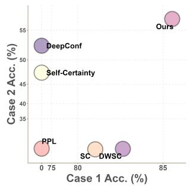

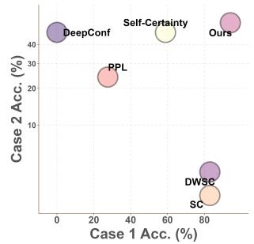  
(a) AIME24, 1.7B

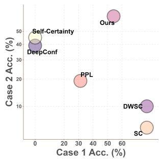

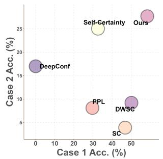  
(b) AIME24, 8B  
(c) AIME25, 1.7B  
(d) AIME25, 8B  
Figure 5: Tradeoff between Case I and Case II on AIME24 and AIME25 using Qwen3-1.7B and Qwen3-8B. DWSC denotes the DeepConf-Weighted SC method.

Performance with the Reliability of Confidence Estimation. Tab. 2 compares the aggregation methods under internal confidence estimates from three mathematics-specialized backbones. We observe that our method consistently improves accuracy while reducing ECE across the four voting baselines, achieving an average accuracy improvement of 1.96% and an average ECE reduction of 1.42%. This demonstrates the robustness of our method to confidence estimates of varying reliability.

Performance with the External Reward Setting. Tab. 3 and Tab. 9 compares the methods using productaggregated rewards from an external process reward model. We observe that our method improves PRM-Weighted SC and PRM-RPC in most settings. To be specific, at the full budget, PGLA raises their average accuracy from 33.98 to 35.51 and from 34.30 to 35.55, respectively. This further demonstrates that our method can effectively use externally provided reward signals.

## Case analysis

We examine two cases that highlight different weaknesses of answer aggregation. In Case I, an incorrect answer has higher maximum path confidence, while a correct answer has stronger voting support. In Case II, an incorrect answer receives equal or stronger voting support, while pairwise confidence comparisons favor a correct answer. Best-of-N often fails in Case I, while voting-based methods typically struggle in Case II. As shown in Fig. 5 and Fig. 10, PGLA better balances the two cases by combining voting support with pairwise comparisons. See Sec. C for detailed definitions and examples.

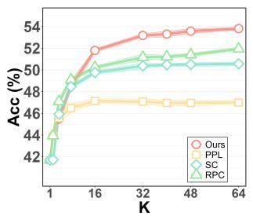  
(a) MATH

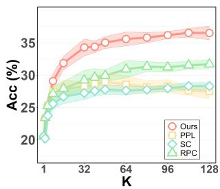  
(b) MathOdyssey

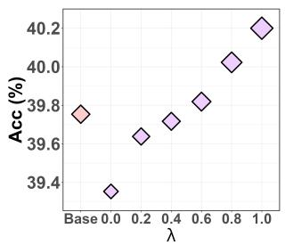  
(a) DeepSeek

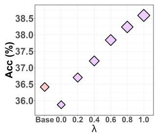  
(b) InternLM2  
Figure 6: Scaling behavior under varying numbers of sampled reasoning paths K on MATH and MathOdy. using InternLM2-Math-Plus-7B.  
Figure 7: Effect of confidence reliability in pairwise comparisons on accuracy, averaged over three math datasets.

## Fine-grained Analysis

Effect of Confidence Reliability. Larger λ indicates more reliable PRM scores for pairwise comparisons. As shown in Fig. 7, more reliable scores lead to higher PGLA accuracy on both models. Base denotes the PRM-Weighted SC baseline. Experimental details are provided in Sec. G.5.

Scaling with Varying K Values We examine how the number of sampled reasoning paths affects aggregation performance on MATH and MathOdyssey using InternLM2-Math-Plus-7B. Fig. 6 varies K over {1, 2, 4, 8, 16, 32, 40, 48, 64, 80, 96, 112, 128} . Increasing K generally improves performance by providing richer candidate sets, and PGLA remains consistently strong across most of the sampling range.

Performance using High Sampling Temperatures. To further examine robustness under more diverse sampled reasoning paths, we conduct additional experiments on MathOdyssey and AIME using InternLM2- Math-Plus-1.8B, InternLM2-Math-Plus-7B, and DeepSeek-Math-RL-7B. At higher sampling temperatures $T = 1 . 1$ and T = 1.3, PGLA generally outperforms the comparison methods as shown in Tab. 16. This supports its robustness to more diverse reasoning paths.

Effect of Various Comparative Advantage Functions. We compare the default voting-weighted rule with uniform averaging, Copeland, and Maximin in Sec. G.11. These rules generally improve accuracy over the voting baselines, with the default achieving strong overall performance. This shows that PGLA benefits from pairwise evidence under different comparative advantage rules.

Performance in the Online Setting. As shown in Tab. 4, Online SC+PGLA improves accuracy over full-budget SC by 0.28–3.63% while reducing the sampling cost by 50.8%–73.1% on InternLM2-Math-Plus-1.8B. Full comparisons with Adaptive SC and Online SC, along with results on InternLM2-Math-Plus-7B, are provided in Sec. G.9.

Table 4: Online setting on InternLM2-1.8B.
<table><tr><td>Dataset</td><td>Method</td><td>Acc.</td><td>K</td><td>Saving</td></tr><tr><td>MATH</td><td>SC (Full Budget)</td><td> $3 6 . 4 8 _ { \pm 0 . 1 4 }$ </td><td>64.0</td><td></td></tr><tr><td rowspan="2">MathOdyssey</td><td>Online SC+PGLA</td><td> $3 9 . 3 2 _ { \pm 0 . 3 1 }$ </td><td>31.5</td><td>50.8%</td></tr><tr><td>SC (Full Budget)</td><td> $1 4 . 5 7 _ { \pm 0 . 4 5 }$ </td><td>128.0</td><td></td></tr><tr><td rowspan="2"></td><td>Online SC+PGLA</td><td> ${ \bf 1 8 . 2 0 _ { \pm 0 . 9 0 } }$ </td><td>34.5</td><td>73.1%</td></tr><tr><td>SC (Full Budget)</td><td> $2 . 6 6 _ { \pm 0 . 2 0 }$ </td><td>128.0</td><td></td></tr><tr><td>AIME</td><td>Online SC+PGLA</td><td> $2 . 9 4 _ { \pm 0 . 2 9 }$ </td><td>38.3</td><td>70.1%</td></tr></table>

## Conclusion

Inspired by social choice theory and the Condorcet principle, we propose Pairwise-Guided Logit Adjustment (PGLA), a plug-and-play framework for sampling-based LLM reasoning. Through pairwise confidence comparisons between sampled reasoning paths, PGLA estimates the implicit preference structure among candidate answers and captures their comparative advantages. A KL-regularized objective combines this comparative evidence with voting support, yielding a simple adjustment to the base voting logits. The framework accommodates different voting methods, confidence sources, and comparative advantage rules. Experiments on mathematical reasoning, knowledge reasoning, and code generation demonstrate overall gains over voting baselines, while the online extension improves sampling efficiency.

## References

Daniel Adiwardana, Minh-Thang Luong, David R. So, Jamie Hall, Noah Fiedel, Romal Thoppilan, Zi Yang, Apoorv Kulshreshtha, Gaurav Nemade, Yifeng Lu, and Quoc V. Le. Towards a human-like open-domain chatbot. CoRR, abs/2001.09977, 2020.

Pranjal Aggarwal, Aman Madaan, Yiming Yang, and Mausam. Let’s sample step by step: Adaptiveconsistency for efficient reasoning and coding with LLMs. In Proceedings of the Conference on Empirical Methods in Natural Language Processing, pp. 12375–12396, 2023.

AI-MO. AIME 2024, 2024. URL https://huggingface.co/datasets/AI-MO/aimo-validation-aime.

Jacob Austin, Augustus Odena, Maxwell I. Nye, Maarten Bosma, Henryk Michalewski, David Dohan, Ellen Jiang, Carrie J. Cai, Michael Terry, Quoc V. Le, and Charles Sutton. Program synthesis with large language models. CoRR, abs/2108.07732, 2021.

Vidhisha Balachandran, Jingya Chen, Lingjiao Chen, Shivam Garg, Neel Joshi, Yash Lara, John Langford, Besmira Nushi, Vibhav Vineet, Yue Wu, and Safoora Yousefi. Inference-time scaling for complex tasks: Where we stand and what lies ahead. CoRR, abs/2504.00294, 2025.

Mislav Balunovi´c, Jasper Dekoninck, Ivo Petrov, Nikola Jovanovi´c, and Martin T. Vechev. MathArena: Evaluating LLMs on uncontaminated math competitions. In Advances in Neural Information Processing Systems, 2025.

Mark Chen, Jerry Tworek, Heewoo Jun, Qiming Yuan, Henrique Pondé de Oliveira Pinto, Jared Kaplan, Harri Edwards, Yuri Burda, Nicholas Joseph, Greg Brockman, Alex Ray, Raul Puri, Gretchen Krueger, Michael Petrov, Heidy Khlaaf, Girish Sastry, Pamela Mishkin, Brooke Chan, Scott Gray, Nick Ryder, Mikhail Pavlov, Alethea Power, Lukasz Kaiser, Mohammad Bavarian, Clemens Winter, Philippe Tillet, Felipe Petroski Such, Dave Cummings, Matthias Plappert, Fotios Chantzis, Elizabeth Barnes, Ariel Herbert-Voss, William Hebgen Guss, Alex Nichol, Alex Paino, Nikolas Tezak, Jie Tang, Igor Babuschkin, Suchir Balaji, Shantanu Jain, William Saunders, Christopher Hesse, Andrew N. Carr, Jan Leike, Joshua Achiam, Vedant Misra, Evan Morikawa, Alec Radford, Matthew Knight, Miles Brundage, Mira Murati, Katie Mayer, Peter Welinder, Bob McGrew, Dario Amodei, Sam McCandlish, Ilya Sutskever, and Wojciech Zaremba. Evaluating large language models trained on code. CoRR, abs/2107.03374, 2021.

Stanley F. Chen, Douglas Beeferman, and Ronald Rosenfeld. Evaluation metrics for language models. In Proceedings of the DARPA Broadcast News Transcription and Understanding Workshop, pp. 275–280, 1998.

Wenbo Chen, Puheng Li, Mengyang Liu, Weijie Su, and Tianpei Xie. MARS: Margin-adversarial riskcontrolled stopping for parallel LLM test-time scaling. CoRR, abs/2606.12935, 2026.

Xinyun Chen, Renat Aksitov, Uri Alon, Jie Ren, Kefan Xiao, Pengcheng Yin, Sushant Prakash, Charles Sutton, Xuezhi Wang, and Denny Zhou. Universal self-consistency for large language model generation. CoRR, abs/2311.17311, 2023.

Karl Cobbe, Vineet Kosaraju, Mohammad Bavarian, Mark Chen, Heewoo Jun, Lukasz Kaiser, Matthias Plappert, Jerry Tworek, Jacob Hilton, Reiichiro Nakano, Christopher Hesse, and John Schulman. Training verifiers to solve math word problems. CoRR, abs/2110.14168, 2021.

Meng Fang, Xiangpeng Wan, Fei Lu, Fei Xing, and Kai Zou. MathOdyssey: Benchmarking mathematical problem-solving skills in large language models using odyssey math data. Scientific Data, 12(1):1392, 2025.

Austin Feng, Marius Alonso, Ambroise Odonnat, Vasilii Feofanov, and Ievgen Redko. Optimal selfconsistency for efficient reasoning with large language models. In International Conference on Machine Learning, 2026.

Felix A. Fischer, Olivier Hudry, and Rolf Niedermeier. Weighted tournament solutions. In Felix Brandt, Vincent Conitzer, Ulle Endriss, Jérôme Lang, and Ariel D. Procaccia (eds.), Handbook of Computational Social Choice, pp. 85–102. Cambridge University Press, 2016.

Peter C. Fishburn. Condorcet social choice functions. SIAM Journal on Applied Mathematics, 33(3):469–489, 1977.

Yichao Fu, Xuewei Wang, Hao Zhang, Yuandong Tian, and Jiawei Zhao. Deep think with confidence. In International Conference on Learning Representations, pp. 94355–94377, 2026.

Dan Hendrycks, Collin Burns, Saurav Kadavath, Akul Arora, Steven Basart, Eric Tang, Dawn Song, and Jacob Steinhardt. Measuring mathematical problem solving with the MATH dataset. In Proceedings of the Neural Information Processing Systems Track on Datasets and Benchmarks, 2021.

Naman Jain, King Han, Alex Gu, Wen-Ding Li, Fanjia Yan, Tianjun Zhang, Sida Wang, Armando Solar-Lezama, Koushik Sen, and Ion Stoica. Livecodebench: Holistic and contamination free evaluation of large language models for code. In International Conference on Learning Representations, 2025.

Zhewei Kang, Xuandong Zhao, and Dawn Song. Scalable best-of-N selection for large language models via self-certainty. In Advances in Neural Information Processing Systems, pp. 19720–19745, 2025.

Junseok Kim, Nakyeong Yang, Kyungmin Min, and Kyomin Jung. Reliability-aware adaptive selfconsistency for efficient sampling in LLM reasoning. In Findings of the Association for Computational Linguistics, pp. 21575–21590, 2026.

Joshua Ong Jun Leang, Zheng Zhao, Aryo Pradipta Gema, Sohee Yang, Wai-Chung Kwan, Xuanli He, Wenda Li, Pasquale Minervini, Eleonora Giunchiglia, and Shay B. Cohen. PiCSAR: Probabilistic confidence selection and ranking for reasoning chains. In Findings of the Association for Computational Linguistics: ACL 2026, pp. 31511–31544, 2026.

Aitor Lewkowycz, Anders Andreassen, David Dohan, Ethan Dyer, Henryk Michalewski, Vinay V. Ramasesh, Ambrose Slone, Cem Anil, Imanol Schlag, Theo Gutman-Solo, Yuhuai Wu, Behnam Neyshabur, Guy Gur-Ari, and Vedant Misra. Solving quantitative reasoning problems with language models. In Advances in Neural Information Processing Systems, pp. 3843–3857, 2022.

Yiwei Li, Peiwen Yuan, Shaoxiong Feng, Boyuan Pan, Xinglin Wang, Bin Sun, Heda Wang, and Kan Li. Escape sky-high cost: Early-stopping self-consistency for multi-step reasoning. In International Conference on Learning Representations, 2024.

Hunter Lightman, Vineet Kosaraju, Yuri Burda, Harrison Edwards, Bowen Baker, Teddy Lee, Jan Leike, John Schulman, Ilya Sutskever, and Karl Cobbe. Let’s verify step by step. In International Conference on Learning Representations, 2024.

Jiawei Liu, Chunqiu Steven Xia, Yuyao Wang, and Lingming Zhang. Is your code generated by ChatGPT really correct? rigorous evaluation of large language models for code generation. In Advances in Neural Information Processing Systems, pp. 21558–21572, 2023.

Maria Marina, Daniil Moskovskiy, Sergey Pletenev, Mikhail Salnikov, Alexander Panchenko, and Viktor Moskvoretskii. Boosting self-consistency with ranking. In Proceedings of the Annual Meeting of the Association for Computational Linguistics, pp. 1017–1032, 2026.

Aditya Krishna Menon, Sadeep Jayasumana, Ankit Singh Rawat, Himanshu Jain, Andreas Veit, and Sanjiv Kumar. Long-tail learning via logit adjustment. In International Conference on Learning Representations, 2021.

Jungsuk Oh and Jay-Yoon Lee. Latent self-consistency for reliable majority-set selection in short- and long-answer reasoning. In Proceedings of the AAAI Conference on Artificial Intelligence, pp. 32591–32599, 2026.

OpenCompass. AIME 2025, 2025. URL https://huggingface.co/datasets/opencompass/AIME2025.

Qwen. Qwen3 technical report. CoRR, abs/2505.09388, 2025.

David Rein, Betty Li Hou, Asa Cooper Stickland, Jackson Petty, Richard Yuanzhe Pang, Julien Dirani, Julian Michael, and Samuel R. Bowman. GPQA: A graduate-level google-proof Q&A benchmark. In Conference on Language Modeling, 2024.

Zhihong Shao, Peiyi Wang, Qihao Zhu, Runxin Xu, Junxiao Song, Mingchuan Zhang, Y. K. Li, Y. Wu, and Daya Guo. Deepseekmath: Pushing the limits of mathematical reasoning in open language models. CoRR, abs/2402.03300, 2024.

Charlie Victor Snell, Jaehoon Lee, Kelvin Xu, and Aviral Kumar. Scaling LLM test-time compute optimally can be more effective than scaling parameters for reasoning. In International Conference on Learning Representations, 2025.

Amir Taubenfeld, Tom Sheffer, Eran Ofek, Amir Feder, Ariel Goldstein, Zorik Gekhman, and Gal Yona. Confidence improves self-consistency in LLMs. In Findings of the Association for Computational Linguistics, pp. 20090–20111, 2025.

Han Wang, Archiki Prasad, Elias Stengel-Eskin, and Mohit Bansal. Soft self-consistency improves language models agents. In Proceedings of the Annual Meeting of the Association for Computational Linguistics, pp. 287–301, 2024.

Weiqin Wang, Yile Wang, and Hui Huang. Ranked voting based self-consistency of large language models. In Findings of the Association for Computational Linguistics, pp. 14410–14426, 2025.

Xuezhi Wang, Jason Wei, Dale Schuurmans, Quoc V. Le, Ed H. Chi, Sharan Narang, Aakanksha Chowdhery, and Denny Zhou. Self-consistency improves chain of thought reasoning in language models. In International Conference on Learning Representations, 2023.

Jason Wei, Xuezhi Wang, Dale Schuurmans, Maarten Bosma, Brian Ichter, Fei Xia, Ed H. Chi, Quoc V. Le, and Denny Zhou. Chain-of-thought prompting elicits reasoning in large language models. In Advances in Neural Information Processing Systems, pp. 24824–24837, 2022.

Shunyu Yao, Dian Yu, Jeffrey Zhao, Izhak Shafran, Tom Griffiths, Yuan Cao, and Karthik Narasimhan. Tree of thoughts: Deliberate problem solving with large language models. In Advances in Neural Information Processing Systems, pp. 11809–11822, 2023.

Huaiyuan Ying, Shuo Zhang, Linyang Li, Zhejian Zhou, Yunfan Shao, Zhaoye Fei, Yichuan Ma, Jiawei Hong, Kuikun Liu, Ziyi Wang, Yudong Wang, Zijian Wu, Shuaibin Li, Fengzhe Zhou, Hongwei Liu, Songyang Zhang, Wenwei Zhang, Hang Yan, Xipeng Qiu, Jiayu Wang, Kai Chen, and Dahua Lin. Internlm-math: Open math large language models toward verifiable reasoning. CoRR, abs/2402.06332, 2024.

H. P. Young. Condorcet’s theory of voting. American Political Science Review, 82(4):1231–1244, 1988.

Parvez Zamil and Gollam Rabby. AIME problems 1983 to 2024, 2024. URL https://www.kaggle.com/ datasets/tourist800/aime-problems-1983-to-2024.

Zhenru Zhang, Chujie Zheng, Yangzhen Wu, Beichen Zhang, Runji Lin, Bowen Yu, Dayiheng Liu, Jingren Zhou, and Junyang Lin. The lessons of developing process reward models in mathematical reasoning. In Findings of the Association for Computational Linguistics, pp. 10495–10516, 2025.

Zhi Zhou, Yuhao Tan, Zenan Li, Yuan Yao, Lan-Zhe Guo, Yu-Feng Li, and Xiaoxing Ma. A theoretical study on bridging internal probability and self-consistency for LLM reasoning. In Advances in Neural Information Processing Systems, pp. 87380–87413, 2025.

William S. Zwicker. Introduction to the theory of voting. In Felix Brandt, Vincent Conitzer, Ulle Endriss, Jérôme Lang, and Ariel D. Procaccia (eds.), Handbook of Computational Social Choice, pp. 23–56. Cambridge University Press, 2016.

A Related Work 16   
B Representative Methods 17   
B.1 Path-Confidence Measures and Selection 17   
B.2 Answer-Level Voting 18   
C Case Analysis 18   
D Online PGLA Extension 19   
E Proof for Proposition 3.1 20   
F Additional Experimental Setup 21   
F.1 Comparison Methods . 21   
F.2 LLM Backbones 22   
F.3 Datasets 23   
F.4 Implementation Details . 23   
G Additional Experimental Results 24   
G.1 Enhanced Code Tests in Reasoning Mode 24   
G.2 Comparison of Non-Thinking and Reasoning Modes 24   
G.3 Performance with the External Reward Setting 27   
G.4 Tradeoff between Case I and Case II 28   
G.5 Effect of Ranking Quality by Dataset . 29   
G.6 Temperature Sensitivity 29   
G.7 Efficiency Comparison 29   
G.8 Complete Scaling Results with Varying K . 32   
G.9 Online Sampling Efficiency 35   
G.10 Extension to 32B Models 36   
G.11 Effect of Comparative Advantage Rules 37   
G.12 Computational Overhead 39   
G.13 Connection to Rank-Based Borda Aggregation 40   
H Impact Statement 42   
I AI Use Statement 42

## Related Work

Sampling-based reasoning and confidence aggregation. Sampling-based test-time scaling improves LLM reasoning by generating multiple reasoning paths and selecting an answer from their collective evidence. Self-Consistency (SC) aggregates paths through majority voting over their final answers (Wang et al., 2023), whereas Best-of-N selects a single candidate using a quality score, such as a learned verifier or process reward model (Cobbe et al., 2021; Lightman et al., 2024). For outputs that cannot be grouped by exact answers, Universal Self-Consistency uses an LLM to assess consistency (Chen et al., 2023), while Latent Self-Consistency learns representations for semantic agreement (Oh & Lee, 2026).

Confidence-aware methods further exploit differences in path quality. Soft Self-Consistency scores candidate actions using model likelihoods in interactive tasks (Wang et al., 2024). RPC combines internal probability with answer consistency through Perplexity Consistency and Reasoning Pruning (Zhou et al., 2025). CISC weights votes by model confidence and shows that distinguishing correct from incorrect responses within the same question is more relevant to aggregation than cross-question calibration alone (Taubenfeld et al., 2025). Self-Certainty derives confidence from the token distribution (Kang et al., 2025), while Deep Conf uses local confidence to filter traces and weight their votes (Fu et al., 2026). More recently, PiCSAR combines reasoning and answer likelihoods for candidate selection (Leang et al., 2026). Self-Certainty’s Borda variant ranks sampled paths by confidence and accumulates rank-dependent votes for their answers (Kang et al., 2025). Ranked Voting SC instead elicits ordered candidate answers within each response and aggregates these lists using ranked voting rules (Wang et al., 2025). RISC learns an answer ranker from frequency, semantic, and reasoning-consistency features (Marina et al., 2026).

Our work studies preference reconstruction from ordinary single-answer samples. Each path provides one answer and a confidence score, leaving its ordering over alternatives unobserved. We seek to reconstruct an answer-level preference structure through pairwise confidence comparisons across answer groups, and reconcile this proxy for the missing preferences with voting support through KL-regularized aggregation.

Efficient and adaptive reasoning. The benefits of additional inference computation depend on how it is allocated across problems and reasoning paths (Snell et al., 2025). Adaptive-Consistency and Early-Stopping Self-Consistency reduce the number of completed samples by monitoring answer agreement and stopping when sufficient evidence has accumulated (Aggarwal et al., 2023; Li et al., 2024). DeepConf additionally monitors confidence during generation, terminates low-confidence traces, and uses answer consensus to stop further sampling (Fu et al., 2026).

Recent work refines both allocation and stopping. Blend-ASC analyzes SC through mode estimation and voting theory and dynamically distributes a sampling budget across questions (Feng et al., 2026). ReASC incorporates response-level confidence into its evidence accumulation and stopping decisions (Kim et al., 2026). MARS probes intermediate answers during parallel generation and stops when a conservative bound on future vote changes protects the current leader; its theoretical target is agreement with the fullbudget vote (Chen et al., 2026). Our primary focus is the preference structure used for answer aggregation. The online extension updates this structure as paths arrive and stops when the resulting decision remains stable, allowing us to examine whether preference-aware aggregation also improves sample efficiency.

## Representative Methods

We follow the notation and scoring rules in Sec. 2.1. The K sampled paths $z _ { i }$ produce answers $a _ { i } = g ( z _ { i } )$ and confidence scores $p _ { i } ,$ forming $\mathcal { D } = \{ ( a _ { i } , p _ { i } ) \} _ { i = 1 } ^ { K }$ . For each candidate answer $a \in { \mathcal { A } }$ , an aggregation method M computes $\begin{array} { r } { s _ { a } ^ { \mathcal { M } } = \mathcal { M } ( a ; \mathcal { D } ) ; } \end{array}$ ; the predicted answer aˆ is selected by Eq. (1). We first specify possible confidence scores $p _ { i }$ and then apply the same selection and voting formulas.

## Path-Confidence Measures and Selection

Let $T _ { i }$ be the number of tokens in path $z _ { i } ,$ and let $z _ { i , t }$ be its t-th token. For a vocabulary token $v , P _ { i , t } ( v )$ denotes the model’s predicted probability of v at position t, conditioned on the input query and preceding tokens of $z _ { i } .$ . The vocabulary is denoted by $\mathcal { V } _ { \mathrm { t o k } }$ . The following superscripts distinguish alternative choices for the confidence $p _ { i }$ in Sec. 2.1.

Perplexity confidence uses inverse perplexity so that higher values indicate higher confidence (Chen et al., 1998):

$$
p _ { i } ^ { \mathrm { P P L } } = \exp \left( \frac { 1 } { T _ { i } } \sum _ { t = 1 } ^ { T _ { i } } \log P _ { i , t } ( z _ { i , t } ) \right) = \mathrm { P P L } ( z _ { i } ) ^ { - 1 } .\tag{11}
$$

Here, $\mathrm { P P L } ( z _ { i } )$ is the perplexity of the sampled path. Its negative log-perplexity is log $p _ { i } ^ { \mathrm { { P P L } } }$ ; exponentiation preserves its ordering and ties, so either scale gives the same Best-of-N selection and pairwise confidence comparisons. The positive scale above also supplies the original perplexity-derived voting contribution directly as $p _ { i }$ in Eq. (4).

Self-Certainty (Kang et al., 2025) measures deviation from the uniform distribution over the vocabulary:

$$
p _ { i } ^ { \mathrm { S C e r t } } = - \frac { 1 } { T _ { i } | \mathcal { V } _ { \mathrm { t o k } } | } \sum _ { t = 1 } ^ { T _ { i } } \sum _ { v \in \mathcal { V } _ { \mathrm { t o k } } } \log ( | \mathcal { V } _ { \mathrm { t o k } } | P _ { i , t } ( v ) ) .\tag{12}
$$

The notation $| \nu _ { \mathrm { t o k } } |$ denotes the vocabulary size. Unlike perplexity, this score uses the entire predicted token distribution at each position, rather than only the probability of the sampled token.

DeepConf (Fu et al., 2026) computes token confidences and aggregates them over local windows. Let $k \in \{ 1 , \ldots , | \mathcal { V } _ { \mathrm { t o k } } | \}$ be the number of highest-probability tokens used at each position, and let $\mathrm { T o p } _ { k } ( P _ { i , t } )$ be that set of vocabulary tokens. Its bottom-10% variant is

$$
\begin{array} { r l } & { c _ { i , t } = - \displaystyle \frac { 1 } { k } \sum _ { v \in \mathrm { T o p } _ { k } ( P _ { i , t } ) } \log P _ { i , t } ( v ) , \quad G _ { i , \ell } = \frac { 1 } { | W _ { i , \ell } | } \sum _ { t \in W _ { i , \ell } } c _ { i , t } , } \\ & { p _ { i } ^ { \mathrm { D e e p C o n f } } = \displaystyle \frac { 1 } { | \mathcal { L } _ { i } | } \sum _ { \ell \in \mathcal { L } _ { i } } G _ { i , \ell } . } \end{array}\tag{13}
$$

Here, $c _ { i , t }$ is the token confidence; ℓ indexes a local window; $W _ { i , \ell } \subseteq \{ 1 , \dots , T _ { i } \}$ is its nonempty set of token positions; and $G _ { i , \ell }$ is the average confidence in that window. The nonempty index set $\mathcal { L } _ { i }$ selects the lowest-10% window confidences, with at least one window retained. Vertical bars denote set size. Tail and minimum-window variants use the same local-confidence principle. We use $k = 2 0$ , following DeepConf. This score averages negative log-probabilities over the top-k candidate tokens and differs from the negative log-likelihood of the sampled token. Larger values are treated as higher confidence. The resulting token scores and their window averages are nonnegative, allowing direct use as voting weights.

For any chosen confidence $p _ { i } ,$ Best-of-N uses exactly the answer-level score in Eq. (2):

$$
s _ { a } ^ { \mathrm { B o N } } = \operatorname* { m a x } _ { i : a _ { i } = a } p _ { i } , \qquad a \in \mathcal { A } .\tag{14}
$$

The index condition $a _ { i } = a$ restricts the maximum to paths producing answer a. Best-of-N is the conventional method name; its sampling budget here is the K paths defined in Sec. 2.1.

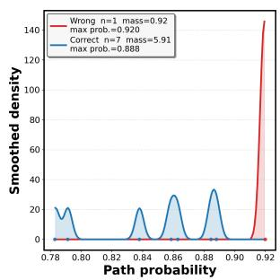  
(a) Case I.

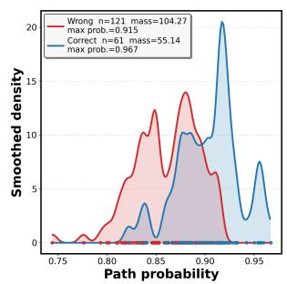  
(b) Case II.

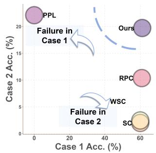  
(c) MATH.

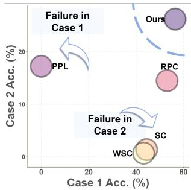  
(d) MathOdyssey.  
Figure 8: Complementary roles of voting support and pairwise confidence comparisons. In Case I, an incorrect answer contains the highest-confidence path despite weaker voting support. In Case II, an incorrect answer has stronger or tied voting support, while pairwise confidence comparisons favor a correct answer. The last two panels report the corresponding behavior on MATH and MathOdyssey.

## Answer-Level Voting

Self-Consistency (SC) (Wang et al., 2023) assigns one vote to each sampled path, as in Eq. (3):

$$
s _ { a } ^ { S C } = \sum _ { i = 1 } ^ { K } \mathbf { 1 } ( a _ { i } = a ) .\tag{15}
$$

The indicator 1(·) is one when its condition holds and zero otherwise. Thus $s _ { a } ^ { \mathrm { S C } }$ counts paths supporting answer a without using their confidence values.

Confidence-based voting uses the same coefficient $h _ { i } \geq 0$ as Eq. (4), with $h _ { i } = 0$ for a filtered path:

$$
s _ { a } ^ { \mathrm { C o n f - V o t e } } = \sum _ { i = 1 } ^ { K } h _ { i } \cdot p _ { i } { \bf 1 } ( a _ { i } = a ) .\tag{16}
$$

Unfiltered Weighted SC sets $h _ { i } = 1$ for every path. PPL-Weighted SC uses $p _ { i } = p _ { i } ^ { \mathrm { P P L } }$ from Eq. (11); DeepConf-Weighted SC and Self-Certainty-Weighted SC use $p _ { i } ^ { \mathrm { D e e p C o n f } }$ and $p _ { i } ^ { \mathrm { S C e r t } }$ , respectively. Confidence filtering instead sets $h _ { i } = 0$ for discarded paths and $h _ { i } = 1$ for retained paths.

RPC (Zhou et al., 2025) is another instance of this confidence-based voting rule. Perplexity Consistency aggregates probability-derived contributions from distinct path–confidence pairs, while Reasoning Pruning filters low-confidence paths under its original query-specific mixture rule. With $p _ { i } = p _ { i } ^ { \mathrm { P P I } }$ , set $h _ { i } = 1$ for one representative of each retained distinct pair $( z _ { i } , p _ { i } )$ , and $h _ { i } = 0$ for pruned paths and repeated copies of the same pair. Its score is therefore

$$
s _ { a } ^ { \mathrm { R P C } } = \sum _ { i = 1 } ^ { K } h _ { i } \cdot p _ { i } { \bf 1 } ( a _ { i } = a ) ,\tag{17}
$$

where the superscript RPC identifies this particular choice of confidence and filtering coefficients in the Conf-Vote family. Further baseline-specific rules, including rank-weighted voting, are described in Sec. F.1.

## Case Analysis

We use the Best-of-N, SC, and confidence-based voting scores in Eqs. (2) to (4). Fix a voting method M: its score $s _ { a } ^ { \mathcal { M } }$ is either $s _ { a } ^ { S C }$ or an instance of $s _ { a } ^ { \mathrm { C o n f - V o t e } }$ with specified confidence scores $p _ { i }$ and coefficients $h _ { i }$ . Thus, Best-of-N uses a confidence maximum, while voting sums the path contributions prescribed in Sec. 2.1.

Let $c , w \in { \mathcal { A } }$ be two distinct observed answers, with c correct and w incorrect. Each has at least one supporting path, so $s _ { c } ^ { \mathrm { S C } }$ and $s _ { w } ^ { \mathrm { S C } }$ are positive. In Case I, voting support favors $c ,$ whereas Best-of-N favors w because an incorrect path has the higher confidence maximum:

$$
s _ { c } ^ { \mathcal { M } } > s _ { w } ^ { \mathcal { M } } , \qquad s _ { w } ^ { \mathrm { B o N } } > s _ { c } ^ { \mathrm { B o N } } .\tag{18}
$$

To describe Case II, define the empirical confidence preference for c over w:

$$
\widehat { \rho } _ { c w } : = \frac { 1 } { s _ { c } ^ { S C } s _ { w } ^ { S C } } \sum _ { i : a _ { i } = c } \sum _ { j : a _ { j } = w } \left[ \mathbf { 1 } ( p _ { i } > p _ { j } ) + \frac { 1 } { 2 } \mathbf { 1 } ( p _ { i } = p _ { j } ) \right] .\tag{19}
$$

Here, i and j index observed paths supporting c and w, respectively. The denominator counts all such path pairs, so $\widehat \rho _ { c w }$ is the fraction favoring $c ,$ with confidence ties counted as one half. Case II occurs when voting support favors or ties $w ,$ while these pairwise comparisons favor c:

$$
s _ { w } ^ { \mathcal { M } } \geq s _ { c } ^ { \mathcal { M } } , \qquad \widehat { \rho } _ { c w } > \frac { 1 } { 2 } .\tag{20}
$$

The confidence-based comparison entry $Y _ { c w }$ in Eq. (6) is the average signed comparison over the same path pairs; hence $Y _ { c w } = 2 \widehat { \rho } _ { c w } - 1$ . The SC-error analysis in Fig. 4 takes ${ \mathcal { M } } = { \mathsf { S C } }$ , giving $s _ { w } ^ { \mathrm { S C } } \geq s _ { c } ^ { \mathrm { S C } }$ and $Y _ { c w } > 0$

Conditioning on recoverable SC errors. We call an SC error recoverable if its candidate pool contains at least one correct answer, and denote the set of such pools by $\mathcal { T } _ { \mathrm { r e c } }$ . For each pool t, let $e _ { t } \in [ 0 , 1 ]$ be its SC error weight, with fractional credit used for ties. We measure the prevalence of Case II among recoverable SC errors by

$$
R _ { \mathrm { I I } } ^ { \mathrm { r e c } } : = \frac { \sum _ { t \in \mathcal { T } _ { \mathrm { r e c } } } e _ { t } { \bf 1 } \{ \mathrm { C a s e ~ I I } _ { t } \} } { \sum _ { t \in \mathcal { T } _ { \mathrm { r e c } } } e _ { t } } .\tag{21}
$$

This conditioning excludes only pools with no correct candidate, for which reranking over the observed answers is impossible.

Tab. 5 reports both the share of NoCorrect pools among all SC errors and the Case-II share after excluding them. We use PPL confidence, with K = 64 on MATH and K = 128 on MathOdyssey and AIME.

Table 5: Breakdown of SC errors (%). NoCorrect is measured over all SC errors; recoverable Case II is measured after excluding NoCorrect pools. Results use PPL confidence.

<table><tr><td>Model</td><td>MATH</td><td>MathOdyssey</td><td>AIME</td></tr><tr><td>NoCorrect / all SC errors</td><td></td><td></td><td></td></tr><tr><td>InternLM2-Math-Plus-1.8B</td><td>50.16</td><td>46.94</td><td>75.83</td></tr><tr><td>InternLM2-Math-Plus-7B</td><td>48.58</td><td>53.10</td><td>63.70</td></tr><tr><td>DeepSeek-Math-RL-7B</td><td>51.83</td><td>59.42</td><td>62.18</td></tr><tr><td>Case II / recoverable SC errors</td><td></td><td></td><td></td></tr><tr><td>InternLM2-Math-Plus-1.8B</td><td>82.22</td><td>83.81</td><td>91.62</td></tr><tr><td>InternLM2-Math-Plus-7B</td><td>79.30</td><td>88.60</td><td>88.62</td></tr><tr><td>DeepSeek-Math-RL-7B</td><td>69.87</td><td>81.42</td><td>84.81</td></tr></table>

These cases reveal complementary weaknesses: Best-of-N is susceptible to Case I because it relies on a single confidence maximum, whereas voting-based methods are susceptible to Case II because they do not explicitly account for answer-level pairwise confidence comparisons. Pairwise-Guided Logit Adjustment (PGLA) combines the two sources of evidence, using voting support to temper isolated confidence outliers and comparative advantage to compensate for weaker voting support. This combination yields a better empirical tradeoff between the two error types, as shown in Figs. 5 and 10.

## Online PGLA Extension

The full-budget formulation above applies PGLA after collecting all sampled paths. To examine whether its comparative evidence can reduce unnecessary inference-time sampling, we extend it to the online setting. As new paths become available, PGLA updates its answer prediction and stops sampling once the prediction becomes stable.

Let $t _ { j }$ denote the number of observed paths at the j-th update, and let $\mathcal { D } _ { j } = \{ ( a _ { i } , p _ { i } ) \} _ { i = 1 } ^ { t _ { j } }$ be this prefix of the evidence pool. Its observed answers form $A _ { j } ,$ with supporting-path groups $C _ { u , j } = \{ i \le t _ { j } : a _ { i } = u \}$ for $u \in A _ { j }$ . From this prefix, we update the voting support $s _ { u , j } ^ { \mathcal { V } }$ and comparative advantage $s _ { u , j } ^ { \operatorname { P a i r } }$ using Eqs. (6) and $( 7 )$ , with all answer sums restricted to $A _ { j }$ . We set $s _ { u , j } ^ { \operatorname { P a i r } } = 0$ when no other observed answer has positive voting support, including the single-answer case. The adjusted score is

$$
s _ { u , j } ^ { \mathsf { P G L A } } = s _ { u , j } ^ { \gamma } \exp ( s _ { u , j } ^ { \operatorname { P a i r } } ) .\tag{22}
$$

For $s _ { u , j } ^ { \mathcal { V } } > 0$ , this is equivalently log $s _ { u , j } ^ { \mathsf { P G L A } } = \log s _ { u , j } ^ { \mathcal { V } } + s _ { u , j } ^ { \operatorname { P a i r } }$ , as in Eq. (10); the multiplicative form also applies to zero voting support without adding a smoothing term.

Let $\hat { a } _ { j }$ denote the unique highest-scoring answer in $\mathcal { A } _ { j } ,$ with $\hat { a } _ { j } = \varnothing$ under a tie. Given a stability length $L ,$ sampling stops at the first $j \geq L$ satisfying

$$
\hat { a } _ { j - L + 1 } = \cdot \cdot \cdot = \hat { a } _ { j } \neq \varnothing .\tag{23}
$$

A tie resets the stability count, and sampling continues to $K _ { \mathrm { m a x } }$ if the condition is never met. This label-free rule applies unchanged to a base aggregator and its PGLA-adjusted counterpart, enabling a matched online comparison.

## Proof for Proposition 3.1

Proof. Consider an observed candidate pool with answer set A and $U = | { \mathcal { A } } | \geq 1$ . The voting distribution $\bar { \mathsf { \pmb { s } } } ^ { \gamma }$ and comparative advantages $s _ { u } ^ { \mathrm { P a i r } }$ are determined by this pool and are constants with respect to the optimization variable s¯. They may be computed from the same paths; no statistical independence between them is required. Under the proposition’s positive-support assumption,

$$
\bar { s } _ { u } ^ { \mathcal { V } } = \frac { s _ { u } ^ { \mathcal { V } } } { \sum _ { v \in \mathcal { A } } { s _ { v } ^ { \mathcal { V } } } } > 0 , \qquad \sum _ { u \in \mathcal { A } } \bar { s } _ { u } ^ { \mathcal { V } } = 1 ,\tag{24}
$$

and each $s _ { u } ^ { \operatorname { P a i r } } \in [ - 1 , 1 ]$ is finite. For $U = 1$ , we take $s _ { u } ^ { \mathrm { P a i r } } = 0$ because there is no competing answer. The objective in Eq. (8) is

$$
\begin{array} { r l } & { \mathcal { I } ( \bar { \mathbf { s } } ) : = \displaystyle \sum _ { u \in \mathcal { A } } \bar { s } _ { u } s _ { u } ^ { \mathrm { P a i r } } - \sum _ { u \in \mathcal { A } } \bar { s } _ { u } \log \frac { \bar { s } _ { u } } { \bar { s } _ { u } ^ { \gamma } } } \\ & { \quad \quad = - \displaystyle \sum _ { u \in \mathcal { A } } \bar { s } _ { u } \log \bar { s } _ { u } + \sum _ { u \in \mathcal { A } } \bar { s } _ { u } \big ( s _ { u } ^ { \mathrm { P a i r } } + \log \bar { s } _ { u } ^ { \gamma } \big ) , } \end{array}\tag{25}
$$

over the probability simplex $\begin{array} { r } { \Delta _ { \mathcal { A } } = \{ \bar { \mathbf { s } } : \bar { s } _ { u } \geq 0 , \quad \sum _ { u \in \mathcal { A } } \bar { s } _ { u } = 1 \} } \end{array}$ . Terms with $\bar { s } _ { u } ~ = ~ 0$ are defined by continuity, so 0 log 0 = 0 and $0 \log ( 0 / \bar { s } _ { u } ^ { \mathcal { V } } ) = 0$

Existence and strict concavity. The function $x \mapsto x \log x ,$ with its continuous extension at zero, is strictly convex on [0, 1]. Thus the entropy term − $\textstyle - \sum _ { u \in \mathcal { A } } \bar { s } _ { u } \log \bar { s } _ { u }$ is strictly concave on the simplex, while the second term in Eq. (25) is linear in s¯. Consequently, J is strictly concave for $U \geq 2$ . It is also continuous on the compact simplex, so a maximizer exists and is unique. For $U = 1$ , the simplex contains only the distribution assigning probability one to its sole answer, and uniqueness is immediate.

Closed-form solution. Define the positive normalizing constant and a candidate distribution by

$$
Z : = \sum _ { v \in \mathcal { A } } \bar { s } _ { v } ^ { \mathcal { V } } \exp ( s _ { v } ^ { \mathrm { P a i r } } ) , \qquad \bar { s } _ { u } ^ { \star } : = \frac { \bar { s } _ { u } ^ { \mathcal { V } } \exp ( s _ { u } ^ { \mathrm { P a i r } } ) } { Z } .\tag{26}
$$

Since $\bar { s } _ { u } ^ { \gamma } > 0$ and $s _ { u } ^ { \mathrm { P a i r } }$ is finite, $0 < Z < \infty , \bar { s } _ { u } ^ { \star } > 0 _ { . }$ , and $\begin{array} { r } { \sum _ { u \in \mathcal { A } } \bar { s } _ { u } ^ { \star } = 1 } \end{array}$ . Hence $\bar { \mathbf { s } } ^ { \star }$ is feasible. Moreover,

log $\bar { s } _ { u } ^ { \star } = \log \bar { s } _ { u } ^ { \gamma } + s _ { u } ^ { \mathrm { P a i r } } - \log Z .$ . For every $\bar { \mathsf { \pmb { s } } } \in \Delta _ { { \cal A } } ,$ including its boundary, substitution gives

$$
\begin{array} { r l } & { \mathcal { T } ( \bar { \mathfrak { s } } ) = \displaystyle \sum _ { u \in \mathcal { A } } \bar { s } _ { u } \left( s _ { u } ^ { \mathrm { P a i r } } + \log \bar { s } _ { u } ^ { \nu } - \log \bar { s } _ { u } \right) } \\ & { \quad \quad \quad = \displaystyle \sum _ { u \in \mathcal { A } } \bar { s } _ { u } \left( \log Z + \log \bar { s } _ { u } ^ { \star } - \log \bar { s } _ { u } \right) } \\ & { \quad \quad \quad = \log Z - D _ { \mathrm { K L } } ( \bar { \mathfrak { s } } \parallel \bar { \mathfrak { s } } ^ { \star } ) . } \end{array}\tag{27}
$$

The KL divergence is nonnegative and vanishes if and only if $\bar { \mathbf { s } } = \bar { \mathbf { s } } ^ { \star }$ . Therefore $\mathcal { I } ( \bar { \mathbf { s } } ) \leq \log Z$ , with equality uniquely at s¯⋆. This proves that $\bar { \pmb { \mathsf { s } } } ^ { \mathsf { P G L A } } = \bar { \pmb { \mathsf { s } } } ^ { \star }$ and yields exactly Eq. (9). □

Connection to the logit adjustment. Substituting Eq. (24) into the optimizer gives

$$
\begin{array} { r l } & { \bar { s } _ { u } ^ { \mathsf { P G L A } } = \frac { s _ { u } ^ { \nu } \exp \left( s _ { u } ^ { \mathrm { P a i r } } \right) } { \sum _ { v \in \mathcal { A } } s _ { v } ^ { \nu } \exp \left( s _ { v } ^ { \mathrm { P a i r } } \right) } } \\ & { \quad \quad = \mathrm { s o f t m a x } \Big ( \left( \log s _ { v } ^ { \nu } + s _ { v } ^ { \mathrm { P a i r } } \right) _ { v \in \mathcal { A } } \Big ) _ { u } . } \end{array}\tag{28}
$$

Thus the adjusted distribution is obtained by normalizing the answer-level scores $s _ { u } ^ { \mathsf { P G L A } } = s _ { u } ^ { \gamma } \exp ( s _ { u } ^ { \operatorname { P a i r } } )$ For positive voting support, taking logarithms gives log $s _ { u } ^ { \mathsf { P G L A } } = \log s _ { u } ^ { \gamma } + s _ { u } ^ { \operatorname { P a i r } }$ , exactly as in Eq. (10). If all comparative advantages are equal, their common exponential factor cancels and $\bar { \mathsf { \pmb { \mathsf { s } } } } ^ { \mathsf { P G L A } } = \bar { \mathsf { \pmb { s } } } ^ { \nu }$

## Additional Experimental Setup

## Comparison Methods

Competitors. We compare 11 internal-confidence and voting baselines on the same sampled paths, together with three external-PRM baselines. We also include Online SC for the sampling-efficiency comparison; + Ours denotes the corresponding voting rule enhanced by PGLA.

PPL Best-of-N. This baseline selects the path with the highest mean token log-probability, equivalently the lowest perplexity (Chen et al., 1998). Its answer-level score is the maximum PPL confidence among paths supporting that answer.

DeepConf Best-of-N. DeepConf summarizes token confidence over local windows to identify lowconfidence portions of a path (Fu et al., 2026). We use the average of the bottom-10% window confidences as the path score and select the highest-scoring path.

Self-Certainty Best-of-N. Self-Certainty measures the divergence of the model’s next-token distribution from a uniform vocabulary distribution (Kang et al., 2025). This baseline selects the path with the highest average Self-Certainty score.

SC. Self-Consistency gives each sampled path one vote for its final answer (Wang et al., 2023). It selects the answer with the largest voting support, $\hat { s } _ { u } ^ { \mathrm { S C } } = | C _ { u } |$

PPL-Weighted SC. This variant uses the inverse-perplexity confidence $p _ { i } ^ { \mathrm { { P P L } } }$ in $\operatorname { E q } .$ . (11) and sets $h _ { i } = 1$ in Eq. (4). It is denoted by Weighted SC in the PPL-based experiments.

DeepConf-Weighted SC. This variant sums the DeepConf path scores over each answer group (Fu et al., 2026). It uses all eligible paths, with no additional path-level confidence filter.

Self-Certainty-Weighted SC. This variant sums the Self-Certainty path scores over each answer group (Kang et al., 2025). It retains the numerical confidence values as voting weights.

Self-Certainty Borda. This rule ranks paths by decreasing Self-Certainty and assigns rank r the voting weight $( K - r + 1 ) ^ { \gamma }$ (Kang et al., 2025). We use $\gamma = 1 . 2$ and sum the rank-based weights for each answer.

DeepConf-Filter (90%). This offline rule retains paths at or above the tenth percentile of eligible pathconfidence scores and sums their DeepConf weights for each answer (Fu et al., 2026). The top-90% path

filter is separate from the bottom-10% window summary used to score each path; threshold ties are retained.

Adaptive SC. Adaptive Self-Consistency stops sampling according to the accumulated evidence for the leading answer (Aggarwal et al., 2023). We retain its original stopping criterion as a dynamic-budget baseline.

RPC. RPC combines Perplexity Consistency, which aggregates probability-derived support from distinct path–confidence pairs, with Reasoning Pruning, which filters low-confidence paths (Zhou et al., 2025). It provides a confidence-aware voting baseline without an external scorer.

PRM Best-of-N. This baseline uses Qwen2.5-Math-PRM-7B to score the reasoning steps of each sampled path (Zhang et al., 2025). It multiplies the step scores into a path score and selects the highest-scoring path.

PRM-Weighted SC. This variant sums the same product of step-level PRM scores over each answer group. It combines answer agreement with externally estimated path quality (Lightman et al., 2024; Zhang et al., 2025).

PRM-RPC. This variant substitutes the product of step-level PRM scores for the internal confidence weights in RPC. It retains RPC’s path deduplication and pruning before aggregating the remaining voting support (Zhou et al., 2025; Zhang et al., 2025).

Online SC. This baseline updates the majority-vote prediction after every eight paths and stops after the unique winning answer remains unchanged for three consecutive updates. It uses the same stability rule as Online SC+PGLA, as detailed in Sec. G.9.

## LLM Backbones

LLM Backbones. We use seven generators spanning the Qwen3, DeepSeekMath, and InternLM-Math families. Qwen3 models use reasoning mode unless a result is explicitly marked as non-thinking; the external PRM serves only as a scorer.

Qwen3-1.7B. This is the smallest Qwen3 generator in our experiments (Qwen, 2025). It provides a small-model setting for evaluating aggregation across mathematical reasoning and code generation.

Qwen3-4B. This Qwen3 model increases the parameter scale to 4B while retaining the family’s thinking and non-thinking modes (Qwen, 2025). We include it in the confidence-transfer comparisons and complementary non-thinking evaluations.

Qwen3-8B. This 8B Qwen3 model extends the reasoning-mode comparisons to a larger backbone (Qwen, 2025). Together with the 1.7B and 4B models, it supports comparisons across model scales within the same family.

Qwen3-32B. This is the largest Qwen3 generator evaluated in our study (Qwen, 2025). We report its reasoning-mode results on AIME 2024, AIME 2025, and HMMT 2025 in Sec. G.10.

DeepSeek-Math-RL-7B. This math-specialized 7B model is the reinforcement-learning variant of DeepSeek-Math (Shao et al., 2024). It tests aggregation on a generator trained specifically for mathematical reasoning.

InternLM2-Math-Plus-1.8B. This is the smallest math-specialized generator in our evaluation (Ying et al., 2024). It provides a lower-capacity counterpart for the mathematical-reasoning and online sampling experiments.

InternLM2-Math-Plus-7B. This 7B model belongs to the same math-specialized family as the 1.8B variant (Ying et al., 2024). It is included in the main mathematical-reasoning comparisons and the detailed aggregation analyses.

Qwen2.5-Math-PRM-7B. This process reward model assigns scores to individual reasoning steps (Zhang et al., 2025). We use it as an external scorer for the three PRM baselines and their applicable PGLA variants, separately from the seven generators above.

## Datasets

Datasets. The ten benchmarks in the main experimental setup cover competition mathematics, graduatelevel science, and code generation. HumanEval+ and MBPP+ provide additional evaluations with strengthened tests for the corresponding code benchmarks.

AIME 2024. This benchmark contains problems from the 2024 American Invitational Mathematics Examination (AI-MO, 2024). It evaluates short-answer mathematical reasoning and is reported separately from the historical AIME collection.

AIME 2025. This benchmark contains the 2025 AIME problems released by OpenCompass (OpenCompass, 2025). It provides a separate competition-year evaluation under the same short-answer format.

HMMT 2025. We use the February 2025 Harvard–MIT Mathematics Tournament problems provided by MathArena (Balunovi´c et al., 2025). The benchmark covers challenging competition mathematics, including algebra, geometry, combinatorics, and number theory.

AIME. The historical AIME collection contains 993 problems from the American Invitational Mathematics Examination from 1983 to 2024 (Zamil & Rabby, 2024). This larger short-answer benchmark is used in the math-specialized-model experiments.

MATH. MATH contains challenging competition mathematics problems spanning algebra, geometry, number theory, counting, and combinatorics (Hendrycks et al., 2021). We use its 5,000-problem test split.

MathOdyssey. MathOdyssey contains 387 problems covering advanced high-school, university-level, and olympiad-level mathematics (Fang et al., 2025). It extends the evaluation beyond a single competition or curriculum level.

GPQA-Diamond (GPQA-D). GPQA comprises expert-written multiple-choice questions in biology, physics, and chemistry (Rein et al., 2024). We use its 198-question Diamond subset to evaluate graduatelevel scientific reasoning.

HumanEval. HumanEval contains 164 Python programming tasks specified by function signatures and natural-language descriptions (Chen et al., 2021). We evaluate the selected programs using the original-test outcomes in our evaluation pipeline.

MBPP. Mostly Basic Programming Problems consists of short Python programming tasks with naturallanguage descriptions and tests (Austin et al., 2021). Our code-transfer evaluations use the cached 378-problem split.

LiveCodeBench V6. LiveCodeBench collects programming-contest problems from LeetCode, AtCoder, and Codeforces (Jain et al., 2025). We use the V6 code-generation benchmark to evaluate the correctness of selected programs by execution.

HumanEval+ and MBPP+. EvalPlus augments HumanEval and MBPP with additional tests that detect errors missed by the original suites (Liu et al., 2023). We retain the sampled programs and problem sets and report results under the strengthened tests separately from the original-test results.

## Implementation Details

Sampling and consistency. For each query, all methods use matched K-path subsets of the same sampled pool, generated with common decoding parameters. The consistency function treats two paths as consistent in mathematical and knowledge reasoning when their normalized final answers match. For code generation, we follow RPC and define consistency through execution behavior (Zhou et al., 2025). For the math-specialized backbones, we set K = 64 on MATH and K = 128 on MathOdyssey and AIME. For Qwen3 comparisons in reasoning and non-thinking modes, we set K = 32 on AIME 2024, AIME 2025, HMMT 2025, GPQA-D, HumanEval, MBPP, and LiveCodeBench V6. We use a temperature of 1.0 and top-p of 0.95. The maximum generation length is 2,048 tokens for MATH, MathOdyssey, and AIME, and

16,384 tokens for the remaining datasets. Within each experimental setting, all methods are evaluated on the same problem set and sampled-path subsets. The same repetitions are used for each baseline and its PGLA-enhanced counterpart.We report the mean and standard deviation. All experiments are conducted on Linux servers equipped with NVIDIA A100 and RTX 3090 GPUs, except for the CPU-only aggregation microbenchmark in Sec. G.12.

Aggregation. For a voting rule $\mathcal { V } , s _ { u } ^ { \mathcal { V } }$ denotes its answer-level voting support and $s _ { u } ^ { \mathrm { P a i r } }$ denotes the votingweighted comparative advantage in Eq. (7). The default adjustment is log $s _ { u } ^ { \mathsf { P G L A } } = \log s _ { u } ^ { \gamma } + s _ { u } ^ { \operatorname { P a i r } }$ from Eq. (10). A illustrative example of the adjustment is given in Fig. 9.

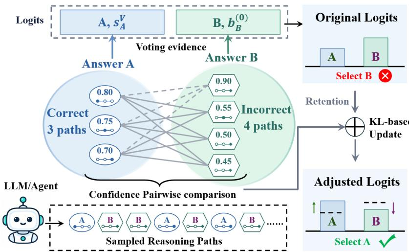  
Figure 9: Illustration of PGLA.

## Additional Experimental Results

## Enhanced Code Tests in Reasoning Mode

Tab. 6 reports the strengthened HumanEval+ and MBPP+ tests for the same sampled pools used in Tab. 1. A prediction must pass both the original and enhanced tests. PGLA generally improves accuracy under these strengthened tests, suggesting that its benefits persist under stricter verification.

## Comparison of Non-Thinking and Reasoning Modes

Tabs. 7 and 8 compare non-thinking and reasoning modes of Qwen3-1.7B and Qwen3-4B on AIME 2024, AIME 2025, and HMMT 2025. Reasoning-mode results are reproduced from Tab. 1 for the methods shared by both modes. All columns use K = 32. Reasoning mode consistently achieves higher accuracy, and PGLA generally improves the voting baselines in both modes.

Table 6: Enhanced code-test accuracy (%) in reasoning mode (K = 32). Here + Ours denotes a PGLA-enhanced variant.
<table><tr><td rowspan="2">Methods</td><td colspan="2">Qwen3-1.7B Reasoning</td><td colspan="2">Qwen3-4B Reasoning</td></tr><tr><td>HumanEval+</td><td>MBPP+</td><td>HumanEval+</td><td>MBPP+</td></tr><tr><td>PPL Best-of-N</td><td> $7 3 . 4 8 _ { \pm 1 . 8 0 }$ </td><td> $6 4 . 5 5 { \scriptstyle \pm 0 . 9 9 }$ </td><td> $8 6 . 9 9 { \scriptstyle \pm 0 . 5 5 }$ </td><td> $7 7 . 5 9 _ { \pm 0 . 7 4 }$ </td></tr><tr><td>DeepConf Best-of-N</td><td> $7 7 . 4 4 { \scriptstyle \pm 2 . 3 6 }$ </td><td> $6 6 . 4 0 { \scriptstyle \pm 0 . 7 6 }$ </td><td> $9 0 . 0 4 { \scriptstyle \pm 0 . 9 9 }$ </td><td> $7 8 . 8 9 _ { \pm 0 . 7 6 }$ </td></tr><tr><td>Self-Certainty Best-of-N</td><td> $7 8 . 0 5 { \scriptstyle \pm 2 . 6 7 }$ </td><td> $6 7 . 4 6 _ { \pm 0 . 9 7 }$ </td><td> $9 0 . 2 4 _ { \pm 1 . 0 6 }$ </td><td> $7 8 . 9 9 _ { \pm 0 . 6 2 }$ </td></tr><tr><td>SC</td><td> $7 7 . 2 9 _ { \pm 1 . 1 4 }$ </td><td> $7 1 . 1 6 { \scriptstyle \pm 0 . 8 3 }$ </td><td> $8 8 . 0 1 _ { \pm 1 . 1 6 }$ </td><td> $8 0 . 5 8 _ { \pm 0 . 6 2 }$ </td></tr><tr><td>SC + Ours (DeepConf)</td><td> $8 1 . 1 0 { \scriptstyle \pm 2 . 4 6 }$ </td><td> $7 1 . 4 3 _ { \pm 0 . 5 3 }$ </td><td> $9 0 . 0 4 { \scriptstyle \pm 1 . 1 4 }$ </td><td> $8 0 . 7 9 _ { \pm 0 . 4 6 }$ </td></tr><tr><td>SC + Ours (Self-Certainty)</td><td> $8 1 . 2 5 _ { \pm 1 . 9 1 }$ </td><td> $7 1 . 9 6 { \scriptstyle \pm 0 . 3 7 }$ </td><td> $9 0 . 6 5 _ { \pm 1 . 3 6 }$ </td><td>80.85±0.41</td></tr><tr><td>DeepConf-Weighted SC</td><td> $7 8 . 5 1 _ { \pm 1 . 6 4 }$ </td><td> $7 0 . 3 7 { \scriptstyle \pm 0 . 8 5 }$ </td><td> $8 9 . 0 2 _ { \pm 0 . 8 5 }$ </td><td> $8 0 . 7 7 _ { \pm 0 . 4 6 }$ </td></tr><tr><td>DeepConf-Weighted SC + Ours</td><td> ${ \bf 8 1 . 1 0 } _ { \pm 2 . 3 8 }$ </td><td> $7 1 . 6 9 _ { \pm 0 . 4 6 }$ </td><td> $9 0 . 2 4 _ { \pm 0 . 9 2 }$ </td><td> $8 0 . 7 7 _ { \pm 0 . 4 6 }$ </td></tr><tr><td>Self-Certainty-Weighted SC</td><td> $7 7 . 5 9 _ { \pm 1 . 5 4 }$ </td><td> $7 0 . 9 0 { \scriptstyle \pm 0 . 8 2 }$ </td><td> $8 8 . 8 2 _ { \pm 0 . 7 8 }$ </td><td> $8 0 . 8 5 _ { \pm 0 . 4 1 }$ </td></tr><tr><td>Self-Certainty-Weighted SC + Ours</td><td> ${ \bf 8 1 . 2 5 } _ { \pm 1 . 9 5 }$ </td><td> $7 1 . 9 6 _ { \pm 0 . 4 5 }$ </td><td> $9 0 . 6 5 _ { \pm 1 . 2 2 }$ </td><td> $8 0 . 8 7 _ { \pm 0 . 4 1 }$ </td></tr><tr><td>Self-Certainty Borda</td><td> $8 0 . 1 8 { \scriptstyle \pm 1 . 7 8 }$ </td><td> $7 1 . 4 3 _ { \pm 0 . 6 6 }$ </td><td> $8 9 . 0 2 _ { \pm 0 . 9 9 }$ </td><td> $8 0 . 3 2 _ { \pm 0 . 5 0 }$ </td></tr><tr><td>Self-Certainty Borda + Ours</td><td> ${ \bf 8 1 . 4 0 _ { \pm 1 . 9 8 } }$ </td><td> $7 2 . 2 2 _ { \pm 0 . 5 4 }$ </td><td> $9 0 . 6 5 _ { \pm 1 . 0 9 }$ </td><td> $8 0 . 3 2 _ { \pm 0 . 5 0 }$ </td></tr><tr><td>DeepConf-Filter (90%)</td><td> $8 0 . 0 3 { \scriptstyle \pm 1 . 8 9 }$ </td><td> $7 0 . 6 3 { \scriptstyle \pm 0 . 7 3 }$ </td><td> $8 9 . 0 2 { \scriptstyle \pm 0 . 8 7 }$ </td><td> $8 0 . 5 3 _ { \pm 0 . 4 6 }$ </td></tr><tr><td>DeepConf-Filter (90%) + Ours</td><td> ${ \bf 8 1 . 1 0 } _ { \pm 2 . 4 9 }$ </td><td> $7 1 . 6 9 _ { \pm 0 . 4 4 }$ </td><td> $9 0 . 2 4 _ { \pm 0 . 9 5 }$ </td><td> $\mathbf { 8 0 . 5 8 _ { \pm 0 . 4 5 } }$ </td></tr></table>

Table 7: Comparison of non-thinking and reasoning modes for Qwen3-1.7B on three mathematical reasoning benchmarks (K = 32).
<table><tr><td colspan="7">Qwen3-1.7B</td></tr><tr><td rowspan="2">Methods</td><td colspan="3">Non-thinking mode</td><td colspan="3">Reasoning mode</td></tr><tr><td></td><td></td><td></td><td></td><td></td><td>AIME 2024 AIME 2025 HMMT 2025 AIME 2024 AIME 2025 HMMT 2025</td></tr><tr><td>PPL Best-of-N</td><td> $1 2 . 0 0 _ { \pm 2 . 2 1 }$ </td><td> $1 1 . 3 3 _ { \pm 3 . 4 0 }$ </td><td> $5 . 0 0 _ { \pm 3 . 4 2 }$ </td><td> $3 6 . 0 0 _ { \pm 4 . 4 2 }$ </td><td> $3 4 . 0 0 _ { \pm 2 . 9 1 }$ </td><td> $2 3 . 0 0 _ { \pm 3 . 4 8 }$ </td></tr><tr><td>DeepConf Best-of-N</td><td> $1 2 . 3 3 { \scriptstyle \pm 2 . 1 3 }$ </td><td> $1 4 . 3 3 { \scriptstyle \pm 2 . 6 0 }$ </td><td> $8 . 3 3 { \scriptstyle \pm 3 . 7 3 }$ </td><td> $6 2 . 0 0 { \scriptstyle \pm 4 . 5 2 }$ </td><td> $4 2 . 6 7 { \scriptstyle \pm 2 . 4 9 }$ </td><td> $2 8 . 3 3 { \scriptstyle \pm 3 . 7 3 }$ </td></tr><tr><td>Self-Certainty Best-of-N</td><td> $1 2 . 6 7 { \scriptstyle \pm 2 . 4 9 }$ </td><td> $1 5 . 0 0 _ { \pm 3 . 4 2 }$ </td><td> $9 . 6 7 _ { \pm 2 . 3 3 }$ </td><td> $6 0 . 6 7 _ { \pm 4 . 1 6 }$ </td><td> $4 6 . 6 7 _ { \pm 3 . 3 3 }$ </td><td> $3 0 . 6 7 { \scriptstyle \pm 4 . 4 2 }$ </td></tr><tr><td>SC</td><td> $1 5 . 1 7 { \scriptstyle \pm 1 . 5 5 }$ </td><td> $1 4 . 8 3 _ { \pm 1 . 5 7 }$ </td><td> $6 . 9 4 _ { \pm 0 . 5 7 }$ </td><td> $6 9 . 5 0 { \scriptstyle \pm 1 . 9 8 } $ </td><td> $4 7 . 3 3 _ { \pm 3 . 6 7 }$ </td><td> $2 7 . 0 0 { \scriptstyle \pm 1 . 0 0 }$ </td></tr><tr><td>SC + Ours (DeepConf)</td><td> $1 6 . 0 0 { \scriptstyle \pm 2 . 4 9 }$ </td><td> ${ \bf 1 6 . 6 7 { \scriptstyle \pm 0 . 0 0 } }$ </td><td> $7 . 6 7 _ { \pm 1 . 5 3 }$ </td><td> $7 5 . 0 0 { \scriptstyle \pm 1 . 6 7 }$ </td><td> ${ \bf 5 1 . 3 3 } _ { \pm 2 . 6 7 }$ </td><td> $3 0 . 0 0 { \scriptstyle \pm 2 . 9 8 }$ </td></tr><tr><td>SC + Ours (Self-Certainty)</td><td> ${ \bf 1 6 . 5 0 { \scriptstyle \pm 2 . 1 7 } }$ </td><td> ${ \bf 1 6 . 6 7 { \scriptstyle \pm 0 . 0 0 } }$ </td><td> $7 . 6 7 _ { \pm 1 . 5 3 }$ </td><td> $7 4 . 0 0 { \scriptstyle \pm 1 . 3 3 }$ </td><td> $5 0 . 6 7 { \scriptstyle \pm 3 . 2 7 }$ </td><td> $3 0 . 3 3 { \scriptstyle \pm 2 . 7 7 }$ </td></tr><tr><td>DeepConf-Weighted SC</td><td> ${ \pm 5 . 6 7 } _ { \pm 2 . 1 3 }$ </td><td> $1 5 . 6 7 { \scriptstyle \pm 1 . 5 3 }$ </td><td> $7 . 3 3 _ { \pm 1 . 3 3 }$ </td><td> $7 0 . 0 0 { \scriptstyle \pm 1 . 4 9 }$ </td><td> $4 8 . 3 3 { \scriptstyle \pm 4 . 2 8 }$ </td><td> $2 7 . 0 0 { \scriptstyle \pm 1 . 0 0 }$ </td></tr><tr><td>DeepConf-Weighted SC + Ours</td><td> ${ \pm 5 . 6 7 } _ { \pm 2 . 1 3 }$ </td><td> ${ \bf 1 6 . 6 7 { \scriptstyle \pm 0 . 0 0 } }$ </td><td> $7 . 6 7 _ { \pm 1 . 5 3 }$ </td><td> $7 5 . 0 0 { \scriptstyle \pm 1 . 6 7 }$ </td><td> ${ \bf 5 1 . 0 0 } _ { \pm 3 . 0 0 }$ </td><td> $3 1 . 3 3 { \scriptstyle \pm 3 . 4 0 }$ </td></tr><tr><td>Self-Certainty-Weighted SC</td><td> $1 5 . 6 7 { \scriptstyle \pm 2 . 1 3 }$ </td><td> $1 5 . 0 0 { \scriptstyle \pm 1 . 6 7 }$ </td><td> $7 . 3 3 _ { \pm 1 . 3 3 }$ </td><td> $7 0 . 3 3 { \scriptstyle \pm 1 . 8 0 }$ </td><td> $4 8 . 6 7 _ { \pm 4 . 2 7 }$ </td><td> $2 7 . 0 0 { \scriptstyle \pm 1 . 0 0 }$ </td></tr><tr><td>Self-Certainty-Weighted  $\mathbf { S } \mathbf { C } + \mathbf { O u r s }$ </td><td> ${ \bf 1 6 . 0 0 } _ { \pm 2 . 4 9 }$ </td><td> ${ \bf 1 6 . 6 7 { \scriptstyle \pm 0 . 0 0 } }$ </td><td> $7 . 6 7 _ { \pm 1 . 5 3 }$ </td><td> $7 4 . 0 0 { \scriptstyle \pm 1 . 3 3 }$ </td><td> ${ \bf 5 0 . 6 7 } _ { \pm 3 . 2 7 }$ </td><td> $3 1 . 0 0 _ { \pm 3 . 3 5 }$ </td></tr></table>

Table 8: Comparison of non-thinking and reasoning modes for Qwen3-4B on three mathematical reasoning benchmarks $( K = 3 \bar { 2 } )$ .
<table><tr><td colspan="7">Qwen3-4B</td></tr><tr><td rowspan="2">Methods</td><td colspan="3">Non-thinking mode</td><td colspan="3">Reasoning mode</td></tr><tr><td></td><td>AIME 2024 AIME 2025 HMMT 2025</td><td></td><td>AIME 2024</td><td></td><td>AIME 2025 HMMT 2025</td></tr><tr><td>PPL Best-of-N</td><td> $3 0 . 0 0 { \scriptstyle \pm 3 . 9 4 }$ </td><td> $2 4 . 1 4 { \scriptstyle \pm 2 . 8 2 }$ </td><td> $1 3 . 0 0 { \scriptstyle \pm 2 . 7 7 }$ </td><td> $5 7 . 0 0 { \scriptstyle \pm 2 . 3 3 }$ </td><td> $6 4 . 3 3 { \scriptstyle \pm 3 . 9 6 }$ </td><td> $4 0 . 3 3 { \scriptstyle \pm 4 . 3 3 }$ </td></tr><tr><td>DeepConf Best-of-N</td><td> $3 1 . 6 7 _ { \pm 4 . 7 7 }$ </td><td> $2 5 . 2 9 _ { \pm 1 . 6 3 }$ </td><td> $1 5 . 3 3 _ { \pm 3 . 0 6 }$ </td><td> $7 7 . 0 0 { \scriptstyle \pm 2 . 3 3 }$ </td><td> $7 6 . 0 0 { \scriptstyle \pm 3 . 8 9 }$ </td><td> $5 0 . 0 0 { \scriptstyle \pm 4 . 9 4 }$ </td></tr><tr><td>Self-Certainty Best-of-N</td><td> $3 2 . 3 3 { \scriptstyle \pm 3 . 9 6 }$ </td><td> $2 6 . 4 4 { \scriptstyle \pm 3 . 2 5 }$ </td><td> $1 4 . 3 3 { \scriptstyle \pm 2 . 6 0 }$ </td><td> $8 1 . 6 7 { \scriptstyle \pm 2 . 2 4 }$ </td><td> $7 1 . 6 7 { \scriptstyle \pm 3 . 0 7 }$ </td><td> $5 1 . 6 7 { \scriptstyle \pm 4 . 0 1 }$ </td></tr><tr><td>SC</td><td> $3 9 . 5 6 _ { \pm 4 . 2 4 }$ </td><td> $2 6 . 2 5 { \scriptstyle \pm 1 . 5 1 }$ </td><td> $1 5 . 6 7 { \scriptstyle \pm 1 . 5 3 }$ </td><td> $8 0 . 0 0 { \scriptstyle \pm 0 . 0 0 }$ </td><td> $7 6 . 3 3 { \scriptstyle \pm 0 . 6 7 }$ </td><td> $5 1 . 5 0 { \scriptstyle \pm 1 . 5 7 }$ </td></tr><tr><td>SC + Ours (DeepConf)</td><td> $4 1 . 8 3 { \scriptstyle \pm 3 . 6 9 }$ </td><td> $2 8 . 7 4 { \scriptstyle \pm 1 . 6 3 }$ </td><td> ${ \bf 1 6 . 6 7 { \scriptstyle \pm 0 . 0 0 } }$ </td><td> $8 3 . 0 0 _ { \pm 1 . 0 0 }$ </td><td> $7 6 . 3 3 { \scriptstyle \pm 1 . 8 0 }$ </td><td> $5 4 . 0 0 { \scriptstyle \pm 2 . 9 1 }$ </td></tr><tr><td> $\mathbf { S C } + \mathbf { O u r s } \ ( \mathbf { S e l f - C e r t a i n t y } )$ </td><td> $4 1 . 3 3 _ { \pm 3 . 4 0 }$ </td><td> $2 8 . 7 4 { \scriptstyle \pm 1 . 6 3 }$ </td><td> ${ \bf 1 6 . 6 7 { \scriptstyle \pm 0 . 0 0 } }$ </td><td> $8 2 . 0 0 { \scriptstyle \pm 1 . 6 3 }$ </td><td> $7 8 . 6 7 _ { \pm 1 . 6 3 }$ </td><td> ${ \pm 5 5 . 6 7 } { \pm 1 . 5 3 }$ </td></tr><tr><td>DeepConf-Weighted SC</td><td> $4 1 . 0 0 _ { \pm 4 . 2 3 }$ </td><td> $2 6 . 4 4 { \scriptstyle \pm 1 . 6 3 }$ </td><td> $1 5 . 6 7 { \scriptstyle \pm 1 . 5 3 }$ </td><td> $8 0 . 0 0 { \scriptstyle \pm 0 . 0 0 }$ </td><td> $7 6 . 3 3 { \scriptstyle \pm 1 . 0 0 }$ </td><td> $5 1 . 3 3 { \scriptstyle \pm 1 . 6 3 }$ </td></tr><tr><td>DeepConf-Weighted SC + Ours</td><td> $4 2 . 3 3 _ { \pm 3 . 9 6 }$ </td><td> $2 7 . 5 9 { \scriptstyle \pm 2 . 8 2 }$ </td><td> ${ \bf 1 6 . 6 7 { \scriptstyle \pm 0 . 0 0 } }$ </td><td> $8 3 . 3 3 _ { \pm 1 . 4 9 }$ </td><td> $7 6 . 3 3 { \scriptstyle \pm 2 . 3 3 }$ </td><td> ${ \pm } 4 . 0 0 { \scriptstyle \pm 2 . 9 1 }$ </td></tr><tr><td> $\mathrm { S e l f - C e r t a i n t y - W e i g h t e d S C }$ </td><td> $4 0 . 3 3 _ { \pm 4 . 0 7 }$ </td><td> $2 6 . 4 4 { \scriptstyle \pm 1 . 6 3 }$ </td><td> $1 5 . 6 7 { \scriptstyle \pm 1 . 5 3 }$ </td><td> $8 0 . 0 0 { \scriptstyle \pm 0 . 0 0 }$ </td><td> $7 6 . 3 3 { \scriptstyle \pm 1 . 0 0 }$ </td><td> $5 2 . 6 7 { \scriptstyle \pm 2 . 0 0 }$ </td></tr><tr><td>Self-Certainty-Weighted SC + Ours</td><td> ${ \bf 4 1 . 6 7 } _ { \pm 3 . 0 7 }$ </td><td> $2 7 . 5 9 { \scriptstyle \pm 2 . 8 2 }$ </td><td> ${ \bf 1 6 . 6 7 { \scriptstyle \pm 0 . 0 0 } }$ </td><td> $8 2 . 0 0 { \scriptstyle \pm 1 . 6 3 }$ </td><td> $7 9 . 3 3 { \scriptstyle \pm 1 . 3 3 }$ </td><td> $5 5 . 3 3 { \scriptstyle \pm 1 . 6 3 }$ </td></tr></table>

Table 9: Accuracy comparison under the sampling budgets of $\frac { K } { 2 }$ and K, using product-aggregated rewards from an external process reward model Qwen2.5-Math-PRM-7B (Lightman et al., 2024; Zhang et al., 2025). + Ours denotes the PGLA-enhanced variant of each voting baseline.
<table><tr><td rowspan="2">Method</td><td colspan="2">MATH</td><td colspan="2">MathOdyssey</td><td colspan="2">AIME</td><td colspan="2">Average</td></tr><tr><td>K/2↑</td><td>K↑</td><td> $K / 2 \uparrow$ </td><td>K↑</td><td>K/2↑</td><td>K↑</td><td>K/2↑</td><td>K↑</td></tr><tr><td>InternLM2-Math-Plus-1.8B</td><td></td><td></td><td></td><td></td><td></td><td></td><td>25.23</td><td></td></tr><tr><td>PRM Best-of-N PRM-Weighted SC</td><td> $4 6 . 5 0 { \scriptstyle \pm 0 . 3 3 }$ </td><td> $4 8 . 4 8 _ { \pm 0 . 2 1 }$ </td><td> $2 4 . 7 5 _ { \pm 1 . 4 4 }$ </td><td> $2 5 . 4 7 _ { \pm 1 . 2 4 }$ </td><td> $4 . 4 3 _ { \pm 0 . 2 4 }$ </td><td> $4 . 9 3 _ { \pm 0 . 3 4 }$   $5 . 0 2 _ { \pm 0 . 2 3 }$ </td><td>24.50</td><td>26.30 25.77</td></tr><tr><td></td><td> $4 5 . 6 4 _ { \pm 0 . 2 6 }$ </td><td> $4 7 . 3 9 _ { \pm 0 . 2 3 }$ </td><td> $2 3 . 2 4 _ { \pm 1 . 0 4 }$ </td><td> $2 4 . 9 1 _ { \pm 1 . 0 7 }$ </td><td> $4 . 6 3 _ { \pm 0 . 2 5 }$ </td><td></td><td></td><td>27.73</td></tr><tr><td>+ Ours PRM-RPC</td><td> $4 6 . 8 8 _ { \pm 0 . 2 9 }$ </td><td> $4 9 . 0 9 _ { \pm 0 . 2 0 }$ </td><td> $2 6 . 9 9 _ { \pm 1 . 1 6 }$ </td><td> $2 8 . 9 5 _ { \pm 1 . 2 6 }$ </td><td> $4 . 7 3 _ { \pm 0 . 3 3 }$ </td><td> ${ \bf 5 . 1 7 _ { \pm 0 . 2 7 } }$ </td><td>26.20</td><td></td></tr><tr><td>+ Ours</td><td> $4 5 . 7 7 _ { \pm 0 . 2 5 }$ </td><td> $4 7 . 6 1 _ { \pm 0 . 2 3 }$ </td><td> $2 3 . 6 0 _ { \pm 1 . 1 9 }$ </td><td> $2 5 . 3 2 _ { \pm 1 . 0 4 }$ </td><td> $4 . 6 6 _ { \pm 0 . 2 4 }$ </td><td> $5 . 0 7 _ { \pm 0 . 2 1 }$ </td><td>24.68</td><td>26.00</td></tr><tr><td>InternLM2-Math-Plus-7B</td><td> $4 6 . 8 8 _ { \pm 0 . 2 8 }$ </td><td> $4 9 . 1 8 _ { \pm 0 . 1 7 }$ </td><td> $2 7 . 0 2 _ { \pm 1 . 2 8 }$ </td><td> $2 9 . 0 5 _ { \pm 1 . 3 0 }$ </td><td> $4 . 7 3 _ { \pm 0 . 3 2 }$ </td><td> ${ \bf 5 . 1 9 _ { \pm 0 . 2 6 } }$ </td><td>26.21</td><td>27.80</td></tr><tr><td></td><td></td><td></td><td></td><td></td><td></td><td></td><td></td><td></td></tr><tr><td>PRM Best-of-N</td><td> $5 8 . 2 2 _ { \pm 0 . 3 4 }$ </td><td> $5 9 . 3 4 { \scriptstyle \pm 0 . 3 2 }$ </td><td> $3 2 . 8 5 { \scriptstyle \pm 1 . 7 8 }$ </td><td> $3 3 . 0 7 { \scriptstyle \pm 0 . 9 9 }$ </td><td> $1 5 . 1 0 { \scriptstyle \pm 0 . 5 0 }$ </td><td> $1 5 . 9 6 { \scriptstyle \pm 0 . 3 6 }$ </td><td>35.39</td><td>36.12</td></tr><tr><td>PRM-Weighted SC</td><td> $5 7 . 5 6 _ { \pm 0 . 3 1 }$ </td><td> $5 8 . 6 7 _ { \pm 0 . 1 0 }$ </td><td> $3 3 . 5 7 { \scriptstyle \pm 1 . 1 3 }$ </td><td> $3 4 . 3 4 { \scriptstyle \pm 0 . 5 8 }$ </td><td> $1 5 . 4 9 _ { \pm 0 . 3 6 }$ </td><td> $1 6 . 2 3 _ { \pm 0 . 4 8 }$ </td><td>35.54</td><td>36.42</td></tr><tr><td>+ Ours</td><td> $5 8 . 8 6 _ { \pm 0 . 2 9 } ^ { - - }$ </td><td> $6 0 . 4 0 _ { \pm 0 . 2 4 }$ </td><td> $3 7 . 6 3 _ { \pm 1 . 1 8 }$ </td><td> $3 8 . 7 9 _ { \pm 0 . 6 2 }$ </td><td> $1 5 . 5 5 { \scriptstyle \pm 0 . 4 2 }$ </td><td> $\mathbf { 1 6 . 5 7 _ { \pm 0 . 3 5 } }$ </td><td>37.35</td><td>38.59</td></tr><tr><td>PRM-RPC</td><td> $5 7 . 7 4 { \scriptstyle \pm 0 . 2 8 }$ </td><td> $5 8 . 9 0 _ { \pm 0 . 1 3 }$ </td><td> $3 4 . 8 3 { \scriptstyle \pm 1 . 1 8 }$ </td><td> $3 5 . 4 8 _ { \pm 0 . 4 0 }$ </td><td> ${ \bf 1 5 . 5 7 } _ { \pm 0 . 4 2 }$ </td><td> $1 6 . 3 1 _ { \pm 0 . 4 4 }$ </td><td>36.05</td><td>36.90</td></tr><tr><td>+ Ours</td><td> $5 8 . 8 8 _ { \pm 0 . 2 4 }$ </td><td> $6 0 . 4 1 _ { \pm 0 . 2 5 } ^ { - }$ </td><td> $3 7 . 6 3 _ { \pm 1 . 2 4 }$ </td><td> $3 8 . 8 7 _ { \pm 0 . 6 0 }$ </td><td> $1 5 . 5 3 { \scriptstyle \pm 0 . 3 7 }$ </td><td> $\overline { { 1 6 . 5 0 \overset { \_ } { \pm } 0 . 2 8 } }$ </td><td>37.35</td><td>38.59</td></tr><tr><td>Deepseek-Math-RL-7B</td><td></td><td></td><td></td><td></td><td></td><td></td><td></td><td></td></tr><tr><td>PRM Best-of-N</td><td> $6 1 . 2 7 _ { \pm 0 . 2 4 }$ </td><td> $6 2 . 7 9 _ { \pm 0 . 1 6 }$ </td><td> $3 4 . 3 4 { \scriptstyle \pm 1 . 2 7 }$ </td><td> $3 4 . 3 1 _ { \pm 0 . 6 6 }$ </td><td> $1 5 . 9 3 _ { \pm 0 . 2 3 }$ </td><td> $1 7 . 1 4 _ { \pm 0 . 4 0 }$ </td><td>37.18</td><td>38.08</td></tr><tr><td>PRM-Weighted SC</td><td> $6 0 . 7 6 { \scriptstyle \pm 0 . 2 5 }$ </td><td> $6 2 . 0 4 _ { \pm 0 . 2 0 }$ </td><td> $3 9 . 6 9 { \scriptstyle \pm 0 . 5 9 }$ </td><td> $4 0 . 2 8 { \scriptstyle \pm 0 . 5 3 }$ </td><td> $1 5 . 7 7 { \scriptstyle \pm 0 . 2 7 }$ </td><td> $1 6 . 9 3 _ { \pm 0 . 4 3 }$ </td><td>38.74</td><td>39.75</td></tr><tr><td>+ Ours</td><td> ${ \bf 6 1 . 1 7 } _ { \pm 0 . 2 4 } ^ { - }$ </td><td> $6 2 . 4 1 _ { \pm 0 . 2 0 } ^ { - }$ </td><td> $4 0 . 1 8 \stackrel { - } { \pm } 0 . 6 4$ </td><td> $4 0 . 6 9 _ { \pm 0 . 5 3 }$ </td><td> $\mathbf { 1 6 . 1 3 } _ { \pm 0 . 4 8 } ^ { ^ { \perp } \cup . \angle 1 }$ </td><td> ${ \bf 1 7 . 4 9 } _ { \pm 0 . 5 7 } ^ { - }$ </td><td>39.16</td><td>40.20</td></tr><tr><td> $\mathrm { P R M - R P C }$  + Ours</td><td> $6 0 . 9 1 _ { \pm 0 . 2 7 }$ </td><td> $6 2 . 2 6 _ { \pm 0 . 2 2 }$ </td><td> $4 0 . 0 5 _ { \pm 0 . 8 3 }$ </td><td> $4 0 . 6 7 _ { \pm 0 . 5 1 }$ </td><td> $1 5 . 8 5 _ { \pm 0 . 3 2 }$ </td><td> $1 7 . 0 5 _ { \pm 0 . 3 6 }$ </td><td>38.94</td><td>39.99</td></tr><tr><td></td><td> ${ \bf 6 1 . 1 9 } _ { \pm 0 . 2 3 } ^ { - }$ </td><td> $6 2 . 5 5 { \scriptstyle \pm 0 . 1 9 }$ </td><td> $3 9 . 8 5 _ { \pm 0 . 7 5 } ^ { - }$ </td><td> $4 0 . 6 9 _ { \pm 0 . 4 2 }$ </td><td> $\mathbf { 1 6 . 1 4 _ { \pm 0 . 5 1 } }$ </td><td> $1 7 . 5 2 _ { \pm 0 . 6 6 }$ </td><td>39.06</td><td>40.26</td></tr></table>

## Performance with the External Reward Setting

Tab. 9 compares the methods using product-aggregated rewards from an external process reward model. We observe that our method improves PRM-Weighted SC and PRM-RPC in most settings. To be specific, at the full budget, PGLA raises their average accuracy from 33.98 to 35.51 and from 34.30 to 35.55, respectively. This further demonstrates that our method can effectively use externally provided reward signals.

## Tradeoff between Case I and Case II

Fig. 10 illustrates complementary failure modes: Best-of-N often fails in Case I, while voting-based methods tend to fail in Case II. By combining voting support with pairwise confidence comparisons, PGLA generally achieves a better balance between the two cases.

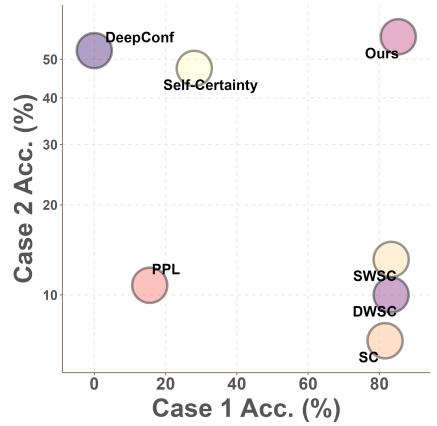  
(a) AIME24, 1.7B

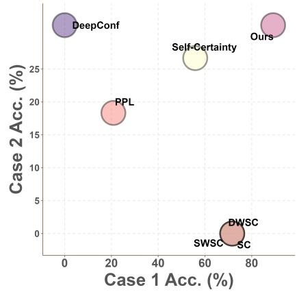  
(b) AIME24, 4B

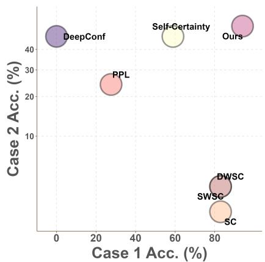  
(c) AIME24, 8B

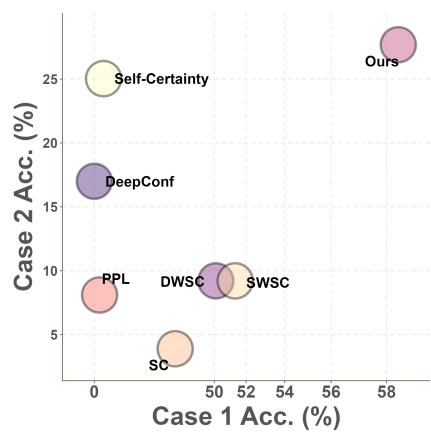  
(d) AIME25, 1.7B

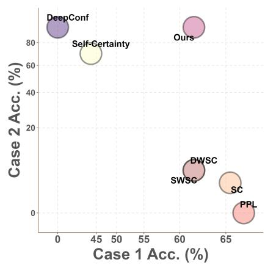  
(e) AIME25, 4B

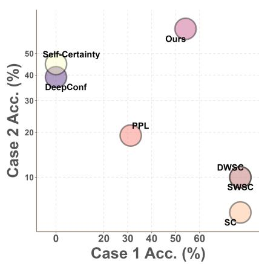  
(f) AIME25, 8B

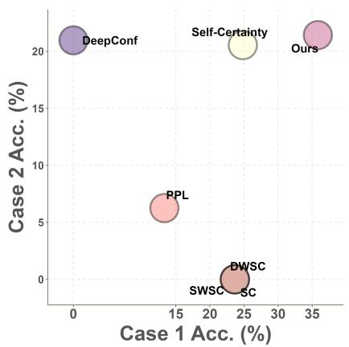  
(g) HMMT25, 1.7B

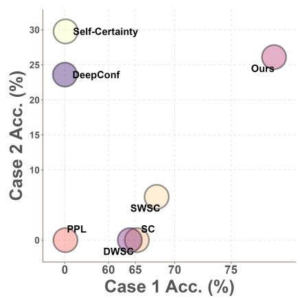  
(h) HMMT25, 4B

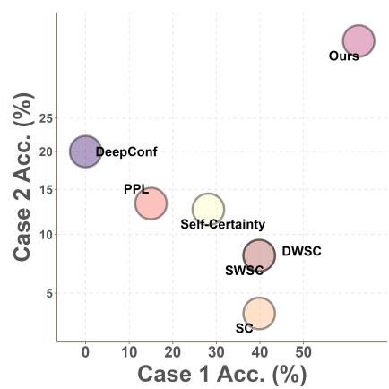  
(i) HMMT25, 8B  
Figure 10: Tradeoff between Case I and Case II on AIME24, AIME25, and HMMT25 using Qwen3-1.7B, Qwen3-4B, and Qwen3-8B. Ours denotes PGLA. DeepConf, PPL, and Self-Certainty denote DeepConf Best-of-N, PPL Best-of-N, and Self-Certainty Best-of-N, respectively. SWSC and DWSC denote Self-Certainty-Weighted SC and DeepConf-Weighted SC, respectively.

## Effect of Ranking Quality by Dataset

We study how the ranking quality of path scores affects PGLA. Following Sec. 2.1, let $a _ { i }$ and $p _ { i }$ be the answer and confidence of path i. Here $p _ { i }$ is the product-aggregated reward from Qwen2.5-Math-PRM-7B, floored at $1 0 ^ { - 8 }$ . We keep the sampled paths, answers, and PRM-Weighted SC support $\begin{array} { r } { s _ { a } ^ { \mathcal { V } } = \sum _ { i = 1 } ^ { K } p _ { i } \mathbf { 1 } ( a _ { i } = a ) } \end{array}$ fixed, where V denotes PRM-Weighted SC. Only the scores used for pairwise comparisons are perturbed; the opponent weights and unit-strength PGLA update remain unchanged.

Controlled perturbation. The retention parameter $\lambda \in \{ 0 , 0 . 2 , 0 . 4 , 0 . 6 , 0 . 8 , 1 \}$ controls how many path-score assignments are preserved. For each query, define

$$
m _ { \lambda } = { \mathrm { r o u n d } } ( ( 1 - \lambda ) K ) , \qquad { \widetilde p } _ { i } ^ { ( \lambda ) } = p _ { \sigma _ { \lambda } ( i ) } ,\tag{29}
$$

where round denotes nearest-integer rounding and $\sigma _ { \lambda }$ is a random cyclic permutation on $m _ { \lambda }$ uniformly selected distinct path indices, extended by the identity on the remaining indices. If $m _ { \lambda } < 2 , \sigma _ { \lambda }$ is the identity everywhere. Thus, $\lambda = 1$ preserves the original ranking, while $\lambda = 0$ permutes all score assignments within the query. This procedure preserves the score multiset and uses no correctness labels. Because of rounding and score ties, λ is a nominal retention fraction, rather than the exact fraction of unchanged score values.

Ranking quality. We measure ranking quality by the empirical area under the ROC curve (AUC) for distinguishing correct from incorrect paths. Let q index evaluated queries, and let $\widetilde { p } _ { q , i } ^ { ( \lambda ) }$ be the perturbed confidence of path i for query q. Define $\mathcal { T } _ { q } ^ { + }$ and $\mathcal { T } _ { q } ^ { - }$ as the index sets of paths whose answers are correct and incorrect, respectively. For a query containing both kinds of paths, its AUC is

$$
\widehat { \rho } _ { q } ( \lambda ) = \frac { 1 } { | \mathcal { Z } _ { q } ^ { + } | | \mathcal { Z } _ { q } ^ { - } | } \sum _ { i \in \mathcal { I } _ { q } ^ { + } } \sum _ { j \in \mathcal { I } _ { q } ^ { - } } \left[ \mathbf { 1 } \Big ( \widetilde { p } _ { q , i } ^ { ( \lambda ) } > \widetilde { p } _ { q , j } ^ { ( \lambda ) } \Big ) + \frac { 1 } { 2 } \mathbf { 1 } \Big ( \widetilde { p } _ { q , i } ^ { ( \lambda ) } = \widetilde { p } _ { q , j } ^ { ( \lambda ) } \Big ) \right] .\tag{30}
$$

This uses the same tie convention as Eq. (6): a correct path outranking an incorrect path contributes one, and a tie contributes one half. Let $\mathcal { Q } _ { \mathrm { m i x } }$ contain the queries for which both $\mathcal { T } _ { q } ^ { + }$ and $\mathcal { T } _ { q } ^ { - }$ are nonempty. The dataset-level AUC is their equally weighted average,

$$
\widehat { \rho } ( \lambda ) = \frac { 1 } { | \mathcal { Q } _ { \mathrm { m i x } } | } \sum _ { q \in \mathcal { Q } _ { \mathrm { m i x } } } \widehat { \rho } _ { q } ( \lambda ) .\tag{31}
$$

Queries containing only correct or only incorrect paths are excluded from this AUC but remain in the accuracy evaluation. The tables abbreviate $\widehat { \rho } ( \lambda )$ as ${ \widehat \rho } ;$ the model-level curves in Fig. 7 further average the dataset metrics equally.

The gains from PGLA generally grow as ranking quality improves across datasets. In Fig. 7, increasing $\widehat { \rho }$ from 0.496 to 0.729 on InternLM2-Math-Plus-7B raises the absolute accuracy gain from −0.54% to +2.17%. A similar trend appears on DeepSeek-Math-RL-7B in Tabs. 11, 13 and 15, supporting the benefit of more reliable pairwise confidence comparisons.

## Temperature Sensitivity

To further examine robustness under more diverse sampled reasoning paths, we conduct additional experiments on MathOdyssey and AIME using InternLM2-Math-Plus-1.8B, InternLM2-Math-Plus-7B, and DeepSeek-Math-RL-7B. Tab. 16 compares the methods under higher decoding temperatures with $T = 1 . 1$ and $T = 1 . 3$ . Our method remains competitive and generally outperforms the comparison methods, indicating that the proposed aggregation mechanism is still effective when the sampled proposal pool becomes more diverse.

## Efficiency Comparison

Tabs. 17 and 18 compare the sampling budgets of SC, SC + Ours, RPC, and RPC + Ours on MATH, MathOdyssey, and AIME, capped at 64 paths for MATH and 128 otherwise. For each model–dataset

Table 10: Controlled ranking on MATH with InternLM2- Math-Plus-7B (K = 64).  
Base Acc.: $5 8 . 6 7 { \scriptstyle \pm 0 . 1 0 }$
<table><tr><td> $\lambda$ </td><td> $\widehat { \rho }$ </td><td>PGLA Acc.</td><td>∆Acc</td></tr><tr><td>0.0</td><td> $0 . 4 9 6 { \scriptstyle \pm 0 . 0 0 3 }$ </td><td> $5 8 . 2 3 { \scriptstyle \pm 0 . 0 9 }$ </td><td> $- 0 . 4 5 _ { \pm 0 . 1 2 }$ </td></tr><tr><td>0.2</td><td> $0 . 5 5 7 { \scriptstyle \pm 0 . 0 0 2 }$ </td><td> $5 8 . 6 9 _ { \pm 0 . 1 6 }$ </td><td> $+ 0 . 0 1 _ { \pm 0 . 1 6 }$ </td></tr><tr><td>0.4</td><td> $0 . 6 1 7 _ { \pm 0 . 0 0 2 }$ </td><td> $5 9 . 2 3 _ { \pm 0 . 2 0 }$ </td><td> $+ 0 . 5 6 _ { \pm 0 . 1 9 }$ </td></tr><tr><td>0.6</td><td> $0 . 6 7 1 { \scriptstyle \pm 0 . 0 0 2 }$ </td><td> $5 9 . 6 1 { \scriptstyle \pm 0 . 0 7 }$ </td><td> $+ 0 . 9 4 _ { \pm 0 . 1 5 }$ </td></tr><tr><td>0.8</td><td> $0 . 7 3 2 _ { \pm 0 . 0 0 2 }$ </td><td> $6 0 . 0 5 { \scriptstyle \pm 0 . 2 0 }$ </td><td> $+ 1 . 3 7 _ { \pm 0 . 1 7 }$ </td></tr><tr><td>1.0</td><td> $0 . 7 9 1 _ { \pm 0 . 0 0 2 }$ </td><td> $6 0 . 4 0 _ { \pm 0 . 2 4 }$ </td><td> $+ { \bf 1 . 7 3 _ { \pm 0 . 1 8 } }$ </td></tr></table>

Table 12: Controlled ranking on MathOdyssey with InternLM2-Math-Plus-7B (K = 128).

Base Acc.: $3 4 . 3 4 { \scriptstyle \pm 0 . 5 8 }$
<table><tr><td> $\lambda$ </td><td> $\widehat { \rho }$ </td><td>PGLA Acc.</td><td>∆Acc</td></tr><tr><td>0.0</td><td> $0 . 4 9 9 _ { \pm 0 . 0 0 8 }$ </td><td> $3 3 . 6 0 _ { \pm 0 . 8 5 }$ </td><td> $- 0 . 7 5 _ { \pm 0 . 8 9 }$ </td></tr><tr><td>0.2</td><td> $0 . 5 3 8 { \scriptstyle \pm 0 . 0 0 8 }$ </td><td> $3 5 . 3 5 { \scriptstyle \pm 0 . 5 5 }$ </td><td> $+ 1 . 0 0 _ { \pm 0 . 7 2 }$ </td></tr><tr><td>0.4</td><td> $0 . 5 7 7 _ { \pm 0 . 0 1 0 }$ </td><td> $3 6 . 2 5 _ { \pm 0 . 4 6 }$ </td><td> $+ 1 . 9 0 _ { \pm 0 . 8 1 }$ </td></tr><tr><td>0.6</td><td> $0 . 6 1 5 _ { \pm 0 . 0 0 6 }$ </td><td> $3 7 . 5 6 _ { \pm 0 . 6 0 }$ </td><td> $+ 3 . 2 1 _ { \pm 0 . 4 5 }$ </td></tr><tr><td>0.8</td><td> $0 . 6 5 2 { \scriptstyle \pm 0 . 0 0 9 }$ </td><td> $3 8 . 1 7 _ { \pm 0 . 4 9 }$ </td><td> $+ 3 . 8 3 _ { \pm 0 . 8 2 }$ </td></tr><tr><td>1.0</td><td> $0 . 6 9 2 _ { \pm 0 . 0 0 8 }$ </td><td> $3 8 . 7 9 _ { \pm 0 . 6 2 }$ </td><td> $+ 4 . 4 5 _ { \pm 0 . 7 8 }$ </td></tr></table>

Table 14: Controlled ranking on AIME with InternLM2- Math-Plus-7B (K = 128).

Base Acc.: $1 6 . 2 3 _ { \pm 0 . 4 8 }$
<table><tr><td> $\lambda$ </td><td> $\widehat { \rho }$ </td><td>PGLA Acc.</td><td>∆Acc</td></tr><tr><td>0.0</td><td> $0 . 4 9 3 _ { \pm 0 . 0 1 1 }$ </td><td> $1 5 . 8 1 _ { \pm 0 . 3 2 }$ </td><td> $\cdot 0 . 4 2 _ { \pm 0 . 3 2 }$ </td></tr><tr><td>0.2</td><td> $0 . 5 4 2 _ { \pm 0 . 0 0 7 }$ </td><td> $1 6 . 0 8 _ { \pm 0 . 4 2 }$ </td><td> $\cdot 0 . 1 5 _ { \pm 0 . 3 8 }$ </td></tr><tr><td>0.4</td><td> $0 . 5 7 9 _ { \pm 0 . 0 1 1 }$ </td><td> $1 6 . 1 4 _ { \pm 0 . 5 3 }$ </td><td> $- 0 . 0 9 _ { \pm 0 . 4 4 }$ </td></tr><tr><td>0.6</td><td> $0 . 6 2 3 _ { \pm 0 . 0 1 0 }$ </td><td> $1 6 . 3 6 { \scriptstyle \pm 0 . 5 5 }$ </td><td> $+ 0 . 1 3 _ { \pm 0 . 5 1 }$ </td></tr><tr><td>0.8</td><td> $0 . 6 5 9 _ { \pm 0 . 0 1 0 }$ </td><td> $1 6 . 5 0 { \scriptstyle \pm 0 . 5 9 }$ </td><td> $+ 0 . 2 7 _ { \pm 0 . 3 8 }$ </td></tr><tr><td>1.0</td><td> $0 . 7 0 3 { \scriptstyle \pm 0 . 0 0 8 }$ </td><td> $\mathbf { 1 6 . 5 7 { \scriptstyle \pm 0 . 3 5 } }$ </td><td> $+ \mathbf { 0 . 3 4 } \pm \mathbf { 0 . 3 5 }$ </td></tr></table>

Table 11: Controlled ranking on MATH with DeepSeek-Math-RL-7B $( K = 6 4 )$  
Base Acc.: 62.04±0.20
<table><tr><td colspan="4">Base Acc.:  $6 2 . 0 4 { \scriptstyle \pm 0 . 2 0 }$ </td></tr><tr><td> $\lambda$ </td><td> $\widehat { \rho }$ </td><td>PGLA Acc.</td><td>∆Acc</td></tr><tr><td>0.0</td><td> $0 . 4 9 5 { \scriptstyle \pm 0 . 0 0 3 }$ </td><td> $6 1 . 5 3 { \scriptstyle \pm 0 . 1 8 }$ </td><td> $- 0 . 5 1 _ { \pm 0 . 2 3 }$ </td></tr><tr><td>0.2</td><td> $0 . 5 6 1 { \scriptstyle \pm 0 . 0 0 2 }$ </td><td> $6 1 . 8 3 _ { \pm 0 . 2 4 }$ </td><td> $- 0 . 2 2 _ { \pm 0 . 1 3 }$ </td></tr><tr><td>0.4</td><td> $0 . 6 2 7 _ { \pm 0 . 0 0 3 }$ </td><td> $6 2 . 0 3 _ { \pm 0 . 2 3 }$ </td><td> ${ \cdot 0 . 0 1 } _ { \pm 0 . 0 7 }$ </td></tr><tr><td>0.6</td><td> $0 . 6 8 8 { \scriptstyle \pm 0 . 0 0 3 }$ </td><td> $6 2 . 1 5 { \scriptstyle \pm 0 . 1 6 }$ </td><td> $+ 0 . 1 1 _ { \pm 0 . 2 0 }$ </td></tr><tr><td>0.8</td><td> $0 . 7 5 4 { \scriptstyle \pm 0 . 0 0 1 }$ </td><td> $6 2 . 3 2 _ { \pm 0 . 2 0 }$ </td><td> $+ 0 . 2 8 _ { \pm 0 . 2 3 }$ </td></tr><tr><td>1.0</td><td> $0 . 8 2 1 { \scriptstyle \pm 0 . 0 0 1 }$ </td><td> $6 2 . 4 1 _ { \pm 0 . 2 0 }$ </td><td> $+ 0 . 3 7 _ { \pm 0 . 1 9 }$ </td></tr></table>

Table 13: Controlled ranking on MathOdyssey with DeepSeek-Math-RL-7B (K = 128).

Base Acc.: $4 0 . 2 8 _ { \pm 0 . 5 3 }$
<table><tr><td> $\lambda$ </td><td> $\widehat { \rho }$ </td><td>PGLA Acc.</td><td>∆Acc</td></tr><tr><td>0.0</td><td> $0 . 4 9 7 _ { \pm 0 . 0 0 9 }$ </td><td> $4 0 . 0 0 { \scriptstyle \pm 0 . 5 3 }$ </td><td> $- 0 . 2 8 _ { \pm 0 . 5 2 }$ </td></tr><tr><td>0.2</td><td> $0 . 5 3 9 _ { \pm 0 . 0 1 0 }$ </td><td> $4 0 . 4 1 _ { \pm 0 . 4 7 }$ </td><td> $+ 0 . 1 3 _ { \pm 0 . 3 5 }$ </td></tr><tr><td>0.4</td><td> $0 . 5 6 4 _ { \pm 0 . 0 0 8 }$ </td><td> $4 0 . 3 3 _ { \pm 0 . 3 3 }$ </td><td>+0.05±0.54</td></tr><tr><td>0.6</td><td> $0 . 6 0 3 _ { \pm 0 . 0 0 7 }$ </td><td> $4 0 . 4 4 _ { \pm 0 . 7 5 }$ </td><td> $+ 0 . 1 5 _ { \pm 0 . 8 8 }$ </td></tr><tr><td>0.8</td><td> $0 . 6 3 4 { \scriptstyle \pm 0 . 0 0 6 }$ </td><td> $4 0 . 5 7 { \scriptstyle \pm 0 . 6 9 }$ </td><td> $+ 0 . 2 8 { \scriptstyle \pm 0 . 6 2 }$ </td></tr><tr><td>1.0</td><td> $0 . 6 7 0 { \scriptstyle \pm 0 . 0 0 5 }$ </td><td> $4 0 . 6 9 _ { \pm 0 . 5 3 }$ </td><td> $\mathbf { + 0 . 4 1 } _ { \pm 0 . 5 2 }$ </td></tr></table>

Table 15: Controlled ranking on AIME with DeepSeek-Math-RL-7B (K = 128).

Base Acc.: $1 6 . 9 3 _ { \pm 0 . 4 3 }$
<table><tr><td> $\lambda$ </td><td> $\widehat { \rho }$ </td><td>PGLA Acc.</td><td>∆Acc</td></tr><tr><td>0.0</td><td> $0 . 4 9 7 _ { \pm 0 . 0 0 8 }$ </td><td> $1 6 . 5 3 _ { \pm 0 . 4 2 }$ </td><td> $\cdot 0 . 4 1 _ { \pm 0 . 3 7 }$ </td></tr><tr><td>0.2</td><td> $0 . 5 4 7 _ { \pm 0 . 0 1 3 }$ </td><td> $1 6 . 6 8 _ { \pm 0 . 3 4 }$ </td><td> $0 . 2 6 _ { \pm 0 . 4 1 }$ </td></tr><tr><td>0.4</td><td> $0 . 5 9 0 { \scriptstyle \pm 0 . 0 0 8 }$ </td><td> $1 6 . 7 8 _ { \pm 0 . 5 7 }$ </td><td> $- 0 . 1 5 _ { \pm 0 . 3 8 }$ </td></tr><tr><td>0.6</td><td> $0 . 6 3 1 { \scriptstyle \pm 0 . 0 0 7 }$ </td><td> $1 6 . 8 7 { \scriptstyle \pm 0 . 6 0 }$ </td><td> $- 0 . 0 6 { \scriptstyle \pm 0 . 5 2 }$ </td></tr><tr><td>0.8</td><td> $0 . 6 7 5 { \scriptstyle \pm 0 . 0 1 0 }$ </td><td> $1 7 . 1 8 _ { \pm 0 . 6 1 }$ </td><td> $+ 0 . 2 5 _ { \pm 0 . 3 9 }$ </td></tr><tr><td>1.0</td><td> $0 . 7 2 0 { \scriptstyle \pm 0 . 0 0 7 }$ </td><td> ${ \bf 1 7 . 4 9 _ { \pm 0 . 5 7 } }$ </td><td> $+ 0 . 5 6 _ { \pm 0 . 4 2 }$ </td></tr></table>

<table><tr><td></td><td colspan="4">MathOdyssey</td><td colspan="4">AIME</td></tr><tr><td>Method</td><td colspan="2"> $T = 1 . 1$ </td><td colspan="2"> $T = 1 . 3$ </td><td colspan="2"> $T = 1 . 1$ </td><td colspan="2"> $T = 1 . 3$ </td></tr><tr><td></td><td>Acc. ↑</td><td>ECE↓</td><td>Acc. ↑</td><td>ECE↓</td><td>Acc. ↑</td><td>ECE↓</td><td>Acc. ↑</td><td>ECE↓</td></tr></table>

Table 16: Temperature sensitivity under the same internal-confidence protocol as Tab. 2. We vary only the decoding temperature; + Ours denotes the PGLA-enhanced variant of each voting baseline.

<table><tr><td></td><td>Acc. ↑</td><td>ECE↓</td><td>Acc. ↑</td><td>ECE↓</td><td>Acc. ↑</td><td>ECE↓</td><td>Acc. ↑</td><td>ECE↓</td></tr><tr><td colspan="9">InternLM2-Math-Plus-1.8B</td></tr><tr><td>PPL</td><td> $1 6 . 4 3 _ { \pm 0 . 9 1 }$ </td><td> $7 5 . 9 9 _ { \pm 0 . 8 9 }$ </td><td> $1 6 . 3 8 { \scriptstyle \pm 1 . 4 2 }$ </td><td> $7 1 . 7 2 _ { \pm 1 . 4 3 }$ </td><td> $1 . 9 7 _ { \pm 0 . 2 9 }$ </td><td> $9 0 . 2 9 _ { \pm 0 . 2 8 }$ </td><td> $2 . 0 8 _ { \pm 0 . 2 7 }$ </td><td> $8 4 . 8 5 { \scriptstyle \pm 0 . 2 7 }$ </td></tr><tr><td>SC</td><td> $1 3 . 7 5 _ { \pm 0 . 5 1 }$ </td><td> $1 8 . 0 2 _ { \pm 0 . 5 7 }$ </td><td> $1 4 . 9 5 _ { \pm 0 . 8 7 }$ </td><td> $5 . 1 5 _ { \pm 1 . 1 2 }$ </td><td> $2 . 1 2 _ { \pm 0 . 1 0 }$ </td><td> $1 6 . 5 2 _ { \pm 0 . 1 3 }$ </td><td> $1 . 2 6 _ { \pm 0 . 0 8 }$ </td><td> $8 . 8 0 { \scriptstyle \pm 0 . 1 2 }$ </td></tr><tr><td> $\mathbf { S } \mathbf { C } + \mathbf { O u r s }$ </td><td> ${ \bf 1 8 . 5 9 2 0 . 7 8 }$ </td><td> $1 2 . 7 5 { \scriptstyle \pm 0 . 7 5 }$ </td><td> $\mathbf { 1 9 . 2 3 { \scriptstyle \pm 0 . 7 6 } }$ </td><td> ${ 6 . 8 6 } _ { \pm 1 . 0 4 }$ </td><td> ${ \bf 3 . 1 1 _ { \pm 0 . 1 7 } }$ </td><td> $\mathbf { 1 4 . 7 8 _ { \pm 0 . 1 9 } }$ </td><td> ${ \bf 1 . 8 2 _ { \pm 0 . 1 7 } }$ </td><td> $\mathbf { 1 0 . 6 4 _ { \pm 0 . 1 6 } }$ </td></tr><tr><td>Weighted SC</td><td> $1 3 . 9 1 _ { \pm 0 . 5 4 }$ </td><td> $1 7 . 7 6 { \scriptstyle \pm 0 . 6 2 }$ </td><td> $1 5 . 6 8 _ { \pm 0 . 7 9 }$ </td><td> $9 . 4 1 _ { \pm 0 . 8 6 }$ </td><td> $2 . 1 4 _ { \pm 0 . 1 1 }$ </td><td> $1 6 . 2 8 \mathrm { \scriptstyle \pm 0 . 1 6 }$ </td><td> $1 . 5 8 _ { \pm 0 . 0 7 }$ </td><td> $1 2 . 6 5 _ { \pm 0 . 1 2 }$ </td></tr><tr><td>Weighted  $\mathbf { S } \mathbf { C } + \mathbf { O u r s }$ </td><td> ${ \bf 1 8 . 8 4 { _ { \pm 0 . 7 6 } } }$ </td><td> $1 2 . 2 5 { \scriptstyle \pm 0 . 7 9 }$ </td><td> ${ \bf 2 1 . 3 1 { \scriptstyle \pm 1 . 1 5 } }$ </td><td> ${ \bf 6 . 9 5 { \scriptstyle \pm 1 . 1 0 } }$ </td><td> ${ \bf 3 . 2 9 { \scriptstyle \pm 0 . 2 4 } }$ </td><td> ${ \bf 1 4 . 4 0 { _ { \pm 0 . 2 9 } } }$ </td><td> $\pm . 2 2 \pm \bf { 0 . 1 7 }$ </td><td> ${ \bf 1 } 3 . 8 0 _ { \pm 0 . 2 6 }$ </td></tr><tr><td>Adaptive SC</td><td> $1 3 . 8 1 _ { \pm 0 . 6 3 }$ </td><td> $2 2 . 3 0 { \scriptstyle \pm 0 . 9 6 }$ </td><td> $1 5 . 0 5 { \scriptstyle \pm 0 . 7 7 }$ </td><td> $6 . 5 6 { \scriptstyle \pm 0 . 8 5 }$ </td><td> $2 . 1 2 _ { \pm 0 . 1 0 }$ </td><td> $1 8 . 9 3 { \scriptstyle \pm 0 . 2 7 }$ </td><td> $1 . 2 6 { \scriptstyle \pm 0 . 0 8 }$ </td><td> $9 . 6 5 _ { \pm 0 . 1 2 }$ </td></tr><tr><td>Adaptive SC + Ours</td><td> ${ \bf 1 7 . 6 0 { \scriptstyle \pm 1 . 0 1 } }$ </td><td> $\mathbf { 1 7 . 0 5 _ { \pm 1 . 3 1 } }$ </td><td> $\mathbf { 1 8 . 4 6 { \scriptstyle \pm 0 . 9 0 } }$ </td><td> ${ \bf 8 . 0 2 _ { \pm 1 . 0 9 } }$ </td><td> ${ \bf 3 . 1 0 { \scriptstyle \pm 0 . 1 9 } }$ </td><td> ${ \bf 1 6 . 6 7 { \scriptstyle \pm 0 . 4 3 } }$ </td><td> ${ \bf 1 . 8 1 { \scriptstyle \pm 0 . 1 8 } }$ </td><td> $\mathbf { 1 1 . 6 2 { \scriptstyle \pm 0 . 2 6 } }$ </td></tr><tr><td>RPC</td><td> $1 5 . 5 3 { \scriptstyle \pm 0 . 5 4 }$ </td><td> $1 6 . 1 0 { \scriptstyle \pm 0 . 8 2 }$ </td><td> $1 6 . 0 7 _ { \pm 0 . 9 4 }$ </td><td> $1 1 . 4 1 _ { \pm 0 . 9 5 }$ </td><td> $2 . 8 0 { \scriptstyle \pm 0 . 1 8 }$ </td><td> $1 5 . 6 4 _ { \pm 0 . 1 5 }$ </td><td> $1 . 6 4 _ { \pm 0 . 1 4 }$ </td><td> $1 4 . 4 2 _ { \pm 0 . 2 1 }$ </td></tr><tr><td>RPC + Ours</td><td> ${ \bf 2 0 . 4 1 { \scriptstyle \pm 0 . 6 9 } }$ </td><td> ${ \bf 1 0 . 4 5 _ { \pm 0 . 7 1 } }$ </td><td> $2 1 . 8 3 { \scriptstyle \pm 0 . 9 6 }$ </td><td> $7 . 6 9 _ { \pm 1 . 2 4 }$ </td><td> ${ \bf 3 . 6 3 { \scriptstyle \pm 0 . 2 5 } }$ </td><td> ${ \bf 1 } 3 . 7 8 _ { \pm 0 . 2 6 }$ </td><td> $\pm . 3 3 _ { \pm 0 . 1 7 }$ </td><td> $\mathbf { 1 4 . 8 3 { \scriptstyle \pm 0 . 2 8 } }$ </td></tr></table>

<table><tr><td>PPL</td><td> $2 8 . 6 1 _ { \pm 1 . 3 3 }$ </td><td> $6 5 . 3 1 _ { \pm 1 . 3 3 }$ </td><td> $2 6 . 3 8 { \scriptstyle \pm 1 . 4 1 }$ </td><td> $6 5 . 6 1 _ { \pm 1 . 4 1 }$ </td><td> $6 . 0 2 _ { \pm 0 . 3 4 }$ </td><td> $8 7 . 6 7 { \scriptstyle \pm 0 . 3 5 }$ </td><td> $6 . 5 0 { \scriptstyle \pm 0 . 4 1 }$ </td><td> $8 4 . 6 6 _ { \pm 0 . 4 0 }$ </td></tr><tr><td>SC</td><td> $2 7 . 8 9 _ { \pm 0 . 4 3 }$ </td><td> $1 1 . 3 1 _ { \pm 0 . 5 2 }$ </td><td> $2 7 . 5 1 _ { \pm 0 . 6 9 }$ </td><td> $9 . 3 8 _ { \pm 1 . 1 4 }$ </td><td> $8 . 7 3 _ { \pm 0 . 2 4 }$ </td><td> $1 3 . 7 1 _ { \pm 0 . 2 5 }$ </td><td> $8 . 0 2 _ { \pm 0 . 2 0 }$ </td><td> $1 2 . 0 2 _ { \pm 0 . 2 4 }$ </td></tr><tr><td> $\mathbf { S } \mathbf { C } + \mathbf { O u r s }$ </td><td> $3 5 . 8 4 _ { \pm 0 . 8 4 }$ </td><td> ${ \bf 9 . 0 7 { \scriptstyle \pm 0 . 9 0 } }$ </td><td> $3 6 . 3 5 { \scriptstyle \pm 0 . 5 0 }$ </td><td> $\mathbf { 8 . 8 2 _ { \pm 0 . 7 5 } }$ </td><td> ${ \bf 9 . 6 1 _ { \pm 0 . 1 5 } }$ </td><td> $\mathbf { 1 3 . 0 8 _ { \pm 0 . 1 5 } }$ </td><td> ${ \bf 9 . 0 9 _ { \pm 0 . 2 6 } }$ </td><td> ${ \bf 1 1 . 2 3 _ { \pm 0 . 3 1 } }$ </td></tr><tr><td>Weighted SC</td><td> $2 8 . 3 8 _ { \pm 0 . 3 3 }$ </td><td> $1 0 . 7 7 _ { \pm 0 . 4 5 }$ </td><td> $2 8 . 7 1 _ { \pm 0 . 6 0 }$ </td><td> $8 . 1 1 _ { \pm 0 . 8 5 }$ </td><td> $8 . 8 9 _ { \pm 0 . 2 2 }$ </td><td> $1 3 . 5 3 _ { \pm 0 . 2 3 }$ </td><td> $8 . 4 0 { \scriptstyle \pm 0 . 2 5 }$ </td><td> $1 1 . 5 2 _ { \pm 0 . 2 8 }$ </td></tr><tr><td>Weighted SC + Ours</td><td> ${ \bf 3 6 . 0 7 { \scriptstyle \pm 0 . 8 6 } }$ </td><td> ${ \bf 9 . 2 0 { \scriptstyle \pm 0 . 8 4 } }$ </td><td> ${ \bf 3 6 . 7 9 2 0 . 5 3 }$ </td><td> ${ \bf 8 . 8 5 { \scriptstyle \pm 0 . 9 4 } }$ </td><td> $\pm \mathbf { 0 . 7 5 { \scriptstyle \pm 0 . 2 3 } }$ </td><td> $1 2 . 8 3 { \scriptstyle \pm 0 . 2 4 }$ </td><td> $\pm \mathbf { 0 . } 3 2 \pm \mathbf { 0 . } 2 8$ </td><td> ${ \bf 1 0 . 9 0 { \scriptstyle \pm 0 . 2 9 } }$ </td></tr><tr><td>Adaptive SC</td><td> $2 7 . 9 2 _ { \pm 0 . 6 1 }$ </td><td> $1 6 . 9 6 { \scriptstyle \pm 0 . 7 7 }$ </td><td> $2 7 . 7 5 { \scriptstyle \pm 0 . 6 5 }$ </td><td> $1 3 . 2 7 { \scriptstyle \pm 0 . 8 0 }$ </td><td> $8 . 7 1 { \scriptstyle \pm 0 . 2 5 }$ </td><td> $1 6 . 6 1 _ { \pm 0 . 4 6 }$ </td><td> $8 . 0 0 { \scriptstyle \pm 0 . 1 6 }$ </td><td> $1 4 . 5 1 { \scriptstyle \pm 0 . 2 6 }$ </td></tr><tr><td>Adaptive SC + Ours</td><td> ${ 3 4 . 0 0 } _ { \pm 0 . 9 9 }$ </td><td> $1 2 . 3 5 _ { \pm 0 . 8 2 }$ </td><td> $3 4 . 2 4 _ { \pm 0 . 8 3 }$ </td><td> ${ \bf 1 0 . 0 2 _ { \pm 0 . 9 8 } }$ </td><td> ${ \bf 9 . 4 3 _ { \pm 0 . 3 2 } }$ </td><td> $\mathbf { 1 5 . 6 2 _ { \pm 0 . 4 8 } }$ </td><td> ${ \bf 9 . 1 1 _ { \pm 0 . 2 1 } }$ </td><td> ${ \bf 1 3 . 1 1 { _ { \pm 0 . 4 1 } } }$ </td></tr><tr><td>RPC</td><td> $3 2 . 9 3 _ { \pm 0 . 6 4 }$ </td><td> $8 . 0 5 _ { \pm 0 . 9 2 }$ </td><td> $3 3 . 0 1 _ { \pm 0 . 5 0 }$ </td><td> $5 . 9 7 _ { \pm 0 . 9 6 }$ </td><td> $9 . 3 1 _ { \pm 0 . 2 8 }$ </td><td> $1 3 . 5 2 _ { \pm 0 . 2 5 }$ </td><td> $8 . 8 3 _ { \pm 0 . 2 3 }$ </td><td> $1 1 . 4 0 _ { \pm 0 . 2 8 }$ </td></tr><tr><td>RPC + Ours</td><td> ${ \bf 3 6 . 9 9 2 . 1 . 0 7 }$ </td><td> ${ \bf 8 . 3 8 _ { \pm 1 . 2 6 } }$ </td><td> ${ \bf 3 8 . 0 2 { \scriptstyle \pm 0 . 6 8 } }$ </td><td> ${ \bf 7 . 9 7 { \scriptstyle \pm 0 . 9 1 } }$ </td><td> $\mathbf { 1 0 . 1 3 { \scriptstyle \pm 0 . 3 8 } }$ </td><td> ${ \bf 1 2 . 1 7 { \scriptstyle \pm 0 . 4 0 } }$ </td><td> ${ \bf 9 . 3 0 { \scriptstyle \pm 0 . 2 2 } }$ </td><td> $\mathbf { 1 0 . 8 8 _ { \pm 0 . 2 6 } }$ </td></tr></table>

## Deepseek-Math-RL-7B

<table><tr><td>PPL</td><td> $2 4 . 7 8 _ { \pm 1 . 1 5 }$ </td><td> $7 0 . 8 5 _ { \pm 1 . 1 8 }$ </td><td> $2 5 . 7 6 { \scriptstyle \pm 1 . 2 6 }$ </td><td> $6 8 . 3 9 _ { \pm 1 . 2 9 }$ </td><td> $3 . 9 4 _ { \pm 0 . 3 7 }$ </td><td> $9 2 . 1 7 _ { \pm 0 . 3 7 }$ </td><td> $4 . 3 9 _ { \pm 0 . 3 3 }$ </td><td> $9 0 . 3 3 _ { \pm 0 . 3 4 }$ </td></tr><tr><td>SC</td><td> $3 6 . 7 6 { \scriptstyle \pm 0 . 3 9 }$ </td><td> $9 . 4 6 _ { \pm 0 . 8 1 }$ </td><td> $3 7 . 7 5 _ { \pm 0 . 2 5 }$ </td><td> $8 . 7 8 _ { \pm 1 . 1 6 }$ </td><td> $8 . 9 5 _ { \pm 0 . 2 6 }$ </td><td> $1 1 . 9 5 _ { \pm 0 . 3 4 }$ </td><td> $9 . 3 9 _ { \pm 0 . 2 4 }$ </td><td> $1 0 . 2 3 _ { \pm 0 . 2 6 }$ </td></tr><tr><td> $\mathbf { S } \mathbf { C } + \mathbf { O u r s }$ </td><td> $3 7 . 2 2 { \scriptstyle \pm 0 . 5 5 }$ </td><td> ${ \bf 1 1 . 0 3 _ { \pm 1 . 1 1 } }$ </td><td> $3 8 . 5 5 { \scriptstyle \pm 0 . 6 1 }$ </td><td> ${ \bf 9 . 0 1 { \scriptstyle \pm 0 . 7 0 } }$ </td><td> ${ \bf 9 . 3 9 { \scriptstyle \pm 0 . 3 0 } }$ </td><td> ${ \bf 1 1 . 0 1 { _ { \pm 0 . 3 4 } } }$ </td><td> ${ \bf 1 0 . 1 5 { \scriptstyle \pm 0 . 3 3 } }$ </td><td> ${ \bf 9 . 5 7 \pm 0 . 3 6 }$ </td></tr><tr><td>Weighted SC</td><td> $3 6 . 8 4 _ { \pm 0 . 4 5 }$ </td><td> $9 . 4 0 _ { \pm 0 . 8 1 }$ </td><td> $3 7 . 7 6 _ { \pm 0 . 3 9 }$ </td><td> $8 . 9 1 _ { \pm 0 . 8 6 }$ </td><td> $9 . 0 4 _ { \pm 0 . 2 9 }$ </td><td> $1 1 . 8 6 _ { \pm 0 . 3 8 }$ </td><td> $9 . 4 2 _ { \pm 0 . 2 4 }$ </td><td> $1 0 . 2 4 _ { \pm 0 . 2 4 }$ </td></tr><tr><td>Weighted SC + Ours</td><td> $\mathbf { 3 7 . 1 7 { \scriptstyle \pm 0 . 6 0 } }$ </td><td> ${ \bf 1 1 . } 2 2 _ { \pm 1 . 2 3 }$ </td><td> $3 8 . 5 6 { \scriptstyle \pm 0 . 6 3 }$ </td><td> ${ \bf 9 . 1 4 { \scriptstyle \pm 0 . 8 8 } }$ </td><td> ${ \bf 9 . 4 1 { \scriptstyle \pm 0 . 3 3 } }$ </td><td> ${ \bf 1 0 . 9 3 { \scriptstyle \pm 0 . 3 7 } }$ </td><td> ${ \bf 1 0 . 1 9 { \scriptstyle \pm 0 . 3 1 } }$ </td><td> ${ \bf 9 . 4 6 _ { \pm 0 . 3 4 } }$ </td></tr><tr><td>Adaptive SC</td><td> $3 6 . 6 2 _ { \pm 0 . 3 5 }$ </td><td> $1 2 . 7 1 _ { \pm 1 . 3 0 }$ </td><td> $3 7 . 6 3 _ { \pm 0 . 4 2 }$ </td><td> $1 1 . 2 3 _ { \pm 1 . 2 2 }$ </td><td> $8 . 9 3 _ { \pm 0 . 2 9 }$ </td><td> $1 4 . 2 3 _ { \pm 0 . 4 2 }$ </td><td> $9 . 4 0 _ { \pm 0 . 2 4 }$ </td><td> $1 2 . 7 2 _ { \pm 0 . 3 6 }$ </td></tr><tr><td>Adaptive SC + Ours</td><td> $3 5 . 9 4 _ { \pm 0 . 3 8 }$ </td><td> $\pm 2 . 3 3 _ { \pm 0 . 8 4 }$ </td><td> $3 7 . 0 3 _ { \pm 0 . 9 6 }$ </td><td> ${ \bf 1 1 . 3 0 _ { \pm 1 . 8 9 } }$ </td><td> ${ \bf 9 . 2 6 _ { \pm 0 . 3 6 } }$ </td><td> ${ \bf 1 } 3 . 0 9 _ { \pm 0 . 5 5 }$ </td><td> ${ \bf 9 . 8 9 _ { \pm 0 . 3 4 } }$ </td><td> ${ \bf 1 1 . 9 5 { \scriptstyle \pm 0 . 3 3 } }$ </td></tr><tr><td>RPC</td><td> $3 6 . 9 2 _ { \pm 0 . 4 0 }$ </td><td> $1 0 . 1 9 _ { \pm 0 . 6 0 }$ </td><td> $3 8 . 2 5 _ { \pm 0 . 4 7 }$ </td><td> $8 . 9 6 _ { \pm 0 . 8 1 }$ </td><td> $9 . 0 9 _ { \pm 0 . 3 4 }$ </td><td> $1 1 . 8 1 _ { \pm 0 . 4 0 }$ </td><td> $1 0 . 0 4 _ { \pm 0 . 3 9 }$ </td><td> $1 0 . 3 5 _ { \pm 0 . 4 4 }$ </td></tr><tr><td> $\mathbf { R P C } + \mathbf { O u r s }$ </td><td> $3 7 . 2 2 _ { \pm 0 . 4 3 }$ </td><td> ${ \bf 1 1 . 6 3 _ { \pm 1 . 4 5 } }$ </td><td> ${ \bf 3 8 . 9 5 { \scriptstyle \pm 0 . 8 2 } }$ </td><td> ${ \bf 8 . 8 2 _ { \pm 1 . 0 6 } }$ </td><td> ${ \bf 9 . 3 5 { \scriptstyle \pm 0 . 2 9 } }$ </td><td> ${ \bf 1 0 . 4 7 { \scriptstyle \pm 0 . 3 1 } }$ </td><td> ${ \bf 1 0 . } 3 2 _ { \pm 0 . 2 6 }$ </td><td> $\pm \mathbf { 0 . 8 2 _ { \pm 0 . 3 0 } }$ </td></tr></table>

Table 17: Post-hoc sampling-budget comparison for InternLM2-Math-Plus-1.8B. Best of SC gives its highest grid mean and smallest attaining K. Alternatives use the minimum K matching or exceeding this unrounded target. ∆ gives absolute accuracy change (%) and sample-count change (%) relative to SC.
<table><tr><td>Method</td><td colspan="2">MATH</td><td colspan="2">MathOdyssey</td><td colspan="2">AIME</td></tr><tr><td></td><td>Acc.</td><td>K</td><td>Acc.</td><td>K</td><td>Acc.</td><td>K</td></tr><tr><td>Best of SC</td><td> $3 6 . 4 8 \pm 0 . 1 4$ </td><td>64</td><td> $1 4 . 9 1 \pm 0 . 9 5$ </td><td>48</td><td> $2 . 6 7 \pm 0 . 2 1$ </td><td>112</td></tr><tr><td>SC + Ours Δ vs. SC</td><td> $3 7 . 7 6 \pm 0 . 3 4$  +1.27</td><td>16 -75.0%</td><td> $1 6 . 5 3 \pm 0 . 9 2$  +1.62</td><td>8 -83.3%</td><td> $2 . 7 6 \pm 0 . 3 4$  +0.09</td><td>32 -71.4%</td></tr><tr><td>RPC Δ vs. SC</td><td> $3 7 . 0 9 \pm 0 . 2 0$  +0.61</td><td>32 -50.0%</td><td> $1 5 . 3 7 \pm 1 . 4 5$  +0.46</td><td>8 -83.3%</td><td> $2 . 7 1 \pm 0 . 3 9$  +0.04</td><td>32 -71.4%</td></tr><tr><td> $\mathrm { R P C } + \mathrm { O u r s }$ </td><td> $3 7 . 6 7 \pm 0 . 3 6$ </td><td>16</td><td> $1 6 . 2 0 \pm 0 . 8 2$ </td><td>8</td><td> $2 . 8 6 \pm 0 . 3 6$ </td><td>40</td></tr></table>

Table 18: Post-hoc sampling-budget comparison for DeepSeek-Math-RL-7B. Best of SC gives its highest grid mean and smallest attaining K. Alternatives use the minimum K matching or exceeding this unrounded target. ∆ gives absolute accuracy change (%) and sample-count change (%) relative to SC.
<table><tr><td>Method</td><td colspan="2">MATH</td><td colspan="2">MathOdyssey</td><td colspan="2">AIME</td></tr><tr><td></td><td>Acc.</td><td>K</td><td>Acc.</td><td>K</td><td>Acc.</td><td>K</td></tr><tr><td>Best of SC</td><td> $5 3 . 3 3 \pm 0 . 0 8$ </td><td>64</td><td> $3 6 . 5 7 \pm 0 . 5 6$ </td><td>128</td><td> $9 . 5 6 \pm 0 . 2 4$ </td><td>96</td></tr><tr><td>SC + Ours ∆ vs. SC</td><td> $5 3 . 5 2 \pm 0 . 1 0$  +0.19</td><td>64 0.0%</td><td> $3 6 . 7 6 \pm 1 . 0 0$  +0.19</td><td>40 -68.8%</td><td> $9 . 8 0 \pm 0 . 3 7$  +0.23</td><td>64 -33.3%</td></tr><tr><td>RPC ∆vs. SC</td><td> $5 3 . 3 6 \pm 0 . 1 1$  +0.03</td><td>64 0.0%</td><td> $3 6 . 8 6 \pm 0 . 5 7$  +0.29</td><td>112 -12.5%</td><td>-</td><td>1</td></tr><tr><td>RPC + Ours</td><td> $5 3 . 5 2 \pm 0 . 1 1$ </td><td>64</td><td> $3 6 . 5 8 \pm 0 . 9 5$ </td><td>40</td><td>-  $9 . 7 0 \pm 0 . 3 0$ </td><td>- 64</td></tr><tr><td> $\Delta { \mathrm { v s . } } { \mathrm { S C } }$ </td><td>+0.19</td><td>0.0%</td><td>+0.01</td><td>-68.8%</td><td>+0.14</td><td>-33.3%</td></tr></table>

setting, the target is the best mean accuracy attained by SC on the evaluated grid. We then find the smallest grid budget at which each other method matches or exceeds that target. The reported savings describe empirical accuracy–budget tradeoffs.

Tabs. 17 and 18 show that PGLA-enhanced SC and RPC generally reach SC’s best observed accuracy with fewer sampled paths. The savings are larger on InternLM2-Math-Plus-1.8B, while DeepSeek-Math-RL-7B also benefits on MathOdyssey and AIME. These results suggest that pairwise evidence improves the tradeoff between accuracy and sampling budget.

The computational cost of the additional aggregation step is analyzed separately in Sec. G.12.

## Complete Scaling Results with Varying K

Tabs. 19 and 20 report the complete current-method curves for InternLM2-Math-Plus-1.8B and InternLM2- Math-Plus-7B. We use $K \in \{ 1 , 2 , 4 , 8 , 1 6 , 3 2 , 4 0 , 4 8 , 6 4 , 8 0 , 9 6 , 1 1 2 , 1 2 8 \}$ , capped at 64 for MATH and 128 for MathOdyssey and AIME by the evaluation protocol. All methods use the same candidate subsets at each budgets. Here + Ours denotes PGLA with the voting-weighted comparative advantage $s _ { u } ^ { \mathrm { P a i r } }$ in Eq. (7).

Tabs. 19 and 20 show that PGLA generally improves SC and RPC across sampling budgets. The gains become clearer at moderate and large $K ,$ especially on MATH and MathOdyssey, indicating that pairwise evidence helps make better use of additional reasoning paths.

MathOdyssey  
Table 19: Accuracy across sampling budgets for InternLM2-Math-Plus-1.8B on MATH, MathOdyssey, and AIME.
<table><tr><td colspan="6">MATH</td></tr><tr><td>K</td><td>PPL</td><td>SC</td><td> $\mathbf { S } \mathbf { C } + \mathbf { O u r s }$ </td><td>RPC</td><td> $\mathbf { R P C } + \mathbf { O u r s }$ </td></tr><tr><td>1</td><td> $2 6 . 9 4 \pm 0 . 4 9$ </td><td> $2 6 . 9 4 \pm 0 . 4 9$ </td><td> $2 6 . 9 4 \pm 0 . 4 9$ </td><td> $2 6 . 9 4 \pm 0 . 4 9$ </td><td> $2 6 . 9 4 \pm 0 . 4 9$ </td></tr><tr><td>2</td><td> $2 9 . 6 2 \pm 0 . 4 7$ </td><td> $2 7 . 1 3 \pm 0 . 4 4$ </td><td> $2 9 . 6 2 \pm 0 . 4 7$ </td><td> $2 9 . 6 2 \pm 0 . 4 7$ </td><td> $2 9 . 6 2 \pm 0 . 4 7$ </td></tr><tr><td>4</td><td> $3 1 . 3 2 \pm 0 . 4 4$ </td><td> $3 1 . 0 1 \pm 0 . 3 6$ </td><td> $3 1 . 3 2 \pm 0 . 4 2$ </td><td> $3 2 . 3 6 \pm 0 . 4 1$ </td><td> $3 1 . 3 0 \pm 0 . 4 2$ </td></tr><tr><td>8</td><td> $3 2 . 5 3 \pm 0 . 4 2$ </td><td> $3 3 . 9 3 \pm 0 . 2 6$ </td><td> $3 4 . 8 1 \pm 0 . 4 6$ </td><td> $3 4 . 7 8 \pm 0 . 3 2$ </td><td> $3 4 . 3 4 \pm 0 . 4 7$ </td></tr><tr><td>16</td><td> $3 3 . 1 5 \pm 0 . 4 2$ </td><td> $3 5 . 4 9 \pm 0 . 2 8$ </td><td> $3 7 . 7 6 \pm 0 . 3 4$ </td><td> $3 6 . 0 8 \pm 0 . 3 0$ </td><td> $3 7 . 6 7 \pm 0 . 3 6$ </td></tr><tr><td>32</td><td> $3 3 . 5 8 \pm 0 . 2 2$ </td><td> $3 6 . 2 7 \pm 0 . 2 2$ </td><td> $3 9 . 0 4 \pm 0 . 2 8$ </td><td> $3 7 . 0 9 \pm 0 . 2 0$ </td><td> ${ \bf 3 9 . 1 3 \pm 0 . 3 8 }$ </td></tr><tr><td>40</td><td> $3 3 . 4 3 \pm 0 . 2 2$ </td><td> $3 6 . 3 4 \pm 0 . 1 2$ </td><td> $3 9 . 3 5 \pm 0 . 2 5$ </td><td> $3 7 . 4 0 \pm 0 . 2 0$ </td><td> ${ \bf 3 9 . 5 0 \pm 0 . 3 3 }$ </td></tr><tr><td>48</td><td> $3 3 . 3 9 \pm 0 . 2 8$ </td><td> $3 6 . 3 7 \pm 0 . 1 9$ </td><td> $3 9 . 5 3 \pm 0 . 2 4$ </td><td> $3 7 . 5 4 \pm 0 . 2 1$ </td><td> $3 9 . 9 9 \pm 0 . 2 8$ </td></tr><tr><td>64</td><td> $3 3 . 2 3 \pm 0 . 2 5$ </td><td> $3 6 . 4 8 \pm 0 . 1 4$ </td><td> $3 9 . 7 7 \pm 0 . 1 7$ </td><td> $3 7 . 8 7 \pm 0 . 1 4$ </td><td> ${ \bf 4 0 . 2 9 \pm 0 . 2 7 }$ </td></tr></table>

<table><tr><td>K</td><td>PPL</td><td>SC</td><td> $\mathbf { S } \mathbf { C } + \mathbf { O u r s }$ </td><td>RPC</td><td> $\mathbf { R P C } + \mathbf { O u r s }$ </td></tr><tr><td>1</td><td> ${ \bf 1 1 . 4 1 \pm 1 . 2 3 }$ </td><td> ${ \bf 1 1 . 4 1 \pm 1 . 2 3 }$ </td><td> ${ \bf 1 1 . 4 1 \pm 1 . 2 3 }$ </td><td> ${ \bf 1 1 . 4 1 \pm 1 . 2 3 }$ </td><td> ${ \bf 1 1 . 4 1 \pm 1 . 2 3 }$ </td></tr><tr><td>2</td><td> ${ \bf 1 } 3 . 2 6 \pm 1 . 8 7$ </td><td> $1 1 . 4 7 \pm 1 . 0 4$ </td><td> ${ \bf 1 } 3 . 2 6 \pm 1 . 8 7$ </td><td> ${ \bf 1 } 3 . 2 6 \pm 1 . 8 7$ </td><td> ${ \bf 1 } 3 . 2 6 \pm 1 . 8 7$ </td></tr><tr><td>4</td><td> $1 3 . 9 1 \pm 1 . 5 2$ </td><td> $1 3 . 2 1 \pm 1 . 5 4$ </td><td> $1 3 . 9 8 \pm 1 . 5 3$ </td><td> $1 3 . 9 1 \pm 1 . 5 7$ </td><td> ${ \bf 1 4 . 0 4 } \pm 1 . 5 3$ </td></tr><tr><td>8</td><td> $1 4 . 7 6 \pm 1 . 2 6$ </td><td> $1 4 . 4 3 \pm 0 . 9 3$ </td><td> ${ \bf 1 6 . 5 3 \pm 0 . 9 2 }$ </td><td> $1 5 . 3 7 \pm 1 . 4 5$ </td><td> $1 6 . 2 0 \pm 0 . 8 2$ </td></tr><tr><td>16</td><td> $1 5 . 3 5 \pm 1 . 2 9$ </td><td> $1 4 . 8 4 \pm 0 . 6 5$ </td><td> ${ \bf 1 7 . 7 1 \pm 1 . 0 8 }$ </td><td> $1 5 . 3 0 \pm 0 . 8 9$ </td><td> $1 7 . 5 1 \pm 1 . 1 1$ </td></tr><tr><td>32</td><td> $1 5 . 9 4 \pm 1 . 6 9$ </td><td> $1 4 . 5 2 \pm 1 . 0 5$ </td><td> $1 8 . 2 5 \pm 0 . 9 3$ </td><td> $1 5 . 4 5 \pm 1 . 0 1$ </td><td> ${ \bf 1 8 . 6 4 } \pm 1 . 0 5$ </td></tr><tr><td>40</td><td> $1 6 . 3 8 \pm 0 . 7 6$ </td><td> $1 4 . 7 0 \pm 0 . 9 2$ </td><td> $1 8 . 1 1 \pm 0 . 5 6$ </td><td> $1 5 . 6 8 \pm 1 . 0 7$ </td><td> ${ \bf 1 8 . 5 9 \pm 1 . 4 4 }$ </td></tr><tr><td>48</td><td> $1 6 . 0 9 \pm 0 . 6 4$ </td><td> $1 4 . 9 1 \pm 0 . 9 5$ </td><td> $1 8 . 3 3 \pm 0 . 9 2$ </td><td> $1 5 . 9 9 \pm 1 . 0 9$ </td><td> ${ \bf 1 9 . 4 1 \pm 1 . 2 8 }$ </td></tr><tr><td>64</td><td> $1 6 . 7 1 \pm 1 . 1 2$ </td><td> $1 4 . 7 6 \pm 0 . 9 0$ </td><td> $1 8 . 4 1 \pm 0 . 6 9$ </td><td> $1 6 . 2 2 \pm 0 . 8 2$ </td><td> ${ \bf 1 9 . 6 4 \pm 0 . 9 1 }$ </td></tr><tr><td>80</td><td> $1 6 . 3 5 \pm 1 . 3 5$ </td><td> $1 4 . 3 8 \pm 0 . 8 4$ </td><td> $1 8 . 4 8 \pm 0 . 8 1$ </td><td> $1 5 . 8 9 \pm 0 . 5 2$ </td><td> ${ \bf 1 9 . 9 2 \pm 0 . 8 7 }$ </td></tr><tr><td>96</td><td> $1 6 . 3 5 \pm 1 . 0 8$ </td><td> $1 4 . 4 0 \pm 0 . 7 6$ </td><td> $1 8 . 2 3 \pm 0 . 6 0$ </td><td> $1 6 . 0 2 \pm 0 . 6 1$ </td><td> ${ \bf 1 9 . 6 1 \pm 0 . 7 4 }$ </td></tr><tr><td>112</td><td> $1 6 . 5 8 \pm 1 . 1 0$ </td><td> $1 4 . 6 9 \pm 0 . 8 5$ </td><td> $1 8 . 4 1 \pm 0 . 6 7$ </td><td> $1 6 . 3 2 \pm 0 . 4 0$ </td><td> $2 0 . 3 6 \pm 0 . 6 1$ </td></tr><tr><td>128</td><td> $1 6 . 6 3 \pm 0 . 8 3$ </td><td> $1 4 . 5 7 \pm 0 . 4 5$ </td><td> $1 8 . 2 8 \pm 0 . 5 6$ </td><td> $1 6 . 4 3 \pm 0 . 6 0$ </td><td> $2 0 . 2 8 \pm 0 . 4 8$ </td></tr></table>

<table><tr><td>K</td><td>PPL</td><td>SC</td><td> $\mathbf { S } \mathbf { C } + \mathbf { O u r s }$ </td><td>RPC</td><td> $\mathbf { R P C } + \mathbf { O u r s }$ </td></tr><tr><td>1</td><td> ${ \bf 1 . 5 0 \pm 0 . 3 7 }$ </td><td> ${ \bf 1 . 5 0 \pm 0 . 3 7 }$ </td><td> ${ \bf 1 . 5 0 \pm 0 . 3 7 }$ </td><td> ${ \bf 1 . 5 0 \pm 0 . 3 7 }$ </td><td> ${ \bf 1 . 5 0 \pm 0 . 3 7 }$ </td></tr><tr><td>2</td><td> ${ \bf 1 . } 5 6 \pm 0 . 2 8$ </td><td> $1 . 4 1 \pm 0 . 2 0$ </td><td> ${ \bf 1 . } 5 6 \pm 0 . 2 8$ </td><td> ${ \bf 1 . } 5 6 \pm 0 . 2 8$ </td><td> ${ \bf 1 . 5 6 \pm 0 . 2 8 }$ </td></tr><tr><td>4</td><td> $1 . 7 0 \pm 0 . 3 5$ </td><td> $1 . 6 8 \pm 0 . 2 4$ </td><td> $1 . 7 0 \pm 0 . 3 6$ </td><td> ${ \bf 1 . 7 7 \pm 0 . 3 9 }$ </td><td> $1 . 6 9 \pm 0 . 3 6$ </td></tr><tr><td>8</td><td> $1 . 7 8 \pm 0 . 2 7$ </td><td> $2 . 0 1 \pm 0 . 3 5$ </td><td> $1 . 9 9 \pm 0 . 3 9$ </td><td> $2 . 1 4 \pm 0 . 5 1$ </td><td> $1 . 9 2 \pm 0 . 3 2$ </td></tr><tr><td>16</td><td> $1 . 8 8 \pm 0 . 3 0$ </td><td> $2 . 3 3 \pm 0 . 2 6$ </td><td> $2 . 4 5 \pm 0 . 3 4$ </td><td> $2 . 3 7 \pm 0 . 3 6$ </td><td> $2 . 3 7 \pm 0 . 3 5$ </td></tr><tr><td>32</td><td> $1 . 6 4 \pm 0 . 2 4$ </td><td> $2 . 4 0 \pm 0 . 2 9$ </td><td> $2 . 7 6 \pm 0 . 3 4$ </td><td> $2 . 7 1 \pm 0 . 3 9$ </td><td> $2 . 6 4 \pm 0 . 3 1$ </td></tr><tr><td>40</td><td> $1 . 7 5 \pm 0 . 2 8$ </td><td> $2 . 4 6 \pm 0 . 2 9$ </td><td> $2 . 9 8 \pm 0 . 3 8$ </td><td> $2 . 7 7 \pm 0 . 2 8$ </td><td> $2 . 8 6 \pm 0 . 3 6$ </td></tr><tr><td>48</td><td> $1 . 8 0 \pm 0 . 2 2$ </td><td> $2 . 5 0 \pm 0 . 2 5$ </td><td> ${ 3 . 0 2 \pm 0 . 2 3 }$ </td><td> $2 . 9 3 \pm 0 . 2 8$ </td><td> $3 . 0 0 \pm 0 . 3 6$ </td></tr><tr><td>64</td><td> $1 . 6 0 \pm 0 . 2 6$ </td><td> $2 . 5 6 \pm 0 . 1 7$ </td><td> $3 . 1 0 \pm 0 . 2 0$ </td><td> $2 . 9 4 \pm 0 . 2 5$ </td><td> ${ \bf 3 . 1 8 \pm 0 . 2 9 }$ </td></tr><tr><td>80</td><td> $1 . 6 1 \pm 0 . 2 6$ </td><td> $2 . 5 8 \pm 0 . 1 6$ </td><td> $3 . 3 0 \pm 0 . 3 0$ </td><td> $3 . 1 9 \pm 0 . 1 9$ </td><td> $3 . 3 8 \pm 0 . 2 8$ </td></tr><tr><td>96</td><td> $1 . 6 7 \pm 0 . 2 7$ </td><td> $2 . 6 3 \pm 0 . 2 3$ </td><td> $3 . 3 7 \pm 0 . 1 5$ </td><td> $3 . 2 0 \pm 0 . 2 2$ </td><td> $3 . 4 5 \pm 0 . 1 7$ </td></tr><tr><td>112</td><td> $1 . 6 1 \pm 0 . 2 7$ </td><td> $2 . 6 7 \pm 0 . 2 1$ </td><td> $3 . 3 7 \pm 0 . 1 3$ </td><td> $3 . 2 7 \pm 0 . 1 8$ </td><td> $3 . 5 4 \pm 0 . 2 4$ </td></tr><tr><td>128</td><td> $1 . 6 6 \pm 0 . 1 5$ </td><td> $2 . 6 6 \pm 0 . 2 0$ </td><td> $3 . 3 7 \pm 0 . 1 7$ </td><td> $3 . 2 8 \pm 0 . 2 3$ </td><td> $3 . 5 7 \pm 0 . 2 1$ </td></tr></table>

MathOdyssey  
Table 20: Accuracy across sampling budgets for InternLM2-Math-Plus-7B on MATH, MathOdyssey, and AIME.
<table><tr><td colspan="6">MATH</td></tr><tr><td>K</td><td>PPL</td><td>SC</td><td> $\mathbf { S } \mathbf { C } + \mathbf { O u r s }$ </td><td>RPC</td><td> $\mathbf { R P C } + \mathbf { O u r s }$ </td></tr><tr><td>1</td><td> ${ \bf 4 1 . 6 9 \pm 0 . 4 2 }$ </td><td> $4 1 . 6 9 \pm 0 . 4 2$ </td><td> $4 1 . 6 9 \pm 0 . 4 2$ </td><td> $4 1 . 6 9 \pm 0 . 4 2$ </td><td> ${ \bf 4 1 . 6 9 \pm 0 . 4 2 }$ </td></tr><tr><td>2</td><td> $4 3 . 9 3 \pm 0 . 3 9$ </td><td> $4 1 . 7 3 \pm 0 . 2 2$ </td><td> $4 3 . 9 3 \pm 0 . 3 9$ </td><td> $4 3 . 9 3 \pm 0 . 3 9$ </td><td> $4 3 . 9 3 \pm 0 . 3 9$ </td></tr><tr><td>4</td><td> $4 5 . 5 7 \pm 0 . 3 8$ </td><td> $4 5 . 9 2 \pm 0 . 2 6$ </td><td> $4 5 . 5 1 \pm 0 . 3 7$ </td><td> $4 7 . 0 9 \pm 0 . 3 3$ </td><td> $4 5 . 4 8 \pm 0 . 3 8$ </td></tr><tr><td>8</td><td> $4 6 . 4 9 \pm 0 . 4 2$ </td><td> $4 8 . 4 5 \pm 0 . 2 1$ </td><td> $4 9 . 0 6 \pm 0 . 5 1$ </td><td> ${ \bf 4 9 . 1 0 \pm 0 . 1 8 }$ </td><td> $4 8 . 5 4 \pm 0 . 4 6$ </td></tr><tr><td>16</td><td> $4 7 . 1 4 \pm 0 . 2 2$ </td><td> $4 9 . 7 6 \pm 0 . 1 6$ </td><td> ${ \pm } 2 . 0 7 \pm 0 . 1 9$ </td><td> $5 0 . 2 4 \pm 0 . 1 3$ </td><td> $5 1 . 8 0 \pm 0 . 1 7$ </td></tr><tr><td>32</td><td> $4 7 . 0 9 \pm 0 . 2 6$ </td><td> $5 0 . 3 8 \pm 0 . 2 6$ </td><td> ${ \pm 0 . 4 0 \pm 0 . 2 8 }$ </td><td> $5 1 . 1 7 \pm 0 . 2 9$ </td><td> $5 3 . 1 8 \pm 0 . 1 8$ </td></tr><tr><td>40</td><td> $4 6 . 9 6 \pm 0 . 2 9$ </td><td> $5 0 . 4 8 \pm 0 . 1 0$ </td><td> $5 3 . 6 2 \pm 0 . 2 2$ </td><td> $5 1 . 2 2 \pm 0 . 1 4$ </td><td> $5 3 . 3 1 \pm 0 . 2 7$ </td></tr><tr><td>48</td><td> $4 6 . 9 6 \pm 0 . 2 6$ </td><td> $5 0 . 5 1 \pm 0 . 1 7$ </td><td> $5 3 . 7 0 \pm 0 . 2 0$ </td><td> $5 1 . 4 0 \pm 0 . 1 6$ </td><td> $5 3 . 5 8 \pm 0 . 2 1$ </td></tr><tr><td>64</td><td> $4 7 . 0 0 \pm 0 . 2 0$ </td><td> $5 0 . 5 7 \pm 0 . 1 8$ </td><td> $5 3 . 9 9 \pm 0 . 1 8$ </td><td> $5 1 . 9 4 \pm 0 . 1 4$ </td><td> $5 3 . 8 1 \pm 0 . 1 2$ </td></tr></table>

<table><tr><td>K</td><td>PPL</td><td>SC</td><td> $\mathbf { S } \mathbf { C } + \mathbf { O u r s }$ </td><td>RPC</td><td> $\mathbf { R P C } + \mathbf { O u r s }$ </td></tr><tr><td>1</td><td> $2 0 . 5 7 \pm 1 . 1 3$ </td><td> $2 0 . 5 7 \pm 1 . 1 3$ </td><td> $2 0 . 5 7 \pm 1 . 1 3$ </td><td> $2 0 . 5 7 \pm 1 . 1 3$ </td><td> $2 0 . 5 7 \pm 1 . 1 3$ </td></tr><tr><td>2</td><td> $2 3 . 4 2 \pm 1 . 1 7$ </td><td> $2 0 . 2 2 \pm 0 . 6 5$ </td><td> $2 3 . 4 2 \pm 1 . 1 7$ </td><td> $2 3 . 4 2 \pm 1 . 1 7$ </td><td> $2 3 . 4 2 \pm 1 . 1 7$ </td></tr><tr><td>4</td><td> $2 5 . 4 0 \pm 0 . 9 0$ </td><td> $2 3 . 7 7 \pm 0 . 9 6$ </td><td> $2 5 . 4 2 \pm 0 . 9 7$ </td><td> $2 5 . 2 7 \pm 1 . 4 3$ </td><td> $2 5 . 3 7 \pm 1 . 1 6$ </td></tr><tr><td>8</td><td> $2 7 . 5 1 \pm 0 . 8 4$ </td><td> $2 5 . 6 0 \pm 0 . 8 0$ </td><td> $2 9 . 3 6 \pm 1 . 1 9$ </td><td> $2 7 . 1 5 \pm 1 . 0 8$ </td><td> $2 9 . 1 0 \pm 1 . 1 2$ </td></tr><tr><td>16</td><td> $2 7 . 9 2 \pm 1 . 3 3$ </td><td> $2 6 . 6 9 \pm 1 . 0 9$ </td><td> $3 2 . 1 2 \pm 1 . 0 1$ </td><td> $2 7 . 9 4 \pm 1 . 0 8$ </td><td> $3 1 . 8 8 \pm 1 . 0 4$ </td></tr><tr><td>32</td><td> $2 8 . 3 3 \pm 0 . 7 3$ </td><td> $2 7 . 2 5 \pm 1 . 0 1$ </td><td> $3 4 . 1 4 \pm 1 . 3 0$ </td><td> $2 9 . 2 3 \pm 1 . 5 1$ </td><td> $3 4 . 2 9 \pm 1 . 3 1$ </td></tr><tr><td>40</td><td> $2 8 . 6 6 \pm 1 . 2 1$ </td><td> $2 7 . 5 8 \pm 0 . 8 3$ </td><td> $3 4 . 7 3 \pm 1 . 0 1$ </td><td> $2 9 . 6 7 \pm 1 . 3 6$ </td><td> $3 4 . 4 0 \pm 0 . 9 0$ </td></tr><tr><td>48</td><td> $2 8 . 9 7 \pm 1 . 4 9$ </td><td> $2 7 . 7 9 \pm 0 . 7 4$ </td><td> $3 4 . 8 1 \pm 1 . 0 0$ </td><td> $2 9 . 9 2 \pm 0 . 8 9$ </td><td> ${ \bf 3 5 . 0 4 } \pm 0 . 9 2$ </td></tr><tr><td>64</td><td> $2 8 . 5 9 \pm 1 . 3 5$ </td><td> $2 7 . 6 5 \pm 0 . 7 0$ </td><td> $3 4 . 9 6 \pm 0 . 6 9$ </td><td> $3 0 . 9 3 \pm 1 . 3 6$ </td><td> $3 5 . 6 0 \pm 1 . 0 7$ </td></tr><tr><td>80</td><td> $2 8 . 1 7 \pm 0 . 9 6$ </td><td> $2 7 . 7 6 \pm 0 . 4 4$ </td><td> $3 5 . 0 1 \pm 0 . 7 2$ </td><td> $3 1 . 3 4 \pm 0 . 7 7$ </td><td> $3 5 . 8 1 \pm 0 . 8 1$ </td></tr><tr><td>96</td><td> $2 8 . 3 0 \pm 1 . 0 1$ </td><td> $2 7 . 9 9 \pm 0 . 5 1$ </td><td> $3 5 . 1 4 \pm 0 . 8 5$ </td><td> $3 1 . 2 3 \pm 0 . 7 6$ </td><td> ${ 3 6 . 2 0 \pm 0 . 5 2 }$ </td></tr><tr><td>112</td><td> $2 7 . 6 1 \pm 0 . 7 3$ </td><td> $2 8 . 3 2 \pm 0 . 5 5$ </td><td> $3 5 . 1 7 \pm 0 . 5 7$ </td><td> $3 1 . 5 4 \pm 0 . 6 1$ </td><td> $3 6 . 5 6 \pm 0 . 6 8$ </td></tr><tr><td>128</td><td> $2 7 . 5 1 \pm 1 . 1 8$ </td><td> $2 8 . 3 0 \pm 0 . 6 1$ </td><td> $3 5 . 3 0 \pm 0 . 5 5$ </td><td> $3 1 . 7 0 \pm 0 . 7 1$ </td><td> $3 6 . 5 3 \pm 1 . 0 6$ </td></tr></table>

<table><tr><td>K</td><td>PPL</td><td>SC</td><td> $\mathbf { S } \mathbf { C } + \mathbf { O u r s }$ </td><td>RPC</td><td> $\mathbf { R P C } + \mathbf { O u r s }$ </td></tr><tr><td>1</td><td> ${ \bf 5 . 0 6 \pm 0 . 3 0 }$ </td><td> ${ \bf 5 . 0 6 \pm 0 . 3 0 }$ </td><td> ${ \bf 5 . 0 6 \pm 0 . 3 0 }$ </td><td> ${ \bf 5 . 0 6 \pm 0 . 3 0 }$ </td><td> ${ \bf 5 . 0 6 \pm 0 . 3 0 }$ </td></tr><tr><td>2</td><td> ${ \pm } , 6 6 \pm 0 . 5 4$ </td><td> $5 . 1 9 \pm 0 . 2 6$ </td><td> ${ \pm } , 6 6 \pm 0 . 5 4$ </td><td> ${ \pm } , 6 6 \pm 0 . 5 4$ </td><td> ${ \bar { 5 } } . 6 6 \pm 0 . 5 4$ </td></tr><tr><td>4</td><td> $5 . 9 3 \pm 0 . 3 5$ </td><td> $6 . 2 3 \pm 0 . 3 1$ </td><td> $5 . 9 2 \pm 0 . 3 4$ </td><td> $6 . 5 7 \pm 0 . 3 5$ </td><td> $5 . 8 9 \pm 0 . 3 7$ </td></tr><tr><td>8</td><td> $6 . 1 4 \pm 0 . 4 8$ </td><td> $7 . 4 9 \pm 0 . 6 7$ </td><td> $7 . 1 5 \pm 0 . 6 1$ </td><td> $7 . 8 6 \pm 0 . 6 8$ </td><td> $6 . 8 6 \pm 0 . 6 9$ </td></tr><tr><td>16</td><td> $6 . 2 1 \pm 0 . 7 2$ </td><td> $8 . 5 1 \pm 0 . 3 5$ </td><td> $8 . 6 4 \pm 0 . 3 5$ </td><td> $\mathbf { 8 . 7 1 \pm 0 . 4 3 }$ </td><td> $8 . 4 8 \pm 0 . 4 1$ </td></tr><tr><td>32</td><td> $6 . 3 1 \pm 0 . 6 0$ </td><td> $8 . 8 9 \pm 0 . 3 4$ </td><td> $9 . 4 4 \pm 0 . 3 9$ </td><td> $9 . 1 0 \pm 0 . 3 3$ </td><td> $9 . 1 2 \pm 0 . 3 3$ </td></tr><tr><td>40</td><td> $6 . 2 1 \pm 0 . 7 2$ </td><td> $9 . 0 4 \pm 0 . 2 6$ </td><td> $9 . 5 6 \pm 0 . 4 1$ </td><td> $9 . 3 7 \pm 0 . 4 4$ </td><td> $9 . 3 9 \pm 0 . 2 8$ </td></tr><tr><td>48</td><td> $6 . 3 7 \pm 0 . 6 9$ </td><td> $9 . 0 5 \pm 0 . 3 0$ </td><td> $9 . 6 3 \pm 0 . 3 4$ </td><td> $9 . 5 1 \pm 0 . 4 4$ </td><td> $9 . 6 0 \pm 0 . 4 2$ </td></tr><tr><td>64</td><td> $6 . 4 8 \pm 0 . 4 3$ </td><td> $9 . 2 4 \pm 0 . 2 1$ </td><td> $9 . 6 8 \pm 0 . 4 4$ </td><td> $9 . 5 4 \pm 0 . 3 3$ </td><td> $9 . 9 7 \pm 0 . 3 5$ </td></tr><tr><td>80</td><td> $6 . 4 1 \pm 0 . 4 9$ </td><td> $9 . 3 3 \pm 0 . 2 2$ </td><td> $9 . 6 6 \pm 0 . 2 9$ </td><td> $9 . 6 9 \pm 0 . 3 8$ </td><td> $9 . 9 2 \pm 0 . 4 5$ </td></tr><tr><td>96</td><td> $6 . 2 8 \pm 0 . 4 3$ </td><td> $9 . 3 1 \pm 0 . 1 2$ </td><td> $9 . 8 7 \pm 0 . 3 2$ </td><td> $9 . 8 6 \pm 0 . 2 1$ </td><td> ${ \bf 1 0 . 0 5 \pm 0 . 3 4 }$ </td></tr><tr><td>112</td><td> $6 . 1 1 \pm 0 . 4 4$ </td><td> $9 . 3 9 \pm 0 . 2 1$ </td><td> $9 . 8 7 \pm 0 . 3 5$ </td><td> $9 . 6 9 \pm 0 . 1 5$ </td><td> ${ \bf 1 0 . 0 9 \pm 0 . 3 8 }$ </td></tr><tr><td>128</td><td> $5 . 9 6 \pm 0 . 4 8$ </td><td> $9 . 4 0 \pm 0 . 2 1$ </td><td> $9 . 9 5 \pm 0 . 2 4$ </td><td> $9 . 7 4 \pm 0 . 2 3$ </td><td> ${ \bf 1 0 . 0 8 \pm 0 . 2 4 }$ </td></tr></table>

Table 21: Online aggregation across the two InternLM2-Math-Plus backbones. K is the average number of sampled paths. Gain is the absolute accuracy change (%) against Online SC under the same stopping rule, and saving is relative to $K _ { \mathrm { m a x } } ,$ which is 64 for MATH and 128 otherwise.
<table><tr><td rowspan="2">Dataset</td><td rowspan="2">Method</td><td colspan="2">Accuracy</td><td colspan="2">Sampling Cost</td></tr><tr><td>Acc.</td><td>Gain over Online SC</td><td>K</td><td>Saving</td></tr><tr><td colspan="7">InternLM2-Math-Plus-1.8B</td></tr><tr><td rowspan="4">MATH</td><td>SC (Full Budget)</td><td> $3 6 . 4 8 _ { \pm 0 . 1 4 }$ </td><td></td><td>64.0</td><td></td></tr><tr><td>Adaptive SC</td><td> $3 6 . 4 9 _ { \pm 0 . 1 6 }$ </td><td></td><td>36.3</td><td>43.3%</td></tr><tr><td>Online SC</td><td> $3 6 . 3 8 { \scriptstyle \pm 0 . 1 9 }$ </td><td></td><td>33.4</td><td>47.7%</td></tr><tr><td>Online SC + PGLA</td><td> $3 9 . 3 2 _ { \pm 0 . 3 1 }$ </td><td>+2.95</td><td>31.5</td><td>50.8%</td></tr><tr><td rowspan="5">MathOdyssey</td><td>SC (Full Budget)</td><td> $1 4 . 5 7 { \scriptstyle \pm 0 . 4 5 }$ </td><td></td><td>128.0</td><td></td></tr><tr><td>Adaptive SC</td><td> $1 4 . 4 8 _ { \pm 0 . 4 6 }$ </td><td></td><td>70.0</td><td>45.3%</td></tr><tr><td>Online SC</td><td> $1 4 . 4 7 { \scriptstyle \pm 0 . 9 3 }$ </td><td></td><td>37.4</td><td>70.8%</td></tr><tr><td>Online SC + PGLA</td><td> ${ \bf 1 8 . 2 0 _ { \pm 0 . 9 0 } }$ </td><td>+3.73</td><td>34.5</td><td>73.1%</td></tr><tr><td>SC (Full Budget)</td><td> $2 . 6 6 { \scriptstyle \pm 0 . 2 0 }$ </td><td></td><td>128.0</td><td></td></tr><tr><td rowspan="4">AIME</td><td>Adaptive SC</td><td> $2 . 6 6 _ { \pm 0 . 1 9 }$ </td><td></td><td>92.6</td><td>27.7%</td></tr><tr><td>Online SC</td><td> $2 . 5 5 { \scriptstyle \pm 0 . 2 4 }$ </td><td></td><td>45.4</td><td>64.5%</td></tr><tr><td>Online SC + PGLA</td><td> $2 . 9 4 _ { \pm 0 . 2 9 }$ </td><td>+0.39</td><td>38.3</td><td>70.1%</td></tr><tr><td colspan="5">InternLM2-Math-Plus-7B</td></tr><tr><td rowspan="4">MATH</td><td>SC (Full Budget)</td><td> $5 0 . 5 7 _ { \pm 0 . 1 8 }$ </td><td></td><td>64.0</td><td></td></tr><tr><td>Adaptive SC</td><td> $5 0 . 5 5 { \scriptstyle \pm 0 . 2 2 }$ </td><td></td><td>27.2</td><td>57.5%</td></tr><tr><td>Online SC</td><td> $5 0 . 5 1 _ { \pm 0 . 2 0 }$ </td><td></td><td>30.2</td><td>52.8%</td></tr><tr><td>Online SC + PGLA</td><td> $5 3 . 4 9 _ { \pm 0 . 2 2 }$ </td><td>+2.98</td><td>29.0</td><td>54.7%</td></tr><tr><td rowspan="5">MathOdyssey</td><td>SC (Full Budget)</td><td> $2 8 . 3 0 { \scriptstyle \pm 0 . 6 1 }$ </td><td></td><td>128.0</td><td></td></tr><tr><td>Adaptive SC</td><td> $2 8 . 2 2 _ { \pm 0 . 6 7 }$ </td><td></td><td>58.8</td><td>54.1%</td></tr><tr><td>Online SC</td><td> $2 7 . 7 9 _ { \pm 0 . 8 6 }$ </td><td></td><td>35.3</td><td>72.4%</td></tr><tr><td>Online SC + PGLA</td><td> $3 4 . 1 9 _ { \pm 0 . 9 4 }$ </td><td>+6.40</td><td>32.0</td><td>75.0%</td></tr><tr><td>SC (Full Budget)</td><td> $9 . 4 0 _ { \pm 0 . 2 1 }$ </td><td></td><td>128.0</td><td></td></tr><tr><td rowspan="4">AIME</td><td>Adaptive SC</td><td> $9 . 3 8 _ { \pm 0 . 2 3 }$ </td><td></td><td>81.6</td><td>36.3%</td></tr><tr><td>Online SC</td><td> $9 . 0 4 _ { \pm 0 . 4 1 }$ </td><td></td><td>42.0</td><td>67.2%</td></tr><tr><td>Online SC + PGLA</td><td> ${ \bf 9 . 5 0 _ { \pm 0 . 4 2 } }$ </td><td>+0.46</td><td>36.3</td><td>71.7%</td></tr><tr><td></td><td></td><td></td><td></td><td></td></tr></table>

## Online Sampling Efficiency

The full-budget results establish the aggregation benefit of PGLA. We next examine whether this benefit remains when the sampling budget is determined independently for each query. Following Sec. D, we apply the same stopping rule and hyperparameters to SC and SC+PGLA on identical nested path prefixes, with each rule tracking its own unique winner. Both methods update their predictions every eight paths and stop after the winner remains unchanged for three consecutive updates. We impose no additional warm-up threshold, making K = 24 the earliest possible stopping point. To isolate the effect of PGLA, its online variant uses count-based SC support, i.e., $s _ { u , j } ^ { \mathrm { S C } } = | C _ { u , j } |$ . We fix this protocol across the evaluated datasets and include Adaptive SC with its original stopping criterion as a representative online baseline.

Performance in the Online Setting. As shown in Tab. 21, Online SC+PGLA consistently outperforms Online SC across the evaluated datasets, yielding gains of 0.39–6.40% under the same stopping rule. Meanwhile, it reduces the sampling cost by 50.8%–75.0% and uses fewer paths than Online SC in every setting. Despite this reduction, Online SC+PGLA remains 0.10–5.89% above full-budget SC. These results show that the comparative evidence introduced by PGLA improves both the accuracy and the sampling efficiency of online aggregation.

## Extension to 32B Models

We further evaluate the aggregation methods in Tab. 1 using Qwen3-32B in reasoning mode on AIME24, AIME25, and HMMT25 (February). Each benchmark contains 30 problems with 64 sampled responses per problem. All methods use the same $K = 3 2$ subsets.

Tab. 22 shows that PGLA matches or improves the corresponding voting baselines on Qwen3-32B, with the most gains on HMMT25. These results suggest that the benefits of pairwise confidence comparisons extend to larger reasoning models.

Table 22: Accuracy (%) of Qwen3-32B in reasoning mode at $K = 3 2$
<table><tr><td>Method</td><td>AIME24</td><td>AIME25</td><td>HMMT25</td></tr><tr><td colspan="4">Qwen3-32B Reasoning mode</td></tr><tr><td>PPL Best-of-N</td><td> $7 5 . 6 7 _ { \pm 3 . 9 6 }$ </td><td> $6 7 . 3 3 _ { \pm 6 . 2 9 }$ </td><td> $4 1 . 0 0 _ { \pm 3 . 9 6 }$ </td></tr><tr><td>DeepConf Best-of-N</td><td> $8 4 . 3 3 { \scriptstyle \pm 3 . 9 6 }$ </td><td> $7 9 . 3 3 { \scriptstyle \pm 2 . 0 0 }$ </td><td> $5 5 . 3 3 { \scriptstyle \pm 2 . 6 7 }$ </td></tr><tr><td>Self-Certainty Best-of-N</td><td> $8 8 . 3 3 _ { \pm 2 . 6 9 }$ </td><td> $7 7 . 0 0 _ { \pm 2 . 3 3 }$ </td><td> $6 2 . 3 3 { \scriptstyle \pm 3 . 0 0 }$ </td></tr><tr><td>SC</td><td> $9 0 . 1 7 _ { \pm 1 . 5 7 }$ </td><td> $8 1 . 3 3 _ { \pm 1 . 6 3 }$ </td><td> $5 9 . 5 0 { \scriptstyle \pm 2 . 6 7 }$ </td></tr><tr><td>+ Ours (DeepConf)</td><td> $9 0 . 6 7 _ { \pm 2 . 0 0 }$ </td><td> $8 1 . 6 7 _ { \pm 1 . 6 7 }$ </td><td> $6 3 . 6 7 _ { \pm 2 . 7 7 }$ </td></tr><tr><td>+ Ours (Self-Certainty)</td><td> $9 0 . 3 3 _ { \pm 1 . 8 0 }$ </td><td> $8 1 . 3 3 _ { \pm 1 . 6 3 }$ </td><td> $6 5 . 0 0 _ { \pm 2 . 2 4 }$ </td></tr><tr><td>DeepConf-Weighted SC</td><td> $9 0 . 3 3 _ { \pm 1 . 8 0 }$ </td><td> $8 1 . 3 3 _ { \pm 1 . 6 3 }$ </td><td> $6 0 . 6 7 _ { \pm 2 . 9 1 }$ </td></tr><tr><td>+ Ours</td><td> $9 0 . 6 7 _ { \pm 2 . 0 0 }$ </td><td> $8 1 . 6 7 _ { \pm 1 . 6 7 }$ </td><td> $6 3 . 6 7 _ { \pm 1 . 8 0 }$ </td></tr><tr><td>Self-Certainty-Weighted SC</td><td> $9 0 . 3 3 _ { \pm 1 . 8 0 }$ </td><td> $8 1 . 3 3 _ { \pm 1 . 6 3 }$ </td><td> $6 0 . 6 7 _ { \pm 3 . 2 7 }$ </td></tr><tr><td>+ Ours</td><td> $9 0 . 3 3 _ { \pm 1 . 8 0 }$ </td><td> $8 1 . 3 3 _ { \pm 1 . 6 3 }$ </td><td> $6 5 . 0 0 { \scriptstyle \pm 1 . 6 7 }$ </td></tr><tr><td>Self-Certainty Borda + Ours</td><td> $8 9 . 0 0 _ { \pm 2 . 1 3 }$ </td><td> $8 0 . 3 3 { \scriptstyle \pm 1 . 0 0 }$ </td><td> $6 4 . 3 3 { \scriptstyle \pm 3 . 0 0 }$ </td></tr><tr><td></td><td> $8 9 . 3 3 _ { \pm 2 . 0 0 }$ </td><td> $8 1 . 0 0 _ { \pm 1 . 5 3 }$ </td><td> $6 5 . 0 0 _ { \pm 2 . 2 4 }$ </td></tr><tr><td>DeepConf-Filter (90%)</td><td> $9 0 . 3 3 _ { \pm 1 . 8 0 }$ </td><td> $8 1 . 3 3 _ { \pm 1 . 6 3 }$ </td><td> $6 4 . 0 0 { \scriptstyle \pm 3 . 2 7 }$ </td></tr><tr><td>+ Ours</td><td> $9 0 . 6 7 _ { \pm 2 . 0 0 }$ </td><td> $8 2 . 0 0 _ { \pm 1 . 6 3 }$ </td><td> $6 5 . 0 0 { \scriptstyle \pm 2 . 6 9 }$ </td></tr></table>

## Effect of Comparative Advantage Rules

The comparative term in PGLA is modular: changing its aggregation rule leaves the voting distribution and KL-regularized update unchanged. For $U = | { \mathcal { A } } | > 1$ , we compare the default voting-weighted comparative advantage in Eq. (7) with three alternatives:

$$
\begin{array} { r l r } { \displaystyle s _ { u } ^ { \mathrm { P a i r } } = \frac { \sum _ { v \neq u } s _ { v } ^ { \mathcal { V } } Y _ { u v } } { \sum _ { v \neq u } s _ { v } ^ { \mathcal { V } } } , } & { } & { s _ { u } ^ { \mathrm { P a i r , U n i f } } = \frac { 1 } { U - 1 } \displaystyle \sum _ { v \neq u } Y _ { u v } , } \\ { \displaystyle s _ { u } ^ { \mathrm { P a i r , C o p e l a n d } } = \frac { 1 } { U - 1 } \displaystyle \sum _ { v \neq u } \mathrm { s g n } ( Y _ { u v } ) , } & { } & { s _ { u } ^ { \mathrm { P a i r , M a x i m i n } } = \displaystyle \operatorname* { m i n } _ { v \neq u } Y _ { u v } . } \end{array}\tag{32}
$$

Uniform averaging takes the mean of signed pairwise scores; Copeland retains only their signs, with ties contributing zero (Zwicker, 2016); Maximin retains the smallest signed margin (Fischer et al., 2016). All four scores lie in [−1, 1] and are set to zero for U = 1. The weighted score is also zero when its denominator vanishes. These rules aggregate confidence-based comparisons, and the default weights apply to opposing answers. Each alternative can replace $s _ { u } ^ { \mathrm { P a i r } }$ in Eq. (9).

Matched protocol. We extend Tab. 2 using InternLM2-Math-Plus-1.8B, InternLM2-Math-Plus-7B, and DeepSeek-Math-RL-7B on MATH $( K = 6 4 )$ , MathOdyssey (K = 128), and AIME (K = 128), using internal mean log-probability scores. We evaluate SC, Weighted SC, Adaptive SC, and RPC. Only the comparative rule changes.

Results. Tabs. 23 to 25 report the results by model. Voting-weighted comparisons attain higher mean accuracy than uniform averaging in most settings, with macro-average accuracy of 29.06% versus 28.70%, but uniform averaging yields lower macro-average ECE. Copeland can outperform voting-weighted comparisons and has slightly higher model-average accuracy on InternLM2-1.8B, but lower averages on the other models. Maximin is consistently less accurate. Overall, all four rules improve accuracy over their corresponding baselines in most evaluated settings, supporting the effectiveness of incorporating comparative advantage and demonstrating that our general framework accommodates diverse comparative advantage rules.

Table 23: Comparative-advantage functions on InternLM2-Math-Plus-1.8B. We expand Tab. 2 using the same coefficients (Sec. G.11). Voting denotes the default voting-weighted comparative advantage and + Ours denotes the scaled PGLA variants described in Sec. G.11.
<table><tr><td rowspan="2">Method</td><td colspan="2">MATH</td><td colspan="2">MathOdyssey</td><td colspan="2">AIME</td><td colspan="2">Average</td></tr><tr><td>Acc. ↑</td><td>ECE↓</td><td>Acc. ↑</td><td>ECE↓</td><td>Acc. ↑</td><td>ECE↓</td><td>Acc. ↑ ECE↓</td><td></td></tr><tr><td>InternLM2-Math-Plus-1.8B</td><td></td><td></td><td></td><td></td><td></td><td></td><td></td><td></td></tr><tr><td>PPL</td><td> $3 3 . 2 3 _ { \pm 0 . 2 5 }$ </td><td> $6 1 . 5 8 _ { \pm 0 . 2 5 }$ </td><td> $1 6 . 6 3 _ { \pm 0 . 8 3 }$ </td><td> $7 7 . 2 0 { \scriptstyle \pm 0 . 8 2 }$ </td><td> $1 . 6 6 _ { \pm 0 . 1 5 }$ </td><td> $9 2 . 2 8 _ { \pm 0 . 1 6 }$ </td><td>17.17</td><td>77.02</td></tr><tr><td>SC</td><td> $3 6 . 4 8 _ { \pm 0 . 1 4 }$ </td><td> $6 . 6 6 _ { \pm 0 . 1 4 }$ </td><td> $1 4 . 5 7 _ { \pm 0 . 4 5 }$ </td><td> $1 8 . 5 1 _ { \pm 0 . 4 1 }$ </td><td> $2 . 6 6 { \scriptstyle \pm 0 . 2 0 }$ </td><td> $1 6 . 8 4 _ { \pm 0 . 1 6 }$ </td><td>17.90</td><td>14.00</td></tr><tr><td>+ Ours (voting)</td><td> $3 9 . 7 7 _ { \pm 0 . 1 7 }$ </td><td> $5 . 6 3 _ { \pm 0 . 1 3 }$ </td><td> $1 8 . 2 8 { \scriptstyle \pm 0 . 5 6 }$ </td><td> $1 3 . 9 7 _ { \pm 0 . 5 9 }$ </td><td> $3 . 3 7 _ { \pm 0 . 1 7 }$ </td><td> $1 5 . 5 1 _ { \pm 0 . 1 5 }$ </td><td>20.47</td><td>11.70</td></tr><tr><td>+ Ours (Uniform)</td><td> $3 9 . 2 4 { \scriptstyle \pm 0 . 1 4 }$ </td><td> $4 . 9 4 _ { \pm 0 . 1 3 }$ </td><td> $1 7 . 4 6 _ { \pm 0 . 6 1 }$ </td><td> $1 4 . 3 9 _ { \pm 0 . 6 9 }$ </td><td> $3 . 2 5 _ { \pm 0 . 1 4 }$ </td><td> ${ \bf 1 5 . 3 4 _ { \pm 0 . 1 1 } }$ </td><td>19.98</td><td>11.55</td></tr><tr><td>+ Ours (Copeland)</td><td> $3 9 . 6 5 _ { \pm 0 . 1 7 }$ </td><td> $5 . 7 1 _ { \pm 0 . 1 6 }$ </td><td> ${ \bf 1 8 . 8 7 _ { \pm 0 . 6 2 } }$ </td><td> ${ \underline { { 1 3 . 3 7 } } } _ { \pm 0 . 5 8 }$ </td><td> $3 . 5 3 _ { \pm 0 . 1 2 }$ </td><td> $1 5 . 5 6 _ { \pm 0 . 1 7 }$ </td><td>20.68</td><td>11.55</td></tr><tr><td>+ Ours (Maximin)</td><td> $3 8 . 1 7 _ { \pm 0 . 1 9 }$ </td><td> $6 . 1 9 _ { \pm 0 . 2 6 }$ </td><td> $1 6 . 1 3 _ { \pm 0 . 3 3 }$ </td><td> $1 6 . 3 5 { \scriptstyle \pm 0 . 3 7 }$ </td><td> $2 . 7 8 { \scriptstyle \pm 0 . 2 5 }$ </td><td> $1 6 . 5 6 { \scriptstyle \pm 0 . 2 5 }$ </td><td>19.03</td><td>13.04</td></tr><tr><td>Weighted SC</td><td> $3 6 . 7 2 _ { \pm 0 . 1 2 }$ </td><td> $6 . 5 2 _ { \pm 0 . 1 4 }$ </td><td> $1 4 . 8 6 _ { \pm 0 . 4 7 }$ </td><td> $1 8 . 0 5 _ { \pm 0 . 5 0 }$ </td><td> $2 . 7 5 _ { \pm 0 . 2 3 }$ </td><td> $1 6 . 6 5 _ { \pm 0 . 1 9 }$ </td><td>18.11</td><td>13.74</td></tr><tr><td>+ Ours (voting)</td><td> $\mathbf { 3 9 . 9 1 _ { \pm 0 . 2 2 } }$ </td><td> $5 . 5 5 { \scriptstyle \pm 0 . 1 7 }$ </td><td> $1 8 . 5 6 { \scriptstyle \pm 0 . 5 6 }$ </td><td> $1 3 . 4 7 { \scriptstyle \pm 0 . 5 6 }$ </td><td> $3 . 3 7 _ { \pm 0 . 1 7 }$ </td><td> $1 5 . 3 4 _ { \pm 0 . 1 5 }$ </td><td>20.61</td><td>11.45</td></tr><tr><td>+ Ours (Uniform)</td><td> $3 9 . 4 0 _ { \pm 0 . 1 7 }$ </td><td> $4 . 8 3 _ { \pm 0 . 1 9 } ^ { - }$ </td><td> $1 7 . 5 3 { \scriptstyle \pm 0 . 7 3 }$ </td><td> $1 4 . 1 6 _ { \pm 0 . 7 9 }$ </td><td> $3 . 3 2 _ { \pm 0 . 1 9 }$ </td><td> ${ \bf 1 5 . 1 1 } _ { \pm 0 . 1 5 } ^ { - }$ </td><td>20.09</td><td>11.37</td></tr><tr><td>+ Ours (Copeland)</td><td> $3 9 . 7 5 _ { \pm 0 . 1 9 }$ </td><td> $5 . 6 9 _ { \pm 0 . 1 7 }$ </td><td>19.13±0.48</td><td> ${ \bf 1 } 3 . 0 0 _ { \pm 0 . 4 2 }$ </td><td> $3 . 5 9 _ { \pm 0 . 1 3 }$ </td><td> $1 5 . 4 0 _ { \pm 0 . 1 9 }$ </td><td>20.82</td><td>11.36</td></tr><tr><td>+ Ours (Maximin)</td><td> $3 8 . 2 8 _ { \pm 0 . 1 5 }$ </td><td> $6 . 2 1 _ { \pm 0 . 2 4 }$ </td><td> $1 6 . 3 8 _ { \pm 0 . 4 2 }$ </td><td> $1 5 . 9 5 _ { \pm 0 . 3 9 }$ </td><td> $2 . 8 3 _ { \pm 0 . 2 0 }$ </td><td> $1 6 . 3 9 _ { \pm 0 . 2 2 }$ </td><td>19.16</td><td>12.85</td></tr><tr><td>Adaptive SC</td><td> $3 6 . 4 8 _ { \pm 0 . 1 6 }$ </td><td> $1 0 . 6 1 _ { \pm 0 . 2 3 }$ </td><td> $1 4 . 4 3 _ { \pm 0 . 5 1 }$ </td><td> $2 2 . 6 9 _ { \pm 0 . 7 3 }$ </td><td> $2 . 6 5 _ { \pm 0 . 2 0 }$ </td><td> $1 9 . 2 5 _ { \pm 0 . 2 5 }$ </td><td>17.85</td><td>17.52</td></tr><tr><td>+ Óurs (voting)</td><td> $3 9 . 0 5 _ { \pm 0 . 2 3 }$ </td><td> $9 . 2 8 _ { \pm 0 . 2 7 }$ </td><td> $1 7 . 4 7 _ { \pm 0 . 6 3 }$ </td><td> $1 7 . 9 6 _ { \pm 0 . 6 0 }$ </td><td> $3 . 2 3 _ { \pm 0 . 2 1 }$ </td><td> $1 7 . 5 3 _ { \pm 0 . 4 1 }$ </td><td>19.92</td><td>14.92</td></tr><tr><td>+ Ours (Uniform)</td><td> $3 8 . 7 4 _ { \pm 0 . 2 0 } ^ { - }$ </td><td> $8 . 6 6 _ { \pm 0 . 2 4 }$ </td><td> $1 6 . 7 9 _ { \pm 0 . 6 3 }$ </td><td> $1 8 . 2 2 _ { \pm 0 . 8 4 }$ </td><td> $3 . 1 4 _ { \pm 0 . 1 4 }$ </td><td> $\mathbf { 1 7 . 3 1 _ { \pm 0 . 3 1 } }$ </td><td>19.56</td><td>14.73</td></tr><tr><td>+ Ours (Copeland)</td><td> $3 8 . 2 1 _ { \pm 0 . 1 8 }$ </td><td> $1 0 . 2 6 _ { \pm 0 . 1 8 }$ </td><td> $1 7 . 7 6 { \scriptstyle \pm 0 . 8 0 }$ </td><td> $1 7 . 6 6 { \scriptstyle \pm 0 . 9 0 }$ </td><td> $3 . 4 0 _ { \pm 0 . 1 9 }$ </td><td> $1 7 . 5 9 _ { \pm 0 . 4 7 }$ </td><td>19.79</td><td>15.17</td></tr><tr><td>+ Ours (Maximin)</td><td> $3 6 . 9 5 _ { \pm 0 . 2 8 }$ </td><td> $1 0 . 7 7 _ { \pm 0 . 3 1 }$ </td><td> $1 6 . 1 8 _ { \pm 0 . 8 8 }$ </td><td> $1 9 . 3 2 _ { \pm 1 . 2 8 }$ </td><td> $2 . 7 5 _ { \pm 0 . 2 8 }$ </td><td> $1 8 . 4 6 _ { \pm 0 . 4 4 }$ </td><td>18.63</td><td>16.18</td></tr><tr><td>RPC</td><td> $3 7 . 8 7 _ { \pm 0 . 1 4 }$ </td><td> $6 . 4 5 _ { \pm 0 . 1 5 }$ </td><td> $1 6 . 4 3 _ { \pm 0 . 6 0 }$ </td><td> $1 6 . 2 5 { \scriptstyle \pm 0 . 7 6 }$ </td><td> $3 . 2 8 _ { \pm 0 . 2 3 }$ </td><td> $1 6 . 3 2 { \scriptstyle \pm 0 . 2 0 }$ </td><td>19.19</td><td>13.01</td></tr><tr><td>+ Ours (voting)</td><td> $4 0 . 2 9 _ { \pm 0 . 2 7 }$ </td><td> $5 . 5 0 { \scriptstyle \pm 0 . 2 2 }$ </td><td> $2 0 . 2 8 _ { \pm 0 . 4 8 }$ </td><td> $\mathbf { 1 0 . 7 8 _ { \pm 0 . 6 0 } }$ </td><td> $3 . 5 7 _ { \pm 0 . 2 1 }$ </td><td> $1 4 . 6 7 _ { \pm 0 . 2 3 }$ </td><td>21.38</td><td>10.32</td></tr><tr><td>+ Ours (Uniform)</td><td> $3 9 . 9 0 _ { \pm 0 . 2 5 }$ </td><td> $4 . 8 3 _ { \pm 0 . 2 9 }$ </td><td> $1 9 . 0 0 _ { \pm 0 . 4 8 }$ </td><td> $1 1 . 8 9 _ { \pm 0 . 5 5 }$ </td><td> $3 . 5 2 _ { \pm 0 . 1 2 }$ </td><td> ${ \pm } 4 . 6 3 _ { \pm 0 . 1 2 }$ </td><td>20.80</td><td>10.45</td></tr><tr><td> $+ \mathrm { O u r s } \left( \mathrm { C o p e l a n d } \right)$ </td><td> $4 0 . 1 3 _ { \pm 0 . 2 3 }$ </td><td> $5 . 8 7 _ { \pm 0 . 2 0 }$ </td><td> $2 0 . 3 3 _ { \pm 0 . 6 2 }$ </td><td> $1 1 . 3 1 _ { \pm 0 . 8 6 }$ </td><td> $3 . 6 3 _ { \pm 0 . 0 9 }$ </td><td> $1 5 . 2 3 _ { \pm 0 . 1 5 }$ </td><td>21.37</td><td>10.80</td></tr><tr><td>+ Ours (Maximin)</td><td> $3 8 . 8 1 { \scriptstyle \pm 0 . 2 2 }$ </td><td> $6 . 8 2 _ { \pm 0 . 2 7 }$ </td><td> $1 7 . 9 2 _ { \pm 0 . 6 1 }$ </td><td> $1 4 . 0 1 { \scriptstyle \pm 0 . 5 5 }$ </td><td> $3 . 0 9 _ { \pm 0 . 2 2 }$ </td><td> $1 6 . 3 7 { \scriptstyle \pm 0 . 2 3 }$ </td><td>19.94</td><td>12.40</td></tr></table>

Table 24: Comparative-advantage functions on InternLM2-Math-Plus-7B. We expand Tab. 2 using the same coefficients (Sec. G.11). Voting denotes the default voting-weighted comparative advantage and + Ours denotes the scaled PGLA variants described in Sec. G.11.
<table><tr><td rowspan="2">Method</td><td colspan="2">MATH</td><td colspan="2">MathOdyssey</td><td colspan="2">AIME</td><td colspan="2">Average</td></tr><tr><td> $\operatorname { A c c . \uparrow }$ </td><td>ECE↓</td><td> $\operatorname { A c c . \uparrow }$ </td><td>ECE↓</td><td> $\operatorname { A c c . \uparrow }$ </td><td>ECE↓</td><td>Acc. ↑ ECE↓</td><td></td></tr><tr><td>InternLM2-Math-Plus-7B</td><td></td><td></td><td></td><td></td><td></td><td></td><td></td><td></td></tr><tr><td>PPL</td><td> $4 7 . 0 0 _ { \pm 0 . 2 0 }$ </td><td> $4 8 . 9 8 _ { \pm 0 . 2 0 }$ </td><td> $2 7 . 5 1 _ { \pm 1 . 1 8 }$ </td><td> $6 7 . 5 4 { \scriptstyle \pm 1 . 1 8 }$ </td><td> $5 . 9 6 _ { \pm 0 . 4 8 }$ </td><td> $8 8 . 9 8 _ { \pm 0 . 4 9 }$ </td><td>26.82</td><td>68.50</td></tr><tr><td>SC</td><td> $5 0 . 5 7 { \scriptstyle \pm 0 . 1 8 }$ </td><td> $6 . 7 2 _ { \pm 0 . 1 9 }$ </td><td> $2 8 . 3 0 _ { \pm 0 . 6 1 }$ </td><td> $1 2 . 1 8 _ { \pm 0 . 5 7 }$ </td><td> $9 . 4 0 _ { \pm 0 . 2 1 }$ </td><td> $1 4 . 3 5 _ { \pm 0 . 2 3 }$ </td><td>29.42</td><td>11.08</td></tr><tr><td>+ Ours (voting)</td><td> $5 3 . 9 9 _ { \pm 0 . 1 8 }$ </td><td> $6 . 1 0 { \scriptstyle \pm 0 . 2 0 }$ </td><td> $3 5 . 3 0 _ { \pm 0 . 5 5 }$ </td><td> $9 . 6 9 _ { \pm 1 . 0 2 }$ </td><td> $9 . 9 5 _ { \pm 0 . 2 4 }$ </td><td> $1 3 . 9 0 _ { \pm 0 . 2 3 }$ </td><td>33.08</td><td>9.90</td></tr><tr><td>+ Ours (Uniform)</td><td> $5 3 . 7 2 _ { \pm 0 . 1 3 }$ </td><td> ${ \bf 5 . 1 3 _ { \pm 0 . 2 3 } }$ </td><td> $3 3 . 6 2 _ { \pm 0 . 7 2 }$ </td><td> $8 . 6 8 _ { \pm 0 . 7 5 }$ </td><td> $1 0 . 0 4 _ { \pm 0 . 2 3 }$ </td><td> $1 3 . 2 6 _ { \pm 0 . 2 5 }$ </td><td>32.46</td><td>9.02</td></tr><tr><td>+ Ours (Copeland)</td><td> $5 2 . 9 8 _ { \pm 0 . 2 3 }$ </td><td> $6 . 5 4 { \scriptstyle \pm 0 . 2 5 }$ </td><td> $3 4 . 3 7 { \scriptstyle \pm 0 . 8 0 }$ </td><td> $8 . 5 2 _ { \pm 1 . 1 8 }$ </td><td> ${ \bf 1 0 . 2 1 { \scriptstyle \pm 0 . 2 8 } }$ </td><td> $1 3 . 6 7 { \scriptstyle \pm 0 . 3 0 }$ </td><td>32.52</td><td>9.58</td></tr><tr><td>+ Ours (Maximin)</td><td> $5 2 . 5 6 _ { \pm 0 . 1 7 }$ </td><td> $6 . 2 5 _ { \pm 0 . 2 0 }$ </td><td> $3 1 . 7 9 _ { \pm 0 . 9 2 }$ </td><td> $1 0 . 1 6 _ { \pm 1 . 0 1 }$ </td><td> $9 . 1 7 _ { \pm 0 . 1 9 }$ </td><td> $1 4 . 7 5 _ { \pm 0 . 2 0 }$ </td><td>31.17</td><td>10.38</td></tr><tr><td>Weighted SC</td><td> $5 0 . 8 1 { \scriptstyle \pm 0 . 2 0 }$ </td><td> $6 . 5 6 { \scriptstyle \pm 0 . 2 1 }$ </td><td> $2 8 . 8 2 _ { \pm 0 . 6 7 }$ </td><td> $1 1 . 5 7 { \scriptstyle \pm 0 . 6 8 }$ </td><td> $9 . 4 5 _ { \pm 0 . 2 3 }$ </td><td> $1 4 . 2 7 { \scriptstyle \pm 0 . 2 5 }$ </td><td>29.69</td><td>10.80</td></tr><tr><td>+ Öurs (voting)</td><td> $5 3 . 9 9 _ { \pm 0 . 1 3 }$ </td><td> $6 . 1 5 _ { \pm 0 . 1 7 }$ </td><td> $3 5 . 7 8 _ { \pm 0 . 5 1 }$ </td><td> $9 . 3 7 _ { \pm 1 . 1 6 }$ </td><td> $9 . 8 8 _ { \pm 0 . 2 8 }$ </td><td> $1 3 . 8 6 _ { \pm 0 . 2 7 }$ </td><td>33.22</td><td>9.79</td></tr><tr><td>+ Ours (Uniform)</td><td> $5 3 . 8 2 _ { \pm 0 . 1 5 }$ </td><td> ${ \bf 5 . 0 8 _ { \pm 0 . 2 9 } }$ </td><td> $3 4 . 0 6 _ { \pm 0 . 8 1 }$ </td><td> $8 . 4 6 _ { \pm 0 . 9 9 }$ </td><td> $1 0 . 0 1 _ { \pm 0 . 2 4 }$ </td><td> ${ \bf 1 } 3 . 2 { \bf 1 } _ { \pm 0 . 2 4 }$ </td><td>32.63</td><td>8.92</td></tr><tr><td>+ Ours (Copeland)</td><td> $5 3 . 0 2 _ { \pm 0 . 2 1 }$ </td><td> $6 . 5 7 _ { \pm 0 . 2 3 }$ </td><td> $3 4 . 5 5 { \scriptstyle \pm 0 . 7 5 }$ </td><td> $8 . 5 0 { \scriptstyle \pm 1 . 0 1 }$ </td><td> ${ \bf 1 0 . 2 9 } _ { \pm 0 . 3 6 }$ </td><td> $1 3 . 5 5 _ { \pm 0 . 4 0 }$ </td><td>32.62</td><td>9.54</td></tr><tr><td>+ Ours (Maximin)</td><td> $5 2 . 6 7 _ { \pm 0 . 1 7 }$ </td><td> $6 . 2 0 { \scriptstyle \pm 0 . 1 9 }$ </td><td> $3 2 . 1 1 { \scriptstyle \pm 0 . 7 2 }$ </td><td> $1 0 . 0 1 { \scriptstyle \pm 0 . 9 8 }$ </td><td> $9 . 2 2 _ { \pm 0 . 1 8 }$ </td><td> $1 4 . 6 4 { \scriptstyle \pm 0 . 2 0 }$ </td><td>31.33</td><td>10.28</td></tr><tr><td>Adaptive SC</td><td> $5 0 . 5 4 { \scriptstyle \pm 0 . 2 2 }$ </td><td> $1 1 . 0 2 _ { \pm 0 . 2 3 }$ </td><td> $2 8 . 2 0 _ { \pm 0 . 6 8 }$ </td><td> $1 8 . 1 7 _ { \pm 1 . 0 2 }$ </td><td> $9 . 3 8 _ { \pm 0 . 2 3 }$ </td><td> $1 7 . 3 9 _ { \pm 0 . 4 1 }$ </td><td>29.37</td><td>15.53</td></tr><tr><td>+ Ours (voting)</td><td> $5 2 . 6 6 _ { \pm 0 . 2 6 }$ </td><td> $1 0 . 5 3 { \scriptstyle \pm 0 . 3 5 }$ </td><td> $3 3 . 1 4 _ { \pm 0 . 7 3 }$ </td><td> ${ \pm } 3 . 2 2 { \scriptstyle \pm 1 . 5 2 }$ </td><td> $9 . 8 3 _ { \pm 0 . 2 1 }$ </td><td> $1 6 . 4 5 _ { \pm 0 . 3 3 }$ </td><td>31.87</td><td>13.40</td></tr><tr><td> $+ \operatorname { O u r s } { \mathrm { ~ ( U n i f o r m ) ~ } }$ </td><td> $5 2 . 6 2 { \scriptstyle \pm 0 . 2 8 }$ </td><td> $9 . 6 0 _ { \pm 0 . 3 9 }$ </td><td> $3 1 . 9 3 _ { \pm 0 . 4 6 }$ </td><td> $1 3 . 3 1 { \scriptstyle \pm 0 . 9 8 }$ </td><td> $9 . 8 7 _ { \pm 0 . 1 9 }$ </td><td> $\mathbf { 1 5 . 9 0 _ { \pm 0 . 3 4 } }$ </td><td>31.47</td><td>12.94</td></tr><tr><td>+ Ours (Copeland)</td><td> $5 0 . 7 3 { \scriptstyle \pm 0 . 2 6 }$ </td><td> $1 2 . 4 3 _ { \pm 0 . 3 1 }$ </td><td> $3 1 . 7 5 _ { \pm 1 . 0 0 }$ </td><td> $1 4 . 2 2 _ { \pm 1 . 2 1 }$ </td><td> $9 . 7 3 _ { \pm 0 . 2 8 }$ </td><td> $1 6 . 5 8 _ { \pm 0 . 3 5 }$ </td><td>30.74</td><td>14.41</td></tr><tr><td> $+ \mathrm { O u r s } \left( \mathrm { M a x i m i n } \right)$ </td><td> $5 0 . 6 6 _ { \pm 0 . 3 5 }$ </td><td> $1 1 . 7 1 { \scriptstyle \pm 0 . 3 6 }$ </td><td> $3 0 . 7 3 _ { \pm 0 . 6 4 }$ </td><td> $1 4 . 9 9 _ { \pm 1 . 1 9 }$ </td><td> $8 . 5 7 _ { \pm 0 . 2 7 }$ </td><td> $1 7 . 8 3 _ { \pm 0 . 2 2 }$ </td><td>29.99</td><td>14.85</td></tr><tr><td>RPC</td><td> $5 1 . 9 4 _ { \pm 0 . 1 4 }$ </td><td> $6 . 4 1 _ { \pm 0 . 1 6 }$ </td><td> $3 1 . 7 0 { \scriptstyle \pm 0 . 7 1 }$ </td><td> $9 . 8 8 _ { \pm 0 . 8 0 }$ </td><td> $9 . 7 4 _ { \pm 0 . 2 3 }$ </td><td>14.31±0.21</td><td>31.13</td><td>10.20</td></tr><tr><td>+ Ours (voting)</td><td> ${ \bf 5 3 . 8 1 _ { \pm 0 . 1 2 } }$ </td><td> $6 . 7 2 _ { \pm 0 . 1 5 }$ </td><td> $3 6 . 5 3 _ { \pm 1 . 0 6 }$ </td><td> $7 . 9 0 _ { \pm 1 . 0 9 }$ </td><td> $1 0 . 0 8 _ { \pm 0 . 2 4 }$ </td><td> $1 3 . 3 1 _ { \pm 0 . 2 2 }$ </td><td>33.47</td><td>9.31</td></tr><tr><td>+ Ours (Uniform)</td><td> $5 3 . 8 0 _ { \pm 0 . 1 0 }$ </td><td> $5 . 7 4 _ { \pm 0 . 2 6 }$ </td><td> $3 5 . 1 9 _ { \pm 0 . 5 9 }$ </td><td> $8 . 2 2 _ { \pm 0 . 9 3 }$ </td><td> $1 0 . 1 4 _ { \pm 0 . 3 2 }$ </td><td>12.98±0.33</td><td>33.04</td><td>8.98</td></tr><tr><td>+ Ours (Copeland)</td><td> $5 2 . 8 3 _ { \pm 0 . 1 9 }$ </td><td> $7 . 3 6 { \scriptstyle \pm 0 . 2 1 }$ </td><td> $3 5 . 1 2 _ { \pm 1 . 0 4 }$ </td><td> $7 . 8 7 _ { \pm 1 . 5 9 }$ </td><td> ${ \bf 1 0 . 2 0 { \scriptstyle \pm 0 . 3 2 } }$ </td><td> $1 3 . 7 0 { \scriptstyle \pm 0 . 3 8 }$ </td><td>32.72</td><td>9.64</td></tr><tr><td>+ Ours (Maximin)</td><td> $5 2 . 7 9 _ { \pm 0 . 2 2 }$ </td><td> $6 . 9 7 _ { \pm 0 . 2 3 }$ </td><td> $3 3 . 7 3 _ { \pm 0 . 7 9 }$ </td><td> $9 . 7 2 _ { \pm 1 . 3 4 }$ </td><td> $9 . 6 8 _ { \pm 0 . 2 1 }$ </td><td> $1 4 . 4 5 _ { \pm 0 . 2 3 }$ </td><td>32.07</td><td>10.38</td></tr></table>

Table 25: Comparative-advantage functions on DeepSeek-Math-RL-7B. We expand Tab. 2 using the same coefficients (Sec. G.11). Voting denotes the default voting-weighted comparative advantage and + Ours denotes the scaled PGLA variants described in Sec. G.11.
<table><tr><td rowspan="2">Method</td><td colspan="2">MATH</td><td colspan="2">MathOdyssey</td><td colspan="2">AIME</td><td colspan="2">Average</td></tr><tr><td>Acc. ↑</td><td>ECE↓</td><td>Acc. ↑</td><td>ECE↓</td><td> $\operatorname { A c c . \uparrow }$ </td><td>ECE↓</td><td>Acc. ↑ ECE↓</td><td></td></tr><tr><td>DeepSeek-Math-RL-7B</td><td></td><td></td><td></td><td></td><td></td><td></td><td></td><td></td></tr><tr><td>PPL</td><td> $4 2 . 5 0 { \scriptstyle \pm 0 . 2 3 }$ </td><td> $5 3 . 8 4 _ { \pm 0 . 2 3 }$ </td><td> $2 2 . 3 4 _ { \pm 1 . 0 0 }$ </td><td>73.85±0.99</td><td> $3 . 3 7 _ { \pm 0 . 4 6 }$ </td><td>93.38±0.46</td><td>22.74</td><td>73.69</td></tr><tr><td>SC</td><td> $5 3 . 3 3 { \scriptstyle \pm 0 . 0 8 }$ </td><td> ${ \bf 6 . 4 3 _ { \pm 0 . 1 1 } }$ </td><td> $3 6 . 5 7 { \scriptstyle \pm 0 . 5 6 }$ </td><td> $9 . 4 0 _ { \pm 1 . 2 1 }$ </td><td> $9 . 4 2 _ { \pm 0 . 2 3 }$ </td><td> $1 2 . 1 2 { \scriptstyle \pm 0 . 2 6 }$ </td><td>33.11</td><td>9.32</td></tr><tr><td>+ Ours (voting)</td><td> $5 3 . 5 2 _ { \pm 0 . 1 0 }$ </td><td> $6 . 8 6 _ { \pm 0 . 0 9 }$ </td><td> $3 7 . 8 7 _ { \pm 0 . 5 5 }$ </td><td> $9 . 3 1 _ { \pm 0 . 9 5 }$ </td><td> ${ \bf 1 0 . 0 2 _ { \pm 0 . 2 3 } }$ </td><td> $1 0 . 8 8 _ { \pm 0 . 2 5 }$ </td><td>33.80</td><td>9.02</td></tr><tr><td>+ Ours (Uniform)</td><td> $5 3 . 4 9 _ { \pm 0 . 1 1 }$ </td><td> $6 . 5 7 _ { \pm 0 . 0 9 }$ </td><td> $3 7 . 5 1 _ { \pm 0 . 6 4 }$ </td><td>9.24±0.76</td><td> $9 . 9 9 _ { \pm 0 . 2 2 }$ </td><td> $\mathbf { 1 0 . 7 8 _ { \pm 0 . 2 0 } }$ </td><td>33.66</td><td>8.87</td></tr><tr><td>+ Ours (Copeland)</td><td> $5 3 . 3 0 _ { \pm 0 . 1 6 }$ </td><td> $7 . 1 7 _ { \pm 0 . 1 4 }$ </td><td> $3 8 . 1 2 _ { \pm 0 . 5 5 }$ </td><td> ${ \bf 8 . 1 2 \mathrm { _ { \pm 0 . 8 7 } } }$ </td><td> $9 . 9 0 _ { \pm 0 . 2 5 }$ </td><td> $1 1 . 2 0 { \scriptstyle \pm 0 . 2 3 }$ </td><td>33.78</td><td>8.83</td></tr><tr><td>+ Ours (Maximin)</td><td> $5 3 . 3 8 _ { \pm 0 . 1 5 }$ </td><td> $6 . 5 6 _ { \pm 0 . 1 5 }$ </td><td> $3 7 . 1 0 { \scriptstyle \pm 0 . 4 8 }$ </td><td> $9 . 2 9 _ { \pm 1 . 2 7 }$ </td><td> $9 . 2 6 _ { \pm 0 . 2 5 }$ </td><td> $1 1 . 9 9 _ { \pm 0 . 2 7 }$ </td><td>33.25</td><td>9.28</td></tr><tr><td>Weighted SC</td><td> $5 3 . 3 5 { \scriptstyle \pm 0 . 0 9 }$ </td><td> $6 . 4 3 _ { \pm 0 . 1 0 }$ </td><td> $3 6 . 6 8 _ { \pm 0 . 6 1 }$ </td><td> $9 . 5 5 { \scriptstyle \pm 1 . 3 1 }$ </td><td> $9 . 4 3 _ { \pm 0 . 3 1 }$ </td><td> $1 2 . 1 0 { \scriptstyle \pm 0 . 3 4 }$ </td><td>33.16</td><td>9.36</td></tr><tr><td>+ Öurs (voting)</td><td> $5 3 . 5 3 _ { \pm 0 . 1 0 }$ </td><td> $6 . 8 4 _ { \pm 0 . 0 9 }$ </td><td> $3 7 . 9 4 { \scriptstyle \pm 0 . 5 8 }$ </td><td> $9 . 5 3 _ { \pm 0 . 7 9 }$ </td><td> ${ \bf 1 0 . 0 0 _ { \pm 0 . 2 4 } }$ </td><td> $1 0 . 8 4 _ { \pm 0 . 2 5 }$ </td><td>33.83</td><td>9.07</td></tr><tr><td>+ Ours (Uniform)</td><td> $5 3 . 4 8 _ { \pm 0 . 1 0 }$ </td><td> $6 . 5 9 { \scriptstyle \pm 0 . 0 7 }$ </td><td> $3 7 . 5 6 { \scriptstyle \pm 0 . 6 9 }$ </td><td> $9 . 0 5 { \scriptstyle \pm 0 . 8 3 }$ </td><td> $9 . 9 8 _ { \pm 0 . 2 1 }$ </td><td> ${ \bf 1 0 . 7 5 _ { \pm 0 . 1 7 } }$ </td><td>33.67</td><td>8.80</td></tr><tr><td>+ Ours (Copeland)</td><td> $5 3 . 3 0 _ { \pm 0 . 1 8 }$ </td><td> $7 . 1 7 _ { \pm 0 . 1 7 }$ </td><td> $3 8 . 2 0 _ { \pm 0 . 6 0 }$ </td><td> ${ \bf 8 . 1 4 _ { \pm 0 . 9 2 } }$ </td><td> $9 . 9 2 _ { \pm 0 . 3 0 }$ </td><td> $1 1 . 1 5 _ { \pm 0 . 2 8 }$ </td><td>33.81</td><td>8.82</td></tr><tr><td>+ Ours (Maximin)</td><td> $5 3 . 4 0 _ { \pm 0 . 1 7 }$ </td><td> $6 . 5 4 _ { \pm 0 . 1 8 }$ </td><td> $3 7 . 1 2 _ { \pm 0 . 5 3 }$ </td><td> $9 . 3 2 _ { \pm 1 . 1 9 }$ </td><td> $9 . 3 1 _ { \pm 0 . 3 0 }$ </td><td> $1 1 . 9 2 _ { \pm 0 . 3 3 }$ </td><td>33.28</td><td>9.26</td></tr><tr><td>Adaptive SC</td><td> $5 3 . 2 8 _ { \pm 0 . 0 9 }$ </td><td> $1 0 . 0 1 _ { \pm 0 . 1 4 }$ </td><td> $3 6 . 3 0 { \scriptstyle \pm 0 . 5 8 }$ </td><td> $1 3 . 2 5 _ { \pm 1 . 1 4 }$ </td><td>9.36±0.22</td><td> $1 4 . 8 8 _ { \pm 0 . 4 1 }$ </td><td>32.98</td><td>12.71</td></tr><tr><td>+ Óurs (voting)</td><td> $5 3 . 4 4 _ { \pm 0 . 1 6 }$ </td><td> $1 0 . 1 0 { \scriptstyle \pm 0 . 1 5 }$ </td><td> $3 6 . 2 7 _ { \pm 0 . 8 0 }$ </td><td> $1 2 . 3 3 _ { \pm 0 . 8 7 }$ </td><td> $9 . 9 2 _ { \pm 0 . 2 3 }$ </td><td> $1 3 . 3 1 _ { \pm 0 . 4 9 }$ </td><td>33.21</td><td>11.91</td></tr><tr><td>+ Ours (Uniform)</td><td> $5 3 . 4 1 _ { \pm 0 . 1 5 }$ </td><td> $9 . 8 8 _ { \pm 0 . 1 5 }$ </td><td> $3 6 . 2 2 _ { \pm 0 . 8 7 } ^ { - }$ </td><td> $1 2 . 4 7 _ { \pm 1 . 6 2 }$ </td><td> $9 . 7 9 _ { \pm 0 . 2 2 }$ </td><td> ${ \bf 1 } 3 . 2 0 _ { \pm 0 . 5 1 }$ </td><td>33.14</td><td>11.85</td></tr><tr><td> $+ \mathrm { O u r s } \left( \mathrm { C o p e l a n d } \right)$ </td><td> $5 3 . 0 9 _ { \pm 0 . 1 7 }$ </td><td> $1 0 . 4 5 { \scriptstyle \pm 0 . 2 5 }$ </td><td> $3 3 . 5 7 _ { \pm 1 . 1 1 }$ </td><td> $1 4 . 8 9 _ { \pm 1 . 2 2 }$ </td><td> $9 . 5 4 { \scriptstyle \pm 0 . 2 5 }$ </td><td> $1 3 . 9 3 _ { \pm 0 . 4 4 }$ </td><td>32.07</td><td>13.09</td></tr><tr><td> $+ \mathrm { O u r s } \left( \mathrm { M a \dot { x } i m i n } \right)$ </td><td> $5 3 . 2 9 _ { \pm 0 . 1 5 }$ </td><td> $9 . 8 5 _ { \pm 0 . 2 3 }$ </td><td> $3 4 . 5 8 _ { \pm 0 . 8 6 }$ </td><td>13.50±0.95</td><td> $8 . 4 3 _ { \pm 0 . 5 2 }$ </td><td> $1 4 . 9 3 _ { \pm 0 . 6 6 }$ </td><td>32.10</td><td>12.76</td></tr><tr><td>RPC</td><td> $5 3 . 3 6 _ { \pm 0 . 1 1 }$ </td><td> ${ \bf 6 . 4 7 _ { \pm 0 . 1 2 } }$ </td><td> $3 7 . 1 2 _ { \pm 0 . 6 1 }$ </td><td> $9 . 5 4 _ { \pm 1 . 5 4 }$ </td><td> $9 . 5 1 _ { \pm 0 . 2 8 }$ </td><td>11.94±0.32</td><td>33.33</td><td>9.32</td></tr><tr><td>+ Ours (voting)</td><td> $5 3 . 5 2 _ { \pm 0 . 1 1 }$ </td><td> $6 . 8 5 _ { \pm 0 . 1 0 }$ </td><td> $3 8 . 1 0 _ { \pm 0 . 6 1 }$ </td><td>8.89±0.76</td><td> $1 0 . 0 1 { \scriptstyle \pm 0 . 2 6 }$ </td><td> $1 0 . 4 4 { \scriptstyle \pm 0 . 2 9 }$ </td><td>33.88</td><td>8.73</td></tr><tr><td>+ Ours (Uniform)</td><td> $5 3 . 4 8 _ { \pm 0 . 1 0 }$ </td><td> $6 . 6 0 _ { \pm 0 . 0 9 }$ </td><td> $3 8 . 1 2 _ { \pm 0 . 6 5 }$ </td><td> $8 . 1 7 _ { \pm 0 . 9 3 }$ </td><td> ${ \bf 1 0 . 0 2 _ { \pm 0 . 2 7 } }$ </td><td> ${ \bf 1 0 . 3 6 _ { \pm 0 . 3 4 } }$ </td><td>33.87</td><td>8.38</td></tr><tr><td>+  $\mathrm { O u r s } \left( \mathrm { C o p e l a n d } \right)$ </td><td> $5 3 . 3 1 _ { \pm 0 . 1 8 }$ </td><td> $7 . 1 6 _ { \pm 0 . 1 7 }$ </td><td> $3 8 . 0 7 { \scriptstyle \pm 0 . 6 8 }$ </td><td> $7 . 6 2 _ { \pm 0 . 8 1 }$ </td><td> $9 . 9 9 _ { \pm 0 . 3 6 }$ </td><td> $1 0 . 9 0 _ { \pm 0 . 3 4 }$ </td><td>33.79</td><td>8.56</td></tr><tr><td>+ Ours (Maximin)</td><td> $5 3 . 4 0 _ { \pm 0 . 1 8 }$ </td><td> $6 . 5 7 _ { \pm 0 . 1 8 }$ </td><td> $3 7 . 4 8 _ { \pm 0 . 7 3 }$ </td><td> $9 . 1 9 _ { \pm 1 . 1 7 }$ </td><td> $9 . 3 4 _ { \pm 0 . 2 8 }$ </td><td> $1 1 . 8 5 _ { \pm 0 . 3 3 }$ </td><td>33.41</td><td>9.20</td></tr></table>

## Computational Overhead

Complexity. Let K be the number of sampled paths, $U = | A |$ the number of candidate answers, and $n _ { u } = \left| C _ { u } \right|$ . Given answer groups and confidence scores, accumulating voting support requires $O ( K + U )$ time. Directly evaluating the pairwise correction in Eqs. (6) and (7) takes $\bar { O } ( K ^ { 2 } )$ time. The number of unordered cross-answer path pairs is $\textstyle \sum _ { u < v } n _ { u } n _ { v } = \bigl ( K ^ { 2 } - \sum _ { u } n _ { u } ^ { 2 } \bigr ) / 2 \leq K \bigl ( K - 1 \bigr ) / 2$ . At our experimental budgets $K = 3 2 , 6 4 , 1 2 8$ , this is at most 496, 2,016, and 8,128 scalar comparisons, respectively. The final score adjustment in Eq. (10) is computed in closed form in $O ( U )$ time, without iterative optimization.

Impact on inference time. Pairwise comparisons reuse the scalar confidence scores of the sampled paths; they require neither additional reasoning paths nor per-pair LLM or verifier calls. Even direct evaluation has a reported median aggregation latency below 0.109 ms per query on the real candidate pools in Tab. 26. For context, the $K = 3 2$ Qwen3-4B/AIME 2024 pools contain approximately $4 . 7 7 \times 1 0 ^ { 5 }$ generated tokens per pool on average. Relative to this GPU-based autoregressive generation workload, sub-millisecond CPU post-processing is expected to have a negligible effect on total inference time. This assessment concerns aggregation given available scores; separate confidence-model inference is not included, and we do not infer a measured end-to-end latency percentage from these timings.

Exact acceleration. To further reduce aggregation latency as the candidate pool grows, we implement an exact sorting-and-prefix-sum evaluation of the default voting-weighted correction. Define

$$
w _ { i } = \frac { s _ { a _ { i } } ^ { \gamma } } { n _ { a _ { i } } } , \qquad d _ { i } = \sum _ { j : p _ { j } < p _ { i } } w _ { j } - \sum _ { j : p _ { j } > p _ { i } } w _ { j } , \qquad s _ { u } ^ { \mathrm { \tiny { P a i r } } } = \frac { \sum _ { i \in C _ { u } } d _ { i } } { n _ { u } \sum _ { v \ne u } s _ { v } ^ { \gamma } } .\tag{33}
$$

Within-answer signed comparisons cancel because all paths in the same group have the same comparison weight $w _ { i } ,$ yielding the exact identity above. We sort confidence scores once and collect equal scores into blocks. Prefix and suffix sums of block weights give the total weights below and above each block, hence every $d _ { i } ;$ ties contribute zero. A final group-wise reduction computes the correction and adjusted scores. A zero denominator gives zero correction, as in Sec. D. This implementation takes O(K log $K + U )$ time and $O ( K + U )$ working memory, avoiding a dense pairwise matrix while preserving the original aggregation rule.

Measured implementation cost. We compare two different implementations of PGLA with identical confidence-weighted voting support on the same device. Direct evaluation constructs a dense pathcomparison array; the accelerated implementation uses Eq. (33). We use 300 cached Qwen3-4B/AIME 2024 pools with DeepConf $( K = 3 2 )$ and 1,000 InternLM2-Math-Plus-1.8B pools each from MATH $( K = 6 4 )$ and MathOdyssey $( K = 1 2 8 )$ , with inverse-perplexity weights. At K = 128, sorting reduces the reported median aggregation time from 108.3 to 60.3 µs, a 1.80× speedup over direct evaluation. For $K = 3 2$ and 64, the vectorized direct implementation remains faster because of its lower fixed cost. Thus sorting improves scalability and the measured latency at the largest experimental budget, while direct evaluation remains efficient for smaller pools.

Table 26: CPU aggregation latency of two exact PGLA implementations (µs per query), measured on real cached candidate pools. Both use identical inputs and confidence-weighted voting support.
<table><tr><td>Implementation</td><td>K = 32 AIME 2024</td><td>K = 64 MATH</td><td>K = 128 MathOdyssey</td></tr><tr><td></td><td>29.7</td><td>48.9</td><td>108.3</td></tr><tr><td>Direct pairwise evaluation Exact sorting + prefix sums</td><td>53.4</td><td>57.4</td><td>60.3</td></tr></table>

## Connection to Rank-Based Borda Aggregation

Under SC, PGLA admits an exact rank representation. Let $n _ { u } = \left| C _ { u } \right| ,$ let $R _ { i } \in [ 1 , K ]$ be the ascending confidence rank of path i (averaged for ties), and define $\begin{array} { r } { \bar { R } _ { u } = n _ { u } ^ { - 1 } \sum _ { i \in C _ { u } } R _ { i } } \end{array}$ . Rank-based Borda assigns answer u the score $\begin{array} { r } { \bar { T } _ { u } ^ { \mathrm { B o r d a } } = \sum _ { i \in C _ { u } } \bar { R } _ { i } = n _ { u } \bar { R } _ { u } } \end{array}$

Proposition G.1 (Rank representation under SC). For the SC base $s _ { u } ^ { \mathcal { V } } = n _ { u }$ and at least two observed answer groups, the correction in Eq. (7) satisfies

$$
s _ { u } ^ { \operatorname { P a i r } } = \frac { 2 \bar { R } _ { u } - K - 1 } { K - n _ { u } } .\tag{34}
$$

Consequently, SC-PGLA selects the answer maximizing log $n _ { u } + \left( 2 \bar { R } _ { u } - K - 1 \right) / \left( K - n _ { u } \right)$

Proof. Under SC, the correction averages all signed cross-group comparisons. Summing the rank identity $\begin{array} { r } { \sum _ { j } \mathrm { s g n } ( p _ { i } - p _ { j } ) = 2 R _ { i } - K - 1 } \end{array}$ over $i \in C _ { u } ,$ canceling within-group terms by antisymmetry, and dividing by $n _ { u } ( K - n _ { u } )$ gives Eq. (34). The selection rule follows from Eq. (10). □

Proposition G.1 makes the connection to rank-based voting precise. Under ${ \mathsf { S C } } ,$ both Borda and SC-PGLA use the same path-confidence ordering, but they aggregate it differently. With $\gamma = 1$ , Borda sums ranks as $T _ { u } ^ { ( 1 ) } = n _ { u } \bar { R } _ { u } ,$ whereas SC-PGLA selects by log $n _ { u } + \left( 2 \bar { R } _ { u } - K - 1 \right) / \left( K - n _ { u } \right)$ . The latter treats the ordering as a bounded cross-answer comparative correction while retaining voting support as a separate term. In particular, an answer u with $n _ { u } < n _ { v }$ can overtake v only if $s _ { u } ^ { \mathrm { P a i r } } - s _ { v } ^ { \mathrm { P a i r } } > \log \left( n _ { v } / n _ { u } \right)$ . Thus, reversing a larger vote margin requires stronger comparative evidence. The rank identity in Eq. (34). is specific to SC; Eq. (7) also combines pairwise comparisons with confidence-weighted and externally scored voting support. The KL solution provides the mechanism for this combination, while the aggregation rule is determined by how the comparative evidence is constructed and weighted.

To test whether PGLA can also enhance Borda itself, we use $s _ { u } ^ { \mathcal { V } } = T _ { u } ^ { \mathrm { B o r d a } }$ in Eqs. (7) and (10), including the opponent weights. Tabs. 27 and 28 compare SC and Borda with their PGLA-adjusted counterparts on the same sampled subsets.

Borda improves over SC on average, showing that confidence ordering can help correct voting-based selection errors. More importantly, applying PGLA directly to Borda raises macro-average accuracy from 59.17% to 61.21% on Qwen’s AIME24 and HMMT25 comparisons, and from 25.89% to 27.76% across the six InternLM settings. These paired comparisons support explicit answer-level preference modeling as a way to further refine rank-based voting on the evaluated settings.

Table 27: Qwen3 reasoning-mode accuracy on AIME24 and HMMT25 $( \% ; K = 3 2 )$
<table><tr><td></td><td colspan="2">Qwen3-1.7B</td><td colspan="2">Qwen3-4B</td><td rowspan="2"> $\operatorname { A v g } .$  results</td></tr><tr><td>Method</td><td>AIME24</td><td>HMMT25</td><td>AIME24</td><td>HMMT25</td></tr><tr><td>DeepConf</td><td></td><td></td><td></td><td></td><td></td></tr><tr><td>SC</td><td> $6 9 . 5 0 { \scriptstyle \pm 1 . 9 8 } $ </td><td> $2 7 . 0 0 _ { \pm 1 . 0 0 }$ </td><td> $8 0 . 0 0 { \scriptstyle \pm 0 . 0 0 }$ </td><td> $5 1 . 5 0 { \scriptstyle \pm 1 . 5 7 }$ </td><td>57.00</td></tr><tr><td>SC-PGLA</td><td> $7 5 . 0 0 { \scriptstyle \pm 1 . 6 7 }$ </td><td> $3 0 . 0 0 { \scriptstyle \pm 2 . 9 8 }$ </td><td> $8 3 . 0 0 { \scriptstyle \pm 1 . 0 0 }$ </td><td> ${ 5 4 . 0 0 } { \scriptstyle \pm 2 . 9 1 }$ </td><td>60.50</td></tr><tr><td>Borda</td><td> $7 2 . 6 7 { \scriptstyle \pm 2 . 4 9 }$ </td><td> $2 9 . 0 0 { \scriptstyle \pm 3 . 3 5 }$ </td><td> $8 2 . 0 0 { \scriptstyle \pm 1 . 6 3 }$ </td><td> $5 2 . 3 3 { \scriptstyle \pm 2 . 6 0 }$ </td><td>59.00</td></tr><tr><td>Borda+PGLA</td><td> $7 4 . 0 0 { \scriptstyle \pm 2 . 4 9 }$ </td><td> $3 3 . 1 7 _ { \pm 3 . 8 3 }$ </td><td> $8 3 . 6 7 { \scriptstyle \pm 2 . 3 3 }$ </td><td> ${ \phantom { - } 5 4 . 0 0 } _ { \pm 2 . 9 1 }$ </td><td>61.21</td></tr><tr><td colspan="6">Self-Certainty</td></tr><tr><td>SC</td><td> $6 9 . 5 0 { \scriptstyle \pm 1 . 9 8 } $ </td><td> $2 7 . 0 0 _ { \pm 1 . 0 0 }$ </td><td> $8 0 . 0 0 { \scriptstyle \pm 0 . 0 0 }$ </td><td> $5 1 . 5 0 { \scriptstyle \pm 1 . 5 7 }$ </td><td>57.00</td></tr><tr><td>SC-PGLA</td><td> $7 4 . 0 0 { \scriptstyle \pm 1 . 3 3 }$ </td><td> $3 0 . 3 3 { \scriptstyle \pm 2 . 7 7 }$ </td><td> $8 2 . 0 0 { \scriptstyle \pm 1 . 6 3 }$ </td><td> $5 5 . 6 7 { \scriptstyle \pm 1 . 5 3 }$ </td><td>60.50</td></tr><tr><td>Borda</td><td> $7 2 . 6 7 { \scriptstyle \pm 2 . 0 0 }$ </td><td> $2 9 . 0 0 { \scriptstyle \pm 2 . 6 0 }$ </td><td> $8 0 . 6 7 { \scriptstyle \pm 1 . 3 3 }$ </td><td> $5 5 . 0 0 { \scriptstyle \pm 1 . 6 7 }$ </td><td>59.33</td></tr><tr><td>Borda+PGLA</td><td> $7 4 . 0 0 { \scriptstyle \pm 2 . 0 0 }$ </td><td> $3 3 . 5 0 _ { \pm 4 . 2 5 }$ </td><td> $8 2 . 3 3 _ { \pm 2 . 1 3 }$ </td><td> $5 5 . 0 0 { \scriptstyle \pm 1 . 6 7 }$ </td><td>61.21</td></tr></table>

<table><tr><td rowspan="2">Method</td><td colspan="3">InternLM2-Math-Plus-1.8B</td><td colspan="3">InternLM2-Math-Plus-7B</td><td rowspan="2"> $\operatorname { A v g } .$  results</td></tr><tr><td>MATH</td><td> $\mathrm { M a t h O d y s s e y }$ </td><td>AIME</td><td>MATH</td><td> $\mathrm { M a t h O d y s s e y }$ </td><td>AIME</td></tr><tr><td>SC</td><td> $3 6 . 4 8 _ { \pm 0 . 1 4 }$ </td><td> $1 4 . 5 7 _ { \pm 0 . 4 5 }$ </td><td> $2 . 6 6 { \scriptstyle \pm 0 . 2 0 }$ </td><td> $5 0 . 5 7 { \scriptstyle \pm 0 . 1 8 }$ </td><td> $2 8 . 3 0 _ { \pm 0 . 6 1 }$ </td><td> $9 . 4 0 _ { \pm 0 . 2 1 }$ </td><td>23.66</td></tr><tr><td>SC-PGLA</td><td> $3 9 . 7 7 { \scriptstyle \pm 0 . 1 7 }$ </td><td> $1 8 . 2 8 { \scriptstyle \pm 0 . 5 6 }$ </td><td> $3 . 3 7 _ { \pm 0 . 1 7 }$ </td><td> $5 3 . 9 9 _ { \pm 0 . 1 8 }$ </td><td> $3 5 . 3 0 { \scriptstyle \pm 0 . 5 5 }$ </td><td> $9 . 9 5 _ { \pm 0 . 2 4 }$ </td><td>26.77</td></tr><tr><td>Borda</td><td> $3 8 . 8 3 _ { \pm 0 . 0 8 }$ </td><td> $1 7 . 1 2 _ { \pm 0 . 6 2 }$ </td><td> $3 . 2 3 _ { \pm 0 . 1 8 }$ </td><td> $5 3 . 0 7 _ { \pm 0 . 1 6 }$ </td><td> $3 3 . 1 4 _ { \pm 0 . 5 9 }$ </td><td> $9 . 9 7 _ { \pm 0 . 1 2 }$ </td><td>25.89</td></tr><tr><td> $\mathtt { B o r d a + P G L A }$ </td><td> $4 0 . 5 8 _ { \pm 0 . 2 1 }$ </td><td> $2 1 . 1 3 _ { \pm 0 . 5 7 }$ </td><td> $3 . 5 6 _ { \pm 0 . 2 0 }$ </td><td> $5 3 . 6 0 _ { \pm 0 . 1 6 }$ </td><td> $3 7 . 4 8 _ { \pm 0 . 5 8 }$ </td><td> ${ \bf 1 0 . 2 0 _ { \pm 0 . 3 4 } }$ </td><td>27.76</td></tr></table>

Table 28: InternLM2-Math-Plus accuracy (%; PPL ordering), with K = 64 for MATH and K = 128 otherwise.

## Impact Statement

PGLA aims to make LLM reasoning more accurate and efficient by improving how sampled responses are aggregated. The observed gains in mathematical reasoning, knowledge reasoning, and code generation may benefit applications in problem solving and software development, while the online extension can reduce the number of sampled responses needed. These benefits do not eliminate errors or biases in the underlying models or confidence signals. In particular, agreement among sampled responses is not a guarantee of correctness, and stronger capabilities in reasoning and code generation may also facilitate misuse. Deployment should therefore include evaluation in the intended setting, appropriate safeguards, and human oversight for consequential decisions.

## AI Use Statement

In this work, we used LLMs to generate the sampled responses evaluated in our test-time scaling experiments, and process reward models to score reasoning steps in the external-reward setting, as described in Sec. 4.1. Generative AI tools assisted with implementation and debugging, checks of mathematical notation and derivations, interpretation and presentation of experimental results, and manuscript drafting, language editing, and LATEX formatting. AI assistance was also used to create parts of the illustrations, including the voting-game illustration in Fig. 1. The authors reviewed and revised AI-assisted manuscript content and take responsibility for the final text, claims, experimental results, code, and figures.