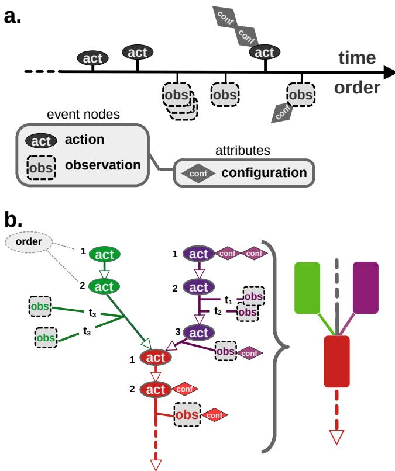
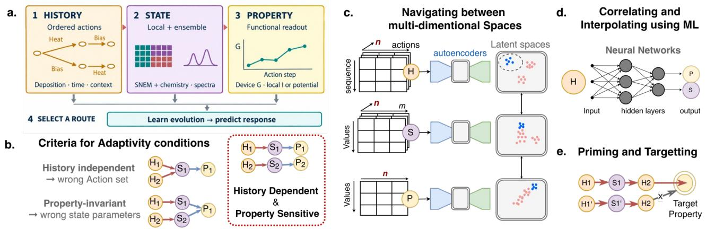
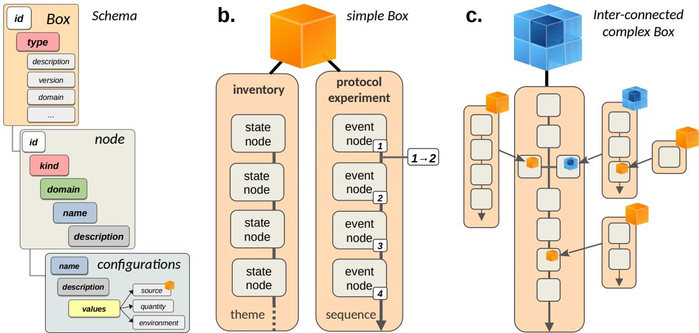
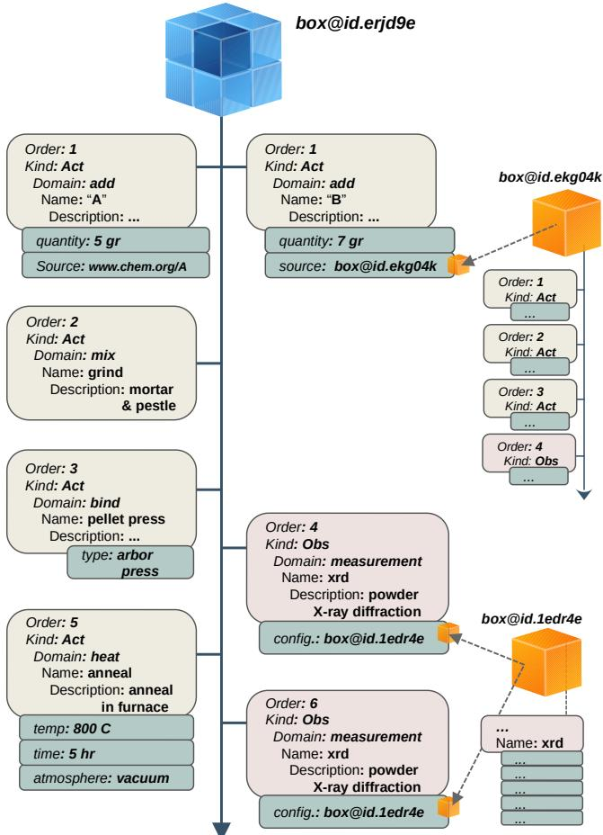
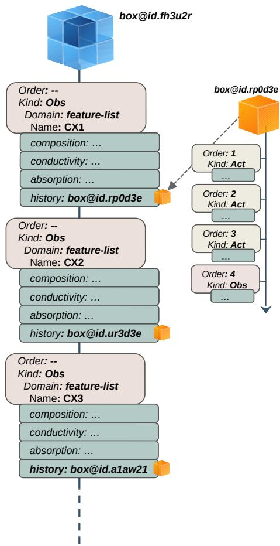
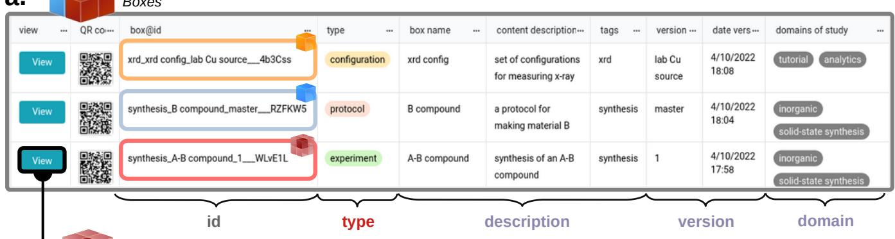
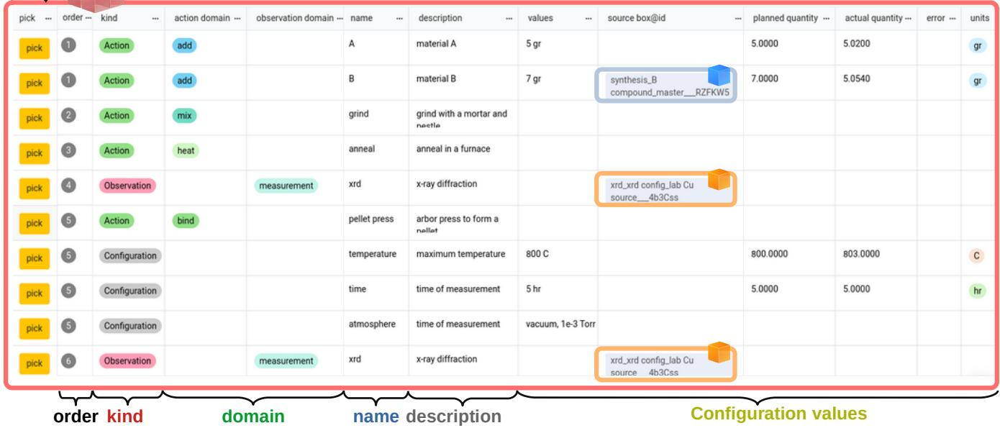
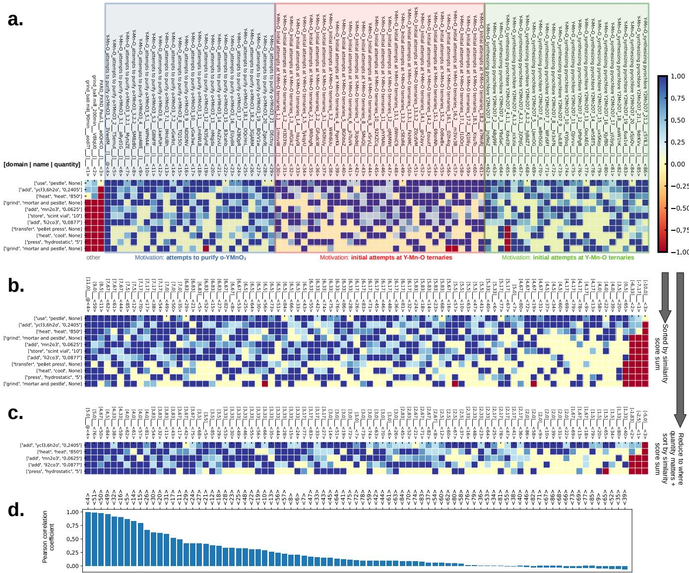
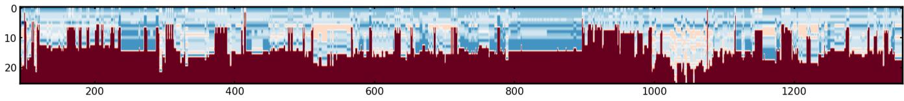

# Complex materials engineering via Provenance Action Graphs: potential, structure and demonstration

Yevgeny Rakita,1, ∗ Paul Todd,2 James R. Neilson,2 and Simon J. L. Billinge3, †

1Department of Materials Engineering, Ben Gurion University of the Negev, Beer-Sheva, Israel, Department of Applied Physics and Applied Mathematics, Columbia University, New York, NY 10027 2Department of Chemistry, Colorado State University, Fort Collins, CO 80523 3Department Materials, University of California, Santa Barbara, Santa Barbara, CA 93106 (Dated: October 14, 2026)

This work discusses and tests the potential of reaction graphs for material synthesis, in which events consist of reaction steps (actions) and their outputs (observations). The importance comes from the requirement to synthesize technologically useful materials, especially those that are kinetically stabilized. Often, it is a science that follows years of trial and error, culminating in (published) successful recipes, but is truly driven by far more (unpublished) failures. The entry into the era of AI provides an opportunity to use learning algorithms to encode rules from multi-dimensional synthesis pathways, regardless of their technological usefulness, and to decode both forward prediction and inverse learning modes. The main incentive is to accelerate material discovery by generating a global knowledge base that can be shared among data agents and contributed to by them. We will focus on several scenarios in the common synthesis process during solid-state synthesis, primarily because these reactions are kinetic in nature and require closer monitoring and control of the reaction history.

## I. INTRODUCTION

Emerging technologies are built on increasingly complex materials, with complexity engineered to deliver enhanced performance. For rationally engineering them with desired functionality, knowing the exact synthesis route is critical. To do so, databases of synthesis are needed and they need to have sequence information.

Synthesis history can itself serve as a descriptor of the chemical state of a material, because the state reached at any point is determined not only by the starting components, but also by the sequence of actions through which they were processed. This is particularly important in solid-state synthesis, where products are often kinetically stabilized and where changes in annealing temperature and duration, atmosphere, heating or cooling rate, precursor treatment, or the order of processing steps can lead to diferent phase assemblages, defect populations, local chemical environments, and ultimately diferent properties. Such a history dependence is a defining property of a material and its functionality, for example in materials such as battery electrodes, high-entropy alloys, heterogeneous catalysts, thermoelectrics, and photovoltaic materials, for which nominally identical compositions may correspond to substantially diferent material states depending on their synthesis pathway [1–6].

Besides complexity, finding the right path towards stabilizing a material with desired properties is often a great challenge. While a combinatorial trail-and-error approach often succeeds, it is reasonable to think that experience-based guidance will be more resource eficient in a high-dimensional space of variables, i.e., the application of chemical intuition by the chemist. Often, an exploration of a synthesis paths will be done based on literature or one’s experience of seeing a similar case in the past. This chemical intuition is built up over many years and is not available to the novice. Also, because of the high dimensionality of the synthesis input parameter space, it can miss potential exploitable routes. A question is then whether data analytic approaches, for example, based on machine learning (ML) can either help experts augment or find new syntheses towards desired properties, accelerate the training of novices, or reverseengineer synthesis from a system’s measured properties. ML approaches require large amounts of data to be captured and made available in findable, accessible, interoperable and reusable (FAIR) [7] databases. In the current context, what is needed are a FAIR databases of synthesis paths instead of, or in addition to, the conventional literature reports or the conventional lab notebooks. Such a database would ideally be structured as a set of synthesis action graphs, or materials provenance graphs, MPGs.

The central idea of such a database is to capture the material’s history in the form of a directed graph [8, 9] where the nodes of the graph are synthetic actions, and the edges of the graph show the sequence of operations. A closely related graph-based representation of material history is the Graphical Expression of Materials Data (GEMD) model that underlies the Citrine Informatics platform [10, 11]

We have implemented an example of a MPG database that we call MosyDB. It captures large numbers of synthesis inputs related to their outputs, as well as the characterization measurement results, that are captured in the database in between the sequence of actions. Capturing this information for large numbers of syntheses will allow navigating through complex chemical space reaction steps, and find relations between synthesis actions and outcomes. Using actions as features and the observables as labels, ML tools can, potentially, then be used to discover which synthesis actions or parameters are most important for diferentiating between diferent pathways, recommend new synthetic pathways of designed materials, and so on. A successful recommender system, which can be based on modern generative AI, will, for example, allow one to derive the probability that a set of actions is important for a desired outcome, or whether the sequence of actions matters. However, to do this, the key is to make sure that the data structure of these captured syntheses is uniform between diferent synthetic groups and even between fields. MosyDB can become a platform for more educated recommender systems and become part of future materials discovery paradigms. Beyond the forward question of which state and property are likely to follow a given set of actions, the main goal is the inverse one: predicting the synthesis protocol most likely to reach a target state or property. Such a database should capture failed as well as successful experiments, since machine learning benefits from information on failures [12]. Failures, however, are practically absent from published papers, and although electronic lab notebooks record them digitally, they are rarely FAIR or structured in a way that is machine-readable.

Recording an MPG that is both machine- and humanreadable, following a well-defined schema, will have several benefits over the current state of the art:

• integration between (semi)-automated and discrete synthesis can be done more naturally

• both failures and successes will be captured

• there will minimal loss of integrity due to misinterpretation of language

• given a uniform schema, practitioners from diferent fields will be able to communicate and improve intra- and inter-disciplinary communication.

In this work we demonstrate an MPG database for capturing chemical syntheses as action graphs. We make a start on defining terms in a high-level schema that follows the principles of a synthesis action graph. We focus on solid-state synthesis as an example. We note that it is not the purpose of the paper to justify a particular schema, but rather to explore the challenges that will be faced by the community to fully realize the MosyDB idea across labs and disciplines. As will be further discussed, in order to realize the last point, identifying a so called ‘top-level’ schema that is field agnostic and agreeing on uniform field-specific schema within specialized fields is critical. These are significant challenges that will be partially address in this work.

In most eforts for realization of material’s synthesis databases [13, 14], synthesis history is often treated as meta-data without restrictions on its structure (mak ing it less reusable), and the focus is more on the set of attributes describing the state of materials at the expense of their synthesis history. A similar database is GEMD [10, 11], which, like our approach, records the processing history of a material as a graph that links processes, ingredients, materials, and measurements. MosyDB was developed independently, and the convergence of the two eforts on a similar graph-based structure supports the view that this is a natural way to capture synthesis. The diference is then not in the conceptual essence, but in the details and the implementation. MosyDB captures synthesis as actions from which one can later derive the state at a given time, or an event-oriented database [15], in which a set of sequentially occurring events leads to a certain state. Rather than proposing a competing schema, here we test the concept on real laboratory data entered by early adopters, report what was learned, and link it to an engineering cycle of History-State-Property relationship (Fig. 2).

## II. STRUCTURE

## A. The structure of a MPG

A synthesis is when a sequence of actions takes place at diferent times on a time-axis (Fig. 1(a)). To characterize the state of a sample at diferent points in time, as a result of a series of actions, observations on the sample, such as characterization measurements, are made.

In a related, but diferent, abstraction (Fig. 1(b)) we can remove the time axis to represent the actions as nodes on a directed graph, where the edges encode the sequence of actions. The advantage of this abstraction is that we can easily experiment by adding or removing nodes, or rearranging edges. This way, we can also see the topology of the process, where branches may be independent (and could in principle be worked on in parallel) and then merge at certain points. If one desires, it is always possible to map one abstraction onto the other.

Actions are things such as ‘use‘, ‘add’, ‘mix’, ‘heat’, ‘wait’. Observations are measurements on the result of the actions (i.e., the material). They capture information about the state of the chemical system such as color, texture, an image, a spectrum, or a structural signature, at the given point in the sequence. Actions and observations are both events; the main diference is that actions operate on the sample to change it, whereas observations simply measure the state of the material. Actions and observations are intertwined in a causality relationship, where actions define how the material system is forced, i.e., the inputs in the process, and the observations describe the system response (the outcome or output). From an informatics perspective, actions will be features, and observables will be labels.

The action nodes contain attributes that are stored as metadata associated with that node. As an example, if one uses the ‘add’ action, the metadata stored might be what was added, and how much, as well as possibly the time it was added and by whom. Information about the added material could also be saved. If a MPG exists for the added material, a reference to this graph

  
FIG. 1 Basic principles of a MPG.(a) Illustrations of a synthesis process that is represented as a time series of event-nodes: actions and observables, which may carry attributes in a form of configurations. (b) Representation of a MPG in a way that emphasize its properties: actions as nodes containing information regarding the diferent

unique information about the event-node. The diferent colors emphasize the idea of granularity of a MPG, meaning that a MPG can be represented as a sequence of sub-graphs.

could be stored. Alternatively, if the material was purchased, information such as the manufacturer, product, and batch numbers could be stored. If the material had some pre-treatment, this will appear in its own branch on the MPG.

For machine readability, configuration values are expected to be in designated fields. Although practically this might be hard to guarantee, especially as a MPG schema evolves, all nodes could contain a ‘notes‘ attribute to allows researchers to store a list of free-written notes. Such details may be of importance if one encounters variance in an observation without variance in the action graph. If one sees a discrepancy between the outcomes of two apparently identical MPGs, it indicates that a relevant parameter or action is not being captured in the

MPG, guiding the experimenter to look for missing configurations of critical action nodes. This way, one can also evolve the MPG schema. As the data is more complete, comparing observations of MPGs that aim towards a single motivation may allow one to expose such discrepancies.

The diferent colors in Fig. 1(b) demonstrate a granularity principle of MPGs. The granularity of a MPG is variable and, in principle, can be defined arbitrarily. A set of event nodes for a complex multi-step operation may be bundled as a sub-graph that can be conceptually expanded as a sub-graph or contracted as a node. This allows the experimenter to bundle and hide details that don’t vary or aren’t critical to the outcome, whilst explicitly exposing important actions and attributes.

Questions remain about how best to implement this concept in practice, what the cost of capturing and storing rich databases of MPGs is, what a preferable strategy for harvesting MPGs would be, and how to reduce the overhead on the experimenter for capturing the data and metadata. In an attempt to address these questions we have built a prototype – Movement-Motivated Synthesis database (MosyDB; https://mosydb.odoo. com) – which was a portal through which MPG data was entered into the experimental database by users. In the following sections, we will discuss the diferent elements of MOSYdb: how they implement the principles of a synthesis database discussed in this section, what was learned from early adopters, and how it can be used as a platform for developing both top-level and field- and specific- schema.

## B. Data structure and internal relationships for rationalized decision making

We need a data structure that can provide predictive information from the internal relationships between the state and history of a system. For the usual use-case of creating technology-relevant predictors, we distinguish between a ‘State’-observable and a ‘Property’-observable, where the former refers to a structural or chemical descriptor (irrelevant for a technological usage), while the latter refers to a value such as resistivity or dielectric con stant, from which one can make engineering decisions.

From here we define the following logical relationship: History State Property. History records ordered actions and their conditions; the measured State description records structural and chemical organization; a Property is a readout selected for a function under specified measurement conditions. Engineering materials’ properties, or understanding their behavior, can be rationalized eficiently when the state is known. Therefore, to rationally design materials, we must first understand their State. While changing History can be learned to change properties, looking into it will lead to a cookand-look approach and will require the complete set of actions to reproduce the result. Knowing the State, on the other hand, can allow us to choose diferent, more eficient, routes that lead to the same State. Therefore, here, we define History as the independent variable for State, and State as an independent variable for Property (see (Fig. 2)).

If we try to define a reasonable data structure that can allow cross-correlations, we need to have a common dimension. This dimension will be an ‘experiment’ number (noted as $\cdot _ { n } )$ in Fig. 2c). Each experiment can be defined as any set of actions between adjacent observables. Upon measurement, the State-set contains multidimensional matrices containing information such as difraction patterns or spectroscopic data (Powder XRD, Raman, FTIR, NMR, etc.).

There are diferent ways to represent a sequence of events [16–18], including the graph-based model, such as of GEMD [10]. We chose a representation of ‘History that matches the conceptual structure of State and Property. Having defined an experiment as a set of actions between two adjacent observables, we used a 2D matrix, where one axis is the ’sequence’, while the other axis is a numerical value that is uniquely linked to a specific action or an attribute. For example, an experiment to synthesize PbI may look like:

‘add’:‘2 mol’:‘Pb-Acetate’ ‘add’:‘2 mol’:‘KI’ ‘heat’:‘55 C’  ‘wait’:’60 min’, we construct a sparse matrix that looks like:

$$
\left[ { \begin{array} { l l l l } { 2 } & { 0 } & { 0 } & { 0 } \\ { 0 } & { 2 } & { 0 } & { 0 } \\ { 0 } & { 0 } & { 5 5 } & { 0 } \\ { 0 } & { 0 } & { 0 } & { 6 0 } \end{array} } \right]
$$

The matrix carried metadata that defined the identity of the columns, and the type of progression in the rows (time, order, etc.). We chose this structure because, if the sequence is neglected, we obtain a constrained vector that describes the experiment, such that the vector will look like:

$$
[ 2 \ 2 \ 5 5 \ 6 0 ]
$$

If only some steps become sequence-important, for example, only the ’heat’ action, with ’wait’ becoming its attribute, a matrix can look like:

$$
\left[ { \begin{array} { c c c c } { 2 } & { 2 } & { 0 } & { 0 } \\ { 0 } & { 0 } & { 5 5 } & { 6 0 } \end{array} } \right]
$$

If a second experiment is done, but with an unspecified temperature, for example, the matrix can look like this:

$$
\left[ { \begin{array} { l l l l } { 2 } & { 0 } & { 0 } & { 0 } \\ { 0 } & { 2 } & { 0 } & { 0 } \\ { 0 } & { 0 } & { - 1 } & { 0 } \\ { 0 } & { 0 } & { 0 } & { 6 0 } \end{array} } \right]
$$

where we used ‘-1’ to denote an “unknown” (any other value is possible as long as consistency is met). If for

the second experiment one decides to add 0.1 mol of hydriodic acid 48% HI, before heating up, the matrix of experiment #2 will look like:

$$
\left[ { \begin{array} { l l l l l } { 2 } & { 0 } & { 0 } & { 0 } & { 0 } \\ { 0 } & { 2 } & { 0 } & { 0 } & { 0 } \\ { 0 } & { 0 } & { 0 } & { 0 } & { 0 . 1 } \\ { 0 } & { 0 } & { - 1 } & { 0 } & { 0 } \\ { 0 } & { 0 } & { 0 } & { 6 0 } & { 0 } \end{array} } \right]
$$

while experiment #1 may convert to so it can be match dimensionally to experiment $\# 2$

$$
\left[ { \begin{array} { l l l l l } { 2 } & { 0 } & { 0 } & { 0 } & { 0 } \\ { 0 } & { 2 } & { 0 } & { 0 } & { 0 } \\ { 0 } & { 0 } & { - 1 } & { 0 } & { 0 } \\ { 0 } & { 0 } & { 0 } & { 6 0 } & { 0 } \end{array} } \right]
$$

## C. The architecture of MosyDB

Most existing material-oriented databases [19] contain sets of observables without referencing the process history of the candidate materials. Such databases are compound-centric, meaning that the composition (and/or structure) stands at the center of the materials’ identity, where the state of these materials is calculated or observed. Some databases [20], mostly in organic chemistry, may record reaction processes as chemical equations, with a set of optional attributes. Although the optional attributes sometimes contain reaction conditions, this is only in a very limited number of datasets, and only on a case-by-case basis, that one can reverse-engineer and map the reaction history onto an even-oriented dataset. Recently, Hammer et al. (and possibly other commercial databases [17]) included records containing reactions with a structured markup language that allows recording a machine-readable sequence of operations. However, the schema is currently restricted to a pre-defined set of keywords that target pre-designed automation platforms. The allowed set of predefined operations will drive the schema keywords, which will restrict its scalability across a broader community. Therefore, a major remaining challenge is a platform that will allow for the formatting of globally accepted language and ontology across diferent labs and fields. MosyDB strives to provide a simple platform and to allow heterogeneous communities (e.g., organic/inorganic; catalysis/batteries) to communicate by naturally developing a shared language that is both machine- and human-readable.

Any database requires a structure – a schema containing keywords that allow one to interpret the meaning behind inserted values. As with any language, if we want diferent data contributors to share knowledge, it is necessary to use a unified schema or to have translation layers that map diferent datasets into a unified schema. Any field-specific schema will often optimize a set of keywords specific to a field, or even to a question under study.

  
FIG. 2 Data structure and internal relationships: (a) The central materials descriptors for rationalizing potential Adaptivity. History refers to events that occur in sequence and include actions and environmental attributes. State refers to descriptors on which a materials property depends (e.g., chemistry, local order, density, and their spatial distribution), and a dependent variable of History. Property refers to a function-critical feature of the material (e.g., conductance, permittivity), and a dependent variable of State. (b) Criteria for Adaptivity conditions, showing the required relationship between History, States, and Properties. (c) A strategy for interacting and navigating in the multi-dimensional space, beyond manual exploration, using self-supervised autoencoder-based projected latent spaces. The projected latent spaces enable critical dimensionality reduction to identify correlations among diferent descriptors. Selection of an area/volume in latent space can allow back-projection to the original data space between the descriptors projected latent spaces; this requires a common dimension; here, ‘n’ as the number of experiments. (d) Generating a correlative model that allows interpolation between descriptors will be done using ML transformers. (e) Priming physical states and targeting properties will be done, for example, using Model-based Reinforcement learning to predict what Actions are needed to achieve a desired Property/State of the adaptive glass.

Optimizing the schema for each field will most likely result in a lack of communication between fields. For example, the chosen keywords in biochemistry, inorganic chemistry, and cookery may be very diferent. Nevertheless, one would be able to describe synthesis workflow via a MPG. To allow diferent fields and labs, and even students within the same lab, to share machine-interpretable knowledge, we start with a field-agnostic schema, or a ‘top-level’ schema.

In Fig. 3(a) we show the minimal ‘top-level’ schema that we chose for event nodes: ‘id’, ‘kind’, ‘domain’, ‘name’, ‘description’ and ‘configurations’. An ‘id’ defined the unique identity of every node, enabling us to determine the sequence between diferent event nodes. The ‘kind’ of a node defined whether an item was an ‘action’, or an ‘observation’. The ‘domain’ each event acts upon was specific to its kind. For example, we used action-domains such as ‘add’, ‘mix’, ‘set temperature’, and ‘wait’, and observation-domains such as ‘measurement’ or ‘description’. The ‘name’ reflected a domainspecific title of what was used in that action or observation, where an extended description could describe the meaning behind the name. We regarded the description as very important, since it can later allow building translator layers between MPGs from diferent fields.

To describe the sequence in which a series of events happens, one can use topological relations (parent, child, sibling), which are commonly encoded as an edge attribute. As described in Fig. 3(b), to enable connectivity, each node could carry a unique ID so directed topology can be described (e.g., 1 2). If the series of events is acyclic, however, one may find it simpler (and more compact) to describe the sequence of events by adding an ‘order’ attribute instead of a unique ID. For example, in Fig. 3, the sequentially rising numbers can be used to describe the order or time each event occurs. Unlike an ‘id’, which could be unique for each node, list-indexes, or ‘order’ attribute, as will be seen in Fig. 4, encode the topology. ‘order’ attributes can rise monotonically, or repeat when actions can or could happen simultaneously (see Fig. 4 as an example).

We kept ‘configurations’ out of the top-level schema and treated them as field-, kind-, or domain-specific. They hold the specific values that define a particular synthesis, such as the quantity of added material, heat ing rate, source of the material (e.g., manufacturer), or instrument settings, so that events with an identical top level description can difer in their configurations.

To enable the reuse of nodes, graphs, and configurations, we have created the concept of a ‘box’ (Fig. 3(b)): a bundled set of nodes, graphs, and configurations, which then can be referenced (Fig. 3(c)) via a ‘box-id’ to a particular node. Another important feature is the ability to ‘pick-and-drop’ a copy of nodes and configuration items between boxes. If boxes are shared, the content of boxes is reused, it is likely that a community (regardless of its size) will gradually converge on a limited vocabulary over time and reduce the barrier towards a fully global machine and human-readable infrastructure.

  
FIG. 3 A schematic representation of the architecture of MosyDB, with the concept of a ‘Box’ as a wrapper to a set of event nodes. (a) Generalized schema and topology of boxes and event nodes. (b) A schematic representation of the architecture of diferent types of boxes. An inventory box is a theme-related set of state nodes that describe individual states liked by a single theme, without a sequential topology. A protocol and experiment boxes are sequence-related event nodes, where the topology between the nodes is described by the relation between node ids (e.g., 1 2), or by an ‘order’ attribute for a cyclic reaction-graphs. (c) A representation of an interconnected box emphasizing the inheritance property between boxes, leading to the possibility of branching out a main thread of a simple box via the source configuration attribute (see ‘configuration frame in (a)). Fig. 4 and Fig. 5 are examples that illustrate an implementation of these concepts.

Formally, we define ‘box’ as a bundle of event nodes and configurations that carry a unique ‘id’, a ‘type (e.g., experiment, protocol, or inventory), and other optional fields such as ‘description’ (general description of its content), version, domains of expertise (e.g., inorganicchemistry, bio-chemistry, materials for solar-cells, cookery, etc.), creator, creation time, and others. The completeness of this information can be, in part, dependent on integration with an associated group or user, but, as with an event or configuration, reusability could be built in to converge towards a unified vocabulary.

The ‘type’ of a box defines the expected connectivity between nodes inside the box. An inventory box will be the simplest form where a set of items (nodes or configurations) is listed without the necessity to be related by sequence but only by theme. In fact, an inventory box is interchangeable with a state-oriented dataset (see example in Fig. 5). A protocol or an experiment boxes are expected to contain events that are linked by directed edges via and ’order’ attribute (see example in Fig. 4). An experiment is also diferent from a protocol, as the former requires that an observation be recorded, whereas the latter is a simpler description of the sequence of actions without necessarily specifying their outcome.

Once a protocol is executed, it will become an experi ment. Boxes, similar to nodes, have an inheritance feature, where Boxes can reference other boxes (Fig. 3(c)), allowing nesting infinitely.

## III. IMPLEMENTATION

## A. Use-cases

To test the MosyDB architecture described above, we use two use-cases. The first use case (Fig. 4) focuses on demonstrating the use of the MosyDB schema in a typical synthesis experiment. A second use-case (Fig. 5) demonstrates that the commonly used state-oriented databases, where a list of features and labels is aggregated for the purpose of machine-learning [21, 22], can be mapped onto the MosyDB schema but with the added value of refer encing reaction-graphs with the exact same schema.

The first use case demonstrates a simple solid-state synthesis. Despite the simplicity of the node schema (Fig. 3(a)), it provides all the information that is required for understanding the entire process: add A + B  grind them  press them into a pellet  measure x-ray difraction anneal measure x-ray difraction.

For example, querying the database for the sequence of (‘domain’, ‘name’) pairs in Fig. 4, (add, A) (add, B) (mix, grind)  (bind, pellet press)  (measurement, xrd) (heat, anneal) (measurement, xrd), returns all MPGs that contain this sequence of actions and observations, regardless of their configuration values. The configurations (gray blocks underneath the event nodes) contain all the specific information that define each node. Once a subset of reaction-graph is filtered, one can further filter it based on specific configuration values, for example, keeping only the MPGs in which annealing (step #5) was done at 800 ◦C or above, in which 5 g of A was added (step #1), or in which an arbor press was used (step #3). The query can also be extended to the steps that describe the source of material ‘B’ (box@id.ekg04k in Fig. 4), as it is also recorded and stored as a MPG. Similarly, one can enforce comparison of experiments by the observation configurations (in this case, the configuration of the x-ray difraction pattern obtained), as well as their exact timing (in this case, before or after annealing).

  
FIG. 4 Example of a reaction-graph, using the MosyDB architecture, of the following experiment: Student mixes 5 grams of material A with 7 grams of material B. To mix them, grin in a mortar and pestle. Presses the powder into a pellet with an Arbor press, and anneals under vacuum for 5 hours at 800 ◦C. Collect difractograms before and after annealing with a lab Cu x-ray source.. The additional linked boxes are a realization of the idea of interconnectivity between boxes.

Let us consider a classical use case of relational data collection, where the relation is thematic, meaning that there is a question for which diferent material properties are collected across diferent compositions, structures, or synthesis conditions. Such a database result structure is a feature/label matrix on which one can perform vari ous ML-based queries. Fig. 5 shows how such a table is mapped onto the MosyDB format: each row of the table (here, samples CX1, CX2, and CX3) becomes an observation node of domain ‘feature-list’ in an inventory box, and the columns of the table (composition, conductivity, absorption) become configurations of that node. In addition, each node carries a ‘history’ configuration that holds the box@id of the experiment box containing the complete MPG of that sample. Through this reference, one can simply add to the feature-label matrix new features that are taken from the entire or part of the MPG. For example, the annealing temperature and duration of the final ‘heat’ step can be read from each

  
FIG. 5 Example on how using the MosyDB infrastructure, specifically an inventory-box, was used to collect property feature-list for data-driven extrapolation of materials and their properties. We demonstrate a use case in which the relationship among composition, electrical conductivity, and optical band gap is investigated. The additional linked boxes emphasize the capability to add reaction-graph information, which then can be used to build feature lists that are extracted from the nested box.

linked MPG and appended as two new feature columns next to conductivity and absorption. This way, one can naturally look for causal correlations between properties and synthesis pathways, for example, between annealing temperature or duration and conductivity, or between the sequence of actions and absorption. This shows that having MosyDB filled with MPGs can augment existing state-oriented databases without any significant restructuring on their side.

## B. User Interface

To test the applicability of a MPG database, we built a user interface that satisfies four major criteria: (1) nodes that carry the MosyDB schema as described above, (2) the ability to represent connectivity between nodes, (3) a box architecture that allows inheritance, and (4) the ability to reuse node and configuration elements to increase reproducibility. MOSYDB, a prototype MPG database infrastrucgture, was created using a relational cloud database as a backend (specifically, ‘Airtable’ [24]) together with a web-app builder that interfaces with the backend (specifically, miniExtensions [25]). We note that, since the backend had a fully developed application programming interface (API), we also created a Pythonbased graphical and command-line interface to facilitate bulk data entry from CSV files, data analysis, filtering, and attached data visualization capabilities. These, however, are still in the early stages of development and will not be discussed in detail in this paper. Our main focus will be the MOSYdb web interface as the main user interface for generating MPG datasets. At this point, the application is fully compatible with a PC, as well as with mobile devices.

In Fig. 6 we show the main windows a user interacts with during data entry. The initial workflow includes registration as a group, creation of a user under the group, and linking to one’s set of boxes (Fig. 6(a)). The group and user information can help address the context of the generated data and is important for privacy and sharing capabilities; see the documentation on the MOSYdb website [23].

After setting up a user, the user will have a unique user@id that will be linked to any box created. After logging in, a user starts by generating a box, such as those shown in Fig. 6(a). Each box has a box@id with a corresponding QR code for quick reference via a QR code reader or a camera at later stages. The user indicates the type of the box (protocol, experiment, inventory, set of configurations, and several others) and complete addi tional metadata that will help with future filtering and identification of the box, such as user-defined name, content description, tags, domains, and others. Although not shown in Fig. 6(a), it is possible to duplicate a box without its content (only its metadata), and later populate with relevant nodes and configuration items via the window shown in Fig. 6(b).

In Fig. 6(b) we show the MOSYdb version of the MPG presented in Fig. 4, which can be viewed and edited when pressing the ‘view’ button of a box. Each line represents an event node or a configuration item. A user will first define the kind, and then fill in the relevant domain, name, description, and configuration values. For faster and more eficient data entry, we decided to include some commonly used configuration fields, such as ‘source’, ‘quantity’, and a comma-separated free text of ‘values’. This structure converged after several iterations with early adopters and is now reported as relatively intuitive and easy to read by a human. However, configurations can, and are encouraged to be added as separate entries below the relevant event node (see configurations for the action node #5 in Fig. 6(b)), or as a separate configuration box via the ‘source box@id’ field.

To represent a directed connectivity between nodes, and basically form a reaction-graph, an ‘order’ attribute is accepted for each node. In MOSYdb, we chose to use an ‘order’ attribute rather than a more explicit topological relation (‘node@id(a) node@id(b)’; cf. Fig. 3(b)). This choice was justified since one can simplify any reaction-graphs into practically single branches (as long as it is acyclic). This is mainly possible due to the inheritance of boxes that contain branching reaction-graphs. This provides a simple way to represent a sequence in a relational database, and as early adopters reflected a desire to interact with commonly used spreadsheets, this choice was justified. Nevertheless, this choice was made for front-end simplification, whereas a more robust representation of the order could be provided via an explicitly defined topology, which will also enable the representation of cyclic operations. At this point, MOSYdb does not consider the use case of cyclic representations of a reaction-graphs.

To converge towards a narrower set of vocabulary, especially of that of configuration keywords, we implemented the possibility to ‘pick’ a copy of event nodes and ‘drop’ it into another new/diferent box. This is done by simply pressing the yellow ‘pick’ button in front of each item, and linking the copy to a any existing box@id. Before dropping, one can configure the picked item, for example the order in the graph, or a particular configuration value, such as mass or temperature. In this context, to converge on a vocabulary, boxes could be shared. Once a box is created, one can choose to keep it private, share it with the user’s hosting group, or share it publicly.

Some additional features of MOSYdb would be as follows. For each observation node, we allowed a user to attach a data file (not shown), from which one can later define a unique quantity of interest. To link a box to a user or a node to a box, QR codes of the user@id or box@id are easily accessible and are readable via a mobile device or web cameras. Adding such a feature could improve the completeness of data, as one can describe in detail a synthesized material in bulk or instrument configurations in designated boxes, print it, stick to the container of the material or the front of an instrument, and scan via a mobile device directly into the ‘source box@id’ field.

box@id: synthesis\_A-B compound\_1\_\_\_WLvE1L  
a.  

  
FIG. 6 Decorated screen snapshots from the MosyDB webapp [23], where (a) is the “My Boxes” window (after logging in), and (b) is the MosyDB-formatted content of the red box in (a). Each colored box in (a) corresponds to the boxes shown in (b): the main box (red) and two other ‘source box@id’ (blue and orange). The content of the red box and the related boxes (blue and orange) mimic the db-structured reaction-graph shown in Fig. 4. One can find these boxes publicly available unde the ‘Public’ tab in the ‘Home’ screen of the webapp. The QR codes in (a) contain the ‘box@id’, and can be used when linking via the ‘source box@id’ field in (b). Usage documentation can be found under the ‘Documentation’ tab of the webapp. The color-coded namespaces under each table resemble those presented in Fig. 3(a). Note that the configurations ‘values’, ‘source, and ‘quantities’ are very common to almost any action. Configurations can also be added vertically under each event node (see in (b) - ‘order=#5’; ‘kind=Action’), where specialized configurations can be added. More comprehensive documentation for MosyDB is available at https://mosydb.odoo.com.

## C. Interaction with the data

The data we collected for MosyDB contains more than 2,500 experiments and protocols from early adopters, including more than 46,000 nodes and configuration items. For simplicity, we will call all the data entries within the boxes (nodes and configuration items) as ‘items’. The question now is, what are the values of having a MPG

database?

We use the data from one of our early adopters, who added more than 59 diferent solid-state syntheses of different Y-Mn-O compounds: $\mathrm { Y M n O _ { 3 } }$ and $\mathrm { Y _ { 2 } M n _ { 2 } O _ { 7 } }$ . We targeted a use-case to find similarities between sets of diferent reaction-graphs, in other words, how similar a selected subset of $\mathrm { M P G s }$ from a particular MPG of interest. We approached this problem by formatting a simple algorithm for generating a similarity matrix, which looks for similarities between events and their configurations, and the rest of the MPGs in the dataset.

Let us explain the essence of the similarity matrix algorithm workflow and logic. The user selected a set of keywords from the MPG schema and an existing MPG of interest, which we call the ‘base-MPG’. The algorithm then iterated over each target node and looked for similarities in the values from the base-MPG, where the values corresponds to those selected keywords in the schema. If a value in a target-MPG is identical to the base-MPG, the indexed node gained a score of $\frac { 1 } { N }$ , where N is a normalization factor that equals to the total number of existing (not ‘none’) values, from the set of selected keywords, in the base-MPG. For example, if there are four selected keywords and three of them exist in the base-MPG vector, every existing similarity granted the target-MPG node $\textstyle { \frac { 1 } { 3 } }$ of a point. If all the values are identical between two compared nodes, the maximum score would be $^ { 6 } 1 ^ { \circ } .$ , while a minimum value would be ‘0’. Since the algorithm scanned each node based on its indexed location in the graph, it was sensitive to the connectivity and length of the MPGs. Therefore, any score < 1 might be due to diferences in the values of the node or due to diferences in the action sequence. The result was an n m matrix, where n is the number of nodes in the base-MPG vector, and m is the number of experiments in the dataset. Since we constructed a matrix, if the number of action nodes in a tested graph is smaller than the base graph, the remaining empty indexes in the tested-MPG vector were assigned a score $\mathrm { o f ~ } ^ { \mathord { \left. \right.} \mathrm { - } 1  }$

In Fig. 7(a) we show the similarity matrix generated for the Y-Mn-O dataset, using the first experiment aimed at purifying $\mathrm { \Gamma _ { 0 } { - } Y M n O _ { 3 } }$ (box 4 , marked ‘@’) as the base-MPG, and the ‘domain’, ‘name’, and ‘quantity’ of its action nodes as the selected keywords. Each row corresponds to an action node of the base-MPG, and each column to one of the 83 experiments in the dataset, grouped by their motivation (purifying o- ${ \mathrm { - Y M n O _ { 3 } } }$ , initial attempts at Y-Mn-O ternaries, and synthesizing pyrochlore $\mathrm { Y _ { 2 } M n _ { 2 } O _ { 7 } ) }$ , together with three auxiliary boxes (ball-milling protocols and a difraction protocol, labeled ‘other’). Dark blue cells indicate a full match of all selected keywords, lighter shades indicate a partial match, yellow cells indicate no match, and red cells (score of ‘-1’) indicate that the target-MPG contains fewer nodes than the base-MPG. In Fig. 7(b), the columns are sorted by their summed score, which ranks the experiments by the overall similarity of their synthesis history to that of the base-MPG; as expected, the base-MPG ranks first (score of 11), while the auxiliary boxes, which describe diferent types of operations, rank last. Since not all actions are equally relevant to the chemical outcome, in Fig. 7(c) we retained only the nodes for which the quantity is chemically meaningful, namely, the added precursors and their amounts and the annealing temperature, and sorted the experiments again. Finally, to test whether similar synthesis histories lead to similar outcomes, in Fig. 7(d) we compared the observations rather than the actions: we computed the Pearson correlation coeficient between the background-subtracted powder x-ray difraction pattern of the base-MPG and those of all other experiments. Comparing Fig. 7(c) and (d) shows that similarity in the recorded history is only a weak predictor of similarity in the resulting state. Some experiments with the highest structural similarity to the base $( r > 0 . 9 5 ; \ \langle 4 9 \rangle - \langle 5 1 \rangle )$ belong to a diferent motivation and have only moderate history scores, indicating that a similar product was reached via a diferent route. Conversely, several experiments with high history scores (e.g., 76 and 84 ) yield difraction patterns that are essentially uncorrelated with that of the base $( r < 0 . 1 )$ ). The latter case is precisely the type of discrepancy discussed in section II C: two apparently similar MPGs with diferent outcomes indicate that a relevant parameter, such as the reaction atmosphere or a precursor identity not included in the selected keywords, is not captured by the comparison. This demon strates how combining a history-based similarity with a state-based similarity can expose such hidden variables and guide both the experimenter and the evolution of the schema.

We note that the same type of map can be generated for much larger datasets. Fig. 8 shows a similarity matrix, analogous to Fig. 7(a), for about 1,300 hydrothermal zeolite syntheses entered by a second early adopter and recorded with the same top-level schema. At this scale, the map provides a more intuitive view of the reactiongraph space, in which families of related experiments, as well as the length of each MPG (dark-red region, missing nodes), can be seen at a glance.

## IV. DISCUSSION

The main barrier we encountered was not conceptual but practical: recording an MPG was not native to the way experimentalists work. Synthesis is planned and carried out at the bench, and the information is usually written down in a paper notebook, or not at all, while the experiment is running. Entering it into a structured database was therefore an additional task, carried out separately from the experiment itself, and usually afterwards.

This overhead was not balanced by an immediate reward. The value of a MosyDB grows with the size and richness of the shared dataset, whereas the cost of en tering data is paid immediately by the individual user. Without a direct benefit to the person entering the data, the principle of ${ } ^ { 6 6 } \mathrm { { i f } }$ it is not easier, I am not going to use $\mathrm { i } \mathrm { t } ^ { \dag }$ tends to dominate. We therefore believe that the adoption of MPG databases will depend less on the details of the schema and more on making data entry faster and easier than current practice, with a clear reward at the end, such as automated analysis, comparison with related experiments, or recommendations for the next ex periment.

Reusing existing items, for example, through the pick and-drop functionality of MosyDB, makes data entry faster, but it also introduces a risk: items that are copied carelessly may carry values that do not correspond to the experiment that was actually performed. Tools that capture information directly at the bench can reduce both the efort and this source of error. QR codes that link containers and instruments to their boxes are a first step in this direction, and a smart-lab environment based on augmented reality could go further. Ideally, an assistant would capture the actions and observations as they happen and transfer them directly into the graph structure, so that the MPG becomes a by-product of doing the experiment rather than an additional task. Such tools can be readily integrated with the MosyDB infrastructure described in this work.

FIG. 7 Similarity matrix of 83 MPGs from the Y-Mn-O dataset, relative to a base-MPG ( 4 , marked ‘@’): (a) generated matrix, with experiments grouped by motivation; (b) experiments sorted by their summed similarity score; (c) reduced to the nodes in which quantity matters and re-sorted; (d) Pearson correlation between the powder x-ray difraction pattern of the base experiment and those of all other experiments, sorted in descending order.  
  
FIG. 8 Large-scale similarity matrix, analogous to Fig. 7(a), of about 1,300 hydrothermal zeolite syntheses. Blue indicates high similarity to the base-MPG, light colors low similarity, and dark red missing nodes (score of ‘-1’).

The balance between data and analysis has also shifted. The analyses presented here, such as the similarity matrix, were implemented with custom code. Today, AI tools and coding agents make it possible to carry out far more advanced analyses with considerably less efort. Analysis is therefore no longer the bottleneck. The scarce and valuable resource is well-structured experimental data that records the complete synthesis history, including failures.

Finally, although MosyDB accumulated more than 2,500 experiments and protocols, the analyses in this work were demonstrated on datasets of tens to about a thousand MPGs, collected by a small number of groups. Testing the approach on much larger datasets, spanning more groups and fields, is necessary to establish whether the event-oriented representation delivers the predictive power that motivates it.

## V. CONCLUSIONS

In this work, we discussed the basic idea behind MPG and demonstrated its implementations via MosyDB. Overall, boxes are the currency of the MosyDB, a currency that can be shared and translated into knowledge as more of it is accumulated. Its value increases as the richness of the structured data increases, but the used vocabulary decreases. The last point is particularly valuable, as it can reduce the overhead of making MosyDB more interoperable across diferent communities. A limited vocabulary is possible if scientists reuse and share MosyDB boxes from which one can search for relevant nodes with their configurations and drop them into a new experiment/protocol box, contribute a new attribute of relevance, and share back with the local or global community. Such a process will create a natively converging vocabulary, which will then be much more machineinterpretable.

It is important to note that, at some point, it will be necessary for publishers to motivate scientists to publish their reaction data in an MPG format, just as they insist on publishing structure data in CIF (Crystallographic Information File) format. Over time, it is likely that an increasing share of the scientific community in chemistry and materials science will adopt some kind of MPG conceptions. Ideally, at some point, highly interactive and intuitive electronic notebooks will adopt the concept and will optimize solutions for collecting event-oriented data.

[1] P. K. Todd, M. J. McDermott, C. L. Rom, A. A. Corrao, J. J. Denney, S. S. Dwaraknath, P. G. Khalifah, K. A. Persson, J. R. Neilson, Selectivity in yttrium manganese oxide synthesis via local chemical potentials in hyperdimensional phase space, Journal of the American Chemical Society 143 (37) (2021) 15185–15194. doi: 10.1021/jacs.1c06229.

[2] M. Bianchini, J. Wang, R. J. Clément, B. Ouyang, P. Xiao, D. Kitchaev, T. Shi, Y. Zhang, Y. Wang, H. Kim, M. Zhang, J. Bai, F. Wang, W. Sun, G. Ceder, The interplay between thermodynamics and kinetics in the solid-state synthesis of layered oxides, Nature Materials 19 (10) (2020) 1088–1095. doi:10.1038/

Overall, what makes any experiment complete is when actions are taken and observations are made on the outcome. MosyDB could merge classical state-oriented databases that capture sets of observables with eventoriented protocol databases into a complete experimentoriented database, from which one can also search for time-dependent causality relations. Existing databases are material-centric and state-oriented, which makes ex ploration of causality relations in kinetically-stabilized chemistry a remaining challenge. Therefore, one of the targets of MosyDB is to enable exportation of such causality relations. Since kinetically-stabilized systems are often complex (and heterogeneous), it is better to define their identity by their formation history, rather than their nominal chemical composition. Since MosyDB is process- and event-centric, rather than material- and state-centric, it has the potential to access causality relations in time/process-dependent synthesis and address challenging use cases of kinetically-stabilized chemistry.

## VI. ACKNOWLEDGEMENTS

The authors thank Simon M. Vornholt and Prof. Karena Chapman from Stony Brook University, NY, and Jefrey Rimer from the University of Houston, TX, for data contributions. YR thanks Dr. Mridul Kumar from Ben Gurion University for his contribution to the reaction graph algebraic representation. Work in the Billinge group was supported by U.S. Department of Energy, Office of Science, Ofice of Basic Energy Sciences (DOE-BES) under contract No. DE-SC0024141.

s41563-020-0688-6.

[3] E. P. George, D. Raabe, R. O. Ritchie, High-entropy alloys, Nature Reviews Materials 4 (2019) 515–534. doi: 10.1038/s41578-019-0121-4.

[4] P. Munnik, P. E. de Jongh, K. P. de Jong, Recent developments in the synthesis of supported catalysts, Chemical Reviews 115 (14) (2015) 6687–6718. doi:10.1021/ cr500486u.

[5] A. Zevalkink, D. M. Smiadak, J. Martin, M. L. Chabinyc, O. Delaire, J. L. Blackburn, A. J. Ferguson, J. Wang, K. Kovnir, L. T. Schelhas, S. D. Kang, M. T. Dylla, G. J. Snyder, B. R. Ortiz, E. S. Toberer, A practical field guide to thermoelectrics: Fundamentals, synthesis, and

URL https://www.mdpi.com/2227-9717/5/4/58

characterization, Applied Physics Reviews 5 (2) (2018) 021303. doi:10.1063/1.5021094.

[6] N. J. Jeon, J. H. Noh, Y. C. Kim, W. S. Yang, S. Ryu, S. I. Seok, Solvent engineering for high-performance inorganic–organic hybrid perovskite solar cells, Nature Materials 13 (2014) 897–903. doi:10.1038/nmat4014.

[7] M. D. Wilkinson, M. Dumontier, I. J. Aalbersberg, G. Appleton, M. Axton, A. Baak, N. Blomberg, J.-W. Boiten, L. B. da Silva Santos, P. E. Bourne, J. Bouwman, A. J. Brookes, T. Clark, M. Crosas, I. Dillo, O. Dumon, S. Edmunds, C. T. Evelo, R. Finkers, A. Gonzalez-Beltran, A. J. G. Gray, P. Groth, C. Goble, J. S. Grethe, J. Heringa, P. A. C. t Hoen, R. Hooft, T. Kuhn, R. Kok, J. Kok, S. J. Lusher, M. E. Martone, A. Mons, A. L. Packer, B. Persson, P. Rocca-Serra, M. Roos, R. van Schaik, S.-A. Sansone, E. Schultes, T. Sengstag, T. Slater, G. Strawn, M. A. Swertz, M. Thompson, J. van der Lei, E. van Mulligen, J. Velterop, A. Waagmeester, P. Wittenburg, K. Wolstencroft, J. Zhao, B. Mons, The FAIR Guiding Principles for scientific data management and stewardship, Scientific Data 3 (1) (2016) 160018, number: 1 Publisher: Nature Publishing Group. doi:10.1038/sdata.2016.18. URL h /sdata201618

[8] S. Mysore, Z. Jensen, E. Kim, K. Huang, H.-S. Chang, E. Strubell, J. Flanigan, A. McCallum, E. Olivetti, The materials science procedural text corpus: Annotating materials synthesis procedures with shallow semantic structures, in: Proceedings of the 13th Linguistic Annotation Workshop, Association for Computational Linguistics, 2019, pp. 56–64. doi:10.18653/v1/W19-4007.

[9] L. Moreau, P. Missier, PROV-DM: The PROV data model, W3C Recommendation (2013). URL https://www.w3.org/TR/prov-dm/

[10] M. C. Venetos, S. J. Brown, K. Kroenlein, S. K. Kauwe, J. E. Saal, M. Musto, M. D. Gerboth, K. D. Miller, G. J. Mulholland, Citrine informatics: Chemical & materials development platform (2026). arXiv:2607.25039. URL https://arxiv.org/abs/2607.25039

[11] Citrine Informatics, Unlocking the power of data in materials and chemical development, White paper (2021). URL https://citrine.io/ wp-content/uploads/2021/04/ White-Paper-Unlocking-the-Power-of-your-Data. pdf

[12] P. Raccuglia, K. C. Elbert, P. D. F. Adler, C. Falk, M. B. Wenny, A. Mollo, M. Zeller, S. A. Friedler, J. Schrier, A. J. Norquist, Machine-learning-assisted materials discovery using failed experiments, Nature 533 (7601) (2016) 73–76, number: 7601 Publisher: Nature Publishing Group. doi:10.1038/nature17439.

[13] K. Michel, B. Meredig, Beyond bulk single crystals: A data format for all materials structure–property– processing relationships, MRS Bulletin 41 (8) (2016) 617– 623. doi:10.1557/mrs.2016.166.

[14] A. Zakutayev, N. Wunder, M. Schwarting, J. D. Perkins, R. White, K. Munch, W. Tumas, C. Phillips, An open experimental database for exploring inorganic materials, Scientific Data 5 (2018) 180053. doi:10.1038/sdata. 2018.53.

[15] M. D. Johnston, D. F. Anderson, G. Craciun, R. Brijder, Conditions for extinction events in chemical reaction networks with discrete state spaces, Journal of Mathematical Biology 76 (6) (2018) 1535–1558. doi: 10.1007/s00285-017-1182-x.

[16] S. H. M. Mehr, M. Craven, A. I. Leonov, G. Keenan, L. Cronin, A universal system for digitization and automatic execution of the chemical synthesis literature, Science 370 (6512) (2020) 101–108. doi:10.1126/science. abc2986.

[17] A. J. S. Hammer, A. I. Leonov, N. L. Bell, L. Cronin, Chemputation and the Standardization of Chemical Informatics, JACS Au 1 (10) (2021) 1572–1587, publisher: American Chemical Society. doi:10.1021/ jacsau.1c00303.

URL https://doi.org/10.1021/jacsau.1c00303

[18] O. Kononova, H. Huo, T. He, Z. Rong, T. Botari, W. Sun, V. Tshitoyan, G. Ceder, Text-mined dataset of inorganic materials synthesis recipes, Scientific Data 6 (2019) 203. doi:10.1038/s41597-019-0224-1.

[19] L. Himanen, A. Geurts, A. S. Foster, P. Rinke, Data-Driven Materials Science: Status, Challenges, and Perspectives, Advanced Science 6 (21) (2019) 1900808, \_eprint: https://onlinelibrary.wiley.com/doi/pdf/10.1002/advs.201900808. doi:https://doi.org/10.1002/advs.201900808. URL https://onlinelibrary.wiley.com/doi/abs/10. 1002/advs.201900808

[20] E. Papadakis, A. Anantpinijwatna, J. M. Woodley, R. Gani, A Reaction Database for Small Molecule Pharmaceutical Processes Integrated with Process Information, Processes 5 (4) (2017) 58, number: 4 Publisher: Multidisciplinary Digital Publishing Institute. doi:10. 3390/pr5040058.

[21] L. Ward, A. Agrawal, A. Choudhary, C. Wolverton, A general-purpose machine learning framework for predicting properties of inorganic materials, npj Computational Materials 2 (2016) 16028. doi:10.1038/npjcompumats. 2016.28.

[22] A. Dunn, Q. Wang, A. Ganose, D. Dopp, A. Jain, Benchmarking materials property prediction methods: the Matbench test set and Automatminer reference algorithm, npj Computational Materials 6 (2020) 138. doi:10.1038/s41524-020-00406-3.

[23] Y. Rakita, MOSYdb web app (2021). URL https://mosydb.odoo.com/

[24] Airtable | Everyone’s app platform. URL https://airtable.com

[25] Powerful Apps & Integrations - miniExtensions for Airtable. URL https://miniextensions.com/