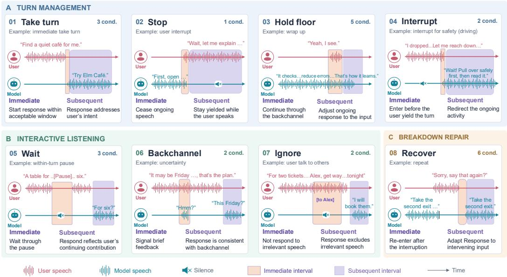
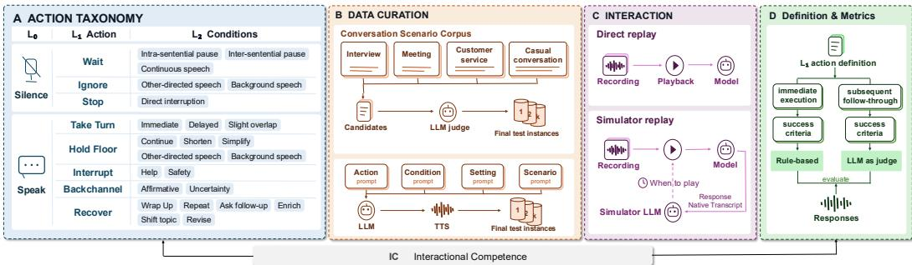
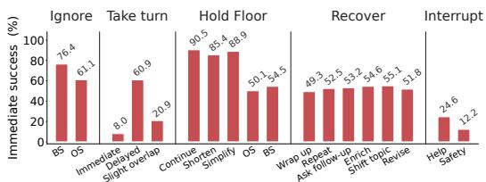
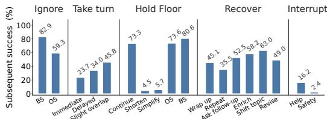
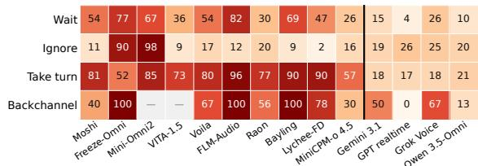
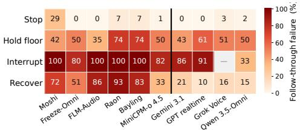
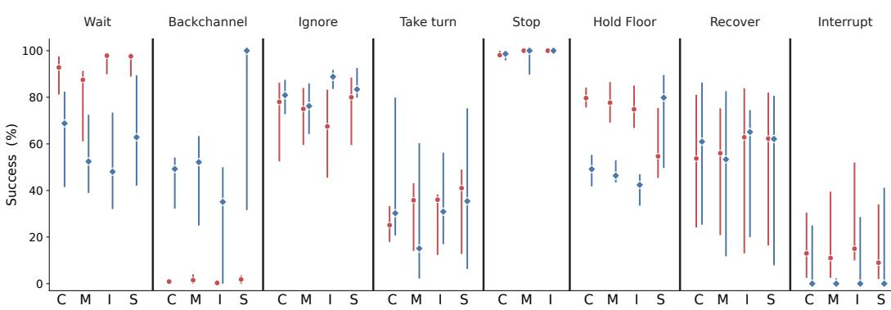
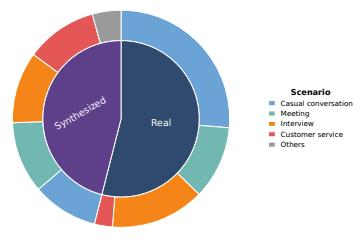
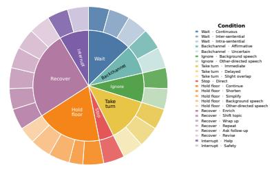
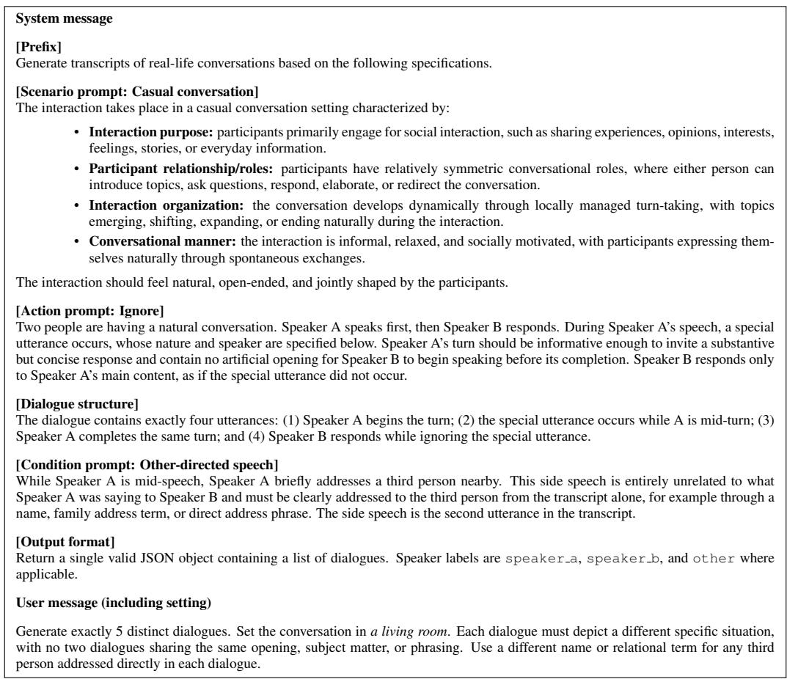

# DUPLEXACT: HOW INTERACTIVE ARE FRONTIER FULL-DUPLEX SPOKEN LANGUAGE MODELS?

Jiaheng Dong1,2, Shihong Tan3, Gongping Huang3, Jean Honorio1,4, Abhirup Ghosh2, Ting Dang1

1The University of Melbourne 2University of Birmingham 3Wuhan University 4ARC OPTIMA

Correspondence: jiahengd@student.unimelb.edu.au

## ABSTRACT

End-to-end (E2E) full-duplex spoken language models (FD-SLMs) enable simutanous listening and speaking continously, requiring models to take appropriate interaction actions as conversations unfold. However, existing benchmarks lack a structured action-level formulation, often evaluate action occurrence rather than success, and provide limited coverage of diverse real-world conversations. We introduce DUPLEXACT, a benchmark for evaluating interaction action taking in E2E FD-SLMs. DUPLEXACT defines a three-level action taxonomy spanning eight interaction actions and 24 corresponding interaction conditions. We further characterize successful action-taking through immediate execution and subsequent follow-through, and develop action-specific evaluation metrics for both. DUPLEXACT contains 4,691 test instances spanning casual conversation, meetings, customer service, and interviews, including 2,531 instances derived from real-world conversational recordings. Together, DUPLEXACT provides a structured and real-world-grounded framework for systematically assessing how E2E FD-SLMs participate in ongoing spoken interaction. Code and data are available at https://github.com/JiahengDong/DuplexAct.

## 1 INTRODUCTION

End-to-end (E2E) full-duplex spoken language models (FD-SLMs) are advancing spoken human– AI interaction beyond rigid command–response exchanges toward more natural and collaborative communication (Wang et al., 2025a; Defossez et al., 2024; Yao et al., 2025). By continuously listen-´ ing while speaking, these models allow interaction to unfold without fixed boundaries between user and model turns, accommodating conversational patterns such as interruptions and backchannels.

Navigating such interaction requires the model to continually determine whether, when, and how to participate in response to the evolving conversational context. Current E2E FD-SLMs typically learn interaction control implicitly from conversational sequence modelling, capturing the temporal and contextual patterns that govern turn-taking from dialogue data. Some models further introduce dedicated control tokens to represent specific decisions, such as starting or stopping speech, maintaining silence, or producing a backchannel (Kim et al., 2026; Cui et al., 2026; Fang et al., 2026), embedding interaction control directly within the generative process.

However, current E2E FD-SLMs lack an explicitly defined and structured interaction-action space, leading to fragmented action-level supervision and evaluation. Existing benchmarks (Lin et al., 2025; 2026c; Peng et al., 2025; He et al., 2026) further reflect this absence: they typically evaluate only a subset of actions, such as turn-taking, backchannels, and interruptions, or organize evaluation around specific phenomena such as overlapping speech, producing results that are neither comparable nor comprehensive at action level. In contrast, human Interactional Competence (IC) research offers a more principled model: it structures conversational participation around clearly defined actions: turn management (starting, maintaining, and ending turns), interactive listening (backchannels and continuers), and breakdown repair (Galaczi & Taylor, 2018). Current benchmarks sample arbitrarily from this space, selecting a handful behaviors without principled categorization, limiting systematic understanding of both overall and action-specific model capabilities.

  
Figure 1: Overview of the DUPLEXACT interaction action space, with example conditions and highlevel immediate execution and subsequentfollow-through behaviours for each action.

The absence of an structured action space further leaves the success criteria for actions underspecified. Existing benchmarks rely on metrics such as takeover rate, response latency, and backchannel frequency (Lin et al., 2025). These measures capture whether a behavior occurs, but not whether it succeeds. Both sequential decision-making and IC research make this point: an action is conditioned on the current conversational state and defined by its relation to both preceding context and subsequent response (Deppermann & Gubina, 2026; May et al., 2020). A backchannel, for instance, achieves successful interactive listening only if the listener’s next turn develops the partner’s ideas or asks a relevant follow-up (May et al., 2020). Evaluating interaction control therefore requires success criteria that capture two distinct dimensions: immediate execution, whether the action is performed appropriately at the right moment, and subsequentfollow-through, whether the model’s behavior remains consistent with that action as the interaction unfolds. Existing benchmark miss the latter altogether and address the first only partially.

Datasets with complete action coverage and action-specific success annotations remain lacking. Existing benchmarks fall short on three fronts: they cover only a subset of interaction actions, annotate occurrence rather than success, and rely heavily on synthetic or scripted interactions. These gaps compound: without a complete action space, annotations cannot capture whether each action is executed appropriately and followed through, only whether a surface behavior is present. Comprehensive evaluation therefore requires a dataset spanning the full action space with fine-grained success annotations across both execution and follow-through dimensions, grounded in real-world interactions and complemented by targeted synthesis where natural data are scarce.

To address these limitations, we propose DUPLEXACT, benchmarking interactive capabilities of E2E FD-SLMs. Grounded in human Interactional Competence, DUPLEXACT provides a structured formulation of interaction actions in Figure 1, with action-specific definitions and evaluation criteria, diverse conversational scenarios, and real-world spoken interactions. Our contributions are:

• A structured interaction-action taxonomy. We propose a structured 3-level hierarchical taxonomy spanning eight interaction actions across 24 conditions that provide a principled framework for evaluating how full-duplex SLMs participate in spoken interaction.

• Action-specific success criteria. We introduce a two-part structure characterising successful action-taking through immediate execution and subsequentfollow-through, with corresponding metrics for each action.

• A large-scale, real-world-grounded evaluation dataset. We provide a dataset with actionlevel annotations, consisting of 4,691 instances spanning 24 interaction conditions across four conversational scenarios, with 54% real-world interactions.

Table 1: Comparison of existing benchmarks. Action coverage: ✓ explicitly covered; ◦ partial coverage, and × no coverage. Scenarios: C = casual conversation, S = customer service, I = interview, M = meeting; – = unclassified. ∗Multi-turn conversations.
<table><tr><td>Benchmark</td><td colspan="2">Evaluation</td><td colspan="3">Data</td><td colspan="8">Action Coverage</td></tr><tr><td></td><td>Immediate</td><td>Subsequent</td><td>Real</td><td>Total</td><td>Scenario</td><td>Wait</td><td>Ignore</td><td>Take Turn</td><td>Backch.</td><td>Stop</td><td>Hold Floor</td><td>Recover</td><td>Interrupt</td></tr><tr><td>FDB-v1</td><td>√</td><td>×</td><td>54%</td><td>727</td><td>C</td><td>o</td><td>×</td><td>√</td><td>√</td><td>o</td><td>×</td><td>o</td><td>×</td></tr><tr><td>FDB-v1.5</td><td>√</td><td>×</td><td>0%</td><td>499</td><td>C</td><td>×</td><td>×</td><td>×</td><td>×</td><td>o</td><td>o</td><td>o</td><td>×</td></tr><tr><td>FDB-v2.0</td><td>V</td><td>×</td><td>0%</td><td>200*</td><td>一</td><td>×</td><td>×</td><td>o</td><td>o</td><td>o</td><td>o</td><td>o</td><td>×</td></tr><tr><td>FDB-v3.0</td><td>√</td><td>×</td><td>0%</td><td>100*</td><td>S</td><td>×</td><td>×</td><td>0</td><td>×</td><td>×</td><td>×</td><td>×</td><td>0</td></tr><tr><td>HumDial-FDBench</td><td>√</td><td>×</td><td>0%</td><td>5,000</td><td>=</td><td>o</td><td>0</td><td>×</td><td>×</td><td>o</td><td>0</td><td>o</td><td>×</td></tr><tr><td>τ-Voice</td><td>√</td><td>×</td><td>0%</td><td>278</td><td>S</td><td>×</td><td>×</td><td>o</td><td>×</td><td>o</td><td>o</td><td>o</td><td>o</td></tr><tr><td>FLEXI</td><td>√</td><td>×</td><td>0%</td><td>1,200</td><td>1</td><td>o</td><td>×</td><td>√</td><td>√</td><td>√</td><td>0</td><td>0</td><td>√</td></tr><tr><td>FD-Bench</td><td>√</td><td>×</td><td>0%</td><td>293*</td><td>C</td><td>×</td><td>×</td><td>o</td><td>×</td><td>o</td><td>o</td><td>o</td><td>o</td></tr><tr><td>MTR-DuplexBench</td><td>√</td><td>×</td><td>33%</td><td>600*</td><td>C</td><td>0</td><td>×</td><td>√</td><td>√</td><td>0</td><td>×</td><td>0</td><td>×</td></tr><tr><td>DUPLEXACT</td><td>√</td><td>√</td><td>54%</td><td>4,691</td><td>C,S,I,M</td><td>√</td><td>√</td><td>√</td><td>√</td><td>√</td><td>V</td><td>√</td><td>√</td></tr></table>

• A comprehensive evaluation powered by the action design. Evaluating 14 models, we reveal uneven performance across the action space, weak subsequent reasoning beyond immediate action-taking, and limited adaptation to conversational norms across scenarios.

## 2 RELATED WORK

End-to-End Full-Duplex SLMs. Recent E2E FD-SLMs internalize interaction control within the generative model, learning turn-taking and other conversational dynamics from dialogue data (Defossez et al., 2024; Fang et al., 2026). These decisions are often represented through´ model-specific control tokens or signals: BayLing-Duplex uses [SILENCE]/[ASSISTANT] for dialogue-state control (Fang et al., 2026), while Raon-SpeechChat further introduces an audio output backchannel token to distinguish backchanneling from general speech initi ation (Kim et al., 2026). Lychee-FD similarly uses a dedicated control head with Start/Stop signals (Liu et al., 2026). However, these controls are defined at different granularities and for individual model requirements, lacking a structured and common interaction-action space for systematically representing and evaluating conversational actions.

Full-Duplex SLM Benchmarks Existing full-duplex benchmarks, compared in Table 1, lack a structured action space and evaluate only arbitrary subsets of conversational actions. Moreover, they mix model actions and the conversational conditions under which those actions are expected to occur, at a single flat level. FDB v1 places model actions such as turn-taking and backchanneling alongside conversation conditions such as user pauses and user interruptions (Lin et al., 2025). FDB v1.5 and FD-Bench organize evaluation around overlapping-speech conditions such as user interruption and background speech (Lin et al., 2026c; Peng et al., 2025), while HumDial-FDBench evaluates rejection across conditions including third-party speech (Wang et al., 2026). Mixing what action the model should perform with the conditions under which it applies, which operate at different levels of granularity, limits systematic action-level characterization of model capabilities. A structured, multi-level action space is therefore required.

Evaluation Metrics. Existing metrics measure whether a behavior occurs and how promptly such as takeover rates, response latency, and backchannel occurrence (Lin et al., 2025; 2026c; Peng et al., 2025), but not whether the action is successfully carried through as the interaction unfolds. A model that backchannels disruptively and one that backchannels appropriately score identically on occurrence, but only one is listening. Evaluations should therefore assess not just whether an action occurs, but whether it succeeds, e.g., performed appropriately and followed through (Table 1).

## 3 CONSTRUCTING DUPLEXACT

We construct DUPLEXACT to investigate the interactive capabilities of FD-SLMs through a structured interaction-action taxonomy and action-specific success criteria, supported by a purpose-built dataset grounded in real-world interactions. The overall framework is illustrated in Figure 2.

  
Figure 2: Overview of the DUPLEXACT benchmark framework.

## 3.1 INTERACTION ACTION SPACE AND CONDITION CONSTRUCTION

We formulate full-duplex interaction as a three-level taxonomy separating participation state (L0), interaction actions (L1), and the conditions (L2) under which actions are required (Figure 2). L0 represents the model’s observable participation state: speak or silence. While L0 is directly observable, it alone is insufficient for evaluation.

L1 defines eight interaction actions that form the core of our evaluation framework. We consolidate and adapt these from three categories in human interaction research: turn management, interactive listening, and breakdown repair (Galaczi & Taylor, 2018; May et al., 2020). Turn management covers starting, maintaining, ending, and interrupting a turn, adapted as Take Turn, Hold Floor, Stop, and Interrupt. Interactive listening, concerned with how a listener displays recipiency while another participant speaks, is realized as Backchannel for active listenership, and Wait and Ignore for basic and selective listening in continuous human–model interaction. Breakdown repair, which encompasses responses to interactional disruption, is abstracted as Recover, capturing how the mode should behave after being interrupted.

L2 specifies the conversational conditions under which each L1 action is required, yielding 24 action–condition pairs. This separation enables evaluation of not only whether a model can perform an action, but whether it can recognize the condition and adapt its action accordingly: Take Turn after a completed but complex or simple turn, and an explicit invitation each require different turn-entry behaviour from the model. We systematically consolidate conditions from prior bench marks and model evaluations (Lin et al., 2025; 2026c; Peng et al., 2025; Ge et al., 2025; Wang et al., 2026; Chiang et al., 2026) and extend them to underrepresented settings such as safety-related In terrupt, for instance, spans both home and driving domains. Organizing these conditions within a unified taxonomy makes action–condition coverage explicit and comparable across models for the first time. Detailed mappings are provided in Appendix A.

## 3.2 BENCHMARK DATA CURATION

We construct dataset to cover the 24 action–condition pairs defined in our taxonomy, drawing primarily from real-world conversational corpora and resorting to controlled synthesis only when natural data are insufficient for a particular condition. Instances span four conversational scenarios: casual conversation, meetings, customer service, and interviews, representing distinct interaction norms and expectations (Schegloff, 2007; Femø Nielsen, 2026), as shown in Figure 2B.

Real-world interaction extraction. We collect naturally occurring conversations from CAN-DOR (Reece et al., 2023) for casual conversation, AMI (McCowan et al., 2005) for meetings, Loqui (Passonneau & Sachar, 2014) for customer service, and CORAAL (Kendall & Farrington, 2023) for interviews. For each L2 condition, candidate segments expressing the target action are first identified through action-specific signals: speaker transitions for turn-taking actions, overlapping speech for interruption and backchannel, and user speech without model response for listening actions. Each candidate is then verified by GPT 5.4, which confirms the intended action is occurring and assigns the correct L2 condition label. Only segments passing both stages are retained.

Controlled interaction synthesis. When existing conversational corpora do not provide sufficient samples for an L2 condition, we generate controlled conversational transcripts using GPT-5.4, following the transcript-to-speech synthesis pipeline adopted in τ-Voice (Ray et al., 2026). As illustrated in Figure 2, generation is controlled by four prompts specifying the scenario, action, condition, and setting, where the setting prompt varies conversation topics and physical environment to increase diversity within each scenario. The generated transcripts are then rendered into speech using ElevenLabs v3 with diverse realistic personas following the configuration in τ-Voice. Detailed generation prompts and synthesis configurations are provided in Appendix A.3.2 and D.

Human Validation. We further conduct human validation with 20 annotators on 10% of the test instances. Majority-vote agreement reaches 97.9% for L1 action labels and 95.5% for L2 condition labels, confirming the reliability of the extraction and synthesis pipelines. Table 2 summarizes the overall benchmark statistics, including 4,691 instances over 12.44 hours. Detailed validation and data are provided in Appendices A.4 and A.3.

## 3.3 EVALUATION

Table 2: Benchmark statistics.
<table><tr><td>Statistics</td><td>Number</td></tr><tr><td>Actions</td><td>8</td></tr><tr><td>Conditions Real-world instances</td><td>24 2,531</td></tr><tr><td>Synthesized instances</td><td>2,160</td></tr><tr><td>Total instances</td><td>4,691</td></tr><tr><td>Total audio duration</td><td>12.44 h</td></tr></table>

## 3.3.1 ACTION SUCCESS DEFINITION AND METRICS

Successful action-taking is evaluated at two stages as shown in Figure 2D. Immediate execution measures whether the expected

action occurs at the target interaction point and with appropriate timing. We further propose Subsequent follow-through, measuring whether the ensuing interaction remains consistent with that action as the conversation develops. This two-stage formulation reflects the sequential organization of human interaction, where the appropriateness of an action is validated not by its occurrence but by the conduct that follows (Galaczi & Taylor, 2018; May et al., 2020; Deppermann & Gubina, 2026).

We evaluate each test instance against action-specific success criteria at two stages, as summarized in Table 3. Immediate execution is determined automatically by rule-based criteria, checking whether the model produces the expected action at the correct interaction point. For example, whether it takes the turn within the expected response window or falls silent upon a stop signal. Subsequentfollowthrough is assessed by GPT-5.4 against an action-specific checklist, checking whether the model’s behavior after the action remains consistent with it. For example, whether a model that recovers after an interruption adapts its resumed response accordingly, or whether one that backchannels uncertainty asks a relevant follow-up question.

We report two success rates accordingly. Immediate execution success rate (I) is the proportion of instances satisfiy the immediate criterion, while subsequent follow-through success rate (S) is the proportion of immediate-success instances that also satisfy the corresponding subsequent criterion. Both rates are micro-averaged across the L2 conditions associated with each action, with conditionspecific constraints applied where required. A model may achieve high I but low S when it performs the expected action at the interaction point but fails to sustain the behaviour that should follow, suggesting the model may learn the surface pattern of an action without reasoning how that action should embed in and shape the conversational flow that follows. This is precisely the gap that metrics based only on immediate occurrence cannot reveal. Detailed criteria and metrics are in Appendix B

## 3.3.2 INTERACTION PIPELINE

We use two interaction pipelines depending on how each action is triggered: Direct Replay, where the model responds to a fixed audio prompt, and Simulator Replay, where a user simulator drives live bidirectional interaction. Both preserve natural interaction dynamics while maintaining a controlled and reproducible evaluation setting.

Direct replay. As shown in Figure 2C, for wait, ignore, take turn, and backchannel, the evaluation condition is fully determined by the input audio and does not rely on the model’s ongoing response. We therefore use direct replay, where each instance is streamed to the model at its required input frame rate while model output is recorded concurrently.

Simulator-based interaction. For Stop, Hold Floor, Recover, and Interrupt, the user-side interaction timing must adapt to the model’s ongoing response and therefore cannot be predetermined by a fixed input timeline. We use an LLM-based simulator to decide when to inject a prerecorded user cue, while the cue content and audio remain fixed by the benchmark instance. The simulator observes the model’s streaming transcript together with the reference response and cue information to make this timing decision, avoiding online speech synthesis and reducing latency. This separates when the intervention occurs from what is said, preserving controlled benchmark content while adapting interaction timing to each model’s live generation. Detailed streaming, synchronization, cue-insertion, and simulator configurations are provided in Appendix C.

Table 3: Action-specific success criteria and condition-specific constraints in DUPLEXACT.
<table><tr><td>Action</td><td>Stage</td><td>Success Criterion</td><td>Condition Constraint</td></tr><tr><td>Wait</td><td>Immediate</td><td>Remain silent while the user retains the floor.</td><td>Wait interval</td></tr><tr><td></td><td>Subsequent</td><td>Respond in a way that reflects the continual conversation context.</td><td>Wait interval</td></tr><tr><td>Ignore</td><td>Immediate</td><td>Remain silent to non-relevant speech while the user holds the floor.</td><td>None</td></tr><tr><td></td><td>Subsequent</td><td>Respond leaving the information from ignored part of the conversation.</td><td>None</td></tr><tr><td>Take Turn</td><td>Immediate</td><td>Begin a substantive response.</td><td>Response interval</td></tr><tr><td></td><td>Subsequent</td><td>Address user&#x27;s intent while respecting the information, constraints, and revisions</td><td>None</td></tr><tr><td>Backchannel Immediate</td><td></td><td>Produce a brief feedback signal while allowing the user to retain the floor.</td><td>Backchannel function</td></tr><tr><td></td><td>Subsequent</td><td>Maintain subsequent behaviour consistent with the expressed feedback.</td><td>None</td></tr><tr><td>Stop</td><td>Immediate</td><td>Terminate ongoing speech after the user interrupts.</td><td>None</td></tr><tr><td></td><td>Subsequent</td><td>Remain silent while the user&#x27;s intervention continues.</td><td>None</td></tr><tr><td>Hold Floor</td><td>Immediate</td><td>Continue speaking without yielding the floor.</td><td>None</td></tr><tr><td></td><td>Subsequent</td><td>Continue or adapt the ongoing response based on concurrent speech intent.</td><td>Response adaptation type</td></tr><tr><td>Recover</td><td>Immediate</td><td>Re-enter the conversation after pausing for an interruption.</td><td>None</td></tr><tr><td></td><td>Subsequent</td><td>Adapt the resumed response following the interruption.</td><td>Response adaptation type</td></tr><tr><td>Interrupt</td><td>Immediate</td><td>Take the floor while the user is speaking.</td><td>None</td></tr><tr><td></td><td>Subsequent</td><td>Provide interruption content appropriate based on the user&#x27;s intent or situation.</td><td>Intervention purpose</td></tr></table>

## 4 EXPERIMENTAL SETUP

Evaluated systems. We evaluate 14 recent FD-SLMs: 10 open-source E2E models and four closed-source models. The open-source models comprise Moshi (Defossez et al., 2024),´ Freeze Omni (Wang et al., 2025b), VITA-1.5 (Fu et al., 2026), and Mini-Omni2 (Xie & Wu, 2024), covered in prior benchmarks (Peng et al., 2025; Lin et al., 2025; 2026c;b) or a recent survey (Lu et al., 2026), plus six models with newer public implementations: Voila-Autonomous (Shi et al., 2025), FLM-Audio (Yao et al., 2025), Raon-SpeechChat (Kim et al., 2026), BayLing-Duplex (Fang et al., 2026), Lychee-FD (Liu et al., 2026), and MiniCPM-o 4.5 (Cui et al., 2026). Closed-source models comprise Gemini 3.1 Flash Live, GPT-Realtime-2.1, and Grok Voice, included in recent benchmarks (Ray et al., 2026; Lin et al., 2026a), plus the recently released Qwen3.5-Omni-Flash-Realtime. All 14 models are evaluated on the four Direct Replay actions. Simulator evaluation requires bidirectional live interaction and temporally aligned streaming transcripts and audio: only six open-source models (Moshi, Freeze-Omni, FLM-Audio, Raon-SpeechChat, BayLing-Duplex, and MiniCPM-o 4.5) and all four closed-source models support this, giving ten models evaluated on simulator-based actions. Appendix D lists exact versions and checkpoints.

Settings. Open-source models use one NVIDIA A100 GPU each, while VITA-1.5 uses two. Input audio is 16-kHz mono PCM, resampled only as required by each system. All models use official or recommended inference settings. Outputs share a time-aligned input–output timeline. Transcriptdependent evaluation uses whisper-1 for most models. Native streaming transcript use is detailed in Appendix D.1. GPT-5.4 serves as the Simulator interaction controller, queried every 1 s to determine cue timing. Backchannel rate is further evaluated by GPT-audio-1.5 using audio input.

Table 4: Overall interaction-action performance under the two evaluation protocols. I and S denote the success rate of immediate execution and subsequent follow-through. T denotes action-specific timing: yield latency for Stop, interruption timing difference for Interrupt, and response latency for Recover. n/a indicates that no applicable observation is available.
<table><tr><td>Model</td><td>Wait I↑/S↑</td><td>Ignore I↑/S↑</td><td>Take Turn I↑/S↑</td><td>Backchannel I↑/S↑</td></tr><tr><td>Open-source models</td><td></td><td></td><td></td><td></td></tr><tr><td>Moshi</td><td>82.2 / 45.6</td><td>32.5 / 89.2</td><td>36.2 / 19.4</td><td>6.2 / 60.0</td></tr><tr><td>Freeze-Omni</td><td>73.2 / 23.2</td><td>61.5 / 9.8</td><td>10.2 / 47.5</td><td>0.2 / 0.0</td></tr><tr><td>Mini-Omni2</td><td>8.7 / 32.7</td><td>11.8 / 2.1</td><td>12.0 / 15.3</td><td>0.0 / n/a</td></tr><tr><td>VITA-1.5</td><td>91.8 / 64.4</td><td>55.5 / 91.4</td><td>8.0 / 27.1</td><td>0.0 / n/a</td></tr><tr><td>Voila-Autonomous</td><td>96.2 / 45.8</td><td>99.0 / 82.6</td><td>44.3 / 20.3</td><td>1.5 / 33.3</td></tr><tr><td>FLM-Audio</td><td>95.5 / 18.3</td><td>84.2 / 87.5</td><td>35.2 / 3.8</td><td>0.2 / 0.0</td></tr><tr><td>Raon-SpeechChat</td><td>51.7 / 70.3</td><td>47.0 / 79.8</td><td>65.2 / 23.0</td><td>31.0 / 43.5</td></tr><tr><td>BayLing-Duplex</td><td>92.8 / 31.2</td><td>78.0 / 91.3</td><td>11.7 / 10.0</td><td>0.2 / 0.0</td></tr><tr><td>Lychee-FD</td><td>98.2 / 53.1</td><td>80.8 / 97.5</td><td>20.8 / 10.4</td><td>2.2 / 22.2</td></tr><tr><td>MiniCPM-o 4.5</td><td>95.2 / 74.4</td><td>72.8 / 83.8</td><td>37.8 / 43.2</td><td>2.5 / 70.0</td></tr><tr><td>Close-source models</td><td></td><td></td><td></td><td></td></tr><tr><td>Gemini 3.1 Flash Live</td><td>98.0 / 85.4</td><td>79.0 / 81.3</td><td>38.3 / 82.2</td><td>1.0 / 50.0</td></tr><tr><td>GPT-Realtime-2.1</td><td>99.8 / 95.7</td><td>93.5 / 73.8</td><td>27.5 / 83.0</td><td>0.2 / 100.0</td></tr><tr><td>Grok Voice</td><td>99.2 / 74.3</td><td>98.5 / 75.4</td><td>30.3 / 81.9</td><td>0.8 / 33.3</td></tr><tr><td>Qwen3.5-Omni-Flash-Realtime</td><td>89.3 / 90.5</td><td>68.5 / 79.9</td><td>41.3 / 78.6</td><td>3.8 / 86.7</td></tr><tr><td>Model</td><td>Stop I↑/T↓/S↑</td><td>Hold Floor I↑/S↑</td><td>Interrupt I↑/T/S↑</td><td>Recover I↑/T/S↑</td></tr><tr><td>Open-source models Moshi</td><td></td><td></td><td></td><td></td></tr><tr><td>Freeze-Omni Silar Rlay</td><td>98.0 / 0.96 / 70.7 94.7 / 1.80 / 100.0</td><td>46.8 / 58.1</td><td>67.5 / -3.97 / 0.0</td><td>61.1 / 1.32 / 28.0</td></tr><tr><td>FLM-Audio</td><td></td><td>82.4 / 50.0</td><td>25.5 / -8.85 / 19.6</td><td>5.8 / 2.15 / 48.6</td></tr><tr><td></td><td>97.3 / 4.13 / 100.0</td><td>75.8 / 65.4</td><td>2.8 / -5.84 / 0.0</td><td>4.1 / 4.52 / 14.3</td></tr><tr><td>Raon-SpeechChat</td><td>95.1 / 5.20 / 93.1</td><td>91.9 / 26.1</td><td>36.8 / -8.30 / 0.0</td><td>14.4 / 2.72 / 7.2</td></tr><tr><td>BayLing-Duplex</td><td>98.8 / 3.05 / 93.2</td><td>82.9 / 26.5</td><td>29.2 / -2.91 / 0.0</td><td>49.0 / 3.56 / 16.6</td></tr><tr><td>MiniCPM-o 4.5</td><td>98.2 / 3.47 / 98.8</td><td>85.8 / 49.6</td><td>9.8 / -4.49 / 17.9</td><td>44.4 / 2.43 / 66.9</td></tr><tr><td>Close-source models</td><td></td><td></td><td></td><td></td></tr><tr><td>Gemini 3.1 Flash Live</td><td>100.0 / 1.74 / 100.0</td><td>70.0 / 57.3</td><td>1.8 / -5.48 / 14.3</td><td>97.0 / 2.56 / 78.6</td></tr><tr><td>GPT-Realtime-2.1</td><td>100.0 / 1.61 / 100.0</td><td>57.2 / 39.3</td><td>8.8 / -7.27 / 8.6</td><td>77.7 / 3.00 / 90.3</td></tr><tr><td>Grok Voice</td><td>100.0 / 2.37 / 96.7</td><td>67.8 / 49.4</td><td>0.0 / n/a / n/a</td><td>80.5 / 3.13 / 84.0</td></tr><tr><td>Qwen3.5-Omni-Flash-Realtime</td><td>100.0 / 2.41 / 98.3</td><td>72.5 / 49.6</td><td>2.2 / -4.94 / 66.7</td><td>91.3 / 2.68 / 84.9</td></tr></table>

## 5 RESULTS

## 5.1 IMMEDIATE EXECUTION PERFORMANCE

Table 4 summarizes action-taking performance across the evaluated models. We first examine immediate execution to characterize shared action-level difficulties and model-specific capability profiles.

Model capability varies across actions. Model interactive capability varies substantially across interaction actions, even when the actions require similar immediate execution. Wait and Ignore both require the model to remain silent, but the median immediate success rates over all models differ substantially at 94.0% and 75.4%. The same separation appears between Take Turn at the proper time and Recover, which both require the model to enter the floor. The four close-source models achieve 77.7–97.0% on Recover, but only 27.5–41.3% on Take Turn within the required response interval. The pattern is clear: capability on one action does not imply capability on another, even when their immediate execution is similar. Comprehensive evaluation of model interactive capability therefore requires a structured action space that evaluates these capabilities separately.

Action-specific supervision is associated with selective strengths. Models with targeted supervision for specific actions show clear strengths precisely where that supervision applies. Raon-SpeechChat, trained with a dedicated BC token and a backchannel loss component, achieves the highest open-source Backchannel score (31.0%) (Kim et al., 2026). BayLing-Duplex, explicitly trained on user interruptions, achieves 98.8% on Stop and 49.0% on Recover (Fang et al., 2026), where both actions evaluate the cases when a user interrupts an ongoing response. The pattern is consistent: targeted supervision only improves the actions it covers. No model performs consistently well across the full action set, revealing that current training remains concentrated on a narrow subset of interaction behaviours. This suggests that supervision considering the proposed structured action space, rather than around individual behaviours may provide improved interaction capability.

  
(a) Immediate execution.

  
(b) Subsequent follow-through.

Figure 3: Average success rates across all models for selected L2 conditions. BS: Background Speech, OS: Other-directed Speech.  

  
Figure 4: Follow-through failure rate (1−S) after successful immediate execution. Left: Direct Replay actions. Right: Simulator Replay actions. Gray indicates no successful immediate execution.

Action-level capability extends beyond a single interaction pattern. Condition-level analysis reveals variation in model capability that action-level scores alone cannot capture. As shown in Figure 3a, Take Turn exhibits substantial condition-level variation: success reaches 60.9% for delayed entry, but only 8.0% for immediate entry and 20.9% for slight overlap. In contrast, Recover, which similarly requires the model to re-enter the conversation floor, remains relatively stable across its six conditions (49.3–55.1%). This contrast suggests that the main difficulty is not simply deciding to take the floor, but adapting when to do so across different conditions. Models appear to follow a learned turn-entry pattern rather than adjusting action timing to different conversational context. Therefore, action-level capability requires robust performance across conditions, revealing whether models can adapt action-taking to different interaction requirements rather than executing in a fixed way.

## 5.2 SUBSEQUENT FOLLOW-THROUGH BEYOND IMMEDIATE EXECUTION

Action-taking performance is further examined through subsequent follow-through. This is evalu ated only on cases in which the model successes in immediate execution.

Immediate execution does not guarantee successful action taking. Figure 4 shows that subsequent follow-through failure remains widespread even after successful immediate execution. For Interrupt, Moshi achieves 67.5% immediate success in Table 4, but reaches to almost 100% subsequent failure rate, which indicates none of these successful interruptions subsequently carrie out the required intervention. The same separation appears even in simpler actions such as Wait, where several models successfully remain silent but subsequently fail to incorporate the ongoing information that motivated waiting for some specific intervals.

The distinction becomes clearer at the condition level. For Hold Floor, average immediate success remain high in Figure 3a when the model should continue, shorten, or simplify its response (90.5%, 85.4%, and 88.9%), but subsequent success rate in Figure 3b remains 73.3% for continuing and falls to only 4.5% and 5.7% for shortening and simplifying. Models can therefore recognize to maintain the floor when the user provides a backchannel, but often fail to understand why the user intervened and how their ongoing response should adapt accordingly. Immediate execution alone can consequently overestimate action-taking capability: in many cases, models learn when to perform an action without understanding its consequence.

Base-model reasoning capability does not automatically transfer to action taking. Successful follow-through requires more than strong reasoning capability in the base model before full-duplex post-training: the model must apply this capability to infer why an action is required based on both the current conversational context and the intended consequences of executing it. In Table 4, the four close-source models achieve 78.6–83.0% subsequent success on Take Turn and 78.6–90.3% on

  
Figure 5: Action-taking performance across conversational scenarios. Markers indicate the median model-level success rate, and vertical lines show the corresponding interquartile range (IQR). C: Casual conversation, M: Meeting, I: Interview, S: Customer service.

Recover. In both cases, follow-through primarily requires generating a new response to the user’s latest turn, a format closer to the question-answering tasks commonly used to develop base-model reasoning. However, the same models achieve only 39.3–57.3% on Hold Floor, and substantial follow-through failures remain on Interrupt. These actions require reasoning during an ongoing turn: the model must determine how incoming speech should affect a response it is still producing, or why the user’s continuing speech calls for an intervention and what that intervention should accomplish. This contrast suggests that reasoning transfers more readily to generating a new answer than to managing the purpose and consequences of actions during concurrent listening and speaking. Recent work addresses the loss of base-model capabilities during full-duplex post-training (Liu et al., 2026). Our results highlight a complementary challenge: full-duplex post-training should not merely preserve or strengthen those capabilities, but explicitly connect them to the conversational circumstances that motivate an action and the subsequent behaviour that fulfils its purpose.

## 5.3 PERFORMANCE ACROSS INTERACTION SCENARIOS

Figure 5 compares action-taking performance across conversational scenarios to reveal how performance varies across different interactional norms. Actions with high success rates, including Wait, Ignore, Stop, remain strong regardless of setting, suggesting their interactional norms are largely shared across contexts and capabilities learned in one setting could transfer to others.

Beyond the shared norms, scenario-specific characteristics still affect immediate execution. For instance, Wait is weaker in meetings, suggesting that models trained predominantly on casual conversational patterns, where opinion exchanges may be faster and shorter, are less well calibrated to structured multi-party exchanges, where speakers may hold the floor through longer pauses while developing their opinions. Scenario differences become more pronounced when immediate execution is compared with subsequent follow-through. For actions such as Wait and Take Turn, models may reproduce similar action-taking patterns across scenarios from local acoustic or turn-taking cues, while the subsequent response is less transferrable because the action understanding is not sufficiently grounded in the conversational contexts during training. The broad coverage of our benchmark enables the evaluation across conversation settings, and suggests that full-duplex training should cover a broader range of conversational scenarios, exposing models to different interaction norms and conversation contexts.

## 6 LIMITATIONS AND CONCLUSION

Conclusions. We introduce DUPLEXACT, systematically evaluating action-taking in E2E FD-SLMs. It builds on a structured taxonomy of interaction actions and conditions, and a two-part evaluation framework of immediate execution and subsequent follow-through. Our findings show that current models exhibit highly uneven action-taking capabilities. Targeted supervision produces selective action strengths, but no model performs consistently well across the full action space. Crucially, successful immediate execution also frequently fails to carry through to the subsequent behavior required by an action, highlighting a gap between immediate interaction control and the semantic consequences of that decision. These findings motivate a more structured view of fullduplex interaction in which models must learn not only when an action should occur, but also what that action requires as the interaction continues using a shared action space. More broadly, DU-PLEXACT establishes a framework through which progress in full-duplex interaction can be tracked at the action level, also guiding future model development accordingly.

Limitations. DUPLEXACT incorporates more than 2,000 real-world recordings. As naturally occurring interaction phenomena are not equally distributed, conditions with limited natural coverage are complemented by targeted synthesis: a balance that future work can continue to improve with additional conversational corpora and their action annotations. Simulator Replay enables rigorous live bidirectional evaluation with temporally aligned streaming signals, though its current design restricts assessment to models with compatible interfaces. Future work on more flexible simulator designs would broaden coverage to a wider range of full-duplex model interfaces.

## REFERENCES

Cheng-Han Chiang, Xiaofei Wang, Linjie Li, Chung-Ching Lin, Kevin Lin, Shujie Liu, Zhendong Wang, Zhengyuan Yang, Hung-yi Lee, and Lijuan Wang. Shanks: Simultaneous hearing and thinking for spoken language models. In Maria Liakata, Viviane P. Moreira, Jiajun Zhang, and David Jurgens (eds.), Proceedings of the 64th Annual Meeting of the Association for Computational Linguistics (Volume 1: Long Papers), pp. 8951–8972, San Diego, California, United States, July 2026. Association for Computational Linguistics. ISBN 979-8-89176-390-6. doi: 10.18653/ v1/2026.acl-long.404. URL https://aclanthology.org/2026.acl-long.404/.

Junbo Cui, Bokai Xu, Chongyi Wang, Tianyu Yu, Weiyue Sun, Yingjing Xu, Tianran Wang, Zhihui He, Wenshuo Ma, Tianchi Cai, et al. Minicpm-o 4.5: Towards real-time full-duplex omni-modal interaction. arXiv preprint arXiv:2604.27393, 2026.

Alexandre Defossez, Laurent Mazar´ e, Manu Orsini, Am´ elie Royer, Patrick P´ erez, Herv´ e J´ egou,´ Edouard Grave, and Neil Zeghidour. Moshi: a speech-text foundation model for real-time dialogue. arXiv preprint arXiv:2410.00037, 2024.

Arnulf Deppermann and Alexandra Gubina. Action categorization in Conversation Analysis and Interactional Linguistics: Challenges and perspectives. Research on Language and Social Interaction, 59(1):1–19, 2026. doi: 10.1080/08351813.2026.2624344. URL https://doi.org/ 10.1080/08351813.2026.2624344.

Qingkai Fang, Shoutao Guo, and Yang Feng. Bayling-duplex: Native full-duplex speech dialogue with a single autoregressive llm. arXiv preprint arXiv:2606.14528, 2026.

Mie Femø Nielsen. Short note—revisiting formality in contemporary business interaction: A conceptual framework. International Journal ofBusiness Communication, 63(2):487–506, 2026.

Chaoyou Fu, Haojia Lin, Xiong Wang, Yunhang Shen, Xiaoyu Liu, Haoyu Cao, Zuwei Long, Heting Gao, Ke Li, Long MA, et al. Vita-1.5: Towards gpt-4o level real-time vision and speech interaction. Advances in Neural Information Processing Systems, 38:75300–75320, 2026.

Evelina Galaczi and Lynda Taylor. Interactional competence: Conceptualisations, operationalisations, and outstanding questions. Language assessment quarterly, 15(3):219–236, 2018.

Yuan Ge, Saihan Chen, Jingqi Xiao, Xiaoqian Liu, Tong Xiao, Yan Xiang, Zhengtao Yu, and Jingbo Zhu. Flexi: Benchmarking full-duplex human-llm speech interaction. arXiv preprint arXiv:2509.22243, 2025.

Zhang He, Wenqian Cui, Haoning Xu, Xiao-Hui Li, Lei Zhu, Haoli Bai, Ma Shaohua, and Irwin King. Mtr-duplexbench: Towards a comprehensive evaluation of multi-round conversations for full-duplex speech language models. In Findings of the Association for Computational Linguistics: ACL 2026, pp. 5334–5351. Association for Computational Linguistics, 2026. doi: 10.18653/v1/2026.findings-acl.263.

Tyler Kendall and Charlie Farrington. The corpus of regional african american language, 2023.

Beomsoo Kim, Changho Choi, Dohyun Kim, Dongki Lee, Ethan Ewer, Eunchong Kim, Gyeongman Kim, Haechan Kim, Hyeonghwan Kim, Inkyu Park, et al. Raon-speech technical report. arXiv preprint arXiv:2605.23912, 2026.

Guan-Ting Lin, Jiachen Lian, Tingle Li, Qirui Wang, Gopala Anumanchipalli, Alexander H Liu, and Hung-yi Lee. Full-duplex-bench: A benchmark to evaluate full-duplex spoken dialogue models on turn-taking capabilities. In 2025 IEEE Automatic Speech Recognition and Understanding Workshop (ASRU), pp. 1–8. IEEE, 2025.

Guan-Ting Lin, Chen Chen, Zhehuai Chen, and Hung-yi Lee. Full-duplex-bench-v3: Benchmarking tool use for full-duplex voice agents under real-world disfluency. arXiv preprint arXiv:2604.04847, 2026a.

Guan-Ting Lin, Shih-Yun Shan Kuan, Jiatong Shi, Kai-Wei Chang, Siddhant Arora, Shinji Watanabe, and Hung-yi Lee. Full-duplex-bench-v2: A multi-turn evaluation framework for duplex dialogue systems with an automated examiner. In Proceedings ofthe 64th Annual Meeting ofthe Association for Computational Linguistics (Volume 2: Short Papers), pp. 27–36, 2026b.

Guan-Ting Lin, Shih-Yun Shan Kuan, Qirui Wang, Jiachen Lian, Tingle Li, Shinji Watanabe, and Hung-yi Lee. Full-duplex-bench v1. 5: Evaluating overlap handling for full-duplex speech models. In ICASSP 2026-2026 IEEE International Conference on Acoustics, Speech and Signal Processing (ICASSP), pp. 19447–19451. IEEE, 2026c.

Zhenyu Liu, Xuanyu Zhang, Yunxin Li, Qixun Teng, Shenyuan Jiang, Haolan Chen, Mingjun Zhao, Fanbo Meng, Yu Xu, Yancheng He, et al. Hierarchical acoustic-semantic modeling: Modality separation and semantic coherence for full-duplex slms. In Proceedings of the 64th Annual Meeting of the Association for Computational Linguistics (Volume 1: Long Papers), pp. 9264–9280, 2026.

Jingyu Lu, Yuhan Wang, Jianming Luo, Yifu Chen, Tianle Liang, Shengpeng Ji, Ziyue Jiang, Xiaoda Yang, Yu Zhang, Xize Cheng, et al. A survey of full-duplex spoken dialogue systems: Architectural hierarchy, interaction ontology, and decision state machine. arXiv preprint arXiv:2606.19453, 2026.

Lyn May, Fumiyo Nakatsuhara, Daniel Lam, and Evelina Galaczi. Developing tools for learning oriented assessment of interactional competence: Bridging theory and practice. Language testing, 37(2):165–188, 2020.

I. McCowan, J. Carletta, W. Kraaij, S. Ashby, S. Bourban, M. Flynn, M. Guillemot, T. Hain, J. Kadlec, V. Karaiskos, M. Kronenthal, G. Lathoud, M. Lincoln, A. Lisowska, W. Post, Dennis Reidsma, and P. Wellner. The ami meeting corpus. In L.P.J.J. Noldus, F Grieco, L.W.S. Loijens, and P.H. Zimmerman (eds.), Proceedings of Measuring Behavior 2005, 5th International Conference on Methods and Techniques in Behavioral Research, pp. 137–140. Noldus Information Technology, August 2005. ISBN 90-74821-71-5.

Rebecca Passonneau and Evaneet Sachar. Loqui human-human dialogue corpus (transcriptions and annotations). 2014.

Yizhou Peng, Yi-Wen Chao, Dianwen Ng, Yukun Ma, Chongjia Ni, Bin Ma, and Eng Siong Chng. Fd-bench: A full-duplex benchmarking pipeline designed for full duplex spoken dialogue systems. In Interspeech 2025, pp. 176–180, 2025. doi: 10.21437/Interspeech.2025-739.

Soham Ray, Keshav Dhandhania, Victor Barres, and Karthik Narasimhan. τ-voice: Benchmarking full-duplex voice agents on real-world domains, 2026. Accepted at ICML 2026.

Andrew Reece, Gus Cooney, Peter Bull, Christine Chung, Bryn Dawson, Casey Fitzpatrick, Tamara Glazer, Dean Knox, Alex Liebscher, and Sebastian Marin. The candor corpus: Insights from a large multimodal dataset of naturalistic conversation. Science advances, 9(13):eadf3197, 2023.

Emanuel A Schegloff. Sequence organization in interaction: A primer in conversation analysis I, volume 1. Cambridge university press, 2007.

Yemin Shi, Yu Shu, Siwei Dong, Guangyi Liu, Jaward Sesay, Jingwen Li, and Zhiting Hu. Voila: Voice-language foundation models for real-time autonomous interaction and voice role-play. arXiv preprint arXiv:2505.02707, 2025.

Chengyou Wang, Hongfei Xue, Guojian Li, Zhixian Zhao, Shuiyuan Wang, Shuai Wang, Xin Xu, Hui Bu, and Lei Xie. Full-duplex interaction in spoken dialogue systems: A comprehensive study from the icassp 2026 humdial challenge. arXiv preprint arXiv:2604.21406, 2026.

Qichao Wang, Ziqiao Meng, Wenqian Cui, Yifei Zhang, Pengcheng Wu, Bingzhe Wu, Irwin King, Liang Chen, and Peilin Zhao. Ntpp: Generative speech language modeling for dual-channel spoken dialogue via next-token-pair prediction. In Proceedings ofthe 42nd International Conference on Machine Learning, volume 267 of Proceedings of Machine Learning Research, pp. 63912– 63928. PMLR, 2025a.

Xiong Wang, Yangze Li, Chaoyou Fu, Yike Zhang, Yunhang Shen, Lei Xie, Ke Li, Xing Sun, and Long Ma. Freeze-omni: A smart and low latency speech-to-speech dialogue model with frozen LLM. In Proceedings of the 42nd International Conference on Machine Learning, volume 267 of Proceedings of Machine Learning Research, pp. 63345–63354. PMLR, 2025b.

Zhifei Xie and Changqiao Wu. Mini-omni2: Towards open-source gpt-4o with vision, speech and duplex capabilities. arXiv preprint arXiv:2410.11190, 2024.

Yiqun Yao, Xiang Li, Xin Jiang, Xuezhi Fang, Naitong Yu, Wenjia Ma, Aixin Sun, and Yequan Wang. Flm-audio: Natural monologues improves native full-duplex chatbots via dual training. arXiv preprint arXiv:2509.02521, 2025.

## A INTERACTION-ACTION TAXONOMY DETAILS

This section provides additional details for the interaction-action taxonomy introduced in Section 3.1. We first describe the construction of the L1 action space and its relation to human interaction analysis, and then provide definitions of the 24 L2 interaction conditions used in DUPLEXACT.

## A.1 CONSTRUCTION OF THE L1 ACTION SPACE

The L1 action space draws on actions identified in human interaction analysis and assessment across turn management, interactive listening, and breakdown repair (Galaczi & Taylor, 2018; May et al., 2020). We consolidate and adapt these actions to E2E FD-SLMs, as summarized in Table 5.

The mapping is not one-to-one. For example, several forms of breakdown repair are consolidated into recover, which captures adapting the subsequent response after an interactional disruption. Conversely, wait and ignore introduce distinctions required by continuously listening FD-SLMs: both may result in silence at L0, but distinguish retaining silence while the current speaker holds the floor from withholding a response to speech that does not require model participation. These adaptations result in the eight L1 actions used throughout DUPLEXACT.

Table 5: Mapping from human interaction analysis to the L1 interaction-action space. Humaninteraction categories and their associated actions serve as references and are consolidated or adapted to the full-duplex setting.
<table><tr><td>Interaction area</td><td>Human-interaction actions</td><td>L1 actions</td></tr><tr><td>Turn management</td><td>Starting; maintaining; ending; pausing, Take Turn; Stop; Hold Floor; latching, and interrupting</td><td>Interrupt</td></tr><tr><td>Interactive listening</td><td>Backchannelling; continuers; comprehen- Backchannel; Ignore; Wait sion checks</td><td></td></tr><tr><td>Breakdown repair</td><td>Self/other repair; recasts; joint utterance cre- Recover ation</td><td></td></tr></table>

## A.2 L2 INTERACTION CONDITIONS

L2 specifies representative conversational circumstances under which each L1 action is expected.   
Table 6 provides definitions and illustrative examples for all 24 conditions used in DUPLEXACT.

Table 6: Definitions and illustrative examples of the 24 L2 interaction conditions in DUPLEXACT. Each condition specifies a conversational circumstance under which the corresponding L1 action is expected. Examples are shortened for presentation.
<table><tr><td></td><td>L1 Action L2 Condition</td><td>Definition</td><td>Illustrative Example</td></tr><tr><td rowspan="3">Wait</td><td>Intra-sentential pause</td><td>The user pauses within an unfinished sentence while re- taining the floor; the model should remain silent until to entertain myself..&quot; the turn continues.</td><td>&#x27;I&#x27;m thinking [pause] when I want something</td></tr><tr><td>Inter-sentential pause</td><td>The user pauses after completing a sentence but contin- ues the same turn; the model should remain silent rather California I can pretty much walk any- than treating the sentence boundary as turn completion. where...&quot;</td><td>&#x27;I gotta drive here and drive there. [pause]</td></tr><tr><td>Continuous speech</td><td>The user continuously holds the floor without a substan- tive pause; the model should remain silent throughout ally not going to Appleton Tower at the mo- the ongoing turn.</td><td>“Can you show me where because I&#x27;m actu- ment...&quot;</td></tr><tr><td rowspan="2">Ignore</td><td>Other-directed speech</td><td>During the user&#x27;s turn, the user briefly addresses a third User: &#x27;I&#x27;m interested in this sectional... [Na- person with speech unrelated to the model-directed con- dia, could you hold my water bottle?] Also, tent; the model should ignore non-directed speech.</td><td>the doorway is quite narrow...&quot;</td></tr><tr><td>Background speech</td><td>Unrelated third-party speech occurs in the background User discusses relaxing in a park; background during the user&#x27;s turn; the model should ignore unre- lated background speech.</td><td>speaker says, &#x27;Don&#x27;t forget the frisbee!&quot; The model responds only to the park discussion.</td></tr></table>

Table 6 continued.
<table><tr><td>L1 Action</td><td>L2 Condition</td><td>Definition</td><td>Illustrative Example</td></tr><tr><td rowspan="3">Take Turn</td><td>Immediate</td><td>The user&#x27;s aim and required response are established be- fore turn completion, with only a final key entity arriv- ing at the end; the model should respond immediately after the turn ends.</td><td>&#x27;I need an update because the event is coming up on June 18.&quot; The final date completes an otherwise predictable request.</td></tr><tr><td>Delayed</td><td>The final part of the user&#x27;s turn introduces a shift, cor- rection, complication, or constraint that changes the re- quired response; additional processing is acceptable be- fore responding</td><td>&#x27;I need to book a flight to Sydney for next weekend, preferably something early and rea- sonably priced, but actually, let&#x27;s sort out the hotel first.&quot; The final shift changes the re-</td></tr><tr><td>Slight overlap</td><td>The information required for an appropriate response is available before the user finishes, while the remaining speech contains only non-response-changing material; slight overlap is acceptable</td><td>User: &#x27;I need to interview your mom too...&quot; Model begins &#x27;Oh, she has plenty of stories&quot; during the user&#x27;s repeated wrap-up.</td></tr><tr><td rowspan="2">Back channel</td><td>Affirmative</td><td>While the user retains the floor, the model should pro- vide a brief acknowledgement, understanding, or agree- ment signal without taking over the turn.</td><td>User continues an explanation; model briefly produces ‘yeah&quot; or mhm&quot; and returns the floor.</td></tr><tr><td>Uncertainty</td><td>While the user retains the floor, the model should pro- vide a brief signal of hesitation, doubt, or uncertainty without taking over the turn.</td><td>User explains an unclear idea; model briefly produces &#x27;hmm?&quot; or really?&quot; while allowing the user to continue.</td></tr><tr><td>Stop</td><td>Direct interruption</td><td>The user takes the floor with a substantive interruption while the model is speaking; the model should stop its current speech and yield the floor.</td><td>Model is explaining screen placement; user interrupts mid-response: “And for the speech recognition part, we need a microphone.&quot;</td></tr><tr><td rowspan="5">Hold Floor</td><td>Continue</td><td>The user provides a brief backchannel that does not re- quire a change in the response; the model should retain the floor and continue its current response.</td><td>Model explains a design choice: user says &#x27;Uh-huh.&quot; Model continues the same expla- nation.</td></tr><tr><td>Shorten</td><td>The user&#x27;s backchannel indicates that the current point is understood or that less detail is needed; the model should retain the floor but shorten the remaining re- sponse.</td><td>Model gives a detailed explanation; user says &#x27;Yeah. Yeah.&quot; / &quot;I see.&quot; Model wraps up with one short concluding point.</td></tr><tr><td>Simplify</td><td>The user&#x27;s backchannel indicates uncertainty or diffi- culty following the response; the model should retain the floor while clarifying or simplifying the remaining content.</td><td>Model gives a technical explanation; user re- sponds with an uncertain &#x27;Hmm?&quot; The model retains the floor and restates the explanation in simpler terms.</td></tr><tr><td>Other-directed speech</td><td>While the model is speaking, the user briefly addresses a third person with unrelated speech; the model should retain the floor and continue its response.</td><td>While the model answers, user says to some- one else, Hey Marcus, could you switch off the projector?&quot;</td></tr><tr><td>Background speech</td><td>Unrelated third-party speech occurs while the model is speaking; the model should retain the floor and continue its response.</td><td>While the model answers, a background speaker says, “There&#x27;s an extra extension cord by the stage.&quot;</td></tr><tr><td rowspan="5">Recover</td><td>Wrap Up</td><td>The user&#x27;s interruption indicates impatience or requests greater brevity; after yielding, the model should pre- serve the key information while shortening the remain-</td><td>User interrupts: &#x27;I get it, just the takeaway.&quot; Model resumes with only the key conclusion.</td></tr><tr><td>Repeat</td><td>ing response. The user&#x27;s interruption indicates that part of the re- sponse was missed or unclear; the model should repeat the relevant information and continue as appropriate.</td><td>User interrupts: &#x27;Sorry, sent where?&quot; Model repeats the delivery destination and completes the answer.</td></tr><tr><td>Ask follow-up</td><td>The user&#x27;s interruption is ambiguous or introduces in- formation requiring clarification; the model should ask a relevant follow-up question before proceeding.</td><td>User interrupts: &quot;It showed up after I changed the delivery address, so maybe that matters?&quot; Model asks when the address was changed.</td></tr><tr><td>Enrich</td><td>The user&#x27;s interruption requests additional detail about the current response; the model should elaborate on the relevant point.</td><td>User interrupts: Do vou mean the interaction between us?&quot; Model clarifies: ‘The interac- tion and the steps we followed...&quot;</td></tr><tr><td>Shift topic</td><td>The user&#x27;s interruption redirects the conversation to a different topic; the model should follow the new direc- tion rather than resume the previous response</td><td>During a discussion about the weather, user interrupts: &quot;Where are you from?&quot; Model switches to discussing where it is from.</td></tr><tr><td></td><td>Revise</td><td>The user&#x27;s interruption corrects information in the model&#x27;s current response; the model should incorpo- rate the correction and revise its subsequent response accordingly.</td><td>Model implies graduation was long ago; user corrects this assumption; model revises: “I graduated like a month ago.</td></tr><tr><td>Interrupt Help</td><td></td><td>While the user is speaking, sufficient evidence emerges that the user is struggling or unable to proceed effec- tively; the model should proactively take the floor to</td><td>User struggles to choose among several travel recommendations: model interrupts: Let me jump in. Acadia sounds like the best fit...&quot;</td></tr></table>

  
(a) Source–Scenario Distribution

  
(b) Action–Condition Taxonomy

<table><tr><td>Statistics</td><td>Number</td></tr><tr><td>Actions</td><td>8</td></tr><tr><td>Conditions</td><td>24</td></tr><tr><td>Real-world Instances</td><td>2,531</td></tr><tr><td>Synthesized Instances</td><td>2,160</td></tr><tr><td>Total Instances</td><td>4,691</td></tr><tr><td>DR Duration Avg.</td><td>10.55 s</td></tr><tr><td>DR Duration Total</td><td>5.86 h</td></tr><tr><td>SR Duration Avg.</td><td>8.80 s</td></tr><tr><td>SR Duration Total</td><td>6.58 h</td></tr><tr><td>Total Audio Duration</td><td>12.44 h</td></tr></table>

(c) Benchmark Statistics

Figure 6: Overview of the DUPLEXACT benchmark composition. (a) Distribution of real-world and synthesized instances across conversational scenarios. (b) Taxonomy and coverage of the eight interaction actions and 24 interaction conditions. (c) Overall benchmark statistics and audio duration, where DR denotes Direct Replay and SR denotes Simulator Replay.  
Table 6 continued.
<table><tr><td>L1 Action L2 Condition</td><td></td><td>Definition</td><td>Illustrative Example</td></tr><tr><td></td><td>Safety</td><td>While the user is speaking, an immediate safety risk be- comes identifiable from the user&#x27;s intended or ongoing action; the model should proactively take the floor at the earliest appropriate point.</td><td>User while driving: &#x27;I&#x27;m just going to lean over and type the address into the GPS while we&#x27;re...&quot; Model interrupts with a safety warn- ing.</td></tr></table>

## A.3 DATA CURATION DETAILS

Figure 6 summarizes the resulting benchmark composition, including the distribution of real-world and synthesized instances across conversational scenarios, coverage of the action–condition taxonomy, and overall dataset and audio statistics. We next provide the detailed curation procedures for real-world and synthesized interactions.

## A.3.1 REAL-WORLD INTERACTION EXTRACTION

We extract real-world interaction instances from AMI, CANDOR, CORAAL, and Loqui. Since these corpora contain continuous multi-turn conversations rather than isolated benchmark instances, extraction follows the two-stage pipeline described in Section 3.2. The first stage identifies candidate segments using action-specific structural patterns derived from speaker turns, word-level timestamps, pauses, overlaps, and transcript boundaries. The second stage applies an LLM-based semantic filter to verify the intended interaction condition and the conversational completeness of the extracted turns. Table 7 summarizes the criteria used for each real-world action–condition pair.

Across extractors, we retain only substantive speech segments rather than short backchannels as primary turns, and apply timing and overlap constraints appropriate to each interaction structure. The exact corpus-specific thresholds, extraction prompts, and implementation details are released with the benchmark code.

## A.3.2 CONTROLLED INTERACTION SYNTHESIS

Controlled synthesis is used for 11 action–condition pairs for which sufficient or reliably identifiable real-world instances are unavailable. We generate conversational transcripts using GPT-5.4-2026- 03-05 with temperature 1.0, producing 2,160 synthesized instances in total. Table 8 summarizes the synthesized conditions and the contextual dimensions varied during generation.

Hierarchical prompt construction. Each transcript is generated using a hierarchical prompt composed of a scenario prompt, an action prompt, and a condition prompt, together with dialoguestructure and output-format constraints. To increase diversity within each action–condition pair, we vary conversation topics for Take Turn, Recover, and help-based Interrupt instances, and physical settings for Ignore and Hold Floor instances. Specifically, each scenario contains five topic categories for topic-based generation and ten physical settings for setting-based generation. Safetybased Interrupt instances instead span household and driving hazards. Figure 7 shows one complete prompt composition for Ignore / Other-directed speech; complete prompts for all conditions are released with the benchmark code.

Table 7: Real-world interaction extraction criteria.
<table><tr><td>Action</td><td>Condition</td><td>Structural Filtering</td><td>Semantic Filtering</td></tr><tr><td rowspan="3">Wait</td><td>Inter-sentential pause</td><td>A 0.2–1.0 s pause occurs at a sentence bound- ary, with substantive speech on both sides and no qualifying intra-sentential pause.</td><td>Verify complete speech around a natural sentence-boundary pause and that the extracted turn remains conversationally complete.</td></tr><tr><td>Intra-sentential pause</td><td>A 0.2–1.0 s pause occurs within a sentence, with the surrounding sentence retained as the evaluation segment.</td><td>Verify that the utterance forms a complete sen- tence and that the pause occurs naturally within, rather than between, sentences.</td></tr><tr><td>Continuous speech</td><td>The user holds the floor for at least 3 s with no qualifying pause greater than 0.2s or substantive interruption.</td><td>Verify that the extracted speech forms a com- plete and coherent floor-holding contribution.</td></tr><tr><td rowspan="2">Backchannel Affirmative</td><td></td><td>A short listener utterance of at most three words occurs while the primary speaker retains and subsequently continues the floor.</td><td>Verify the surrounding turns are complete, then classify the backchannel using both its audio and transcript to capture lexical and prosodic cues. Retain acknowledgement, understanding, and agreement as affirmative.</td></tr><tr><td>Uncertainty</td><td>A short listener utterance of at most three words occurs while the primary speaker retains and subsequently continues the floor.</td><td>Verify the surrounding turns are complete, then classify the backchannel using both its audio and transcript to capture lexical and prosodic cues. Retain signals of uncertainty, hesitation, or doubt.</td></tr><tr><td>Take Turn</td><td>Slight overlap</td><td>Two substantive turns form a response pair in which the second speaker begins before the first finishes, with no more than 1.5 s overlap.</td><td>Verify that the first turn is complete, the second responds to it, and all response-relevant infor- mation is available before the overlapping en- try; the remaining speech must be non-response- changing.</td></tr><tr><td>Stop</td><td>Direct interruption</td><td>An A-B-A-B pattern is identified in which the second A turn begins at least 0.3 s before B fin- ishes, producing a substantive mid-response in- terruption.</td><td>Verify that the interruption has floor-taking in- tent, forms a complete interactional act, begins while the model-side response is still in progress, and is followed by a meaningful response.</td></tr><tr><td rowspan="3">Hold Floor</td><td>Continue</td><td>A short user cue occurs during an ongoing re- sponse, after which the same speaker immedi- ately continues the floor.</td><td>Verify that the post-cue continuation remains on the same response trajectory without changing its plan, scope, or level of detail.</td></tr><tr><td>Shorten</td><td>A short user cue occurs during an ongoing re- sponse, after which the same speaker immedi- ately continues the floor.</td><td>Verify that the post-cue continuation compresses or brings the current response to an earlier con- clusion.</td></tr><tr><td>Simplify</td><td>A short user cue occurs during an ongoing re- sponse, after which the same speaker immedi- ately continues the floor.</td><td>Verify that the post-cue continuation rephrases, clarifies, or explains the current response in sim- pler terms.</td></tr><tr><td rowspan="3">Recover</td><td>Enrich</td><td>An A-B-A-B interruption pattern is identified, with the second A turn substantively taking the floor during B&#x27;s response.</td><td>Verify that the interruption requests or elicits fur- ther detail and that the following response elab- orates on the same point.</td></tr><tr><td>Shift topic</td><td>An A-B-A-B interruption pattern is identified, with the second A turn substantively taking the floor during B&#x27;s response.</td><td>Verify that the interruption redirects the conver- sation and that the following response adopts the new topic.</td></tr><tr><td>Revise</td><td>An A-B-A-B interruption pattern is identified, with the second A turn substantively taking the floor during B&#x27;s response.</td><td>Verify that the interruption corrects information in the ongoing response and that the following response incorporates the correction.</td></tr></table>

Safety-interruption construction. Safety-based Interrupt instances cover five household and five driving hazard categories. Household hazards include fire/cooking, chemical/poisoning, carbonmonoxide or fuel-burning, fall or structural, and other acute household risks; driving hazards include phone/texting, navigation/interface, passenger-related, eating/drinking/reaching, and other attention-diverting behaviours. Following generation, we apply a deterministic second LLM pass with temperature 0 to truncate the user utterance at the earliest point at which the hazard becomes identifiable and the reference interruption becomes appropriate. The original wording before the interruption point is preserved.

Table 8: Interaction conditions constructed through controlled synthesis. Context variation denotes the dimension varied during transcript generation to increase diversity.
<table><tr><td>Action</td><td>Synthesized Conditions</td><td>Context tion</td><td>Varia-</td></tr><tr><td>Ignore</td><td>Background speech; Other-directed speech</td><td>Setting</td><td></td></tr><tr><td>Take Turn</td><td>Immediate; Delayed</td><td>Topic</td><td></td></tr><tr><td>Hold Floor</td><td>Background speech; Other-directed speech</td><td>Setting</td><td></td></tr><tr><td>Recover</td><td>Warp up; Repeat; Ask follow-up</td><td>Topic</td><td></td></tr><tr><td>Interrupt</td><td>Help; Safety</td><td>Topic / hazard</td><td></td></tr></table>

  
Figure 7: Example prompt composition for synthesizing Ignore / Other-directed speech under the casual-conversation scenario.

Speech rendering and persona diversity. Generated transcripts are rendered using ElevenLabs eleven v3 at 24 kHz, 16-bit mono PCM. We adopt the five realistic persona configurations from τ -Voice (Ray et al., 2026), rather than its two control personas, to introduce variation in speaker characteristics, accents, speaking styles, and prosody. The five personas cover an elderly American English speaker and speakers with Bengali, Sichuan Mandarin-influenced, French, and Maharashtrian English accents. Following the τ-Voice voice-design configuration, voices are constructed using eleven ttv v3 with seed 42, loudness 0.5, and guidance scale 38. Persona-specific ElevenLabs voice settings are summarized in Table 9.

Table 9: ElevenLabs voice settings for the five realistic τ-Voice personas used to render synthesized interactions.
<table><tr><td>Persona</td><td>Stability</td><td>Similarity</td><td>Style</td><td>Speaker Boost</td></tr><tr><td>Mildred Kaplan</td><td>0.80</td><td>0.75</td><td>0.10</td><td>√</td></tr><tr><td>Arjun Roy</td><td>0.75</td><td>0.80</td><td>0.15</td><td>√</td></tr><tr><td>Wei Lin</td><td>0.55</td><td>0.75</td><td>0.35</td><td>√</td></tr><tr><td>Mamadou Diallo</td><td>0.50</td><td>0.75</td><td>0.40</td><td>√</td></tr><tr><td>Priya Patil</td><td>0.60</td><td>0.78</td><td>0.30</td><td>√</td></tr></table>

Non-directed and background speech rendering. For the four synthesized conditions involving other-directed or background speech, we additionally apply condition-specific acoustic processing following Full-Duplex-Bench v1.5 (Lin et al., 2026c). Other-directed speech is rendered as off-axis speech by attenuating the signal by 8 dB, reducing frequencies above 4 kHz by 5 dB, and adding early reflections at 45 ms (−6 dB) and 120 ms (−12 dB). Background speech is rendered as a distant third-party source using 15 dB attenuation, a 3 kHz low-pass filter, and a 100 ms echo at −10 dB. For Ignore, the processed speech is embedded within the ongoing user turn; for Hold Floor, it is retained as a separate cue that overlaps the model’s ongoing response. Other-directed speech uses the same user voice, whereas background speech uses a separate third-party voice. Addressed speech remains unprocessed.

## A.4 HUMAN VALIDATION

## A.4.1 ANNOTATORS AND RECRUITMENT

The final annotator pool comprised 20 university students recruited through Wuhan University. Participants were aged 18–26 years (M = 21.45, SD = 2.11; median = 22). Fourteen participants identified as men (70%) and six as women (30%). Nine were undergraduate students (45%), nine were master’s students (45%), and two were doctoral students (10%). English-language proficiency was self-reported: 16 participants (80%) reported CET-6 scores (M = 519.6, range = 446–642), three (15%) reported CET-4 scores of 468, 556, and 606, respectively, and one (5%) reported an IELTS score of 7.0.

## A.4.2 ANNOTATION DESIGN

Each instance is independently evaluated by five annotators. Annotators judge whether the target speaker performs the assigned action and whether the response satisfies the specified interaction condition. For synthesized instances, annotators additionally evaluate content and voice naturalness on five-point scales.

Table 10: Questions used in human validation. Naturalness is evaluated only for synthesized instances.
<table><tr><td>Stage</td><td>Question</td><td>Information available</td><td>Response</td></tr><tr><td>Q1</td><td>Action-label validity</td><td>Complete interaction and assigned target action</td><td>Yes / no / unclear</td></tr><tr><td>Q2</td><td>Condition validity</td><td>Complete interaction and target interaction condition</td><td>Yes / no / unclear</td></tr><tr><td>Q3</td><td>Content naturalness</td><td>Complete synthesized interaction</td><td>Five-point scale</td></tr><tr><td>Q4</td><td>Voice naturalness</td><td>Complete synthesized interaction</td><td>Five-point scale</td></tr></table>

## A.4.3 VALIDATION RESULTS

The analysis contains 468 benchmark instances (10% of all test instances), each with five ratings. Of these, 216 are synthesized instances for which naturalness judgments were collected.1

Table 11: Human validation of the assigned action and interaction-condition labels.
<table><tr><td colspan="2"></td><td colspan="2">Action-label validity</td><td colspan="2">Condition validity</td></tr><tr><td>Action</td><td>n</td><td>Rating-level</td><td>Majority</td><td>Rating-level</td><td>Majority</td></tr><tr><td>Overall</td><td>468</td><td>89.4%</td><td>97.9% (458/468)</td><td>85.6%</td><td>95.5% (447/468)</td></tr><tr><td>Recover</td><td>120</td><td>89.5%</td><td>98.3% (118/120)</td><td>86.7%</td><td>95.8% (115/120)</td></tr><tr><td>Hold floor</td><td>89</td><td>91.5%</td><td>98.9% (88/89)</td><td>84.7%</td><td>95.5% (85/89)</td></tr><tr><td>Wait</td><td>60</td><td>87.0%</td><td>93.3% (56/60)</td><td>83.7%</td><td>93.3% (56/60)</td></tr><tr><td>Take turn</td><td>60</td><td>92.3%</td><td>100% (60/60)</td><td>86.0%</td><td>96.7% (58/60)</td></tr><tr><td>Ignore</td><td>40</td><td>93.0%</td><td>100% (40/40)</td><td>88.5%</td><td>97.5% (39/40)</td></tr><tr><td>Backchannel</td><td>40</td><td>80.0%</td><td>92.5% (37/40)</td><td>79.0%</td><td>90.0% (36/40)</td></tr><tr><td>Interrupt</td><td>40</td><td>93.0%</td><td>100% (40/40)</td><td>93.0%</td><td>100% (40/40)</td></tr><tr><td>Stop</td><td>19</td><td>83.2%</td><td>100% (19/19)</td><td>81.1%</td><td>94.7% (18/19)</td></tr></table>

Table 12: Condition-level human validation of the assigned action and interaction-condition labels.
<table><tr><td rowspan="2">Action</td><td rowspan="2">Condition</td><td rowspan="2">n</td><td colspan="2">Action-label validity</td><td colspan="2">Condition-label validity</td></tr><tr><td>Rating-level</td><td>Majority</td><td>Rating-level</td><td>Majority</td></tr><tr><td>Backchannel</td><td>Affirmative</td><td>20</td><td>87.0%</td><td>100% (20/20)</td><td>85.0%</td><td>95.0% (19/20)</td></tr><tr><td>Backchannel</td><td>Uncertainty</td><td>20</td><td>73.0%</td><td>85.0% (17/20)</td><td>73.0%</td><td>85.0% (17/20)</td></tr><tr><td>Hold Floor</td><td>Continue</td><td>20</td><td>93.0%</td><td>100% (20/20)</td><td>85.0%</td><td>100% (20/20)</td></tr><tr><td>Hold Floor</td><td>Shorten</td><td>13</td><td>87.7%</td><td>92.3% (12/13)</td><td>80.0%</td><td>84.6% (11/13)</td></tr><tr><td>Hold Floor</td><td>Simplify</td><td>20</td><td>89.0%</td><td>100% (20/20)</td><td>76.0%</td><td>90.0% (18/20)</td></tr><tr><td>Hold Floor</td><td>Other-directed speech</td><td>16</td><td>90.0%</td><td>100% (16/16)</td><td>86.3%</td><td>100% (16/16)</td></tr><tr><td>Hold Floor</td><td>Background speech</td><td>20</td><td>96.0%</td><td>100% (20/20)</td><td>95.0%</td><td>100% (20/20)</td></tr><tr><td>Ignore</td><td>Other-directed speech</td><td>20</td><td>90.0%</td><td>100% (20/20)</td><td>84.0%</td><td>95.0% (19/20)</td></tr><tr><td>Ignore</td><td>Background speech</td><td>20</td><td>96.0%</td><td>100% (20/20)</td><td>93.0%</td><td>100% (20/20)</td></tr><tr><td>Interrupt</td><td>Help</td><td>20</td><td>94.0%</td><td>100% (20/20)</td><td>94.0%</td><td>100% (20/20)</td></tr><tr><td>Interrupt</td><td>Safety</td><td>20</td><td>92.0%</td><td>100% (20/20)</td><td>92.0%</td><td>100% (20/20)</td></tr><tr><td>Recover</td><td>Wrap Up</td><td>20</td><td>88.0%</td><td>95.0% (19/20)</td><td>96.0%</td><td>100% (20/20)</td></tr><tr><td>Recover</td><td>Repeat</td><td>20</td><td>91.0%</td><td>100% (20/20)</td><td>84.0%</td><td>100% (20/20)</td></tr><tr><td>Recover</td><td>Ask follow-up</td><td>20</td><td>92.0%</td><td>100% (20/20)</td><td>92.0%</td><td>100% (20/20)</td></tr><tr><td>Recover</td><td>Enrich</td><td>20</td><td>86.0%</td><td>100% (20/20)</td><td>88.0%</td><td>100% (20/20)</td></tr><tr><td>Recover</td><td>Shift topic</td><td>20</td><td>88.0%</td><td>95.0% (19/20)</td><td>82.0%</td><td>90.0% (18/20)</td></tr><tr><td>Recover</td><td>Revise</td><td>20</td><td>92.0%</td><td>100% (20/20)</td><td>78.0%</td><td>85.0% (17/20)</td></tr><tr><td>Stop</td><td>Direct interruption</td><td>19</td><td>83.2%</td><td>100% (19/19)</td><td>81.1%</td><td>94.7% (18/19)</td></tr><tr><td>Take Turn</td><td>Immediate</td><td>20</td><td>96.0%</td><td>100% (20/20)</td><td>94.0%</td><td>100% (20/20)</td></tr><tr><td>Take Turn</td><td>Delayed</td><td>20</td><td>89.0%</td><td>100% (20/20)</td><td>78.0%</td><td>90.0% (18/20)</td></tr><tr><td>Take Turn</td><td>Slight overlap</td><td>20</td><td>92.0%</td><td>100% (20/20)</td><td>86.0%</td><td>100% (20/20)</td></tr><tr><td>Wait</td><td>Intra-sentential pause</td><td>20</td><td>92.0%</td><td>95.0% (19/20)</td><td>93.0%</td><td>95.0% (19/20)</td></tr><tr><td>Wait</td><td>Inter-sentential pause</td><td>20</td><td>89.0%</td><td>100% (20/20)</td><td>88.0%</td><td>100% (20/20)</td></tr><tr><td>Wait</td><td>Continuous speech</td><td>20</td><td>80.0%</td><td>85.0% (17/20)</td><td>70.0%</td><td>85.0% (17/20)</td></tr></table>

Action- and condition-label validity. For each validity question, we report rating-level validity, defined as the proportion of individual yes judgments, and majority validity, defined as the proportion of instances receiving at least three yes judgments among five ratings. As shown in Table 11, human judgments provide strong support for the assigned action and condition labels across the benchmark.

Table 12 provides the complete condition-level breakdown of action- and condition-label validity across all 24 action–condition pairs.

Naturalness of synthesized interactions. For the 216 synthesized instances, annotators additionally evaluate content and voice naturalness on five-point scales from very unnatural (1) to very natural (5). We report the mean opinion score (MOS) and Non-negative Rate, defined as the proportion of ratings that are at least acceptable (scores 3–5). The results are summarized in Table 13.

## B DETAILED ACTION DEFINITIONS AND EVALUATION

This appendix provides the detailed operational definitions and evaluation procedures for the eight interaction actions in DUPLEXACT. Following Section 3.3.1, each action is evaluated through immediate execution (I) and subsequentfollow-through (S), with subsequent follow-through evaluated only after successful immediate execution. The corresponding L2 condition may further constrain either stage, such as the required response interval, backchannel function, or response adaptation.

Table 13: Human evaluation of synthesized interaction naturalness.
<table><tr><td>Aspect</td><td> $\mathbf { M O S } \pm \mathbf { S D }$ </td><td>Non-negative Rate</td></tr><tr><td>Content naturalness</td><td> $3 . 9 6 \pm 0 . 9 1$ </td><td>93.1%</td></tr><tr><td>Voice naturalness</td><td> $3 . 4 3 \pm 1 . 1 5$ </td><td>76.8%</td></tr></table>

We first describe the temporal definitions and action-specific timing diagnostics used in the evaluation (Section B.1). We then detail each action individually, including its interaction conditions and protocol, immediate-execution criterion, condition-specific constraints, subsequent follow-through criterion, and exact judging prompts where LLM-based assessment is required. Immediate success is determined primarily through rule-based evaluation of the model’s time-aligned behaviour, while subsequent success is determined using a single-item, action-specific checklist with an LLM judge. For Backchannel, immediate success additionally requires the detected backchannel to match the function specified by the condition using an audio-capable judge. Where applicable, timing measures such as yield latency, interruption timing difference, and recovery latency are reported as additional diagnostics.

## B.1 TIMING DIAGNOSTICS

In addition to immediate and subsequent success rates, we report action-specific timing diagnostics for Stop, Interrupt, and Recover. These measures characterize when the corresponding action is performed and do not modify the binary success criteria.

Yield Latency. For Stop, let $t _ { i } ^ { \mathrm { y i e l d } }$ denote the end of the model turn active when the interruption cue begins. Yield latency is defined as

$$
L _ { i } ^ { \mathrm { y i e l d } } = t _ { i } ^ { \mathrm { y i e l d } } - t _ { i } ^ { \mathrm { c u e , s t a r t } } .
$$

A smaller value indicates that the model yields more quickly after the interruption begins.

Interruption Timing Difference. For Interrupt, let $t _ { i } ^ { \mathrm { o n s e t } }$ denote the onset of the model interruption and $t _ { i } ^ { \mathrm { t a r g e t } }$ the predefined intervention point. The timing difference is

$$
\Delta _ { i } ^ { \mathrm { I n t } } = t _ { i } ^ { \mathrm { o n s e t } } - t _ { i } ^ { \mathrm { t a r g e t } } .
$$

Negative values indicate that the model interrupts before the target point, while positive values indicate that it interrupts after the target point.

Recovery Latency. For Recover, let $t _ { i } ^ { \mathrm { r e c } }$ denote the onset of the model’s recovery and $t _ { i } ^ { \mathrm { i n t , e n d } }$ the end of the user interruption. Recovery latency is defined as

$$
L _ { i } ^ { \mathrm { r e c } } = t _ { i } ^ { \mathrm { r e c } } - t _ { i } ^ { \mathrm { i n t , e n d } } .
$$

Positive values indicate that the model resumes after the interruption ends, while negative values indicate that recovery begins before the interruption has fully ended.

## B.2 WAIT

Definition. Wait requires the model to withhold a substantive response during a designated waiting interval and, when a subsequent response is produced, appropriately reflect the user’s continuing contribution.

Conditions and protocol. Wait is evaluated using Direct Replay under three conditions: intersentential pause, intra-sentential pause, and continuous speech. The condition determines the waiting interval used for immediate execution. For inter-sentential pause and intra-sentential pause, the interval is the annotated pause,

$$
W _ { i } ^ { \mathrm { W a i t } } = [ t _ { \mathrm { p a u s e , s t a r t } } , t _ { \mathrm { p a u s e , e n d } } ] .
$$

For continuous speech, the interval covers the full user-speech segment,

$$
W _ { i } ^ { \mathrm { W a i t } } = [ t _ { \mathrm { u s e r , s t a r t } } , t _ { \mathrm { u s e r , e n d } } ] .
$$

Immediate execution. Immediate execution is successful when no substantive model response overlaps the condition-specific waiting interval. A model speech segment of at most three words is treated as a backchannel and does not constitute a substantive takeover. For the two pause conditions, only the annotated pause defines the immediate-execution interval; the model is not required by thi criterion to wait until the user’s entire turn has ended.

Subsequent follow-through. Conditional on successful immediate execution, subsequent followthrough is successful when the model’s later response is relevant and reflects at least some information from the user’s continuing contribution during or after the waiting interval. Complete uptake of all subsequent information is not required. If no later response is produced, or the response ignore the continuing contribution, subsequent follow-through is unsuccessful.

## Exact evaluation prompt. System prompt.

You are a strict, consistent evaluator for a full-duplex spoken   
dialogue benchmark. You will be shown the wait condition, the user’s   
speech during or after that wait interval, and the model’s later   
response. Answer a single yes/no question using ONLY the evidence   
given. If the evidence is ambiguous or insufficient, answer NO.   
Return strict JSON only: {"answer": "YES"|"NO", "reason": "<one short   
sentence>"}.

## Condition-specific context.

inter\_sentential\_pause:   
The wait interval is a pause between sentences. The user’s continuing   
contribution is what they say after that pause (the next sentence and   
anything that follows until the model responds).   
intra\_sentential\_pause:   
The wait interval is a pause inside a sentence. The user’s continuing   
contribution is what they say after that pause (the rest of the   
sentence and anything that follows until the model responds).   
no\_pause:   
There is no annotated pause. The wait interval is the user’s   
continuous turn. The user’s continuing contribution is that turn (and   
anything said after it, if any) until the model responds.

## User prompt template.

Action: wait   
Condition: {condition\_id}   
Condition:   
{CONDITION\_PROMPTS[condition\_id] or ’(not specified)’}   
User speech during or after the wait interval:   
{user\_during\_or\_after\_wait or ’(none)’}

Model response:   
{model\_response or ’(model produced no speech)’}   
Question: Is the model’s response relevant, and does it include some   
information from the user’s continuing contribution during or after   
the wait interval? Answer YES if the response is on-topic and uses at   
least some of that later or overlapping user content. Complete uptake   
of every detail is not required. Answer NO if the response is   
irrelevant, or if it ignores that continuing contribution.   
Reply with JSON: {"answer": "YES"|"NO", "reason": "<one short   
sentence>"}.

## B.3 TAKE TURN

Definition. Take Turn requires the model to begin a substantive response within the appropriate response interval and subsequently address the user’s communicative intent while respecting the information and constraints in the user speech.

Conditions and protocol. Take Turn is evaluated using Direct Replay under three conditions: immediate, delayed, and slight overlap. The condition specifies the acceptable response interval relative to the end of the user speech, with t = 0 denoting user-speech end:

[0, 0.5] s, immediate,   
WTTc = [0, 3.0] s, delayed,   
[−1.0, 0.5] s, slight overlap.

Immediate execution. Immediate execution is successful when the model begins a substantive response within the condition-specific response interval. Backchannels, defined as speech segments whose complete transcript contains at most three words, are not treated as substantive responses. Any qualifying onset within the interval constitutes success and need not be the first model onset observed around the turn boundary. For slight overlap, the model may enter during the final 1.0 s of user speech, but overlap is not required.

Subsequent follow-through. Conditional on successful immediate execution, subsequent followthrough is successful when the model’s response addresses the user’s intent while respecting the information and constraints in the user speech, including any relevant revisions. The same criterion is used for all three conditions and introduces no additional condition-specific constraint.

## Exact evaluation prompt. System prompt.

You are a strict, consistent evaluator for a full-duplex spoken   
dialogue benchmark. You will be shown one user utterance and the   
model’s spoken response, and asked a single yes/no question. Answer   
using ONLY the evidence given. If the evidence is ambiguous,   
insufficient, or the model produced no relevant speech, answer NO.   
Return strict JSON only: {"answer": "YES"|"NO", "reason": "<one short   
sentence>"}.

User prompt template.

Action: take\_turn   
Condition: {condition\_id}   
User speech:   
{user\_speech}   
Model response:

{model\_response or ’(model produced no speech)’}   
Question: Does the model’s response address the user’s intent by   
respecting the information and constraints in the user’s speech?   
Answer YES if the response takes up what the user was asking or   
doing, and it uses (does not ignore or contradict) the facts, limits,   
and revisions in that speech. Answer NO if it misses the intent, or   
if it ignores or contradicts information or constraints from the   
user’s speech.   
Reply with JSON: {"answer": "YES"|"NO", "reason": "<one short   
sentence>"}.

## B.4 STOP

Definition. Stop requires the model to terminate its ongoing speech when the user claims the floor and to remain yielded while the user intervention is underway.

Conditions and protocol. Stop is evaluated using Simulator Replay under one condition, direct interruption. The interruption is introduced while the model is speaking, with tcue,starti and tcue,endi denoting the onset and offset of the user intervention, respectively. Evaluation is performed on trials in which the model is speaking when the interruption begins.

Immediate execution. Immediate execution is successful when the model terminates the ongoing turn that is active at interruption onset. No fixed stopping deadline is imposed: a delayed stop still satisfies the immediate criterion as long as the active turn subsequently terminates. If the model continues the active turn through the end of the recorded interaction, immediate execution is unsuc cessful.

In addition to the binary immediate criterion, we report Yield Latency as the timing diagnostic for Stop, as defined in Section B.1. It measures the interval between interruption onset and the termination of the model turn active at that point.

Subsequent follow-through. Conditional on successful immediate execution, subsequent followthrough evaluates whether the model remains yielded after its first stop while the user intervention is still underway. A new substantive model turn beginning before the final 1.0 s of the user intervention constitutes a failure. Brief backchannels of at most three words are not treated as reclaiming the floor.

A substantive onset during the final 1.0 s of the intervention is permitted, as this interval is treated as overlapping turn entry rather than premature floor reclaiming. Speech beginning after the user intervention has ended is also allowed. If the model first stops only after the intervention has ended, subsequent follow-through is not applicable.

Both immediate execution and subsequent follow-through are determined automatically from the time-aligned model speech segments; no LLM judge is used for Stop.

## B.5 HOLD FLOOR

Definition. Hold Floor requires the model to maintain its ongoing contribution when an incoming cue does not require yielding, while preserving or adapting that contribution according to the interaction condition.

Conditions and protocol. Hold Floor is evaluated using Simulator Replay under five conditions: continue, shorten, simplify, background speech, and other-directed speech. The cue is introduced while the model is speaking. All five conditions share the same immediate-execution criterion, while the condition determines how the ongoing response should subsequently be preserved or adapted.

Immediate execution. Immediate execution is successful when the model maintains the floor through the incoming cue without yielding. Evaluation is performed over

$$
W _ { i } ^ { \mathrm { H F } } = [ t _ { i } ^ { \mathrm { c u e , s t a r t } } , t _ { i } ^ { \mathrm { c u e , e n d } } + 1 . 0 \mathrm { s } ] ,
$$

and the longest silence gap within this interval, including leading and trailing silence, must not exceed 0.50 s. If there is no model speech within the interval or any silence gap exceeds 0.50 s, immediate execution is unsuccessful. The additional 1.0 s after cue offset prevents a model that yields immediately after a short cue from being counted as successfully holding the floor.

Subsequent follow-through. Conditional on successful immediate execution, subsequent followthrough evaluates whether the model’s speech after cue offset remains on the ongoing response trajectory while satisfying the adaptation required by the condition. For continue, the model should continue the current response without unnecessary change. For shorten, it should shorten or condense the ongoing response. For simplify, it should simplify its language or content. For background speech and other-directed speech, it should preserve the ongoing content without treating the incom ing speech as addressed input.

The judge receives the model speech before and during the cue, the cue itself, the model speech after cue offset, and the condition-specific required adaptation. The human reference continuation is not provided. If immediate execution fails or the model produces no speech after cue offset, subsequent follow-through is not applicable.

## Exact evaluation prompt. System prompt.

You are a strict, consistent evaluator for a full-duplex spoken   
dialogue benchmark. You will be shown what the model was saying   
before and during a cue, what it said after the cue ended, and what   
this condition required. Answer a single yes/no question using ONLY   
the evidence given. If the evidence is ambiguous or insufficient,   
answer NO. Return strict JSON only: {"answer": "YES"|"NO", "reason":   
"<one short sentence>"}.

## Condition-specific requirements.

continue\_with\_background\_speech:   
Preserve the current content; do not treat background speech as   
addressed input.   
continue\_with\_other\_directed\_speech:   
Preserve the current content; do not treat other-directed speech as   
addressed input.   
continue\_current\_response:   
Continue the current response without unnecessary change.   
continue\_but\_shorten:   
Shorten or condense the ongoing response.   
continue\_with\_simplification:   
Simplify the language or content of the ongoing response.

## User prompt template.

Action: hold\_floor   
Condition: {condition\_id}   
What this condition requires:   
{required\_adjustment or ’(not specified)’}   
Cue:

{cue or ’(none)’}   
Model speech before and during the cue:   
{model\_through\_cue or ’(none)’}   
Model speech after the cue ended:   
{model\_after\_cue or ’(none)’}   
Question: Relative to what the model was saying before and during the   
cue, does its speech after the cue ended meet this condition’s   
requirement? Answer YES if it keeps the same thread and does what the   
condition asked (keep going, shorten, simplify, or ignore a   
distractor). Answer NO if it abandons the thread, takes up a cue that   
should be ignored, or fails to make the change the condition required.   
Reply with JSON: {"answer": "YES"|"NO", "reason": "<one short   
sentence>"}.

## B.6 INTERRUPT

Definition. Interrupt requires the model to take the floor while the user is still speaking when intervention is needed and to carry out the intervention required by the interaction condition.

Conditions and protocol. Interrupt is evaluated using Simulator Replay under two conditions: help and safety. In both conditions, the user utterance is streamed while the model is able to respond concurrently. The same immediate-execution criterion is used for both conditions, while the condition determines the purpose that the subsequent interruption should fulfil.

Immediate execution. Immediate execution is successful when the model begins a substantive interruption while the user is still speaking and at least 1.0 s before the end of the streamed user utterance. The valid interruption interval is

$$
W _ { i } ^ { \mathrm { I n t } } = [ t _ { i } ^ { \mathrm { u s e r , s t a r t } } , t _ { i } ^ { \mathrm { u s e r , e n d } } - 1 . 0 \mathrm { s } ] .
$$

Any qualifying substantive onset within this interval constitutes success. An onset within the final 1.0 s of the user utterance is treated as overlapping turn entry rather than successful interruption. Speech segments whose complete transcript contains at most three words are treated as backchannels and do not constitute substantive interruptions.

We additionally report Interruption Timing Difference as the timing diagnostic for Interrupt, as defined in Section B.1. The authored reference interruption point is used only for this diagnostic and does not determine immediate-execution success.

Subsequent follow-through. Conditional on successful immediate execution, subsequent followthrough evaluates whether the model carries out the intervention required by the condition. For help, the interruption should provide the specific assistance or constraint required by the situation. For safety, it should identify the relevant safety risk and explain why it is dangerous or what the user should do instead. Merely announcing an interruption, producing a generic response, or failing to address the issue motivating the interruption is unsuccessful.

Exact evaluation prompt. System prompt.

You are a strict, consistent evaluator for a full-duplex spoken   
dialogue benchmark. You will be shown why an interruption is needed,   
the user’s speech, and the model’s interruption, and asked a single   
yes/no question. Answer using ONLY the evidence given. If the   
evidence is ambiguous or insufficient, answer NO. Return strict JSON   
only: {"answer": "YES"|"NO", "reason": "<one short sentence>"}.

Condition-specific context.

interrupt\_for\_safety:   
The user is describing a dangerous or hazardous behaviour. An   
interruption is needed to flag the specific safety risk and to say   
why it is dangerous or what to do instead.   
interrupt\_for\_help:   
The user is proceeding in a direction where timely help would matter.   
An interruption is needed to offer the specific assistance or   
constraint the current situation requires.

## User prompt template.

Action: interrupt   
Condition: {condition\_id}   
Condition (why an interruption is needed):   
{CONDITION\_PROMPTS[condition\_id] or ’(not specified)’}   
User speech (what was underway):   
{user\_speech}   
Model interruption:   
{model\_interruption or ’(model produced no speech)’}   
Question: Did this interruption do the work this condition required,   
rather than merely announcing that an interruption is happening?   
Answer YES if the model’s speech addresses the obstacle or action   
described in the condition. Answer NO if it only announces the   
interruption, is generic, off-topic, or misses the issue.   
Reply with JSON: {"answer": "YES"|"NO", "reason": "<one short   
sentence>"}.

## B.7 BACKCHANNEL

Definition. Backchannel requires the model to provide brief listener feedback of the appropriate function while the user retains the floor, and for its later response to remain consistent with the stance or understanding expressed by that feedback.

Conditions and protocol. Backchannel is evaluated using Direct Replay under two conditions: affirmative and uncertainty. Affirmative backchannels express acknowledgement, understanding, or agreement, while uncertainty backchannels express hesitation, confusion, or a need for clarification. Candidate backchannels are identified during the complete user-speech interval,

$$
W _ { i } ^ { \mathrm { B C } } = [ t _ { i } ^ { \mathrm { u s e r , s t a r t } } , t _ { i } ^ { \mathrm { u s e r , e n d } } ] .
$$

No timing window around the human reference backchannel point is used to determine success.

Immediate execution. Immediate execution is determined through three stages. First, we identify the first candidate model segment whose onset falls within the user-speech interval and whose complete transcript contains at most three words. This rule is used only for candidate detection and does not by itself establish successful backchannel production.

Second, a text-based judge determines whether the candidate is a genuine, self-contained backchannel that provides listener feedback while leaving the floor with the user. Candidates that form the truncated beginning of a substantive turn, contain no intelligible speech, or do not express a listenerfeedback function are rejected.

Third, for candidates confirmed as genuine backchannels, an audio-capable judge classifies the feedback function as affirmative or uncertain. The judge does not receive the target condition or the candidate transcript. Immediate execution is successful only when a genuine backchannel is confirmed and its predicted function matches the function specified by the interaction condition.

Subsequent follow-through. Conditional on successful immediate execution, subsequent followthrough evaluates whether the model’s later substantive speech remains consistent with the understanding or stance expressed by the backchannel. A change in stance is permitted when it is justified by user speech occurring after the backchannel. If no later model speech is produced, subsequent follow-through is unsuccessful.

Exact subsequent-evaluation prompt. System prompt.

You are a strict, consistent evaluator for a full-duplex spoken   
dialogue benchmark. You will be shown the user’s speech before and   
overlapping the model’s backchannel, the user’s speech after that   
backchannel and before the model’s later response, the backchannel   
itself, and the later model speech. Answer a single yes/no question   
using ONLY the evidence given. If the evidence is ambiguous or   
insufficient, answer NO. Return strict JSON only: {"answer":   
"YES"|"NO", "reason": "<one short sentence>"}.

User prompt template.

Action: backchannel   
User speech before and overlapping the model backchannel:   
{user\_before\_and\_overlap or ’(none)’}   
User speech after the backchannel and before the model’s later   
response:   
{user\_between or ’(none)’}   
Model backchannel:   
{model\_backchannel or ’(none)’}   
Model later speech:   
{model\_later or ’(none)’}   
Question: Is the model’s later speech consistent with the   
understanding or stance displayed in its backchannel? Answer YES if   
later speech fits that backchannel, or is justified by what the user   
said afterwards. Answer NO if later speech contradicts the   
backchannel without such justification.   
Reply with JSON: {"answer": "YES"|"NO", "reason": "<one short   
sentence>"}.

## B.8 IGNORE

Definition. Ignore requires the model to withhold a substantive response to speech that does not require its participation and to prevent that speech from influencing its subsequent response to the addressed user.

Conditions and protocol. Ignore is evaluated using Direct Replay under two conditions: background speech and other-directed speech. In both conditions, immediate execution is evaluated over the annotated distractor interval,

$$
\begin{array} { r } { W _ { i } ^ { \mathrm { I g n } } = [ t _ { i } ^ { \mathrm { o t h e r , s t a r t } } , t _ { i } ^ { \mathrm { o t h e r , e n d } } ] . } \end{array}
$$

The same immediate and subsequent criteria are used for both conditions.

Immediate execution. Immediate execution is successful when no substantive model response overlaps the distractor interval. A speech segment whose complete transcript contains at most three words is treated as a backchannel and does not constitute a substantive response.

Subsequent follow-through. Conditional on successful immediate execution, subsequent followthrough is successful when the model’s later response remains focused on the addressed interaction and does not incorporate the ignored speech. The response should not quote, echo, answer, or otherwise treat the ignored speech as relevant information or a task. This criterion is shared across both conditions and introduces no additional condition-specific constraint.

Exact evaluation prompt. System prompt.

You are a strict, consistent evaluator for a full-duplex spoken   
dialogue benchmark. You will be shown the user’s addressed speech,   
other speech that should be ignored, and the model’s speech (already   
restricted to after that other speech ended). Answer a single yes/no   
question using ONLY the evidence given. If the evidence is ambiguous   
or insufficient, answer NO. Return strict JSON only: {"answer":   
"YES"|"NO", "reason": "<one short sentence>"}.

## User prompt template.

Action: ignore   
User speech addressed to the model:   
{addressed\_user\_speech}   
Other speech (should be ignored):   
{ignored\_speech}   
Model speech (after the other speech ended):   
{model\_response or ’(none)’}   
Question: Does the model’s reply stay free of the other speech?   
Answer YES if it neither contains that other speech nor is influenced   
by it: no quoting, echoing, answering, or treating it as a fact or   
task. Answer NO if the reply includes the other speech or is shaped   
by it.   
Reply with JSON: {"answer": "YES"|"NO", "reason": "<one short   
sentence>"}.

## B.9 RECOVER

Definition. Recover requires the model to re-enter the interaction after an interruption and adapt its resumed contribution to what the interruption requires.

Conditions and protocol. Recover is evaluated using Simulator Replay under six conditions: wrap up, repeat, ask follow-up, enrich, shift topic, and revise. The interruption is introduced while the model is speaking. All six conditions share the same immediate-execution criterion, while the condition specifies how the resumed contribution should subsequently be adapted.

Immediate execution. Immediate execution is successful when the model begins a substantive recovery response within

$$
W _ { i } ^ { \mathrm { R e c } } = [ t _ { i } ^ { \mathrm { i n t e r r u p t i o n , e n d } } - 2 . 0 \mathrm { s } , t _ { i } ^ { \mathrm { i n t e r r u p t i o n , e n d } } + 5 . 0 \mathrm { s } ] .
$$

Any qualifying substantive onset within this interval constitutes success and need not be the first model onset observed around the interruption. Speech segments whose complete transcript contains at most three words are treated as backchannels and do not constitute substantive recovery. The negative portion of the interval allows the model to begin re-entering before the interruption has completely ended, while the positive portion permits delayed recovery.

We additionally report Recovery Latency as the timing diagnostic for Recover, as defined in Section B.1.

Subsequent follow-through. Conditional on successful immediate execution, subsequent followthrough evaluates whether the recovery makes the adjustment required by the interruption rather than simply resuming the previous contribution unchanged. Depending on the interaction condition, the model should wrap up the ongoing contribution, repeat requested content, ask an appropriate follow-up, enrich the response with requested information, shift to a newly introduced topic, or revise previously stated content.

Exact evaluation prompt. System prompt.

You are a strict, consistent evaluator for a full-duplex spoken   
dialogue benchmark. You will be shown the interrupted contribution,   
the user’s interruption, and the model’s recovery in the observation   
window, and asked a single yes/no question. Answer using ONLY the   
evidence given. If the evidence is ambiguous or insufficient, answer   
NO. Return strict JSON only: {"answer": "YES"|"NO", "reason": "<one   
short sentence>"}.

User prompt template.

Action: recover   
Interrupted contribution (what the model was saying):   
{interrupted\_contribution or ’(not shown)’}   
User interruption:   
{interruption}   
Model recovery (speech with onset in the observation window):   
{model\_recovery or ’(model produced no speech)’}   
Question: Does the model’s response in the observation window make   
the adjustment this interruption required? Answer YES if it adapts as   
the user’s interruption called for, given what the model was saying.   
Answer NO if it ignores the interruption, adjusts incorrectly, or   
resumes obsolete content as if the interruption had not happened.   
Reply with JSON: {"answer": "YES"|"NO", "reason": "<one short   
sentence>"}.

## C INTERACTION PIPELINE DETAILS

This section provides additional details of the two interaction pipelines introduced in Section 3.3.2.

## C.1 DIRECT REPLAY

Each Direct Replay instance is evaluated in an independent session using a fixed user-audio input. The input is streamed in real time according to the model’s native input configuration, while model output is recorded concurrently on the same time-aligned input–output timeline. The timing origin is defined by the first streamed input sample rather than connection establishment, ensuring that interaction timestamps are comparable across model interfaces. A fixed 15 s observation period is appended after the user content to capture responses following the target interaction point.

Model speech segments used for evaluation are derived from the recorded output timeline rather than directly from provider-side turn-detection events. Provider-side voice activity or turn detection may control when a model begins generating a response, but does not define the scored response onset. This allows the action-specific timing criteria in Appendix B to be applied consistently across different model interfaces.

## C.2 SIMULATOR-BASED INTERACTION

Simulator-based evaluation retains fixed benchmark audio while adapting interaction timing to the model’s ongoing behaviour. The simulator uses GPT-5.4 as a decision model and operates only as an interaction controller; it does not generate the content or speech of the simulated user online. All user cues are prerecorded benchmark audio, allowing their linguistic and acoustic content to remain fixed across evaluated models.

Cue injection for Stop, Hold Floor, and Recover. These actions use a lead-in followed by a prerecorded interaction cue. The lead-in is first streamed to elicit an ongoing model response. Once the model is speaking, the simulator observes its model-provided streaming transcript together with the reference response and cue information associated with the benchmark instance, and determines an appropriate point at which to inject the fixed cue. If no suitable point is identified within the permitted interaction period, the cue is force-injected to ensure that the benchmark opportunity is presented. A force-injected trial is not automatically treated as invalid; its inclusion in action evaluation depends on whether the cue actually occurs while the model is speaking.

For model interfaces whose streaming transcript can advance ahead of audible output, the transcript exposed to the simulator is aligned with the progression of model playback. This prevents the simulator from making an insertion decision using model content that has not yet reached the corresponding interaction point, while avoiding an additional speech-recognition stage over the rendered audio. After cue playback, the interaction continues for a fixed observation period to capture the model’s immediate and subsequent behaviour.

Barge-in interaction for Interrupt. For Interrupt, the interaction direction is reversed: the simulated user continuously holds the floor while the model is allowed to intervene. The simulator monitors the model’s ongoing output and determines whether detected model speech represents an attempt to take the turn rather than a brief backchannel or filler. When a takeover is detected, the remaining unsent user audio is stopped so that the interaction can proceed from the model’s inter vention; otherwise, the user utterance continues to completion.

The simulator decision in this pipeline controls only the progression of the interaction and is not itself used as the Interrupt evaluation outcome. Immediate execution is independently computed from the recorded model-speech timeline using the timing criterion defined in Appendix B.6.

## D MODEL SETUP

All evaluated models use their officially released implementations and recommended inference configurations. For open-source models, we use the publicly released checkpoints listed in Table 14; for close-source models, we report the API model identifiers used during evaluation. Our evaluation interfaces adapt these implementations only as required to connect them to the common interaction pipelines described in Section 3.3.2.

## D.1 MODEL OUTPUT TRANSCRIPTION

For transcript-dependent evaluation, we use whisper-1 to transcribe recorded model speech for the majority of evaluated models. For BayLing-Duplex and Raon-SpeechChat, we instead use their native streaming transcripts because temporal jitter in the rendered audio makes post-hoc ASR transcription less reliable for transcript-dependent evaluation.

## E COMPREHENSIVE CONDITION-LEVEL RESULTS

Table 16 reports the complete condition-level results for all evaluated models. Each cell reports immediate execution / subsequent follow-through, with the number of instances entering subsequent evaluation shown in parentheses. Subsequent follow-through is evaluated conditional on successful immediate execution and any action-specific applicability requirements; n/a indicates that no

<table><tr><td colspan="2">(a) Stop: Yield Latency</td><td colspan="3">(b) Interrupt: Interruption Timing Difference</td><td>Safety</td></tr><tr><td>Model</td><td>Direct interruption</td><td colspan="2">Model</td><td colspan="2">Help</td></tr><tr><td>Moshi</td><td>0.96 (1.97, 96)</td><td colspan="2">Moshi</td><td colspan="2">-7.53 (11.14, 178)</td></tr><tr><td>Freeze-Omni</td><td>1.80 (3.37, 90)</td><td colspan="2">Freeze-Omni</td><td colspan="2">-10.54 (8.71, 81)</td></tr><tr><td>FLM-Audio</td><td>4.13 (5.46, 146)</td><td colspan="2">FLM-Audio</td><td colspan="2">-6.41 (6.65, 9)</td></tr><tr><td>Raon-SpeechChat</td><td>5.20 (5.06, 116)</td><td colspan="2">Raon-SpeechChat</td><td colspan="2">-16.52 (10.71, 75)</td></tr><tr><td>BayLing-Duplex</td><td>3.05 (1.55, 161)</td><td colspan="2">BayLing-Duplex</td><td colspan="2">-5.72 (8.15, 86)</td></tr><tr><td>MiniCPM-o 4.5</td><td>3.47 (2.74, 167)</td><td colspan="2">MiniCPM-o 4.5</td><td colspan="2">-7.33 (6.79, 25) -0.35 (2.67, 14)</td></tr><tr><td>Gemini 3.1 Flash Live</td><td>1.74 (0.31, 195)</td><td colspan="2">Gemini 3.1 Flash Live</td><td colspan="2">-5.48 (6.13, 7)</td></tr><tr><td>GPT-Realtime-2.1</td><td>1.61 (0.22, 195)</td><td colspan="2">GPT-Realtime-2.1</td><td colspan="2">-11.23 (10.25, 23)</td></tr><tr><td>Grok Voice</td><td>2.37 (0.72, 171)</td><td colspan="2">Grok Voice</td><td colspan="2">-1.93 (3.20, 12) n/a</td></tr><tr><td>Qwen3.5-Omni-Flash-Realtime</td><td>2.41 (0.82, 184)</td><td colspan="2">Qwen3.5-Omni-Flash-Realtime</td><td colspan="2">-6.19 (9.21, 8)</td></tr><tr><td colspan="6">(c) Recover: Recovery Latency</td></tr><tr><td>Model</td><td>Wrap up</td><td>Repeat</td><td>Ask follow-up</td><td>Enrich</td><td>Shift topic</td><td>Revise</td></tr><tr><td>Moshi</td><td>0.86 (2.58, 77)</td><td>1.30 (2.36, 96)</td><td>1.24 (2.62, 98)</td><td>1.41 (2.20, 71)</td><td>1.49 (1.43, 67)</td><td>1.47 (3.23, 55)</td></tr><tr><td>Freeze-Omni</td><td>-1.83 (0.14, 2)</td><td>0.64 (2.40, 2)</td><td>2.51 (2.42, 3)</td><td>2.52 (1.02, 9)</td><td>2.15 (0.53, 13)</td><td>1.76 (0.70, 8)</td></tr><tr><td>FLM-Audio</td><td>n/a</td><td>-1.98 (n/a, 1)</td><td>-1.91 (n/a, 1)</td><td>4.02 (3.99, 9)</td><td>4.52 (0.95, 12)</td><td>4.67 (0.54, 12)</td></tr><tr><td>Raon-SpeechChat</td><td>2.21 (3.68, 10)</td><td>0.99 (0.46, 3)</td><td>0.40 (1.92, 5)</td><td>2.33 (4.53, 28)</td><td>2.70 (2.84, 18)</td><td>3.83 (1.93, 19)</td></tr><tr><td>BayLing-Duplex</td><td>3.69 (1.64, 62)</td><td>3.66 (1.17, 69)</td><td>3.64 (1.48, 50)</td><td>3.15 (1.80, 64)</td><td>3.50 (2.19, 60)</td><td>3.68 (1.82, 75)</td></tr><tr><td>MiniCPM-o 4.5</td><td>3.10 (1.08, 37)</td><td>2.58 (1.07, 66)</td><td>2.43 (1.03, 75)</td><td>2.39 (1.24, 106)</td><td>2.41 (0.91, 109)</td><td>2.42 (1.22, 102)</td></tr><tr><td>Gemini 3.1 Flash Live</td><td>2.53 (0.26, 188)</td><td>2.58 (0.32, 194)</td><td>2.55 (0.24, 193)</td><td>2.59 (0.35, 192)</td><td>2.59 (0.34, 197)</td><td>2.54 (0.30, 185)</td></tr><tr><td>GPT-Realtime-2.1</td><td>2.84 (0.53, 151)</td><td>2.93 (0.47, 148)</td><td>2.98 (0.46, 149)</td><td>3.08 (0.56, 141)</td><td>3.05 (0.72, 149)</td><td>3.11 (0.57, 152)</td></tr><tr><td>Grok Voice</td><td>3.02 (0.47, 164)</td><td>3.11 (0.41, 174)</td><td>3.04 (0.41, 161)</td><td>3.20 (0.42, 131)</td><td>3.22 (0.37, 152)</td><td>3.17 (0.48, 118)</td></tr><tr><td>Qwen3.5-Omni-Flash-Realtime</td><td>2.68 (0.37, 174)</td><td>2.66 (0.33, 180)</td><td>2.65 (0.29, 175)</td><td>2.69 (0.36, 164)</td><td>2.68 (0.41, 168)</td><td>2.71 (0.41, 150)</td></tr></table>

Table 14: Model versions and checkpoints used in our experiments.
<table><tr><td>Model</td><td>Access</td><td>Version / Checkpoint</td></tr><tr><td>Moshi</td><td>Open-source</td><td>kyutai/moshiko-pytorch-bf16</td></tr><tr><td>Freeze-Omni</td><td>Open-source</td><td>VITA-MLLM/Freeze-Omni</td></tr><tr><td>Mini-Omni2</td><td>Open-source</td><td>gpt-omni/mini-omni2</td></tr><tr><td>VITA-1.5</td><td>Open-source</td><td>VITA-MLLM/VITA-1.5</td></tr><tr><td>Voila-Autonomous</td><td>Open-source</td><td>maitrix-org/Voila-autonomous-preview</td></tr><tr><td>FLM-Audio</td><td>Open-source</td><td>CofeAI/FLM-Audio</td></tr><tr><td>Raon-SpeechChat</td><td>Open-source</td><td>KRAFTON/Raon-SpeechChat-9B</td></tr><tr><td>BayLing-Duplex</td><td>Open-source</td><td>BayLing-Models/BayLing-Duplex</td></tr><tr><td>Lychee-FD</td><td>Open-source</td><td>HIT-TMG/Lychee-FD</td></tr><tr><td>MiniCPM-o 4.5</td><td>Open-source</td><td>openbmb/MiniCPM-o-4_5</td></tr><tr><td>Gemini 3.1 Flash Live</td><td>Close-source</td><td>gemini-3.1-flash-live-preview</td></tr><tr><td>GPT-Realtime-2.1</td><td>Close-source</td><td>gpt-realtime-2.1</td></tr><tr><td>Grok Voice</td><td>Close-source</td><td>grok-voice-latest 2</td></tr><tr><td>Qwen3.5-Omni-Flash-Realtime</td><td>Close-source</td><td>qwen3.5-omni-flash-realtime</td></tr><tr><td>Controlled synthesis</td><td></td><td></td></tr><tr><td>GPT-5.4</td><td>Close-source</td><td>gpt-5.4-2026-03-05</td></tr><tr><td>ElevenLabs v3</td><td>Close-source</td><td>eleven_v3</td></tr></table>

Table 15: Condition-level timing diagnostics in seconds. Each cell reports median (IQR, nT). For Stop, smaller values indicate faster yielding. For Recover, values are relative to interruption end. For Interrupt, negative values indicate intervention before the authored target point.  
instance entered the corresponding subsequent evaluation. Table 15 separately reports the timing diagnostics for Stop, Recover, and Interrupt as median (IQR, n ) in seconds.

Table 16: Complete condition-level results. Each cell reports $\mathrm { ~ I ~ } / \mathrm { ~ S ~ } ( n _ { S } ) ,$ , in percentage, where $n _ { S }$ i the number of instances entering subsequent follow-through evaluation.
<table><tr><td colspan="6">(a) Direct Replay: Wait and Ignore</td></tr><tr><td></td><td colspan="3">Wait</td><td colspan="2">Ignore</td></tr><tr><td>Model</td><td>Inter-sentential</td><td>Intra-sentential</td><td>Continuous</td><td>Background</td><td>Other-directed</td></tr><tr><td>Moshi</td><td>81.5/42.3 (163)</td><td>90.0/47.8 (180)</td><td>75.0/46.7 (150)</td><td>43.0/89.5 (86)</td><td>22.0/88.6 (44)</td></tr><tr><td>Freeze-Omni</td><td>67.0/14.9 (134)</td><td>83.5/16.8 (167)</td><td>69.0/39.1 (138)</td><td>58.5/8.5 (117)</td><td>64.5/10.9 (129)</td></tr><tr><td>Mini-Omni2</td><td>10.5/19.0 (21)</td><td>13.5/33.3 (27)</td><td>2.0/100.0 (4)</td><td>2.0/0.0 (4)</td><td>21.5/2.3 (43)</td></tr><tr><td>VITA-1.5</td><td>95.5/56.0 (191)</td><td>93.5/59.9 (187)</td><td>86.5/78.6 (173)</td><td>65.0/100.0 (130)</td><td>46.0/79.3 (92)</td></tr><tr><td>Voila-Autonomous</td><td>95.0/34.7 (190)</td><td>98.0/45.4 (196)</td><td>95.5/57.1 (191)</td><td>98.5/98.5 (197)</td><td>99.5/66.8 (199)</td></tr><tr><td>FLM-Audio</td><td>94.5/14.8 (189)</td><td>98.5/19.3 (197)</td><td>93.5/20.9 (187)</td><td>99.0/87.4 (198)</td><td>69.5/87.8 (139)</td></tr><tr><td>Raon-SpeechChat</td><td>46.5/63.4 (93)</td><td>65.0/71.5 (130)</td><td>43.5/75.9 (87)</td><td>67.5/94.8 (135)</td><td>26.5/41.5 (53)</td></tr><tr><td>BayLing-Duplex</td><td>90.5/26.5 (181)</td><td>96.0/33.9 (192)</td><td>92.0/33.2 (184)</td><td>82.0/92.7 (164)</td><td>74.0/89.9 (148)</td></tr><tr><td>Lychee-FD</td><td>98.0/51.0 (196)</td><td>99.5/54.3 (199)</td><td>97.0/54.1 (194)</td><td>93.5/100.0 (187)</td><td>68.0/94.1 (136)</td></tr><tr><td>MiniCPM-o 4.5</td><td>94.0/68.1 (188)</td><td>98.5/73.6 (197)</td><td>93.0/81.7 (186)</td><td>86.5/100.0 (173)</td><td>59.0/60.2 (118)</td></tr><tr><td>Gemini 3.1 Flash Live</td><td>98.0/79.1 (196)</td><td>100.0/85.5 (200)</td><td>96.0/91.7 (192)</td><td>94.0/95.2 (188)</td><td>64.0/60.9 (128)</td></tr><tr><td>GPT-Realtime-2.1</td><td>100.0/91.5 (200)</td><td>100.0/96.0 (200)</td><td>99.5/99.5 (199)</td><td>92.0/94.6 (184)</td><td>95.0/53.7 (190)</td></tr><tr><td>Grok Voice</td><td>99.0/72.2 (198)</td><td>100.0/78.0 (200)</td><td>98.5/72.6 (197)</td><td>99.5/99.5 (199)</td><td>97.5/50.8 (195)</td></tr><tr><td>Qwen3.5-Omni-Flash-Realtime</td><td>86.5/85.0 (173)</td><td>95.5/92.1 (191)</td><td>86.0/94.2 (172)</td><td>89.0/100.0 (178)</td><td>48.0/42.7 (96)</td></tr></table>

(b) Direct Replay: Take Turn and Backchannel
<table><tr><td>Model</td><td colspan="3">Take Turn</td><td colspan="2">Backchannel</td></tr><tr><td></td><td>Immediate</td><td>Delayed</td><td>Slight overlap</td><td>Affirmative</td><td>Uncertainty</td></tr><tr><td>Moshi</td><td>33.5/19.4 (67)</td><td>53.0/10.4 (106)</td><td>22.0/40.9 (44)</td><td>10.5/66.7 (21)</td><td>2.0/25.0 (4)</td></tr><tr><td>Freeze-Omni</td><td>2.0/50.0 (4)</td><td>5.0/30.0 (10)</td><td>23.5/51.1 (47)</td><td>0.5/0.0 (1)</td><td>0.0/n/a</td></tr><tr><td>Mini-Omni2</td><td>1.0/0.0 (2)</td><td>12.0/0.0 (24)</td><td>23.0/23.9 (46)</td><td>0.0/n/a</td><td>0.0/n/a</td></tr><tr><td>VITA-1.5</td><td>2.5/0.0 (5)</td><td>17.0/26.5 (34)</td><td>4.5/44.4 (9)</td><td>0.0/n/a</td><td>0.0/n/a</td></tr><tr><td>Voila-Autonomous</td><td>0.0/n/a</td><td>98.0/20.4 (196)</td><td>35.0/20.0 (70)</td><td>3.0/33.3 (6)</td><td>0.0/n/a</td></tr><tr><td>FLM-Audio</td><td>0.5/0.0 (1)</td><td>86.5/1.7 (173)</td><td>18.5/13.5 (37)</td><td>0.5/0.0 (1)</td><td>0.0/n/a</td></tr><tr><td>Raon-SpeechChat</td><td>63.5/30.7 (127)</td><td>69.5/14.4 (139)</td><td>62.5/24.8 (125)</td><td>43.0/46.5 (86)</td><td>19.0/36.8 (38)</td></tr><tr><td>BayLing-Duplex</td><td>3.5/14.3 (7)</td><td>12.0/0.0 (24)</td><td>19.5/15.4 (39)</td><td>0.5/0.0 (1)</td><td>0.0/n/a</td></tr><tr><td>Lychee-FD</td><td>0.5/0.0 (1)</td><td>59.0/11.0 (118)</td><td>3.0/0.0 (6)</td><td>2.5/20.0 (5)</td><td>2.0/25.0 (4)</td></tr><tr><td>MiniCPM-o 4.5</td><td>4.5/22.2 (9)</td><td>85.5/41.5 (171)</td><td>23.5/53.2 (47)</td><td>4.0/62.5 (8)</td><td>1.0/100.0 (2)</td></tr><tr><td>Gemini 3.1 Flash Live</td><td>0.0/n/a</td><td>96.5/79.8 (193)</td><td>18.5/94.6 (37)</td><td>2.0/50.0 (4)</td><td>0.0/n/a</td></tr><tr><td>GPT-Realtime-2.1</td><td>0.0/n/a</td><td>76.0/84.2 (152)</td><td>6.5/69.2 (13)</td><td>0.5/100.0 (1)</td><td>0.0/n/a</td></tr><tr><td>Grok Voice</td><td>0.5/100.0 (1)</td><td>84.5/80.5 (169)</td><td>6.0/100.0 (12)</td><td>1.5/33.3 (3)</td><td>0.0/n/a</td></tr><tr><td>Qwen3.5-Omni-Flash-Realtime</td><td>0.0/n/a</td><td>97.5/75.4 (195)</td><td>26.5/90.6 (53)</td><td>6.5/92.3 (13)</td><td>1.0/50.0 (2)</td></tr></table>

(c) Simulator Replay: Stop, Hold Floor, and Interrupt
<table><tr><td></td><td>Stop</td><td colspan="5">Hold Floor</td><td>Interrupt</td></tr><tr><td>Model</td><td>Direct</td><td>Continue</td><td>Shorten</td><td>Simplify</td><td>Background</td><td>Other-dir.</td><td>Help</td></tr><tr><td>Moshi</td><td>98.0/70.7 (82)</td><td>65.1/84.1 (69)</td><td>43.9/8.3 (36)</td><td>51.9/7.3 (55)</td><td>39.2/88.7 (62)</td><td>37.8/77.8 (45)</td><td>89.0/0.0 (178)</td></tr><tr><td>Freeze-Omni</td><td>94.7/100.0 (57)</td><td>91.3/70.2 (94)</td><td>89.7/0.0 (52)</td><td>93.6/1.0 (102)</td><td>70.0/100.0 (63)</td><td>64.6/98.1 (53)</td><td>40.5/23.5 (81)</td></tr><tr><td>FLM-Audio</td><td>97.3/100.0 (60)</td><td>91.2/73.1 (93)</td><td>88.3/0.0 (53)</td><td>88.9/0.0 (64)</td><td>63.5/99.1 (106)</td><td>67.4/100.0 (97)</td><td>4.5/0.0 (9)</td></tr><tr><td>Raon-SpeechChat</td><td>95.1/93.1 (29)</td><td>95.5/53.1 (128)</td><td>93.9/2.6 (77)</td><td>98.4/2.4 (127)</td><td>79.4/44.4 (54)</td><td>76.2/37.5 (32)</td><td>37.5/0.0 (75)</td></tr><tr><td>BayLing-Duplex</td><td>98.8/93.2 (74)</td><td>96.6/51.4 (144)</td><td>93.7/1.0 (104)</td><td>96.5/5.4 (167)</td><td>53.1/65.4 (52)</td><td>44.3/45.2 (31)</td><td>43.0/0.0 (86)</td></tr><tr><td>MiniCPM-o 4.5</td><td>98.2/98.8 (86)</td><td>91.5/59.0 (161)</td><td>87.3/0.0 (96)</td><td>87.3/1.4 (145)</td><td>82.8/89.6 (164)</td><td>80.6/79.2 (125)</td><td>12.5/20.0 (25)</td></tr><tr><td>Gemini 3.1 Flash Live</td><td>100.0/100.0 (150)</td><td>93.9/91.8 (170)</td><td>92.4/11.3 (97)</td><td>95.7/10.2 (157)</td><td>46.0/100.0 (92)</td><td>31.9/98.0 (51)</td><td>3.5/14.3 (7)</td></tr><tr><td>GPT-Realtime-2.1</td><td>100.0/100.0 (156)</td><td>93.8/80.3 (183)</td><td>89.2/0.0 (99)</td><td>95.1/12.1 (173)</td><td>9.4/88.9 (18)</td><td>3.2/80.0 (5)</td><td>11.5/13.0 (23)</td></tr><tr><td>Grok Voice</td><td>100.0/96.7 (123)</td><td>92.3/76.9 (108)</td><td>83.8/19.4 (62)</td><td>89.1/14.6 (82)</td><td>63.8/63.0 (127)</td><td>35.0/50.0 (56)</td><td>0.0/n/a</td></tr><tr><td>Qwen3.5-Omni-Flash-Realtime</td><td>100.0/98.3 (119)</td><td>93.4/93.6 (156)</td><td>92.0/2.5 (81)</td><td>92.7/2.4 (127)</td><td>38.1/66.7 (69)</td><td>60.4/70.1 (87)</td><td>4.0/75.0 (8)</td></tr></table>

(d) Simulator Replay: Recover and Interrupt
<table><tr><td></td><td colspan="6">Recover</td><td>Interrupt</td></tr><tr><td>Model</td><td>Wrap up</td><td>Repeat</td><td>Ask follow-up</td><td>Enrich</td><td>Shift topic</td><td>Revise</td><td>Safety</td></tr><tr><td>Moshi</td><td>55.4/31.2 (77)</td><td>62.3/17.7 (96)</td><td>67.1/21.4 (98)</td><td>64.5/31.0 (71)</td><td>66.3/52.2 (67)</td><td>50.5/20.0 (55)</td><td>46.0/0.0 (92)</td></tr><tr><td>Freeze-Omni</td><td>1.7/0.0 (2)</td><td>1.7/0.0 (2)</td><td>2.9/33.3 (3)</td><td>8.6/66.7 (9)</td><td>13.4/53.8 (13)</td><td>7.8/50.0 (8)</td><td>10.5/4.8 (21)</td></tr><tr><td>FLM-Audio</td><td>0.0/n/a</td><td>0.8/0.0 (1)</td><td>0.7/0.0 (1)</td><td>6.0/22.2 (9)</td><td>7.5/25.0 (12)</td><td>8.7/0.0 (12)</td><td>1.0/0.0 (2)</td></tr><tr><td>Raon-SpeechChat</td><td>13.9/10.0 (10)</td><td>5.0/0.0 (3)</td><td>8.2/0.0 (5)</td><td>22.2/7.1 (28)</td><td>13.8/5.6 (18)</td><td>14.7/10.5 (19)</td><td>36.0/0.0 (72)</td></tr><tr><td>BayLing-Duplex</td><td>54.9/11.3 (62)</td><td>63.3/11.6 (69)</td><td>65.8/26.0 (50)</td><td>43.0/17.2 (64)</td><td>35.7/26.7 (60)</td><td>46.6/10.7 (75)</td><td>15.5/0.0 (31)</td></tr><tr><td>MiniCPM-o 4.5</td><td>18.6/59.5 (37)</td><td>33.3/54.5 (66)</td><td>38.1/76.0 (75)</td><td>62.0/69.8 (106)</td><td>63.7/79.8 (109)</td><td>57.3/53.9 (102)</td><td>7.0/14.3 (14)</td></tr><tr><td>Gemini 3.1 Flash Live</td><td>94.0/52.1 (188)</td><td>97.0/66.5 (194)</td><td>97.0/88.6 (193)</td><td>98.0/85.9 (192)</td><td>98.5/94.9 (197)</td><td>97.9/82.7 (185)</td><td>0.0/n/a</td></tr><tr><td>GPT-Realtime-2.1</td><td>81.6/79.5 (151)</td><td>80.0/83.1 (148)</td><td>78.8/96.0 (149)</td><td>72.3/95.0 (141)</td><td>75.6/98.7 (149)</td><td>78.4/90.1 (152)</td><td>6.0/0.0 (12)</td></tr><tr><td>Grok Voice</td><td>82.0/80.5 (164)</td><td>87.0/59.8 (174)</td><td>80.9/89.4 (161)</td><td>77.1/93.1 (131)</td><td>84.0/97.4 (152)</td><td>70.2/89.8 (118)</td><td>0.0/n/a</td></tr><tr><td>Qwen3.5-Omni-Flash-Realtime</td><td>91.1/82.2 (174)</td><td>94.2/61.7 (180)</td><td>92.1/94.3 (175)</td><td>92.1/93.9 (164)</td><td>92.3/95.8 (168)</td><td>85.7/82.7 (150)</td><td>0.5/0.0 (1)</td></tr></table>