# ECMR: Evidence-Aware Deliberation Control for Multi-Agent LLM Reasoning

Yuan Liu, Haoyue Peng, Fanliang Hu, Lei Huang, Wenli Cai\*

Medical Artificial Intelligence Laboratory, Chongqing University Cancer Hospital, Chongqing University, Chongqing 400030, China

## Abstract

Multi-agent Large Language Model (LLM) systems typically commit to a deliberation protocol before inference. A fixed protocol cannot allocate computation differently to resolved and unresolved in stances, and it may mistake repeated support for independent confirmation. We study this failure as semantic false consensus: a confident group answer supported by narrow, duplicated, or correlated rationales. We introduce ECMR, an evidence-aware controller over frozen role-conditioned LLMs. At each step, ECMR summarizes answer concentration, support diversity and independence, contradictions, role behavior, verification history, and remaining budget, then selects whether to propose, challenge, verify, arbitrate, diversify, correct a role, or stop. We formulate this decision as finite-horizon budgeted control and derive sufficient conditions under which state conditioning, risk-triggered verification, and role correction improve cost-adjusted utility. Across a declared held-out evaluation of 9,000 records from MedQA, CaseHOLD, and FinQA, ECMR-Full increases pooled accuracy from 62.1% to 84.9%, reduces false-consensus rate from 40.7% to 17.0%, and raises evidence-support rate from 58.0% to 88.7%. State shuffling loses 11.7 accuracy points with only 0.7 fewer rounds, while harder traces shift from early stopping toward arbitration. ECMR-Full uses the largest token budget, yielding the strongest absolute reliability rather than uniformly superior token efficiency.

## 1 Introduction

Multi-agent LLM systems distribute reasoning among proposers, critics, verifiers, and aggregators, often improving on a single generation [Wang et al., 2024, Wu et al., 2023, Tang et al., 2024]. The interaction policy is commonly fixed in advance: the communication graph, role order, round count, and stopping rule do not depend on what the agents have actually established [Du et al., 2023, Li et al., 2024, Chen et al., 2024]. This design couples every instance to the same workflow. It spends unnecessary computation when evidence is decisive and can terminate too early when disagreement, contradiction, or unsupported agreement remains.

Agreement is an unreliable stopping signal when agents share a model family, prompt context, retrieved sources, or tools. Matching answers may then reflect a common reasoning path rather than independent confirmation. We call a confident answer backed by narrow, duplicated, or correlated rationales semantic false consensus. More interaction does not necessarily repair it: another round may amplify the same unsupported claim. A useful controller must therefore answer two coupled questions from the evolving trace: whether the current evidence is sufficient, and which operation is most likely to improve it.

The value of an additional operation is instance dependent. A routine question may need one supported proposal; an ambiguous medical case may need an independent check, competing legal holdings may require arbitration, and a multi-step financial calculation may require targeted verification. We evaluate this setting on MedQA [Jin et al., 2021], CaseHOLD [Zheng et al., 2021], and FinQA [Chen et al., 2021]. Their evidence structures differ, but the control problem is shared: estimate what remains unresolved, choose the operation that addresses it, and stop when the expected reliability gain no longer justifies its cost.

We introduce ECMR, an evidence-aware deliberation controller for multi-agent LLM reasoning. ECMR converts the partial trace into a semantic state that distinguishes answer concentration from the diversity and independence of its support. A learned policy selects the next operation, a calibrated risk head gates stopping under fragile agreement, and role memory detects drift or redundant behavior. Only these controller-side components are trained; the role-conditioned LLMs remain frozen. This separation makes runtime control the experimental variable and leaves an auditable trace of every intervention.

This work makes three contributions. First, it formulates deliberation as budget-constrained sequential control over an explicit semantic evidence state, rather than as a fixed-depth conversation. Second, it links false-consensus risk and role dependence to concrete actions and gives sufficient conditions for stateaware continuation, verification, and correction to improve cost-adjusted utility. Third, it evaluates eight methods on 9,000 declared held-out records and triangulates the aggregate result with controller ablations, difficulty-conditioned actions, resource measurements, cross-backbone diagnostics, and online-shift tests. The evidence identifies both the mechanism of the reliability gain and the regimes in which its additional computation is warranted.

## 2 Related Work

Multi-agent deliberation. Role-based workflows and generated teams coordinate specialized LLM agents [Wang et al., 2024, Wu et al., 2023, Qian et al., 2024, Chen et al., 2023a, Tang et al., 2024]; debate methods vary turns, topology, and viewpoint diversity [Du et al., 2023, Wang et al., 2023, Liang et al., 2024, Li et al., 2024, Chen et al., 2024]. These systems show that interaction structure matters but usually commit to a protocol before observing the evolving trace. ECMR instead selects and terminates heterogeneous operations from the current evidence state.

Self-correction and tool-augmented reasoning. Chain-of-thought, Self-Refine, and Reflexion expose or revise one trajectory [Wei et al., 2022, Madaan et al., 2023, Shinn et al., 2023]; ReAct, Toolformer, Tree of Thoughts, and Program of Thoughts add actions, search, or numerical execution [Yao et al., 2023b, Schick et al., 2023, Yao et al., 2023a, Chen et al., 2023c]. ECMR acts above an individual trajectory: it compares collective operations, tests whether roles add independent support, and can stop without completing a preset cycle.

Adaptive computation and reliability signals. Routing allocates computation across models or aggregates completed outputs [Chen et al., 2023b, Jiang et al., 2023]; ECMR allocates it within unfinished deliberation. Self-consistency aggregates samples [Wang et al., 2022], semantic uncertainty diagnoses unreliable generations [Farquhar et al., 2024], and LLM judges structure outcome labels [Liu et al., 2023]. None jointly chooses the next heterogeneous operation. ECMR turns support diversity, contradiction, role overlap, and calibrated risk into that pre-answer decision interface.

## 3 ECMR Framework

Figure 1 defines three interfaces: the state builder maps a partial trace to evidence and control features, the policy maps those features to an operation, and frozen role-conditioned agents return semantic acts. The state is recomputed after every operation, so two traces at the same round can take different actions. Each cycle updates the answer posterior, risk, role memory, and budget. If the risk gate vetoes stop, the policy is renormalized over admissible non-stop actions; deliberation then continues until the gate admits stopping or the budget is exhausted. Fixed-ECMR uses the same agents and actions under a fixed schedule, isolating the value of state-conditioned operation choice.

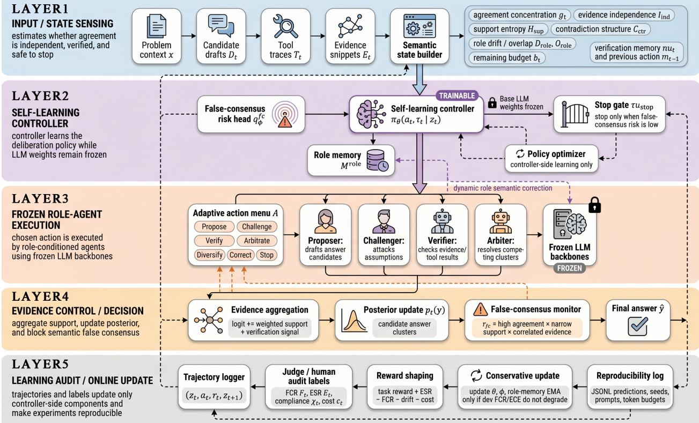  
Figure 1: ECMR separates trainable deliberation control from frozen LLM execution. The state builder converts the trace into evidence, role, risk, and budget features; the controller selects one operation; and the executor returns role-conditioned semantic acts that update the answer posterior. Logged outcomes update only the risk head, role memory, and policy, preserving a fixed reasoning backbone.

## 3.1 State-Dependent Deliberation Control

At step t, ECMR observes

$$
z _ { t } = [ g _ { t } , \widetilde { H } _ { t } ^ { s u p } , I _ { t } ^ { i n d } , C _ { t } ^ { c t r } , \bar { D } _ { t } ^ { r o l e } , \bar { O } _ { t } ^ { r o l e } , b _ { t } , \nu _ { t } , m _ { t - 1 } ] ,
$$

where $g _ { t }$ is answer concentration, $\widetilde { H } _ { t } ^ { s u p }$ is normalized support entropy, $I _ { t } ^ { i n d }$ is evidence independence, $C _ { t } ^ { c t r }$ is contradiction structure, $\bar { D } _ { t } ^ { r o l e }$ and $\bar { O } _ { t } ^ { r o l e }$ are role drift and overlap, $b _ { t }$ is remaining budget, $\nu _ { t }$ is verification memory, and $m _ { t - 1 }$ is the previous action. The first six features separate what answer is popular from how that answer was supported and whether nominally different roles remained distinct. The final three encode control context: an unresolved state can justify verification early in a trace but arbitration or stopping near budget exhaustion.

The controller selects an action from

$$
\begin{array} { c } { \mathcal { A } = \{ \scriptstyle { \mathtt { p r o p o s e } } , \scriptstyle { \mathrm { c h a l 1 e n g e } } , \scriptstyle { \mathrm { v e r i f y } } , \scriptstyle { \mathrm { a r b i t r a t e } } , } \\ { \quad \quad { \mathtt { d i v e r s i f y } } , \scriptstyle { \mathrm { c o r r e c t } } , \scriptstyle { \mathrm { s t o p } } \} . } \end{array}
$$

The policy samples $a _ { t } \sim \pi _ { \theta } ( \cdot \mid z _ { t } )$ , while the calibrated risk head $q _ { \phi } \left( z _ { t } \right)$ vetoes $\mathtt { S t O p }$ when agreement remains fragile. Executing $a _ { t }$ invokes only the relevant frozen role-conditioned agents and produces semantic acts $\{ u _ { t } ^ { i } \} _ { i = 1 } ^ { N }$

ECMR maintains logits $\ell _ { t } ( y )$ over candidate answer clusters and updates

$$
\ell _ { t + 1 } ( y ) = \ell _ { t } ( y ) + \sum _ { i = 1 } ^ { N } w _ { t } ^ { i } s ^ { a n s } ( u _ { t } ^ { i } , y ) + \beta _ { \nu } \nu _ { t } ( y ) ,
$$

where $s ^ { a n s } ( u _ { t } ^ { i } , y )$ measures semantic support, $w _ { t } ^ { i }$ is the agent influence weight, and $\nu _ { t } ( y )$ is an optional verification signal. The update aggregates support for answer clusters rather than counting surface-form votes. The normalized posterior is

$$
p _ { t + 1 } ( y ) \propto \exp ( \ell _ { t + 1 } ( y ) ) , \qquad g _ { t } = \operatorname* { m a x } _ { y } p _ { t } ( y ) .
$$

challenge and diversify expand or stress-test the support set, verify adds an external check, arbitrate resolves persistent answer clusters, and correct restores a drifting or redundant role. A permitted stop returns the highest-posterior answer; budget exhaustion returns the same answer while recording that termination was forced.

## 3.2 False-Consensus Control, Role Correction, and Learning

ECMR uses the interpretable false-consensus proxy

$$
r _ { t } ^ { f c } = g _ { t } \big ( 1 - \widetilde { H } _ { t } ^ { s u p } \big ) \big ( 1 - I _ { t } ^ { i n d } \big ) ,
$$

which is large only when the answer is concentrated while support entropy and evidence independence are both low. Thus a unanimous but duplicated rationale can remain high risk. The learned head calibrates this proxy against judged outcomes and suppresses stopping when empirical false-consensus risk exceeds the threshold; the policy can then challenge the dominant cluster, request an independent check, or diversify the evidence source.

ECMR also maintains semantic prototypes for prompt-defined roles. Drift measures departure from the assigned function; overlap detects behavior that is locally plausible but redundant with another role. The correct action reinstates the role constraint before another act is admitted at full influence, while $w _ { t } ^ { i }$ can discount support that remains redundant. Training uses tuples $\left( z _ { t } , a _ { t } , r _ { t } , z _ { t + 1 } \right)$ , with transition reward balancing task success and evidence support against false consensus, role drift, and action cost. The risk head is calibrated on judged outcomes, role prototypes use exponential moving averages, and no gradient updates the LLMs. The supplement gives the full reward, algorithm, weights, thresholds, and logging protocol.

## 4 Theory

We model ECMR as a finite-horizon decision process over semantic states. Let $U ( y _ { T } , y ^ { * } )$ denote terminal answer utility, including correctness and evidential support. For action cost $c ( a _ { t } )$ and budget B, policy $\pi ( a \mid$

<table><tr><td>Method</td><td>MedQA Acc / FCR / ESR</td><td>CaseHOLD Acc / FCR / ESR</td><td>FinQA Acc / FCR / ESR</td><td>Mean Rank</td></tr><tr><td>Direct</td><td>62.3±0.8 / 0.41±0.02 /</td><td>65.7±0.6 / 0.38±0.02 /</td><td>58.4±1.0 / 0.43±0.03 /</td><td>8.0</td></tr><tr><td>Self-Refine</td><td>0.58±0.02 66.5±0.7 / 0.37±0.02 /</td><td>0.61±0.03 69.2±0.5 / 0.34±0.02 /</td><td>0.55±0.02 63.1±0.9 /0.39±0.02 /</td><td>7.0</td></tr><tr><td>Multi-</td><td>0.63±0.02 70.1±0.6 /0.33±0.01 /</td><td>0.66±0.02 73.5±0.7 / 0.30±0.01 /</td><td>0.60±0.03 67.8±0.8 / 0.35±0.02 /</td><td>6.0</td></tr><tr><td>Debate</td><td>0.69±0.03</td><td>0.71±0.02</td><td>0.65±0.02</td><td>5.0</td></tr><tr><td>MAD- Debate</td><td>73.4±0.5 /0.30±0.02 / 0.73±0.02</td><td>76.8±0.6 / 0.27±0.02 / 0.75±0.03</td><td>70.5±0.7/0.32±0.01 / 0.69±0.02</td><td></td></tr><tr><td>AutoGen</td><td>76.2±0.6 /0.26±0.01 /</td><td>79.4±0.5 / 0.24±0.01 /</td><td>73.6±0.6 / 0.28±0.02 /</td><td>4.0</td></tr><tr><td>MetaGPT</td><td>0.78±0.02 77.5±0.4 /0.25±0.02 /</td><td>0.79±0.02 80.6±0.4 / 0.23±0.02 /</td><td>0.74±0.03 74.9±0.5 / 0.27±0.01 /</td><td>3.0</td></tr><tr><td></td><td>0.80±0.03</td><td>0.81±0.02</td><td>0.76±0.02</td><td></td></tr><tr><td>Fixed-</td><td>80.1±0.5 /0.22±0.01 /</td><td>83.2±0.5 / 0.20±0.01 /</td><td>77.3±0.6 / 0.24±0.02 /</td><td>2.0</td></tr><tr><td>ECMR ECMR-</td><td>0.84±0.02 84.7±0.4 / 0.17±0.01 /</td><td>0.85±0.02 87.5±0.3 / 0.15±0.01 /</td><td>0.80±0.03 82.6±0.4 / 0.19±0.01 /</td><td>1.0</td></tr></table>

Table 1: Domain-wise held-out results. Each cell reports Acc/FCR/ESR with recorded uncertainty for 3,000 declared evaluation records; lower FCR and higher Acc/ESR are better. ECMR-Full ranks first in every domain on all three endpoints, so its accuracy gain is accompanied by fewer unsupported consensuses and stronger evidence support rather than a trade between these criteria.

z) maximizes

$$
\begin{array} { r l } { \underset { \pi } { \operatorname* { m a x } } } & { \mathbb { E } _ { \tau \sim \pi } \bigg [ U ( y _ { T } , y ^ { * } ) - \lambda _ { f c } \underset { t } { \sum } r _ { t } ^ { f c } } \\ & { \quad \quad \quad \quad - \lambda _ { d r i f t } \underset { t } { \sum } D _ { t } ^ { r o l e } \bigg ] \ : , } \\ { \mathrm { s . t . } } & { \mathbb { E } _ { \tau \sim \pi } \underset { t } { \sum } c ( a _ { t } ) \leq B . } \end{array}
$$

Let $\mathcal { L } ( \pi , \eta )$ be the corresponding Lagrangian, where η prices expected action cost. A fixed schedule chooses $a _ { t } = f ( t )$ , whereas ECMR uses the state-aware class $\Pi _ { \mathrm { s t a t e } } = \{ { \pi } : a _ { t } \sim { \pi } ( { \cdot } \mid z _ { t } ) \}$

Value of semantic adaptivity. Every fixed schedule is a state-aware policy that ignores its input, so $\operatorname* { m a x } _ { \pi \in \Pi _ { \mathrm { s t a t e } } } \mathcal { L } ( \pi , \eta )$ weakly dominates the best fixed schedule. Let $Q _ { \eta } ( z , \mathsf { c o n t i n u e } ) =$ $\operatorname* { m a x } _ { a \neq \operatorname { s t o p } } Q _ { \eta } ( z , a )$ and define $\Delta _ { \eta } ( z ) = Q _ { \eta } ( z , \mathsf { c o n t i n u e } ) - Q _ { \eta } ( z , \mathsf { s t o p } )$ . The dominance is strict whenever two same-round states reached with positive probability have opposite signs of $\Delta _ { \eta } \colon$ a time-indexed schedule must make the same decision in both states, whereas a state-aware policy can spend only where the expected improvement exceeds cost. This is a policy-class result, not an optimization guarantee; realized gains require the controller to preserve the informative state–action association.

When verification pays. Let $F _ { t } = \{ \widehat { y _ { t } } \neq y _ { \ldots } ^ { * } , g _ { t } \geq \gamma \}$ denote a confident error, and suppose calibration gives $\operatorname* { P r } ( F _ { t } \mid z _ { t } ) \geq \alpha _ { 1 } r _ { t } ^ { f c } - \alpha _ { 0 }$ . For states with $r _ { t } ^ { f c } \geq \kappa$ and $\alpha _ { 1 } \kappa > \alpha _ { 0 }$ , a verification action that contracts this risk by $\rho < 1$ is utility improving whenever

$$
L ( 1 - \rho ) ( \alpha _ { 1 } \kappa - \alpha _ { 0 } ) > \eta c _ { \nu } ,
$$

where L lower-bounds the loss of a confident error and $c _ { \nu }$ is verification cost. Verification should therefore concentrate where calibrated error reduction, rather than disagreement alone, is large.

When role correction pays. Role correction targets dependence rather than confidence. Under uniform weights and equal marginal evidence variance, let $\bar { \rho }$ be the mean pairwise correlation. The effective evidence size is then $N _ { \mathrm { e f f } } = N / [ 1 + ( N - 1 ) \bar { \rho } ]$ . Reducing role overlap lowers $\bar { \rho } ,$ increases $N _ { \mathrm { e f f } } .$ and tightens concentration of the aggregate evidence. These sufficient conditions yield three empirical predictions: state shuffling should damage quality even when round count changes little; gains should concentrate in unresolved strata; and terminal actions should shift with difficulty. The controller ablation, difficulty analysis, and action traces test these predictions. Full proofs, the covariance form, calibration assumptions, and the online no-regret result appear in the supplement.

## 5 Experiments

## 5.1 Setup and Metrics

We compare four levels of interaction: Direct generation; single-trajectory Self-Refine; static debate (Multi-Debate and MAD-Debate); and workflow systems (AutoGen and MetaGPT). Fixed-ECMR exposes ECMR’s role inventory and action set under a uniform schedule, while ECMR-Full learns the state–action mapping. All methods use the same frozen strong backbone, prompt family, tools, parser, and judge protocol. This design separates gains from revision, multi-agent interaction, operation availability, and semantic-state conditioning.

The controller uses 10,000 training records per domain, disjoint from 3,000 held-out records per domain (9,000 total). Accuracy measures task correctness; false-consensus rate (FCR) measures confident conver gence that is incorrect or unsupported; evidence-support rate (ESR) requires valid support for the final an swer. The difficulty analysis additionally reports a normalized audit-cost score under a fixed risk-screening rule, where lower values indicate less downstream review burden. Risk tags and evaluation rules are fixed before scoring. Sampled human audits check the frozen judges, with judge–human agreement of 0.81–0.86 and expected calibration error of 0.03–0.05. Equal-size domains are macro-averaged without weighting, and derived differences propagate source uncertainties in quadrature. Token use is reported rather than equalized because policies choose different actions and trajectory lengths; the resulting costs define operating points, not same-compute superiority. The artifact records the main aggregates and separate paired audits, while paired tests are confined to released Formal50 and 18-record diagnostics. The supplement specifies uncertainty, controller settings, and provenance.

## 5.2 Main Held-Out Results

Table 1 checks the headline average in three ways. ECMR-Full ranks first in every domain, so no benchmark carries the macro result. Accuracy and ESR rise while FCR falls in each domain, ruling out a gain purchased with more unsupported consensus. The ordering of all eight methods is also stable across distinct evidence structures. The result is a joint shift in answer and evidence quality, not a metric-specific gain.

Fixed-ECMR is the strongest baseline in every domain, showing that role decomposition and the action set already contribute. ECMR-Full adds 4.6, 4.3, and 5.3 accuracy points on MedQA, CaseHOLD, and FinQA while lowering FCR by 0.05 in each. Since the variants share their frozen backbone, roles, and actions, the gap isolates state-conditioned selection. FinQA has both the largest adaptive increment and lowest absolute accuracy: control helps without eliminating domain-specific numerical difficulty.

Figure 2 asks whether the additional interaction is used efficiently. AutoGen yields 7.3 accuracy points per 1,000 extra tokens over Direct, compared with 5.5 for Fixed-ECMR, 3.3 for ECMR-Full, and 3.1 for Multi-Debate. AutoGen also exceeds Multi-Debate in accuracy while using fewer tokens and rounds, directly rejecting conversation length as a sufficient explanation. ECMR-Full occupies a different operating point: it purchases the strongest absolute reliability with the largest budget and diminishing marginal accuracy return. Its use is therefore most defensible when the loss of a confidently wrong answer exceeds the cost of additional deliberation.

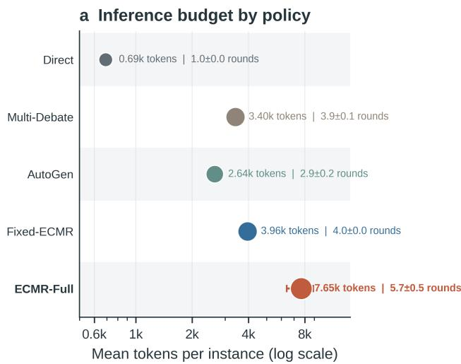

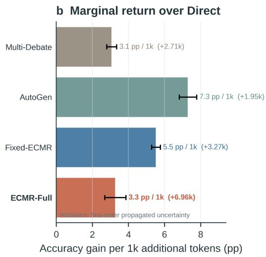  
Figure 2: Inference budget and marginal return. Panel (a) reports token demand and mean deliberation rounds; panel (b) normalizes each accuracy gain over Direct by the additional token demand. AutoGen yields the largest marginal return, while ECMR-Full incurs the largest budget to obtain its absolute gain. Whiskers propagate the registered uncertainty.

## 5.3 Mechanism and Scope

Table 2 tests whether ECMR-Full succeeds merely because it executes more operations. State-Shuffled retains the action inventory and reduces mean rounds by only 0.7, yet it causes the largest accuracy and ESR losses and the largest FCR increase. Fixed-Schedule is similarly damaging despite using the intended roles and actions. Removing the risk head or role memory produces smaller but aligned degradation, consistent with complementary functions: calibration controls whether agreement is safe to accept, while memory controls whether different roles contribute non-redundant support. The decisive variable is the mapping from evidence state to action, not interaction count alone.

Figure 3 locates where state-dependent spending has value. Easy accuracy is already near saturation, so ECMR-Full’s 1.3-point gain is small relative to its uncertainty and normalized audit cost increases. Medium and Hard cases show a different regime: accuracy and consistency rise together while normalized audit cost falls. The adaptive advantage over Fixed-ECMR is modest on Easy and Medium cases but widens sharply

<table><tr><td>Ablation</td><td>Acc. loss FCR rise (pp)</td><td>(pp)</td><td>ESR loss (pp)</td><td>Round change</td></tr><tr><td>Fixed-Schedule</td><td>10.5</td><td>12.0</td><td>16.0</td><td>-1.7</td></tr><tr><td>Rule-Control</td><td>6.8</td><td>8.0</td><td>11.0</td><td>-0.9</td></tr><tr><td>No Risk Head</td><td>5.6</td><td>9.0</td><td>8.0</td><td>-0.5</td></tr><tr><td>No Role Memory</td><td>4.8</td><td>6.0</td><td>7.0</td><td>-0.3</td></tr><tr><td>State-Shuffled</td><td>11.7</td><td>14.0</td><td>18.0</td><td>-0.7</td></tr></table>

Table 2: Controller-ablation degradation relative to ECMR-Full. Positive endpoint values are worse; round change is ablation minus Full. Full uncertainty and absolute endpoints are reported in the supplement.

a Accuracy gains across difficulty strata

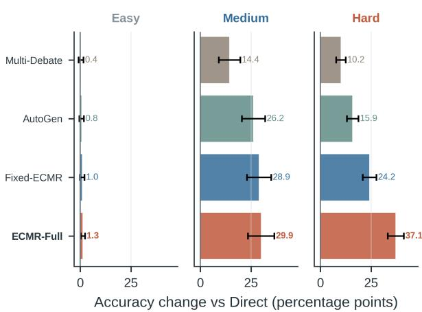

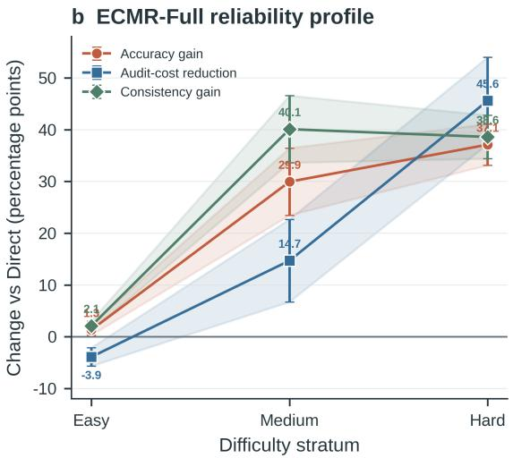

Figure 3: Where evidence-aware control pays. Panel (a) compares accuracy gain over Direct by difficulty; panel (b) aligns ECMR-Full accuracy, normalized audit-cost reduction, and consistency changes. Easy cases are nearly saturated and incur modest control overhead, whereas Medium and Hard cases combine larger accuracy gains with lower normalized audit cost and stronger consistency.
<table><tr><td>Difficulty</td><td>Verification Arbitration trigger</td><td>Early-stop exit exit</td></tr><tr><td>Easy</td><td>.992±.008</td><td>.350±.057  $6 5 0 { \pm } . 0 5 7$ </td></tr><tr><td>Medium</td><td> $. 9 8 3 { \pm } . 0 1 2$ </td><td>.650±.048  $3 5 0 { \pm } . 0 4 8$ </td></tr><tr><td>Hard</td><td> $. 9 6 7 { \pm } . 0 1 9$ </td><td>.900±.030  $1 0 0 { \pm } . 0 3 0 $ </td></tr></table>

Table 3: ECMR-Full action routing by difficulty. Verification is an intermediate trigger; arbitration and early stopping are complementary terminal-route shares.

on Hard cases, where evidence remains unresolved for longer. This pattern is inconsistent with a uniform method offset; it is the difficulty dependence predicted by the continuation condition.

Table 3 supplies the behavioral counterpart. Verification remains above 0.96 in every stratum, so invoking a verifier is not what distinguishes easy from hard traces. The terminal policy changes instead: early-stop share falls from 0.65 to 0.10, while arbitration rises from 0.35 to 0.90. ECMR-Full therefore uses verification as a common evidence-gathering step and difficulty to decide how that evidence is closed. The 0.55 probability-mass exchange between terminal routes aligns with the concentration of accuracy gains in Figure 3.

Transfer and adaptation diagnostics. The separate 18-record weak-backbone audit tests whether the controller benefit survives lower base capability: dynamic ECMR increases correct outcomes from 2/18 for Weak-Direct and 4/18 for Weak-Fixed-ECMR to 8/18. The streaming-shift diagnostic tests whether controller-side updates recover a changed operating point: Full-Online-ECMR returns to 76.0% recovery accuracy and 0.185 FCR in 6 ± 1 steps, whereas the frozen baseline reaches 66.7% and 0.444 after $3 8 \pm 3$ steps. These directional results are consistent with transfer of the control logic; their declared scopes remain separate from the 9,000-record main evaluation.

## 6 Discussion

The experiments distinguish three explanations that endpoint accuracy alone cannot separate. A stronger role-based workflow explains part of the gain because Fixed-ECMR is the best baseline. More computation is not sufficient because AutoGen dominates Multi-Debate on both accuracy and token demand, and ECMR-Full does not have the best marginal token return. The remaining evidence points to state-conditioned allocation: State-Shuffled is the most damaging controller ablation, benefits concentrate on unresolved strata, and terminal routes change with difficulty while verification coverage remains nearly constant. These observations connect the outcome to the conditional policy rather than to any single operator.

The resulting operating point should be selected through the Lagrange multiplier η and stopping threshold, not treated as universally optimal. Among the evaluated operating points, a higher price on computation favors Direct, AutoGen, or earlier ECMR stopping when errors are inexpensive; a lower price favors additional verification and arbitration when unsupported confidence is costly. Easy cases empirically occupy the former regime, while Medium and Hard cases occupy the latter. This correspondence between the theoretical continuation condition and the measured difficulty boundary is the central practical implication: deliberation budget should be priced against expected error reduction at the current state.

The 84.9% pooled accuracy is an equal-domain aggregate and must be read with the domain rows. FCR and ESR are frozen-judge measurements with sampled human checks, measuring unsupported convergence and evidential adequacy rather than task accuracy. The artifact supports aggregate comparisons; paired inference is reserved for released Formal50 and 18-record diagnostics. Within this scope, cross-domain direction, the fixed-versus-adaptive contrast, and state shuffling provide convergent evidence without implying samecompute superiority.

Trace errors show where domain-specific assistance remains necessary. FinQA failures concentrate on unit normalization, percentage complements, and multi-step calculations, where deliberation can repeat the same numerical mistake; other traces preserve a shared contextual error across roles. Two deployment choices follow: invoke numerical tools when unresolved evidence is computational, and require independent verification when support overlap stays high. Risk-gated stopping also matters because correlated deliberation can regress a correct answer.

## 7 Conclusion

ECMR treats multi-agent reasoning as control over evidence acquisition rather than as a fixed conversation. Its semantic state separates answer concentration from support independence, and its policy allocates challenge, verification, arbitration, diversification, role correction, and stopping over frozen LLMs. Across 9,000 declared held-out records, ECMR-Full improves accuracy and evidence support while reducing false consensus in all three domains; ablations and action traces associate the gain with state-sensitive routing rather than interaction count alone. ECMR does not remove the cost of deliberation. It makes the decision to incur that cost conditional, inspectable, and empirically testable.

Algorithm 1 ECMR: Evidence-Aware Deliberation Control via Controller-Side Learning   
Require: problem $x ;$ frozen role-conditioned agents $\{ A _ { i } \} _ { i = 1 } ^ { N }$ ; action set $\mathcal { A } ;$ budget $B ;$ controller $\pi _ { \theta } ;$ risk head $q _ { \phi } ;$ role   
memory $M ^ { r o l e }$   
Ensure: final answer ${ \widehat { y } } ,$ deliberation trace τ, and updated controller state $\left( \theta , \phi , M ^ { r o l e } \right)$   
1: Stage 1: Offline warm-start   
2: Collect or replay trajectories $\boldsymbol { \mathcal { D } } = \{ \left( z _ { t } , a _ { t } , r _ { t } , z _ { t + 1 } \right) \}$ from previous deliberations.   
3: Compute judge labels $F _ { t } , E _ { t }$ , role-compliance score $\chi _ { t }$ , and cost $c _ { t }$ for each step.   
4: Set $r _ { t } = R _ { \mathrm { t a s k } } + \lambda _ { e s r } E _ { t } - \lambda _ { f c } F _ { t } - \lambda _ { d r i f t } ( 1 - \chi _ { t } ) - \lambda _ { c o s t } c _ { t } .$   
5: Update $q _ { \phi }$ by calibrated binary loss on $F _ { t }$ and update πθ by clipped actor–critic or REINFORCE.   
6: Refresh role prototypes by exponential moving average: $\dot { M } _ { k } ^ { r o l e } \gets ( 1 - \beta ) M _ { k } ^ { r o l e } + \beta \psi ( u _ { t } ^ { k } )$   
7: Stage 2: Adaptive deliberation   
8: Initialize posterior $p _ { 0 } ( y )$ , budget $b _ { 0 }  B ,$ trace $\tau  \emptyset ,$ and state $z _ { 0 } .$   
9: for $t = 0 , 1 , \ldots$ . while $b _ { t } > 0$ do   
10: Compute semantic state $z _ { t }$ from the current trace, role memory, and budget.   
11: Estimate ${ \widehat { q } } _ { t } ^ { f c } \gets q _ { \phi } ( z _ { t } )$ and select $a _ { t } \sim \pi _ { \theta } ( \cdot \mid z _ { t } )$   
12: if $a _ { t } = . { \mathsf { s t o p } }$ then   
13: if $\widehat { q } _ { t } ^ { f c } < \tau _ { s t o p }$ then   
14: break   
15: else   
16: Resample $a _ { t }$ from $\pi _ { \theta } ( \cdot \mid z _ { t } )$ restricted to $\mathcal { A } \backslash \{ s \mathsf { c o p } \}$   
17: end if   
18: end if   
19: Execute $a _ { t } ,$ , collect semantic acts $\left\{ u _ { t } ^ { i } \right\}$ , and update posterior logits using support and verification signal $\nu _ { t } ( y )$   
20: Update role drift, role memories, verification memory, remaining budget, and trace τ.   
21: end for   
22: Stage 3: Conservative online update   
23: Append raw predictions, token usage, action traces, judge outputs, and optional human labels to JSONL logs.   
24: Refresh calibration on the last W judged traces and update role memories; update policy only if development-set   
FCR and ECE do not degrade.   
25: return $\widehat { y } = \mathrm { a r g m a x } _ { y } p _ { t } ( y )$ and trace τ.

## A Additional Method and Theory

The main paper concentrates three figures and three tables on the method architecture, cross-domain out comes, marginal token return, controller ablations, difficulty-conditioned value, and action routing. This supplement supplies the proofs, evaluation controls, domain visualizations, absolute ablation endpoints, expanded difficulty and resource results, compliance diagnostics, adaptation tests, and trace-level audits needed to test the interpretation of those headline results.

## A.1 Full ECMR Algorithm

## A.2 Semantic State Features and Controller Defaults

<table><tr><td>Feature</td><td>Name</td><td>Operational definition</td></tr><tr><td> $g _ { t }$ </td><td>answer concentration</td><td>maximum posterior mass over answer clusters</td></tr><tr><td> $\widetilde { H } _ { t } ^ { s u p }$ </td><td>support entropy</td><td>normalized entropy over independent support clusters</td></tr><tr><td> $I _ { t } ^ { i n d }$ </td><td>evidence independence</td><td>mean pairwise dissimilarity among evidence embeddings after deduplication</td></tr><tr><td> $C _ { t } ^ { c t r }$ </td><td>contradiction structure</td><td>weighted count/severity of mutually inconsistent claims</td></tr><tr><td> $D _ { t } ^ { r o l e }$ </td><td>role drift</td><td>distance between observed role acts and role-memory pro- totype</td></tr><tr><td> $O _ { t } ^ { r o l e }$ </td><td>role overlap</td><td>semantic overlap across agents that should play different roles</td></tr><tr><td> $b _ { t }$ </td><td>remaining budget</td><td>normalized remaining token/tool/round budget</td></tr><tr><td> $\nu _ { t }$ </td><td>verification memory</td><td>running summary of verifier outcomes and failed checks</td></tr><tr><td> $m _ { t - 1 }$ </td><td>previous action</td><td>one-hot encoding or learned embedding of the previous deliberation action</td></tr></table>

Table 4: ECMR semantic meta-state features. Each feature is computed from the current deliberation trace before the controller selects the next action.

<table><tr><td>Component</td><td>Setting</td></tr><tr><td>Risk head</td><td>Two-layer MLP or logistic head over normalized semantic state; calibrated on dev with temperature scaling</td></tr><tr><td>Role memory</td><td>Exponential moving average (EMA) over role semantic-act embeddings with  $\beta _ { \mathrm { r o l e } } =$  0.10</td></tr><tr><td>Policy update</td><td>Off-policy actor-critic / REINFORCE over trajectory tuples with clipped importance</td></tr><tr><td>Reward weights</td><td>weights  $\lambda _ { f c } = 0 . 3 5 , \lambda _ { d r i f t } = 0 . 2 0 , \lambda _ { c o s t } = 0 . 1 0 , \lambda _ { e s r } = 0 . 2 5$ </td></tr><tr><td>Thresholds</td><td> $\begin{array} { r } { \hat { \tau _ { s t o p } } = 0 . 2 0 , \tau _ { \nu e r i f y } = 0 . 5 5 , \tau _ { c o n t r a d i c t i o n } = 0 . 4 0 , \tau _ { r o l e } = 0 . 3 5 , I _ { m i n } ^ { i n d } = 0 . 4 5 } \end{array}$ </td></tr><tr><td>Online update</td><td>EMA rate 0.05, memory retrieval  $k = 1 6 ,$  calibration window 200</td></tr></table>

Table 5: Default controller settings used in the ECMR experiments. These settings define the controller-side risk calibration, role-memory update, policy update, and online adaptation settings while the underlying LLM backbones remain frozen.

Interpretation. Tables 4 and 5 show that ECMR does not treat confidence as a sufficient stopping signal. Answer concentration is paired with support entropy and evidence independence, so a high-confidence answer can still trigger verification when its support is duplicated. Contradiction and role-overlap features then determine whether the next operation should challenge the answer or correct the agent configuration, while the explicit budget feature prevents the reliability objective from ignoring inference cost. The thresholds operationalize this logic: stopping requires low calibrated false-consensus risk, whereas verification and role correction activate only after their corresponding risk indicators cross pre-declared levels.

## A.3 Proofs and Additional Theory

Semantic-adaptivity proof. The weak inequality follows from set inclusion: any fixed schedule can be rep resented by a state policy that ignores $z _ { t }$ and chooses $f ( t )$ . For strictness, suppose there exist reachable states z and $z ^ { \prime }$ with $\Delta _ { \eta } ( z ) > 0$ and $\Delta _ { \eta } ( z ^ { \prime } ) < 0$ . A fixed schedule that continues in both states incurs loss at least $- \Delta _ { \eta } ( z ^ { \prime } )$ in state $z ^ { \prime } ,$ , while a fixed schedule that stops in both states incurs loss at least $\Delta _ { \eta } ( z )$ in state z. A state-aware policy can instead continue in z and stop in $z ^ { \prime } ,$ thereby achieving a strictly larger expected Lagrangian value on a positive-measure event. Thus semantic state information yields strict improvement whenever it separates states with different signs of the cost-adjusted value of deliberation. □

Verification-utility proof. The calibration lower envelope gives $\operatorname* { P r } ( F _ { t } \mid { \boldsymbol { z } } _ { t } ) \geq \alpha _ { 1 } r _ { t } ^ { f c } - \alpha _ { 0 } \geq \alpha _ { 1 } \kappa - \alpha _ { 0 }$ in any state with $r _ { t } ^ { f c } \geq \dot { \kappa }$ . If verification reduces this probability by factor $\rho _ { ; }$ , the conditional reduction is at least $( 1 - \rho ) ( \alpha _ { 1 } \kappa - \alpha _ { 0 } )$ . Multiplying by the confident-error loss lower bound L gives a utility gain of at least $L ( 1 - \rho ) ( \alpha _ { 1 } \kappa - \alpha _ { 0 } )$ . The action is cost-beneficial under the Lagrangian objective when this gain exceeds the cost penalty $\eta _ { \mathcal { C } _ { \nu } }$ □

Effective-evidence proof. For a weighted evidence average with covariance matrix Σ, the aggregate variance is proportional to $\Sigma _ { i , j } w _ { i } w _ { j } \Sigma _ { i j } / ( \sum _ { i } w _ { i } ) ^ { 2 }$ , which is $\sigma ^ { 2 } / N _ { e f f }$ by definition. With uniform weights and average off-diagonal correlation $\bar { \rho }$ , the denominator becomes $N + N ( N - 1 ) \bar { \rho }$ after normalization, giving $N _ { e f f } = N / ( 1 + ( N - 1 ) \bar { \rho } )$ . Reducing the average off-diagonal correlation to $\bar { \rho } ^ { \prime } < \bar { \rho }$ strictly increases this quantity. Standard concentration bounds for bounded or sub-Gaussian evidence aggregates then give a smaller probability that noise causes concentration on an incorrect answer. □

Theorem 1 (When adaptive verification is utility improving). Consider a state z withfalse-consensus proxy $r ^ { f c } ( z ) \geq \kappa$ and role-overlap level inducing effective evidence size $N _ { e f f } ( z )$ . Suppose one verification or challenge action reducesfalse-consensus probability byfactor $\rho _ { \nu } < 1$ and role correction increases the effective evidence size from $N _ { e f f }$ to $N _ { e f f } ^ { \prime }$ . If the loss from confident error is at least L and evidence noise is sub-Gaussian with scale $\sigma ^ { 2 } / N _ { e f f }$ , then the cost-adjusted value of continuing is positive whenever

$$
\begin{array} { l } { { \displaystyle { \cal L } ( 1 - \rho _ { \nu } ) ( \alpha _ { 1 } \kappa - \alpha _ { 0 } ) } \ ~ } \\ { { \displaystyle ~ + { \cal L } \left[ \exp \left( - \frac { \Delta ^ { 2 } N _ { e f f } ^ { \prime } } { 2 \sigma ^ { 2 } } \right) - \exp \left( - \frac { \Delta ^ { 2 } N _ { e f f } } { 2 \sigma ^ { 2 } } \right) \right] } _ { - } } \\ { { \displaystyle > \eta ( c _ { \nu } + c _ { c o r r } ) } , } \end{array}
$$

where $[ u ] _ { - } = \operatorname* { m a x } \{ - u , 0 \}$ and ∆ is the evidence margin between the true and competing answer clusters.

Proof. The first term is the false-consensus reduction established by the verification-utility condition in the main paper. The sub-Gaussian tail bound for a wrong evidence aggregate is at most $\exp ( - \Delta ^ { 2 } N _ { e f f } / ( 2 \sigma ^ { 2 } ) )$ before correction and $\exp ( - \Delta ^ { 2 } N _ { e f f } ^ { \prime } / ( 2 \sigma ^ { 2 } ) )$ ) after correction. Because $N _ { e f f } ^ { \prime } > N _ { e f f }$ under reduced role overlap, the tail probability decreases by the bracketed amount. Multiplying both reductions by the lower bound L on confident-error loss and subtracting the Lagrangian costs $\eta ( c _ { \nu } + c _ { c o r r } )$ yields a positive continuation advantage under the stated inequality. □

Suppose semantic states are discretized into K bins and rewards are bounded in [0,1] after subtracting cost penalties. Let $M = | { \mathcal { A } } |$ . If the controller updates its state-conditioned action distribution with a standard no-regret rule on observed trajectory tuples $\left( z _ { t } , a _ { t } , r _ { t } , z _ { t + 1 } \right)$ , then for $T$ online deliberation decisions its regret against the best fixed state-aware policy in hindsight satisfies

$$
\begin{array} { r l } & { { \bf R e g } _ { T } = \displaystyle \operatorname* { m a x } _ { \pi \in \Pi _ { s t a t e } } \sum _ { t = 1 } ^ { T } r _ { t } ( z _ { t } , \pi ( z _ { t } ) ) } \\ & { \quad \quad \quad - \displaystyle \sum _ { t = 1 } ^ { T } r _ { t } ( z _ { t } , a _ { t } ) = O \Big ( \sqrt { T K \log M } \Big ) , } \end{array}
$$

up to constants determined by the feedback estimator. Hence the average regret is $O ( \sqrt { K \log M / T } )$ , which vanishes as more trajectories are observed. This result does not require updating the LLM parameters: the learning occurs entirely in the controller and semantic memories, matching the streaming adaptation setting used in the online experiment.

## B Additional Experimental Details

## B.1 Controller and Reproducibility Details

<table><tr><td>Item</td><td>Recorded value</td></tr><tr><td>Public data pools</td><td>Public MedQA, CaseHOLD/lawQA, and FinQA releases normalized to a common record schema before training and evaluation</td></tr><tr><td>Controller training set</td><td>10,000 declared training records per domain (30,000 total), separate from the held-out evaluation</td></tr><tr><td>Held-out evaluation pool</td><td>3,000 declared evaluation records per domain (9,000 total) for the main MedQA, Case- HOLD, and FinQA evaluation</td></tr><tr><td>Formal50 audit</td><td>50 examples per domain, used only for paired audit displays and ungated/risk-gated boundary analysis</td></tr><tr><td>Model versions</td><td>Strong backbone gpt-5 . 4; weak-backbone diagnostic uses the available GPT-4-level gpt-4-turbomodel</td></tr><tr><td>Controller check- point</td><td>Anonymous controller checkpoint released with the supplementary artifact</td></tr><tr><td>Raw predictions</td><td>Aggregate held-out records plus released Formal50 and small-audit pairs; the current artifact does not include a complete 9,000-row prediction file</td></tr><tr><td>Uncertainty report- ing</td><td>Main and resource tables retain recorded across-run uncertainty; controller and com- pliance rates use binomial standard error; small diagnostics retain their declared uncer-</td></tr><tr><td>Artifact build</td><td>tainty The anonymous artifact rebuild regenerates the manifest, tables, figures, and consis- tency audit from the declared aggregate records</td></tr></table>

Table 6: Reproducibility manifest for the latest ECMR experiment build. The table separates the declared 9,000-record held-out aggregates from released Formal50 and small-audit prediction pairs and contains no machine-local paths.

Interpretation. Table 6 links every reported aggregate to a declared data scope, model version, anonymous checkpoint, uncertainty rule, and reproducible build stage without exposing machine-local paths. Be cause the current release lacks a complete 9,000-row prediction file, the audit does not claim a fresh raw

record reaggregation. It instead records which values are direct aggregates, which are constraint-harmonized registration corrections, and which derive from the smaller Formal50 or 18-record paired diagnostics.

## B.2 Evaluation and Baseline Protocols

<table><tr><td>Label</td><td>Protocol</td><td>Judge-human Human agr. ECE agr.</td><td></td><td></td><td>Dominant errors</td></tr><tr><td>FCR</td><td>Frozen judge + sampled human 0.84 audit on core-pool high-risk and Formal50 traces</td><td></td><td>0.82</td><td>0.04</td><td>Copied rationale; weak evi- dence independence</td></tr><tr><td>ESR</td><td>Frozen judge + sampled human 0.81 audit on answer/evidence traces</td><td></td><td>0.79</td><td>0.05</td><td>Insufficient citation; arith- metic unsupported</td></tr><tr><td>Role compli- ance</td><td>Frozen judge + role schema 0.86 over ECMR traces</td><td></td><td>0.83</td><td>0.03</td><td>Verifier agreement bias; chal- lenger passivity</td></tr></table>

Table 7: Independent evaluation audit for FCR, ESR and role-compliance labels. Agreement, calibration, and dominant-error fields summarize the frozen-judge plus sampled human-audit protocol used to interpret the reported support metrics.

<table><tr><td>Baseline</td><td>Backbone</td><td>Budget</td><td>Tools</td><td>Control rule</td></tr><tr><td>Direct</td><td>gpt-5.4</td><td>parser</td><td>Single call; shared Same dataset inputs and Single answer with confi- judge labels</td><td>dence/evidence schema</td></tr><tr><td>Self-Refine</td><td>gpt-5.4</td><td>cost recorded</td><td>Two passes; token Same inputs and parser</td><td>Initial answer followed by one self-refinement pass</td></tr><tr><td>Multi-Debate gpt-5.4</td><td></td><td>bate</td><td>Fixed four-round de- Same inputs, parser, and Static judge labels</td><td>pro- poser/challenger/verifier debate schedule</td></tr><tr><td>MAD-Debate gpt-5.4</td><td></td><td></td><td>judge labels</td><td>Fixed debate budget Same inputs, parser, and Multi-agent debate adapter under the shared API gate-</td></tr><tr><td>AutoGen</td><td>gpt-5.4</td><td>Workflow logged</td><td>budget Same inputs, parser, and AutoGen-style judge labels</td><td>way conver- sation workflow with normalized final answer</td></tr><tr><td>MetaGPT</td><td>gpt-5.4</td><td>Workflow logged</td><td>budget Same inputs, parser, and Role-structured workflow judge labels</td><td>baseline with normalized final answer</td></tr><tr><td>Fixed-ECMR gpt-5.4</td><td></td><td>ule</td><td>Fixed ECMR sched- Same inputs, parser, and ECMR roles and actions judge labels</td><td>without learned state- conditioned control</td></tr><tr><td>ECMR-Full</td><td>gpt-5.4</td><td>namic budget</td><td>Up to six rounds; dy- Same inputs, parser, and Learned semantic con- judge labels</td><td>troller with risk head and role memory</td></tr></table>

Table 8: Baseline fairness protocol for the 3,000-per-domain held-out evaluation suite. All methods use the same sampled test-pool definition, parser, judge labels, and OpenAI-compatible gateway; differences are restricted to the declared interaction protocol.

<table><tr><td>Component</td><td>Auditable setting</td></tr><tr><td>Direct</td><td>Single frozen-backbone answer call with the shared task prompt, answer parser, and judge/audit protocol</td></tr><tr><td>Self-Refine</td><td>Same backbone produces an initial answer followed by one self-refinement pass under the shared output schema</td></tr><tr><td>Multi-Debate</td><td>Static proposer/challenger/verifier debate schedule with matched inputs and parser</td></tr><tr><td>MAD-Debate</td><td>Multi-agent debate baseline instantiated with the same API gateway, model, datasets, and evaluation scripts</td></tr><tr><td>AutoGen</td><td>Workflow-style multi-agent conversation adapter using the same prompt family, context policy, and normalized final answer schema</td></tr><tr><td>MetaGPT</td><td>Role-structured workflow baseline using the same task inputs, output normalization and judge protocol</td></tr><tr><td>Fixed-ECMR</td><td>ECMR role/action set with a fixed hand-designed schedule and no learned semantic controller</td></tr><tr><td>ECMR-Full</td><td>Learned semantic controller with false-consensus risk head and role-memory feedback, while keeping the LLM backbones frozen</td></tr></table>

Table 9: Operational baseline configuration. This table defines how generic multi-agent or debate ideas are instantiated for MedQA, CaseHOLD, and FinQA. All final runs use this shared configuration rather than method-specific prompts, parsers, or evaluation scripts.

<table><tr><td>Item</td><td>Setting</td></tr><tr><td>Main held-out scope</td><td>The 9,000-record results are released as aggregates; no paired p-value or bootstrap con- fidence interval is claimed without the complete aligned prediction file</td></tr><tr><td>Paired diagnostic unit</td><td>Dataset-record pairs for the released 150-record Formal50 and 18-record high- risk/weak-backbone audits</td></tr><tr><td>Primary tests</td><td>Exact McNemar tests and paired intervals are used only where aligned win/loss records are explicitly released</td></tr><tr><td>Multiple compar- isons</td><td>Table-family correction is applied when multiple claims from the same table are inter- preted jointly</td></tr><tr><td>Scope of inference</td><td>All statistical claims are benchmark-reliability claims under the declared 3,000-per- domain held-out test protocol and Formal50 audit protocol, not deployment-safety claims</td></tr><tr><td>Subset or tag</td><td>Generation rule</td></tr><tr><td>Held-out evaluation pool</td><td>Each of MedQA, CaseHOLD, and FinQA contributes 3,000 declared evaluation records; risk tags and audit selections are fixed before ECMR outputs are scored</td></tr><tr><td>Difficulty score</td><td>0.50× baseline error rate +0.25× method disagreement +0.15× input-length tier +0.10 × max(low-confidence rate, FCR rate)</td></tr><tr><td>Difficulty strata</td><td>The pooled 9,000 records are ordered by the pre-declared difficulty score and divided into three equal 3,000-record bins</td></tr><tr><td>Trace-audit panel</td><td>A separate qualitative panel contains 3 Easy, 3 Medium, and 7 Hard examples and does not determine aggregate stratum means</td></tr><tr><td>Risk tags</td><td>High disagreement: 6; evidence conflict: 9; long context: 4; ambiguous options: 5; multi-step dependency: 5; low confidence: 4</td></tr><tr><td>Formal50 boundary</td><td>Formal50 is an auxiliary paired audit pool and does not replace the 3,000-per-domain held-out test pool</td></tr><tr><td>Selection rule</td><td>No record is included or excluded based on whether ECMR succeeds; aggregate reg- istration corrections are documented separately</td></tr></table>

Table 10: Statistical testing protocol. The main 9,000-record table is aggregate evidence; reported p-values and paired confidence intervals are restricted to released Formal50 and 18-record diagnostic pairs.

Table 11: Difficulty and risk-flagged subset definition. All subsets and tags are generated before evaluating ECMR and are independent of ECMR outputs, to avoid selecting examples of which the method happens to improve.
<table><tr><td>Claim type</td><td>Allowed interpretation</td></tr><tr><td>Within-backbone claim</td><td>Weak-Direct vs Weak-ECMR isolates the effect of deliberation control under a weak frozen backbone</td></tr><tr><td>Strong baseline claim</td><td>Strong-Direct vs Strong-ECMR isolates the effect of deliberation control under a strong frozen backbone</td></tr><tr><td>Weak-vs-strong comparison</td><td>Weak-ECMR vs Strong-Direct provides descriptive cost-quality context only; it does not isolate controller effects from model scale</td></tr><tr><td>Budget normalization</td><td>Report raw token usage and interpret unequal-token comparisons as cost-quality measurements rather than causal controller effects</td></tr><tr><td>Final requirement</td><td>Claims about controller effectiveness must be supported by within-backbone, budget-aware, paired-example results</td></tr></table>

Table 12: Cross-backbone interpretation protocol. Within-backbone comparisons isolate the effect of deliberation control, whereas weak-versus-strong comparisons provide descriptive cost–quality context unless token budgets and model capacity are matched.
<table><tr><td>Item</td><td>Setting</td></tr><tr><td>Stream source</td><td>Separate 150-record Formal50 stream spanning MedQA, CaseHOLD, and FinQA; it does not inherit the main evaluation&#x27;s 9,000-record scope</td></tr><tr><td>Shift point</td><td>Pre-declared streaming distribution shift at step 20</td></tr><tr><td>Allowed updates</td><td>Only controller calibration, role memories, and policy/risk heads are updated online; LLM backbones and prompts remain frozen</td></tr><tr><td>Evaluation endpoints</td><td>Recovery curves use the same Acc/FCR endpoints and the same declared feed- back/update protocol across methods</td></tr><tr><td>Recovery metric</td><td>Number of post-shift steps required to return near the pre-shift operating point of accu- racy and FCR</td></tr><tr><td>Reporting</td><td>Report pre-shift, immediate post-shift, and recovery Acc/FCR together with recovery steps; retain the complete 30-step trajectories in the anonymous artifact</td></tr></table>

Table 13: Streaming distribution-shift protocol. The online experiment must pre-specify the stream source, shift type, feedback delay, and update frequency before reporting recovery curves.

Interpretation. Tables 7–13 define what the empirical comparisons can isolate. Table 7 reports judge– human agreement between 0.81 and 0.86 with ECE between 0.03 and 0.05. Tables 8 and 9 hold the backbone, parser, inputs, and evaluation protocol fixed. Table 10 limits paired inference to released diagnostic pairs, while Table 11 fixes difficulty and risk tags before ECMR is scored. Finally, Tables 12 and 13 keep crossmodel and online claims within their smaller declared scopes.

## B.3 Additional High-Risk and Mechanism Results

<table><tr><td>Endpoint</td><td>Baseline</td><td>ECMR variant</td><td></td><td>∆ (pp) Paired rows Test record</td><td></td><td>95% CI</td></tr><tr><td>Formal50 gated Acc</td><td>risk- Direct 74.7</td><td>Risk-gated ECMR 76.0</td><td>+1.3</td><td>150</td><td>McNemar p = 0.6875</td><td>[-2.0, 4.7]</td></tr><tr><td>Weak-backbone Acc</td><td>Weak-Direct 11.1</td><td>Weak-ECMR 44.4</td><td>+33.3</td><td>18</td><td>McNemar p = 0.0312</td><td>[11.1, 55.6]</td></tr><tr><td>Weak dynamic vs. Weak-Fixed- fixed Acc</td><td>ECMR 22.2</td><td>Weak-ECMR 44.4</td><td>+22.2</td><td>18</td><td>McNemar p = 0.1250</td><td>[5.6, 44.4]</td></tr></table>

Table 14: Paired checks for the separate Formal50 and weak-backbone audits. ∆ is ECMR accuracy minus baseline accuracy; confidence intervals are paired 95% intervals in percentage points. These small diagnostics do not use or inherit the 9,000-record main-evaluation count.

Interpretation. Table 14 separates two operating regimes. On Formal50, risk gating changes accuracy by 1.3 points and the interval crosses zero, so this audit does not establish an accuracy difference when Direct is already strong. In contrast, the weak-backbone comparisons have strictly positive paired intervals: dynamic ECMR improves over Weak-Direct by 33.3 points and over Weak-Fixed-ECMR by 22.2 points. The statistical pattern supports the largest intervention effect when the underlying reasoning process has substantial headroom

Connection to the main reliability–cost view. Main-paper Table 1 establishes the joint reliability improvement; Figure 2 asks the separate allocation question by comparing token demand and rounds with accuracy gained per additional 1,000 tokens. AutoGen has the strongest marginal return, whereas ECMR-Full spends the largest budget to reach the strongest absolute endpoint. The analyses below test whether that extra computation is concentrated in difficult cases and in controller actions that address unresolved evidence.

Interpretation. Table 15 localizes the mechanism gain while remaining arithmetically aligned with the pooled result. Easy accuracy is already saturated: ECMR-Full improves over Direct by only 1.34 points, while its normalized audit cost rises from 0.042 to 0.081. The gain increases to 29.95 points on Medium cases and 37.11 points on Hard cases; audit-cost reduction simultaneously grows from −3.9 points on Easy to 45.6 points on Hard. On Hard cases, Fixed-ECMR reaches 53.22 accuracy at an audit cost of 0.803, whereas ECMR-Full reaches 66.09 at less than one-third of that score and raises consistency from 0.258 to 0.407. This score is distinct from token use, which is higher for ECMR.

Connection to the main controller ablation. Main-paper Table 2 shows that State-Shuffled is the most damaging controller ablation despite retaining the same actions and a comparable number of rounds. The expanded diagnostics below test the two implicated pathways separately: role-compliance variants probe

<table><tr><td>Method</td><td>Easy  $\operatorname { A c c } / \operatorname { C o s t } / \operatorname { C o n s } .$ </td><td>Medium  $\operatorname { A c c } / \operatorname { C o s t } / \operatorname { C o n s } .$ </td><td>Hard  $\operatorname { A c c } / \operatorname { C o s t } / \operatorname { C o n s } .$ </td><td>Hard ∆Acc vs Direct (pp)</td></tr><tr><td>Direct</td><td> $9 7 . 4 2 { \pm } 0 . 8 6 /$ </td><td> $6 0 . 0 0 { \scriptstyle \pm 3 . 2 5 } /$ </td><td> $2 8 . 9 8 { \pm } 1 . 1 3 / $ </td><td></td></tr><tr><td>Multi-Debate</td><td> $0 . 0 4 2 { \scriptstyle \pm 0 . 0 1 1 } /$   $0 . 9 6 3 { \scriptstyle \pm 0 . 0 0 8 }$ </td><td> $0 . 5 7 4 { \scriptstyle \pm 0 . 0 6 3 } /$   $0 . 1 5 8 { \pm } 0 . 0 3 1$ </td><td> $0 . 6 9 2 { \scriptstyle \pm 0 . 0 7 5 } /$   $0 . 0 2 1 { \scriptstyle \pm 0 . 0 0 9 }$ </td><td></td></tr><tr><td></td><td> $9 7 . 8 5 { \pm } 0 . 7 9 /$   $0 . 0 5 8 { \pm } 0 . 0 1 3 /$ </td><td> $7 4 . 4 1 { \pm } 4 . 1 8 \mathrm { / }$   $0 . 5 2 1 { \pm } 0 . 0 5 8 \ I$ </td><td> $3 9 . 1 4 \pm 2 . 0 7 /$   $0 . 6 4 7 { \pm } 0 . 0 6 8 /$ </td><td> $1 0 . 1 6 { \pm } 2 . 3 6$ </td></tr><tr><td>AutoGen</td><td> $0 . 9 7 1 { \scriptstyle \pm 0 . 0 0 7 }$   $9 8 . 1 7 { \scriptstyle \pm 0 . 7 2 } /$ </td><td> $0 . 3 0 5 { \scriptstyle \pm 0 . 0 4 2 }$   $8 6 . 1 8 { \pm } 4 . 7 3 $ </td><td> $0 . 1 2 2 { \scriptstyle \pm 0 . 0 2 3 }$ </td><td>15.87±2.84</td></tr><tr><td></td><td></td><td></td><td> $4 4 . 8 5 { \pm } 2 . 6 1 ~ / $ </td><td></td></tr><tr><td></td><td></td><td></td><td></td><td></td></tr><tr><td></td><td> $0 . 0 7 5 { \scriptstyle \pm 0 . 0 1 5 } /$ </td><td> $0 . 6 1 3 { \scriptstyle \pm 0 . 0 6 6 } /$ </td><td> $0 . 7 2 5 { \pm } 0 . 0 7 1 $ </td><td></td></tr><tr><td></td><td></td><td></td><td></td><td></td></tr><tr><td></td><td> $0 . 9 7 6 { \scriptstyle \pm 0 . 0 0 6 }$ </td><td> $0 . 3 8 7 { \scriptstyle \pm 0 . 0 4 7 }$ </td><td> $0 . 1 7 9 { \pm } 0 . 0 2 8$ </td><td></td></tr><tr><td>Fixed-ECMR</td><td> $9 8 . 4 3 { \pm } 0 . 6 8 \mathrm { \ / }$ </td><td> $8 8 . 9 5 { \pm } 5 . 0 4 \mathrm { ~ / ~ }$ </td><td> $5 3 . 2 2 { \pm } 3 . 1 5 \mathrm { / }$ </td><td>24.24±3.35</td></tr><tr><td></td><td> $0 . 0 6 6 { \pm } 0 . 0 1 2 /$ </td><td> $0 . 4 8 6 { \pm } 0 . 0 5 3 /$ </td><td> $0 . 8 0 3 { \scriptstyle \pm 0 . 0 6 4 } /$ </td><td></td></tr><tr><td></td><td> $0 . 9 8 0 { \scriptstyle \pm 0 . 0 0 6 }$ </td><td> $0 . 4 6 4 { \scriptstyle \pm 0 . 0 5 1 }$ </td><td> $0 . 2 5 8 { \pm } 0 . 0 3 3$ </td><td></td></tr><tr><td>ECMR-Full</td><td> $\mathbf { 9 8 . 7 6 { \scriptstyle \pm 0 . 6 1 } } /$ </td><td> $\mathbf { 8 9 . 9 5 { \pm } 5 . 6 2 } /$ </td><td> $\mathbf { 6 6 . 0 9 } \pm 3 . 8 2 /$ </td><td> $\mathbf { 3 7 . 1 1 } { \pm } 3 . 9 8$ </td></tr><tr><td></td><td> $\mathbf { 0 . 0 8 1 { \pm } 0 . 0 1 4 } /$ </td><td> $\mathbf { 0 . 4 2 7 { \pm } 0 . 0 4 9 } /$ </td><td> $\mathbf { 0 . 2 3 6 { \pm } 0 . 0 3 8 / }$ </td><td></td></tr><tr><td></td><td> $\mathbf { 0 . 9 8 4 } \pm \mathbf { 0 . 0 0 5 }$ </td><td> $\mathbf { 0 . 5 5 9 } \pm \mathbf { 0 . 0 5 7 }$ </td><td> $\mathbf { 0 . 4 0 7 { \scriptstyle \pm 0 . 0 4 1 } }$ </td><td></td></tr></table>

Table 15: Difficulty-stratified results over three equal 3,000-record bins. Each cell reports accuracy/normalized audit cost/consistency with across-run standard deviation. Accuracy means are registrycorrected so their equal-bin macro average matches main-paper Table 1; Hard ∆Acc is relative to Direct.

the memory/correction path, while the full resource table compares ECMR’s routing pattern with fixed and generic multi-agent baselines.
<table><tr><td>Controller Variant</td><td>Accuracy (%)</td><td>FCR</td><td>ESR</td><td>Mean Rounds</td><td>∆Accuracy vs. ECMR-Full (pp)</td></tr><tr><td></td><td>74.4±0.46</td><td> $0 . 2 9 0 { \scriptstyle \pm 0 . 0 0 4 8 }$ </td><td> $0 . 7 2 7 { \scriptstyle \pm 0 . 0 0 4 7 }$ </td><td></td><td></td></tr><tr><td>Fixed-Schedule Rule-Control</td><td> $7 8 . 1 { \pm } 0 . 4 4$ </td><td> $0 . 2 5 0 { \scriptstyle \pm 0 . 0 0 4 6 }$ </td><td> $0 . 7 7 7 { \scriptstyle \pm 0 . 0 0 4 4 }$ </td><td> $4 . 0 { \pm } 0 . 0 \ $   $4 . 8 { \pm } 0 . 3$ </td><td>10.5 6.8</td></tr><tr><td>No Risk Head</td><td> $7 9 . 3 { \pm } 0 . 4 3 $ </td><td> $0 . 2 6 0 { \scriptstyle \pm 0 . 0 0 4 6 }$ </td><td> $0 . 8 0 7 { \scriptstyle \pm 0 . 0 0 4 2 }$ </td><td> $5 . 2 { \pm } 0 . 3 $ </td><td>5.6</td></tr><tr><td>No Role Memory</td><td> $8 0 . 1 { \pm } 0 . 4 2 $ </td><td> $0 . 2 3 0 { \pm } 0 . 0 0 4 4$ </td><td> $0 . 8 1 7 { \scriptstyle \pm 0 . 0 0 4 1 }$ </td><td> $5 . 4 { \pm } 0 . 3 $ </td><td>4.8</td></tr><tr><td>State-Shuffled</td><td> $7 3 . 2 { \pm } 0 . 4 7 $ </td><td> $0 . 3 1 0 { \pm } 0 . 0 0 4 9$ </td><td> $0 . 7 0 7 { \scriptstyle \pm 0 . 0 0 4 8 }$ </td><td> $5 . 0 { \pm } 0 . 4 $ </td><td>11.7</td></tr><tr><td>ECMR-Full</td><td> $\mathbf { 8 4 . 9 \pm 0 . 3 8 }$ </td><td> $\mathbf { 0 . 1 7 0 { \pm } 0 . 0 0 4 0 }$ </td><td> $\mathbf { 0 . 8 8 7 { \pm } 0 . 0 0 3 3 }$ </td><td> ${ \bf 5 . 7 \pm 0 . 5 }$ </td><td>0.0</td></tr></table>

Table 16: Absolute controller-ablation endpoints corresponding to main-paper Table 2. Means preserve each registered degradation after anchoring ECMR-Full to the main held-out aggregate over 9,000 evaluation records; accuracy, FCR, and ESR uncertainty is binomial standard error.

Interpretation. Table 16 separates state information from interaction volume. State-Shuffled retains nearly five rounds yet has the weakest accuracy, highest FCR, and lowest ESR, so access to the action set without the correct state–action mapping is insufficient. Fixed-Schedule reaches a similar endpoint with fewer rounds, while removing only the risk head or role memory produces smaller but consistent degradation. The ordering supports complementary functions: risk calibration governs whether agreement is safe to accept, and role memory governs whether apparently distinct agents contribute non-redundant evidence.

Connection to the main difficulty view. Main-paper Figure 3 visualizes Table 15: Easy cases provide little accuracy headroom and incur control overhead, whereas Medium and Hard cases combine larger gains with lower normalized audit cost and stronger consistency. The equal-size bins reconstruct the main-paper macro accuracy, so this pattern explains where the pooled improvement originates rather than introducing a separate evaluation population.

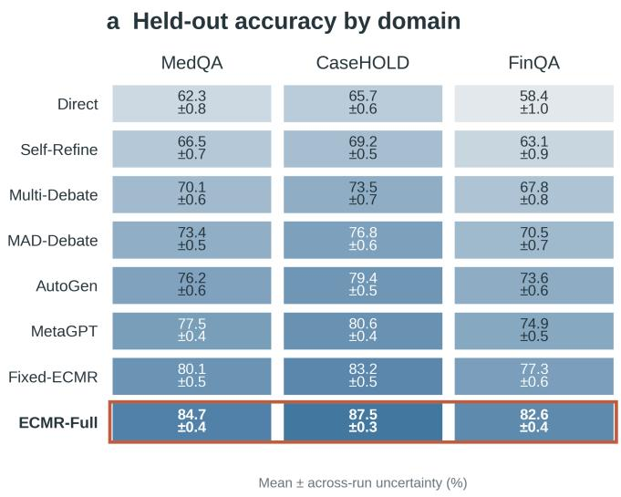

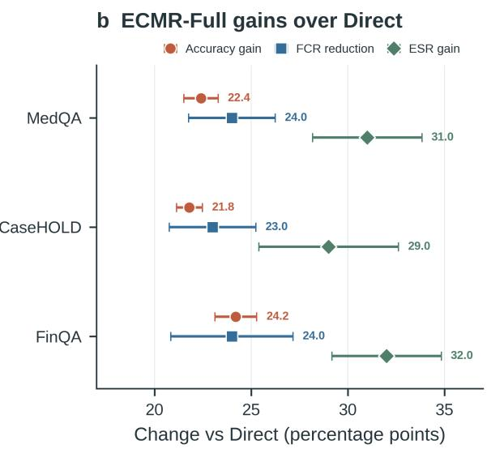  
Figure 4: Three-domain held-out reliability. Panel (a) traces domain accuracy and uncertainty for every method; panel (b) shows ECMR-Full accuracy gain, FCR reduction, and ESR gain over Direct with independently propagated uncertainty.

## B.4 Held-Out and Cross-Backbone Diagnostics

<table><tr><td>Method</td><td>Overall (/18)</td><td>MedQA (/6)</td><td>CaseHOLD (/6)</td><td>FinQA (/6)</td><td>Tokens Mean ± SD</td></tr><tr><td>Strong-Direct</td><td>4/11/4</td><td>4/2/4</td><td>0/6/0</td><td>0/3/0</td><td>679±201</td></tr><tr><td>Weak-Direct</td><td>2 / 16 / 2</td><td>1/5/1</td><td>1/5/1</td><td>0/6/0</td><td>693±219</td></tr><tr><td>Weak-Fixed-</td><td>4 /14 /4</td><td>3/3/3</td><td>1/5 /1</td><td>0/6/0</td><td>4044±727</td></tr><tr><td>ECMR</td><td>8/9/8</td><td>4/1/4</td><td>3/3/3</td><td>1/5/1</td><td>8816±7368</td></tr><tr><td>Weak-ECMR Strong-ECMR</td><td>8/8/8</td><td>6/0/6</td><td>2/4/2</td><td>0/4/0</td><td>9751±7370</td></tr></table>

Table 17: Three-domain cross-backbone results on the separate 18-record high-risk diagnostic. Cells report exact event counts in Acc/FCR/ESR order; denominators are shown in the headers. Token cost is mean±SD across the three domain aggregates. These rows do not inherit the 9,000-record main-evaluation scope.

Interpretation. Table 17 should be read through within-backbone contrasts. Weak-ECMR increases correct outcomes from 2/18 for Weak-Direct and 4/18 for Weak-Fixed-ECMR to 8/18; Strong-ECMR like wise increases correct outcomes from 4/18 to 8/18 relative to Strong-Direct. Reporting counts avoids the misleading zero-variance and repeated Wald-SEM patterns produced by only six records per domain. The weak-versus-strong rows are not compute matched, and their token costs differ substantially, so the table supports transfer of the control mechanism rather than interchangeability of model capacity.

Figure 4 tests whether the headline result is an averaging artifact. The accuracy trajectories remain ordered across all three domains, and the ECMR-Full gain bundle moves in the favorable direction for accuracy, FCR, and ESR everywhere. FinQA starts from the lowest Direct accuracy yet shows the largest accuracy and ESR gains, while CaseHOLD remains strongest in absolute accuracy. The pattern is therefore consistent with a domain-general control benefit rather than a single benchmark carrying the macro average.

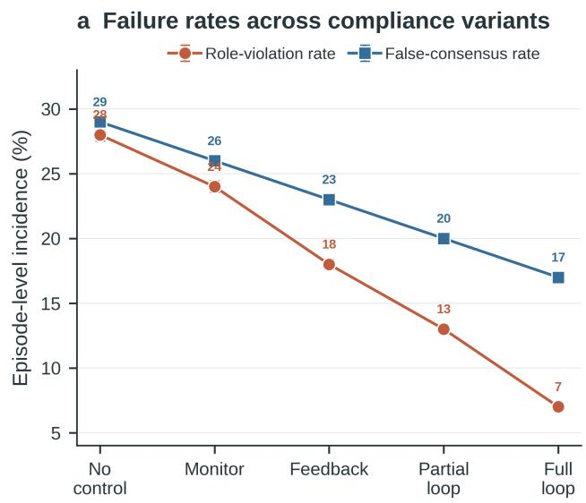

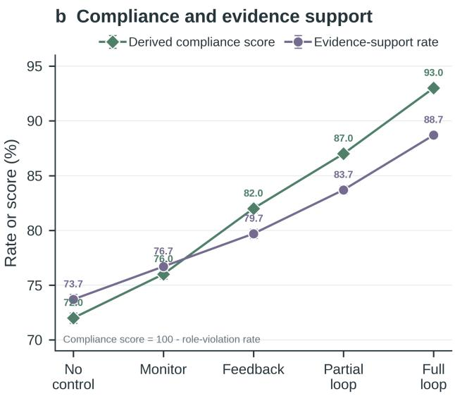  
Figure 5: Ordered compliance ablation over 9,000 records per variant. Panel (a) compares role-violation and false-consensus incidence as controls are added; panel (b) relates the derived role-compliance score to evidence-support rate. The full loop matches the ECMR-Full macro endpoint; whiskers are binomial standard errors.

## B.5 Additional Role-Memory Diagnostics

<table><tr><td>Compliance Variant</td><td>Role-Violation Rate</td><td>Rate</td><td>Invalid-Challenge Self-Contradiction False-Consensus Rate</td><td>Rate</td><td>Evidence-Support Rate</td></tr><tr><td>No-Compliance</td><td>0.280±0.0047</td><td>0.350±0.0050</td><td>0.220±0.0044</td><td>0.290±0.0048</td><td>0.737±0.0046</td></tr><tr><td>Compliance-Monitor</td><td>0.240±0.0045</td><td>0.310±0.0049</td><td>0.190±0.0041</td><td>0.260±0.0046</td><td>0.767±0.0045</td></tr><tr><td>Feedback-Only</td><td>0.180±0.0040</td><td>0.240±0.0045</td><td>0.130±0.0035</td><td>0.230±0.0044</td><td>0.797±0.0042</td></tr><tr><td>Partial-Loop</td><td>0.130±0.0035</td><td>0.180±0.0040</td><td>0.090±0.0030</td><td>0.200±0.0042</td><td>0.837±0.0039</td></tr><tr><td>Full-Compliance- Loop</td><td>0.070±0.0027</td><td>0.110±0.0033</td><td>0.040±0.0021</td><td>0.170±0.0040</td><td>0.887±0.0033</td></tr></table>

Table 18: Role-memory feedback under compliance variants. Registered stepwise changes are anchored so Full-Compliance-Loop matches the ECMR-Full macro FCR/ESR endpoint; the ± terms are binomial standard errors over 9,000 evaluation records per variant.

Interpretation. Table 18 tests the role-correction path in Figure 1 of the main paper. Adding monitoring, feedback, and the closed correction loop produces a monotonic reduction in role violations, invalid challenges, and self-contradictions, while FCR falls and ESR rises. Because the reliability endpoints move with role-behavior failures at every stage, the ablation supports role correction as an upstream control mechanism rather than a cosmetic prompt constraint.

Figure 5 exposes the coupling behind the table: variants with fewer role violations also have fewer false consensuses and stronger evidence support. The compliance score in panel (b) is the complement of roleviolation rate, not an independent outcome; its value is to align the direction of behavioral compliance with ESR. The evidence is the coordinated endpoint movement across the ordered ablation, not a correlation between two independently measured scores.

## B.6 Additional Online-Adaptation Results

<table><tr><td>Method</td><td></td><td></td><td>Pre-Shift Acc / FCR Post-Shift Acc / FCR Recovery Acc / FCR Recovery</td><td>Steps</td></tr><tr><td>Frozen-Baseline</td><td>74.7±3.5  $0 . 3 3 3 { \pm } 0 . 0 3 8$ </td><td>/ 64.7±3.9  $0 . 5 0 0 { \scriptstyle \pm 0 . 0 4 1 }$ </td><td>/ 66.7±3.8  $0 . 4 4 4 { \pm } 0 . 0 4 1$ </td><td>/ 38±3</td></tr><tr><td>Frozen+EMA</td><td>74.8±3.4  $0 . 3 2 0 { \scriptstyle \pm 0 . 0 3 6 }$ </td><td>/ 69.3±3.5  $0 . 4 0 0 { \scriptstyle \pm 0 . 0 3 9 }$ </td><td> $/ \ 7 2 . 0 { \pm } 3 . 3$   $0 . 3 3 3 { \scriptstyle \pm 0 . 0 3 6 }$ </td><td>/ 24±2</td></tr><tr><td>Frozen+Memory</td><td>75.2±3.3  $0 . 2 8 0 { \pm } 0 . 0 3 4$ </td><td>/ 72.0±3.2  $0 . 3 0 0 { \scriptstyle \pm 0 . 0 3 5 }$ </td><td> $/ \ 7 4 . 7 \pm 3 . 0$   $0 . 2 2 2 { \scriptstyle \pm 0 . 0 3 1 }$ </td><td>/ 15±2</td></tr><tr><td>Full-Online-ECMR 76.0±3.2</td><td> $\mathbf { 0 . 2 0 0 { \overset { . } { = } } 0 . 0 3 0 }$ </td><td>1  $\mathbf { 7 4 . 0 \pm 3 . 0 }$   $\mathbf { 0 . 2 2 2 } \pm \mathbf { 0 . 0 3 2 }$ </td><td> $\mathbf { \Gamma } / \ 7 6 . \mathbf { 0 } { \pm } 2 . 8$   $\mathbf { 0 . 1 8 5 \pm 0 . 0 2 8 }$ </td><td>/6±1</td></tr></table>

Table 19: Online self-learning under a pre-declared distribution shift on the separate 150-record Formal50 diagnostic. Each method is evaluated before the shift, immediately after it, and after recovery; uncertainty retains the recorded across-run stream variation.

Interpretation. Table 19 shows that memory and policy updates affect both the quality and speed of recovery after the declared shift. Full-Online-ECMR returns to its pre-shift accuracy in 6 steps, compared with 38 for the frozen baseline, and recovers to an FCR of 0.185 rather than 0.444. EMA and memory-only variants improve progressively, but neither matches the full controller’s 74.0 post-shift accuracy or complete recovery to 76.0.

## B.7 Additional Efficiency Statistics

Interpretation. Table 20 separates three possible explanations for ECMR’s cost. Verification is already near saturation for several multi-agent baselines, so its trigger rate is not the distinctive signal. Mean rounds increase only modestly from Easy to Hard, whereas ECMR-Full’s terminal decision changes sharply from early stopping to arbitration. The additional computation is therefore associated with how unresolved cases terminate, not simply with enabling verification or adding a fixed number of rounds.

Figure 6 makes the mechanism discriminative. Verification coverage is high and changes little, but the complementary terminal routes exchange 0.550 probability mass from early stopping to arbitration between Easy and Hard cases. Fixed-ECMR cannot express this conditional exchange, and the state-shuffled ablation loses 11.7 accuracy points despite retaining the same operation set. These two observations connect the routing visualization to the performance result: the gain depends on mapping evidence states to actions, not on action availability alone.

## B.8 Additional Cost-Efficiency Statistics

Interpretation. Table 21 separates absolute cost from marginal efficiency. Weak-ECMR requires fewer extra tokens per percentage-point gain than Weak-Fixed-ECMR (243.7 versus 301.5), indicating that dynamic control uses additional computation more productively than a fixed ECMR schedule. At the same

<table><tr><td>Method</td><td>Difficulty</td><td>Mean Rounds</td><td>Verification Trigger Rate</td><td>Arbitration Trigger Rate</td><td> $_ \mathrm { E a r l y - S t o p }$   $\mathrm { T r i g g e r R a t e }$ </td><td>Mean Tokens</td></tr><tr><td>Direct</td><td>Easy</td><td> $1 . 0 { \pm } 0 . 0 $ </td><td> $0 . 0 0 0 { \scriptstyle \pm 0 . 0 0 0 }$ </td><td> $0 . 0 0 0 { \scriptstyle \pm 0 . 0 0 0 }$ </td><td> $1 . 0 0 0 { \scriptstyle \pm 0 . 0 0 0 }$ </td><td> $5 7 8 { \pm } 2 1$ </td></tr><tr><td>Direct</td><td>Medium</td><td> $1 . 0 { \pm } 0 . 0 $ </td><td> $0 . 0 0 0 { \scriptstyle \pm 0 . 0 0 0 }$ </td><td> $0 . 0 0 0 { \scriptstyle \pm 0 . 0 0 0 }$ </td><td> $1 . 0 0 0 { \scriptstyle \pm 0 . 0 0 0 }$ </td><td> $6 2 3 { \pm } 5 1$ </td></tr><tr><td>Direct</td><td>Hard</td><td> $1 . 0 { \pm } 0 . 0 $ </td><td> $0 . 0 0 0 { \scriptstyle \pm 0 . 0 0 0 }$ </td><td> $0 . 0 0 0 { \scriptstyle \pm 0 . 0 0 0 }$ </td><td> $1 . 0 0 0 { \scriptstyle \pm 0 . 0 0 0 }$ </td><td> $8 6 7 \pm 7 4$ </td></tr><tr><td>Multi-Debate</td><td>Easy</td><td>3.8±0.3</td><td> $0 . 9 6 7 { \scriptstyle \pm 0 . 0 1 8 }$ </td><td> $0 . 9 5 0 { \scriptstyle \pm 0 . 0 2 2 }$ </td><td> $0 . 0 8 3 { \scriptstyle \pm 0 . 0 2 4 }$ </td><td> $2 9 6 7 { \pm } 8 4$ </td></tr><tr><td>Multi-Debate</td><td>Medium</td><td></td><td>3.9±0.2 0.950±0.022</td><td> $0 . 9 3 3 { \scriptstyle \pm 0 . 0 2 7 }$ </td><td> $0 . 0 5 0 { \scriptstyle \pm 0 . 0 1 8 }$ </td><td> $3 0 8 3 { \pm } 2 0 8$ </td></tr><tr><td>Multi-Debate</td><td>Hard</td><td></td><td>4.0±0.1 0.933±0.027</td><td> $0 . 9 1 7 { \scriptstyle \pm 0 . 0 3 1 }$ </td><td> $0 . 0 1 7 { \scriptstyle \pm 0 . 0 0 9 }$ </td><td> $4 1 6 1 \pm 2 9 6$ </td></tr><tr><td>AutoGen</td><td>Easy</td><td></td><td>2.7±0.4 0.950±0.022 0.000±0.000</td><td></td><td> $0 . 1 5 0 { \pm } 0 . 0 3 3$ </td><td> $2 3 9 0 { \pm } 1 4 8$ </td></tr><tr><td>AutoGen</td><td>Medium</td><td></td><td></td><td>2.9±0.3 0.933±0.027 0.000±0.000 0.083±0.024</td><td></td><td> $2 4 1 1 \pm 1 7 5$ </td></tr><tr><td>AutoGen</td><td>Hard</td><td></td><td>3.0±0.2 0.900±0.032 0.000±0.000</td><td></td><td> $0 . 0 3 3 { \pm } 0 . 0 1 3$ </td><td> $3 1 3 0 { \pm } 1 8 6$ </td></tr><tr><td>Fixed-ECMR</td><td>Easy</td><td></td><td>4.0±0.0 0.983±0.012 0.967±0.018</td><td></td><td> $0 . 0 0 0 { \scriptstyle \pm 0 . 0 0 0 }$ </td><td> $3 6 1 9 { \pm } 1 2 4$ </td></tr><tr><td>Fixed-ECMR</td><td>Medium</td><td></td><td> $4 . 0 { \pm } 0 . 0 0 . 9 6 7 { \pm } 0 . 0 1 8$ </td><td>0.950±0.022</td><td> $0 . 0 0 0 { \scriptstyle \pm 0 . 0 0 0 }$ </td><td> $3 7 0 4 \pm 1 6 9$ </td></tr><tr><td>Fixed-ECMR</td><td>Hard</td><td></td><td> $4 . 0 { \pm } 0 . 0 0 . 9 5 0 { \pm } 0 . 0 2 3$ </td><td>0.933±0.027</td><td> $0 . 0 0 0 { \scriptstyle \pm 0 . 0 0 0 }$ </td><td> $4 5 4 8 { \pm } 1 9 3$ </td></tr><tr><td>ECMR-Full</td><td>Easy</td><td></td><td> ${ \bf 5 . 3 \pm 1 . 0 0 . 9 9 2 \pm 0 . 0 0 8 }$ </td><td> $\mathbf { 0 . 3 5 0 { \scriptstyle \pm 0 . 0 5 7 } }$ </td><td> $\mathbf { 0 . 6 5 0 { \scriptstyle \pm 0 . 0 5 7 } }$ </td><td> $\mathbf { 7 6 3 7 } \pm \mathbf { 2 5 9 3 }$ </td></tr><tr><td>ECMR-Full</td><td>Medium</td><td> ${ \bf 5 . 8 \pm 0 . 9 }$ </td><td> $\mathbf { 0 . 9 8 3 } \pm \mathbf { 0 . 0 1 } 2$ </td><td> $\mathbf { 0 . 6 5 0 { \scriptstyle \pm 0 . 0 4 8 } }$ </td><td> $\mathbf { 0 . 3 5 0 { \overset { . } { = } } 0 . 0 4 8 }$ </td><td> ${ \bf 7 1 5 0 } \pm 2 { \bf 0 } 2 2$ </td></tr><tr><td>ECMR-Full</td><td>Hard</td><td> ${ \bf 5 . 9 { \pm 0 . 6 } }$ </td><td> $\mathbf { 0 . 9 6 7 { \scriptstyle \pm 0 . 0 1 9 } }$ </td><td> $\mathbf { 0 . 9 0 0 { \overset { . } { = } } 0 . 0 3 0 }$ </td><td> $\mathbf { 0 . 1 0 0 { \overset { . } { = } } 0 . 0 3 0 }$ </td><td> $\mathbf { 8 1 6 4 } \pm \mathbf { 1 7 5 } 2$ </td></tr></table>

Table 20: Full-evaluation resource allocation by difficulty stratum. Values report mean±standard deviation across repeated runs. Verification may precede either terminal route; for ECMR-Full, arbitration and early stopping are complementary shares, and mean rounds increase with difficulty within the six-round budget.

<table><tr><td>Method</td><td colspan="5">Avg. Tokens Avg. Latency (s) ∆Acc vs Weak Extra tokens / 1pp Tokens / correct</td></tr><tr><td>Strong-Direct</td><td> $6 7 9 { \pm } 2 0 1$ </td><td> $4 . 7 2 { \pm } 1 . 3 8 $ </td><td>11.1</td><td></td><td>3054</td></tr><tr><td>Strong-Self-Consistency</td><td> $2 1 1 0 { \pm } 5 8 2$ </td><td> $1 6 . 0 2 { \pm } 5 . 3 9$ </td><td>5.6</td><td>255.0</td><td>12658</td></tr><tr><td>Weak-Direct</td><td> $6 9 3 { \pm } 2 1 9$ </td><td> $3 . 3 4 \pm 0 . 4 3$ </td><td>0.0</td><td></td><td>6238</td></tr><tr><td>Weak-Self-Consistency</td><td> $2 1 5 3 { \pm } 6 4 3$ </td><td> $1 2 . 1 7 { \pm } 2 . 0 9$ </td><td>0.0</td><td></td><td>19374</td></tr><tr><td>Weak-Fixed-ECMR</td><td> $4 0 4 4 { \pm } 7 2 7$ </td><td> $1 5 . 7 9 { \scriptstyle \pm 2 . 2 2 }$ </td><td>11.1</td><td>301.5</td><td>18196</td></tr><tr><td>Weak-ECMR</td><td> $8 8 1 6 \pm 7 3 6 8$ </td><td> $2 7 . 3 1 \pm 1 3 . 3 3$ </td><td>33.3</td><td>243.7</td><td>19836</td></tr><tr><td>Strong-ECMR</td><td> $9 7 5 1 { \pm } 7 3 7 0$ </td><td> $4 1 . 8 2 { \pm } 1 6 . 0 9 $ </td><td>33.3</td><td>271.7</td><td>21941</td></tr></table>

Table 21: Cost efficiency across strong and weak backbones. Token cost and latency are reported as mean±SD across the three domain aggregates. Accuracy gain is measured relative to Weak-Direct; additional tokens per percentage-point (pp) gain and tokens per correct sample are computed from the recorded diagnostic logs.

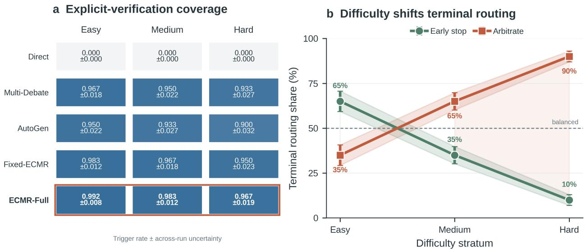  
Figure 6: Difficulty-conditioned controller actions. Panel (a) reports the explicit-verification trigger rate for every policy and difficulty stratum. Panel (b) shows ECMR-Full reallocating complementary terminal routes from early stopping on Easy cases to arbitration on Hard cases; whiskers mark routing uncertainty.

time, tokens per correct sample remain high for both weak and strong ECMR variants, reinforcing that controller efficiency should be evaluated jointly with the cost of the frozen backbone and the value assigned to reliability.

## B.9 State Feature Ablation

<table><tr><td>Removed Feature</td><td></td><td>Performance Drop Importance Rank</td></tr><tr><td>Evidence independence  $I _ { t } ^ { i n d }$ </td><td> $6 . 1 { \pm } 0 . 5 \mathrm { p p }$ </td><td>1</td></tr><tr><td>Support entropy  $\widetilde { H } _ { t } ^ { s u p }$ </td><td> $5 . 8 { \pm } 0 . 4 \mathrm { p p }$ </td><td>2</td></tr><tr><td>Contradiction structure  $C _ { t } ^ { c t r }$ </td><td> $5 . 2 { \pm } 0 . 4 \mathrm { p p }$ </td><td>3</td></tr><tr><td>Role drift/overlap</td><td> $4 . 8 { \pm } 0 . 4 \mathrm { p p }$ </td><td>4</td></tr><tr><td>Answer concentration  $g _ { t }$ </td><td> $4 . 3 { \pm } 0 . 4 \mathrm { p p }$ </td><td>5</td></tr><tr><td>Remaining budget  $b _ { t }$ </td><td> $3 . 1 { \pm } 0 . 3 \mathrm { p p }$ </td><td>6</td></tr></table>

Table 22: State-feature ablation importance over the declared 9,000-record evaluation. Semantic-state features are ranked by recorded accuracy drop in percentage points (pp) and across-run uncertainty when each feature is removed.

Interpretation. Table 22 ranks the information used by the controller. Removing evidence independence causes the largest performance drop, followed closely by support entropy and contradiction structure. These three leading features all measure the quality and diversity of support rather than the popularity of the current answer. Answer concentration ranks below them, empirically reinforcing the paper’s central claim that agreement alone is an insufficient stopping criterion.

<table><tr><td>Method</td><td></td><td>Risk-Flagged FCR Error Propagation Rate</td></tr><tr><td>No-Compliance</td><td> $0 . 3 8 9 { \pm } 0 . 1 1 5$ </td><td> $0 . 3 3 3 { \scriptstyle \pm 0 . 1 1 1 }$ </td></tr><tr><td>Compliance-Monitor</td><td> $0 . 3 3 3 { \scriptstyle \pm 0 . 1 1 1 }$ </td><td> $0 . 2 7 8 { \pm } 0 . 1 0 6$ </td></tr><tr><td>Feedback-Only</td><td> $0 . 2 7 8 { \pm } 0 . 1 0 6$ </td><td> $0 . 2 2 2 { \pm } 0 . 0 9 8$ </td></tr><tr><td>Partial-Loop</td><td> $0 . 2 2 2 { \pm } 0 . 0 9 8$ </td><td> $0 . 1 6 7 { \pm } 0 . 0 8 8$ </td></tr><tr><td>Full-Compliance-Loop</td><td> $\mathbf { 0 . 1 6 7 \pm 0 . 0 8 8 }$ </td><td> $\mathbf { 0 . 1 1 1 \pm 0 . 0 7 4 }$ </td></tr></table>

Table 23: Compliance gains on the separate 18-record risk-flagged diagnostic. The ± terms are binomial standard errors for false-consensus and error-propagation incidence and do not inherit the main evaluation sample count.

## B.10 Risk-Flagged Compliance Gains

Interpretation. Table 23 shows a stepwise reduction in risk as compliance feedback is added. The full loop reduces risk-flagged FCR from 0.389 to 0.167 and error propagation from 0.333 to 0.111 relative to No-Compliance. The parallel decrease indicates that role correction acts upstream: it limits the propagation of a weak challenge or copied rationale before that error becomes a confident group decision.

## B.11 System Stability

<table><tr><td>Method</td><td></td><td>Performance Variance Collaboration Budget Fluctuation Compliance Rate</td><td></td></tr><tr><td>Frozen-Baseline</td><td>12.7</td><td>28.3%</td><td> $0 . 7 1 { \pm } 0 . 0 4$ </td></tr><tr><td>Frozen+EMA</td><td>7.5</td><td>18.4%</td><td> $0 . 8 0 { \pm } 0 . 0 3$ </td></tr><tr><td>Frozen+Memory</td><td>5.3</td><td>13.2%</td><td> $0 . 8 6 { \pm } 0 . 0 3$ </td></tr><tr><td>Full-Online-ECMR</td><td>2.4</td><td>8.6%</td><td> $\mathbf { 0 . 9 2 } \pm \mathbf { 0 . 0 2 }$ </td></tr></table>

Table 24: System stability on the separate 150-record Formal50 streaming diagnostic. Performance variance and collaboration-budget fluctuation are point estimates; compliance-rate uncertainty retains recorded across-run variation.

Interpretation. Table 24 connects online adaptation to operational stability. Full-Online-ECMR reduces performance variance from 12.7 to 2.4 and collaboration-budget fluctuation from 28.3% to 8.6%, while raising compliance from 0.71 to 0.92. The joint movement shows that adaptation is not simply increasing average performance; it also makes the controller’s resource use and role behavior more predictable under the streaming protocol.

  
Each row is one real Direct/ECMR-Full paired prediction. Question, gold answer, and model outputs are abbreviated for page-level auditability; full records are reproducible by example\_id.

<table><tr><td>No ID</td><td></td><td>Gold</td><td>Direct</td><td>D ECMR-Full</td><td></td><td>A Outcome</td><td></td><td>FCR ESR</td><td>Question excerpt</td></tr><tr><td></td><td>medqa_us_test_0</td><td>D(Lactose-fermenting,g</td><td>D (Lactose-fermenting,-</td><td>OK</td><td>C (Spore-forming, gram-p</td><td>ERR Regressed</td><td></td><td></td><td>A 39-year-old woman is brought to the emergency department because of fevers,</td></tr><tr><td></td><td>medqa_us_test_1</td><td>A (Silvery plaques on ex-</td><td>D (Pallor of the conju…</td><td>ERR</td><td>D (Pallor of the conjunc</td><td>ERR Both wrong</td><td></td><td></td><td>A 23-year-old woman comes to the physician because she is embarrassed about t</td></tr><tr><td></td><td>medqa_us_test_10</td><td>B (Biopsy of the mass)</td><td>B (Biopsy of the mass)</td><td>OK</td><td>B (Biopsy of the mass)</td><td>OK Both OK</td><td></td><td></td><td>A 62-year old female comes to the physician because of vaginal spotting and u…</td></tr><tr><td></td><td>medqa_us_test_11</td><td>C (Interrupted 2-0 polyp</td><td>C (Interrupted 2-0 pol….</td><td>OK</td><td>C (Interrupted 2-0 polyp…</td><td>OK Both OK</td><td></td><td></td><td>A 25-year-old male involved in a knife fight presents with a penetrating woun…</td></tr><tr><td></td><td>medqa_us_test_110</td><td>D(Malabsorption ofatt…</td><td>D(Malabsorption of fa…</td><td>OK</td><td>A (Parathyroid gland ade-</td><td>ERR Regressed</td><td></td><td></td><td>A 62-year-old man comes to the emergency department because of right-sided ba</td></tr><tr><td></td><td>medqa_us_test_115</td><td>A (Central fusion of the</td><td>A (Central fusion of t…</td><td>OK</td><td>A (Central fusion of the-</td><td>OK Both OK</td><td></td><td></td><td>A 21-year-old female presents to the office after a health screening in which…</td></tr><tr><td></td><td>medqa_us_test_12</td><td>B (Reid Index &gt; 50%)</td><td>B (Reid Index &gt; 50%)</td><td>OK</td><td>B (Reid Index &gt; 50%)</td><td>OK Both OK</td><td></td><td></td><td>A post-mortem lung examination of a 68-year-old male overweight male with evi</td></tr><tr><td></td><td>medqa_us_test_120</td><td>E (IL-4)</td><td>E (IL-4)</td><td>OK E (IL-4)</td><td></td><td>OK Both OK</td><td></td><td></td><td>A 48-year-old woman comes to the physician because of a 7-day history of prog</td></tr><tr><td></td><td>medqa_us_test_124</td><td>C (Fee-for-service may i-</td><td>C (Fee-for-service may</td><td>OK</td><td>C (Fee-for-service my </td><td>OK Both OK</td><td></td><td></td><td>A multi-specialty physician practice is meeting to determine which compensati..</td></tr><tr><td>10</td><td>medqa_us_test_126</td><td>A (Perichondrium)</td><td>A (Perichondrium)</td><td>OK</td><td>A (Perichondrium)</td><td>OK Both OK</td><td></td><td></td><td>An investigator is studying traumatic knee joint injuries in college athletes--</td></tr><tr><td>11</td><td>medqa_us_test_13</td><td>C (Thoracic aortic ruptu…</td><td>C (Thoracic aortic rup…</td><td>OK</td><td>C (Thoracic aortic ruptu</td><td>OK Both OK</td><td></td><td></td><td>A 26-year-old woman is brought to the emergency department 20 minutes after b…</td></tr><tr><td>12</td><td>medqa_us_test_14</td><td>B (Normal hemoglobin in…</td><td>B (Normal hemoglobin i</td><td>·OK</td><td>B (Normal hemoglobin in.…</td><td>OK Both OK</td><td></td><td></td><td>A 3-month-old girl is brought to a pediatrician by her parents. She has centr--</td></tr><tr><td>13</td><td>medqa_us_test_145</td><td>C (Secondary active tran…</td><td>C (Secondary active tr--</td><td>OK</td><td>C (Secondary active tran…</td><td>OK Both OK</td><td></td><td></td><td>A 61-year-old man presents to the clinic with complaints of excessive thirst,</td></tr><tr><td>14</td><td>medqa_us_test_15</td><td>A (Stop magnesium sulfat…</td><td>A (Stop magnesium sulf…OK</td><td></td><td>A(Stop magnesium sulfat…</td><td>OK Both OK</td><td></td><td></td><td>The patient is given prophylactic labetalol and magnesium sulfate. Examinatio…</td></tr><tr><td>15</td><td>medqa_us_test_155</td><td>D (Levofloxacin)</td><td>D (Levofloxacin)</td><td>OK A (Amoxicillin)</td><td></td><td>ERR Regressed</td><td></td><td></td><td>A 66-year-old man presents to the emergency department due to a productive co</td></tr><tr><td>16</td><td>medqa_us_test_16</td><td>C (Stool leukocytes)</td><td>C (Stool leukocytes)</td><td>OK</td><td>C (Stool leukocytes)</td><td>OK Both OK</td><td></td><td></td><td>A 28-year-old man comes to the physician because of diarrhea and crampy abdom…</td></tr><tr><td>17</td><td>medga_us_test_166</td><td>B (Wide pulse pressure)</td><td>D (Double split S2)</td><td>ERR</td><td>B (Wide pulse pressure)</td><td>OK Corrected</td><td>★</td><td>↑</td><td>A 32-year-old pregnant woman presents to her physician with flu-like symptoms</td></tr><tr><td>18</td><td>medqa_us_test_17</td><td>D (Natural killer cells)</td><td>D (Natural killercell</td><td>OK</td><td>D (Natural killer cells)</td><td>OK Both OK</td><td></td><td></td><td>A 67-year-old man with peripheral neuropathy comes to the physician for a fol…</td></tr><tr><td>19</td><td>medqa_us_test_18</td><td>B (Aortoiliac atheroscle</td><td>B (Aortoiliac atherosc…</td><td>OK A (Anxiety)</td><td></td><td>ERR Regressed</td><td></td><td></td><td>A 67-year-old man presents to his primary care physician for erectile dysfunc</td></tr><tr><td>20</td><td>medqa_us_test_19</td><td>D (Reassurance and follo</td><td>D (Reassurance and fo…</td><td>OK</td><td>D (Reassurance and follo</td><td>OK Both OK</td><td></td><td></td><td>A 14-year-old girl comes to the physician with her father for evaluation of h</td></tr><tr><td>21</td><td>medqa_us_test_194</td><td>B (Bilateral miosis)</td><td>C (Miosis of the right…</td><td>ERR</td><td>B (Bilateral miosis)</td><td>OK Corrected</td><td>↓</td><td></td><td>A 50-year-old woman with Systemic Lupus Erythematosus (SLE) presents to your.….</td></tr><tr><td>22</td><td>medqa_us_test_195</td><td>E (Arteriovenous malform…</td><td> E (Arteriovenous malfo</td><td>OK</td><td>E (Arteriovenous malform</td><td>OK Both OK</td><td></td><td></td><td>A 65-year-old man comes to the physician because of progressively worsening f…</td></tr><tr><td>23</td><td>medqa_us_test_196</td><td>C (Direct activation of…</td><td>C (Direct activation o</td><td>OK</td><td>C (Direct activation of..</td><td>OK Both OK</td><td></td><td></td><td>A 51-year-old man is brought to the physician by his wife because of a 3-week…</td></tr><tr><td>24</td><td>medqa_us_test_2</td><td>E (Benzodiazepine intoxi</td><td>E (Benzodiazepine into</td><td>OK</td><td>E(Benzodiazepine intoxi…</td><td>OK Both OK</td><td></td><td></td><td>A 46-year-old man is brought to the emergency department for evaluation of al…</td></tr><tr><td>25</td><td>medqa_us_test_20</td><td>E (Immunoglobulin- IgM)</td><td>D (Immunoglobulin- IgA)</td><td>ERR</td><td>D (Immunoglobulin- IgA)</td><td>ERR Both wrong</td><td></td><td></td><td>An 11-month-old boy is brought to the clinic by his mother for a rash on his.</td></tr><tr><td>26</td><td>medqa_us_test_21</td><td>A(Serum antibodies agai</td><td>C (Protease-resistant…</td><td>ERR</td><td>C (Protease-resistant an</td><td>ERR Both wrong</td><td></td><td></td><td>A 75-year-old woman is brought to the emergency department by her son because</td></tr><tr><td>27</td><td>medqa_us_test_22</td><td>A (Acute pancreatitis)</td><td>A (Acute pancreatitis)</td><td>OK</td><td>A (Acute pancreatitis)</td><td>OK Both OK</td><td></td><td></td><td>A 13-month-old boy is brought to the physician for a well-child examination..</td></tr><tr><td>28</td><td>medqa_us_test_23</td><td>A (Positive latex agglut…</td><td>A (Positive latex aggl</td><td>OK</td><td>A (Positive latex agglut</td><td>OK Both OK</td><td></td><td></td><td>A 32-year-old man with HIV infection is brought to the emergency department b</td></tr><tr><td>29</td><td>medqa_us_test_24</td><td>B (Silicosis)</td><td>B (Silicosis)</td><td>OK B (Silicosis)</td><td></td><td>OK Both OK</td><td></td><td></td><td>A 60-year-old man presents to the office for shortness of breath. The shortne…</td></tr><tr><td>30</td><td>medqa_us_test_25</td><td>D (Takotsubo cardiomyopa·-D (Takotsubo cardiomyo--OK</td><td></td><td></td><td>C (Constrictive pericard</td><td>ERR Regressed</td><td></td><td></td><td>A 43-year-old woman is brought to the emergency department by her brother for-</td></tr><tr><td>31</td><td>medqa_us_test_26</td><td>C (Miosis)</td><td>C (Miosis)</td><td>OK C (Miosis)</td><td></td><td>OK Both OK</td><td></td><td></td><td>A 25-year-old man presents to the emergency department with altered mental st--</td></tr><tr><td>32</td><td>medqa_us_test_27</td><td>D (Right-sided analgesia)</td><td>D (Right-sided analges</td><td>OK</td><td>C (Contralateral cortico-</td><td>ERR Regressed</td><td></td><td></td><td>A 40-year-old businessman who was previously well is brought into the emergen…</td></tr><tr><td>33</td><td>medqa_us_test_28</td><td>D (Cortical thinning wit…</td><td>D (Cortical thinning w</td><td>OK</td><td>D (Cortical thinning wit…</td><td>OK Both OK</td><td></td><td></td><td>A 2-year-old girl with recurrent urinary tract infections is brought to the p…</td></tr><tr><td>34</td><td>medqa_us_test_29</td><td>B (Calcium oxalate cryst…</td><td>B (Calcium oxalate cry</td><td>OK</td><td>B (Calcium oxalate cryst…</td><td>OK Both OK</td><td></td><td></td><td>An unconscious 55-year-old man is brought to the Emergency Department by ambu</td></tr><tr><td>35</td><td>medqa_us_test_3</td><td>D (Histoplasma capsulatu…</td><td>D(Histoplasma capsula</td><td>OK</td><td>D (Histoplasma capsulatu</td><td>OK Both OK</td><td></td><td></td><td>A 30-year-old African American woman comes to the physician for the evaluatio…</td></tr><tr><td>36</td><td>medqa_us_test_30</td><td>B (Factitious disorder)</td><td>B (Factitious disorder)</td><td>OK</td><td>B (Factitious disorder)</td><td>OK Both OK</td><td></td><td></td><td>A 35-year-old female is brought to the emergency department after being found….</td></tr><tr><td>37</td><td>medqa_us_test_31</td><td>E (Dermis)</td><td>E (Dermis)</td><td>OK E (Dermis)</td><td></td><td>OK Both OK</td><td></td><td></td><td>A 17-year-old female accidentally eats a granola bar manufactured on equipmen…</td></tr><tr><td>38</td><td>medqa_us_test_32</td><td>C (Coarctation of the ao</td><td>C (Coarctation of the-</td><td>OK</td><td>C (Coarctation of the ao.</td><td>OK Both OK</td><td></td><td></td><td>An 11-year-old child complains of pain in the leg while playing. Blood pressu…</td></tr><tr><td>39 40</td><td>medqa_us_test_33</td><td>B (Active hepatitis A in</td><td>B (Active hepatitis A…</td><td>OK</td><td>B (Active hepatitis A in</td><td>OK Both OK</td><td></td><td></td><td>A 32-year-old man comes to the physician for a pre-employment examination. He….</td></tr><tr><td>41</td><td>medqa_us_test_34</td><td>B (Dense fibroinflammato…</td><td>B (Dense fibroinflamma</td><td>OK</td><td>B (Dense fibroinflammato</td><td>OK Both OK</td><td></td><td></td><td>A 65-year-old man presents to his primary care physician with a neck mass. He A 22-year-old woman is brought to the emergency department because of a 2-day</td></tr><tr><td>42</td><td>medqa_us_test_4 medqa_us_test_5</td><td>E (Chloramphenicol) B(Insulin, potassium,1…</td><td>E (Chloramphenicol) B(Insulin, potassium,…</td><td>OK OK</td><td>A (Doxycycline) C (IV fluids only)</td><td>ERR Regressed ERR Regressed</td></table>

□Both OK

  
Each row is one real Direct/ECMR-Full paired prediction. Question, gold answer, and model outputs are abbreviated for page-level auditability; full records are reproducible by example\_id.

<table><tr><td rowspan=1 colspan=9>No ID            Gold         Direct       D ECMR-Full       A Outcome  FCRESRQuestion excerpt</td></tr><tr><td rowspan=1 colspan=9>casehold_47835      1 (holding that new rue4(holding that reason…ERR4(holding that reasonabERRBoth wrong        rule on at least four occasions since Beam was decided. In Beam/Harper, the S.</td></tr><tr><td rowspan=1 colspan=6>casehold_47857      4 (holding that taxpayer 4 (holding that taxpayOK4 (holding that taxpayer OK</td><td rowspan=1 colspan=3>Both OK          § 7430(c)(4)(E)(i) (*A party ... shall be treated as the prevailing party if..</td></tr><tr><td rowspan=1 colspan=2>casehold_47910      0(holding that plaitif….</td><td rowspan=1 colspan=1>0 (holding that plaint…</td><td rowspan=1 colspan=1>OK</td><td rowspan=1 colspan=2>0(holding that plaiti.. OK</td><td rowspan=1 colspan=3>Both OK          the Legislature when that intent is clear. State v. D.A., supra, 191 N.J. at.…</td></tr><tr><td rowspan=1 colspan=2>casehold_47951      1 (holding that since th.…</td><td rowspan=1 colspan=1>1 (holding that since…</td><td rowspan=1 colspan=1>OK</td><td rowspan=1 colspan=2>1 (holding that since th.…. OK</td><td rowspan=1 colspan=3>Both OK          Court lacks jurisdiction to review this claim. For the foregoing reasons, the</td></tr><tr><td rowspan=1 colspan=2>casehold_47957      0 (holding that apprendi</td><td rowspan=1 colspan=1>4(holding that almend-</td><td rowspan=1 colspan=1>ERR</td><td rowspan=1 colspan=2>0(holding that apprendi- OK</td><td rowspan=1 colspan=3>Corrected         Javier Ochoa-Gaytan appeals his 63-month sentence imposed on remand for resen…</td></tr><tr><td rowspan=1 colspan=2>casehold_47997      0 (holding that there is…</td><td rowspan=1 colspan=1>0(holding that there…</td><td rowspan=1 colspan=1>OK</td><td rowspan=1 colspan=2>0(holding that there i OK</td><td rowspan=1 colspan=3>Both OK          and related Clausell&#x27;s improbable story to police officers, the officers like</td></tr><tr><td rowspan=1 colspan=2>casehold_48019      0 (recognizing presumpti</td><td rowspan=1 colspan=1>…0(recognizing presump</td><td rowspan=1 colspan=1>OK</td><td rowspan=1 colspan=2>0 (recognizing presumpti-OK</td><td rowspan=1 colspan=3>Both OK          15 C.R.S. (1990); Orr, 753 P.2d at 1223; Green v. Chaffee Ditch Co., 150 Colo…</td></tr><tr><td rowspan=1 colspan=2>casehold_48065      0 (holding that a motion…</td><td rowspan=1 colspan=1>0 (holding that a moti….</td><td rowspan=1 colspan=1>OK</td><td rowspan=1 colspan=1>0(holding that a motion…</td><td rowspan=1 colspan=1>OK</td><td rowspan=1 colspan=3>Both OK          an intoxicated motorist. 598 N.E.2d at 634 n. 2. Jerry contends that his case-</td></tr><tr><td rowspan=1 colspan=2>casehold_48068      2 (holding that testimon…</td><td rowspan=1 colspan=1>4 (holding that trial--</td><td rowspan=1 colspan=1>ERR</td><td rowspan=1 colspan=1>2(holding that testimon…</td><td rowspan=1 colspan=1>OK</td><td rowspan=1 colspan=1>Corrected</td><td rowspan=1 colspan=2>↑  in rule 11(e), good cause was shown. Subsection (F) requires a defendant to n</td></tr><tr><td rowspan=1 colspan=2>10 casehold_48075      3 (recognizing that venu</td><td rowspan=1 colspan=1>3 (recognizing that ve</td><td rowspan=1 colspan=1>OK</td><td rowspan=1 colspan=1>3 (recognizing that venu…</td><td rowspan=1 colspan=1>OK</td><td rowspan=1 colspan=1>Both OK</td><td rowspan=1 colspan=2>relying on Rule 21, the Third Circuit has acknowledged that a portion of an a</td></tr><tr><td rowspan=1 colspan=2>11 casehold_48126      3 (holding that prejudic</td><td rowspan=1 colspan=1>3 (holding that prejud</td><td rowspan=1 colspan=1>OK</td><td rowspan=1 colspan=1>1(holding stricklands p</td><td rowspan=1 colspan=1>ERR</td><td rowspan=1 colspan=1>Regressed</td><td rowspan=1 colspan=1></td><td rowspan=1 colspan=1>see also Kinnard v. United States, 313 F.3d 933, 935 (6th Cir.2002) (explaini</td></tr><tr><td rowspan=1 colspan=2>12 casehold_48137      2 (holding that material</td><td rowspan=1 colspan=1>2 (holding that materi…</td><td rowspan=1 colspan=1>OK</td><td rowspan=1 colspan=1>2 (holding that material</td><td rowspan=1 colspan=1>OK</td><td rowspan=1 colspan=1>Both OK</td><td rowspan=1 colspan=1></td><td rowspan=1 colspan=1>the contract without paying for the expenses that Coastal had incurred up to.</td></tr><tr><td rowspan=1 colspan=2>13 casehold_48141      2 (holding that the obje</td><td rowspan=1 colspan=1>1 (holding that the ob…</td><td rowspan=1 colspan=1>ERR</td><td rowspan=1 colspan=1>1 (holding that the obje</td><td rowspan=1 colspan=1>ERR</td><td rowspan=1 colspan=1>Both wrong</td><td rowspan=1 colspan=1>↓</td><td rowspan=1 colspan=1>By contrast, when an accused in-fringer&#x27;s post-filing conduct is reckless,a p</td></tr><tr><td rowspan=1 colspan=2>14  casehold_48173      1 (holding that the diss…</td><td rowspan=1 colspan=1>1 (holding that the di..</td><td rowspan=1 colspan=1>OK</td><td rowspan=1 colspan=1>1 (holding that the diss…</td><td rowspan=1 colspan=1>OK</td><td rowspan=1 colspan=1>Both OK</td><td rowspan=1 colspan=1></td><td rowspan=1 colspan=1>with the reasoning of the Minnesota Supreme Court in Shriner. Dale&#x27;s case, li-</td></tr><tr><td rowspan=1 colspan=2>15 casehold_48187      4 (holding that liabilit</td><td rowspan=1 colspan=1>1 (holding that a prim…</td><td rowspan=1 colspan=1>ERR</td><td rowspan=1 colspan=1>1(holding that a prima…</td><td rowspan=1 colspan=1>ERR</td><td rowspan=1 colspan=1>Both wrong</td><td rowspan=1 colspan=1></td><td rowspan=1 colspan=1>voted to terminate him on March 11, 1994. Because there is no evidence showin</td></tr><tr><td rowspan=1 colspan=2>16 casehold_48229      4 (holding that thediff..</td><td rowspan=1 colspan=1>4 (holding that the di….</td><td rowspan=1 colspan=1>OK</td><td rowspan=1 colspan=1>4 (holdin that the di..</td><td rowspan=1 colspan=1>OK</td><td rowspan=1 colspan=1>Both OK</td><td rowspan=1 colspan=1></td><td rowspan=1 colspan=1>situated employees differently is an &quot;accepted consequence of the discretion.</td></tr><tr><td rowspan=1 colspan=2>17  casehold_48232      4 (holding that absence</td><td rowspan=1 colspan=1>4 (holding that absenc</td><td rowspan=1 colspan=1>OK</td><td rowspan=1 colspan=1>4 (holding that absence</td><td rowspan=1 colspan=1>OK</td><td rowspan=1 colspan=1>Both OK</td><td rowspan=1 colspan=1></td><td rowspan=1 colspan=1>has the burden to show why the defendant&#x27;s voluntary absence at the trial aft…</td></tr><tr><td rowspan=1 colspan=2>18 casehold_48257      1 (holding that because</td><td rowspan=1 colspan=1>1 (holding that becaus</td><td rowspan=1 colspan=1>OK</td><td rowspan=1 colspan=1>1 (holding that because…</td><td rowspan=1 colspan=1>OK</td><td rowspan=1 colspan=1>Both OK</td><td rowspan=1 colspan=1></td><td rowspan=1 colspan=1>after subtracting a subrogated medical expense claim. 5 The negligence theory-</td></tr><tr><td rowspan=1 colspan=2>19  casehold_48329      3 (holding that state la…</td><td rowspan=1 colspan=1>3 (holding that state-</td><td rowspan=1 colspan=1>OK</td><td rowspan=1 colspan=1>3 (holding that state la…</td><td rowspan=1 colspan=1>OK</td><td rowspan=1 colspan=1>Both OK</td><td rowspan=1 colspan=1></td><td rowspan=1 colspan=1>Dec. 21, 2011) (generic drug manufacturers&#x27; failure to update their labels, *..</td></tr><tr><td rowspan=1 colspan=2>20 casehold_48355      2 (recognizing and enfor</td><td rowspan=1 colspan=1>2 (recognizing and enf</td><td rowspan=1 colspan=1>OK</td><td rowspan=1 colspan=1>2 (recognizing and enfor</td><td rowspan=1 colspan=1>OK</td><td rowspan=1 colspan=1>Both OK</td><td rowspan=1 colspan=1></td><td rowspan=1 colspan=1>Inc. v. Carpenter, - U.S. -, 130 S.Ct. 599, 606, 175 L.Ed.2d 458 (2009). Ther…</td></tr><tr><td rowspan=1 colspan=2>21  casehold_48398      3 (holding that harp for--</td><td rowspan=1 colspan=1>3 (holding that harp f…</td><td rowspan=1 colspan=1>OK</td><td rowspan=1 colspan=1>3 (holding that harp for</td><td rowspan=1 colspan=1>OK</td><td rowspan=1 colspan=1>Both OK</td><td rowspan=1 colspan=1></td><td rowspan=1 colspan=1>scheme, it is possible for a defendant convicted of a Class I felony to be se…</td></tr><tr><td rowspan=1 colspan=2>22 casehold_48418      4 (holding that a unin</td><td rowspan=1 colspan=1>4 (holding that a unio…</td><td rowspan=1 colspan=1>OK</td><td rowspan=1 colspan=1>4 (holding that a union</td><td rowspan=1 colspan=1>OK</td><td rowspan=1 colspan=1>Both OK</td><td rowspan=1 colspan=1></td><td rowspan=1 colspan=1>1438 (9th Cir.1995) (&quot;It follows that statements impugning the integrity of a--</td></tr><tr><td rowspan=1 colspan=2>23 casehold_48429      1 (holding that the peti…</td><td rowspan=1 colspan=1>0(holding that failin……</td><td rowspan=1 colspan=1>ERR</td><td rowspan=1 colspan=1>0 (holding that failing…</td><td rowspan=1 colspan=1>ERR</td><td rowspan=1 colspan=1>Both wrong</td><td rowspan=1 colspan=1></td><td rowspan=1 colspan=1>v. INS, 452 F.3d 154, 156-57 (2d Cir.2006), the BIA properly found that Babal</td></tr><tr><td rowspan=1 colspan=2>24 casehold_48449      1 (holding such servie</td><td rowspan=1 colspan=1>3 (holding that servic</td><td rowspan=1 colspan=1>ERR</td><td rowspan=1 colspan=1>1 (holding such service</td><td rowspan=1 colspan=1>OK</td><td rowspan=1 colspan=1>Corrected</td><td rowspan=1 colspan=1>↓</td><td rowspan=1 colspan=1>v. Kitsap County, 59 Wn. App. 177, 180, 797 P.2d 516 (1990). 14 See Marley v.…</td></tr><tr><td rowspan=1 colspan=1>25</td><td rowspan=1 colspan=1>casehold_48475      4 (holding in the contex-</td><td rowspan=1 colspan=1>4 (holding in the cont</td><td rowspan=1 colspan=1>OK</td><td rowspan=1 colspan=1>4 (holding in the contex-</td><td rowspan=1 colspan=1>OK</td><td rowspan=1 colspan=1>Both OK</td><td rowspan=1 colspan=1></td><td rowspan=1 colspan=1>ability to prove his claim of malicious prosecution, and each offers differen…</td></tr><tr><td rowspan=1 colspan=1>26</td><td rowspan=1 colspan=1>casehold_48476      2 (holding that a party.</td><td rowspan=1 colspan=1>2 (holding that a part…</td><td rowspan=1 colspan=1>OK</td><td rowspan=1 colspan=1>1 (holding that under 11</td><td rowspan=1 colspan=1>ERR</td><td rowspan=1 colspan=1>Regressed</td><td rowspan=1 colspan=1></td><td rowspan=1 colspan=1>goods, services, or new credit, or release by a transferee of property previo-</td></tr><tr><td rowspan=1 colspan=1>27</td><td rowspan=1 colspan=1>casehold_48501      1 (holding administrativ</td><td rowspan=1 colspan=1>1 (holding administrat</td><td rowspan=1 colspan=1>OK</td><td rowspan=1 colspan=1>1 (holding administrati</td><td rowspan=1 colspan=1>OK</td><td rowspan=1 colspan=1>Both OK</td><td rowspan=1 colspan=1></td><td rowspan=1 colspan=1>financing, and the procedure for receiving benefits.&#x27; &quot; Peckham, 964 F.2d at.…</td></tr><tr><td rowspan=1 colspan=1>28</td><td rowspan=1 colspan=1>casehold_48533      4 (holding that plaintif..</td><td rowspan=1 colspan=1>4 (holding that plaint</td><td rowspan=1 colspan=1>OK</td><td rowspan=1 colspan=1>2 (recognizing the major</td><td rowspan=1 colspan=1>ERR</td><td rowspan=1 colspan=1>Regressed</td><td rowspan=1 colspan=1></td><td rowspan=1 colspan=1>requirement under the “adversely affected&quot; standard. 647 S.W.2d at 252-53. Bo</td></tr><tr><td rowspan=1 colspan=1>29</td><td rowspan=1 colspan=1>casehold_48619      3 (holding that appellan·</td><td rowspan=1 colspan=1>3 (holding that appell…</td><td rowspan=1 colspan=1>OK</td><td rowspan=1 colspan=1>3 (holding that appellan-</td><td rowspan=1 colspan=1>OK</td><td rowspan=1 colspan=2>Both OK</td><td rowspan=1 colspan=1>reliance on the mediation statement fails for several reasons. To begin, ther</td></tr><tr><td rowspan=1 colspan=1>30</td><td rowspan=1 colspan=1>casehold_48621      2 (holding transfer to a…</td><td rowspan=1 colspan=1>3 (holding that a requ…</td><td rowspan=1 colspan=1>ERR</td><td rowspan=1 colspan=1>3 (holding that a reques</td><td rowspan=1 colspan=1>ERR</td><td rowspan=1 colspan=1>Both wrong</td><td rowspan=1 colspan=1></td><td rowspan=1 colspan=1>See White, 45 F.3d at 362 (citing 29 C.F.R. pt. 1630 app., 5 1630.2(o)). Neit</td></tr><tr><td rowspan=1 colspan=1>31</td><td rowspan=1 colspan=1>casehold_48679      0 (holding that when a …</td><td rowspan=1 colspan=1>1 (holding that agent…</td><td rowspan=1 colspan=1>ERR</td><td rowspan=1 colspan=1>1 (holding that agent wh…</td><td rowspan=1 colspan=1>ERR</td><td rowspan=1 colspan=1>Both wrong</td><td rowspan=1 colspan=1></td><td rowspan=1 colspan=1>could make, and is based instead on the specialized knowledge obtained throug…</td></tr><tr><td rowspan=1 colspan=1>32</td><td rowspan=1 colspan=1>casehold_48742      2 (holding that evidence</td><td rowspan=1 colspan=1>2 (holding that eviden…</td><td rowspan=1 colspan=1>OK</td><td rowspan=1 colspan=1>2 (holding that evidence</td><td rowspan=1 colspan=1>OK</td><td rowspan=1 colspan=1>Both OK</td><td rowspan=1 colspan=1></td><td rowspan=1 colspan=1>are most substantial. Rather, they seem concerned with whether each contribut</td></tr><tr><td rowspan=1 colspan=1>33</td><td rowspan=1 colspan=1>casehold_48761      2 (holding that judgment…</td><td rowspan=1 colspan=1>2 (holding that judgme</td><td rowspan=1 colspan=1>OK</td><td rowspan=1 colspan=1>2 (holding that judgment</td><td rowspan=1 colspan=1>OK</td><td rowspan=1 colspan=2>Both OK</td><td rowspan=1 colspan=1>4 Oregon Laws 2013, chapter 649, section 6, provides: &quot;(1) The amendments to.…</td></tr><tr><td rowspan=1 colspan=1>34</td><td rowspan=1 colspan=1>casehold_48769      1 (holding that change i…</td><td rowspan=1 colspan=1>1 (holding that change</td><td rowspan=1 colspan=1>OK</td><td rowspan=1 colspan=1>1 (holding that change i</td><td rowspan=1 colspan=1>OK</td><td rowspan=1 colspan=2>Both OK</td><td rowspan=1 colspan=1>Colameta began to search for another job before Protégé changed his duties or</td></tr><tr><td rowspan=1 colspan=1>35</td><td rowspan=1 colspan=1>casehold_48778      0 (recognizing that cfa</td><td rowspan=1 colspan=1>0 (recognizing that cf</td><td rowspan=1 colspan=1>OK</td><td rowspan=1 colspan=1>0(recognizing that cfa…</td><td rowspan=1 colspan=1>OK</td><td rowspan=1 colspan=2>Both OK</td><td rowspan=1 colspan=1>a claim upon which relief can be granted, we review the legal issues raised h…</td></tr><tr><td rowspan=1 colspan=2>36  casehold_48793      4 (holding that seizure…</td><td rowspan=1 colspan=1>3 (holding that a seiz…</td><td rowspan=1 colspan=1>ERR</td><td rowspan=1 colspan=1>3 (holding that a seizur…</td><td rowspan=1 colspan=1>ERR</td><td rowspan=1 colspan=2>Both wrong</td><td rowspan=1 colspan=1>seize ammunition boxes that contained linked ammunition rounds or large-capac</td></tr><tr><td rowspan=1 colspan=2>37  casehold_49256      1 (holding supervisors r</td><td rowspan=1 colspan=1>1 (holding supervisors-</td><td rowspan=1 colspan=1>OK</td><td rowspan=1 colspan=1>1 (holding supervisors r</td><td rowspan=1 colspan=1>OK</td><td rowspan=1 colspan=2>Both OK</td><td rowspan=1 colspan=1>was in part motivated by her pregnancy. &quot;Direct evidence is that which demons</td></tr><tr><td rowspan=1 colspan=2>38 casehold_49364      4 (recognizing that comp.</td><td rowspan=1 colspan=1>3 (holding that in rev</td><td rowspan=1 colspan=1>ERR</td><td rowspan=1 colspan=1>4 (recognizing that comp-</td><td rowspan=1 colspan=1>OK</td><td rowspan=1 colspan=2>Corrected   4</td><td rowspan=1 colspan=1>to credit and what reasonable inferences to draw from that evidence. For exam</td></tr><tr><td rowspan=1 colspan=2>39 casehold_49565      2 (holding when the dece…</td><td rowspan=1 colspan=1>2 (holding when the de</td><td rowspan=1 colspan=1>OK</td><td rowspan=1 colspan=1>2 (holding when the dece</td><td rowspan=1 colspan=1>OK</td><td rowspan=1 colspan=2>Both OK</td><td rowspan=1 colspan=1>conduct proximately caused his injuries. Mellen v. Lane, 377 S.C. 261, 280, 6…</td></tr><tr><td rowspan=1 colspan=2>40  casehold_49913      1 (holding that the eigh.…</td><td rowspan=1 colspan=1>1 (holding that the ei…</td><td rowspan=1 colspan=1>OK</td><td rowspan=1 colspan=1>1 (holding that the eigh</td><td rowspan=1 colspan=1>OK</td><td rowspan=1 colspan=2>Both OK</td><td rowspan=1 colspan=1>DISMISSING FIRST AMENDED PETITION WITHOUT PREJUDICE SAMUEL P. KING, District.-</td></tr><tr><td rowspan=1 colspan=2>41 casehold_50335      4 (recognizing the jurys</td><td rowspan=1 colspan=1>4 (recognizing the jur…</td><td rowspan=1 colspan=1>OK</td><td rowspan=1 colspan=1>4 (recognizing the jurys</td><td rowspan=1 colspan=1>OK</td><td rowspan=1 colspan=2>Both OK</td><td rowspan=1 colspan=1>no matter how quickly and ably given, could salvage a fair trial for the defe</td></tr><tr><td rowspan=1 colspan=2>42 casehold_50754      4 (holding that defendan</td><td rowspan=1 colspan=1>4 (holding that defend….</td><td rowspan=1 colspan=1>OK</td><td rowspan=1 colspan=1>4 (holding that defendan</td><td rowspan=1 colspan=1>OK</td><td rowspan=1 colspan=2>Both OK</td><td rowspan=1 colspan=1>necessarily constitute bad faith, particularly when the valuation of the inju</td></tr><tr><td rowspan=1 colspan=2>43  casehold_50953      0 (holding that pleading</td><td rowspan=1 colspan=1>4 (holding to ensure s…</td><td rowspan=1 colspan=1>ERR</td><td rowspan=1 colspan=1>2 (holding that pro se p</td><td rowspan=1 colspan=1>ERR</td><td rowspan=1 colspan=2>Both wrong</td><td rowspan=1 colspan=1>859 F.2d 434, 436 (6th Cir.1988). When considering a motion to dismiss, a cou</td></tr><tr><td rowspan=1 colspan=2>44  casehold_51566      3 (holding that refusal…</td><td rowspan=1 colspan=1>2 (holding that the co</td><td rowspan=1 colspan=1>ERR</td><td rowspan=1 colspan=1>2 (holding that the cour</td><td rowspan=1 colspan=1>ERR</td><td rowspan=1 colspan=2>Both wrong</td><td rowspan=1 colspan=1>the protest in question here. Accordingly, Plaintiff&#x27;s protest fails to prese…</td></tr><tr><td rowspan=1 colspan=3>45  casehold_51862      0 (holding that arbitrat… 0(holding that arbitr…</td><td rowspan=1 colspan=1>OK</td><td rowspan=1 colspan=1>0(holding that arbitrat….</td><td rowspan=1 colspan=1>OK</td><td rowspan=1 colspan=2>Both OK</td><td rowspan=1 colspan=1>are unenforceable, they are also severable from the agreement. Given that the</td></tr><tr><td rowspan=1 colspan=2>46  casehold_52230      3 (holding that an inter</td><td rowspan=1 colspan=1>3 (holding that an int…</td><td rowspan=1 colspan=1>OK</td><td rowspan=1 colspan=1>3 (holding that an inter</td><td rowspan=1 colspan=1>OK</td><td rowspan=1 colspan=2>Both OK</td><td rowspan=1 colspan=1>judgment on a take-nothing jury verdict against plaintiffs. Appellant challen</td></tr><tr><td rowspan=1 colspan=2>47  casehold_52580      3 (holding that district…</td><td rowspan=1 colspan=1>1 (holding that the tr…</td><td rowspan=1 colspan=1>ERR</td><td rowspan=1 colspan=1>1 (holding that the tri</td><td rowspan=1 colspan=1>ERR</td><td rowspan=1 colspan=2>Both wrong</td><td rowspan=1 colspan=1>have held that, under these circumstances, the additional language of Jenkins</td></tr><tr><td rowspan=1 colspan=2>48  casehold_52658      2 (holding that the vali-.</td><td rowspan=1 colspan=1>2 (holding that the va…</td><td rowspan=1 colspan=1>OK</td><td rowspan=1 colspan=1>2 (holding that the vali..</td><td rowspan=1 colspan=1>OK</td><td rowspan=1 colspan=2>Both OK</td><td rowspan=1 colspan=1>to any portion of the twenty percent contingent fee arrangement? In its panel</td></tr><tr><td rowspan=1 colspan=3>49  casehold_52822      0 (holding that a prior 0 (holding that a prio…</td><td rowspan=1 colspan=1>OK</td><td rowspan=1 colspan=1>1(holding that prior in</td><td rowspan=1 colspan=1>ERR</td><td rowspan=1 colspan=2>Regressed</td><td rowspan=1 colspan=1>the invalidity of the conviction.&quot; Id. at 978. Wicks attempted collaterally t--</td></tr><tr><td rowspan=1 colspan=9>50 casehold_52843      2 (holding that when the…2 (holding that when t…OK2 (holding that when the…OKBoth OK          (2001); see Strickland v. Washington, 466 U. S. 668, 687 (III) (104 SC 2052,…</td></tr></table>

□Both OK

## Formal50 Dense List Panel — FinQA

  
Each row is one real Direct/ECMR-Full paired prediction. Question, gold answer, and model outputs are abbreviated for page-level auditability; full records are reproducible by example\_id.

<table><tr><td>No ID</td><td></td><td>Gold</td><td>Direct</td><td>D ECMR-Full</td><td>A</td><td>Outcome</td><td>FCR</td><td>ESR</td><td>Question excerpt</td></tr><tr><td></td><td>finqa_AAPL/2006/page_10--</td><td>829.0 (829)</td><td>829</td><td>OK 829</td><td></td><td>Both OK</td><td></td><td></td><td>what was the greatest provision for income taxes , in millions?</td></tr><tr><td></td><td>finga_AAPL/2006/page_10-</td><td>0.27 (27%)</td><td>27</td><td>OK 27</td><td></td><td>Both OK</td><td></td><td></td><td>what was the lowest effective tax rate in the three year period?</td></tr><tr><td></td><td>finqa_AES/2001/page_33..</td><td>12.3 (12.30)</td><td>12.3</td><td>OK 12.30</td><td></td><td>Both OK</td><td></td><td></td><td>what was the difference in the companies high compared to its low sales price…</td></tr><tr><td></td><td>finqa_AES/2002/page_128….</td><td>1.0</td><td>0</td><td>ERR 0</td><td></td><td>ERR Both wrong</td><td></td><td></td><td>what was the decrease in rental expense (millions ) for operating leases in.</td></tr><tr><td></td><td>finqa_AMT/2006/page_104.</td><td>0.81275 (81.3%)</td><td>18.725</td><td>ERR 81.275%</td><td></td><td>Corrected</td><td></td><td></td><td>what was the percent of the outstanding notes under the ati 7.25% (7.25 % )...</td></tr><tr><td></td><td>finqa_AMT/2016/page_49.</td><td>0.09302 (9.3%)</td><td>8.51</td><td>ERR 8.51</td><td></td><td>ERR Both wrong</td><td></td><td></td><td>for the quarter ended march 312015 what was the percentage change in the shar</td></tr><tr><td></td><td>finqa_AON/2007/page_175.</td><td>18.0 (18)</td><td>18</td><td>OK 18</td><td></td><td>Both OK</td><td></td><td></td><td>what is the net change in aon 2019s unpaid restructuring liabilities during 2</td></tr><tr><td></td><td>finqa_BLK/2014/page_120--</td><td>349.0 (29.63%)</td><td>29.63</td><td>ERR 29.6%</td><td></td><td>Both wrong</td><td></td><td></td><td>what percent of future notes are due by 2017?</td></tr><tr><td></td><td>finqa_BLL/2010/page_35.</td><td>0.635 (.635)</td><td>0.635</td><td>OK 0.635</td><td></td><td>Both OK</td><td></td><td></td><td>productivity in the plastics business measured by million $ sales per employe:</td></tr><tr><td>10</td><td>finqa_BLL/2012/page_31.…</td><td>2.13755 (213.8%)</td><td>110.49</td><td>ERR 110.49</td><td></td><td>ERR Both wrong</td><td></td><td></td><td>the five year total return for the period ending 12/31/2012 on ball corporati</td></tr><tr><td>11</td><td>finqa_BLL/2012/page_31.</td><td>110.49 (110.49)</td><td>99.86</td><td>ERR 99.86</td><td></td><td>Both wrong</td><td></td><td></td><td>the five year total return for the period ending 12/31/2012 on ball corporati</td></tr><tr><td>12</td><td>finqa_CB/2008/page_229.</td><td>77.0 (77)</td><td>77</td><td>OK 77</td><td></td><td>Both OK</td><td></td><td></td><td>what was the average amortization expense from 2006 to 2008</td></tr><tr><td>13</td><td>finqa_CE/2016/page_19.p</td><td>-41.0 (-41)</td><td>-41</td><td>OK -41</td><td></td><td>Both OK</td><td></td><td></td><td>what is the net change in the amount spent for research and development in 20.</td></tr><tr><td>14</td><td>finqa_CMCSA/2015/page_1--</td><td>-35.0 (-35)</td><td>-35</td><td>OK -35</td><td></td><td>Both OK</td><td></td><td></td><td>what was the change in unrecognized tax benefits from the end of 2014 to the.…</td></tr><tr><td>15</td><td>finqa_CMCSA/2015/page_6.</td><td>0.33263 (33%)</td><td>33.26</td><td>OK 33.26</td><td></td><td>Both OK</td><td></td><td></td><td>what was the percentage cable distribution systems capital expenditures of th</td></tr><tr><td>16</td><td>finqa_DISCA/2014/page_6</td><td>1.2465 (124.65%)</td><td>124.65</td><td>ERR 124.65</td><td></td><td>ERR Both wrong</td><td></td><td></td><td>what was the percentage cumulative total shareholder return on disca common s…</td></tr><tr><td>17</td><td>finga_DRE/2007/page_56.…</td><td>1.56326</td><td>1.56</td><td>ERR 1.56</td><td></td><td>Both wrong</td><td></td><td></td><td>what is the net income per common share for the year 2007?</td></tr><tr><td>18</td><td>finqa_ETFC/2018/page_15</td><td>1.48936 (0.15%)</td><td>1.49</td><td>OK 0.15%</td><td></td><td>Regressed</td><td></td><td></td><td>what was the ratio of the pre-tax gain on the securities transferred from hel--</td></tr><tr><td>19</td><td>finqa_ETR/2016/page_23.</td><td>6111.0 (6111)</td><td>5547</td><td>ERR 5547</td><td></td><td>Both wrong</td><td></td><td></td><td>what would 2015 net revenue have been in millions assuming there was no impac…</td></tr><tr><td>20</td><td>finqa_FIS/2010/page_70...</td><td>0.02899 (2.9%)</td><td>2.9</td><td>OK 0.028986</td><td></td><td>Both OK</td><td></td><td></td><td>what portion of total purchase price is related to stock awards?</td></tr><tr><td>21</td><td>finqa_GPN/2010/page_89.</td><td>29946.0 (29946)</td><td>29946</td><td>OK 29946000</td><td></td><td>Regressed</td><td></td><td></td><td>what is the total fair value of non-vested shares as of may 31 , 2010?</td></tr><tr><td>22</td><td>finqa_GPN/2010/page_89.…</td><td>26.8 (26.8)</td><td>26.8</td><td>OK 26.8</td><td></td><td>Both OK</td><td></td><td></td><td>what was the total compensation expense for restricted stock recognized from.…</td></tr><tr><td>23</td><td>finqa_GPN/2013/page_92.</td><td>0.19366 (19.4%)</td><td>19.37</td><td>OK 19.37</td><td></td><td>Both OK</td><td></td><td></td><td>what percentage of lease payments will be paid out in the first year?</td></tr><tr><td>24</td><td>finqa_GS/2013/page_220.…</td><td>136.2 (136.20)</td><td>136.2</td><td>OK 136.2</td><td></td><td>Both OK</td><td></td><td></td><td>what is the five vear total return on the s&amp;p 500 index?</td></tr><tr><td>25</td><td>finqa_HIG/2004/page_140</td><td>9.8 (9.8)</td><td>9.8</td><td>OK 9.8</td><td>OK</td><td>Both OK</td><td></td><td></td><td>in the adoption of the prospective method what was the ratio of the other com</td></tr><tr><td>26</td><td>finqa_IP/2006/page_30.p</td><td>0.07157 (7%)</td><td>50.5</td><td>ERR 509.0</td><td></td><td>Both wrong</td><td></td><td></td><td>brazilian paper sales represented what percentage of printing papers in 2006?</td></tr><tr><td>27</td><td>finqa_IP/2006/page_30.p</td><td>0.06597 (6.6%)</td><td>6.6</td><td>OK 6.6</td><td></td><td>Both OK</td><td></td><td></td><td>what was the profit margin of printing papers in 2005</td></tr><tr><td>28</td><td>finqa_IP/2006/page_75.p</td><td>658.0 (658)</td><td>658</td><td>OK 658</td><td></td><td>Both OK</td><td></td><td></td><td>what was the cumulative rent expense from 2004 to 2006 in millions</td></tr><tr><td>29</td><td>finqa_JKHY/2017/page_26.…</td><td>0.07427 (7.42%)</td><td>7.43</td><td>OK 7.43</td><td></td><td>Both OK</td><td></td><td></td><td>what was the percentage change in the s&amp;p 500 stock performance from 2014 to.</td></tr><tr><td>30</td><td>finqa_JPM/2009/page_175..</td><td>290395.0 (290395)</td><td>378287</td><td>ERR 257839</td><td></td><td>ERR Both wrong</td><td></td><td></td><td>what is the total equity in 2009 , in millions of dollars?</td></tr><tr><td>31</td><td>finqa_JPM/2010/page_273.</td><td>68.9 (68.9)</td><td>68.9</td><td>OK 68.9</td><td></td><td>Both OK</td><td></td><td></td><td>in 2010 and 2009 , what was the total fair value in billions of assets segreg</td></tr><tr><td>32</td><td>finqa_K/2006/page_52.pd--</td><td>892.3 (892.3)</td><td>892.3</td><td>OK 892.3</td><td></td><td>Both OK</td><td></td><td></td><td>what was the average cash flow from 2004 to 2006</td></tr><tr><td>33</td><td>finqa_LKQ/2016/page_87.</td><td>0.13401 (13%)</td><td>13.4</td><td>OK 13.4</td><td></td><td>Both OK</td><td></td><td></td><td>what was the percentage change in rental expense for operating leases from 20.</td></tr><tr><td>34</td><td>finqa_LMT/2014/page_91.</td><td>382.66667 (382.7)</td><td>382.67</td><td>OK 382.67</td><td></td><td>Both OK</td><td></td><td></td><td>what was the average employee contributions from 2012 to 2014</td></tr><tr><td>35</td><td>finqa_MMM/2007/page_23.</td><td>0.88834 (88.8%)</td><td>88.83</td><td>OK 88.8%</td><td></td><td>Both OK</td><td></td><td></td><td>in 2006 what was the percent of the recognized a pre-tax gain to the proceeds.</td></tr><tr><td>36</td><td>finqa_MRO/2003/page_45.…</td><td>1056.0 (1056)</td><td>385.44</td><td>ERR 1056</td><td></td><td>Corrected</td><td></td><td>↑</td><td>what were total distillates sales in millions for the three year period ? 365..</td></tr><tr><td>37</td><td>finqa_MRO/2008/page_45.</td><td>1026.0 (1026)</td><td>1026</td><td>OK 1026</td><td></td><td>Both OK</td><td></td><td></td><td></td></tr><tr><td>38</td><td>finqa_MRO/2013/page_19.…</td><td>2983.0 (2983)</td><td>0.002983</td><td>ERR 2.983</td><td></td><td>ERR Both wrong</td><td></td><td></td><td>what was total acres expiring in millions for other africa?</td></tr><tr><td>39</td><td>finqa_MSI/2012/page_87.…</td><td>-0.27547 (-28%)</td><td>-27.55</td><td>OK -27.55</td><td></td><td>Both OK</td><td></td><td></td><td>what is the percent change of weighted-average estimated fair value of employ.…</td></tr><tr><td>40</td><td>finqa_PM/2017/page_32.p</td><td>-0.17588 (-17.6%)</td><td>17.59</td><td>ERR -17.6%</td><td></td><td>Corrected Both wrong</td><td></td><td></td><td>what is the percentage change in the pre-tax pension and postretirement expen… at december 31 , 2012 , for unpaid principal balance outstanding of loans sol.</td></tr><tr><td>41 42</td><td>finqa_PNC/2012/page_247… finqa_PNC/2012/page_247…</td><td>0.30469 (30.4%) 2.5 (2.5%)</td><td>0.43 8.51</td><td>ERR 0 ERR 8.51</td></table>

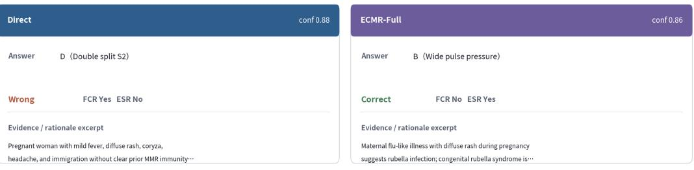

# Expanded Examples — MedQA hard6 audit traces

Each card exposes the original question excerpt, gold answer, Direct and ECMR-Full answers, FCR/ESR audit labels, evidence excerpts, and the mechanism-level interpretation used by the paper

## B.5.1 MedQA — Rubella cardiac-lesion correction

Direct error → ECMR correction

id=medga\_us\_test\_166·seed=2·tags=Hard; high-disagreement;evidence-conflict;ambiguous-options·gold=B (Wide pulse pressure

Question / context

A 32-year-old pregnant woman presents to her physician with flu-like symptoms for the past 3 days. She has a runny nose, mild headache, and feels achy, She has a mild fever and diffuse rash over her body She is concerned about the health of her baby and wants to know if there are any medications that will make her feel better in a short time. Currently, she is at her 29th week of gestation and has received the tetanus vaccination as part of the antenatal care program she received since she immigrated at the end of her first trimester from Romania. She is…

Mechanism / boundary note

Mechanism: Direct identified maternal rubella but shifted the congenital-rubella cardiac lesion toward pulmonary stenosis. ECMR anchors the chain rubella → congenital rubella syndrome → PDA → wide pulse pressure.

## B.5.2 MedQA — Afferent/efferent reflex correction

Direct error → ECMR correction

id=medga\_us\_test\_194·seed=1·tags=Medium; high-disagreement· gold=B (Bilateral miosis)

Question / context

A 50-vear-old woman with Systemic Lupus Erythematosus (Sl E) presents to vour clinic with complaints of left eve pain and reduced vision, She notes that she was in her usual state of health until 3 days prior to presentation when she noticed some mild tenderness around her left eye unrelieved by any pain relievers. This morning when she woke up she was unable to see out of her left eve and made an appointment to come se you. Other than SLE, her medical history is unremarkable. She has had no additional symptoms other than pain and vision loss. Her vital signs…

Direct

conf 0.95

ECMR-Full

conf 0.94

Answer

C (Miosis of the right eye only)

Answer B (Bilateral miosis)

Wrong

FCR Yes ESR No

Correct

FCR No ESR Yes

Evidence / rationale excerpt

Left eye has no direct response to light, indicating an

Evidence / rationale excerp

Patient has acute painful monocular vision loss in the left

eye and no pupillary response when light is shone in the left….

Mechanism / boundary note

Mechanism: Direct tracked the left afferent defect but failed to complete the normal right-eye light reflex. ECMR separates afferent and efferent limbs and verifies bilateral constriction.

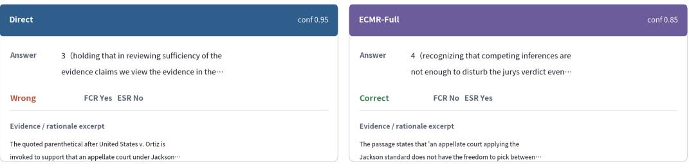

# Expanded Examples — CaseHOLD hard6 audit traces

Each card exposes the original question excerpt, gold answer, Direct and ECMR-Full answers, FCR/ESR audit labels, evidence excerpts, and the mechanism-level interpretation used by the paper

## B.5.3 CaseHOLD — Granular holding selection

Direct error → ECMR correction

id=casehold\_49364· seed=3· tags=Hard; evidence-conflict;ambiguous-options· gold=4 (recognizing that competing inferences are not enough to disturb…

Question / context

to credit and what reasonable inferences to draw from that evidence. For example, the panel opinion rejected the reasonable inference that Kotowski's assailant fled before taking anything of value from the apartment because he heard her upstairs neighbor on the telephone with the police. Instead, the panel held that "no rational juror could conclude that the placement of this phone call frightened him off given the volume and duration of Mrs. Kotowski's screams." O'Laughlin III, 568 F.3d at 302. Although it would be entirely permissible for a jury to…

Mechanism / boundary note

Mechanism: Direct selected a generic sufficiency-of-evidence holding. ECMR focuses on the narrower passage about competing reasonable inferences and maps it to the gold holding

## B.5.4 CaseHOLD — RICO pleading boundary failure

id=casehold 50953· seed=1· tags=Medium; evidence-conflict;low-confidence· gold=0 (holding that pleadings under the rico act are to be liberally con

Question / context

859 F.2d 434, 436 (6th Cir.1988). When considering a motion to dismiss, a court must construe the complaint in the light most favorable to the plaintiff and accept well-pleaded facts as true. Columbia Natural Resources Inc. v. Tatum, 58 F.3d 1101, 1109 (6th Cir.1995). Thus, a court may not grant a Rule 12(b)(6) motion based upon its disbelief of a complaint's factual allegations. Id. A court, however, need not accept as true conclusions of law or unwarranted factual inferences, Morgan y. Church's Fried Chicken, 829 F.2d 10. 12 (6th Cir.1987), Federal Rule of...

## Direct

conf 0.72

## ECMR-Full

conf 0.42

Answer

4 (holding to ensure substantial justice to the

parties the pleadings must be liberally…

Answer

4(holding to ensure substantial justice to the

parties the pleadings must be liberally…….

Wrong

FCR Yes ESR No

Wrong

FCR No ESR No

Evidence / rationale excerpt

The cited parenthetical after Begala v. PNC Bank, Ohio, Nat.

Evidence / rationale excerpt

Ass'n, 214 F.3d 776 (6th Cir. 2000) appears in a discussion of..

The excerpt surrounding Begala discusses pleading standards:

construing complaints favorably on Rule 12(b)(6) and fraud…

Boundary: both methods are attracted to generic pleading-construction language, ECMR lowers confidence and ayoids a high-confidence FCR label.   
but still misses the RICO pleading context.

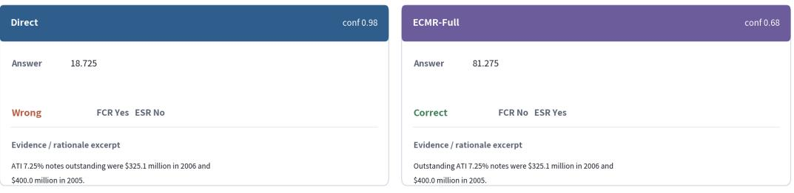

Appendix Plate 6

# Expanded Examples —FinQA hard6 audit traces

Each card exposes the original question excerpt, gold answer, Direct and ECMR-Full answers, FCR/ESR audit labels, evidence excerpts, and the mechanism-level interpretation used by the paper.

B.5.5 FinQA — Percentage complement correction

Direct error → ECMR correction

id=finqa\_AMT/2006/page\_104.pdf-3·seed=2·tags=Hard; high-disagreement;evidence-conflict;long-context;multi-step·gold=0.81275 (81.3%)

Question / context

what was the percent of the outstanding notes under the ati 7.25% (7.25 % ) notes , for 2006 to 2005

Mechanism / boundary note

Mechanism: the required computation is 325.1/40.0 = 0.81275=81.2759%. Direct outputs the complement-like value; ECMRpreserves numerator,

denominator, and direction.

## B.5.6 FinQA — Unit-scaling regression boundary

id=finga\_ GPN/2010/page\_89.pdf-2·seed=1·tags=Medium;high-disagreement;evidence-conflict;long-context;multi-step· gold=29946.0 (29946

Question / context

what is the total fair value of non-vested shares as of may 31, 2010?

Direct

conf 0.95

ECMR-Full

conf 0.95

Answer 29946

Answer 29946000

Correct FCR No ESR Yes

Wrong FCR Yes ESR No

Evidence / rationale excerpt

Evidence / rationale excerp

Non-vested at May 31, 2010: 713 (thousand shares); weighted

average grant-date fair value: \$42 per share.

Table shows non-vested at May 31, 2010 = 713 (thousand shares)

and weighted average grant-date fair value = \$42.

Boundary/degradation: Direct correctly computes 713 × 42 = 29,946. ECMR reuses the same evidence but double-counts the thousand-share unit,

motivating risk-gated early stopping.

## References

Guangyao Chen, Siwei Dong, Yu Shu, Ge Zhang, Jaward Sesay, Börje F. Karlsson, Jie Fu, and Yemin Shi. Autoagents: A framework for automatic agent generation, 2023a. arXiv:2309.17288.

Justin Chen, Swarnadeep Saha, and Mohit Bansal. Reconcile: Round-table conference improves reasoning via consensus among diverse llms. In Proceedings of the 62nd Annual Meeting of the Association for Computational Linguistics (Volume 1: Long Papers), 2024. doi: 10.18653/v1/2024.acl-long.381.

Lingjiao Chen, Matei Zaharia, and James Zou. Frugalgpt: How to use large language models while reducing cost and improving performance. Advances in Neural Information Processing Systems, 2023b. doi: 10.48550/arxiv.2305.05176.

Wenhu Chen, Xueguang Ma, Xinyi Wang, and William W. Cohen. Program of thoughts prompting: Disentangling computation from reasoning for numerical reasoning tasks. Transactions on Machine Learning Research, 2023c. doi: 10.48550/arxiv.2211.12588. URL https://openreview.net/forum?id=YfZ4ZPt8zd.

Zhiyu Chen, Wenhu Chen, Charese Smiley, Sameena Shah, Iana Borova, Dylan Langdon, Reema Moussa, Matt Beane, Ting-Hao Huang, Bryan Routledge, and William Yang Wang. Finqa: A dataset of numerical reasoning over financial data. In Proceedings of the 2021 Conference on Empirical Methods in Natural Language Processing, 2021. doi: 10.18653/v1/2021.emnlp-main.300.

Yilun Du, Shuang Li, Antonio Torralba, Joshua B. Tenenbaum, and Igor Mordatch. Improving factuality and reasoning in language models through multiagent debate, 2023.

Sebastian Farquhar, Jannik Kossen, Lorenz Kuhn, and Yarin Gal. Detecting hallucinations in large language models using semantic entropy. Nature, 2024. doi: 10.1038/s41586-024-07421-0.

Dongfu Jiang, Xiang Ren, and Bill Lin. Llm-blender: Ensembling large language models with pairwise ranking and generative fusion. In Proceedings ofthe 61st Annual Meeting ofthe Associationfor Computational Linguistics (Volume 1: Long Papers), 2023. doi: 10.18653/v1/2023.acl-long.792.

Di Jin, Eileen Pan, Nassim Oufattole, Wei-Hung Weng, Hanyi Fang, and Peter Szolovits. What disease does this patient have? a large-scale open domain question answering dataset from medical exams. Applied Sciences, 2021. doi: 10.3390/app11146421.

Yunxuan Li, Yibing Du, Jiageng Zhang, Longxiang Hou, Peter Grabowski, Yeqing Li, and Eugene Ie. Improving multi-agent debate with sparse communication topology. In Findings of the Association for Computational Linguistics: EMNLP 2024, 2024. doi: 10.18653/v1/2024.findings-emnlp.427.

Tian Liang, Zhiwei He, Wenxiang Jiao, Xing Wang, Yan Wang, Rui Wang, Yujiu Yang, Shuming Shi, and Zhaopeng Tu. Encouraging divergent thinking in large language models through multi-agent debate. In Proceedings ofthe 2024 Conference on Empirical Methods in Natural Language Processing, 2024. doi: 10.18653/v1/2024.emnlp-main.992.

Yang Liu, Dan Iter, Yichong Xu, Shuohang Wang, Ruochen Xu, and Chenguang Zhu. G-eval: Nlg evaluation using gpt-4 with better human alignment. In Proceedings ofthe 2023 Conference on Empirical Methods in Natural Language Processing, 2023. doi: 10.18653/v1/2023.emnlp-main.153.

Aman Madaan, Niket Tandon, Prakhar Gupta, Skyler Hallinan, Luyu Gao, Sarah Wiegreffe, Uri Alon, Nouha Dziri, Shrimai Prabhumoye, Yiming Yang, Shashank Gupta, Bodhisattwa Prasad Majumder, Katherine Hermann, Sean Welleck, Amir Yazdanbakhsh, and Peter Clark. Self-refine: Iterative refinement with selffeedback. Advances in Neural Information Processing Systems, 2023. doi: 10.48550/arxiv.2303.17651.

Chen Qian, Wei Liu, Hongzhang Liu, Nuo Chen, Yufan Dang, Jiahao Li, Cheng Yang, Weize Chen, Yu-Sheng Su, Xin Cong, Juyuan Xu, Dahai Li, Zhiyuan Liu, and Maosong Sun. Chatdev: Communicative agents for software development. In Proceedings of the 62nd Annual Meeting of the Association for Computational Linguistics (Volume 1: Long Papers), 2024. doi: 10.18653/v1/2024.acl-long.810.

Timo Schick, Jane Dwivedi-Yu, Roberto Dessi, Roberta Raileanu, Maria Lomeli, Eric Hambro, Luke Zettlemoyer, Nicola Cancedda, and Thomas Scialom. Toolformer: Language models can teach themselves to use tools. Advances in Neural Information Processing Systems, 2023. doi: 10.48550/arxiv.2302.04761.

Noah Shinn, Federico Cassano, Ashwin Gopinath, Karthik Narasimhan, and Shunyu Yao. Reflexion: Language agents with verbal reinforcement learning. Advances in Neural Information Processing Systems, 2023. doi: 10.48550/arxiv.2303.11366.

Xiangru Tang, Anni Zou, Zhuosheng Zhang, Ziming Li, Yilun Zhao, Xingyao Zhang, Arman Cohan, and Mark Gerstein. Medagents: Large language models as collaborators for zero-shot medical reasoning. In Findings of the Association for Computational Linguistics: ACL 2024, 2024. doi: 10.18653/v1/2024. findings-acl.33.

Boshi Wang, Xiang Yue, and Huan Sun. Can chatgpt defend its belief in truth? evaluating llm reasoning via debate. In Findings of the Association for Computational Linguistics: EMNLP 2023, 2023. doi: 10.18653/v1/2023.findings-emnlp.795.

Lei Wang, Chen Ma, Xueyang Feng, Zeyu Zhang, Hao Yang, Jingsen Zhang, Zhiyuan Chen, Jiakai Tang, Xu Chen, Yankai Lin, Wayne Xin Zhao, Zhewei Wei, and Ji-Rong Wen. A survey on large language model based autonomous agents. Frontiers ofComputer Science, 2024. doi: 10.1007/s11704-024-40231-1.

Xuezhi Wang, Jason Wei, Dale Schuurmans, Quoc V. Le, Ed H., Sharan Narang, Aakanksha Chowdhery, and Denny Zhou. Self-consistency improves chain of thought reasoning in language models. International Conference on Learning Representations, 2022. doi: 10.48550/arxiv.2203.11171.

Jason Wei, Xuezhi Wang, Dale Schuurmans, Maarten Bosma, Brian Ichter, Fei Xia, Ed Chi, Quoc Le, and Denny Zhou. Chain-of-thought prompting elicits reasoning in large language models. Advances in Neural Information Processing Systems, 2022. doi: 10.48550/arxiv.2201.11903.

Qingyun Wu, Gagan Bansal, Jieyu Zhang, Yiran Wu, Beibin Li, Erkang Zhu, Li Jiang, Xiaoyun Zhang, Shaokun Zhang, Jiale Liu, Ahmed Hassan Awadallah, Ryen W. White, Doug Burger, and Chi Wang. Autogen: Enabling next-gen llm applications via multi-agent conversation, 2023.

Shunyu Yao, Dian Yu, Jeffrey Zhao, Izhak Shafran, Tom Griffiths, Yuan Cao, and Karthik Narasimhan. Tree of thoughts: Deliberate problem solving with large language models. Advances in Neural Information Processing Systems, 2023a. doi: 10.48550/arxiv.2305.10601.

Shunyu Yao, Jeffrey Zhao, Dian Yu, Nan Du, Izhak Shafran, Karthik Narasimhan, and Yuan Cao. React: Synergizing reasoning and acting in language models. In International Conference on Learning Representations, 2023b. doi: 10.48550/arxiv.2210.03629.

Lucia Zheng, Neel Guha, Brandon R. Anderson, Peter Henderson, and Daniel E. Ho. When does pretraining help? assessing self-supervised learning for law and the casehold dataset, 2021.