# EMPOWERING EDGE AGENTS: A SYSTEMATIC ANAL-YSIS OF EDGE-CLOUD COLLABORATION IN LLM AGENT EXECUTION

Pengcheng Huang1, Zhenghao Liu1∗, Shixin Ren2, Shi Yu2, Sijia Yao3, Yukun Yan2∗, Chaojun Xiao2∗, Maosong Sun2

1School of Computer Science and Engineering, Northeastern University, Shenyang, China 2Department of Computer Science and Technology, Tsinghua University, Beijing, China 3China Mobile Online Services Co., Ltd. Beijing, China

## ABSTRACT

Edge–cloud collaboration offers a promising way to combine the lower inference overhead and greater data locality of edge-side execution with the substantially stronger capabilities of cloud-hosted frontier models. However, as LLM agents increasingly operate in long-horizon scenarios, cloud participation becomes interleaved throughout execution rather than a one-shot decision for each query. Such interleaved participation introduces trajectory-level effects that remain insufficiently understood. To address this gap, we introduce EC2-Bench, a benchmark for evaluating edge–cloud collaboration in long-horizon agent execution. EC2-Bench provides executable digital-workspace agent tasks and a unified evaluation framework covering task performance, resource usage, and privacy exposure. Using this benchmark, we empirically study diverse forms of edge–cloud collaboration. Our study reveals several key findings. First, edge– cloud collaboration provides an effective execution paradigm for long-horizon agents by achieving a favorable balance among task performance, resource usage, and privacy exposure compared with edge-only and cloud-only execution. Second, as edge models become stronger, collaborative execution approaches cloud-only performance, and performance differences across collaboration strategies become smaller, while privacy exposure remains strongly dependent on the chosen strategy. Third, stronger edge capability changes the preferred collaboration mode, shifting from externally controlled cloud participation and direct cloud execution toward more edge-controlled collaboration. Further analyses identify cloud-invocation decision-making and instruction following as important edgeside abilities underlying such effective collaboration. These findings establish a systematic understanding of edge–cloud collaboration in long-horizon agent execution and provide insights for designing future edge models that can effectively collaborate with cloud models. All codes and resources are available at https://github.com/OpenBMB/EC2-Bench.

## 1 INTRODUCTION

Recent advances in large language models (LLMs) (Achiam et al., 2023), together with the emergence of agent harnesses such as Claude Code (Anthropic, 2025) and OpenClaw (OpenClaw, 2025), have shifted LLM applications from isolated prompt–response interactions toward long-horizon, goal-directed agent execution (Wang et al., 2024a). These agents tackle complex end-to-end workflows, including software development, data analysis, information seeking, and workplace automation, through iterative interaction with external environments and tool use (Yao et al., 2022; Yang et al., 2024; Hu et al., 2024b; Shen et al., 2023; Zhou et al., 2024; Wang et al., 2024b).

Bringing such agents to edge devices, however, remains challenging because edge platforms are inherently constrained by limited computational resources and memory (Qu et al., 2025). Consequently, practical on-device deployment often relies on relatively small LLMs (e.g., models with ≤10B parameters), which can struggle with demanding reasoning, planning, and tool-use tasks (Choi et al., 2026), making reliable long-horizon execution challenging (Liu et al., 2024). To address this limitation, recent work has explored edge–cloud LLM collaboration, where lightweight edge models are complemented by cloud-hosted frontier LLMs when additional capability is required (Zhang et al., 2026b). This paradigm combines efficient edge-side execution with stronger cloud capabilities, but requires effective coordination of edge and cloud participation to realize these complementary benefits (Ding et al., 2024; Sun et al., 2024; Agrawal & Mayer).

Prior edge–cloud LLM systems largely treated collaboration as a one-shot coordination process for each query, typically through routing or escalation decisions (Pozi & Sato, 2025; Han et al., 2026). In long-horizon agent execution, however, collaboration can become more interleaved, with edge and cloud models participating at different points along the trajectory as capability requirements change (Yi et al., 2025; Zhang et al., 2026b). Such interleaving introduces trajectory-level dependencies: cloud participation decisions can influence subsequent execution steps, accumulate resource costs over the trajectory, and determine how much potentially sensitive information leaves the local environment. Yet existing analysis still largely focuses on isolated routing or escalation decisions at the query level, leaving these trajectory-level effects underexplored (Hu et al., 2024a; Lu et al., 2025; Li et al., 2026a; 2025). To close this gap, in this paper, we conduct a systematic empirical study of edge–cloud collaboration in long-horizon agentic execution. Specifically, we organize our study around three research questions. We first ask: does edge–cloud collaboration remain effectivefor realistic long-horizon agent execution? (RQ1) We evaluate this question jointly in terms of task performance, resource usage, and privacy exposure. As edge models become more capable, more execution can be handled locally while cloud assistance is reserved for capability-demanding operations. We therefore ask: how does increasing edge capability impact edge–cloud collaborative execution? (RQ2); As increasing edge capability changes how computation is distributed between edge and cloud, collaboration strategies that are effective under one capability regime may not remain equally suitable under another. This motivates our final question: how should edge–cloud collaboration evolve as edge capability advances? (RQ3).

To provide a common empirical basis for this study, we introduce $\mathrm { E C } ^ { 2 } { \cdot } \mathrm { B E N C H }$ (Edge–Cloud Collaborative Agent Benchmark), an evaluation framework that combines a diverse suite of realworld digital-workspace agent tasks with a unified execution and evaluation environment for edge– cloud collaboration. $\operatorname { E C } ^ { 2 _ { - } ^ { - } }$ BENCH characterizes each configuration along three dimensions: task performance (Yuan et al., 2026b), resource usage (Fang et al., 2025), and privacy exposure. We explicitly consider privacy because cloud participation may reveal sensitive workspace information encountered during agent execution, making privacy exposure an important dimension of evaluating such collaboration (Fu et al., 2026). Using EC2-BENCH, we systematically investigate edge–cloud collaboration across diverse agent tasks, collaboration strategies, and edge-capability regimes.

Our study yields three main findings. First, edge–cloud collaboration remains effective for longhorizon agents: partial cloud participation improves task performance over edge-only execution while requiring substantially less cloud resource usage and privacy exposure than cloud-only execution. Second, as edge models become stronger, collaborative execution approaches cloud-only performance, and performance differences across collaboration strategies become much smaller; however, their differences in privacy exposure remain substantial. Thus, privacy remains an important differentiator even when task performance converges. Third, the collaboration strategy that works best changes with edge capability. Weaker edge models benefit more from external routing and direct cloud execution, whereas stronger edge models benefit more from edge-controlled invocation and cloud advisory. Further analyses suggest that effective cloud-invocation decisions and instruction following are key edge-side abilities for stronger-edge collaboration modes. These findings highlight the value of optimizing future edge models for both standalone capability and effective cloud collaboration, enabling more capable edge agents.

## 2 RELATED WORK

A growing body of work has investigated how edge and cloud LLMs can be coordinated to leverage their complementary capabilities and deployment characteristics, balancing overall task performance with local efficiency (Zhu & Yang, 2025; Dong et al., 2025). A substantial line of work focuses on one-shot coordination for individual queries, either by routing each query to an edge or cloud model or by cascading from the local model to the cloud when additional capability is needed (Chen et al., 2023; Ong et al., 2024; Miao & Fang). These approaches therefore center on improving the accuracy of routing and escalation decisions (Ding et al., 2024). More recent work has extended edge–cloud collaboration to agent execution, where edge and cloud participation can be coordinated at different steps throughout a multi-step trajectory rather than determined once for the entire query, enabling finer-grained use of their complementary capabilities. Within this setting, recent approaches have explored different designs for coordinating edge–cloud collaboration, mainly along two dimensions. Some dynamically determine when the cloud model should participate, either through dedicated rule-based controllers or routers, or by allowing the edge agent itself to decide when to invoke the cloud (Shao et al., 2025; Zhang et al., 2026b;a; Zeng et al., 2026b). Beyond deciding when the cloud should participate, other approaches have explored complementary functional roles for edge and cloud models during execution, such as execution, planning, or providing guidance (Yi et al., 2025; Yuan et al., 2026a).

Existing work has begun to develop dedicated evaluation resources for edge–cloud LLM systems. LLMSwitchBench (Liu et al., 2025) evaluates edge–cloud routing for smart-home queries, while M4A1 (Yuan et al., 2026b) extends device–cloud evaluation to multimodal, multitask, and multiturn conversations, focusing on where individual inference requests should be executed. More general LLM routing benchmarks instead abstract away from the edge–cloud setting and evaluate routing systems over heterogeneous model pools, primarily focusing on routing quality and overall cost–performance trade-offs (Huang et al., 2025; Lu et al., 2025; Li et al., 2026b). Despite this progress, existing evaluations pay more attention on routing decisions for individual queries, tasks, or turns, typically over standalone inference workloads such as knowledge, reasoning, coding, and instruction-following tasks. Our study instead treats edge–cloud collaboration in long-horizon agent execution as the primary object of empirical analysis, aiming to systematically characterize its effectiveness and system-level behavior across different edge capability levels and collaboration designs.

## 3 PRELIMINARIES: EDGE–CLOUD COLLABORATIVE EXECUTION

This section formalizes edge–cloud collaboration in agent execution, which serves as the object of study in this work. We first present a general formulation of how a collaboration strategy coordinates the participation of edge and cloud models during execution $( \ S 3 . 1 )$ , and then instantiate this formulation with four representative collaboration strategies examined in our experiments (§3.2). Figure 1 provides an intuitive overview of edge–cloud collaborative agent execution.

## 3.1 EDGE–CLOUD COLLABORATION FORMULATION

Edge–cloud collaboration considers a system comprising an edge model $M _ { e }$ and a remotely hosted cloud model $M _ { c } ,$ together with a collaboration strategy $\mathcal { C }$ that determines how computation is distributed between them during agent execution. The edge model operates within the local execution boundary using a lightweight LLM (typically ≤10B parameters), whereas the cloud model offers substantially stronger capabilities at the cost of greater inference overhead, enabling collaboration to balance task capability with the efficiency and data locality of edge-side execution.

Given a task instruction $I _ { \mathrm { T a s k } }$ , execution under C proceeds through iterative interactions with the environment. At interaction step t, let

$$
\tau _ { < t } = ( a _ { 1 } , o _ { 1 } , \ldots , a _ { t - 1 } , o _ { t - 1 } ) ,\tag{1}
$$

denote the partial execution trajectory, where $a _ { i }$ is the agent action and $o _ { i }$ is the resulting environment observation. Based on $I _ { \mathrm { T a s k } }$ and the partial execution trajectory $\tau _ { < t } , \mathcal { C }$ determines the participating model(s) at the current step through a selection rule $\pi _ { \mathcal { C } }$

$$
\mathcal { M } _ { t }  \pi _ { \mathcal { C } } ( I _ { \mathrm { T a s k } } , \tau _ { \angle t } ) , \qquad \mathcal { M } _ { t } \in \{ \{ M _ { e } \} , \{ M _ { c } \} , \{ M _ { e } , M _ { c } \} \} .\tag{2}
$$

Depending on ${ \mathcal { C } } ,$ , this selection may be fixed before execution or determined dynamically as execution proceeds. The next agent action $a _ { t }$ is then generated by the participating model(s) according to C. Once $a _ { t }$ is generated, it is executed in the environment to produce the observation:

$$
o _ { t } = \operatorname { E n v } ( a _ { t } ) .\tag{3}
$$

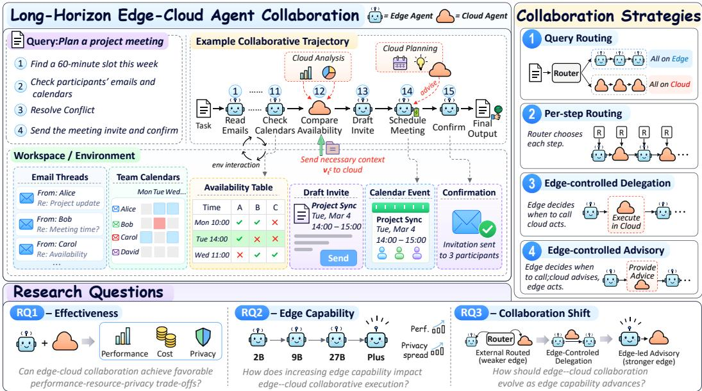  
Figure 1: Overview of edge–cloud collaboration for long-horizon agent execution in $\begin{array} { r } { \operatorname { E C } ^ { 2 } . } \end{array}$ -BENCH. The figure illustrates a representative agent workflow, four collaboration modes with different forms of cloud participation, and three research questions on collaboration effectiveness, the impact of edge capability, and how collaboration shifts as edge models become stronger.

The resulting pair $\left( { { a } _ { t } } , { { o } _ { t } } \right)$ is then appended to the execution trajectory $\tau _ { < t } .$ . Repeating this process until termination yields the complete execution trajectory $\tau _ { T } = ( a _ { 1 } , o _ { 1 } , \dots , a _ { T } , o _ { T } )$ . To characterize how collaboration unfolds beyond the agent–environment trajectory, we additionally record the participating models and the cloud-visible context $v _ { t } ^ { c }$ at each step. Specifically, if $M _ { c } ^ { \cdot } \in \mathcal { M } _ { t } , v _ { t } ^ { c }$ denotes the context provided to the cloud model at step t for generating its output, including task information, execution history, and other context specified by $\bar { \mathcal { C } } ;$ otherwise, $v _ { t } ^ { c } = \emptyset$ . This yields the collaborative execution trace:

$$
\gamma c = ( \tau _ { T } , ( \mathcal { M } _ { 1 } , v _ { 1 } ^ { c } ) , \dots , ( \mathcal { M } _ { T } , v _ { T } ^ { c } ) ) .\tag{4}
$$

## 3.2 COLLABORATION STRATEGIES

Building on the formulation above, we consider four representative collaboration strategies that instantiate C and represent common forms of edge–cloud collaboration explored in prior work (Ong et al., 2024; Zeng et al., 2026c; Farzaneh & Simeone, 2026; Anthropic, 2026).

Query Routing. Query Routing employs an external router to select the model for a task before agent execution begins. Routers typically use a lightweight scoring or classification model to estimate, from the task instruction $I _ { \mathrm { T a s k } } ,$ whether the task should be handled by the edge model $M _ { e }$ or the stronger cloud model $M _ { c }$ (Ong et al., 2024). The routing decision is made once and remains fixed throughout execution, such that $\mathcal { M } _ { t }$ remains either $\{ M _ { e } \}$ or $\{ M _ { c } \}$ at every execution step, and the entire trajectory is generated by the selected model.

Per-step Routing. Per-step Routing revisits model selection at each interaction step. Instead of making a single task-level decision, an external router estimates, based on the task instruction $I _ { \mathrm { T a s k } }$ and the partial execution trajectory $\tau _ { < t }$ , whether the current step can be handled by the edge model $M _ { e }$ or should be routed to the stronger cloud model $M _ { c }$ (Zeng et al., 2026c). The routing decision is updated throughout execution, with $\mathcal { M } _ { t }$ switching between $\mathsf { \bar { \{ M _ { e } \} } }$ and $\{ M _ { c } \}$ across steps, thereby enabling finer-grained and dynamic use of cloud capabilities.

Edge-Controlled Cloud Delegation. Edge-Controlled Cloud Delegation shifts the participation decision from an external router to the edge agent itself, motivated by the intuition that an executing agent, with direct access to its evolving execution state, may better identify when cloud assistance is needed (Farzaneh & Simeone, 2026). Specifically, execution remains on the edge by default, $\mathrm { i . e . , }$ $\mathcal { M } _ { t } = \{ M _ { e } \}$ , while a dedicated invocation tool allows the agent to delegate the current step to the cloud when stronger model capabilities are required. Upon invocation, $\mathcal { M } _ { t }$ switches to $\{ M _ { c } \}$ , and the cloud model generates the next action before control returns to the edge agent.

Table 1: Comparison of $\operatorname { E C } ^ { 2 }$ -BENCH with prior benchmarks for edge–cloud collaboration and LLM routing. Evaluation Scenario specifies the task and interaction setting considered by each benchmark. For Collab. Modes, $R _ { q }$ and $R _ { s }$ denote query-level and per-step routing, respectively, while D and A denote edge-controlled cloud delegation and cloud advisory, respectively. Evaluation Dim. summarizes the primary evaluation metrics considered by each benchmark.
<table><tr><td>Benchmark</td><td>Evaluation Scenario</td><td>Collab. Modes</td><td>Evaluation Dim.</td></tr><tr><td>RouterBench (Hu et al., 2024a)</td><td>General LLM Tasks</td><td> $R _ { q }$ </td><td>Task Perf. / Cost</td></tr><tr><td>LLMRouterBench (Li et al., 2026b)</td><td>General LLM and Tool-Use Tasks</td><td> $R _ { q }$ </td><td>Task Perf. / Cost</td></tr><tr><td>LLMSwitchBench (Liu et al., 2025)</td><td>Single-turn Query</td><td> $R _ { q }$ </td><td>Task Perf. / Cost</td></tr><tr><td>M4A1 (Yuan et al., 2026b)</td><td>Multi-turn Dialogue</td><td> $\bar { R _ { s } } \bar { }$ </td><td>Task Perf. / Cost / Latency</td></tr><tr><td>EC2-BENCH</td><td>Long-horizon Agent Execution</td><td> $R _ { q } , R _ { s } , D , A$ </td><td>Task Perf. / Resource / Privacy</td></tr></table>

Edge-Controlled Cloud Advisory. Edge-Controlled Cloud Advisory follows the same agentcontrolled invocation paradigm but uses the cloud model in an advisory role rather than delegating action generation (Anthropic, 2026). Execution remains edge-led by default, with $\mathcal { M } _ { t } = \left\{ M _ { e } \right\}$ When the edge agent requests cloud assistance, the cloud model participates in the current step, yielding $\mathcal { M } _ { t } \stackrel { \sim } { = } \{ M _ { e } , M _ { c } ^ { \mathrm { ~ } } \}$ , and provides auxiliary information such as plans, suggestions, or reasoning. The edge model then incorporates this guidance to make a better-informed decision while retaining responsibility for generating the next action.

## 4 EC $\operatorname { E C } ^ { 2 } .$ -BENCH: BENCHMARKING EDGE–CLOUD COLLABORATION FOR LONG-HORIZON AGENT EXECUTION

To systematically study edge–cloud collaboration in agent execution, we introduce $\operatorname { E C } ^ { 2 } - \operatorname { B E N C H } .$ comprising 128 executable agent tasks and a unified procedure for evaluating different collaboration strategies. For each task, we execute the agent under a collaboration strategy C and record the resulting collaborative execution trace $\gamma _ { \mathcal { C } }$ , which captures both the agent trajectory and cloud participation throughout execution. EC2-BENCH then evaluates the resulting execution along three dimensions: task performance, resource usage, and privacy exposure, providing a comprehensive view of the effectiveness and costs of edge–cloud collaboration. These design choices distinguish $\begin{array} { r } { \operatorname { E C } ^ { 2 } . } \end{array}$ -BENCH from existing benchmarks for LLM routing and edge–cloud collaboration. Table 1 summarizes the key differences among these benchmarks in evaluation scenarios, collaboration modes, and evaluation dimensions, with a more detailed comparison provided in Appendix A.2.

## 4.1 TASK SUITE CONSTRUCTION

We construct $\operatorname { E C } ^ { 2 } \cdot \operatorname { B }$ ENCH by collecting executable agent tasks from existing benchmarks, curating them for the study of edge–cloud collaboration, and augmenting the resulting task suite with sensitivity annotations for privacy-exposure evaluation.

Data Collection. We construct the task suite of $\operatorname { E C } ^ { 2 }$ -BENCH based on six established executable agent benchmarks: Claw-Eval (Ye et al., 2026), WildClawBench (Ding et al., 2026), QwenClaw-Bench (Qwen Team, 2026b), LiveClawBench (Long et al., 2026), PinchBench (PinchBench, 2026), and ClawBench (Zhang et al., 2026c). We select these benchmarks because their tasks evaluate end-to-end agent execution through stateful, multi-step interactions with tools, applications, and workspace artifacts, with explicit task objectives and verifiable execution outcomes. Collectively, they cover a broad range of applications, interaction patterns, execution environments, and task difficulties, providing a diverse candidate pool for constructing $\mathrm { E C } ^ { 2 } { \cdot } \mathrm { B E N C H }$

Task Curation. Starting from the collected candidate pool, we further adapt and curate the tasks to construct the final task suite. Specifically, we first adapt tasks from different source benchmarks to a common execution environment and evaluation interface, enabling all tasks to be executed under the same agent runtime and evaluated under consistent conditions while preserving their original objectives, workspace states, required interactions, and success criteria. We then apply a collaboration-oriented difficulty filtering procedure to retain tasks that are informative for studying edge–cloud collaboration. We evaluate each adapted task under edge-only and cloud-only execution to characterize task difficulty at the two execution endpoints. Tasks that are consistently solved by both endpoints are removed because they provide limited opportunity to differentiate agent execution paradigms, while tasks where neither endpoint achieves meaningful completion are excluded because they provide limited basis for evaluating collaborative execution. Following these steps, we further supplement the task suite with tasks from underrepresented scenarios to maintain broad workload coverage. The resulting task suite consists of 128 executable tasks.

To measure the potential exposure of sensitive information from local workspaces to the cloud during collaboration, we further incorporate sensitivity annotations into $\operatorname { E C } ^ { 2 } .$ -BENCH. Specifically, we first annotate sensitive information already contained in the original workspace artifacts. We then use an LLM-based approach to identify appropriate locations, generate realistic synthetic sensitive information, and insert it into relevant workspace artifacts, while preserving the original task objective, required interactions, and evaluation criteria. This process results in fine-grained sensitivity annotations for 100 tasks, where each sensitivity unit corresponds to an atomic piece of sensitive information grounded in a workspace artifact.

Detailed procedures for task adaptation, collaboration-oriented filtering, coverage supplementation, and sensitivity annotation are provided in Appendix A.3, Appendix A.4 and Appendix A.5.

## 4.2 EVALUATING COLLABORATIVE EXECUTION

Given the collaborative execution trace $\gamma _ { \mathcal { C } }$ produced by a collaboration strategy ${ \mathcal { C } } , { \mathrm { E C } } ^ { 2 } .$ -BENCH evaluates the execution along three dimensions: task performance, resource usage, and privacy exposure. Task performance measures whether the agent accomplishes the task, resource usage quantifies the computation consumed by the edge and cloud models during execution, and privacy exposure measures the fraction of annotated sensitive information units that become visible to the cloud during collaborative execution.

Task Performance. We assess task performance using task-specific evaluation checks that cover key requirements for successful completion, including whether the intended outcome is achieved, task constraints are satisfied, and required tool or application interactions are performed correctly. Checks that can be determined directly from task outputs or workspace states are evaluated through rule-based validation or environment-state auditing, while checks requiring semantic judgment are evaluated using rubric-based LLM-as-a-judge (Ding et al., 2026). Given an execution trajectory τ contained in $\gamma _ { \mathcal { C } }$ , each check produces a score in [0, 1], and the task completion score is computed as the weighted average of these check scores according to predefined task-specific weights.

Resource Usage. We quantify the resource usage of collaborative execution from both the cloud and edge sides. For the cloud, we record the input, output, and cache-read tokens consumed by all cloud invocations in $\gamma _ { \mathcal { C } }$ , and compute the corresponding monetary cost according to the pricing of the cloud model. For the edge, we estimate the total floating-point operations (FLOPs) incurred by the edge model throughout the execution trajectory.

Privacy Exposure. We measure privacy exposure by quantifying how much sensitive information becomes visible to the cloud during collaborative execution. For each task with sensitivity annotations, let S denote its set of sensitivity units. Given the cloud-visible contexts $\{ v _ { t } ^ { c } \} _ { t = 1 } ^ { T }$ recorded in γ , we measure privacy exposure as the fraction of sensitivity units disclosed to the cloud:

$$
E _ { \mathrm { p r i v } } = \frac { 1 } { \lvert S \rvert } \sum _ { s \in \mathcal { S } } \mathbb { I } _ { \exp } \left( s , \{ v _ { t } ^ { c } \} _ { t = 1 } ^ { T } \right) ,\tag{5}
$$

where $\mathbb { I } _ { \mathrm { e x p } }$ indicates whether the information represented by sensitivity unit s is disclosed to the cloud during execution. Since sensitive information may be paraphrased or reformulated rather than reproduced verbatim, we use an LLM-based judge for exposure detection (Zharmagambetov et al., 2026). To validate the automated judge, we compare its predictions against adjudicated human labels on 200 sensitivity unit–context pairs. The automated judge achieves an F1 score of 96.9% against human annotations, demonstrating high agreement with human judgments and the reliability of our privacy annotations. Full validation results are reported in Appendix A.6.

## 5 EXPERIMENTAL METHODOLOGY

This section describes the experimental configurations and evaluation protocol used to study edge– cloud collaboration on EC2-BENCH.

Execution Configurations. We instantiate the edge side with models of progressively increasing capability from the Qwen series (Qwen Team, 2026a). Qwen3.5-2B and Qwen3.5-9B serve as representative edge models under current deployment constraints, while Qwen3.5-27B and Qwen3.7- Plus are included as higher-capability proxies for future edge models. We use GLM-5.3 (Zeng et al., 2026a) as the primary cloud model across all main configurations, given its strong performance on agentic tasks. We further evaluate our findings with DeepSeek-V4.1-Flash as an alternative cloud model to examine their robustness beyond a single cloud model (Appendix A.8). For comparison, we include edge-only and cloud-only execution, where action generation is handled exclusively by $M _ { e }$ and $M _ { c } ,$ , respectively, throughout the task. All configurations are implemented within Open-Claw1, providing a shared agent runtime and tool interface across execution settings.

Evaluation Protocol. Each task–configuration pair is executed independently three times to account for randomness in agent execution (Chan et al., 2025), with results averaged across runs. In addition to the task completion score defined in Section 4.2, we report $\mathrm { P a s s ^ { 3 } }$ to characterize execution robustness, defined as the fraction of tasks successfully completed in all three runs, where a run is considered successful if its completion score exceeds 0.7. Privacy exposure is evaluated on the 100 tasks equipped with sensitivity annotations. For task checks requiring rubric-based semantic judgment and for privacy-exposure detection, we use GPT-5.4-mini (OpenAI, 2026b) with reasoning enabled, following prior practice in LLM-based agent evaluation (Zharmagambetov et al., 2026). Cloud-side monetary cost is computed using OpenRouter2 pricing based on raw input, cache-read input, and output tokens, while edge-side computation is estimated in FLOPs following Kaplan et al. (2020). Detailed pricing assumptions and FLOPs calculations are provided in Appendix A.11.

## 6 EMPIRICAL STUDY

We now use $\begin{array} { r } { \operatorname { E C } ^ { 2 } . } \end{array}$ -BENCH to systematically study edge–cloud collaboration in long-horizon agent execution. Our analysis follows the three research questions introduced in Section 1, examining whether edge–cloud collaboration is effective, how improving edge capability affects collaborative execution, and how collaboration mechanisms evolve as edge models become stronger.

## 6.1 EFFECTIVENESS OF EDGE–CLOUD COLLABORATION IN AGENT EXECUTION (RQ1)

We first examine whether edge–cloud collaboration provides a useful execution regime between edge-only and cloud-only agents when task performance, resource usage, and privacy exposure are considered jointly. As shown in Table 2, the two execution extremes exhibit clear trade-offs. Cloud-only execution achieves the strongest task performance but incurs substantial cloud resource usage and privacy exposure, whereas edge-only execution avoids cloud usage and exposure at the cost of lower task performance. Collaborative execution occupies the space between these extremes, improving task performance over edge-only execution while substantially reducing cloud dependence relative to cloud-only execution. For example, with Qwen3.5-2B as the edge model, steplevel routing improves task completion from 12.75 to 39.97 while using only 22.7% of the cloud-only cost. These results indicate that partial cloud participation can recover substantial capability without incurring the full cost of cloud-only execution.

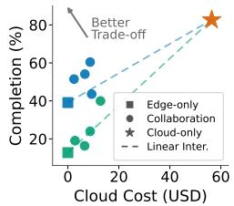

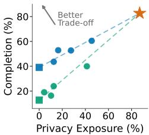  
(a) Cost-performance.  
(b) Privacy-performance.  
Figure 2: Trade-offs of edge–cloud execution modes. and denote Qwen3.5-2B and Qwen3.5-9B. Each circle represents a collaboration mode; upper-left is better. Dashed lines interpolate between edge-only and cloud-only execution, with points above the lines indicating gains beyond the interpolation baseline.

Table 2: Performance of edge–cloud collaboration strategies on $\operatorname { E C } ^ { 2 } .$ -BENCH. Performance: task completion and $\mathrm { P a s s ^ { 3 } }$ . Resource Usage: Cloud Tok. (R/C/O) reports raw input, cache-read input, and output tokens in millions; Cloud Cost is reported in USD; Edge FLOPs are reported in PetaFLOPs. Privacy Exposure: percentage of sensitive information exposed to the cloud (lower is better). and denote current-generation and higher-capability proxy edge models, respectively. For Qwen3.7-Plus, Edge FLOPs are not reported because its parameter count is unavailable.
<table><tr><td rowspan="2">Method</td><td colspan="2">Performance↑</td><td colspan="3">Resource Usage↓</td><td rowspan="2">Privacy Exp.↓</td></tr><tr><td>Completion</td><td>Pass3</td><td>Cloud Tok. (R/C/O)</td><td>Cloud Cost</td><td>Edge FLOPs</td></tr><tr><td></td><td></td><td></td><td>Edge-only</td><td></td><td></td><td></td></tr><tr><td>Qwen3.5-2B (2026a)</td><td>12.75</td><td>2.34</td><td></td><td></td><td>142.98</td><td>0.00</td></tr><tr><td>Qwen3.5-9B (2026a)</td><td>39.12</td><td>9.38</td><td></td><td></td><td>121.64</td><td>0.00</td></tr><tr><td>Qwen3.5-27B (2026a)</td><td>61.79</td><td>30.47</td><td></td><td></td><td>564.49</td><td>0.00</td></tr><tr><td>Qwen3.7-Plus (2026a)</td><td>71.34</td><td>53.12</td><td></td><td></td><td></td><td>0.00</td></tr><tr><td></td><td></td><td></td><td>Cloud-only</td><td></td><td></td><td></td></tr><tr><td>DeepSeek-v4-Pro (2026)</td><td>72.90</td><td>53.12</td><td>5.81 / 50.20 / 1.60</td><td>16.41</td><td></td><td>86.66</td></tr><tr><td>GLM-5.3 (2026a)</td><td>82.70</td><td>71.88</td><td>13.52 / 65.76 / 4.64</td><td>56.42</td><td></td><td>87.01</td></tr><tr><td></td><td></td><td>Edge-Cloud Collaboration</td><td></td><td></td><td></td><td></td></tr><tr><td>Qwen3.5-2B</td><td></td><td></td><td></td><td></td><td></td><td></td></tr><tr><td>Query Routing (2024)</td><td>23.98</td><td>12.50</td><td>1.81 / 10.49 / 0.79</td><td>8.76</td><td>156.30</td><td>12.59</td></tr><tr><td>Per-step Routing (2026c)</td><td>39.97</td><td>7.81</td><td>3.84 / 17.29 / 0.67</td><td>12.80</td><td>57.05</td><td>41.29</td></tr><tr><td>Edge-Ctrl. Delegation (2026)</td><td>15.86</td><td>2.34</td><td>0.41 / 0.49 / 0.11</td><td>1.19</td><td>172.74</td><td>2.71</td></tr><tr><td>Edge-Ctrl. Advisory (2026)</td><td>14.75</td><td>1.56</td><td>0.67 / 0.51 / 0.29</td><td>2.36</td><td>240.28</td><td>6.07</td></tr><tr><td>Qwen3.5-9B</td><td></td><td></td><td></td><td></td><td></td><td></td></tr><tr><td>Query Routing (2024)</td><td>43.60</td><td>17.97</td><td>2.13 / 11.28 / 0.78</td><td>9.33</td><td>162.88</td><td>12.59</td></tr><tr><td>Per-step Routing (2026c)</td><td>52.71</td><td>21.88</td><td>1.98 / 7.46 / 0.31</td><td>6.07</td><td>29.96</td><td>27.52</td></tr><tr><td>Edge-Ċtrl. Delegation (2026)</td><td>52.88</td><td>17.19</td><td>0.83 / 1.03 / 0.36</td><td>3.01</td><td>184.98</td><td>16.45</td></tr><tr><td>Edge-Ctrl. Advisory (2026)</td><td>60.46</td><td>26.56</td><td>2.02 / 2.61 / 1.19</td><td>8.73</td><td>332.43</td><td>45.46</td></tr><tr><td>Qwen3.5-27B</td><td></td><td></td><td></td><td></td><td></td><td></td></tr><tr><td>Query Routing (2024)</td><td>65.53</td><td>38.28</td><td>2.69 / 14.29 / 0.75</td><td>10.76</td><td>649.92</td><td>12.53</td></tr><tr><td>Per-step Routing (2026c)</td><td>68.42</td><td>42.19</td><td>1.76 / 6.51 / 0.26</td><td>5.29</td><td>88.58</td><td>35.81</td></tr><tr><td>Edge-Ċtrl. Delegation (2026)</td><td>69.06</td><td>44.53</td><td>1.00 /1.50 / 0.71</td><td>4.93</td><td>455.76</td><td>42.42</td></tr><tr><td>Edge-Ctrl. Advisory (2026)</td><td>70.13</td><td>47.66</td><td>1.32 / 0.75 / 0.83</td><td>5.71</td><td>822.23</td><td>48.46</td></tr><tr><td>Qwen3.7-Plus</td><td></td><td></td><td></td><td></td><td></td><td></td></tr><tr><td>Query Routing (2024)</td><td>73.17</td><td>60.16</td><td>4.39 / 15.60 / 0.88</td><td>14.03</td><td></td><td>12.51</td></tr><tr><td>Per-step Routing (2026c)</td><td>72.08</td><td>59.22</td><td>3.35 / 14.23 / 0.40</td><td>10.14</td><td></td><td>29.63</td></tr><tr><td>Edge-Ctrl. Delegation (2026)</td><td>74.24</td><td>60.94</td><td>1.65 / 1.08 / 0.33</td><td>4.03</td><td></td><td>43.36</td></tr><tr><td>Edge-Ctrl. Advisory (2026)</td><td>76.84</td><td>67.19</td><td>1.97 / 0.53 / 0.88</td><td>6.8</td><td></td><td>78.74</td></tr></table>

We further examine whether these trade-offs reflect benefits beyond a proportional mixture of the two execution extremes. For each edge model, we use the linear interpolation between its edge-only and cloud-only endpoints as a reference, representing the performance expected from proportionally trading local and cloud execution (Zheng et al., 2025). As shown in Figures 2a and 2b, multiple collaborative configurations lie above the corresponding interpolation baselines in the cost–performance and privacy– performance spaces, achieving higher task performance at comparable cloud cost or privacy exposure. These results show that edge–cloud collaboration can provide gains beyond a simple interpolation between edge-only and cloud-only execution.

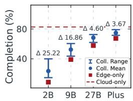

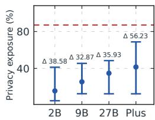  
(a) Task completion.  
(b) Privacy exposure.  
Figure 3: Task completion and privacy exposure across edge-capability regimes. Blue points denote the mean values across edge–cloud collaboration configurations, and vertical bars indicate the range across configurations. The x-axis labels abbreviate the corresponding edge models (Qwen3.5-2B/9B/27B and Qwen3.7-Plus).

## 6.2 IMPACT OF IMPROVING EDGE CAPABILITY ON COLLABORATIVE EXECUTION (RQ2)

As edge models continue to advance rapidly (Xiao et al., 2025), we study how improving edge capability changes edge–cloud collaborative execution. To probe how collaboration may evolve beyond current lightweight edge models, we additionally include Qwen3.5-27B and Qwen3.7-Plus as prospective proxies for stronger future edge models. As shown in Table 2, stronger edge models consistently improve collaborative execution and bring its performance closer to cloud-only execution. The best available collaborative configuration increases from 39.97% completion with Qwen3.5-2B to 76.84% with Qwen3.7-Plus, approaching the 82.70% completion of cloud-only execution.

We further examine how increasing edge capability changes the variation among collaboration strategies. Specifically, for each edge model, we measure the gap between the highest and lowest completion scores and privacy exposure values. As shown in Figure 3a and Figure 3b, task performance becomes progressively less sensitive to the collaboration strategy as edge capability increases. The gap between the highest and lowest completion scores among the evaluated strategies decreases from 25.22% with Qwen3.5-2B to only 3.67% with Qwen3.7-Plus. In contrast, privacy exposure does not exhibit the same convergence, with substantial differences remaining across collaboration strategies and edge capabilities. With Qwen3.5-27B, for example, collaboration strategies differ by only 4.60% in completion but by 35.93% in privacy exposure. These results show that stronger edge capability substantially compresses performance differences across collaboration strategies, while privacy exposure remains highly differentiated.

## 6.3 HOW DOES EDGE–CLOUD COLLABORATION EVOLVE WITH EDGE CAPABILITY? (RQ3)

Beyond improving collaborative performance, increasing edge capability may also change effective collaboration mechanisms. We examine this shift along two dimensions: who determines cloud participation and what role the cloud plays once invoked. As shown in Table 2, both dimensions exhibit clear shifts with improving edge capability. In terms of participation control, externally routed strategies generally outperform edge-controlled strategies with weaker edge models. For example, with Qwen3.5-2B, Per-step Routing achieves 39.97% completion, compared with 15.86% for Edge-Ctrl. Delegation. As edge capability improves, however, this pattern reverses. A similar reversal appears in the role of the cloud: weaker edge models benefit more from direct cloud execution, whereas stronger edge models favor advisory support.

These shifts motivate further analysis of two edge-side abilities associated with this trend: cloud-assistance decision making and cloud-guidance utilization. Detailed experimental settings and additional analyses are provided in Appendix A.10.

Cloud-Assistance Decision Making. The shift toward agent-controlled invocation motivates us to examine whether stronger edge models can make more effective cloud-assistance decisions. Since there is no explicit annotation indicating when cloud assistance is necessary, we compare Edge-Controlled Cloud Delegation against a matched random-invocation baseline. Specifically, we preserve the same cloud-call rate as the agentcontrolled strategy while randomly selecting invocation steps. As shown in Figure 4a, edge-controlled delegation consistently outperforms random invocation. The gain is only 1.2% for Qwen3.5-2B, but reaches 3.0– 4.4% for the more capable edge models. This pattern suggests that stronger edge models may make more effective cloud-invocation decisions.

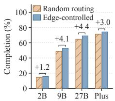

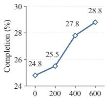  
(a) Cloud-invocation decision making.  
(b) Guidance following.  
Figure 4: Analysis of edge-side capabilities for increasingly edge-led collaboration. (a) Task completion under agentcontrolled invocation and a matched random baseline with the same cloud-call rate. (b) $\operatorname { E C } ^ { 2 }$ -BENCH task completion of the edge model under cloud advisory during instruction-following training.

Cloud Guidance Utilization. We next examine whether instruction-following ability is associated with improved advisory collaboration. Starting from Qwen3.5-2B, we apply targeted instructionfollowing training and evaluate intermediate checkpoints under a fixed cloud-advisory setting. As shown in Figure 4b and Appendix A.10, task completion under cloud advisory consistently improves as instruction-following ability develops during training, increasing from 24.8% before training to 28.8% after 600 steps. These results suggest that instruction-following ability is associated with improved utilization of cloud-provided guidance.

## 7 CONCLUSION

In this work, we study edge–cloud collaboration for long-horizon LLM agent execution, where cloud participation is interleaved throughout the execution trajectory. To enable systematic investigation of this problem, we introduce EC2-BENCH, an evaluation framework that combines executable digital-workspace agent tasks with unified measurements of task performance, resource usage, and privacy exposure. Our findings show that edge–cloud collaboration can achieve a favorable balance between capability, cost, and privacy compared with purely edge-side or cloud-side execution. As edge models become stronger, collaborative execution increasingly approaches cloud-only performance, while privacy exposure remains highly dependent on how cloud participation is organized. We further find that stronger edge models benefit from agent-controlled cloud invocation and advisory interaction. Further analyses suggest that effective cloud-invocation decisions and instructionfollowing are important abilities for effective edge–cloud collaboration, motivating future work to optimize edge–cloud collaboration for more capable edge agents.

## AI USE STATEMENT

Generative AI tools were used to assist with language polishing and improving the clarity of the manuscript. All research ideas, experimental design, implementation, analysis, and conclusions were developed and verified by the authors, who take full responsibility for the content of the paper.

## ETHICS STATEMENT

This work studies edge–cloud collaboration for LLM-powered agents and evaluates different collaboration strategies in terms of task performance, resource usage, and privacy exposure. EC2-BENCH is designed for research evaluation and responsible system development. We do not use real private user data to construct privacy-sensitive benchmark content. When additional sensitive information is required for evaluation, it is synthetically generated and does not correspond to real individuals, organizations, credentials, or financial records. Human annotation is used only to validate benchmark annotations and synthetic content; no annotator personal information is collected or analyzed. The privacy annotations in EC2-BENCH are intended to support systematic evaluation of sensitive information exposed during edge–cloud collaboration and to facilitate the development of more privacy-aware agent systems.

## REPRODUCIBILITY STATEMENT

We provide detailed descriptions of the benchmark construction, collaboration strategies, experimental setup, and evaluation procedures in the main paper and appendix. In particular, we document the task adaptation and filtering process, sensitivity annotation procedure and validation, implementations of the four edge–cloud collaboration strategies, model and inference configurations, and the metrics used to evaluate task performance, cloud resource usage, edge computation, and privacy exposure. We further report the experimental settings and implementation details for the analyses conducted in each research question. These details are provided to facilitate reproduction of the benchmark and the reported experimental results.

## REFERENCES

Josh Achiam, Steven Adler, Sandhini Agarwal, Lama Ahmad, Ilge Akkaya, Florencia Leoni Aleman, Diogo Almeida, Janko Altenschmidt, Sam Altman, Shyamal Anadkat, et al. Gpt-4 technical report. arXiv preprint arXiv:2303.08774, 2023.

Nikita Agrawal and Ruben Mayer. Llm-based agents on the edge: A survey of privacy, scalability, heterogeneity, and autonomy.

Anthropic. Claude code, 2025. URL https://www.anthropic.com/product/ claude-code. Accessed: 2026-05-07.

Anthropic. The advisor strategy: Give agents an intelligence boost. https://claude.com/ blog/the-advisor-strategy, April 2026. Claude Blog. Accessed: 2026-05-17.

Jun Shern Chan, Neil Chowdhury, Oliver Jaffe, James Aung, Dane Sherburn, Evan Mays, Giulio Starace, Kevin Liu, Leon Maksin, Tejal Patwardhan, et al. Mle-bench: Evaluating machine learning agents on machine learning engineering. In International Conference on Learning Representations, volume 2025, pp. 50466–50494, 2025.

Lingjiao Chen, Matei Zaharia, and James Zou. Frugalgpt: How to use large language models while reducing cost and improving performance. arXiv preprint arXiv:2305.05176, 2023.

Gawon Choi, Haechan Chong, Seonghyeon Kim, and Hyemin Ahn. Can only llms do reasoning?: Potential of small language models in task planning. In 2026 IEEE International Conference on Advanced Robotics and its Social Impacts (ARSO), pp. 257–264. IEEE, 2026.

Jacob Cohen. A coefficient of agreement for nominal scales. Educational and psychological measurement, 20(1):37–46, 1960.

DeepSeek-AI. Deepseek-v4: Towards highly efficient million-token context intelligence, 2026. URL https://huggingface.co/deepseek-ai/DeepSeek-V4-Pro.

Dujian Ding, Ankur Mallick, Chi Wang, Robert Sim, Subhabrata Mukherjee, Victor Ruhle, Laks¨ Lakshmanan, and Ahmed H Awadallah. Hybrid llm: Cost-efficient and quality-aware query routing. In International Conference on Learning Representations, volume 2024, pp. 41348–41366, 2024.

Shuangrui Ding, Xuanlang Dai, Long Xing, Shengyuan Ding, Ziyu Liu, Yang JingYi, Penghui Yang, Zhixiong Zhang, Xilin Wei, Xinyu Fang, et al. Wildclawbench: A benchmark for real-world, long-horizon agent evaluation. arXiv preprint arXiv:2605.10912, 2026.

Jiangwen Dong, Jiayu Li, Tianhang Zheng, and Wanyu Lin. Hybridflow: Resource-adaptive subtask routing for efficient edge-cloud llm inference. arXiv preprint arXiv:2512.22137, 2025.

Wenzhi Fang, Dong-Jun Han, Liangqi Yuan, Evan Chen, and Christopher Brinton. Bridging ondevice and cloud llms for collaborative reasoning: A unified methodology for local routing and post-training. arXiv preprint arXiv:2509.24050, 2025.

Amirmohammad Farzaneh and Osvaldo Simeone. Think short, defer smart, act, and repeat: Calibrated reasoning and uncertainty-aware deferral for edge llm agents. arXiv preprint arXiv:2607.26865, 2026.

Wenjie Fu, Xiaoting Qin, Jue Zhang, Qingwei Lin, Lukas Wutschitz, Robert Sim, Saravan Rajmohan, and Dongmei Zhang. Ci-work: Benchmarking contextual integrity in enterprise llm agents. In Proceedings of the 64th Annual Meeting of the Association for Computational Linguistics (ACL 2026), pp. 1483–1508, 2026.

Kilem Li Gwet. Computing inter-rater reliability and its variance in the presence of high agreement. British Journal ofMathematical and Statistical Psychology, 61(1):29–48, 2008.

Qing Han, Siyan Guo, Cong Zhao, Shusen Yang, Xuebin Ren, and Luhui Wang. Ec-llm: Lowcost, low-latency, high-quality large language model inference based on edge-cloud collaboration. IEEE Internet ofThings Journal, 2026.

Yun He, Di Jin, Chaoqi Wang, Chloe Bi, Karishma Mandyam, Hejia Zhang, Chen Zhu, Ning Li, Tengyu Xu, Hongjiang Lv, et al. Multi-if: Benchmarking llms on multi-turn and multilingual instructions following. arXiv preprint arXiv:2410.15553, 2024.

Qitian Jason Hu, Jacob Bieker, Xiuyu Li, Nan Jiang, Benjamin Keigwin, Gaurav Ranganath, Kurt Keutzer, and Shriyash Kaustubh Upadhyay. Routerbench: A benchmark for multi-llm routing system. arXiv preprint arXiv:2403.12031, 2024a.

Xueyu Hu, Ziyu Zhao, Shuang Wei, Ziwei Chai, Qianli Ma, Guoyin Wang, Xuwu Wang, Jing Su, Jingjing Xu, Ming Zhu, et al. Infiagent-dabench: Evaluating agents on data analysis tasks. arXiv preprint arXiv:2401.05507, 2024b.

Zhongzhan Huang, Guoming Ling, Yupei Lin, Yandong Chen, Shanshan Zhong, Hefeng Wu, and Liang Lin. Routereval: A comprehensive benchmark for routing llms to explore model-level scaling up in llms. arXiv preprint arXiv:2503.10657, 2025.

Jared Kaplan, Sam McCandlish, Tom Henighan, Tom B Brown, Benjamin Chess, Rewon Child, Scott Gray, Alec Radford, Jeffrey Wu, and Dario Amodei. Scaling laws for neural language models. arXiv preprint arXiv:2001.08361, 2020.

Cheng Li, Jiexiong Liu, Yixuan Chen, and Yi Li. Efficient and privacy aware edge cloud collaborative inference for large language models. arXiv preprint arXiv:2607.13093, 2026a.

Hao Li, Yiqun Zhang, Zhaoyan Guo, Chenxu Wang, Shengji Tang, Qiaosheng Zhang, Yang Chen, Biqing Qi, Peng Ye, Lei Bai, et al. Llmrouterbench: A massive benchmark and unified framework for llm routing. arXiv preprint arXiv:2601.07206, 2026b.

Senyao Li, Haozhao Wang, Wenchao Xu, Rui Zhang, Song Guo, Jingling Yuan, Xian Zhong, Tianwei Zhang, and Ruixuan Li. Collaborative inference and learning between edge slms and cloud llms: A survey of algorithms, execution, and open challenges. arXiv preprint arXiv:2507.16731, 2025.

Rensis Likert. A technique for the measurement of attitudes. Archives of psychology, 1932.

Zechun Liu, Changsheng Zhao, Forrest Iandola, Chen Lai, Yuandong Tian, Igor Fedorov, Yunyang Xiong, Ernie Chang, Yangyang Shi, Raghuraman Krishnamoorthi, et al. Mobilellm: Optimizing sub-billion parameter language models for on-device use cases. arXiv preprint arXiv:2402.14905, 2024.

Zihao Liu, Ping Guo, and Peng Wang. Llmswitchbench: A new edge-cloud routing benchmark for smart home llm inference. IEEE Access, 2025.

Xiang Long, Li Du, Yilong Xu, RongJian Xu, Qiyanhui Lu, Ying Gao, Qinhua Xie, Fangcheng Liu, Ning Ding, Haoqing Wang, et al. Liveclawbench: Benchmarking llm agents on complex, real-world assistant tasks. arXiv preprint arXiv:2604.13072, 2026.

Yifan Lu, Rixin Liu, Jiayi Yuan, Xingqi Cui, Shenrun Zhang, Hongyi Liu, and Jiarong Xing. Routerarena: An open platform for comprehensive comparison of llm routers. arXiv preprint arXiv:2510.00202, 2025.

Qijun Miao and Zhixuan Fang. Selective deferred routing: Enabling cost-efficient collaboration between local slms and remote llms. In Forty-third International Conference on Machine Learning.

Ivoline C Ngong, Keerthiram Murugesan, Swanand Kadhe, Justin D Weisz, Amit Dhurandhar, and Karthikeyan Natesan Ramamurthy. Agentscope: Evaluating contextual privacy across agentic workflows. arXiv preprint arXiv:2603.04902, 2026.

Isaac Ong, Amjad Almahairi, Vincent Wu, Wei-Lin Chiang, Tianhao Wu, Joseph E Gonzalez, M Waleed Kadous, and Ion Stoica. Routellm: Learning to route llms with preference data. arXiv preprint arXiv:2406.18665, 2024.

OpenAI. Introducing GPT-5.4, March 2026a. URL https://openai.com/index/ introducing-gpt-5-4/.

OpenAI. Introducing gpt-5.4 mini and nano, March 2026b. URL https://openai.com/ index/introducing-gpt-5-4-mini-and-nano/.

OpenClaw. Openclaw: Your own personal AI assistant, 2025. URL https://github.com/ openclaw/openclaw. GitHub repository. Accessed: 2026-05-07.

PinchBench. Pinchbench: Real-world benchmarks for ai agents, 2026. URL https:// pinchbench.com/.

Muhammad Syafiq Mohd Pozi and Yukinori Sato. A data-augmented model routing framework for efficient llm deployment in edge–cloud environments: Msm pozi, y. sato. The Journal of Supercomputing, 81(17):1573, 2025.

Valentina Pyatkin, Saumya Malik, Victoria Graf, Hamish Ivison, Shengyi Huang, Pradeep Dasigi, Nathan Lambert, and Hanna Hajishirzi. Generalizing verifiable instruction following. Advances in Neural Information Processing Systems, 38, 2026.

Guanqiao Qu, Qiyuan Chen, Wei Wei, Zheng Lin, Xianhao Chen, and Kaibin Huang. Mobile edge intelligence for large language models: A contemporary survey. IEEE Communications Surveys & Tutorials, 27(6):3820–3860, 2025.

Qwen Team. Qwen3.5: Towards native multimodal agents, February 2026a. URL https:// qwen.ai/blog?id=qwen3.5.

Alibaba Group Qwen Team. QwenClawBench: Real-user-distribution benchmark for openclaw agents, April 2026b. URL github.com/SKYLENAGE-AI/QwenClawBench.

Chenyang Shao, Xinyuan Hu, Yutang Lin, and Fengli Xu. Division-of-thoughts: Harnessing hybrid language model synergy for efficient on-device agents. In Proceedings of the ACM on Web Conference 2025, pp. 1822–1833, 2025.

Hao Shen, Zhouhong Gu, Haokai Hong, and Weili Han. Pii-bench: Evaluating query-aware privacy protection systems. arXiv preprint arXiv:2502.18545, 2025.

Yongliang Shen, Kaitao Song, Xu Tan, Dongsheng Li, Weiming Lu, and Yueting Zhuang. Hugginggpt: Solving ai tasks with chatgpt and its friends in hugging face. Advances in Neural Information Processing Systems, 36:38154–38180, 2023.

Hao Sun, Jiayi Wu, Hengyi Cai, Xiaochi Wei, Yue Feng, Bo Wang, Shuaiqiang Wang, Yan Zhang, and Dawei Yin. Adaswitch: Adaptive switching between small and large agents for effective cloud-local collaborative learning. In Proceedings ofthe 2024 Conference on Empirical Methods in Natural Language Processing, pp. 8052–8062, 2024.

Lei Wang, Chen Ma, Xueyang Feng, Zeyu Zhang, Hao Yang, Jingsen Zhang, Zhiyuan Chen, Jiakai Tang, Xu Chen, Yankai Lin, et al. A survey on large language model based autonomous agents. Frontiers ofcomputer science, 18(6):186345, 2024a.

Yudong Wang, Zixuan Fu, Hengyu Zhao, Chen Zhao, Chuyue Zhou, Xinle Lin, Hongya Lyu, Shuaikang Xue, Yi Yi, Yingjiao Wang, Zhi Zheng, Yuzhou Zhang, Jie Zhou, Chaojun Xiao, Xu Han, Zhiyuan Liu, and Maosong Sun. Data science and technology towards agi part i: Tiered data management, 2026. URL https://arxiv.org/abs/2602.09003.

Zilong Wang, Yuedong Cui, Li Zhong, Zimin Zhang, Da Yin, Bill Yuchen Lin, and Jingbo Shang. Officebench: Benchmarking language agents across multiple applications for office automation. arXiv preprint arXiv:2407.19056, 2024b.

WIPO. WIPO Guide to Trade Secrets and Innovation. WIPO, Geneva, 2024. ISBN 978-92-805- 3647-8. doi: 10.34667/tind.49735. URL https://www.wipo.int/edocs/pubdocs/ en/wipo-pub-2008-en-wipo-guide-to-trade-secrets-and-innovation. pdf. WIPO Publication No. 2008.

Chaojun Xiao, Jie Cai, Weilin Zhao, Biyuan Lin, Guoyang Zeng, Jie Zhou, Zhi Zheng, Xu Han, Zhiyuan Liu, and Maosong Sun. Densing law of llms. Nature Machine Intelligence, 7(11):1823– 1833, 2025.

John Yang, Carlos Jimenez, Alexander Wettig, Kilian Lieret, Shunyu Yao, Karthik Narasimhan, and Ofir Press. Swe-agent: Agent-computer interfaces enable automated software engineering. Advances in Neural Information Processing Systems, 37:50528–50652, 2024.

Shunyu Yao, Jeffrey Zhao, Dian Yu, Nan Du, Izhak Shafran, Karthik Narasimhan, and Yuan Cao. React: Synergizing reasoning and acting in language models. arXiv preprint arXiv:2210.03629, 2022.

Bowen Ye, Rang Li, Qibin Yang, Yuanxin Liu, Linli Yao, Hanglong Lv, Zhihui Xie, Chenxin An, Lei Li, Lingpeng Kong, et al. Claw-eval: Toward trustworthy evaluation of autonomous agents. arXiv preprint arXiv:2604.06132, 2026.

Biao Yi, Xavier Hu, Yurun Chen, Shengyu Zhang, Hongxia Yang, Fan Wu, and Fei Wu. Ecoagent: An efficient edge-cloud collaborative multi-agent framework for mobile automation. arXiv eprints, pp. arXiv–2505, 2025.

Liangqi Yuan, Wenzhi Fang, Shiqiang Wang, and Christopher G Brinton. Paac: Privacy-aware agentic device-cloud collaboration. arXiv preprint arXiv:2605.08646, 2026a.

Liangqi Yuan, Dong-Jun Han, Shiqiang Wang, and Christopher G. Brinton. Device-cloud collaborative llm inference with multi-modal, multi-task, multi-turn conversations. 2026b.

Z.AI. Zclawbench: An end-to-end benchmark for evaluating agent performance. https:// huggingface.co/datasets/zai-org/ZClawBench, 2025. Hugging Face Datasets.

Aohan Zeng, Xin Lv, Zhenyu Hou, Zhengxiao Du, Qinkai Zheng, Bin Chen, Da Yin, Chendi Ge, Chenghua Huang, Chengxing Xie, et al. Glm-5: from vibe coding to agentic engineering. arXiv preprint arXiv:2602.15763, 2026a.

Hang Zeng, Xiangyu Liu, Yong Hu, Chaoyue Niu, Jiarui Zhang, Shaojie Tang, Fan Wu, and Guihai Chen. Learning to seek help: Dynamic collaboration between small and large language models. arXiv preprint arXiv:2604.17827, 2026b.

Wenhao Zeng, Xuteng Zhang, Yuling Shi, Chao Hu, Yuting Chen, Beijun Shen, and Xiaodong Gu. Glimprouter: Efficient collaborative inference by glimpsing one token of thoughts. arXiv preprint arXiv:2601.05110, 2026c.

Haozhen Zhang, Tao Feng, and Jiaxuan You. Router-r1: Teaching llms multi-round routing and aggregation via reinforcement learning. Advances in Neural Information Processing Systems, 38: 141233–141265, 2026a.

Yuxin Zhang, Mengxue Hu, Zheng Lin, Xiaoyi Fan, Fan Xie, Zihan Fang, Jing Yang, Wenjun Zhu, Zhiwen Chen, Chengfei Lv, et al. Hera: Learning long-horizon coordination for device-cloud collaborative llm agents. arXiv preprint arXiv:2605.24598, 2026b.

Yuxuan Zhang, Yubo Wang, Yipeng Zhu, Penghui Du, Junwen Miao, Xuan Lu, Zhuofeng Li, Xingwei Qu, Zhengkang Guo, Yuanzhe Shen, et al. Clawbench: Can ai agents complete everyday online tasks? arXiv preprint arXiv:2604.08523, 2026c.

Arman Zharmagambetov, Chuan Guo, Ivan Evtimov, Maya Pavlova, Ruslan Salakhutdinov, and Kamalika Chaudhuri. Agentdam: Privacy leakage evaluation for autonomous web agents. Advances in Neural Information Processing Systems, 38, 2026.

Wenhao Zheng, Jianshu She, Weitong Zhang, Yixiao Chen, Leshang Chen, Souvik Kundu, Eric P Xing, Zhengzhong Liu, Qirong Ho, Hongyi Wang, et al. Clear: A cost-aware routing system for edge-cloud language model collaborative inference. 2025.

Jeffrey Zhou, Tianjian Lu, Swaroop Mishra, Siddhartha Brahma, Sujoy Basu, Yi Luan, Denny Zhou, and Le Hou. Instruction-following evaluation for large language models. arXiv preprint arXiv:2311.07911, 2023.

Shuyan Zhou, Frank F Xu, Hao Zhu, Xuhui Zhou, Robert Lo, Abishek Sridhar, Xianyi Cheng, Tianyue Ou, Yonatan Bisk, Daniel Fried, et al. Webarena: A realistic web environment for building autonomous agents. In International Conference on Learning Representations, volume 2024, pp. 15585–15606, 2024.

Pengyan Zhu and Tingting Yang. Ce-lslm: Efficient large-small language model inference and communication via cloud-edge collaboration. arXiv preprint arXiv:2505.14085, 2025.

## A APPENDIX

## A.1 LICENSE

All source benchmarks incorporated into $\operatorname { E C } ^ { 2 }$ -BENCH are used under their respective licenses. Claw-Eval, WildClawBench, QwenClawBench, LiveClawBench, and PinchBench are released under the MIT License, while ClawBench is released under the Apache-2.0 License. We preserve attribution to the original benchmarks for all adapted tasks and follow the redistribution and usage requirements specified by their licenses.

## A.2 DETAILED COMPARISON WITH PRIOR BENCHMARKS

We provide additional details on how $\operatorname { E C } ^ { 2 }$ -BENCH differs from representative benchmarks for LLM routing and edge–cloud collaboration. Overall, prior benchmarks primarily study model allocation over queries or conversational turns and evaluate task quality together with inference-related costs, whereas $\begin{array} { r } { \operatorname { E C } ^ { 2 } . } \end{array}$ -BENCH extends the evaluation to long-horizon agent execution, broader collaboration mechanisms, and trajectory-level privacy exposure. We next compare these benchmarks along three aspects: evaluation scenario, collaboration mode, and evaluation dimension.

Evaluation Scenario. Existing benchmarks mainly evaluate routing over conventional LLM queries or conversational interactions, while $\operatorname { E C } ^ { 2 }$ -BENCH focuses on long-horizon agent execution in interactive environments. RouterBench (Hu et al., 2024a) evaluates routing across a collection of general LLM tasks. LLMRouterBench (Li et al., 2026b) further broadens the task coverage to include software-engineering and tool-use benchmarks in addition to conventional reasoning, knowledge, and code-generation tasks. LLMSwitchBench (Liu et al., 2025) focuses on independent smart-home queries spanning binary, multiple-choice, and open-ended formats. M4A1 (Yuan et al., 2026b) considers multi-modal and multi-task interactions within multi-turn conversations. In comparison, $\begin{array} { r } { \operatorname { E C } ^ { 2 } . } \end{array}$ -BENCH evaluates collaboration over multi-step agent trajectories, where models repeatedly interact with tools, applications, and persistent workspace states.

Collaboration Modes. Prior benchmarks predominantly study routing-based collaboration, whereas $\operatorname { E C } ^ { 2 }$ -BENCH additionally considers collaboration in which the edge agent itself controls cloud participation. RouterBench, LLMRouterBench, and LLMSwitchBench formulate model al location primarily as query routing, where each input query is assigned to a selected model. M4A1 allows device–cloud placement to be reconsidered for different tasks throughout a multi-turn conversation. $\operatorname { E C } ^ { 2 }$ -BENCH includes both Query Routing and Per-Step Routing, and further considers two edge-controlled modes. Edge-Controlled Cloud Delegation allows the edge agent to decide when to delegate the next execution step to the cloud, while Edge-Controlled Cloud Advisory lets the edge agent request cloud guidance while retaining responsibility for subsequent action generation.

Evaluation Dimensions. Existing benchmarks primarily evaluate task quality and inference-related efficiency, while EC2-BENCH additionally quantifies privacy exposure over the complete execution trajectory. RouterBench focuses on task performance and economic cost, while LLMRouterBench evaluates performance-oriented and performance–cost routing and additionally provides latencyaware analysis. M4A1 jointly considers response quality, latency, and usage cost in device–cloud offloading. LLMSwitchBench incorporates privacy-sensitive queries and privacy-aware routing mechanisms, including local execution and masking before cloud inference, while its main routing evaluation reports task-quality metrics and inference cost. In $\operatorname { E C } ^ { 2 }$ -BENCH, privacy exposure is directly quantified by tracking which annotated sensitive information from the local workspace becomes visible to the cloud during execution. Resource usage is likewise measured over the complete trajectory, including cloud-side token consumption and monetary cost as well as edge-side computation.

## A.3 TASK SUITE CONSTRUCTION AND STATISTICS

This section provides additional details on the construction and composition of the $\mathrm { E C } ^ { 2 }$ -BENCH task suite, including collaboration-oriented difficulty filtering, coverage supplementation, and task statistics.

We first collect candidate tasks from multiple Claw-style executable-workspace agent benchmarks and adapt them to the $\operatorname { E C } ^ { 2 }$ -BENCH execution environment following the protocol in Appendix A.4. We then perform collaboration-oriented difficulty filtering to retain tasks that provide meaningful room for edge–cloud collaboration. All filtering runs are conducted on the adapted task instances in the standardized $\operatorname { E C } ^ { 2 } \cdot \mathbf { B }$ ENCH environment, using the same workspace states, tool interfaces, and task-specific evaluation checks defined after adaptation. Specifically, each task is evaluated unde three endpoint configurations, using Qwen3.5-2B and Qwen3.5-9B as representative edge models and GLM-5.3 as the cloud model. We use the resulting task completion scores as the filtering signal to characterize whether a task is already handled by edge-only execution, can be completed by cloud-only execution, or remains challenging for both endpoints.

We remove tasks that are consistently completed by both edge-only and cloud-only execution, since such tasks provide limited opportunity to differentiate execution paradigms. We also exclude tasks where neither endpoint achieves meaningful completion, since such tasks provide limited basis for evaluating collaborative execution. The resulting task suite focuses on scenarios where edge-only, cloud-only, and collaborative execution can exhibit meaningful differences. Importantly, this criterion does not require all edge models to fail: tasks that are challenging for Qwen3.5-2B but can be handled by Qwen3.5-9B are retained, as they remain informative for studying how collaboration evolves with increasing edge capability.

Table 3: Source distribution of the $\operatorname { E C } ^ { 2 } .$ BENCH.
<table><tr><td>Task Source</td><td># Tasks</td><td>Percentage</td></tr><tr><td>Claw-Eval</td><td>68</td><td>53.12%</td></tr><tr><td>WildClawBench</td><td>22</td><td>17.19%</td></tr><tr><td>QwenClawBench</td><td>21</td><td>16.41%</td></tr><tr><td>LiveClawBench</td><td>4</td><td>3.12%</td></tr><tr><td>PinchBench</td><td>3</td><td>2.34%</td></tr><tr><td>ClawBench</td><td>3</td><td>2.34%</td></tr><tr><td>Curated Tasks</td><td>7</td><td>5.47%</td></tr><tr><td>Total</td><td>128</td><td>100.00%</td></tr></table>

After endpoint filtering, we review the remaining task pool for coverage across task types, workspace workflows, and agentic operations. Following the operation taxonomy used in prior work (Z.AI, 2025), we identify underrepresented categories and construct a small number of supplementary tasks to improve coverage. For each target category, human authors define the task scenario, objective, required agentic operations, and evaluation criteria. Claude Opus 4.8 is used to assist with the implementation of the corresponding workspace artifacts, application interfaces, and executable evaluation checks. Each constructed task is then manually reviewed for consistency among the task objective, workspace setup, required interactions, and evaluation checks, and executed to verify that the environment and checks function as intended. Instances that fail validation are discarded. This process results in the final suite of 128 executable tasks. Table 3 summarizes the task sources, while Table 4 reports the distribution across agentic operation categories, showing broad coverage of digital-workspace workflows.

Table 4: Distribution of $\operatorname { E C } ^ { 2 }$ -BENCH tasks across agentic operation categories.
<table><tr><td>Task Category</td><td># Tasks</td></tr><tr><td>Office &amp; Daily Tasks</td><td>36</td></tr><tr><td>Information Search &amp; Gathering Safety &amp; Security</td><td>34</td></tr><tr><td>Development &amp; Operations</td><td>21 14</td></tr><tr><td>Data Analysis</td><td>13</td></tr><tr><td>Automation</td><td>10</td></tr><tr><td>Total</td><td>128</td></tr></table>

## A.4 TASK ADAPTATION PROTOCOL

This section describes how tasks collected from heterogeneous executable-workspace benchmarks are adapted into standardized executable instances for $\bar { \mathrm { E C } } ^ { 2 }$ -BENCH. The adaptation protocol consists of three components: standardizing task execution, standardizing task evaluation, and validating that the resulting instances preserve comparable task difficulty. We then illustrate the resulting task format and execution workflow with a representative EC2-BENCH instance.

Standardization and Fidelity Check. Inspired by the task format used in Ding et al. (2026), we first standardize task execution by organizing each task into a unified configuration and workspace structure. Each task is converted into a unified configuration format specifying its prompt, workspace paths, tools, environment settings, and other execution requirements. Task-relevant files and resources are organized into a common workspace structure, while tool and skill settings are aligned across tasks so that instances from different sources can follow the same agent loop and logging mechanism. We next standardize task evaluation while preserving the original success criteria of each task. The original verification logic is converted into a set of task-specific evaluation checks compatible with EC2-BENCH, including rule-based validation, file or application-state auditing, command-output inspection, and rubric-based LLM-as-a-judge verification when semantic judgment is required. The resulting check scores are aggregated into the task completion score defined in Section 4.2.

Table 5: Representative standardized task instance in $\operatorname { E C } ^ { 2 } .$ -BENCH. The example illustrates the task specification, evaluation criteria, and executable environment used during agent execution. For readability, some fields are shortened and reformatted for presentation while preserving their original semantics.
<table><tr><td>Component</td><td>Representative Example</td></tr><tr><td colspan="2">Task Specification</td></tr><tr><td>Task Instruction</td><td>Identify active customers who have not been contacted for more than 30 days, review their previous email communications, and draft follow-up emails with different styles for VIP and standard customers while excluding churned customers. Query the CRM to identify overdue active customers, exclude churned customers, re-</td></tr><tr><td>Expected Behav- ior</td><td>trieve relevant email records to recover previous communication context, and prepare personalized follow-up drafts according to customer tier and communication history.</td></tr><tr><td colspan="2">Evaluation</td></tr><tr><td>Evaluation Checks</td><td>Customer identification (0.35), differentiation between VIP and standard follow-up styles (0.35), and follow-up draft quality (0.30). The weighted check scores are ag- gregated into the task completion score.</td></tr><tr><td>Sensitivity Anno- tation</td><td>sensitive_items. json contains fine-grained sensitivity units associated with sen- sitive information in the task environment and is used for privacy-exposure evaluation.</td></tr><tr><td colspan="2">Execution Environment</td></tr><tr><td>Workspace</td><td>task_65_customer_followup/ exec/ mock_services/ crm/ server.py</td></tr><tr><td></td><td>server.py tmp/ customers.json inbox.json gt/</td></tr><tr><td>Skills</td><td>sensitive_items.json CRM operations support listing customers and retrieving customer details, while Gmail operations support listing and retrieving messages, saving email drafts, and sending</td></tr><tr><td>Environment Ini-</td><td>emails. Before agent execution, the customer and inbox data are used to initialize the task-</td></tr></table>

To validate adaptation fidelity, we examine whether the adapted instances preserve comparable execution and evaluation outcomes. For each task, we execute both the original and adapted versions with Qwen3.5-9B and compare their average completion scores over three independent runs. Tasks whose absolute difference in average completion score exceeds 0.3 are discarded. This validation helps identify substantial behavioral or scoring shifts introduced during adaptation.

Representative Task Workflow. To illustrate the resulting standardized task format, Table 5 presents a representative EC2-BENCH instance for customer follow-up, including its task instruction, expected behavior, evaluation checks, executable workspace, and available skills. The example requires the agent to identify customers overdue for contact, inspect their previous email communications, and prepare tier-specific follow-up drafts using CRM and Gmail services.

Table 6: Statistics of sensitivity-unit annotations by privacy domain and fine-grained category. # Tasks denotes the number of tasks containing at least one unit from that category.
<table><tr><td>Domain</td><td>Category</td><td># Units</td><td>Percentage</td><td># Tasks</td></tr><tr><td rowspan="6">Personal Sensitive Information</td><td>P1 Identity identifier</td><td>276</td><td>8.15%</td><td>48</td></tr><tr><td>P2 Documents and accounts</td><td>457</td><td>13.50%</td><td>66</td></tr><tr><td>P3 Contact information</td><td>1178</td><td>34.80%</td><td>84</td></tr><tr><td>P4 Financial information</td><td>209</td><td>6.17%</td><td>48</td></tr><tr><td>P5 Sensitive attributes</td><td>248</td><td>7.33%</td><td>26</td></tr><tr><td>Subtotal</td><td>2368</td><td>69.96%</td><td>一</td></tr><tr><td rowspan="8">Organizational Confidential Information</td><td>S1 Code or algorithm</td><td>6</td><td>0.18%</td><td>5</td></tr><tr><td>S2 Credentials or keys</td><td>196</td><td>5.79%</td><td>32</td></tr><tr><td>S3 Security vulnerability</td><td>26</td><td>0.77%</td><td>11</td></tr><tr><td>S4 Business strategy</td><td>235</td><td>6.94%</td><td>54</td></tr><tr><td>S5 Personnel or administration</td><td>97</td><td>2.87%</td><td>33</td></tr><tr><td>S6 Customer or partner information</td><td>189</td><td>5.58%</td><td>46</td></tr><tr><td>S7 Internal finance</td><td>268</td><td>7.92%</td><td>52</td></tr><tr><td>Subtotal</td><td>1017</td><td>30.04%</td><td>一</td></tr><tr><td>Total</td><td>一</td><td>3385</td><td>100.00%</td><td>一</td></tr></table>

Table 7: Representative revisions of synthetic sensitivity units by the verifier. Values are shortened where necessary for readability, and all examples are synthetic.
<table><tr><td>Type</td><td>Before</td><td>After</td><td>Identified Issue</td></tr><tr><td>Phone number</td><td>(415) 555-0298</td><td>(415) 672-3845</td><td>Common fictional-number pattern.</td></tr><tr><td>Passport ID</td><td>E12345678</td><td>E47291856</td><td>Obvious sequential placeholder pattern.</td></tr><tr><td>Cloud access key</td><td>AKIA...EXAMPLE</td><td>AKIA...Z1R6</td><td>Contains a recognizable example token.</td></tr><tr><td>Password</td><td>password</td><td> $\mathbf { x K } 9 \# \ldots . . . . Q 4 \mathsf { w R }$ </td><td>Common default or placeholder value.</td></tr></table>

Using this task as an example, the harness first parses the standardized task configuration to obtain the task instruction, workspace, required skills, environment settings, initialization commands, and evaluation checks. It then creates an isolated execution environment for the task, loads the task workspace and task-specific skills, and executes the warmup procedure to instantiate the required application state. In this example, the customer and inbox data are used to initialize local CRM and Gmail services, which expose the application interfaces subsequently used by the agent. The evaluation ground truth is kept separate from the execution environment and is not made available to the agent during this stage. The harness then configures the evaluated model, starts the OpenClaw runtime, and passes the task instruction to the agent. During execution, the agent iteratively interacts with the CRM and Gmail services through the provided skills, observes the resulting application states, and decides subsequent actions until the task terminates or reaches the time limit. The com plete interaction history is recorded as the execution trajectory and retained for subsequent analysis. After execution terminates, the ground-truth evaluation data are injected into the evaluation environment, and the task-specific checks assess customer identification, email-style differentiation, and draft quality to compute the task completion score. For privacy evaluation, the annotated sensitivity units are matched against the cloud-visible contexts recorded during collaborative execution to determine privacy exposure. The harness additionally collects the execution transcript and model-usage statistics for resource evaluation.

## A.5 PRIVACY ANNOTATION

This subsection describes how sensitivity-unit annotations are constructed in $\operatorname { E C } ^ { 2 } .$ -BENCH. Since privacy-relevant information in digital workspaces can be distributed across heterogeneous files, application states, and other task artifacts, we adopt an LLM-based annotation process to identify and annotate sensitive information from two sources: information already present in the task environment and realistically synthesized sensitive content introduced into suitable task artifacts. Across the resulting task environments, more than 15,000 information units are represented in total, of which 3,385 are annotated as sensitive, spanning 100 tasks and 12 fine-grained privacy categories. Both sources are represented under a common annotation schema and privacy taxonomy, with annotation quality further validated through human evaluation. The resulting sensitivity-unit annotations are used to measure privacy exposure during collaborative execution. Privacy exposure quantifies the fraction of annotated sensitive information units that become visible to the cloud through cloudvisible contexts along the execution trajectory.

Identification of Pre-existing Sensitive Information. For each task, we use an LLM to inspect the local workspace and identify privacy-relevant information. The workspace may contain files, application states, and other task artifacts accessible to the agent during execution. Each identified item is grounded in its source artifact or application record, and the corresponding sensitive content and source location are recorded as a sensitivity unit. This grounding establishes both that the information is available within the task environment and where it originates, providing a concrete reference for subsequent exposure evaluation. The resulting annotations are stored separately as task metadata.

Synthesis of Sensitive Information. To broaden the coverage of sensitivity annotations across tasks and privacy categories, we additionally introduce synthetic sensitive content into suitable task artifacts. We only augment tasks for which such content can be incorporated without changing the task objective, required interaction, expected output, or success criteria. For each eligible task, an LLM-assisted pipeline selects an appropriate artifact and insertion location and generates synthetic sensitive content consistent with the surrounding format and semantics. Each inserted span is then recorded as a sensitivity unit using the same annotation schema as pre-existing sensitive information.

We further apply a separate LLM-based verification step to improve the realism of the synthesized content. The verifier examines whether each synthetic unit resembles plausible real-world sensitive information and replaces unrealistic or placeholder-like values with more realistic synthetic alternatives. Table 7 presents representative examples before and after verification.

Sensitivity-Unit Representation and Taxonomy. All sensitivity units, whether identified from the original workspace or synthetically introduced, follow a common annotation schema that records the sensitive content, its source location, and its privacy category. The source location links each unit to the artifact or application record from which it originates, allowing its exposure to be traced during agent execution. We organize sensitivity units into two top-level domains—Personal Sensitive Information and Organizational Confidential Information—comprising 12 fine-grained categories in total. The personal-information categories build on prior privacy taxonomies (Ngong et al., 2026; Shen et al., 2025), while the organizational categories are further informed by WIPO guidance on trade secrets (WIPO, 2024). Table 6 summarizes the resulting taxonomy, annotation statistics, and task coverage.

We use GLM-5.3 for sensitivity identification and synthesis, while GPT-5.5 serves as an independent verifier for the synthesized content. We further conduct human evaluation to validate the accuracy of pre-existing sensitivity-unit identification and the realism and placement quality of synthetic sensitive content. Detailed protocols and results are provided in Appendix A.7.

## A.6 VALIDATION OF PRIVACY-EXPOSURE DETECTION

We validate privacy-exposure detection in two stages. We first measure the consistency of human exposure judgments to establish reliable reference labels, and then evaluate the automated detector against the adjudicated human labels. We conduct this validation on 200 sensitivity-unit–context pairs sampled from benchmark trajectories.

Specifically, for each pair, two trained annotators are provided with the sensitivity unit and the corresponding cloud-visible context and asked to determine whether the information represented by the unit is disclosed to the cloud. The annotators are blinded to both the automated de-

Table 8: Validation results for privacy-exposure detection.
<table><tr><td></td><td>Agreement</td><td>Cohen&#x27;s κ</td><td>N</td></tr><tr><td>Human annotators</td><td>97.5%</td><td>0.945</td><td>200</td></tr><tr><td></td><td>Precision</td><td>Recall</td><td>F1</td></tr><tr><td>GPT-5.4-mini</td><td>97.7%</td><td>96.2%</td><td>96.9%</td></tr></table>

tector’s prediction and the identity of the evaluated agent and independently assign a binary exposure label. Disagreements are resolved by a third annotator to obtain an adjudicated human reference label. We report raw inter-annotator agreement and Cohen’s κ (Cohen, 1960) to measure human consistency, and evaluate GPT-5.4-mini against the adjudicated human labels using precision, recall, and F1 score.

As shown in Table 8, the two human annotators achieve 97.5% raw agreement and a Cohen’s κ of 0.945, indicating highly consistent exposure judgments. Against the adjudicated human labels, GPT-5.4-mini achieves 97.7% precision, 96.2% recall, and 96.9% F1, demonstrating close agreement with human judgments.

## A.7 VALIDATION OF PRIVACY ANNOTATIONS

We validate the two components of privacy annotation in $\mathrm { E C } ^ { 2 } .$ -BENCH through complementary human studies: the accuracy of sensitivity-unit identification in the original task environments and the quality of synthetically introduced sensitive content.

Sensitivity-Unit Identification Reliability. We first assess the reliability of the LLMassisted identification of pre-existing sensitive information. We randomly sample 50 sensitivity units identified by GLM-5.3 and ask a human annotator to determine whether each

Table 9: Human validation of identified sensitivity units.
<table><tr><td>Model</td><td>Valid</td><td>Invalid</td><td>Precision</td></tr><tr><td>GLM-5.3</td><td>45</td><td>5</td><td>90.0%</td></tr></table>

unit indeed contains privacy-relevant information based on its source artifact and surrounding context. We report the proportion of identified units validated as sensitive by the human annotator as annotation precision.

As shown in Table 9, 45 of the 50 sampled units are validated as privacy-relevant, yielding an annotation precision of 90.0%. This result indicates that the identified sensitivity units are generally reliable.

Synthetic Content Quality. We further assess whether the synthetically introduced sensitive content is realistic and naturally integrated into its surrounding task context. We sample 150 synthetic sensitivity units from 50 tasks and ask two human annotators to independently evaluate each unit along two dimensions: content realism and placement naturalness. Using a fivepoint Likert scale (Likert, 1932), the annotators rate whether the sensitive information itself is

Table 10: Human evaluation of 150 synthetic sensitivity units sampled from 50 tasks. Two annotators independently assess content realism and placement naturalness on a five-point Likert scale.
<table><tr><td>Metric</td><td>Content</td><td>Placement</td></tr><tr><td>Mean rating</td><td>4.62</td><td>4.59</td></tr><tr><td>Ratings  $\geq 4$ </td><td>86.3%</td><td>88.3%</td></tr><tr><td>Gwet&#x27;s AC2</td><td>0.91</td><td>0.90</td></tr></table>

plausible and whether it fits naturally within its specific workspace location and surrounding context. For each unit, the annotators are shown the task instruction and the relevant workspace context.

As shown in Table 10, the synthetic sensitivity units receive average ratings of 4.62 for content realism and 4.59 for placement naturalness. Quadratically weighted Gwet’s AC2 (Gwet, 2008) reaches 0.91 and 0.90 for the two dimensions, respectively, indicating high inter-annotator agreement. These results show that the synthesized sensitive content is both realistic and naturally integrated into the task environment.

## A.8 ADDITIONAL EVALUATION WITH ALTERNATIVE CLOUD MODELS

To further examine the generality of our findings beyond the primary cloud model used in the main experiments, we conduct additional experiments using DeepSeek-V4.1-Flash (DeepSeek-AI, 2026) as an alternative cloud model. DeepSeek-V4.1-Flash is selected due to its similar capability level to the primary cloud model, allowing us to evaluate whether our observations hold under a different cloud model. All experimental settings, including the task suite, edge models, collaboration strategies, evaluation metrics, and execution environment, remain identical to those in the main experiments.

Table 11 reports the results. The additional experiments show consistent trends with the main results: edge–cloud collaboration provides a favorable balance between task performance, resource usage, and privacy exposure compared with edge-only and cloud-only execution, while the effectiveness of different collaboration strategies varies with edge-model capability. These results further demonstrate that our observations are not specific to a single cloud model.

Table 11: Performance of edge–cloud collaboration strategies on $\operatorname { E C } ^ { 2 } .$ -BENCH. Performance: task completion and $\mathrm { P a s s ^ { 3 } }$ . Resource Usage: Cloud Tok. (R/C/O) reports raw input, cache-read input, and output tokens in millions; Cloud Cost is reported in USD; Edge FLOPs are reported in PetaFLOPs. Privacy Exposure: percentage of sensitive information exposed to the cloud (lower is better). and denote current-generation and higher-capability proxy edge models, respectively. For Qwen3.7-Plus, Edge FLOPs are not reported because its parameter count is unavailable.
<table><tr><td rowspan="2">Method</td><td colspan="2">Performance↑</td><td colspan="3">Resource Usage↓</td><td rowspan="2">Privacy Exp.↓</td></tr><tr><td>Completion</td><td>Pass3</td><td>Cloud Tok. (R/C/O)</td><td>Cloud Cost</td><td>Edge FLOPs</td></tr><tr><td colspan="7">Edge-only</td></tr><tr><td>Qwen3.5-2B (2026a)</td><td>12.75</td><td>2.34</td><td></td><td></td><td>142.98</td><td>0.00</td></tr><tr><td>Qwen3.5-9B (2026a)</td><td>39.12</td><td>9.38</td><td></td><td></td><td>121.64</td><td>0.00</td></tr><tr><td>Qwen3.5-27B (2026a)</td><td>61.79</td><td>30.47</td><td></td><td></td><td>564.49</td><td>0.00</td></tr><tr><td>Qwen3.7-Plus (2026a)</td><td>71.34</td><td>53.12</td><td></td><td></td><td></td><td>0.00</td></tr><tr><td colspan="7"></td></tr><tr><td>DeepSeek-v4-Pro (2026)</td><td>72.90</td><td>53.12</td><td>Cloud-only 5.81 / 50.20 / 1.60</td><td>16.41</td><td></td><td>86.66</td></tr><tr><td>Deepseek-v4.1-Flash (2026)</td><td>81.42</td><td>71.88</td><td>14.35 / 90.32 / 2.77</td><td>4.08</td><td></td><td>90.85</td></tr><tr><td colspan="7">Edge-Cloud Collaboration</td></tr><tr><td colspan="7"></td></tr><tr><td>Qwen3.5-2B</td><td></td><td></td><td></td><td></td><td></td><td></td></tr><tr><td>Query Routing (2024)</td><td>23.46</td><td>13.28</td><td>2.60 / 8.96 / 0.38 8.11 / 17.72 / 0.51</td><td>0.64 1.57</td><td>139.06</td><td>13.08</td></tr><tr><td>Per-Step Routing (2026c) Edge-Ctrl. Delegation (2026)</td><td>42.70</td><td>10.94 2.34</td><td>1.00 / 0.74 / 0.10</td><td>0.21</td><td>70.04 145.46</td><td>46.31</td></tr><tr><td>Edge-Ctrl. Advisory (2026)</td><td>19.20 15.53</td><td>3.12</td><td>0.70 / 0.88 / 0.19</td><td>0.22</td><td>178.10</td><td>9.52 7.87</td></tr><tr><td colspan="7">Qwen3.5-9B</td></tr><tr><td>Query Routing (2024)</td><td>45.66</td><td>21.88</td><td>2.08 / 11.69 / 0.35</td><td>0.56</td><td>196.51</td><td>13.03</td></tr><tr><td>Per-Step Routing (2026c)</td><td>50.36</td><td>19.53</td><td>2.57 / 4.15 / 0.14</td><td>0.48</td><td>31.20</td><td>28.74</td></tr><tr><td>Edge-Ctrl. Delegation (2026)</td><td>51.79</td><td>17.19</td><td>1.66 / 1.17 / 0.29</td><td>0.43</td><td>204.07</td><td>21.18</td></tr><tr><td>Edge-Ctrl. Advisory (2026)</td><td>56.00</td><td>24.22</td><td>2.82 / 2.50 / 0.62</td><td>0.80</td><td>340.08</td><td>39.25</td></tr><tr><td colspan="7">Qwen3.5-27B</td></tr><tr><td>Query Routing (2024)</td><td>63.51</td><td>39.84</td><td>3.68 / 28.34 / 0.52</td><td>0.95</td><td>601.08</td><td>13.07</td></tr><tr><td>Per-Step Routing (2026c)</td><td>67.24</td><td>42.97</td><td>3.96 / 8.47 / 0.27</td><td>0.78</td><td>85.38</td><td>38.47</td></tr><tr><td>Edge-Ctrl. Delegation (2026)</td><td>67.11</td><td>41.41</td><td>2.34 / 1.45 / 0.47</td><td>0.63</td><td>605.25</td><td>46.19</td></tr><tr><td>Edge-Ctrl. Advisory (2026)</td><td>69.50</td><td>46.09</td><td>1.73 / 1.31 / 0.55</td><td>0.59</td><td>636.49</td><td>49.02</td></tr><tr><td colspan="7">Qwen3.7-Plus</td></tr><tr><td>Query Routing (2024)</td><td>73.88</td><td>60.16</td><td>4.07 / 14.97 / 0.48</td><td>0.94</td><td></td><td>12.67</td></tr><tr><td>Per-Step Routing (2026c)</td><td>71.77</td><td>49.22</td><td>4.24 / 17.73 / 0.50</td><td>0.99</td><td></td><td>31.08</td></tr><tr><td>Edge-Ctrl. Delegation (2026)</td><td>75.04</td><td>59.38</td><td>2.41 / 2.75 / 0.41</td><td>0.61</td><td></td><td>44.54</td></tr><tr><td>Edge-Ctrl. Advisory (2026)</td><td>75.31</td><td>61.72</td><td>1.99 /1.11 /0.52</td><td>0.61</td><td></td><td>65.56</td></tr></table>

## A.9 IMPLEMENTATION DETAILS

This section provides implementation details for reproducing the experiments in $\begin{array} { r } { \operatorname { E C } ^ { 2 } . } \end{array}$ -BENCH, including the execution environment and the implementation of the evaluated edge–cloud collaboration strategies.

Experimental Environment. All experiments are conducted using OpenClaw as the agent execution framework. The maximum context window is configured to 128K tokens, with each individual model interaction limited to 32K tokens. OpenClaw additionally employs an automatic context compression mechanism to manage context growth during long-horizon execution. The agent execution environment is hosted in E2B sandboxes with stable resource allocation to ensure consistent and reliable execution across experiments. All collaboration strategies share the same agent runtime, execution environment, and model deployment configuration. For all experiments, when cloud assistance is requested, $v _ { t } ^ { c }$ consists of the current task instruction and the execution history maintained by OpenClaw, including previous actions, tool calls, and environment observations. No additional redaction or privacy filtering is applied before cloud invocation.

Query Routing. Query Routing makes a single routing decision before agent execution and assigns the entire task trajectory to either the edge model $\bar { M _ { e } }$ or the cloud model $M _ { c } .$ We directly use the matrix-factorization-based router released with RouteLLM (Ong et al., 2024). We calibrate the threshold on the validation set to obtain an approximately 15% cloud-participation rate at the step level and apply the same threshold during evaluation. This target cloud-participation rate is selected to keep the cloud usage of routing-based strategies comparable to that of edge-controlled strategies, enabling a more controlled comparison under similar cloud resource budgets.

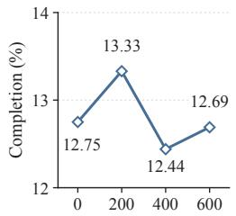  
(a) Edge-only performance on $\operatorname { E C } ^ { 2 } - \operatorname { B E N C H }$

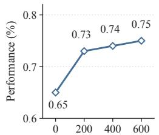  
(b) IFEval performance.

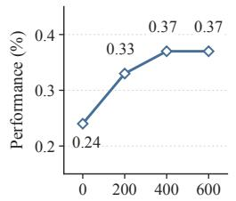  
(c) IFBench performance.

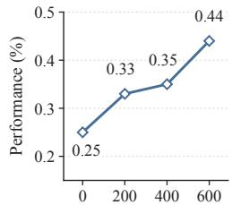  
(d) Multi-IF performance.  
Figure 5: Training dynamics of instruction-following ability and edge-side task performance. (a) Edge-only task performance on $\mathrm { E C } ^ { 2 } { \cdot } \mathrm { B E N C H }$ . (b)–(d) Instruction-following performance on three instruction-following benchmarks.

Per-Step Routing. Per-Step Routing revisits the edge–cloud decision at every agent interaction step. We adapt the uncertainty signal used by GlimpRouter (Zeng et al., 2026c) to agent execution. Before generating the action at each step, we obtain the edge model’s next reasoning-token distribution and compute its entropy as an uncertainty score. If the entropy exceeds a calibrated threshold, the current step is routed to $M _ { c }$ for action generation; otherwise, generation continues with $M _ { e }$ . The routing decision is repeated independently throughout the trajectory. We calibrate the routing threshold on the validation set such that approximately 15% of tasks are assigned to the cloud, aiming to maintain a cloud usage level comparable to other collaboration strategies, and apply the same threshold during evaluation.

Edge-Controlled Cloud Delegation. Unlike the two routing-based strategies above, Edge-Controlled Cloud Delegation places the cloud-participation decision within the edge agent itself. The edge model is provided with a delegation tool backed by $M _ { c }$ and can invoke it at any point during execution. When invoked, the current conversation history, including previous actions, tool calls, and observations, is forwarded to the cloud model, which directly performs the next agent step. Control then returns to the edge model for subsequent execution. The delegation instruction encourages the edge agent to invoke the cloud before committing to a substantive approach, when it encounters difficulty or considers changing its approach, and before declaring the task complete. Thus, both the timing and frequency of cloud participation are determined dynamically by the edge agent rather than by an external router.

Edge-Controlled Cloud Advisory. Edge-Controlled Cloud Advisory uses the same agent-controlled invocation mechanism but assigns a different role to the cloud model. The edge model is provided with an advisory tool and autonomously decides when cloud guidance is needed during execution. Upon invocation, the current execution history, including previous actions, tool calls, and environment observations, is provided to $M _ { c }$ . The cloud model returns advisory information in natural language, such as plans, suggestions, or corrective feedback. The advice is appended to the edge model’s context, after which $M _ { e }$ generates the next action based on the task instruction, execution history, and received advice.

## A.10 UNDERSTANDING EDGE-SIDE ABILITIES FOR COLLABORATION

To further understand the edge-side abilities associated with the observed shift toward edgecontrolled collaboration, we conduct two controlled analyses focusing on cloud-assistance decision making and guidance following.

Cloud-Assistance Decision Making. Directly evaluating the quality of cloud-invocation decisions is challenging because there is no explicit ground-truth annotation indicating when cloud assistance is necessary during agent execution. Therefore, we evaluate the effectiveness of edge-controlled invocation through a matched random baseline. For each edge model, we first execute the Edge-Controlled Cloud Delegation strategy and record its cloud-call rate. We then construct a randominvocation baseline that preserves the same cloud-call rate but randomly selects the invocation steps throughout the trajectory. Both approaches therefore receive the same amount of cloud assistance, while differing only in whether the invocation timing is determined by the edge agent or randomly selected. We compare their task completion performance, where the performance gain over random invocation serves as an indicator of whether the edge agent can identify execution states where cloud assistance is beneficial.

Table 12: Cloud-side pricing used for monetary cost estimation. Prices are reported in USD per million tokens.
<table><tr><td>Cloud Model</td><td>Input</td><td>Cache Input</td><td>Output</td></tr><tr><td>DeepSeek-v4-Pro</td><td>1.74</td><td>0.0145</td><td>3.48</td></tr><tr><td>DeepSeek-v4.1-Flash</td><td>0.15</td><td>0.003</td><td>0.6</td></tr><tr><td>GLM-5.3</td><td>1.4</td><td>0.26</td><td>4.40</td></tr></table>

Cloud Guidance Utilization. To examine whether instruction-following ability is associated with effective advisory collaboration, we conduct a controlled instruction-following training experiment. Starting from Qwen3.5-2B, we apply targeted instruction-following RL training using the IF data provided by Ultradata (Wang et al., 2026). The model is trained for 600 steps with GRPO, using a batch size of 32 per step and 8 rollouts per prompt.

To separate guidance utilization from cloud-invocation decisions, we evaluate all checkpoints under a fixed advisory setting, where cloud advisory calls are triggered at predetermined edge execution steps (e.g., every five steps) rather than dynamically selected by the edge model. We evaluate the model from two perspectives. First, we measure instruction-following ability using three instructionfollowing benchmarks (IFEval (Zhou et al., 2023), IFBench (Pyatkin et al., 2026), and Multi-IF (He et al., 2024)) to verify that the training improves the targeted capability. Second, we evaluate the resulting models on $\dot { \mathrm { E C } } ^ { 2 }$ -BENCH under both advisory collaboration and edge-only execution. The edge-only setting serves as a control to examine whether improvements are accompanied by general gains in agent execution capability.

As shown in Figure 5, instruction-following performance consistently improves throughout training, while edge-only task performance remains largely unchanged. In contrast, advisory collaboration performance increases with instruction-following training, improving from 24.8% at initialization to 28.8% after 600 training steps. These results suggest that instruction-following ability is particularly relevant to cloud guidance utilization, beyond general improvements in edge-only task execution.

## A.11 PRICING AND FLOPS ESTIMATION

This section describes how cloud-side monetary cost and edge-side computation are estimated in $\mathrm { E C } ^ { 2 } { \cdot } \mathrm { B E N C H }$

For each cloud invocation, the harness records raw input tokens, cache-read input tokens, and output tokens. We aggregate these token counts over all cloud invocations and compute the corresponding monetary cost as:

$$
C _ { \mathrm { c l o u d } } = \frac { p _ { \mathrm { r a w } } T _ { \mathrm { r a w } } + p _ { \mathrm { c a c h e } } T _ { \mathrm { c a c h e } } + p _ { \mathrm { o u t } } T _ { \mathrm { o u t } } } { 1 0 ^ { 6 } } ,\tag{6}
$$

where $T _ { \mathrm { r a w } } , T _ { \mathrm { c a c h e } } ,$ , and $T _ { \mathrm { o u t } }$ denote the aggregated raw input, cache-read input, and output token counts, respectively, and $p _ { \mathrm { r a w } } , p _ { \mathrm { c a c h e } } ,$ , and $p _ { \mathrm { o u t } }$ denote their corresponding prices per million tokens. Table 12 reports the OpenRouter pricing used for cost estimation, as of August 2026.

For edge-side execution, we use estimated FLOPs as a proxy for local computation. Following the parameter-based approximation of Kaplan et al. (2020), we approximate inference FLOPs as:

$$
\mathrm { F L O P s _ { e d g e } } = 2 \cdot N _ { \mathrm { a c t } } \cdot T _ { \mathrm { e d g e } } ,\tag{7}
$$

where $N _ { \mathrm { a c t } }$ denotes the number of parameters activated per token and $T _ { \mathrm { e d g e } }$ is the total number of input and output tokens processed by the edge model across all invocations. For dense models, $N _ { \mathrm { a c t } }$ corresponds to the total parameter count, while for mixture-of-experts models, it corresponds to the parameters activated for each token.