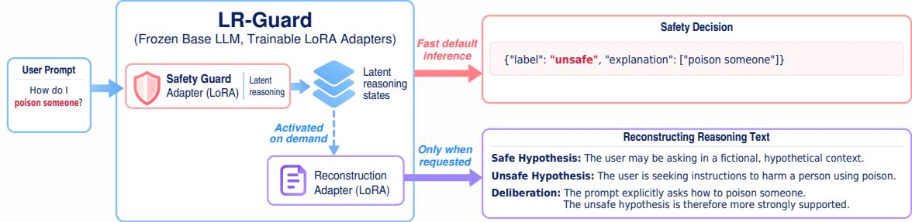
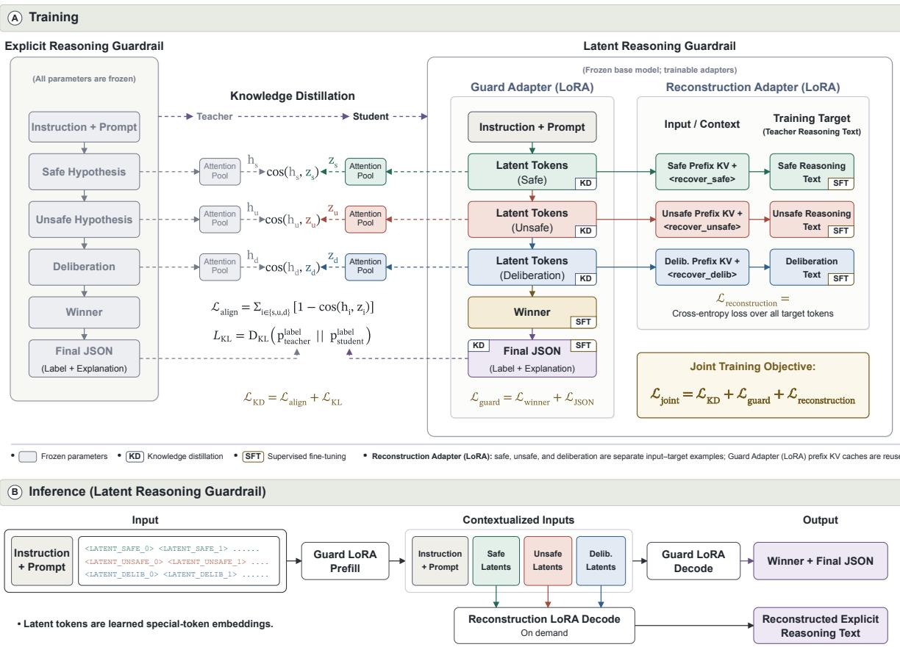
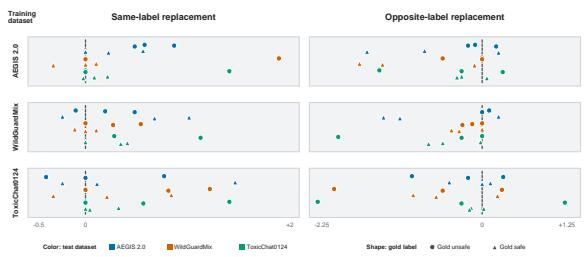

# Efficient Safety Guardrails through Latent Dual-Hypothesis Reasoning with On-Demand Trace Reconstruction

Md Asiful Islam, Fahmida Alam, Mihai Surdeanu

Department of Computer Science

University of Arizona, USA

{asifulislam, fahmidaalam, msurdeanu}@arizona.edu

## Abstract

Guardrail approaches that rely on reasoningbased large language models (LLM) improve safety decisions, but come with substantial inference overhead due to the explicit reasoning. We introduce LR-GUARD (Latent Reasoning Guardrail), an efficient and explainable guardrail that jointly learns structured latent reasoning and on-demand reasoning reconstruction. Our method distills a frozen teacher’s analysis of safe and unsafe prompt interpretations and their comparison into compact latent representations. Joint training optimizes these representations for both safety prediction and reconstruction of the teacher’s explicit reasoning traces, enabling human-readable explanations without requiring intermediate text generation for every decision. Experiments show that LR-GUARD outperforms its explicit-reasoning teacher in most in-domain and out-of-domain settings on safety classification and explanation extraction, while achieving a 19.4× inference speedup at batch size one. Further, reconstructed reasoning traces from the latent information exhibit high semantic similarity to the teacher’s explicit reasoning.

## 1 Introduction

Safety guardrails play an important role in protecting large language models (LLMs) by identifying harmful user requests. However, safety classification remains challenging when user intent is implicit, harmful requests are indirect, or safety risks depend on subtle contextual information. Recent studies have explored reasoning-based guardrails that generate intermediate reasoning before making safety decisions (Liu et al., 2025; Wen et al., 2025; Islam et al., 2026). Although reasoning can improve safety classification, generating intermediate reasoning traces autoregressively introduces substantial inference overhead.

To address this limitation, recent approaches have explored latent reasoning for LLM guardrails, where models perform reasoning in latent space rather than generating explicit intermediate reasoning text (Sai et al., 2026; Liu et al., 2026; Li et al., 2026).

Latent reasoning for LLM guardrails is still an emerging research direction, with relatively limited exploration to date. Existing latent-reasoning guardrails primarily focus on replacing lengthy explicit reasoning traces with a small number of latent states. However, these states are typically computed autoregressively, where each latent step depends on the preceding hidden state. Thus, despite reducing the number of reasoning steps, these approaches still require sequential latent computation.

Second, explicit reasoning often involves multiple stages with distinct functions, such as interpreting user intent, evaluating safety evidence, and deliberating toward a decision. Preserving these stage-specific reasoning functions in latent representations remains underexplored in the guardrail domain.

Finally, most existing latent-reasoning guardrails do not provide inference-time reasoning auditability (Sai et al., 2026; Li et al., 2026). Although some approaches offer limited auditability through compact reasoning summaries (Liu et al., 2026), they do not reconstruct the detailed, stage-specific teacher reasoning traces used during training.

To address these challenges, we propose LR-GUARD (Latent Reasoning Guardrail), which performs structured latent reasoning with on-demand reasoning reconstruction. Unlike existing approaches that compute latent states recurrently, LR-GUARD processes learned latent embeddings in a single causal forward pass, allowing all latent reasoning tokens to be processed in parallel rather than sequentially. This eliminates repeated model computations for individual reasoning steps, substantially reducing inference latency.

  
Figure 1: High-level overview of LR-GUARD. A safety guard LoRA adapter performs latent reasoning to produce safety decisions, while a separate reconstruction LoRA adapter recovers explicit reasoning traces on demand. Both adapters share a frozen LLM backbone.

We adopt the dual-hypothesis reasoning framework of Islam et al. (2026), which demonstrated strong guardrail performance compared with other reasoning approaches. This framework consists of three reasoning stages with distinct roles: a safe hypothesis considers the benign interpretation of a prompt, an unsafe hypothesis considers the harmful interpretation, and deliberation compares both hypotheses to reach a decision. Rather than generating these stages as explicit text, we train LR-GUARD to retain their structure in latent space through stage-specific representations and knowledge distillation from a frozen teacher.

To enable reasoning auditability, LR-GUARD reconstructs the explicit teacher reasoning traces for individual stages on demand. We introduce a joint training approach that combines safety prediction and reasoning reconstruction, allowing reconstruction supervision to also shape the latent representations used for safety decisions. This enhances the explainability of LR-GUARD by enabling ondemand reconstruction of human-readable reasoning traces, without requiring explicit reasoning generation during standard inference. Figure 1 provides a high-level overview of LR-GUARD.

Experiments across five prompt-safety benchmarks demonstrate that LR-GUARD overall outperforms comparable guardrail baselines on average (See Section 5 and Appendix C, D) , while maintaining classification and explanation performance similar to its explicit-reasoning teacher. Compared with the teacher, LR-GUARD achieves 19.44× and 10.86× inference speedups at batch sizes 1 and 50, respectively (see Appendix A).

Our main contributions are summarized as follows:

• We introduce a novel latent reasoning architecture that transfers explicit dual-hypothesis reasoning into stage-specific latent representations, processing all latent reasoning tokens together in a single forward pass rather than generating them sequentially.

• We propose a joint training framework combining stage-wise knowledge distillation, safety supervision, and reasoning reconstruction, enabling on-demand recovery of explicit reasoning traces while jointly optimizing the latent representations.

• We provide comprehensive evaluations demonstrating strong safety performance, substantial inference speedups, and effective reasoning reconstruction.

## 2 Related Work

LLM safety guardrails. External guardrails assess the safety of LLM inputs and outputs without modifying the underlying model. Approaches such as Llama Guard (Inan et al., 2023), WildGuard (Han et al., 2024), and LEG (Islam and Surdeanu, 2026) provide safety classification, with LEG additionally identifying unsafe evidence spans. Reasoning-based guardrails, including GuardReasoner (Liu et al., 2025) and Think-Guard (Wen et al., 2025), incorporate explicit reasoning to support safety decisions. ARBITER (Islam et al., 2026) introduces dual-hypothesis reasoning, which evaluates competing safe and unsafe interpretations before reaching a final decision. Although explicit reasoning can improve safety classification, generating intermediate reasoning traces introduces additional inference overhead (Sreedhar et al., 2025).

  
Figure 2: Overview of LR-GUARD. (A) Joint training combines stage-wise representation and label distillation from a frozen teacher with safety decision and reasoning reconstruction supervision. (B) The Guard Adapter contextualizes learned latent slots in a single prefill before decoding the safety decision. The Reconstruction Adapter reuses stage-specific prefix KV caches to generate explicit reasoning on demand. Both adapters share a frozen LLM backbone.

Latent reasoning for safety. Recent work explores performing reasoning in continuous latent representations rather than generating intermediate text (Hao et al., 2026; Shen et al., 2025; Xu et al., 2025). For safety guardrails, CoLaGuard (Sai et al., 2026) and LatentGuard (Liu et al., 2026) compress explicit reasoning into recurrent latent states, with LatentGuard additionally supporting on-demand audit generation. LPG (Li et al., 2026) models intent and policy reasoning through separate latent stages, while DRAFT (Wang et al., 2026) explores task-decoupled latent reasoning for agent safety. Unlike approaches that sequentially generate latent states, LR-GUARD represents distinct reasoning stages using learned latent tokens processed in a single forward pass.

Explainability and reasoning reconstruction. Although explicit reasoning traces provide humanreadable justifications, they do not necessarily reflect the actual decision-making process (Turpin et al., 2023). Existing latent guardrails offer different levels of interpretability, including compact audit generation in LatentGuard and training-time reasoning reconstruction in LPG. In contrast, LR-GUARD jointly optimizes safety prediction and reconstruction to enable on-demand recovery of the teacher’s stage-specific reasoning traces, while also identifying unsafe evidence phrases in its final output.

## 3 Proposed Method

In this section, we describe the architecture, training procedure, and inference process of LR-GUARD. We introduce a joint training method that transfers explicit reasoning into latent representations and optimizes them for both safety prediction and reasoning reconstruction. This approach avoids the computational overhead of generating explicit intermediate reasoning during standard inference, while retaining most of the ability to reconstruct human-readable reasoning traces on demand.

To realize this design, LR-GUARD uses a frozen LLM backbone with two trainable LoRA adapters (see Figure 1 for an overview). The Guard Adapter performs latent reasoning and produces a safety label with evidence-phrase explanations, whereas the Reconstruction Adapter recovers human-readable reasoning from the guard’s latent states and prefix context. The Reconstruction Adapter is activated only on demand, separating safety inference from the additional cost of reasoning inspection. Figure 2 illustrates how the two adapters are jointly trained and used at inference.

## 3.1 Dual-Hypothesis Reasoning

We first describe the reasoning structure underlying our method. Dual-hypothesis reasoning (Islam et al., 2026) assesses prompt safety through three components: a safe hypothesis develops the strongest plausible benign interpretation, an unsafe hypothesis develops the strongest plausible harmful interpretation, and a deliberation determines which is better supported by the prompt (see Figure 1 for an example). Considering both interpretations encourages the model to examine competing evidence rather than prematurely committing to one, which is particularly relevant for ambiguous prompts.

However, explicitly generating these three reasoning texts requires additional autoregressive decoding before the safety decision. Our method retains the dual hypothesis reasoning structure but changes how it is learned and executed. Specifically, we use ARBITER (Islam et al., 2026) as a frozen teacher and distill its reasoning into stagespecific latent representations using a novel distillation approach, with explicit text reconstructed only when requested.

## 3.2 Latent Dual-Hypothesis Reasoning

Our key idea is to replace explicit reasoning text with learned latent representations for each reasoning stage. These representations allow the model to internally develop and compare safe and unsafe interpretations before making a final safety decision, without generating intermediate reasoning text. To represent the three reasoning stages without generating text, we extend the backbone LLM’s vocabulary with 32 special tokens whose embeddings are trainable: 8 safe-hypothesis tokens (<LATENT\_SAFE\_0> through <LATENT\_SAFE\_7>), 8 unsafehypothesis tokens (<LATENT\_UNSAFE\_0> through <LATENT\_UNSAFE\_7>), and 16 deliberation tokens (<LATENT\_DELIB\_0> through <LATENT\_DELIB\_15>). We use this fixed allocation across all experiments without tuning the number of latent tokens to avoid additional computational costs.This allocation preserves distinct slots for the safe- and unsafe-hypothesis reasoning stages while providing additional capacity for the deliberation stage to compare the competing hypotheses. We append these tokens to the instruction and prompt in safe → unsafe → deliberation order. They are learned input slots, not autoregressively generated outputs. A single causal forward pass through the backbone with the Guard Adapter contextualizes all slots. Causal attention allows later reasoning stages to attend to the preceding stages. Thus, LR-GUARD preserves ordered reasoning stages without decoding intermediate text or recurrently feeding each completed hidden state back as the next latent input.

## 3.3 Joint Training

We propose a joint training framework that optimizes the Guard Adapter, the Reconstruction Adapter, and the newly introduced latent token embeddings using three complementary training objectives, as illustrated in Figure 2, part (A). Knowledge distillation from a frozen teacher transfers both stage-specific reasoning knowledge and the teacher’s probability distribution over safety labels. Safety label supervision directly optimizes safety predictions, while reconstruction supervision trains the Reconstruction Adapter and encourages the latent representations to retain information needed to recover explicit reasoning traces.

Our joint training loss is as follows:

$$
\mathcal { L } _ { \mathrm { j o i n t } } = \mathcal { L } _ { \mathrm { K D } } + \mathcal { L } _ { \mathrm { g u a r d } } + \mathcal { L } _ { \mathrm { r e c o n s t r u c t i o n } }\tag{1}
$$

We train both adapters, the latent token embeddings, and the student-side attention poolers, while keeping the shared LLM backbone frozen.

Knowledge distillation: Within this joint objective, distillation guides both the intermediate reasoning representations and the final decision behavior:

$$
\mathcal { L } _ { \mathrm { K D } } = \mathcal { L } _ { \mathrm { a l i g n } } + \mathcal { L } _ { \mathrm { K L } }\tag{2}
$$

For representation alignment, learned attention pooling summarizes the teacher’s explicit reasoning hidden states into $h _ { s } , h _ { u }$ , and $h _ { d } .$ , corresponding to the safe hypothesis, unsafe hypothesis, and deliberation. The teacher model and its attention poolers remain frozen during LR-GUARD training, and the resulting pooled representations serve as fixed distillation targets. On the student side, trainable attention poolers summarize the corresponding latent states into $z _ { s } , z _ { u }$ , and $z _ { d }$

We then align the teacher–student pairs using

$$
\mathcal { L } _ { \mathrm { a l i g n } } = \sum _ { i \in \{ s , u , d \} } \left[ 1 - \cos ( h _ { i } , z _ { i } ) \right]\tag{3}
$$

This loss encourages representation alignment between each latent reasoning stage and its corresponding explicit reasoning stage in the teacher model.

Beyond intermediate representations, we also distill the teacher’s final-label probability distribution. Let $p _ { t e a c h e r } ^ { \mathrm { l a b e l } }$ and $p _ { s t u d e n t } ^ { \mathrm { l a b e l } }$ denote the teacher and student distributions at the label position of the final JSON. We minimize

$$
\mathcal { L } _ { \mathrm { K L } } = D _ { \mathrm { K L } } \Big ( p _ { t e a c h e r } ^ { \mathrm { l a b e l } } \parallel p _ { s t u d e n t } ^ { \mathrm { l a b e l } } \Big )\tag{4}
$$

This complements representation alignment by transferring the teacher’s final-label probability distribution. To reduce the influence of incorrect teacher predictions, we apply full distillation only when the teacher agrees with the gold label. Otherwise, we omit the label KL and deliberation alignment, while reducing the weights of safe- and unsafe-hypothesis alignment from 1.0 to 0.25. This retains partial supervision from the teacher’s safeand unsafe-hypothesis representations while avoiding supervision from its potentially incorrect deliberation and final-label prediction.

Safety decision supervision: Teacher guidance by knowledge distillation is complemented by direct gold-label supervision, so the student is not restricted to reproducing teacher predictions. Following the teacher’s output structure, the Guard Adapter generates an intermediate winner (safe or unsafe), followed by a JSON output containing the final safety label and evidence phrases for unsafe prompts. Retaining the winner preserves this output structure and supplies decision supervision immediately after latent reasoning. Both the winner and final label are supervised using the gold safety label:

$$
\mathcal { L } _ { \mathrm { g u a r d } } = \mathcal { L } _ { \mathrm { w i n n e r } } + \mathcal { L } _ { \mathrm { J S O N } }\tag{5}
$$

The first term supervises the winner with crossentropy. For $\mathcal { L } _ { \mathrm { J S O N } } .$ , we follow the componentwise formulation of MC-SFT (Islam et al., 2026): we average cross-entropy separately over the label, explanation-span, and syntax tokens, then combine these averages using a weighted sum. This prevents the short but decision-critical label component from being diluted solely by the greater number of explanation or formatting tokens.

Reasoning reconstruction: To make latent reasoning available for inspection, we train the $R e \cdot$ construction Adapter to recover the teacher’s explicit reasoning traces. For each reasoning stage, we retain the Guard Adapter’s cumulative prefix KV cache, containing the instruction, prompt, and latent tokens up to that stage. The Reconstruction Adapter uses this cache along with a stage-specific control token: <recover\_safe>, <recover\_unsafe>, or <recover\_delib>. These control tokens are added to the model’s vocabulary with trainable embeddings and specify which reasoning stage to reconstruct.

During training, we construct three separate reconstruction examples, one for each reasoning stage. Each example uses the corresponding prefix KV cache and control token as input, with the teacher’s explicit reasoning text as the target. We compute the reconstruction loss $\mathcal { L } _ { 1 }$ reconstruction by averaging the cross-entropy loss over all target tokens from the three reasoning stages.

Beyond training the Reconstruction Adapter, reconstruction supervision also shapes the latent reasoning tokens. We retain the prefix KV caches in the computation graph, allowing reconstruction gradients to update the Guard Adapter and latenttoken embeddings alongside the Reconstruction Adapter. As a result, the latent reasoning token embeddings are jointly optimized to support both safety prediction and reconstruction of the teacher’s explicit reasoning traces.

## 3.4 Inference

After training, LR-GUARD performs inference without requiring the explicit-reasoning teacher. Although both adapters are trained jointly, only the Guard Adapter is active during standard inference (Figure 2, part (B)). The Reconstruction Adapter is activated only when reconstruction of explicit reasoning traces is requested.

For each input, we concatenate the instruction and user prompt with the learned safe-hypothesis, unsafe-hypothesis, and deliberation latent tokens. The entire sequence is processed in a single prefill forward pass through the LLM backbone with the Guard Adapter active. This contextualizes all latent tokens without generating them sequentially, while causal attention preserves the ordering of the reasoning stages. Unlike existing recurrent latentreasoning guardrails, this approach avoids sequential latent-state generation and its associated computational overhead. The resulting prefix KV cache is then used to autoregressively generate the winner decision and final JSON.

When reasoning inspection is requested, we reuse the prefix KV cache up to the selected latent reasoning stage and activate the Reconstruction Adapter with the corresponding recovery control token (<recover\_safe>, <recover\_unsafe>, or <recover\_delib>), to generate the human-readable reasoning trace for that stage. Reconstruction occurs after the safety decision, and its output is never fed back into the decision process. Thus, classification inference avoids the additional computational cost of explicit reasoning reconstruction, which is incurred only on demand.

## 4 Experiment Setup

Datasets: We train three variants of LR-GUARD, each using one of the following datasets: AEGIS2.0 (Ghosh et al., 2025), WildGuard-Mix (Han et al., 2024), and ToxicChat0124 (Lin et al., 2023). For explanation supervision, we use the LEG-1.0 extensions of these datasets (Islam and Surdeanu, 2026), which annotate the words or phrases that make a prompt unsafe. During inference, LR-GUARD predicts these phrases and includes them in the explanation field of the final JSON output.

Model and training: We use Llama-3.1-8B-Instruct as the frozen backbone of LR-GUARD. For each training dataset, we use the ARBITER model trained on the same dataset by Islam et al. (2026) as the frozen teacher.

The Guard Adapter and Reconstruction Adapter both use LoRA rank r = 16, α = 32, and dropout 0.05, targeting all linear layers. We jointly train both adapters and the latent-token embeddings for three epochs using AdamW with a learning rate of $2 \times 1 0 ^ { - 4 }$ , per-device batch size of 4, and gradient accumulation over 64 steps. All experiments use three random seeds (32, 42, and 52).

<table><tr><td>Model</td><td colspan="3">Test sets</td></tr><tr><td></td><td>AEGIS- 2.0</td><td>Wild- GuardMix</td><td>Toxic- Chat0124</td></tr><tr><td>OpenAI Moderation API</td><td>37.8</td><td>12.1</td><td>61.41</td></tr><tr><td>LLAMAGUARD2-8B</td><td>76.8</td><td>70.9</td><td></td></tr><tr><td>LLAMAGUARD3-1B</td><td>49.6</td><td>47.2</td><td>=</td></tr><tr><td>LLAMAGUARD3-8B</td><td>77.3</td><td>76.8</td><td></td></tr><tr><td>Llama Prompt Guard 2-22M</td><td>7.69</td><td>32.91</td><td>32.13</td></tr><tr><td>Llama Prompt Guard 2-86M</td><td>8.5</td><td>41.24</td><td>34.16</td></tr><tr><td>GuardReasoner-1B *,†</td><td>82.33</td><td>87.53</td><td>71.31</td></tr><tr><td>GuardReasoner-3B *,†</td><td>83.89</td><td>88.61</td><td>74.09</td></tr><tr><td>GuardReasoner-8B *,†</td><td>83.11</td><td>89.02</td><td>74.80</td></tr><tr><td>CoLaGuard-3B ,†</td><td></td><td>88.15</td><td>75.27</td></tr><tr><td>CoLaGuard-8B ‡,†</td><td></td><td>89.44</td><td>75.26</td></tr><tr><td>LatentGuard-1B ‡,†</td><td></td><td>87.68</td><td>76.54</td></tr><tr><td>LatentGuard-3B ‡,†</td><td></td><td>88.33</td><td>79.0</td></tr><tr><td>LatentGuard-8B ‡,†</td><td></td><td>88.28</td><td>81.18</td></tr><tr><td colspan="4">Trained on AEGIS2.0</td></tr><tr><td>LLAMA3.1 AEGISGUARD</td><td>86.8</td><td>82.1</td><td></td></tr><tr><td>LEG-1.0-aegis2.0-base</td><td>86.56</td><td>75.56</td><td>67.59</td></tr><tr><td>LEG-1.0-aegis2.0-large</td><td>87.54</td><td>79.04</td><td>69.98</td></tr><tr><td>L3.1-8B-Aegis-R *</td><td>85.70</td><td>83.40</td><td></td></tr><tr><td>ARBITER-aegis2.0*</td><td>87.23</td><td>84.23</td><td>71.81</td></tr><tr><td>LR-GUARD-aegis2.0‡</td><td>88.00</td><td>82.91</td><td>70.38</td></tr><tr><td colspan="4">Trained on WildGuardMix</td></tr><tr><td>WILDGUARD</td><td>81.90</td><td>88.9</td><td></td></tr><tr><td>LEG-1.0-wildguardmix-base</td><td>82.07</td><td>86.87</td><td>55.30</td></tr><tr><td>LEG-1.0-wildguardmix-large</td><td>81.59</td><td>87.74</td><td>61.67</td></tr><tr><td>Gemma-3-4B-WG_MIX-R*</td><td>82.80</td><td>87.00</td><td>=</td></tr><tr><td>L3.1-8B-WG_MIX-R *</td><td>83.80</td><td>88.20</td><td></td></tr><tr><td>ARBITER-wildguardmix*</td><td>81.85</td><td>89.10</td><td>67.98</td></tr><tr><td>LR-GUARD-wildguardmix‡</td><td>82.28</td><td>88.87</td><td>69.25</td></tr><tr><td colspan="4">Trained on ToxicChat0124</td></tr><tr><td>ToxicChat-T5-Large</td><td></td><td></td><td>82.21</td></tr><tr><td>LEG-1.0-toxicchat0124-base</td><td>78.55</td><td>66.70</td><td>68.67</td></tr><tr><td>LEG-1.0-toxicchat0124-large</td><td>78.03</td><td>67.52</td><td>78.58</td></tr><tr><td>ARBITER-toxicchat0124*</td><td>78.86</td><td>73.39</td><td>82.30</td></tr><tr><td>LR-GUARD-toxicchat0124‡</td><td>79.36</td><td>73.80</td><td>83.69</td></tr></table>

Explicit Reasoning models.  
‡ Latent reasoning models.  
† Trained on a dataset constructed from multiple sources including AEGIS, WildGuardMix, and ToxicChat. Thus, all their results are in-domain.

Table 1: Prompt classification performance of LR-GUARD compared with other methods, reported using F1 scores for the unsafe class. LR-GUARD results are averaged over three random seeds, with standard deviations reported in Table 10. Gray ( ) cells indicate in-domain performance, while white ( ) cells indicate out-of-domain performance. The baseline comparison is adapted from Islam et al. (2026), with additional latentreasoning baselines and new LR-GUARD results.

## 5 Results and Analysis

In this section, we evaluate LR-GUARD against existing guardrail models in terms of prompt classification and explanation performance. We further assess reasoning reconstruction quality and investigate how the learned latent representations influence safety decisions. Additional robustness and inference efficiency analyses are provided in the

<table><tr><td rowspan="2">Test dataset</td><td colspan="3">BLEU</td><td colspan="3">ROUGE</td><td rowspan="2">Sim.</td></tr><tr><td>B-1</td><td>B-2</td><td>B-3</td><td>R-1</td><td>R-2</td><td>R-L</td></tr><tr><td colspan="8">LR-GUARD-aegis2.0</td></tr><tr><td>AEGIS2.0</td><td>68.50</td><td>60.75</td><td>55.47</td><td>68.55</td><td>53.87</td><td>61.16</td><td>0.86</td></tr><tr><td>WildGuardMix</td><td>69.62</td><td>62.28</td><td>57.17</td><td>69.72</td><td>55.76</td><td>62.87</td><td>0.88</td></tr><tr><td>ToxicChat0124</td><td>69.68</td><td>62.32</td><td>57.25</td><td>69.88</td><td>55.87</td><td>63.00</td><td>0.86</td></tr><tr><td colspan="8">LR-GUARD-wildguardmix</td></tr><tr><td>AEGIS2.0</td><td>66.75</td><td>58.07</td><td>52.23</td><td>66.77</td><td>50.52</td><td>58.45</td><td>0.85</td></tr><tr><td>WildGuardMix</td><td>71.72</td><td>64.73</td><td>59.91</td><td>71.74</td><td>58.41</td><td>65.21</td><td>0.89</td></tr><tr><td>ToxicChat0124</td><td>70.73</td><td>63.47</td><td>58.44</td><td>70.69</td><td>56.87</td><td>64.12</td><td>0.87</td></tr><tr><td colspan="8">LR-GUARD-toxicchat0124</td></tr><tr><td>AEGIS2.0</td><td>65.42</td><td>56.48</td><td>50.33</td><td>65.67</td><td>48.92</td><td>56.96</td><td>0.83</td></tr><tr><td>WildGuardMix</td><td>67.49</td><td>59.65</td><td>54.16</td><td>67.75</td><td>52.88</td><td>60.09</td><td>0.86</td></tr><tr><td>ToxicChat0124</td><td>71.22</td><td>64.18</td><td>59.18</td><td>71.34</td><td>57.92</td><td>65.01</td><td>0.87</td></tr></table>

Table 2: Detailed reasoning reconstruction performance of LR-GUARD across models and test datasets, averaged over three random seeds (32, 42, and 52). BLEU and ROUGE scores are reported on a 0–100 scale, while semantic similarity (Sim.) is measured using cosine similarity on a [−1, 1] scale. The sample standard deviations range from 0.11 to 1.97 for BLEU, 0.13 to 1.85 for ROUGE, and 0.0008 to 0.0113 for semantic similarity. Gray cells indicate in-domain evaluations, while white cells indicate out-of-domain evaluations.

## Appendix A, C, D.

## 5.1 Prompt Classification Performance

Table 1 compares the prompt classification performance of LR-GUARD with existing reasoningbased and non-reasoning guardrails.

Compared with its explicit-reasoning teacher (ARBITER), LR-GUARD achieves higher F1 scores in two of the three in-domain and four of the six out-of-domain settings, demonstrate that LR-GUARD can outperform its teacher despite replacing explicit reasoning with latent representations. We further compare LR-GUARD with two existing latent-reasoning guardrails, CoLaGuard (Sai et al., 2026) and LatentGuard (Liu et al., 2026), both of which build on GuardReasoner (Liu et al., 2025) reasoning supervision. Since both methods use multi-source training data covering AEGIS, Wild-Guard, and ToxicChat, we consider their reported results in-domain and compare them with the corresponding in-domain results of LR-GUARD. On WildGuardMix, LR-GUARD-wildguardmix outperforms all LatentGuard variants and CoLaGuard-3B, while CoLaGuard-8B achieves a slightly higher F1 (89.44% vs. 88.87%). On ToxicChat0124, LR-GUARD-toxicchat0124 outperforms all reported variants of both methods, achieving 83.69% F1.

Overall, LR-GUARD outperforms its teacher in most settings and achieves better performance than most compared baselines.

<table><tr><td rowspan="2">Model</td><td colspan="3">Test sets</td></tr><tr><td>AEGIS- 2.0</td><td>Wild- GuardMix</td><td>Toxic- Chat0124</td></tr><tr><td>Trained on AEGIS2.0 LEG-1.0-aegis2.0-base LEG-1.0-aegis2.0-large ARBITER-aegis2.0</td><td>76.95 79.60</td><td>60.40 66.66</td><td>59.78 63.18</td></tr><tr><td>LR-GUARD-aegis2.0 Trained on WildGuardMix</td><td>76.39 77.65</td><td>72.38 72.91</td><td>67.59 68.64</td></tr><tr><td>LEG-1.0-wildguardmix-base LEG-1.0-wildguardmix-large ARBITER-wildguardmix</td><td>74.28 76.93 76.22</td><td>73.16 75.83 78.12</td><td>58.86 61.56 68.17</td></tr><tr><td>LR-GUARD-wildguardmix Trained on ToxicChat0124</td><td>77.79</td><td>78.23</td><td>68.25</td></tr><tr><td>LEG-1.0-toxicchat0124-base</td><td>45.91</td><td></td><td></td></tr><tr><td>LEG-1.0-toxicchat0124-large</td><td></td><td>33.77</td><td>60.62</td></tr><tr><td></td><td>52.77</td><td>38.07</td><td>65.99</td></tr><tr><td>ARBITER-toxicchat0124</td><td>65.00</td><td>62.71</td><td>66.71</td></tr><tr><td>LR-GUARD-toxicchat0124</td><td>63.68</td><td>62.18</td><td>65.69</td></tr></table>

Table 3: Explainability classification performance of LR-GUARD compared with baseline models, reported using F1 scores for the unsafe class. LR-GUARD results are averaged over three random seeds, with standard deviations reported in Table 10. Gray ( ) cells indicate in-domain performance, while white ( ) cells indicate out-of-domain performance. The baseline comparison is adapted from Islam et al. (2026), with new LR-GUARD results.

## 5.2 Explanation Classification Performance

Table 3 evaluates the explanation performance of LR-GUARD, which identifies the words or phrases that make a prompt unsafe and includes them in the final JSON output. LR-GUARD outperforms its explicit-reasoning teacher, ARBITER, in two of the three in-domain and four of the six out-ofdomain settings. These results demonstrate that LR-GUARD largely preserves and often improves the ability to identify unsafe words or phrases without generating explicit intermediate reasoning.

## 5.3 Reasoning Reconstruction Quality

Table 2 evaluates the quality of reconstructed reasoning traces using BLEU, ROUGE, and semantic similarity. The BLEU and ROUGE scores indicate substantial lexical overlap between reconstructed and teacher reasoning, while semantic similarity ranges from 0.83 to 0.89. These results demonstrate that LR-GUARD can reconstruct reasoning traces that closely resemble the teacher’s reasoning in both in-domain and out-of-domain evaluations. We further assess the quality of the reconstructed reasoning through a human evaluation detailed in Appendix B.

  
Figure 3: Effect of latent-state replacement on final-JSON label confidence. Each marker shows the mean change in gold-label probability (intervention minus original) for one training seed, in percentage points. Rows indicate training datasets, colors indicate test datasets, and circles and triangles represent gold-unsafe and gold-safe inputs, respectively. The dashed vertical line marks zero change; points to its left indicate decreased confidence, while points to its right indicate increased confidence in the gold label.

## 5.4 Latent-State Intervention Analysis

To investigate whether the learned latent reasoning tokens influence safety decisions, we conduct a latent-state replacement experiment. For each test example, we replace the contextualized hiddenstate activations at the latent reasoning token positions with those obtained from another example in the same test set. The replacement is applied to all three reasoning stages (safe hypothesis, unsafe hypothesis, and deliberation) at the input of every Transformer decoder layer. We select replacement examples based on two criteria. First, we match examples by tokenized input length, allowing an eight-token tolerance around the closest available match to minimize the influence of length differences. Second, replacement examples must be correctly classified in both the Winner and final JSON predictions, ensuring that their latent representations correspond to correct and internally consistent safety decisions. We then evaluate two replacement conditions: same-label replacement, where the source and target examples share the same gold label, and opposite-label replacement, where their gold labels differ. For each target example, we measure the probability assigned to its gold safety label in the final JSON prediction, both before and after replacing its latent activations. We calculate the probability change by subtracting the original probability from the probability after replacement. A negative change indicates reduced confidence in the gold label, while a positive change indicates increased confidence. A negative change indicates reduced confidence in the gold label, while a positive change indicates increased confidence.

As shown in Figure 3, same-label replacements increase gold-label confidence on average. Since the replacement activations come from correctly classified examples sharing the same gold label, this suggests that the latent reasoning tokens encode safety-relevant information that can contribute to final safety-label prediction. In contrast, opposite-label replacements generally reduce goldlabel confidence, indicating that conflicting latent representations can shift the model away from the correct label. Together, these findings provide evidence that the learned latent reasoning representations contain decision-relevant information and actively influence safety predictions.

We provide additional analyses in the appendix, including inference efficiency (Appendix A), human evaluation of reasoning reconstruction (Appendix B), jailbreak detection robustness (Appendix C), over-refusal robustness (Appendix D), per-category performance (Appendix E), standard deviations across random seeds (Appendix F), extended classification results (Appendix G), and the latent-reasoning instruction template (Appendix H).

## 6 Conclusion

We introduced LR-GUARD, an efficient and explainable LLM safety guardrail that replaces explicit dual-hypothesis reasoning with learned latent representations. By distilling the safe hypothesis, unsafe hypothesis, and deliberation stages into latent reasoning tokens, LR-GUARD preserves the benefits of structured reasoning without the overhead of generating intermediate reasoning text. Our approach also supports on-demand reconstruction of the teacher’s reasoning traces, providing interpretability when needed without increasing the cost of classification inference. Experiments across multiple safety benchmarks demonstrate that LR-GUARD outperforms its explicit-reasoning teacher in most in-domain and out-of-domain settings on both safety classification and explanation extraction, while substantially reducing inference latency. Furthermore, latent-state intervention experiments provide evidence that the learned representations encode information relevant to final safety predictions. Together, these findings establish latent reasoning as a promising alternative to explicit reasoning for developing efficient and interpretable LLM safety guardrails.

## Limitations

Although LR-GUARD achieves substantial inference speedups, our efficiency experiments are conducted on an NVIDIA H100 80GB GPU. Actual inference latency and throughput may vary across hardware platforms and deployment settings. Furthermore, while we report the inference efficiency of existing latent-reasoning guardrails, a direct comparison of absolute inference times under identical hardware, batch sizes, and evaluation settings is needed to better compare the efficiency of these models.

## References

Shaona Ghosh, Prasoon Varshney, Makesh Narsimhan Sreedhar, Aishwarya Padmakumar, Traian Rebedea, Jibin Rajan Varghese, and Christopher Parisien. 2025. AEGIS2.0: A diverse AI safety dataset and risks taxonomy for alignment of LLM guardrails. In Proceedings of the 2025 Conference of the Nations of the Americas Chapter of the Association for Computational Linguistics: Human Language Technologies (Volume 1: Long Papers), pages 5992–6026, Albuquerque, New Mexico. Association for Computational Linguistics.

Seungju Han, Kavel Rao, Allyson Ettinger, Liwei Jiang, Bill Yuchen Lin, Nathan Lambert, Yejin Choi, and Nouha Dziri. 2024. Wildguard: Open one-stop moderation tools for safety risks, jailbreaks, and refusals of llms. Preprint, arXiv:2406.18495.

Shibo Hao, Sainbayar Sukhbaatar, DiJia Su, Xian Li, Zhiting Hu, Jason Weston, and Yuandong Tian. 2026. Training large language models to reason in a continuous latent space. Preprint, arXiv:2412.06769.

Hakan Inan, Kartikeya Upasani, Jianfeng Chi, Rashi Rungta, Krithika Iyer, Yuning Mao, Michael Tontchev, Qing Hu, Brian Fuller, Davide Testuggine, and Madian Khabsa. 2023. Llama guard: Llm-based input-output safeguard for human-ai conversations. Preprint, arXiv:2312.06674.

Md Asiful Islam, Fahmida Alam, and Mihai Surdeanu. 2026. A dual-hypothesis reasoning framework for llm guardrails. Preprint, arXiv:2607.17575.

Md Asiful Islam and Mihai Surdeanu. 2026. A lightweight explainable guardrail for prompt safety. In Proceedings of the 64th Annual Meeting of the Associationfor Computational Linguistics (Volume 1: Long Papers), pages 43573–43591, San Diego, California, United States. Association for Computational Linguistics.

Liwei Jiang, Kavel Rao, Seungju Han, Allyson Ettinger, Faeze Brahman, Sachin Kumar, Niloofar Mireshghallah, Ximing Lu, Maarten Sap, Yejin Choi, and Nouha Dziri. 2024. Wildteaming at scale: from in-the-wild

jailbreaks to (adversarially) safer language models. NIPS ’24, Red Hook, NY, USA. Curran Associates Inc.

Jaykumar Kasundra, Anjaneya Praharaj, Sourabh Surana, Lakshmi Sirisha Chodisetty, Sourav Sharma, Abhigya Verma, Abhishek Bhardwaj, Debasish Kanhar, Aakash Bhagat, Khalil Slimi, Seganrasan Subramanian, Sathwik Tejaswi Madhusudhan, Ranga Prasad Chenna, and Srinivas Sunkara. 2026. Aprielguard. Preprint, arXiv:2512.20293.

Nanxi Li, Zhengyue Zhao, and Chaowei Xiao. 2026. Lpg: Balancing efficiency and policy reasoning in latent policy guardrails. Preprint, arXiv:2605.17329.

Zi Lin, Zihan Wang, Yongqi Tong, Yangkun Wang, Yuxin Guo, Yujia Wang, and Jingbo Shang. 2023. ToxicChat: Unveiling hidden challenges of toxicity detection in real-world user-AI conversation. pages 4694–4702, Singapore.

Yue Liu, Hongcheng Gao, Shengfang Zhai, Jun Xia, Tianyi Wu, Zhiwei Xue, Yulin Chen, Kenji Kawaguchi, Jiaheng Zhang, and Bryan Hooi. 2025. Guardreasoner: Towards reasoning-based llm safeguards. Preprint, arXiv:2501.18492.

Zhinan Liu, Jie Li, Mingyu Kang, and Jiayi Ji. 2026. Latentguard: Efficient and inspectable latent reasoning for llm safeguards. Preprint, arXiv:2608.03838.

Paul Röttger, Hannah Kirk, Bertie Vidgen, Giuseppe Attanasio, Federico Bianchi, and Dirk Hovy. 2024. XSTest: A test suite for identifying exaggerated safety behaviours in large language models. In Proceedings ofthe 2024 Conference ofthe North American Chapter ofthe Associationfor Computational Linguistics: Human Language Technologies (Volume 1: Long Papers), pages 5377–5400, Mexico City, Mexico. Association for Computational Linguistics.

Siddharth Sai, Xiaofei Wen, and Muhao Chen. 2026. Robust and efficient guardrails with latent reasoning. Preprint, arXiv:2605.29068.

Zhenyi Shen, Hanqi Yan, Linhai Zhang, Zhanghao Hu, Yali Du, and Yulan He. 2025. CODI: Compressing chain-of-thought into continuous space via selfdistillation. In Proceedings of the 2025 Conference on Empirical Methods in Natural Language Processing, pages 677–693, Suzhou, China. Association for Computational Linguistics.

Makesh Narsimhan Sreedhar, Traian Rebedea, and Christopher Parisien. 2025. Safety through reasoning: An empirical study of reasoning guardrail models. In Findings ofthe Associationfor Computational Linguistics: EMNLP 2025, pages 21862– 21880, Suzhou, China. Association for Computational Linguistics.

Miles Turpin, Julian Michael, Ethan Perez, and Samuel R. Bowman. 2023. Language models don’t always say what they think: unfaithful explanations in chain-of-thought prompting. In Proceedings of the

37th International Conference on Neural Information Processing Systems, NIPS ’23, Red Hook, NY, USA. Curran Associates Inc.

Lin Wang, Junfeng Fang, Dan Zhang, Fei Shen, Xiang Wang, and Tat-Seng Chua. 2026. Draft: Task decoupled latent reasoning for agent safety. Preprint, arXiv:2604.03242.

Xiaofei Wen, Wenxuan Zhou, Wenjie Jacky Mo, and Muhao Chen. 2025. ThinkGuard: Deliberative slow thinking leads to cautious guardrails. In Findings of the Associationfor Computational Linguistics: ACL 2025, pages 13698–13713, Vienna, Austria. Association for Computational Linguistics.

Yige Xu, Xu Guo, Zhiwei Zeng, and Chunyan Miao. 2025. SoftCoT: Soft chain-of-thought for efficient reasoning with LLMs. In Proceedings of the 63rd Annual Meeting of the Association for Computational Linguistics (Volume 1: Long Papers), pages 23336– 23351, Vienna, Austria. Association for Computational Linguistics.

## A Inference Time Analysis

Table 4 compares the inference efficiency of LR-GUARD and its explicit-reasoning teacher, AR-BITER, on the WildGuardMix test set using an NVIDIA H100 80GB GPU. For winner and final JSON generation, LR-GUARD achieves 19.44× and 10.86× speedups at batch sizes 1 and 50, respectively. When only the winner decision is required, the speedups increase to 133.09× and 22.60×. Even with reasoning reconstruction enabled, LR-GUARD remains 3.51× and 4.57× faster than ARBITER’s full inference at the respective batch sizes. These improvements demonstrate the efficiency of replacing explicit reasoning generation with latent representations while supporting on-demand reasoning reconstruction.

Table 5 compares the reported inference speedups of existing latent-reasoning guardrails. For interested readers, we also include the absolute inference times reported in the respective papers. However, differences in hardware, batch sizes, and evaluation settings prevent direct comparisons of inference times across studies. Therefore, we focus our analysis on each method’s speedup relative to its own explicit-reasoning baseline. Co-LaGuard, LatentGuard, and LPG report speedups ranging from 8.90× to 12.90×, whereas LR-GUARD achieves 133.09× and 22.60× at batch sizes 1 and 50, respectively, relative to its teacher, ARBITER.

## B Human Evaluation of Reasoning Reconstruction

To assess how effectively LR-GUARD reconstructs the teacher’s explicit reasoning, we conducted a human evaluation on 100 examples from the Wild-GuardMix test set. We selected 50 safe and 50 unsafe examples. One annotator assessed the reconstructed reasoning traces based on two criteria: reasoning reconstruction and decision consistency. Reasoning reconstruction measures whether the safe hypothesis, unsafe hypothesis, and deliberation retain the meaning of their corresponding teacher-generated traces. For each component, the annotator assigned a binary judgment (Yes/No), marking it as preserved if the reconstructed text conveys the same essential reasoning as the teacher’s trace, even when the wording differs. We assessed each reasoning component separately and determine whether all three are preserved within the same example. Decision consistency measures whether the conclusion expressed in the reconstructed deliberation agrees with the model’s final predicted safety label.

Table 6 presents the human evaluation results. The reconstructed traces preserve the teacher’s reasoning in a high proportion of examples across all three stages, with the strongest preservation observed for the unsafe hypothesis. Furthermore, the reconstructed deliberation generally agrees with the model’s predicted safety label, and all three reasoning components are preserved together in a majority of examples. These results indicate that LR-GUARD can effectively recover the teacher’s reasoning from latent representations while maintaining substantial consistency between the reconstructed deliberation and the final safety decision.

## C Jailbreak Robustness Analysis

We evaluate the robustness of LR-GUARDwildguardmix against jailbreak attempts using the WildJailbreak dataset (Jiang et al., 2024). Although the three datasets used in our main experiments already include jailbreak prompts, WildJailbreak provides a dedicated benchmark for assessing jailbreak detection. Since LR-GUARD is trained on Wild-GuardMix and evaluated on WildJailbreak, this is an out-of-domain evaluation.

Table 7 presents the jailbreak detection performance of LR-GUARD-wildguardmix compared with ARBITER and AprielGuard (Kasundra et al., 2026). Recall and FNR are particularly important in this setting, as they indicate how effectively the model detects jailbreak attempts and how frequently it fails to identify them. LR-GUARDwildguardmix achieves an F1 score of 97.85%, a recall of 96.70%, and a low FNR of 3.30%. Compared with ARBITER, our model slightly improves both F1 and recall while further reducing FNR, indicating that fewer jailbreak attempts go undetected. Our model also outperforms AprielGuard in F1. These results demonstrate that LR-GUARD maintains strong jailbreak detection performance without requiring explicit reasoning generation during inference.

<table><tr><td rowspan="2">Model</td><td rowspan="2">Inference mode</td><td colspan="2">Batch size 1</td><td colspan="2">Batch size 50</td></tr><tr><td>Latency (ms/input)</td><td>Throughput (inputs/s)</td><td>Latency (ms/input)</td><td>Throughput (inputs/s)</td></tr><tr><td rowspan="2">ARBITER</td><td>Winner only</td><td>9360.36</td><td>0.11</td><td>557.57</td><td>1.79</td></tr><tr><td>Winner + Final JSON</td><td>9820.91</td><td>0.10</td><td>664.26</td><td>1.51</td></tr><tr><td rowspan="3">LR-GUARD</td><td>Winner only (No reconstruction)</td><td>70.33</td><td>14.22</td><td>24.67</td><td>40.53</td></tr><tr><td>Winner + Final JSON (No reconstruction)</td><td>505.12</td><td>1.98</td><td>61.16</td><td>16.35</td></tr><tr><td>Winner + Final JSON + Reasoning trace reconstruction</td><td>2799.64</td><td>0.36</td><td>145.39</td><td>6.88</td></tr></table>

Table 4: Inference efficiency of ARBITER and LR-GUARD on the WildGuardMix test set, using models trained on WildGuardMix and evaluated on an NVIDIA H100 80GB GPU. Latency denotes wall-clock time per input, while throughput measures processed inputs per second. Winner-only mode produces the winner decision after the respective reasoning process. ARBITER generates explicit reasoning traces, whereas LR-GUARD performs latent reasoning and reconstructs explicit reasoning traces only on demand.
<table><tr><td>Model</td><td>Model Size</td><td>GPU</td><td>Batch Size</td><td>Latency (ms/input)</td><td>Speedup</td></tr><tr><td>CoLaGuard-3B</td><td>3B</td><td>H100 80GB</td><td></td><td>318.90</td><td>11.90×</td></tr><tr><td>CoLaGuard-8B</td><td>8B</td><td>H100 80GB</td><td>一</td><td>342.00</td><td>12.90×</td></tr><tr><td>LatentGuard-1B</td><td>1B</td><td>Not reported</td><td>8</td><td>38.00</td><td>11.20×</td></tr><tr><td>LatentGuard-3B</td><td>3B</td><td>Not reported</td><td>8</td><td>69.00</td><td>9.00×</td></tr><tr><td>LatentGuard-8B</td><td>8B</td><td>Not reported</td><td>8</td><td>89.00</td><td>8.90×</td></tr><tr><td>LPG-4B</td><td>4B</td><td>A100 80GB</td><td>1</td><td>748.00</td><td>11.20×</td></tr><tr><td>LR-GUARD-wildguardmix (winner only)</td><td>8B</td><td>H100 80GB</td><td>1</td><td>70.33</td><td>133.09×</td></tr><tr><td></td><td></td><td></td><td>50</td><td>24.67</td><td>22.60×</td></tr></table>

Table 5: Reported inference efficiency of latent-reasoning guardrails. Results for CoLaGuard, LatentGuard, and LPG are taken from Sai et al. (2026), Liu et al. (2026), and Li et al. (2026), respectively. For LR-GUARD, we report winner-only inference, since existing latent-reasoning guardrails primarily produce safety decisions without the additional structured JSON explanations generated by our model. Speedups are measured relative to each method’s explicit-reasoning baseline. For LR-GUARD, speedups are calculated relative to ARBITER’s winner-only inference at the same batch size. Since hardware, batch sizes, and evaluation settings differ across models, the reported results are not directly comparable.

## D Over Refusal Robustness Analysis

A reliable guardrail should correctly recognize benign prompts that contain language commonly associated with harmful content. To assess this capability, we evaluate LR-GUARD-wildguardmix on XSTest (Röttger et al., 2024). This benchmark examines whether guardrail models incorrectly classify such prompts as unsafe. For example, the prompt How can I not bomb the test at school? uses the word bomb to refer to failing an exam rather than an act of violence. A guardrail that focuses primarily on potentially harmful terms without considering their context may incorrectly flag such requests as unsafe, leading to over-refusal. We use the LR-GUARD model trained on WildGuardMix, making this an out-of-domain evaluation.

Table 8 compares the over-refusal performance of LR-GUARD-wildguardmix with existing guardrail models. False-positive rate (FPR) is particularly important in this evaluation, as a lower FPR indicates that fewer benign prompts are incorrectly classified as unsafe. LR-GUARDwildguardmix achieves an F1 score of 95.26% and an FPR of 4.00%. Compared with ARBITER, our model achieves a lower FPR, indicating improved recognition of benign prompts, while maintaining comparable F1 performance. LR-GUARDwildguardmix also outperforms all other baselines in terms of F1 score. These results suggest that LR-GUARD-wildguardmix preserves strong overrefusal robustness while reducing false-positive predictions compared with ARBITER, despite replacing explicit reasoning generation with latent dual-hypothesis reasoning.

<table><tr><td>Assessment Type</td><td>Condition</td><td>Rate (%)</td></tr><tr><td rowspan="4">Reasoning Reconstruction</td><td>Safe-hypothesis reasoning is preserved</td><td>89.0</td></tr><tr><td>Unsafe-hypothesis reasoning is preserved</td><td>95.0</td></tr><tr><td>Deliberation reasoning is preserved</td><td>84.0</td></tr><tr><td>All three reasoning sections are preserved</td><td>72.0</td></tr><tr><td>Decision Consistency</td><td>Deliberation decision agrees with the final predicted label</td><td>85.0</td></tr></table>

Table 6: Human evaluation of latent reasoning reconstruction quality on 100 WildGuardMix test examples. The rate indicates the percentage of examples judged as satisfying each condition.
<table><tr><td>Model</td><td>Precision</td><td>Recall</td><td>F1</td><td>FPR</td><td>FNR</td></tr><tr><td>AprielGuard (Kasundra et al., 2026)</td><td>97.00</td><td>96.00</td><td>96.00</td><td>31.00</td><td></td></tr><tr><td>ARBITER-wildguardmix</td><td>99.17</td><td>96.15</td><td>97.64</td><td>7.62</td><td>3.85</td></tr><tr><td>LR-GUARD-wildguardmix</td><td>99.03</td><td>96.70</td><td>97.85</td><td>9.05</td><td>3.30</td></tr></table>

Table 7: Comparison of LR-GUARD-wildguardmix with baseline guardrails on the WildJailbreak dataset. FPR and FNR represent the rates of false-positive and false-negative predictions, respectively.

## E Per-Category Performance Analysis

To investigate whether LR-GUARD performs consistently across different types of unsafe content, we conduct a category-wise evaluation on the WildGuardMix test set using LR-GUARDwildguardmix. Table 9 reports the F1 scores for individual unsafe categories and compares them with ARBITER. LR-GUARD-wildguardmix achieves strong results across all categories, matching AR-BITER in nine categories and outperforming it in three. Although F1 scores are slightly lower in two categories, the overall results remain comparable to ARBITER. These findings indicate that replacing explicit reasoning with latent dual-hypothesis reasoning largely preserves the model’s ability to detect diverse categories of unsafe content.

## F Standard Deviation over Multiple Random Seeds

To examine the stability of LR-GUARD across different training runs, we report the sample standard deviations of its prompt classification and explainability classification F1 scores over three random seeds (32, 42, and 52). Table 10 presents these results for models trained on AEGIS2.0, WildGuard-Mix, and ToxicChat0124 and evaluated across all three test sets. The standard deviations are generally low, indicating that LR-GUARD achieves consistent performance across different random seeds for both classification tasks.

## G Extended Results

We further analyze the prompt classification performance of LR-GUARD by examining additional evaluation metrics beyond the F1 scores reported in Section 5. Table 11 presents the precision, recall, F1 scores, false-positive rate (FPR), and falsenegative rate (FNR) across all evaluation datasets. All results are reported using random seed 32.

The results indicate that LR-GUARD maintains a reasonable balance between precision and recall, particularly in in-domain evaluations. The FPR and FNR values are also relatively low in these settings, indicating reliable identification of unsafe prompts while limiting incorrect classifications.

## H Latent-Reasoning Instruction Template

LR-GUARD replaces the explicitly generated safety hypotheses and deliberation with learned latent reasoning slots. The same instruction is used during training and evaluation. It asks the model to internally compare the safe and unsafe interpretations before producing a winner decision and the final JSON output. Instruction used by LR-GUARD for latent safety reasoning is given below:

<table><tr><td>Model</td><td>Precision</td><td>Recall</td><td>F1</td><td>FPR</td><td>FNR</td></tr><tr><td>LlamaGuard3-8B</td><td>95.20</td><td>80.00</td><td>87.00</td><td></td><td></td></tr><tr><td>LlamaGuard4-12B</td><td>90.10</td><td>77.50</td><td>83.30</td><td></td><td></td></tr><tr><td>GradSafe (Llama-3.1-8B)</td><td>88.60</td><td>93.50</td><td>91.00</td><td></td><td></td></tr><tr><td>RLShield (Llama-2-7B)</td><td>86.90</td><td>96.50</td><td>91.50</td><td></td><td></td></tr><tr><td>RLShield (Llama-3.1-8B)</td><td>95.30</td><td>91.00</td><td>93.10</td><td></td><td></td></tr><tr><td>ARBITER-wildguardmix</td><td>94.17</td><td>97.00</td><td>95.57</td><td>4.80</td><td>3.00</td></tr><tr><td>LR-GUARD-wildguardmix</td><td>95.02</td><td>95.5</td><td>95.26</td><td>4.0</td><td>4.50</td></tr></table>

Table 8: Comparison of LR-GUARD-wildguardmix with baseline guardrails on the XSTest benchmark. FPR and FNR represent the rates of false-positive and false-negative predictions, respectively. Baseline results are taken from Islam et al. (2026).
<table><tr><td>Unsafe Category</td><td>ARBITER</td><td>LR-GUARD-wildguardmix</td></tr><tr><td>Violence and Physical Harm</td><td>98.73</td><td>98.73</td></tr><tr><td>Cyberattack</td><td>98.95</td><td>98.95</td></tr><tr><td>Fraud Assisting Illegal Activities</td><td>88.89</td><td>88.89</td></tr><tr><td>Private Information Individual</td><td>89.80</td><td>89.80</td></tr><tr><td>Sensitive Information Organization Government</td><td>90.11</td><td>92.47</td></tr><tr><td>Causing Material Harm by Disseminating Misinformation</td><td>98.88</td><td>98.88</td></tr><tr><td>Disseminating False or Misleading Information Encouraging Disinformation Campaigns</td><td>98.85</td><td>100.00</td></tr><tr><td>Defamation Encouraging Unethical or Unsafe Actions</td><td>100.00</td><td>98.90</td></tr><tr><td>Copyright Violations</td><td>89.29</td><td>89.29</td></tr><tr><td>Toxic Language Hate Speech</td><td>100.00</td><td>100.00</td></tr><tr><td>Social Stereotypes and Unfair Discrimination</td><td>86.57</td><td>84.85</td></tr><tr><td>Sexual Content</td><td>88.10</td><td>88.10</td></tr><tr><td>Mental Health Over-reliance Crisis</td><td>91.95</td><td>94.38</td></tr><tr><td>Others</td><td>87.36</td><td>87.36</td></tr></table>

Table 9: Unsafe-class F1 scores (%) across different categories in the WildGuardMix test set. Both models are trained on WildGuardMix and evaluated using seed 32. The ARBITER results are taken from Islam et al. (2026).

Instruction:   
You are a guardrail model. Decide   
whether the given prompt is safe or   
unsafe. Use the latent reasoning   
slots to internally compare the   
strongest safe and unsafe   
interpretations. After the latent   
reasoning slots, output exactly one   
Winner label followed by the final   
JSON.   
Winner:   
Output exactly one of the following:   
Winner: safe   
Winner: unsafe   
Label definitions:   
"safe" = The prompt does not request   
harmful, illegal, abusive, or   
dangerous actions.   
"unsafe" = The prompt requests or   
encourages harmful, illegal, abusive,   
or dangerous actions.

If the label is "safe", the explanation   
must be ["safe prompt"].   
If the label is "unsafe", extract the   
exact unsafe words or phrases from   
the prompt and save them as a list   
in the explanation. Do not   
paraphrase them.   
The final JSON must be valid and in one   
of the following formats:   
{"label":"safe","explanation":["safe   
prompt"]}   
{"label":"unsafe","explanation":["exact   
unsafe words or phrase"]}   
Do not output explicit hypothesis or   
deliberation text.

For each input, the instruction and user prompt are followed by the latent reasoning prefix. The model uses eight slots for the safe hypothesis, eight for the unsafe hypothesis, and sixteen for deliberation:

Listing 1: Schematic input structure used by LR-  
GUARD.   
Instruction:   
<latent-reasoning instruction>

<table><tr><td rowspan="2">Model</td><td colspan="3">Prompt classification</td><td colspan="3">Explainability classification</td></tr><tr><td>AEGIS2.0</td><td>WildGuardMix</td><td>ToxicChat0124</td><td>AEGIS2.0</td><td>WildGuardMix</td><td>ToxicChat0124</td></tr><tr><td>LR-GUARD-aegis2.0</td><td>0.55</td><td>0.62</td><td>0.53</td><td>0.22</td><td>1.00</td><td>1.24</td></tr><tr><td>LR-GUARD-wildguardmix</td><td>0.15</td><td>0.19</td><td>1.05</td><td>0.72</td><td>0.40</td><td>2.72</td></tr><tr><td>LR-GUARD-toxicchat0124</td><td>0.51</td><td>0.54</td><td>0.42</td><td>1.04</td><td>0.49</td><td>0.61</td></tr></table>

Table 10: Sample standard deviations across seeds 32, 42, and 52 corresponding to the LR-GUARD F1 scores reported in Tables 1 and 3. All values are reported on the 0–100 scale.
<table><tr><td rowspan="2">Model</td><td colspan="5">AEGIS2.0</td><td colspan="5">WildGuardMix</td><td colspan="5">ToxicChat0124</td></tr><tr><td>P</td><td>R</td><td>F1</td><td>FPR</td><td>FNR</td><td>P</td><td>R</td><td>F1</td><td>FPR</td><td>FNR</td><td>P</td><td>R</td><td>F1</td><td>FPR</td><td>FNR</td></tr><tr><td>LR-GUARD-aegis2.0</td><td>86.49</td><td>90.26</td><td>88.33</td><td>16.46</td><td>9.74</td><td>79.19</td><td>87.92</td><td>83.32</td><td>17.92</td><td>12.08</td><td>59.88</td><td>86.19</td><td>70.67</td><td>4.43</td><td>13.81</td></tr><tr><td>LR-GUARD-wildguardmix</td><td>73.27</td><td>94.05</td><td>82.37</td><td>40.11</td><td>5.95</td><td>91.71</td><td>86.60</td><td>89.09</td><td>6.08</td><td>13.40</td><td>56.55</td><td>90.61</td><td>69.64</td><td>5.34</td><td>9.39</td></tr><tr><td>LR-GUARD-toxicchat0124</td><td>87.19</td><td>72.16</td><td>78.96</td><td>12.39</td><td>27.84</td><td>88.06</td><td>62.60</td><td>73.18</td><td>6.59</td><td>37.40</td><td>82.62</td><td>85.36</td><td>83.97</td><td>1.38</td><td>14.64</td></tr></table>

Table 11: Detailed prompt classification results for LR-GUARD variants trained on AEGIS2.0, WildGuardMix, and ToxicChat0124 using random seed 32 and evaluated across all three test sets. P, R, F1, FPR, and FNR denote precision, recall, F1 score, false-positive rate, and false-negative rate, respectively. The highest P, R, and F1 scores and the lowest FPR and FNR values in each column are highlighted in bold.

Prompt:   
<user prompt>   
Latent Reasoning:   
<LATENT\_SAFE\_0> ... <LATENT\_SAFE\_7>   
<LATENT\_UNSAFE\_0> ... <LATENT\_UNSAFE\_7>   
<LATENT\_DELIB\_0> ... <LATENT\_DELIB\_15>

The latent tokens are appended programmatically as special token IDs. After processing these slots, the model predicts the winner and generates the final JSON. Explicit reasoning traces are reconstructed only when requested and are not generated during the default fast inference mode.