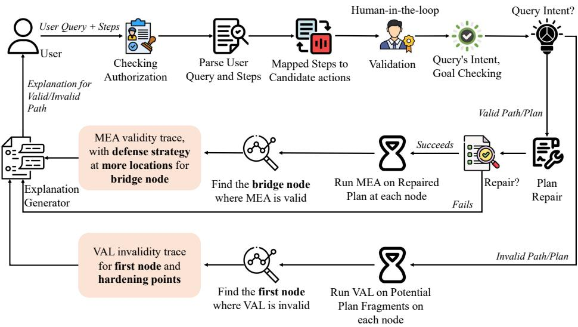
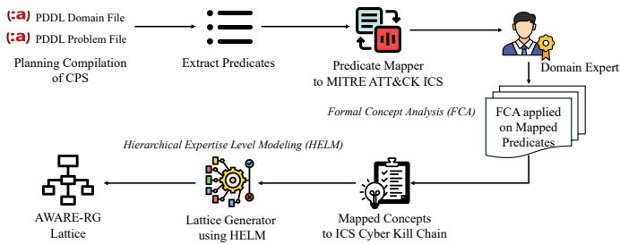
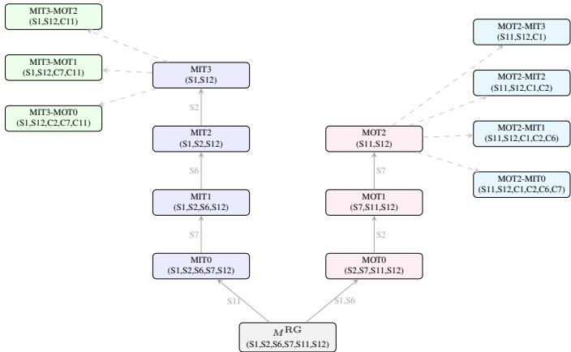
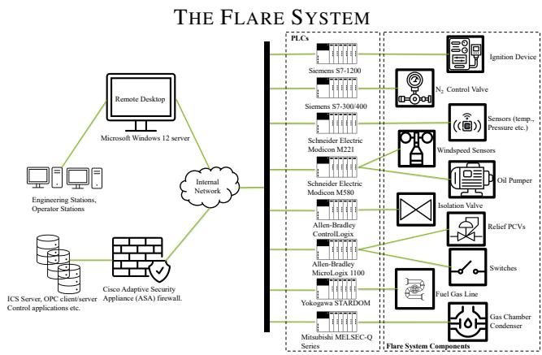

# AWARE-RG: Abstraction Aware Explanation of Resiliency Graphs for Cyber Physical Systems

Shadaab Kawnain Bashir, Rakesh Podder, Philip D. Hopkins, Sarath Sreedharan, Indrakshi Ray, and Indrajit Ray

Computer Science Department, Colorado State University, Fort Collins, Colorado, USA

{shadaab.bashir, rakesh.podder, philip.hopkins, sarath.sreedharan, indrakshi.ray, indrajit.ray}@colostate.edu

Abstract—Understanding the security posture of cyber physical systems (CPS) requires reasoning across both information technology (IT) and operational technology (OT). However, a security analyst often holds an incomplete, role-specific view of the underlying system which has most likely resulted from their knowledge limited by a need-to-know framework. Such an incomplete view can potentially lead them to incorrectly assess if a cyber attack produces an untoward physical consequence resulting in making uninformed decisions about system resilience. In this work, we present AWARE-RG (Abstraction Aware Explanation of Resiliency Graphs), a semi-automated, human-in-the-loop framework that provides an analyst with a role-bounded, need-to-know explanations of resiliency paths in a CPS. The AWARE-RG abstraction structure is derived using Formal Concept Analysis over MITRE ATT&CK for ICS tactics, ordered by the ICS Cyber Kill Chain. For valid attack-fault queries, plan repair and backward means-end analysis identify the missing dependencies, explain why the physical hazard is reachable, and suggest defensive strategies. For invalid attackfault queries, AWARE-RG localizes the first abstraction level at which the path fails, and reports confirmed blocking conditions as hardening pointers.

Index Terms—cyber physical system, security, explainability, need-to-know

## I. INTRODUCTION

Cyber Physical Systems (CPS), which form the backbone of many critical infrastructures, tightly couple digital control with operational technology (OT) with other information technology (IT) systems. The attack surface of a CPS spans IT and OT assets and their dependencies. A compromise in an enterprise IT network can propagate through OT, disrupt programmable logic controllers (PLCs), and ultimately trigger physical hazards [1]–[3], potentially causing serious damage. Managing this attack surface requires collaborative and coordinated reasoning among multiple stakeholders, which includes IT and OT security analysts, engineers, plant managers, and incident responders, with every stakeholder holding a specialized but incomplete view of the system. These incomplete views are often unavoidable owing to need-to-know and separation of duty principles in place in corporate structures and as reflected in standards such as IEC 62443 [4] and NIST SP 800-82 [5]. Thus, the analysts develop a mental model of the system that can diverge from the actual CPS behavior.

Such incomplete visibility into CPS security can result in erroneous decisions. An analyst might have a mental model of an attack scenario (referred to as an attack path) succeeding when in reality it does not, or vice versa, misallocating defensive resources toward an unknown threat. Alternatively, an analyst who does not understand why a path fails cannot reliably maintain the conditions required to block the propagation of an attack. If these knowledge gaps are left unaddressed, they can weaken even well resourced security measures. Security analysts need to understand how an attack succeeds or why it fails, but that understanding must be calibrated to their knowledge level and bounded by their organizational role. Existing frameworks on CPS security analysis, such as those in [6]–[9], fail to address this problem.

In this work, we present AWARE-RG (Abstraction Aware Explanation of Resiliency Graphs), a semi-automated framework that balances two competing needs: providing IT and OT analysts with sufficient cross-domain information to correct gaps in their understanding, while limiting that information to what is necessary and authorized under the need-to-know principle. AWARE-RG adopts the Resiliency Graph (RG) framework of Bashir et al. [6], which uses AI planning to integrate attack graphs from the IT side of a CPS with fault trees from the OT side, associating vulnerabilities with system failures so that operators can evaluate and manage system resiliency. We chose RG for two reasons: (i) it models crossdomain dependencies between IT vulnerabilities and OT safety deterministically, which is our problem space, and (ii) AI planning aligns well with the causal formalism of human reasoning, which we use to generate human understandable explanations. Since an RG captures the complete IT and OT security knowledge, sharing the full model with every analyst would violate need-to-know constraints. AWARE-RG therefore provides each analyst with an explainable abstraction of the RG that is appropriate to their authorized role and expertise.

AWARE-RG builds on the Hierarchical Expertise-Level Modeling (HELM) paradigm [10], which organizes domain knowledge into a lattice of abstractions representing different levels of expertise. For a real-world CPS, the lattice generated by HELM is very large; we reduce it by grouping related attack indicators and impact conditions into semantically coherent clusters using Formal Concept Analysis (FCA) [11] guided by MITRE ATT&CK for ICS tactics [12], and ordering those clusters by the ICS Cyber Kill Chain [13] to reflect attack progression. The resulting smaller lattice preserves RG’s semantics and supports expertise relevant explanations.

Our key contributions are as follows: (i) We propose

AWARE-RG, a semi-automated framework that augments RG with security analyst knowledge aware explanation. (ii) We introduce a systematic way to create an abstraction lattice, which we term as AWARE-RG lattice for CPS attack-fault path reasoning using MITRE ATT&CK for ICS and the ICS Cyber Kill Chain, capturing stages of adversarial behavior propagation. (iii) We demonstrate how the AWARE-RG lattice can be used in CPS security, localizing the abstraction boundary at which an analyst’s mental model diverges from the actual system behavior. (iv) Implement AWARE-RG as a humanin-the-loop pipeline operating on planning compilations, and instantiate it on an LNG flare system CPS. (v) Finally, evaluate AWARE-RG using case studies over an industrial scenario.

The rest of the paper is organized as follows: §II summarizes relevant literature; §III provides the background of the study; §IV gives an overview of AWARE-RG, defines the threat model, and provides a running example of a CPS that is used to explain the rest of our work; §V describes the AWARE-RG lattice construction; §VI describes the rest of the steps in the AWARE-RG pipeline; §VII evaluates our framework. Finally, §VIII concludes the paper.

## II. RELATED WORK

Attack graphs have been used to model how an attacker can chain vulnerabilities and privilege gains to compromise a system, for defense prioritization, and security analysis [14]– [19]. These approaches assume that the analysts posing the queries are allowed to get the complete picture of the attack. In complex CPS, this assumption does not hold. In practice, roles are given information on a need-to-know basis. Provenance graphs have been used in cybersecurity to explain why an outcome is chosen and to support the evidence behind it [20], [21]. Provenance graphs mainly provide answer to the question about why a prediction is made rather than explaining why a user proposed attack scenario fails across domains.

Planning based methodologies have been used to generate attack strategies and perform “what-if” analysis, while contrastive approaches explain why a planner chose one course of action over a user’s alternative. Katz et al. justify planned actions through causal chains with a Graphical user interface (GUI) to limit explanation overload [22]. Miller compiles user foils into model restrictions and highlights plan differences [23], Kim et al. mine contrastive linear temporal logic (LTL) specifications distinguishing two sets of plan traces [24] and Sukkerd et al.’s give verbal tradeoff explanations for multiobjective probabilistic planning [25]. In parallel, XAI work in CPS explains machine learning anomaly and intrusion detectors in terms of input features [26]–[29], and Hoenig et al. survey the resulting challenges around context and user tailored explanation [30]. These lines of work explain a model’s own output, i.e., a planner’s choice or a detector’s prediction, rather than debugging an analyst’s proposed attack scenario. None localizes where an analyst’s mental model diverges from the actual system, and none bounds disclosure by organizational role, which is the gap AWARE-RG addresses.

## III. BACKGROUND

Resiliency Graph (RG) models how cyber attacks and system failures interact in a CPS [6]. An RG is a directed graph $R G ~ = ~ \langle N , E _ { A } , E _ { F } \rangle$ , where $\textit { N } = \textit { H } \times \mathrm { ~ 2 ~ } ^ { \mathrm { \mathbb { P } } }$ is the set of nodes, with H the set of hosts and P the set of propositional host attributes; each node $n = \left( h , \mu \right)$ represents a host h together with its current attribute state $\mu \subseteq \mathbb { P }$ $E _ { A } \subseteq N \times N$ is the set of attack edges, each representing a potential attack step, and $E _ { F } \subseteq N \times N$ is the set of fault edges, each representing a potential fault propagation step. An edge $e = ( n _ { i } , n _ { j } ) \in E _ { A } \cup E _ { F }$ with $n _ { i } ~ = ~ ( h _ { i } , \mu _ { i } )$ and $n _ { j } = ( h _ { j } , \mu _ { j } )$ is enabled only if its preconditions hold at the source, p $r e ( e ) \subseteq \mu _ { i }$ , and its postconditions hold at the target, $y o s t ^ { + } ( e ) \subseteq \mu _ { j }$ and $\mu _ { j } \cap p o s t ^ { - } ( e ) = \emptyset$

Classical Planning A classical planning model is a tuple $M =$ $\langle F , A , I , G \rangle$ , where F is a set of propositional fluents, A a set of actions, $I \subseteq F$ is the initial state, and $G \subseteq F$ is the goal. A state is a set $s \subseteq F$ of fluents that hold. Each action $a \in A$ is a triple $\begin{array} { r } { a = \langle { p r e ( a ) , a d d ( a ) , d e l ( a ) } \rangle } \end{array}$ ⟩, applicable in state s if $p r e ( a ) \subseteq s ,$ , yielding $s ^ { \prime } = ( s \setminus d e l ( a ) ) \cup a d d ( a )$ . A plan is a sequence $\pi = \langle a _ { 1 } , \ldots , a _ { k } \rangle$ ; we write $V a l i d ( M , \pi ) = \top$ and call π valid in M if each a is applicable in the state resulting from $\langle a _ { 1 } , \ldots , a _ { i - 1 } \rangle$ applied to I, and the final state satisfies $G \subseteq s _ { k } .$ . Unless stated otherwise, predicate refers throughout to a grounded predicate, that is, a fluent obtained by binding a predicate schema’s variables to domain objects. Since every action carries explicit preconditions and effects, planning traces identify precisely where a proposed action sequence succeeds or fails, making the formalism suited to machine checkable validation and need-to-know explanation. Projection Abstraction Given a planning model $\begin{array} { r l } { M } & { { } = } \end{array}$ $\langle F , A , I , G \rangle$ and a fluent set $P \subseteq F .$ , the projection of M with respect to P is $f _ { P } ( M ) = \langle F \setminus P , A | _ { P } , I \setminus P , G \setminus P \rangle$ where $A | _ { P }$ contains, for each $a \in A .$ , the action $\langle p r e ( a ) \rangle$ $P , \ a d d ( a ) \setminus P , \ d e l ( a ) \setminus P \rangle$ . Projection induces the state abstraction $\alpha _ { P } ( s ) = s \setminus P$ , mapping each transition $\langle s _ { 1 } , a , s _ { 2 } \rangle$ to $\langle \alpha _ { P } ( s _ { 1 } ) , a , \alpha _ { P } ( s _ { 2 } ) \rangle$ , following Sreedharan et al. [10].

Hierarchical Expertise-Level Modeling (HELM) generates user specific explanations for individuals with varying levels of domain understanding [10]. It represents the user’s knowledge as an abstraction of the explainer’s complete domain model and organizes candidate abstractions into a model lattice. A foil is the scenario the user believes will produce a particular outcome. Given a foil, HELM identifies the user’s mental model as the most abstract model in which the foil still appears valid, then generates a minimal explanation as the smallest set of concretizations required to invalidate the foil.

## IV. AWARE-RG OVERVIEW AND SECURITY MODEL

This section introduces AWARE-RG, followed by the threat model and the running example used throughout the paper.

## A. Overview of AWARE-RG

AWARE-RG is an analyst aware security analysis framework for explaining whether a proposed attack-fault path can propagate through a CPS and trigger physical consequences, addressing the problem raised in §I, where IT and OT analysts reason about such paths using incomplete and role specific knowledge. It resolves this problem by validating analyst aware attack-fault paths against the RG’s planning model while enforcing a need-to-know disclosure policy, where each analyst receives only the abstraction of the RG model required to reason about their query, bounded by their authenticated role and authorized abstraction view.

  
Fig. 1: AWARE-RG explanation pipeline with guided abstraction search.

AWARE-RG achieves this by organizing the CPS’s RG into IT and OT analysts’ partial views as a lattice structure, called the AWARE-RG lattice (§V), created by grouping RG’s predicates into MITRE ICS ATT&CK tactic clusters and determining an analyst’s position in this lattice from their queries. The analyst submits a natural language query describing an expected attack-fault path, along with why they believe it does or does not lead to physical consequences. AWARE-RG translates the provided steps into grounded actions using the planning compilation of RG and infers the query intent, that is, whether the analyst asks why an attack-fault path exists or why it does not. Existence queries are handled by Path Validity Analysis (§VI), which repairs incomplete paths and applies backward MEA to identify the bridge node containing sufficient information to explain why the hazard occurs; the repaired conditions later form the sole basis for the defensive measures suggested to the analyst. Non-existence queries are handled by Path Invalidity Analysis (§VI), which localizes the first abstraction node at which the path fails and extracts the unsatisfied preconditions as hardening pointers, which ground the recommendations returned to the analyst. The Explanation Generator (§VI) converts the resulting traces into need-to-know explanations, confining every claim to the predicates visible at the analyst’s authorized view. AWARE-RG thereby supports security decision making by validating analyst assumptions, localizing incomplete attack-path reasoning, identifying resilience boundaries, and producing defensive guidance without exposing the complete RG. Figure 1 illustrates the pipeline, which is described in detail in §VI. Domain experts construct the RG, validate tactic assignments, define need-to-know boundaries, and review step mappings, after which attack-fault path analysis and explanation generation run automatically.

## B. Threat Model

System and trust assumptions AWARE-RG is deployed as a cross-domain security analysis tool in a CPS roughly following the layered Purdue Reference Architecture [31], where layer specific experts, such as IT and OT analysts, submit queries to reason about attack-fault paths and receive explanations. We assume RG is a trusted AI-planning based model of the CPS built from known assets, configurations, dependencies, and vulnerabilities. The threat model focuses on an authorized but malicious analyst who queries AWARE-RG to obtain information beyond their need-to-know boundary.

Adversary model We consider an adaptive adversary with a view of the CPS commensurate with some Purdue layer, who knows the AWARE-RG architecture (Kerckhoffs’s principle [32], [33]) but not the content of the AWARE-RG lattice, and who interacts only through the query interface, issuing an adaptively chosen sequence of queries and observing all returned outputs. We consider three types of attacks.

Semantic mapping attack (T1): The adversary crafts a query whose steps are syntactically valid but semantically incorrect, causing the mapper to ground incorrect actions and producing an explanation that misdirects the expert’s defensive response.

Repair probing attack (T ): By submitting deliberately incomplete queries and observing which missing actions are returned, the adversary attempts to reconstruct the hidden RG model’s dependency structure, a confidentiality threat.

Explanation inference attack $( T _ { 3 } ) \colon$ By comparing which predicates appear in validity traces, repair reports, and hardening pointers across queries, the adversary determines the predicate level abstraction boundaries of other Purdue layer experts, identifying which attack stages will not be flagged at adjacent layers. Information disclosure via side channel analysis is outside the scope of this work.

## C. Running Example

We use the LNG at GL1/Z-SONATRACH, Algeria [34], [35], comprising tank, cold, and hot flare systems, whose procedures are automated by several PLCs to ensure the flare runs effectively, safely, and in accordance with standards. A Cisco Adaptive Security Appliance firewall and a Microsoft Windows Server connect these PLCs to the remote desktop. An attacker can reach the internal network either by exploiting the firewall (CVE-2018-0296) or via remote code execution vulnerabilities on the Windows Server (CVE-2019-0575, CVE-2019-0584, CVE-2019-0538), from which OT safety events can be triggered. The schematic and the vulnerabilities linked to each PLC are given in Figure 4 and Table XI, Appendix B.

We recreate the flare system’s RG model from the artifacts1 of [6], capturing the cross-layer dependencies between IT and OT, and compile it into a classical planning model.

## V. AWARE-RG LATTICE FOR RESILIENCY GRAPHS

In CPS security, separation-of-duty and need-to-know principles give IT and OT personnel partitioned views of the same system. AWARE-RG represents each analyst’s knowledge as a partial view ordered by detail level, so that a query can be evaluated at the knowledge level the analyst actually holds and explanations can be generated without disclosing unauthorized information. HELM provides this representation: each node is an admissible projection of $M ^ { R \dot { G } }$ retaining a subset of concepts, and the ordering between nodes captures how knowledge states relate across the IT/OT boundary.

  
Fig. 2: An overview of the Lattice creation pipeline.

We adapt HELM with three security modifications, shown in Figure 2. We use FCA over MITRE ATT&CK for ICS tactic assignments to derive security oriented knowledge units, then order them by ICS Cyber Kill Chain stage to preserve the causal progression of cross-domain attack-fault paths. The resulting nodes remain admissible projections of $M ^ { \hat { R } G }$ ; whose soundness is formalized in Lemma 1.

RG represents cyber attacks and physical faults as a planning model [6], from which we define path status:

Definition 1. Let $M ^ { R G } = \langle { F ^ { R G } , A ^ { R G } , I ^ { R G } , G ^ { R G } } \rangle$ be the planning compilation of an RG and $\Pi \ = \ \langle a _ { 1 } , \ldots , a _ { k } \rangle$ a grounded action sequence representing an analyst’s proposed attack-fault path. Π is valid in $M ^ { R G }$ if $V a l i d ( \bar { M } ^ { R G } , \bar { \Pi } ) \bar { = } \top$ Π is repairable in $M ^ { R G }$ if it is not valid but there exists a sequence Π′, obtained from Π by inserting actions, with $V a l i d ( M ^ { R G } , \Pi ^ { \prime } ) = \top ;$ the preconditions established by the inserted actions constitute the analyst’s missing knowledge. Π is blocked in $M ^ { R G }$ if no such $\Pi ^ { \prime }$ exists; the unsatisfied preconditions of the earliest failing action are the blocking conditions and serve as hardening pointers.

AWARE-RG represents analyst knowledge levels via the projection based abstraction of HELM [10], restated below.

Definition 2. For a planning model $\textit { M } \ = \ \langle F , A , I , G \rangle$ with a corresponding transition system T, a model $M ^ { \prime } =$ $\langle F ^ { \prime } , A ^ { \prime } , I ^ { \prime } , G ^ { \prime } \rangle$ with a transition system $\tau ^ { \prime }$ is considered an abstraction of M, if there exists a propositions set $P ,$ such that $F ^ { \prime } = F \setminus P , I ^ { \prime } = I \setminus P , G ^ { \prime } = G \setminus P$ and for every transition $s _ { 1 } \stackrel { a } { \to } s _ { 2 }$ in $\tau$ corresponding to an action a, there exists an equivalent transition $( s _ { 1 } \setminus P ) \stackrel { a } { \to } ( s _ { 2 } \setminus P )$ in $\mathcal { T } ^ { \prime } .$

Abstraction induces a partial order over models: $M _ { 1 } \preceq M _ { 2 }$ iff $M _ { 2 } ~ = ~ f _ { P } ( M _ { 1 } )$ for some $P \subseteq F { \mathrm { ; } }$ models higher in the order are more abstract. In AWARE-RG, fluents are not projected out individually but in semantically coherent groups. Given a partition $\boldsymbol { \mathcal { K } } ~ = ~ \{ K _ { 1 } , \ldots , K _ { m } \}$ of $F ,$ a projection $f _ { Q } ,$ $\mathcal { M } \ = \ \{ f _ { Q } ( M ) \ | \ Q$ is a union of blocks of $\kappa \}$ denote the set of all admissible projections of M. The admissible projections, ordered by $\preceq ,$ form a bounded below partial order $\langle { \mathcal { M } } , \preceq \rangle$ with M as its unique most concrete element (since $f _ { \varnothing } ( M ) \ = \ M ) \colon$ ; we refer to this structure as an abstraction structure. The inverse of projection is concretization: for an abstract model $M ^ { \prime } \in \mathcal { M }$ and $Q \subseteq P ,$ the concretization $f _ { Q } ^ { - 1 } ( M ^ { \prime } )$ satisfies $f _ { Q } ( f _ { Q } ^ { - 1 } ( M ^ { \prime } ) ) ~ = ~ M ^ { \prime }$ , refining $M ^ { \prime }$ by reintroducing the fluents in $Q .$

In AWARE-RG, Definition 2 is instantiated with $M \ =$ $M ^ { R G } \ = \ \langle F ^ { R G } , A ^ { R G } , I ^ { R G } , G ^ { R G } \rangle$ ; all abstraction chain arguments in $\ S \mathrm { V - V I }$ refer to this instantiation. We reiterate the following lemma from Sreedharan et al. [10].

Lemma 1 (Abstraction soundness). Let $M = \langle F , A , I , G \rangle$ be a planning model and $P \subseteq F .$ . Every plan π valid in M is valid in $f _ { P } ( M )$

Proposition 1 (Failure monotonicity). If Π is invalid in $f _ { P } ( M )$ , then Π is invalid in M and in every $f _ { Q } ( M )$ with $Q \subseteq P .$ . Hence, along any chain ordered from most abstract to most concrete, the set of nodes at which Π is invalid is downward closed and the first invalid node is well-defined.

By contraposition of Lemma 1, validity in $f _ { Q } ( M )$ with $Q \subseteq P$ would imply validity in $f _ { P } ( M )$ , since $f _ { P } ( M ) =$ $f _ { P \backslash Q } ( f _ { Q } ( M ) )$ is a projection of $f _ { Q } ( M )$

Predicate Mapper associates each predicate in the fluent set

TABLE I: Predicate mappings and FCA knowledge units in the running example. Predicates with identical tactic assignments belong to the same knowledge unit.
<table><tr><td>Predicate</td><td>Tactic</td><td>Unit</td></tr><tr><td> $\mathsf { c o m p r o m i s e d - c u s t o m e r - p c }$ </td><td>Initial Access</td><td> $K _ { 1 }$ </td></tr><tr><td> $\mathtt { a c c e s s - t o - w i n d o w s - s e r v e r }$ </td><td>Lateral Movement</td><td> $K _ { 2 }$ </td></tr><tr><td> $\mathtt { v u l - C V E - } 2 0 1 9 - 0 5 7 5$ </td><td>Execution</td><td> $K _ { 3 }$ </td></tr><tr><td> $\mathtt { v u l - C V E - } 2 0 1 9 - 0 5 8 4$ </td><td>Execution</td><td> $K _ { 3 }$ </td></tr></table>

$F ^ { R G }$ with MITRE ATT&CK for ICS tactics, giving each predicate a security interpretation from which subsequent stages derive attack progression oriented knowledge units. Given a concise natural language summary of the CPS operational context covering asset inventory, network topology, and the cyber-to-physical fault propagation, the predicate set $P \subseteq F ^ { R { \dot { G } } }$ , and the fixed tactic set T, an LLM produces a tactic assignment $\tau : P \to 2 ^ { \mathbb { T } }$ , mapping each predicate to a tactic with justification. Predicates sharing a tactic assignment are grouped into a single knowledge unit. Rather than consuming a single LLM pass, the domain expert samples multiple outputs and selects the assignment that best reflects each predicate’s causal role in the attack-fault chain rather than its syntactic similarity to a tactic name, preventing a hallucinated assignment from placing a knowledge unit at the wrong propagation stage. Table I shows the mappings for the running example.

Formal Concept Analysis (FCA) groups the mapped predicates into coherent knowledge units. For AWARE-RG, FCA operates over a formal context $\kappa ~ = ~ ( P , \mathbb { T } , \varphi )$ , where the predicate set $P \subseteq F ^ { R G }$ is the set of objects, the tactic set T the set of attributes, and the incidence relation $\varphi \subseteq P \times \mathbb { T }$ is defined by $( p , t ) \in \varphi { \mathrm { ~ i f f ~ } } t \in \tau ( p )$ . Predicates sharing the same tactic assignment form a single knowledge unit and are revealed or removed together as the abstraction structure transitions between levels. This reflects how analyst knowledge is organized in practice: an IT analyst’s boundary is better represented by whether they understand the Lateral Movement stage than by whether they know each CVE predicate within it, so knowledge units capture analyst knowledge at the level of attack propagation concepts rather than isolated predicates.

These knowledge units define the partition $\begin{array} { r l } { \kappa } & { { } = } \end{array}$ $\{ K _ { 1 } , \ldots , K _ { m } \}$ of $\bar { \boldsymbol { F } } ^ { R G }$ : each block $K _ { i }$ is the set of predicates sharing a common tactic assignment, and all admissible projections in the AWARE-RG abstraction structure remove unions of these blocks. Hence no abstraction node can expose a semantically incoherent predicate set, such as a state in which one CVE’s exploitability is visible while another CVE serving the same role in attack propagation is removed. In Table I, vul-CVE-2019-0575 and vul-CVE-2019-0584 share Execution as their tactic, forming knowledge unit $K _ { 3 } ,$ , and are revealed or removed together at every abstraction.

ICS Cyber Kill Chain Mapper organizes FCA derived knowledge units according to the progression of attacks from IT to OT. Stage 1 covers IT activities such as intrusion, lateral movement, and ICS attack preparation; Stage 2 covers OT activities such as ICS execution, process control impairment, and physical consequence, aligning the causal structure of crossdomain attacks with the organizational knowledge boundaries.

TABLE II: Two stage mapping of MITRE ATT&CK for ICS tactics to the ICS Cyber Kill Chain. Rows marked ⋆ are instantiated in the running example. SEDE: Sustainment, Entrenchment, Development & Execution.
<table><tr><td>Stage</td><td>MITRE ATT&amp;CK for ICS Tactic</td><td>ICS Cyber Kill Chain Stage</td><td></td><td>Order Ex.</td></tr><tr><td rowspan="6">(II) S</td><td>Initial Access</td><td>Cyber Intrusion</td><td> $S _ { 1 }$ </td><td>★</td></tr><tr><td>Execution</td><td>Cyber Intrusion</td><td>S2</td><td>★</td></tr><tr><td>Persistence</td><td>SEDE</td><td>S3</td><td></td></tr><tr><td>Privilege Escalation</td><td>SEDE</td><td>S₄</td><td></td></tr><tr><td>Command and Control</td><td>Management &amp; Enablement</td><td>S5</td><td></td></tr><tr><td>Discovery Lateral Movement</td><td>SEDE SEDE</td><td>S6</td><td>★ ★</td></tr><tr><td rowspan="4">Collection</td><td></td><td>SEDE</td><td>S7</td><td></td></tr><tr><td>Evasion</td><td>SEDE</td><td>S8</td><td></td></tr><tr><td></td><td></td><td> $S _ { 9 }$ </td><td></td></tr><tr><td>Execution</td><td>ICS Attack</td><td> $S _ { 2 }$ </td><td>★</td></tr><tr><td>(OT)</td><td>Lateral Movement</td><td>ICS Attack</td><td> $S _ { 7 }$ </td><td>★</td></tr><tr><td rowspan="2">S2</td><td>Inhibit Response Function ICS Attack</td><td></td><td> $S _ { 1 0 }$ </td><td></td></tr><tr><td>Impair Process Control</td><td>ICS Attack</td><td> $S _ { 1 1 }$ </td><td>★</td></tr><tr><td></td><td>Impact</td><td>Physical / Operational Consequence</td><td> $S _ { 1 2 }$ </td><td>★</td></tr></table>

Table II provides the mapping of MITRE ATT&CK for ICS tactics to ICS Cyber Kill Chain stages ordered $S _ { 1 }$ to $S _ { 1 2 }$ . Each knowledge unit $K _ { i } \in \mathcal K$ is assigned a stage index $S _ { i } ,$ , inducing a total order over K that governs which blocks are removed first as abstraction increases. It produces two base nodes: an IT base node retaining Stage 1 concepts and an OT base node retaining Stage 2 concepts, which serve as the roots of the two lattice branches. As abstraction increases, the IT branch removes knowledge units in reverse kill chain order, while the OT branch removes the earliest stages first, so that every node preserves the causal progression of the attack-fault path.

Lattice Generator organizes the ICS Cyber Kill Chain knowledge units into the AWARE-RG lattice using HELM. Each node corresponds to an admissible projection $f _ { Q } ( M ^ { R G } )$ , where Q is a union of blocks from K ordered by the stage indices $S _ { i }$ , and nodes are ordered by the abstraction relation $M _ { 1 } \preceq M _ { 2 }$ where $M _ { 2 } = f _ { P } ( M _ { 1 } )$ for some P. By Lemma 1, every plan valid in $M ^ { R G }$ remains valid in each abstracted node, so plan validity is preserved throughout the lattice by construction. We denote the resulting structure as the AWARE-RG lattice $\mathbb { L } = \langle \mathcal { M } , \preceq \rangle$ , where $\mathcal { M } = \{ f _ { Q } ( M )$ Q is a union of blocks of K}.

IT and OT Branches From the base nodes, the generator constructs each branch by progressively projecting out knowledge units: the IT branch produces $\mathbf { M I T _ { 0 } { - } M I T _ { 3 } }$ by removing $S _ { 7 }$ through $S _ { 1 }$ , and the OT branch produces $\mathbf { M O T } _ { 0 } \mathrm { { - } M O T } _ { 2 }$ by removing $S _ { 1 1 }$ through $S _ { 7 }$ . The impact concept $S _ { 1 2 }$ is retained at every node, grounding each need-to-know explanation in the physical hazard associated with the analyst’s query. An authorized view $V \in \{ \mathrm { I T } , \mathrm { O T } \}$ , determined at authentication, restricts each analyst to one branch and its corresponding bridge nodes. Figure 3 shows the resulting structure.

Bridge Nodes extend a primary branch node with the minimum high-level concept from the opposite domain required to support cross-domain need-to-know explanation, using the

  
Fig. 3: AWARE-RG lattice for the running example, showing both branches and two representative bridge families; the rest follow by the same construction. Edge labels show which knowledge unit was removed. $S$ concepts denote low-level system knowledge, C concepts the corresponding high-level abstractions used in bridge nodes.

$S _ { i } \mapsto C _ { i }$ mapping in Table XII Appendix C. For example, MI $\mathrm { T _ { 3 } { \cdot } M O T _ { 2 } }$ retains Initial Access $( S _ { 1 } )$ and Impact $( S _ { 1 2 } )$ from $\mathrm { M I T _ { 3 } }$ and adds only $C _ { 1 1 }$ , has\_impair\_process\_contr ol. The IT analyst thus learns that the attack impairs process control leads to a physical consequence, without seeing the $S _ { 1 1 }$ fault propagation predicates, such as valve states, that lie outside their authorized view. Bridge nodes are indexed by analyst position; positions whose minimum disclosure coincides map to the same underlying model.

Property 1 (Bridge Node Minimum Disclosure). For an IT node $M I T _ { k }$ and OT node $M O T _ { j }$ : Pred $\left( M I T _ { k } – M O T _ { j } \right) \ =$ $P r e d ( M I T _ { k } ) \cup \{ C _ { i } | S _ { i } \in P r e d ( M O T _ { j } ) \setminus P r e d ( M I T _ { k } ) \}$ and $P r e d ( M O T _ { k } { \cdot } M I T _ { j } ) ~ = ~ P r e d ( M O T _ { k } ) \cup \{ C _ { i } ~ | ~ S _ { i } ~ \in ~$ $P r e d ( M I T _ { j } ) \setminus P r e d ( M O T _ { k } ) \}$ . In particular, no $S _ { i }$ predicate from the opposite domain appears in any bridge node, and no $C _ { i }$ is disclosed for a stage the analyst already sees at $S _ { i }$

Proof Sketch. For each stage $S _ { i }$ visible in the opposite branch node but not in the primary node, the bridge node generator adds only the abstraction predicate $C _ { i }$ from Table XII $( \mathsf { A p - }$ pendix C) to the primary node’s predicate set. Since no rule introduces an opposite domain $S _ { i }$ predicate, none can appear; and since the set difference excludes stages the analyst already holds at the $S _ { i }$ level, no $C _ { i }$ is added for such a stage. □

Property 1 enforces need-to-know and separation-of-duty structurally in the bridge nodes: no opposite domain $S _ { i }$ predicate can appear in any bridge node, and each node carries only the $C _ { i }$ concepts corresponding to stages visible in the opposite branch, giving sufficient cross-domain context without excess disclosure. Multiple bridge nodes are required because the minimum disclosure depends on the analyst’s position in the primary branch: in Figure 3, $\mathbf { M O T _ { 2 } } \mathbf { - M I T _ { 3 } }$ and $\mathbf { M O T _ { 2 } } \mathbf { - M I T _ { 0 } }$ pair the same OT node with different IT summaries. $M ^ { R G }$ itself is used only for the framework’s internal reasoning.

## VI. AWARE-RG APPROACH

The Figure 1 illustrates the overall architecture. Following authentication, the analyst’s IT or OT role determines the accessible branch of the AWARE-RG lattice and the bridge node summaries that provide cross-domain context without exposing $M ^ { R G }$ . The analyst submits a natural language query describing an expected attack-fault path and its anticipated outcome; AWARE-RG parses it, grounds the described steps into actions from $M ^ { R { \hat { G } } }$ , and performs either Path Validity or Path Invalidity Analysis depending on the inferred intent. The resulting traces are transformed into need-to-know explanations, security assessments, and domain bounded defensive guidance, with each component detailed below.

Query and Candidate Action Mapping translates an analyst’s natural language description of an expected attackfault path into a candidate action sequence Π that can be evaluated in $M ^ { R G }$ . An analyst query is represented as $\boldsymbol { Q u e r y } = \langle i n t e n t , g o a l , s e q \rangle$ , where intent indicates whether the analyst is asking why an attack-fault path exists or does not exist, goal $\subseteq ~ { \cal F } ^ { R G }$ is the expected physical outcome, and $\begin{array} { l c l } { s e q } & { = } & { \langle s _ { 1 } , \ldots , s _ { n } \rangle } \end{array}$ is the sequence of natural language descriptions of the proposed path steps. For example, the step “Exploit CVE-2018-0296 on the Windows Server to gain access to the internal network” will be mapped to the grounded action (exploits-cve-2018-0296 windows-server internal-network). Algorithm 1 performs this mapping and verification. For each step $s _ { i }$ , an LLM selects a corresponding action schema from $A ^ { R G }$ and binds its arguments to objects in $F ^ { R G }$ . Structural verification then checks that the action exists, its arity matches the action schema, and all referenced objects are valid in $I ^ { R G }$ . A mapping that fails any of these checks is returned to the analyst for correction; otherwise, the action is appended to Π.

Structural verification prevents malformed actions from entering the analysis pipeline, but it does not guarantee semantic correctness. LLM can still select a structurally valid action associated with the wrong asset or vulnerability, which can produce a misdirected explanation $( T _ { 1 } , \ \ S \mathbf { I V - B } )$ . The current implementation, therefore, requires review by a trusted domain expert, distinct from the querying analyst. Automating semantic consistency checks between the natural language step and the grounded action remains future work discussed in §VIII.

Algorithm 1 Analyst Query Step Mapping and Verification   
Input: Analyst query Query, planning compilation $M ^ { R G }$   
Output: Candidate action sequence Π, or error set Errors   
1: Π ← ⟨⟩; Errors ← ∅   
2: for all si ∈ seq do   
3: ai ← LLM(Query, si, ARG, F RG) ▷ propose action and arguments   
4: agi ← Ground(ai, IRG) ▷ bind variables to objects in $I ^ { R G }$   
5: e ← VerifyStructure(ag, ARG, FRG) ▷ Structural verification   
6: if e ̸= ∅ then   
7: Errors ← Errors ∪ {⟨ag, ei⟩}   
8: else   
9: Π ← Π · ⟨ag⟩   
10: if Errors $\neq \emptyset$ then   
11: return Errors   
12: return Π

Path Validity Analysis determines whether a candidate action sequence Π can trigger the analyst’s expected hazard $g \ : = \ :$ Query.goal in $M ^ { R \breve { G } } .$ . AWARE-RG first checks whether Π is valid in $M ^ { R G } { \mathrm { ; } }$ ; if $V a l i d ( M ^ { R G } , \Pi ) = \top$ , Π is used directly. Otherwise, plan repair insert actions while preserving the order of the analyst provided steps (Definition 1). A successful repair produces $\Pi ^ { \prime }$ such that $V a l i d ( M ^ { R G } , \Pi ^ { \prime } ) = \top \mathrm { { ; } }$ ; the inserted actions and the predicates they establish identify dependencies missing from the analyst’s knowledge from the proposed path. If no repair is found, the analysis returns REPAIRFAILED. Each lattice node $n \in \mathbb { L }$ is an admissible projection $f _ { P } ( M ^ { R G } )$ where P is a union of knowledge units from K. The predicates visible at n are therefore $P r e d ( n ) = F ^ { R G } \setminus P$ . Each node is both a knowledge state and a planning model in which the Valid(n, Π) sequence can be analyzed.

Algorithm 2 Path Validity Analysis   
Input: Candidate sequence Π, analyst query Query = ⟨intent, goal, seq⟩, AWARE-  
RG lattice L, analyst view $\stackrel { \cdot \cdot } { V } ,$ planning model $\mathbf { \Sigma } _ { M } ^ { R G } ,$ maximum repair rounds R   
Output: Validity result VR, MEA trace $T _ { v } ,$ , repair report RR   
1: $V R \gets \langle \rangle ; ~ T _ { v } \gets \langle \rangle ; R R \gets \emptyset$   
2: if $V a l i d \ddot { ( } M ^ { R G } , \Pi ) \stackrel { \cdot \cdot } { = } \top$ then   
3: $\Pi ^ { \prime }  \Pi$   
4: else   
5: (Π′, RR) ← Repair(Π, Query.goal, $M ^ { R G } , R )$   
6: $\mathbf { i } \mathbf { f } \ : \Pi ^ { \prime } = \langle \rangle$ then   
7: return ⟨REPAIRFAILED, T , RR   
8: Chain ← AuthorizedChain(L, $V ) \setminus \{ M ^ { R G } \}$   
9: for all $n _ { i } \in$ Chain in increasing concreteness do   
10: $( v _ { i } , \mathsf { \bar { T } } _ { i } , U _ { i } ) \gets \mathrm { M E A } ( \Pi ^ { \prime } , \mathsf { \bar { Q } } \tau ^ { \prime }$ uery.goal, n ) ▷ backward MEA at $n _ { i }$   
11: $V R \gets V R \cdot \langle n _ { i } , v _ { i } , \dot { U } _ { i } \rangle$   
12: $T _ { v } \gets T _ { v } \cdot \langle n _ { i } , T _ { i } \rangle$   
13: n ← SelectNode(VR, $T _ { v } , \mathbb { L } , V )$ ▷ first authorized node   
14: $V R  \mathrm { P r o j e c t } ( V \dot { R _ { } } , n _ { s e l } )$   
15: $R R \gets \mathrm { P r o j e c t } ( R R , n _ { s e l } )$   
16: $T _ { v } \gets \mathrm { P r o j e c t } ( \dot { T } _ { v } , n _ { s e l } )$   
17: return $\langle V \check { R } , T _ { v } , R R \rangle$

After obtaining a valid or repaired path, AWARE-RG performs backward means-end analysis over the authorized bridge chain, ordered from the most abstract node to the most concrete. MEA regresses from the expected hazard Query.goal and identifies the actions, effects, and preconditions that support it. $M ^ { R G }$ is excluded from explanation node search and used only for validity checking and repair. The selected explanation node $n _ { s e l }$ is the first authorized node containing sufficient grounded preconditions and supporting effects to explain why the hazard is reachable. The $\mathrm { P r o j e c t } ( \cdot , n _ { s e l } )$ steps then filter all returned artifacts to $P r e d ( n _ { s e l } )$ , which leads us to define Property 2 of AWARE-RG.

Property 2 (Symbolic Output Confinement). For every query from a security analyst with view $V ,$ every predicate in the returned explanation, validity trace, repair report, and diagnosis report belongs to $P r e d ( n ^ { * } )$ , where $n ^ { * }$ is the authorized node $n _ { s e l }$ (valid path) or $n _ { f a i l }$ (invalid path).

Proof Sketch. Immediate from the $\mathrm { P r o j e c t } ( \cdot , n ^ { * } )$ filtering steps in Algorithms $2 - 4 .$ , with Property 1, which guarantees $P r e d ( n ^ { * } )$ contains no opposite domain Si predicate. Property 2 concerns the predicate symbols occurring in an output, not the information a natural language sentence conveys. □

Path Invalidity Analysis determines which defensive barriers prevent a security analyst’s proposed attack-fault path from triggering an expected physical fault. Given the candidate action sequence Π and analyst query $Q = \langle i n t e n t , g o a l , s e q \rangle$ AWARE-RG proceeds to diagnose where the path first fails under the analyst’s authorized abstraction view. By Proposition 1, the set of nodes at which Π is invalid is downward closed along the chain, so the first invalid node is marks the abstraction boundary at which the analyst’s mental model diverges from $M ^ { R G }$

Algorithm 3 Path Invalidity Analysis   
Input: Candidate sequence Π, AWARE-RG lattice L, analyst view V, planning compi  
lation $\stackrel { \cdot } { M } ^ { R G }$   
Output: Invalidity trace $T _ { i } ,$ diagnosis trace D   
1: ${ T _ { i }  \langle \rangle } ; { D  \langle \rangle } ; { n _ { f a i l }  \emptyset }$   
2: Chain ← AuthorizedChain(L, $V ) \setminus \{ M ^ { R G } \}$   
3: for all $n _ { i } \in$ Chain in increasing concreteness do   
4: $v _ { i }  V a l i d ( n _ { i } , \Pi )$   
5: $T _ { i } \gets T _ { i } \cdot \langle \dot { n } _ { i } , v _ { i } \rangle$   
6: $\mathbf { i f } \ v _ { i } \neq \ T$ then   
7: $n _ { f a i l }  n _ { i } ;$   
8: break   
9: if $n _ { f a i l } = \emptyset$ then   
10: return $\langle T _ { i } , D \rangle$   
11: $D \gets \mathrm { D i a g n o s e } ( \Pi , n _ { f a i l } )$ ▷ stepwise precondition check at n   
12: $D \gets \mathrm { C o n f i r m } ( \dot { D } , \dot { M } ^ { R G } )$ ▷ retain only predicates unsatisfied in $M ^ { \mathit { \Pi } _ { M } ^ { \mathrm { a } \mathit { \iota } } }$   
13: return $\langle T _ { i } , D \rangle$

The algorithm traverses the analyst authorized chain from most abstract to most concrete, excluding $M ^ { R G }$ from explanation node search. At the first node $n _ { f a i l }$ where $V a l i d ( n _ { f a i l } , \Pi ) \ne \top$ , stepwise diagnosis simulates Π action by action, checking at each step whether all grounded preconditions are satisfied by the current state. The first unsatisfied precondition terminates diagnosis; the failing action, failure $\displaystyle \mathrm { t y p e } ,$ , and missing predicates are recorded as hardening pointers, conditions whose absence currently prevents the attackfault path from propagating and which should be monitored or strengthened to maintain the system’s resilience boundary.

Lemma 2 (Diagnosis soundness). Every hardening pointer returned by Path Invalidity Analysis is a grounded precondition of the earliest failing action that is unsatisfied after executing the applicable prefix of Π in $M ^ { R G }$

Proof Sketch. The Confirm $( D , M ^ { R G } )$ step checks each reported predicate against the $M ^ { R G }$ execution trace and discards any predicate that is unsatisfied only under abstraction, ensuring all returned hardening pointers correspond to genuine blocking conditions in the ground-truth model. □

Need-to-Know Explanation converts the analysis traces produced by AWARE-RG into an explanation for an analyst.

Definition 3. A need-to-know explanation (X) for a security analyst with view V is an explanation grounded exclusively in predicates belonging to $P r e d ( n ^ { * } )$ , where $n ^ { * } \in \mathbb { L }$ is the authorized node and $n ^ { * } ~ = ~ n _ { s e l }$ (valid path), $\begin{array} { r } { n ^ { * } ~ = ~ n _ { f a i l } } \end{array}$ (invalid path). Cross-domain context is provided only through high-level predicates $C _ { i } ,$ and no $S _ { i }$ predicate is disclosed beyond what the analyst’s role authorizes.

Each explanation has three parts: a natural language account of the attack-fault behavior, a security assessment of the implications for the CPS resilience boundary, and a domain bounded defensive directive. Following Definition 3, Algorithm 4 enforces this policy. For existence queries, it grounds the explanation in the MEA trace $T _ { v }$ and repair report RR, whose predicates, absent from the analyst’s proposed path but necessary for propagation, constitute the missing knowledge K and are the sole basis for generated defensive strategies. For non-existence queries, it grounds the explanation in the diagnosis trace $T _ { i }$ and report $D ,$ whose invalidity causing predicates serve as hardening pointers and are the sole basis for hardening recommendations, converting formally grounded invalidity evidence into actionable guidance for maintaining the CPS resilience boundary. The Ground(·) step then removes any claim in X unsupported by $T _ { v } , T _ { i }$ , RR, or $D ,$ eliminating LLM hallucinated content, and $\mathrm { P r o j e c t } ( \mathbb { X } , n ^ { * } )$ confines X to $P r e d ( n ^ { * } )$ , enforcing Property 2.

Algorithm 4 Need-to-Know Explanation Generation   
Input: Analyst query Query = ⟨intent, goal, seq⟩, analyst view $V ,$ explanation   
node n∗ MEA trace $T _ { v } ,$ , repair report RR, invalidity trace $T _ { i } ,$ diagnosis trace D   
Output: Need-to-know explanation X   
1: if Query.intent = EXISTENCE then   
2: K ← Missing(X, RR) ▷ predicates in RR absent from analyst knowledge   
3: H ← Defenses(X, K) ▷ defensive strategies supported by repair predicates   
4: X ← LLM(Query, V, T , H)   
5: else if Query.intent = NONEXISTENCE then   
6: H ← Hardening(X, D) ▷ hardening pointers by invalidity predicates   
7: X ← LLM(Query, V, Ti, H) ▷ generate explanation from diagnosis trace   
8: else   
9: return UNKNOWNINTENT   
10: X ← Ground(X, Tv, Ti, RR, D) ▷ remove unsupported trace claims   
11: X ← Project(X, n∗) ▷ enforce $P r e d ( n ^ { * } )$ confinement   
12: return X

Proposition 2 (Symbolic Disclosure Bound under Adaptive Querying). For an analyst view V with authorized node family $\rho _ { V } ( M ^ { R G } ) ~ \subseteq ~ \mathbb { L }$ and any adaptively chosen query sequence $\sigma ,$ , every predicate symbol returned for σ belongs to $\textstyle \bigcup _ { n \in \rho _ { V } ( M ^ { R G } ) }$ Pred(n). In particular, no opposite-domain $S _ { i }$ predicate is returned, regardless of the number of queries.

Proof Sketch. By Property 2, the outputs of each query lie in $P r e d ( n ^ { * } )$ for an authorized node $n ^ { * }$ , since every artifact passes through Projec $\displaystyle ; ( \cdot , n ^ { * } )$ before it is returned (Algorithms 2– $4 ) .$ . This filtering is independent of query history, so the bound holds for any adaptive sequence, and by Property 1, no authorized node contains an opposite-domain $S _ { i }$ predicate. Side channels and analyst collusion lie outside this bound.

## VII. EVALUATION AND ANALYSIS

We experimentally validate AWARE-RG against four claims that follow from its design and formal properties: (i) Property 1 holds for every bridge node in L, that is, no opposite domain $S _ { i }$ predicate appears in any bridge node; (ii) Property 2 holds across the full query corpus, so no out-of-view predicate symbol occurs in any returned artifact; (iii) AWARE-RG correctly identifies the explanation node and produces a grounded needto-know explanation for valid and invalid attack-fault paths across IT and OT analyst profiles; and (iv) the threat vectors T , T , and $T _ { 3 }$ are mitigated as claimed in §IV-B.

Experiment Setup. All validation uses the LNG flare system of §IV-C, whose planning compilation $M ^ { R G }$ contains 90 predicates, 48 actions, and 10 objects covering compromised assets, network access, PLC vulnerabilities, process faults, and physical hazards. The predicate mapping (§V) produced assignments for all 48 predicates, verified against manually produced ground-truth labels with no corrections required. The resulting lattice L contains four IT branch nodes $\mathrm { ( M I T _ { 0 } - }$ $\mathrm { M I T _ { 3 } ) }$ , three OT branch nodes $( \mathbf { M O T } _ { 0 } \mathrm { - M O T } _ { 2 } )$ , and 24 bridge nodes. AWARE-RG uses Qwen2.5-7B-Instruct for action mapping, intent and goal inference, and explanation generation, under Hugging Face transformers with a 2000- token limit. AI Planning and plan repair use Fast Downward [36], validation uses VAL [37], and query templates are given in Appendix A. The code base is publicly available2.

## A. Structural Verification of AWARE-RG Lattice

Property 1 is formally proven for the lattice construction in §V. We additionally verify it empirically with an automated containment check: for each of the 24 bridge nodes, a script confirms against the stage mappings in Table XII that no IT branch or IT-to-OT bridge node contains an OT $S _ { i }$ predicate, and no OT branch or OT-to-IT bridge node contains an IT $S _ { i }$ predicate. All 24 nodes satisfy the Property 1 without exception. Table III reports representative nodes in both directions.

TABLE III: Verification of Property 1 for bridge nodes.
<table><tr><td>Bridge Node Primary Pred.</td><td></td><td>Added Ci</td><td>Opp. Si? P1</td><td></td></tr><tr><td>MIT3-MOT1</td><td> $\overline { { \{ S _ { 1 } , S _ { 1 2 } \} } }$ </td><td> $\overline { { \{ C _ { 7 } , C _ { 1 1 } \} } }$ </td><td>No</td><td> $\overline { { \checkmark } }$ </td></tr><tr><td> $\mathbf { M I T _ { 3 } { - } M O T _ { 2 } }$ </td><td> $\{ S _ { 1 } , S _ { 1 2 } \}$ </td><td> $\{ C _ { 1 1 } \}$ </td><td>No</td><td>√</td></tr><tr><td> $\mathbf { M I T _ { 2 } } \mathbf { - M O T _ { 1 } }$ </td><td> $\{ S _ { 1 } , S _ { 2 } , S _ { 1 2 } \}$ </td><td> $\{ C _ { 7 } , C _ { 1 1 } \}$ </td><td>No</td><td>√</td></tr><tr><td> $\mathbf { M I T _ { 0 } { - } M O T _ { 2 } }$ </td><td> $\{ S _ { 1 } , S _ { 2 } , S _ { 6 } , S _ { 7 } , S _ { 1 2 } \}$ </td><td> $\{ C _ { 1 1 } \}$ </td><td>No</td><td>√</td></tr><tr><td> $\mathbf { M O T _ { 2 } } \mathbf { - M I T _ { 3 } }$ </td><td> $\{ S _ { 1 1 } , S _ { 1 2 } \}$ </td><td>{C1}</td><td>No</td><td> $\checkmark$ </td></tr><tr><td> $\mathbf { M O T _ { 1 } } \mathbf { - M I T _ { 2 } }$ </td><td> $\{ S _ { 7 } , S _ { 1 1 } , S _ { 1 2 } \}$ </td><td> $\{ C _ { 1 } , C _ { 2 } \}$ </td><td>No</td><td> $\checkmark$ </td></tr><tr><td> $\mathbf { M O T } _ { 0 } – \mathbf { M I T } _ { 1 }$ </td><td> $\{ S _ { 2 } , S _ { 7 } , S _ { 1 1 } , S _ { 1 2 } \}$ </td><td> $\{ C _ { 1 } , C _ { 6 } \}$ </td><td>No</td><td> $\checkmark$ </td></tr><tr><td> $\mathbf { M O T _ { 2 } } \mathbf { - M I T _ { 0 } }$ </td><td> $\{ S _ { 1 1 } , S _ { 1 2 } \}$ </td><td> $\{ C _ { 1 } , C _ { 2 } , C _ { 6 } , C _ { 7 } \}$ </td><td>No</td><td> $\checkmark$ </td></tr><tr><td colspan="4">All 24 bridge nodes verified</td><td> $\checkmark$ </td></tr></table>

To verify Property 2, we ran 100 queries across all IT and OT analyst profiles and scanned every returned artifact, that is, explanations, validity traces, repair reports, and diagnosis reports, for out-of-view symbols. A predicate token counts as leakage if it belongs to an $S _ { i }$ level stage outside the analyst’s authorized view, defined by $P r e d ( n _ { s e l } )$ for valid path explanations and $P r e d ( n _ { f a i l } )$ for invalid path explanations. No out-of-view predicate symbol appeared in any of the 300 artifacts, confirming that Property 2 holds across all query types and analyst profiles shown in Table XIII Appendix D.

## B. Path Validity and Invalidity Analysis

Path validity and invalidity analyses are evaluated using existence and non-existence queries respectively, across IT and OT analyst profiles. For each query we verify: (i) whether the selected explanation node $( n _ { s e l } ~ \mathrm { o r } ~ n _ { f a i l } )$ matches the ground-truth node determined by manual analysis of $M ^ { R G }$ ; (ii) whether every claim in the generated explanation is supported by the backward MEA or diagnosis trace; and (iii) whether defensive outputs are derived strictly from repair predicates (validity) or invalidity causing predicates (invalidity), bounded by the analyst’s authorized abstraction view. We present one walkthrough per analysis type; aggregate results are reported in Table IV. Please note that ground-truth explanation nodes and blocking conditions were established by three experts independently analyzing $M ^ { R G }$ for each query; inter-rater agreement was 100% for node selection and 98% for condition identification, with disagreements resolved by discussion.

Path Validity (IT Analyst). An IT analyst queries: “Why does this attack-fault path lead to flare flameout?”. The proposed path has three steps: exploiting CVE-2018-0296 on the Windows Server, exploiting CVE-2017-9312 on the Allen-Bradley ControlLogix PLC, and triggering flare flameout. This reflects an exploit-centric mental model that captures the direction of attack propagation but overlooks the intermediate access and process conditions required for execution.

AWARE-RG determines the path is repairable (Definition 1) and identifies two conditions absent from the analyst’s knowledge: access to PLC port 1132/TCP, required before the PLC can be exploited, and the compromised PLC state that drives the system toward flameout. Defensive strategies are generated strictly from these repair predicates and bounded by the analyst’s view: allowlist PLC communication and block unauthorized access to port 1132/TCP; and detect, isolate, and recover the compromised PLC state, preventing downstream fault propagation. Backward MEA identifies $\mathbf { M I T _ { 0 } - M O T _ { 0 } }$ as $n _ { s e l } .$ , so the analyst receives IT detail with OT consequences at the $C _ { 1 1 }$ abstraction level only, without the $S _ { 1 1 }$ fault propagation predicates outside their authorized view. Every defensive strategy is derived from repair evidence rather than from action names or the full validated path. Table VIII in Appendix A reports validity results across queries.

Path Invalidity (OT Analyst). An OT analyst asks: “Why does this attack-fault path not lead to flare flameout?” The proposed path begins with exploiting the Windows Server and CVE-2017-9312 on the Allen-Bradley PLC and follows a physical fault chain: blocked valve, closed manual isolation valve, low pilot supply pressure, and pilot extinction. This process centric mental model understands downstream OT fault propagation but assumes the PLC exploit is feasible and the controller remains capable of driving the fault sequence.

AWARE-RG begins invalidity analysis at $\mathbf { M O T } _ { 2 } .$ . By Proposition 1, the path is valid at $\mathbf { M O T } _ { 2 }$ but invalid at $\mathbf { M O T _ { 1 } }$ marking the abstraction boundary at which the analyst’s mental model diverges from $M ^ { R G }$ . The diagnosis trace shows the PLC operational state required for the downstream sequence is unsatisfied after the attempted CVE-2017-9312 exploit, failing at the first step; by Lemma 2 this precondition is confirmed against $M ^ { R { \hat { G } } }$ as a hardening pointer. Bounded by $P r e d ( n _ { f a i l } )$ , the analyst receives recommendations to monitor

PLC availability, detect exploit induced controller unavailabil ity, and isolate affected controllers, all within the OT domain. An analyst reasoning only from the proposed path would harden the fault chain; AWARE-RG shows that the defensive leverage also lies at the cyber-physical boundary, where a PLC unavailability condition, the analyst’s model assumed away, already blocks propagation. Table VII in Appendix A reports further invalidity results.

Aggregate Results. Table IV summarizes all 100 queries. For valid path queries, node selection accuracy is 100% for IT profiles throughout and degrades on OT queries (92% repaired, 92% blocked, 83% wrong CVE), where limited IT visibility makes abstraction boundary localization harder; repair precision and recall show the same asymmetry (0.91/0.88 OT vs. 0.95/0.92 IT). For valid path queries, grounding violations peak at 8% on OT wrong CVE queries, reflecting natural language variation at the IT/OT abstraction boundary. Four boundary predicate disclosures appear across the 150 invalidpath artifacts. These are not violations of Property 2: each lies within $P r e d ( n _ { f a i l } )$ and is surfaced by stepwise diagnosis, and by Lemma 2 every hardening pointer is confirmed against $M ^ { R G }$ . No opposite domain $S _ { i }$ predicate is exposed in any case; they are reported for transparency, not as leakage.

TABLE IV: Path Validity and Invalidity Analysis across 100 queries and IT and OT analyst profiles. Node Acc.: explanation-node selection accuracy against ground truth. Repair P/R: precision and recall of missing condition identification. Diag. Acc.: diagnosis accuracy of blocking conditions. GVR: grounding violation rate. Leak.: out-of-view predicate symbol (lexical). Bnd.: boundary predicates disclosed within $P r e d ( n _ { f a i l } )$ , authorized rather than leaked. –: not applicable.

<table><tr><td>Query Variant Analyst</td><td></td><td>Queries</td><td>Artifacts</td><td>Node Acc.</td><td>Repair P/R</td><td>Diag. Acc.</td><td>GVR</td><td>Leak.</td><td>Bnd.</td></tr><tr><td colspan="10">Path Validity Analysis</td></tr><tr><td>Complete</td><td>IT</td><td>13</td><td>39</td><td>100%</td><td></td><td>一</td><td>0%</td><td>0/39</td><td></td></tr><tr><td>Repaired</td><td>IT</td><td>12</td><td>36</td><td>100%</td><td>0.95/0.92</td><td>一</td><td>3%</td><td>0/36</td><td></td></tr><tr><td>Complete</td><td>OT</td><td>13</td><td>39</td><td>100%</td><td></td><td>一</td><td>0%</td><td>0/39</td><td></td></tr><tr><td>Repaired</td><td>OT</td><td>12</td><td>36</td><td>92%</td><td>0.91/0.88</td><td>一</td><td>5%</td><td>0/36</td><td></td></tr><tr><td colspan="10">Path Invalidity Analysis</td></tr><tr><td>Blocked</td><td>IT</td><td>13</td><td>39</td><td>100%</td><td>一</td><td>100%</td><td>0%</td><td>0/39</td><td>1</td></tr><tr><td>Blocked</td><td>OT</td><td>12</td><td>36</td><td>92%</td><td>一</td><td>92%</td><td>4%</td><td>0/36</td><td>1</td></tr><tr><td>Wrong CVE</td><td>IT</td><td>13</td><td>39</td><td>100%</td><td></td><td>100%</td><td>0%</td><td>0/39</td><td>1</td></tr><tr><td>Wrong CVE</td><td>OT</td><td>12</td><td>36</td><td>83%</td><td></td><td>92%</td><td>8%</td><td>0/36</td><td>1</td></tr><tr><td>Total</td><td>All</td><td>100</td><td>300</td><td>96%</td><td>0.93/0.90</td><td>96%</td><td>3%</td><td>0/300</td><td>4</td></tr></table>

Table V reports the ablation and baseline comparison. The no abstraction baseline exposes all 90 predicates per explanation and leaks in every case, motivating AWARE-RG’s abstraction based disclosure control. Vanilla HELM achieves zero leakage but requires $2 ^ { 9 0 }$ nodes, making lattice search intractable; FCA and ICS Cyber Kill Chain pruning in AWARE-RG reduces this to 31 nodes with negligible change in mean predicate exposure (6.1 vs. 6.3). Disabling bridge nodes leaves 34 of 100 queries without a valid explanation node, confirming that bridge nodes are necessary for crossdomain explanation. These configurations isolate the lattice design’s contribution.

## C. Threat Mitigation Analysis

The three adversarial threat vectors are evaluated across 10 adversarial queries, two per attack strategy, summarized in

TABLE V: Ablation and baseline comparison. Pred. Exposed: mean predicates exposed per explanation. Lattice Nodes: total nodes in the abstraction structure. No Expl. Node: queries with no valid explanation node within the analyst’s branch. Lexical Leakage: out-of-view predicate leakage.
<table><tr><td>Configuration</td><td></td><td></td><td>Pred. Exposed Lattice Nodes No Expl. Node</td><td>Lexical Leakage Rate</td></tr><tr><td>No Abstraction Baseline (MRG)</td><td>90</td><td></td><td>0</td><td>100%</td></tr><tr><td>Vanilla HELM (unpruned)</td><td>6.3</td><td> $2 ^ { 9 0 }$ </td><td>0</td><td>0%</td></tr><tr><td>No Bridge Ablation</td><td>5.1</td><td> $7$ </td><td>34/100</td><td>0%</td></tr><tr><td>AWARE-RG (ours)</td><td>6.1</td><td>31</td><td>0</td><td>0%</td></tr></table>

Table VI. Tables IX and X in Appendix A give the queries submitted by malicious IT and OT analysts with justifications.

$T _ { 1 }$ : Semantic Mapping Attack. We craft an IT existence query asking why an attack-fault path leads to flare flameout, whose second step is deliberately ambiguous at the action boundary: although it describes CVE-2017-9312 behavior on the Allen-Bradley PLC, it is worded as a generic network exploit, creating semantic overlap with exploits-vulne rabi $\mathtt { . i t y - c v e - } 2 0 1 8 - 0 2 9 6$ , which targets the Windows Server. Structural verification passes, and the mapper grounds the step to the Windows Server exploit, producing a structurally valid but semantically incorrect plan. Without humanin-the-loop review, the resulting explanation and defensive guidance would be misdirected toward generic vulnerability management rather than targeted PLC port allowlisting and compromised state isolation. The domain expert identifies the incorrect grounding and rejects it before the explanation is generated. $T _ { 1 }$ is therefore structurally viable, since a semantically incorrect grounding can pass formal checks, but ineffective in practice because semantic correctness is enforced by human review before the explanation stage.

T : Repair Probing. A malicious IT analyst submits deliberately incomplete attack-fault paths, expecting the repair output to disclose the missing precondition chain. AWARE-RG prevents this through the bridge node lattice: explanation search selects an IT-to-OT bridge node at the analyst’s authorized abstraction level, with $M ^ { \bar { R } G }$ excluded from explanation node selection (Algorithm 2), so repair information is limited to authorized boundary predicates such as has-imprope r-vpn-firewall-configuration. The detailed OT dependency chain, including device connectivity, PLC vulnerability conditions, and physical fault propagation steps, remains inaccessible. Across all probing attempts, no $S _ { i }$ level OT predicate appeared in any repair or explanation output, so repeated probing cannot reconstruct the complete dependency chain. $T _ { 2 }$ is mitigated at the symbol level by bridge node selection policy and the minimum disclosure by Property 1.

$T _ { 3 } { \mathrm { : } }$ Explanation Inference. We construct a query pair in which an adversary submits the same query, asking why the path leads to flameout, as both an IT and an OT analyst, then compares outputs to infer predicate level abstraction boundaries in the opposite domain. The IT explanation, grounded in the backward MEA trace at the IT-to-OT bridge node, exposes IT predicates such as has-access-to-plc-port-113 2-tcp with OT context only at $C _ { 1 1 } ;$ no $S _ { 1 1 }$ fault propagation predicates appear. The OT explanation, grounded at the OT-to-IT bridge node, exposes OT process fault predicates such as $\mathtt  h a s \mathrm { - } f a u l t \mathrm { - } v a l v e \mathrm { - } b l o c k e d \mathrm { - } c l o s e \mathrm { - } d u e \mathrm { - } t \mathrm { o - } c \mathrm { o m m }$ promised with IT context only at $C _ { 1 } ;$ no IT side $S _ { i }$ predicates appear. Since the lattice structure, node selection policy, and predicate mappings remain internal to AWARE-RG, the adversary cannot determine whether withheld predicates exist or where layer visibility boundaries lie. By Proposition 2, $T _ { 3 }$ is bounded: the adversary learns the authorized $C _ { i }$ skeleton, which is permitted by disclosure policy.

TABLE VI: Threat mitigation evaluation. Info Leaked: whether any opposite domain $S _ { i }$ predicate appeared in an output returned to the adversary
<table><tr><td>T</td><td>Attack Strategy</td><td>Mitigation</td><td>Effective Info</td><td>Leaked</td></tr><tr><td> $\overline { { T _ { 1 } } }$ </td><td>Ambiguous CVE description</td><td>Human review</td><td>Yes</td><td>No</td></tr><tr><td> $T _ { 1 }$ </td><td>Generic action phrasing</td><td>Human review</td><td>Yes</td><td>No</td></tr><tr><td> $T _ { 2 }$ </td><td>Incomplete IT path probing</td><td>Bridge node policy</td><td>Yes</td><td>No</td></tr><tr><td> $T _ { 2 }$ </td><td>Incomplete OT path probing</td><td>Bridge node policy</td><td>Yes</td><td>No</td></tr><tr><td> $T _ { 3 }$ </td><td>Same query, IT vs. OT output Node selection policy comparison</td><td></td><td>Yes</td><td>No</td></tr></table>

## VIII. CONCLUSION AND FUTURE WORK

We presented AWARE-RG, a semi-automated framework that explains CPS attack-fault paths to IT/OT analysts on a need-to-know basis aligned with their expertise. By explaining at the analyst’s knowledge level, it delivers the minimum information needed without overwhelming them or exceeding their need-to-know principle. To the best of our knowledge, AWARE-RG is the first framework to address this problem through analyst aware abstraction guided explanation. It formally confines returned predicates to the analyst’s authorized abstraction and limits LLM hallucination through expert validated mapping and evidence grounding. Although evaluated on a single CPS using RG, it applies in principle to any planning compilation of CPS model. In the future, we plan to measure semantic leakage in AWARE-RG’s explanations through independent annotation. We will also evaluate the framework across LLMs of different scales, compare it against an LLMonly baseline, and run ablations of its individual components. To test generality, we intend to validate AWARE-RG on a different CPS using held-out queries and external annotators. Finally, we plan to add stateful explanation histories that preserve need-to-know boundaries and to conduct studies with ICS practitioners.

## ACKNOWLEDGMENT

This work is partially supported by the U.S. Office of Naval Research (ONR) under award N000142612041. The views and conclusions expressed are those of the authors and do not necessarily reflect those of ONR or other federal agencies.

## REFERENCES

[1] A. K. Lab, “BlackEnergy APT Attacks in Ukraine,” Available from Kaspersky Resource Center - https://usa.kaspersky.com/resourcecenter/threats/blackenergy, Apr. 2023.

[2] P. Kozak, I. Klaban, and T. Slajs, “Industroyer Cyber-Attacks onˇ Ukraine’s Critical Infrastructure,” in 2023 International Conference on Military Technologies (ICMT), 2023, pp. 1–6.

[3] N. Falliere, Liam O Murchu, and Eric Chen, “W32.Stuxnet Dossier: Version 1.4,” Symantec Corporation, Symantec Security Response, Feb. 2011. [Online]. Available: https://www.wired.com/images blogs/threatl evel/2010/11/w32 stuxnet dossier.pdf

[4] E. M. Marszal and J. McGlone, “ISA/IEC 62443,” 2019.

[5] K. Stouffer, M. Pease, C. Tang, T. Zimmerman, V. Pillitteri, S. Lightman, A. Hahn, S. Saravia, A. Sherule, and M. Thompson, “Guide to Operational Technology (OT) Security,” National Institute of Standards and Technology, NIST Special Publication 800-82r3, 2023. [Online]. Available: https://doi.org/10.6028/NIST.SP.800-82r3

[6] S. K. Bashir, R. Podder, S. Sreedharan, I. Ray, and I. Ray, “Resiliency Graphs: Modelling the Interplay between Cyber Attacks and System Failures through AI Planning,” in 2024 IEEE 6th International Conference on Trust, Privacy and Security in Intelligent Systems, and Applications (TPS-ISA), 2024, pp. 292–302.

[7] A. Akbarzadeh and S. Katsikas, “Unified IT&OT Modeling for Cybersecurity Analysis of Cyber-Physical Systems,” IEEE Open Journal of the Industrial Electronics Society, vol. 3, pp. 318–328, 2022.

[8] M. C. Shilenge and A. Telukdarie, “Optimization of Operational and Information Technology Integration Towards Industry 4.0,” in 2022 IEEE 31st international symposium on industrial electronics (ISIE). IEEE, 2022, pp. 1076–1081.

[9] I. Ray, S. Sreedharan, R. Podder, S. K. Bashir, and I. Ray, “Explainable AI for Prioritizing and Deploying Defenses for Cyber-Physical System Resiliency,” in 2023 5th IEEE International Conference on Trust, Privacy and Security in Intelligent Systems and Applications (TPS-ISA). IEEE, 2023, pp. 184–192.

[10] S. Sreedharan, S. Srivastava, and S. Kambhampati, “Hierarchical Expertise-Level Modeling for User Specific Robot-Behavior Explanations,” arXiv preprint arXiv:1802.06895, 2018.

[11] G. Fu, “FCA based Ontology Development for Data Integration,” Information Processing & Management, vol. 52, no. 5, pp. 765–782, 2016. [Online]. Available: https://www.sciencedirect.com/science/articl e/pii/S030645731630019X

[12] M. ATT&CK, “ICS Matrix,” Available from MITRE ATT&CK - https://attack.mitre.org/matrices/ics/, May 2026.

[13] M. J. Assante and R. M. Lee, “The Industrial Control System Cyber Kill Chain,” SANS Institute InfoSec Reading Room, vol. 1, no. 1, p. 2, 2015.

[14] S. Jha, O. Sheyner, and J. Wing, “Two Formal Analyses of Attack Graphs,” in Proceedings 15th IEEE Computer Security Foundations Workshop. CSFW-15. IEEE, 2002, pp. 49–63.

[15] T. Gonda, T. Pascal, R. Puzis, G. Shani, and B. Shapira, “Analysis of Attack Graph Representations for Ranking Vulnerability Fixes,” in GCAI, 2018, pp. 215–228.

[16] N. Poolsappasit, R. Dewri, and I. Ray, “Dynamic Security Risk Management Using Bayesian Attack Graphs,” IEEE Transactions on Dependable and Secure Computing, vol. 9, no. 1, pp. 61–74, 2012.

[17] R. Podder, T. Caglar, S. K. Bashir, S. Sreedharan, I. Ray, and I. Ray, “SPEAR: Security Posture Evaluation using AI Planner-Reasoning on Attack-Connectivity Hypergraphs,” in Proceedings of the 30th ACM Symposium on Access Control Models and Technologies, ser. SACMAT ’25. New York, NY, USA: Association for Computing Machinery, 2025, p. 62–73.

[18] R. Podder, W. Ganim, S. Sreedharan, I. Ray, and I. Ray, “i-EXAM: Instructable and Explainable Attack Connectivity Graph Modeler,” arXiv preprint arXiv:2607.05888, 2026.

[19] M. R. H. Talukder, R. Podder, and I. Ray, “VKG2AG: Generating Automated Knowledge-Enriched Attack Graph (AG) from Vulnerability Knowledge Graph (VKG).” in SECRYPT, 2025, pp. 420–428.

[20] S. E. Friedman, R. P. Goldman, R. G. Freedman, U. Kuter, C. Geib, and J. Rye, “Provenance-Based Assessment of Plans in Context,” arXiv preprint arXiv:2011.01774, 2020.

[21] W. Wu, W. Qiao, T. Li, Y. Feng, Z. Ma, J. Ma, and Y. Liu, “ProvX: Generating Counterfactual-Driven Attack Explanations for Provenance-Based Detection,” arXiv preprint arXiv:2508.06073, 2025.

[22] G. E. Katz, D. Dullnig, G. P. Davis, R. J. Gentili, and J. A. Reggia, “Autonomous Causally-Driven Explanation of Actions,” in 2017 International Conference on Computational Science and Computational Intelligence (CSCI). IEEE, 2017, pp. 772–778.

[23] T. Miller, “Contrastive Explanation: A Structural-Model Approach,” The Knowledge Engineering Review, vol. 36, p. e14, 2021.

[24] J. Kim, C. Muise, A. J. Shah, S. Agarwal, and J. A. Shah, “Bayesian Inference of Linear Temporal Logic Specifications for Contrastive Explanations.” International Joint Conferences on Artificial Intelligence, 2019.

[25] R. Sukkerd, R. Simmons, and D. Garlan, “Towards Explainable Multi-Objective Probabilistic Planning,” in Proceedings of the 4th International Workshop on Software Engineering for Smart Cyber-Physical Systems, ser. SEsCPS ’18. New York, NY, USA: Association for Computing Machinery, 2018, p. 19–25.

[26] L. Vigano and D. Magazzeni, “Explainable Security,” in 2020 IEEE European Symposium on Security and Privacy Workshops (EuroS&PW). IEEE, 2020, pp. 293–300.

[27] M. Farhan, M. R. Naeem, A. Almadhor, A. K. Bashir, Z. Zhu, and T. R. Gadekallu, “Explainable AI-Driven Security Framework for Cyber-Physical Production Systems in Industry 4.0: Leveraging Immersive Embedded CIoT,” IEEE Transactions on Consumer Electronics, vol. 71, no. 4, pp. 10 446–10 453, 2025.

[28] D. Bose and M. S. Rajput, “Hybrid Anomaly Detection in Cyber-Physical Systems: Integrating Unsupervised Learning With Explainable AI,” in International Mechanical Engineering Congress and Exposition-India, vol. 89152. American Society of Mechanical Engineers, 2025, p. V003T06A007.

[29] N. Kumar, A. Saxena, and C. Kasera, “XAI-GAN: An Explainable GAN Framework for Secure Anomaly Detection in Cyber-Physical Systems,” in 2025 IEEE 7th International Conference on Computing, Communication and Automation (ICCCA). IEEE, 2025, pp. 1–6.

[30] A. Hoenig, K. Roy, Y. T. Acquaah, S. Yi, and S. S. Desai, “Explainable AI for cyber-physical systems: Issues and challenges,” IEEE access, vol. 12, pp. 73 113–73 140, 2024.

[31] T. J. Williams, “The Purdue enterprise reference architecture,” Computers in industry, vol. 24, no. 2-3, pp. 141–158, 1994.

[32] F. A. Petitcolas, “Kerckhoffs’ principle,” in Encyclopedia of Cryptography, Security and Privacy. Springer, 2025, pp. 1342–1343.

[33] S. P. Kerckhoff, “The Nielsen realization problem,” Annals of mathematics, vol. 117, no. 2, pp. 235–265, 1983.

[34] M. T. Berrouane and Z. Lounis, “Safety Assessment of Flare Systems by Fault Tree Analysis,” Journal of Chemical Technology and Metallurgy, vol. 51, no. 2, pp. 229–234, 2016.

[35] S. Kabir, M. Taleb-Berrouane, and Y. Papadopoulos, “Dynamic Reliability Assessment of Flare Systems by Combining Fault Tree Analysis and Bayesian Networks,” Energy Sources, Part A: Recovery, Utilization, and Environmental Effects, vol. 45, no. 2, pp. 4305–4322, 2023.

[36] M. Helmert, “The Fast Downward Planning System,” CoRR, vol. abs/1109.6051, 2011. [Online]. Available: http://arxiv.org/abs/1109.6051

[37] R. Howey, D. Long, and M. Fox, “VAL: automatic plan validation, continuous effects and mixed initiative planning using pddl,” in 16th IEEE International Conference on Tools with Artificial Intelligence, 2004, pp. 294–301.

## APPENDIX A PATH VALIDITY & INVALIDITY, AND THREAT ANALYSIS

TABLE VII: Path Invalidity analysis results across IT and OT analyst profiles. Each row shows a query submitted to AWARE RG, the hardening recommendation derived strictly from the invalidity causing predicates at $P r e d ( n _ { f a i l } )$ and runtime.
<table><tr><td rowspan=1 colspan=1>SecurityAnalyst</td><td rowspan=1 colspan=1>Query &amp; Steps</td><td rowspan=1 colspan=1>Hardening Recommended by AWARE-RG</td><td rowspan=1 colspan=1>Runtime(s)</td></tr><tr><td rowspan=1 colspan=1>IT</td><td rowspan=1 colspan=1>Query: Why does this attack-fault path not lead to flare flameout?Steps:1. Exploit CVE-2018-0296 on Windows Server to gain internal network access.2. Exploit CVE-2017-9312 on Allen-Bradley ControlLogix PLC.3. PLC compromise causes flare flameout.</td><td rowspan=1 colspan=1>Restrict or monitor access to Allen-BradleyControlLogix PLC port 1132/TCP to block theattack path.</td><td rowspan=1 colspan=1>156</td></tr><tr><td rowspan=1 colspan=1>IT</td><td rowspan=1 colspan=1>Query: Why does this attack-fault path not lead to flare flameout?Steps:1. Exploit CVE-2017-9312 on Allen-Bradley ControlLogix PLC.2. Compromised PLC causes process valve to become blocked closed.3. Blocked valve causes manual isolation valve to close.4. Closed isolation valve causes low pilot supply pressure.5. Low pilot supply pressure leads to pilot extinction.6. Pilot extinction causes flare flameout.</td><td rowspan=1 colspan=1>The blocking condition is the absence of ablocked process valve, which is a prerequisitefor the manual isolation valve to close.Preserve this condition to maintain theresilience boundary.</td><td rowspan=1 colspan=1>134</td></tr><tr><td rowspan=1 colspan=1>IT</td><td rowspan=1 colspan=1>Query: Why does this attack-fault path not lead to flare flameout?Steps:1. Compromised PLC causes process valve to become blocked closed.2. Blocked valve causes manual isolation valve to close.3. Closed isolation valve causes low pilot supply pressure.4. Low pilot supply pressure leads to pilot extinction.5. Pilot extinction causes flare flameout.</td><td rowspan=1 colspan=1>Monitor and detect PLC process controlintegrity; promptly identify and address anyimpairment to preserve the blocking condition.</td><td rowspan=1 colspan=1>104</td></tr><tr><td rowspan=1 colspan=1>OT</td><td rowspan=1 colspan=1>Query: Why does this attack-fault path not lead to flare flameout?Steps:1. Closed isolation valve causes low pilot supply pressure.2. Low pilot supply pressure leads to pilot extinction.3. Pilot extinction causes flare flameout.</td><td rowspan=1 colspan=1>The blocking condition is the open isolationvalve; ensure the isolation valve stateis monitored and preserved to preventdownstream fault propagation.</td><td rowspan=1 colspan=1>75</td></tr><tr><td rowspan=1 colspan=1>OT</td><td rowspan=1 colspan=1>Query: Why does this attack-fault path not lead to flare flameout?Steps:1. Exploit CVE-2018-0296 on Windows Server to gain internal network access.2. Access PLC port 1132/TCP on Allen-Bradley ControlLogix PLC.3. Exploit CVE-2017-9312 on Allen-Bradley ControlLogix PLC.4. Compromised PLC causes process valve to become blocked closed.5. Blocked valve causes manual isolation valve to close.6. Closed isolation valve causes low pilot supply pressure.7. Low pilot supply pressure leads to pilot extinction.8. Pilot extinction causes flare flameout.</td><td rowspan=1 colspan=1>Path is not invalid.</td><td rowspan=1 colspan=1>151</td></tr><tr><td rowspan=1 colspan=1>OT</td><td rowspan=1 colspan=1>Query: Why does this attack-fault path not lead to flare flameout?Steps:1. Exploit CVE-2018-0296 on Windows Server to gain internal network access.2. Exploit CVE-2017-9312 on Allen-Bradley ControlLogix PLC.3. Compromised PLC causes process valve to become blocked closed.4. Blocked valve causes manual isolation valve to close.5. Pilot extinction causes flare flameout.</td><td rowspan=1 colspan=1>Restrict access to PLC port 1132/TCP toprevent exploitation of CVE-2017-9312 andblock the attack-fault path.</td><td rowspan=1 colspan=1>141</td></tr></table>

TABLE VIII: Path Validity Analysis results across IT and OT analyst profiles. Repair Count denotes the number of actions inserted by plan repair, representing conditions absent from the analyst’s knowledge. Defensive Recommendations are derived strictly from repair predicates and bounded by the analyst’s authorized abstraction view. Runtime reports end-to-end execution time in seconds.
<table><tr><td rowspan=1 colspan=1>SecurityAnalyst</td><td rowspan=1 colspan=1>Query &amp; Steps</td><td rowspan=1 colspan=1>RepairCount</td><td rowspan=1 colspan=1>Defensive Recommendations by AWARE-RG</td><td rowspan=1 colspan=1>Execution(s)</td></tr><tr><td rowspan=1 colspan=1>IT</td><td rowspan=1 colspan=1>Query: Why does this attack-fault path lead to flare flameout?Steps:1. Access PLC port 1132/TCP on Allen-Bradley ControlLogixPLC from internal network.2. Exploit CVE-2017-9312 on Allen-Bradley ControlLogixPLC.3. Compromised PLC causes process valve to become blockedclosed.</td><td rowspan=1 colspan=1>2</td><td rowspan=1 colspan=1>Ensure proper firewall configuration to prevent unauthorizedaccess to the internal network</td><td rowspan=1 colspan=1>177</td></tr><tr><td rowspan=1 colspan=1>IT</td><td rowspan=1 colspan=1>Query: Why does this attack-fault path lead to flare flameout?Steps:1. Access PLC port 1132/TCP on Allen-Bradley ControlLogixPLC from internal network.2. Compromised PLC causes process valve to become blockedclosed.</td><td rowspan=1 colspan=1>1</td><td rowspan=1 colspan=1>1. Ensure proper firewall configuration to prevent unauthorizedinternal network access.2. Implement robust process-control measures to preventimpairment.</td><td rowspan=1 colspan=1>141</td></tr><tr><td rowspan=1 colspan=1>IT</td><td rowspan=1 colspan=1>Query: Why does this attack-fault path lead to flare flameout?Steps:1. Exploit CVE-2017-9312 on Allen-Bradley ControlLogixPLC.2. Compromised PLC causes process valve to become blockedclosed.</td><td rowspan=1 colspan=1>1</td><td rowspan=1 colspan=1>1. Segment network and require strong authentication beforethe missing network-access condition can become true.2. Allowlist PLC communication and block unauthorizedaccess to PLC port.3. Detect, isolate, and recover compromised asset state.4. Add monitoring, alarms, or interlocks around the fault.</td><td rowspan=1 colspan=1>122</td></tr><tr><td rowspan=1 colspan=1>OT</td><td rowspan=1 colspan=1>Query: Why does this attack-fault path lead to flare flameout?Steps:1. Čompromised PLC causes process valve to become blockedclosed.2. Blocked valve causes manual isolation valve to close.3. Closed isolation valve causes low pilot supply pressure.4. Low pilot supply pressure leads to pilot extinction.5. Pilot extinction causes flare flameout.</td><td rowspan=1 colspan=1>4</td><td rowspan=1 colspan=1>Ensure PLC remains online and operational to preventunauthorized access and denial-of-service attacks.</td><td rowspan=1 colspan=1>168</td></tr><tr><td rowspan=1 colspan=1>OT</td><td rowspan=1 colspan=1>Query: Why does this attack-fault path lead to flare flameout?Steps:1. Čompromised PLC causes process valve to become blockedclosed.2. Blocked valve causes manual isolation valve to close.3. Closed isolation valve causes low pilot supply pressure4. Pilot extinction causes flare flameout.</td><td rowspan=1 colspan=1>3</td><td rowspan=1 colspan=1>Monitor for missing process-control impairment condition andtrigger isolation or safe-mode response.</td><td rowspan=1 colspan=1>182</td></tr><tr><td rowspan=1 colspan=1>OT</td><td rowspan=1 colspan=1>Query: Why does this attack-fault path lead to flare flameout?Steps:1. Čompromised PLC causes process valve to become blockedclosed.2. Closed isolation valve causes low pilot supply pressure.3. Low pilot supply pressure leads to pilot extinction.4. Pilot extinction causes flare flameout.</td><td rowspan=1 colspan=1>3</td><td rowspan=1 colspan=1>Ensure PLC remains online and operational to preventunauthorized access and denial-of-service attacks.</td><td rowspan=1 colspan=1>175</td></tr></table>

TABLE IX: Illustrative queries submitted to AWARE-RG across IT and OT analyst profiles. Lattice Node denotes the explanation node selected by AWARE-RG. Attacker’s Intention describes the adversarial goal inferred from the query. AWARE-RG Explanation summarizes the generated need-to-know explanation. Justification describes how the attack is bounded or stopped.
<table><tr><td>Analyst (Mali- cious)</td><td>Query &amp; Steps</td><td>Attacker&#x27;s tion</td><td>Inten-</td><td colspan="2">AWARE-RG Expla- nation</td><td></td><td>Lattice Node</td><td>Justification</td></tr><tr><td>IT</td><td>Can internal network access allow the attacker to reach PLC port 1132/TCP? 1. Exploit VPN/firewall vulnerability on Windows Server. 2. Access PLC port 1132/TCP from internal network.</td><td>Determine whether communication port.</td><td>firewall exploitation provides a viable path to the PLC</td><td colspan="2">Path firewall exploitation establishesinternal network access (S1, S2), but direct PLC port requires network absent analyst&#x27;s</td><td>is repairable: reachability additional conditions from the model. Missing knowledge:</td><td>MIT0-MOT2</td><td>Repair identifies missing net- work predicates; defensive strat- egy is bounded to IT abstrac- tion view with OT consequence communicated at C11only.</td></tr><tr><td></td><td>Why does this attack-fault path lead to flare flameout? 1. Exploit CVE-2017-9312 from internal network to compromise Allen-Bradley ControlLogix PLC. 2. Compromised PLC causes valve to become blocked closed. 3. Blocked valve causes manual isolation valve to close. 4. Closed isolation valve causes low pilot supply pressure. 5. Low pilot supply pressure causes pilot</td><td colspan="2">PLC compromise propagates through the physical fault chain to trigger flare flameout.</td><td>predicates. that Path OT valid access (network port</td><td colspan="2">is repairable: fault but IT side prerequisites reachability) are absent from the analyst&#x27;s Missing knowledge: IT access conditions communicated at C1</td><td>intermediate network MOT2-MIT3 chain is access, model.</td><td>Property 1.</td><td>Repair exposes missing IT pre- requisites at C1 only; no IT side Si predicates are disclosed to the OT analyst, consistent with</td></tr></table>

TABLE X: $T _ { 3 }$ evaluation: same query submitted by IT and OT analysts to demonstrate that AWARE-RG bounds explanation inference. Each query pair shares a single attacker intention and justification; analyst specific columns show how outputs differ by role without exposing opposite domain $S _ { i }$ predicates.
<table><tr><td>Query ID</td><td>Analyst (Mali- cious)</td><td>Query &amp; Steps</td><td>Attacker&#x27;s Intention</td><td>Lattice Node</td><td>AWARE-RG Explanation</td><td>Justification</td></tr><tr><td>Q1</td><td>IT (Valid)</td><td>Why does this attack-fault path lead to flare flameout? 1. Exploit CVE-2018-0296 on Windows Server to gain internal network access. 2. Exploit CVE-2017-9312 on Allen-Bradley</td><td rowspan="2">Determine the bridging condition between IT exploitation and OT physical consequence.</td><td></td><td>Path is repairable. IT ana- lyst receives  $S _ { 1 } , S _ { 2 } , S _ { 6 } , S _ { 7 }$  detail with OT cross-domain context at C11 only. Missing knowledge: PLC port access</td><td rowspan="2">Comparing IT and OT outputs, the adversary observes only C11 (IT side) and C1 (OT side). No Si opposite domain predicate is exposed in either output. Proposition 2 bounds inference: the</td></tr><tr><td></td><td>OT (Valid)</td><td>ControlLogix PLC. 3. PLC compromise causes flare flameout.</td><td> $\overline { { { \bf M O T } _ { 0 } { \bf - M I T } _ { 0 } } }$ </td><td>and compromised PLC state. Path is repairable. OT analyst receives  ${ \dot { S } } _ { 2 } , \ S _ { 7 } , \ S _ { 1 1 } , \ S _ { 1 2 }$  detail with IT cross-domain adversary learns at most context at C1 only. Missing the authorized Ci skeleton, not the hidden Si structure.</td></tr><tr><td>Q2</td><td>IT (Invalid)</td><td>Why does this attack-fault path not lead to flare flameout? 1. Exploit CVE-2017-9312 on Allen-Bradley ControlLogix PLC.</td><td rowspan="2">Determine the bridging condition that blocks the OT fault chain from the IT side.</td><td>MIT3</td><td>uisites. Path is blocked at MIT3. IT analyst receives hardening pointer: PLC port 1132/TCP access is absent; no OT pred-</td><td>IT output exposes only S1 and blocking condition at the IT abstraction boundary. OT output</td></tr><tr><td></td><td>OT (Invalid)</td><td>2. Compromised PLC causes valve to become blocked closed. 3. Blocked valve causes manual isolation valve to close. 4. Closed isolation valve causes low pilot supply pressure. 5. Low pilot supply pressure causes pilot</td><td>MOT2</td><td>icates exposed. Path is blocked at MOT2. OT analyst receives harden- ing pointer: PLC operational state unsatisfied; IT prereq- uisites communicated at C1</td><td>exposes S7, S11, S12 fault predicates with IT context at C1 only. Adversary cannot reconstruct opposite domain visibility from either output, consistent</td></tr></table>

APPENDIX B  
  
Fig. 4: Schematic overview of the Flare System’s IT and OT components.

TABLE XI: Flare System PLCs, CVE vulnerabilities, and functionality.
<table><tr><td>PLC Name</td><td>CVE(s)</td><td>Operation in OT Network</td></tr><tr><td>Siemens S7-1200</td><td>CVE-2017-12741, CVE-2018-13810</td><td>Control the Ignition Device.</td></tr><tr><td>Siemens S7-300/400</td><td>CVE-2017-12741, CVE-2016-8673</td><td>Control opening/closing of Nitrogen Valve.</td></tr><tr><td>Schneider Modicon M221</td><td>CVE-2017-6032, CVE-2017-6034</td><td>Monitor Mechanical &amp; Instrumental sensor readings.</td></tr><tr><td>Schneider Modicon M580</td><td>CVE-2019-6815. CVE-2018-7789</td><td>Monitor windspeed and pumping of flare system.</td></tr><tr><td>Allen-Bradley ControlLogix</td><td>CVE-2017-9312</td><td>Control the isolation valve.</td></tr><tr><td>Allen-Bradley MicroLogix 1100</td><td>CVE-2017-12089</td><td>Control relief PCVs and flare switching.</td></tr><tr><td>Yokogawa STARDOM</td><td>CVE-2018-10594</td><td>Control and monitor Fuel Gas line.</td></tr><tr><td>Mitsubishi MELSEC-Q</td><td>CVE-2017-9638</td><td>Monitor condensate in Fuel Gas.</td></tr></table>

## APPENDIX C

## HIGH TO LOW-LEVEL PREDICATE MAPPING

TABLE XII: Mapping between low-level ICS Cyber Kill Chain stages and high-level abstraction predicates used in bridge node construction.

<table><tr><td>Domain</td><td>MITRE ATT&amp;CK for ICS Tactic</td><td>Low-Level</td><td>High-Level</td><td>High-Level Predicate Representation</td></tr><tr><td>IT</td><td>Initial Access</td><td>S1</td><td>C1</td><td>has_initial_access</td></tr><tr><td>IT/OT</td><td>Execution</td><td>S2</td><td>C2</td><td>has_execution</td></tr><tr><td>IT</td><td>Persistence</td><td>S3</td><td>C3</td><td>has_persistence</td></tr><tr><td>IT</td><td>Privilege Escalation</td><td>S4</td><td>C4</td><td>has_privilege_escalation</td></tr><tr><td>IT</td><td>Command and Control</td><td>S5</td><td>C5</td><td>has_command_and_control</td></tr><tr><td>IT</td><td>Discovery</td><td>S6</td><td>C6</td><td>has_discovery</td></tr><tr><td>IT/OT</td><td>Lateral Movement</td><td>S7</td><td>C7</td><td>has_lateral_movement</td></tr><tr><td>IT</td><td>Collection</td><td>S8</td><td>C8</td><td>has_collection</td></tr><tr><td>IT</td><td>Evasion</td><td>S9</td><td>C9</td><td>has_evasion</td></tr><tr><td>OT</td><td>Inhibit Response Function</td><td>S10</td><td>C10</td><td>has_inhibit_response_function</td></tr><tr><td>OT</td><td>Impair Process Control</td><td>S11</td><td>C11</td><td>has_impair_process_control</td></tr><tr><td>OT</td><td>Impact</td><td>S12</td><td>C12</td><td>has_impact</td></tr></table>

APPENDIX D  
PROPERTY 2 VERIFICATION RESULTS

TABLE XIII: Property 2 verification across 100 queries and 300 artifacts. An out-of-view token is an S predicate outside the analyst’s authorized explanation node.
<table><tr><td>Query Type</td><td>Analyst</td><td>Queries</td><td>Artifacts</td><td>Out-of-View Tokens</td><td>Leakage Rate</td></tr><tr><td>Path Validity (Complete)</td><td>IT</td><td>13</td><td>39</td><td>0</td><td>0/39</td></tr><tr><td>Path Validity (Repaired)</td><td>IT</td><td>12</td><td>36</td><td>0</td><td>0/36</td></tr><tr><td>Path Validity (Complete)</td><td>OT</td><td>13</td><td>39</td><td>0</td><td>0/39</td></tr><tr><td>Path Validity (Repaired)</td><td>OT</td><td>12</td><td>36</td><td>0</td><td>0/36</td></tr><tr><td>Path Invalidity (Blocked)</td><td>IT</td><td>13</td><td>39</td><td>0</td><td>0/39</td></tr><tr><td>Path Invalidity (Blocked)</td><td>OT</td><td>12</td><td>36</td><td>0</td><td>0/36</td></tr><tr><td>Path Invalidity (Wrong CVE)</td><td>IT</td><td>13</td><td>39</td><td>0</td><td>0/39</td></tr><tr><td>Path Invalidity (Wrong CVE)</td><td>OT</td><td>12</td><td>36</td><td>0</td><td>0/36</td></tr><tr><td>Total</td><td>All</td><td>100</td><td>300</td><td>0</td><td>0/300</td></tr></table>