# EpiGuard: An Autonomous Infectious-Disease Early Warning Agent Platform

Tonglong Wei\* Zheng Yuan\* Lingshuai Lin Yuhui Yao Xing Xie Na Zou†

Shanghai Artificial Intelligence Laboratory

\*Equal contribution. †Corresponding author: zouna@pjlab.org.cn.

https://epiguard.intern-ai.org.cn/

## Abstract

Infectious disease outbreaks often spread rapidly before signs of widespread transmission become apparent, leaving a big challenge for rapid response and efective intervention. However, current infectious-disease early-warning systems face three major challenges: fragmented epidemiological evidence across diverse surveillance sources, highly uneven data availability across diseases and geographic regions, and delayed warning procedure caused by manual data collection, analysis, and reporting. To address these challenges, we present EpiGuard, an autonomous, continually self-improving agentic platform for timely and reliable early warning of more than 50 infectious diseases across diferent regions. EpiGuard proactively monitors and captures newly released oficial surveillance records, using the latest available evidence for risk assessments. It dynamically adjusts its analytical strategy across three evidence availability regimes, enabling reliable risk assessment under diverse data conditions, ranging from the absence of historical observations to sparse and abundant evidence. Moreover, EpiGuard learns from the successful execution process by preserving efective data-acquisition and analytical procedures as reusable standard operating procedures, enabling it to progressively generalize to previously unseen diseases and regions. We use oficially released infectious-disease surveillance data from the China CDC and the United States CDC to evaluate EpiGuard’s efectiveness. Experimental results demonstrate that Epi-Guard outperforms state-of-the-art forecasting systems, improving forecasting performance by 9.68% and 14.04% on the China CDC and U.S. CDC datasets, respectively.

## 1 Introduction

Infectious-disease outbreaks spread rapidly and afect large populations in a short time. The World Health Organization emphasizes early detection, verification, and rapid response as key components of public-health surveillance Organization et al. (2023). Timely and reliable early warning supports these goals by identifying infectious disease signals and providing relevant information for risk assessment and response.

To enable efective infectious-disease early warning, surveillance systems have evolved from statutory case reporting Jajosky & Groseclose (2004), syndromic surveillance Hughes et al. (2020), and statistical thresholdbased detection Farrington et al. (1996) to internet-based event surveillance Keller et al. (2009) and multisource epidemiological modeling Santillana et al. (2015); Meckawy et al. (2022). For example, the China Infectious Disease Automated Alert and Response System Yang et al. (2011) generates warning signals from statutory case reports using fixed thresholds and time-series models, followed by local verification and epidemiological investigation. In parallel, digital epidemic-intelligence systems such as HealthMap Freifeld et al. (2008), GPHIN Dion et al. (2015), and ProMED-mail Carrion & Madof (2017) monitor news reports, oficial announcements, and other open-source information to identify emerging infectious disease signals Brownstein et al. (2008). By incorporating multiple public information, such approaches can support earlier detection and more reliable infectious-disease warning.

Despite these advances, existing infectious-disease early-warning systems remain constrained by three fundamental challenges. First, epidemiological evidence is fragmented across diverse surveillance sources. Infectious-disease surveillance draws on several types of evidence, ranging from case and laboratory records to oficial and open-source reports. These sources are maintained separately and updated at diferent times. This fragmentation makes it dificult to bring together complete and up-to-date evidence in time to support accurate early warnings. Second, evidence availability is highly uneven across diseases and geographic regions. Some diseases are routinely monitored and have years of historical records. By contrast, emerging diseases and regions with limited surveillance may have only a few reports and little or no historical data. A single forecasting method may therefore not work equally well across all diseases and regions. Third, delayed warning procedure caused by manual data collection, analysis, and reporting. To forecast disease trends and generate early warnings, epidemiologists need to collect, clean, and analyze data from multiple sources. This labor-intensive process introduces substantial delays between the emergence of epidemic signals and warning delivery, limiting the ability of existing systems to respond rapidly.

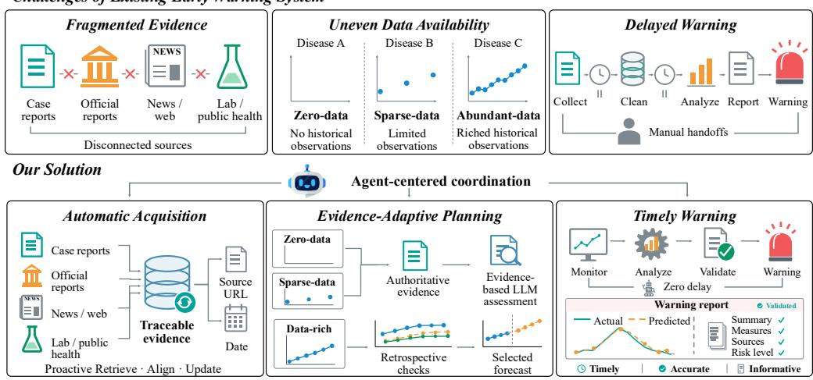  
Figure 1: Limitations of infectious disease early warning systems and our solution.

To address these challenges, we present EpiGuard, an autonomous and continually self-improving agentic platform for timely and reliable infectious-disease early warning, as shown in Figure 1. EpiGuard maintains an up-to-date epidemiological evidence repository by monitoring diverse surveillance sources, capturing newly released records, and merging them with previously acquired evidence. To address uneven evidence availability, the platform employs an adaptive planning mechanism that combines LLM reasoning with a forecasting model pool to dynamically adapt the analytical workflow across three evidence regimes—absent, sparse, and abundant. Finally, EpiGuard incorporates a self-improvement mechanism that converts efective data-acquisition and analysis procedures from successful warning tasks into reusable standard operating procedures (SOPs). These SOPs are progressively refined through subsequent tasks, supporting the extension to new diseases and regions.

We use oficially released infectious-disease surveillance data from the China CDC and the U.S. CDC to evaluate EpiGuard’s efectiveness. Experimental results show that EpiGuard consistently outperforms the strongest baselines across diseases and regions, achieving average improvements of 9.68% on the China CDC data and 14.04% on the U.S. CDC data.

The main contributions of this work are summarized as follows:

• We present EpiGuard, an autonomous and self-improving agentic platform that unifies evidence acquisition, analysis planning, forecasting, risk assessment, and report generation for timely and reliable infectious-disease early warning of more than 50 infectious diseases across diferent regions.

• We introduce an evidence-adaptive planning mechanism that combines LLM reasoning with a forecasting model pool and dynamically configures analytical workflows across absent, sparse, and abundant evidence regimes. This mechanism enables task-adaptive analysis without relying on a fixed pipeline or a single forecasting model.

• We develop a self-improvement mechanism that preserves efective data acquisition strategies and analysis workflows from previous tasks. These procedural capabilities can be retrieved and refined in subsequent tasks, allowing accumulated experience to support new diseases and regions.

• We use oficially released infectious disease data from the China CDC and U.S. CDC. Experimental results show that EpiGuard consistently outperforms strong baselines across diseases and regions.

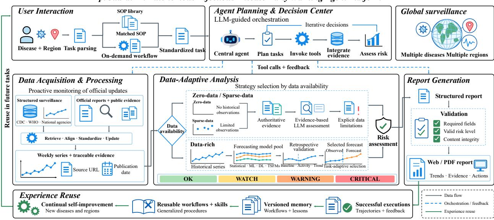  
Figure 2: The framework of EpiGuard.

## 2 Platform

## 2.1 System architecture

The overall architecture of EpiGuard is illustrated in Figure 2. At its core is the Agent Planning and Decision Center (APDC), which coordinates five functional components: the User Interaction Layer (UIL), Data Acquisition and Processing (DAP), Model Analysis and Risk Determination (MARD), Report Generation (RG), and the Self-improvement Mechanism. These components form a closed-loop early-warning framework that connects user requests, epidemiological evidence acquisition, evidence-adaptive analysis, risk assessment, report generation, and experience accumulation.

The UIL serves as the interface between open-ended user requests and EpiGuard’s analytical capabilities. It extracts the target disease and geographic region from each request. The resulting disease–region pair is then used to retrieve the corresponding standard operating procedure (SOP). Guided by the SOP, the APDC performs adaptive planning by dynamically selecting appropriate analytical strategies, forecasting models, and tools based on evidence availability. It coordinates the corresponding tool calls across the SOP-defined stages of data acquisition, evidence analysis, forecasting, risk determination, and report generation. The DAP component maintains an up-to-date epidemiological evidence repository by monitoring diverse surveillance sources and integrating newly released records with previously acquired evidence. The MARD component dynamically adapts the analytical workflow across three evidence regimes—absent, sparse, and abundant. It coordinates LLM reasoning with a forecasting model pool to determine risk according to the available evidence. The RG component organizes the collected evidence, analytical results, and risk assessment into a regime-specific report. It further performs schema and content checks before rendering the report as a web or PDF artifact. The Self-improvement Mechanism captures efective data-acquisition and analysis procedures from successful warning tasks as reusable SOPs, which can be retrieved to guide subsequent tasks.

## 2.2 User Interaction Layer

Early-warning requests may concern diferent diseases and geographic regions, while the available data sources and standard operating procedures (SOP) vary across disease–region pairs. The User Interaction Layer (UIL) connects these requests to EpiGuard’s analytical capabilities by identifying the target disease � and geographic region � and mapping them to a corresponding SOP.

To organize the available SOPs, EpiGuard maintains a SOP set: $\mathcal { G } = \{ ( r _ { i } , \mathcal { D } _ { i } , S _ { i } ) \} _ { i = 1 } ^ { N }$ , where � is the number of geographic regions and disease pairs, S is the corresponding SOP set, which defines the surveillance data route and reusable operations for data acquisition, preprocessing, analysis, and report generation. By indexing SOPs according to disease–region pairs, $\mathcal { G }$ enables the UIL to retrieve a corresponding SOP when available and identify requests that must be routed to the zero-shot workflow otherwise.

## 2.3 Agent Planning and Decision Center

The Agent Planning and Decision Center (APDC) is the LLM-based planning and orchestration component of EpiGuard. It receives the request information $q = ( r , d )$ and the SOP retrieval result $s ^ { \star }$ from the UIL, where $s ^ { \star } = \emptyset$ indicates that no dedicated SOP is available. Conditioned on these inputs, the APDC uses an LLM’s reasoning capability to decompose the request into executable actions and organize them into an adaptive analysis plan. It subsequently coordinates DAP, MARD, and RG by determining their invocation order and routing intermediate results among them.

Let $\mathcal { T } = \{ \mathcal { T } _ { \mathrm { D A P } } , \mathcal { T } _ { \mathrm { M A R D } } , \mathcal { T } _ { \mathrm { R G } } \}$ } denote the tools exposed by the three operational components. The APDC constructs the execution plan as

$$
\begin{array} { r } { \mathcal { P } ( q , s ^ { \star } ) = \Phi _ { \mathrm { L L M } } \left( q , s ^ { \star } , \mathcal { T } \right) = \left( a _ { \mathrm { D A P } } , \{ \mathcal { P } _ { z } \} _ { z \in \mathcal { Z } } , a _ { \mathrm { R G } } \right) , } \end{array}\tag{1}
$$

where $\Phi _ { \mathrm { L L M } }$ denotes LLM-based planning, � represents the actions required for evidence acquisition and processing, and �RG denotes report-generation actions. The set Z = {absent, sparse, abundant} contains the three evidence-availability regimes, with $\mathcal { P } _ { z }$ denoting the corresponding analysis branch executed through MARD. This adaptive planning mechanism dynamically adjusts the analytical workflow by selecting appropriate evidence regimes according to the availability of the evidence.

During execution, the APDC first invokes DAP to obtain the available epidemiological evidence. When $s ^ { \star }$ is available, the LLM uses the retrieved SOP as procedural context for planning; otherwise, it follows the zero-shot workflow based on publicly available epidemiological information. After DAP returns the collected evidence, the APDC determines its availability regime � and activates the corresponding branch $\mathcal { P } _ { z }$ . The selected branch is dispatched to MARD for evidence analysis, forecasti $^ { 1 9 , }$ and risk determination, after which MARD forwards the outputs to RG for report construction. In this process, the LLM within the APDC is responsible for planning and coordination, while specialized tools perform the concrete analytical operations for each task.

## 2.4 Data Acquisition and Processing

To support timely early warning, the Data Acquisition and Processing (DAP) maintains an up-to-date epidemiological evidence repository. DAP proactively monitors configured surveillance sources, detects newly released records, and integrates these changes with previously acquired evidence. It further provides a unified processing interface for surveillance systems that difer in geographic region, reporting frequency, data format, and epidemiological indicators.

Monitored surveillance sources. Table 1 summarizes the oficial surveillance sources currently monitored by EpiGuard. These sources provide diferent epidemiological measurements, including reported case counts, laboratory-confirmed detections, and testing positivity. Each structured source is associated with a sourcespecific acquisition procedure referenced by its SOP. The procedure specifies how DAP accesses, parses, and processes records from that source, allowing the system to monitor diverse surveillance systems through a consistent interface.

Proactive monitoring and repository update. DAP monitors each configured source according to its reporting schedule rather than waiting for a user request to initiate data acquisition. At each monitoring cycle, it retrieves the most recent release and compares the returned records with the corresponding observations stored in the evidence repository. Let $\mathcal { R } _ { t - 1 }$ denote the stored records before the current monitoring cycle and $\mathcal { D } _ { t }$ denote the records obtained from the source. The repository is updated as

$$
\Delta _ { t } = \mathrm { C o m p a r e } \left( \mathcal { D } _ { t } , \mathcal { R } _ { t - 1 } \right) , \qquad \mathcal { R } _ { t } = \mathrm { M e r g e } \left( \mathcal { R } _ { t - 1 } , \Delta _ { t } \right) ,\tag{2}
$$

where $\Delta _ { t }$ contains newly reported observations and revisions to previously released records. DAP records the retrieval time, most recent reporting period, and source provenance as repository metadata. This monitoring process decouples evidence maintenance from individual requests and prevents downstream analyses from relying on manually prepared or outdated data snapshots.

Table 1: Oficial surveillance sources currently integrated into EpiGuard.
<table><tr><td>Source</td><td>Coverage</td><td>Frequency</td><td>Surveillance content</td></tr><tr><td>China CDC Weekly Chi- nese Center for Disease Control and Prevention (2026)</td><td>China</td><td>Weekly</td><td>Infectious-disease surveillance reports and epidemiological updates on public-health events.</td></tr><tr><td>WHO FluNet World Health Organization</td><td>Global</td><td>Weekly</td><td>Laboratory-confirmed influenza detections by country, virus type, and subtype.</td></tr><tr><td>U.S. CDC NNDSS Centers for Disease Control and Prevention (2026)</td><td>United States</td><td>Weekly</td><td>Provisional case notifications for nationally notifiable diseases reported by states and ter- ritories.</td></tr><tr><td>UKHSA Data Dash- board UK Health Security Agency</td><td>England</td><td>Regularly updated</td><td>Case counts, testing positivity, respiratory- virus activity, and other infectious-disease in- dicators.</td></tr><tr><td>ECDC Surveillance Atlas / ERVISS European Cen- tre for Disease Prevention and Control (2023)</td><td>EU/EEA</td><td>Weekly</td><td>Surveillance data for multiple infectious dis- eases and weekly monitoring of influenza, RSV, and SARS-CoV-2.</td></tr><tr><td>PHAC FluWatch+ Public Health Agency of Canada Singapore Weekly In-</td><td>Canada</td><td>Weekly</td><td>National indicators for influenza, COVID-19, RSV, and other respiratory viruses.</td></tr><tr><td>fectious Diseases Bul- letin Communicable Diseases Agency, Singa- pore (2026)</td><td>Singapore</td><td>Weekly</td><td>Current and cumulative notifiable-disease counts, historical comparisons, and selected respiratory indicators.</td></tr><tr><td>Japan Infectious Diseases Weekly Report Japan In- stitute for Health Secu- rity (2026)</td><td>Japan</td><td>Weekly</td><td>Reported cases, temporal trends, and histori- cal comparisons for designated infectious dis- eases.</td></tr></table>

Unified evidence representation. For a structured surveillance indicator �, DAP represents the observations associated with disease � in region � as

$$
\mathbf { x } _ { r , d } ^ { ( m ) } = \left( x _ { r , d } ^ { 1 } , x _ { r , d } ^ { 2 } , \ldots , x _ { r , d } ^ { T } \right) ,\tag{3}
$$

where � is the number of reporting periods and $x _ { r , d } ^ { t }$ is the observed value during period �. DAP returns the acquired evidence as

$$
\mathcal { E } ( q ) = \left( \mathbf { x } _ { r , d } ^ { ( m ) } , \mathcal { H } _ { r , d } , \mathcal { M } _ { r , d } \right) ,\tag{4}
$$

where $\mathcal { H } _ { r , d }$ contains supplementary epidemiological information and $\mathcal { M } _ { r , d }$ records the source, indicator definition, reporting frequency, retrieval time, and most recent reporting period. When no structured historical observations are available, $\mathbf { x } _ { r , d } ^ { ( m ) } = \emptyset$ . The APDC uses the returned evidence to select the absent, sparse, or abundant evidence branch for subsequent analysis.

## 2.5 Model Analysis and Risk Determination

The Model Analysis and Risk Determination (MARD) module converts the epidemiological evidence returned by DAP into an evidence-adaptive analysis and a corresponding risk level. Let ${ \bf x } _ { r , d }$ denote the available historical series and let $T _ { \mathrm { m i n } }$ denote the minimum number of valid observations required for retrospective model evaluation (as shown in the following paragraph) and numerical forecasting. MARD distinguishes among three evidence regimes:

$$
z = \left\{ \begin{array} { l l } { \mathrm { a b s e n t } , } & { \mathbf { x } _ { r , d } = \emptyset , } \\ { \mathrm { s p a r s e } , } & { 0 < T < T _ { \operatorname* { m i n } } , } \\ { \mathrm { a b u n d a n t } , } & { T \geq T _ { \operatorname* { m i n } } . } \end{array} \right.\tag{5}
$$

For absent and sparse evidence, MARD performs LLM-based evidence assessment. When historical evidence is abundant, it selects and applies a forecasting model according to its retrospective performance.

Table 2: Forecasting models included in the numerical forecasting component of EpiGuard. The model pool contains 30+ statistical, machine learning, deep learning, and pretrained time-series foundation models.
<table><tr><td>Model family</td><td>Forecasting models</td></tr><tr><td>Statistical and rule-based</td><td>Persistence, Historical mean, Drift, Seasonal naive, Moving average variants, Exponential smoothing variants, Theta, ARIMA Box et al. (2015), SARIMA Hyn- dman &amp; Khandakar (2008), and SARIMAX Hyndman &amp; Athanasopoulos (2021).</td></tr><tr><td>Machine learning</td><td>Linear regression, Ridge regression, Random forest, Gradient boosting, Support vector regression Smola &amp; Schölkopf (2004), XGBoost Chen &amp; Guestrin (2016), and LightGBM Ke et al. (2017).</td></tr><tr><td>Deep Learning</td><td>LSTM Hochreiter &amp; Schmidhuber (1997), GRU Cho et al. (2014), TCN Bai et al. (2018), Transformer Vaswani et al. (2017), N-BEATS Oreshkin et al. (2020), N-HiTS Challu et al. (2023), and PatchTST Nie et al. (2023).</td></tr><tr><td>Time-series foundation models</td><td>Chronos-2 Ansari et al. (2025), TimesFM Das et al. (2023), Moirai 2.0 Liu et al. (2025a), Sundial Liu et al. (2025b), Toto 2.0 Khwaja et al. (2026), and Time- MoE Shi et al. (2025).</td></tr></table>

LLM-based evidence assessment. When historical observations are absent, MARD uses the LLM to synthesize the authoritative epidemiological information. The assessment identifies reported outbreak activity, changes in case occurrence, geographic spread, and other risk signals supported by the retrieved sources. Under sparse evidence, MARD additionally incorporates the limited observations in ${ \bf x } _ { r , d }$ as contextual information, while avoiding numerical forecasting. In both regimes, the LLM produces an evidence-grounded assessment and retains the supporting information used to determine the risk level.

Forecasting model pool. When historical evidence is abundant, MARD performs numerical forecasting using a pool M containing more than 30 forecasting models. As summarized in Table 2, the pool includes statistical and rule-based methods, machine-learning models, deep neural models, and pretrained time-series foundation models. These model families capture diferent forms of temporal dependence, trend, seasonality, and nonlinear variation, allowing MARD to select a forecasting approach according to the characteristics of the current surveillance series.

Given a historical series $\mathbf { x } = ( x ^ { 1 } , x ^ { 2 } , \ldots , x ^ { T } )$ and forecast horizon $H ,$ each model $m \in { \mathcal { M } }$ produces

$$
\hat { \mathbf { y } } _ { T + 1 : T + H } ^ { m } = \bigl ( \hat { y } _ { T + 1 } ^ { m } , \hat { y } _ { T + 2 } ^ { m } , \ldots , \hat { y } _ { T + H } ^ { m } \bigr ) .\tag{6}
$$

All models receive the same historical observations and predict the same future interval, enabling retrospective performance comparison under a common forecasting setting.

Retrospective model selection. Since the observations over the future interval $[ T + 1 , T + H ]$ are unavailable at prediction time, MARD evaluates each candidate model on the most recent fully observed interval. Specifically, the final � observations are used as the validation target:

$$
\mathbf { y } ^ { \mathrm { v a l } } = \left( x ^ { T - H + 1 } , \ldots , x ^ { T } \right) .\tag{7}
$$

Each model receives the preceding observations $\mathbf { x } _ { 1 : T - H }$ and produces a retrospective prediction $\begin{array} { l l l } { \hat { \mathbf { y } } ^ { m , \mathrm { v a l } } } & { = } & { \left( \hat { x } _ { T - H + 1 } ^ { m } , \ldots , \hat { x } _ { T } ^ { m } \right) } \end{array}$ . Its retrospective error is measured using the mean squared error $\begin{array} { r l } { E _ { m } } & { { } = } \end{array}$ $\begin{array} { r } { \frac { 1 } { H } \sum _ { h = 1 } ^ { H } \left( x ^ { T - H + h } - \hat { x } _ { T - H + h } ^ { m } \right) ^ { 2 } } \end{array}$ . MARD selects the model with the lowest validation error:

$$
m ^ { \star } = \arg \operatorname* { m i n } _ { m \in \mathcal { M } } E _ { m } ,\tag{8}
$$

The selected model is then applied to the complete series $\mathbf { x } _ { 1 : T }$ to generate the final forecast $\hat { \mathbf { y } } _ { T + 1 : T + H } ^ { m ^ { \star } } .$

Risk-level determination. MARD maps the available analytical evidence to one of four risk levels: OK, WATCH, WARNING, or CRITICAL. For evidence, let $p _ { 5 0 } , p _ { 7 5 }$ , and $p 9 0$ denote the corresponding percentiles of the historical observations, let $x _ { \mathrm { m a x } }$ denote the historical maximum, and define $\hat { y } _ { \mathrm { m a x } } = \mathrm { m } \mathbf { a x } _ { 1 \leq h \leq H } \hat { y } _ { T + h } ^ { m ^ { \star } } ,$ . The

risk level is determined from the highest to the lowest severity:

$$
\mathrm { R i s k } = \left\{ \begin{array} { l l } { \mathrm { C R I T T C A L } , } & { x ^ { T } \geq p _ { 9 0 } \vee \hat { y } _ { \mathrm { m a x } } > x _ { \mathrm { m a x } } , } \\ { \mathrm { W A R N I N G } , } & { x ^ { T } \geq p _ { 7 5 } \vee \hat { y } _ { \mathrm { m a x } } \geq p _ { 9 0 } , } \\ { \mathrm { W A T C H } , } & { x ^ { T } \geq p _ { 5 0 } \vee \mathrm { T r e n d } \left( \hat { \mathbf { y } } ^ { m ^ { \star } } \right) = \mathrm { u p w a r d } , } \\ { \mathrm { O K } , } & { \mathrm { o t h e r w i s e } . } \end{array} \right.\tag{9}
$$

For absent and sparse evidence, MARD retains the same four risk labels but determines the level through LLM-based reasoning over the available observations and authoritative epidemiological information. MARD returns the resulting risk level together with the selected forecast or supporting epidemiological evidence, enabling RG to present both the warning result and the basis for its determination.

## 2.6 Report Generation

The analytical branches coordinated by the APDC produce diferent outputs. An abundant-evidence analysis may include historical observations, temporal trends, and model forecasts, whereas absent- and sparseevidence analyses rely more heavily on authoritative epidemiological information. Directly rendering these diverse outputs as free-form text makes it dificult to enforce a consistent report structure or verify whether each conclusion is adequately supported. The Report Generation (RG) component therefore converts the analytical outputs into a validated structured representation before generating the final report.

Evidence-adaptive report representation. RG maintains three report templates corresponding to the evidence-availability regimes: $\mathcal { T } = \left\{ \mathcal { T } _ { \mathrm { a b s e n t } } , \mathcal { T } _ { \mathrm { s p a r s e } } , \mathcal { T } _ { \mathrm { a b u n d a n t } } \right\}$ . Given the regime ${ \mathfrak { z } } \in$ {absent, sparse, abundant} and the analytical output $O _ { z }$ , RG selects the corresponding template and constructs a structured report payload. All templates contain common fields for the disease, geographic region, report date, risk level, summary, risk factors, recommended actions, and evidence sources. The absent-evidence template records the retrieved epidemiological information and the evidence supporting the warning decision. The sparse-evidence template additionally includes the available observations and their temporal context. The abundant-evidence template further records the historical trend, selected forecasting model, and future predictions. These regime-specific fields prevent unsupported forecasting results from appearing in reports without suficient historical evidence.

Report validation and revision. Before rendering, RG validates the structured payload at the schema, value, and content levels. The schema validator verifies the presence and type of all fields required by $\mathcal { T } _ { z } .$ The value validator checks fields with constrained values, including whether the risk level belongs to $\mathcal { W } = \{ 0 \} \mathrm { { \Omega } }$ , WATCH, WARNING, CRITICAL}. The content validator examines whether the report is consistent with the selected evidence regime and its supporting analytical outputs. For example, an abundant-evidence report must contain the historical series and forecasting result used in risk determination, whereas an absentevidence report must not present an unsupported numerical forecast. If validation fails, RG returns a structured error identifying the invalid field and violated constraint. The APDC can then invoke the relevant tool to revise the analytical output or report field.

Unified report rendering. Once the payload passes all validation stages, RG invokes the rendering engine that generates the Web and PDF reports. The renderer also creates visualizations supported by the available evidence, such as historical surveillance curves, future forecasts, prediction intervals, and risk-level annotations.

## 2.7 Self-improvement Mechanism

The self-improvement mechanism preserves efective execution procedures from completed early-warning tasks and incorporates them into the SOP repository. A successful task records not only its final report, but also the data sources, preprocessing operations, tool and model configurations, evidence used for risk assessment, and report-generation steps followed during execution. When the task is completed and its report passes validation, these process-level records are retained as a successful execution trajectory.

The mechanism uses each successful trajectory to create or refine the SOP associated with its disease–region pair. If the task is executed through the zero-shot workflow and no corresponding SOP previously existed, the validated sequence of operations is consolidated into a new SOP. If an SOP is retrieved for the task, the

Table 3: Performance comparison on the China and US infectious disease datasets. The lower is the better.
<table><tr><td rowspan="2">System</td><td colspan="2">China-Infectious Disease</td><td colspan="2">US-Infectious Disease</td></tr><tr><td>MASE↓</td><td>RMSE↓</td><td>MASE↓</td><td>RMSE↓</td></tr><tr><td>LLM Predict NIDs</td><td> $4 . 2 6 \pm 0 . 6 8$ </td><td> $4 . 1 2 \pm 0 . 9 7$ </td><td> $2 . 2 7 \pm 0 . 6 4$ </td><td> $6 4 . 9 1 \pm 1 3 . 2 6$ </td></tr><tr><td>epi4cast Weighted Ensemble</td><td> $2 . 0 5 \pm 0 . 0 8$ </td><td> $2 . 0 2 \pm 0 . 1 4$ </td><td> $1 . 3 7 \pm 0 . 1 4$ </td><td> $4 0 . 4 6 \pm 2 . 2 6$ </td></tr><tr><td>TimeSeriesScientist</td><td> $2 . 0 2 \pm 0 . 0 4$ </td><td> $1 . 9 5 \pm 0 . 0 9$ </td><td> $1 . 2 0 \pm 0 . 0 4$ </td><td> $4 0 . 3 0 \pm 1 . 1 2 $ </td></tr><tr><td>AutoGluon-TimeSeries</td><td> $1 . 7 6 \pm 0 . 0 3$ </td><td> $1 . 7 5 \pm 0 . 0 8$ </td><td> $1 . 0 9 \pm 0 . 0 6$ </td><td> $3 4 . 0 8 \pm 1 . 3 5$ </td></tr><tr><td>CAPE</td><td> $1 . 7 8 \pm 0 . 0 0$ </td><td> $1 . 6 6 \pm 0 . 0 0$ </td><td> $1 . 1 8 \pm 0 . 0 0$ </td><td> $3 6 . 5 5 \pm 0 . 0 0$ </td></tr><tr><td>DeepSeek V4 Flash ReAct</td><td> $1 . 5 4 \pm 0 . 0 0$ </td><td> $1 . 5 6 \pm 0 . 0 0$ </td><td> $1 . 2 6 \pm 0 . 0 0$ </td><td> $3 6 . 9 0 \pm 0 . 0 0$ </td></tr><tr><td>GPT-4o mini ReAct</td><td> $1 . 5 6 \pm 0 . 0 0$ </td><td> $1 . 6 0 \pm 0 . 0 0$ </td><td> $1 . 3 6 \pm 0 . 0 0$ </td><td> $4 5 . 8 1 \pm 0 . 0 0$ </td></tr><tr><td>EPIGUARD</td><td> ${ \bf 1 . 3 8 \pm 0 . 0 1 }$ </td><td> ${ \bf 1 . 4 2 \pm 0 . 0 1 }$ </td><td> $\mathbf { 0 . 9 0 \pm 0 . 0 1 }$ </td><td> $\mathbf { 3 0 . 4 5 \pm 0 . 7 8 }$ </td></tr></table>

successful trajectory updates its data routes, processing steps, tool configurations, or analytical procedures.   
The resulting SOP is written back to the SOP set G maintained by EpiGuard.

During subsequent requests, the UIL can retrieve the newly created or updated SOP, and the APDC can use it to construct the corresponding execution plan. In this way, procedures successfully applied in previous tasks become reusable system knowledge, reducing the need to reconstruct the same workflow in future executions. EpiGuard therefore improves itself through continual SOP maintenance and reuse rather than parameter updates to the underlying models.

## 3 Experiments

Dataset and Setting. We introduce two infectious disease forecasting datasets, China-Infectious Disease and US-Infectious Disease, using oficial surveillance data released by the China CDC and the U.S. CDC, respectively. The China-Infectious Disease dataset comprises five time series of respiratory pathogen positivity rates reported by the China CDC, while the US-Infectious Disease dataset contains reported case-count time series for ten nationally notifiable infectious diseases published by the U.S. CDC. These time series are reported at 1-week intervals. For each dataset, we split the time series chronologically into training, validation, and test sets at a 6:2:2 ratio. Given historical observations, the forecasting task is to predict the positivity rate or case count for the subsequent four weeks. We evaluate forecasting performance using the Mean Absolute Scaled Error (MASE) and Root Mean Squared Error (RMSE).

Baselines. We compare EpiGuard with the five end-to-end forecasting systems, including AutoGluon-TimeSeries Shchur et al. (2023), the epidemic-specific pretrained forecaster CAPE Liu et al. (2026), the TimeSeriesScientist agent Zhao et al. (2025), the epi4cast weighted ensemble Wang et al. (2026), and the fine-tuned LLM forecasting system Predict NIDs Wu et al. (2026). We additionally construct two generalpurpose LLM baselines by combining API models, DeepSeek V4 Flash and GPT-4o mini.

## 3.1 Main Results

Table 3 reports each model’s average forecasting performance on the China-Infectious Disease and US Infectious Disease datasets. Our model achieves the best performance across all evaluation metrics on both datasets, outperforming the second-best model by 9.68% and 14.04%, respectively. Moreover, compared with directly using DeepSeek-V4 for forecasting, EpiGuard achieves a 23.03% performance improvement on the US-Infectious Disease dataset, demonstrating the efectiveness of our agent planning and decision center in coordinating and invoking diferent components to accomplish the forecasting task.

## 3.2 Analysis of Time-Series Foundation Models

We evaluate the efectiveness of the forecasting model pool by comparing EpiGuard with variants that use a single fixed time-series foundation model for forecasting. The results are presented in Table 4. We observe that Moirai 2.0, Chronos-2, and Toto 2.0 consistently rank among the top three models on both the China and U.S. infectious disease datasets. However, the best-performing model varies across datasets: Toto 2.0 achieves the best performance in China, whereas Moirai 2.0 performs best in the United States. These results indicate that no single time-series foundation model consistently performs best across diferent datasets. This demonstrates the efectiveness of using a forecasting model pool to select the most suitable model for diferent forecasting scenarios.

Table 4: Comparison of forecasting performance using the fixed time-series foundation model.
<table><tr><td rowspan="2">Internal TSFM</td><td colspan="2">China-Infectious Disease</td><td colspan="2">US-Infectious Disease</td></tr><tr><td>MASE↓</td><td>RMSE↓</td><td>MASE↓</td><td>RMSE↓</td></tr><tr><td>Sundial</td><td> $1 . 7 1 \pm 0 . 0 1$ </td><td> $1 . 7 3 \pm 0 . 0 0$ </td><td> $1 . 0 6 \pm 0 . 0 0$ </td><td> $3 2 . 5 6 \pm 0 . 2 8$ </td></tr><tr><td>Time-MoE</td><td> $1 . 5 2 \pm 0 . 0 0$ </td><td> $1 . 5 5 \pm 0 . 0 0$ </td><td> $1 . 0 8 \pm 0 . 0 0$ </td><td> $3 3 . 1 4 \pm 0 . 0 0$ </td></tr><tr><td>TimesFM 2.5</td><td> $1 . 5 0 \pm 0 . 0 0$ </td><td> $1 . 5 1 \pm 0 . 0 0$ </td><td> $0 . 9 9 \pm 0 . 0 0$ </td><td> $3 1 . 1 9 \pm 0 . 0 0$ </td></tr><tr><td>Moirai 2.0</td><td> $1 . 6 2 \pm 0 . 0 0$ </td><td> $1 . 8 0 \pm 0 . 0 0$ </td><td> $0 . 9 2 \pm 0 . 0 0$ </td><td> $2 9 . 7 2 \pm 0 . 0 0$ </td></tr><tr><td>Chronos-2</td><td> $1 . 4 1 \pm 0 . 0 0$ </td><td> $1 . 4 8 \pm 0 . 0 0$ </td><td> $0 . 9 8 \pm 0 . 0 0$ </td><td> $3 2 . 0 9 \pm 0 . 0 0$ </td></tr><tr><td>Toto 2.0</td><td> $1 . 3 4 \pm 0 . 0 0$ </td><td> $1 . 3 6 \pm 0 . 0 0$ </td><td> $0 . 9 4 \pm 0 . 0 0$ </td><td> $3 0 . 5 1 \pm 0 . 0 0$ </td></tr></table>

## 3.3 Case Study

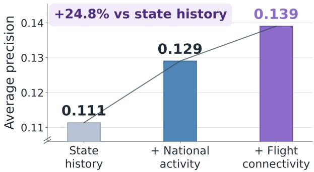  
(a) Incremental predictive value

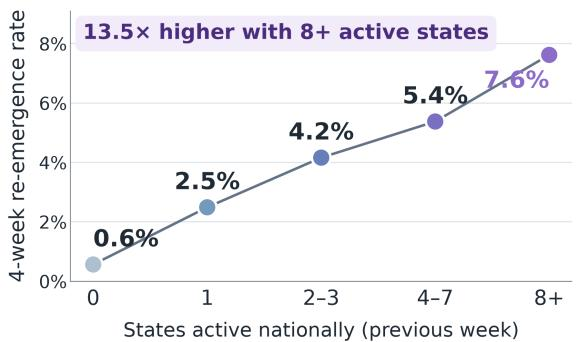  
(b) National activity gradient  
Figure 3: Multi-source evidence for four-week state-level reported-case re-emergence. (a) Average precision as national activity and flight-connectivity features are added to state history. (b) Observed re-emergence rates stratified by the number of states reporting the same disease in the previous week.

Multi-source re-emergence signals. We further investigate the efectiveness of incorporating additional multi-source information on the U.S. infectious disease dataset. Specifically, we focus on states that have reported no cases for several consecutive weeks. We then examine whether national disease activity and interstate connectivity provide useful information for predicting case re-emergence.

As shown in Figure 3(a), incorporating national disease activity improves forecasting performance by 16.22%. This suggests that a state’s disease case is more likely to re-emerge when disease activity is more widespread across other states. Adding interstate flight connectivity further improves performance, resulting in a 24.8% improvement over using only state-level historical information. This indicates that interstate connectivity provides information for identifying states that are more exposed to external disease activity.

Figure 3(b) shows a consistent pattern. The likelihood of case re-emergence increases markedly as disease activity becomes more widespread nationwide. These findings suggest that re-emergence risk depends not only on a state’s recent disease history, but also on broader patterns of disease activity and interstate connectivity, demonstrating the value of multi-source information for improving early warning of case re-emergence.

Seasonal, meteorological, spatial evidence. Figure 4 illustrates the relationships between disease cases and temporal and geographic information. We observe seasonal patterns in disease incidence, with substantial variation across diferent diseases. Meteorological conditions also exhibit temporal patterns that are closely associated with local disease dynamics. These findings suggest that disease activity in neighboring regions and interstate connectivity can add context to disease forecasting.

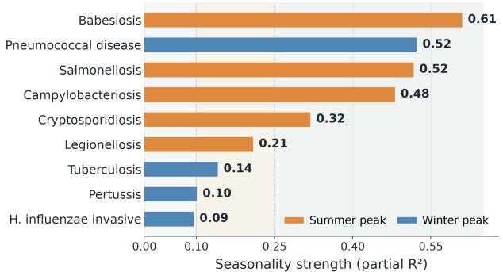  
(a) Disease seasonality

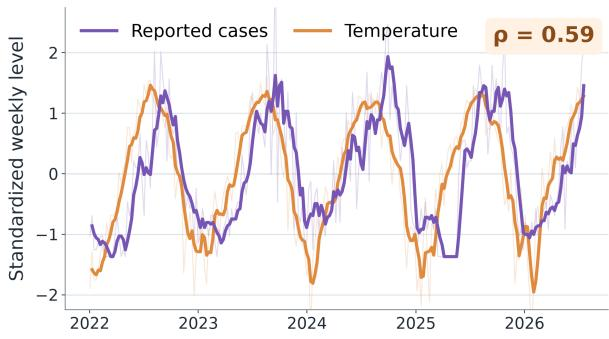  
(b) Temperature alignment

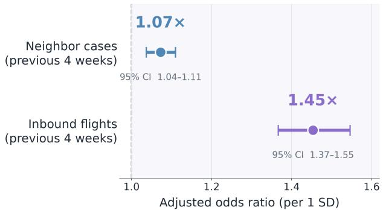  
(c) Adjusted spatial associations

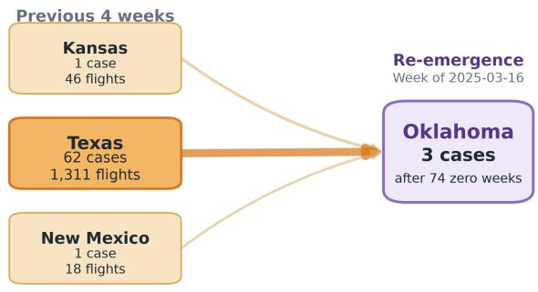  
(d) Oklahoma measles example  
Figure 4: Temporal and geographic context for state-level surveillance. (a) Annual-harmonic partial $R ^ { 2 }$ , colored by peak season. (b) Standardized weekly Arkansas salmonellosis reports and temperature. (c) Adjusted ORs per one standard deviation from disease–week matched analysis. (d) Neighboring cases and inbound flights during the four weeks preceding reported measles re-emergence in Oklahoma. These panels describe predictive associations rather than causal transmission pathways.

Figure 4(d) presents a measles case study in Oklahoma. Oklahoma had reported no measles cases for 74 consecutive weeks. However, three states with strong flight connectivity to Oklahoma reported diferent levels of measles activity during the preceding four weeks. Oklahoma subsequently reported measles cases. This example shows that signals associated with case re-emergence can be traced to specific information from diferent data sources, such as recent disease activity in connected states and interstate mobility patterns. Such traceable evidence helps explain the contextual factors behind the model’s forecasts.

API-token cost. In the early warning process, inference cost is also an important factor in assessing the system’s practical applicability. Because diferent large language models incur diferent token consumption when performing risk prediction, we compare EpiGuard’s inference costs with DeepSeek V4 and GPT-4o. As shown in Table 5, EpiGuardreduces API calls for risk prediction by 27.27% while reducing average token consumption per call by 32.89%. These results show that EpiGuardcan predict risk with fewer API calls and lower token overhead, improving computational eficiency and reducing deployment costs while maintaining strong early-warning performance.

Table 5: Forecast accuracy and full-workflow external LLM-token usage on two datasets. Costs include forecasting, planning, orchestration, and report assembly. Lower is better.
<table><tr><td>System</td><td>China MASE ↓</td><td>US MASE↓</td><td>Total calls ↓</td><td>Total tokens ↓</td><td>Tokens/task ↓</td></tr><tr><td>GPT-4o mini ReAct</td><td>1.559†</td><td>1.357†</td><td> $\approx 4 9 5 ^ { \div }$ </td><td> $\approx 1 , 0 3 5 , 4 5 5 ^ { \div }$ </td><td> $\approx 2 3 \lrcorner 0 1 0 ^ { \div }$ </td></tr><tr><td>DeepSeek V4 Flash ReAct</td><td>1.545†</td><td>1.261†</td><td> $\approx 4 9 5 ^ { \div }$ </td><td> $\approx 1 , 0 4 2 , 1 5 9 ^ { \div }$ </td><td> $\approx 2 3 , 1 5 9 ^ { \div }$ </td></tr><tr><td>EpiGuard</td><td> $\mathbf { 1 . 3 7 7 \pm 0 . 0 0 9 }$ </td><td> $\mathbf { 0 . 9 0 3 \pm 0 . 0 1 4 }$ </td><td> $\approx 3 6 0 ^ { \frac { 1 } { \div } }$ </td><td> $\approx 6 9 4 { , } 9 0 5 ^ { \div }$ </td><td> $\approx 1 5 { , } 4 4 2 ^ { \div }$ </td></tr></table>

† denotes one API execution. ‡ denotes full-workflow token accounting based on the representative complete report trace; local computation is excluded.

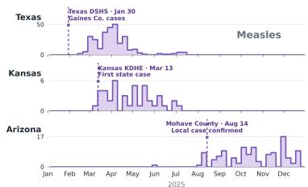  
(a) Measles

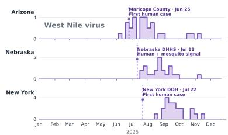  
(b) West Nile virus

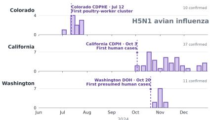  
(c) H5N1  
Figure 5: Incremental information in oficial public-health notices. State-level case trajectories are paired with dated oficial-notice markers for (a) measles, (b) West Nile virus, and (c) H5N1 avian influenza. The notices provide location, exposure, and event-type context beyond case counts alone.

Oficial-notice evidence. As shown in Figure 5, oficial state and local notices provide event-level semantics that are not available from numerical case trajectories alone. Across multiple disease families, these notices tend to emerge around the onset or early development of local activity and contribute complementary information about location, exposure setting, and event type. This makes oficial notices particularly useful for interpreting sparse or newly emerging signals, where case counts alone may provide limited context.

Timely outbreak anticipation. To evaluate the timeliness of outbreak warnings, we conduct a case study to examine whether emerging outbreaks could be accurately anticipated before an oficial alert is released. We use the historical 12 weeks of case counts to forecast the next four weeks. As shown in Figure 6, EpiGuard captures the upward trend before the oficial outbreak notice is issued and produces forecasts that closely follow the subsequent increase in reported cases. In contrast, the baseline methods largely remain near the pre-outbreak risk level and show only limited responses to the emerging change. These results suggest that EpiGuard can identify outbreak signals earlier and more accurately than the baseline methods, demonstrating its timeliness for infectious disease warning.

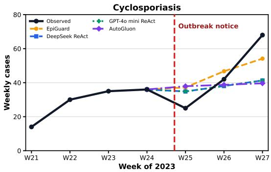  
Figure 6: Cyclosporiasis outbreak forecasting.

## 4 Conclusion

This paper presents EpiGuard, an autonomous and continually self-improving agentic platform for infectiousdisease early warning. EpiGuard proactively maintains an up-to-date epidemiological evidence repository and employs hierarchical planning to adapt its analytical workflow across absent, sparse, and abundant ev idence regimes. It combines LLM-based evidence assessment with a heterogeneous forecasting model pool, generates validated structured reports, and consolidates successful execution trajectories into reusable and continually refined SOPs. Experiments on oficial data released by the China CDC and the U.S. CDC demon strate the efectiveness of EpiGuard for infectious-disease forecasting. Compared with the second-best meth ods, EpiGuard achieves average relative improvements of 9.68% and 14.04% on the China and U.S. CDC data, respectively. Further analysis reveals that the relative performance of individual time-series foundation models varies across surveillance settings, indicating that no single model consistently performs best across diferent scenarios. This variability supports the design of our forecasting pool and task-adaptive model selec tion strategy, which dynamically leverages diferent models rather than relying on a single forecasting model.

## References

Abdul Fatir Ansari, Oleksandr Shchur, Jaris Küken, Andreas Auer, Boran Han, Pedro Mercado, Syama Sundar Rangapuram, et al. Chronos-2: From univariate to universal forecasting. arXiv preprint arXiv:2510.15821, 2025. URL https://arxiv.org/abs/2510.15821.

Shaojie Bai, J. Zico Kolter, and Vladlen Koltun. An empirical evaluation of generic convolutional and recurrent networks for sequence modeling. arXiv preprint arXiv:1803.01271, 2018. URL https://arxiv.org/ abs/1803.01271.

George E. P. Box, Gwilym M. Jenkins, Gregory C. Reinsel, and Greta M. Ljung. Time Series Analysis: Forecasting and Control. Wiley, 5 edition, 2015.

John S. Brownstein, Clark C. Freifeld, Ben Y. Reis, and Kenneth D. Mandl. Surveillance sans frontières: Internet-based emerging infectious disease intelligence and the HealthMap project. PLOS Medicine, 5(7): e151, 2008.

Malwina Carrion and Lawrence C Madof. Promed-mail: 22 years of digital surveillance of emerging infectious diseases. International health, 9(3):177–183, 2017.

Centers for Disease Control and Prevention. Notifiable infectious disease data tables. https://www.cdc. gov/nndss/infectious-disease/, 2026. Weekly data are provisional and subject to revision; accessed 2026-07-30.

Cristian Challu, Kin G. Olivares, Boris N. Oreshkin, Federico Garza, Max Mergenthaler-Canseco, and Artur Dubrawski. N-HiTS: Neural hierarchical interpolation for time series forecasting. In Proceedings of the AAAI Conference on Artificial Intelligence, volume 37, pp. 6989–6997, 2023.

Tianqi Chen and Carlos Guestrin. XGBoost: A scalable tree boosting system. In Proceedings of the 22nd ACM SIGKDD International Conference on Knowledge Discovery and Data Mining, pp. 785–794, 2016.

Chinese Center for Disease Control and Prevention. National acute respiratory infectious disease sentinel surveillance reports. https://www.chinacdc.cn/jksj/jksj04\_14275/, 2026. Weekly archive; accessed 2026-08-07.

Kyunghyun Cho, Bart van Merriënboer, Caglar Gulcehre, Dzmitry Bahdanau, Fethi Bougares, Holger Schwenk, and Yoshua Bengio. Learning phrase representations using RNN encoder–decoder for statistical machine translation. In Proceedings of the 2014 Conference on Empirical Methods in Natural Language Processing, pp. 1724–1734, 2014.

Communicable Diseases Agency, Singapore. Weekly infectious diseases bulletin. https://www.cda.gov. sg/resources/weekly-infectious-diseases-bulletin-2026/, 2026. Accessed 2026-07-30.

Abhimanyu Das, Weihao Kong, Rajat Sen, and Yichen Zhou. A decoder-only foundation model for time-series forecasting. arXiv preprint arXiv:2310.10688, 2023.

Marie Dion, Philip AbdelMalik, and Abla Mawudeku. Big data and the global public health intelligence network (gphin). Canada communicable disease report, 41(9):209, 2015.

European Centre for Disease Prevention and Control. Surveillance atlas of infectious diseases. Online infectious disease surveillance database, 2023. URL https://www.ecdc.europa.eu/en/ surveillance-atlas-infectious-diseases.

CP Farrington, Nick J Andrews, AD Beale, and MA Catchpole. A statistical algorithm for the early detection of outbreaks of infectious disease. Journal of the Royal Statistical Society: Series A (Statistics in Society), 159 (3):547–563, 1996.

Clark C. Freifeld, Kenneth D. Mandl, Ben Y. Reis, and John S. Brownstein. HealthMap: Global infectious disease monitoring through automated classification and visualization of internet media reports. Journal of the American Medical Informatics Association, 15(2):150–157, 2008.

Sepp Hochreiter and Jürgen Schmidhuber. Long short-term memory. Neural Computation, 9(8):1735–1780, 1997.

Helen E Hughes, Obaghe Edeghere, Sarah J O’Brien, Roberto Vivancos, and Alex J Elliot. Emergency department syndromic surveillance systems: a systematic review. BMC Public Health, 20(1):1891, 2020.

Rob J. Hyndman and George Athanasopoulos. Forecasting: Principles and Practice. OTexts, Melbourne, Australia, 3 edition, 2021.

Rob J. Hyndman and Yeasmin Khandakar. Automatic time series forecasting: The forecast package for R. Journal of Statistical Software, 27(3):1–22, 2008.

Ruth Ann Jajosky and Samuel L Groseclose. Evaluation of reporting timeliness of public health surveillance systems for infectious diseases. BMC public health, 4(1):29, 2004.

Japan Institute for Health Security. Infectious diseases weekly report (IDWR). https://id-info.jihs. go.jp/en/surveillance/idwr/index.html, 2026. Accessed 2026-07-30.

Guolin Ke, Qi Meng, Thomas Finley, Taifeng Wang, Wei Chen, Weidong Ma, Qiwei Ye, and Tie-Yan Liu. Light-GBM: A highly eficient gradient boosting decision tree. In Advances in Neural Information Processing Systems, volume 30, 2017.

Mikaela Keller, Michael Blench, Herman Tolentino, Clark C. Freifeld, Kenneth D. Mandl, Abla Mawudeku, Gunther Eysenbach, and John S. Brownstein. Use of unstructured event-based reports for global infectious disease surveillance. Emerging Infectious Diseases, 15(5):689–695, 2009.

Emaad Khwaja, Chris Lettieri, Gerald Woo, Eden Belouadah, Marc Cenac, Guillaume Jarry, Enguerrand Paquin, Xunyi Zhao, Viktoriya Zhukov, Othmane Abou-Amal, et al. Toto 2.0: Time series forecasting enters the scaling era. arXiv preprint arXiv:2605.20119, 2026. URL https://arxiv.org/abs/2605.20119.

Chenghao Liu, Taha Aksu, Juncheng Liu, Xu Liu, Hanshu Yan, Quang Pham, Doyen Sahoo, Caiming Xiong, Silvio Savarese, and Junnan Li. Moirai 2.0: When less is more for time series forecasting. arXiv preprint arXiv:2511.11698, 2025a. URL https://arxiv.org/abs/2511.11698.

Yong Liu, Guo Qin, Zhiyuan Shi, Zhi Chen, Caiyin Yang, Xiangdong Huang, Jianmin Wang, and Mingsheng Long. Sundial: A family of highly capable time series foundation models. arXiv preprint arXiv:2502.00816, 2025b. URL https://arxiv.org/abs/2502.00816.

Zewen Liu, Juntong Ni, Bohan Wang, Max SY Lau, and Wei Jin. Pre-training epidemic time series forecasters with compartmental prototypes. In Proceedings of the 32nd ACM SIGKDD Conference on Knowledge Discovery and Data Mining V. 2, pp. 11540–11551, 2026.

Rehab Meckawy, David Stuckler, Adityavarman Mehta, Tareq Al-Ahdal, and Bradley N Doebbeling. Efectiveness of early warning systems in the detection of infectious diseases outbreaks: a systematic review. BMC public health, 22(1):2216, 2022.

Yuqi Nie, Nam H. Nguyen, Phanwadee Sinthong, and Jayant Kalagnanam. A time series is worth 64 words: Long-term forecasting with transformers. In International Conference on Learning Representations, 2023. URL https://arxiv.org/abs/2211.14730.

Boris N. Oreshkin, Dmitri Carpov, Nicolas Chapados, and Yoshua Bengio. N-BEATS: Neural basis expansion analysis for interpretable time series forecasting. In International Conference on Learning Representations, 2020.

World Health Organization et al. Early warning alert and response in emergencies: an operational guide. World Health Organization, 2023.

Public Health Agency of Canada. Canadian respiratory virus surveillance report (FluWatch+). Online national respiratory virus surveillance dashboard. URL https://health-infobase.canada.ca/ respiratory-virus-surveillance/.

Mauricio Santillana, André T Nguyen, Mark Dredze, Michael J Paul, Elaine O Nsoesie, and John S Brownstein. Combining search, social media, and traditional data sources to improve influenza surveillance. PLoS computational biology, 11(10):e1004513, 2015.

Oleksandr Shchur, Ali Caner Turkmen, Nick Erickson, Huibin Shen, Alexander Shirkov, Tony Hu, and Bernie Wang. Autogluon–timeseries: Automl for probabilistic time series forecasting. In International Conference on Automated Machine Learning, pp. 9–1. PMLR, 2023.

Xiaoming Shi, Shiyu Wang, Yuqi Nie, Dianqi Li, Zhou Ye, Qingsong Wen, and Ming Jin. Time-MoE: Billionscale time series foundation models with mixture of experts. In International Conference on Learning Representations, 2025. URL https://arxiv.org/abs/2409.16040.

Alex J. Smola and Bernhard Schölkopf. A tutorial on support vector regression. Statistics and Computing, 14: 199–222, 2004.

UK Health Security Agency. UKHSA data dashboard. Online public health surveillance dashboard. URL https://ukhsa-dashboard.data.gov.uk/.

Ashish Vaswani, Noam Shazeer, Niki Parmar, Jakob Uszkoreit, Llion Jones, Aidan N. Gomez, Lukasz Kaiser, and Illia Polosukhin. Attention is all you need. In Advances in Neural Information Processing Systems, volume 30, 2017.

Douhan Wang, Yuhan Li, and Nicola Perra. From naive to foundation: benchmarking models for epidemic forecasting. medRxiv, pp. 2026–05, 2026.

World Health Organization. FluNet: Global influenza virological surveillance. Global Influenza Programme, online surveillance database. URL https://www.who.int/tools/flunet.

Xinsheng Wu, Jinyuan Wu, Zhongwen Wang, Xinyue Feng, Ye Yao, Jason J Ong, and Huachun Zou. Large language models as versatile predictive engines for notifiable infectious diseases. PLOS Digital Health, 5(7): e0001527, 2026.

Weizhong Yang, Zhongjie Li, Yajia Lan, Jinfeng Wang, Jiaqi Ma, Lianmei Jin, Qiao Sun, Wei Lv, Shengjie Lai, Yilan Liao, et al. A nationwide web-based automated system for outbreak early detection and rapid response in china. Western Pacific surveillance and response journal: WPSAR, 2(1):10, 2011.

Haokun Zhao, Xiang Zhang, Jiaqi Wei, Yiwei Xu, Yuting He, Siqi Sun, and Chenyu You. Timeseriesscientist: A general-purpose ai agent for time series analysis. arXiv preprint arXiv:2510.01538, 2025.