# Are AI Decision Models Biased? A Case Study of Jev

Ilaria Imperatrice Taisia Kameneva Adam Eric Greenberg Alessandro Romano Bocconi University

## Abstract

Do AI models designed for fast, structured de cisions exhibit the cognitive and social biases observed in human judgment? We evaluate Jev, a model described as a “System One” decisionmaker, using 41,500 responses across cognitive reflection tasks, five classical cognitive-bias paradigms, and a pricing experiment testing eth nic and gender bias. At the level of selected answers, the results are largely encouraging. We confirm previous findings that Jev performs ex tremely well on cognitive reflection problems. We also observe that it generally avoids the characteristic choice patterns associated with several well-documented human biases, and exhibits only small differences among demo graphic groups in the tested pricing scenario. However, this apparent robustness conceals im portant vulnerabilities. Its judgments are sensitive to irrelevant numerical information and the ordering of response options. Moreover, several cognitive-bias manipulations substan tially affect returned probabilities even when selected answers remain unchanged. Most strik ingly, Jev answers a well-known probability problem correctly in every response but vio lates the same underlying probability rule in every response to an adapted version. We investigate this discrepancy using 15,000 additional responses across 30 conjunction tasks. Jev vio lates the rule in 54% of responses, with accu racy varying dramatically across formulations and answer orders. These findings suggest that evaluating decision models solely on familiar benchmarks and selected answers may substantially overstate their reliability in practical ap plications. They also identify vulnerabilities for developers to address and practical consid erations for users integrating such models into automated decision-making systems.

## 1 Introduction

Human System One thinking is fast and intuitive, but also systematically vulnerable to cognitive biases (Tversky and Kahneman, 1974; Evans and

Stanovich, 2013). Jev is explicitly presented as a “System One” model designed to make fast judgments (TypeSafe AI, 2026; Almeida, 2026). This raises a natural question: does a model described in these terms also display the characteristic biases of human intuitive judgment?

AI decision models such as Jev are designed to evaluate a given situation and return structured judgments, such as choices among predefined alternatives, scores, or probabilities, rather than generate open-ended text. When these structured judgments are consumed directly by software, sensitivity to irrelevant information, framing, or the presentation of alternatives can affect downstream decisions. We therefore use classical cognitivebias paradigms to test whether Jev’s responses follow patterns observed in human decision making, whether these patterns extend across task variants, and whether reversing the order of the answer options affects Jev’s judgments.

Our evaluation of Jev has three parts. First, cognitive reflection tasks test performance on short problems designed to elicit an intuitive but incorrect answer. Second, five cognitive-bias paradigms examine anchoring, conjunction judgments, framing, sunk costs, and zero-risk preferences. Where applicable, we also test whether changing the order of the response options affects Jev’s judgments, since human decision makers tend to be susceptible to order effects. Third, a pricing task examines whether changing a customer’s name, and then making ethnicity and gender explicit, changes Jev’s pricing judgment. We do not aggregate the tasks into a single accuracy or bias score because their normative benchmarks and response formats differ.

## 2 Relation to prior work

Psychological experiments have been used to characterize decision-making and reasoning in language models (Binz and Schulz, 2023; Coda-Forno et al., 2024). Related research uses LLMs to simulate experimental participants (Aher et al., 2023), approximate demographic response patterns (Argyle et al., 2023), and compare chatbot choices with human behavior in experiments(Mei et al., 2024; Binz and Schulz, 2023).

Research on cognitive biases documents both similarities and differences between model and human judgments. Suri et al. (2024) find anchoring, conjunction errors, and attribute-framing effects in GPT-3.5. Hagendorff et al. (2023) show that intuitive errors in cognitive-reflection and semanticillusion tasks, observed in earlier models, are substantially reduced in ChatGPT. Instruction tuning can also increase susceptibility to some decision biases, including the certainty effect (Itzhak et al., 2024). Larger benchmarking frameworks investigate cognitive biases across multiple model families and decision scenarios, alongside interventions intended to reduce them (Echterhoff et al., 2024; Malberg et al., 2025). Findings on sunk costs likewise differ across experimental settings. He and Liu (2025) report little sunk-cost sensitivity in their evaluation, whereas Chen et al. (2026) identify sunk-cost effects in mental-accounting experiments, with their strength and direction varying across models and conditions.

Answer presentation and demographic information introduce further sources of variation. Reordering multiple-choice options can change model responses despite unchanged questions and alternatives (Pezeshkpour and Hruschka, 2024; Zheng et al., 2024). Wang et al. (2024) document response-order effects in LLM-based evaluation, while Koo et al. (2024) benchmark broader evaluator biases, including models’ preference for their own outputs. For demographic bias, BBQ evaluates stereotype-based responses in question answering (Parrish et al., 2022), and SoFa examines disparate treatment across sensitive demographic groups (Marchiori Manerba et al., 2024). Tamkin et al. (2023) investigate discriminatory decisions through controlled changes to explicit demographic characteristics and implicit cues conveyed through names.

Recent preprints have begun evaluating Jev and related specialized decision models. Deußer et al. (2026) benchmark Jev across 37 datasets, examining predictive performance and calibration and reporting unchanged accuracy under option rotation in their MMLU probe. Gao et al. (2026) identify underuse of ordinal response scales in Jev and related models that persists after randomizing candidate positions. Li (2026) compares Jev with Laya on agent decision tasks and documents substantial answer-order sensitivity in Laya. Guo et al. (2026) evaluate Jev as a detector of alignment failures, including social bias, in other models’ outputs. Yang et al. (2026) find that Jev performs very well on cognitive reflection tasks. Our study complements these evaluations by testing Jev on classical cognitive-bias paradigms and a demographic pricing task. We examine whether patterns associated with human judgment appear in its responses, whether they extend across task variants, and whether answer presentation changes its judgments. Throughout, we distinguish changes in selected answers from changes in returned probability scores and confidence.

## 3 Evaluation setup

## 3.1 Tasks and experimental manipulations

We evaluate Jev 1.13.0 using 41,500 responses collected between 30 September and 5 October 2026. Each task supplies a written question or decision scenario together with response options.

For all cognitive tasks except anchoring, we include both the original formulation derived from the seminal study of the relevant bias and an adapted version. The purpose is to test whether Jev’s performance extends beyond highly familiar formulations. Where the original task required an open-ended response, we constructed closed-ended response options to accommodate Jev’s structured output format. In all Choice tasks (Section 3.2), we test forward and reversed alswer orders.

## 3.2 Model outputs

Jev is a System One model: a model “built to make fast, structured decisions that software can use directly”. It evaluates an input state and “returns typed decisions and probabilities rather than generated text” (TypeSafe, 2026). Its probabilities are trained to be calibrated against outcomes; calibration is a property of groups of predictions and does not guarantee that an individual answer is correct.

Questions are posed as one of three primitives, of which this study uses two: Score and Choice. A Score is a question type “for rating content against ordered, descriptive levels”, used when the answer is a position on a spectrum (TypeSafe, 2026). A Choice is a question type “for selecting one option from a defined set”, used when the options have no order. Anchoring and pricing use Score questions; all other tasks use Choice questions. Table 2 lists the returned fields.

<table><tr><td>Task</td><td>What the task tests</td></tr><tr><td>Cognitive Reflection (4,500)</td><td>Whether the correct answer is selected in short numerical and verbal problems that have an intuitive but incorrect response.</td></tr><tr><td>Anchoring (5,500)</td><td>Whether an irrelevant numerical value influences a judgment that should be based on unrelated information.</td></tr><tr><td>Conjunction (1,000)</td><td>Whether the conjunction of two events is judged as more likely than one of its constituent events.</td></tr><tr><td>Framing (2,000)</td><td>Whether equivalent outcomes produce different choices when they are framed as gains rather than losses.</td></tr><tr><td>Sunk Cost (2,000)</td><td>Whether prior expenditure increases willingness to continue investing in an otherwise unattractive project.</td></tr><tr><td>Zero risk (1,500)</td><td>Whether complete elimination of one risk affects preferences when alternatives provide equal or greater total harm reduction.</td></tr><tr><td>Social bias (25,000)</td><td>Whether demographic cues conveyed by names or explicit ethnicity and gender information affect an otherwise identical pricing judgment.</td></tr></table>

Table 1: Tasks and experimental paradigms included in the evaluation. Counts in parentheses indicate the number of Jev’s responses collected for each task, summed across all versions, conditions, and answer-list orders tested (N = 41,500 overall).

<table><tr><td>Field</td><td>Definition</td><td>Primitive</td></tr><tr><td>probabilities</td><td>Probability distribution over the response options (Choice) or ordered levels (Score)</td><td>Both</td></tr><tr><td>score</td><td>Probability-weighted mean of the level indices: Eq. (1)</td><td>Score</td></tr><tr><td>choice</td><td>The option with the highest returned probability: Eq. (3)</td><td>Choice</td></tr><tr><td>confidence</td><td>Value in [0, 1] derived from probabilities: Eq. (2) (Score), Eq. (4) (Choice)</td><td>Both</td></tr></table>

Table 2: Main output fields returned by the TypeSafe API for the Score and Choice primitives used in this study (TypeSafe, 2026).

For a Score question with n ordered levels indexed by $i = 0 , \ldots , n - 1$ and probabilities $p _ { i } ,$ , the returned score $S$ is the probability-weighted level index:

$$
S = \sum _ { i = 0 } ^ { n - 1 } i p _ { i } .\tag{1}
$$

Its confidence compares the spread around the most probable level m = arg max $p _ { i }$ with the spread of a uniform distribution around the center of the

scale:

$$
\begin{array} { c } { { \displaystyle D = \sum _ { i = 0 } ^ { n - 1 } p _ { i } \ | i - m | , } } \\ { { \displaystyle } } \\ { { \displaystyle D _ { \mathrm { u n i f } } = \frac 1 n \sum _ { i = 0 } ^ { n - 1 } \left| i - \frac { n - 1 } { 2 } \right| , } } \\ { { \displaystyle c _ { \mathrm { S } } = \operatorname* { m a x } \left\{ 0 , \ 1 - \frac { D } { D _ { \mathrm { u n i f } } } \right\} . } } \end{array}\tag{2}
$$

Because the levels are ordered, probability on a neighbouring level lowers confidence less than the same probability on a distant level. A score can fall between two levels, and different distributions can produce the same score, so we report the probabilities and confidence alongside it (TypeSafe, 2026).

For a Choice with n options and probabilities $p _ { 1 } , \ldots , p _ { n }$ , Jev returns the most probable option $\hat { y }$ (the choice field) and a confidence cC:

$$
\hat { y } = \arg \operatorname* { m a x } _ { i } p _ { i } ,\tag{3}
$$

$$
c _ { \mathrm { C } } = { \frac { n p _ { \mathrm { m a x } } - 1 } { n - 1 } } .\tag{4}
$$

Confidence is 0 for an even split and 1 when all probability lies on one option. Only $p _ { \mathrm { m a x } }$ enters, so (0.6, 0.3, 0.1) and (0.6, 0.2, 0.2) receive the same value.

## 4 Cognitive reflection tasks

The cognitive reflection test presents short questions whose intuitive answer is wrong (Frederick,

2005; Thomson and Oppenheimer, 2016). We use three classic numerical items (Frederick, 2005), three verbal items (Thomson and Oppenheimer, 2016), and an adapted version of each verbal item. We collected 500 responses per item.

Jev chooses the correct option in all 500 responses for each of the nine items (Table 3). It is also confident in these answers, with average confidence exceeding 85% for all items. The intuitive wrong answers receive low mean probabilities, with the highest being 8.96%.

## 5 Cognitive biases

## 5.1 Anchoring

Human sentencing judgments can be influenced by irrelevant numerical anchors (Tversky and Kahneman, 1974; Strack and Mussweiler, 1997; Epley and Gilovich, 2006). In a seminal paper, Englich et al. (2006) showed that even experienced legal professionals adjusted sentencing decisions toward randomly generated and irrelevant anchors. For instance, in one experiment participants themselves generated the anchor by tossing two dice. We adapt this idea by preceding a fixed shoplifting scenario with a single irrelevant numerical cue: “Two dice were tossed, and their sum was {dice\_sum}.” The sum ranges from 2 to 12 and it is clearly irrelevant for the task. Jev then evaluates the appropriate sentence on an ordered scale from 3 to 9 months. We calculate the resulting implied sentence from Jev’s output . We collected 500 responses for each dice sum, with the sums randomized across calls.

Changing the irrelevant number changes the mean implied sentence (Figure 1). From a dice sum of 5 onward, mean implied sentence generally increases with the dice sum, while from dice sum 2 to 4 mean implied sentences decrease. At dice sums of 3 and 9—the anchor values used in Study 3 of Englich et al. (2006), where mean sentences increased from 5.28 to 7.81 months, a difference of 2.53 months—mean implied sentences were 6.248 and 6.550 months, respectively, a difference of 0.302 months (simultaneous 95% CI: [0.287, 0.318]). Across the full range, mean implied sentences increased from 6.338 months at dice sum 2 to 6.811 months at dice sum 12, a difference of 0.473 months (simultaneous 95% CI: [0.454, 0.492]). These confidence intervals use a normal approximation with a Bonferroni correction across all 55 pairwise comparisons. Both contrasts are directionally consistent with the human finding of higher sentences following the higher anchor. Mean returned confidence was low across all dice sums, reaching a maximum of 17.6% at dice sum 7 and falling to 0.8% at dice sum 12.

## 5.2 Conjunction judgments

The conjunction fallacy occurs when people judge two events occurring together as more probable than one of those events occurring alone, even though this is mathematically impossible (Tversky and Kahneman, 1983; Wells, 1985; Morier and Borgida, 1984). We examine this bias using an original and an edited version of the task. In both versions, the model must assess which of two statements is more probable: that a person holds a particular occupation, or that the same person holds that occupation and belongs to an activist group. The first statement is necessarily at least as probable as the second. Each version is tested with both answer orders, collecting 250 responses per order.

The difference between the original and edited versions is striking (Figure 2). In the original version, Jev chooses the correct answer in all 500 responses, whereas in the edited version, it chooses the incorrect answer in all 500 responses. Reversing the answer order changes the mean returned probabilities assigned to the options but never the chosen answer. In the original version, the mean probability assigned to the correct answer is 93.60% when it appears first and 86.51% when it appears second, a −7.10 percentage points difference (95% CI: [−7.57, −6.62]). In the edited version, the corresponding mean probabilities are 2.85% and 2.20%, a −0.65 percentage points difference (95% CI: [−0.77, −0.53]). Despite consistently choosing the incorrect answer, the model’s mean returned confidence in the edited version remains high under both orders, at 94.28% and 95.42%, respectively.

Thus, correct performance on the canonical item does not extend to this adaptation.

## 5.3 Framing

The framing effect occurs when people’s choices change depending on whether the same consequences are presented as gains or losses. In human studies, respondents tend to prefer a certain outcome when alternatives are framed as gains, but become more willing to take risks when they are framed as losses (Tversky and Kahneman, 1981; McNeil et al., 1982; Levin et al., 1998). We examine this effect using an original and an edited version of the task. In both versions, the model chooses between a certain outcome and a risky alternative with the same expected value. Each version is presented in both gain and loss frames, with both answer orders tested for each frame.

<table><tr><td>Item</td><td>Version</td><td>Correct Option</td><td>Correct</td><td>Probability Correct Option (%)</td><td>Confidence (%)</td></tr><tr><td>Bat and ball</td><td>Original</td><td>5 pence</td><td>500</td><td>95.89</td><td>94.54</td></tr><tr><td>Machines</td><td>Original</td><td>5 minutes</td><td>500</td><td>100.00</td><td>99.98</td></tr><tr><td>Lily pads</td><td>Original</td><td>47 days</td><td>500</td><td>100.00</td><td>100.00</td></tr><tr><td>Race</td><td>Original</td><td>Second place</td><td>500</td><td>97.78</td><td>97.01</td></tr><tr><td>Sheep</td><td>Original</td><td>8</td><td>500</td><td>97.39</td><td>96.56</td></tr><tr><td>Daughters</td><td>Original</td><td>Emily</td><td>500</td><td>99.02</td><td>98.44</td></tr><tr><td>Cycling</td><td>Adapted</td><td>Third place</td><td>500</td><td>90.54</td><td>87.89</td></tr><tr><td>Chickens</td><td>Adapted</td><td>6</td><td>500</td><td>98.77</td><td>98.38</td></tr><tr><td>Children</td><td>Adapted</td><td>Alex</td><td>500</td><td>96.64</td><td>95.71</td></tr></table>

Table 3: Results for the nine cognitive reflection items. Each item has 500 responses, pooled across two responseoption orders with 250 responses per answer order. “Correct” is the number of responses that choose the correct option. “Probability Correct Option” and “Confidence” are the mean probability assigned to the correct option and the mean returned confidence across responses, respectively.

Jev chooses the certain option in almost all responses (Figure 3A). In the original version, all 500 gain-frame responses favor certainty. In the loss frame, the model selects certainty in all 250 responses when the certain option appears first, but chooses the risky option in 15 of 250 responses (6.0%) when the risky option appears first. Thus, when pooling both answer orders, the corresponding decline was from 100% to 97%, much smaller than the one in the seminal paper, where selection of the certain option falls from 72% to 22%. Moreover, in the edited task, instead, all 1,000 responses favor certainty, regardless of framing or answer order.

The returned probabilities, however, respond strongly to framing (Figure 3B). In the original version, presenting outcomes as losses rather than gains increases the mean probability assigned to the risky option by 32.49 percentage points when the certain option appears first (95% CI [31.98, 33.00]) and by 36.14 points when the risky option appears first (95% CI [35.51, 36.77]), averaging 34.31 points across both orders. However, in the edited scenario, the effect reverses: the loss frame lowers the probability assigned to the risky option by 14.22 points (95% CI: [−14.75, −13.70]) when certainty is listed first and by 7.11 points (95% CI: [−7.63, −6.60]) when risk is listed first, an average decrease of 10.67 points.

Mean returned confidence also differs between frames (Figure 3C). In the original scenario, it falls from about 90% under gains to 16–25% under losses, as the probabilities of the two options move closer together; in the edited scenario, it rises from 32–43% to 57–60%.

## 5.4 Sunk costs

The sunk-cost fallacy describes the tendency to continue a project because resources have already been spent, even though the decision should depend on future costs and benefits (Arkes and Blumer, 1985; Staw, 1976; Garland, 1990).

We test this tendency using the original task from Arkes and Blumer (1985) and an edited version. In both versions, we compare Jev’s willingness to invest with and without prior investment.

All 2,000 responses reject investment. Nevertheless, the sunk-cost condition increases the mean probability assigned to investing in both the original and edited versions, regardless of answer order. In the original version, the mean probability rises from 1.00% without prior investment to 7.12% when “No” appears first and 5.92% when “Yes” appears first, increases of 6.12 percentage points (95% CI [6.01, 6.23]) and 4.92 percentage points (95% CI [4.83, 5.01]), respectively. In the edited version, the mean probability rises from 0.00% to 9.16% and 9.39%, respectively, with corresponding 95% CIs for the increases of [8.91, 9.41] and [9.12, 9.66].

## 5.5 Zero risk

Zero-risk bias is the tendency to favor eliminating a risk completely, even when another option would prevent more harm overall (Baron et al., 1993; Viscusi et al., 1987; Cantarelli et al., 2020).

We test this bias using the original task from Baron et al. (1993) and an edited version. In the original version, there are two conditions. In the control Jev ranks three alternatives, one of which eliminates a particular risk entirely and all alternatives prevent the same adverse outcomes. In the treatment, one alternatives eliminates a particular risk entirely, but prevents fewer adverse outcomes than the other two. In the edited version, the model chooses between two equally costly alternatives, one eliminating a risk completely and the other achieving a greater overall reduction in harm. For both versions we randomize the order of the answers.

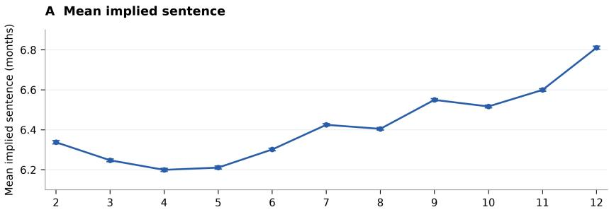

B Mean answer probabilities  
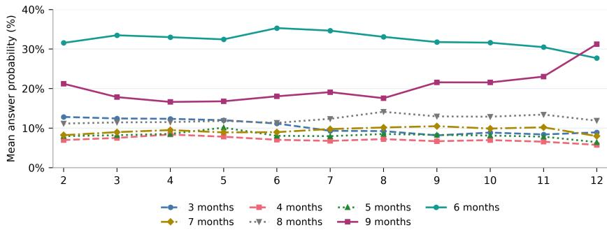

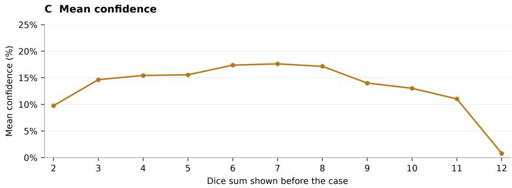  
Figure 1: Jev’s sentencing judgments by irrelevant numerical anchor value. The same shoplifting case was presented, preceded by information about the sum of two dice, ranging from 2 to 12, with 500 responses per sum. (A) Mean implied sentence in months by dice sum with 95% confidence intervals. (B) Mean probabilities assigned to the sentence answer options by dice sum. (C) Mean reported confidence by dice sum. Implied sentences are probability-weighted scores rather than discrete selections by Jev.

In the original task’s second condition, all 500 responses rank one of the two alternatives providing greater total harm reduction first, and 488/500 (97.6%) also rank the zero-risk alternative last. In the edited task, 413/500 responses (82.6%) select the alternative providing greater total harm reduction, while 87/500 (17.4%) select the zero-risk alternative (Figure 5A).

Answer order affects Jev’s output, particularly in the edited version. In the original version, the proportion ranking the zero-risk alternative last increases from 95.2% to 100% when the answer order is reversed, a difference of 4.8 percentage points (95% CI [2.27, 8.20]). In the edited version, the proportion selecting the program producing the larger absolute risk reduction falls from 99.6% when the zero-risk program is first in the candidate list to 65.6% when the larger-reduction program is first, a decline of 34.0 percentage points (95% CI [28.10, 40.09]). The mean returned probability assigned to the larger-reduction program falls from 66.8% to 53.0% (Figure 5B). The difference, larger-reduction program first minus zero-risk program first, is −13.84 percentage points (95% CI [−14.73, −12.96]). Mean returned confidence falls from 33.7% to 10.8% (Figure 5C), a difference of −22.92 percentage points (95% CI [−24.29, −21.54]).

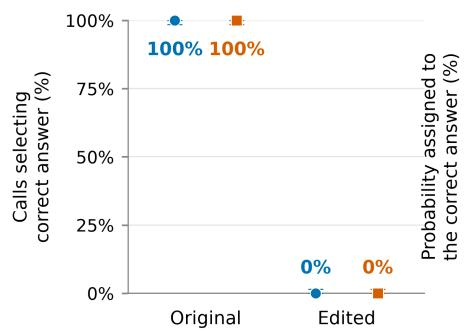

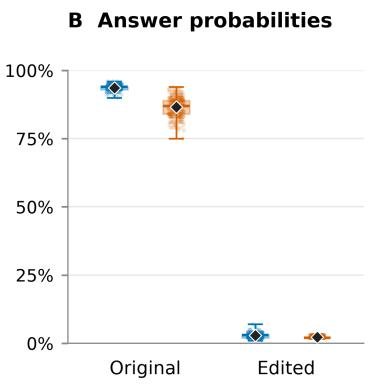

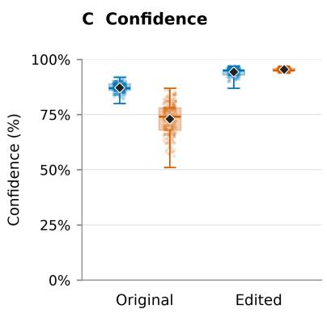  
Figure 2: Conjunction judgments in the original and edited tasks, by answer order (250 responses per order condition). (A) Percentage of responses selecting the logically correct option with 95% Wilson confidence intervals. (B) Probability assigned to the correct option. (C) Reported confidence. In panels B and C, dots represent individual responses, boxes show the interquartile range, horizontal lines indicate medians, whiskers show the full range, and diamonds indicate means. Colors distinguish whether the correct or incorrect option was first in the answer list.

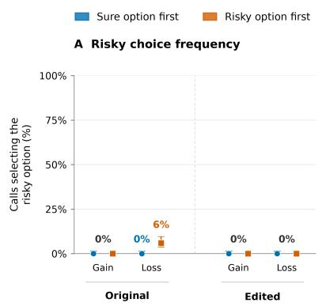

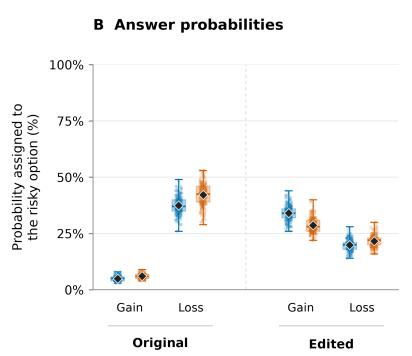

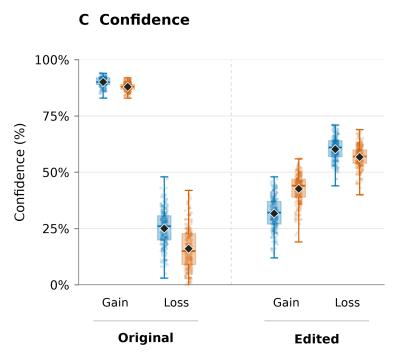  
Figure 3: Jev’s output by gain/loss framing of the input and answer order in the original and edited versions of the tasks (250 responses per order condition). (A) Percentage of responses selecting the risky option, with 95% Wilson confidence intervals. (B) Probability assigned to the risky option. (C) Reported confidence. Panels B and C use the boxplot conventions of Figure 2. Colors distinguish whether the certain or risky option was first in the answer list.

## 6 Conjunction: Robustness

To examine whether the contrasting results of the original and edited conjunction tasks reflect a broader pattern, we constructed 30 additional scenarios varying in domain, plausibility of the additional event, wording, grammatical quality, and language. As in Section 5.2, each scenario was tested with both answer orders, collecting 250 responses per order (500 per scenario).

Across the 30 scenarios (15,000 responses), Jev selected the incorrect answer in 53.96% of responses. Performance varied substantially across scenarios: nine yielded exclusively incorrect responses, whereas eleven yielded exclusively correct responses. Accuracy also varied with answer order, averaging 39.79% when the conjunction was presented first and 52.29% when it was presented second. In two scenarios, accuracy ranged from 0% to 100% across answer orders. These descriptive findings indicate that Jev’s difficulties in applying the conjunction rule extend beyond the single edited task and arise across diverse formulations, while highlighting substantial variation across scenarios and sensitivity to answer presentation.

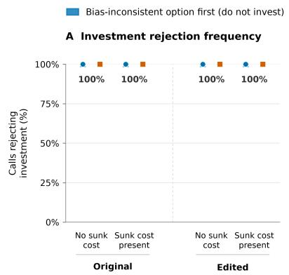

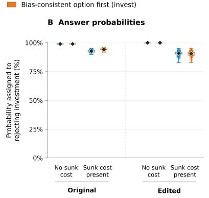

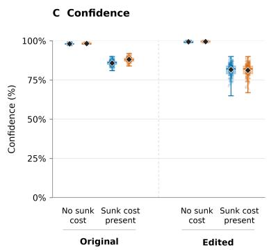

Figure 4: Jev’s output by sunk cost condition of the input and answer order in the original and edited versions of the tasks (250 responses per condition). (A) Percentage of responses rejecting investment, with 95% Wilson confidence intervals. (B) Probability assigned to rejecting investment. (C) Reported confidence. Panels B and C use the boxplot conventions of Figure 2. Colors distinguish whether the option to invest or not to invest was first in the answer list.  
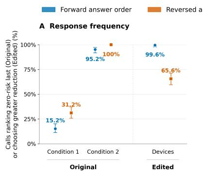

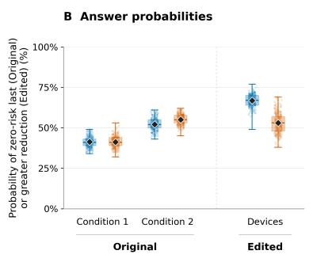

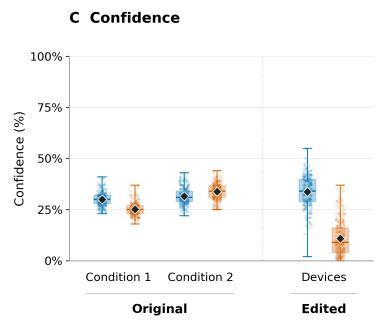  
Figure 5: Jev’s zero-risk judgements in the original control and treatment conditions and in the edited task, by answer order (250 responses answer order). (A) Percentage of responses ranking the zero-risk alternative last in the original task, or selecting the program producing the larger absolute risk reduction in the edited task, with 95% Wilson confidence intervals. (B) Probability assigned to the corresponding outcome. (C) Reported confidence. In the original version, panel B sums the returned probabilities of the two rankings placing the zero-risk alternative last. Panels B and C use the boxplot conventions of Figure 2. Colors distinguish the forward and reversed answer orders.

## 7 Social bias

## 7.1 Design and outcome

The social-bias experiment tests whether the price recommended to an otherwise identical car buyer changes with the buyer’s race or gender (Ayres and Siegelman, 1995). We ask Jev to recommend an initial offer price for a car buyer, varying the buyer’s name while keeping all other stated customer and vehicle characteristics fixed. The model evaluates ten price options ranging from \$28,750 to \$30,895, presented in ascending order. The customer is a 30-year-old bank systems analyst living in an affluent Chicago neighborhood, with independent financing.

The experiment uses 125 names assigned to six demographic groups: White, Black, and Hispanic women and men. Five groups contain 21 names each; the Black women group contains 20. Name selection draws on published name-validation studies with US respondents (Gaddis, 2017a,b; Baert et al., 2022). Each name is tested in two conditions. In the name-only condition, the customer’s name is provided without explicit demographic labels. In the explicit condition, the same name is accompanied by its corresponding ethnic and gender labels, such as “a Hispanic man.”

We collect 100 responses per name in each condition, yielding 12,500 responses per condition and 25,000 responses overall. The sequence of names is randomized within each run.

For each call i, we derive a probability-weighted price:

$$
q _ { i } = \frac { \sum _ { k = 1 } ^ { 1 0 } v _ { k } p _ { i k } } { \sum _ { k = 1 } ^ { 1 0 } p _ { i k } } ,\tag{5}
$$

where $v _ { k }$ is the dollar amount of option k and $p _ { i k }$ is its returned probability. The denominator normalizes the rounded probability totals. This probability-weighted price is a derived summary over the specified price grid, rather than a dollar amount directly returned by the model.

We first average $q _ { i }$ across the 100 responses for each name, then average these name-level means within each demographic group.

## 7.2 Results and comparison with human evidence

Probability-weighted group means vary within a narrow range: \$29,529.28–29,539.90 in the base run and \$29,540.71–29,560.75 in the explicit run (Figure 6).

Observed differences between groups in probability-weighted mean prices are minimal. Of the four group comparisons—Black–White and Hispanic–White in the name-only and explicit conditions—only Black—White in the explicit condition has a confidence interval for the difference in mean prices that exludes zero, and this difference is only \$12.30 on a price range of \$2,145. Some observed contrasts differ in direction from the classic human evidence (Ayres and Siegelman, 1995). In the explicit condition, the probability-weighted mean price is slightly lower for Black than for White customers. In the name-only condition, it is slightly lower for women than for men in all three racial groups. These differences remain small within the tested scenario.

## 8 Discussion

Classic bias experiments are influential because they reveal recurring patterns of judgment whose relevance extends beyond the scenarios used to demonstrate them. Decisions that look very different can share the same susceptibility to irrelevant information, context, or changes in presentation. For a model designed to supply fast, low-cost judgments, these tests help identify both opportunities for improvement and conditions under which its capabilities can be used effectively.

In several respects, Jev’s performance on these tests is encouraging. Jev answered all nine cognitive reflection items correctly in every call and rejected investment in every sunk-cost condition. It generally favored greater harm reduction in the zero-risk tasks. In the pricing experiment, demographic differences were small and the highestscored price was almost unchanged. These successes support the practical promise of a model designed to make inexpensive, rapid judgments.

Jev nevertheless gave the wrong answer in every call on the edited conjunction task. Its perfect performance on the original conjunction task therefore did not extend to the edited version. The conjunction experiment raises a broader concern about evaluations based on well-known benchmarks. Although this does not establish that the model has memorized the original example, it suggests that successful performance on familiar benchmarks may substantially overstate the model’s ability to generalize to unfamiliar instances of the same problem.

Two further findings have implications across applications. In the anchoring experiment, the irrelevant dice value affected the sentencing estimate despite unchanged case facts. Users may reasonably assume that adding background information unrelated to a decision is harmless, since the model can simply disregard it. These results challenge that assumption. Evaluation should therefore test sensitivity to irrelevant context, including the incidental information likely to accompany real requests.

Answer order creates a related problem. For example, reversing the answer options list reduced selection of the program producing the larger absolute risk reduction from 99.6% to 65.6% in the edited zero-risk task, and increased selection of the zero-risk program from 0.4% to 34.4%.

The probabilities assigned to the answer options also matter when the chosen answers remain stable. For instance, consider a customer-service system that handles a request automatically when the probability assigned to that option is at least 80%, and otherwise escalates it to a human. A shift from 83% to 77% changes the application’s action even though automatic handling remains the model’s preferred answer. Most biases had an impact on probability scores. For example, the sunk-cost condition and framing changed the probability assigned to the investment and risky option, respectively.

## 9 Limitations

Most paradigms use one original scenario and one edited scenario. Repeated calls characterize output variation for these specific prompts, rather than performance across the broader population of problems associated with each bias. Indeed, the conjunction contrast provides a counterexample to reliable transfer between two formulations.

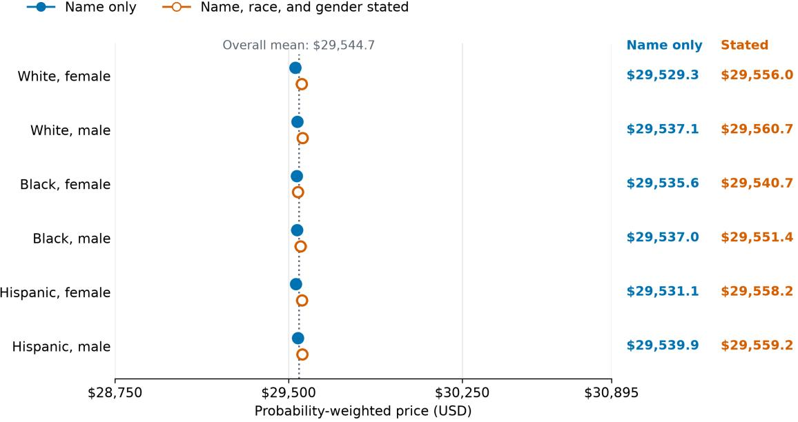  
Figure 6: Probability-weighted price summaries by ethnicity and gender in the base (name only) and explicit (name, race, and gender) conditions (125 names, 100 responses per name per condition). Small dots represent individual name means, larger dots show group means, and whiskers indicate 95% bootstrap confidence intervals across names. The dotted vertical line indicates the overall mean across both conditions. Prices are derived by weighting the listed dollar amounts by their returned probabilities and normalizing the totals.

The implied sentences and probability-weighted prices variables in the Anchoring and Social bias experiments are derived indices over fixed response grids. Their magnitudes depend on the available levels and returned probability distributions. Type-Safe’s Jev 1.13 documentation cautions that Score outputs have limited numerical calibration for reconstructing exact values between criteria (Type-Safe, 2026).

Original and edited versions were collected in separate runs, as were the name-only and explicitdemographic conditions. Although we are not aware of evidence of possible differences in service state between runs, the present design cannot rule them out.

## Data and code availability

Working-draft note. All data and code is available at: https://github.com/ ilariaimperatrice27/JevBehavior

## References

Gati V. Aher, Rosa I. Arriaga, and Adam Tauman Kalai. 2023. Using large language models to simulate multiple humans and replicate human subject studies. In

Proceedings ofthe 40th International Conference on Machine Learning, volume 202 of Proceedings of Machine Learning Research, pages 337–371. PMLR.

Diogo Almeida. 2026. Introducing system one models & jev. TypeSafe AI Blog.

Lisa P. Argyle, Ethan C. Busby, Nancy Fulda, Joshua R. Gubler, Christopher Rytting, and David Wingate. 2023. Out of one, many: Using language models to simulate human samples. Political Analysis, 31(3):337–351.

Hal R. Arkes and Catherine Blumer. 1985. The psychology of sunk cost. Organizational Behavior and Human Decision Processes, 35(1):124–140.

Ian Ayres and Peter Siegelman. 1995. Race and gender discrimination in bargaining for a new car. The American Economic Review, pages 304–321.

Stijn Baert, Louis Lippens, and Hannah Van Borm. 2022. Selecting names for experiments on ethnic discrimination. Technical report, IZA Discussion Papers.

Jonathan Baron, Rajeev Gowda, and Howard Kunreuther. 1993. Attitudes toward managing hazardous waste: What should be cleaned up and who should pay for it? Risk Analysis, 13(2):183–192.

Marcel Binz and Eric Schulz. 2023. Using cognitive psychology to understand GPT-3. Proceedings ofthe National Academy ofSciences, 120(6):e2218523120.

Paola Cantarelli, Nicola Belle, and Paolo Belardinelli. 2020. Behavioral public hr: Experimental evidence

on cognitive biases and debiasing interventions. Review ofPublic Personnel Administration, 40(1):56– 81.

Zhen-Song Chen, Wei-Chen Jiao, Y. P. Tsang, C. H. Wu, and Xian-Jia Wang. 2026. Do LLMs keep mental accounts? empirical evidence from hedonic framing, nonfungibility, and sunk cost sensitivity. Group Decision and Negotiation, 35:61. Article number 61.

Julian Coda-Forno, Marcel Binz, Jane X. Wang, and Eric Schulz. 2024. CogBench: a large language model walks into a psychology lab. In Proceedings of the 41st International Conference on Machine Learning, volume 235 of Proceedings of Machine Learning Research, pages 9076–9108. PMLR.

Tobias Deußer, Lorenz Sparrenberg, and Rafet Sifa. 2026. Evaluating and benchmarking the system one model Jev. Preprint, arXiv:2609.37647.

Jessica Maria Echterhoff, Yao Liu, Abeer Alessa, Julian McAuley, and Zexue He. 2024. Cognitive bias in decision-making with LLMs. In Findings ofthe Associationfor Computational Linguistics: EMNLP 2024, pages 12640–12653. Association for Computational Linguistics.

Birte Englich, Thomas Mussweiler, and Fritz Strack. 2006. Playing dice with criminal sentences: The influence of irrelevant anchors on experts’ judicial decision making. Personality and Social Psychology Bulletin, 32(2):188–200.

Nicholas Epley and Thomas Gilovich. 2006. The anchoring-and-adjustment heuristic: Why the adjustments are insufficient. Psychological Science, 17(4):311–318.

Jonathan St. B. T. Evans and Keith E. Stanovich. 2013. Dual-process theories of higher cognition: Advancing the debate. Perspectives on Psychological Science, 8(3):223–241.

Shane Frederick. 2005. Cognitive reflection and decision making. Journal of Economic Perspectives, 19(4):25–42.

S Michael Gaddis. 2017a. How black are lakisha and jamal? racial perceptions from names used in correspondence audit studies. Sociological Science, 4:469.

S Michael Gaddis. 2017b. Racial/ethnic perceptions from hispanic names: Selecting names to test for discrimination. Socius, 3:2378023117737193.

Tianxiang Gao, Jinzhe Li, Zhiyuan Li, Yi Chang, and Yuan Wu. 2026. More choices, fewer decisions: Ordinal-scale bias in JEV-like direct-decision models. Preprint, arXiv:2609.38827.

Howard Garland. 1990. Throwing good money after bad: The effect of sunk costs on the decision to escalate commitment to an ongoing project. Journal of Applied Psychology, 75(6):728–731.

Ruoqi Guo, Yi Liu, Gelei Deng, Yuekang Li, Lida Zhao, Yutao Wu, Simin Chen, Ying Zhang, and Leo Yu Zhang. 2026. Just ask Jev: Reinforcement learning for calibrated decisions as a zero-shot detector of AI alignment failures. Preprint, arXiv:2609.29429.

Thilo Hagendorff, Sarah Fabi, and Michal Kosinski. 2023. Human-like intuitive behavior and reasoning biases emerged in large language models but disappeared in ChatGPT. Nature Computational Science, 3(10):833–838.

Jiangen He and Jiqun Liu. 2025. Investigating the impact of LLM personality on cognitive bias manifestation in automated decision-making tasks. Preprint, arXiv:2502.14219.

Itay Itzhak, Gabriel Stanovsky, Nir Rosenfeld, and Yonatan Belinkov. 2024. Instructed to bias: Instruction-tuned language models exhibit emergent cognitive bias. Transactions of the Association for Computational Linguistics, 12:771–785.

Ryan Koo, Minhwa Lee, Vipul Raheja, Jong Inn Park, Zae Myung Kim, and Dongyeop Kang. 2024. Benchmarking cognitive biases in large language models as evaluators. In Findings ofthe Associationfor Computational Linguistics: ACL 2024, pages 517–545. Association for Computational Linguistics.

Irwin P. Levin, Sandra L. Schneider, and Gary J. Gaeth. 1998. All frames are not created equal: A typology and critical analysis of framing effects. Organizational Behavior and Human Decision Processes, 76(2):149–188.

Jiawei Li. 2026. Fast models, slow evidence: A paired and self-audited evaluation of system-1 decision models for LLM agent harnesses. Preprint, arXiv:2610.02267.

Simon Malberg, Roman Poletukhin, Carolin M. Schuster, and Georg Groh. 2025. A comprehensive evaluation of cognitive biases in LLMs. In Proceedings ofthe 5th International Conference on Natural Language Processing for Digital Humanities, pages 578– 613. Association for Computational Linguistics.

Marta Marchiori Manerba, Karolina Stanczak, Riccardo´ Guidotti, and Isabelle Augenstein. 2024. Social bias probing: Fairness benchmarking for language models. In Proceedings of the 2024 Conference on Empirical Methods in Natural Language Processing, pages 14653–14671. Association for Computational Linguistics.

Barbara J. McNeil, Stephen G. Pauker, Harold C. Sox, and Amos Tversky. 1982. On the elicitation of preferences for alternative therapies. New England Journal ofMedicine, 306(21):1259–1262.

Qiaozhu Mei, Yutong Xie, Walter Yuan, and Matthew O. Jackson. 2024. A turing test of whether AI chatbots are behaviorally similar to humans. Proceedings of the National Academy of Sciences, 121(9):e2313925121.

Dean M. Morier and Eugene Borgida. 1984. The conjunction fallacy: A task specific phenomenon? Personality and Social Psychology Bulletin, 10(2):243– 252.

Alicia Parrish, Angelica Chen, Nikita Nangia, Vishakh Padmakumar, Jason Phang, Jana Thompson, Phu Mon Htut, and Samuel R. Bowman. 2022. BBQ: A hand-built bias benchmark for question answering. In Findings ofthe Associationfor Computational Linguistics: ACL 2022, pages 2086–2105. Association for Computational Linguistics.

Pouya Pezeshkpour and Estevam Hruschka. 2024. Large language models sensitivity to the order of options in multiple-choice questions. In Findings of the Association for Computational Linguistics: NAACL 2024, pages 2006–2017. Association for Computational Linguistics.

Barry M. Staw. 1976. Knee-deep in the big muddy: A study of escalating commitment to a chosen course of action. Organizational Behavior and Human Performance, 16(1):27–44.

Fritz Strack and Thomas Mussweiler. 1997. Explaining the enigmatic anchoring effect: Mechanisms of selective accessibility. Journal ofPersonality and Social Psychology, 73(3):437–446.

Gaurav Suri, Lily R. Slater, Ali Ziaee, and Morgan Nguyen. 2024. Do large language models show decision heuristics similar to humans? a case study using GPT-3.5. Journal ofExperimental Psychology: General, 153(4):1066–1075.

Alex Tamkin, Amanda Askell, Liane Lovitt, Esin Durmus, Nicholas Joseph, Shauna Kravec, Karina Nguyen, Jared Kaplan, and Deep Ganguli. 2023. Evaluating and mitigating discrimination in language model decisions. Preprint, arXiv:2312.03689.

Keela S. Thomson and Daniel M. Oppenheimer. 2016. Investigating an alternate form of the cognitive reflection test. Judgment and Decision Making, 11(1):99– 113.

Amos Tversky and Daniel Kahneman. 1974. Judgment under uncertainty: Heuristics and biases. Science, 185(4157):1124–1131.

Amos Tversky and Daniel Kahneman. 1981. The framing of decisions and the psychology of choice. Science, 211(4481):453–458.

Amos Tversky and Daniel Kahneman. 1983. Extensional versus intuitive reasoning: The conjunction fallacy in probability judgment. Psychological Review, 90(4):293–315.

TypeSafe. 2026. TypeSafe documentation. https: //docs.typesafe.ai. Pages: System One, Primitives, Choice, Score, Confidence. Accessed 9 October 2026.

TypeSafe AI. 2026. System one. TypeSafe AI Documentation. Accessed: 2026-10-09.

W. Kip Viscusi, Wesley A. Magat, and Joel Huber. 1987. An investigation of the rationality of consumer valuations of multiple health risks. The RAND Journal of Economics, 18(4):465–479.

Peiyi Wang, Lei Li, Liang Chen, Zefan Cai, Dawei Zhu, Binghuai Lin, Yunbo Cao, Lingpeng Kong, Qi Liu, Tianyu Liu, and Zhifang Sui. 2024. Large language models are not fair evaluators. In Proceedings ofthe 62nd Annual Meeting ofthe Associationfor Computational Linguistics (Volume 1: Long Papers), pages 9440–9450. Association for Computational Linguistics.

Gary L. Wells. 1985. The conjunction error and the representativeness heuristic. Social Cognition, 3(3).

Yaodong Yang, Hongyao Tang, Yi Ma, Xingyu Fan, Weixun Wang, Jinpeng Li, and Tianpei Yang. 2026. Code owns the simulation, jev owns the evaluation. arXiv preprint arXiv:2610.01834.

Chujie Zheng, Hao Zhou, Fandong Meng, Jie Zhou, and Minlie Huang. 2024. Large language models are not robust multiple choice selectors. In International Conference on Learning Representations.