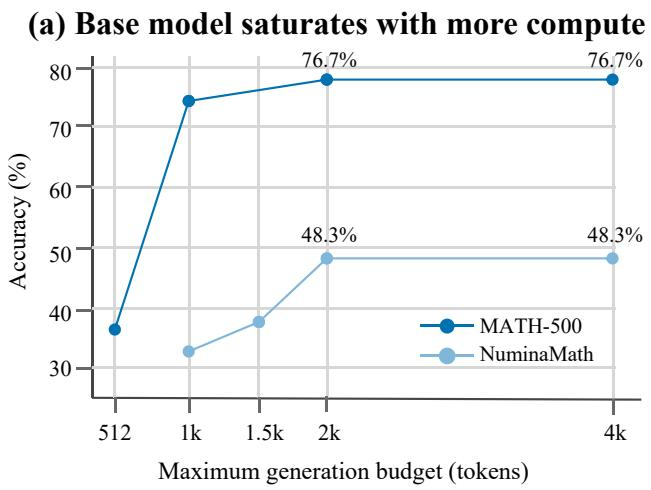
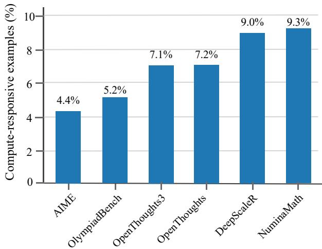
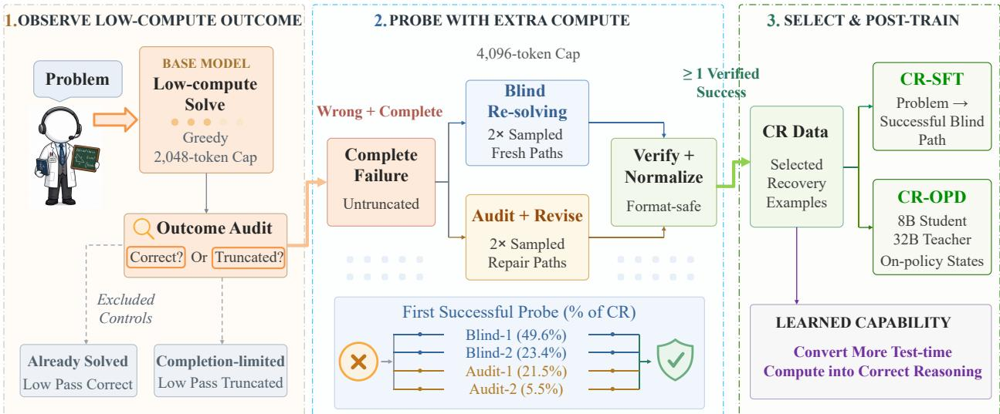
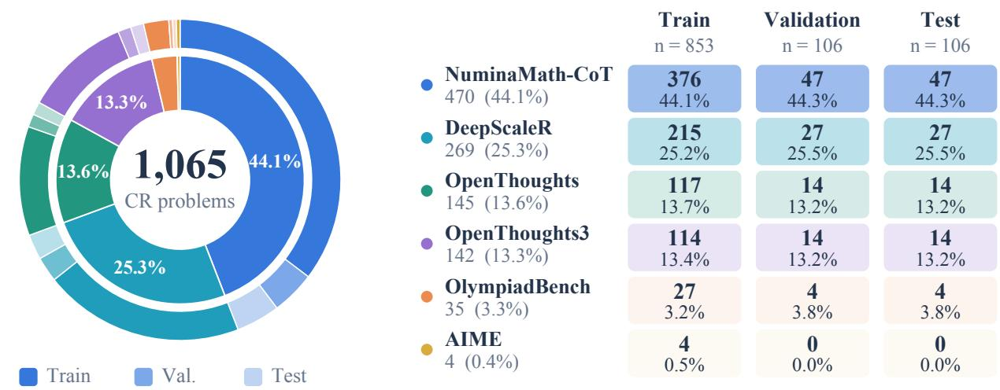
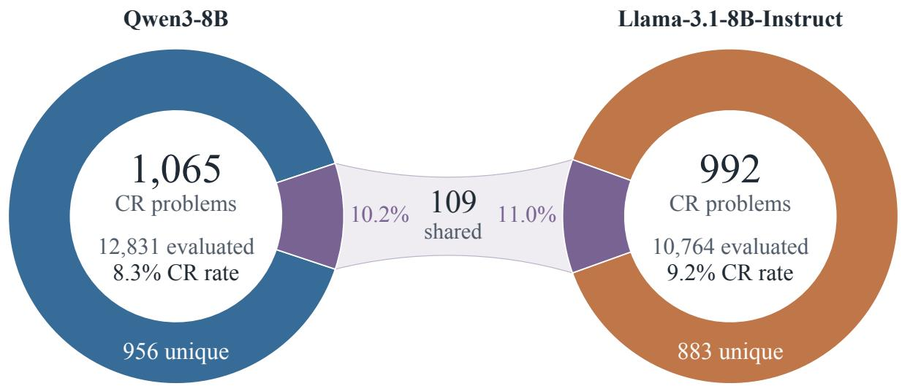
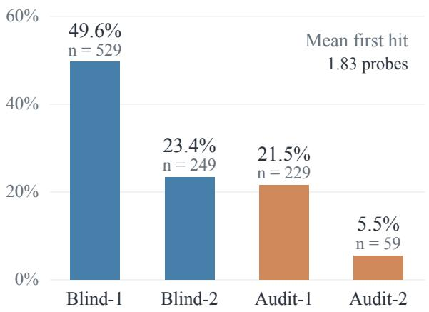
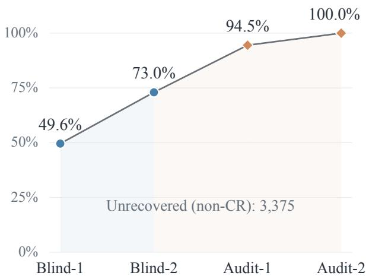

# Beyond Correctness: Compute-Responsive Data Selection for Reasoning Model Post-Training

Liang He Xiangyu Li Yuxin Wang Hanbin Zhang Mingyu Cao

Zhaomiao Guo Xilu Wang

University of Texas at Austin Advanced Micro Devices University of Warwick University of Surrey

## Abstract

Reasoning language models increasingly rely on test-time compute scaling, yet most existing work studies how to allocate inference computation while treating the model itself as fixed. We ask a comple mentary question: can reasoning models be post-trained to make better use of a given amount of test-time compute, and which examples are most useful for this goal? Our key observation is that reasoning problems differ substantially in their response to additional computation. Some are already solved under limited compute, others remain unresolved even after further reasoning, while a distinct subset changes from complete initial failure to success when additional reasoning is provided. We call these computeresponsive (CR) examples and introduce Compute-Responsive Data Selection (CRDS), a post-training data-selection principle that prioritizes examples with empirically demonstrated marginal utility from additional reasoning. On Qwen3-8B, SFT on CR examples recovers 45.3% of held-out low-compute failures, compared with 40.6% when training on already-solved examples. The advantage extends be yond the selected CR split: SFT-CR reaches 51.8% overall accuracy on an independently sampled test distribution, with the gain concentrated on compute-responsive problems. CR training also shifts the compute–accuracy frontier across inference budgets from 512 to 4,096 tokens, outperforming matched non-CR training throughout and reaching 48.1% recovery at the largest budget. The same pattern is supported across multiple data sources, remains visible under on-policy distillation, and extends to Llama-3.1-8B-Instruct when CR sets are reconstructed separately for that model. Better test-time compute utilization can therefore be learned through post-training, with recoverable responses to additional reasoning providing a particularly informative signal for selecting training examples.

## 1 Introduction

Test-time computation has emerged as an important scaling dimension for reasoning language models. Modern systems can improve predictions by spending additional inference-time computation on longer derivations, repeated attempts, verification, search, or refinement(Wei et al., 2022; Wang et al., 2023a; Lightman et al., 2024; Yao et al., 2023a; Madaan et al., 2023). This has motivated substantial work on test-time scaling and adaptive inference, where a central question is how much computation should be allocated to each problem (Snell et al., 2024; Wen et al., 2026).

Most existing approaches, however, treat the reasoning model as a fixed consumer of computation: once additional compute is allocated, it is assumed that the model can productively convert it into better reasoning. Our experiments challenge this assumption. Additional realized generation can fail to produce additional correct solutions, suggesting an important distinction: available compute is not necessarily useful compute. This motivates a complementary question:

Can reasoning models be post-trained to make better use of test-time compute, and if so, which training examples are most useful for this goal?



(b) Compute responsiveness across datasets  
  
Figure 1: Heterogeneous response to additional test-time computation. (a) Increasing the generation budget improves base-model accuracy at lower budgets, but beyond a certain budget, additional computation no longer translates into higher accuracy. (b) Compute-responsive examples occur at substantially different rates across reasoning datasets.

Figure 1 summarizes the two observations that motivate our approach. In Figure 1(a), increasing the generation budget improves base-model accuracy in lower-budget comparisons, but the marginal gain di minishes and eventually disappears in the highest-budget comparison shown. In Figure 1(b), responsiveness to additional reasoning varies considerably across datasets. Some problems are already solved under limited compute, others remain unresolved, while a distinct subset transitions from a complete initial failure to a correct solution after additional reasoning. We term these compute-responsive (CR) problems. CR problems provide a particularly informative form of post-training supervision. Already-solved examples demonstrate behavior the model can already execute under limited compute, while unresolved examples provide no successful reasoning path under the available additional computation. CR examples lie between these two cases: they reveal problems for which a successful reasoning path is accessible to the current model but is not reliably reached in its initial attempt. This suggests that post-training data should not be treated as equally useful for improving compute utilization (Zhou et al., 2023; Wang et al., 2023b).

Based on this observation, we introduce Compute-Responsive Data Selection (CRDS), a post-training data-selection principle that prioritizes examples according to whether additional reasoning actually changes the outcome. The goal is not simply to train on harder or previously incorrect problems, but to identify failures for which additional reasoning has already demonstrated recoverability. Constructing genuine CR data requires more than increasing the maximum generation length. Our early experiments showed that larger token budgets often capture only completion responsiveness, where a truncated trajectory is allowed to finish, rather than a genuine change in reasoning. We also found that deterministic revision can reproduce the original error and that brittle answer matching can create formatting-induced false recoveries. We therefore restrict CR candidates to complete initial failures, probe recoverability through sampled blind re-solving and audit-based revision, and normalize answers before assigning CR labels.

We primarily study CRDS under supervised fine-tuning, where its effect can be isolated through matched training sets that differ only in how examples are selected. We additionally apply the same selection principle to on-policy distillation, where supervision follows states visited by the evolving student policy, providing a complementary test of whether the CR signal remains useful beyond fixed offline supervision. CRDS changes only the post-training distribution: at inference time, the trained model receives only the origina problem, without previous failures, CR labels, repair prompts, or collection-time verifiers. Using Qwen3- 8B, we find that post-training itself already improves recovery of low-compute failures, but the choice of training data matters substantially. CR-selected SFT provides the strongest recovery among matched dataselection baselines and produces a substantially better compute–accuracy frontier across budgets from 512 to 4,096 tokens. The improvement persists on an independently sampled test distribution, is supported across multiple data sources, and also appears under on-policy distillation. We further test the same selection principle across additional model families and scales. Our main contributions are:

• We distinguish compute allocation from compute utilization and show that additional test-time computation does not necessarily translate into better reasoning.

• We introduce Compute-Responsive Data Selection (CRDS), a post-training data-selection principle identifying examples where additional reasoning converts complete initial failure into success, while separating genuine reasoning recovery from truncation and evaluation artifacts.

• We show that post-training data selection affects compute utilization: CR-selected supervision outperforms matched random and already-solved controls, shifts the compute–accuracy frontier, and remains useful across datasets, objectives, and model families.

## 2 Related Work

Test-time compute scaling. Recent reasoning systems improve inference by increasing test-time com putation through longer generations, repeated sampling, decomposition, search, verification, tool use, or iterative refinement (Zhou et al., 2022; Gao et al., 2023; Chen et al., 2023; Yao et al., 2023b; Shinn et al., 2023). These approaches establish inference computation as an important scaling axis, but primarily study how a fixed model should spend additional computation. Our work asks a prior question: for which prob lems does additional reasoning actually yield marginal utility?—because only by identifying such problems can we discuss how to allocate computation to them, and this “responsiveness” itself also becomes a viable principle for selecting post-training examples.

Adaptive computation and routing. A related literature allocates different amounts of computation to different examples according to difficulty, confidence, uncertainty, expected improvement, or task utility (Liu et al., 2020; Schuster et al., 2022; Schwartz et al., 2020; Chen et al., 2024; Ong et al., 2025). These methods optimize where a limited inference budget should be spent. CRDS operates at a different layer: it modifies the model so that computation allocated can be used more productively. The two perspectives can therefore be combined rather than viewed as alternatives.

Reasoning post-training and distillation. Supervised fine-tuning, reinforcement learning, preference optimization, knowledge distillation, and on-policy distillation have all been used to improve reasoning models (Rafailov et al., 2023; Shao et al., 2024; Hsieh et al., 2023; Agarwal et al., 2024). Although these methods differ in their optimization objectives, all depend critically on which examples provide supervision. Conventional selection criteria emphasize correctness, difficulty, quality, diversity, or teacher confidence. Compute responsiveness is different: an example is selected because additional reasoning has empirically demonstrated marginal utility for the current model.

Self-correction and revision. Prior work has also studied critique, reflection, verification, and self-correction (Bai et al., 2022; Welleck et al., 2023; Gou et al., 2024). Our use of revision differs in purpose. Blind re-solving and audit-based revision are primarily probes used to determine whether an initially failed problem lies

  
Figure 2: Compute-responsive data selection. Starting from complete initial failures, additional reasoning is used to identify problems for which at least one follow-up trajectory succeeds. The resulting computeresponsive examples are selected for post-training; no collection-time trajectory or verifier is required at inference.

within the model’s recoverable reasoning boundary. The central contribution is therefore not a new revision prompt, but the post-training signal obtained from the observed response to additional reasoning.

## 3 Compute Responsiveness as a Selection Principle

Our method has two stages. We first identify problems whose outcomes improve under additional reasoning, and then use these behavioral differences to select post-training data. Figure 2 summarizes the framework.

Compute Responsiveness For a problem $x _ { i }$ , let the base model produce an initial reasoning trajectory under a fixed inference procedure,

$$
y _ { i } ^ { \mathrm { l o w } } \sim \pi _ { 0 } ( \cdot \mid x _ { i } , c _ { \mathrm { l o w } } ) ,\tag{1}
$$

and let an external verifier determine correctness,

$$
s _ { i } ^ { \mathrm { l o w } } = \mathrm { E v a l } ( y _ { i } ^ { \mathrm { l o w } } ) \in \{ 0 , 1 \} .\tag{2}
$$

We also record whether the generation is truncated by the maximum generation budget, denoted by $t _ { i } ^ { \mathrm { l o w } } = 1$ A CR problem must be a complete initialfailure, rather than an unfinished generation:

$$
s _ { i } ^ { \mathrm { l o w } } = 0 , \qquad t _ { i } ^ { \mathrm { l o w } } = 0 .\tag{3}
$$

This excludes cases in which increasing the token cap merely allows a truncated trajectory to finish, which we refer to as completion responsiveness. For each complete failure, we generate additional reasoning trajectories using sampled blind re-solving and audit-based revision. Let $\mathcal { H } _ { i }$ denote the resulting set of additional trajectories. We define

$$
x _ { i } \in D _ { \mathrm { C R } } \iff s _ { i } ^ { \mathrm { l o w } } = 0 , t _ { i } ^ { \mathrm { l o w } } = 0 , \exists y \in \mathcal { H } _ { i } : \mathrm { E v a l } ( y ) = 1 .\tag{4}
$$

Answers are normalized before applying Equation 4 so that formatting-only changes are not counted as reasoning recovery. CR is therefore defined by observed behavior under a fixed model and additionalreasoning protocol. A problem may be already solved by one model, compute-responsive for another, or remain unresolved under the available reasoning procedure. This separates responsiveness from intrinsic problem difficulty.

Constructing the CR Training Set Constructing genuine CR examples requires more than simply increasing max new tokens. Pilot experiments revealed three common confounds: completion effects from truncated low-budget trajectories, repeated errors under deterministic revision, and false recoveries caused by brittle answer matching. We therefore restrict candidates to complete initial failures, probe each candidate using multiple sampled blind and audit trajectories, and normalize answers before assigning CR labels. The evolution of this collection pipeline is described in Appendix A, with representative normalization artifacts reported in Appendix F. During large-scale collection, CR rates vary across datasets, from 4.4% on AIME and 5.2% on OlympiadBench to 9.0% on DeepScaleR and 9.3% on the processed NuminaMath-CoT subset. Although our collection protocol allows up to four additional trajectories per complete failure, most CR examples are detected much earlier. As shown in Appendix M, a single blind re-solving attempt recovers 49.6% of all CR examples, and two blind attempts recover 73.0%. The average first-hit cost among CR examples is only 1.83 additional generations, indicating that the four-attempt protocol is mainly used to improve recall rather than being the typical discovery cost. At the same time, audit-based revision accounts for 27.0% of CR examples whose first success is not found by blind re-solving, showing that the blind and audit probes are not redundant. After validation, normalization, and problem-level deduplication, the final CR corpus contains 1,065 unique problems, split into 853 training, 106 validation, and 106 test examples. All trajectories associated with the same underlying problem remain in the same split. Full collection statistics, source composition, and the data schema are reported in Appendices B, C, and E.

Compute-Responsive Supervised Fine-Tuning Our primary instantiation uses ordinary supervised finetuning so that the effect of data selection can be isolated directly. For each CR training problem with a validated successful blind trajectory, the input contains only the original problem and the target is the successful reasoning trajectory; the failed low-compute output is not included. This design ensures that any inference-time improvement must come from the post-trained model itself rather than from conditioning on previous failures, repair prompts, CR labels, or collection-time verifiers. We compare CR-selected supervision against matched alternatives that use the same number of examples and the same training procedure but differ in where the targets come from: incorrect low trajectories from CR problems, random correct trajectories, correct trajectories from already-solved problems, and successful trajectories from CR problems. This controlled design isolates whether compute responsiveness identifies a more useful region of the training distribution, rather than merely whether additional fine-tuning is beneficial.

Compute-Responsive On-Policy Distillation We also apply the same data-selection principle to onpolicy distillation (OPD) as a complementary training setting. Unlike SFT, which optimizes against fixed offline targets, OPD samples trajectories from the current student policy and obtains teacher supervision on states the student actually visits. The supervised state distribution therefore changes as the student changes. We use this setting to test whether compute responsiveness remains informative when the learning objective already adapts to the evolving student policy. The OPD variants differ primarily in which problems are selected for training: all available problems, already-solved problems, or CR problems.

## 4 Experimental Setup

Models, data, and CR construction. Our primary experiments use Qwen3-8B (Qwen Team, 2025) with enable thinking=False. The initial CR collection pass uses greedy decoding with a maximum generation budget of 2,048 tokens. For each complete initial failure, recoverability is probed using sam pled blind re-solving and audit-based revision. The CR corpus is constructed from six mathematical reasoning sources: NuminaMath-CoT (Li et al., 2024), DeepScaleR (Luo et al., 2025), OpenThoughts and OpenThoughts3 (Guha et al., 2025), AIME-style competition problems (AI-MO, 2024), and Olympiad Bench (He et al., 2024). After validation, answer normalization, and problem-level deduplication, the final corpus contains 1,065 unique CR problems, split into 853 training, 106 validation, and 106 test examples. All trajectories derived from the same underlying problem remain in the same split to prevent leakage. Complete prompts and collection settings are provided in Appendix D, and the source-level composition is reported in Appendix C.

Training protocols. For supervised fine-tuning, we compare SFT-CR with three matched controls: SFT-Random, SFT-Already-Solved, and SFT-Wrong. All variants use the same Qwen3-8B initialization, 616 training examples, LoRA configuration, and optimization procedure, differing only in the selected training trajectories. The 616-example size is determined by the subset of CR training problems with clean successful blind trajectories. For on-policy distillation, Qwen3-8B serves as the student and Qwen3-32B as the frozen teacher. OPD-CR, OPD-All, and OPD-AlreadySolved use the same student, teacher, distillation objective, effective batch size, and optimization settings, differing primarily in the training distribution. Detailed SFT and OPD configurations are reported in Appendices G and H.

Evaluation protocol. We use two complementary evaluation settings. The held-out CR split measures recovery, since every example is a complete initial failure for the base model. We additionally evaluate on a 735-example mixed generalization test set to measure overall performance and regressions on problems the base model already solves. This set combines the frozen 106-example CR test split with 629 independently sampled non-CR problems from the same source pools. For each source dataset, non-CR examples are sampled according to the natural proportion of Already-Solved and Unresolved examples in that source pool, yielding 372 Already-Solved and 257 Unresolved examples. The construction procedure is detailed in Appendix P. To evaluate compute utilization directly, we test maximum generation budgets of 512, 1,024, 2,048, and 4,096 tokens under matched decoding settings. We report accuracy and recovery at each budget under matched deterministic decoding settings. All deterministic evaluations are run with batch size 1 to avoid batching-dependent generation differences observed in our inference stack.

Cross-model evaluation. To test whether the CR phenomenon and the benefit of CR-based selection extend beyond Qwen3-8B, we repeat the core CR construction and matched SFT comparison on Llama 3.1-8B-Instruct (Dubey et al., 2024). Each model reconstructs its own CR set from the same underlying reasoning sources rather than reusing Qwen3-8B labels. Cross-model CR statistics and additional experimental details are reported in Appendix K.

## 5 Results

We first isolate the role of data selection under controlled SFT. The analysis then moves from held-out CR recovery to an independent test set, compute-scaling behavior, dataset-level decomposition, OPD, and cross-model evaluation.

Table 1: Held-out low-budget recovery after controlled SFT. All SFT variants use 616 examples and the same base model and LoRA training configuration.
<table><tr><td rowspan="2">Metric</td><td rowspan="2">Base model</td><td colspan="4">Controlled supervised fine-tuning</td></tr><tr><td>SFT-Wrong</td><td>SFT-Random</td><td>SFT-Already-Solved</td><td>SFT-CR</td></tr><tr><td>Recovery (%) ↑</td><td>Base 0.0</td><td>29.2</td><td>31.1</td><td>40.6</td><td>45.3</td></tr><tr><td>Avg. tokens</td><td>858</td><td>888</td><td>908</td><td>918</td><td>891</td></tr><tr><td>Trunc. (%) ↓</td><td>0.0</td><td>10.4</td><td>10.4</td><td>13.2</td><td>8.5</td></tr></table>

Table 2: General test accuracy and responsiveness-stratified performance. The mixed test set combines the frozen CR test split with independently sampled Already-Solved and Unresolved examples from the same source pools.
<table><tr><td>Method</td><td>Overall (735)</td><td>CR (106)</td><td>Unresolved (257)</td></tr><tr><td>Base</td><td>50.6</td><td>0.0</td><td>0.0</td></tr><tr><td>SFT-Random</td><td>49.1</td><td>34.9</td><td>2.3</td></tr><tr><td>SFT-Already-Solved</td><td>49.4</td><td>30.2</td><td>2.7</td></tr><tr><td>SFT-CR</td><td>51.8</td><td>47.2</td><td>3.9</td></tr></table>

Post-Training Helps, but Data Selection Matters. We first ask how much of the recovery gain comes from supervised post-training itself, and how much depends on which examples are selected for training. Table 1 compares four controlled SFT conditions on the 106 held-out CR validation problems. Base accuracy is 0% by construction because every example is a complete low-compute failure for the original model. The first result is that post-training itself is already useful. Even without targeted selection, SFT-Wrong recovers 29.2% of the original failures and SFT-Random reaches 31.1%. This shows that part of the low-compute failure region can be improved simply through additional supervised training. The choice of training data, however, changes the magnitude of that gain. Training on examples the base model already solves increases recovery to 40.6%, substantially above random selection. SFT-CR improves further to 45.3%, exceeding SFT-Random by 14.2 percentage points and SFT-Already-Solved by 4.7 points. Thus, the result is not merely that fine-tuning helps: examples selected by their response to additional reasoning provide the strongest supervision among the matched training sets. The advantage is also not explained by longer generations. SFT-CR produces 891 tokens on average, fewer than SFT-Random at 908 and SFT-Already-Solved at 918, while its truncation rate is also lower at 8.5%. Checkpoint and multi-seed analyses are reported in Appendices G and L, with additional efficiency statistics in Appendix I. Post-training therefore recovers a substantial fraction of the original failures even with generic supervision, but the size of the gain depends strongly on the selected training data. We next test whether the advantage of CR selection remains visible outside the CR-constructed evaluation set.

The Gain Extends beyond the CR-Selected Evaluation Set. The controlled SFT comparison shows that CR-selected trajectories are more effective for recovering held-out CR failures than matched alternatives. However, the held-out CR split is deliberately constructed around the behavior targeted by CRDS. We therefore evaluate the same models on a 735-example mixed generalization test set consisting of the frozen CR test split and independently sampled Already-Solved and Unresolved examples from the same source pools. Table 2 reports overall accuracy together with a stratification according to the base model’s responsiveness. As shown in Table 2, SFT-CR achieves the highest overall accuracy on the mixed generalization set, improving from 50.6% for the base model to 51.8%. Because the strata are defined by the base model’s initial behavior, the base row has 100.0% accuracy on Already-Solved examples and 0.0% accuracy on both CR and Unresolved examples by construction. The overall result is therefore mainly a coarse check that CR training does not only improve the selected CR split. The stratified results show where the change occurs. On compute-responsive problems, SFT-CR increases accuracy from 0.0% to 47.2%, compared with 34.9% for SFT-Random and 30.2% for SFT-Already-Solved. Unresolved problems remain difficult for all methods, with SFT-CR reaching only 3.9%. The improvement is therefore concentrated near the recoverable reasoning boundary rather than distributed uniformly across the test set. This recovery comes with a retention cost: accuracy on already-solved problems drops from 100.0% for the base model to 86.3% after SFT-CR. This trade-off is expected because the main comparison uses single-source matched training sets to isolate the effect of data selection, rather than to optimize the final deployment mixture. Appendix N shows that a simple 50% CR + 50% Already-Solved mixture raises already-solved accuracy to 87.4%, above both SFT-CR at 86.3% and SFT-Already-Solved at 87.1%. The representative cases are provided in Appendices J. This mixed generalization test shows that CR training is not useful only on the constructed CR split, while also revealing that most of the gain is concentrated on recoverable failures. We next ask whether this improvement also changes how effectively the model uses different amounts of test-time computation.

Table 3: Compute–accuracy scaling across inference budgets. Accuracy (%) is reported under maximum generation budgets from 512 to 4,096 tokens.
<table><tr><td></td><td colspan="3">Maximum generation budget</td></tr><tr><td>Method</td><td>512</td><td>1024</td><td>2048</td><td>4096</td></tr><tr><td>Base</td><td>0.0</td><td>0.0</td><td>0.0</td><td>0.0</td></tr><tr><td>SFT-Random</td><td>9.4</td><td>24.5</td><td>34.6</td><td>37.7</td></tr><tr><td>SFT-Already-Solved</td><td>8.5</td><td>22.6</td><td>30.2</td><td>33.0</td></tr><tr><td>SFT-CR</td><td>17.0</td><td>28.3</td><td>47.2</td><td>48.1</td></tr></table>

CR Training Shifts the Compute–Accuracy Frontier. The mixed generalization results show that CR training mainly improves recoverable failures rather than uniformly changing all behavioral regions. We now test whether this recovery also changes how effectively the model uses different amounts of test-time computation. We evaluate all SFT variants at 512, 1,024, 2,048, and 4,096 tokens, with the controlled comparison reported in Table 3. As shown in Table 3, the base model does not recover any held-out CR examples under the deterministic evaluation protocol, remaining at 0.0% accuracy across all budgets. Supervised post-training changes this frontier: both matched controls recover some failures, but SFT-CR is strongest at every budget. It reaches 17.0%, 28.3%, 47.2%, and 48.1% from 512 to 4,096 tokens, exceeding the strongest non-CR baseline by 7.6, 3.8, 12.6, and 10.4 percentage points, respectively. The gain appears both below and above the 2,048-token setting used during CR construction, indicating that CR training is not merely specialized to the collection budget. Instead, CR selection changes the compute–accuracy frontier: the trained model obtains more accuracy from the same available generation budget than either random fine-tuning or fine-tuning on already-solved examples. The 2,048-token evaluation combines examples from several sources, so we next examine whether this gain is broadly distributed across datasets.

The Frontier Gain Is Supported across Multiple Data Sources. The compute-scaling result at 2,048 tokens aggregates examples from several reasoning sources. We therefore decompose this operating point by source dataset to check whether the SFT-CR gain is driven by a single corpus or supported more broadly. Table 4 reports the corresponding per-source accuracies. As shown in Table 4, SFT-CR outperforms the matched SFT controls on every non-empty source subset at the 2,048-token evaluation budget. The strongest evidence comes from the two largest subsets. On NuminaMath-CoT, SFT-CR reaches 40.4%, compared with 25.5% for SFT-Random and 23.4% for SFT-Already-Solved. On DeepScaleR, SFT-CR reaches 51.9%, compared with 48.1% and 40.7%. The smaller OpenThoughts and OpenThoughts3 subsets show the same direction, with SFT-CR improving over the strongest non-CR baseline by 21.4 and 7.2 points, respectively. OlympiadBench also favors SFT-CR, but it contains only four examples, and no AIME example appears in this split, so these small-source results should be treated only as supporting evidence. Combining all nonempty source subsets, SFT-CR reaches 47.2% at this budget, compared with 34.9% for SFT-Random and 30.2% for SFT-Already-Solved. The source-level decomposition therefore supports the aggregate frontier result: CR training is not benefiting from a single dominant corpus, but consistently improves recovery across multiple reasoning data sources. We next test whether CR selection remains useful when the training procedure itself is no longer based on fixed offline supervision.

Table 4: Dataset-wise performance at the 2,048-token evaluation budget. The final column reports the absolute SFT-CR improvement over the best non-CR SFT baseline in percentage points.
<table><tr><td>Dataset</td><td>N</td><td>Base</td><td>SFT-Random</td><td>SFT-AlreadySolved</td><td>SFT-CR</td><td>∆ CR vs. Best Non-CR</td></tr><tr><td>NuminaMath-CoT</td><td>47</td><td>0</td><td>25.5</td><td>23.4</td><td>40.4</td><td>+14.9</td></tr><tr><td>DeepScaleR</td><td>27</td><td>0</td><td>48.1</td><td>40.7</td><td>51.9</td><td>+3.8</td></tr><tr><td>OpenThoughts</td><td>14</td><td>0</td><td>35.7</td><td>21.4</td><td>57.1</td><td>+21.4</td></tr><tr><td>OpenThoughts3</td><td>14</td><td>0</td><td>35.7</td><td>35.7</td><td>42.9</td><td>+7.2</td></tr><tr><td>AIME</td><td>0</td><td>一</td><td>一</td><td></td><td>一</td><td></td></tr><tr><td>OlympiadBench</td><td>4</td><td>0</td><td>50.0</td><td>50.0</td><td>75.0</td><td>+25.0</td></tr><tr><td>Overall</td><td>106</td><td>0</td><td>34.9</td><td>30.2</td><td>47.2</td><td>+12.3</td></tr></table>

Table 5: Held-out CR recovery under on-policy distillation. CR-OPD achieves the highest recovery in both single-node and distributed training settings.
<table><tr><td></td><td colspan="3">Single</td><td colspan="3">DDP</td></tr><tr><td>Method</td><td>Rec. ↑</td><td>Tok.</td><td>Trunc.</td><td>Rec. ↑</td><td>Tok.</td><td>Trunc.</td></tr><tr><td>AlreadySolved</td><td>32.1</td><td>840</td><td>9.4</td><td>30.2</td><td>884</td><td>8.5</td></tr><tr><td>All</td><td>33.0</td><td>947</td><td>17.9</td><td>32.1</td><td>852</td><td>6.6</td></tr><tr><td>CR</td><td>37.7</td><td>871</td><td>7.5</td><td>34.9</td><td>899</td><td>13.2</td></tr></table>

CR Selection Also Benefits On-Policy Distillation. SFT uses a fixed set of training trajectories, so its gains could in principle come from selecting better static supervision. We therefore test CR selection under on-policy distillation, where supervision is instead provided on states visited by the evolving student policy. We use on-policy distillation (OPD) for this purpose. Unlike ordinary SFT, where the training targets are fixed before optimization, OPD first samples trajectories from the current student policy and then uses a stronger teacher to provide supervision on states that the student actually visits. As training progresses, the supervised state distribution therefore changes together with the student. This makes OPD a useful complementary setting for testing CRDS: if CR selection remains beneficial here, its value cannot be attributed only to choosing better static SFT targets. We use Qwen3-8B as the student and Qwen3-32B as the frozen teacher, and compare OPD-All, OPD-AlreadySolved, and CR-OPD under matched optimization settings. Table 5 reports recovery on the held-out CR split for both single-node and distributed training runs. The same ordering appears in both runs. Under single-node training, CR-OPD recovers 37.7% of held-out CR failures, compared with 33.0% for OPD-All and 32.1% for OPD-AlreadySolved. Under DDP, CR-OPD reaches 34.9%, again exceeding OPD-All at 32.1% and OPD-AlreadySolved at 30.2%. The improvement is therefore not specific to one training implementation. The efficiency statistics also help rule out a simple length-based explanation. In the single-node run, CR-OPD reaches the highest recovery while generating 871 tokens on average, fewer than OPD-All at 947, and it has a lower truncation rate of 7.5% versus 17.9%. The DDP run is noisier in truncation behavior, but the recovery ordering remains unchanged. This suggests that CR selection improves which student states receive useful teacher supervision rather than merely encouraging longer generations. A teacher–student KL diagnostic in Appendix O supports this interpretation: CR states exhibit the largest initial teacher–student divergence and the clearest KL decrease during OPD training, whereas Already-Solved states show low, nearly flat divergence, indicating limited additional distillation signal. OPD is therefore a stricter test of the selection principle than ordinary SFT. Because its supervision already follows the evolving student policy, part of the training-distribution adaptation is sup plied by the objective itself. The fact that CR-OPD still improves held-out recovery in both runs indicates that base-model compute responsiveness provides information that is not fully subsumed by on-policy state selection. CR-OPD achieves the strongest held-out recovery in both training settings, showing that the CR signal remains useful even when supervision already adapts to the student’s current policy. We finally test whether the same pattern extends beyond Qwen3-8B.

Table 6: Cross-model generalization. CR examples are reconstructed independently for each model, and Random, Already-Solved, and CR training sets are matched within each model.
<table><tr><td>Model</td><td>Params.</td><td>CR Rate</td><td>Random</td><td>Already</td><td>CR</td></tr><tr><td>Qwen3-8B</td><td>8B</td><td>8.3</td><td>31.1</td><td>40.6</td><td>45.3</td></tr><tr><td>Llama-3.1-8B-Instruct</td><td>8B</td><td>9.2</td><td>24.1</td><td>17.2</td><td>27.6</td></tr></table>

Compute Responsiveness Generalizes across Models. The preceding experiments establish the effect on Qwen3-8B. To test whether the same pattern is specific to this model family, we repeat the CR construction and matched SFT comparison on Llama-3.1-8B-Instruct. Because CR membership is model specific, each model reconstructs its own CR set from the same underlying reasoning sources rather than reusing Qwen-derived labels. Table 6 shows that compute responsiveness is not unique to Qwen3-8B. Llama-3.1- 8B-Instruct exhibits a comparable CR rate of 9.2%, slightly higher than the 8.3% observed for Qwen3-8B. More importantly, the same within-model ordering holds for the CR-selected training data: on Llama-3.1- 8B-Instruct, CR-SFT reaches 27.6% recovery, compared with 24.1% for Random and 17.2% for Already-Solved. Thus, although the absolute recovery rates differ across models, selecting examples by compute responsiveness again provides the strongest supervision among the matched alternatives. The lower Already-Solved result on Llama-3.1-8B-Instruct also reinforces the need to reconstruct CR sets separately for each model rather than transferring labels or assuming that initially solved examples are uniformly useful for recovering failures. Appendix K further shows that CR membership only partially overlaps across models when reconstructed from the same underlying reasoning sources. This fixed-source comparison suggests that CRDS is not selecting a universal set of easy-to-recover questions, but rather the failures that are recoverable for a particular model under the specified additional-reasoning protocol. The cross-model comparison supports the view that CRDS captures a behavioral training signal that extends beyond a single 8B model family.

## 6 Conclusion and Limitations

We study test-time compute as a learnable capability rather than only an allocation problem. By identifying compute-responsive examples—problems that change from complete failure to success under additional reasoning—we introduce Compute-Responsive Data Selection (CRDS) as a post-training signal for improv ing compute utilization. On Qwen3-8B, SFT-CR recovers 45.3% of held-out low-compute failures, improves overall accuracy on an independently sampled test distribution to 51.8%, and shifts the compute–accuracy frontier across budgets from 512 to 4,096 tokens. The gains are concentrated near the model’s recoverable reasoning boundary, remain visible under on-policy distillation, and extend to Llama-3.1-8B-Instruct when CR sets are reconstructed separately for that model. These results highlight a complementary dimension of test-time scaling: beyond deciding where to allocate computation, it is also necessary to improve how effectively the model uses the computation it receives. The current study is limited to mathematical reasoning, where final answers can be checked with relatively reliable automatic verification; applying CRDS to code generation, tool use, scientific reasoning, or open-ended tasks will require verifiers that can distinguish genuine reasoning recovery from superficial output changes with comparable reliability. The measured CR set is also tied to the specific additional-reasoning protocol used here, consisting of two blind re-solving attempts and two audit-based revisions, so broader search may reveal additional recoverable examples while increasing collection cost. Finally, our experiments cover a limited set of post-training objectives and model families, leaving larger-scale training, stronger reasoning models, and other optimization methods as important directions for future work.

## AI Use Statement

In preparing this submission, we used large language models (LLMs) as general writing assistants. Specifically, LLMs were used to improve the clarity and readability of the manuscript, including sentence restructuring, grammatical editing, and concision. All research ideas, method design, experiments, analyses, and final scientific decisions were independently developed, conducted, and verified by the authors. We reviewed all AI-assisted text and take responsibility for the final content of this work.

## Ethics Statement

This work does not involve human subjects, private user data, or personally identifiable information. The experiments use publicly available mathematical reasoning datasets and language models to study posttraining data selection and reasoning behavior. The additional reasoning trajectories generated during CR construction are used solely for research evaluation and model training within this setting. We follow the applicable licenses and usage conditions of the datasets, models, and software used in the study.

## Reproducibility Statement

The main text specifies the CR definition, data-selection procedure, training protocols, evaluation settings, and reported metrics. The appendix provides the evolution of the CR construction pipeline, source-level collection and split statistics, complete prompting procedures, the training-data schema, answer normalization rules, SFT and OPD configurations, cross-model construction details, multi-seed stability analysis, CR discovery cost, mixed-training analysis, and construction of the mixed generalization test set. Anonymous supplementary materials provide the implementation, evaluation scripts, and configurations used to reproduce the reported experiments.

## References

Rishabh Agarwal, Nino Vieillard, Yongchao Zhou, Piotr Stanczyk, Sabela Ramos Garea, Matthieu Geist, and Olivier Bachem. On-policy distillation of language models: Learning from self-generated mistakes. In International Conference on Learning Representations, 2024.

AI-MO. AIMO Validation AIME. Hugging Face dataset, 2024. URL https://huggingface.co/ datasets/AI-MO/aimo-validation-aime. Accessed: 2026-09-25.

Yuntao Bai, Saurav Kadavath, Sandipan Kundu, Amanda Askell, Jackson Kernion, Andy Jones, Anna Chen, Anna Goldie, Azalia Mirhoseini, Cameron McKinnon, et al. Constitutional ai: Harmlessness from ai feedback. arXiv preprint arXiv:2212.08073, 2022.

Lingjiao Chen, Matei Zaharia, and James Zou. Frugalgpt: How to use large language models while reducing cost and improving performance. Transactions on Machine Learning Research, 2024.

Wenhu Chen, Xueguang Ma, Xinyi Wang, and William W. Cohen. Program of thoughts prompting: Disentangling computation from reasoning for numerical reasoning tasks. Transactions on Machine Learning Research, 2023.

Abhimanyu Dubey, Abhinav Jauhri, Abhinav Pandey, Abhishek Kadian, Ahmad Al-Dahle, Aiesha Letman, Akhil Mathur, Alan Schelten, Amy Yang, Angela Fan, Anirudh Goyal, Anthony Hartshorn, Aobo Yang, Archi Mitra, Archie Sravankumar, Artem Korenev, Arthur Hinsvark, Arun Rao, Aston Zhang, Aurelien Rodriguez, Austen Gregerson, Ava Spataru, Baptiste Roziere, Bethany Biron, Binh Tang, Bobbie Chern, Charlotte Caucheteux, Chaya Nayak, Chloe Bi, Chris Marra, Chris McConnell, Christian Keller, Christophe Touret, Chunyang Wu, Corinne Wong, Cristian Canton Ferrer, Cyrus Nikolaidis, et al. The llama 3 herd of models. arXiv preprint arXiv:2407.21783, 2024.

Luyu Gao, Aman Madaan, Shuyan Zhou, Uri Alon, Pengfei Liu, Yiming Yang, Jamie Callan, and Graham Neubig. Pal: Program-aided language models. In Proceedings of the 40th International Conference on Machine Learning, 2023.

Zhibin Gou, Zhihong Shao, Yeyun Gong, Yelong Shen, Yujiu Yang, Nan Duan, and Weizhu Chen. CRITIC: Large language models can self-correct with tool-interactive critiquing. In International Conference on Learning Representations, 2024.

Etash Guha, Ryan Marten, Sedrick Keh, Negin Raoof, Georgios Smyrnis, Hritik Bansal, Marianna Nezhurina, Jean Mercat, Trung Vu, Zayne Sprague, Ashima Suvarna, Benjamin Feuer, Liangyu Chen, Zaid Khan, Eric Frankel, Sachin Grover, Caroline Choi, Niklas Muennighoff, Shiye Su, Wanjia Zhao, et al. Openthoughts: Data recipes for reasoning models, 2025.

Chaoqun He, Renjie Luo, Yuzhuo Bai, Shengding Hu, Zhen Leng Thai, Junhao Shen, Jinyi Hu, Xu Han, Yujie Huang, Yuxiang Zhang, Jie Liu, Lei Qi, Zhiyuan Liu, and Maosong Sun. Olympiadbench: A challenging benchmark for promoting agi with olympiad-level bilingual multimodal scientific problems. In Proceedings ofthe 62nd Annual Meeting ofthe Associationfor Computational Linguistics, 2024.

Cheng-Yu Hsieh, Chun-Liang Li, Chih-Kuan Yeh, Hootan Nakhost, Yasuhisa Fujii, Alexander Ratner, Ranjay Krishna, Chen-Yu Lee, and Tomas Pfister. Distilling step-by-step! outperforming larger language models with less training data and smaller model sizes. In Findings ofthe Associationfor Computational Linguistics: ACL 2023, pp. 8003–8017, 2023.

Jia Li, Edward Beeching, Lewis Tunstall, Ben Lipkin, Roman Soletskyi, Shengyi Huang, Kashif Rasul, Longhui Yu, Albert Q Jiang, Ziju Shen, et al. Numinamath: The largest public dataset in ai4maths with 860k pairs of competition math problems and solutions, 2024.

Hunter Lightman, Vineet Kosaraju, Yura Burda, Harri Edwards, Bowen Baker, Teddy Lee, Jan Leike, John Schulman, Ilya Sutskever, and Karl Cobbe. Let’s verify step by step. In International Conference on Learning Representations, 2024.

Weijie Liu, Peng Zhou, Zhiruo Wang, Zhe Zhao, Haotang Deng, and Qi Ju. Fastbert: A self-distilling bert with adaptive inference time. In Proceedings of the 58th Annual Meeting of the Association for Computational Linguistics, 2020.

Michael Luo, Sijun Tan, Justin Wong, Xiaoxiang Shi, William Y Tang, Manan Roongta, Colin Cai, Jeffrey Luo, Li Erran Li, Raluca Ada Popa, et al. Deepscaler: Surpassing o1-preview with a 1.5 b model by scaling rl, 2025.

Aman Madaan, Niket Tandon, Prakhar Gupta, Skyler Hallinan, Luyu Gao, Sarah Wiegreffe, Uri Alon, Nouha Dziri, Shrimai Prabhumoye, Yiming Yang, et al. Self-refine: Iterative refinement with selffeedback. In Advances in Neural Information Processing Systems, 2023.

Isaac Ong, Amjad Almahairi, Vincent Wu, Wei-Lin Chiang, Tianhao Wu, Joseph E. Gonzalez, M. Waleed Kadous, and Ion Stoica. Routellm: Learning to route llms from preference data. In International Conference on Learning Representations, 2025.

Qwen Team. Qwen3 technical report, 2025.

Rafael Rafailov, Archit Sharma, Eric Mitchell, Stefano Ermon, Christopher D. Manning, and Chelsea Finn. Direct preference optimization: Your language model is secretly a reward model. In Advances in Neural Information Processing Systems, volume 36, 2023.

Tal Schuster, Adam Fisch, Jai Gupta, Mostafa Dehghani, Dara Bahri, Vinh Q. Tran, Yi Tay, and Donald Metzler. Confident adaptive language modeling. In Advances in Neural Information Processing Systems, 2022.

Roy Schwartz, Gabriel Stanovsky, Swabha Swayamdipta, Jesse Dodge, and Noah A. Smith. The right tool for the job: Matching model and instance complexities. In Proceedings of the 58th Annual Meeting of the Association for Computational Linguistics, 2020.

Zhihong Shao, Peiyi Wang, Qihao Zhu, Runxin Xu, Junxiao Song, Xiao Bi, Haowei Zhang, Mingchuan Zhang, Y. K. Li, Y. Wu, and Daya Guo. Deepseekmath: Pushing the limits of mathematical reasoning in open language models. arXiv preprint arXiv:2402.03300, 2024.

Noah Shinn, Federico Cassano, Ashwin Gopinath, Karthik Narasimhan, and Shunyu Yao. Reflexion: Language agents with verbal reinforcement learning. Advances in neural information processing systems, 36: 8634–8652, 2023.

Charlie Snell, Jaehoon Lee, Kelvin Xu, and Aviral Kumar. Scaling llm test-time compute optimally can be more effective than scaling model parameters. arXiv preprint arXiv:2408.03314, 2024.

Xuezhi Wang, Jason Wei, Dale Schuurmans, Quoc V. Le, Ed H. Chi, Sharan Narang, Aakanksha Chowdhery, and Denny Zhou. Self-consistency improves chain of thought reasoning in language models. In International Conference on Learning Representations, 2023a.

Yizhong Wang, Yeganeh Kordi, Swaroop Mishra, Alisa Liu, Noah A. Smith, Daniel Khashabi, and Hannaneh Hajishirzi. Self-instruct: Aligning language models with self-generated instructions. In Proceedings of the 61st Annual Meeting of the Association for Computational Linguistics, 2023b.

Jason Wei, Xuezhi Wang, Dale Schuurmans, Maarten Bosma, Brian Ichter, Fei Xia, Ed H. Chi, Quoc V. Le, and Denny Zhou. Chain-of-thought prompting elicits reasoning in large language models. In Advances in Neural Information Processing Systems, 2022.

Sean Welleck, Ximing Lu, Peter West, Faeze Brahman, Tianxiao Shen, Daniel Khashabi, and Yejin Choi. Generating sequences by learning to self-correct. In International Conference on Learning Representations, 2023.

Jingbo Wen, Liang He, and Ziqi He. Not all errors are equal: Consequence-aware reasoning compute allocation. arXiv preprint arXiv:2606.04402, 2026.

Shunyu Yao, Dian Yu, Jeffrey Zhao, Izhak Shafran, Thomas L. Griffiths, Yuan Cao, and Karthik Narasimhan. Tree of thoughts: Deliberate problem solving with large language models. In Advances in Neural Information Processing Systems, 2023a.

Shunyu Yao, Jeffrey Zhao, Dian Yu, Nan Du, Izhak Shafran, Karthik Narasimhan, and Yuan Cao. React: Synergizing reasoning and acting in language models. In International Conference on Learning Representations, 2023b.

Chunting Zhou, Pengfei Liu, Puxin Xu, Srinivasan Iyer, Jiao Sun, Yuning Mao, Xuezhe Ma, Avia Efrat, Ping Yu, Lili Yu, Susan Zhang, Gargi Ghosh, Mike Lewis, Luke Zettlemoyer, and Omer Levy. Lima: Less is more for alignment. In Advances in Neural Information Processing Systems, 2023.

Denny Zhou, Nathanael Scharli, Le Hou, Jason Wei, Nathan Scales, Xuezhi Wang, Dale Schuurmans, Claire¨ Cui, Olivier Bousquet, Quoc Le, et al. Least-to-most prompting enables complex reasoning in large language models. arXiv preprint arXiv:2205.10625, 2022.

## APPENDIX CONTENTS

Evolution of the Compute-Responsive Data-Collection Pipeline 16   
B Data Collection Statistics 18   
C Frozen Train/Validation/Test Composition 18   
D Prompting and Additional-Reasoning Procedures 19   
E Training Data Schema . 20   
F Answer Normalization and Format Artifacts 21   
G SFT Training Details 21   
H OPD Training Details 22   
I Inference and Training Efficiency 23   
J Qualitative Recovery and Regression Cases 23   
K Cross-Model Collection and Overlap 23   
L Training Stability 24   
M First-Hit Cost of CR Discovery 25   
N Retention–Recovery Trade-off under Mixed Training 26   
O Teacher–Student KL Diagnostic in OPD 27   
P Construction of the Mixed Generalization Test Set 27

## A Evolution of the Compute-Responsive Data-Collection Pipeline

The final CR construction procedure was not assumed at the beginning of the project. It emerged from a sequence of pilot experiments that progressively separated completion effects, reasoning revision, sampling diversity, and evaluation artifacts. We retain this development because it clarifies why the final definition of compute responsiveness is more restrictive than a simple low-wrong/high-correct rule.

Initial Token-Cap Experiments Our initial implementation defined low and high compute using the same problem, prompt, model, and greedy decoding configuration while increasing max new tokens. Conceptually, the intended transition was

$$
\mathrm { l o w \mathrm { - } b u d g e t f a i l u r e \to h i g h \mathrm { - } b u d g e t s u c c e s s . }\tag{5}
$$

Early experiments showed that this definition frequently selected examples in which the low output reached the generation cap before completing the solution. Increasing the cap allowed the same trajectory to continue and sometimes reach the correct answer. This behavior is meaningful for understanding generation-length requirements, but it does not demonstrate a change in reasoning quality. We therefore refer to it as a completion boundary. The pilot also revealed the converse: when greedy decoding terminates naturally before the low budget is exhausted, increasing the maximum generation length does not force the model to continue reasoning. Once EOS has been produced, a larger cap alone does not generate a new trajectory.

This observation motivated the distinction between $D _ { \mathrm { C R } } ^ { \mathrm { c o m p l e t i o n } }$ and $D _ { \mathrm { C R } } ^ { \mathrm { r e a s o n i n g } }$ . Completion-responsive examples satisfy

$$
s ^ { \mathrm { l o w } } = 0 , \quad t ^ { \mathrm { l o w } } = 1 , \quad s ^ { \mathrm { h i g h } } = 1 , \quad t ^ { \mathrm { h i g h } } = 0 ,\tag{6}
$$

whereas reasoning-responsive examples require the initial output itself to be complete:

$$
s ^ { \mathrm { l o w } } = 0 , \quad t ^ { \mathrm { l o w } } = 0 , \quad s ^ { \mathrm { h i g h } } = 1 .\tag{7}
$$

Only the latter are used for the primary CR reasoning experiments.

From More Tokens to Explicit Additional Reasoning Once truncated failures were removed, simply changing the token cap produced few genuine low-complete-wrong to high-correct transitions. We therefore redefined high compute as an additional reasoning procedure rather than additional unused token capacity. The first version used audit-first revision. The model received the problem and previous solution and was instructed to search for mistakes, diagnose the first unreliable step, re-solve the problem, compare the two solutions, and revise the answer if necessary. This transformed high compute from

$$
\mathrm { s a m e \ p r o m p t + l a r g e r { t o k e n } \ c a p }\tag{8}
$$

into

$$
\mathrm { i n i t i a l ~ s o l v e + e r r o r ~ s e a r c h + r e - s o l v i n g + r e v i s i o n } .\tag{9}
$$

The high maximum generation length of 4,096 tokens was retained only to ensure that the revision procedure had enough space to finish. The conceptual source of additional computation was the second reasoning process, not the larger cap itself.

Why Deterministic Audit Was Insufficient A second pilot revealed that deterministic audit frequently reproduced the same reasoning path as the original solution. Under greedy decoding, the model would inspect an incorrect derivation, fail to identify the crucial mistake, then re-solve the problem using essentially the same intermediate steps and confirm the same wrong answer.

Inspection of failed examples showed several distinct behaviors. In some cases, the audit reported that no error could be found and reproduced the original incorrect reasoning. In other cases, the model correctly identified an unreliable assumption but still failed during the subsequent re-solve. These observations suggested that a single deterministic revision path was a poor probe of whether the model possessed any recoverable solution path. We therefore changed the high-compute stage from one deterministic revision to multiple sampled reasoning attempts. The low pass remained greedy so that the initial failure state was stable and reproducible. High reasoning used sampling with temperature 0.6–0.7 and $\mathrm { t o p } { - } p = 0 . 9$ , allowing alternative reasoning paths to be explored.

Combining Blind Re-Solving and Audit-Based Revision Sampling alone does not remove anchoring to the previous solution when the model is explicitly shown the failed trajectory. We therefore divided the highcompute attempts into two complementary modes. Blind re-solving receives only the original problem. It asks whether the model can recover through an independent reasoning trajectory without being anchored to the previous solution. Audit-based revision receives both the problem and the previous trajectory, allowing the model to inspect and explicitly correct the first attempt. The final Qwen3-8B collection procedure uses two blind attempts and two audit attempts. A candidate is considered recoverable if any of these additional reasoning paths produces a validated correct answer without truncation. This changes the interpretation of the high-compute stage from a single successful generation to the existence of a recoverable path:

$$
{ \mathrm { R e c o v e r a b l e } } ( x ) = \mathbb { I } \left[ \exists y \in { \mathcal { H } } ( x ) : { \mathrm { E v a l } } ( y ) = 1 \right] .\tag{10}
$$

The Grader-Format Artifact An important third refinement arose from manual inspection of apparently successful CR examples. One early example involved a concurrent-lines problem whose mathematically correct answer was $- 2 / 7$ . The low output returned $^ { 6 6 } k = - 2 / 7 ^ { 9 }$ , whereas one high output returned $^ { 6 6 } - 2 / 7 ^ { , , }$ A brittle grader classified the former as incorrect and the latter as correct even though the mathematical conclusion was unchanged. Similar artifacts appeared in coordinate expressions, multiple-choice labels, units, and LaTeX spacing. For example,

$$
\left( 0 , \frac { 1 } { 8 } \right) \quad \mathrm { a n d } \quad \left( 0 , \frac { 1 } { 8 } \right)\tag{11}
$$

could be treated differently by string-based matching despite being mathematically identical.

This analysis showed that a raw change in grader outcome was insufficient for assigning reasoning responsiveness. We therefore strengthened answer normalization to remove variable-name prefixes, optionlabel wrappers, units, irrelevant natural-language packaging, LaTeX spacing, and other superficial differences before comparing mathematical content. Examples in which low and high outputs are mathematically equivalent after normalization are treated as formatting corrections rather than reasoning changes. Complex expressions for which semantic equivalence is uncertain are retained separately for manual or strongerverifier inspection.

Final Collection Criterion The final reasoning-responsive corpus therefore requires a complete initial failure, a validated successful additional reasoning trajectory, and semantic answer normalization that rules out purely formatting-induced success. In practice, the final filter is

$$
s _ { i } ^ { \mathrm { l o w } } = 0 , \quad t _ { i } ^ { \mathrm { l o w } } = 0 , \quad \exists y \in \mathcal { H } _ { i } : \mathrm { E v a l } ( y ) = 1 , \quad t ( y ) = 0 .\tag{12}
$$

The evolution from token-cap scaling to sampled multi-path recovery was not merely an engineering refinement. It changes the scientific interpretation of the selected data. The final corpus does not represent examples for which the model simply needed more space to finish writing; it represents examples for which an additional reasoning process can recover a complete failed attempt.

Table 7: Compute-responsive examples observed during the large-scale collection stage.
<table><tr><td>Dataset</td><td>Evaluated</td><td>CR</td><td>CR Rate</td></tr><tr><td>AIME</td><td>90</td><td>4</td><td>4.4%</td></tr><tr><td>OlympiadBench</td><td>674</td><td>35</td><td>5.2%</td></tr><tr><td>OpenThoughts</td><td>2,000</td><td>145</td><td>7.2%</td></tr><tr><td>OpenThoughts3</td><td>2,000</td><td>142</td><td>7.1%</td></tr><tr><td>DeepScaleR</td><td>3,000</td><td>269</td><td>9.0%</td></tr><tr><td>NuminaMath-CoT</td><td>5,067</td><td>470</td><td>9.3%</td></tr><tr><td>Observed total</td><td>12,831</td><td>1,065</td><td>8.3%</td></tr></table>

Completion-Responsive Examples Completion-responsive examples are retained separately because they represent a distinct form of test-time compute dependence. These examples satisfy

$$
s _ { i } ^ { \mathrm { l o w } } = 0 , \qquad t _ { i } ^ { \mathrm { l o w } } = 1 , \qquad s _ { i } ^ { \mathrm { h i g h } } = 1 , \qquad t _ { i } ^ { \mathrm { h i g h } } = 0 .\tag{13}
$$

Such examples indicate that the low budget is insufficient to complete the reasoning trajectory. They may be useful for studying reasoning compression or generation-length adaptation, but they do not isolate reasoning revision. The main experiments therefore exclude them from $D _ { \mathrm { C R } }$

## B Data Collection Statistics

Table 7 reports the intermediate large-scale collection statistics that motivated the choice of data sources. These counts precede the final continuation, normalization, and problem-level deduplication that produce the frozen 1,065-example V1 corpus.

The substantial variation in Table 7 further supports the distinction between compute responsiveness and difficulty. AIME and OlympiadBench are challenging datasets, yet they exhibit relatively low CR rates because many initial failures remain unresolved. NuminaMath-CoT contains a larger fraction of problems near the recoverable boundary and consequently produces substantially more CR examples.

## C Frozen Train/Validation/Test Composition

After final validation and problem-level deduplication, we freeze 1,065 unique CR problems and split them at the problem level into 853 training, 106 validation, and 106 test examples. As shown in Table 8, the split is stratified by source dataset using a fixed seed, preserving nearly identical source proportions across the three subsets; Figure 3 visualizes the corresponding source and split composition.

Table 8 shows that the source distribution is highly consistent across the three splits. NuminaMath-CoT forms the largest portion of the corpus, accounting for 44.1% of the full CR set, followed by DeepScaleR at 25.3%, OpenThoughts at 13.6%, and OpenThoughts3 at 13.3%. OlympiadBench contributes 3.3%, while only four AIME problems remain in the final CR corpus, so no AIME examples appear in the validation or test split. All trajectories derived from the same underlying problem are grouped before splitting. Thus, low-compute, blind re-solving, audit, and repair trajectories from one problem always remain in the same subset, preventing trajectory-level leakage between training, validation, and test.

Table 8: Per-dataset composition of the frozen V1 CR corpus. Percentages are computed within each split.
<table><tr><td></td><td colspan="2">Train</td><td colspan="2">Validation</td><td colspan="2">Test</td><td colspan="2">Total</td></tr><tr><td>Dataset</td><td>N</td><td>%</td><td>N</td><td>%</td><td>N</td><td>%</td><td>N</td><td>%</td></tr><tr><td>NuminaMath-CoT</td><td>376</td><td>44.1</td><td>47</td><td>44.3</td><td>47</td><td>44.3</td><td>470</td><td>44.1</td></tr><tr><td>DeepScaleR</td><td>215</td><td>25.2</td><td>27</td><td>25.5</td><td>27</td><td>25.5</td><td>269</td><td>25.3</td></tr><tr><td>OpenThoughts</td><td>117</td><td>13.7</td><td>14</td><td>13.2</td><td>14</td><td>13.2</td><td>145</td><td>13.6</td></tr><tr><td>OpenThoughts3</td><td>114</td><td>13.4</td><td>14</td><td>13.2</td><td>14</td><td>13.2</td><td>142</td><td>13.3</td></tr><tr><td>AIME</td><td>4</td><td>0.5</td><td>0</td><td>0.0</td><td>0</td><td>0.0</td><td>4</td><td>0.4</td></tr><tr><td>OlympiadBench</td><td>27</td><td>3.2</td><td>4</td><td>3.8</td><td>4</td><td>3.8</td><td>35</td><td>3.3</td></tr><tr><td>Total</td><td>853</td><td>100.0</td><td>106</td><td>100.0</td><td>106</td><td>100.0</td><td>1,065</td><td>100.0</td></tr></table>

(a) Data sources  
(b) Stratified splits  
  
Figure 3: Composition of the frozen CR corpus. (a) Source composition of the 1,065 compute-responsive problems and their train, validation, and test allocation. (b) Stratified source composition across the frozen training, validation, and test splits.

## D Prompting and Additional-Reasoning Procedures

The low-compute pass receives only the original problem under the standard Qwen chat template. It uses greedy decoding with max new tokens=2048 and enable thinking=False. Blind high-compute attempts receive the same problem without the previous solution and use sampling so that independent reasoning paths can be explored. Audit attempts receive the problem and previous reasoning in the same user message. The final audit template has the following conceptual structure.

Problem: [PROBLEM]

A previous solution attempt is shown below:

[LOW SOLUTION]

Stage 1: Error search. Carefully inspect the previous solution and determine whether any condition, al gebraic transformation, arithmetic computation, assumption, case analysis, or final-answer interpretation may be incorrect.

Stage 2: Error diagnosis. If a mistake is found, identify the earliest unreliable step and explain why it is problematic. If no mistake is found, still verify the solution independently.

Stage 3: Re-solve. Solve the problem again, preferably using an independent reasoning path and avoiding any suspected error.

Stage 4: Compare and revise. Compare the new solution with the previous one and output the answer best supported by the problem conditions and derivation.

The prompt does not state that the previous solution is wrong. Although candidate problems have already been judged incorrect by the external verifier, telling the model that the previous solution must be wrong can induce unnecessary answer changes. The audit is therefore framed as an independent verification problem. The final high-compute procedure uses sampled blind and audit attempts with temperature approximately 0.6–0.7, top-p = 0.9, and a maximum generation budget sufficient to complete the revision procedure. The main Qwen collection uses two blind and two audit attempts per candidate.

## E Training Data Schema

Each retained CR example stores enough information to reproduce both the initial failure and the successful additional-reasoning trajectory. The important principle is that low output and repair output contain the complete generated text rather than only the extracted final answer.

```jsonl
{
"id": "...",
"dataset": "...",
"split": "train",
"problem": "...",
"gold_answer": "...",
"gold_answer_normalized": "...",
"low_prompt": "...",
"low_output": "...",
"low_answer": "...",
"low_answer_normalized": "...",
"low_correct": false,
"low_truncated": false,
"low_tokens": 1735,
"repair_prompt": "...",
"repair_output": "...",
"repair_answer": "...",
"repair_answer_normalized": "...",
"repair_correct": true,
"repair_truncated": false,
"repair_tokens": 2468,
"repair_attempt_id": 1,
"num_repair_attempts": 4,
"repair_decoding": "sampling",
```

Table 9: Examples of normalization rules introduced after the grader audit.
<table><tr><td>Raw form A</td><td>Raw form B</td><td>Normalized meaning</td></tr><tr><td>k = −2/7</td><td>-2/7</td><td>-2/7</td></tr><tr><td>(0, 1)</td><td>(0, 1)</td><td>(0, 1)</td></tr><tr><td>“C: 1/2”</td><td>1/2</td><td>1/2</td></tr><tr><td>“80 cm2”</td><td>80</td><td>80</td></tr></table>

"repair\_temperature": 0.7,   
"repair\_top\_p": 0.9,

"repair\_model": "Qwen3-8B",   
"repair\_success\_source": "blind",   
"enable\_thinking": false,   
"is\_training\_eligible": true

When multiple additional attempts succeed, the training dataset contains only one selected target trajectory per problem. This prevents problems with more successful attempts from being implicitly up-weighted.

## F Answer Normalization and Format Artifacts

The original grader produced several false low-to-high transitions caused by answer formatting rather than mathematical changes. A representative example involved the mathematically identical answers

$$
k = - { \frac { 2 } { 7 } } \quad \quad \mathrm { a n d } \quad \quad - { \frac { 2 } { 7 } } .\tag{14}
$$

The first was initially rejected because it contained a variable prefix while the second matched the gold answer directly. Similar artifacts arose from units, multiple-choice labels, natural-language wrappers, and LaTeX formatting, as illustrated in Table 9. We therefore normalize predictions before assigning CR labels. Normalization removes semantically irrelevant wrappers when possible and compares mathematical content rather than raw strings. Format-only transitions are stored separately and do not serve as evidence of reasoning recovery.

## G SFT Training Details

The controlled SFT experiments use Qwen3-8B with LoRA. The primary configuration uses rank r = 16 and scaling parameter α = 32, with loss computed only on completion tokens. The optimizer uses a learning rate of $2 \times 1 0 ^ { - 4 }$ with cosine decay and an effective batch size of eight. All SFT variants are trained using the same optimization protocol, and checkpoints are selected using the frozen validation split. Table 10 summarizes the matched training sets used in the controlled comparison. The final Qwen CR-SFT run stores checkpoints after each epoch. Table 11 reports the available validation results. Epoch 2 achieves the best observed recovery rate of 45.3%, while Epoch 3 remains close at 42.5%, suggesting that the gain is not tied to a single isolated checkpoint.

Table 10: Controlled SFT training sets.
<table><tr><td>Method</td><td>Examples</td><td>Target</td></tr><tr><td>SFT-Wrong</td><td>616</td><td>Incorrect low trajectory</td></tr><tr><td>SFT-Random</td><td>616</td><td>Random correct trajectory</td></tr><tr><td>SFT-Already-Solved</td><td>616</td><td>Correct low trajectory</td></tr><tr><td>SFT-CR</td><td>616</td><td>Successful CR blind trajectory</td></tr></table>

Table 11: CR-SFT checkpoint selection on the frozen validation set.
<table><tr><td>Checkpoint</td><td>Recovery</td><td>Avg. Tokens</td><td>Truncation</td></tr><tr><td>Epoch 1</td><td>41.5%</td><td>865</td><td>7.5%</td></tr><tr><td>Epoch 2</td><td>45.3%</td><td>891</td><td>8.5%</td></tr><tr><td>Epoch 3</td><td>42.5%</td><td>894</td><td>8.5%</td></tr></table>

## H OPD Training Details

The on-policy distillation (OPD) experiments use Qwen3-8B as the student and Qwen3-32B as the teacher. The student is trained with LoRA using rank $r = 1 6 .$ , scaling parameter $\alpha = 3 2$ , and dropout 0.05, applied to all attention and MLP projections (q, k, v, o and gate/up/down); the teacher is kept frozen and loaded in 4-bit NF4 with bf16 compute. Because both models share the same 151,936-token vocabulary, the token-level divergence between them is well defined.

Each training step is on-policy. Given a prompt, the student first generates a rollout by sampling with temperature 0.9 and nucleus $p = 0 . 9$ for up to 1,024 new tokens. The student and the frozen teacher then score this exact sequence, and the student is updated with a forward-KL distillation loss evaluated only on the generated tokens,

$$
\mathcal { L } _ { \mathrm { O P D } } = \frac { 1 } { | G | } \sum _ { t \in G } { \mathrm { K L } } \big ( p ^ { \mathrm { t e a c h e r } } ( \cdot \mid x _ { < t } ) \big | \big | p _ { \theta } ^ { \mathrm { s t u d e n t } } ( \cdot \mid x _ { < t } ) \big ) ,\tag{15}
$$

with distillation temperature $T = 1$ and G the set of generated token positions. Gradients flow only through the student LoRA parameters; the prompt tokens and the teacher are excluded from the loss. Consequently the supervision signal is always defined on states that the current student policy actually visits, which is the property OPD is designed to test.

Optimization uses AdamW with a learning rate of $1 \times 1 0 ^ { - 4 }$ , a cosine schedule with 3% warmup, and gradient clipping at 1.0. The effective batch size is fixed at eight and each condition is trained for a single epoch, giving 77 optimizer steps over the 616 matched prompts. OPD-All and CR-OPD share an identical training and optimization protocol and differ only in the prompt set supplied to the rollout stage. We report two implementations of this configuration: a single-node run with gradient accumulation of eight, and an eight-node distributed run with gradient accumulation of one that preserves the same effective batch. The two produce matching recovery within noise, with the distributed run roughly six times faster. Evalu ation follows the same protocol as the SFT conditions: the final student adapter is evaluated on the frozen validation split under greedy decoding with a 2,048-token budget.

Table 12: Training and low-budget inference efficiency. Missing latency values will be filled from the unified timing evaluation.
<table><tr><td>Method</td><td>Recovery</td><td>Avg. Tokens</td><td>Latency / Sample</td><td>Total Eval. Time</td><td>Truncation</td><td>Training Time</td></tr><tr><td colspan="7">Base model</td></tr><tr><td>Base</td><td>0.0</td><td>858</td><td>一</td><td>一</td><td>0.0</td><td>一</td></tr><tr><td colspan="7">Supervised fine-tuning</td></tr><tr><td>SFT-Wrong</td><td>29.2</td><td>888</td><td>5.6 s</td><td>9.9 min</td><td>10.4</td><td>~20 min</td></tr><tr><td>SFT-Random</td><td>31.1</td><td>908</td><td>5.5 s</td><td>9.8 min</td><td>10.4</td><td>~20 min</td></tr><tr><td>SFT-Already-Solved</td><td>40.6</td><td>918</td><td>5.5 s</td><td>9.6 min</td><td>13.2</td><td>~20 min</td></tr><tr><td>SFT-CR</td><td>45.3</td><td>891</td><td>5.8 s</td><td>10.2 min</td><td>8.5</td><td>~20 min</td></tr><tr><td colspan="7">On-policy distillation</td></tr><tr><td>OPD-All</td><td>33.0</td><td>947</td><td>5.8 s</td><td>10.3 min</td><td>17.9</td><td>~10.5 h</td></tr><tr><td>OPD-Already-Solved</td><td>32.1</td><td>840</td><td>6.6 s</td><td>11.7 min</td><td>9.4</td><td>~10.5 h</td></tr><tr><td>CR-OPD</td><td>37.7</td><td>871</td><td>6.0 s</td><td>10.7 min</td><td>7.5</td><td>~10.5 h</td></tr></table>

## I Inference and Training Efficiency

In addition to accuracy and recovery, we record generated tokens, truncation, wall-clock inference time, and training time. Table 12 summarizes the corresponding efficiency statistics for the SFT and OPD variants. The unified latency experiment uses identical hardware, batch size, decoding configuration, and warmedup model execution so that model-loading and process startup do not distort per-sample latency. Once the timing measurements are completed, Table 12 will allow recovery gains to be interpreted jointly with realized inference and training cost.

## J Qualitative Recovery and Regression Cases

Qualitative inspection complements the aggregate stratified results. Recovered examples typically involve problems for which the base model completes a substantial reasoning trajectory but makes an intermediate algebraic, arithmetic, assumption, or verification error. CR-SFT often produces a more complete derivation or introduces an additional check before committing to the final answer. Representative recovery cases are summarized in Table 13. We also inspect regressions on already-solved examples. These cases tend to be problems that the base model originally solves quickly and correctly, but whose reasoning is perturbed after post-training. Reporting both recovery and regression examples is important because the aggregate improvement in Table 2 arises from a trade-off rather than uniform monotonic improvement.

## K Cross-Model Collection and Overlap

CR membership is defined by a model’s observed response to additional reasoning, so it need not transfer directly across models. To test this, we reconstruct CR sets from the same underlying reasoning sources using each model’s own low-compute failures and additional-reasoning trajectories. This setup controls the source pool while allowing the selected CR examples to vary by model.

Table 14 reports the resulting CR-set statistics, while Figure 4 visualizes the overlap between the two model-specific CR sets. The overlap column measures how many CR examples for each model also appear in the Qwen3-8B CR set. A low overlap indicates that the model identifies a different subset of recoverable failures from the same source pool, rather than simply recovering a fixed set of intrinsically responsive problems. The overlap is limited. Llama-3.1-8B-Instruct identifies 992 CR examples, but only 109 of them overlap with the Qwen3-8B CR set, corresponding to 11.0% of the Llama CR set. These results support the intended interpretation of CR membership as model-dependent: the same source pool can contain different recoverable boundaries for different models.

Table 13: Representative recovery cases. Exact examples will be inserted after final manual selection.
<table><tr><td>Problem</td><td>Base failure CR-SFT recovery</td></tr><tr><td>Triangle  $A B C ,$   $a { = } 1 2 , b { = } 1 7 , c { = } 1 3 ;$  compute b cos C - c cos B. (Ans. 10)</td><td>Correct Law-of-Cosines setup but an Same method, correct arithmetic slip (144+169 taken as 213 COS  $\begin{array} { r l r } { B } & { { } = } & { \frac { 1 } { 1 2 } , } \end{array}$  COS  $\begin{array} { r l r } { C } & { { } = } & { { \frac { 1 1 } { 1 7 } } } \end{array}$  not 313) yields cos  $\begin{array} { r } { B \ = \ - \frac { 1 9 } { 7 8 } } \end{array}$  and the  $1 7 \cdot { \frac { 1 1 } { 1 7 } } - 1 3 \cdot { \frac { \mathbf { \dot { \mathbf { \eta } } } _ { 1 } ^ { \circ } } { 1 3 } } = 1 1 - 1 = \mathbf { 1 0 } .$   $\textstyle { \frac { 1 1 0 5 } { 7 8 } }$  wrong answer</td></tr><tr><td>Max. checkers on an 8 × 8 board so each is diagonally attacked. (Ans. 32)</td><td>Finds a valid 32-checker pattern, then Keeps the 32-configuration and proves discards it and claims all 64 squares work any 33rd checker must be left isolated (“every square is adjacent to others&quot;), (unattacked); hence the maximum is 32.</td></tr><tr><td>Rearrangements of Reduces to the order of CCAMB with at least one C before the A. CAC, CCA) as “C before</td><td>missing the upper bound. Answers 64.  $\{ A , C , C \}$  but Only CAC and CCA qualify (2 of 3), giv- miscounts all three orderings (ACC, ing probability  $\textstyle { \frac { 2 } { 3 } } , \operatorname { s o } { \bar { 6 } } 0 \cdot { \frac { 2 } { 3 } } = 4 0$   $\mathrm { A } ^ { \prime \prime } { \mathrm { - } } \mathrm { A C C }$  is</td></tr></table>

Table 14: Cross-model CR-set statistics. CR examples are reconstructed separately for each model from the same underlying reasoning sources. The overlap column reports overlap with the Qwen3-8B CR set.
<table><tr><td>Model</td><td>Evaluated</td><td>CR Count</td><td>CR Rate</td><td>Overlap with Qwen3-8B CR</td></tr><tr><td>Qwen3-8B</td><td>12,831</td><td>1,065</td><td>8.3%</td><td>一</td></tr><tr><td>Llama-3.1-8B-Instruct</td><td>10,764</td><td>992</td><td>9.2%</td><td>109 (11.0%)</td></tr></table>

This analysis also serves as a fixed-source control. If compute responsiveness were merely a property of a fixed subset of questions, different models would be expected to recover largely the same CR examples from the same pool. Instead, the partial overlap suggests that CRDS is not selecting a universal list of easy-to-recover questions. Rather, it identifies the failures that are recoverable for the current model under the specified additional-reasoning protocol. The main cross-model training result in Table 6 then tests the complementary question: whether each model’s own CR set provides useful post-training supervision.

## L Training Stability

The primary experiments use frozen checkpoints selected on the validation set. Because both SFT and OPD can exhibit training variance, we additionally repeat the principal configurations with multiple training seeds where computational budget permits. The resulting stability statistics are reported in Table 15. Table 15 has been used to determine whether the observed differences are robust to training randomness rather than driven by a single seed.

  
Figure 4: Cross-model overlap of compute-responsive examples. Qwen3-8B and Llama-3.1-8B-Instruct identify 1,065 and 992 CR problems, respectively, with only 109 examples shared between the two CR sets. The shared examples account for 10.2% of the Qwen3-8B CR set and 11.0% of the Llama-3.1-8B-Instruct CR set.

Table 15: Multi-seed training stability.
<table><tr><td>Method</td><td>Seed 1</td><td>Seed 2</td><td>Seed 3</td><td> $\mathbf { M e a n } \pm \mathbf { S t d } .$ </td></tr><tr><td>SFT-CR</td><td>46.2</td><td>41.5</td><td>49.1</td><td> ${ \bf 4 5 . 6 \pm 3 . 8 }$ </td></tr><tr><td>SFT-Already-Solved</td><td>39.6</td><td>39.6</td><td>38.7</td><td> $3 9 . 3 \pm 0 . 5$ </td></tr><tr><td>CR-OPD</td><td>33.0</td><td>32.1</td><td>34.9</td><td> $3 3 . 3 \pm 1 . 4$ </td></tr></table>

## M First-Hit Cost of CR Discovery

Our CR construction protocol allows up to four additional trajectories for each complete initial failure: two sampled blind re-solving attempts followed by two audit-based revision attempts. This design is intended to improve recall of recoverable failures, but it does not mean that most CR examples require all four probes to be detected. Table 16 reports the first additional trajectory that successfully recovers each CR example, while Figure 5 visualizes the first-hit distribution and cumulative recall across probes. A single blind resolving attempt detects 49.6% of all CR examples, and two blind attempts detect 73.0%. The mean first-hit cost among CR examples is

$$
\frac { 1 \cdot 5 2 9 + 2 \cdot 2 4 9 + 3 \cdot 2 2 9 + 4 \cdot 5 9 } { 5 2 9 + 2 4 9 + 2 2 9 + 5 9 } = 1 . 8 3
$$

additional generations. Thus, the four-probe protocol should be viewed as a recall-oriented upper bound rather than the typical cost required to identify a CR example. The audit probes nevertheless provide nonredundant signal. Among all CR examples, 288 examples are first recovered by audit-based revision rather than blind re-solving, accounting for 27.0% of the CR set. This shows that audit trajectories recover a substantial subset of failures not found by blind resampling alone, while the marginal gain from the fourth probe is small.

(b) Cumulative recall

Table 16: First successful additional trajectory among CR examples. Most CR examples are detected before all four probes are used.
<table><tr><td>First successful probe</td><td>Count</td><td>Share among CR</td><td>Cumulative recall</td></tr><tr><td>Blind-1</td><td>529</td><td>49.6</td><td>49.6</td></tr><tr><td>Blind-2</td><td>249</td><td>23.4</td><td>73.0</td></tr><tr><td>Audit-1</td><td>229</td><td>21.5</td><td>94.5</td></tr><tr><td>Audit-2</td><td>59</td><td>5.5</td><td>100.0</td></tr><tr><td>Never recovered (non-CR)</td><td>3375</td><td>一</td><td>一</td></tr></table>

(a) First successful probe



  
Figure 5: First-hit distribution and cumulative recall during CR discovery. (a) Distribution of the first successful additional probe among CR examples. (b) Cumulative recall after successive blind re-solving and audit-based revision attempts. Most CR examples are recovered within the first two blind probes, with a mean first-hit cost of 1.83 additional generations.

## N Retention–Recovery Trade-off under Mixed Training

The main experiments use matched single-source training sets to isolate the effect of compute-responsive selection. This design is not intended to optimize the final deployment mixture. In practice, one can combine CR examples with examples that preserve behavior on problems the base model already solves. We therefore evaluate a simple 50% CR + 50% Already-Solved mixture as a deployment-oriented trade-off analysis for SFT.

Table 17 compares CR-only, Already-Solved-only, and mixed SFT on the mixed generalization set. SFT-Mix improves accuracy on the already-solved stratum to 87.4%, compared with 86.3% for SFT-CR and 87.1% for SFT-Already-Solved. Although CR-stratum accuracy decreases from 47.2% under SFT-CR to 43.4% under SFT-Mix, it remains substantially higher than the 30.2% achieved by SFT-Already-Solved. The mixture also preserves part of the improvement on unresolved examples, reaching 3.5%, compared with 2.7% for SFT-Already-Solved and 3.9% for SFT-CR. These results show that the regression on already solved examples can be mitigated by adjusting the post-training mixture, without discarding the recovery benefit of CR examples.

Table 17: Retention–recovery trade-off under mixed SFT. Mixed training combines 50% CR examples with 50% Already-Solved examples.
<table><tr><td>Method</td><td>Already Solved</td><td>CR</td><td>Unresolved</td></tr><tr><td>SFT-Already-Solved</td><td>87.1</td><td>30.2</td><td>2.7</td></tr><tr><td>SFT-CR</td><td>86.3</td><td>47.2</td><td>3.9</td></tr><tr><td>SFT-Mix</td><td>87.4</td><td>43.4</td><td>3.5</td></tr></table>

Table 18: Teacher–student KL dynamics under OPD. CR-selected states exhibit the largest teacher– student divergence and the clearest decrease during training, indicating a stronger and more learnable distillation signal.
<table><tr><td>Condition</td><td>Mean KL</td><td>First 10 steps</td><td>Last 10 steps</td><td>Trajectory</td></tr><tr><td>OPD-CR</td><td>0.472</td><td>0.564</td><td>0.420</td><td>Clear decrease</td></tr><tr><td>OPD-All</td><td>0.366</td><td>0.389</td><td>0.344</td><td>Mild decrease</td></tr><tr><td>OPD-AlreadySolved</td><td>0.354</td><td>0.346</td><td>0.346</td><td>Flat</td></tr></table>

## O Teacher–Student KL Diagnostic in OPD

The OPD experiments use Qwen3-8B as the student and Qwen3-32B as the frozen teacher. The training dynamics provide a diagnostic view of why CR-selected states are useful under OPD. For each training condition, we measure the teacher–student KL divergence on student on-policy states and compare the average KL at the beginning and end of training. Table 18 reports the mean KL, the average KL over the first 10 training steps, the average KL over the final 10 steps, and the qualitative trajectory.

The KL pattern supports the interpretation that CR examples expose states where the teacher provides more informative supervision. OPD-CR has the largest mean KL, 0.472, compared with 0.366 for OPD-All and 0.354 for OPD-AlreadySolved. The difference is especially pronounced early in training: the first-10- step KL is 0.564 for OPD-CR, 0.389 for OPD-All, and 0.346 for OPD-AlreadySolved. Thus, on CR-selected states, the teacher and student initially disagree more strongly than on already-solved states. The trajectory of the KL divergence is also informative. For OPD-CR, KL decreases from 0.564 in the first 10 steps to 0.420 in the last 10 steps, indicating that the student absorbs part of the teacher distribution on states where it originally fails. OPD-All shows a smaller decrease, from 0.389 to 0.344. OPD-AlreadySolved remains essentially flat at 0.346, suggesting that the student and teacher are already closely aligned on these states and that the available gradient signal is limited.

This diagnostic explains why a stronger teacher is useful in the CR setting. CR examples are selected precisely because the 8B student fails initially while the problem remains recoverable under additional reasoning. Such states expose larger teacher–student disagreements than already-solved examples, and OPD converts this disagreement into a training signal. When the student is already aligned with the teacher, as in the Already-Solved condition, the KL remains low and flat, leaving little additional supervision to absorb.

## P Construction of the Mixed Generalization Test Set

The held-out CR test split contains 106 compute-responsive examples and is used to measure recovery on problems that are complete initial failures for the base model. To evaluate whether CR training affects a broader distribution, we construct an additional mixed generalization test set by combining this frozen CR test split with independently sampled Already-Solved and Unresolved examples from the same source pools.

Table 19: Construction of the non-CR portion of the mixed generalization test set. Already-Solved and Unresolved examples are sampled within each source dataset according to their natural proportions in the available non-CR pool.
<table><tr><td rowspan="2">Dataset</td><td colspan="2">Available non-CR pool</td><td colspan="2">Sampled test set</td></tr><tr><td>Already-Solved</td><td>Unresolved</td><td>Already-Solved</td><td>Unresolved</td></tr><tr><td>AIME</td><td>13</td><td>16</td><td>13</td><td>16</td></tr><tr><td>DeepScaleR</td><td>1243</td><td>737</td><td>94</td><td>56</td></tr><tr><td>NuminaMath-CoT</td><td>2273</td><td>1415</td><td>92</td><td>58</td></tr><tr><td>OlympiadBench</td><td>254</td><td>182</td><td>87</td><td>63</td></tr><tr><td>OpenThoughts</td><td>762</td><td>566</td><td>86</td><td>64</td></tr><tr><td>Total non-CR</td><td>一</td><td>一</td><td>372</td><td>257</td></tr><tr><td>Frozen CR test split</td><td>1</td><td>一</td><td>106</td><td></td></tr><tr><td>Mixed test set total</td><td>一</td><td>一</td><td>735</td><td></td></tr></table>

For each source dataset, we first form two non-CR pools using the base model’s collection-time behavior. The Already-Solved pool contains problems solved by the initial low-budget pass. The Unresolved pool contains complete low-budget failures that are not recovered by the additional-reasoning probes. We then sample non-CR examples from each dataset in proportion to the natural Already-Solved/Unresolved composition of that dataset. For a dataset with target sample size $m _ { d } ,$ the allocated counts are

$$
n _ { \mathrm { A S } } ^ { ( d ) } = \mathrm { r o u n d } \left( m _ { d } \frac { N _ { \mathrm { A S } } ^ { ( d ) } } { N _ { \mathrm { A S } } ^ { ( d ) } + N _ { \mathrm { H L } } ^ { ( d ) } } \right) , \qquad n _ { \mathrm { H L } } ^ { ( d ) } = m _ { d } - n _ { \mathrm { A S } } ^ { ( d ) } ,\tag{16}
$$

where $N _ { \mathrm { A S } } ^ { ( d ) }$ and $N _ { \mathrm { H L } } ^ { ( d ) }$ denote the available Already-Solved and Unresolved pools for dataset $d .$ We use $m _ { d } = 1 5 0$ when enough non-CR examples are available; for AIME, where the non-CR pool contains only 29 examples, we include all available examples.

Table 19 reports the resulting allocation. The sampled non-CR portion contains 372 Already-Solved and 257 Unresolved examples. Combining these with the 106-example frozen CR test split gives the 735- example mixed generalization test set used in Table 2.