# Beyond Retrieval: Evidence Access and Event Aggregation in Agent Memory

Zerui Yang\*, Quan Xue, Chaorui Zhang† Xueyan Niu, Xuanyu Zheng, Xiyuan Wang, Haolin Ruan, Guangcheng Song, Weixi Zhang, Wei Han, Bo Bai Huawei Technologies Ltd.

Correspondence: richard.yangpolyu@gmail.com, zhang.chaorui@huawei.com

## Abstract

Questions about an agent’s history often require aggregating events, which retrieval alone does not resolve. We combine source-preserving evidence access with executable aggregation. Trajectory Memory (TM) retains the original trajectory and constructs a source-addressable reading view at question time. TallyMem augments it with a reusable event ledger, modelgenerated event specifications and deterministic execution. With a commit-specific adaptation on 776 questions from 99 held-out MINTEval repositories, TallyMem raises Qwen3-32B exact match from 35.2% to 49.0%, a 13.8- point gain over TM; gains span 12.8–13.9 points across three readers. A controlled probe with event sets parsed independently from raw logs shows an 11.0-point gain, from 82.8% to 93.8%, without routing. On full AMA-Bench, the routed system yields a smaller 1.3-point gain, from 69.8% to 71.1%. These results support executable aggregation on tasks that require combining events, with benefits dependent on the task and event specification, the largest residual system-error category in our diagnostic analysis.

## 1 Introduction

An agent that edits a repository, navigates a website or operates in a simulated home accumulates a history of actions and observations. Later questions about that history can ask what happened at one step, how an object’s state changed, or how often an action was taken (Zhao et al., 2026; He et al., 2026; Xu et al., 2026b). Answering them may need the exact action, its result and its position.

Such questions place two distinct demands on memory. The first is access: the steps that determine the answer must reach the reader unchanged. The second is aggregation: when an answer combines many events, they must be selected and combined correctly. Common memory designs retrieve evidence from summaries, extracted facts or linked records (Packer et al., 2023; Chhikara et al., 2025; Xu et al., 2026a; Gutiérrez et al., 2024). These approaches emphasize evidence access through retention and retrieval; combining the retrieved events remains a separate challenge. Figure 1 shows why this is not enough: even a reader given all 150 steps of a trajectory miscounts five of eight action types.

For access, we argue for deferred evidence selection. Memory written before the questions are known must guess what will matter: a summary commits to an interpretation that a later question may contradict, and AMA-Bench attributes memory errors to lost objective information and causal order (Zhao et al., 2026). We therefore keep the trajectory verbatim and decide what to show only at question time. Trajectory Memory (TM) implements this principle through a lossless, source-addressable archive and a budgeted, orderpreserving reading view, built without model calls.

Better access does not remove the second demand. We measure a question’s aggregation load, the number of events its answer combines. On a controlled probe with event sets parsed from raw logs, long-context reading of fully visible histories answers the same count correctly for 100% of trajectories at 14 events but for 80% at 53 events. On AMA-Bench, a compiler-derived load proxy shows TM falling from 77.1% at one to five events to 10.0% above a hundred (Figure 2). The probe supplies independent event sets; reference-answerderived loads provide an approximate cross-check (Appendix G). TM’s advantage over long-context reading is larger for each of five readers when the history exceeds the context budget, while aggregation errors remain on fully visible probe histories.

TallyMem addresses aggregation by separating deciding what to count from counting. Before any question, it builds an event ledger from the trajectory. At question time, a model writes an event specification (a scope, an event predicate and an operation), and a deterministic executor evaluates it over the whole ledger; the result and its supporting step IDs join TM’s evidence. The specification supports counts, lists, first and last events, groupings and timelines over literal filters. This interface makes event selection explicit and aggregation deterministic, allowing errors in specifying the intended events to be distinguished from errors in combining them.

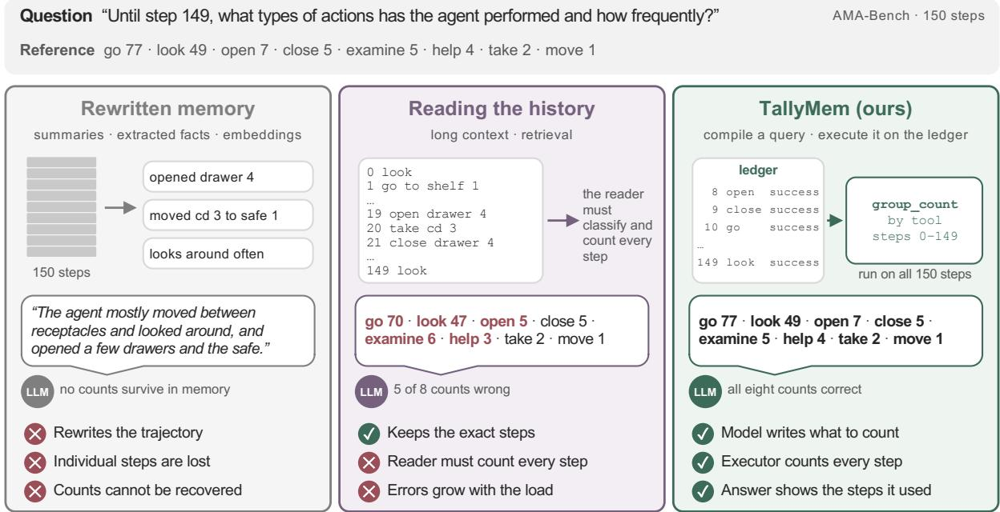  
Figure 1: Evidence access and event aggregation on an action-frequency question. Left: an illustrative compression example, not a measured output. Middle: Qwen3-32B’s actual long-context answer miscounts five of eight action types. Right: with TallyMem’s group-count query over all 150 steps, Qwen3-32B reports every count correctly. Red numbers are wrong.

With a commit-specific adaptation on 99 heldout MINTEval repositories, TallyMem improves exact match by 13.8 points over TM, with gains across three readers. The controlled probe adds 11.0 points without routing. On full AMA-Bench, the routed system gives a smaller gain, from 69.8% to 71.1% (Table 2); gains vary across readers and trajectory splits. Executing specifications also exposes event-selection mistakes as the largest residual system-error category.

## Our contributions are:

1. A diagnosis of distinct access and aggregation bottlenecks using five readers and controlled event sets.

2. Complementary mechanisms over a shared history: TM preserves and selects source evidence, while TallyMem compiles event specifications for deterministic aggregation over a reusable ledger.

3. Held-out repository evaluation and controlled aggregation tests, alongside full-benchmark comparisons and analysis of residual eventspecification errors.

## 2 Related Work

Agent memory. MemGPT, Mem0 and A-Mem organize experience through summaries or extracted records (Packer et al., 2023; Chhikara et al., 2025; Xu et al., 2026a); HippoRAG retrieves through a knowledge graph (Gutiérrez et al., 2024), and MemSearch-o1 constructs query-aligned fragments (Zhang et al., 2026). Evaluation extends from dialogue to agent trajectories (Maharana et al., 2024; Wu et al., 2024; He et al., 2026; Zhao et al., 2026; Yang et al., 2026). We study evidence access and event aggregation on AMA-Bench and MINTEval (Lee et al., 2026).

Executable memory and event specifications. Binder generates programs with model calls (Cheng et al., 2022), ChatDB uses SQL as symbolic memory (Hu et al., 2023), and AMA-Agent executes code over trajectories (Zhao et al., 2026). Table 1 contrasts their designs with ours. Our archive-and-ledger organization couples explicit event selection with original evidence; known event sets let us separately examine access, selection and aggregation. Appendix L tests a matched free-form code alternative.

Retrieval versus aggregation. Available context does not ensure correct use of evidence (Liu et al., 2024). RULER and Oolong test information aggregation (Hsieh et al., 2024; Bertsch et al., 2025); controlled studies identify instance count as a source of difficulty (Dai and Fan, 2026; Chen et al., 2026). MemTrace finds failures despite retrievable evidence (Long et al., 2026). Our trajectory analysis distinguishes evidence-access failures from errors in selecting and combining events.

## 3 Problem Formulation

Trajectories and memory. Let $\begin{array} { r l } { H } & { { } = } \end{array}$ $( ( i , a _ { i } , o _ { i } ) ) _ { i \in \mathbb { Z } _ { H } }$ be an ordered trajectory of actions $a _ { i }$ and observations $o _ { i }$ (Yao et al., 2022). Memory is built from H before questions arrive. Given a later question $q ,$ it supplies context $C _ { q }$ to a fixed answer model, $\widehat { y } = F _ { \theta } ( q , C _ { q } )$ . We compare systems with shared readers and judges; TM’s view has budget $B ;$ computed evidence has its own bound.

Two requirements. The first requirement is access: the steps that determine the answer must reach $C _ { q }$ unchanged and in order, so that the reader can use the exact action, its observed result and its position. Many questions also ask for a quantity over a set of steps,

$$
\begin{array} { c } { { y ^ { \star } = g \bigl ( S ^ { \star } ( q ) \bigr ) , } } \\ { { S ^ { \star } ( q ) = \{ i \in \mathbb { Z } _ { H } \cap I _ { q } : \ \phi _ { q } ( a _ { i } , o _ { i } ) = 1 \} , } } \end{array}\tag{1}
$$

where $I _ { q }$ is the step scope named by the question, $\phi _ { q }$ decides which steps are events of the requested kind, and $g$ counts, groups, orders or lists them. The second requirement is aggregation: computing g correctly over $S ^ { \star } ( q )$ , whose size $\left| S ^ { \star } ( q ) \right|$ we call the question’s aggregation load. Access can hold while aggregation fails: even if $C _ { q }$ contains every step of a 150-step history, a reader asked for action frequencies must still classify all 150 steps and count each of them once.

TM supplies a source-preserving reading view $R _ { q }$ . TallyMem additionally estimates $( I _ { q } , \phi _ { q } , g )$ , executes it over a reusable event ledger, and supplies the result $D _ { q }$ , giving $C _ { q } = R _ { q } \oplus D _ { q }$ . Execution is exact over the selected ledger rows; identifying $S ^ { \star } ( q )$ remains a model decision.

## 4 Deferred Evidence Selection: TM

What a later question needs is unknown when memory is written: an apparently incidental tool result can decide an answer many steps later. TM therefore never rewrites the trajectory; it only chooses, once the question is known, which parts to show (Lewis et al., 2020). Neither memory construction nor retrieval calls a model (Figure 5 in Appendix C).

Lossless write. The archive $\begin{array} { r } { \mathcal { A } = \mathrm { A r c h i v e } ( H ) } \end{array}$ stores every non-empty step verbatim with its original step ID. A source reference $r = ( i , f , [ u , v ) )$ addresses characters u through $v \ : - \ : 1$ of field $f \in \cdot$ {action, observation} of step i, and every span TM shows satisfies

$$
\mathrm { t e x t } ( r ) =  { \boldsymbol { A } } [ i , f ] [ u : v ] ,\tag{2}
$$

so any retrieved evidence can be traced to the original record. For editor tool calls (Wang et al., 2025), TM links each read or write to a file node keyed by its exact path, confirmed only by the tool’s receipt, so that questions about a file reach its earlier operations; other calls stay in the archive (Appendix C).

Reading as anchored selection. Given $q ,$ TM forms an anchor set

$$
\begin{array} { r } { A _ { q } = E _ { q } \cup \operatorname { s u p p } \big ( \operatorname { t o p } _ { k } s ( \cdot , q ) \big ) , } \\ { s ( x , q ) = | T ( q ) \cap T ( x ) | + \beta ( x , q ) , } \end{array}\tag{3}
$$

where $E _ { q }$ are the steps the question names explicitly, x ranges over the indexed steps and file entities in scope, $T ( \cdot )$ is a term set, $\beta$ rewards explicitly named steps and entities, and supp maps the topscoring items to the steps that support them. TM then admits the steps in scope greedily, named steps first and the others by their distance to the nearest anchor (Appendix $\mathrm { C } ) { \mathrm { . } }$ until the token budget B is spent, and renders them chronologically, marking omitted steps and truncated fields:

$$
\begin{array} { r l } & { \quad R _ { q } = \mathrm { R e n d e r } _ { \mathrm { c h r o n } } ( \mathrm { G r e e d y } _ { B } ( I _ { q } ; \rho _ { q } ) ) , } \\ & { \widehat { y } _ { \mathrm { T M } } = F _ { \theta } ( q , R _ { q } ) . } \end{array}\tag{4}
$$

We use $B = 2 6 \mathrm { { k } }$ tokens; the remaining constants are in Appendix C. The view preserves the source and order of every span it shows but does not guarantee complete visibility, because steps can be omitted and fields truncated. TM also contains one fixed aggregate, a keyword-triggered action counter, which we examine in Section 7.4.

<table><tr><td rowspan=1 colspan=1>Dimension</td><td rowspan=1 colspan=1>Binder</td><td rowspan=1 colspan=1>ChatDB</td><td rowspan=1 colspan=1>AMA-Agent</td><td rowspan=1 colspan=1>TM + TallyMem (ours)</td></tr><tr><td rowspan=1 colspan=1>Memory</td><td rowspan=1 colspan=1>Task input used bygenerated programs</td><td rowspan=1 colspan=1>SQL databases as sym-bolic memory</td><td rowspan=1 colspan=1>Structured trajectorymemory with causallinks</td><td rowspan=1 colspan=1>Original archive + reusableevent ledger</td></tr><tr><td rowspan=1 colspan=1>Execution</td><td rowspan=1 colspan=1>Programs       withlanguage-model APIcalls</td><td rowspan=1 colspan=1>Model-generated SQLinstructions</td><td rowspan=1 colspan=1>Trajectory-based codewhen retrieval is insuffi-cient</td><td rowspan=1 colspan=1>Explicit event specification +fixed executor</td></tr><tr><td rowspan=1 colspan=1>Evidenceuse</td><td rowspan=1 colspan=1>Program  executionover task input</td><td rowspan=1 colspan=1>Database operationsand their results</td><td rowspan=1 colspan=1>Memory retrieval withcode-based processing</td><td rowspan=1 colspan=1>Aggregates and step IDsalongside original evidence</td></tr><tr><td rowspan=1 colspan=1>Study focus</td><td rowspan=1 colspan=1>Program-based ques-tion answering</td><td rowspan=1 colspan=1>Symbolic memory formulti-hop reasoning</td><td rowspan=1 colspan=1>Long-horizon trajectorymemory</td><td rowspan=1 colspan=1>Access, event selection andaggregation examined sepa-rately</td></tr></table>

Table 1: Design comparison with executable-query and memory systems (Cheng et al., 2022; Hu et al., 2023; Zhao et al., 2026). Entries summarize published designs and study objectives; bold highlights our archive–ledger organization and event-level analysis.

## 5 Diagnosing Access and Aggregation Bottlenecks

We first diagnose TM on AMA-Bench (Zhao et al., 2026): 2,496 questions about 208 real trajectories from six domains (setup in Section 7.1).

Aggregation load: how many events must be combined? History length measures how much text is available; aggregation load measures how many event occurrences contribute to an answer. In a 150-step history, a question about one particular opening may need only one event, whereas asking for the frequency of every action requires all 150. Two equally long histories can therefore impose very different aggregation demands.

Ideally, load is $\left| S ^ { \star } ( q ) \right|$ in Equation 1. AMA-Bench provides reference answers but not the required event sets, so we estimate it from executable queries (Section 6). If $S _ { j }$ holds the events selected for quantity $j ,$ the load is

$$
\ell ( q , H ) = \sum _ { j \in J } | S _ { j } | ,\tag{5}
$$

where J contains the sub-queries that pass the grounding checks. Separate counts of seven openings and five closings have ℓ = 12. An event used in two requested quantities counts twice. This is a compiler-derived proxy, not an independent difficulty annotation: an incorrect filter can change the measured load, and a question without a surviving query has undefined load. Reference-answerderived loads parse counts and cited steps as a further approximation (Appendix G); Section 7.4 instead uses event sets parsed independently from raw logs. Compiler-defined bins are descriptive diagnostics, not independent difficulty strata.

Figure 2 (left) bins the 804 questions with a load. TM falls from 77.1% at one to five matched steps to 10.0% above a hundred; the decline also holds within the two domains rich in high-load samples.

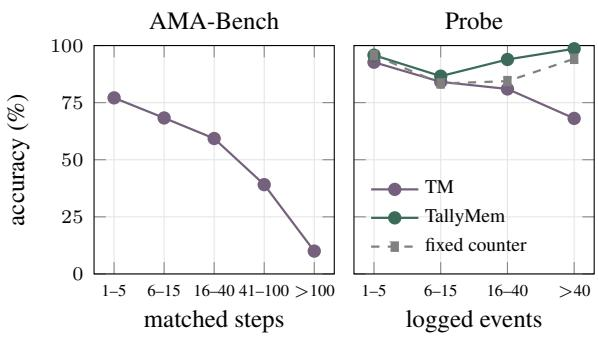  
Figure 2: Compiler-defined load diagnostic and logdefined aggregation probe. Left: TM (Qwen3-32B) on the 804 AMA-Bench questions with query evidence, by the steps their compiled queries match (406, 186, 108, 64 and 40 questions). Right: the probe, by the size of the event set parsed from the raw log (192, 157, 147 and 138 questions); the fixed counter groups steps by tool, and TM’s curve includes its counter on “how many times” questions.

Access and aggregation fail separately. Figure 3 crosses nominal context fit with load. When the history fits, TM still falls from 82% at low load to 43% at high load; when it does not fit, even lowload questions drop to 68%. The two interventions act on different cells. Across the five readers, TM’s gain over long-context reading lies between −2.3 and 5.5 points on histories that fit and between 8.7 and 15.0 points on histories that do not, larger for every reader (Appendix E). Execution instead helps at high load in both strata (+16 and +33 points) and not at low load (+2 and −5 points), where reading is already accurate and a misspecified query can mislead it (Shi et al., 2023). Fully visible histories, larger or reasoning-oriented readers and prompts that enumerate steps show the same decline (Ap-

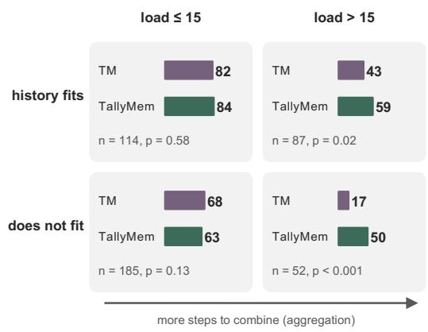  
Figure 3: Two constraints on trajectory answering. Qwen3-32B on 438 rule-selected diagnostic questions with a measured load, with computed evidence always attached. “History fits” means at most 24k raw-history tokens, not full visibility of every TM field. Cells show accuracy (%), sample size and paired sign-test $p .$

pendices F and E).

## 6 Separating Specification from Execution: TallyMem

TallyMem takes aggregation away from the reader. A model writes the specification $( I _ { q } , \phi _ { q } , g )$ of Equation 1 as a plan in a small typed query language, and an executor evaluates the plan exactly over an event ledger of the whole trajectory. The model therefore decides what to count but never does the counting (Lyu et al., 2023). TM is unchanged, and the result is added to its reading view (Figure 4).

The ledger: a grounded relation over steps. At write time TallyMem turns the archive into a relation ${ \cal L } = \Phi ( { \cal A } ) = ( e _ { i } ) _ { i \in { \cal { T } } _ { H } }$ with one row per logged step, built once per trajectory and shared by all its questions. A row has the schema

$$
\begin{array} { r } { e _ { i } = ( i , \mathrm { ~ t o o l } , \mathrm { ~ a c t } , \mathrm { ~ a c t i o n } , \phantom { e _ { 0 } = } } \\ { \mathrm { t a r g e t s } , \mathrm { ~ o u t c o m e } , \mathrm { ~ c h a n g e s } , \Delta ) , } \end{array}
$$

listing the tool, normalized action, raw action, targets, outcome, state changes and parameter difference ∆. A program extracts the mechanical fields; a model annotates targets, outcomes and changes from log chunks without seeing questions (Arora et al., 2023). Outcomes need a quote found in the observation, changes a successful step, and uncertain annotations never remove a row (Appendix C).

A typed query language. A plan is either not applicable or a list $\pi = ( p _ { 1 } , \ldots , p _ { k } ) $ of at most four sub-queries, one per quantity the question asks for. Each sub-query $\boldsymbol { p } = \left( I , \phi , \omega \right)$ has a step scope $I = [ l o , h i ]$ with possibly open bounds, a predicate and an operation. The predicate is a conjunction over fields of disjunctions of literal terms,

$$
\phi ( e ) = \underset { f \in F } { \textstyle \bigwedge } \ \bigvee \ [ t \sqsubseteq e . f ] ,\tag{6}
$$

where $F$ is a subset of the tool, action, target, outcome, change and $\Delta$ fields and $t \subseteq e . f$ denotes a case-insensitive substring match (equality for the outcome; tool terms match the tool or act). With $S = \{ i \in \mathbb { Z } _ { H } \cap I : \phi ( e _ { i } ) = 1 \}$ and $\kappa _ { f } ( i )$ the set of values of field $f$ in row i (one tool per step, possibly several targets), the operations are

$$
\begin{array} { r l } & { \mathsf { c o u n t : } ~ | S | , } \\ & { ~ \mathrm { 1 i s t : } ~ ( e _ { i } ) _ { i \in S } , } \\ & { \mathsf { f i r s t / 1 a s t : } ~ e _ { \operatorname* { m i n } S } ~ / ~ e _ { \operatorname* { m a x } S } , } \\ & { ~ \mathsf { g r o u p } _ { f } : ~ g \mapsto \sum _ { i \in S } \mathbf { 1 } \{ g \in \kappa _ { f } ( i ) \} , } \\ & { \mathsf { t i m e l ~ i n e : } ~ \tau \mapsto ( e _ { i } ) _ { i \in S _ { \tau } } , } \end{array}\tag{7}
$$

where $S _ { \tau } = \{ i \in S : \tau \in \kappa _ { \mathrm { t a r g e t } } ( i ) \}$ and a timeline reports each row’s step, tool, outcome and changes. Rows are always taken in step order, and group (group-count) runs over the tool, target or outcome field. The language provides a fixed set of event-selection and aggregation operators. Each plan can be checked against the ledger and evaluated in time linear in $| L |$ . The supported operations and their scope are detailed in Appendix C.

Compilation. Besides the shared answer model, TallyMem makes one question-time model call for compilation, $\pi = \mathrm { C o m p i l e } ( q , \mathrm { c a t a l o g } ( L ) )$ . The catalog summarizes tools, targets and change properties, so that filters use the ledger’s own vocabulary (Appendix C). The scope comes only from explicit bounds in the question (“until step $1 4 9 ^ { \cdot }$ becomes [0, 149]) and is otherwise the whole trajectory. Questions about explanations, causes, advice or the content of a single observation receive TM’s view alone.

Grounded execution. Before a sub-query runs, the executor checks it against L: every filter term must occur in the corresponding field somewhere in the log, and the match set S must be non-empty. A sub-query that fails either check contributes nothing, because an unmatched term or an empty match signals a specification the log cannot support, not a verified zero; its valid siblings survive. The one exception is a list or timeline query with no match, which is retried once with only its target and action filters and is then marked as relaxed. For the surviving set J, the executor computes $z _ { j } = \omega _ { j } ( S _ { j } )$ by Equation 7 and renders the results in plan order, $D _ { q } = { \mathrm { R e n d e r } } _ { M } ( ( p _ { j } , z _ { j } ) _ { j \in J } )$ , within a budget of $M = 6 { , } 0 0 0$ characters. Each result states its operation, filters and number of matched steps, followed by the computed values and the step IDs that support them (Figure 10).

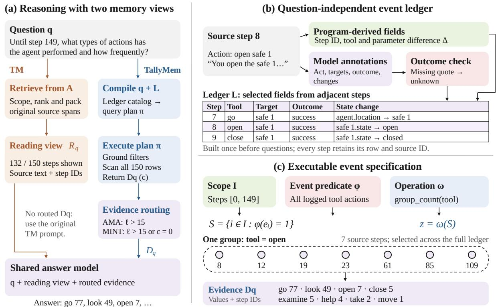  
Figure 4: TM and TallyMem through a shared running example. (a) TM retrieves source text from archive A; TallyMem adds computed evidence to the same reader. (b) The AMA ledger combines program-derived fields with model annotations before questions arrive. The outcome check verifies quote occurrence, not semantic correctness; MINTEval uses a programmatic ledger. (c) The model specifies scope, event predicate and operation; the executor selects and groups all 150 rows. The seven circles are the open group; its count and step IDs enter $D _ { q }$

Answering. The shared reader returns

$$
\widehat { y } _ { \gamma } = \left\{ \begin{array} { l l } { F _ { \theta } ( q , R _ { q } \oplus D _ { q } ) , } & { D _ { q } \neq \emptyset , \gamma = 1 , } \\ { F _ { \theta } ( q , R _ { q } ) , } & { \mathrm { o t h e r w i s e } . } \end{array} \right.\tag{8}
$$

We add a router (Jeong et al., 2024) to decide whether to attach computed evidence $( \gamma ; \ \mathbf { A p } \cdot$ pendix J). Without a block the prompt is exactly TM’s, and we reuse the TM answer.

Guarantee and boundary. The executor aggregates every selected row, including rows omitted from $R _ { q }$ . If the ledger and specification represent the intended events, it computes $g ( S ^ { \star } ( q ) )$ exactly; otherwise the error lies in one of them, and the returned conditions and step IDs show which (Section 8; worked example in Appendix Q).

## 7 Evaluation

## 7.1 Setup

We evaluate long-context reading, TM and TallyMem on all 2,496 AMA-Bench questions with its official model-judge prompt, and on 776 questions from 99 held-out repositories of MINTEval’s GitHub commit-history subset (Lee et al., 2026) with exact match. Aggregation diagnostics compare five readers on 630 common questions, and a controlled probe adds 645 generated questions with known event sets (Section 7.4). Each comparison uses one answer model, and the AMA set includes development trajectories. Full evaluations use the frozen principal system; diagnostics attach computed evidence unconditionally. Paired tests are in appendix tables; splits, deployments, selection rules and answer reuse are in Appendices A and J.

<table><tr><td>System Qwen3-32B gpt-oss-120b Qwen3-8B</td></tr><tr><td>AMA-Bench: accuracy (%), 2,496 questions</td></tr><tr><td>Long context 65.0 73.6 57.6</td></tr><tr><td>BM25 46.1 Dense RAG 36.5</td></tr><tr><td>Rolling summary 36.1</td></tr><tr><td>Mem0 24.3</td></tr><tr><td>A-Mem 38.8</td></tr><tr><td>TM 69.8 78.4 60.7</td></tr><tr><td>TallyMem 71.1 79.2 62.3</td></tr><tr><td>MINTEval GitHub: exact match (%), 776 questions</td></tr><tr><td>Long context 39.2 41.1 36.5</td></tr><tr><td>TM 35.2 37.8 32.2</td></tr><tr><td>TallyMem 49.0 50.6 46.1</td></tr></table>

Table 2: Main results. Each column compares systems within one setting; external memory systems run in the same deployment with the Qwen3-32B reader. MINTEval uses 99 held-out repositories; its long-context row and its gpt-oss-120b and Qwen3-8B entries were run after the pre-registered test. Paired tests and configurations appear in Appendices D and M.

## 7.2 AMA-Bench: Aggregation Gains and Overall Performance

Full-set gains over TM are modest. With Qwen3- 32B (Yang et al., 2025), TM reaches 69.8% and TallyMem 71.1%, a 1.3-point gain; gpt-oss-120b (Agarwal et al., 2025) reaches 78.4% and 79.2% (+0.8), and Qwen3-8B (Yang et al., 2025) reaches 60.7% and 62.3% (Table 2). Qwen3.6-27B (Yang et al., 2025) improves overall (Table 17), but its held-out-half gain is only 0.1 points, with a 95% trajectory-bootstrap interval of [−0.7, +1.0]. Without routing, Qwen3-32B reaches 70.4% (+79/−63 versus TM, p = 0.21); the overall gain is not significant under the paired sign test. Appendix I reports gains, intervals and trajectory splits.

On the 212 questions where the router attaches nonempty evidence (compiled load above 15), Qwen3-32B rises from 43.9% to 59.4% (+47/−14). These are the same 33 net additional correct answers as in the full-set routed comparison. The subset explains that gain but is selected by the method, rather than independently defining aggregation difficulty. TM also exceeds the external memory systems in the same Qwen3-32B deployment, of which BM25 is strongest at 46.1%. Removing only the counts of TM’s keyword-triggered counter (239 questions) leaves TM at 69.5%, still 4.5 points above long context (Appendix I). TM achieves state-of-the-art performance relative to the previously reported AMA-Bench methods compared here (Appendix D).

## 7.3 Held-Out Repository Histories: Cross-Dataset Evaluation

MINTEval tests the ledger-and-execution approach on commit histories with held-out repositories (Lee et al., 2026). We adapt the ledger and compiler prompt to commits: a program extracts file additions, deletions, renames and added assignment lines from diffs. The adaptation was developed on 25 repositories and evaluated once on 99 held-out ones.

TallyMem raises exact match from 35.2% for TM to 49.0%, a 13.8-point gain, and exceeds longcontext reading at 39.2% by 9.8 points (Table 2), with the strongest gains in file order and value history. Answering from the same evidence, gptoss-120b and Qwen3-8B show the same ordering: 41.1% and 36.5% with long context, 37.8% and 32.2% with TM, and 50.6% and 46.1% with Tally-Mem. The gain comes from the computation path, which also reaches commits outside TM’s reading view: with every reader TM alone trails long context, because commit questions can lose evidence to the retrieval budget even when they involve few events (Appendix M).

## 7.4 Controlled Probe: Testing the Aggregation Mechanism

To isolate aggregation load and event selection under controlled conditions, we generated 645 questions from 16 templates over all 66 embodied and software trajectories of AMA-Bench (Appendix H). Answers and event sets $S ^ { \star }$ are parsed from the raw action and observation strings, without the ledger, the compiler or a model. The templates cover six operations, three step bounds of one trajectory and two wordings of the same count. Templates, bounds and analyses were fixed before any answer was generated. This probe tests the aggregation mechanism; the full AMA and held-out repository evaluations establish performance on benchmark questions. Appendix H repeats the probe with Qwen3-8B.

Without routing, Qwen3-32B reaches 93.8% with TallyMem against 82.8% with TM, a gain of +11.0 [+8.8, +13.3] points (95% interval from resampling trajectories). Much of TM’s deficit comes from its keyword-triggered counter: at the same bound, TM answers 100.0% of the embodied and 97.2% of the software counts correctly when they ask “how many times”, but 46.7% and 8.3% when they ask “how often”, whereas TallyMem is unaffected. A fixed group-by-tool counter run by the same executor reaches 89.9%; it falls short in software trajectories, whose events are delimited by paths, commands or sub-tools. As load grows, TM declines while TallyMem does not (Figure 2, right). Long context reaches only 49.3%, partly because truncation cuts every software trajectory; on 20 fully visible embodied trajectories, its accuracy on the same count falls from 100% to 80% as mean load grows from 14 to 53 events.

<table><tr><td>Category</td><td>Errors</td><td>Other readers (%)</td></tr><tr><td>Specification</td><td>51</td><td>18.1</td></tr><tr><td>Ledger</td><td>21</td><td>38.1</td></tr><tr><td>Answering</td><td>21</td><td>39.3</td></tr><tr><td>Partial coverage</td><td>11</td><td>50.0</td></tr><tr><td>Reference or judge</td><td>42</td><td>17.3</td></tr><tr><td>Unclear</td><td>2</td><td>0.0</td></tr></table>

Table 3: The 148 errors TallyMem makes with computed evidence (Qwen3-32B, 630 diagnostic questions; Appendix N). Last column: accuracy (%) of the other four readers given the same evidence.

## 8 From Miscounting to Misspecification

Execution removes miscounting where the specification is right: on the probe, a correct plan written from each template’s definition, run by the same executor and reader, answers 99.2% of the questions from templates whose events the ledger records (Appendix H). We then analysed every error Tally-Mem makes on the 630 diagnostic questions with Qwen3-32B (Pan et al., 2023) (Appendix N).

Where the errors are. Of the 214 errors, 66 receive no computed evidence and are TM’s own. We labelled the other 148 with a decision procedure fixed before inspection: a reference or judging error if the answer agrees with the log; otherwise an answering error if the evidence suffices, partial coverage if the error lies outside the evidence, a specification error if the plan does not express the referenced quantity, and a ledger error if it does but the rows are wrong. None arises in execution or in truncating the evidence (Table 3), and an independently written matcher reproduces every stored result (Appendix I). Specification is the largest category: 51 errors, 49% of the 104 that remain after excluding reference, judging and unclear cases, against 20% each for the ledger and the final answer. Another 42 answers agree with the log but are rejected because the reference is wrong (29) (Northcutt et al., 2021) or the judge errs (13). Other readers given the same evidence answer 39.3% of the answering errors but only 18.1% of the specification errors, so the latter are systematic.

What misspecification looks like. Most specification errors select the wrong events (36 of 51). For questions about actions on an object, the reference counts only opening and closing it, whereas the plan lists every step that names it; a literal filter for drawer 1 also matches drawer 10; “between Step 6 and Step 9” is read inclusively. Others choose the wrong operation (11). In 26 cases the plan’s reading is defensible and the reference adopts another. On the probe, where event sets are parsed from the log, 21 of 36 plans for a question that names the create, replace and insert commands also count view, and the correct plan raises them from 75.0% to 97.2%; non-zero exit codes, which the ledger does not record, are approximated by the failure outcome. Because each result states its filters and step IDs, such errors can be checked against the log, whereas a reader’s miscount leaves no trace (Appendix O).

More freedom moves the same error. Three controls point the same way: five sampled plans repeat the same choice (Chen et al., 2023) (Appendix K); TM’s fixed counter fails when the wording differs (Section 7.4), so a fixed aggregate also fails on specification; and free-form Python over the same ledger and log reaches 62.1% (TM 61.9%, TallyMem 66.0%) (Wang et al., 2024) (Appendix L); on the probe it reaches 86.2% against TallyMem’s 93.8%. Detailed code comparisons and error examples appear in Appendices L and O.

## 9 Conclusion

TM preserves source evidence; TallyMem makes event selection explicit and executes aggregation. The controlled probe supports the aggregation mechanism, and the adapted MINTEval evaluation shows gains on held-out repository histories. Full AMA-Bench gains are modest and depend on routing and the reader. Executable aggregation therefore offers a task-dependent benefit, with event specification the main residual challenge.

## Limitations

Our evidence covers AMA-Bench, a controlled probe built from its embodied and software trajectories, and the GitHub subset of MINTEval, not all agent or dialogue memory tasks. Gains vary across question types and domains (Appendices E and P) and trajectory splits (Appendix I). Appendix I discusses judging, reference answers, method development and the single-annotator error analysis. The ledger and the query language cannot express every event predicate, and on MINTEval TM alone trails long context.

## Ethics Statement

We use public agent-trajectory and repositoryhistory benchmarks and collect no new personal data. Trajectory content is treated as untrusted data. The ledger builder does not execute commands contained in a trajectory; compiled queries select operations from a fixed executor rather than running arbitrary model-written code. The free-form code control runs model-written programs only in an operating-system sandbox without network or file access.

## Use of AI assistance.

AI tools were used only for language polishing and assistance with writing code. The research ideas were developed by the authors.

## References

Sandhini Agarwal, Lama Ahmad, Jason Ai, Sam Altman, Andy Applebaum, Edwin Arbus, Rahul K Arora, Yu Bai, Bowen Baker, Haiming Bao, et al. 2025. gpt-oss-120b & gpt-oss-20b model card. arXiv preprint arXiv:2508.10925.

Simran Arora, Brandon Yang, Sabri Eyuboglu, Avanika Narayan, Andrew Hojel, Immanuel Trummer, and Christopher Ré. 2023. Language models enable simple systems for generating structured views of heterogeneous data lakes. arXiv preprint arXiv:2304.09433.

Amanda Bertsch, Adithya Pratapa, Teruko Mitamura, Graham Neubig, and Matthew R Gormley. 2025. Oolong: Evaluating long context reasoning and aggregation capabilities. arXiv preprint arXiv:2511.02817.

Jingxuan Chen, Mohammad Taher Pilehvar, and Jose Camacho-Collados. 2026. Understanding llm performance degradation in multi-instance processing: The roles of instance count and context length. In

Proceedings of the 64th Annual Meeting of the Associationfor Computational Linguistics (Volume 1: Long Papers), pages 31851–31884.

Xinyun Chen, Renat Aksitov, Uri Alon, Jie Ren, Kefan Xiao, Pengcheng Yin, Sushant Prakash, Charles Sutton, Xuezhi Wang, and Denny Zhou. 2023. Universal self-consistency for large language model generation. arXiv preprint arXiv:2311.17311.

Zhoujun Cheng, Tianbao Xie, Peng Shi, Chengzu Li, Rahul Nadkarni, Yushi Hu, Caiming Xiong, Dragomir Radev, Mari Ostendorf, Luke Zettlemoyer, et al. 2022. Binding language models in symbolic languages. arXiv preprint arXiv:2210.02875.

Prateek Chhikara, Dev Khant, Saket Aryan, Taranjeet Singh, and Deshraj Yadav. 2025. Mem0: Building production-ready ai agents with scalable long-term memory. arXiv preprint arXiv:2504.19413.

Tianxiang Dai and Jonathan Fan. 2026. Language models fail at extended rule following. arXiv preprint arXiv:2605.02028.

Bernal J Gutiérrez, Yiheng Shu, Yu Gu, Michihiro Yasunaga, and Yu Su. 2024. Hipporag: Neurobiologically inspired long-term memory for large language models. Advances in neural information processing systems, 37:59532–59569.

Zexue He, Yu Wang, Churan Zhi, Yuanzhe Hu, Tzu-Ping Chen, Lang Yin, Ze Chen, Tong Arthur Wu, Siru Ouyang, Zihan Wang, et al. 2026. Memoryarena: Benchmarking agent memory in interdependent multi-session agentic tasks. arXiv preprint arXiv:2602.16313.

Cheng-Ping Hsieh, Simeng Sun, Samuel Kriman, Shantanu Acharya, Dima Rekesh, Fei Jia, Yang Zhang, and Boris Ginsburg. 2024. Ruler: What’s the real context size of your long-context language models? arXiv preprint arXiv:2404.06654.

Chenxu Hu, Jie Fu, Chenzhuang Du, Simian Luo, Junbo Zhao, and Hang Zhao. 2023. Chatdb: Augmenting llms with databases as their symbolic memory. arXiv preprint arXiv:2306.03901.

Soyeong Jeong, Jinheon Baek, Sukmin Cho, Sung Ju Hwang, and Jong C Park. 2024. Adaptive-rag: Learning to adapt retrieval-augmented large language models through question complexity. In Proceedings of the 2024 conference of the north american chapter ofthe associationfor computational linguistics: Human language technologies (volume 1: Long papers), pages 7036–7050.

Hyunji Lee, Justin Chih-Yao Chen, Joykirat Singh, Zaid Khan, Elias Stengel-Eskin, and Mohit Bansal. 2026. Minteval: Evaluating memory under multi-target interference in long-horizon agent systems. arXiv preprint arXiv:2605.18565.

Patrick Lewis, Ethan Perez, Aleksandra Piktus, Fabio Petroni, Vladimir Karpukhin, Naman Goyal, Heinrich Küttler, Mike Lewis, Wen-tau Yih, Tim Rocktäschel, et al. 2020. Retrieval-augmented generation for knowledge-intensive nlp tasks. Advances in neural information processing systems, 33:9459–9474.

Nelson F Liu, Kevin Lin, John Hewitt, Ashwin Paranjape, Michele Bevilacqua, Fabio Petroni, and Percy Liang. 2024. Lost in the middle: How language models use long contexts. Transactions ofthe association for computational linguistics, 12:157–173.

Xianxuan Long, Zhikai Chen, Shenglai Zeng, Shouren Wang, Kai Guo, and Jiliang Tang. 2026. Memtrace: Probing what final accuracy misses in long-term memory. arXiv preprint arXiv:2606.17328.

Qing Lyu, Shreya Havaldar, Adam Stein, Li Zhang, Delip Rao, Eric Wong, Marianna Apidianaki, and Chris Callison-Burch. 2023. Faithful chain-ofthought reasoning. In Proceedings of the 13th internationaljoint conference on natural language processing and the 3rd conference of the Asia-Pacific Chapter of the Association for Computational Linguistics (Volume 1: Long papers), pages 305–329.

Adyasha Maharana, Dong-Ho Lee, Sergey Tulyakov, Mohit Bansal, Francesco Barbieri, and Yuwei Fang. 2024. Evaluating very long-term conversational memory of llm agents. In Proceedings of the 62nd Annual Meeting of the Association for Computational Linguistics (Volume 1: Long Papers), pages 13851– 13870.

Curtis Northcutt, Lu Jiang, and Isaac Chuang. 2021. Confident learning: Estimating uncertainty in dataset labels. Journal of Artificial Intelligence Research, 70:1373–1411.

Charles Packer, Sarah Wooders, Kevin Lin, Vivian Fang, Shishir G Patil, Ion Stoica, and Joseph E Gonzalez. 2023. Memgpt: Towards llms as operating systems. arXiv preprint arXiv:2310.08560.

Liangming Pan, Alon Albalak, Xinyi Wang, and William Wang. 2023. Logic-lm: Empowering large language models with symbolic solvers for faithful logical reasoning. In Findings of the Association for Computational Linguistics: EMNLP 2023, pages 3806–3824.

Freda Shi, Xinyun Chen, Kanishka Misra, Nathan Scales, David Dohan, Ed H Chi, Nathanael Schärli, and Denny Zhou. 2023. Large language models can be easily distracted by irrelevant context. In International conference on machine learning, pages 31210– 31227. PMLR.

Xingyao Wang, Yangyi Chen, Lifan Yuan, Yizhe Zhang, Yunzhu Li, Hao Peng, and Heng Ji. 2024. Executable code actions elicit better llm agents. arXiv preprint arXiv:2402.01030.

Xingyao Wang, Boxuan Li, Yufan Song, Frank F Xu, Xiangru Tang, Mingchen Zhuge, Jiayi Pan, Yueqi

Song, Bowen Li, Jaskirat Singh, et al. 2025. Openhands: An open platform for ai software developers as generalist agents. In International Conference on Learning Representations, volume 2025, pages 65882–65919.

Di Wu, Hongwei Wang, Wenhao Yu, Yuwei Zhang, Kai-Wei Chang, and Dong Yu. 2024. Longmemeval: Benchmarking chat assistants on long-term interactive memory. arXiv preprint arXiv:2410.10813.

Wujiang Xu, Zujie Liang, Kai Mei, Hang Gao, Juntao Tan, and Yongfeng Zhang. 2026a. A-mem: Agentic memory for llm agents. Advances in Neural Information Processing Systems, 38:17577–17604.

Wujiang Xu, Yu Wang, Kai Mei, Kaiqu Liang, Zhenting Wang, Mingyu Jin, Han Zhang, Shi-Xiong Zhang, Wenyue Hua, Sambit Sahu, et al. 2026b. Memgym: a long-horizon memory environment for llm agents. arXiv preprint arXiv:2605.20833.

An Yang, Anfeng Li, Baosong Yang, Beichen Zhang, Binyuan Hui, Bo Zheng, Bowen Yu, Chang Gao, Chengen Huang, Chenxu Lv, et al. 2025. Qwen3 technical report. arXiv preprint arXiv:2505.09388.

Zerui Yang, Weichuan Wang, Yanwei Xu, Linqi Song, Yudai Matsuda, Wei Han, and Bo Bai. 2026. Memo-sql: Structured decomposition and experiencedriven self-correction for training-free nl2sql. arXiv preprint arXiv:2601.10011.

Shunyu Yao, Jeffrey Zhao, Dian Yu, Nan Du, Izhak Shafran, Karthik Narasimhan, and Yuan Cao. 2022. React: Synergizing reasoning and acting in language models. arXiv preprint arXiv:2210.03629.

Sheng Zhang, Junyi Li, Yingyi Zhang, Pengyue Jia, Yichao Wang, Xiaowei Qian, Wenlin Zhang, Maolin Wang, Yong Liu, and Xiangyu Zhao. 2026. Memsearch-o1: Empowering large language models with reasoning-aligned memory growth in agentic search. In Proceedings of the 64th Annual Meeting of the Association for Computational Linguistics (Volume 1: Long Papers), pages 925–943.

Yujie Zhao, Boqin Yuan, Junbo Huang, Haocheng Yuan, Zhongming Yu, Haozhou Xu, Lanxiang Hu, Abhilash Shankarampeta, Zimeng Huang, Wentao Ni, et al. 2026. Ama-bench: Evaluating long-horizon memory for agentic applications. arXiv preprint arXiv:2602.22769.

## A Evaluation Protocol

Questions and freezing. AMA trajectories are assigned by hash to two halves, and the method was developed on one of them; all reported results pool both halves. The rule-selected set contains 670 questions; the common answered set used for the five-reader comparison contains 630. The principal configuration and its per-question evidence were frozen after development. A later compiler refinement adds two compile rules chosen after inspecting the principal compiler’s errors. The full AMA run uses frozen principal evidence and compiles every question; nonempty evidence is produced for 804 questions, including 366 outside the rule-defined families. Family membership is based on question text alone.

Main evaluation configuration. The method was developed on half of the AMA trajectories, and the principal compiler configuration was then frozen; all AMA results pool both halves. Fivereader diagnostics use 630 common questions from pre-specified aggregation families; full-benchmark evaluation covers all 2,496 questions with Qwen3- 32B and gpt-oss-120b, and with Qwen3.6-27B and Qwen3-8B on our local server. These diagnostic and full runs use different deployments, so their absolute accuracies are not interchangeable. When a variant produces the identical answer prompt, we reuse that answer rather than introduce another sampling difference. The full evaluations use the router defined in Appendix J; diagnostic analyses attach every nonempty computed-evidence block.

Models and deployment. The diagnostic Qwen3-32B reader uses thinking, temperature 0, a 12,288-token output limit and a 40,960-token context on DeepInfra. Additional readers are Qwen3-235B-A22B-Instruct-2507 (no thinking), gpt-oss-120b (reasoning), Qwen3.6-27B and Qwen3-8B (both thinking, local vLLM). The full Qwen3 run uses local bf16 weights rather than the diagnostic fp8 deployment; the full gpt-oss run uses DeepInfra. Method comparisons are within a setting. Contexts use exact Qwen3 token counts, so readers in a diagnostic comparison see the same text. Long-context controls read the original trajectory within the answer budget; over-budget histories are truncated. TM retrieval is question-specific.

Judge and answer reuse. Annotation, compilation and AMA judging use Qwen3-32B without thinking. AMA uses the official judge prompt with strict yes/no extraction; the judge model is shared across readers. A second judge, gpt-oss-120b with the same prompt, agrees with the official judge on 86% of TM and 88% of TallyMem judgements (599 questions). It is stricter, but the comparison is unchanged: 52.6% vs. 56.1% (+47/−26, p = 0.02).When computed evidence is empty, the prompt is the TM prompt and we reuse its answer. Identical evidence in a later variant also reuses the corresponding answer. Otherwise the prompt is answered afresh. Paired sign tests count per-question wins and losses.

Cross-deployment check. On 688 common TM questions, the two Qwen3 deployments agree on 86% of judgments (64.2% versus 62.2% accuracy). This check does not make the deployments interchangeable.

## B Rule-Based Question Families

A question belongs to a family when its lowercased text matches:

• count/frequency: how many, number of, count(s|ed), how often/frequently, frequen;

• first/last change: first|last|final|latest|earliest followed within 80 characters by a change or outcome word;

• state tracing: state change, what changes, changes occurred, (state|location) of . . . at step, changes history, throughout the trajectory;

• action enumeration: (which|what) (types of) actions, actions . . . performed.

## C Implementation Details and Variants

File-event index. TM derives a bipartite graph $G _ { H } = ( V _ { \mathrm { f i l e } } \cup V _ { \mathrm { e v e n t } } , E )$ from supported editor calls. It parses each str\_replace\_editor action, creates a file node keyed by the exact absolute path, and links the step’s event node to that file. The command determines the edge type: view is a read; create, insert and str\_replace are writes. An operation is confirmed only when its observation contains the expected tool-specific leading receipt; otherwise it remains an attempt. Each event stores source spans for its path, command and observation.

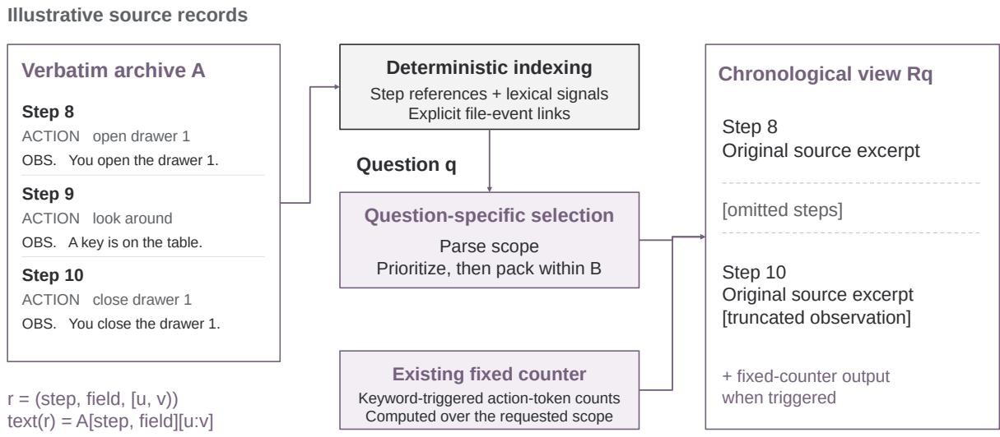  
Storage preserves the source. The answer model sees a budgeted view.  
Figure 5: TM’s archive and reading view (illustrative records). Deterministic indexes guide budgeted selection; the displayed spans retain their original order and provenance. Storing every step does not guarantee that every step or field reaches the reader. The keyword-triggered fixed counter is part of TM and remains present in the TallyMem comparison.

Thus a question about a file can retrieve its earlier reads and edits through a shared file node, even when the steps are far apart. Unsupported calls remain in the raw archive. The graph neither merges ambiguous basenames nor infers causal links or unseen file states.

Selection order. Every step in scope receives the priority

$$
\begin{array} { r l } & { \rho _ { q } ( i ) = \big ( \mathbf { 1 } \{ i \notin E _ { q } \} , \ d _ { q } ( i ) , \ i \big ) , } \\ & { d _ { q } ( i ) = \operatorname* { m i n } _ { a \in A _ { q } } | i - a | , } \end{array}\tag{9}
$$

ordered lexicographically, so named steps come first and the remaining steps follow by their distance to the nearest anchor of Equation 3. TM admits steps greedily in this order, skipping any step that no longer fits, until the budget B is spent; steps linked in $G _ { H }$ to files named in q are admitted from a reserved share of the budget, and GreedyB in Equation 4 denotes this procedure. Fields of steps within distance $w = 2$ of an anchor keep a wider character cap than distant ones.

TM selection constants. The score in Equation 3 is the number of shared terms, plus 8 for a step the question names and 12 for an entity whose label appears in the question; step references are removed from the question before term matching. The anchor set adds the steps supporting the eight highest-ranked items, or the four best-scoring steps when the question names nothing. Steps within $w = 2$ of an anchor keep 4,000 characters per field and other steps 1,200. Thirty percent of the budget holds index records rendered next to the steps, and up to eight steps linked in the file-event graph to files named in the question are admitted from 20% of the budget that remains after the named steps and their neighbours.

Ledger fields and validation. The mechanical tool is the action’s leading identifier, refined by a JSON command argument. Parameter differences compare actions of the same tool and path. Chunked annotation is question-independent and supplies a normalized action type, targets, an outcome (success, failure, no effect or unknown), an observation quote, and proposed object.property changes. The initial validator requires a normalized supporting quote of at least four characters to occur in the observation. Missing annotations remain unknown, and every step retains a ledger row. Changes require a successful outcome; a separate verified flag records whether their new value occurs in the observation or action text. A false flag does not remove the change, and the executor does not filter changes by this flag.

## Ledger rows and validation.

• Accepted: open drawer 1 is annotated as a success, quoting “You open the drawer 1. The drawer 1 is open”, with the change drawer 1.state→open (verified).

• Rejected: an annotation quoting “You see:...” is not a substring of its observation, so its outcome becomes unknown.

Quote recovery. The frozen computation path retries quote matching after a looser normalization when a row was rejected for quote formatting. Recovery requires at least eight normalized characters and an observation match; successful recovery can restore the proposed changes. The path also restores truncated target lists when the preserved prefix agrees. These rules check textual occurrence, not semantic entailment or the completeness of the annotation.

Plan and result handling. The query language supports the operations in Equation 7; it does not support arithmetic over values, joins or free-form code.

Compilation uses temperature 0 and no thinking. A catalog provides tool names, the 40 most frequent targets and the 20 most frequent change properties. Filters are case-insensitive substring matches: lists are disjunctions and different fields are conjoined. Explicit question bounds define the scope, including open bounds and distinct bounds for sub-queries. Results are capped at 6,000 characters, with compressed step ranges and grouped outcomes; failed actions can be separated by error text. A timeline or list query with no matches is retried once with only its object and action filters, and any result is marked relaxed. Otherwise ungrounded or empty sub-queries are dropped. If all are dropped, the answer prompt is exactly TM’s.

Zero-generation ledger and plan voting. TallyMem-lite keeps the program-derived step, tool and parameter-difference fields, without model annotations. The self-consistency ablation compiles the greedy plan plus four samples at temperature 0.7 and retains results supported by at least three identical executed sub-query outputs. These are ablations, not additional components of the principal TallyMem variant.

## D Full AMA-Bench Results and Comparison Scope

Table 4 gives full category results and variants. TM includes the fixed counter described in Section 4. With Qwen3-8B on our local server (Table 2), TM exceeds long context (+394/−315, p = 0.003) and TallyMem exceeds TM (+50/−12, $p ~ < ~ 0 . 0 0 1 )$ . Published AMA scores use different settings: their Qwen3 long-context control is 51.8%, compared with 65.0% here, and their AMA-Agent scores 57.2%. These scores provide context; matched comparisons are reported below. BM25, dense RAG, rolling summary, Mem0 and A-Mem run in the same deployment; Qwen3-32B answers and also builds their memories, and dense retrieval, Mem0 and A-Mem use all-MiniLM-L6-v2 embeddings. BM25 and dense RAG show their five topscoring blocks in original order (2,400-character blocks for BM25, passages within the embedding model’s input limit for dense RAG), much less text than TM’s 26k-token view. All five are well below TM; the best, BM25, scores 46.1% (TM wins +763/−172, $p < 0 . 0 0 1 )$ . Failed memory constructions count as wrong: A-Mem failed on 12 of 208 trajectories (41.2% on the 2,352 answered questions) and Mem0 lost 15 questions. Three adaptations were needed to run the released code: rolling summary states its 1,500-word budget after the history block, retries once at 750 words and otherwise keeps the previous summary (44 blocks skipped in 23 trajectories); Mem0 gets a separate local store per worker; A-Mem receives JSON without Markdown fences.

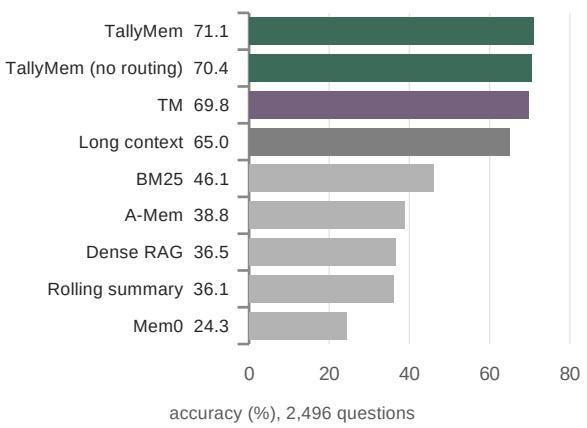  
Figure 6: Comparison of Qwen3-32B systems on the 2,496 AMA-Bench questions. TallyMem denotes the routed main system; “no routing” is its ablation. External memory systems use the same deployment, with failed memory constructions counted as wrong. Deployment and adaptation details below define the comparison scope.

Without routing, on 670 rule-selected questions Qwen3 accuracy improves from 64.9% to 68.8% $( p = 0 . 0 0 4 )$ . Outside those families, it falls slightly from 71.6% to 71.0% $( p = 0 . 2 6 )$ . Within questions with nonempty computed evidence, the low-load stratum scores 74.3% versus 71.5% $( p = 0 . 0 7 )$ while the high-load stratum scores 43.9% versus 59.4% $( p \ < \ 0 . 0 0 1 )$ . The lite variant (also without routing) improves significantly for Qwen3 $( p = 0 . 0 0 9 )$ , but not for gpt-oss $( p = 0 . 3 1 )$ . A richer ledger is therefore not a uniformly better representation.

<table><tr><td>System</td><td>All</td><td>A</td><td>B</td><td>C</td><td>D</td><td>vs. TM: wins/losses (p)</td></tr><tr><td colspan="7">Qwen3-32B reader, official judge, local bf16 deployment</td></tr><tr><td>No trajectory (question only)</td><td>21.9</td><td>21.6</td><td>28.5</td><td>20.2</td><td>15.5</td><td>+115/-1311 (&lt;0.001)</td></tr><tr><td>Long context</td><td>65.0</td><td>65.2</td><td>72.0</td><td>63.4</td><td>57.2</td><td>+262/-381 (&lt;0.001)</td></tr><tr><td>TM</td><td>69.8</td><td>72.2</td><td>72.8</td><td>73.1</td><td>55.3</td><td></td></tr><tr><td>BM25 (baseline suite)</td><td>46.1</td><td>47.9</td><td>54.5</td><td>42.3</td><td>36.2</td><td>+172/-763 (&lt;0.001)</td></tr><tr><td>Dense RAG (baseline suite)</td><td>36.5</td><td>39.0</td><td>46.6</td><td>30.8</td><td>25.6</td><td>+165/–997 (&lt;0.001)</td></tr><tr><td>Rolling summary (baseline suite)</td><td>36.1</td><td>36.4</td><td>40.8</td><td>32.8</td><td>34.3</td><td>+152/–992 (&lt;0.001)</td></tr><tr><td>Mem0 (baseline suite)</td><td>24.3</td><td>24.9</td><td>28.4</td><td>21.9</td><td>20.8</td><td>+153/-1289 (&lt;0.001)</td></tr><tr><td>A-Mem (baseline suite)</td><td>38.8</td><td>40.6</td><td>47.3</td><td>34.2</td><td>30.2</td><td>+172/-945 (&lt;0.001)</td></tr><tr><td> $\mathrm { T a l l y M e m ^ { \ S } }$ </td><td>71.1</td><td>72.2</td><td>72.8</td><td>73.4</td><td>62.8</td><td>+47/-14 (&lt;0.001)</td></tr><tr><td>TallyMem-lite, no routing</td><td>70.8</td><td>71.8</td><td>73.0</td><td>73.4</td><td>61.4</td><td>+51/–27 (0.0088)</td></tr><tr><td>TallyMem, no routing</td><td>70.4</td><td>71.0</td><td>73.5</td><td>72.5</td><td>61.6</td><td>+79/–63 (0.21)</td></tr><tr><td>TallyMem refined compiler†, no routing</td><td>70.5</td><td>71.5</td><td>72.3</td><td>72.2</td><td>63.0</td><td>+76/–59 (0.17)</td></tr><tr><td>TallyMem, rule-routed‡</td><td>70.8</td><td>71.5</td><td>73.0</td><td>73.4</td><td>62.3</td><td>+52/–26 (0.0043)</td></tr><tr><td colspan="7">gpt-oss-120b reader, same judge model, DeepInfra</td></tr><tr><td>Long context</td><td>73.6</td><td>72.9</td><td>81.4</td><td>68.9</td><td>71.0</td><td>+205/-324 (&lt;0.001)</td></tr><tr><td>TM</td><td>78.4</td><td>80.0</td><td>83.9</td><td>75.4</td><td>71.7</td><td></td></tr><tr><td> $\mathrm { T a l l y M e m ^ { \ S } }$ </td><td>79.2</td><td>80.5</td><td>84.1</td><td>75.1</td><td>76.1</td><td>+40/–19 (0.0086)</td></tr><tr><td>TallyMem-lite, no routing</td><td>78.7</td><td>79.6</td><td>84.2</td><td>75.1</td><td>74.6</td><td>+36/–27 (0.31)</td></tr><tr><td>TallyMem, no routing</td><td>79.2</td><td>80.2</td><td>83.9</td><td>76.0</td><td>75.4</td><td>+75/–54 (0.078)</td></tr></table>

Table 4: Full AMA-Bench, 2,496 questions; accuracy (%). Categories: A recall, B causal inference, C state updating, D state abstraction. †Refined compiler: two compile rules added after inspecting the principal compiler’s errors. ‡Rule routing: post hoc restriction to pre-defined aggregation families. §With the router of Appendix J; “no routing” rows attach every nonempty computed evidence. External baselines: same deployment and reader; failed memory constructions count as wrong.

Comparison with reported methods. Table 5 compares TM and TallyMem with externally reported AMA-Bench methods using Qwen3-32B. The external results use each method’s own deployment, prompts and context limits; the lower block reports this study’s matched runs from Table 2. TM exceeds every external score listed, and TallyMem improves further. For the common longcontext baseline, the reported score is 51.35% and the matched run is 65.0%, reflecting the different settings. Table 2 provides the controlled comparisons.

## E Reader Controls and Rule-Selected Results

Figure 7 visualizes the reader comparison and its high-load subset. These are diagnostic results with no routing, rather than the full-benchmark results

<table><tr><td>Method Accuracy (%)</td></tr><tr><td>Externally reported results 56.91</td></tr><tr><td>AMA-agent Hipporag2 44.05</td></tr><tr><td>HybridFocus 62.46 Long context 51.35</td></tr><tr><td>Memorag 45.70</td></tr><tr><td>Memorybank 34.50 Qwen3-Embedding-4B 42.04</td></tr><tr><td>TheoryLab 52.16</td></tr><tr><td>VeraKV 64.78</td></tr><tr><td>Long context 65.0 TM 69.8</td></tr><tr><td>Results from this study</td></tr></table>

Table 5: AMA-Bench method comparison with Qwen3- 32B. External scores are reported under their respective settings; this study’s scores come from Table 2.

of Table 2.

## E.1 Aggregation Load and Prompting Controls

Prompting helps, but not at high load. We add one sentence to TM’s answer instructions: list every relevant step with its step number, then compute the answer from that list. For Qwen3-32B, on the same 630 questions, accuracy is not significantly different: 61.9% without and 61.3% with the instruction (+43/−47, p = 0.75). It stays at 2.7% above 100 steps (2.7% without). Table 11 repeats this for the other two readers: for the reasoning model gpt-oss-120b it moves overall accuracy from 68.9% to 74.0% $( + 6 1 / - 2 9 , p < 0 . 0 0 1$ ; TallyMem 73.0%), but above 100 steps it reaches only 18.9% (TallyMem 62.2%); for the non-thinking Qwen3- 235B it moves overall accuracy from 59.6% to 61.2% (+77/−67, $p \ = \ 0 . 4 5 ;$ TallyMem 66.9%), but above 100 steps it reaches only 24.3% (TallyMem 51.4%). The instruction works best for the reasoning reader at small and moderate loads, where it even exceeds TallyMem (80.6% vs. 76.9% at 1–15 steps, 71.6% vs. 66.7% at 16–100). It does not help the non-thinking reader at those loads. For all three readers, high-load accuracy remains low.

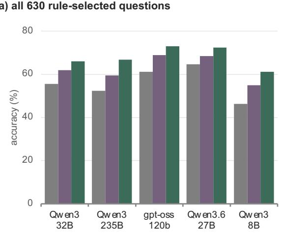

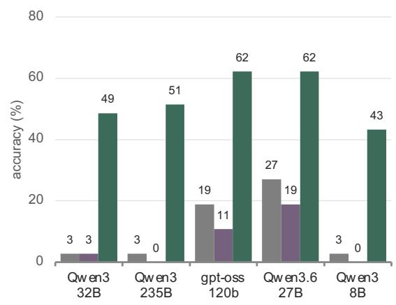

Figure 7: Five-reader diagnostic comparison, without routing: (a) all 630 common rule-selected questions; (b) the 37 questions whose compiled queries match more than 100 steps. Each method’s frozen contexts and evidence are shared across readers, with a common judge. The high-load subset is small; paired tests and full load strata appear in Tables 7 and 10.
<table><tr><td>Method (Qwen3-32B reader)</td><td>correct</td><td> $\mathbf { v s . T M } \colon + / - \mathbf { \Gamma } ( p )$ </td></tr><tr><td>No trajectory (question only)</td><td>95/630</td><td> $+ 4 4 / - 3 3 9 ( < 0 . 0 0 1 )$ </td></tr><tr><td>Long context</td><td>350/630</td><td> $+ 6 1 / - 1 0 1 \ ( 0 . 0 0 2 )$ </td></tr><tr><td>TM</td><td>390/630</td><td></td></tr><tr><td>TM + enumerate-then-count prompt</td><td>386/630</td><td>+43/-47 (0.75)</td></tr><tr><td>TallyMem-lite (zero-generation ledger)</td><td>407/630</td><td>+32/-15 (0.02)</td></tr><tr><td>TallyMem</td><td>416/630</td><td>+55/-29 (0.006)</td></tr><tr><td>TallyMem + plan self-consistency</td><td>414/630</td><td>+50/-26 (0.008)</td></tr><tr><td>TallyMem refined compiler†</td><td>423/630</td><td>+61/-28 (&lt;0.001)</td></tr></table>

Table 6: Correct answers on the 630 rule-selected questions. †Refined compiler adds two compile rules chosen after inspecting the principal compiler’s errors (Section 8).
<table><tr><td>Answer model</td><td>n</td><td>Long context</td><td>TM</td><td>TallyMem-lite</td><td>TallyMem</td><td>TallyMem vs. TM</td></tr><tr><td>Qwen3-32B (thinking)</td><td>630</td><td>55.6</td><td>61.9</td><td>64.6</td><td>66.0</td><td>+55/-29 (0.006)</td></tr><tr><td>Qwen3-235B-A22B-2507</td><td>630</td><td>52.4</td><td>59.5</td><td>64.3</td><td>66.8</td><td>+78/-32 (&lt;0.001)</td></tr><tr><td>gpt-oss-120b (reasoning)</td><td>630</td><td>61.1</td><td>68.9</td><td>70.2</td><td>73.0</td><td>+54/–28 (0.005)</td></tr><tr><td>Qwen3.6-27B (thinking)§</td><td>630</td><td>64.6</td><td>68.4</td><td>72.7</td><td>72.4</td><td>+51/–26 (0.006)</td></tr><tr><td> $\mathrm { Q w e n 3 - 8 B \ ( t h i n k i n g ) ^ { \ S } }$ </td><td>630</td><td>46.3</td><td>54.9</td><td>60.3</td><td>61.1</td><td>+61/-22 (&lt;0.001)</td></tr></table>

Table 7: Five answer models on the same frozen contexts and evidence (accuracy %, paired sign tests; the judge model is Qwen3-32B throughout). §Answered on our local server (bf16); the others on DeepInfra.

<table><tr><td>Family</td><td> $\mathrm { T M } \to \mathrm { T a l l y } \mathrm { M e m } \left( p \right)$ </td></tr><tr><td>Count / frequency (F1)</td><td> $1 5 2 \to 1 7 6 / 2 4 6 ( < 0 . 0 0 1 )$ </td></tr><tr><td>First / last change (F2)</td><td> $9 1 \to 9 2 / 1 5 2 ( 1 . 0 0 )$ </td></tr><tr><td>State tracing (F3)</td><td> $1 1 3 \to 1 1 5 / 1 8 6 ( 0 . 8 3 )$ </td></tr><tr><td>Action enumeration (F4)</td><td> $5 2 \to 7 2 / 9 1 ( < 0 . 0 0 1 )$ </td></tr></table>

Table 8: TM → TallyMem correct / questions by ruledefined family on the 630 rule-selected questions (p from a paired sign test; one question may be in several families).

<table><tr><td>Answer model</td><td>trajectory fits</td><td>does not fit</td></tr><tr><td>Qwen3-32B (thinking)</td><td>66.0 / 69.6 / 75.1 (0.01)</td><td> $4 5 . 5 / 5 4 . 5 / 5 7 . 3 ( 0 . 2 1 )$ </td></tr><tr><td>Qwen3-235B-A22B-2507</td><td>62.5 / 68.0 / 73.5 (0.02)</td><td> $4 2 . 7 / 5 1 . 4 / 6 0 . 4 ( < 0 . 0 0 1 )$ </td></tr><tr><td> $\mathrm { g p t - o s s - } 1 2 0 \mathrm { b } \ \mathrm { ( r e a s o n i n g ) }$ </td><td>75.4 / 80.9 / 82.2 (0.64)</td><td> $4 7 . 4 / 5 7 . 3 / 6 4 . 2 ( < 0 . 0 0 1 )$ </td></tr><tr><td>Qwen3.6-27B (thinking)⁸</td><td>79.6 / 77.3 / 79.9 (0.24)</td><td> $5 0 . 2 / 5 9 . 8 / 6 5 . 1 ( 0 . 0 1 )$ </td></tr><tr><td> $\mathrm { Q w e n 3 - 8 B \ ( t h i n k i n g ) ^ { \ S } }$ </td><td>56.6 / 58.6 / 65.4 (0.001)</td><td> $3 6 . 4 / 5 1 . 4 / 5 7 . 0 ( 0 . 0 1 0 )$ </td></tr></table>

Table 9: Long context / TM / TallyMem accuracy (%) by nominal raw-history fit (630 questions; p: TallyMem vs. TM). When it does not fit, long context collapses (retrieval bottleneck); when it fits, computation adds significantly for three of the five readers. Fit does not guarantee full TM field visibility (Appendix F). §Local server.
<table><tr><td>Answer model</td><td>load 1-15</td><td>load 16-100</td><td>load &gt;100</td></tr><tr><td>Qwen3-32B (thinking)</td><td>63.2 / 72.9 / 71.2</td><td>33.3 / 44.1 / 57.8</td><td> $2 . 7 / 2 . 7 / 4 8 . 6 $ </td></tr><tr><td>Qwen3-235B-A22B-2507</td><td>58.9 / 68.6 / 74.2</td><td>33.3 / 48.0 / 57.8</td><td>2.7 / 0.0 / 51.4</td></tr><tr><td>gpt-oss-120b (reasoning)</td><td>61.5 / 75.3 / 76.9</td><td>57.8 / 64.7 / 66.7</td><td>18.9 / 10.8 / 62.2</td></tr><tr><td> $\mathrm { Q w e n 3 . 6 - 2 7 B ( t h i n k i n g ) ^ { \mathrm { \ S } } }$ </td><td>67.6 / 75.9 / 77.6</td><td>60.8 / 57.8 / 61.8</td><td>27.0 / 18.9 / 62.2</td></tr><tr><td>Qwen3-8B (thinking)§</td><td>53.2 / 69.6 / 72.2</td><td> $2 4 . 5 / 2 5 . 5 / 4 0 . 2$ </td><td> $2 . 7 / 0 . 0 / 4 3 . 2$ </td></tr></table>

Table 10: Accuracy (%) as long context / TM / TallyMem by aggregation load. Of the 630 diagnostic questions, 438 have defined load; counts are 299 / 102 / 37 for the three strata. §Local server.

Execution and enumeration combine. Adding the enumeration instruction to TallyMem’s prompt gives gpt-oss-120b 76.3% (630 questions), against 73.0% for TallyMem (+60/−39, p = 0.04) and 74.0% for the instruction alone (+46/−31, p = 0.11), and keeps 67.6% above 100 steps, where the instruction alone reaches 18.9%. For the other two readers the combination does not raise overall accuracy (65.4% and 65.3%, against 66.0% and 66.9% for TallyMem; Table 11, last value in each cell), because the instruction does not help them at small loads. Above 100 steps, however, it helps all three readers: 48.6% → 56.8%, 51.4% → 62.2% and 62.2% → 67.6%.

Larger, reasoning and newer readers and enumeration prompts improve some small and moderate aggregations, but high-load errors remain. Reliable aggregation therefore does not follow automatically from supplying the text or strengthening the reader.

## F Context Fit and Actual Visibility

The context-fit strata use raw trajectory length at most 24k tokens. This is a property of the history, not proof that TM displays it completely: TM’s saved configuration uses per-field caps of 1,200 characters, or 4,000 for anchor steps. Selecting every step can therefore still omit part of an observation.

For a separate check, we join the existing fit and load annotations to the saved Qwen3-32B longcontext answers. The long-context wrapper renders all original actions and observations and truncates only when the total exceeds its token target. Every saved context in the nominal-fit, nonempty-load strata is strictly below that target. Accuracy is 78.9% (90/114) at loads 1–15 and 32.2% (28/87) above 15. This establishes a high-load decline with complete visible histories for the long-context control; it does not establish complete visibility for TM. This is an additional descriptive audit of existing answers, not a new model evaluation or a pre-registered analysis. The same compiled-load and domain-composition limitations apply.

## G Robustness of the Aggregation Load

Zero-generation plans. Binning by the steps matched by TallyMem-lite’s independently compiled plan (199 questions with lite evidence):

• 1–5 steps: TM 89%, TallyMem 85%;

• 6–15 steps: 81% vs. 79%;

• above 100 steps: 3% vs. 50% (+17/−1, p = $1 . 4 \times 1 0 ^ { - 4 } )$

Gold-derived loads. We parse each gold answer for “N times”-style counts and cited step numbers, and take the larger. This load correlates with the compiled load at 0.61. For the 17 questions with a gold load above 100, TM is correct on none and TallyMem on all. The probe of Appendix H replaces this approximation by event sets parsed from the logs.

<table><tr><td>Answer model</td><td>all</td><td>+enum. vs. TM</td><td>load &gt;100</td></tr><tr><td>Qwen3-32B (thinking)</td><td>61.9 / 61.3 / 66.0 / 65.4</td><td>+43/–47 (0.75)</td><td>2.7 / 2.7 / 48.6 / 56.8</td></tr><tr><td> $\mathrm { Q w e n 3 - 2 3 5 B - A 2 2 B - 2 5 0 7 ^ { \ast } }$ </td><td>59.6 / 61.2 / 66.9 / 65.3</td><td>+77/–67 (0.45)</td><td>0.0 / 24.3 / 51.4 / 62.2</td></tr><tr><td>gpt-oss-120b (reasoning)</td><td>68.9 / 74.0 / 73.0 / 76.3</td><td>+61/-29 (&lt;0.001)</td><td>10.8 / 18.9 / 62.2 / 67.6</td></tr></table>

Table 11: Enumeration controls on 630 diagnostic questions (37 with load above 100). Accuracy columns (%): TM / TM with enumeration / TallyMem / TallyMem with enumeration. The comparison column gives wins/losses and sign-test p for TM with enumeration versus TM. ∗629 of 630: one question failed four times with a transport error.

Within domains. Full benchmark, TM by load bin (question counts in parentheses; bins with fewer than five questions omitted), with the earlier independent TM run:

• embodied: 83% (122), 71% (48), 45% (11), 20% (20), 8% (38); earlier run 81%, 71%, 45%, 30%, 3%;

• text-to-SQL: 89% (46), 75% (44), 62% (65), 33% (27); earlier run 89%, 73%, 66%, 48%;

• web: 86% (66), 67% (36), 69% (16); earlier run 88%, 69%, 56%.

Repeated TM trend. A separate TM run gives 77.3%, 68.3%, 61.1%, 45.3% and 2.5% over the same load bins. The main figure presents one representative matched comparison; this independent run is retained as a robustness check rather than a second main-text series.

## H Controlled Aggregation Probe

Design. A deterministic script generates the questions over all 30 embodied and 36 software trajectories of AMA-Bench, the two domains whose actions have a fixed format. Answers and event sets $S ^ { \star }$ are parsed from the raw action and observation strings only, without the ledger, the compiler or a model: embodied actions by their leading verb; software actions by the tool name before the colon, with editor commands and paths read from the JSON arguments and the exit code of a bash command taken from the last “exit code $N ^ { \bullet \bullet }$ in its observation. For a trajectory with n steps the bounds are $b _ { 1 } = \lfloor n / 4 \rfloor - 1 , b _ { 2 } = \lfloor n / 2 \rfloor - 1$ and $b _ { 3 } = n - 1$ , phrased “up to and including step $b ^ { \prime \prime }$ A template is skipped for a trajectory without the relevant event or, for the most-visited location, with a tie. Each question states its answer format (an integer, a step number, a comma-separated list or “none”, or a name). Table 12 lists the templates and the accuracy of each system.

Protocol. Templates, bounds, systems, scoring and analyses were written down before the questions were generated, and the question files were hashed before any answer was produced. The systems are TM, unchanged; TallyMem in its frozen principal configuration without routing, compiling on the same deployment; a fixed counter, which runs the same executor and renderer with one plan per question (group by tool within the stated bound, or over all steps for first-event templates) and thus involves no compilation; and long-context reading. Three arms were added after these results: a correct-plan arm, a second reader and free-form code (below). Qwen3-32B (bf16, local vLLM) answers with thinking enabled; compilation and judging run without thinking, as in the main evaluation.

Scoring. The primary score is the official AMA-Bench judge, with the parsed answer as reference. A deterministic extraction was registered as a secondary score; its integer rule was changed once, to take the leading integer first, after some answers had been read, and we report it as a post-hoc change. We read every answer on which the judge and the extraction disagree (47 of 3,870): in 36 the judge accepted a wrong answer, typically a count one or two short or, for long context, a statement that a file was never modified or created, and in the others the extraction erred. With these readings the accuracies are 93.8% for TallyMem, 81.9% for TM, 89.1% for the fixed counter and 47.0% for long context, against 93.8%, 82.8%, 89.9% and 49.3% under the judge; the comparisons below do not change. Questions of one trajectory are correlated (E1 and S1 repeat a count at three bounds), so intervals resample whole trajectories (66 clusters, 10,000 resamples): under the judge, TallyMem exceeds TM by +11.0 [+8.8, +13.3] points and the fixed counter by +3.9 [+1.5, +6.5], TM exceeds long context by +33.5 [+27.4, +39.6], and the correct-plan arm exceeds TallyMem by +1.1 [+0.0, +2.2].

<table><tr><td></td><td>Question</td><td>Operation</td><td>n</td><td> $\overline { { | S ^ { \star } | } }$ </td><td>TallyMem</td><td>TM</td><td>Counter</td><td>Long context</td><td>Correct plan</td><td>Code</td></tr><tr><td>E1</td><td>count go to (three bounds; &quot;how many times&quot;)</td><td>count</td><td>90</td><td>36</td><td>100.0</td><td>100.0</td><td>100.0</td><td>78.9</td><td>100.0</td><td>95.6</td></tr><tr><td>E2</td><td>as E1 at the full bound (&quot;how often&quot;)</td><td>count</td><td>30</td><td>62</td><td>100.0</td><td>46.7</td><td>100.0</td><td>43.3</td><td>100.0</td><td>36.7</td></tr><tr><td>E3</td><td>count open</td><td>count</td><td>30</td><td>5</td><td>100.0</td><td>96.7</td><td>100.0</td><td>73.3</td><td>100.0</td><td>100.0</td></tr><tr><td>E4</td><td>opens and closes of the most-used receptacle</td><td>count</td><td>25</td><td>4</td><td>100.0</td><td>100.0</td><td>100.0</td><td>88.0</td><td>100.0</td><td>100.0</td></tr><tr><td>E5</td><td>distinct objects taken</td><td>distinct</td><td>30</td><td></td><td>100.0</td><td>100.0</td><td>100.0</td><td>86.7</td><td>100.0</td><td>93.3</td></tr><tr><td>E6</td><td>last step with a take</td><td>last</td><td>30</td><td>223</td><td>100.0</td><td>90.0</td><td>100.0</td><td>93.3</td><td>100.0</td><td>100.0</td></tr><tr><td>E7</td><td>list the open steps up to the half bound</td><td>list</td><td>30</td><td></td><td>96.7</td><td>100.0</td><td>100.0</td><td>83.3</td><td>100.0</td><td>100.0</td></tr><tr><td>E8 E9</td><td>most-visited location</td><td>argmax</td><td>30</td><td>62</td><td>100.0</td><td>96.7</td><td>96.7</td><td>100.0</td><td>100.0</td><td>96.7</td></tr><tr><td></td><td>first examine</td><td>first</td><td>26</td><td>3</td><td>100.0</td><td>92.3</td><td>100.0</td><td>96.2</td><td>100.0</td><td>100.0</td></tr><tr><td>S1</td><td>count execute_bash (three bounds; &quot;how many times&quot;)</td><td>count</td><td>108</td><td>32</td><td>99.1</td><td>98.1</td><td>94.4</td><td>3.7</td><td>100.0</td><td>92.6</td></tr><tr><td>S2</td><td>as S1 at the full bound (“how often&quot;)</td><td>count</td><td>36</td><td>57</td><td>97.2</td><td>8.3</td><td>83.3</td><td>0.0</td><td>94.4</td><td>83.3</td></tr><tr><td>S3</td><td>bash commands with a non-zero exit code</td><td>count</td><td>36</td><td>11</td><td>30.6</td><td>5.6</td><td>33.3</td><td>2.8</td><td>22.2</td><td>19.4</td></tr><tr><td>S4</td><td>modifications of the most-edited file</td><td>count</td><td>36</td><td>9</td><td>75.0</td><td>86.1</td><td>72.2</td><td>27.8</td><td>97.2</td><td>69.4</td></tr><tr><td>S5</td><td>last modification of that file</td><td>last</td><td>36</td><td>9</td><td>97.2</td><td>94.4</td><td>83.3</td><td>41.7</td><td>100.0</td><td>88.9</td></tr><tr><td>S6</td><td>distinct paths viewed</td><td>distinct</td><td>36</td><td>21</td><td>94.4</td><td>69.4</td><td>69.4</td><td>22.2</td><td>94.4</td><td>86.1</td></tr><tr><td>S7</td><td>first file creation</td><td>first</td><td>36</td><td>7</td><td>100.0</td><td>97.2</td><td>97.2</td><td>50.0</td><td>100.0</td><td>100.0</td></tr></table>

Table 12: Probe templates and accuracy (%, official judge; Qwen3-32B). E: embodied, S: software. n: questions; |S⋆|: mean number of logged events in the answer’s event set. Counter: the fixed group-by-tool plan run by TallyMem’s executor. Over all 645 questions: TallyMem 93.8, TM 82.8 (TallyMem +79/−8, p <0.001), counter 89.9 (+37/−12, p <0.001).

Bounds and wording. E1 and S1 ask the same count at three bounds of one trajectory, so the context is the same and only the load changes; E2 and S2 repeat the count at the full bound with “how often” instead of “how many times” (Table 13). TM’s counter fires on “how many times”, and none of the execution systems then declines with the bound; long context, which has no counter, does (see Long context below). With “how often” TM falls to 46.7% and 8.3%, whereas TallyMem and the fixed counter keep their accuracy.

Long context. Long-context reading uses the official format and truncation, which keeps the first 70% and the last 30% of the token budget. The whole history fits for 216 embodied questions and for no software question; every step of $S ^ { \star }$ is visible for 313 questions (276 embodied, 37 software). Its failures on software trajectories are therefore mostly failures of access; where every counted step is visible it still miscounts, mostly by counting too many. On embodied questions with complete access its accuracy is 95.8%, 76.7%, 90.7% and 72.9% over the four load bins of Figure 2 (120, 43, 54 and 48 questions). On the 20 trajectories whose counted steps are visible at all three bounds, E1 falls from 100% to 85% and 80% as the mean load grows from 14 to 27 and 53 events.

Correct plans. To separate specification errors from the rest, a supplementary arm replaces each compiled plan by a fixed plan written from the template’s definition, with parameters taken only from the question (the bound, the receptacle or the file), and keeps the executor, renderer, reader and judge. The arm was designed after inspecting

<table><tr><td></td><td>Bound and wording</td><td>|S*]</td><td>TallyMem</td><td>TM</td><td>Counter</td><td>Long</td></tr><tr><td>E1</td><td>b1, &quot;how many times&quot;</td><td>16</td><td>100.0</td><td>100.0</td><td>100.0</td><td>100.0</td></tr><tr><td>E1</td><td>b2, &quot;how many times&quot;</td><td>31</td><td>100.0</td><td>100.0</td><td>100.0</td><td>80.0</td></tr><tr><td>E1</td><td>b3, “how many times&quot;</td><td>62</td><td>100.0</td><td>100.0</td><td>100.0</td><td>56.7</td></tr><tr><td>E2</td><td>b3, &quot;how often&quot;</td><td>62</td><td>100.0</td><td>46.7</td><td>100.0</td><td>43.3</td></tr><tr><td>S1</td><td>b1, &quot;how many times&quot;</td><td>13</td><td>100.0</td><td>100.0</td><td>97.2</td><td>5.6</td></tr><tr><td>S1</td><td> $b _ { 2 } ,$  “how many times&quot;</td><td>26</td><td>100.0</td><td>97.2</td><td>97.2</td><td>2.8</td></tr><tr><td>S1</td><td> $b _ { 3 } ,$  &quot;how many times&quot;</td><td>57</td><td>97.2</td><td>97.2</td><td>88.9</td><td>2.8</td></tr><tr><td>S2</td><td> $b _ { 3 } ,$  &quot;how often&quot;</td><td>57</td><td>97.2</td><td>8.3</td><td>83.3</td><td>0.0</td></tr></table>

Table 13: Same count, three bounds and two wordings (accuracy, %; official judge).

TallyMem’s misses on S3–S5, so it is diagnostic rather than confirmatory. Its accuracy is 94.9% (+14/−7 against TallyMem, p 0.19), and 99.2% without S3. On S4 it reaches 97.2% against 75.0% (+9/−1, p 0.02). S3 stays at 22.2%: no plan can express a non-zero exit code over this ledger, and the closest one, the failure outcome, selects the wrong events (Table 15, last column: questions whose correct plan selects exactly S⋆).

Second reader. With Qwen3-8B answering from the same evidence (and Qwen3-32B judging), TallyMem reaches 83.1%, TM 70.1%, the fixed counter 81.9%, long context 54.3% and the correctplan arm 84.3% (Table 14). TallyMem exceeds TM by +13.0 [+9.7, +16.5] points, and TM’s dependence on the wording persists (56.7% against 26.7% on embodied counts, 22.2% against 13.9% on software counts). Two results do not carry over. With this reader TallyMem and the fixed counter are level (+49/−41 for TallyMem). On the 20 fully visible trajectories, long context answers E1 correctly for 95%, 100% and 90% of them at the three bounds, a weaker decline than with Qwen3- 32B, while TallyMem falls to 75% at the highest bound: in each of these errors the reader recounts the logged steps instead of using the computed count. Computed evidence helps a weaker reader only when the reader adopts it. The judge accepted 47 wrong answers among the 103 we read for this reader.

<table><tr><td>Reader</td><td>TallyMem</td><td>TM</td><td>Counter</td><td>Long context</td><td>Correct plan</td></tr><tr><td>Qwen3-32B</td><td>93.8</td><td>82.8</td><td>89.9</td><td>49.3</td><td>94.9</td></tr><tr><td>Qwen3-8B</td><td>83.1</td><td>70.1</td><td>81.9</td><td>54.3</td><td>84.3</td></tr></table>

Table 14: Probe accuracy (%, official judge) by reader; all arms use the same evidence.

Free-form code. A final arm replaces the compiled plan by a program, using the prompt, sandbox and single repair of Appendix L unchanged; the program sees the ledger rows and every step verbatim, observations included, and is generated by the same model without thinking. Programs give evidence for 636 of the 645 questions. With the Qwen3-32B reader the arm reaches 86.2% (Tally-Mem 93.8%, +13/−62 for code, p <0.001; interval for code minus TallyMem: −7.6 [−10.2, −5.0] points), 91.9% on embodied and 80.6% on software trajectories. On non-zero exit codes (S3), which code could parse from the observations, it reaches 19.4% against 30.6% for TallyMem: 0 of its 36 programs read the observations, 24 parse the ledger’s short quotes and 12 count failure outcomes; on file modifications (S4) 69.4% against 75.0%.

Event sets. Table 15 compares TallyMem’s evidence with S⋆. A question counts as exact when some sub-query or group of its evidence selects exactly S⋆; precision and recall are those of the candidate set with the highest F1 (zero without evidence), which favours the system. Over the 634 questions with a nonempty S⋆, 558 are exact (F1 96.1). The misses concentrate in S3–S5. S3 asks for non-zero exit codes, which the ledger does not record; its plans use the failure outcome instead, which labels some runs that exit with code 0 as failures and some non-zero exits, such as grep without a match, as successes. In S4 and S5 every inexact plan adds view to the modifying commands that the question names; readers still answer 12 of the 21 affected S4 questions correctly from the listed steps. For the fixed counter, the per-tool outcome counts it renders are not candidate sets, so its S3 row understates its evidence.

<table><tr><td></td><td>n</td><td>Exact</td><td>P</td><td>R</td><td>F1</td><td>Counter F1</td><td>Expressible</td></tr><tr><td>E1</td><td>90</td><td>90</td><td>100.0</td><td>100.0</td><td>100.0</td><td>100.0</td><td>90/90</td></tr><tr><td>E2</td><td>30</td><td>30</td><td>100.0</td><td>100.0</td><td>100.0</td><td>100.0</td><td>30/30</td></tr><tr><td>E3</td><td>25</td><td>25</td><td>100.0</td><td>100.0</td><td>100.0</td><td>100.0</td><td>30/30</td></tr><tr><td>E4</td><td>25</td><td>21</td><td>85.3</td><td>88.0</td><td>86.0</td><td>50.3</td><td>24/25</td></tr><tr><td>E5</td><td>30</td><td>30</td><td>100.0</td><td>100.0</td><td>100.0</td><td>100.0</td><td>30/30</td></tr><tr><td>E6</td><td>30</td><td>30</td><td>100.0</td><td>100.0</td><td>100.0</td><td>100.0</td><td>30/30</td></tr><tr><td>E7</td><td>24</td><td>24</td><td>100.0</td><td>100.0</td><td>100.0</td><td>100.0</td><td>30/30</td></tr><tr><td>E8</td><td>30</td><td>29</td><td>96.7</td><td>96.7</td><td>96.7</td><td>100.0</td><td>30/30</td></tr><tr><td>E9</td><td>26</td><td>26</td><td>100.0</td><td>100.0</td><td>100.0</td><td>100.0</td><td>26/26</td></tr><tr><td>S1</td><td>108</td><td>105</td><td>99.3</td><td>100.0</td><td>99.6</td><td>99.8</td><td>105/108</td></tr><tr><td>S2</td><td>36</td><td>35</td><td>99.6</td><td>100.0</td><td>99.8</td><td>99.8</td><td>35/36</td></tr><tr><td>S3</td><td>36</td><td>11</td><td>82.9</td><td>91.3</td><td>85.0</td><td>32.7</td><td>11/36</td></tr><tr><td>S4</td><td>36</td><td>15</td><td>71.2</td><td>100.0</td><td>79.9</td><td>68.4</td><td>36/36</td></tr><tr><td>S5</td><td>36</td><td>15</td><td>71.2</td><td>100.0</td><td>79.9</td><td>68.4</td><td>36/36</td></tr><tr><td>S6</td><td>36</td><td>36</td><td>100.0</td><td>100.0</td><td>100.0</td><td>100.0</td><td>36/36</td></tr><tr><td>S7</td><td>36</td><td>36</td><td>100.0</td><td>100.0</td><td>100.0</td><td>100.0</td><td>36/36</td></tr></table>

Table 15: Event sets of TallyMem’s evidence against S⋆ (questions with a nonempty S⋆; P, R and F1 in %).

## I Scope and Robustness of the Gains

## I.1 Full-Set Gains and Trajectory Splits

Across five readers, TallyMem improves TM by 4.0–7.3 points on the 630 rule-selected diagnostic questions (Appendix E). Table 16 reports gains on the full benchmark and diagnostic set, with trajectory splits for the full benchmark; intervals resample whole trajectories (208 trajectories, 10,000 resamples). The controlled probe and MINTEval provide complementary tests of event aggregation.

## I.2 Robustness Checks

Load-threshold comparison. Table 17 reports full-benchmark accuracy across load thresholds.

Fixed counters and file questions. On the probe, the fixed group-by-tool counter matches Tally-Mem on embodied trajectories (99.7% and 99.7%), whose questions name the logged action verbs; TallyMem is ahead on software trajectories (88.0% against 80.2%). On counts of modifications to one file (S4), TM, whose file-event index groups edits by path, answers 86.1% against 75.0% for Tally-Mem. On non-zero exit codes (S3), both execution systems fail on most questions, and so does the correct-plan arm, because the ledger does not record exit codes (Table 12). On AMA-Bench, TM’s own keyword-triggered counter fires on 239 of the 2,496 questions. Removing only its computed counts from TM’s context, with the evidence unchanged, changes TM on these questions by −1.7 [−8.2, +4.9] points in a same-session rerun (+21/−25, p = 0.66); the rerun agrees with the original run on 88.3% of judgments. With the original answers on the other 2,257 questions, whose prompts do not change, TM without the counter scores 69.5% (−0.2 [−0.8, +0.4] points against $\mathrm { T M } , + 1 8 / - 2 4 , p = 0 . 4 4 )$ and exceeds long context by $+ 4 . 5 \ [ + 2 . 1 , \ + 6 . 8 ]$ points; where the counter never fires, TM exceeds long context by $+ 3 . 9 \ [ + 1 . 4 , + 6 . 4 ]$ points.

<table><tr><td>Reader</td><td>All</td><td>Development half</td><td>Held-out half</td></tr><tr><td>Qwen3-32B</td><td> $+ 1 . 3 \ [ + 0 . 7 , + 2 . 0 ]$ </td><td> $+ 1 . 4 \left[ + 0 . 6 , + 2 . 2 \right]$ </td><td> $+ 1 . 3 \ [ + 0 . 4 , + 2 . 2 ]$ </td></tr><tr><td>gpt-oss-120b</td><td> $+ 0 . 8 \ [ + 0 . 2 , + 1 . 4 ]$ </td><td> $+ 0 . 6 \ [ - 0 . 2 , + 1 . 4 ]$ </td><td> $+ 1 . 1 \ [ + 0 . 3 , + 2 . 0 ]$ </td></tr><tr><td>Qwen3.6-27B</td><td> $+ 0 . 7 \ [ + 0 . 1 , + 1 . 4 ]$ </td><td> $+ 1 . 4 \left[ + 0 . 5 , + 2 . 3 \right]$ </td><td> $+ 0 . 1 \ [ - 0 . 7 , + 1 . 0 ]$ </td></tr><tr><td>Qwen3-8B</td><td> $+ 1 . 5 \ [ + 0 . 9 , + 2 . 1 ]$ </td><td> $+ 1 . 8 \ : [ + 1 . 0 , + 2 . 7 ]$ </td><td> $+ 1 . 2 \ [ + 0 . 4 , + 2 . 1 ]$ </td></tr><tr><td>Qwen3-32B (630)</td><td> $+ 4 . 1 \ [ + 1 . 5 , + 6 . 7 ]$ </td><td></td><td></td></tr><tr><td>Qwen3-235B (630)</td><td> $+ 7 . 3 \ [ + 4 . 0 , + 1 0 . 6 ]$ </td><td></td><td></td></tr><tr><td>gpt-oss-120b (630)</td><td> $+ 4 . 1 \ [ + 1 . 1 , + 7 . 1 ]$ </td><td></td><td></td></tr><tr><td>Qwen3.6-27B (630)</td><td> $+ 4 . 0 \ : [ + 1 . 2 , + 6 . 8 ]$ </td><td></td><td></td></tr><tr><td>Qwen3-8B (630)</td><td> $+ 6 . 2 \ : [ + 3 . 6 , + 8 . 8 ]$ </td><td></td><td></td></tr></table>

Table 16: Gain of TallyMem over TM in accuracy points, with 95% intervals from a bootstrap over trajectories. Upper block: the full benchmark (2,496 questions), routed TallyMem. Lower block: the 630 diagnostic questions, TallyMem without routing. Halves follow the trajectory split of Appendix A; method development used the first.

<table><tr><td>Reader</td><td>none &gt;5</td><td></td><td>&gt;10</td><td>&gt;15</td><td>&gt;20</td><td>&gt;40</td><td>&gt;100 TM</td></tr><tr><td>Qwen3-32B</td><td>70.4</td><td>70.8</td><td>71.0</td><td>71.1</td><td>71.0 71.0</td><td>70.6</td><td>69.8</td></tr><tr><td>gpt-oss-120b</td><td>79.2</td><td>79.2</td><td>79.3</td><td>79.2</td><td>79.2 78.9</td><td>79.1</td><td>78.4</td></tr><tr><td>Qwen3.6-27B</td><td>76.8</td><td>76.7</td><td>76.7</td><td>76.6</td><td>76.6 76.7</td><td>76.5</td><td>75.9</td></tr><tr><td>Qwen3-8B</td><td>62.4</td><td>61.9</td><td>62.2</td><td>62.3</td><td>62.1 61.9</td><td>61.4</td><td>60.7</td></tr></table>

Table 17: Full-benchmark accuracy (%) when computed evidence is attached only above a load threshold (“none”: always; TM: never).

Execution. Re-executing the stored plans of all 2,459 full-benchmark questions whose plan parsed reproduces their evidence byte for byte. An independently written matcher, which implements the documented filter semantics (case-insensitive substring terms, outcome sets, inclusive step ranges and the relaxation rule), recomputes the matched steps, first and last steps and tool or outcome groups of all 1,160 rendered sub-queries of the 804 questions with evidence identically. The evidence is therefore a deterministic function of the plan and the ledger; whether either is right is what Table 3 labels.

Judging, references and development. AMA model judging and reference-answer ambiguities add uncertainty. On the probe, where references are parsed from the logs, the official judge accepted 36 wrong answers among the answers we read (Appendix H). The reference errors found in the error analysis were not used to re-score any result. The later compiler refinement followed inspection of the principal method’s errors, and the reported AMA results include the trajectories used for method development (Table 16 separates the two halves).

Other limitations. Aggregation load on AMA-Bench is defined by compiled queries and the extreme bins are small; alternative measures are checks, not independent difficulty annotations, and the probe’s parsed load covers two domains and generated templates. Quote checks do not establish event semantics, and the executor can use changes lacking a matching-value flag. External memory baselines were run with one reader and the adaptations of Appendix D. The free-form code control uses one model and one prompt design (Appendix L). The error analysis covers one reader on the diagnostic questions, and its labels were assigned by a single annotator following a fixed procedure, with a written rationale for each case. TM is below long context on MINTEval, where TallyMem leaves multi-hop accuracy unchanged and long context remains slightly better on counting questions.

## J Router Definition

The router determines $\gamma$ in Equation 8 from aggregation load and matched-step coverage. Let $V _ { q }$ contain the step IDs shown without truncation in TM’s rendered context. Coverage is

$$
c ( q , H ) = \mathbf { 1 } \left\{ \bigcup _ { j \in J } S _ { j } \subseteq V _ { q } \right\} .\tag{10}
$$

This signal uses step and truncation markers. The router uses

$$
\begin{array} { r l } & { \gamma _ { \mathrm { l o a d } } ( q , H ) = \mathbf { 1 } \{ \ell ( q , H ) > 1 5 \} , } \\ & { \gamma _ { \mathrm { c o v } } ( q , H ) = \mathbf { 1 } \{ \ell ( q , H ) > 1 5 ~ \lor ~ c ( q , H ) = 0 \} . } \end{array}\tag{11}
$$

TallyMem uses $\gamma _ { \mathrm { l o a d } }$ on AMA-Bench and $\gamma _ { \mathrm { c o v } }$ on MINTEval; diagnostics set $\gamma = 1$ . Load is measured before evidence rendering. The router adds no model call. The MINTEval rule was fixed on development repositories. Table 18 compares the full-benchmark configurations.

## K Component Ablations and Cost

The upper block in Table 19 uses 630 common questions. The lower block contains earlier development controls with their own matched TM contexts, including a 14k-token context for the fullledger test. These groups must not be treated as a single experiment. Removing quote recovery or relaxed retry changes at most one answer; sampling five plans does not improve the principal system. Lite keeps much of the gain without annotated fields, while richer annotations enable queries whose targets or changes are absent from the lite representation.

Measured system cost. TM and TallyMem-lite require no construction model calls. The annotated ledger averages 5.5 calls and 42k tokens per trajectory. Online compilation averages about 1.3k tokens for TallyMem and 0.9k for lite. Computed evidence adds 288 prompt tokens on average in the diagnostic comparison; reader output decreases from 1,302 to 1,007 tokens. The voting ablation uses five compilation calls. In the matched suite, memory construction takes a median of 40 model calls per trajectory for Mem0, 74 for A-Mem and 4 for rolling summary.

## L Free-Form Code Control

The control replaces only the specification language: instead of a plan in the query language of Section 6, the model writes a Python program. The prompt keeps TallyMem’s catalog (tools, the 40 most frequent targets and the 20 most frequent change properties), applicability rule and stepbound rule, and describes two read-only inputs: the ledger rows (tool, normalized action type, raw action, targets, outcome, quote, changes and parameter difference) and the verbatim steps with their observations. Qwen3-32B writes the program with thinking off at temperature 0, as for compilation. Programs run in an operating-system sandbox without network access, file writes or access to user files, with a whitelist of pure standard-library modules, 10 s of CPU time and 200k characters of output. A rejected, failing, timed-out or truncated program is returned once with its error for repair. The printed output, within the same 6,000-character budget and together with the program text, is added to TM’s context as in Equation 8 with $\gamma = 1 ;$ a program without output leaves TM’s answer. The answer model, prompt and judge are those of the diagnostic runs on the 630 rule-selected questions. Two secondary arms, specified before any answers were scored and reported regardless of outcome, give the program the ledger rows only or let the model think before writing it.

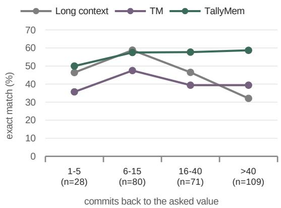  
Figure 8: MINTEval value-history questions by commits back to the requested value: 288 questions with an annotated lookback of at least one commit (bin sizes shown). TallyMem exceeds TM in every bin; the two farthest bins also show larger advantages over long-context reading. The bins describe different questions, not a controlled intervention on history length.

Results. The primary arm produces evidence for 560 questions (TallyMem: 438); 62 programs ran after repair and 5 still failed. Table 20 compares the three code variants with TM and TallyMem. Across the three code variants, overall accuracy is 60.2–62.1%, compared with 61.9% for TM and 66.0% for TallyMem. At load above 100, code reaches 32.4–45.9%, below TallyMem at 48.6%.

For the primary arm, program generation cost \$0.10 and answering and judging \$0.95.

<table><tr><td>Reader</td><td>Questions</td><td>TM</td><td>no routing</td><td>TallyMem</td></tr><tr><td rowspan="3">Qwen3-32B (server)</td><td>all 2,496</td><td>69.8</td><td>70.4 (+79/–63)</td><td>71.1 (+47/–14)</td></tr><tr><td>rule-selected 670</td><td>64.9</td><td>68.8 (+52/-26)</td><td>69.7 (+39/-7)</td></tr><tr><td>other 1,826</td><td>71.6</td><td>71.0 (+27/–37)</td><td>71.6 (+8/–7)</td></tr><tr><td rowspan="3">gpt-oss-120b (DeepInfra, pre-registered)</td><td>all 2,496</td><td>78.4</td><td>79.2 (+75/–54)</td><td>79.2 (+40/–19)</td></tr><tr><td>rule-selected 670</td><td>70.2</td><td>74.0 (+54/-28)</td><td>73.3 (+33/–12)</td></tr><tr><td>other 1,826</td><td>81.4</td><td>81.1 (+21/-26)</td><td>81.4 (+7/–7)</td></tr><tr><td rowspan="3">Qwen3.6-27B (server)</td><td>all 2,496</td><td>75.9</td><td>76.8 (+74/–50)</td><td>76.6 (+38/-20)</td></tr><tr><td>rule-selected 670</td><td>69.6</td><td>73.3 (+51/-26)</td><td>72.5 (+34/–14)</td></tr><tr><td>other 1,826</td><td>78.2</td><td>78.1 (+23/-24)</td><td>78.1 (+4/–6)</td></tr><tr><td rowspan="3">Qwen3-8B (server, pre-registered)</td><td>all 2,496</td><td>60.7</td><td>62.4 (+101/–59)</td><td>62.3 (+50/-12)</td></tr><tr><td>rule-selected 670</td><td>55.2</td><td>61.0 (+61/–22)</td><td>59.9 (+37/–6)</td></tr><tr><td>other 1,826</td><td>62.8</td><td>62.9 (+40/–37)</td><td>63.1 (+13/–6)</td></tr></table>

Table 18: Accuracy (%) and wins/losses against TM with and without the router on full AMA-Bench.
<table><tr><td>Variant</td><td>correct</td><td>vs. TallyMem</td><td>vs. TM</td></tr><tr><td>TallyMem</td><td>416/630</td><td></td><td>+55/-29 (0.006)</td></tr><tr><td>no quote recovery</td><td>415/630</td><td>+2/-3 (1.00)</td><td>+55/-30 (0.009)</td></tr><tr><td>no relaxed retry</td><td>415/630</td><td>+2/-3 (1.00)</td><td>+52/–27 (0.007)</td></tr><tr><td>zero-generation ledger (TallyMem-lite)</td><td>407/630</td><td>+28/-37 (0.32)</td><td>+32/-15 (0.02)</td></tr><tr><td>plan self-consistency (k=5)</td><td>414/630</td><td>+28/-30 (0.90)</td><td>+50/-26 (0.008)</td></tr><tr><td colspan="4">earlier development controls, 217 questions</td></tr><tr><td>TM 14k + full ledger in context</td><td>129 vs. 135</td><td></td><td>+16/-22 (0.42)</td></tr><tr><td>single-operation compiler</td><td>136 vs. 133</td><td></td><td>+17/-14 (0.72)</td></tr></table>

Table 19: Ablations (Qwen3-32B). Upper block: 630 rule-selected questions. Lower block: earlier development variants compared with their own TM context.
<table><tr><td>Questions</td><td>All 630</td><td>Load &gt;100 37</td></tr><tr><td>TM</td><td>61.9</td><td>2.7</td></tr><tr><td>TallyMem</td><td>66.0</td><td>48.6</td></tr><tr><td>Free-form code (ledger + log)</td><td>62.1 (+72/–47; 0.03)</td><td>32.4 (+9/–3; 0.15)</td></tr><tr><td>Free-form code (ledger only)</td><td>61.1 (+77/–46; 0.007)</td><td>40.5 (+9/–6; 0.61)</td></tr><tr><td>Free-form code, thinking (ledger + log)</td><td>60.2 (+82/–45; 0.001)</td><td>45.9 (+9/–8; 1.00)</td></tr></table>

Table 20: Free-form code control (Qwen3-32B, accuracy %). Columns: the 630 rule-selected questions and those with load above 100. In parentheses: questions that TallyMem answers correctly and the code arm does not / the reverse, and the two-sided sign-test p.

## M MINTEval Protocol and Detailed Results

The GitHub subset contains 200 repositories with 22–148 commits each. We use 25 of the 101 development repositories for adaptation and freeze the system before evaluating 99 test repositories (776 questions). Each commit is a step; the ledger is extracted from diffs, including file additions, deletions, renames and added assignment lines. The schema description in the compiler prompt changes accordingly. This is a benchmark-specific adaptation of the interface, not zero-adaptation transfer. Outputs follow MINTEval’s official format and exact-match evaluation. Long context was evaluated after the pre-registered test under the same 40,960-token model context limit, using a 70:30 head–tail split when truncation was needed. Its input budget is the model limit minus 12,288 output tokens, 300 safety tokens and fixed prompt text; TM instead uses its 26k-token retrieval budget with per-field caps of 1,200 characters, or 4,000 for anchor steps. TM also truncates long diffs, so admitting all commit IDs does not imply complete commit coverage.

TallyMem versus TM gives +124/−17 (p < 0.001), and versus long context gives +164/−88 $\begin{array} { r l r } { ( p } & { { } < } & { 0 . 0 0 1 ) } \end{array}$ The gains are largest for file order (17.6%→43.1%) and value histories (41.0%→56.6%). Multi-hop performance is unchanged. On counting, long context scores 52.5% versus 47.5% for TallyMem (not significant).

<table><tr><td>System</td><td>All</td><td>Hist.</td><td>Order</td><td>Count</td><td>Simple</td><td>Multi-hop</td><td>vs. TM</td></tr><tr><td>Long context</td><td>39.2</td><td>45.8</td><td>19.0</td><td>52.5</td><td>47.1</td><td>33.6</td><td> $+ 1 2 3 / - 9 2 ( 0 . 0 4 1 )$ </td></tr><tr><td>TM</td><td>35.2</td><td>41.0</td><td>17.6</td><td>31.1</td><td>47.8</td><td>31.3</td><td></td></tr><tr><td> $\mathrm { T a l l y M e m } ^ { \bullet }$ </td><td>49.0</td><td>56.6</td><td>43.1</td><td>47.5</td><td>56.6</td><td>31.3</td><td> $+ 1 2 4 / - 1 7 ( < 0 . 0 0 1 )$ </td></tr><tr><td>TallyMem, no routing</td><td>49.0</td><td>56.6</td><td>43.1</td><td>47.5</td><td>56.6</td><td>31.3</td><td> $+ 1 2 5 / - 1 8 ( < 0 . 0 0 1 )$ </td></tr><tr><td>TallyMem, AMA load routing§</td><td>35.7</td><td></td><td>一</td><td>一</td><td>一</td><td>一</td><td>+5/–1 (0.22)</td></tr></table>

Table 21: MINTEval GitHub split, 99 held-out repositories (776 questions), exact match (%), Qwen3-32B reader, frozen system evaluated once. Long context: the whole history, head and tail truncated to the budget of the AMA-Bench long-context arm, run after the pre-registered test as a reference row. Sign tests are paired with TM. ¶With the coverage-aware router of Appendix J. §The load-only router.

Other readers. After the pre-registered test we repeated the three arms with gpt-oss-120b (DeepInfra, the configuration of its AMA-Bench column) and Qwen3-8B (local vLLM, thinking) as answer models. They reuse the Qwen3-32B compiler’s evidence, TM’s contexts and the routing, and every prompt is byte-identical to the Qwen3-32B run, which we checked by hash before any answer was generated. TallyMem exceeds TM with both readers (+124/−24, $p ~ < ~ 0 . 0 0 1$ , and +119/−11, $p \ < \ 0 . 0 0 1$ ; repository-clustered intervals +12.9 [+9.0, +16.8] and +13.9 [+10.5, +17.6] points) and long context (+166/−92, p < 0.001, and +165/−90, $\mathit { p } \ < \ 0 . 0 0 1 )$ TM again trails long context (+98/−124, $p ~ = ~ 0 . 0 9$ , and +94/−127, $p = 0 . 0 3 )$

## N Error Analysis Protocol

The analysis covers the 214 errors of TallyMem on the 630 diagnostic questions with Qwen3-32B, using the principal configuration with computed evidence always attached $( \gamma = 1 )$ . It uses frozen outputs only: no model was called and no method was changed afterwards. The procedure was written before any error was inspected.

Stage 1. Errors without computed evidence (66) are separated automatically. Their answers are TM’s: the compiler declined in 20 cases, every sub-query failed the grounding checks in 43, and compilation failed in the rest.

Stage 2. Each remaining error was labelled from the question, the reference, the compiled plan, the per-sub-query outcomes, the rendered evidence and the final answer, and the raw log and ledger were consulted whenever the label depended on them. The first applicable label is assigned, in this order: reference or judge (the answer agrees with the log in substance, and the reference contradicts the log or the judge rejects a correct answer); answering (the rendered evidence states everything the reference requires, or the answer contradicts what it states); partial coverage (the evidence is correct and the error lies only in parts answered from TM’s view); specification (the scope, predicate or operation does not express the referenced quantity, including a requested quantity that was not compiled or was dropped); ledger (the plan expresses the quantity but ledger rows are wrong or inconsistent); truncation (a correct result was cut by the rendering budget); unclear. A plan whose reading of an ambiguous question is defensible is still a specification error and is flagged; 26 of the 51 specification errors carry this flag. Four clarifications were added while labelling and applied to all cases: contradicting stated evidence counts as an answering error; evidence that must be joined or recomputed across sub-queries does not state the quantity; a flawed reference yields the reference label only if the answer is correct against the log; and an answer that adds a false claim to otherwise complete content is an answering error. The last rule moved four cases out of the reference category.

Validity check. The evidence of each question is shared by all readers, so a systematic error should persist across readers while an answering error should not. As specified in advance, we compared the accuracy of the other four readers on answering and specification errors: 39.3% versus 18.1% (two-sided permutation test, $p = 0 . 0 0 5 )$ . Of the 51 specification errors, 25 misread an unambiguous question and 26 concern questions whose plan reading is defensible while the reference adopts another; the other readers answer 17.0% and 19.2% of them correctly, so both groups are systematic.

<table><tr><td>Questions</td><td>Errors</td><td>Specification</td><td>Ledger</td><td>Answering</td><td>Partial</td><td>Reference/judge</td><td>Unclear</td></tr><tr><td>Load 1–15</td><td>86</td><td>24</td><td>13</td><td>8</td><td>9</td><td>30</td><td>2</td></tr><tr><td>Load 16–100</td><td>43</td><td>17</td><td>8</td><td>10</td><td>2</td><td>6</td><td>0</td></tr><tr><td>Load &gt;100</td><td>19</td><td>10</td><td>0</td><td>3</td><td>0</td><td>6</td><td>0</td></tr><tr><td>Count / frequency (F1)</td><td>52</td><td>21</td><td>14</td><td>10</td><td>5</td><td>2</td><td>0</td></tr><tr><td>First / last change (F2)</td><td>29</td><td>10</td><td>1</td><td>2</td><td>3</td><td>12</td><td>1</td></tr><tr><td>State tracing (F3)</td><td>55</td><td>7</td><td>7</td><td>8</td><td>4</td><td>28</td><td>1</td></tr><tr><td>Action enumeration (F4)</td><td>18</td><td>15</td><td>0</td><td>1</td><td>2</td><td>0</td><td>0</td></tr></table>

Table 22: Errors with computed evidence by aggregation load and question family (Qwen3-32B, 630 diagnostic questions). A question can belong to several families. Executor and truncation errors: none.

## O Error Analysis and Later Compiler Changes

Selection errors. For a query that counts logged steps, let $S$ be the executed set and $S ^ { \star }$ the intended set of Equation 1. Before rendering and answering, the computed count error is

$$
| S | - | S ^ { \star } | = | S \setminus S ^ { \star } | - | S ^ { \star } \setminus S | ,\tag{12}
$$

the difference between extra and missed events. Both terms can be checked against the log because each result states its filters and supporting step IDs, although $S ^ { \star }$ itself is unknown at inference time. Equal counts can still conceal cancelling errors (Figure 9).

Where computation does not help. First/lastchange and single-step state questions are flat (Table 8), because retrieval already finds the relevant step. By domain, the gain comes mostly from embodied trajectories (Table 23 in Appendix P). Multipart text-to-SQL statistics improve only partly (22 → 27 of 51), because the gold answers’ notion of an “object” often differs from the ledger’s. Harmful evidence mostly comes from inconsistent target labels in the annotated ledger (for example, a web element labelled differently across steps) and from content questions about code, which the refined compiler now leaves to retrieval.

Execution fails when the quantity is misspecified. The following Qwen3-32B DeepInfra diagnostic examples show programs executing exactly what the plan asked, while the plan’s notion of the quantity differs from the gold answer’s.

• For “which containers has the agent interacted with and what state changes occurred”, the gold answer lists only open and close events. The plan grouped every step that visited or looked at an object.

• For “which objects has the agent interacted with and how many times”, the gold answer counts only objects picked up or moved. The plan counted visits to furniture.

Sampling more plans does not fix a definition the compiler consistently gets wrong, which explains why self-consistency fails. A general rule does fix part of it: questions about state changes use only steps with recorded changes. The refined compiler raises the container template from 4 to 12 of 26 questions. Overall, the refined compiler answers 423 of the 630 questions correctly, against 416 for the principal compiler and 390 for TM. The computation path thus converts an error that cannot be inspected (a miscounted list) into one that can be examined: a query that says what it counted.

A fixed counter is a special case. TM’s keywordtriggered counter is itself a small program. On count questions where it fires, TM is nearly as accurate as TallyMem (67% vs. 68%, 221 questions). A fixed aggregate works when the question happens to match it; the probe isolates this effect by asking the same count in two wordings (Appendix H). Compiling the question extends this to groupings, outcome breakdowns, first/last queries and timelines.

## P Results by Domain

Both counts equal 3. The selected events are still different. Conceptual illustration. Rendering and final answer generation can introduce further errors.  
Illustrative question: How many successful open actions occurred?  
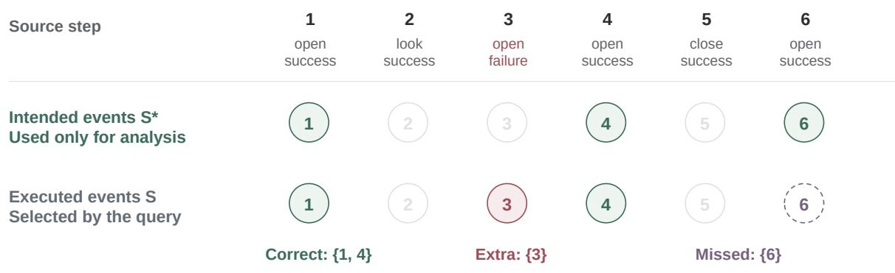

$$
| S | - | S ^ { \star } | = | S \setminus S ^ { \star } | - | S ^ { \star } \setminus S | = 1 - 1 = 0
$$

Figure 9: A conceptual example of Equation 12. The executed set includes an extra event and misses an intended one. Their effects cancel in the scalar count, although the selected sets differ. $S ^ { \star }$ is an analysis reference, not an input to inference. Rendering and final answer generation can introduce additional errors.
<table><tr><td>Domain</td><td>n</td><td>Long ctx.</td><td>TM</td><td>TallyMem-lite</td><td>TallyMem</td><td>TallyMem vs. TM</td></tr><tr><td>Embodied</td><td>239</td><td>129</td><td>141</td><td>161</td><td>165</td><td>+33/–9 (&lt;0.001)</td></tr><tr><td>Game</td><td>17</td><td>12</td><td>10</td><td>10</td><td>8</td><td>+0/-2 (0.50)</td></tr><tr><td>Open-world</td><td>59</td><td>30</td><td>45</td><td>45</td><td>43</td><td>+0/-2 (0.50)</td></tr><tr><td>Software</td><td>67</td><td>27</td><td>21</td><td>21</td><td>20</td><td>+3/-4 (1.00)</td></tr><tr><td>Text-to-SQL</td><td>153</td><td>97</td><td>99</td><td>96</td><td>107</td><td>+16/-8 (0.15)</td></tr><tr><td>Web</td><td>95</td><td>55</td><td>74</td><td>74</td><td>73</td><td>+3/-4 (1.00)</td></tr></table>

Table 23: Correct answers by domain on the 630 rule-selected questions (Qwen3-32B). The gain is concentrated in the embodied domain, whose trajectories are long and whose questions aggregate the most steps. Long context is better than TM on software engineering and games (small samples), where TM’s selection misses context.

## Q Worked Example: From Logged Steps to Computed Evidence

Episode 30 is an embodied trajectory with 150 steps. The question is “Until step 149, what types of actions has the agent performed and how frequently?”.

Access and aggregation. TM’s reading view shows 132 of the 150 steps, omitting the first 18. Even within the visible portion, its answer miscounts five of the eight action types; for example, it reports examine 18 times against a true 5. This example illustrates both evidence access and aggregation. The complete-context control is shown separately in Figure 1.

Executable evidence. TallyMem compiles one sub-query with $I _ { 1 } = [ 0 , 1 4 9 ]$ , a predicate admitting every logged tool and $\omega _ { 1 } = \mathtt { g r o u p } _ { \mathrm { t o o l } }$ . Equation 7 computes the frequencies over all ledger rows in scope. The result is go 77, look 49, open 7, close 5, examine 5, help 4, take 2 and move 1, with supporting step IDs (Figure 10). The reader reproduces these counts.

[Q1] group\_count by tool; filter: tool any of   
[’go’,’look’,’open’,’close’,   
’examine’,’help’,’take’,’move’]; matched steps: 150   
go: 77 (steps 1-7, 10-11, 14, ...) - outcomes: success 77   
look: 49 (steps 0, 15, 26, ...) - outcomes: success 32,   
no\_effect 17   
open: 7 (steps 8, 12, 19, 23, 61, 85, 109) - outcomes:   
success 7  
Figure 10: Computed evidence $D _ { q } \colon$ tool frequencies, supporting step IDs and outcome breakdowns (excerpt).

Saved answers. Figure 11 contrasts TM’s reading view with the executable evidence; Figure 12 compares saved answers across reader configurations. Unlike the illustrative memory cards in Figure 1, these outputs come from the diagnostic runs.

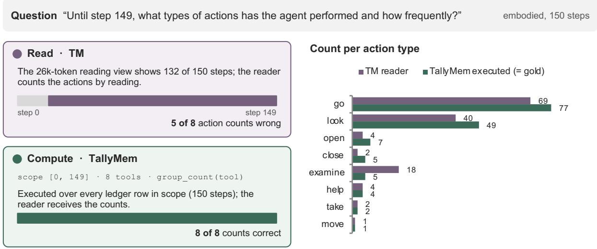  
Figure 11: Reading and execution on the worked example. Left: TM’s reading view and the full-ledger computation path. Right: saved TM counts and the executable result against the reference.

<table><tr><td rowspan=1 colspan=12>Question “Until step 149, what types of actions has the agent performed and howAMA-Bench, embodied, 150 stepsfrequently?&quot;</td></tr><tr><td rowspan=1 colspan=1>Method</td><td rowspan=1 colspan=1>Answer model</td><td rowspan=1 colspan=1>go</td><td rowspan=1 colspan=1>look</td><td rowspan=1 colspan=1>open</td><td rowspan=1 colspan=1>close</td><td rowspan=1 colspan=1>examine</td><td rowspan=1 colspan=1>help</td><td rowspan=1 colspan=1>take</td><td rowspan=1 colspan=1>move</td><td rowspan=1 colspan=1>Correct</td><td rowspan=1 colspan=1>Judge</td></tr><tr><td rowspan=1 colspan=1>Reference answer</td><td rowspan=1 colspan=1></td><td rowspan=1 colspan=1>77</td><td rowspan=1 colspan=1>49</td><td rowspan=1 colspan=1>7</td><td rowspan=1 colspan=1>5</td><td rowspan=1 colspan=1>5</td><td rowspan=1 colspan=1>4</td><td rowspan=1 colspan=1>2</td><td rowspan=1 colspan=1>1</td><td rowspan=1 colspan=1></td><td rowspan=1 colspan=1></td></tr><tr><td rowspan=1 colspan=1>Long context</td><td rowspan=1 colspan=1>Qwen3-32B</td><td rowspan=1 colspan=1>70</td><td rowspan=1 colspan=1>47</td><td rowspan=1 colspan=1>5</td><td rowspan=1 colspan=1>5</td><td rowspan=1 colspan=1>6</td><td rowspan=1 colspan=1>3</td><td rowspan=1 colspan=1>2</td><td rowspan=1 colspan=1>1</td><td rowspan=1 colspan=1>3/8</td><td rowspan=1 colspan=1>wrong</td></tr><tr><td rowspan=1 colspan=1>Long context</td><td rowspan=1 colspan=1>gpt-oss-120b</td><td rowspan=1 colspan=1>63</td><td rowspan=1 colspan=1>49</td><td rowspan=1 colspan=1>6</td><td rowspan=1 colspan=1>5</td><td rowspan=1 colspan=1>5</td><td rowspan=1 colspan=1>4</td><td rowspan=1 colspan=1>2</td><td rowspan=1 colspan=1>0</td><td rowspan=1 colspan=1>5/8</td><td rowspan=1 colspan=1>wrong</td></tr><tr><td rowspan=1 colspan=1>Long context</td><td rowspan=1 colspan=1>Qwen3-235B</td><td rowspan=1 colspan=1>64</td><td rowspan=1 colspan=1>24</td><td rowspan=1 colspan=1>4</td><td rowspan=1 colspan=1>4</td><td rowspan=1 colspan=1>5</td><td rowspan=1 colspan=1>3</td><td rowspan=1 colspan=1>3</td><td rowspan=1 colspan=1>2</td><td rowspan=1 colspan=1>1/8</td><td rowspan=1 colspan=1>wrong</td></tr><tr><td rowspan=1 colspan=1>TM (retrieval)</td><td rowspan=1 colspan=1>Qwen3-32B</td><td rowspan=1 colspan=1>69</td><td rowspan=1 colspan=1>40</td><td rowspan=1 colspan=1>4</td><td rowspan=1 colspan=1>2</td><td rowspan=1 colspan=1>18</td><td rowspan=1 colspan=1>4</td><td rowspan=1 colspan=1>2</td><td rowspan=1 colspan=1>1</td><td rowspan=1 colspan=1>3/8</td><td rowspan=1 colspan=1>wrong</td></tr><tr><td rowspan=1 colspan=1>TM + enumerate prompt</td><td rowspan=1 colspan=1>Qwen3-32B</td><td rowspan=1 colspan=1>65</td><td rowspan=1 colspan=1>46</td><td rowspan=1 colspan=1>5</td><td rowspan=1 colspan=1>3</td><td rowspan=1 colspan=1>5</td><td rowspan=1 colspan=1>3</td><td rowspan=1 colspan=1>2</td><td rowspan=1 colspan=1>1</td><td rowspan=1 colspan=1>3/8</td><td rowspan=1 colspan=1>wrong</td></tr><tr><td rowspan=1 colspan=1>TallyMem</td><td rowspan=1 colspan=1>Qwen3-32B</td><td rowspan=1 colspan=1>77</td><td rowspan=1 colspan=1>49</td><td rowspan=1 colspan=1>7</td><td rowspan=1 colspan=1>5</td><td rowspan=1 colspan=1>5</td><td rowspan=1 colspan=1>4</td><td rowspan=1 colspan=1>2</td><td rowspan=1 colspan=1>1</td><td rowspan=1 colspan=1>818</td><td rowspan=1 colspan=1>correct</td></tr></table>

TallyMem compiles one query, group-count by tool over steps 0–149, and executes it over all 150 steps; TM shows 132 of the 150 steps to the reader.  
Figure 12: Saved answers across reader configurations on the same question. Red entries differ from the reference; all six answer rows come from diagnostic runs.