# Beyond the Trial-and-Error Loop: Hybrid Projection and Automated Tuning for Distributed Training

Anshu Raina Peyman Razaghi Yuankai Chen Cheng Yao Yao Fu Vidushi Goyal Devang Patel Wen Xie Zhenyu Gu Emad Barsoum

Advanced Micro Devices, Inc. Correspondence: anshu.raina@amd.com

## Abstract

Configuring distributed LLM training across hundreds of GPUs requires jointly optimizing tensor, pipeline, expert, context, and data parallelism alongside microbatch size, recomputation, sharding, and overlap, a combinatorial space where the boundary between memory-legal and OOM can hinge on a single byte of per-element activation accounting. Today, teams navigate it through expensive multi-node trial and error, burning GPU-hours on crashes and suboptimal recipes. We present Primus Projection, which closes this loop with two coupled components. First, a hybrid projection engine that measures what it can and simulates what it cannot: GPU microbenchmarks on as few as a single device capture compute kernels and any in-scope communication; a sub-node downscale–measure–upscale workflow analytically restores out-of-scope collectives, FSDP overlap, and the full pipeline schedule at the multi-node target. A pure simulation mode runs entirely on CPU, enabling pre-silicon planning without any GPU. Second, the Primus Tuning Agent treats the projection engine as a fast scoring oracle (seconds per candidate instead of tens of minutes) and uses it to drive an intelligent search over the configuration space. A deterministic seed planner sweeps single axes; an LLM investigation loop proposes cross-axis combinations the planner cannot reach, with an analytic memory pre-filter that rejects infeasible candidates before any GPU time is spent. Validated on Llama 3.1 (dense) and Mixtral 8×22B (MoE) across two GPU generations, all projections stay within ∼10% of measured multi-node throughput, and fidelity holds at production scale: 4.7% error on DeepSeek V3 671B at 1,024 GPUs and 1.9% on Qwen3-235B-A22B at 256 GPUs. In a Mixtral 8×22B case study, the Primus Tuning Agent discovers a configuration delivering +27% throughput over the published 4-node BF16 reference at the same scale, in under 30 minutes of single-node exploration, with no hand-written configs and no full-cluster profiling pass.

## 1 Introduction

The rapid growth in large language model (LLM) scale, from billions to trillions of parameters, has made distributed training configuration a first-class engineering challenge. A single 100B+ run jointly selects five interacting parallelism dimensions (TP, PP, EP, CP, DP) plus micro-batch size, sequence length, gradient accumulation, recomputation, FSDP sharding, and overlap flags; each combination trades memory, compute utilization, and communication overhead differently, and the combinatorial space of valid configurations grows rapidly with model size and cluster scale, making exhaustive trial-and-error infeasible. In practice, teams launch full multi-node runs, observe OOMs or suboptimal throughput, adjust, and repeat—each iteration consuming hours of expensive cluster time and delaying model development.

Existing tools fall short of closing this loop. Analytical cost models (e.g. Calculon [10], Galvatron [18]) predict training time from hardware specifications or single-device layer profiles with nominal-bandwidth communication, but miss GPU frequency throttling under sustained load, software-stack variation, and grouped-GEMM behavior in Mixture-of-Experts (MoE) models [6, 8, 14]. Full-system simulators (e.g. ASTRA-sim [25], Echo/Moye [7]) achieve higher fidelity but require target-hardware traces or extensive calibration, and do not scale to the configuration sweeps needed for planning.

We present Primus Projection: compute kernels are benchmarked on as few as a single GPU; out-ofscope communication, FSDP overlap, and the full pipeline schedule are reconstructed analytically at the target scale. A pure simulation mode runs entirely on CPU for pre-silicon planning. The Primus Tuning Agent treats the projection oracle as a fast surrogate to search the full configuration space end-to-end—parallelism, schedule, recomputation, MoE backend, and precision—replacing days of manual profiling with minutes of single-node exploration.

We validate Primus Projection against published multi-node training results [2] on AMD Instinct MI325X and MI355X GPUs across dense (Llama 3.1 [9]) and MoE (Mixtral 8×22B [12]) models, keeping all projections within ∼10% of measured throughput, and at production scale on DeepSeek V3 671B [4] (1,024 GPUs, 4.7% error) and Qwen3-235B-A22B [33] (256 GPUs, 1.9%). Projection also preserves configuration rankings (Spearman $\rho \ge 0 . 9 3 )$ on Mixtral, Qwen3-235B-A22B, and GPT-OSS-120B [21], always selecting the measured-best configuration. In a Mixtral tuning case study, the agent delivers +27% throughput over AMD’s published 4-node BF16 reference at the same scale in under 30 minutes.

## 2 Background and Motivation

A distributed LLM training run is defined by a configuration vector (TP, PP, VPP, EP, CP, DP) along with choices for micro-batch size, sequence length, gradient accumulation, recomputation, FSDP sharding, and communication overlap. Each combination determines a unique point in a high-dimensional space of memory consumption, compute utilization, communication overhead, and pipeline bubble fraction. For a Mixtral 8×22B run on 64 GPUs, the partition constraint TP × PP × $\bar { \mathrm { E P } } \times \mathrm { C P } \leq 6 4$ alone admits roughly 160 ordered factorizations; layered with MBS $\in \{ 1 , \ldots , 8 \}$ recomputation level ∈ {none, sel, full}, MoE backend ∈ {A2A, DeepEP}, and pipeline algorithm ∈ {1F1B, Interleaved [20], ZB [24], ZBV, ILP}, the search space grows to $\mathcal { O } ( 1 0 ^ { 4 } )$ topologically valid points, of which only a small fraction is simultaneously memory-legal and high-throughput— and the boundary between feasible and infeasible is razor-thin: a 4-byte miscount of activation memory per element across 56 MoE layers is enough to push a configuration from legal to OOM, voiding hours of queued cluster time. Manual exploration in this space is impractical.

Pure analytical performance modeling has inherent pitfalls: GPU clock throttling under load creates a 44–70% gap between peak and Maximum Achievable FLOPs [26]; ROCm stack updates (hipBLASLt, Composable Kernel, Triton) shift per-operation throughput unpredictably; MoE grouped GEMMs depend on wave quantization and routing distributions that resist closed-form treatment [8]; and opti mizer, allocator, and gradient-accumulation overhead is invisible to roofline models. Benchmarking actual kernels on the deployed stack captures all four automatically. Primus Projection pairs such a benchmark—measured on as few as a single GPU—with analytical models for collective communication, pipeline scheduling, and FSDP overlap, composing the two so the projection transfers to any multi-node target without launching a multi-node run.

## 3 Methodology

Primus Projection is a modular pipeline of five components: memory projection (analytical), layer profiling (benchmark or simulation), communication modeling, pipeline schedule simulation, and multi-node scaling. Hardware profiles for AMD Instinct MI300X, MI325X, and MI355X are bundled and custom YAML profiles can be added (Appendix A). The two top-level capabilities—Modeling and the Primus Tuning Agent that builds on it—compose into a single projection oracle (Figure 1).

## 3.1 Modeling

Memory: A hierarchical profiler tree mirroring the model’s module structure (embeddings, dense / MoE transformer layers, output, loss) returns sharded per-GPU parameter, gradient, and optimizerstate counts together with per-microbatch activation memory, accounting for TP weight splits, PP layer assignment, EP expert sharding, CP replication, and FSDP/ZeRO sharding across DP. The projector treats precision as two independent axes—a parameter/optimizer regime (BF16 vs. FP8 mixed precision; Adam / AdamW / distributed optimizer) and a saved-activation regime (BF16 by default, FP8 when the framework casts saved activations to FP8 for memory savings)—each contributing a per-element byte cost. Pipeline-schedule interleaving, gradient accumulation, and recomputation (full or selective) compose with the activation regime; full recomputation reduces the per-layer activation footprint to a single checkpointed input, again at the selected activation precision.

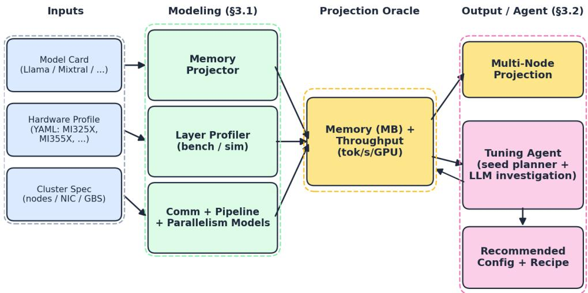  
Figure 1: Primus Projection architecture. Modeling components consume model card, hardware profile, and cluster spec; the projection oracle returns a memory and throughput estimate that drives both multi-node projection and the Primus Tuning Agent’s iterative search.

Activation memory dominates for large MoE workloads (a single MoE layer can outweigh attention activations by an order of magnitude), so accurate per-layer accounting is critical for memory-legal configuration discovery. Per-component equations and byte costs are in Appendix B.

Performance: measure what you can, simulate what you can’t. Primus Projection’s default mode combines both: when a parallelism dimension fits inside the available benchmark GPUs—TP AllReduce within a node, EP All-to-All within the benchmark configuration, intra-node DP gradient AllReduce—the corresponding collective is captured directly by the kernel-level benchmark alongside compute. Only communication that falls outside the single-node benchmark scope, primarily internode traffic and the deltas introduced when a parallelism dimension is reduced for benchmarking, is reconstructed analytically. In the limit of a single-GPU benchmark no collective is directly measurable, since collectives are inherently multi-GPU; in that case every communication term is reconstructed from the analytic model below, and only compute time is measured. Pipeline scheduling follows deterministic dependency rules and is simulated exactly from the per-stage compute times produced by the benchmark. Framework overhead (allocator pauses, gradient-accumulation glue) is absorbed implicitly into the measured kernel sequence; the optimizer step runs once per iteration and is measured directly on the benchmark (falling back to an analytic HBM-bandwidth model). Per-iteration time composes as

$$
\begin{array} { r } { \mathrm { i t e r \_ t i m e } = T _ { \mathrm { p i p e } } \big ( \{ t _ { \ell } \} , N _ { \mu \mathrm { B } } , \mathrm { s c h e d u l e } \big ) + \mathrm { F S D P ^ { e x p } + g r a d \_ A R ^ { e x p } + o p t \_ s t e p } , } \end{array}\tag{1}
$$

where $t _ { \ell }$ is the per-layer forward/backward time (measured, plus the analytic TP/EP deltas of Algorithm 1; in-scope TP AllReduce and EP All-to-All are therefore already inside $t _ { \ell } ) , T _ { \mathrm { p i p e } }$ is the simulated makespan of the target pipeline schedule over $N _ { \mu \mathbf { B } }$ micro-batches (including bubble and inter-stage P2P; it reduces to $\breve { N } _ { \mu \mathrm { B } } \sum _ { \ell } t _ { \ell }$ when $\mathrm { P P = } 1 )$ , and the superscript “exp” denotes only the exposed, non-overlapped portion.

Sub-node benchmarking: downscale, measure, upscale. The --benchmark-gpus flag fixes the benchmark hardware budget (defaulting to one node); the projector then follows a downscale → measure → upscale workflow (Algorithm 1).

Downscale. When the target requires more GPUs than the benchmark host provides, parallelism dimensions are reduced in a priority order $\mathrm { P P }  \mathrm { E P }  \mathrm { T P }$ chosen to minimize analytical restoration error. PP→1 comes first because pipeline parallelism’s effect on iteration time is entirely determined by the schedule, which is deterministically simulable; removing PP for benchmarking loses no compute information. EP is reduced next, with num\_experts adjusted proportionally so each GPU still computes the same number of experts—the per-rank MoE workload (and therefore the measured GEMM time) is preserved, leaving only the All-to-All to be reconstructed. TP is reduced last because shrinking it changes the per-GPU tensor slice shape, forcing both a compute-time rescale and an AllReduce delta. CP is never reduced: in MoE workloads CP is folded into EP (MoE

Algorithm 1 Sub-node benchmarking: downscale → measure → upscale.   
Require: target config C∗ = (TP, PP, VPP, EP, CP, DP); benchmark budget $G _ { b } ;$ hardware profile H   
$1 \colon { \overline { { C } } }  C ^ { * }$   
Phase 1: Downscale ▷ shrink along axes by restoration-fidelity order   
2: while $\mathrm { G P U C O U N T } ( C ) > G _ { b }$ do   
3: if $C . \mathrm { P P } > 1$ then $\mathrm { { C . P P  1 } }$ ▷ schedule replayed exactly at upscale   
4: else if $C . { \mathrm { E P } } > 1$ then shrink C.EP, scale num\_experts so experts/rank is preserved   
5: else shrink C.TP ▷ slice shape changes; compute is rescaled at upscale   
6: end if   
(C.CP is never reduced)   
7: end while   
8: $C ^ { \mathrm { b e n c h } }  C$ ▷ downscaled config actually run on the $G _ { b }$ GPUs   
Phase 2: Measure ▷ minimal layer set; one timing per layer type   
9: for each distinct layer type $\ell \in$ {dense, moe} in the model do   
10: measure forward and backward times $( t _ { \ell } ^ { F } , t _ { \ell } ^ { B } )$ on $G _ { b } \mathrm { G P U s }$   
11: if ℓ is MoE then additionally split $t _ { \ell }$ into compute and All-to-All components   
12: end if   
13: end for   
Phase 3: Upscale ▷ compose analytical deltas onto measured kernels   
14: PP: simulate target schedule from $\{ t _ { \ell } \}$ , add intra-/inter-node P2P   
15: EP: per MoE layer, add $\Delta _ { \mathrm { A 2 A } } = \mathrm { A } \dot { 2 } \dot { \mathrm { A } } ( C ^ { * } ) - \mathrm { A } 2 \mathrm { A } ( C ^ { \mathrm { b e n c h } } )$   
16: TP: rescale compute by $\mathrm { T P ^ { b e n c h } / T P ^ { * } }$ , add AR delta   
(with measured AR, use ratio form $\mathsf { A R } ^ { * } = \mathsf { A R } ^ { \mathrm { b e n c h } } \times a ^ { * } / a ^ { \mathrm { b e n c h } } )$   
17: return iter\_time via Eq. 1; tok/s/GPU

Parallel Folding), so shrinking it saves no GPUs; in dense workloads it would change the per-GPU sequence length and fundamentally alter GEMM shapes and attention computation, so the benchmark would no longer measure the target workload. In practice this is rarely a constraint, since most dense models train at 8K–32K sequence lengths where CP=1. As a concrete example, a target with (TP=1, PP=4, EP=8, CP=1) requiring 32 GPUs downscales to a 1-GPU benchmark in two steps: PP 4→1 (8 GPUs), then EP 8→1 (1 GPU).

Measure. The projector benchmarks a minimal set of layers covering every distinct layer type: one dense layer for a pure dense model, one MoE layer for an all-MoE model, or one of each for mixed architectures (e.g. DeepSeek’s 3 dense + 58 MoE layers). All layers of the same type share architecture and GEMM shapes, so differences in learned weights do not affect kernel time, and each selected layer is timed for forward and backward separately. For MoE layers a decomposed measurement captures compute and All-to-All times independently, because A2A will be replaced analytically during upscale while the compute portion is kept verbatim. When PP=1 the per-type time scaled by the layer count of that type yields the full-model time; when PP>1 the pipeline simulator constructs a per-stage time matrix from the model’s layer assignment (respecting decoder\_first/last\_pipeline\_num\_layers and pipeline\_model\_parallel\_layout) and simulates the schedule with exact bubble accounting.

Upscale. Each reduced dimension is restored analytically and the contributions compose. PP i reconstructed by simulating the target schedule (1F1B, Interleaved, Zero-Bubble, ZBV, ILP) from benchmarked per-layer times, distinguishing intra- and inter-node P2P. EP is restored by adding, per MoE layer, the A2A delta $\Delta = \mathrm { A } 2 \mathrm { A } \overline { { { ( C ^ { * } ) } } } - \mathrm { A } 2 \mathrm { A } ( C ^ { \mathrm { b e n c h } } )$ . Both terms come from the topology-aware collective model (Appendix B): $\mathbf { A } 2 \mathbf { A } ( C ^ { \mathrm { b e n c h } } )$ is the A2A of the downscaled configuration that was actually benchmarked, and A2A(C∗) is the A2A of the full target EP group, priced on inter-node links whenever that group spans nodes. When the decomposed MoE measurement is available, the measured intra-node A2A anchors the model, so only the change from the benchmark group to the target group is extrapolated. TP applies two adjustments per layer: compute is rescaled by bench\_tp/target\_tp and a TP AllReduce delta is added; with measured AllReduce data, the ratio form $\mathrm { t a r g e t } _ { \mathrm { A R } } { = } \mathrm { m e a s u r e d } _ { \mathrm { A R } } \ \times$ [analytical(target)/analytical(bench)] improves accuracy. The order $\mathrm { P P }  \mathrm { E P }  \mathrm { T P }$ is ranked by restoration fidelity: PP is exact (only the P2P latency model contributes residual), EP preserves compute (only A2A is exercised), and TP relies on a compute-scaling assumption that holds well for dense GEMMs but is the least exact of the three.

Profiling modes. Independently of the downscale / measure / upscale loop, the projector exposes a simulate mode that runs without any GPU—layer kernel times come from the Origami GEMM model [30] and a tile-level Flash Attention v3 simulator [27]—and a both mode that runs benchmark and simulation side-by-side for cross-validation. The simulate mode supports laptop-scale planning and pre-silicon exploration of unreleased GPU profiles.

Communication, pipeline, and parallelism: The communication model spans three topology domains—intra-node, inter-node, inter-pod—each parameterized by per-link bandwidth and latency drawn from the hardware-profile YAML, so the same engine projects MI300X xGMI clusters, MI355X scale-up pods, or hypothetical future fabrics without code changes. For each collective the model enumerates the applicable algorithms (AllReduce: bandwidth-optimal ring [22], hypercube, Bruck, single-shot × four protocols; All-to-All: direct, hierarchical, PXN/DeepEP; P2P: latency+bandwidth) and selects the minimum-time candidate for the target topology and message size. For MoE models with EP>1, gradient AllReduce is decomposed into expert (across DP/EP replicas) and non-expert components, with expert AR on the critical path because A2A barriers prevent overlap with backward compute. FSDP communication uses a per-layer overlap model with phase-specific ceilings. The pipeline simulator supports six scheduling algorithms (1F1B, Interleaved 1F1B, Zero-Bubble, ZBV Formatted/Greedy, Sea AI Lab ILP [24]); a compare-all flag runs every applicable scheduler. Reference bandwidth/latency values, scheduler bubble formulas, and FSDP ceilings are in Appendix B.

## 3.2 Primus Tuning Agent

The configuration space is jointly optimized over parallelism dimensions, pipeline schedule, microbatch size, recomputation granularity, precision mode, MoE communication backend, and overlap flags. The agent treats the projection oracle as a cheap analytical surrogate (seconds per candidate on a single node) and converts the expensive multi-node search into a programmatic one. Given a model card, target cluster, and HBM budget, it returns a high-throughput, memory-legal recipe end-to-end with no hand-written Megatron configs.

The agent operates in two phases over a shared trial ledger that serves as its session memory. A deterministic seed planner emits 12 candidates by walking single-axis sweeps (memory frontier; MoE backend; pipeline schedule and VPP depth; micro-batch size and distributed optimizer); each axis is anchored on the user-supplied baseline so that single-axis improvements are directly attributable. The seed phase establishes a ledger of (configuration, projected throughput, projected memory, legality) tuples that grounds the second phase. An LLM investigation loop then reads this ledger and proposes cross-axis combinations as structured JSON, evaluated iteratively by the same projection oracle (up to 25 trials per round across up to 4 rounds). The loop, structured in the spirit of ReAct [35]-style interleaved reasoning and recursive tool use [36], is implemented in DSPy [13] as two cooperating modules: a Planner LLM emits a hypothesis paragraph plus a JSON list of candidate configurations to evaluate next, and a Recursive Language Model (RLM) [36] executes those candidates one at a time, calling the projection oracle as a tool, writing notes to a per-round scratchpad, and optionally querying a sub-LLM for deeper analysis of intermediate results. Every candidate first passes an analytic memory pre-filter that rejects OOM-bound configurations before any GPU time is consumed (∼25 minutes saved per rejection); survivors are scored via sub-node benchmark projection. A trial is legal iff axis validation passes $( \mathrm { P P } \times \mathrm { D P } \times \mathrm { C P } \times \mathrm { T P }$ tiles the cluster), projected memory ≤ cap, and the benchmark returns a parseable throughput; the winner is arg maxlegal(tok/s/GPU). The seed schedule, LLM prompting strategy, and trial-scoring rule are documented in Appendix C.

## 4 Evaluation

## 4.1 Methodology and Sub-Node Sweep

We validate Primus Projection against measured throughput on the AMD ROCm Performance Results page [2]. The workflow benchmarks with 1, 2, 4 GPUs and 1 node (= 8 GPUs) on the same host, then projects to a multi-node target using a hardware-profile YAML; using fewer GPUs for the benchmark shifts more of the communication stack into the analytical model. Dense models (Llama 3.1 [9]) target 8 nodes (64 GPUs on MI325X); the MoE model (Mixtral 8×22B [12]) targets 4 nodes (32 GPUs on MI355X). Tables 1 and 3 summarize the sweep; Figure 2 visualizes all 16 cells.

<table><tr><td>Model</td><td>Prec.</td><td>MBS</td><td>GBS</td><td>Seq</td><td>FSDP</td><td>Meas.</td><td>1GPU</td><td>2GPUs</td><td>4GPUs</td><td>8GPUs</td><td>Max ∆</td></tr><tr><td>Llama 8B</td><td>FP8</td><td>2</td><td>128</td><td>8192</td><td>No</td><td>16,186</td><td>17,619 (+8.9%)</td><td>17,628 (+8.9%)</td><td>17,604 (+8.8%)</td><td>17,607 (+8.8%)</td><td>0.1%</td></tr><tr><td>Llama 70B</td><td>FP8</td><td>4</td><td>256</td><td>8192</td><td>Yes</td><td>1,726</td><td>1,867 (+8.2%)</td><td>1,868 (+8.2%)</td><td>1,850 (+7.2%)</td><td>1,825 (+5.7%)</td><td>2.4%</td></tr><tr><td>Llama 70B</td><td>BF16</td><td>1</td><td></td><td>64 8192</td><td>Yes</td><td>1,174</td><td> $1 , 0 8 7 ( - 7 . 4 \% )$ </td><td>1,091 (−7.1%)</td><td>1,087 (−7.4%)</td><td>1,086(−7.5%)</td><td>0.5%</td></tr></table>

Table 1: Dense model sub-node benchmarking sweep (MI325X, target: 8 nodes / 64 GPUs, tok/s/GPU). Parenthetical percentages are error vs. measured. Max ∆ = max deviation across benchmark GPU counts relative to the 8-GPU projection.

Figure 2: Projection error heatmap—all 16 cells within ∼10% of measured. Color encodes |error| (Okabe-Ito; green = near zero); labels are signed (+ = over-projection).  
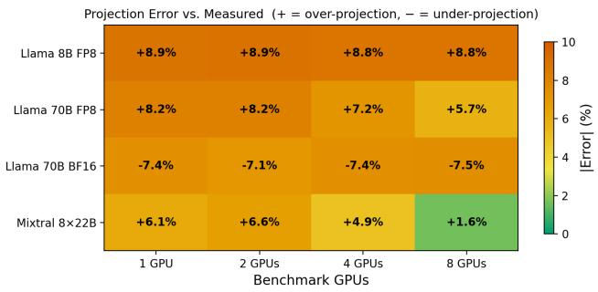

Table 2: Communication model accuracy vs. preflight (MI325X, ≥64 MB).
<table><tr><td>Collective</td><td>Avg |Errl ≥64 MB</td></tr><tr><td>Intra AR 2/4/8 GPUs</td><td>4.1 / 2.0 / 5.6%</td></tr><tr><td>Intra A2A 2/4/8 GPUs Inter AR 2/4 Nodes</td><td>3.2 / 3.5 / 4.7%</td></tr><tr><td></td><td>2.1 / 5.8%</td></tr><tr><td>Inter A2A 2/4 Nodes Inter P2P 2 Nodes</td><td>5.5 / 5.5%</td></tr><tr><td></td><td>3.9%</td></tr><tr><td>Overall Avg</td><td>4.2%</td></tr></table>

Table 3: MoE sub-node sweep (Mixtral 8×22B, MI355X, BF16, 4 nodes/32 GPUs, measured: 3,475 tok/s/GPU).  
Table 5: Per-rank memory (Mixtral 8×22B, MI355X, BF16, PP=4, EP=8, VPP=2, no recompute). Activation (198 GB) exceeds parameter+optimizer by 2×.
<table><tr><td></td><td>1GPU</td><td>2GPUs</td><td>4GPUs</td><td>8GPUs</td><td>Max∆</td></tr><tr><td>Mixtral</td><td>3,688 (+6.1%)</td><td>3,706 (+6.6%)</td><td>3,647 (+4.9%)</td><td>3,532 (+1.6%)</td><td>4.9%</td></tr></table>

Table 4: Per-module breakdown (rank 0). Total = emb. 0.617 + 1 dense (0.390) + 13 MoE (5.073) = 6.079 B.

<table><tr><td>Bucket</td><td>GB</td></tr><tr><td>Param + optimizer state BF16 wt + BF16 grad + FP32 Adam</td><td>79.26</td></tr><tr><td>+ master, dist.-optimizer sharded Activation (per-rank, in-flight) no recompute, PP=4+VPP=2 microbatches</td><td>197.83</td></tr><tr><td>Projected total per GPU</td><td>277.09</td></tr></table>

<table><tr><td>Module (rank 0)</td><td>Params (B)</td><td>Act (GB)</td></tr><tr><td>embedding</td><td>0.6166</td><td>0.094</td></tr><tr><td>dense_transformer_layer (1)</td><td>0.3901</td><td>1.625</td></tr><tr><td>layer_norm</td><td>~0</td><td>0.094</td></tr><tr><td>self_attention</td><td>0.088</td><td>0.313</td></tr><tr><td>residual_add</td><td>0</td><td>0.094</td></tr><tr><td>mlp (dense FFN)</td><td>0.302</td><td>0.844</td></tr><tr><td>moe_transformer_layer (1)</td><td>0.3902</td><td>2.563</td></tr><tr><td>layer_norm</td><td>~0</td><td>0.094</td></tr><tr><td>self_attention</td><td>0.088</td><td>0.313</td></tr><tr><td>residual_add</td><td>0</td><td>0.094</td></tr><tr><td>router</td><td>~0</td><td>0.094</td></tr><tr><td>mlp (1 expert / rank)</td><td>0.302</td><td>1.688</td></tr><tr><td>final_layernorm</td><td>~0</td><td>0.094</td></tr><tr><td>output_layer (tied)</td><td>0.6166</td><td>1.531</td></tr></table>

Table 6: Pipeline algorithm comparison on Llama2-7B (MI300X, 1 node, PP=8).
<table><tr><td>Algo</td><td>VPP</td><td>tok/s</td><td>TFLOPs Mem</td><td></td><td>Mem%</td><td>Sp.</td></tr><tr><td>1F1B</td><td>1</td><td>10,057</td><td>235.7</td><td>16.26</td><td>8.5%</td><td>1.00×</td></tr><tr><td>Interleaved</td><td>2</td><td>10,974</td><td></td><td>257.321.40</td><td></td><td>11.2%1.09×</td></tr><tr><td>ZeroBubble</td><td>2</td><td>11,411</td><td></td><td>268.016.59</td><td></td><td>8.6%1.13×</td></tr><tr><td>ZBV</td><td>2</td><td>11,347</td><td>265.9</td><td>18.11</td><td>9.4%</td><td>1.12×</td></tr><tr><td>V-half</td><td>2</td><td>10,894</td><td></td><td>255.1 14.06</td><td></td><td>7.3% 1.08×</td></tr><tr><td>V-min</td><td>2</td><td>8,897</td><td></td><td>208.5 11.90</td><td></td><td>6.2%0.88×</td></tr></table>

## 4.2 Communication Model Correlation

We validate the communication model in isolation against preflight measurements on MI325X across AllReduce, All-to-All, and P2P Send/Recv from 2 MB to 1 GB messages and intra-/inter-node topologies. Training workloads use messages ≥64 MB, where the model averages 4.2% error across all 11 collective/topology combinations (Table 2); small-message latency-dominated cases (20–30%) are outside the training regime.

## 4.3 Pipeline Schedule Algorithm Comparison

Table 6 compares pipeline schedules on Llama2-7B (MI300X, 1 node, PP=8). Zero-bubble achieves the highest throughput (+13% over 1F1B) with only 2% memory overhead; ZBV is within 1% at moderate memory cost; V-half trades +8% throughput for lower memory than 1F1B.

## 4.4 Memory Projection: Mixtral 4-Node Reference

Tables 5 and 4 show the per-rank memory projection for Mixtral 8×22B (4-node MI355X, BF16, PP=4, EP=8, VPP=2, MBS=1, no recompute). Activation memory dominates at 198 GB—over 2× the parameter+optimizer budget—because EP=8 retains one expert MLP per rank (0.302 B params, 1.688 GB activation) while the no-recompute setting keeps all microbatch activations live simultaneously. This is why recompute, MBS, and saved-activation precision are first-class axes in the agent’s seed planner, and why the memory pre-filter (which rejects 7 of 30 trials before any GPU time is spent) is particularly valuable at MoE scale.

## 4.5 End-to-End Analysis

All projections stay within ∼10% of measured throughput across every benchmark GPU count (Figure 2), spanning two model families (dense Llama 3.1, MoE Mixtral 8×22B), two precision modes (FP8, BF16), two GPU generations (MI325X gfx942, MI355X gfx950), and FSDP / PP=4- VPP=2 configurations (Tables 1, 3). The Mixtral 8×22B result exercises the full pipeline—PP reduction (PP=1→4), EP A2A modeling, VPP=2 interleaved schedule simulation, and MoE-aware gradient AllReduce decomposition—yet the 8-GPU projection achieves only 1.6% error and the 1-GPU projection (where all communication is modeled analytically) stays within 6.1%; on the dense side, all 12 Llama cells project the 8-node target within ±9%, with Llama 8B FP8 the most stable (Max $\Delta { = } 0 . 1 \% )$ and FSDP-enabled Llama 70B within 8.2% (FP8) and 7.5% (BF16) of measured. For dense Llama the winning strategy is pure data parallelism (TP=PP=CP=1), matching AMD’s published recipe: 8B runs replicated DP, while 70B requires full-shard FSDP2 (ZeRO-3). The Max ∆ column quantifies restoration stability: for configurations with simple analytical stacks (Llama 8B FP8, Llama 70B BF16) the error is nearly independent of benchmark count (Max $\Delta \leq 0 . 5 \% )$ , leaving only a workload-level calibration bias that preserves rank ordering between candidates—the property the Primus Tuning Agent depends on. For configurations that exercise more of the analytical stack (Llama 70B FP8 with FSDP, Mixtral PP=4 VPP=2 EP=8), error decreases as benchmark count grows (Mixtral: +6.1% at 1 GPU to +1.6% at 8 GPUs), as analytical components are progressively replaced by direct measurement.

## 4.6 Large-Scale Validation (256 and 1,024 GPUs)

To test whether fidelity holds well beyond the 64-GPU regime—where unmodeled inter-node contention would first appear—we validated two agent-selected recipes at production scale (benchmark mode: real kernels on 8 GPUs, restored analytically to the target). Table 7 reports both. On DeepSeek V3 671B (FP8, 1,024 GPUs / 128 nodes)—16× the largest configuration in the subnode sweep, and a model pairing Multi-head Latent Attention with a 3-dense+58-MoE layer mix seen nowhere during development—the agent’s end-to-end selection (PP=8/VPP=2/EP=8/ZBV, GBS=32,768) projects 2,808 tok/s/GPU against 2,946 measured (4.7%). On Qwen3-235B-A22B (FP8, 256 GPUs / 32 nodes) the selection $( \mathrm { P P = 4 / V P P = 4 / E P = 8 / M B S = 4 } )$ projects 4,860 vs. 4,952 measured (1.9%). Fidelity thus holds at two independent large scales, not merely at small clean ones.

<table><tr><td>Model (FP8)</td><td>Scale</td><td>Projected</td><td>Measured</td><td>Error</td></tr><tr><td>DeepSeek V3 671B MoE</td><td>1,024 GPU (128 node)</td><td>2,808</td><td>2,946</td><td>4.7%</td></tr><tr><td>Qwen3-235B-A22B MoE</td><td>256 GPU (32 node)</td><td>4,860</td><td>4,952</td><td>1.9%</td></tr></table>

Table 7: Large-scale validation (tok/s/GPU). Both recipes are agent-selected end-to-end and confirmed on hardware; full search traces in Appendix D.

Why contention stays second-order. In benchmark mode the throughput-governing communication is already inside the measurement: the heaviest collective—MoE All-to-All—is intra-node in these recipes (EP ≤ GPUs/node) and directly executed (when EP spans nodes it is modeled analytically instead); pipeline P2P is a single low-volume activation per stage boundary; and DP gradient AllReduce is issued during backward and overlapped with compute. The residual is a small additive term, not a first-order error—which is why the 128-node point still lands within 4.7%. For DeepSeek V3 the agent also discovers the throughput-starvation insight, scaling the global batch to the memory ceiling (1,869 → 2,808 tok/s/GPU); the full shape and batch sweeps are in Appendix D.

## 4.7 Primus Tuning Agent Case Study: Mixtral 8×22B

We applied the agent (Section 3.2) to Mixtral 8×22B (FP8, 4-node MI355X, GBS=512, seq\_len=8192), grounded against AMD’s published Mixtral 8×22B 4-node BF16 reference of 3,475 tok/s/GPU on the same hardware. Figure 4 visualizes the search trajectory and Table 8 reports projection-phase results; Table 9 reports real-cluster validation.

The seed planner reaches 4,036 tok/s/GPU (+16.1%) via single-axis sweeps. The LLM jumps to a projected 4,908 (+41.2% over baseline, +21.6% over seed) on its first proposal by combining MBS=1, no recompute, and DeepEP—a cross-axis combination unreachable to the seed planner. The top two non-redundant LLM proposals (llmwin12: DeepEP; llmwin19: DeepEP + distributed optimizer) measure 4,402 and 4,377 tok/s/GPU respectively (−10.3% / −10.7% vs. projection), delivering +27% over the AMD 4-node BF16 reference. The ∼10.5% optimistic bias is a workload-level calibration offset (Section 4.8) that preserves rank ordering—the only property the agent requires. The memory pre-filter rejected 7 of 30 trials at zero GPU cost, and the full workflow completed in ∼30 minutes of single-node exploration.

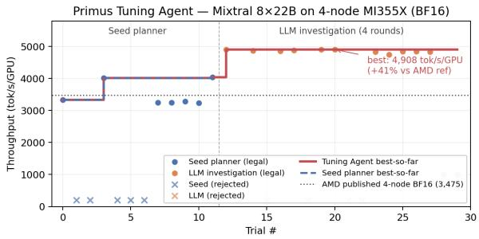  
(a) Best-so-far projected throughput per trial. The LLM jumps from the seed-planner peak (4,036) to 4,908 at its first proposal by combining MBS=1, no recompute, and DeepEP—a crossaxis combination unreachable to the seed planner alone.

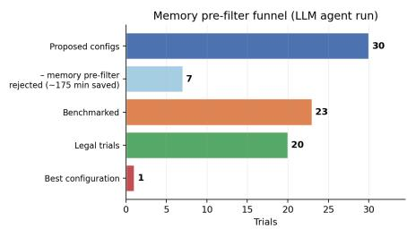  
(b) Memory pre-filter rejects 7 out of 30 trials before any GPU benchmark, saving ∼175 GPUmin at zero throughput cost.

<table><tr><td>Mode</td><td>Trials Best (proj.)</td><td></td></tr><tr><td>AMD 4n BF16 (meas.)</td><td>一</td><td>3,475</td></tr><tr><td>Seed planner only</td><td>12</td><td>4,036+16.1%</td></tr><tr><td>LLM (seed + 3)</td><td>30</td><td>4,908 +41.2%</td></tr></table>

Table 8: Projection-phase results. LLM’s +21.6% advantage over seed planner comes from cross-axis combination (MBS=1, no recompute, DeepEP).

<table><tr><td>Tag</td><td>Config</td><td>Proj. Meas.</td><td>Err</td></tr><tr><td></td><td>llmwin12 MBS=1 DeepEP</td><td>4,908 4,402</td><td>-10.3%</td></tr><tr><td></td><td>llmwin19 MBS=1 DeepEP+DO 4,903</td><td></td><td>4,377-10.7%</td></tr></table>

Table 9: Real-cluster validation (4-node MI355X, FP8 hybrid, 50-iter). Best measured 4,402 tok/s/GPU (+27% over the AMD 4n BF16 reference). Configurations in text.  
Figure 4: Primus Tuning Agent search on Mixtral 8×22B (4-node MI355X).

## 4.8 Rank Preservation and the Calibration Offset

Search requires only that the projected ordering of candidates match the measured ordering—not absolute throughput. We test this directly with paired projected-vs-measured sweeps on three production MoE models, each spanning the axes the agent moves (recompute, VPP, PP, MBS, GBS); Table 10 summarizes and Appendix E gives every per-config pair for all three models.

<table><tr><td>Workload</td><td>n</td><td>Spearman ρ</td><td>Kendall τ</td><td>Offset k (cv)</td><td>Regret</td></tr><tr><td>Mixtral-8×22B FP8 (32 GPU)</td><td>7</td><td>1.000</td><td>1.000</td><td>1.128 (2.4%)</td><td>0%</td></tr><tr><td>Qwen3-235B-A22B FP8 (32 GPU)</td><td>7</td><td>1.000</td><td>1.000</td><td>0.901 (11.3%)</td><td>0%</td></tr><tr><td>GPT-OSS-120B BF16 (64 GPU)</td><td>9</td><td>0.933</td><td>0.833</td><td>1.121 (5.4%)</td><td>0%</td></tr></table>

Table 10: Rank preservation across three MoE models spanning FP8/BF16 and 32–64 GPUs. Selection regret (agent pick vs. measured-optimal) is 0% throughout.

Selection regret is 0% on all three—the agent always picks the measured-optimal configuration. The offset is not an exactly constant term but a workload-level multiplicative factor (isolated-kernel benchmark vs. sustained run) that drifts mildly with recompute depth; crucially, Mixtral (k=1.13, optimistic) and Qwen3 (k=0.90, pessimistic) carry opposite-sign offsets yet both reproduce the ordering exactly, so rank preservation is not offset-dependent. Order survives because the drift is small relative to the throughput gaps between configurations; individual off-optimal configurations in these sweeps can deviate by more than 10% without affecting selection. On GPT-OSS-120B (ρ=0.933) the three discordant pairs (of 36) are confined to a near-tied mid-pack band within ∼9% of one another; every pair separated by > ∼9% measured throughput is ordered correctly and the top-4 and bottom-2 are exact (Appendix E). One operational note: the benchmark oracle must run on an idle node—co-located load inflates kernel times and depresses projections; a clean run restores ρ=1.000.

## 4.9 Comparison with Analytical and Auto-Parallelism Baselines

vs. Calculon. On Llama-3.1-70B measured on AMD MI325X (8 nodes, 64 GPUs) Primus averages 6.6% absolute error against Calculon’s [10] 28.9%; Calculon’s opposite-direction errors (+16.2% FP8, −41.6% BF16) inflate the measured 1.5× FP8–BF16 gap to 2.9×, distorting any precision decision that relies on it. By construction it has no experts, All-to-All, or ROCm path, so Mixtral and DeepSeek V3 are inexpressible (Appendix G).

vs. Galvatron-style search. We implement a DP-style enumeration in the spirit of Galvatron [18] over 530 configurations and hand it our own (more expressive) simulate oracle (an advantage to the baseline). On Mixtral (4-node MI355X, FP8) an exhaustive sweep of all 530 configs reaches only 3,656 tok/s/GPU vs. 4,698 for Primus Tuning Agent+Benchmark (Table 11). The gap is the oracle, not the search: the benchmark directly measures superposed FP8 tensor-core, RCCL A2A, and grouped-GEMM effects that any analytical model approximates, and correctly ranks the winning intra-node EP=8/DeepEP topology. An ablation isolates the two contributions: the benchmark oracle adds +36% over the simulate oracle at equal agent, and the agent framework adds +10% over a Claude Code agent (Claude Opus 4.6, no agent framework) with the same oracle. The Galvatron-style search has no precision knob, so unlike our agent it cannot switch from BF16 to FP8 mid-search (at a 30-trial budget it stays BF16, 2,155); with FP8 fixed up front it reaches the 3,656 above, so precision does not explain the gap.

<table><tr><td>Method</td><td>Oracle</td><td>Proj. tok/s/GPU</td><td>vs. baseline</td></tr><tr><td>Primus Tuning Agent + Benchmark</td><td>Benchmark</td><td>4,698</td><td>+39.5%</td></tr><tr><td>Claude Code + Benchmark</td><td>Benchmark</td><td>4,275</td><td>+26.9%</td></tr><tr><td>Galvatron-style FP8 exhaustive</td><td>Simulate</td><td>3,656</td><td>+8.6%</td></tr><tr><td>Primus Tuning Agent + Simulate</td><td>Simulate</td><td>3,445</td><td>+2.3%</td></tr><tr><td>Galvatron-style budget=30</td><td>Simulate</td><td>2,155</td><td>-36.0%</td></tr></table>

Table 11: Ablation and baseline comparison on Mixtral-8×22B (4-node MI355X, FP8; baseline 3,368 projected tok/s/GPU). Oracle contribution +36%, agent-framework contribution +10%; winning configs in Table 25. Run on a different 4-node cluster from the case study in Section 4.7 (projected 4,908); cluster-to-cluster variation is <5%. Details in Appendix G.

## 4.10 MoE Load-Balancing Robustness

Benchmark runs are balanced by construction. We force load balancing for benchmarking only1: a random straight-through router plus an exactly even dispatcher make executed load uniform, so the imbalance I = max/mean is 1 and the uniform-load assumption holds exactly. Real training sits close to this: aux-loss (or aux-loss-free) balancing plus large-batch averaging, under which per-expert deviation shrinks as 1/√tokens/expert, gives a steady-state $I \approx 1 . 1 – 1 . { \bar { 3 } }$ . When balancing is off, grouped-GEMM time is gated by the busiest EP-rank rather than the mean, and the A2A jumps regime. Sweeping I from 1× to 4× on real MI355X (I ≥ 2 is a deliberate stress test beyond the training regime), a busiest-rank correction (compute gated by I at experts-per-rank E/EP, plus an A2A regime term) cuts worst-case error from 53–71% to under 10%. On a real trained model (DeepSeek V3 671B, native learned balancing) the per-layer imbalance has median 1.38 at EP=8 (2.13 at EP=32), but per-layer spikes fall on different devices, so the step-level pooled imbalance that gates throughput is only 1.05–1.12; at EP=8 the corrected error is ≈2%. Across EP, the penalty depends only on E/EP, so a fit at one EP predicts the others (Mixtral, EP∈ {2, 4, 8}, ±6%). This is what lets us calibrate on the 8-GPU benchmark and project to the 128-node target (Appendix F).

## 4.11 Throughput Improvement

On Mixtral 8×22B (4-node MI355X), the agent delivers +27% measured throughput over AMD’s BF16 reference, with ∼25 GPU-min per accepted trial and 7 of 30 trials rejected at zero cost by the memory pre-filter (Section 4.7). At production scale the same workflow selects the measuredoptimal recipe end-to-end on DeepSeek V3 671B (1,024 GPU, 4.7% error) and Qwen3-235B-A22B (256 GPU, 1.9% error), confirming the gains hold well beyond the sub-node regime (Section 4.6).

## 4.12 Scope and Limitations

Primus Projection is validated on AMD Instinct GPUs and the ROCm stack, but nothing in the modeling is vendor-specific: hardware profiles are YAML (peak FLOPS, HBM, collective topology) and the microbenchmark runs on any supported GPU (∼8 min on 8 GPUs). We have not yet empirically validated on NVIDIA or TPU; porting to NVIDIA requires only a hardware YAML and the 8-GPU benchmark (TPUs also need an XLA collective model). Network contention is not modeled; it stayed second-order in our evaluations (Section 4.6) but could add error in some inter-node EP or sub-node benchmark settings. ZeRO-2 is excluded, and FP8 recipes must be convergence-validated before production. Appendix I covers these, and extensions to new layer types.

## 5 Related Work

Analytical performance models. Roofline analysis [32] provides an upper bound on kernel throughput from compute and memory-bandwidth peaks, but ignores fused kernels, pipeline schedules, and multi-dimensional parallelism interactions. Calculon [10] and Galvatron [18] extend this with closed form analytical models that jointly search parallelism configurations (TP, PP, DP) in milliseconds, enabling co-design sweeps (Galvatron-BMW [31] adds memory balancing). Calculon uses only hardware specifications; Galvatron profiles single-device layer compute but models communication from nominal bandwidth. Neither captures clock-throttling under sustained load, kernel-library drift, or grouped-GEMM wave-quantization in MoE—effects benchmark anchoring resolves automatically. FlexFlow [11] and Alpa [37] require operator- or stage-level profiling on the target cluster.

Trace-driven and simulation-based approaches. Trace-driven simulators such as ASTRA-sim [25] and Echo/Moye [7] achieve higher fidelity by replaying workload traces but require target-hardware execution traces or extensive calibration; Lumos [15] proposes a toolkit that reaches 3.3% average error on GPT-3 variants on clusters of up to 512 H100 GPUs using trace replay, while ProTrain [34] builds high-fidelity cost models from a runtime profiler to automate memory-management policies, achieving 1.43–2.71× throughput improvements. Proteus [5] simulates hybrid-parallel strategies with compute–communication overlap but targets CUDA and does not model expert-parallel All-to-All; Vidur [1] simulates LLM inference only. Optimus [23] fits online resource-performance models to estimate training speed as a function of allocated resources, enabling dynamic scheduling in deep learning clusters. These systems are oriented toward profiling and scheduling existing target-cluster runs; in contrast, Primus Projection’s pure-simulation mode runs on CPU and supports pre-silicon design-space exploration without any execution trace from the target, and its hybrid mode requires only a single-node benchmark to project multi-node throughput.

Hyperparameter optimization: from classical search to LLM agents. TPE [3] and Gaussianprocess Bayesian Optimization (BO) [29] showed that surrogate-guided search beats grid search. BO fits LLM-training configuration poorly: it assumes a stationary objective, whereas a 4-byte activation miscount can toggle legality; it treats every trial as an equal-cost black box, whereas many candidates can be rejected analytically before any GPU time; and it ignores cross-axis structure (e.g. the MoE backend interacts only with EP knobs). LLM agents now replace or augment BO: AgentHPO [16] pairs a Creator LLM with an Executor that trains and reports feedback, and LLAMBO [17] frames BO candidate proposal in natural language. Both target model-accuracy objectives; our problem adds a combinatorial feasibility filter and a multi-level surrogate (analytical memory check, then benchmark projection) that neither exploits.

Configuration tuning for distributed training. DeepSpeed Autotuning [19] grid-searches ZeRO stage and micro-batch on the target cluster but does not consider the joint parallelism shape or the pipeline schedule; FlexFlow [11], Alpa [37], and Galvatron [18] explore parallelism plans with their own cost models but, like the analytical baselines above, lack a benchmark-anchored projection step and do not use an LLM reasoning loop to propose cross-axis combinations. The Primus Tuning Agent is the first, to our knowledge, to couple a benchmark-anchored projection oracle (seconds per candidate, no multi-node cluster required) with an LLM-driven cross-axis investigation loop implemented in DSPy [13] in the spirit of ReAct [35]-style reasoning and recursive tool use [36].

## 6 Conclusion

We presented Primus Projection, a hybrid framework for memory and performance projection of distributed training that benchmarks compute and in-scope communication on as few as one device and analytically reconstructs out-of-scope communication and the full pipeline schedule at the target scale. The Primus Tuning Agent uses it as a fast surrogate to search the joint configuration space end-to-end. Across dense and MoE models on MI325X and MI355X, projections of the validated recipes stay within ∼10% of measured throughput (4.7% at 1,024 GPUs), and the agent delivers +27% over AMD’s Mixtral 4-node BF16 reference in ∼30 minutes of single-node exploration, finding cross-axis combinations no deterministic planner reaches, without multi-node hardware.

## Acknowledgments and Disclosure of Funding

This work was funded by Advanced Micro Devices, Inc. All authors are employees of AMD. The authors declare no other competing interests.

## References

[1] Amey Agrawal, Nitin Kedia, Jayashree Mohan, Ashish Panwar, Nipun Kwatra, Bhargav S. Gulavani, Ramachandran Ramjee, and Alexey Tumanov. Vidur: A large-scale simulation

framework for LLM inference. In MLSys, 2024.

[2] AMD. Performance results with AMD ROCm software: AI training, 2026. https: //www.amd.com/en/developer/resources/rocm-hub/ai-cloud-development/ performance-results.html.

[3] James Bergstra, Rémi Bardenet, Yoshua Bengio, and Balázs Kégl. Algorithms for hyperparameter optimization. In NeurIPS, 2011.

[4] DeepSeek-AI, Aixin Liu, Bei Feng, Bing Xue, et al. DeepSeek-V3 technical report. arXiv:2412.19437, 2024.

[5] Jiangfei Duan, Xiuhong Li, Ping Xu, Xingcheng Zhang, Shengen Yan, Yun Liang, and Dahua Lin. Proteus: Simulating the performance of distributed DNN training. IEEE Transactions on Parallel and Distributed Systems, 35(10):1867–1878, 2024.

[6] William Fedus, Barret Zoph, and Noam Shazeer. Switch Transformers: Scaling to trillion parameter models with simple and efficient sparsity. Journal of Machine Learning Research, 23 (120):1–39, 2022.

[7] Yicheng Feng, Kin Hang Sew, Yuetao Chen, Kaiwen Chen, Jingzong Li, Tianyuan Wu, Zheng Zhou, Peng Cheng, Chuan Wu, Wei Wang, Tsung-Yi Ho, and Hong Xu. Scalable and efficient simulation of LLM training. In SC, 2026.

[8] Trevor Gale, Deepak Narayanan, Cliff Young, and Matei Zaharia. MegaBlocks: Efficient sparse training with mixture-of-experts. In MLSys, 2023.

[9] Aaron Grattafiori, Abhimanyu Dubey, Abhinav Jauhri, et al. The Llama 3 herd of models. arXiv:2407.21783, 2024.

[10] Mikhail Isaev, Nic McDonald, Larry Dennison, and Richard Vuduc. Calculon: A methodology and tool for high-level codesign of systems and large language models. In SC, 2023.

[11] Zhihao Jia, Matei Zaharia, and Alex Aiken. Beyond data and model parallelism for deep neural networks. In MLSys, 2019.

[12] Albert Q. Jiang, Alexandre Sablayrolles, Antoine Roux, et al. Mixtral of experts. arXiv:2401.04088, 2024.

[13] Omar Khattab, Arnav Singhvi, Paridhi Maheshwari, Zhiyuan Zhang, Keshav Santhanam, Sri Vardhamanan, Saiful Haq, Ashutosh Sharma, Thomas T. Joshi, Hanna Moazam, Heather Miller, Matei Zaharia, and Christopher Potts. DSPy: Compiling declarative language model calls into state-of-the-art pipelines. In International Conference on Learning Representations (ICLR), 2024. URL https://openreview.net/forum?id=sY5N0zY5Od.

[14] Dmitry Lepikhin, HyoukJoong Lee, Yuanzhong Xu, Dehao Chen, Orhan Firat, Yanping Huang, Maxim Krikun, Noam Shazeer, and Zhifeng Chen. GShard: Scaling giant models with conditional computation and automatic sharding. In ICLR, 2021.

[15] Mingyu Liang, Hiwot Tadese Kassa, Wenyin Fu, Brian Coutinho, Louis Feng, and Christina Delimitrou. Lumos: Efficient performance modeling and estimation for large-scale LLM training. In MLSys, 2025.

[16] Siyi Liu, Chen Gao, and Yong Li. AgentHPO: Large language model agent for hyper-parameter optimization. In Conference on Parsimony and Learning (CPAL), volume 280 of PMLR, pages 1146–1169, 2025.

[17] Tennison Liu, Nicolás Astorga, Nabeel Seedat, and Mihaela van der Schaar. Large language models to enhance Bayesian optimization. In ICLR, 2024.

[18] Xupeng Miao, Yujie Wang, Youhe Jiang, Chunan Shi, Xiaonan Nie, Hailin Zhang, and Bin Cui. Galvatron: Efficient transformer training over multiple GPUs using automatic parallelism. Proceedings of the VLDB Endowment, 16(3):470–479, 2022.

[19] Microsoft. DeepSpeed autotuning, 2022. https://www.deepspeed.ai/tutorials/ autotuning.

[20] Deepak Narayanan, Mohammad Shoeybi, Jared Casper, et al. Efficient large-scale language model training on GPU clusters using Megatron-LM. In SC, 2021.

[21] OpenAI. gpt-oss-120b & gpt-oss-20b model card, 2025. URL https://arxiv.org/abs/ 2508.10925.

[22] Pitch Patarasuk and Xin Yuan. Bandwidth optimal all-reduce algorithms for clusters of workstations. Journal ofParallel and Distributed Computing, 69(2):117–124, 2009.

[23] Yanghua Peng, Yixin Bao, Yangrui Chen, Chuan Wu, and Chuanxiong Guo. Optimus: An efficient dynamic resource scheduler for deep learning clusters. In EuroSys, 2018.

[24] Penghui Qi, Xinyi Wan, Guangxing Huang, and Min Lin. Zero bubble (almost) pipeline parallelism. In ICLR, 2024.

[25] Saeed Rashidi, Srinivas Sridharan, Sudarshan Srinivasan, and Tushar Krishna. ASTRA-SIM: Enabling SW/HW co-design exploration for distributed DL training platforms. In IEEE International Symposium on Performance Analysis of Systems and Software (ISPASS), pages 81–92, 2020.

[26] Ben Sander. Understanding peak, max-achievable & delivered FLOPs, part 1, 2025. ROCm Blogs. https://rocm.blogs.amd.com/software-tools-optimization/ Understanding\_Peak\_and\_Max-Achievable\_FLOPS/README.html.

[27] Jay Shah, Ganesh Bikshandi, Ying Zhang, Vijay Thakkar, Pradeep Ramani, and Tri Dao. FlashAttention-3: Fast and accurate attention with asynchrony and low-precision. In NeurIPS, 2024.

[28] Mohammad Shoeybi, Mostofa Patwary, Raul Puri, Patrick LeGresley, Jared Casper, and Bryan Catanzaro. Megatron-LM: Training multi-billion parameter language models using model parallelism. arXiv preprint arXiv:1909.08053, 2019.

[29] Jasper Snoek, Hugo Larochelle, and Ryan P. Adams. Practical Bayesian optimization of machine learning algorithms. In NeurIPS, 2012.

[30] Ryan Swann, Muhammad Osama, Xiaohu Guo, Bryant Nelson, Lixun Zhang, Alex Brown, Yen Ong, Ali Yazdani, Sean Siddens, Ganesh Dasika, and Alex Underwood. tritonBLAS: Triton-based analytical approach for GEMM kernel parameter selection, 2025. URL https: //arxiv.org/abs/2512.04226.

[31] Yujie Wang, Youhe Jiang, Xupeng Miao, Fangcheng Fu, Shenhan Zhu, Xiaonan Nie, Yaofeng Tu, and Bin Cui. Improving automatic parallel training via balanced memory workload optimization. IEEE Transactions on Knowledge and Data Engineering, 36(8):3906–3920, 2024.

[32] Samuel Williams, Andrew Waterman, and David Patterson. Roofline: An insightful visual performance model for multicore architectures. Commun. ACM, 52(4):65–76, 2009.

[33] An Yang, Anfeng Li, Baosong Yang, et al. Qwen3 technical report. arXiv preprint arXiv:2505.09388, 2025.

[34] Hanmei Yang, Jin Zhou, Yao Fu, Xiaoqun Wang, Ramine Roane, Hui Guan, and Tongping Liu. ProTrain: Efficient LLM training via automatic memory management. In MLSys, 2026.

[35] Shunyu Yao, Jeffrey Zhao, Dian Yu, Nan Du, Izhak Shafran, Karthik Narasimhan, and Yuan Cao. ReAct: Synergizing reasoning and acting in language models. In ICLR, 2023.

[36] Alex L. Zhang, Tim Kraska, and Omar Khattab. Recursive language models, 2025. URL https://arxiv.org/abs/2512.24601.

[37] Lianmin Zheng, Zhuohan Li, Hao Zhang, et al. Alpa: Automating inter- and intra-operator parallelism for distributed deep learning. In OSDI, 2022.

## Appendices

## Appendix A: Hardware and Software Environment

All measurements reported in this paper were obtained on AMD Instinct MI300X, MI325X, and MI355X GPUs running the ROCm software stack with the hipBLASLt, Composable Kernel, and Triton kernel libraries. Distributed training uses the Megatron-LM [28] backend through the Primus framework. Hardware profiles for the GPUs used in this paper are summarized in Table 12; custom profiles for arbitrary cluster topologies and hypothetical pre-silicon architectures can be added via YAML.

<table><tr><td>GPU</td><td>Arch</td><td>HBM (GB/s)</td><td>CUs XCDs</td></tr><tr><td>MI300X</td><td>gfx942</td><td>5,300 304</td><td>8</td></tr><tr><td>MI325X</td><td>gfx942</td><td>6,000 304</td><td>8</td></tr><tr><td>MI355X</td><td>gfx950</td><td>8,000 256</td><td>4</td></tr></table>

Table 12: AMD Instinct GPU architectures used in this paper.

Two practical consequences of this stack. First, every ROCm release shifts achievable kernel performance, so a pure analytical model would need continual recorrelation; a benchmark-anchored approach reflects the kernels installed on the system at the time the projection is run. Second, GPU clock frequency on these parts varies between attention, dense MLP, and MoE expert GEMMs because of power-cap throttling under sustained dense matrix workloads, with a 44–70% gap between peak and MAF on previous-generation AMD hardware [26]. Benchmarking captures both effects without requiring per-kernel recorrelation.

## Appendix B: Analytical Models

This appendix details the analytical models used by Primus Projection’s projection oracle, organized by component.

## B.1 Memory Projection

Memory is estimated using a hierarchical profiler tree that mirrors the model’s module structure. Each profiler implements two methods: one for parameter counts (total or per-GPU with sharding) and one for activation memory per microbatch.

Parameter and optimizer memory: Per-GPU parameter count accounts for parallelism-induced sharding: TP splits weight matrices; PP assigns layers to stages; EP shards expert parameters while replicating non-expert parameters; CP replicates all parameters; and FSDP/ZeRO shards across DP. With per-parameter byte costs $B _ { w } ~ ( \mathrm { w e i g h t } ) , B _ { g }$ (gradient), and $B _ { o }$ (optimizer state):

$$
\mathsf { b y t e s \_ p e r \_ p a r a m } = B _ { w } + B _ { g } + B _ { o } / \mathsf { D P }\tag{2}
$$

For BF16 mixed-precision with Adam, $( B _ { w } , B _ { g } , B _ { o } ) = ( 2 , 2 , 1 0 ) ( 2 \mathrm { \textrm { B B F 1 6 } }$ weight, 2 B BF16/FP32 gradient, 10 B FP32 optimizer state = 4 B master weight + 4 B first moment + 2 B second moment shared) so bytes\_per\_param $= 4 + 1 0 / \mathrm { D P }$ . Under FP8 mixed precision the weight term drops to 1 B; the distributed-optimizer flag further shards $B _ { o }$ across DP ranks. The projector reads these parameters from the framework configuration so a single equation covers all combinations.

Activation memory: Activation memory is parameterized by a saved-activation byte cost $B _ { \mathrm { a c t } }$ that is read from the framework’s recompute/save policy $( B _ { \mathrm { a c t } } = 2$ for BF16, $B _ { \mathrm { a c t } } = 1$ for FP8 saved activations). The MoE MLP activation, the dominant contributor, is:

$$
\begin{array} { r } { \mathrm { a c t \_ m o e } = \mathrm { t o k e n s } \times \left( \mathrm { t o p k } + N _ { \mathrm { s h a r e d } } \right) } \\ { \times \left( H + 3 \times \mathrm { F F N } _ { e } \right) \times B _ { \mathrm { a c t } } } \end{array}\tag{3}
$$

For a large MoE model $( \mathrm { M B S } = 4 , \mathrm { S } = 1 6 3 8 4 , \mathrm { C P } = 4 , \mathrm { H } = 8 1 9 2 , \mathrm { F F N } _ { { e } } = 2 0 4 8 , \mathrm { t o p k } = 3 6 )$ at BF16 saved activations, a single MoE layer reaches 16.19 GB—over 30× the attention activation (∼0.51 GB)— and roughly halves to ∼8.1 GB if the framework saves activations in FP8. Attention, MLP, layer-norm, residual, embedding, output, and (non-fused) loss profilers each apply $B _ { \mathrm { a c t } }$ to their tensor shapes; the loss profiler additionally allocates an FP32 (4 B) softmax scratch when CE loss fusion is off.

Pipeline schedule scaling: total ${ \mathrm { \Omega } } _ { \mathrm { { a c t } } } = { \mathrm { b a s e } } \times { \mathrm { P P } } \times { \mathit { F } } _ { \mathrm { { i n t l v } } } \times { \mathit { F } } _ { \mathrm { { g a } } }$ where $F _ { \mathrm { i n t l v } } = 1 { + } ( \mathrm { P P - 1 } ) / ( \mathrm { P P } \cdot \mathrm { V P P } )$ is the interleaved penalty and $F _ { \mathrm { g a } } = \mathrm { m i n } ( 1 , { \bf G } { \bf A } / { \bf P } { \bf P } )$ handles cases where gradient accumulation steps are fewer than pipeline stages.

Recomputation: With full recomputation, only the layer input tensor is checkpointed (MBS × $S / ( \mathrm { T P \cdot \bar { C } P } ) \times H \times B _ { \mathrm { a c t } } )$ , yielding the same precision-aware reduction as the activation formula—e.g. $\mathbf { a } \sim 7 2 \times$ shrink from 18.20 GB per MoE layer to ∼0.25 GB at BF16, or to ∼0.13 GB at FP8. Partial (selective) recomputation is also supported and inherits $B _ { \mathrm { a c t } }$ on the checkpointed subset.

## B.2 Performance Projection (Sub-Node Methodology)

The body (Section 3.1) describes the three phases of the sub-node workflow—downscale, measure, upscale—and the priority order $\mathrm { P P }  \mathrm { E P }  \mathrm { T P }$ . This appendix records two operational details. Profiling modes: benchmark (default, requires GPU) measures real kernels; simulate (no GPU) uses Origami [30] GEMM and a Flash Attention v3 [27] tile-level simulator on CPU; both runs side-by-side for cross-validation (Table 13). Restoration formulas: EP is restored per MoE layer by adding the A2A delta $\Delta = \mathrm { A } 2 \mathrm { A } ( C ^ { * } ) - \mathrm { A } 2 \mathrm { A } ( C ^ { \mathrm { b e n c h } } )$ , where both terms are evaluated by the collective model below for the target and the benchmarked EP group, respectively, with the measured intra-node A2A used as an anchor when decomposed timing is available. TP applies two adjustments: compute is rescaled by bench $\mathrm { . t p / t a r g e t \_ t p }$ , and the AllReduce contribution is replaced via the ratio form $\mathrm { t a r g e t } _ { \mathrm { A R } } = \mathrm { m e a s u r e d } _ { \mathrm { A R } } \times [ \mathrm { a n a l y t i c a l ( t a r g e t ) / a n a l y t i c a l ( b e n c h ) } ]$ when measured AllReduce data is available, falling back to the pure analytical model otherwise. PP is restored by re-simulating the target schedule from the benchmarked per-layer times.

<table><tr><td>Factor</td><td>Analytical Sim.</td><td>GPU Benchmark</td></tr><tr><td>Hardware</td><td>No GPU required</td><td>Requires target GPUs</td></tr><tr><td>Speed</td><td>Fast, deterministic</td><td>Slower, with variance</td></tr><tr><td>Pre-silicon</td><td>Primary use case</td><td>Not possible</td></tr><tr><td>GPU freq.</td><td>Estimated from model</td><td>Captures actual throttling</td></tr><tr><td>SW stack</td><td>Needs recorrelation</td><td>Reflects current kernels</td></tr><tr><td>Grouped GEMM</td><td>Depends on model fi- Measured directly delity</td><td></td></tr><tr><td>Framework</td><td>Not captured</td><td>Included</td></tr><tr><td>Comm.</td><td>Analytical for all</td><td>Measured when in scope</td></tr><tr><td>Pipeline</td><td>Simulated exactly</td><td>Simulated exactly</td></tr></table>

Table 13: Benchmark vs. simulation trade-offs.

## B.3 Communication Modeling

Topology domains: The communication model distinguishes three topology domains: intra-node (∼1,024 GB/s via xGMI, 0.45 µs latency), inter-node (∼50 GB/s per NIC via $\mathrm { I B } / \mathrm { R o C E } , 2 . 0 \mu \mathrm { s } )$ , and inter-pod (∼25 GB/s, $1 0 . 0 \mu \mathrm { s } )$

Algorithm selection: For each collective, the model evaluates all applicable algorithms and selects the minimum-time configuration. AllReduce: Ring, Hypercube, Bruck, and Single-shot algorithms × four protocols—up to 16 candidates. All-to-All: Direct, Single-shot, Hierarchical, and PXN/DeepEP. P2P Send/Recv: latency + bandwidth model.

MoE-aware gradient AllReduce: For MoE models with EP>1, gradient AllReduce is decomposed into expert gradient AR (across DP/EP replicas, inter-node) and non-expert gradient AR (across full DP group). When EP>1, A2A synchronization barriers prevent gradient AR from overlapping with backward compute; the full AR time is placed on the critical path.

## B.4 FSDP Overlap Model

FSDP shards parameters with three collectives: a forward AllGather that prefetches sharded parameters, a recompute AllGather that re-materializes parameters during backward when activation recomputation is on, and a ReduceScatter that aggregates gradients at the end of backward. A per-layer overlap model determines what fraction of each collective hides behind adjacent-layer compute, scaled by the per-layer compute/comm ratio and clamped by phase-specific ceilings:

$$
{ \mathrm { o v e r l a p } } ( { \mathrm { c o m m } } , { \mathrm { c o m p u t e } } , { \mathrm { c e i l i n g } } ) = \operatorname* { m i n } \Bigl ( 1 , { \frac { \mathrm { c o m p u t e } } { \mathrm { c o m m } } } \Bigr ) \cdot { \mathrm { c e i l i n g } }\tag{4}
$$

with ceilings 0.95 for forward AllGather prefetch, 0.93 for recompute AllGather, and 0.92 for ReduceScatter. Only the exposed portion comm · (1 − overlap) enters the critical path.

## B.5 Pipeline Schedule Algorithms

The pipeline simulator supports six scheduling algorithms (Table 14). Zero-bubble scheduling [24] exploits the observation that the weight gradient (W) has no data dependency on the next pipeline stage—only the input gradient (B) does. Since W can be scheduled flexibly, it fills pipeline bubbles. For VPP=1, the basic Zero-Bubble scheduler uses a fixed F-B-W steady-state pattern, while Sea AI Lab’s ILP-based scheduler [24] optimally places W operations using integer linear programming. For VPP=2, the ZBV (Zero-Bubble V-shape) family extends this across two virtual pipeline chunks: ZBV Formatted uses deterministic phase transitions, while ZBV Greedy uses a greedy placement algorithm with configurable memory modes.

<table><tr><td>Algorithm</td><td>VPP</td><td>Description</td></tr><tr><td>1F1B</td><td>1</td><td>Standard one-forward-one-backward</td></tr><tr><td>Interleaved 1F1B [20]</td><td>&gt;1</td><td>Multiple virtual chunks per rank; re- duces bubble by VPP factor</td></tr><tr><td>Zero-Bubble</td><td>1</td><td>Splits backward into B+W; F-B-W steady-state fills bubbles</td></tr><tr><td>ZBV Formatted</td><td>2</td><td>V-shape schedule with structured warm- up / stable / cool-down phases</td></tr><tr><td>ZBV Greedy</td><td>2</td><td>V-shape with greedy placement and memory-aware modes</td></tr><tr><td>Sea AI Lab ILP</td><td>1</td><td>ILP-optimal W placement [24]</td></tr></table>

Table 14: Supported pipeline scheduling algorithms.

## Appendix C: Primus Tuning Agent Implementation

## C.1 Seed Planner Axis Schedule

The deterministic seed planner walks a fixed schedule of single-axis sweeps anchored on the usersupplied baseline. Axes are visited in the following order, each producing a small bounded number of candidate configurations:

1. Memory frontier: full → selective → no recomputation, holding all other axes fixed.

2. MoE communication backend: standard A2A vs. DeepEP (only emitted when the model is MoE and EP>1).

3. Pipeline bubble reduction: 1F1B baseline, Interleaved 1F1B with VPP∈ {2, 3, 4}, Zero-Bubble, and Sea AI Lab ILP, restricted to schedules that fit the per-layer memory budget.

4. Second-order axes: micro-batch size ∈ {baseline, 1, 2} and the distributed-optimizer flag. For each candidate, the analytic memory pre-filter rejects configurations projected above the cap before any GPU time is consumed. Surviving candidates are scored by the projection oracle and recorded in a shared trial ledger that the LLM phase reads on entry.

## C.2 LLM Investigation Loop

The LLM phase uses a two-LLM design built on DSPy [13], served through an OpenAI-compatible LiteLLM gateway. The Planner is Claude Sonnet 4.6 (claude-sonnet-4-6, ChainOfThought) and the Recursive Language Model (RLM) [36] is Claude Opus 4.6 (claude-opus-4-6, ReAct tool loop); we set max\_tokens=8000, timeout=300 s, ≤25 candidates/round and ≤4 rounds, with temperature/top-p at DSPy defaults. Verbatim prompts are reproduced in Appendix H.

• Planner LLM reads the seed-phase trial ledger (configuration, projected throughput, projected memory, legality, and failure mode where applicable) and emits a hypothesis paragraph together with a JSON list of candidate configurations to evaluate next.

• RLM executes those candidates one at a time, calling the projection oracle as a tool, writing notes to a per-round scratchpad, and optionally querying a sub-LLM for deeper analysis of intermediate results.

Each round runs up to 25 candidate evaluations; we cap the agent at four rounds, after which the planner is re-prompted with the cumulative ledger. The LLM is permitted to cross-product axes the seed planner treats independently (e.g. recomputation × MoE backend × pipeline schedule), which is the source of the +21.6% advantage over the seed plan reported in Section 4.7.

## C.3 Memory Pre-Filter and Trial Selection

A trial is legal iff (i) axis validation passes (PP×DP×CP×TP tiles the target cluster), (ii) the projected per-GPU memory satisfies mem ≤ cap = (HBM − system overhead) × 0.9, and (iii) the benchmark returns a parseable throughput. The overall winner is arg max(legal, key = tok/s/GPU). The cap calibration is the basis for the memory pre-filter of Section 4.7, and its predictions agreed perfectly with hardware: every configuration projecting ≤ cap ran successfully on real hardware, every configuration projecting > cap OOMed on the real cluster.

## Appendix D: Large-Scale Search Traces

This appendix expands the large-scale validation of Section 4.6. Both runs use benchmark mode (real kernels on 8 GPUs) with analytical restoration to the multi-node target.

DeepSeek V3 671B, 1,024 GPUs (128 nodes), FP8. The agent first sweeps the pipeline shape at fixed GBS=4,096, then scales the global batch on the winning shape. Tables 15 and 16 show the trajectory; the final selection is validated against a measured run at equal GBS=32,768 (Table 17).

Table 15: Shape sweep Table 16: Batch scaling (PP8/ZBV). Table 17: Validation (GBS=32,768).
<table><tr><td>Shape</td><td>tok/s</td></tr><tr><td>PP2/VPP2/1F1B</td><td>1,017</td></tr><tr><td>PP4/VPP2/1F1B</td><td>1,408</td></tr><tr><td>PP8/VPP2/1F1B</td><td>1,752</td></tr><tr><td>PP8/VPP1/zero-bubble</td><td>1,852</td></tr><tr><td>PP8/VPP2/ZBV</td><td>1,869</td></tr></table>

<table><tr><td>MBS</td><td>GBS</td><td>tok/s</td></tr><tr><td>2</td><td>4,096</td><td>1,869</td></tr><tr><td>2</td><td>16,384</td><td>2,424</td></tr><tr><td>8</td><td>16,384</td><td>2,724</td></tr><tr><td>8</td><td>32,768</td><td>2,808</td></tr></table>

<table><tr><td>Quantity</td><td>tok/s</td></tr><tr><td>Measured (sel. recompute)</td><td>2,946</td></tr><tr><td>Agent projection</td><td>2,808</td></tr><tr><td>Error</td><td>4.7%</td></tr></table>

The agent identifies the throughput-starvation insight—batch to the memory ceiling—and lifts throughput from 1,869 to 2,808 tok/s/GPU, then the projection lands within 4.7% of the measured 2,946 at 128 nodes.

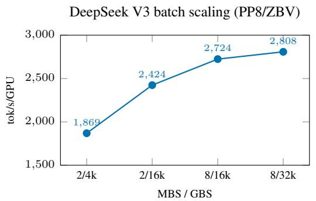

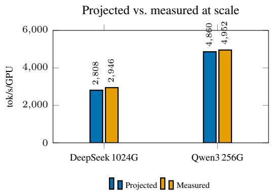  
Figure 5: Left: the agent’s batch-scaling trajectory on DeepSeek V3 671B at 1,024 GPUs—batching to the memory ceiling lifts throughput 50% (1,869→2,808 tok/s/GPU). Right: projected vs. measured throughput at production scale; error is 4.7% (DeepSeek V3, 1,024 GPU) and 1.9% (Qwen3-235B, 256 GPU).

Qwen3-235B-A22B, 256 GPUs (32 nodes), FP8. Independently, the agent selected TP=1/PP=4/EP=8/CP=1/VPP=4/DP=64, MBS=4, GBS=8,192, seq=4,096, projecting 4,860 vs. 4,952 measured (1.9%), ranked first over a deeper PP=16 alternative. (The 32-GPU rank-sweep of Appendix E uses the related VPP=3 shape; the 256-GPU run uses VPP=4.)

## Appendix E: Rank Preservation: Full Per-Config Tables

This appendix gives every projected-vs-measured pair behind Table 10. All three sweeps arefully measured: every listed configuration was run on hardware, so the ordering comparison is exact. Why the GPT-OSS reversals occur, and why they are harmless. On n = 9 there are 36 pairs; $\tau = 0 . 8 3 3$ is 33 concordant and 3 discordant, all involving one trio—mbs16, the reference baseline, and mbs2:

$$
\begin{array} { r } { \mathrm { p r o j e c t e d : ~ m b s 1 6 ~ 1 1 , 7 1 9 > ~ b a s e l i n e ~ 1 1 , 2 6 0 > m b s 2 ~ 1 1 , 2 2 8 ~ \qquad \ m e a s u r e d : ~ m b s 2 ~ 1 0 , 3 2 5 > ~ b a s e l i n e ~ 1 0 , 1 0 9 > ~ } } \\ { \mathrm { m b s 1 6 ~ 9 , 4 8 9 ~ } } \end{array}
$$

The single driver is mbs16 (trial20), over-projected at $k = 1 . 2 3 5 ~ \mathrm { v s }$ . the cluster-typical 1.09–1.12: large-microbatch, full-recompute configs have load-dependent activation-recompute overlap that composing per-kernel benchmark timings does not fully capture, inflating the projection and ranking it a few places too high. The baseline-vs-mbs2 swap is a genuine near-tie (0.2% projected). All three lie within ∼9% of one another in measured throughput (9,489–10,325); every pair separated by >∼9% is ordered correctly, the top-4 and bottom-2 are exact, and selection regret is 0%. Notably mbs1 (trial23) has a comparably large offset (k = 1.217) yet causes no reversal because it sits in a sparse part of the range—a reversal requires both a large offset and a near-tie, which is why residual errors stay mid-pack.

<table><tr><td>Tag</td><td>Recomp. layers</td><td>MBS</td><td>Projected</td><td>Measured</td><td>k</td></tr><tr><td>r00_b1</td><td>0</td><td>1</td><td>4,957</td><td>4,213</td><td>1.177</td></tr><tr><td>r03_b1</td><td>3</td><td>1</td><td>4,620</td><td>4,059</td><td>1.138</td></tr><tr><td>r09_b2</td><td>9</td><td>2</td><td>4,397</td><td>3,884</td><td>1.132</td></tr><tr><td>r06_b1</td><td>6</td><td>1</td><td>4,353</td><td>3,860</td><td>1.128</td></tr><tr><td>r09_b1</td><td>9</td><td>1</td><td>4,095</td><td>3,709</td><td>1.104</td></tr><tr><td>r14_b2</td><td>14</td><td>2</td><td>4,029</td><td>3,558</td><td>1.132</td></tr><tr><td>r14_b1</td><td>14</td><td>1</td><td>3,717</td><td>3,428</td><td>1.084</td></tr></table>

Table 18: Mixtral-8×22B FP8, 4-node/32-GPU recompute/MBS sweep: all 7 configs projected and measured $( \rho = \tau = 1 . 0 0 0 )$ . Tag rN\_bM denotes N recomputed layers and MBS M; all other settings are held fixed across the sweep. The offset k stays within 1.08–1.18 (mean 1.128, cv 2.4%), so no pair flips.

<table><tr><td>Tag</td><td>PP</td><td>VPP</td><td>Recomp. layers</td><td>MBS</td><td>GBS</td><td>Projected</td><td>Measured</td><td>k</td></tr><tr><td>qwen_i39 (winner)</td><td>4</td><td>3</td><td>1</td><td>2</td><td>2,048</td><td>4,418</td><td>4,380</td><td>1.009</td></tr><tr><td>qwen_i04</td><td>4</td><td>2</td><td>3</td><td>2</td><td>2,048</td><td>4,230</td><td>4,174</td><td>1.013</td></tr><tr><td>qwen_i06</td><td>4</td><td>2</td><td>6</td><td>2</td><td>2,048</td><td>3,839</td><td>4,156</td><td>0.924</td></tr><tr><td>qwen_i08</td><td>4</td><td>2</td><td>8</td><td>2</td><td>2,048</td><td>3,739</td><td>4,041</td><td>0.925</td></tr><tr><td>qwen_i21</td><td>4</td><td>2</td><td>23</td><td>2</td><td>2,048</td><td>3,481</td><td>3,984</td><td>0.874</td></tr><tr><td>qwen_i10</td><td>2</td><td>1</td><td>47</td><td>2</td><td>1,024</td><td>3,326</td><td>3,802</td><td>0.875</td></tr><tr><td>qwen_i27</td><td>4</td><td>2</td><td>23</td><td>1</td><td>1,024</td><td>2,277</td><td>3,312</td><td>0.688</td></tr></table>

Table 19: Qwen3-235B-A22B FP8, 4-node/32-GPU: all 7 configs projected and measured $\overline { { ( \rho = \tau = 1 . 0 0 0 ) } }$ The offset k drifts with configuration (1.01 at shallow recompute to 0.69 for the MBS=1, GBS=1,024 config) but stays small relative to the throughput gaps, so no pair flips.

Systematic ranking-consistency metrics. Table 21 reports, per workload, the discordant pairs annotated with the measured gap each spans, the deviation of the per-config offset k from the workload median, a threshold-aware concordance (pairs separated by >9% measured throughput), and selection (top-1) and top-3 regret. On GPT-OSS every reversal involves the config whose k deviates most from the median (mbs16, +0.14), and all reversals span measured gaps ≤8.8%, so concordance is 100% above that threshold. Mixtral’s offsets all lie within 0.05 of the median, so no pair is close to flipping. Qwen3’s largest deviation (qwen\_i27, −0.24) causes no reversal because it is isolated at the bottom of the range.

<table><tr><td>Tag</td><td>Distinguishing knobs</td><td>Projected</td><td>Measured</td><td>k</td></tr><tr><td>winner (trial32)</td><td>mbs4, recompute none, sf1</td><td>13,206</td><td>12,168</td><td>1.085</td></tr><tr><td>vpp6 (trial54)</td><td>vpp6</td><td>12,917</td><td>11,838</td><td>1.091</td></tr><tr><td>pp4 (trial42)</td><td>pp4</td><td>12,693</td><td>11,593</td><td>1.095</td></tr><tr><td>rec9 (trial29)</td><td>mbs8, full recompute 9</td><td>12,403</td><td>11,029</td><td>1.125</td></tr><tr><td>mbs16 (trial20)</td><td>mbs16, full recompute 18</td><td>11,719</td><td>9,489</td><td>1.235</td></tr><tr><td>baseline (reference)</td><td>mbs8, full recompute 18</td><td>11,260</td><td>10,109</td><td>1.114</td></tr><tr><td>mbs2 (trial51)</td><td>mbs2, recompute none</td><td>11,228</td><td>10,325</td><td>1.087</td></tr><tr><td>mbs1 (trial23)</td><td>mbs1, recompute none</td><td>9,247</td><td>7,598</td><td>1.217</td></tr><tr><td>mbs1+rec18 (trial19)</td><td>mbs1, full recompute 18</td><td>6,781</td><td>6,509</td><td>1.042</td></tr></table>

Table 20: GPT-OSS-120B BF16, 8-node/64-GPU: 9 configs, no prior AMD anchor. Top-1 projected = top-1 measured (+20.4% over the reference baseline, tracking +17.3% projected).

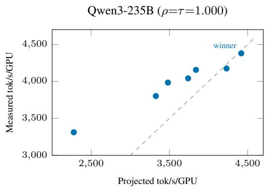

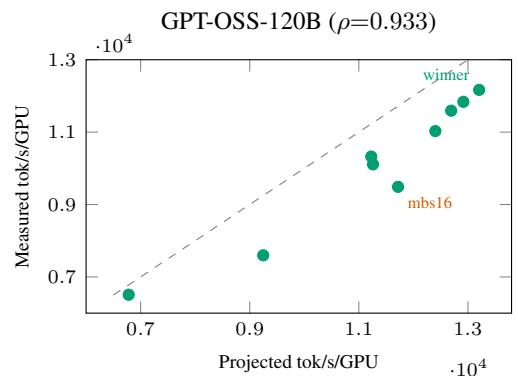  
Figure 6: Projected vs. measured throughput per config (dashed line = identity). Left: Qwen3-235B is perfectly monotone $\scriptstyle ( \rho = \tau = 1 . 0 0 0 ) \cdot$ —the multiplicative offset k shifts points off the identity line but never reorders them. Right: GPT-OSS-120B (ρ=0.933); the only reversals involve one over-projected trio around mbs16, while the top-1 pick and the extremes are exactly ordered (selection regret 0%).

<table><tr><td>Workload</td><td>Concordant</td><td>Discordant (meas. gap)</td><td>Median k</td><td>Max |k − k|</td><td>Conc. &gt;9%</td><td>Top-1/Top-3 regret</td></tr><tr><td>Mixtral-8×22B</td><td>21/21</td><td>none</td><td>1.132</td><td>0.048 (r14_b1)</td><td>100% (10/10)</td><td>0% / 0%</td></tr><tr><td>Qwen3-235B-A22B</td><td>21/21</td><td>none</td><td>0.924</td><td>0.236 (i27)</td><td>100% (10/10)</td><td>0% / 0%</td></tr><tr><td>GPT-OSS-120B</td><td>33/36</td><td>2.1%, 6.5%, 8.8%</td><td>1.095</td><td>0.140 (mbs16)</td><td>100% (27/27)</td><td>0% / 0%</td></tr></table>

Table 21: Ranking-consistency metrics. Discordant pairs on GPT-OSS: baseline–mbs2 (2.1%), mbs16–baseline (6.5%), mbs16–mbs2 (8.8%). Mixtral tags as in Table 18.

## Appendix F: MoE Load-Balancing Analysis

This appendix expands Section 4.10. For benchmarking we set moe\_router\_force\_load\_balancing=true: a random straight-through router (forward assigns tokens uniformly at random; backward still trains the real gate) plus an exactly even dispatcher make executed load uniform (max/mean=1 by construction), so the uniform-load assumption holds exactly for these runs. The flag is a benchmarking device only and is never used in real training.

Three regimes, kept distinct. Load balance is easy to conflate across settings, so we separate them: (i) forced-balanced benchmark runs, I = 1 exactly; (ii) real training, where aux-loss or aux-loss-free balancing plus large-batch averaging keep I near 1, since per-expert deviation shrinks as 1/√tokens/expert, giving a steady-state I ≈ 1.1–1.3; and (iii) deliberate stress tests with balancing disabled, where we push I to 4×, well beyond what training produces.

Stress test and correction. With balancing off, two effects appear: grouped-GEMM time is gated by the busiest EP-rank, i.e. by $I _ { \mathrm { r a n k } } ( E / \mathrm { E P } )$ rather than the mean, and the All-to-All undergoes a regime jump. Sweeping I from $1 \times \mathrm { t o } 4 \times$ on real MI355X on three models (Table 22), a uniform-load model errs by up to 53–71%, while a distribution-aware busiest-rank correction keeps the error under 10% (typically under 5%) across the full range. The I ≥ 2 points lie outside the training regime and are included only to bound the worst case.

Table 22: Skew sweep (1×–4×), FP8: worst-case error with and without the busiest-rank correction.
<table><tr><td>Model</td><td>Uncorrected</td><td>Corrected</td></tr><tr><td>Qwen3-235B-A22B</td><td>65.8%</td><td>3.3%</td></tr><tr><td>Mixtral-8×22B</td><td>70.8%</td><td>6.1%</td></tr><tr><td>DeepSeek V3</td><td>53.1%</td><td>8.4%</td></tr></table>

Table 23: Trained DeepSeek V3 checkpoint (native learned balancing): per-layer vs. step-level pooled imbalance.
<table><tr><td>EP</td><td>experts/dev</td><td>per-layer (med)</td><td>pooled</td></tr><tr><td>8</td><td>32</td><td>1.38</td><td>1.05</td></tr><tr><td>16</td><td>16</td><td>1.58</td><td>1.08</td></tr><tr><td>32</td><td>8</td><td>2.13</td><td>1.12</td></tr></table>

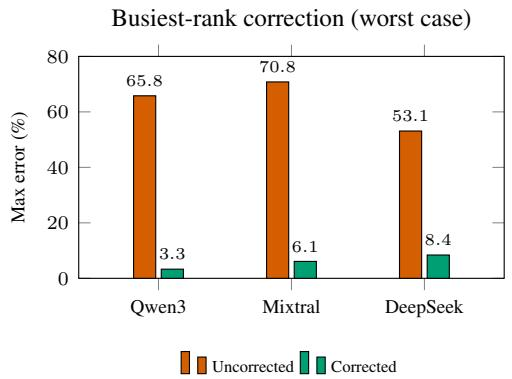

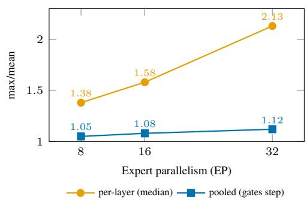  
Figure 7: Left: disabling load balancing inflates worst-case error to 53–71%, but the busiest-rank correction brings it back under 10% on all three models. Right: on the trained DeepSeek V3 checkpoint the per-layer imbalance grows with EP, yet the step-level pooled imbalance—the quantity that actually gates throughput— stays near 1.05–1.12 because the busiest device rotates layer-to-layer.

The correction gates compute by the busiest EP-rank’s load through the measured grouped-GEMM scaling (a function of experts-per-rank E/EP) and adds an A2A regime term when skew moves the largest message across a bandwidth/latency boundary. On the trained checkpoint (Table 23) the per-layer median at EP=8 is 1.38, but the step-level pooled imbalance is only 1.05 because the busiest device rotates layer-to-layer: pooling each device’s work over the step before taking max/mean satisfies max $\dot { \sum _ { l } n _ { l , r } } \le \dot { \sum _ { l } }$ maxr nl,r, so per-layer peaks on different devices partially cancel. In the pipelined/overlapped regime step time tracks pooled per-device work, so the 1.05 value, not 1.38, governs throughput. Across EP=8/16/32 the pooled imbalance stays at 1.05–1.12, within a few percent of uniform, and even the per-layer median of 1.38 at EP=8 lies in the small-I region of the sweep where the corrected error is ≈2%. The three regimes order as the mechanism predicts (forced-balanced 1.00 < trained 1.38 < random-init 2.27), and because the penalty depends only on E/EP it transfers across EP (validated on Mixtral, EP∈ {2, 4, 8}, ±6%).

## Appendix G: Baselines: Calculon and Galvatron-Style Search

Calculon (SC’23). We first verified our Calculon [10] setup against its own published NVIDIA A100 results (3.65% avg / 8.87% max error). We then ran the head-to-head on AMD hardware: Llama-3.1-70B on MI325X (8 nodes, 64 GPUs, FSDP2, seq. length 8,192), comparing both tools’ predictions with the measured throughput (Table 24). Primus is ∼4× more accurate; Calculon’s opposite-direction errors inflate the FP8–BF16 gap from 1.5× (measured) to 2.9×. By source inspection Calculon models no experts, All-to-All, or ROCm path, so Mixtral and DeepSeek V3 cannot be expressed at all.

<table><tr><td>Config</td><td>Measured</td><td>Primus</td><td>Calculon</td></tr><tr><td>FP8 (GBS 256, MBS 4, FSDP)</td><td>1,726</td><td>1,825 (+5.7%)</td><td>2,006 (+16.2%)</td></tr><tr><td>BF16 (GBS 64, MBS 1, FSDP)</td><td>1,174</td><td>1,086 (−7.5%)</td><td>686 (-41.6%)</td></tr><tr><td>Mean |error|</td><td></td><td>6.6%</td><td>28.9%</td></tr></table>

Table 24: Head-to-head accuracy on Llama-3.1-70B, AMD MI325X, 8 nodes / 64 GPUs (tok/s/GPU). Measured values are real MI325X runs.

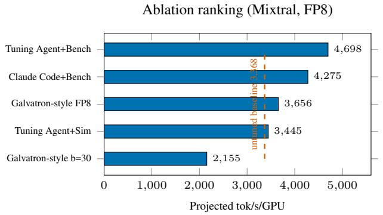

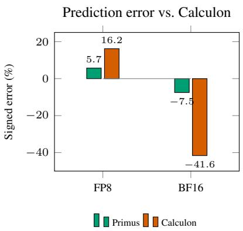  
Figure 8: Left: on Mixtral-8×22B, Primus Tuning Agent+Benchmark (4,698) tops every simulate-oracle method—including the Galvatron-style exhaustive 530-config FP8 search (3,656)—because the benchmark oracle measures superposed kernel/collective effects. Right: signed prediction error on Llama-3.1-70B; Calculon’s large opposite-sign errors (+16.2% FP8, −41.6% BF16) distort the cross-precision trade-off, whereas Primus stays within ±8%.

Galvatron-style DP search (PVLDB 16). We implement a search in the spirit of Galvatron [18] over a 530-config space: an outer loop over PP∈ {1, 2, 4, 7, 8, 14, 28}, inner enumeration of all (TP,EP,DP) triples with TP×EP×DP=world\_size/PP and TP ≤ GPUs/node, crossed with legal MBS. Two adaptations make the comparison apples-to-apples: (1) uniform parallelism across layers, as Megatron-LM requires, reducing Galvatron’s per-layer DP to full enumeration; and (2) we grant the search our own Primus simulate oracle (analytical GEMM, tile-level FlashAttention-3, and an algorithm-selecting per-collective model that also covers EP, MoE All-to-All, and zerobubble/ZBV/interleaved schedules that Galvatron omits)—if anything an advantage to the baseline. Even so, the exhaustive FP8 sweep (3,656) trails Primus Tuning Agent+Benchmark (4,698) by 22%, i.e. the agent is 28% higher (Table 11); the exhaustive BF16 sweep reaches 3,576. We ran these as two separate sweeps because precision is not a knob in Galvatron’s search space: it cannot move from BF16 to FP8 during a search the way our agent does. Started from the BF16 reference with a 30-trial budget, as the agent is, it therefore stays in BF16 and reaches only 2,155, below the untuned baseline (3,368). Fixing FP8 in advance removes that handicap, yet the gap remains. The gap is the oracle, not the search: only real-hardware benchmarking captures the superposed FP8 tensor-core, RCCL A2A, and grouped-GEMM effects, and it ranks the winning EP=8 topology correctly (Spearman $\rho = 0 . 9 2$ over the n = 17 configurations benchmarked on hardware). Neither

Galvatron nor Galvatron-BMW [31] evaluates MoE architectures or reports projected-vs-measured rank correlation.
<table><tr><td>Method</td><td>Oracle</td><td>Winning configuration</td><td>Proj.</td><td>vs. base</td></tr><tr><td>Primus Tuning Agent + Benchmark</td><td>Benchmark</td><td>TP=1 PP=4 EP=8 MBS=2 FP8 DeepEP, no recompute</td><td>4,698</td><td>+39.5%</td></tr><tr><td>Claude Code + Benchmark</td><td>Benchmark</td><td>TP=1 PP=8 EP=4 MBS=2 FP8 DeepEP, no recompute</td><td>4,275</td><td>+26.9%</td></tr><tr><td>Galvatron-style FP8 exhaustive</td><td>Simulate</td><td>TP=2 PP=2 EP=4 MBS=1 FP8, no recompute</td><td>3,656</td><td>+8.6%</td></tr><tr><td>Galvatron-style BF16 exhaustive</td><td>Simulate</td><td>TP=2 PP=4 EP=4 MBS=1 BF16, no recompute</td><td>3,576</td><td>+6.2%</td></tr><tr><td>Primus Tuning Agent + Simulate</td><td>Simulate</td><td>TP=1 PP=4 EP=8 MBS=1 FP8, full recompute</td><td>3,445</td><td>+2.3%</td></tr><tr><td>Galvatron-style budget=30</td><td>Simulate</td><td>TP=8 PP=1 EP=4 MBS=2 BF16, no recompute</td><td>2,155</td><td>-36.0%</td></tr></table>

Table 25: Winning configuration per method in the Mixtral-8×22B ablation (4-node MI355X; baseline 3,368 projected tok/s/GPU; Table 11). Only the benchmark oracle identifies the intra-node EP=8 DeepEP topology with TP=1.

## Appendix H: Tuning-Agent LLM Backbone and Prompts

The agent uses two Anthropic Claude models via an OpenAI-compatible LiteLLM gateway: Planner = Claude Sonnet 4.6 (claude-sonnet-4-6, ChainOfThought) and RLM = Claude Opus 4.6 (claude-opus-4-6, ReAct tool loop), with max\_tokens=8000, timeout=300 s, ≤25 candidates/round, ≤4 rounds. The verbatim instruction strings for the two DSPy signatures follow; a per-cluster extra\_guidance string carries model/cluster-specific hints and is logged per workload so the exact conditioning text is auditable.

## Listing 1: Planner (TuningPlanSignature) verbatim instruction.

Before touching any tools, design a structured search plan for tuning a   
distributed-training configuration on a target cluster. You receive:   
architecture (num\_layers, hidden\_size, MoE config, ...), cluster spec,   
legal\_axes, history\_summary, extra\_guidance, scratchpad. Produce a   
concrete, numbered plan: which axes are most likely to matter for this   
(model, cluster), which configurations should be tried in what order,   
and what to do if they fail. Account for memory headroom, intra/inter  
node boundaries, and known trade-offs (e.g. MoE topk dominating   
activations, EP-spans-nodes hurting A2A).   
Outputs: rationale, hypotheses (<=5), candidate\_configs (JSON, 5-8   
configs over keys subset of {tp, pp, ep, cp, mbs, num\_microbatches, gbs,   
vpp, pp\_schedule, enable\_zero\_bubble, recompute\_granularity,   
recompute\_num\_layers, overlap\_grad\_reduce, use\_turbo\_deepep,   
sync\_free\_stage, target\_ep\_size, fp8, cross\_entropy\_loss\_fusion,   
use\_distributed\_optimizer, use\_torch\_fsdp2}), polish\_plan. MoE priority   
order: (1) DeepEP (\~35% win), (2) SyncFree stage 2->3, (3) FP8 hybrid,   
(4) recompute none/selective if memory fits, (5) ZB/ZBV schedules with   
matching VPP, (6) coarse TP/PP/EP/CP reshapes, (7) num\_microbatches >=   
4\*PP (or 2\*PP for ZB/ZBV); gbs = mbs \* num\_microbatches \* dp.

## Listing 2: RLM (TuningSearchSignatureBenchmark) verbatim instruction.

Drive an iterative search for the best parallelization configuration   
using real GPU benchmark projections only. Tools:   
evaluate\_benchmark(config)->metrics (primary; every new candidate goes   
through it); evaluate\_memory\_only(config); get\_history(k=30);   
get\_best(); get\_legal\_axes(); get\_architecture(); get\_cluster();   
get\_budget\_status(); note\_to\_scratchpad(text); read\_scratchpad();   
query\_llm(prompt). Workflow each iteration: (1) read\_scratchpad +   
get\_history to ground yourself; (2) pick the next candidate from the   
plan not already in history; (3) evaluate\_benchmark directly (if   
legal=False, read reason and adjust); (4) after 3-5 evals, note what you   
learned; (5) STOP when the benchmark budget is exhausted or the   
incumbent has not improved in the last 5 trials.   
Outputs: best\_config (JSON), summary (5-8 sentences), next\_steps.

## Appendix I: Limitations

Network contention is not modeled. The communication model assumes dedicated bandwidth per topology domain. Concurrent collectives competing for the same xGMI or NIC bandwidth (e.g. TP AllReduce overlapping with FSDP AllGather on the same node) will see effective bandwidth lower than the model assumes. We have not yet observed this as a dominant error source on the configurations evaluated here, but it could add error in some settings at extreme scale.

Reduced-parallelism fidelity has limits. Sub-node benchmarking necessarily measures a system whose parallelism configuration differs from the target. The +6.6% Mixtral error at the 2-GPU benchmark and the corresponding compounding pattern in Section 4 bound this in practice; longer reductions (e.g. benchmarking PP=4 EP=8 from PP=1 EP=1) introduce more analytical work and correspondingly more residual error. The framework reports both the measured base time and the analytical delta for each restored dimension so that users can audit which step contributed to the residual.

Hardware homogeneity assumption: All nodes are assumed identical, both in static specification (HBM, CU count, link topology) and in runtime behavior (clock frequency under load). GPU-to-GPU frequency variation within a job and partial-rack failure modes are outside the model’s scope.

Primus Tuning Agent search space: The deterministic seed planner enumerates a fixed set of axes and the LLM phase explores combinations of those axes; the agent does not introduce optimizations that are not exposed as flags by the projection oracle. Adding a new optimization (e.g. a new MoE A2A backend) requires extending both the oracle and the planner. The search space exposes ZeRO-1 (use\_distributed\_optimizer) and ZeRO-3 (use\_torch\_fsdp2); ZeRO-2 is excluded because wherever it would beat ZeRO-1, FSDP2 is available.

Precision is a throughput knob only. The agent treats precision (BF16/FP8) as a search axis for throughput evaluation. Projection says nothing about numerical quality: FP8 recipes must be validated for convergence before production use.

New layer types and accelerators. Extending beyond the evaluated layer types requires only a parameterizable layer: subquadratic layers (e.g. Gated DeltaNet) use a profiled FLOP estimate, and sparse attention a density-weighted FLOP count; validating these is future work. Porting to NVIDIA requires a hardware YAML and the 8-GPU benchmark; TPUs additionally require adapting the collective model to XLA/JAX collectives.

## Appendix J: Broader Impact

Primus Projection is an infrastructure tool aimed at reducing the GPU-hours consumed by configuration tuning for large model training. The intended positive impact is twofold:

• Energy and cost savings. By converting much of the configuration search from multinode trial-and-error into single-node projection, Primus Projection reduces the GPU-hours required to find a high- throughput configuration. The Mixtral case study in Section 4.7 consumed ∼30 minutes of single-node agent time plus a small number of validation runs, in place of what would otherwise be days of manual multi-node sweeps.

• Lower barrier to large-scale training. Smaller research groups without standing access to large clusters can use the simulation backend to explore parallelism trade-offs and the agent to generate candidate configurations, then validate only a few selected candidates on rented capacity.

We are not aware of foreseeable negative societal impacts specific to this tooling beyond those of distributed LLM training in general. The framework is released under an open-source license to ensure that the projection oracle, the seed planner, and the LLM agent loop are auditable and modifiable by the community.