# C<sup>3</sup>: RETHINKING PROCESS SUPERVISION VIA CONFIDENCE-GUIDED CREDIT CORRECTION IN MULTI-TURN REINFORCEMENT LEARNING

Ai Jian<sup>1,∗</sup> Haoran Pan<sup>2,∗</sup> Eryu Guo<sup>1</sup> Haojin Yang<sup>2</sup> Jinghan He<sup>3</sup>

Xiaoyun Zhang<sup>4</sup> Jiangbo Pei<sup>1</sup> Peiyu Liu<sup>5,†</sup>

<sup>1</sup> Beijing University of Posts and Telecommunications

<sup>2</sup> Peking University

<sup>3</sup> Institute of Automation, Chinese Academy of Sciences

<sup>4</sup> University of Chinese Academy of Sciences

<sup>5</sup> University of International Business and Economics

<sup>∗</sup> Equal contribution <sup>†</sup> Corresponding author jianai@bupt.edu.cn liupeyustu@163.com

## ABSTRACT

Large language models are increasingly trained as multi-turn agents that interact with external tools. However, outcome-only reinforcement learning can produce a form of misguided reinforcement: even on successful trajectories, undesirable local behaviors may receive positive token-level advantages and be favored by the policy update. To address this issue, we propose Confidence-Guided Credit Correction (C<sup>3</sup>), a plug-in method for local credit correction. C<sup>3</sup> identifies spans corresponding to undesirable behaviors and selectively corrects positive credit after advantage estimation, with the correction strength adaptively controlled by the behavior policy’s confidence in the corresponding behavior, while leaving the task reward and original credit estimation unchanged. Across multiple multi-turn benchmarks, C<sup>3</sup> improves performance under both critic-based and critic-free reinforcement learning methods. Injecting the same behavioral signals as turn-level or outcome rewards does not consistently improve performance. Our results show that local credit correction provides an effective form of process supervision for outcome-driven RL.

## 1 INTRODUCTION

Multi-turn agentic reinforcement learning has emerged as an effective paradigm for training language agents on complex tasks that require long-horizon reasoning and iterative tool interaction (Zheng et al., 2025; Zhou et al., 2025; Jian et al., 2026). A common approach optimizes agents with outcome-level rewards that evaluate the success of an entire interaction trajectory (Jin et al., 2025). However, outcome-level supervision provides only sparse and coarse-grained feedback for intermediate behaviors, making it difficult to assign appropriate credit across long-horizon interactions (Wang et al., 2025b;a; Lu et al., 2026). To provide denser supervision for intermediate behaviors, recent work introduces process-level rewards and other process-level signals (Wang et al., 2026a; Zhu et al., 2026; Ma et al., 2026).

Our Key Observation. We inspect representative training trajectories under outcome-only training and find that undesirable local behaviors can still receive positive token-level advantages. We identify this phenomenon as a form of misguided reinforcement. More precisely, it is a form of loca credit misalignment, where the token-level advantage assigned to an undesirable behavior is inconsistent with its process-level quality. This creates a fundamental mismatch between what behavior should be discouraged and what the policy update favors. Figure 1(a) shows two representative undesirable behaviors observed. In the invalid tool call, a missing closing tag for <search> causes the call to be malformed, yet the preceding unclosed tokens receive positive advantages while the subsequently closed tokens receive negative advantages. In the redundant search, the same query is issued in consecutive turns, but its tokens also receive mixed advantages. Such misalignment reflects the challenge of assigning localized credit from trajectory-level outcomes.

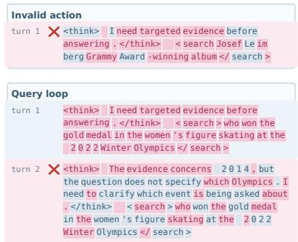  
(a) Mixed credit in undesirable behaviors.

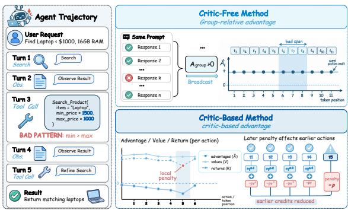  
(b) Credit construction across optimization paradigms.  
Figure 1: Misguided reinforcement under outcome-only training. (a) Incorrect tool use and redun dant search receive mixed token-level credit, with positive and negative advantages shown in rose and blue-grey . (b) Token-level credit construction in critic-based and critic-free optimization.

Why Existing Credit Construction Falls Short. Figure 1(b) illustrates how token-level credit is constructed under two common optimization paradigms. In critic-based reinforcement learning, token-level advantages are estimated through returns and value functions, so a process-level penalty can propagate to tokens beyond the behavior that triggered it. In critic-free methods, relative advantages are derived directly from trajectory-level outcomes, causing local behaviors to inherit credit from the overall trajectory. Thus, the two paradigms differ in how credit is constructed, but share a more fundamental challenge:

How can process-level supervision correct a localized undesirable behavior without altering the credit assigned to unrelated behaviors, thereby avoiding credit misalignment?

To address this challenge, we propose ${ \bf C } ^ { 3 }$ (Confidence-Guided Credit Correction), a lightweight process-level credit correction module that directly operates on token-level advantages. Given undesirable behaviors localized by external process-level supervision, $C ^ { 3 }$ selectively corrects positive advantages within the corresponding spans, with the correction magnitude adapting to the model’s confidence in the corresponding actions. $C ^ { 3 }$ introduces no additional process rewards and does not modify the underlying policy optimization objective, making it a plug-in module applicable to both critic-based and critic-free reinforcement learning paradigms.

Our contributions are summarized as follows:

• We identify and characterize misguided reinforcement, where undesirable local behaviors can receive positive policy advantages under outcome-level training, creating a mismatch between behavioral quality and the direction of policy updates.

• We propose $C ^ { 3 }$ , a plug-and-play confidence-guided credit correction framework that rectifies misaligned positive credit within detector-localized undesirable behavior spans without altering task rewards or the underlying RL objective.

• We evaluate $C ^ { 3 }$ across different policy optimization paradigms and multi-turn agent benchmarks. Results show that $C ^ { 3 }$ reduces positive advantages on detected undesirable-behavior spans, decreases their occurrence, and improves overall agent performance.

## 2 RELATED WORK

Reinforcement Learning for LLM Agents. Language agents are commonly optimized with criticbased methods such as Proximal Policy Optimization (PPO) (Schulman et al., 2017; Ouyang et al., 2022) or group-relative objectives such as Group Relative Policy Optimization (GRPO) (DeepSeek-AI, 2025). They support retrieval (Jin et al., 2025) and long-horizon research or collaboration (Zheng et al., 2025; Zhou et al., 2025), but typically learn from trajectory-level outcomes. Consequently, an otherwise successful trajectory may still reinforce undesirable intermediate behaviors. Unlike approaches that modify the overall policy optimization process, $C ^ { 3 }$ preserves the underlying objective and instead performs localized credit correction on undesirable behavior spans.

Credit Assignment for Multi-Turn Agents. Credit assignment asks how trajectory-level outcome credit should be attributed to intermediate actions. Hierarchical methods allocate credit across turns (Zhou et al., 2024; Peng et al., 2026), while turn- or step-level estimators align advantages with action boundaries (Li et al., 2025; Wang et al., 2026a). Action-to-token allocation further refines the mapping from outcomes to local advantages (Ma et al., 2026), and retrospective methods estimate each turn’s contribution (Ekbote et al., 2025; Hu et al., 2026; Feng et al., 2025; Wang et al., 2026b). $C ^ { 3 }$ leaves this outcome-to-advantage mapping intact and operates on the resulting token-level advantages. While these approaches refine how outcome credit is distributed, $C ^ { 3 }$ instead focuses on whether the resulting local credit is consistent with the underlying behavior.

Process Supervision for LLM Agents. Process supervision instead asks whether an intermediate behavior is desirable. Process reward models score individual steps (Lightman et al., 2023); search agents use step-wise rewards (Wang et al., 2025b), information gain (Wang et al., 2025a), or hindsight signals (Lu et al., 2026). Judges and self-distillation provide local assessments (Wang et al., 2026c; Li et al., 2026), while counterfactual attribution derives feedback from alternative rollouts (Zhu et al., 2026). These signals are typically introduced as rewards or advantage shaping. Rather than introducing additional process rewards, $\mathrm { \dot { C } ^ { 3 } }$ uses localized process feedback to correct positive advantages assigned to undesirable-behavior spans within the existing token-level advantage.

## 3 PRELIMINARY

We consider a multi-turn reinforcement learning setting where an LLM agent interacts with an environment to solve a task. Given an input x, the agent follows a policy $\pi _ { \theta }$ to generate an action $a _ { t }$ at interaction turn $t ,$ receives an environment observation $o _ { t } ,$ and eventually produces a final answer y. Over T interaction turns, a complete interaction is represented as

$$
\tau = ( x , a _ { 1 } , o _ { 1 } , \dots , a _ { T } , o _ { T } , y ) .\tag{1}
$$

Each action at turn t is represented by an ordered token sequence:

$$
a _ { t } = ( z _ { i } ) _ { i \in I _ { t } } .\tag{2}
$$

Here, $I _ { t }$ denotes the contiguous token span of action $a _ { t }$ . We index all generated tokens globally by i and denote the decoding context of token $z _ { i }$ by $s _ { i }$

During optimization, trajectories are collected under the behavior policy $\pi _ { \boldsymbol { \theta } _ { k } }$ at update $k ,$ while $\pi _ { \theta }$ denotes the current policy being optimized. A base reinforcement learning algorithm assigns each generated token a token-level advantage $\hat { A } _ { i }$ , obtained from either critic-based or group-relative credit estimation. The policy update is therefore driven by

$$
\nabla _ { \theta } J ( \theta ) \propto \mathbb { E } _ { \tau \sim \pi _ { \theta _ { k } } } \left[ \sum _ { i } \hat { A } _ { i } \nabla _ { \theta } \log \pi _ { \theta } ( z _ { i } \mid s _ { i } ) \right] .\tag{3}
$$

Accordingly, tokens with $\hat { A } _ { i } > 0$ are reinforced by the policy update, whereas those with $\hat { A } _ { i } < 0$ are suppressed.

Our goal. Generally, most positive-advantage tokens correspond to behaviors that are consistent with successful task completion. However, a small subset of tokens may exhibit undesirable behaviors yet receive positive advantages, causing them to be reinforced by the base RL objective. $C ^ { 3 }$ targets these sparse misassignments by selectively calibrating their advantages, while leaving the remaining tokens, the reward function, and the base advantage estimator unchanged.

## 4 METHODOLOGY

We define $C ^ { 3 }$ as a post-estimation operator for multi-turn agent reinforcement learning. An external transcript detector localizes an undesirable behavior, the base RL pipeline provides token-level

advantages, and $C ^ { 3 }$ corrects these advantages before the actor update. We first motivate this design through an empirical behavioral and credit audit, and then define the inputs, localization rule, and correction operator. Figure 2 summarizes the resulting workflow.

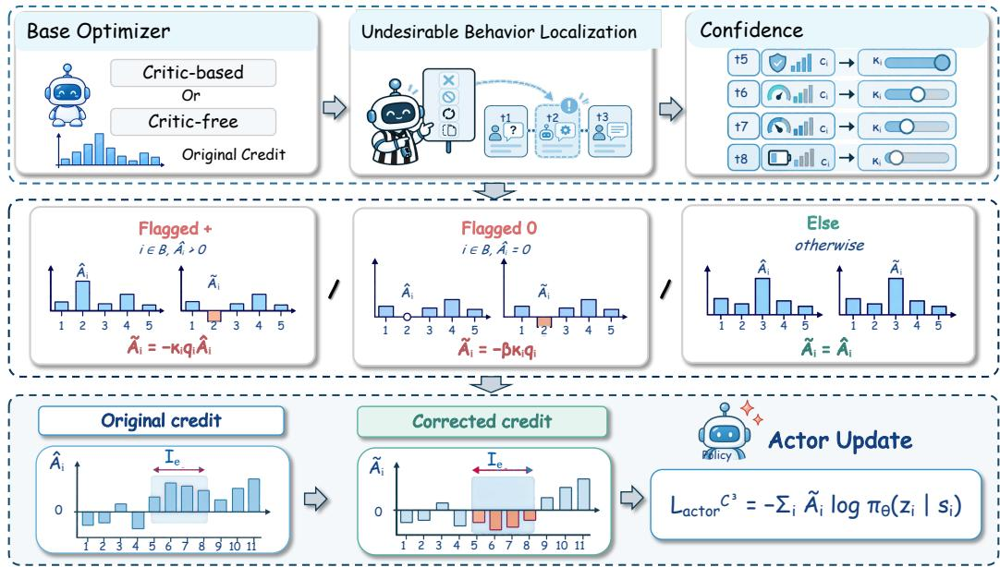  
Figure 2: Overview of confidence-guided advantage correction for multi-turn agent reinforcement learning. A detector localizes an undesirable-behavior span, the actor-side correction is applied only within that span, and its strength follows the policy confidence.

## 4.1 MOTIVATION: MISGUIDED REINFORCEMENT AND LOCAL CREDIT

We investigate local credit dynamics through two representative undesirable behaviors, invalid actions and query loops, whose operational definitions and detection rules are provided in Appendix B.1. Figure 1(a) illustrates representative event-level examples, while Figure 3 traces how undesirable-behavior occurrence and token-level advantages evolve during RL training.

Observation 1: Undesirable behaviors reveal complex credit dynamics. As shown in Figure 3(a,b), undesirable-behavior occurrence generally decreases during training for critic-based PPO, whereas critic-free GDPO shows no consistent decline and even rebounds at the later stage. PPO derives token-level advantages through a learned critic and GAE, while GDPO constructs relative advantages from group-level trajectory signals that combine task outcomes with undesirablebehavior penalties. These contrasting dynamics suggest that the same undesirable behaviors can evolve differently under different credit construction mechanisms, making local credit assignment inherently nontrivial.

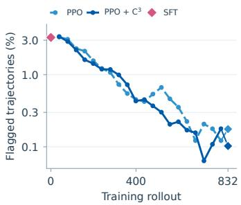  
(a) PPO training

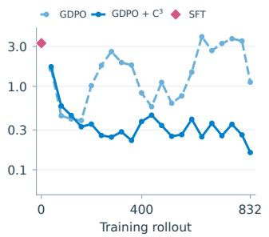  
(b) GDPO training

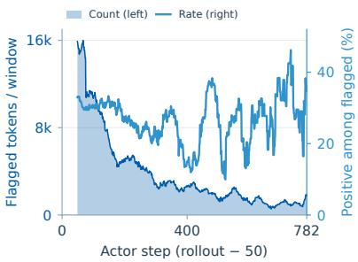  
(c) Positive-credit audit  
Figure 3: Misguided reinforcement during RL training.

Observation 2: Behavior suppression does not imply local credit alignment. Figure 3(c) shows that, among 63,511 valid tokens within detector-identified undesirable-behavior spans in an instrumented PPO run, 18,460 receive positive base advantage before correction, corresponding to 29.07%. Notably, this positive credit persists even as the number of undesirable-behavior tokens decreases during training. This indicates that reducing undesirable-behavior occurrence does not eliminate incorrect local credit, suggesting that trajectory-level supervision can still assign positive local credit to undesirable behaviors.

Together, these observations expose a failure mode in multi-turn RL: undesirable behaviors can remain positively reinforced at the token level even as they are suppressed at the trajectory level. The contrasting dynamics under PPO and GDPO further suggest that this issue is not specific to a particular credit construction mechanism, but can arise whenever trajectory-level signals are translated into local credit. This motivates a targeted intervention:

Instead of redesigning rewards or advantage estimation, can correcting positive credit for a small number oflocalized undesirable behaviors be sufficient to improve RL?

## 4.2 LOCAL CREDIT CORRECTION

Motivated by the local credit misalignment identified above, we aim to correct policy credit only where its direction is inconsistent with the detected local behavior, while preserving the credit assigned to the remaining parts of the trajectory. To this end, $C ^ { 3 }$ operates on the token-level advantages ${ \hat { A } } _ { i }$ produced by the base RL optimizer and the localized failure-token set B.

Formally, for a detected token $i \in \boldsymbol { B }$ with $\hat { A } _ { i } > 0$ , we reverse the direction of its advantage and scale the correction by a token-specific gain:

$$
\tilde { A } _ { i } = - \alpha _ { i } \hat { A } _ { i } , \qquad i \in \mathcal { B } , \ \hat { A } _ { i } > 0 ,\tag{4}
$$

where $\alpha _ { i }$ controls the strength of the correction. Tokens whose advantages are already negative require no directional correction and are left unchanged.

Confidence-Guided Correction Strength. Localization determines where credit should be corrected, while the correction gain determines how strongly the intervention should be applied. We parameterize this gain using both the severity of the detected failure and the behavior policy’s confidence in the corresponding action.

For each detected token i, let $J _ { e ( i ) }$ denote the action span associated with the failure event covering that token. We measure the confidence of the behavior-policy snapshot $\pi _ { \boldsymbol { \theta } _ { k } }$ using one of three aggregation strategies:

$$
\left\{ \begin{array} { l l } { \displaystyle c _ { i } ^ { \mathrm { t o k e n } } ( \theta _ { k } ) = \pi _ { \theta _ { k } } ( z _ { i } \mid s _ { i } ) , } \\ { \displaystyle c _ { i } ^ { \mathrm { a r i t h } } ( \theta _ { k } ) = \frac { 1 } { \left| J _ { e ( i ) } \right| } \sum _ { j \in J _ { e ( i ) } } \pi _ { \theta _ { k } } ( z _ { j } \mid s _ { j } ) , } \\ { \displaystyle c _ { i } ^ { \mathrm { g e o } } ( \theta _ { k } ) = \exp \left( \frac { 1 } { \left| J _ { e ( i ) } \right| } \sum _ { j \in J _ { e ( i ) } } \log \pi _ { \theta _ { k } } ( z _ { j } \mid s _ { j } ) \right) } \end{array} \right. .\tag{5}
$$

We use the arithmetic span mean as the default confidence measure. For span-level aggregation, all tokens associated with the same failure event share the same confidence value, whereas token probability provides token-specific confidence. Since $\pi _ { \boldsymbol { \theta } _ { k } }$ is the behavior-policy snapshot used to generate the trajectory, the confidence adapts as the policy evolves during training. During actor optimization, the confidence is detached from the computation graph and acts only as an adaptive correction coefficient.

For the main method, the correction gain is the selected policy confidence:

$$
\kappa _ { i } = c _ { i } ( \theta _ { k } ) .\tag{6}
$$

Combining policy confidence with the event severity $q _ { i }$ , the final correction strength is

$$
\alpha _ { i } = \kappa _ { i } q _ { i } .\tag{7}
$$

Complete Correction Operator. The resulting corrected advantage is

$$
\tilde { A } _ { i } = \left\{ \begin{array} { l l } { - \kappa _ { i } q _ { i } \hat { A } _ { i } , } & { i \in \mathcal { B } , \hat { A } _ { i } > 0 , } \\ { - \beta \kappa _ { i } q _ { i } , } & { i \in \mathcal { B } , \hat { A } _ { i } = 0 , } \\ { \hat { A } _ { i } , } & { \mathrm { o t h e r w i s e } . } \end{array} \right.\tag{8}
$$

Thus, $C ^ { 3 }$ selectively reverses positive credit assigned to detected failure behaviors, while preserving credit that is already negative or unrelated to the detected failure. The optional coefficient $\beta \geq \bar { 0 }$ handles exact zero-advantage cases. We set $\beta = 0$ in all main experiments, such that zero-advantage tokens are also left unchanged.

## 4.3 INTEGRATION WITH POLICY OPTIMIZATION

Building on the simple advantage correction rule above, we next integrate it into the RL optimization process. By applying the correction directly to the actor-side learning signal, $C ^ { 3 }$ preserves the original reward and credit-construction procedure while allowing the same mechanism to be used across different optimization paradigms. We next describe how this correction affects the actor update and how it is instantiated in critic-based and critic-free RL.

Effect on the Actor Update. Ignoring clipping and regularization terms, the actor objective using the corrected advantages is

$$
\mathcal { L } _ { \mathrm { a c t o r } } ^ { \mathrm { C } ^ { 3 } } = - \sum _ { i } \tilde { A } _ { i } \log \pi _ { \theta } ( z _ { i } \mid s _ { i } ) .\tag{9}
$$

For a detected token with $\hat { A } _ { i } > 0 , { \bf C } ^ { 3 }$ changes its contribution from

$$
- \hat { A } _ { i } \log \pi _ { \theta } ( z _ { i } \mid s _ { i } )\tag{10}
$$

to

$$
\kappa _ { i } q _ { i } \hat { A } _ { i } \log \pi _ { \theta } ( z _ { i } \mid s _ { i } ) ,\tag{11}
$$

thereby reversing the direction of its policy-gradient contribution. Tokens outside the detected failure spans, as well as detected tokens with negative advantages, retain their original actor-side credit.

Critic-Based and Critic-Free Integration. For critic-based optimization, $C ^ { 3 }$ is applied after the original advantage estimation and actor-side normalization. In our PPO implementation, this corresponds to applying Eq. 8 after advantage whitening. The critic continues to be trained using the original return targets, so $C ^ { 3 }$ affects only the actor update.

For critic-free group-relative optimization, $C ^ { 3 }$ is applied after group-relative advantage construction, leaving the underlying credit construction unchanged. It corrects only the resulting actor-side advantages before the policy update, making the same operator applicable across different creditconstruction paradigms.

## 5 EXPERIMENTS

## 5.1 EXPERIMENTAL SETUP

Implementation Details. For multi-turn search question answering, we use Qwen3-8B (Yang et al., 2025) with the SLIME framework (Zhu et al., 2025). The agent interacts with a retrieval environment built on the Wiki-Fixed corpus introduced in (Zhao et al., 2026), using Qwen3-Embedding-8B (Zhang et al., 2025) with 4096-dimensional embeddings and FAISS for retrieval. For Web-Shop (Yao et al., 2022), we use Qwen3-4B with full-parameter updates in the standard WebShop environment. All models are trained under their corresponding task protocols.

Baselines. We evaluate $C ^ { 3 }$ under two optimization families: critic-based optimization and criticfree group-relative optimization. For critic-based optimization, we compare standard PPO, PPO with a turn-level process reward, and PPO with $C ^ { 3 }$ . The process-reward baseline incorporates detector events into return and advantage estimation, whereas $\mathrm { \dot { C } ^ { 3 } }$ directly corrects token-level advantages on detected spans. For critic-free group-relative optimization, we compare GDPO (Liu et al., 2026)

Algorithm 1 RL Optimization with Confidence-Guided Credit Correction $\textstyle ( \mathbf { C } ^ { 3 } )$   
Require: Actor policy $\pi _ { \theta } ,$ base RL optimizer O, detector $\mathcal { D }$   
Ensure: Updated policy π<sub>θ</sub>   
1: Roll out trajectories under $\pi _ { \theta _ { k } }$ and compute base advantages $\{ \hat { A } _ { i } \}$ using O   
2: Detect events $\mathcal { E }  \mathcal { D } ( \tau )$ and localize $( \grave { I } _ { e } , J _ { e } , q _ { e } )$   
3: Initialize corrected advantages $A _ { i }  \hat { A } _ { i }$ for all tokens   
4: for each event e $\in \mathcal { E }$ do   
5: $\ell _ { j } = \log \pi _ { \theta _ { k } } ( z _ { j } \mid s _ { j } )$ for $j \in J _ { e }$   
6: $\begin{array} { r } { c _ { e } \gets \frac { 1 } { | J _ { e } | } \sum _ { j \in J _ { e } } } \end{array}$ exp(ℓ<sub>j</sub> )   
7: for each token $i \in I _ { e }$ do   
8: $q _ { i } \gets \operatorname* { m a x } ( q _ { i } , q _ { e } )$   
9: if $\hat { A } _ { i } > 0$ then   
10: $A _ { i } \gets - q _ { i } c _ { e } \hat { A } _ { i }$   
11: end $\mathbf { i f }$   
12: end for   
13: end for   
14: Update $\pi _ { \theta }$ using corrected advantages $\left\{ A _ { i } \right\}$   
26 51 Outcome-only Process reward C 26 Outcome-only 51 Outcome-only C<sup>3</sup>   
24 24   
50 50   
Strict EM (%) 22 ri<sub>ct</sub> <sub>EM</sub> (% 49 ri<sub>ct</sub> <sub>EM</sub> (% 22 ri<sub>ct</sub> <sub>EM</sub> (% 4   
20 20   
18 48 18 48   
16 47 16 47   
14 46 14 46   
12 45 12 45   
200 400 600 800 0 200 400 600 800 0 200 400 600 800 0 200 400 600 800   
Training rol out step Evaluation checkpoint Training rol out step Evaluation checkpoint   
(a) PPO training (b) PPO evaluation (c) GDPO training (d) GDPO evaluation   
Figure 4: Panels (a,c) show smoothed training EM, and panels (b,d) show evaluation strict EM.

with and without $C ^ { 3 }$ . GDPO follows the group-relative paradigm of GRPO but decouples the normalization of individual reward components. Configurations are provided in Appendix B.2.

Evaluation Benchmarks and Metrics. For search question answering, we evaluate on seven multiturn benchmarks: NQ (Kwiatkowski et al., 2019), TriviaQA (Joshi et al., 2017), PopQA (Mallen et al., 2023), HotpotQA (Yang et al., 2018), 2WikiMultiHopQA (Ho et al., 2020), MuSiQue (Trivedi et al., 2022), and Bamboogle (Press et al., 2023). We report strict exact match (EM), with the overall score computed as the unweighted mean across the seven benchmarks. For WebShop, we report the task score and success rate on the fixed 500-instance benchmark split.

## 5.2 MAIN RESULTS

We evaluate $C ^ { 3 }$ on two multi-turn agent environments, Search QA and WebShop, under both criticbased PPO and critic-free GDPO, reporting both final task performance and training dynamics.

Search Question Answering. Table 1 reports strict EM on seven multi-turn question-answering benchmarks. The complete benchmark-level evaluation dynamics are provided in Appendix C.2. Under PPO, $C ^ { 3 }$ improves the average score from 47.79% to 50.20%, yielding an absolute gain of 2.41 points, with improvements on six of the seven benchmarks. The largest gain is observed on 2Wiki, where $C ^ { 3 }$ improves strict EM by 11.5 points, followed by a 2.6-point gain on Bamboogle. Under GDPO, $C ^ { 3 }$ improves the average score from 48.37% to 49.23%, an absolute gain of 0.86 points, with improvements on six of the seven benchmarks.

Figure 4 shows the corresponding training and evaluation dynamics across the seven benchmarks. During training, $C ^ { 3 }$ generally reaches higher benchmark-level performance than the corresponding baselines, although the magnitude and timing of the gains vary across tasks. The periodic evaluation curves show a similar pattern at the aggregate level, with $C ^ { 3 }$ achieving higher evaluation performance at multiple stages of training rather than only at the final checkpoint.

Table 1: Strict EM (%) on seven QA benchmarks with Qwen3-8B. All entries report mean $\pm$ standard deviation over four independent samples at temperature 0.8 with top-p = 0.95. Bold marks the best mean within each optimization family.
<table><tr><td rowspan="2">Method</td><td colspan="3">Single-Hop QA</td><td colspan="4">Multi-Hop QA</td><td rowspan="2">Avg.</td></tr><tr><td>NQ</td><td>TriviaQA</td><td>PopQA</td><td>HotpotQA</td><td>2Wiki</td><td>Musique</td><td>Bamb.</td></tr><tr><td>SFT</td><td>35.2±0.2</td><td>59.2±0.2</td><td>37.8±0.0</td><td>48.9±0.2</td><td>64.1±0.3</td><td>22.6±0.2</td><td>46.2±1.2</td><td>44.87±0.17</td></tr><tr><td colspan="9">Critic-Based Optimization</td></tr><tr><td>PPO</td><td>40.7±0.5</td><td>62.1±0.2</td><td>43.4±0.1</td><td>55.2±0.2</td><td></td><td></td><td></td><td>56.4±0.3 28.8±0.5 47.8±2.8 47.79±0.50</td></tr><tr><td>+ process reward 42.0±0.4</td><td></td><td>62.3±0.3</td><td>43.5±0.2</td><td>55.0±0.1</td><td>60.8±0.3</td><td>23.9±0.6</td><td></td><td>42.2±2.447.10±0.43</td></tr><tr><td> $+ \mathrm { C } ^ { 3 }$ </td><td>39.5±0.3</td><td>63.5±0.1</td><td>45.0±0.3</td><td>55.6±0.1</td><td>67.9±0.3</td><td>29.7±0.1</td><td></td><td>50.4±0.0 50.20±0.10</td></tr><tr><td colspan="9">Group-Relative Optimization</td></tr><tr><td>GDPO</td><td>40.0±0.4 61.0±0.2</td><td></td><td>43.2±0.2</td><td>55.5±0.1</td><td></td><td></td><td></td><td>63.1±0.2 29.1±0.5 46.8±1.4 48.37±0.19</td></tr><tr><td> $+ \mathrm { C } ^ { 3 }$ </td><td>41.6±0.3</td><td>62.8±0.2</td><td>45.7±0.3</td><td>55.7±0.3</td><td></td><td></td><td></td><td>60.9±0.1 29.5±0.6 48.4±2.5 49.23±0.35</td></tr></table>

WebShop. We further evaluate $C ^ { 3 }$ on WebShop, a second multi-turn agent environment with a different task structure. Table 2 includes the common SFT initialization at step 0 and reports task score and success rate at each trained run’s best-success checkpoint. Under $\mathrm { P P O , C ^ { 3 } }$ improves the peak success rate from 67.4% to 70.8%, with the task score increasing from 80.59 to 83.71.

Under $\mathrm { { G D P O } , C ^ { 3 } }$ improves success from 68.8% to 71.4% and the task score from 84.87 to 86.29. Figure 5 shows the corresponding training trajectories. Notably, PPO with process reward and GDPO both exhibit substantial performance degradation in the later stages of training, whereas neither $\mathrm { P P O + C ^ { 3 } }$ nor $\mathrm { { G D P O + C ^ { 3 } } }$ shows a comparable collapse within the evaluated training windows.

Table 2: Best benchmark performance.
<table><tr><td>Method</td><td>Score</td><td>Success</td></tr><tr><td>SFT</td><td>67.77</td><td>59.2</td></tr><tr><td>PPO</td><td>80.59</td><td>67.4</td></tr><tr><td rowspan="2">+ process  $+ \mathrm { C ^ { 3 } }$ </td><td>77.81</td><td>69.0</td></tr><tr><td>83.71</td><td>70.8</td></tr><tr><td>GDPO</td><td>84.87</td><td>68.8</td></tr><tr><td> $+ \mathrm { C ^ { 3 } }$ </td><td>86.29</td><td>71.4</td></tr></table>

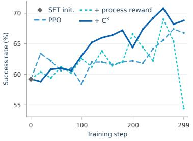

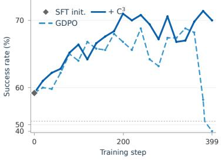  
Figure 5: WebShop validation trajectories during training.

Taken together, these results show that $C ^ { 3 }$ improves performance under both critic-based and criticfree optimization across the two multi-turn agent environments. The gains are reflected not only in final benchmark performance, but also in the training dynamics, where $C ^ { 3 }$ maintains stronger performancefor longer before the late-stage degradation observed in the corresponding baselines.

## 6 ANALYSIS

We further analyze how $C ^ { 3 }$ changes agent behavior and evaluate its key design choices through undesirable-behavior analysis and confidence aggregation ablations. Additional experiments and case studies are provided in Appendices C and D.

## 6.1 DOES $C ^ { 3 }$ CHANGE AGENT BEHAVIOR?

We examine SFT, PPO, PPO with process reward, and $\mathrm { P P O + C ^ { 3 } }$ on the same 51,713 Search QA questions under greedy decoding. Figure 6 separates invalid actions from query loops to examine how different types of undesirable behaviors respond to outcome-level training.

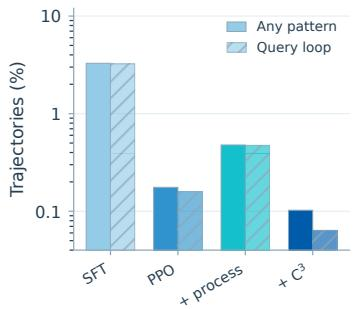  
(a) Undesirable-behavior rate

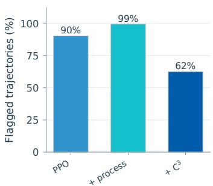  
(b) Query-loop share

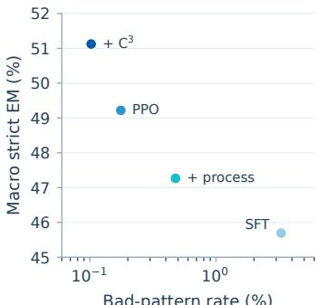  
Bad-pattern rate (%)  
(c) Rate vs. accuracy  
Figure 6: Greedy evaluation on 51,713 questions per arm.

PPO substantially reduces invalid actions relative to SFT, suggesting that straightforward tool-call failures can be effectively suppressed by trajectory-level training. Query loops, however, show a different pattern: the process-reward variant reaches a query-loop rate of 0.474%, nearly $3 \times$ that of PPO (0.159%), and 245 of its 247 flagged trajectories contain query loops. In contrast, $\mathrm { P P O + C ^ { 3 } }$ reduces the query-loop rate to 0.064%, a 2.5× reduction relative to PPO and a 7.4× reduction relative to the process-reward variant. These results suggest that trajectory-level training is effective for explicit action failures but less effective for redundant cross-turn behavior. $C ^ { 3 }$ complements this by correcting positive local credit on detected behavior spans, providing a more direct signal for behaviors that are not reliably suppressed by trajectory-level supervision.

## 6.2 ABLATION OF $C ^ { 3 }$ DESIGN CHOICES

$C ^ { 3 }$ uses policy confidence to determine the strength of local credit correction. We compare tokenlevel confidence with two span-level aggregation strategies. Table 3 reports the final macro strict EM, and Figure 7 shows the training trajectories.

Table 3: Final-checkpoint macro strict EM (%) for PPO confidence aggregation.
<table><tr><td>Confidence rule</td><td>Macro strict EM (%)</td></tr><tr><td>Outcome-only reference</td><td>47.61</td></tr><tr><td>Token probability</td><td>45.21</td></tr><tr><td>Arithmetic span mean</td><td>50.57</td></tr><tr><td>Geometric span mean</td><td>48.94</td></tr></table>

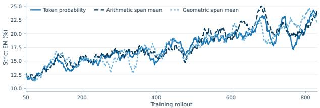  
Figure 7: Smoothed training strict EM for different confidence aggregation strategies under PPO.

Arithmetic span averaging achieves the highest final macro strict EM at 50.57%, outperforming geometric span averaging (48.94%), token-level probability (45.21%), and the outcome-only reference (47.61%), indicating that aggregating confidence over the entire undesirable-behavior span provides a more effective correction signal than token-level confidence. Figure 7 shows the same pattern throughout training: token-level confidence consistently underperforms both span-level variants, whereas arithmetic and geometric averaging remain nearly overlapping. Since token probability often reflects local generation uncertainty rather than event reliability, token-level correction can overweight formatting tokens, transition words, punctuation, or closing tags within a detected span. Thus, the key design choice is span-level rather than token-level confidence aggregation, while the difference between arithmetic and geometric averaging remains minor.

## 7 CONCLUSION

Trajectory-level supervision can assign positive advantages to spans corresponding to undesirable local behaviors, creating a mismatch between behavioral quality and policy credit. $C ^ { 3 }$ addresses this through confidence-guided local credit correction, reversing positive advantages on detected undesirable-behavior spans while leaving the task reward, returns, and critic targets unchanged. Across experiments, $C ^ { \dot { 3 } }$ improves average exact match and reduces detected undesirable behaviors, highlighting that effective process supervision is not only about providing denser behavioral feedback, but also about translating that feedback into appropriate local policy credit.

## AI USE STATEMENT

During this work, we used LLM for dataset construction to generate candidate SFT trajectories for Search QA and WebShop under predefined prompting protocols. All generated trajectories were subsequently filtered using task-specific quality constraints before being included in the final training corpus. During manuscript preparation, we also used an LLM-based assistant for language editing, LaTeX troubleshooting, and local organization of supplementary material. All technical content, experimental design, analysis, and final manuscript revisions were reviewed and verified by the authors.

## ETHICS STATEMENT

$C ^ { 3 }$ is designed to improve the reliability of tool-integrated LLM agents by discouraging invalid, unsupported, and redundant actions. Since these agents may interact with external environments, deployment should retain appropriate sandboxing, tool-permission controls, audit logs, and taskspecific safety checks. Our experiments use agent-generated trajectory transcripts and do not involve human subject data. Any automated assistance used in preparing this manuscript was reviewed by the authors for factual accuracy and compliance with venue policies.

## REPRODUCIBILITY STATEMENT

$C ^ { 3 }$ is implemented as a post-estimation operation on token-level advantages and does not require changes to the reward function, rollout collection, or critic. It can therefore be integrated into a policy-gradient implementation by applying the correction after advantage normalization and before the actor update. Across experiments, the compared arms share the same task data, SFT initialization within each setting, terminal task reward, prompt protocol, turn budget, detectors, and evaluation procedure. An anonymous code repository containing the implementation and training configuration is available at https://anonymous.4open.science/r/C3-CC78; the full repository will be released with the camera-ready version.

## REFERENCES

DeepSeek-AI. Deepseek-r1: Incentivizing reasoning capability in llms via reinforcement learning. arXiv preprint arXiv:2501.12948, 2025.

Chanakya Ekbote, Vijay Lingam, Sujay Sanghavi, Jun Huan, Behrooz Omidvar-Tehrani, Anoop Deoras, and Stefano Soatto. Murphy: Feedback-aware grpo with retrospective credit assignment for multi-turn code generation. arXiv preprint arXiv:2511.07833, 2025.

Lang Feng, Zhenghai Xue, Tingcong Liu, and Bo An. Group-in-group policy optimization for llm agent training, 2025. URL https://arxiv.org/abs/2505.10978.

GLM-5 Team. Glm-5: From vibe coding to agentic engineering, 2026. URL https://arxiv. org/abs/2602.15763.

Xanh Ho, Anh-Khoa Duong Nguyen, Saku Sugawara, and Akiko Aizawa. Constructing a multi-hop qa dataset for comprehensive evaluation of reasoning steps. In Proceedings of the 28th International Conference on Computational Linguistics, 2020.

Senkang Hu, Yong Dai, Xudong Han, Zhengru Fang, Yuzhi Zhao, Sam Tak Wu Kwong, and Yuguang Fang. Self-induced outcome potential: Turn-level credit assignment for agents without verifiers. arXiv preprint arXiv:2605.04984, 2026.

Ai Jian, Xiaoyun Zhang, Wanrou Du, Jingqing Ruan, Jiangbo Pei, Weipeng Zhang, Ke Zeng, and Xunliang Cai. Trust-sql: Tool-integrated multi-turn reinforcement learning for text-to-sql over unknown schemas, 2026. URL https://arxiv.org/abs/2603.16448.

Bowen Jin, Hansi Zeng, Zhenrui Yue, Jinsung Yoon, Sercan Arik, Dong Wang, Hamed Zamani, and Jiawei Han. Search-r1: Training llms to reason and leverage search engines with reinforcement learning. arXiv preprint arXiv:2503.09516, 2025.

Mandar Joshi, Eunsol Choi, Daniel S. Weld, and Luke Zettlemoyer. Triviaqa: A large scale distantly supervised challenge dataset for reading comprehension. In Proceedings ofthe 55th Annual Meet ing of the Association for Computational Linguistics, 2017.

Tom Kwiatkowski, Jennimaria Palomaki, Olivia Redfield, Michael Collins, Ankur Parikh, Chris Alberti, Danielle Epstein, Illia Polosukhin, Jacob Devlin, Kenton Lee, Kristina Toutanova, Llion Jones, Matthew Kelcey, Ming-Wei Chang, Andrew M. Dai, Jakob Uszkoreit, Quoc Le, and Slav Petrov. Natural questions: A benchmark for question answering research. Transactions of the Associationfor Computational Linguistics, 7:452–466, 2019.

Junbo Li, Peng Zhou, Rui Meng, Meet P. Vadera, Lihong Li, and Yang Li. Turn-ppo: Turnlevel advantage estimation with ppo for improved multi-turn rl in agentic llms. arXiv preprint arXiv:2512.17008, 2025.

Sijia Li, Yuchen Huang, Zifan Liu, Yanping Li, Jingjing Fu, Li Zhao, Jiang Bian, Ling Zhang, Jun Zhang, and Rui Wang. Gear: Granularity-adaptive advantage reweighting for llm agents via self-distillation. arXiv preprint arXiv:2605.11853, 2026.

Hunter Lightman, Vineet Kosaraju, Yura Burda, Harri Edwards, Bowen Baker, Teddy Lee, Jan Leike, John Schulman, Ilya Sutskever, and Karl Cobbe. Let’s verify step by step. arXiv preprint arXiv:2305.20050, 2023.

Shih-Yang Liu, Xin Dong, Ximing Lu, Shizhe Diao, Peter Belcak, Mingjie Liu, Min-Hung Chen, Hongxu Yin, Yu-Chiang Frank Wang, Kwang-Ting Cheng, Yejin Choi, Jan Kautz, and Pavlo Molchanov. Gdpo: Group reward-decoupled normalization policy optimization for multi-reward rl optimization, 2026. URL https://arxiv.org/abs/2601.05242.

Zhicong Lu, Zichuan Lin, Wei Jia, Changyuan Tian, Deheng Ye, Peiguang Li, Li Jin, Nayu Liu, Guangluan Xu, and Wei Feng. Hisr: Hindsight information modulated segmental process rewards for multi-turn agentic reinforcement learning. arXiv preprint arXiv:2603.18683, 2026.

Lichao Ma, Yang Sun, Shuaitao Zhao, Yangyi Fang, Cong Qin, Xiaoliang Fu, Yuhang Tian, Yuchen Wei, Junbo Zhu, Yang Wei, Lu Pan, and Jiaye Lin. How much, then where: Creditconserving action-to-token allocation for multi-turn agent reinforcement learning. arXiv preprint arXiv:2608.07118, 2026.

Alex Mallen, Akari Asai, Victor Zhong, Rajarshi Das, Daniel Khashabi, and Hannaneh Hajishirzi. When not to trust language models: Investigating effectiveness of parametric and non-parametric memories. In Proceedings of the 61st Annual Meeting of the Association for Computational Linguistics, 2023.

Long Ouyang, Jeffrey Wu, Xu Jiang, Diogo Almeida, Carroll Wainwright, Pamela Mishkin, Chong Zhang, Sandhini Agarwal, Katarina Slama, Alex Ray, et al. Training language models to follow instructions with human feedback. Advances in Neural Information Processing Systems, 35: 27730–27744, 2022.

Jiangweizhi Peng, Yuanxin Liu, Ruida Zhou, Charles Fleming, Zhaoran Wang, Alfredo Garcia, and Mingyi Hong. Hiper: Hierarchical reinforcement learning with explicit credit assignment for large language model agents. arXiv preprint arXiv:2602.16165, 2026.

Ofir Press, Muru Zhang, Sewon Min, Ludwig Schmidt, Noah A. Smith, and Mike Lewis. Measuring and narrowing the compositionality gap in language models. In Findings of the Association for Computational Linguistics: EMNLP 2023, 2023.

John Schulman, Filip Wolski, Prafulla Dhariwal, Alec Radford, and Oleg Klimov. Proximal policy optimization algorithms, 2017. URL https://arxiv.org/abs/1707.06347.

Harsh Trivedi, Niranjan Balasubramanian, Tushar Khot, and Ashish Sabharwal. Musique: Multihop questions via single-hop question composition. Transactions of the Association for Computational Linguistics, 10:539–554, 2022.

Daoyu Wang, Qingchuan Li, Mingyue Cheng, Jie Ouyang, Shuo Yu, Qi Liu, and Enhong Chen. Steppo: Step-aligned policy optimization for agentic reinforcement learning. arXiv preprint arXiv:2604.18401, 2026a.

Guoqing Wang, Sunhao Dai, Guangze Ye, Zeyu Gan, Wei Yao, Yong Deng, Xiaofeng Wu, and Zhenzhe Ying. Information gain-based policy optimization: A simple and effective approach for multi-turn search agents. arXiv preprint arXiv:2510.14967, 2025a.

Haixin Wang, Hejie Cui, Chenwei Zhang, Xin Liu, Shuowei Jin, Shijie Geng, Xinyang Zhang, Nasser Zalmout, Zhenyu Shi, and Yizhou Sun. T2PO: Uncertainty-guided exploration control for stable multi-turn agentic reinforcement learning. arXiv preprint arXiv:2605.02178, 2026b.

Junzhe Wang, Zhiheng Xi, Yajie Yang, Hao Luo, Shihan Dou, Tao Gui, and Qi Zhang. Enhancing llm-based search agents via contribution weighted group relative policy optimization. arXiv preprint arXiv:2604.14267, 2026c.

Ziliang Wang, Xuhui Zheng, Kang An, Cijun Ouyang, Jialu Cai, Yuhang Wang, and Yichao Wu. Stepsearch: Igniting llms search ability via step-wise proximal policy optimization. arXiv preprint arXiv:2505.15107, 2025b.

An Yang, Anfeng Li, Baosong Yang, Beichen Zhang, Binyuan Hui, Bo Zheng, Bowen Yu, Chang Gao, Chengen Huang, Chenxu Lv, et al. Qwen3 technical report. arXiv preprint arXiv:2505.09388, 2025.

Zhilin Yang, Peng Qi, Saizheng Zhang, Yoshua Bengio, William W. Cohen, Ruslan Salakhutdinov, and Christopher D. Manning. Hotpotqa: A dataset for diverse, explainable multi-hop question answering. In Proceedings of the 2018 Conference on Empirical Methods in Natural Language Processing, 2018.

Shunyu Yao, Howard Chen, John Yang, and Karthik Narasimhan. Webshop: Towards scalable real-world web interaction with grounded language agents. In Advances in Neural Information Processing Systems, 2022.

Yanzhao Zhang, Mingxin Li, Dingkun Long, Xin Zhang, Huan Lin, Baosong Yang, Pengjun Xie, An Yang, Dayiheng Liu, Junyang Lin, Fei Huang, and Jingren Zhou. Qwen3 embedding: Advancing text embedding and reranking through foundation models. arXiv preprint arXiv:2506.05176, 2025.

Yibo Zhao, Zichen Ding, Jiayi Wu, Zun Wang, and Xiang Li. Retrieval, reward, and training protocols: What matters in training search agents?, 2026. URL https://arxiv.org/abs/ 2605.27881.

Yuxiang Zheng, Dayuan Fu, Xiangkun Hu, Xiaojie Cai, Lyumanshan Ye, Pengrui Lu, and Pengfei Liu. Deepresearcher: Scaling deep research via reinforcement learning in real-world environments. arXiv preprint arXiv:2504.03160, 2025.

Yifei Zhou, Andrea Zanette, Jiayi Pan, Sergey Levine, and Aviral Kumar. Archer: Training language model agents via hierarchical multi-turn rl. arXiv preprint arXiv:2402.19446, 2024.

Yifei Zhou, Song Jiang, Yuandong Tian, Jason Weston, Sergey Levine, Sainbayar Sukhbaatar, and Xian Li. Sweet-rl: Training multi-turn llm agents on collaborative reasoning tasks. arXiv preprint arXiv:2503.15478, 2025.

Qiang Zhu, Jiajun Wu, and Longyi Wang. Lotapo: Leave-one-turn attribution for self-generated process rewards in multi-turn search reasoning. arXiv preprint arXiv:2607.13501, 2026.

Zilin Zhu, Chengxing Xie, Xin Lv, and slime Contributors. slime: An llm post-training framework for rl scaling. https://github.com/THUDM/slime, 2025. GitHub repository.

## A DATA CONSTRUCTION

## A.1 SEARCH QA: 7-BMK

Evaluation Benchmark. We evaluate Search QA on seven multi-turn question-answering benchmarks: NQ (Kwiatkowski et al., 2019), TriviaQA (Joshi et al., 2017), PopQA, HotpotQA (Yang et al., 2018), 2WikiMultiHopQA (Ho et al., 2020), MuSiQue (Trivedi et al., 2022), and Bamboogle (Press et al., 2023). The fixed evaluation suite contains 51,713 questions in total. We use the Wiki-Fixed corpus (Zhao et al., 2026) for passage retrieval and report strict exact match (EM) for each benchmark, with the aggregate score computed as the unweighted mean across the seven benchmarks. All compared methods are evaluated on the same benchmark suite under the same evaluation protocol.

## A.2 WEBSHOP

Evaluation Benchmark. We use WebShop (Yao et al., 2022) as a second multi-turn environment. Following the official WebShop protocol, training and evaluation use disjoint task splits. All reported main results are evaluated on the fixed 500-task benchmark, with task IDs held constant across all runs. A task is considered successful only when the environment accepts the final purchase; we additionally report the environment-provided task score.

## A.3 SFT INITIALIZATION AND RL ROLLOUTS

Table 4: Summary of data scales used for SFT, RL training, and evaluation.
<table><tr><td>Stage</td><td>Dataset</td><td>Size</td></tr><tr><td rowspan="8">Evaluation</td><td>NQ</td><td>3,610</td></tr><tr><td>TriviaQA</td><td>11,313</td></tr><tr><td>PopQA</td><td>14,267</td></tr><tr><td>HotpotQA</td><td>7,405</td></tr><tr><td>2WikiMultiHopQA</td><td>12,576</td></tr><tr><td>MuSiQue</td><td>2,417</td></tr><tr><td>Bamboogle</td><td>125</td></tr><tr><td>7-BMK Total</td><td>51,713</td></tr><tr><td rowspan="2">SFT</td><td>WebShop Benchmark</td><td>500</td></tr><tr><td>Search QA</td><td>3,000 → 9,329 rows 200 → 1,713 rows</td></tr><tr><td rowspan="2">RL</td><td>WebShop</td><td>66,309 → 265,236 → ≈50,157</td></tr><tr><td>Search QA WebShop</td><td>Official training split</td></tr></table>

Search QA SFT. We construct the Search QA cold-start SFT corpus using GLM-5.2 (GLM-5 Team, 2026). Starting from 3,000 deduplicated source questions, GLM-5.2 generates executable searchand-answer traces under a strict-multihop contract, emphasizing evidence decomposition, one action per turn, and answer granularity. We retain traces that are strict-exact-match, format-valid, searchfirst, non-repeating, and free of invalid actions. The retained trajectories are deduplicated by source trajectory and normalized question, then converted into 9,329 action-level continuation rows, corresponding to an average of 3.11 supervised actions per source question.

WebShop SFT. We construct a separate WebShop append-SFT corpus using GLM-5.2 (GLM-5 Team, 2026). It contains 200 unique strict-success trajectories. We retain only trajectories for which the environment accepts the purchase and the trace contains no invalid or non-clickable action, server error, or missing task key. Each retained trajectory is expanded into one action-level row with the complete preceding history, current observation, admissible actions, and teacher action as the target, yielding 1,713 training rows.

Search QA RL Rollouts. The Search QA RL pool begins with 66,309 prompt-fixed residual questions. Four responses are sampled for each prompt, yielding 265,236 sampled responses. After filtering all-correct groups, approximately 50,157 prompt-response records remain for RL training. Each record contains the prompt, response, task reward, and process metadata. The rollout prompt set, task IDs, and evaluation benchmark are held fixed across optimizer arms.

RL Initialization. Search QA RL runs start from the Qwen3-8B Search QA SFT checkpoint, while WebShop RL runs start from the Qwen3-4B WebShop append-SFT checkpoint. These SFT checkpoints provide the common initialization for the corresponding RL runs.

Table 4 summarizes the data scales used for SFT, RL training, and evaluation.

## B IMPLEMENTATION DETAILS

## B.1 EVENT DETECTION

Action Parsing. The search agent emits one action per turn. A valid turn contains either a search action,

$$
\begin{array} { r l } & { < \mathrm { t h i n k } > \ldots < / \mathrm { t h i n k } > } \\ & { \qquad < \mathrm { s e a r c h } > \ldots < / \mathrm { s e a r c h } > , } \end{array}
$$

or a final answer action,

$$
\begin{array} { c } { { < \mathrm { t h i n k } > . . . < } / \mathrm { t h i n k } > } \\ { { < \mathrm { a n s w e r } > . . . < } / \mathrm { a n s w e r } > . } \end{array}
$$

No text is allowed outside the corresponding tags. The parser performs strict validation together with a single-action recovery pass, so that recoverable formatting errors remain executable actions. Errors that affect only strict-format evaluation are retained in the evaluation logs but are not treated as undesirable-behavior events.

Behavior Categories. We consider two types of undesirable behaviors: invalid actions and query loops. Invalid actions include malformed or impermissible tool interactions, such as unclosed toolcall tags, unavailable tools, invalid tool arguments, or actions issued after a completed answer. Query loops refer to redundant tool interactions in which the same or nearly identical query is repeated across turns. The first occurrence is retained, while each subsequent occurrence is treated as an undesirable-behavior event.

Query-Loop Rules. We distinguish exact and near query loops. An exact query loop occurs when the normalized query exactly matches an earlier query in the same trajectory. A near query loop occurs when a non-identical query has normalized character-trigram Jaccard similarity of at least 0.9 and length of at least eight characters. Exact matches take precedence over near matches. Invalid actions and exact query loops are assigned severity 1.0, while near query loops are assigned severity 0.5. Before query comparison, we apply Unicode-NFKC normalization, case folding, zero-width character removal, punctuation-to-space conversion, and whitespace collapsing.

Table 5: Rule-based detector for undesirable behaviors.
<table><tr><td>Undesirable behavior</td><td>Detection rule</td><td>Severity</td></tr><tr><td>Invalid action</td><td>Malformed or impermissible action</td><td>1.0</td></tr><tr><td rowspan="2">Query loop</td><td>Exact repetition of an earlier normalized query</td><td>1.0</td></tr><tr><td>Near repetition: trigram Jaccard ≥ 0.9, length ≥ 8</td><td>0.5</td></tr></table>

Event Representation. The detector is implemented as a set of rule-based checks over generated actions and tool interactions. Each detected event is represented as

$$
e = ( I _ { e } , d _ { e } , q _ { e } , J _ { e } ) ,\tag{12}
$$

where $I _ { e }$ is the localized event span, $d _ { e }$ is the behavior category, $q _ { e } ~ \in ~ ( 0 , 1 ]$ is its severity, and $J _ { e } \subseteq I _ { e }$ is the corresponding action span. The event span $I _ { e }$ determines where $C ^ { 3 }$ corrects credit, whereas $J _ { e }$ is used to estimate the policy confidence that controls how strongly the correction is applied.

Span Localization. For each detected event e, we use the complete turn responsible for the event as its event span $I _ { e } ,$ , and the parsed tool or answer action within that turn as its action span $J _ { e }$ . If the action cannot be parsed, we set $J _ { e } = I _ { e }$ . No-answer cases, truncation, search-only termination, and strict-format-only failures are tracked separately and do not generate detector events. When multiple events overlap, each token receives the maximum severity among the events covering it:

$$
q _ { i } = \operatorname* { m a x } _ { e : i \in I _ { e } } q _ { e } , \qquad B = \{ i : q _ { i } > 0 \} .\tag{13}
$$

Tokens outside B are unaffected by $C ^ { 3 }$

## B.2 REWARD AND CREDIT CONSTRUCTION

Outcome and Process Reward. Let A indicate that a final answer is present, S that a search preceded it, Y a relaxed exact match, and T truncation:

$$
R _ { \mathrm { o u t c o m e } } = { \left\{ \begin{array} { l l } { 0 , } & { T = 1 , } \\ { 0 . 2 A S + 1 . 0 Y S , } & { T = 0 . } \end{array} \right. }\tag{14}
$$

Thus, a searched incorrect answer receives a small answer-presence reward, while a searched correct answer receives the larger correctness reward. The terminal-PPO arm adds the process penalty to this outcome reward at the terminal position. The process-PPO arm instead places the same type of penalty at the turn boundary where the undesirable behavior occurs.

Credit Construction. The five training arms differ in both the signals used to construct credit and the point at which detector information enters the optimization. Terminal PPO adds the process penalty directly to the terminal outcome, after which PPO computes GAE. Process-reward PPO instead assigns the penalty to the turn where the undesirable behavior occurs and includes it in the return before GAE. $\mathrm { P P O + C ^ { 3 } }$ uses the outcome reward and leaves the base advantage construction unchanged, applying a localized actor-side correction only after the base advantages have been computed. GDPO constructs group-relative credit from outcome, format, and process signals; $\mathrm { { G D P O + C ^ { 3 } } }$ applies the same localized post-estimation correction to that group-relative credit.

Process-Reward PPO. For the process-reward PPO baseline, detected events are converted into turn-level penalties. Invalid actions and exact query loops receive the full penalty, while near query loops receive half strength. These penalties are accumulated at the corresponding turn boundaries and incorporated into the return before advantage estimation. In contrast, ${ \dot { \mathrm { C } } } ^ { 3 }$ uses the same behavioral localization but does not modify the task reward or return.

GDPO Credit Construction. For GDPO, each four-response prompt group provides three samplelevel axes: outcome, format, and negative process cost. Each axis is normalized within the group, the normalized axes are summed, and the resulting score is normalized over the rollout batch:

$$
z _ { m } ^ { a } = \frac { x _ { m } ^ { a } - \mu _ { g } ^ { a } } { \sigma _ { g } ^ { a } + 1 0 ^ { - 6 } } , \qquad A _ { m } ^ { \mathrm { G D P O } } = \frac { \sum _ { a } z _ { m } ^ { a } - \mu _ { B } } { \sigma _ { B } + 1 0 ^ { - 6 } } .\tag{15}
$$

For $\mathrm { { G D P O + C ^ { 3 } } }$ , this advantage is passed to $C ^ { 3 }$ without changing the original GDPO normalization.

## B.3 TRAINING AND EVALUATION SETUP

Models and Environments. For Search QA, we use Qwen3-8B with full-parameter updates and a fixed Wiki-Fixed retrieval corpus (Zhao et al., 2026). Retrieval uses Qwen3-Embedding-8B representations with 4096 dimensions and exact inner-product search with a top-3 cutoff. PPO and GDPO use the same corpus, encoder, index type, and retrieval cutoff. WebShop uses Qwen3-4B with full-parameter updates in the standard WebShop environment.

Initialization and Training. Search QA RL runs are initialized from the corresponding Qwen3-8B SFT checkpoint, while WebShop RL runs use the Qwen3-4B WebShop SFT checkpoint. Within each comparison family, the initialization, task prompts, rollout budgets, and evaluation definitions are kept fixed. For Search QA, PPO uses GAE with batch whitening and a learned critic, while GDPO uses group-relative credit without a learned critic. Each rollout group contains 64 prompts with four responses per prompt. Generation uses temperature 1, $\mathrm { t o p } { - } p = 1$ , and at most five turns. Models are trained with full-parameter bf16 updates using Adam and gradient clipping. All paired baseline and $C ^ { 3 }$ arms use the same configured RL training seed(s), with baseline and ${ \check { \mathrm { C } } } ^ { 3 }$ runs matched seed-by-seed within each comparison family. This controls the paired training randomness; evaluation-seed variation from auxiliary WebShop runs is reported separately and should not be interpreted as additional RL training runs.

Evaluation. Search QA evaluation uses greedy decoding with the common strict multi-hop prompt. The evaluation suite contains seven benchmarks and 51,713 questions. The evaluator extracts the final answer and computes normalized exact match, with macro scores averaging equally across benchmarks. The multi-sample results reported in the main text use temperature 0.8 and top-p = 0.95. For WebShop, success is determined by the environment’s final purchase outcome, while task score is reported as the environment score.

## C ADDITIONAL EXPERIMENTS

## C.1 OFFICIAL $\mathrm { T } ^ { 2 } \mathrm { P O }$ WEBSHOP REPRODUCTION WITH $C ^ { 3 }$

To further verify that $C ^ { 3 }$ functions as a plug-in credit correction, we integrate it into the official $\mathrm { T } ^ { 2 } \mathrm { P O }$ WebShop recipe. T<sup>2</sup>PO (Wang et al., 2026b) is an uncertainty-aware exploration-control method for multi-turn agent reinforcement learning that combines token-level and turn-level mechanisms to improve exploration efficiency while preserving the underlying task reward and policy optimization objective. Our reproduction follows the official $\mathrm { T } ^ { 2 } \mathrm { P O }$ training recipe and hyperparameter configuration, with $C ^ { 3 }$ inserted only after the base $\mathrm { T } ^ { 2 } \mathrm { P O }$ actor-side advantages are constructed.

Table 6: Best validation performance.
<table><tr><td>Method</td><td>Success (%)</td><td>Iter.</td><td>Task score (%)</td><td>Iter.</td></tr><tr><td>T2PO</td><td>81.2</td><td>70</td><td>83.9</td><td>70</td></tr><tr><td> $\mathrm { T 2 P O + C ^ { 3 } }$ </td><td>82.2</td><td>120</td><td>86.0</td><td>130</td></tr></table>

The $\mathrm { T } ^ { 2 } \mathrm { P O }$ and $\mathrm { T ^ { 2 } P O + C ^ { 3 } }$ runs share the same SFT initialization, training protocol, and rollout configuration. The only modification is that $C ^ { 3 }$ is applied after the base $\mathrm { T } ^ { \mathrm { 2 } } \mathrm { P } \bar { \mathrm { O } }$ actor-side advantages are constructed, leaving the underlying optimization pipeline unchanged.

Figure 8 compares the validation trajectories through iteration 130. $\mathrm { T ^ { 2 } P O + C ^ { 3 } }$ reaches a best success rate of 82.2%, compared with 81.2% for $\mathrm { T } ^ { 2 } \mathrm { P O }$ , and improves the best task score from 83.9% to 86.0%.

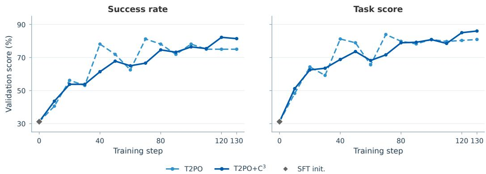  
Figure 8: Validation trajectories for official T2PO and $\mathrm { T 2 P O + C ^ { 3 } }$ . The two panels show success rate and task score; gray diamonds mark the shared SFT initialization.

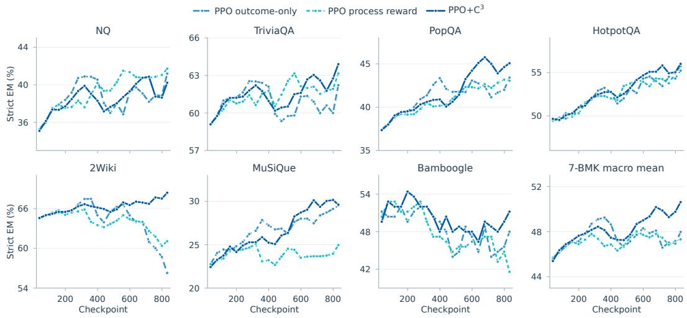  
Figure 9: Periodic strict-EM evaluation curves for the seven Search QA benchmarks under the PPO family. The bottom-right panel shows the unweighted 7-BMK macro mean.

## C.2 SEVEN-BENCHMARK EVALUATION DYNAMICS

Figures 9 and 10 decompose the macro evaluation curve into the seven Search QA benchmarks, showing how each task contributes to the overall trend under PPO and GDPO. Each point corresponds to the same periodic evaluation checkpoint used in the main training dynamics.

The decomposition shows that the macro improvement arises from a distributed effect across benchmarks rather than a single dominant task. Under PPO, C<sup>3</sup> provides its clearest and most persistent gains on 2Wiki, with additional improvements on PopQA and Bamboogle, while NQ remains broadly stable. Under GDPO, C<sup>3</sup> improves NQ, TriviaQA, PopQA, HotpotQA, and MuSiQue at the final checkpoint, whereas 2Wiki shows no corresponding gain in this run. The benchmark-level curves also reveal that different tasks peak at different stages of training, indicating that aggregate curves can obscure meaningful intermediate behavior.

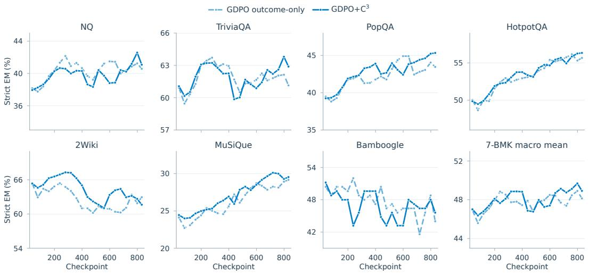  
Figure 10: Periodic strict-EM evaluation curves for the seven Search QA benchmarks under the GDPO family. The bottom-right panel shows the unweighted 7-BMK macro mean.

## C.3 DIAGNOSING LATE WEBSHOP COLLAPSE

The WebShop training curves reveal a pronounced late-stage collapse for reward-side process PPO, while outcome-only GDPO exhibits a smaller late degradation. To characterize this behavior, we analyze the same 500-task WebShop benchmark used for periodic validation during training.

Table 7: Late-stage WebShop behavior on the 500-task validation benchmark.
<table><tr><td>Method</td><td>Success</td><td>Late-stage signature</td></tr><tr><td>Process PPO</td><td>69.0% → 11.2%</td><td>Runaway reasoning, repetition, and severe truncation.</td></tr><tr><td>GDPO</td><td>68.8% → 40.2%</td><td>Shortened trajectories that terminate before purchase.</td></tr><tr><td>PPO+C³</td><td>66.2% → 60.8%</td><td>No comparable collapse in the same window.</td></tr><tr><td>GDPO+C³</td><td>71.4% → 70.0%</td><td>Stable performance through late training.</td></tr></table>

To further diagnose the process-PPO collapse, Table 8 summarizes turn-level statistics at three representative checkpoints.

Table 8: Turn-level signature of the process-PPO collapse.
<table><tr><td>Statistic</td><td>259</td><td>319</td><td>399</td><td>Change (259→399)</td></tr><tr><td>Success rate (%)</td><td>69.0</td><td>26.6</td><td>11.2</td><td>−57.8 pt</td></tr><tr><td>Truncated responses (%)</td><td>0.2</td><td>66.6</td><td>86.2</td><td>+86.0 pt</td></tr><tr><td>Trailing &lt;think&gt; median (chars)</td><td>328</td><td>7,962</td><td>8,432</td><td>≈ 26×</td></tr><tr><td>Generated tokens / trajectory</td><td>1,043</td><td>2,536</td><td>2,667</td><td>+155%</td></tr><tr><td>Completed turns / trajectory</td><td>18.9</td><td>11.2</td><td>7.7</td><td>-59%</td></tr><tr><td>Mean assistant chars / turn</td><td>951</td><td>1,245</td><td>1,354</td><td>+42%</td></tr><tr><td>Total trajectory chars</td><td>17,965</td><td>18,739</td><td>16,648</td><td>-7%</td></tr></table>

The collapse is characterized by a runaway final reasoning block rather than a uniformly longer interaction. The median trailing <think> segment expands from 328 to 8,432 characters, while the number of completed turns falls from 18.9 to 7.7. Generated length increases because the unfinished reasoning block consumes the response budget, whereas the overall trajectory becomes shorter because later turns never occur. Search frequency and detector-targeted invalid actions remain comparatively stable, indicating that the collapse reflects a termination failure in the final reasoning stage rather than an increase in the targeted undesirable behaviors.

By contrast, both $C ^ { 3 }$ variants avoid a comparable late-stage collapse over the same training window. Since $C ^ { 3 }$ modifies only localized actor-side credit after advantage construction while leaving reward and return estimation unchanged, the observed stability is consistent with its localized intervention mechanism.

## C.4 HOW DOES $C ^ { 3 }$ AFFECT INTERACTION BEHAVIOR?

$C ^ { 3 }$ operates by correcting local credit assigned to detected undesirable behaviors rather than directly controlling the number of tool interactions. Its effect on interaction behavior may therefore depend on both the underlying optimization paradigm and the requirements of the task. We examine this effect by comparing the mean number of searches per question across the PPO and GDPO families. Figure 11 reports the absolute search counts for all seven benchmarks, with single-hop and multi-hop tasks shown separately.

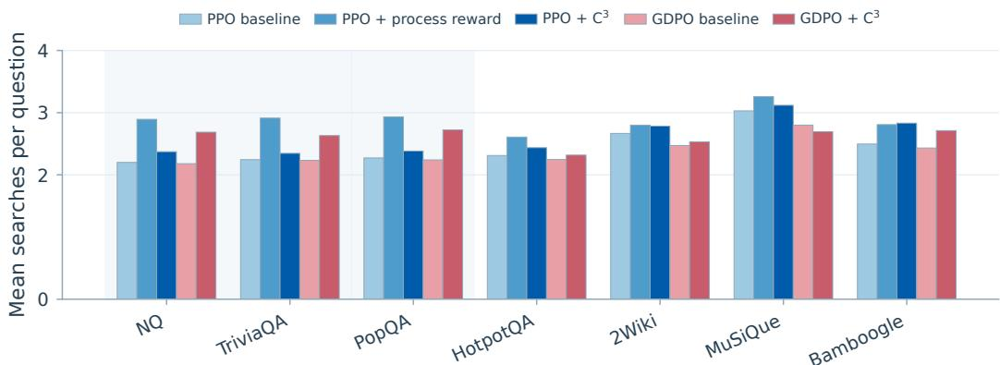  
Figure 11: Mean searches across seven benchmarks. Shaded columns denotes single-hop tasks.

Under PPO, $C ^ { 3 }$ changes retrieval behavior differently across task types. On the three singlehop benchmarks, $C ^ { 3 }$ reduces the mean number of searches by 0.09–0.17 per question relative to outcome-only PPO. In contrast, $C ^ { 3 }$ increases the number of searches on the multi-hop benchmarks. This pattern suggests that $C ^ { 3 }$ does not simply push the agent toward shorter or longer interaction trajectories. Rather, after correcting credit on detected undesirable behaviors, the resulting policy can allocate retrieval differently depending on the information requirements of the task. In particular, reducing unnecessary interactions on simpler tasks does not preclude retaining additional retrieval on tasks that require multi-hop information gathering.

The behavior under GDPO is different. Compared with outcome-only $\mathrm { G D P O , G D P O + C ^ { 3 } }$ generally increases the number of searches across the benchmarks. This difference from PPO highlights that the behavioral effect of the same local credit correction is not invariant to the underlying optimization paradigm. PPO and GDPO construct token-level credit differently, so correcting the same type of local positive credit can lead to different changes in the resulting interaction policy. Importantly, the increase in search frequency under GDPO should not be interpreted as $C ^ { 3 }$ directly encouraging more retrieval, since retrieval frequency is not an explicit optimization target of the method.

Taken together, these results show that $C ^ { 3 }$ does not impose afixedpreferencefor shorter or longer interaction trajectories. Instead, its behavioral effect emerges indirectly through local credit correction and varies with both the optimization paradigm and the task. This distinction is important because it suggests that the performance gains from ${ \check { \mathrm { C } } } ^ { 3 }$ should not be understood simply in terms of performing more or fewer tool interactions. $C ^ { 3 }$ changes which local behaviors receive policy credit, while the resulting interaction allocation is determined by the broader optimization process and task requirements.

## D CASE STUDIES

## D.1 PROMPT INTERFACES

The panels below reproduce the complete prompt interfaces used in the experiments. Braced fields are filled by the task runner; the concrete values used by the saved trajectories are shown separately in the case studies. Panel boundaries are typographic only and do not indicate omitted prompt content.

Initial Search QA prompt. At the initial turn, the runner sends one system instruction followed by the user question. The system instruction is split into the panels below solely to make the appendix readable; the panels preserve the original order and wording.

Role and objective   
You are solving a retrieval-based question answering task. Some questions can be answered   
directly, while others require one or more searches to gather evidence.

## Decision process

```markdown
## Decision Process
For every turn:
### Step 1. Understand the question.
Determine what information is required to answer the original question.
The question may be:
- Direct: the answer is already known from the retrieved evidence.
- Single-hop: one search is sufficient.
- Multi-hop: multiple searches are required because the first search only reveals an intermediate
entity, title, date, location, or relation.
### Step 2. Examine the available evidence.
Ask yourself:
Does the available evidence directly answer the original question?
If yes, output <answer>...</answer>.
If no, identify the most important missing fact and search for it. Output <search>...</search>.
Do not answer from memory when a targeted search can verify the claim.
```

## Search strategy

## Search Strategy   
Each search should retrieve one missing fact.   
Good search queries usually consist of:   
- entity + property   
- entity + relation   
- title + attribute   
Examples:   
Titanic director   
Alan Turing birthplace   
The Beatles members   
Mount Everest elevation   
For multi-hop questions:   
- The first search may only identify an intermediate entity.   
- Use the newly discovered entity to construct the next search.   
- Continue until the retrieved evidence directly supports the final answer.   
Do not repeat the same search query. If a result is ambiguous, incomplete, or off-topic, issue a   
more specific search instead of guessing.

## Evidence sufficiency

```markdown
## Evidence Sufficiency
Evidence is sufficient only if it directly supports the final answer to the original question.
The following alone are not sufficient:
- an intermediate entity
- a related title
- a date
- a location
- a relationship
- a weak or indirect match
If only intermediate information has been retrieved, search again.
```

Output format   
## Output Format   
Every assistant turn must contain exactly one action.   
Either   
<think>...</think>   
<search>...</search>   
or   
<think>...</think>   
<answer>...</answer>   
Never output both <search> and <answer> in the same turn.   
Never output text outside these tags.   
Always begin with <think>.

## Few-shot examples

```markdown
## Examples
### Example 1 (single-hop)
Question: What is the capital of France?
<think>I need to verify the capital of France.</think>
<search>France capital</search>
Later:
<think>The retrieved evidence directly states the capital.</think>
<answer>Paris</answer>
### Example 2 (multi-hop)
Question: Who directed the movie starring the actor who played Jack Dawson?
<think>I first need to identify the movie associated with Jack Dawson.</think>
<search>Jack Dawson movie</search>
Later:
<think>The movie has been identified, but the director is still unknown.</think>
<search>Titanic director</search>
Later:
<think>The retrieved evidence directly answers the question.</think>
<answer>James Cameron</answer>
### Example 3 (ambiguous search)
<think>The previous search returned multiple unrelated entities. I should make the query more
specific.</think>
<search>Mercury planet orbital period</search>
```

## Rules and user message

## Rules   
1. Answer only when the retrieved evidence directly supports the original question.   
2. Search whenever an important fact is still missing.   
3. Do not infer missing facts without supporting evidence.   
4. Do not repeat previous search queries.   
5. If uncertain, search rather than guess.   
6. Produce exactly one action per turn.   
7. Invalid output format may be rejected.   
--- user message ---   
Question: {question}

After each search, the runner appends the retrieved passages and applies the following compact check before the next assistant turn:

Search observation guidance   
EVIDENCE\_CHECK: If the evidence answers the question, output one <think>...</think> followed by <   
answer>short final answer</answer>; otherwise output one <think>...</think> followed by <   
search>one targeted query</search>. Do not repeat queries or write outside the tags.

Initial WebShop prompt. At the initial turn, the runner instantiates the task description, current observation, and admissible actions in the instruction below. The complete interface is split into

ordered panels for readability; at runtime the panels are concatenated without changing their content or order.

## Task and checklist

You are an expert autonomous agent operating in the WebShop e-commerce environment.   
Your task is to complete this shopping request:   
{task\_description}   
Maintain a concise checklist of the explicit requirements:   
product category, required attributes or features, price limit, and required   
options such as color, size, flavor, quantity, or capacity.   
Choose the admissible action that makes the most direct progress toward a valid purchase.

## Decision strategy: search and filter

## Decision strategy:

1. SEARCH If no suitable candidate is visible, use a concise query containing the most distinctive product requirements.

## 2. FILTER

On a results page, inspect visible titles, attributes, and prices. Open only a plausible candidate. Do not click an irrelevant product merely because it is visible.

## Decision strategy: verify and select

## 3. VERIFY

On a product page, verify the explicit requirements using the visible title, price, and page information. Use Description or Features only when necessary to resolve a missing requirement.

## 4. SELECT OPTIONS

If a required option is visible and unselected, select it before buying.

## Decision strategy: purchase and recover

## 5. PURCHASE 5. PURCHASE

When all explicit requirements are satisfied or sufficiently verified, all required options are selected, and Buy Now is admissible, click Buy Now.

## 6. RECOVER

If the candidate fails an explicit requirement, return to search results and use a refined query, another visible candidate, or the next page. Do not repeat the same failed query or candidate.

7. AVOID LOOPS Do not repeatedly inspect the same information or navigate without gaining evidence relevant to the shopping request.

## Action rules

## Action rules:

\- search[<your query>] is a template; replace it with a concrete query.

\- Never output a literal placeholder such as <your query> or concise keywords.

\- For click actions, copy the exact admissible action.

\- Prefer search[...] over click[search] when a search action is available.

\- Choose exactly one admissible action.

\- Keep the reasoning concise: one to three sentences.

Your selected action MUST be enclosed within <action> </action> tags.

Do not output any text outside these two tags.

## Initial observation and output

Current observation:

{current\_observation}

Admissible actions:   
[   
{available\_actions}   
]   
Return exactly:   
<think>One to three concise sentences of reasoning.</think>   
<action>Exactly one admissible action.</action>

For later WebShop turns, the runner appends only the new observation and admissible-action block; the task description and decision strategy are not repeated:

## Later-turn append block

Current observation:   
{current\_observation}   
Admissible actions:   
[   
{available\_actions}   
]   
Return exactly:   
<think>One to three concise sentences of reasoning.</think>   
<action>Exactly one admissible action.</action>

## D.2 SEARCH QA: COMPLETE MULTI-HOP TRAJECTORY

Question. “Who said one of the greatest thinkers was the person who proposed explanations for the origins of earthquakes and the formation of mountains?” The expected answer is George Sarton. Each column below shows the complete recorded interaction for one policy, turn by turn.

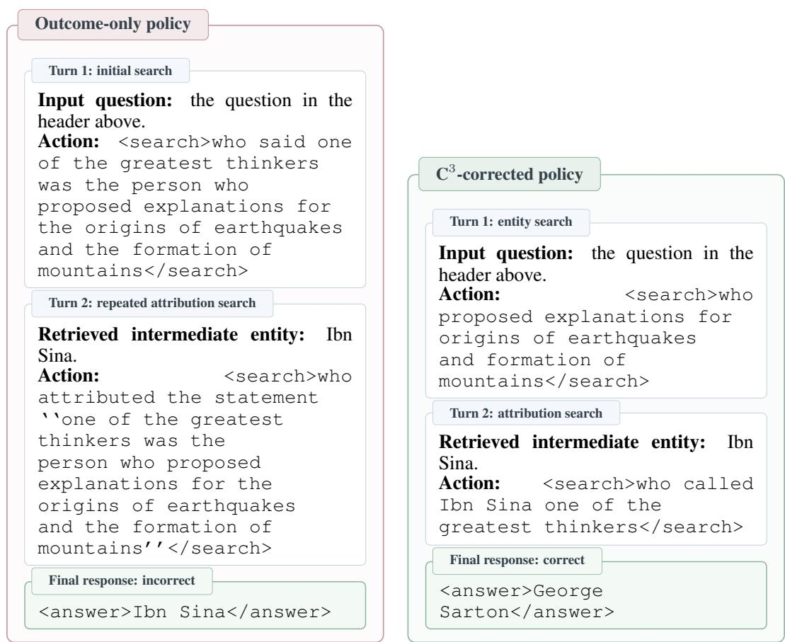  
Figure 12: Complete Search QA case presentation. The outcome-only policy repeats the original relation, while the C<sup>3</sup>-corrected policy separates entity identification from attribution and returns the requested person.

Interpretation. The useful second turn is a new evidence bridge rather than a longer trajectory. The side-by-side presentation makes the local fork visible: the baseline repeats the relation and answers with the intermediate entity, while the corrected policy verifies the attribution before answering.

## D.3 WEBSHOP: COMPLETE RECOVERY BEFORE PURCHASE

Task. “Find me loose fit women’s tops, tees & blouses with short sleeve, long sleeve with color a01#black, and size large, and price lower than 40.00 dollars.” The two columns show the complete before/after interaction for this same task, including every recorded environment action.

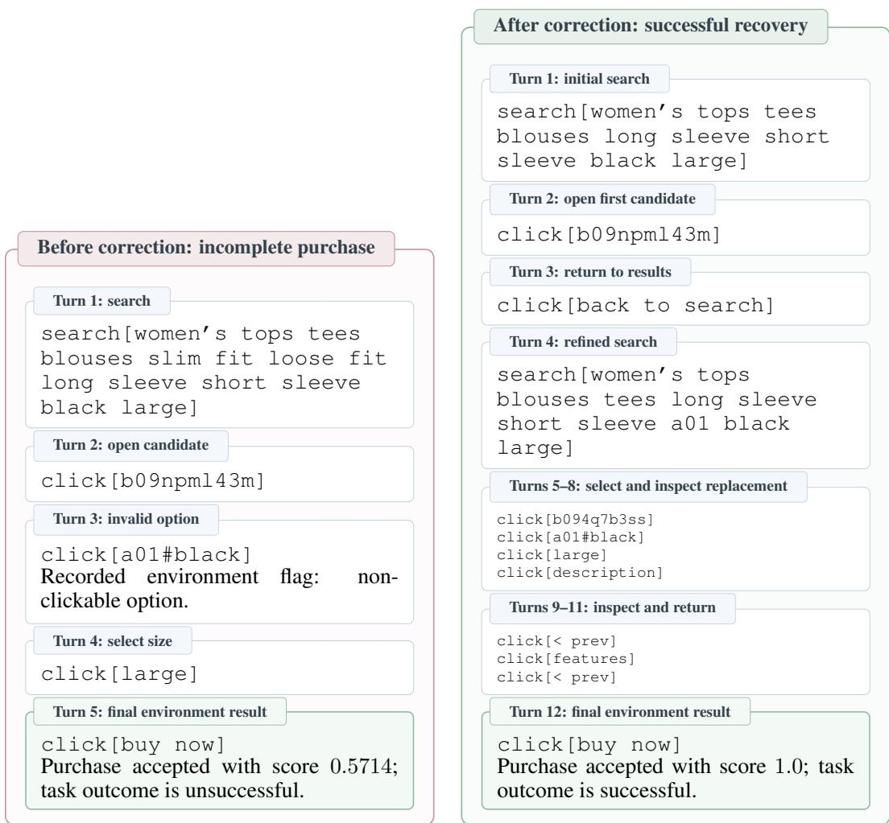  
Figure 13: Complete WebShop case presentation. The later policy returns to search after the first candidate fails an explicit requirement, refines the query, and verifies the replacement before purchase.

Interpretation. The important behavioral change is recovery from a bad candidate, not merely the number of actions. The full turn layout exposes the invalid option, the return-to-search decision, and the final purchase.

## D.4 WEBSHOP: COMPLETE FAILURE AND RECOVERY CONTRAST

The same shopping request is evaluated under an outcome-only policy and a C<sup>3</sup>-corrected policy. The full turn sequence makes the local decision fork visible: one policy purchases after repeatedly selecting the wrong option, whereas the other changes candidate before purchase.

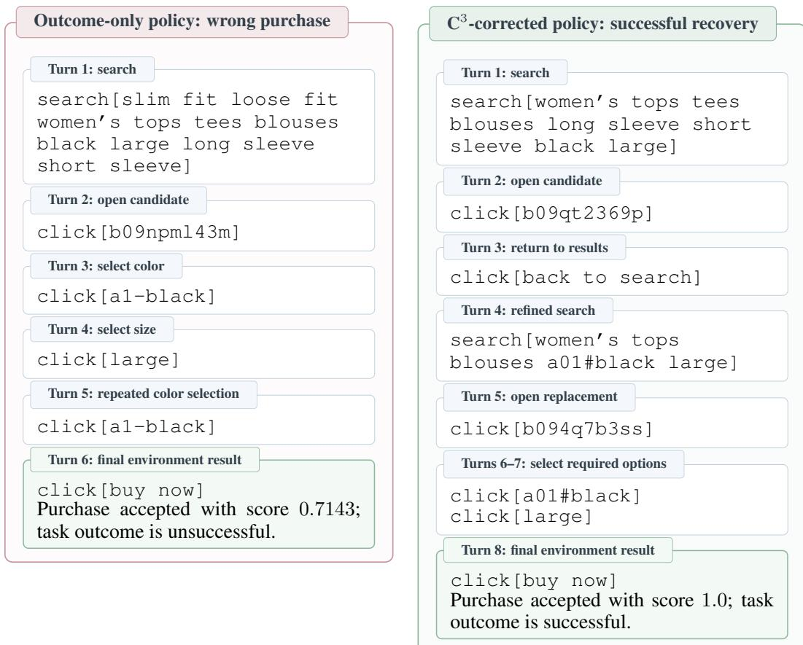  
Figure 14: Complete WebShop failure/recovery case. The outcome-only trajectory keeps the first candidate and repeats an invalid option; the $C ^ { 3 ^ { \cdot } }$ trajectory returns to search, changes candidate, and completes the requested purchase.

Interpretation. The contrast is about which local action receives credit, not about making the trajectory uniformly longer or shorter. The corrected policy changes candidate after the first result and reaches the required option set before buying.