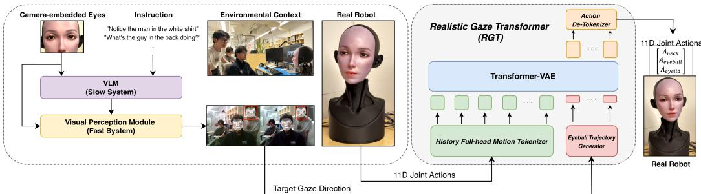
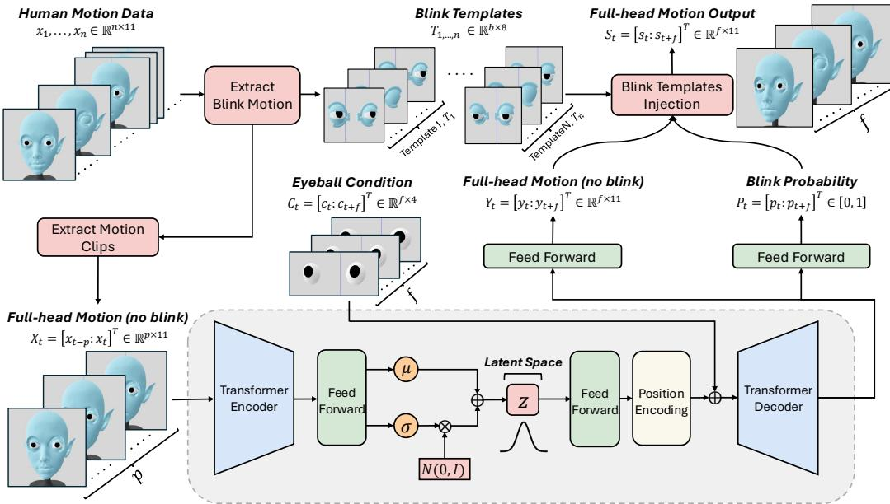
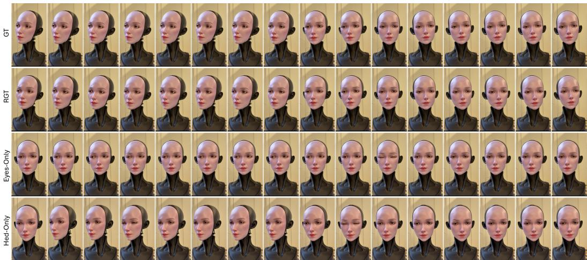
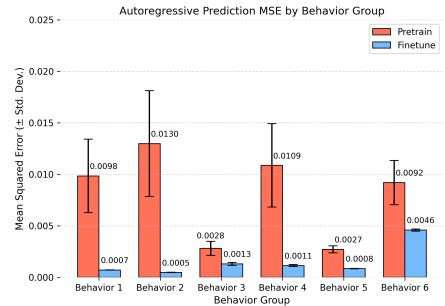
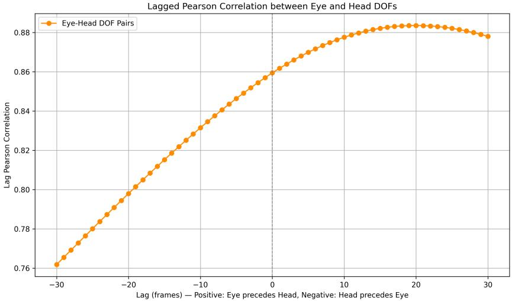

# Eye, Robot: Learning Expressive Gaze Dynamics via a VLM-Guided Transformer-VAE

Yuhang Hu1,\*, Junlin Lyu1,\*,†, Yuan Fang1, Xiaoying Shen1, Lechen Zhang1, Jiong Lin Judah Goldfeder1, Steven Tian1, Hod Lipson1,†

1Creative Machines Lab, Department of Mechanical Engineering, Columbia University Equal contribution.

## Abstract:

Gaze coordinates attention in human interaction through coupled eye, head, and eyelid motion. A humanoid robot must choose where to look while generating a suitable movement toward that target; fixed tracking rules alone do not model the temporal structure of human gaze. We separate these tasks with an asynchronous vision-language model that selects a scene referent, a reactive perception module that maintains fixation, and a Realistic Gaze Transformer (RGT) that generates target-conditioned motion. RGT is a Transformer-VAE trained on markerless human recordings retargeted to the robot’s 11-DoF joint space: self-supervised pretraining encodes recent full-head history, and autoregressive fine-tuning exposes the model to its own predictions during rollout. At inference, a four-dimensional binocular-eye trajectory conditions coordinated neck and eye motion; an auxiliary blink predictor triggers eyelid templates during playback. On a two-second benchmark in which all controllers receive the same ground-truth target, RGT-Base obtains the lowest reported overall seven-joint MSE, and physical demonstrations show the integrated targeting and control pipeline. The evidence establishes robotspace kinematic fidelity and real-time RGT inference; perceived naturalness and open-vocabulary target-selection accuracy remain questions for controlled evaluation.

Keywords: Robot gaze, motion generation, human-robot interaction

## 1 Introduction

Gaze is a fundamental channel of nonverbal communication, regulating attention, conversational turn-taking, intimacy, and emotional signaling [1, 2, 3, 4, 5, 6]. Appropriate eye contact has further been shown to increase perceived trustworthiness [7]. In Human-Robot Interaction (HRI), embodi ment allows robots to emulate these social cues through physical motion [8, 9, 10, 11, 12, 13], which makes faithfully reproducing human gaze both a substantial challenge and a promising path toward more natural interaction [14].

Scripted eye and head controllers provide a useful starting point, but fixed rules have limited flexibil ity across targets and motion styles [15, 16, 17]. Gaze also influences first impressions in social interaction [18, 19], making the timing of robot movements worth studying alongside endpoint tracking. We therefore ask whether a prior learned from human motion can improve joint-space reproduction under target-conditioned, closed-loop robot control (Fig. 1). The framework separates a deliberative decision about the attended referent from the frame-rate generation of motor commands. A VLM selects a referent asynchronously, a reactive perception module maintains its fixation between

  
Figure 1: Overview of the Realistic Gaze Transformer (RGT) pipeline. The left panel illustrates our hierarchical perception system operating on a real humanoid robot. Egocentric video from the camera-embedded eyes, together with high-level natural language instructions, is processed by a slow-system VLM that reasons over the environmental context and designates salient targets. A fastsystem Visual Perception Module then tracks the selected faces in real time to produce a continuous target gaze direction. The right panel depicts the RGT architecture: a History Full-head Motion Tokenizer encodes recent facial dynamics while an Eyeball Trajectory Generator encodes the target gaze, and a Transformer-VAE fuses both streams into a latent representation from which it predicts future motion. The Action De-Tokenizer maps the near-future tokens to 11-DoF joint commands on the physical robot. The quantitative benchmark evaluates motion generation with ground-truth eye targets; target selection is illustrated by the physical demonstration.

VLM calls, and the Realistic Gaze Transformer (RGT) predicts coordinated neck, binocular-eye, and eyelid commands from recent motion and a planned eye trajectory.

The action model is pretrained on retargeted human recordings and then fine-tuned autoregressively, so training includes histories containing its own predictions rather than only recorded frames. Its latent bottleneck summarizes the motion history while the target trajectory enters the decoder after that bottleneck. The 11-DoF output combines seven neck/eye joints from the learned motion path with four eyelid joints and a separate blink-template playback path. This differs from generating body motion for an avatar: commands must remain in the robot’s joint coordinates, track a binocula target, and roll out at the control rate. The hierarchy permits a slow semantic decision and faster reactive control without requiring the VLM to issue each joint command. It also lets us examine motion generation separately from errors in choosing or tracking a referent.

Our contributions are (i) a VLM-guided, reactive targeting interface for a humanoid face, (ii) a target-conditioned Transformer-VAE with a latent bottleneck and autoregressive fine-tuning for coordinated robot gaze, and (iii) a markerless data and evaluation pipeline that tests closed-loop fidelity, stochastic diversity, participant adaptation, and runtime. The quantitative benchmark supplies every controller with the same ground-truth eye target and scores seven neck/eye channels; physical demonstrations show the integrated targeting pipeline. Code and simulation materials are linked at https://anonymous.4open.science/r/eye\_robot\_pub-CF64/.

## 2 Related Work

Learning on Humanoid Facial Robots. Early facial robots relied on hand-tuned, FACS-based presets [9, 20], which scale poorly and feel mechanical. Recent work shifts to learning-based control across facial affect: self-supervised mimicry from motor babbling [13], expression generation guided by recognition networks [21] or human preferences [22], anticipatory smile coexpression [12], and multilingual lip synchronization [23]. Gaze, a primary channel for attention and social engagement, has received less attention within this learning paradigm. Our setting specifically models synchronized robot-coordinate neck, binocular-eye, and eyelid trajectories with a target supplied after the latent bottleneck.

Robot Gaze Control. Early systems scripted eye and head movements by hand to mimic human attention patterns [15, 16]. Recognizing the limits of this approach, later work turned to bio-inspired and model-based strategies—such as smooth pursuit, saccades, and joint attention—to coordinate eye and head motion for more lifelike behavior [24, 25, 26, 17], and Saran et al. [27] used a monocular deep-learning framework for real-time gaze following. Despite this progress, realistic gaze remains an open challenge, which motivates control that learns directly from human motion.

  
Figure 2: Full pipeline of the Realistic Gaze Transformer (RGT). Top: Data preprocessing stage. Raw human motion sequences (head pose, eye gaze, and blinks) are segmented into clips. Blink events are detected and extracted as separate blink templates (small eyelid motion sequences), and those blink segments are removed from the sequences to produce blink-free training data. Bottom: Model architecture and inference. Given a past full-head motion sequence and a planned eyeball motion sequence, the Transformer-VAE model (encoder and decoder) predicts a future blink-free trajectory along with blink probabilities for each future frame. At inference time, when a blink is predicted (high probability), a corresponding blink template is injected into the generated trajectory, yielding the final full-head motion with realistic blinks (red frames show the injected blink).

Representation Learning for Motion. Contrastive methods [28, 29] and Temporal Convolutional Networks [30] extract robust spatiotemporal embeddings that generalize to downstream motion tasks. Generative approaches advance this further: VAE and Transformer-VAE frameworks [31, 32, 33, 34], and more recently diffusion models [35, 36, 37], enable controllable and physically plausible motion synthesis, ranging from gaze-conditioned prediction to text-conditioned human motion generation.

## 3 Methods

We address the problem of generating realistic, expressive gaze behavior for a humanoid face robot. The platform is the soft-skinned humanoid face introduced by Hu [23], whose actuated facial mech anism we repurpose for gaze: in our configuration, 11 degrees of freedom (DoF) govern neck, eyeball, and eyelid motion, driven in real time (see Appendix A.2). Central to our formulation is a decoupling of high-level cognitive reasoning from low-level motor control: an upstream Vision-Language Model determines where to attend, producing a target gaze trajectory, while the learned action head is responsible for how that target is realized as lifelike full-head motion. Given a dataset of human gaze motion sequences, each training sample consists of a history of full-head motion $X _ { t } \in \mathbb { R } ^ { p \times \tilde { 1 1 } }$ over p past frames (neck, eyeballs, eyelids) and a future eyeball trajectory $C _ { t } \in \mathbb { R } ^ { f \times 4 }$ over $f$ future frames. We learn a Transformer-VAE in which an encoder $f _ { \theta }$ maps $X _ { t }$ to a latent code $z \in \mathbb { R } ^ { 6 4 }$ parameterizing the posterior $q _ { \theta } ( z \mid X _ { t } )$ , and a decoder $g _ { \phi }$ jointly predicts the future full-head motion $\hat { Y } _ { t } \in \mathbb { R } ^ { f \times 1 1 }$ and per-frame blink probabilities $\hat { P } _ { t } \in [ 0 , 1 ] ^ { f }$ from $z { \mathrm { ~ a n d ~ } } C _ { t } { \mathrm { : } }$ $\hat { Y } _ { t } , \hat { P } _ { t } ~ = ~ g _ { \phi } ( f _ { \theta } ( X _ { t } ) , C _ { t } )$ . The objective is to track $C _ { t }$ while preserving the temporal structure of the human motion prior encoded in $X _ { t }$ . Predicted sequences are translated into motor commands that drive the robot’s head, eyes, and eyelids (Appendix A.2). The remainder of this section formalizes each component: the targeting pipeline that produces $C _ { t }$ (Sec. 3.1), the data and conditioning used to train the action head (Sec. 3.2, Sec. 3.3), and the Realistic Gaze Transformer with its training procedure (Sec. 3.4, Sec. 3.5).

## 3.1 VLM-Guided Gaze Targeting

To drive the action head, we need a target eyeball trajectory $C _ { t } \in \mathbb { R } ^ { f \times 4 }$ that specifies where the robot should look. This trajectory is produced by a two-stage pipeline inspired by human attention. The first stage is a deliberative module built on a Vision-Language Model (we adopt Gemma 3 [38], though the design is agnostic to the specific VLM): given a scene image $I _ { t }$ and a natural-language instruction $\ell ( \mathrm { e . g . }$ , “Notice the man in the white $s h i r t ^ { \prime \prime } )$ , prompt engineering constrains its output to a structured referent $r _ { t } = \mathrm { V L M } ( I _ { t } , \ell )$ describing the attended target and a rough region of interest. The second stage is a reactive perception module (we use FastSAM [39]) that refines $r _ { t }$ into a frame-rate fixation $u _ { t } \in \mathbb { R } ^ { 2 }$ , maintaining the target between successive VLM calls. We project $u _ { t }$ into the robot’s eyeball frame to obtain an instantaneous gaze direction, which the eyeball trajectory generator unrolls into the conditioning signal $C _ { t }$ for the RGT (Sec. 3.3). Prompt templates and model-selection details are provided in Appendix A.3.

## 3.2 Data Preprocessing

The markerless, webcam-based facial motion data (see Appendix A.4) comprises timestamped sequences with 11-dimensional features per frame, including head orientation (yaw, pitch, roll), binocular eye gaze directions (yaw and pitch for each eye), and upper and lower eyelid motions (pitch for each eyelid). First, abrupt spikes in the eye gaze channels are identified via threshold-based peak detection and corrected by interpolating across the affected intervals. Second, high-frequency noise is reduced using signal-specific low-pass filtering techniques. Blink labels $P _ { t }$ are extracted from the upper eyelid signal using inverted peak detection. We generate both binary and soft labels, where the latter are obtained by convolving discrete blink events with a Gaussian kernel to provide smooth temporal supervision during training. All channels are resampled to a 60-Hz robot-command grid before denoising; eye and eyelid artifacts are handled separately (Appendix A.5 and $_ { \mathrm { A } . 6 ) }$ . The trajectories are retargeted to robot coordinates, including approximately $\pm 3 0 ^ { \circ }$ eye yaw and $\pm 2 0 ^ { \circ }$ eye pitch. They are a shared kinematic reference, not optical-motion-capture ground truth.

## 3.3 Eyeball-Trajectory Generator

At both training and test time, we require a 4-D eyeball-condition signal $\boldsymbol { C } _ { t } = [ c _ { t } ; c _ { t + 1 } ; \ldots ] ^ { \intercal } \in$ $\mathbb { R } ^ { f \times 4 }$ that specifies where the robot should look. When the processed human trajectories are available (pre-training and fine-tuning) we take the ground-truth binocular gaze directions $\left( \mathrm { y a w } ^ { \mathrm { R } } \right.$ , pitchR, yawL, pitchL) as $C _ { t }$ . During the evaluation of the real robot, $C _ { t }$ is synthesized online by the condition generator in Appendix A.8. This procedure provides task-directed eye commands while the RGT predicts coordinated motion and blink timing; the auxiliary template path realizes blink eyelid playback (Appendix A.6). Optional stochastic eye-command perturbations are applied only to the procedural condition stream at deployment, not to the ground-truth conditions used in Table 1.

## 3.4 Realistic Gaze Transformer (RGT)

Our objective is to synthesize human-like gaze that remains controllable by a task-level eyebal trajectory while preserving the rich micro-dynamics of natural head–eye coordination. To this end, we introduce a Transformer-VAE (Fig. 2) whose self-attention layers capture the delayed, multi scale coupling between eyes, head, and eyelids. The motion history $X _ { t }$ is compressed into a latent vector z that parameterizes a low-dimensional manifold of plausible human gaze dynamics. Because the decoder has no skip connection to $X _ { t } ,$ , all information about the recent past must pass through z, forcing it to summarize both kinematic state—inertia, head overshoot, microsaccadic patterns—and motion style. At inference, conditioning on z biases generation toward this manifold. Stochastic sampling of z yields different realizations of the same target $C _ { t }$ . Since $C _ { t }$ enters after the latent bottleneck, the model cleanly separates where the robot looks $( C _ { t } )$ from how the movement unfolds (z). We measure the resulting rollout diversity in the bottleneck ablation rather than treating it as a perceptual score.

Model Architecture Figure 2 depicts the Realistic Gaze Transformer (RGT), a Transformer-VAE comprising three functional blocks: (i) a motion-history encoder, (ii) a latent-conditioned decoder, and (iii) an auxiliary blink head. Each training sample pairs a fixed-length history window $X _ { t } \in \mathbb { R } ^ { p \times 1 1 }$ (neck, eyeballs, eyelids) with a future eyeball trajectory $C _ { t } \in \mathbb { R } ^ { \bar { f } \times 4 }$ . A linear layer projects the 11-D face vector to a $d _ { \mathrm { m o d e l } } = 1 2 8$ embedding, followed by a sine–cosine positional encoding; the same procedure, with a dedicated weight matrix, is applied to the 4-D eye condition. A 3-layer Transformer encoder with $d _ { \mathrm { f f } } = 5 1 2$ processes the embedded history—we found this depth sufficient to capture eye–head coupling on the limited markerless recording set. The resulting sequence h $\in \mathbb { R } ^ { p \times 1 \bar { 2 } 8 }$ is flattened and passed through a small aggregation MLP. With $p = 6 0$ , all ordered history tokens contribute to its 7,680-dimensional input; the representation retains their temporal positions instead of reading only the final frame. Two linear heads then produce the posterior parameters $\mu _ { ; }$ log $\sigma ^ { 2 } \in \mathbb { R } ^ { 6 4 }$ . We then sample $z \in \mathbb { R } ^ { 6 4 }$ via the reparameterization trick, linearly expand it to $\mathbf { z } _ { 1 : f } \in \mathbb { R } ^ { f \times 1 2 8 }$ , and add it element-wise to the eye-condition embeddings, injecting style information at every decoder position. A 4-layer Transformer decoder with $d _ { \mathrm { f f } } = 5 1 2$ processes the combined tokens, after which two task-specific heads predict future facial motion $\hat { Y } _ { t } \in \mathbb { R } ^ { f \times 1 1 }$ and blink probabilities $\hat { P } _ { t } \in [ 0 , 1 ] ^ { f }$ (MLP with ReLU and Sigmoid activations).

## 3.5 Model Training Procedure

We train the Realistic Gaze Transformer (RGT) on S1 in two stages: (1) self-supervised pre-training, which learns a compact manifold of natural head–eye dynamics, and (2) autoregressive fine-tuning, which adds long-horizon roll-out stability while tracking task-level eyeball commands. To eliminate temporal leakage, each raw sequence is first split chronologically (80% train, 20% validation), and only then are stride-1 sliding windows extracted within each partition.

Stage 1 – Self-supervised pre-training. We construct overlapping windows with a 60-frame (onesecond) history and a future block of $f$ frames from the normalized markerless data. Each sample comprises (i) a history segment $X _ { t } \in \mathbb { R } ^ { p \times 1 1 }$ with $p = 6 0$ and (ii) a future eyeball trajectory $C _ { t } \in$ $\mathbb { R } ^ { f \times \mathbf { \hat { 4 } } }$ . In the reported benchmark, $f = 3$ per model call. The Transformer encoder embeds $X _ { t }$ and produces a latent posterior; a latent code $z \sim \mathcal { N } ( \mu , \sigma ^ { 2 } )$ is added to the decoder input tokens together with $C _ { t }$ , yielding reconstructions $\hat { Y } _ { t } \in \mathbb { R } ^ { f \times 1 1 }$ and blink probabilities $\hat { P } _ { t } \in [ 0 , 1 ] ^ { f }$ . Training minimizes

$$
\mathcal { L } _ { \mathrm { p r e } } = \mathrm { M S E } ( Y _ { t } , \hat { Y } _ { t } ) + \lambda _ { \mathrm { K L } } \mathrm { K L } \big ( q _ { \theta } ( z \mid X _ { t } ) \| \mathcal { N } ( 0 , I ) \big ) + \lambda _ { \mathrm { B C E } } \mathrm { B C E } ( P _ { t } , \hat { P } _ { t } ) ,\tag{1}
$$

with $\lambda _ { \mathrm { K L } } = 1 0 ^ { - 4 }$ and $\lambda _ { \mathrm { B C E } } = 0 . 1$ . We use Adam [40] $( \mathrm { l r } = 1 0 ^ { - 3 }$ , batch size = 128) for up to 400 epochs, employing a 10-epoch plateau scheduler $( \mathrm { l r } \times 0 . 5 )$ and 20-epoch early stopping on the validation loss. The best checkpoint is used to initialize Stage 2.

Stage 2 – Autoregressive fine-tuning. To expose the RGT to accumulating prediction errors, we build longer segments of length $p + f \cdot m$ frames, where m is the maximum autoregressive roll-out horizon. During each update, we feed the seed history $X _ { t }$ into the encoder and unroll the decoder for m prediction blocks of $f$ frames each; at step $k ~ ( 0 ~ \leq ~ k ~ < ~ m )$ the decoder is conditioned on the eye commands $C _ { t + k }$ and the model’s own previous predictions. We accumulate the same VAE+BCE loss per block and back-propagate their mean. We fine-tune with a 10× smaller learning rate $( \mathrm { l r } = 1 0 ^ { - 4 } )$ to preserve the pre-trained latent prior, and again monitor a held-out validation set with the same early-stopping policy.

  
Figure 3: Qualitative comparison of gaze behaviors across controllers. Each row shows a time sequence of robot face images during a representative leftward gaze shift. Top: Ground-truth human motion (GT) exhibits coordinated eye–head motion, with eyes leading the head. Second: RGT reproduces the illustrated sequence’s eye–head timing. Third: Eyes-Only rotates the eyes to mechanical extremes while keeping the head fixed, resulting in strained, unnatural motion. Bottom: Head-Only turns the head abruptly toward the target while leaving the eyes static, exaggerating head movement and yielding sluggish gaze redirection. Each column represents 1/3 second of motion.

## 4 Experimental Results

We evaluate RGT against two families of baselines using S1 alone. The first comprises three heuristic, rule-based controllers: Eyes-Only rotates the eyeballs toward the target with the head fixed; Head-Only turns the neck toward the target with the eyes centered; Eye–Head Coord. drives both channels with the eyes leading, following fixed coordination and blink heuristics. All three run in closed loop. Because Eyes-Only and Head-Only are penalized for the joints they leave pinned, we additionally report each controller’s error over only its actively commanded joints (“w/o fixed”), isolating tracking quality from the cost of unmoved joints. The second family comprises learned baselines that isolate the contribution of our architecture: RNN [41] replaces self-attention with recurrence; VAE-CNN replaces the Transformer with ResNet [42] encoders/decoders; Flow Matching [43] replaces our latent-variable VAE with a continuous-flow generative objective. All learned baselines are matched to RGT-Base in parameter count and trained under an identical protocol; RGT-Small and RGT-Large are reported separately as scale ablations. Every controller—rule-based or learned—receives the same four-dimensional ground-truth eye condition. The benchmark therefore isolates motion generation from errors in VLM referent selection and visual tracking. From chronologically held-out S1 tails, we extract 1,848 clips with 60 history frames and a 120-frame (2-s) future at stride 10. A learned model predicts three frames per call, feeds back the first frame as history, and yields 117 scored updates over the seven neck and binocular-eye channels. The separate eyelid and blink path is not included in this score. RGT and VAE-CNN draw one reparameterized latent per call; neither uses a posterior mean or best-of-K selection. For N clips, $T = 1 1 7$ scored updates, and J = 7 joints, the reported joint-angle MSE is $\begin{array} { r } { \frac { 1 } { N T J } \sum _ { i = 1 } ^ { N } \sum _ { t = 1 } ^ { T } \dot { \sum _ { j = 1 } ^ { J } } ( \hat { y } _ { i t j } - y _ { i t j } ) ^ { 2 } } \end{array}$ in rad2. Table 1 contains one stochastic evaluation run; evaluation seeds and confidence intervals were not recorded for that run.

## 4.1 Quantitative and Qualitative Results

Figure 3 compares ground-truth motion, RGT, Eyes-Only, and Head-Only during a representative leftward gaze shift. In the recorded sequence the eyes move before the head, and the RGT frames follow the same broad temporal ordering. Eyes-Only reaches a larger ocular rotation while the head remains fixed; Head-Only redirects the neck while the eyes remain near their initial orientation. These distinct mechanisms explain what the visual comparison is intended to show, but the frames are one selected example rather than a distribution of outcomes. No controlled observer ratings were collected, so they cannot establish which motion people perceive as more natural.

Table 1: Closed-loop seven-joint MSE $( \mathrm { r a d } ^ { 2 } )$ over 1,848 S1 clips. A single stochastic sample is evaluated per model call. Values are from one run and are rounded; no uncertainty intervals are available. “w/o fixed” rows score only active joints and are not directly comparable with the sevenjoint rows.
<table><tr><td>Method</td><td>BID1</td><td>BID 2</td><td>BID 3</td><td>BID 4</td><td>BID 5</td><td>BID 6</td><td>Overall</td></tr><tr><td>Head-Only</td><td>5.8e-2</td><td>5.9e-2</td><td>7.3e-2</td><td>7.2e-2</td><td>7.2e-2</td><td>6.8e-2</td><td>6.8e-2</td></tr><tr><td>Eye-Only</td><td>5.1e-2</td><td>5.4e-2</td><td>5.7e-2</td><td>5.6e-2</td><td>5.5e-2</td><td>5.2e-2</td><td>5.2e-2</td></tr><tr><td>Eye-Head Coord.</td><td>1.3e-2</td><td>1.2e-2</td><td>3.9e-2</td><td>1.5e-2</td><td>1.7e-2</td><td>1.4e-2</td><td>1.8e-2</td></tr><tr><td>Head-Only (w/o fixed)</td><td>1.6e-2</td><td>1.3e-2</td><td>5.8e-2</td><td>2.3e-2</td><td>3.2e-2</td><td>2.1e-2</td><td>3.1e-2</td></tr><tr><td>Eye-Only (w/o fixed)</td><td>1.7e-2</td><td>1.8e-2</td><td>1.5e-2</td><td>2.3e-2</td><td>1.1e-2</td><td>1.6e-2</td><td>1.7e-2</td></tr><tr><td>RNN</td><td>1.3e-4</td><td>2.0e-4</td><td>1.6e-4</td><td>2.2e-4</td><td>3.7e-4</td><td>9.8e-4</td><td>3.0e-4</td></tr><tr><td>VAE-CNN</td><td>2.5e-4</td><td>2.6e-4</td><td>1.3e-4</td><td>1.8e-4</td><td>3.3e-4</td><td>1.7e-3</td><td>4.6e-4</td></tr><tr><td>Flow Matching (16-step)</td><td>5.5e-4</td><td>1.0e-3</td><td>1.2e-3</td><td>2.0e-3</td><td>1.3e-3</td><td>1.8e-3</td><td>1.1e-3</td></tr><tr><td>RGT-Base</td><td>3.9e-5</td><td>6.9e-5</td><td>5.3e-5</td><td>9.5e-5</td><td>2.9e-4</td><td>1.0e-3</td><td>2.2e-4</td></tr><tr><td>RGT-Large</td><td>3.6e-5</td><td>7.1e-5</td><td>6.3e-5</td><td>7.4e-5</td><td>3.4e-4</td><td>1.1e-3</td><td>2.4e-4</td></tr><tr><td>RGT-Small</td><td>5.9e-5</td><td>1.1e-4</td><td>8.0e-5</td><td>1.1e-4</td><td>3.7e-4</td><td>1.1e-3</td><td>2.6e-4</td></tr></table>

Table 1 reports joint-angle MSE for the six S1 behavior sequences in Table 5. The learned models have lower reported seven-channel error than all three heuristic controllers. The gap is substantial even when the fixed-joint contribution is removed from each heuristic’s diagnostic “w/o fixed” score, although those rows use fewer channels and should not be compared as an identical metric. Among the learned models, RGT-Base has the lowest overall MSE. Its unrounded value is $2 . 1 9 \times 1 0 ^ { - 4 } \mathrm { r a d } ^ { 2 }$ versus $\mathrm { 3 . 0 4 \times 1 0 ^ { - 4 } r a d ^ { 2 } }$ for RNN, a descriptive 27.9% reduction. RGT-Base leads on BIDs 2, 3, and 5; RGT-Large leads on BIDs 1 and 4, and RNN on BID 6. The behavior-wise variation matters: the aggregate result does not imply that the Base configuration is best for every motion pattern.

The single-step sliding-window evaluation in Appendix A.1 provides a complementary view of the same model family. Flow Matching has the lowest error under that protocol, yet its closed-loop error is higher in Table 1, where generated actions become part of the next history. This reversal is consistent with errors accumulating when the input distribution shifts away from recorded histories. Autoregressive fine-tuning explicitly trains RGT on such self-generated histories, which is also reflected in the training ablation of Fig. 4. The results motivate evaluating rollout behavior rather than selecting a model only from teacher-forced reconstruction.

Runtime determines whether the controller can update within a 60-Hz cycle. Measured on an NVIDIA RTX 2080 Ti, RGT-Base inference is below the 16.7-ms frame interval, while the VLM operates asynchronously and does not need to produce a new referent at every control step. The reported latency applies to RGT inference, not to the entire perception, communication, and actuation pipeline. Likewise, the one-run MSE difference and the qualitative frames do not establish statistical significance or perceived naturalness; repeated stochastic evaluations and an observer study would address those questions.

## 4.2 Adaptation Across Different Human Subjects

We next test whether the S1-pretrained model can adapt to motion from other people without repeating full pretraining. For each of Subjects 2–6, we use only the training prefix of that subject’s S2 sequence for fine-tuning and evaluate on its corresponding held-out tail (Appendix A.4). These are separate subject-specific adaptations, not one model jointly trained on all five held-out subjects. Table 2 reports the base and adapted joint-angle MSE for each person. The reported overall error decreases from $1 . 8 \times 1 0 ^ { - 3 } ~ \mathrm { t o } ~ 3 . 6 \stackrel { \cdot } { \times } 1 0 ^ { - 4 } ~ \mathrm { r a d } ^ { 2 }$ , approximately a fivefold reduction, and all five subject columns improve. The magnitude of the gain differs by subject, so the aggregate does not describe every individual equally. As a separate qualitative check, adapted models were also run with the same procedurally generated eye targets, which were not used in training or validation. The resulting visualizations permit inspection of eye–head balance, blink frequency, and head-motion range, but these style attributes have no independent quantitative or observer rating here. The measured result supports adaptation in robot joint space across the five sampled subjects; the small, non-clinical cohort does not establish performance across broader populations or atypical ocular kinematics.

Table 2: Joint-angle MSE $( \mathrm { r a d } ^ { 2 } )$ on the held-out tail of each S2 subject sequence.
<table><tr><td>Method</td><td>Subj 2</td><td>Subj 3</td><td>Subj 4</td><td>Subj 5</td><td>Subj 6</td><td>Overall</td></tr><tr><td>Base Model</td><td>1.2e-3</td><td>1.5e-3</td><td>3.7e-3</td><td>1.1e-3</td><td>1.3e-3</td><td>1.8e-3</td></tr><tr><td>Fine-Tuned</td><td>3.7e-4</td><td>3.2e-4</td><td>7.3e-4</td><td>1.5e-4</td><td>2.4e-4</td><td>3.6e-4</td></tr></table>

Table 3: Latent bottleneck ablation; APD uses $K = 1 0$ rollouts.
<table><tr><td>Variant</td><td> $\mathbf { M S E } ( \mathrm { r a d } ^ { 2 } )$ </td><td> $\mathbf { A P D ( r a d ^ { 2 } ) }$ </td><td>Std (rad)</td></tr><tr><td>Deterministic AE</td><td>2.3e-4</td><td>0.0 (collapsed)</td><td>0.0</td></tr><tr><td>VAE + skip connection</td><td>2.4e-4</td><td>5.5e-7</td><td>4.4e-4</td></tr><tr><td>VAE (ours)</td><td>2.6e-4</td><td>4.4e-6</td><td>1.2e-3</td></tr></table>

  
Figure 4: Training Ablation Studies Comparison of pretraining and finetuning across different BIDs

## 4.3 Ablation Studies

We conduct ablation studies to better understand the contributions of key components in our training framework, focusing on three factors: (1) the latent bottleneck design, comparing the stochastic VAE bottleneck against a deterministic autoencoder and a skip-connected variant that bypasses the bottleneck; (2) the two-stage training schedule, isolating the effects of teacher-forced pre-training and autoregressive fine-tuning; and (3) the encoder/decoder depth, scaling the transformer backbone from the base configuration up to larger variants.

We first compare the full RGT against a deterministic autoencoder $( z { = } \mu ,$ KL disabled) and a skipconnected variant whose decoder cross-attends to the encoder outputs, bypassing the bottleneck. Table 3 reports reconstruction MSE under closed-loop AR rollout alongside the average pairwise distance (APD) between K=10 stochastic rollouts of the same clip. APD is reported in $\mathrm { r a d } ^ { 2 }$ in Table 3; it measures output diversity rather than fidelity or observer preference. The deterministic AE yields one rollout (APD=0), and the skip variant’s APD is smaller than the no-skip VAE’s. The no-skip VAE has APD $4 . 4 \times 1 0 ^ { - 6 } \mathrm { r a d } ^ { 2 }$ , compared with $5 . 5 \times 1 0 ^ { - 7 } \mathrm { r a d } ^ { 2 }$ for the skip model, while their reconstruction MSEs remain of the same order. This is consistent with the decoder relying less on the latent code when it can bypass the bottleneck, but APD alone does not diagnose posterior collapse or show that the different rollouts are perceptually plausible. The deterministic variant also obtains a slightly lower reconstruction error, making the fidelity–diversity tradeoff visible rather than treating diversity as a free gain. Next, comparing pretraining-only against models further fine-tuned with AR training (Fig. 4), the fine-tuned models consistently achieve lower prediction errors across all behavior groups, confirming that AR fine-tuning is critical for reducing compounding errors and improving long-term motion stability. Finally, we compare three RGT depths under the same recipe: Small (2 enc, 3 dec, $d _ { \mathrm { f f } } { = } 2 5 6 )$ , Base (3 enc, 4 dec, $d _ { \mathrm { f f } } { = } 5 1 2 )$ , and Large (4 enc, 6 dec, $d _ { \mathrm { f f } } { = } 5 1 2 )$ . The last three rows of Table 1 show that Base has lower overall MSE than Small or Large in this run; the table alone does not identify the cause of the larger model’s difference. We therefore adopt Base as the default RGT.

## 5 Conclusion

We presented a gaze-control framework that separates semantic target selection from the generation of eye, head, and eyelid motion on a soft-skinned humanoid face. An asynchronous VLM and a reactive perception module provide the target; the Realistic Gaze Transformer uses a one-second motion history and a planned binocular-eye trajectory to generate coordinated 11-DoF commands in real time. Its Transformer-VAE learns from retargeted human recordings, and autoregressive finetuning addresses the distribution shift caused by feeding predictions back into the controller. Blink timing is predicted by an auxiliary head and realized through template playback. In the reported ground-truth-target benchmark, RGT-Base has the lowest overall seven-joint MSE among the tested controllers. Bottleneck and training ablations, together with adaptation on five further subjects, provide complementary evidence about the motion model. The physical demonstration shows the targeting and control components working together. These findings motivate a next HRI evaluation that tests whether people can infer the robot’s attention during handover or collaborative search, as well as whether they prefer its gaze to alternative controllers.

## 6 Limitations and Future Work

Several limitations bound the interpretation of these results. The primary benchmark conditions every controller on the same ground-truth eye target, which isolates how the robot moves but does not measure whether the VLM picks the intended referent or whether the reactive module maintains a fixation under occlusion. A controlled target-perturbation sweep and labeled open-vocabulary grounding cases are needed to assess those errors and their effect on the complete pipeline. The VLM also operates below the control rate and supplies no explicit policy for when to shift gaze during turn-taking or mutual-gaze maintenance. Audio and conversational cues, together with feedback from the human partner’s gaze and expression, could support such decisions; the present system does not adapt to the partner’s affect in closed loop.

The reported MSE table is one stochastic run without fixed evaluation seeds or confidence intervals. Repeated runs with prespecified seeds would quantify uncertainty, especially for the smaller gaps among learned models. MSE measures robot-space kinematic agreement and APD measures stochastic diversity; neither is an observer rating. Controlled studies are needed to assess perceived naturalness, attention legibility, preference, and trust. The six-participant, non-clinical sample and markerless webcam retargeting constrain generalization, including to atypical ocular kinematics, different gaze conventions, and other robot joint layouts. Per-eye recalibration and additional participant-specific adaptation may help, but were not tested here. Blink templates simplify eyelid playback and do not provide a directly interpretable control over blink style or its relation to attention. Finally, the scored rollouts last two seconds, leaving longer-interaction drift unmeasured. Broader deployment should also study possible unwarranted trust or anthropomorphic projection.

## References

[1] A. Frischen, A. P. Bayliss, and S. P. Tipper. Gaze cueing of attention: visual attention, social cognition, and individual differences. Psychological bulletin, 133(4):694–724, 2007.

[2] L. J. Stephenson, S. G. Edwards, and A. P. Bayliss. From gaze perception to social cognition: The shared-attention system. Perspectives on Psychological Science, 16(3):553–576, 2021.

[3] K. Kompatsiari, V. Tikhanoff, F. Ciardo, G. Metta, and A. Wykowska. The importance of mutual gaze in human-robot interaction. In Social Robotics: 9th International Conference, ICSR 2017, Tsukuba, Japan, November 22-24, 2017, Proceedings 9, pages 443–452. Springer, 2017.

[4] U. J. Pfeiffer, K. Vogeley, and L. Schilbach. From gaze cueing to dual eye-tracking: novel approaches to investigate the neural correlates of gaze in social interaction. Neuroscience & Biobehavioral Reviews, 37(10):2516–2528, 2013.

[5] M. Argyle and J. Dean. Eye-contact, distance and affiliation. Sociometry, 28(3):289–304, 1965.

[6] A. Kendon. Some functions of gaze-direction in social interaction. Acta psychologica, 26: 22–63, 1967.

[7] A. Normoyle, J. B. Badler, T. Fan, N. I. Badler, V. J. Cassol, and S. R. Musse. Evaluating perceived trust from procedurally animated gaze. In Proceedings of Motion on Games, MIG ’13, pages 141–148, New York, NY, USA, 2013. Association for Computing Machinery. ISBN 9781450325462.

[8] T. Fong, I. Nourbakhsh, and K. Dautenhahn. A survey of socially interactive robots. Robotics and autonomous systems, 42(3-4):143–166, 2003.

[9] C. Breazeal. Toward sociable robots. Robotics and autonomous systems, 42(3-4):167–175, 2003.

[10] C. Bartneck and J. Forlizzi. A design-centred framework for social human-robot interaction. In RO-MAN 2004. 13th IEEE international workshop on robot and human interactive communication (IEEE Catalog No. 04TH8759), pages 591–594. IEEE, 2004.

[11] K. Dautenhahn. Socially intelligent robots: dimensions of human–robot interaction. Philosophical transactions ofthe royal society B: Biological sciences, 362(1480):679–704, 2007.

[12] Y. Hu, B. Chen, J. Lin, Y. Wang, Y. Wang, C. Mehlman, and H. Lipson. Human-robot facial coexpression. Science Robotics, 9(88):eadi4724, 2024.

[13] B. Chen, Y. Hu, L. Li, S. Cummings, and H. Lipson. Smile like you mean it: Driving animatronic robotic face with learned models. In 2021 IEEE International Conference on Robotics and Automation (ICRA), pages 2739–2746. IEEE, 2021.

[14] H. Admoni and B. Scassellati. Social eye gaze in human-robot interaction: a review. Journal ofHuman-Robot Interaction, 6(1):25–63, 2017.

[15] B. Mutlu, T. Kanda, J. Forlizzi, J. Hodgins, and H. Ishiguro. Conversational gaze mechanisms for humanlike robots. ACM Transactions on Interactive Intelligent Systems (TiiS), 1(2):1–33, 2012.

[16] H. Admoni, A. Dragan, S. S. Srinivasa, and B. Scassellati. Deliberate delays during robot-tohuman handovers improve compliance with gaze communication. In Proceedings ofthe 2014 ACM/IEEE international conference on Human-robot interaction, pages 49–56, 2014.

[17] M. K. Pan, S. Choi, J. Kennedy, K. McIntosh, D. C. Zamora, G. Niemeyer, J. Kim, A. Wieland, and D. Christensen. Realistic and interactive robot gaze. In 2020 IEEE/RSJ International Conference on Intelligent Robots and Systems (IROS), pages 11072–11078. IEEE, 2020.

[18] M. Paetzel, G. Perugia, and G. Castellano. The persistence of first impressions: The effect of repeated interactions on the perception of a social robot. In Proceedings ofthe 2020 ACM/IEEE international conference on human-robot interaction, pages 73–82, 2020.

[19] J. Złotowski, D. Proudfoot, K. Yogeeswaran, and C. Bartneck. Anthropomorphism: opportunities and challenges in human–robot interaction. International journal of social robotics, 7: 347–360, 2015.

[20] Z. Faraj, M. Selamet, C. Morales, P. Torres, M. Hossain, B. Chen, and H. Lipson. Facially expressive humanoid robotic face. HardwareX, 9:e00117, 2021.

[21] N. Rawal, D. Koert, C. Turan, K. Kersting, J. Peters, and R. Stock-Homburg. Exgennet: Learning to generate robotic facial expression using facial expression recognition. Frontiers in Robotics and AI, 8:730317, 2022.

[22] D. Yang, Q. Liu, W. Sato, T. Minato, C. Liu, and S. Nishida. HAPI: A model for learning robot facial expressions from human preferences. In 2025 IEEE/RSJ International Conference on Intelligent Robots and Systems (IROS). IEEE, 2025.

[23] Y. Hu, J. Lin, J. A. Goldfeder, P. M. Wyder, Y. Cao, S. Tian, Y. Wang, J. Wang, M. Wang, J. Zeng, C. Mehlman, Y. Wang, D. Zeng, B. Chen, and H. Lipson. Learning realistic lip motions for humanoid face robots. Science Robotics, 11(110):eadx3017, 2026.

[24] A. Roncone, U. Pattacini, G. Metta, and L. Natale. A cartesian 6-DoF gaze controller for humanoid robots. In Proceedings of Robotics: Science and Systems (RSS), Ann Arbor, Michigan, 2016. doi:10.15607/RSS.2016.XII.022.

[25] C. Mishra and G. Skantze. Knowing where to look: A planning-based architecture to automate the gaze behavior of social robots. In 2022 31st IEEE international conference on robot and human interactive communication (RO-MAN), pages 1201–1208. IEEE, 2022.

[26] A. Moon, M. Zheng, D. M. Troniak, B. A. Blumer, B. Gleeson, K. MacLean, M. K. Pan, and E. A. Croft. Meet me where i’m gazing: how shared attention gaze affects human-robot handover timing. In Proceedings ofthe 2014 ACM/IEEE international conference on Humanrobot interaction, pages 334–341, 2014.

[27] A. Saran, S. Majumdar, E. S. Short, A. Thomaz, and S. Niekum. Human gaze following for human-robot interaction. In 2018 IEEE/RSJ International Conference on Intelligent Robots and Systems (IROS), pages 8615–8621. IEEE, 2018.

[28] T. Chen, S. Kornblith, M. Norouzi, and G. Hinton. A simple framework for contrastive learning of visual representations. In International conference on machine learning, pages 1597–1607. PMLR, 2020.

[29] G. Tevet, B. Gordon, A. Hertz, A. H. Bermano, and D. Cohen-Or. Motionclip: Exposing human motion generation to clip space. In European Conference on Computer Vision, pages 358–374. Springer, 2022.

[30] S. Bai, J. Z. Kolter, and V. Koltun. An empirical evaluation of generic convolutional and recurrent networks for sequence modeling. arXiv preprint arXiv:1803.01271, 2018.

[31] M. Petrovich, M. J. Black, and G. Varol. Action-conditioned 3d human motion synthesis with transformer vae. In Proceedings of the IEEE/CVF International Conference on Computer Vision, pages 10965–10975, 2021.

[32] Y. Yuan and K. M. Kitani. Dlow: Diversifying latent flows for diverse human motion prediction. In European Conference on Computer Vision (ECCV), pages 346–364. Springer, 2020.

[33] A. Vaswani, N. Shazeer, N. Parmar, J. Uszkoreit, L. Jones, A. N. Gomez, Ł. Kaiser, and I. Polosukhin. Attention is all you need. In Advances in Neural Information Processing Systems, pages 5998–6008, 2017.

[34] D. P. Kingma and M. Welling. Auto-encoding variational Bayes. In International Conference on Learning Representations, 2014.

[35] H. Yan, Z. Hu, S. Schmitt, and A. Bulling. Gazemodiff: Gaze-guided diffusion model for stochastic human motion prediction. arXiv preprint arXiv:2312.12090, 2023.

[36] C. Chi, Z. Xu, S. Feng, E. Cousineau, Y. Du, B. Burchfiel, R. Tedrake, and S. Song. Diffusion policy: Visuomotor policy learning via action diffusion. The International Journal ofRobotics Research, 44(10-11):1684–1704, 2025. doi:10.1177/02783649241273668.

[37] G. Tevet, S. Raab, B. Gordon, Y. Shafir, D. Cohen-Or, and A. H. Bermano. Human motion diffusion model. arXiv preprint arXiv:2209.14916, 2022.

[38] Gemma Team. Gemma 3 technical report. arXiv preprint arXiv:2503.19786, 2025.

[39] X. Zhao, W. Ding, Y. An, Y. Du, T. Yu, M. Li, M. Tang, and J. Wang. Fast segment anything. arXiv preprint arXiv:2306.12156, 2023.

[40] D. P. Kingma and J. Ba. Adam: A method for stochastic optimization. In International Conference on Learning Representations, 2015.

[41] S. Hochreiter and J. Schmidhuber. Long short-term memory. Neural Computation, 9(8):1735– 1780, 1997.

[42] K. He, X. Zhang, S. Ren, and J. Sun. Deep residual learning for image recognition. In Proceedings of the IEEE Conference on Computer Vision and Pattern Recognition, pages 770–778, 2016.

[43] Y. Lipman, R. T. Q. Chen, H. Ben-Hamu, M. Nickel, and M. Le. Flow matching for generative modeling. In International Conference on Learning Representations, 2023.

[44] R. Varghese and S. M. Yolov8: A novel object detection algorithm with enhanced performance and robustness. In 2024 International Conference on Advances in Data Engineering and Intelligent Computing Systems (ADICS), pages 1–6, 2024. doi:10.1109/ADICS58448. 2024.10533619.

[45] C. Lugaresi, J. Tang, H. Nash, C. McClanahan, E. Uboweja, M. Hays, F. Zhang, C.-L. Chang, M. G. Yong, J. Lee, et al. Mediapipe: A framework for building perception pipelines. arXiv preprint arXiv:1906.08172, 2019.

[46] E. G. Freedman. Coordination of the eyes and head during visual orienting. Experimental brain research, 190(4):369–387, 2008.

[47] M. F. Land and M. Hayhoe. In what ways do eye movements contribute to everyday activities? Vision research, 41(25-26):3559–3565, 2001.

[48] M. Land, N. Mennie, and J. Rusted. The roles of vision and eye movements in the control of activities of daily living. Perception, 28(11):1311–1328, 1999.

## A Appendix and Supplementary Materials

Code and Data Availability. The RGT implementation, markerless collection/preprocessing pipeline, and MuJoCo simulation documentation are available in the accompanying repository: https://anonymous.4open.science/r/eye\_robot\_pub-CF64/README.md. The complete participant trajectory dataset is not currently public.

## A.1 Single-step Sliding-Window Evaluation

To disentangle one-step prediction quality from long-horizon rollout stability, we additionally evaluate every learned baseline under a single-step sliding-window protocol. At each frame $j$ of the held-out portion of a sequence, the model receives the real history $[ j - 6 0 , j )$ and the ground-truth target eyeball rotation for the next chunk, and predicts that chunk; the window then advances by one frame. Because the history is always ground truth, there is no error compounding—this protocol measures purely per-step prediction quality.

Table 4 reports the resulting joint-angle MSE $( \mathrm { r a d } ^ { 2 } )$ . Under this regime Flow Matching is the strongest model on five of six behaviors and overall $( 1 . 2 \times 1 0 ^ { - 5 }$ , roughly 7× better than the nextbest learned model). This is the inverse of the closed-loop ranking in Table 1, where Flow Matching is the weakest learned baseline—a direct demonstration that single-step accuracy does not transfer to autoregressive deployment, motivating our use of long-horizon closed-loop rollout as the primary evaluation in the main paper.

Table 4: Single-step sliding-window evaluation. Per-BID and overall joint-angle MSE $( \mathrm { r a d } ^ { 2 } )$ . The model always receives ground-truth history; there is no error compounding. Best per column in bold.
<table><tr><td>Method</td><td>BID 1</td><td>BID 2</td><td>BID 3</td><td>BID 4</td><td>BID 5</td><td>BID 6</td><td>Overall</td></tr><tr><td>RNN</td><td>8.6e-5</td><td>1.3e-4</td><td>1.2e-4</td><td>1.9e-4</td><td>3.2e-4</td><td>9.9e-4</td><td>2.6e-4</td></tr><tr><td>VAE-CNN</td><td>1.2e-5</td><td>1.5e-5</td><td>3.7e-5</td><td>2.0e-5</td><td>5.2e-5</td><td>4.8e-4</td><td>8.7e-5</td></tr><tr><td>Flow Matching (16-step)</td><td>4.2e-6</td><td>1.0e-5</td><td>1.4e-5</td><td>2.6e-5</td><td>1.9e-5</td><td>1.9e-5</td><td>1.2e-5</td></tr><tr><td>RGT-Base</td><td>1.6e-5</td><td>2.5e-5</td><td>3.8e-5</td><td>3.9e-5</td><td>9.5e-5</td><td>3.9e-4</td><td>8.5e-5</td></tr><tr><td>RGT-Large</td><td>1.4e-5</td><td>2.1e-5</td><td>4.1e-5</td><td>2.9e-5</td><td>8.9e-5</td><td>6.0e-4</td><td>1.1e-4</td></tr><tr><td>RGT-Small</td><td>1.4e-5</td><td>2.3e-5</td><td>4.3e-5</td><td>3.2e-5</td><td>8.5e-5</td><td>6.5e-4</td><td>1.2e-4</td></tr></table>

## A.2 Hardware and Control

Hardware. We evaluate our method on a humanoid robotic head [23] with 11 degrees of freedom (DOF), comprising 3 DOFs for the neck (yaw, pitch, and roll), 4 DOFs for the left and right eyes (yaw and pitch per eye), and 4 DOFs for the upper and lower eyelids of both eyes. For each joint, we define motion limits that closely resemble the natural constraints of human anatomy to ensure lifelike articulation. For further details on the robotic platform, we refer the reader to [23].

Control. The character is actuated using a set of joint torques τ , computed from the control actions via an actuator model. Given an action input $a _ { t }$ , we derive the motor torques using a proportionalderivative (PD) controller:

$$
\tau _ { t } ^ { \mathrm { m o t o r } } = K _ { P } \cdot ( a _ { t } - q _ { t } ) - K _ { D } \cdot \dot { q } _ { t } ,\tag{2}
$$

where · denotes element-wise multiplication, $q _ { t }$ is the current joint position, and $\dot { q } _ { t }$ is the joint velocity. The proportional and derivative gain terms $K _ { P }$ and $K _ { D }$ are set to predefined values based on the actuator dynamics. In practice, head and eye movements tend to be rapid, so we use relatively high values for $K _ { P }$ to ensure fast and accurate tracking.

## A.3 VLM and Visual Perception Module

Vision Language Model (VLM). The deliberative stage is a Vision-Language Model (Gemma 3) that jointly decides where the robot should attend and what, if anything, it should say. Crucially, it is used off-the-shelf: the model is never fine-tuned, and all task-specific behavior is induced purely through a fixed prompt template, so the same framework drops in any capable VLM without retraining. This makes the backend interchangeable—we support both a hosted API deployment, which minimizes on-board compute and latency, and a fully local deployment for network-independent, on-device operation—behind an identical prompt and output contract. Rather than relying on freeform generation, we cast target selection as a constrained structured-output task. The template frames the model as a chatting face robot and presents it with two parallel input streams at every call: a VISUAL stream—the egocentric image $I _ { t }$ from the eye-embedded cameras—and an AUDIO stream—a possibly-empty transcript ℓ produced by the streaming speech-recognition front end. The system instruction then specifies the task and the exact output contract:

You are a chatting face robot. You receive two parallel streams: (1) VISUAL, an image; (2) AUDIO, a transcript (possibly empty). Choose the single object or person in the scene that deserves the most attention given both streams and return its bounding box as [ymin, xmin, ymax, xmax] normalized to [0, 1000]; if the target is a person, return the box of the person’s face. If AUDIO is non-empty, additionally generate a spoken response (≤ 10 s); if AUDIO is empty, omit the speech field. Output only JSON.

This template enforces three properties that the rest of the pipeline depends on. First, the output is a single JSON object with a bounding-box field and an optional speech field, which we obtain reliably by requesting a JSON response type from the model; the structured referent $r _ { t }$ parsed from this object is precisely the rough region of interest consumed by the downstream perception module. Second, the normalized [0, 1000] box convention decouples the prompt from the camera resolution, so the same template transfers across the two eye cameras; we rescale the returned box to pixels before projecting it into the eyeball frame. Third, instructing the model to return the face box for people—rather than the full body—anchors the eventual fixation on the eyes and preserves the realism of mutual gaze. Because such reasoning is comparatively expensive, the VLM runs asynchronously and far below the 60 Hz control rate; the reactive perception module sustains the fixation between successive calls, and the controller always consumes only the most recent VLM result, discarding stale frames to bound latency. Unifying target selection and the verbal response within this single templated call lets one scene understanding drive both gaze and speech, keeping the robot’s attention and dialogue mutually consistent.

Visual Perception Module. The robot carries two eye-embedded cameras with different focal lengths: the left-eye camera is optimized for close-range perception and the right-eye camera for long-range focus, reliably resolving objects at roughly one meter. The reactive perception module of Sec. 3.1 operates on these streams, refining the VLM’s structured referent $r _ { t }$ into a frame-rate fixation $u _ { t } \in \mathbb { R } ^ { 2 }$ and maintaining it between successive VLM calls.

We use FastSAM [39], the real-time variant of the Segment Anything Model, as this module; the choice follows directly from our two-stage design. Because the upstream VLM selects targets by language and context, the set of admissible gaze targets is effectively open—any person, object, or region the VLM can designate—so the downstream localizer must not re-impose a fixed taxonomy. A class-agnostic, promptable segmenter preserves this open-endedness: the rough region of interest in $r _ { t }$ is passed directly as a spatial prompt, and FastSAM returns a pixel-accurate mask of the designated target, whose centroid we take as $u _ { t }$ and project into the eyeball frame.

In contrast, the detector paradigms commonly used for robot perception fit this role poorly. Closedset detectors such as YOLO [44] are confined to a fixed label set and would bottleneck the VLM’s open-vocabulary targeting; their bounding-box centers are also only coarse aim points, falling on the torso rather than the face for a standing person, or off the object entirely when it is elongated or partially occluded—both of which undermine the realism of eye contact. Category-specific landmark models such as MediaPipe [45] yield precise points, but only for faces, hands, and body, and cannot localize arbitrary referents. FastSAM retains the open-set, prompt-conditioned behavior of SAM while running far faster than its ViT-based predecessor, placing class-agnostic segmentation comfortably within the frame-rate budget required to sustain a fixation between VLM calls and thereby preserve the perceived liveness of the robot’s gaze.

## A.4 Dataset Collection, Description and Representation

Our collection pipeline is markerless and uses a commodity webcam. Participants were recruited for a non-clinical feasibility study. We first record raw RGB video of a seated participant and then process every frame offline with the MediaPipe Face Landmarker [45], run in video mode with faceblendshape and facial-transformation-matrix outputs enabled. The 11-DoF target representation is read out directly from these outputs. Head orientation (yaw, pitch, roll) is recovered as Euler angles from the 4 × 4 facial transformation matrix. Per-eye gaze is obtained from the directional eye blendshapes—horizontal gaze from the difference of the eyeLookIn and eyeLookOut scores and vertical gaze from eyeLookUp minus eyeLookDown, computed independently for each eye—and linearly scaled to anatomically plausible ranges $( \pm 3 0 ^ { \circ }$ yaw, $\pm 2 0 ^ { \circ }$ pitch). Upper-eyelid aperture is mapped from the eyeBlink blendshape and lower-eyelid motion from eyeSquint, each calibrated to the robot’s eyelid travel. Each frame is timestamped, so the subsequent resampling stage (Sec. A.5) can interpolate onto a uniform 60 FPS grid regardless of capture rate. Because the entire pipeline relies only on pretrained MediaPipe models, new subjects or behaviors can be added without any specialized motion-capture hardware. Details of the motion extraction process are provided in the later section A.5.

The data used here are organized as S1, six structured behavior sequences from Subject 1, and S2, five participant-specific adaptation sequences from Subjects 2–6. S1 is used for pretraining and the primary benchmark; S2 is used for participant-wise adaptation. The recordings were designed to elicit tracking, scanning, surveying, and individual motion patterns. The counts in the S1 behavior summary below are processed 60-Hz command-grid rows rather than raw camera frames.

The six structured motion behaviors are summarized in Table 5. Each behavior is designed to reflect a distinct style of gaze deployment, varying in head amplitude, eye-head contribution, and overall dynamics. Each motion sequence is represented as a time series of 11 joint angles, normalized using

Table 5: Summary of S1 human motion data; counts are processed 60-Hz rows.
<table><tr><td rowspan=1 colspan=1>Behavior (Subject)</td><td rowspan=1 colspan=1>Description</td><td rowspan=1 colspan=1>Rows</td></tr><tr><td rowspan=1 colspan=1>Behavior 1 (Subject 1)</td><td rowspan=1 colspan=1>This sequence mimics natural human eye tracking behavior.The head oscillates within ±10°, while the eyes move in co-ordination, turning left and right with an anticipatory expres-sion.</td><td rowspan=1 colspan=1>31487</td></tr><tr><td rowspan=1 colspan=1>Behavior 2 (Subject 1)</td><td rowspan=1 colspan=1>Similar to Behavior 1, this sequence replicates eye trackingbehavior but over a shorter duration. The head and eye mo-tions follow the same pattern.</td><td rowspan=1 colspan=1>26739</td></tr><tr><td rowspan=1 colspan=1>Behavior 3 (Subject 1)</td><td rowspan=1 colspan=1>This sequence captures a Head-Down Scan gesture. The mo-tion begins by lowering the head approximately 30°, followedby a slow left-right head rotation of about 15°, expressingcontemplation.</td><td rowspan=1 colspan=1>8358</td></tr><tr><td rowspan=1 colspan=1>Behavior 4 (Subject 1)</td><td rowspan=1 colspan=1>This sequence represents a Head-Up Survey gesture. Thehead raises approximately 45° and then moves left and right,coordinated with eye movements, expressing alertness.</td><td rowspan=1 colspan=1>6750</td></tr><tr><td rowspan=1 colspan=1>Behavior 5 (Subject 1)</td><td rowspan=1 colspan=1>This sequence features a Head-Mid Survey, using head os-cillations within $\pm 1 0 ^ { \circ }$ along with coordinated eye move-ments.</td><td rowspan=1 colspan=1>10014</td></tr><tr><td rowspan=1 colspan=1>Behavior 6 (Subject 1)</td><td rowspan=1 colspan=1>This sequence follows an All Survey pattern, combining headoscillations within ±10° and coordinated eye movements toexpress anticipation.</td><td rowspan=1 colspan=1>14310</td></tr></table>

the global mean and standard deviation computed over the full training set. This normalization ensures consistent scaling across different joints and motion types, facilitating stable learning and evaluation.

The complete dataset is not currently public; the available repository and current release scope are described in the Code and Data Availability paragraph.

## A.5 Data Preprocessing Details

Let the raw motion sequence be denoted as $D = \{ ( t _ { i } , x _ { i } ) \} _ { i = 1 } ^ { T _ { \mathrm { r a w } } }$ , where each frame $x _ { i } \in \mathbb { R } ^ { 1 1 }$ contains head orientation (yaw, pitch, roll), binocular eye gaze (yaw and pitch for each eye), and upper and lower eyelid motions.

Temporal Resampling. To ensure uniform temporal spacing, we perform linear interpolation to resample D at a constant frame rate of 60 frames per second (FPS), producing a sequence $\hat { D } =$ $\{ ( t _ { j } ^ { \prime } , \hat { x } _ { j } ) \} _ { j = 1 } ^ { T }$ , where $t _ { j } ^ { \prime } = t _ { 1 } ^ { \prime } + ( j - 1 ) \Delta t$ and $\Delta t = 1 / 6 0$ seconds.

Eye Gaze Denoising. For selected eye gaze channels $\mathcal { G } \subseteq \{ 4 , 5 , 6 , 7 \}$ , spike artifacts are removed via peak detection. Peaks are identified where the signal magnitude exceeds a dynamic threshold, and values within a window around each detected peak are masked and reconstructed by linear interpolation. Subsequently, a Gaussian smoothing filter is applied to the cleaned eye gaze channels:

$$
\tilde { x } _ { j } ^ { ( g ) } = ( G _ { \sigma } \ast \hat { x } ^ { ( g ) } ) _ { j } , \quad g \in \mathcal { G }
$$

where $G _ { \sigma }$ denotes a 1D Gaussian kernel with standard deviation $\sigma .$

Eyelid Denoising. For the eyelid channels ${ \mathcal { E } } \subseteq \{ 8 , 9 , 1 0 , 1 1 \}$ , the dip produced by each detected blink is first flattened by replacing the blink samples with linear interpolation across the blink (each upper eyelid is flattened using its own blink detection, and each lower eyelid reuses the corresponding upper eyelid as the blink source, since the lower lids move little during a blink). The blink shape is reintroduced later at synthesis time (Sec. A.6). The blink-flattened channels are then lightly denoised with a Gaussian smoothing filter,

$$
\tilde { x } _ { j } ^ { ( e ) } = ( G _ { \sigma _ { e } } * \hat { x } ^ { ( e ) } ) _ { j } , \qquad e \in \mathcal { E } ,
$$

with $\sigma _ { e } = 2$ frames, so that non-blink samples receive mild smoothing while the flattened ramps remain flat. This yields the blink-free eyelid signal on which the reconstruction objective is trained.

Blink Label Extraction. Blink labels $P _ { t }$ are extracted from the upper eyelid motion channel. Blinks are detected as local minima surpassing a negative threshold. Binary blink labels are assigned as:

$$
P _ { t } = { \left\{ \begin{array} { l l } { 1 , } & { { \mathrm { i f ~ } } t \in { \mathrm { b l i n k ~ w i n d o w ~ a r o u n d ~ d e t e c t e d ~ p e a k } } , } \\ { 0 , } & { { \mathrm { o t h e r w i s e } } . } \end{array} \right. }
$$

Soft blink labels are generated by convolving the detected blink events with a Gaussian kernel to model temporal uncertainty and smoothness:

$$
\tilde { P } _ { t } = \sum _ { k \in \mathcal { P } } \exp \left( - \frac { ( t - k ) ^ { 2 } } { 2 \sigma ^ { 2 } } \right)
$$

where $\mathcal { P }$ is the set of detected blink peak indices.

## A.6 Blink Template Extraction and Synthesis

Blink events are sparse relative to non-blink frames, which motivates a separate timing and playback path in addition to the reconstruction loss. We therefore adopt a two–step strategy: (1) offline extraction of blink templates from the markerless recording set, and (2) online synthesis that injects these templates at run-time according to the blink–probability head of our model.

Template extraction. A blink is deemed strong when the signal crosses a fixed threshold of −0.8 (normalised units) and forms a local minimum separated from neighbouring candidates by at least 30 frames (≃ 0.5 s).Around every detected centre we crop a 20-frame window (± 166 ms) comprising all four eyelid channels, yielding a tensor $\textbf { T } \in \ \mathbb { R } ^ { N \times 2 0 \times 4 }$ of blink templates (“open → closed → open”). Across six subjects we obtain N = 1 ,073 valid blinks. This corpus serves two purposes: (i) supervision for the auxiliary blink head, and (ii) a library for synthesis.

Blink-probability supervision. Binary blink labels are first assigned at peak frames and then convolved with a Gaussian kernel (σ = 3 frames) to produce smooth targets $P _ { t } ^ { \star }$ . During training we optimise a weighted binary cross-entropy $\lambda _ { \mathrm { B C E } } \mathrm { B C E } ( P _ { t } , P _ { t } ^ { \star } )$ where positive blink frames receive unit weight and non-blink frames are down-weighted, alleviating severe class imbalance.

Probabilistic blink synthesis. At inference time RGT outputs a per-frame blink probability $\hat { P } _ { t } \in$ [0, 1]. A blink is triggered when $\hat { P } _ { t }$ exceeds 0.72, subject to a refractory period of 100 frames (∼1.7 s) that prevents unnaturally rapid blinking. Once triggered, we draw a random template $\mathbf { T } _ { k }$ from the library and play it back frame by frame over its 20-frame window, substituting the four template eyelid channels directly for the network’s eyelid outputs,

$$
\begin{array} { r } { \mathbf { E } _ { \tau + j }  \mathbf { T } _ { k , j } , \qquad j = 0 , \dotsc , 1 9 , } \end{array}
$$

while the head and gaze channels continue to follow the generated trajectory. When the window completes, the eyelids hand control back to the network outputs and a fresh template is sampled for the next blink.

## A.7 Data Analysis

Observation 1: Eye–Head Co-movement Prior human motor-control studies report coupling between head and eye movement during gaze shifts [46, 47]. We summarize the linear associations among processed head, eye, and eyelid trajectories using Pearson correlation $\rho .$ Figure 5a shows an eye–head correlation of $\rho = 0 . 8 6$ for the reported yaw/pitch comparison. These descriptive correlations characterize the collected kinematics; temporal autocorrelation means a naive independent frame significance test would be inappropriate.

<table><tr><td rowspan=4 colspan=1>Head_YawHead_Pitch-</td><td></td><td></td><td></td><td></td><td></td><td></td><td></td><td></td><td></td><td></td><td></td></tr><tr><td rowspan=1 colspan=1>1.00***</td><td rowspan=1 colspan=1>0.04***</td><td rowspan=1 colspan=1>-0.70***</td><td rowspan=1 colspan=1>0.86***</td><td rowspan=1 colspan=1>-0.01*</td><td rowspan=1 colspan=2>0.86***</td><td rowspan=1 colspan=3>-0.04*** -0.04*** -0.04***-</td><td rowspan=1 colspan=1>0.17*** -0.17***</td></tr><tr><td></td><td></td><td></td><td></td><td></td><td></td><td></td><td rowspan=2 colspan=1>0.86***</td><td rowspan=2 colspan=2>0.33*** 0.33***</td><td rowspan=2 colspan=1>-0.26*** -0.26***</td></tr><tr><td rowspan=1 colspan=1></td><td rowspan=1 colspan=1></td><td rowspan=1 colspan=1></td><td rowspan=1 colspan=1></td><td rowspan=1 colspan=1></td><td rowspan=1 colspan=2></td></tr><tr><td rowspan=2 colspan=1>Head_Roll -</td><td rowspan=2 colspan=1>-0.70***</td><td rowspan=2 colspan=1>-0.09***</td><td rowspan=2 colspan=1>1.00***</td><td rowspan=2 colspan=1>-0.67***</td><td rowspan=1 colspan=1>-0.05***</td><td rowspan=2 colspan=2>-0.67***</td><td rowspan=2 colspan=1>-0.02***</td><td rowspan=2 colspan=2>0.03***0.03***</td><td rowspan=2 colspan=1>0.19***0.19***</td></tr><tr><td rowspan=1 colspan=1></td></tr><tr><td rowspan=3 colspan=1>R_Eye_Yaw</td><td rowspan=3 colspan=1>0.86***</td><td rowspan=3 colspan=1>0.03***</td><td rowspan=3 colspan=1>-0.67***</td><td rowspan=3 colspan=1>1.00***</td><td></td><td></td><td></td><td></td><td></td><td></td><td></td></tr><tr><td rowspan=2 colspan=1>-0.02***</td><td rowspan=2 colspan=2>1.00***</td><td></td><td></td><td></td><td></td></tr><tr><td rowspan=1 colspan=1>-0.05***</td><td rowspan=1 colspan=2>-0.04*** -0.04***-</td><td rowspan=1 colspan=1>0.15*** -0.15***</td></tr><tr><td rowspan=3 colspan=1>R_Eye_Pitch</td><td></td><td></td><td></td><td></td><td></td><td></td><td></td><td></td><td></td><td></td><td></td></tr><tr><td rowspan=2 colspan=1>-0.01*</td><td rowspan=2 colspan=1>0.86***</td><td rowspan=2 colspan=1>-0.05***</td><td rowspan=2 colspan=1>-0.02***</td><td></td><td></td><td></td><td></td><td></td><td></td><td></td></tr><tr><td rowspan=1 colspan=1>1.00***</td><td rowspan=1 colspan=2>0.00</td><td rowspan=1 colspan=1>1.00***</td><td rowspan=1 colspan=2>0.52***0.52***</td><td rowspan=1 colspan=1>0.16***0.16***</td></tr><tr><td rowspan=1 colspan=1>L_Eye_Yaw</td><td rowspan=1 colspan=1>0.86***</td><td rowspan=1 colspan=1>0.05***</td><td rowspan=1 colspan=1>-0.67***</td><td rowspan=1 colspan=1>1.00***</td><td rowspan=1 colspan=1>0.00</td><td rowspan=1 colspan=2>1.00***</td><td rowspan=1 colspan=1>-0.03***</td><td rowspan=1 colspan=1>-0.02***</td><td rowspan=1 colspan=1>-0.02***-</td><td rowspan=1 colspan=1>0.15*** -0.15***</td></tr><tr><td rowspan=2 colspan=1>L_Eye_Pitch -</td><td rowspan=2 colspan=1>-0.04***</td><td rowspan=2 colspan=1>0.86***</td><td rowspan=1 colspan=1>-0.02***</td><td rowspan=2 colspan=1>-0.05***</td><td rowspan=2 colspan=1>1.00***</td><td rowspan=2 colspan=2>-0.03***</td><td rowspan=2 colspan=1>1.00***</td><td rowspan=2 colspan=2>0.52***0.52***</td><td rowspan=2 colspan=1>0.17***0.17***</td></tr><tr><td rowspan=1 colspan=1></td></tr><tr><td rowspan=4 colspan=1>R_UpperLid -R_LowerLid</td><td rowspan=3 colspan=1>--0.04***--0.04***</td><td rowspan=1 colspan=1>0.33***</td><td rowspan=1 colspan=1>0.03***</td><td rowspan=1 colspan=1>-0.04***</td><td rowspan=2 colspan=1>0.52***</td><td rowspan=2 colspan=2>-0.02***</td><td rowspan=2 colspan=1>0.52***</td><td rowspan=2 colspan=1>1.00***</td><td rowspan=2 colspan=1>0.96***</td><td rowspan=4 colspan=1>0.18***0.18***0.18*** 0.18***</td></tr><tr><td rowspan=2 colspan=1></td><td rowspan=1 colspan=1></td><td rowspan=1 colspan=1></td></tr><tr><td rowspan=2 colspan=1>0.33***</td><td rowspan=2 colspan=1>0.03***</td><td rowspan=1 colspan=1>-0.04***</td><td rowspan=2 colspan=1>0.52***</td><td rowspan=2 colspan=2>-0.02***</td><td rowspan=2 colspan=1>0.52***</td><td rowspan=2 colspan=1>0.96***</td><td rowspan=2 colspan=1>1.00***</td></tr><tr><td rowspan=1 colspan=1></td><td rowspan=1 colspan=1></td></tr><tr><td rowspan=3 colspan=1>L_UpperLidL_LowerLid</td><td rowspan=2 colspan=1>--0.17***--0.17***-</td><td rowspan=2 colspan=1>-0.26***-0.26**</td><td rowspan=2 colspan=1>0.19***0.19***</td><td rowspan=1 colspan=1>-0.15***</td><td rowspan=1 colspan=1>0.16***</td><td rowspan=1 colspan=2>-0.15***</td><td rowspan=1 colspan=1>0.17***</td><td rowspan=2 colspan=2>0.18***0.18***0.18***0.18***</td><td rowspan=2 colspan=1>1.00***1.00***1.00***1.00***</td></tr><tr><td rowspan=1 colspan=1>-0.15***</td><td rowspan=1 colspan=1>0.16***</td><td rowspan=1 colspan=2>-0.15*ck</td><td rowspan=1 colspan=1>0.17***</td></tr><tr><td rowspan=1 colspan=1>Heayyaw</td><td rowspan=1 colspan=1>HeadpPich</td><td rowspan=1 colspan=1>HeadRoll</td><td rowspan=1 colspan=1>REey</td><td rowspan=1 colspan=1>R_Eeith</td><td rowspan=1 colspan=2>LEeyyaw</td><td rowspan=1 colspan=3>Leeitch   R_Uiid   R_Ltid</td><td></td></tr></table>

(a) Pearson correlation matrix across head yaw/pitch, eye yaw/pitch, and eyelid motions, computed over the full motion dataset.

Lagged Pearson Correlation between Eye and Head DOFs  
  
(b) Lagged Pearson correlation between key eye and head DOFs (head yaw/pitch vs. eye yaw/pitch). Positive lag values indicate that the eye leads the head, while negative values indicate the head leads the eye.

Figure 5: (Top) Pearson correlation matrix across all head, eye, and eyelid degrees of freedom (DOFs), revealing strong coupling between head yaw and eye yaw, as well as head pitch and eye pitch. (Bottom) Lagged Pearson correlation peaks at a positive lag of approximately 20 frames (333 ms), consistent with eye motion preceding head motion in these recordings. Per-frame significance labels shown within the supplied plots are exploratory because adjacent frames are temporally correlated.

Observation 2: Eye Yaw (Pitch) Leads Head Yaw (Pitch). To examine the temporal relationship during gaze shifts, we compute lagged Pearson correlation across the eye and head yaw/pitch channels. For a lag Ln, n is the number of 60-Hz frames by which head motion follows eye motion, and the correlation is denoted $\rho ^ { n }$

Figure 5b presents these lagged correlations. Positive lag values indicate earlier eye motion; the reported maximum is at $\mathbf { L } ^ { 2 0 }$ (333 ms), with $\rho ^ { 2 0 } = 0 . 8 8$ . This pattern is consistent with earlier eye motion in these sequences and with previous observations of human gaze coordination [48].

The RGT conditions predicted neck motion on eye commands and recent full-head history to model this temporal association.

## A.8 Online Generation of the Eyeball-Condition Signal

During real-robot experiments the 4-D ocular command $C _ { t } \in \mathbb { R } ^ { f \times 4 }$ is produced on-the-fly by an Anchor–Interpolation Trajectory Generator that is both fully deterministic and sub-millisecond on a single CPU core. A stream of 3-D gaze targets $\mathbf { g } _ { 1 } , \mathbf { g } _ { 2 } , \ldots , \mathbf { g } _ { m } \in \mathbb { R } ^ { 3 }$ arrives from the perception module; each $\mathbf { g } _ { i }$ is projected into binocular eye space to yield a pitch–yaw pair for the right and left eye,

$$
\mathbf { a } _ { i } = \big [ ( \theta _ { \mathrm { p i t c h } } ^ { \mathrm { R } } , \theta _ { \mathrm { y a w } } ^ { \mathrm { R } } ) , ( \theta _ { \mathrm { p i t c h } } ^ { \mathrm { L } } , \theta _ { \mathrm { y a w } } ^ { \mathrm { L } } ) \big ] ^ { \top } \in \mathbb { R } ^ { 4 } .
$$

Anchor queue and dwell times. Every new anchor ${ \bf a } _ { i }$ is appended to a rolling queue together with a dwell time $\tau _ { i } \sim \mathcal { U } [ \tau _ { \operatorname* { m i n } } , \tau _ { \operatorname* { m a x } } ]$ with $\tau _ { \mathrm { m i n } } = 0 . 2 $ s and $\tau _ { \mathrm { m a x } } = 1 . 0 \mathrm { s }$ . At 60 fps this corresponds to $n _ { i } = \lceil \tau _ { i } { \cdot } 6 0 \rceil$ repeated frames.

Linear interpolation between anchors. Let ${ \bf a } _ { i }$ and $\mathbf { a } _ { i + 1 }$ be two consecutive anchors. We generate $f = 2 0$ uniformly spaced interpolation samples $\mathbf { c } _ { i , k } \left( k = 1 \ldots f \right)$ by

$$
\mathbf { c } _ { i , k } \ = \ \left( 1 - \alpha _ { k } \right) \mathbf { a } _ { i } + \alpha _ { k } \mathbf { a } _ { i + 1 } , \quad \alpha _ { k } = \frac { k } { f } .
$$

This produces a $t \approx 0 . 3 3$ s transition that is perceptually smooth yet fast enough for conversational gaze.

Velocity cap and mechanical limits. Each increment $\dot { \mathbf { c } } _ { i , k } = ( \mathbf { c } _ { i , k } - \mathbf { c } _ { i , k - 1 } ) / 0 . 0 1 6 7 \mathrm { s }$ is clipped to a hard speed bound $\| \dot { \mathbf { c } } _ { i , k } \| _ { \infty } \leq 4 0 0 \%$ . The resulting angles are further clipped to the mechanical limits of the ocular joints (Appendix A.2).

Stochastic target perturbations. For optional variation in the procedural eye-condition stream, we splice in $S \sim \mathcal { U } \{ 1 , 2 , 3 \}$ short target bursts. For each burst we pick an insertion point along the current trajectory and draw $K \sim \mathcal { U } \{ 1 , \dotsc , 5 \}$ offset targets uniformly from $[ - 0 . 6 , + 0 . 6 ] ^ { 2 } \mathrm { r a d }$ , and render each as a square pulse of 5–10 frames. These pitch–yaw perturbations inherit the same speed and joint-limit checks.

Outcome. The generator outputs a continuous stream of 4-D ocular commands with $< 1$ ms latency, leaving all head and eyelid coordination to the RGT decoder. This division of labour keeps the control stack simple and allows RGT to focus entirely on synthesising lifelike full-head motion given a task-directed, but otherwise non-parametric, eye trajectory.