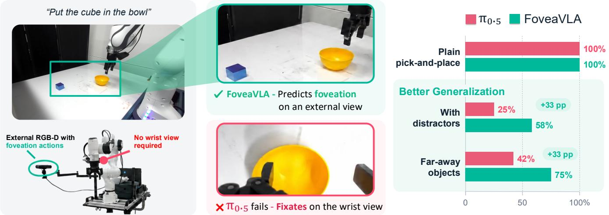
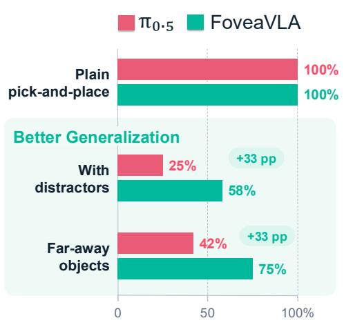
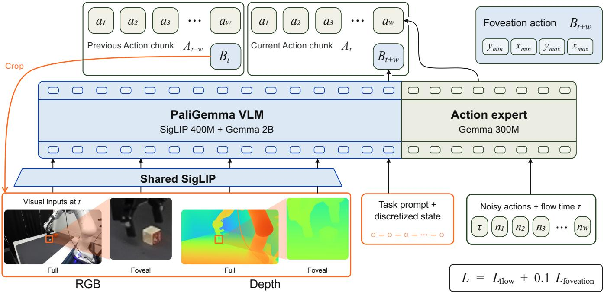
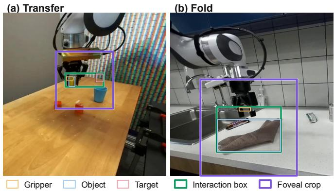
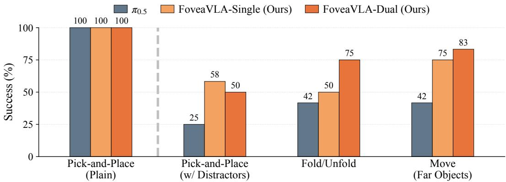
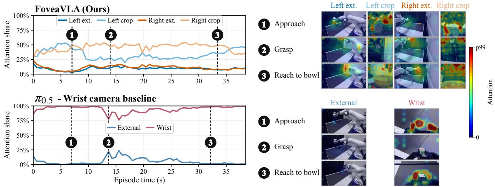
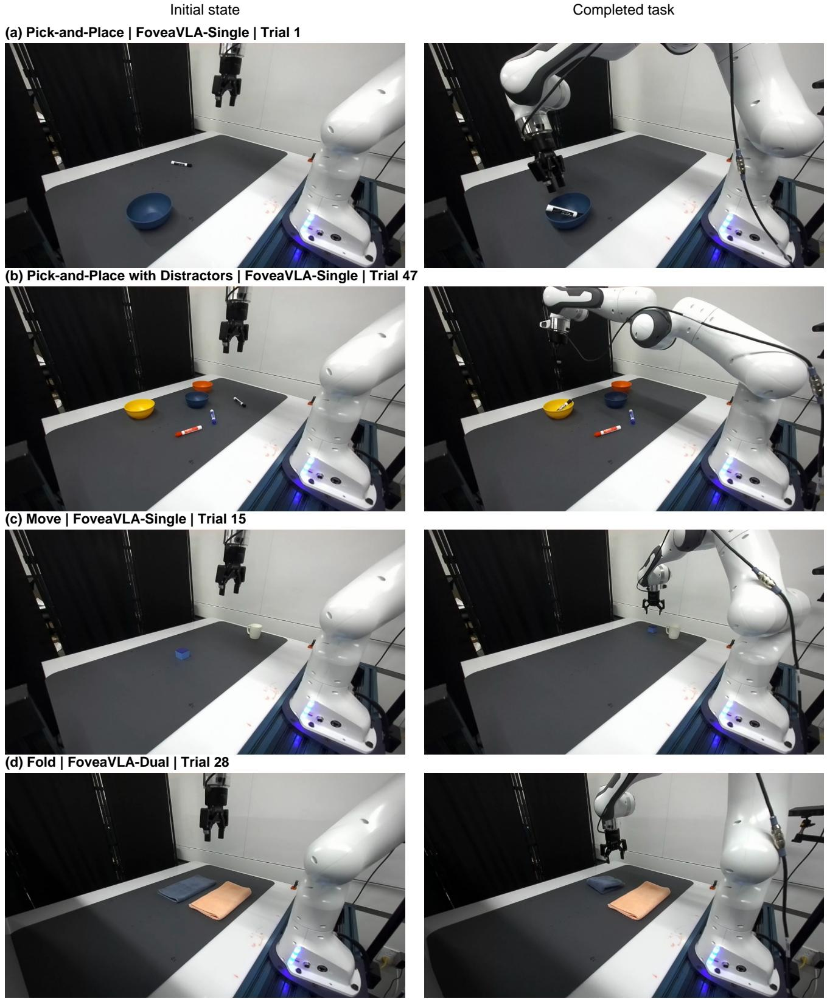
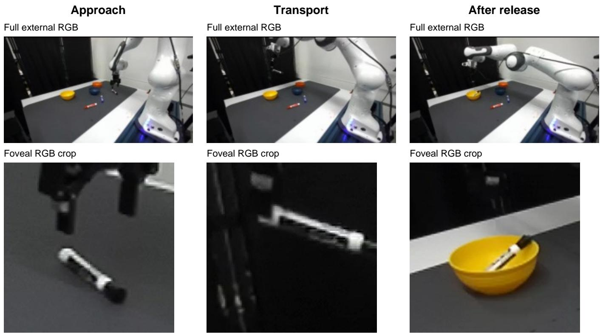

# FoveaVLA: Foveation Actions Replace the Wrist Camera in VLAs

Bingao Chen1, Lihan Zha2, C. Karen Liu1,†, Guy Tevet1,† 1Stanford University 2Princeton University

  
Fig. 1. FoveaVLA replaces the wrist camera with learned foveation actions: it predicts the next interaction region and observes it at high resolution. The wrist-equipped π matches it when the target is already in the wrist view, but degrades with distractors and far-away objects, where FoveaVLA’s foveal crop keeps the relevant detail in sight.

Abstract— We present FoveaVLA, a Vision-Language-Action (VLA) model that replaces the wrist camera with learned foveation actions. Wrist cameras provide close-up detail but restrict the view to the end-effector’s surroundings. External cameras see the whole scene, but the policy receives them at low resolution, so the fine detail needed for manipulation is lost. FoveaVLA recovers this detail by predicting, alongside each action chunk, the interaction region to observe at the next policy query. The policy then receives crops of these regions, taken from the original-resolution images, together with the full views. We build FoveaVLA on $\pi _ { 0 . 5 }$ in two configurations, Single and Dual, using one or two external stereo cameras with full and foveal RGB and depth inputs, and post-train both on DROID with RoboInter interaction annotations. Across four real-world task suites, FoveaVLA-Single achieves 70.8% success with one external RGB-D view, and FoveaVLA-Dual achieves 77.1%, versus 52.1% for the wrist-equipped $\pi _ { 0 . 5 }$ . Both match the baseline on plain pick-and-place and improve success with distractors, cloth manipulation, and far-away objects.

## I. INTRODUCTION

Recent progress in robot manipulation has been driven by large models trained on diverse robot datasets [1]–[3]. Most of these models take a wrist camera as input [4]–[6], which provides close-up observations that learned policies often depend on [7]–[9]. This close-up view comes at the cost of scene coverage: the camera moves with the endeffector, so distant targets and surrounding context can lie outside its view, more so when manipulation spans a larger workspace or involves a mobile robot. The wrist camera also adds hardware and creates an observation mismatch with human demonstrations recorded without a wrist view [10], [11]. Can a policy get the close-up detail it needs from external observations alone, so that the robot no longer needs a wrist camera?

External cameras record high-resolution images, but resizing a whole scene to the policy’s low input resolution reduces the detail available for the gripper and object, and uniformly increasing the input resolution spends computation on background regions. External views also lack a consistent geometric frame: a wrist camera maintains a fixed pose relative to the end-effector, whereas an external view depends on the camera’s placement relative to the robot. Prior work reports lower success for policies learned without wrist observations [7], [12]. We observe a similar gap on our four real-world task suites: $\pi _ { 0 . 5 }$ post-trained on two external RGB views alone achieves 25.0% success, compared with 52.1% with the wrist view.

Existing approaches obtain close-up observations through additional sensing or constructed viewpoints. Generative methods synthesize wrist images from external observations [13], [14]. Others render virtual views from 3D scene representations [15], [16], or move a camera on a dedicated arm or neck [17], [18]. Human-gaze-guided foveation is closer to our goal of selecting detail within an existing image [19], [20], but relies on gaze recorded during data collection. We instead learn where to crop from existing robot demonstrations, supervised by their interaction annotations.

Human vision allocates detail selectively. Peripheral vision provides scene context while central vision resolves the detail needed to grasp an object [21], and gaze reaches the next contact point before the hand does [22]. We take the same approach in FoveaVLA, which replaces the wrist camera with a learned foveation action that selects where to look next. Cropping the predicted interaction region from the original-resolution image and resizing it to the same 224 × 224 encoder input devotes many more pixels to the gripper and object than the resized full view does. Feeding this crop alongside the full view gives the policy both the close-up detail it needs for manipulation and the layout of the whole scene.

We build FoveaVLA on $\pi _ { 0 . 5 }$ [23]. From the current observation, it generates a robot action chunk and predicts one bounding box per external view for the interaction region at the next policy query. The predicted boxes crop the newly captured images, and the crops are added to the next policy input alongside the full views. We derive supervision from RoboInter annotations [24] on DROID demonstrations [5], constructing a bounding box around the components involved in each annotated skill, such as the gripper, object, and target region. Annotations at the next query provide targets for future-box prediction. We instantiate the method as FoveaVLA-Single and FoveaVLA-Dual, using one and two external stereo cameras, respectively, with full and foveal RGB images and aligned depth estimated from each stereo pair. Both operate without a wrist camera; Dual adds a second external viewpoint to the same foveation mechanism.

We post-train both configurations on DROID and evaluate them on the four real-world task suites. FoveaVLA-Single achieves 70.8% success using one external RGB-D view, exceeding the wrist-equipped $\pi _ { 0 . 5 }$ at 52.1%, and FoveaVLA-Dual achieves 77.1%. The largest gains are on pick-andplace with distractors, where Single raises success from 25.0% to 58.3%, and on moving far objects, from 41.7% to 75.0%. On MolmoSpaces [25], FoveaVLA-Dual achieves 22.4% average zero-shot success versus 17.8% for $\pi _ { 0 . 5 ^ { - } }$ DROID [26], outperforming it on seven of nine tasks.

## II. RELATED WORK

Wrist cameras in robot manipulation. Eye-in-hand cameras date back to visual servoing [27] and were adopted in learning-based manipulation after empirical studies showed their benefit [12]. Hsu et al. argued that the partial observability of the hand-centric view is an inductive bias that aids generalization [7]. Wrist cameras are now standard in bimanual hardware [4], handheld collection devices [6], datasets and benchmarks [5], [25], [28], and generalist policies [23], [29], [30]. Wrist-only observations can lack the scene context needed for manipulation, motivating a wideangle fisheye lens in UMI [6] and an additional external view in MV-UMI [31]. Policies also come to depend on this view: LIBERO-Plus finds that multi-view VLAs retain much of their performance with the external view masked [8], and other studies find policies including $\pi _ { 0 . 5 }$ more sensitive to masking or perturbing the wrist view [9], [32], [33].

FoveaVLA keeps the close-up that makes the wrist view valuable, without mounting a camera on the hand.

Constructed viewpoints and active vision. WristWorld generates wrist-view videos from anchor views [13], while inference-time view synthesis supplies in-hand images to a trained policy [14]. WARPED renders wrist-aligned training observations from egocentric human videos but retains a physical wrist camera during execution [34]. Others re-render the scene from virtual viewpoints using 3D scene representations, zooming coarse to fine on point clouds [16] or selecting virtual views and applying 3D zoom within a VLA [15]. Physical active-vision systems instead control a camera using demonstrations [17], [18], [35] or task reward [36]. EyeVLA predicts pan, tilt, and zoom for a physical PTZ camera [37]. Such systems require camera actuation and supervision or rewards for camera control. FoveaVLA uses fixed cameras and selects regions within the images they already capture.

Learned visual attention and foveation. Human vision resolves fine detail only in a small central region, and the eyes move this region to the grasp point before the hand arrives [21], [22], [38]. Attention models learn glimpse actions [39], and foveation also aids recognition [40] and gaze-conditioned generation [41]. VLMs retrieve local evidence through crops [42]–[45] to answer questions about a given image, whereas we use predicted regions to select the next robot observation. In manipulation, foveation has been supervised by human gaze, as a foveal crop fed to the policy [19] or gaze co-predicted with actions [20], a signal recorded with eye trackers during collection and not provided by DROID. AtVLA corrects visual attention with register tokens and, when uncertain, crops a region chosen by attention rollout [46]. Another approach trains a policy that chooses which regions a sensor captures for frozen downstream models, including a manipulation policy [47]. FoveaVLA instead decodes a future interaction box alongside each action chunk. Prior VLAs also use localization supervision [23], spatial traces [48], [49], or visual and textual affordances [50], but only as auxiliary targets that help action prediction. In FoveaVLA, the predicted box determines the crop the policy receives next, and its supervision comes from existing large-scale interaction annotations [24].

## III. PRELIMINARIES

Vision-Language-Action models. A VLA is a robot policy $\pi _ { \boldsymbol { \theta } } ( A _ { t } \mid o _ { t } , { \boldsymbol { \ell } } )$ that conditions on the current observation $o _ { t } ,$ comprising camera images and the robot state $q _ { t } .$ , and a language instruction ℓ. It outputs an action chunk $A _ { t } = ( a _ { t + 1 } , \dotsc , a _ { t + H } )$ spanning a prediction horizon of H control steps. In receding-horizon execution, the controller can execute only the first $w \leq H$ actions before replanning. A common recipe starts from a pretrained vision-language model, adds an action head, and trains the resulting policy by imitation on robot demonstrations [2], [3]. The visual encoder converts camera images into patch tokens, which the language-model backbone processes together with the instruction and robot state to form the representation used for action generation.

Backbone and action generation. We build on $\pi _ { 0 . 5 }$ [23]. Its PaliGemma backbone [51] combines a SigLIP visual encoder with a Gemma language model, while a separate action expert generates continuous action chunks through flow matching, conditioned on the observation representation. PaliGemma’s vocabulary also includes location tokens for image coordinates in detection and grounding. The $\pi _ { 0 . 5 }$ base checkpoint does not emit these tokens at inference; we reuse them to represent foveation actions in Sec. IV-B.

## IV. METHOD

FoveaVLA learns where to look alongside how to act (Fig. 2). From the full and foveal RGB-D observations, the robot state, and a task instruction, it predicts an action chunk and the interaction region for the next observation. The predicted regions determine which crops of the next external images the policy receives. We post-train it from the $\pi _ { 0 . 5 }$ base checkpoint on DROID with RoboInter annotations. FoveaVLA-Single uses one external stereo camera, and FoveaVLA-Dual uses two.

## A. Full and Foveal Observations

Let $N \in \{ 1 , 2 \}$ be the number of external views for Single and Dual, respectively. Let $I _ { t } ^ { v }$ be the source RGB image, at the camera’s original resolution, from external view $v \in$ $V = \{ 1 , \dots , N \}$ at time t, and let $b _ { t } ^ { v }$ specify the region selected for detailed observation. The full view $G _ { t } ^ { v } = \mathcal { R } ( I _ { t } ^ { v } )$ is the source image resized and padded to the encoder’s low input resolution $( 2 2 4 \times 2 2 4$ in our case). The foveal crop $F _ { t } ^ { v } = \mathcal { C } ( I _ { t } ^ { v } , b _ { t } ^ { v } )$ is a square crop around $b _ { t } ^ { v } .$ , extracted at the source resolution and resized to the same low resolution. The full view preserves the scene layout, while the foveal crop spends the same number of pixels on the interaction region.

Each external camera is a stereo camera. We use Fast-FoundationStereo [52] to estimate disparity from its rectified image pair and convert it to metric depth using the focal length and stereo baseline. The depth map $D _ { t } ^ { v }$ is aligned with $I _ { t } ^ { v }$ and provides an explicit distance cue. We apply the same resizing and cropping to depth as to RGB, giving $D _ { G , t } ^ { v }$ and $D _ { F , t } ^ { v }$ . Depth is mapped through a fixed logarithmic scale and colorized for the visual encoder; patches with insufficient valid depth are masked. The resulting observation is $o _ { t } = \left( q _ { t } , \left\{ G _ { t } ^ { v } , F _ { t } ^ { v } , D _ { G , t } ^ { v } , D _ { F , t } ^ { v } \right\} _ { v = 1 } ^ { N } \right)$ , where $q _ { t }$ contains the robot’s joint positions and gripper state. RGB and colorized depth use the same visual encoder and enter the transformer as separate sequences of visual tokens. The task instruction ℓ and discretized robot state complete the shared input prefix.

## B. Foveation Actions

We extend the VLA policy defined in Sec. III to predict one bounding box per external view alongside the robot action chunk. Each box describes the interaction region at $t + w ,$ , when the policy is queried next after executing the first w actions. We predict $H \ = \ 1 6$ actions and execute $w = 8$ per query (Appendix B). We target t + w because the gripper and objects move during the executed actions, and apply the predicted box to the image captured at that time.

Denoting $B _ { t + w } = \{ b _ { t + w } ^ { v } \} _ { v \in V }$ for the foveation actions, the joint policy factorizes as

$$
\pi _ { \boldsymbol { \theta } } ( A _ { t } , B _ { t + w } \mid o _ { t } , \ell ) = \pi _ { \boldsymbol { \theta } } ( A _ { t } \mid o _ { t } , \ell ) p _ { \boldsymbol { \theta } } ( B _ { t + w } \mid o _ { t } , \ell ) .\tag{1}
$$

The two outputs share the observation representation, but are predicted by two independent heads: the action expert generates $A _ { t } ,$ and the language-model head decodes $B _ { t + w }$

We initialize FoveaVLA from the $\pi _ { 0 . 5 }$ base checkpoint, retaining its backbone and flow-matching action expert. To predict $B _ { t + w } ,$ , we reuse the language-model output head to autoregressively decode the existing location tokens introduced in Sec. III.

Each box is represented by four coordinates on the resized and padded full view, quantized into 1,024 bins and serialized in $( y _ { \mathrm { m i n } } , x _ { \mathrm { m i n } } , y _ { \mathrm { m a x } } , x _ { \mathrm { m a x } } )$ order. The boxes form a sequence of 4N location tokens: four for Single and eight for Dual. The output vocabulary is restricted to location tokens. The action expert attends to the shared input prefix, while each box token also attends to the preceding box tokens. The two output branches are masked from each other.

Let $\hat { b } _ { t + w } ^ { v }$ denote the predicted box in source-image coordinates. It determines the next foveal observation through $F _ { t + w } ^ { v } = \mathcal { C } \Big ( I _ { t + w } ^ { v } , \hat { b } _ { t + w } ^ { v } \Big )$ , with the same crop applied to the aligned depth map.

## C. Learning from Interaction Annotations

We derive foveation supervision from the RoboInter annotations associated with DROID demonstrations [5], [24]. For each annotated frame and external view, we construct one interaction box as the smallest axis-aligned rectangle enclosing the components required by the annotated primitive skill. Figure 3 illustrates transfer and fold; both use the gripper, manipulated object, and annotated target region. Appendix A specifies the complete role mapping and preprocessing procedure. The interaction box defines the supervision target; the foveal crop is a square region enclosing this box, extracted as described in Sec. IV-A.

A training example pairs the observation and demonstrated action chunk at t with the interaction boxes at $t + w$ . To improve robustness to imperfect predictions, we augment ground-truth crops at t by perturbing their centers and scales while retaining the annotated region. Some crops are replaced by full views to match the initial query at inference. RGB and depth share the same crop geometry. Training examples require valid current and future annotations in the selected view for Single and in both views for Dual.

During post-training, we jointly optimize action generation and foveation prediction. For the action objective, we interpolate between a demonstrated chunk $A _ { t }$ and Gaussian noise $\epsilon \sim \mathcal { N } ( 0 , I )$ as $A _ { t } ^ { \tau } = ( 1 - \tau ) A _ { t } { + \tau } \epsilon .$ , where $\tau \in [ 0 , 1 ]$ is the flow time. The action expert vθ learns the corresponding velocity field:

$$
\mathcal { L } _ { \mathrm { f o w } } = \mathbb { E } _ { \mathcal { D } , \tau , \epsilon } \left[ \left\| v _ { \theta } ( A _ { t } ^ { \tau } , o _ { t } , \ell , \tau ) - ( \epsilon - A _ { t } ) \right\| ^ { 2 } \right] ,\tag{2}
$$

where the squared error is averaged over action entries.

  
Fig. 2. FoveaVLA overview (Single shown). Full and foveal RGB images and aligned depth maps are encoded together with the task instruction and robot state. From this shared representation, the action expert generates an action chunk, while the language-model head autoregressively generates interaction boxes that select the foveal crops for the next observation. Dual adds the same four image inputs from a second external view and predicts one box per view.

  
Fig. 3. Interaction boxes and foveal crops. RoboInter annotations on DROID define interaction boxes (green) enclosing skill-relevant components; square foveal crops (purple) provide detailed visual inputs.

For foveation prediction, let $z _ { 1 : 4 N } ^ { * }$ be the location tokens for the N annotated future boxes. We train their prediction with teacher forcing:

$$
\mathcal { L } _ { \mathrm { f o v e a t i o n } } = - \mathbb { E } _ { \mathcal { D } , j } \left[ \log p _ { \theta } ( z _ { j } ^ { * } \mid o _ { t } , \ell , z _ { < j } ^ { * } ) \right] ,\tag{3}
$$

where the expectation averages over training examples and uniformly over the 4N token positions. The total loss is

$$
\begin{array} { r } { \mathcal { L } = \mathcal { L } _ { \mathrm { f l o w } } + \lambda \mathcal { L } _ { \mathrm { f o v e a t i o n } } , } \end{array}\tag{4}
$$

with $\lambda = 0 . 1$ . Both losses update the shared backbone. We additionally apply dropout to the depth streams to train with partial depth availability.

## D. Closed-Loop Inference

The initial foveal inputs are the full views. Subsequent foveal inputs use the preceding box predictions to crop the current RGB images and aligned depth maps, as described in Sec. IV-B. Each policy query encodes the observation prefix once for both outputs. The action expert generates the chunk by integrating the learned flow from noise to actions, and the chunk is returned immediately; the bounding box location tokens are then decoded greedily from the cached prefix while the robot executes the first w actions, so the boxes are ready when the next frames arrive at $t + w$

## V. EXPERIMENTS

We evaluate learned foveation through five questions:

• (Q1) Can learned foveation replace the wrist camera?

• (Q2) What do foveal crops add beyond box supervision?

• (Q3) What do depth and a second view add?

• (Q4) Does the policy transfer to unseen environments?

• (Q5) Can the policy predict where to look next?

## A. Experimental Setup

a) Data and training: We post-train FoveaVLA from the $\pi _ { 0 . 5 }$ base checkpoint on DROID [5], comprising ∼ 75K teleoperated Franka Panda episodes with a Robotiq 2F-85 gripper, two external stereo cameras, and a wrist camera. Our models use only external views and RoboInter interactionbox supervision [24] (Sec. IV-C), following the open-source training recipe [26]. All models are trained on eight NVIDIA H100 GPUs with a global batch size of 256. Appendix A details the data construction, and Appendix B gives the training and inference settings for Single and Dual.

  
Fig. 4. Real-world task success of wrist-equipped $\pi _ { 0 . 5 }$ and the two FoveaVLA variants, which use only external camera views. Each suite contains 12 shared trials. Bar labels are rounded to the nearest integer; Table I reports precise success rates, SEM, and all baselines.

b) Tasks and protocol: We evaluate on the real DROID setup across four suites: uncluttered, near-object Pick-and-Place; Pick-and-Place with Distractors; Fold/Unfold with near and far cloth placements; and Move with far objects. All methods share the same 12 randomized object, placement, and prompt instances per suite (48 trials total). The external cameras are placed by hand without extrinsic calibration. Appendix D lists the complete task instances and success criteria. Trials run at a target 15 Hz for at most 900 control steps, stopping early if continued execution risks robot damage. Success requires full task completion; we report mean success ± standard error of the mean (SEM), in percent, over 12 trials per suite and pool all 48 for Overall.

c) Models and comparisons: FoveaVLA-Single and FoveaVLA-Dual use one and two external RGB-D views, respectively, with full and foveal RGB and depth inputs (four images per view). We compare against wrist-equipped $\pi _ { 0 . 5 } .$ which shares our base checkpoint and training data, and its deployment-time wrist blackout, $\scriptstyle \pi _ { 0 . 5 } - \mathbf { B l a c k o u t } ;$ $\pi _ { 0 . 5 } \cdot$ Single-External and $\pi _ { 0 . 5 } { \bf - D u a l - E x t e r n a l }$ variants, which were post-trained with one or two full external RGB views without a wrist view, box prediction, or crops; and $\pi _ { 0 . 5 } \cdot$ Single-External-RGB-D and π -Dual-External-RGB-D, which add depth to the full views. ECoT-inspired [49] uses two external RGB views and our box supervision but no crops. FoveaVLA-Single-RGB and FoveaVLA-Dual-RGB retain foveation while removing depth from Single and Dual.

The blackout tests how much $\pi _ { 0 . 5 }$ relies on the wrist view at deployment, and the external-only baselines test how well a policy learns from external views alone.

## B. Replacing the Wrist Camera (Q1)

FoveaVLA-Single achieves 70.8% overall success using one external RGB-D view and FoveaVLA-Dual 77.1%, compared with 52.1% for wrist-equipped $\pi _ { 0 . 5 }$ . Both match the baseline’s 100.0% success on plain Pick-and-Place and achieve higher success on the other three suites (Fig. 4). Table I reports all baselines and ablations.

a) Close-up detail across the workspace: With a single external RGB-D view, success on Distractors rises from the wrist-equipped baseline’s 25.0% to 58.3%, and success on Move rises from 41.7% to 75.0%. Dual achieves the strongest Fold/Unfold and Move results (75.0% and 83.3%). Figure 5 suggests why: $\pi _ { 0 . 5 }$ places almost all image attention on the wrist view and almost none on the external view, so it can miss a target outside the wrist view. FoveaVLA keeps attending to the full external views, which cover the workspace, while the crops add close-up detail.

b) Inference latency: On an RTX 5080, FoveaVLA-Single takes approximately 125 ms per policy query (prefix encoding and action generation) and 50 ms for cachedprefix box decoding. FoveaVLA-Dual takes roughly twice as long. Box timing includes all camera views and coordinate conversion. At our control rate, box decoding fits within action-chunk execution, so the predicted boxes are ready when the next observation arrives.

## C. Local Detail and Geometric Cues

The ablations in Table I show that replacing the wrist view needs two things: a detailed view of the interaction and geometric cues relating the gripper to its target.

a) Observing the predicted region (Q2): Foveal crops improve success over full views alone, with both RGB and RGB-D. With RGB-D inputs, the single- and dual-view baselines without crops achieve 6.3% and 41.7% overall, compared with 70.8% and 77.1% with foveal crops, with gains in all four suites. With two RGB views, we can separate the effect of box supervision from that of the crops: π0.5- Dual-External reaches 25.0%, box supervision without crops (ECoT-inspired) reaches 31.3%, and FoveaVLA-Dual-RGB reaches 66.7%. Box supervision alone adds 6.3 percentage points, and the crops add a further 35.4.

b) Combining detail with depth (Q3): With a single view, neither cue suffices on its own. Foveal crops without depth achieve 20.8% overall success, and depth without crops achieves 6.3%; bringing foveal detail and depth together raises success to 70.8%. Depth also improves the dual-view models, from 25.0% to 41.7% with full views and from 66.7% to 77.1% with foveation.

TABLE I  
REAL-WORLD SUCCESS (%, MEAN ± SEM) ON 12 SHARED TRIALS PER SUITE; OVERALL POOLS ALL 48. BOLD/UNDERLINE: BEST/SECOND-BEST; TIED SCORES SHARE THE MARK.
<table><tr><td>Method</td><td>Pick-and-Place (plain)</td><td>Pick-and-Place (w/ Distractors)</td><td>Fold/Unfold</td><td>Move (far objects)</td><td>Overall</td></tr><tr><td> $\pi _ { 0 . 5 } \ [ 2 3 ]$ </td><td> ${ \bf 1 0 0 . 0 \dot { \bf \Phi } } \pm { \bf 0 . 0 }$ </td><td> $2 5 . 0 \pm 1 3 . 1$ </td><td> $4 1 . 7 \pm 1 4 . 9$ </td><td> $4 1 . 7 \pm 1 4 . 9$ </td><td> $5 2 . 1 \pm 7 . 3$ </td></tr><tr><td> $\pi _ { 0 . 5 } – \mathbf { B } \mathbf { l a c k o u t }$ </td><td> $0 . 0 \pm 0 . 0$ </td><td> $0 . 0 \pm 0 . 0$ </td><td> $0 . 0 \pm 0 . 0$ </td><td> $0 . 0 \pm 0 . 0$ </td><td> $0 . 0 \pm 0 . 0$ </td></tr><tr><td>π0.5-Single-External</td><td> $1 6 . 7 \pm 1 1 . 2$ </td><td> $0 . 0 \pm 0 . 0$ </td><td> $0 . 0 \pm 0 . 0$ </td><td> $8 . 3 \pm 8 . 3$ </td><td> $6 . 3 \pm 3 . 5$ </td></tr><tr><td> $\pi _ { 0 . 5 } \mathrm { - D u a l - E x t e r n a l }$ </td><td> $5 0 . 0 \pm 1 5 . 1$ </td><td> $1 6 . 7 \pm 1 1 . 2$ </td><td> $1 6 . 7 \pm 1 1 . 2$ </td><td> $1 6 . 7 \pm 1 1 . 2$ </td><td> $2 5 . 0 \pm 6 . 3$ </td></tr><tr><td>ECoT-inspired [49]</td><td> $6 6 . 7 \pm 1 4 . 2$ </td><td> $1 6 . 7 \pm 1 1 . 2$ </td><td> $1 6 . 7 \pm 1 1 . 2$ </td><td> $2 5 . 0 \pm 1 3 . 1$ </td><td> $3 1 . 3 \pm 6 . 8$ </td></tr><tr><td>π0.5-Single-External-RGB-D</td><td> $8 . 3 \pm 8 . 3$ </td><td> $8 . 3 \pm 8 . 3$ </td><td> $0 . 0 \pm 0 . 0$ </td><td> $8 . 3 \pm 8 . 3$ </td><td> $6 . 3 \pm 3 . 5$ </td></tr><tr><td> $\pi _ { 0 . 5 } { \mathrm { - D u a l - E x t e r n a l - R G B - D } }$ </td><td> $5 8 . 3 \pm 1 4 . 9$ </td><td> $4 1 . 7 \pm 1 4 . 9$ </td><td> $2 5 . 0 \pm 1 3 . 1$ </td><td> $4 1 . 7 \pm 1 4 . 9$ </td><td> $4 1 . 7 \pm 7 . 2$ </td></tr><tr><td>FoveaVLA-Single-RGB</td><td> $3 3 . 3 \pm 1 4 . 2$ </td><td> $2 5 . 0 \pm 1 3 . 1$ </td><td> $8 . 3 \pm 8 . 3$ </td><td> $1 6 . 7 \pm 1 1 . 2$ </td><td> $2 0 . 8 \pm 5 . 9$ </td></tr><tr><td> $\mathrm { F o v e a V L A \mathrm { - D u a l \mathrm { - } R G B } }$ </td><td> ${ \bf 1 0 0 . 0 \dot { \bf \Phi } } \pm { \bf 0 . 0 }$ </td><td> $4 1 . 7 \pm 1 4 . 9$ </td><td> ${ \underline { { 5 8 . 3 \pm 1 4 . 9 } } }$ </td><td> $6 6 . 7 \pm 1 4 . 2$ </td><td> $6 6 . 7 \pm 6 . 9$ </td></tr><tr><td>FoveaVLA-Single (ours)</td><td> ${ \bf 1 0 0 . 0 \dot { \bf \Phi } } \pm { \bf 0 . 0 }$ </td><td> ${ \pm } 8 . 3 { \pm } 1 4 . 9$ </td><td> $5 0 . 0 \pm 1 5 . 1$ </td><td> $7 5 . 0 \pm 1 3 . 1$ </td><td> $7 0 . 8 \pm 6 . 6$ </td></tr><tr><td>FoveaVLA-Dual (ours)</td><td> ${ \bf 1 0 0 . 0 \dot { \bf \Phi } } \pm { \bf 0 . 0 }$ </td><td> $5 0 . 0 \pm 1 5 . 1$ </td><td> ${ 7 5 . 0 \pm 1 3 . 1 }$ </td><td> ${ \bf 8 3 . 3 \pm 1 1 . 2 }$ </td><td> $7 7 . 1 \pm 6 . 1$ </td></tr></table>

c) A complementary viewpoint (Q3): With foveal crops but no depth, a second external view raises success from 20.8% to 66.7%, approaching the 70.8% of Single with RGB-D. This suggests that a second view supplies part of the geometric information that depth provides: adding depth yields a larger gain with one view than with two (50.0 versus 10.4 percentage points). With RGB-D, the second view raises overall success from 70.8% to 77.1%, with gains on Fold/Unfold and Move, while Single remains best on Distractors (58.3% versus 50.0%).

## D. Zero-Shot Generalization (Q4)

We deploy the FoveaVLA-Dual zero-shot on Molmo-Spaces [25], a photorealistic simulation benchmark with a DROID-matched Franka setup and procedurally generated scenes unseen in training. Our evaluation uses two adapted external camera views and simulator-provided depth; Table II lists published $\pi _ { 0 . 5 } – \mathrm { D R O I D }$ leaderboard scores for reference. Appendix C specifies the observation and evaluation protocols. Over 8,915 trials, FoveaVLA-Dual achieves 22.4% average zero-shot success, versus the 17.8% published reference, with higher scores on seven of nine tasks. The largest differences are on Pick-v1.5 (33.7% versus 18.1%) and Pick&Place-Color-v2 (20.8% versus 10.4%).

## E. Foveation Prediction (Q5)

We evaluate how well FoveaVLA predicts the next interaction region on held-out DROID interaction boxes, alongside PaliGemma [51], $\pi _ { 0 . 5 } – \mathrm { D R O I D } ,$ SAM3 [53], and fine-tuned YOLO11s [54] (Table III). Our model predicts the region at $t + w$ from frame t. PaliGemma, SAM3, and YOLO11s receive the target frame and annotation-derived role information; PaliGemma and SAM3 use role-specific text prompts, while YOLO11s uses the annotated primitive to select the detected roles.

Our future-box predictions achieve 0.465 mIoU and 0.483 Acc@.5, comparable to YOLO11s at 0.492 and 0.488 despite predicting before the target frame is available. They also exceed $\pi _ { 0 . 5 } – \mathrm { D R O I D }$ , PaliGemma + PG, and $\mathrm { S A M 3 } + \mathrm { P G }$ The increase from $\pi _ { 0 . 5 } – \mathrm { D R O I D ^ { \circ } s }$ 0.009 mIoU shows the value of interaction-box supervision. Because FoveaVLA decodes its box during action execution, it adds no wait when the new observation arrives, whereas YOLO11s, which needs the target frame, adds 29 ms.

TABLE II  
ZERO-SHOT SUCCESS (%) ON MOLMOSPACES. π0 $\scriptstyle . 5 - \mathrm { D R O I D } \colon$ REPORTED LEADERBOARD REFERENCE; OUR CAMERA AND DEPTH PROTOCOL IS DETAILED IN APPENDIX C. AVERAGE: UNWEIGHTED TASK MEAN. BOLD: BETTER SCORE.
<table><tr><td>Task</td><td> $\pi _ { 0 . 5 } – \mathrm { D R O I D }$ </td><td>FoveaVLA-Dual (ours)</td></tr><tr><td>Pick-v1.5</td><td>18.1</td><td>33.7</td></tr><tr><td>Pick-v2-Classic</td><td>6.4</td><td>9.7</td></tr><tr><td>Pick-v2-Filament</td><td>7.0</td><td>10.6</td></tr><tr><td>Pick-v2-RandCam</td><td>8.0</td><td>5.5</td></tr><tr><td>Pick&amp;Place-v2</td><td>12.0</td><td>17.0</td></tr><tr><td>Pick&amp;Place-NextTo-v2</td><td>10.3</td><td>14.9</td></tr><tr><td>Pick&amp;Place-Color-v2</td><td>10.4</td><td>20.8</td></tr><tr><td>Open-v1</td><td>22.7</td><td>25.6</td></tr><tr><td>Close-v1</td><td>65.1</td><td>63.9</td></tr><tr><td>Average</td><td>17.8</td><td>22.4</td></tr></table>

## VI. CONCLUSION

FoveaVLA makes the selection of visual detail part of the robot policy: alongside each action chunk, it predicts the interaction regions that form its next foveal observations. On four real-world task suites, FoveaVLA-Single achieves 70.8% success with one external RGB-D view, versus 52.1% for the wrist-equipped baseline, and FoveaVLA-Dual reaches 77.1%. With a single view, both foveal detail and depth are needed. FoveaVLA-Dual also transfers zero-shot to simulated MolmoSpaces scenes. Because it needs no wrist view, FoveaVLA could also learn from demonstrations recorded without wrist cameras, including human videos.

  
Fig. 5. Image attention analysis on a Move episode. π0.5 [23] attends almost exclusively to the wrist view for the whole episode, while FoveaVLA keeps a steady share on the full external views and draws close-up detail from the foveal crops. Left: attention share per view over time, with three keyframes marked. Right: attention maps at those keyframes; each model is colored relative to its own 99th percentile, so brightness is not comparable across the two panels.

TABLE III  
HELD-OUT DROID BOX LOCALIZATION. FT: BOX FINE-TUNING; PG: PROJECTED GRIPPER (∗: FITTED ON TRAINING ANNOTATIONS). WAIT: ADDED DELAY AFTER A NEW OBSERVATION ARRIVES. BOLD/UNDERLINE: BEST/SECOND-BEST, INCLUDING TIES.
<table><tr><td>Method</td><td>FT</td><td></td><td></td><td></td><td>Frame Acc@.5 ↑ mIoU ↑ Wait (ms) ↓</td></tr><tr><td>π0.5-DROID</td><td>No</td><td>t</td><td>0.002</td><td>0.009</td><td>0</td></tr><tr><td>PaliGemma + PG</td><td>No*</td><td> $t + w$ </td><td>0.132</td><td>0.207</td><td>427</td></tr><tr><td>SAM3 + PG</td><td>No*</td><td> $t + w$ </td><td>0.305</td><td>0.347</td><td>690</td></tr><tr><td>YOL011s</td><td>Yes</td><td> $t + w$ </td><td>0.488</td><td>0.492</td><td>29</td></tr><tr><td>FoveaVLA (ours)</td><td>Yes</td><td>t</td><td>0.483</td><td>0.465</td><td>0</td></tr></table>

## ACKNOWLEDGMENT

This work was supported by NSF:FRR 2153854, the Stanford Institute for Human-Centered AI (HAI), and Amazon. This work used Marlowe [55], Stanford University’s GPUbased Computational Instrument, supported by Stanford HAI and Stanford Research Computing. We thank Michael Piseno, Haoquan Fang, Chongkai Gao, Zhi (Leo) Wang, and Baifeng Shi for their insightful discussions.

## REFERENCES

[1] A. O’Neill, A. Rehman, A. Maddukuri, A. Gupta, A. Padalkar, A. Lee, A. Pooley, A. Gupta, A. Mandlekar, A. Jain, et al., “Open X-Embodiment: Robotic learning datasets and RT-X models,” in IEEE International Conference on Robotics and Automation (ICRA), 2024, pp. 6892–6903.

[2] M. J. Kim, K. Pertsch, S. Karamcheti, T. Xiao, A. Balakrishna, S. Nair, R. Rafailov, E. P. Foster, P. R. Sanketi, Q. Vuong, T. Kollar, B. Burchfiel, R. Tedrake, D. Sadigh, S. Levine, P. Liang, and C. Finn, “OpenVLA: An open-source vision-language-action model,” in Proceedings of The 8th Conference on Robot Learning, vol. 270. PMLR, 2025, pp. 2679–2713.

[3] K. Black, N. Brown, D. Driess, A. Esmail, M. R. Equi, C. Finn, N. Fusai, L. Groom, K. Hausman, B. Ichter, et al., “π0: A visionlanguage-action flow model for general robot control,” in Proceedings of Robotics: Science and Systems, 2025.

[4] T. Z. Zhao, V. Kumar, S. Levine, and C. Finn, “Learning fine-grained bimanual manipulation with low-cost hardware,” in Proceedings of Robotics: Science and Systems, 2023.

[5] A. Khazatsky, K. Pertsch, S. Nair, A. Balakrishna, S. Dasari, S. Karamcheti, S. Nasiriany, M. K. Srirama, L. Y. Chen, K. Ellis, et al., “DROID: A large-scale in-the-wild robot manipulation dataset,” in Proceedings of Robotics: Science and Systems, 2024.

[6] C. Chi, Z. Xu, C. Pan, E. Cousineau, B. Burchfiel, S. Feng, R. Tedrake, and S. Song, “Universal manipulation interface: In-the-wild robot teaching without in-the-wild robots,” in Proceedings of Robotics: Science and Systems, 2024.

[7] K. Hsu, M. J. Kim, R. Rafailov, J. Wu, and C. Finn, “Vision-based manipulators need to also see from their hands,” in International Conference on Learning Representations, 2022.

[8] S. Fei, S. Wang, J. Shi, Z. Dai, J. Cai, P. Qian, L. Ji, X. He, S. Zhang, Z. Fei, et al., “LIBERO-Plus: A progressive robustness benchmark for visual-language-action models,” in IEEE/CVF Conference on Computer Vision and Pattern Recognition (CVPR), 2026, pp. 38 574– 38 583.

[9] B. Huang, B. Wei, Y. Cai, and Z. Wang, “Selective cross-view consistency for world action models: Held-out viewpoint robustness without test-time camera information,” arXiv preprint arXiv:2608.21402, 2026.

[10] S. Kareer, D. Patel, R. Punamiya, P. Mathur, S. Cheng, C. Wang, J. Hoffman, and D. Xu, “EgoMimic: Scaling imitation learning via egocentric video,” in IEEE International Conference on Robotics and Automation (ICRA), 2025, pp. 13 226–13 233.

[11] M. Lepert, J. Fang, and J. Bohg, “Phantom: Training robots without robots using only human videos,” in Proceedings of The 9th Conference on Robot Learning, vol. 305. PMLR, 2025, pp. 4545–4565.

[12] A. Mandlekar, D. Xu, J. Wong, S. Nasiriany, C. Wang, R. Kulkarni, L. Fei-Fei, S. Savarese, Y. Zhu, and R. Martín-Martín, “What matters in learning from offline human demonstrations for robot manipulation,” in Proceedings of the 5th Conference on Robot Learning, vol. 164. PMLR, 2022, pp. 1678–1690.

[13] Z. Qian, X. Chi, Y. Li, S. Wang, Z. Qin, X. Ju, S. Han, and S. Zhang, “WristWorld: Generating wrist-views via 4D world models for robotic manipulation,” arXiv preprint arXiv:2510.07313, 2025.

[14] H. Ding, A. Duan, Z. Sun, D. Song, and Y. Nakamura, “Imagination at inference: Synthesizing in-hand views for robust visuomotor polic inference,” arXiv preprint arXiv:2509.15717, 2025.

[15] Z. Liu, Y. Gu, Y. Wang, X. Xue, and Y. Fu, “ActiveVLA: Injecting active perception into vision-language-action models for precise 3D

robotic manipulation,” in IEEE/CVF Conference on Computer Vision and Pattern Recognition (CVPR), 2026, pp. 8141–8151.

[16] A. Goyal, V. Blukis, J. Xu, Y. Guo, Y.-W. Chao, and D. Fox, “RVT-2: Learning precise manipulation from few demonstrations,” in Proceedings of Robotics: Science and Systems, 2024.

[17] I. Chuang, A. Lee, D. Gao, M.-M. Naddaf-Sh, and I. Soltani, “Active vision might be all you need: Exploring active vision in bimanual robotic manipulation,” in IEEE International Conference on Robotics and Automation (ICRA), 2025, pp. 7952–7959.

[18] H. Xiong, X. Xu, J. Wu, Y. Hou, J. Bohg, and S. Song, “Vision in action: Learning active perception from human demonstrations,” in Proceedings of The 9th Conference on Robot Learning, vol. 305. PMLR, 2025, pp. 5450–5463.

[19] H. Kim, Y. Ohmura, and Y. Kuniyoshi, “Gaze-based dual resolution deep imitation learning for high-precision dexterous robot manipulation,” IEEE Robotics and Automation Letters, vol. 6, no. 2, pp. 1630– 1637, 2021.

[20] I. Chuang, J. Zou, A. Lee, D. Gao, and I. Soltani, “Look, focus, act: Efficient and robust robot learning via human gaze and foveated vision transformers,” arXiv preprint arXiv:2507.15833, 2025.

[21] B. Sivak and C. L. MacKenzie, “Integration of visual information and motor output in reaching and grasping: the contributions of peripheral and central vision,” Neuropsychologia, vol. 28, no. 10, pp. 1095–1116, 1990.

[22] R. S. Johansson, G. Westling, A. Bäckström, and J. R. Flanagan, “Eye–hand coordination in object manipulation,” The Journal of Neuroscience, vol. 21, no. 17, pp. 6917–6932, 2001.

[23] K. Black, N. Brown, J. Darpinian, K. Dhabalia, D. Driess, A. Esmail, M. R. Equi, C. Finn, N. Fusai, M. Y. Galliker, et al., “π0.5: A visionlanguage-action model with open-world generalization,” in Proceedings of The 9th Conference on Robot Learning, vol. 305. PMLR, 2025, pp. 17–40.

[24] H. Li, Z. Wang, Z.-h. Ding, S. Yang, Y. Chen, Y. Tian, X. Hu, T. Wang, D. Lin, F. Zhao, S. Liu, and J. Pang, “RoboInter: A holistic intermediate representation suite towards robotic manipulation,” in International Conference on Learning Representations, 2026, pp. 113 314–113 381.

[25] Y. Kim, W. Pumacay, O. Rayyan, M. Argus, W. Han, E. VanderBilt, J. Salvador, A. Deshpande, R. Hendrix, S. Jauhri, et al., “MolmoSpaces: A large-scale open ecosystem for robot navigation and manipulation,” arXiv preprint arXiv:2602.11337, 2026.

[26] Physical Intelligence, “openpi: Open-source models and packages for robotics,” https://github.com/Physical-Intelligence/openpi, 2025, GitHub repository.

[27] F. Chaumette and S. Hutchinson, “Visual servo control. I. Basic approaches,” IEEE Robotics & Automation Magazine, vol. 13, no. 4, pp. 82–90, 2006.

[28] B. Liu, Y. Zhu, C. Gao, Y. Feng, Q. Liu, Y. Zhu, and P. Stone, “LIBERO: Benchmarking knowledge transfer for lifelong robot learning,” in Advances in Neural Information Processing Systems, vol. 36, 2023, pp. 44 776–44 791.

[29] S. Liu, L. Wu, B. Li, H. Tan, H. Chen, Z. Wang, K. Xu, H. Su, and J. Zhu, “RDT-1B: A diffusion foundation model for bimanual manipulation,” in International Conference on Learning Representations, 2025, pp. 29 982–30 009.

[30] M. J. Kim, C. Finn, and P. Liang, “Fine-tuning vision-language-action models: Optimizing speed and success,” in Proceedings of Robotics: Science and Systems, 2025.

[31] O. Rayyan, J. Abanes, M. Hafez, A. Tzes, and F. J. Abu-Dakka, “MV-UMI: A scalable multi-view interface for cross-embodiment learning,” IEEE Access, vol. 14, pp. 104 545–104 555, 2026.

[32] H. Heo, S. Woo, S. M. Kim, J. Kim, J. Lee, Y. Lee, and Y. M. Kim, “AnyCamVLA: Zero-shot camera adaptation for viewpoint robust vision-language-action models,” in IEEE/RSJ International Conference on Intelligent Robots and Systems (IROS), 2026.

[33] J. X. Yang, R. Dagli, A. Zook, H. Hadfield, A. Goyal, S. Birchfield, F. Ramos, and J. Tremblay, “RoboLab: A high-fidelity simulation benchmark for analysis of task generalist policies,” in Proceedings of Robotics: Science and Systems, 2026.

[34] H. Freeman, C. H. Kim, and G. Kantor, “WARPED: Wrist-aligned rendering for robot policy learning from egocentric human demonstrations,” arXiv preprint arXiv:2604.10809, 2026.

[35] J. Yu, Y. Shentu, D. Wu, P. Abbeel, K. Goldberg, and P. Wu, “EgoMI: Learning active vision and whole-body manipulation from egocentric

human demonstrations,” in IEEE International Conference on Robotics and Automation (ICRA), 2026.

[36] J. Kerr, K. Hari, E. Weber, C. M. Kim, B. Yi, T. Bonnen, K. Goldberg, and A. Kanazawa, “Eye, Robot: Learning to look to act with a BC-RL perception-action loop,” in Proceedings of The 9th Conference on Robot Learning, vol. 305. PMLR, 2025, pp. 3647–3664.

[37] J. Yang, Y. Han, Y. Xie, N. Guo, and W. Lian, “Look, zoom, understand: The robotic eyeball for embodied perception,” arXiv preprint arXiv:2511.15279, 2025.

[38] H. Strasburger, I. Rentschler, and M. Jüttner, “Peripheral vision and pattern recognition: A review,” Journal of Vision, vol. 11, no. 5, p. 13, 2011.

[39] V. Mnih, N. Heess, A. Graves, and K. Kavukcuoglu, “Recurrent models of visual attention,” in Advances in Neural Information Processing Systems, vol. 27, 2014.

[40] N. M. Blauch, G. A. Alvarez, and T. Konkle, “FOVI: A biologicallyinspired foveated interface for deep vision models,” in Forty-third International Conference on Machine Learning, 2026.

[41] B. Chao, L. Yariv, H. Xiao, and G. Wetzstein, “Foveated diffusion: Efficient spatially adaptive image and video generation,” arXiv preprint arXiv:2603.23491, 2026.

[42] P. Wu and S. Xie, “V\*: Guided visual search as a core mechanism in multimodal LLMs,” in IEEE/CVF Conference on Computer Vision and Pattern Recognition (CVPR), 2024, pp. 13 084–13 094.

[43] Z. Zheng, M. Yang, J. Hong, C. Zhao, G. Xu, L. Yang, C. Shen, and X. Yu, “DeepEyes: Incentivizing ‘thinking with images’ via reinforcement learning,” in International Conference on Learning Representations, 2026, pp. 126 775–126 798.

[44] N. Shabtay, M. Kimhi, A. Spector, S. Haray, E. Rivlin, C. Baskin, R. Giryes, and E. Schwartz, “Look where it matters: High-resolution crops retrieval for efficient VLMs,” arXiv preprint arXiv:2603.16932, 2026.

[45] J. Min, L. Valkov, V. Petsiuk, H. Souri, and D. D. Mohan, “Foveated reasoning: Stateful, action-based visual focusing for vision-language models,” in European Conference on Computer Vision (ECCV), 2026.

[46] J. Cui, Y. Hu, X. Long, L. Li, B. Zhao, and P. Ren, “Look where it matters: Adaptive visual refinement for vision-language-action models,” arXiv preprint arXiv:2608.02197, 2026.

[47] H. Xiao, J. Ackermann, B. Deng, and G. Wetzstein, “Policy-based foveated imaging and perception,” in ACM SIGGRAPH Conference Papers. New York, NY, USA: Association for Computing Machinery, 2026, pp. 87:1–87:11.

[48] J. Lee, J. Duan, H. Fang, Y. Deng, S. Liu, B. Li, B. Fang, J. Zhang, Y. R. Wang, S. Lee, et al., “MolmoAct: Action reasoning models that can reason in space,” in IEEE International Conference on Robotics and Automation (ICRA), 2026.

[49] M. Zawalski, W. Chen, K. Pertsch, O. Mees, C. Finn, and S. Levine, “Robotic control via embodied chain-of-thought reasoning,” in Proceedings of The 8th Conference on Robot Learning, vol. 270. PMLR, 2025, pp. 3157–3181.

[50] J. Li, Y. Zhu, Z. Tang, J. Wen, M. Zhu, X. Liu, C. Li, R. Cheng, Y. Peng, Y. Peng, et al., “CoA-VLA: Improving vision-language-action models via visual-text chain-of-affordance,” in IEEE/CVF International Conference on Computer Vision (ICCV), 2025, pp. 9759–9769.

[51] L. Beyer, A. Steiner, A. S. Pinto, A. Kolesnikov, X. Wang, D. Salz, M. Neumann, I. Alabdulmohsin, M. Tschannen, E. Bugliarello, et al., “PaliGemma: A versatile 3B VLM for transfer,” arXiv preprint arXiv:2407.07726, 2024.

[52] B. Wen, S. Dewan, and S. Birchfield, “Fast-FoundationStereo: Realtime zero-shot stereo matching,” in IEEE/CVF Conference on Computer Vision and Pattern Recognition (CVPR), 2026, pp. 7513–7524.

[53] N. Carion, L. Gustafson, Y.-T. Hu, S. Debnath, R. Hu, D. Surís Coll-Vinent, C. Ryali, K. V. Alwala, H. Khedr, A. Huang, et al., “SAM 3: Segment anything with concepts,” in International Conference on Learning Representations, 2026, pp. 138 846–138 923.

[54] G. Jocher and J. Qiu, “Ultralytics YOLO11,” https://docs.ultralytics. com/models/yolo11/, 2024.

[55] C. Kapfer, K. Stine, B. Narasimhan, C. Mentzel, and E. Candès, “Marlowe: Stanford’s GPU-based computational instrument,” 2025. [Online]. Available: https://doi.org/10.5281/zenodo.14751899

[56] M. Piseno, G. Tevet, and C. K. Liu, “Cloak: Zero-shot crossembodiment manipulation by masking the end-effector from the VLA,” arXiv preprint arXiv:2606.22836, 2026.

## APPENDIX A DATASET CONSTRUCTION

## A. Matching demonstrations and annotations

We construct training examples by joining DROID demonstrations with RoboInter’s frame-level interaction annotations [5], [24]. DROID’s RLDS records provide the robot state, action sequence, and task instruction; the corresponding raw recordings provide external-camera images at 1280× 720 resolution and stereo recordings for depth estimation. We match the two by episode, camera view, and frame index, so each crop, box target, and robot action come from the same timestep. We use the rectified left imager of each external stereo camera as the RGB reference. The wrist stream is not used to construct FoveaVLA’s observations.

## B. Interaction-box construction

An interaction box encloses the visual components required by the annotated primitive skill. We use three annotation roles: the gripper, the manipulated object or tool, and the target region, which RoboInter labels as a placement proposal. Table IV gives the role mapping used in preprocessing.

TABLE IV  
REQUIRED COMPONENTS FOR INTERACTION-BOX CONSTRUCTION FROM ROBOINTER PRIMITIVE SKILLS.
<table><tr><td>Primitive skills</td><td>Required components</td></tr><tr><td>Pick, push, pull, press, twist</td><td>Gripper and object/tool</td></tr><tr><td>Transfer, place, slide, fold, pour, insert, throw, manipulate, shake, strike</td><td>Gripper, object/tool, and target region</td></tr></table>

We normalize each required component box by image width and height, discarding boxes with invalid coordinates. If $S ( s _ { t } )$ is the set of roles required by primitive $s _ { t }$ and $c _ { r , t } ^ { v }$ is the box for role $r$ in view $v ,$ the target is

$$
b _ { t } ^ { v } = \mathrm { B B o x } \left( \bigcup _ { r \in S ( s _ { t } ) } c _ { r , t } ^ { v } \right) ,\tag{5}
$$

where BBox returns the smallest enclosing axis-aligned rectangle. Frames with a missing or invalid required component, or an unsupported primitive, are excluded. Primitive labels are used to construct supervision and are not provided to FoveaVLA at inference.

## C. Temporal pairing and sample validity

A sample at t uses $b _ { t } ^ { v }$ to construct its foveal observation and $b _ { t + 8 } ^ { v }$ as the prediction target $( w = 8 )$ . Both annotations must be valid, and the future frame must exist in the same demonstration. The future box is constructed using the primitive annotated at the future frame, which allows the target to change across a skill transition. We intersect these eligible samples with the DROID non-idle timestep ranges used by the OpenPI training pipeline [26] and with the availability of aligned depth. Single uses the physicalleft external view; Dual additionally requires valid inputs and targets for the physical-right view, paired with the left view at the same timestep.

## D. Foveal crops and augmentation

The prediction target is the tight interaction box; the visual encoder receives a larger square crop around it. Let m be the larger of the box’s pixel width and height. The nominal crop is centered on the box and has side length 1.5m. We adjust its position and size at image boundaries while retaining the interaction box. When a square containing the box cannot fit inside the image, the out-of-image area is padded with zeros. The crop is extracted from the $1 2 8 0 \times 7 2 0$ source image and then resized to $2 2 4 \times 2 2 4$ . Full views preserve aspect ratio and are padded to the same encoder resolution.

The prepared training crops use a mixture of 45% nominal crops, 45% perturbed crops, and 10% full views. For a perturbed crop, each center coordinate is shifted uniformly by up to 0.25m, and the nominal side length is multiplied by a log-uniform factor in $[ 1 , 4 / 3 ]$ ]. The resulting square is constrained to retain the annotated interaction region. The full views match the initial inference query, before any predicted box is available. The prediction target remains the unperturbed future box.

## E. Aligned metric depth

For each external camera, we recover its rectified stereo pair and camera calibration from the raw DROID recording. Fast-FoundationStereo [52] estimates disparity from each camera’s own stereo pair at $6 4 0 \times 3 6 0$ resolution, using eight refinement iterations and a maximum disparity of 192. After accounting for the resize scale, metric optical-axis depth is computed as $z = f _ { x } B / d ,$ where $f _ { x }$ is the horizontal focal length, B is the stereo baseline in meters, and d is disparity in pixels at the corresponding resolution.

We mark non-finite or non-positive disparity, correspondences outside the right image, and depths outside [0.2, 3.0] m as invalid. The depth map is aligned to the reference RGB image, and the same padding and stored foveal crop coordinates are applied to depth and its validity mask. Real-robot deployment uses the same disparity conversion and crop geometry.

## APPENDIX B

## IMPLEMENTATION AND TRAINING DETAILS

## A. Model and optimization

Single and Dual are separately post-trained from the $\pi _ { 0 . 5 }$ base checkpoint using the shared recipe in Table V. Each retains the SigLIP visual encoder, Gemma language backbone, and flow-matching action expert. RGB images and colorized depth maps use the same visual encoder but occupy separate token sequences. Single supplies four image streams (full and foveal RGB and depth), and Dual supplies eight. We update all model parameters; both the flow and foveation losses propagate into the shared backbone.

The learning rate warms up to $5 \times 1 0 ^ { - 5 }$ over the first 1,000 updates and remains constant thereafter. We use the DROID normalization statistics supplied with the base checkpoint.

TABLE V  
TRAINING AND INFERENCE SETTINGS FOR FOVEAVLA-SINGLE ANDFOVEAVLA-DUAL.
<table><tr><td>Setting</td><td>Value</td></tr><tr><td>Initialization</td><td>π0.5 base checkpoint</td></tr><tr><td>Training updates / global batch</td><td>100,000 / 256</td></tr><tr><td>Training hardware</td><td>8 NVIDIA H100 GPUs</td></tr><tr><td>Optimizer</td><td>AdamW</td></tr><tr><td>Adam  $\left( \beta _ { 1 } , \beta _ { 2 } \right) / \epsilon$ </td><td> $\left( 0 . 9 , 0 . 9 5 \right) / 1 0 ^ { - 8 }$ </td></tr><tr><td>Weight decay / gradient norm clip</td><td> $\mathrm { i 0 ^ { - 1 0 } / 1 . 0 }$ </td></tr><tr><td>Learning rate</td><td> $5 \times 1 0 ^ { - 5 }$ </td></tr><tr><td>Warm-up</td><td>1,000 updates</td></tr><tr><td>Exponential moving average decay</td><td>0.99</td></tr><tr><td>Foveation-loss weight λ</td><td>0.1</td></tr><tr><td>Depth-stream dropout</td><td>0.1 per stream</td></tr><tr><td>Image / depth-map resolution</td><td>224 × 224</td></tr><tr><td>Predicted action horizon H</td><td>16 control steps</td></tr><tr><td>Executed horizon / box offset w</td><td>8 control steps</td></tr><tr><td>Flow integration steps</td><td>10</td></tr></table>

The seven arm-joint action coordinates are represented as offsets from the current joint positions during training; the gripper command remains absolute. State and action normalization follow the base policy’s quantile convention, and inverse transformations recover absolute joint-position commands for execution. The physical state and action each have eight dimensions and are padded to the model’s 32- dimensional interface. The normalized robot state is discretized into 256 bins for the language prefix.

## B. Depth representation and visual augmentation

Depth is encoded on a fixed metric scale shared across all frames. For valid depth z, we compute

$$
r ( z ) = { \frac { \log ( z / 0 . 2 ) } { \log ( 3 . 0 / 0 . 2 ) } }\tag{6}
$$

and apply a Turbo color map to $\ 1 - r ( z )$ , so near points have warm colors and far points have cool colors. Invalid pixels are black. A 14 × 14 depth patch is masked from attention if fewer than 25% of its pixels are valid. During training, each depth stream is independently dropped with probability 0.1. RGB receives brightness, contrast, and saturation jitter with magnitudes 0.3, 0.4, and 0.5, respectively. We apply color jitter to RGB only and use no additional geometric augmentation, which would break the alignment between crops, depth, and box coordinates.

## C. Box coordinates and decoding

The predicted box describes the tight interaction region in the full view, before crop expansion. We transform normalized source-image coordinates to the resized and padded 224 × 224 full view, then quantize each coordinate to the nearest of 1,024 bins. The sequence order is $( y _ { \mathrm { m i n } } , x _ { \mathrm { m i n } } , y _ { \mathrm { m a x } } , x _ { \mathrm { m a x } } )$ , with the physical-left box preceding the physical-right box in Dual. At inference, locationtoken decoding is greedy. We invert the resize and padding of the full view, clip coordinates to the source-image bounds, and construct the square foveal crop. If a decoded box is invalid, we reuse that view’s last valid box, or the full view if none exists.

## D. Prediction and execution horizons

The action expert predicts H = 16 actions per query, and the controller executes the first $w = 8$ before querying again (Sec. IV-B). The flow objective in Eq. (2) supervises the full predicted chunk. Following the base implementation, flow time is sampled as $\tau = 0 . 9 9 9 u + 0 . 0 0 1$ with u ∼ Beta(1.5, 1), and inference integrates the flow from noise to actions with ten steps.

## APPENDIX C

## MOLMOSPACES EVALUATION PROTOCOL

## A. Tasks and zero-shot transfer

We evaluate the FoveaVLA-Dual checkpoint without any training on MolmoSpaces data [25]. The nine tasks cover picking, pick-and-place with spatial or color constraints, and opening or closing articulated objects. Task instances, scene initializations, and success definitions follow the official MolmoSpaces benchmarks.

## B. External-camera observations

We render external images at 1280×720 so that crops can be extracted at the same source resolution used in training. The first view is fed as the left external camera and the second as the right; full views and predicted foveal crops are resized to 224 × 224. No wrist image is provided.

TABLE VI  
CAMERA LAYOUTS AND RGB RENDERERS FOR OUR MOLMOSPACES EVALUATION.
<table><tr><td>Tasks</td><td>Renderer</td><td>External-camera layout</td></tr><tr><td>Pick-v1.5; Open-v1; Close- Classic</td><td></td><td>Original external view plus fixed right-shoulder view</td></tr><tr><td>v1 Pick-v2-Classic</td><td>Classic</td><td>Left/right shoulder views</td></tr><tr><td>Pick-v2-Filament; all three Filament</td><td></td><td>Left/right shoulder views</td></tr><tr><td>Pick&amp;Place-v2 tasks Pick-v2-RandCam</td><td>Filament</td><td>Randomized views on oppo- site sides</td></tr></table>

Table VI summarizes the camera adaptations. For Pickv1.5, Open-v1, and Close-v1, we retain the original external camera and add a fixed right-shoulder view. For the shouldercamera tasks, we preserve the recorded left-camera pose and add a right-camera pose with independent position perturbations of up to 5 cm and orientation perturbations of up to 8◦ around the mirrored nominal pose. For Pick-v2-RandCam, the two randomized ZED2-like views are constrained to opposite sides of the robot base with a 5 cm lateral margin.

## C. Depth and action interfaces

The simulation evaluation supplies metric depth directly from the simulator, aligned with each external RGB image; real-robot deployment estimates depth with Fast-FoundationStereo. The policy receives full and foveal depth using the same crop geometry and fixed metric color encoding as in training.

The policy receives the simulated Franka joint positions, gripper state, and task instruction in DROID format; its jointposition and gripper commands run in simulation.

As on the real robot, eight actions are executed per query before new images are captured and cropped with the predicted boxes. The control period is 66 ms. The seven picking and pick-and-place tasks use their benchmark-defined time horizons, while Open-v1 and Close-v1 have a 450-step limit (29.7 s). Episodes stop early on benchmark success.

## D. Scoring and published reference

The evaluation covers 1,000 trials for each task except Close-v1, whose source benchmark contains 915 trials. We score episodes with the official MolmoSpaces evaluator, and report the unweighted mean of the nine task success rates.

The $\pi _ { 0 . 5 } – \mathrm { D R O I D }$ values in Table II come from the official MolmoSpaces leaderboard. Its camera layout, input resolution, and depth availability differ from our evaluation, so these scores serve as a published reference rather than a controlled comparison; the real-world ablations (Sec. V-C) isolate the effects of foveation, depth, and view count.

## APPENDIX D

## REAL-WORLD BENCHMARK DETAILS

## A. Task instances and execution

The real-world benchmark contains four task suites with 12 instances each. An instance specifies the objects, their initial placement, and a language instruction; the same instances are used across methods. Our tasks adapt the tabletop tasks of Cloak [56], with changes to the object set and towel setups and a Pick-and-Place with Distractors suite in place of Cloak’s Remove task. Tables VII–X list all 48 instances. Figure 6 shows representative initial and completed states from all four suites. Figure 7 illustrates the full views and foveal crops during a successful distractor trial.

We use the DROID robot setup described in Sec. V-A. Each trial runs at a target 15 Hz for at most 900 control steps and can be stopped earlier to avoid robot damage. The object lists and positions are used only to set up the scene and are not given to the policy. Positions are named tabletop slots: FL, FR, BL, and BR denote front-left, front-right, backleft, and back-right, respectively, and FM and BM denote the middle position in the front and back rows.

## B. Task definitions and success criteria

a) Pick-and-Place: The policy must move the specified source object into the specified container. The instances vary the source among markers, cubes, and towels and the container among bowls, a box, and a large pot. Success requires grasping the specified source and releasing it inside the correct container.

b) Move: The policy must move the source object next to a reference object. Success requires grasping the source and releasing it within one source-object width of the reference without moving the reference. Instances use cubes, cups, and towels as sources and cups, bowls, and a large pot as references.

c) Fold/Unfold: The 12 trials comprise four groups of three: folding one towel, folding a target towel with a distractor present, unfolding one towel, and unfolding a target towel with a distractor present. Each group targets blue, grey, and pink towels once each. For folding, every towel in the scene starts flat; for unfolding, every towel starts with one half-fold. Thus, in the two-towel scenes, initial fold state does not reveal the target. The instruction specifies the target color. Folding requires one half-fold with opposite edges aligned; unfolding requires a flat towel with no folded-over section. Success requires completing the requested manipulation on the specified towel and releasing it.

d) Pick-and-Place with Distractors: The four scene compositions are two markers with one bowl, two markers with two bowls, three markers with two bowls, and three markers with three bowls, with three trials per composition. Markers occupy the back row and empty bowls the front row. A two-object row uses its left and right positions; a threeobject row additionally uses the middle position, which is occupied by a distractor. A single bowl is placed at frontmiddle. The instruction names both the marker and bowl colors, and each group uses all three marker colors and all three bowl colors once as targets. Success requires placing the instructed marker inside the instructed bowl.

## C. Outcome annotation

An operator assigns binary success after each attempt according to the task-specific criteria above. In scenes with distractors, disturbing a distractor is allowed as long as the instructed manipulation is completed. Per-suite success is averaged over its 12 trials, and Overall pools all 48 trials, with SEM reported as in the main text.

## D. Complete trial specifications

The tables list the exact instructions given to the policy, which sometimes use alternative words such as “pen” for a marker and “cloth” for a towel. Within the Fold/Unfold and Distractors suites, only the objects listed for an instance are placed on the table. The Fold/Unfold initial-state rules above apply to both the target and any distractor towel.

  
Fig. 6. Representative real-world task instances. Initial and completed states for Pick-and-Place, Pick-and-Place with Distractors, Move, and Fold/Unfold using the trial identifiers in Tables VII–X. The first three rows show FoveaVLA-Single; the last shows FoveaVLA-Dual from one of its two external views.

TABLE VII  
PICK-AND-PLACE TRIAL SPECIFICATIONS. S DENOTES THE SOURCE OBJECT AND T THE TARGET CONTAINER.
<table><tr><td>Trial</td><td>Objects and initial positions</td><td>Language instruction</td></tr><tr><td>0</td><td>S: red marker (BR); T: blue bowl (FR)</td><td>Place the marker in the blue bowl</td></tr><tr><td>1</td><td>S: black marker (FL); T: blue bowl (BL)</td><td>Put the pen in the bowl</td></tr><tr><td>2</td><td>S: red marker (BL); T: orange bowl (FR)</td><td>Place the red marker in the orange bowl</td></tr><tr><td>3</td><td>S: small cube (FL); T: orange bowl (FR)</td><td>Place the small block in the bowl</td></tr><tr><td>4</td><td>S: blue cube (FR); T: blue bowl (BL)</td><td>Place the block in the bowl</td></tr><tr><td>5</td><td>S: small cube (BR); T: blue bowl (FR)</td><td>Place the small block in the blue bowl</td></tr><tr><td>6</td><td>S: blue cube (FL); T: box (FR)</td><td>Put the blue block in the box</td></tr><tr><td>7</td><td>S: small cube (BR); T: box (BL)</td><td>Place the small cube in the box</td></tr><tr><td>8</td><td>S: small cube (BL); T: box (FR)</td><td>Put the small cube in the box</td></tr><tr><td>9</td><td>S: grey towel (BL); T: large pot (FR)</td><td>Place the grey towel in the large pot</td></tr><tr><td>10</td><td>S: pink towel (FL); T: large pot (BR)</td><td>Put the towel in the large pot</td></tr><tr><td>11</td><td>S: blue towel (FR); T: large pot (FL)</td><td>Put the blue cloth in the large pot</td></tr></table>

TABLE VIII  
MOVE TRIAL SPECIFICATIONS. S DENOTES THE SOURCE OBJECT AND R THE REFERENCE OBJECT.
<table><tr><td>Trial</td><td>Objects and initial positions</td><td>Language instruction</td></tr><tr><td>12</td><td>S: blue cube (BL); R: green cup (BR)</td><td>Move the cube next to the cup</td></tr><tr><td>13</td><td>S: small cube (FR); R: white cup (FL)</td><td>Move the cube next to the white mug</td></tr><tr><td>14</td><td>S: blue cube (BR); R: silver cup (BL)</td><td>Move the block next to the cup</td></tr><tr><td>15</td><td>S: blue cube (FL); R: white cup (BR)</td><td>Move the blue block near the white mug</td></tr><tr><td>16</td><td>S: silver cup (BL); R: yellow bowl (BR)</td><td>Move the cup near the yellow bowl</td></tr><tr><td>17</td><td>S: silver cup (FL); R: orange bowl (BL)</td><td>Move the silver mug near the bowl</td></tr><tr><td>18</td><td>S: white cup (FR); R: yellow bowl (FL)</td><td>Move the white mug near the bowl</td></tr><tr><td>19</td><td>S: white cup (FR); R: blue bowl (BL)</td><td>Move the mug next to the bowl</td></tr><tr><td>20</td><td>S: pink towel (FL); R: large pot (BR)</td><td>Move the pink towel next to the large pot</td></tr><tr><td>21</td><td>S: grey towel (BL); R: large pot (FR)</td><td>Move the grey towel near the large pot</td></tr><tr><td>22</td><td>S: blue towel (FR); R: large pot (FL)</td><td>Move the towel near the large pot</td></tr><tr><td>23</td><td>S: blue towel (FL); R: large pot (FR)</td><td>Move the blue towel next to the large pot</td></tr></table>

TABLE IX  
FOLD/UNFOLD TRIAL SPECIFICATIONS. T DENOTES THE TARGET TOWEL AND D THE DISTRACTOR. FOLD TRIALS START FLAT; UNFOLD TRIALS START WITH ONE HALF-FOLD.
<table><tr><td>Trial</td><td>Objects and initial positions</td><td>Language instruction</td></tr><tr><td>24</td><td>T: blue towel (FL)</td><td>Fold the blue towel</td></tr><tr><td>25</td><td>T: grey towel (FR)</td><td>Fold the grey towel</td></tr><tr><td>26</td><td>T: pink towel (BL)</td><td>Fold the pink towel</td></tr><tr><td>27</td><td>T: blue towel (FL); D: grey towel (BL)</td><td>Fold the blue towel</td></tr><tr><td>28</td><td>T: grey towel (FR); D: pink towel (BR)</td><td>Fold the grey towel</td></tr><tr><td>29</td><td>T: pink towel (BL); D: blue towel (FL)</td><td>Fold the pink towel</td></tr><tr><td>30</td><td>T: blue towel (FL)</td><td>Unfold the blue towel</td></tr><tr><td>31</td><td>T: grey towel (FR)</td><td>Unfold the grey towel</td></tr><tr><td>32</td><td>T: pink towel (BL)</td><td>Unfold the pink towel</td></tr><tr><td>33</td><td>T: blue towel (FL); D: grey towel (BL)</td><td>Unfold the blue towel</td></tr><tr><td>34</td><td>T: grey towel (FR); D: pink towel (BR)</td><td>Unfold the grey towel</td></tr><tr><td>35</td><td>T: pink towel (BL); D: blue towel (FL)</td><td>Unfold the pink towel</td></tr></table>

  
Fig. 7. Foveal observations during a successful distractor trial. FoveaVLA-Single executes “Place the black marker in the yellow bowl” (trial 47). Columns show three moments in temporal order. Each column shows the full external RGB view and the foveal RGB crop from the same frame (depth omitted). The crops show the target marker during approach and transport, and the marker in the target bowl after release.

TABLE X  
PICK-AND-PLACE WITH DISTRACTORS TRIAL SPECIFICATIONS. S DENOTES THE TARGET MARKER, T THE TARGET BOWL, AND D ALL DISTRACTORS.
<table><tr><td>Trial</td><td>Objects and initial positions</td><td>Language instruction</td></tr><tr><td>36</td><td>S: red marker (BL); T: blue bowl (FM); D: blue marker (BR)</td><td>Place the red marker in the blue bowl</td></tr><tr><td>37</td><td>S: blue marker (BR); T: orange bowl (FM); D: black marker (BL)</td><td>Place the blue marker in the orange bowl</td></tr><tr><td>38</td><td>S: black marker (BL); T: yellow bowl (FM); D: red marker (BR)</td><td>Place the black marker in the yellow bowl</td></tr><tr><td>39</td><td>S: red marker (BR); T: blue bowl (FL); D: blue marker (BL); orange bowl (FR)</td><td>Place the red marker in the blue bowl</td></tr><tr><td>40</td><td>S: blue marker (BL); T: orange bowl (FR); D: black marker (BR); yellow bowl Place the blue marker in the orange bowl (FL)</td><td></td></tr><tr><td>41</td><td>S: black marker (BR); T: yellow bowl (FL); D: red marker (BL); blue bowl Place the black marker in the yellow bowl (FR)</td><td></td></tr><tr><td>42</td><td>S: red marker (BL); T: blue bowl (FR); D: blue marker (BM); black marker Place the red marker in the blue bowl (BR); orange bowl (FL)</td><td></td></tr><tr><td>43</td><td>S: blue marker (BR); T: orange bowl (FL); D: black marker (BL); red marker Place the blue marker in the orange bowl (BM); yellow bowl (FR)</td><td></td></tr><tr><td>44</td><td>S: black marker (BL); T: yellow bowl (FR); D: red marker (BM); blue marker Place the black marker in the yellow bowl (BR); blue bowl (FL)</td><td></td></tr><tr><td>45</td><td>S: red marker (BR); T: blue bowl (FL); D: blue marker (BL); black marker Place the red marker in the blue bowl (BM); orange bowl (FM); yellow bowl (FR)</td><td></td></tr><tr><td>46</td><td>S: blue marker (BL); T: orange bowl (FR); D: black marker (BM); red marker Place the blue marker in the orange bowl (BR); yellow bowl (FL); blue bowl (FM)</td><td></td></tr><tr><td>47</td><td>S: black marker (BR); T: yellow bowl (FL); D: red marker (BL); blue marker Place the black marker in the yellow bowl (BM); blue bowl (FM); orange bowl (FR)</td><td></td></tr></table>