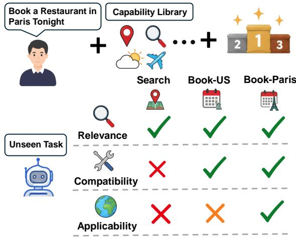
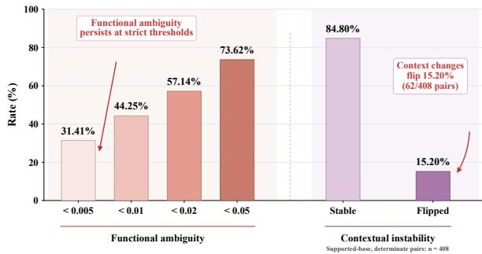
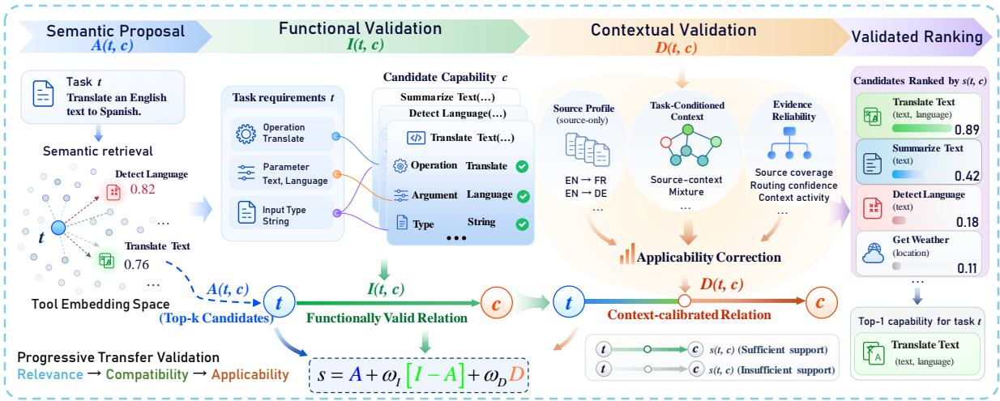
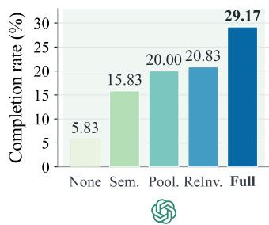
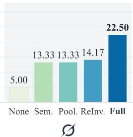
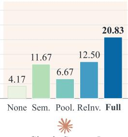
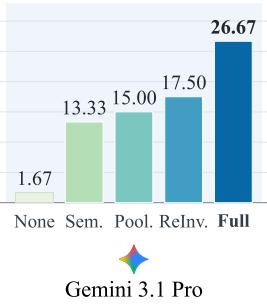
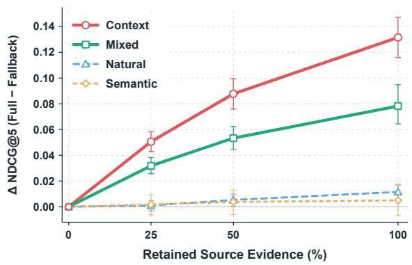

# From Relevance to Validity: Zero-Shot Tool Selection via Functional and Contextual Validation

Xiaoxuan Dong<sup>1</sup> Jin Zhang<sup>2</sup> Zichen Yuan<sup>3</sup> Yue Zhou<sup>2</sup> Zihao Rao<sup>3</sup> Dexu Yu<sup>4</sup> Tingyong Wu<sup>1</sup> Wenhao Deng<sup>5</sup> Junchen Fu<sup>5</sup> Pengwei Sun<sup>6</sup> Yang Ran<sup>7</sup> Bo Lan<sup>7</sup> Yongxin Ni<sup>8</sup> Youhua Li<sup>3,\*</sup>

<sup>1</sup>UESTC <sup>2</sup>LZU <sup>3</sup>CityUHK <sup>4</sup>Northwestern <sup>5</sup>UofG <sup>6</sup>Stanford <sup>7</sup>Fenz AI <sup>8</sup>NUS

Corresponding: youhuali2-c@my.cityu.edu.hk

## Abstract

Large language model (LLM) agents increasingly face tasks from unseen domains and execution contexts, making zero-shot tool selection essential for identifying tools that can satisfy task requirements. Existing dominant methods mainly rely on relevance ranking, but semantic matching alone cannot ensure that a tool is functionally compatible or remains applicable in a new context. We preliminarily identify a transfer-validity gap, where semantically relevant tools may still fail to satisfy functional or contextual requirements after transfer. To address this gap, we propose TACT, a progressive validation framework that complements semantic relevance with endpoint-grounded functional compatibility and task-conditioned contextual evidence. Across cross-domain and cross-dataset transfer, TACT consistently improves capability ranking, with larger gains under functional or contextual ambiguity. Ablation results further confirm the complementary contributions of functional and contextual validation.

## 1 Introduction

As large language models increasingly interact with external tools, APIs, and services, agents must select suitable capabilities from growing libraries (Yao et al., 2023; Schick et al., 2023). This problem becomes harder under distribution shift, where tasks may come from unseen domains or execution settings and target-side supervision is unavailable. Reliable zero-shot selection therefore requires transferring previously learned task– capability relations to new contexts.

Existing methods mainly improve candidate retrieval or ranking. Re-Invoke reformulates queries for zero-shot tool retrieval (Chen et al., 2024), while ToolRerank improves candidate ordering through adaptive reranking (Zheng et al., 2024). Other approaches extend selection through generation or open-world function calling (Wang et al.,

  
Figure 1: Zero-shot capability transfer involves three questions: whether a candidate is relevant, whether its endpoints can satisfy the task, and whether source-side support remains applicable to the current task.

2025; Qin et al., 2025). These methods provide strong mechanisms for proposing plausible candidates, but relevance alone does not establish whether a candidate remains valid after transfer.

Two additional constraints arise. First, a relevant capability may lack an endpoint that jointly supports the required operation, arguments, and input types; semantic relevance therefore does not guaranteefunctional compatibility. Second, even a functionally valid capability may have been supported only under particular source-side conditions, such as platform, locale, access policy, or execution environment. Its contextual applicability must therefore be reassessed for the current task. As illustrated in Figure 1, zero-shot transfer must thus consider relevance, functional compatibility, and contextual applicability.

Preliminary controlled diagnostics reveal both gaps, as shown in Figure 2. Among eligible tasks, 44.25% contain functionally different candidates with semantic scores less than 0.01 apart, indicating that semantic near-ties can mask functional incompatibility. Holding the capability and callable function fixed, changing only the task context reverses applicability in 15.20% of determinate pairs with an applicable base context (62/408). These diagnostics motivate progressive validation: semantic relevance proposes candidates, endpoint evidence evaluates functional compatibility, and task-conditioned source evidence assesses contextual applicability.

Based on this observation, we propose TACT, an evidence-grounded framework for zero-shot capability transfer. Semantic Proposal provides a frozen relevance anchor. Functional Validation scores task requirements against operation, argument, and type evidence composed within individual endpoints. Contextual Validation uses task-conditioned source evidence to adjust relations whose support changes across contexts. Finally, Validated Ranking combines these signals through bounded gates, retaining the preceding estimate when a correction has no supporting evidence.

We evaluate TACT under cross-domain and cross-dataset zero-shot transfer. TACT achieves the strongest aggregate ranking performance, with larger gains when semantically plausible candidates differ in functional compatibility or contextual applicability. On the cross-domain CONTEXT view, TACT improves NDCG@5 from 0.518 for the strongest baseline, PORTS, to 0.624. Ablation results confirm the contributions of both functional and contextual validation, while downstream execution shows corresponding gains in task completion across frozen agent backbones.

Our main contributions are:

• We identify the transfer-validity gap in zero-shot capability selection and distinguish semantic relevance, functional compatibility, and contextual applicability through controlled diagnostics.

• We introduce TACT, which performs progressive transfer validation through Semantic Proposal, Functional Validation, Contextual Validation, and Validated Ranking.

• We evaluate TACT across cross-domain and cross-dataset transfer, controlled candidate ambiguity, ablations, scaling, source-evidence availability, and frozen-agent execution.

## 2 Related Work

## 2.1 Tool Retrieval and Selection

API-Bank, TaskBench, StableToolBench, and Tool-Ret provide benchmarks for tool interaction, task automation, reproducible execution, and retrieval, respectively (Li et al., 2023; Shen et al., 2024; Guo et al., 2024; Shi et al., 2025). Within this setting, selection methods differ in the evidence used to identify suitable candidates. ColBERTv2 captures fine-grained textual matches (Santhanam et al., 2022); Re-Invoke and ToolDreamer enrich retrieval with synthetic queries or hypothetical tools (Chen et al., 2024; Sengupta et al., 2026); and Tool-Rerank incorporates tool hierarchy and unseen-tool adaptation (Zheng et al., 2024). PORTS further introduces downstream model preferences (Molfetta et al., 2025), while task-aligned recommendation uses historical bundles to adjust toolset composition (Gao and Zhang, 2025). These signals improve candidate selection but do not explicitly score operation, argument, and type evidence within individual callable endpoints. TACT incorporates this structure in Functional Validation: requirement– endpoint matching aggregates evidence within each endpoint before assessing support for the task.

## 2.2 Transfer under Distribution Shift

Transfer methods differ in how they share information across domains. UniSRec learns reusable representations from item descriptions (Hou et al., 2022), whereas AREAD adapts expert sharing to individual recommendation domains (Luo et al., 2025). Domain-generalization methods constrain what should remain stable: Fishr aligns gradient variances across domains (Rame et al., 2022), nonstationary generalization accounts for evolving domain patterns (Pham et al., 2024), and sufficient invariant learning preserves predictive invariant information (Kim et al., 2025). These approaches improve representation reuse or predictor robustness, but leave unresolved whether source evidence for a functionally compatible capability applies under the current task conditions. TACT therefore conditions source evidence on the current task and limits the magnitude of a signed contextual correction. This correction can increase or decrease a candidate’s score; its bound constrains the validation magnitude rather than imposing an upper bound on the final score. When evidence is unavailable, the correction vanishes and the gated functional estimate is retained.

  
Figure 2: Controlled diagnostics of the transfer-validity gap. Left: functionally different candidates frequently remain close under frozen semantic relevance. Right: changing one task-context condition while preserving the capability and callable function flips applicability in 15.20% of supported-base, determinate pairs (62/408).

## 3 Methodology

TACT follows a four-stage architecture: Semantic Proposal provides a relevance anchor, Functional Validation evaluates endpoint compatibility, Contextual Validation estimates task-conditioned applicability changes, and Validated Ranking combines these signals through bounded gates, as shown in Figure 3.

## 3.1 Problem Setup and Preliminary Diagnostics

Given a task t in a held-out context $d ^ { \star }$ and a candidate set $\mathcal { C } _ { t } ,$ , our goal is to rank capabilities without using target-side relevance labels for training, calibration, or model selection. We define the source records available for transfer

$$
S _ { - d ^ { * } } = \bigcup _ { d \neq d ^ { * } } S _ { d } .\tag{1}
$$

The model uses task and capability text, public endpoint schemas, and source-derived statistics, but receives neither target-context identity nor gold task decompositions.

We distinguish two transfer-validity gaps. Semantically similar candidates may differ in endpoint support for required operations and inputs, separating semantic relevance from functional compatibility. Functionally compatible capabilities may change applicability across task conditions, separating functional compatibility from contextual applicability.

Figure 2 measures these gaps independently of TACT. For functional ambiguity, we consider tasks whose frozen semantic Top-20 contains at least one clearly valid and one clearly invalid candidate. For each eligible task, we compute

$$
d _ { t } = \operatorname* { m i n } _ { c ^ { + } \in \mathcal { V } _ { t } , \ c ^ { - } \in \mathcal { T } _ { t } } \left| s _ { \mathrm { s e m } } ( t , c ^ { + } ) - s _ { \mathrm { s e m } } ( t , c ^ { - } ) \right| ,
$$

where $\nu _ { t }$ and $\mathcal { T } _ { t }$ denote functionally valid and invalid candidates. Among 29,178 eligible tasks, 44.25% contain a functionally discordant pair with $d _ { t } < 0 . 0 1$ , and 73.62% do so with $d _ { t } < 0 . 0 5$

For contextual instability, we construct outcomeblind minimal pairs that preserve the capability and callable function while changing one observed task-context condition. After blinded review and adjudication, 408 of 500 pairs have supported base tasks and determinate applicability labels; 62 flip and 346 remain stable, yielding a 15.20% flip rate. These diagnostics motivate endpointgrounded functional validation and selective contextual validation. They are excluded from training, calibration, and model selection; construction details and leakage controls appear in Appendix A.

Primary ranking evaluation uses four fixed candidate views—Natural, Semantic, Context, and Mixed—with a shared scorer, checkpoint, and calibration. Candidate construction and evaluation details appear in Appendices B and H.

## 3.2 Progressive Transfer Validation

Recent tool-retrieval methods identify plausible candidates through semantic retrieval or reranking (Chen et al., 2024; Zheng et al., 2024). TACT begins with a semantic task–capability relation. Endpoint evidence then assesses support for the required operations and inputs, while taskconditioned source evidence adjusts applicability under the current task conditions.

Validated Ranking. Let $A ( t , c )$ denote the frozen semantic anchor, $I ( t , c )$ the functional compatibility score, and $D ( t , c )$ the signed contextual correction. The final score combines them as

$$
\begin{array} { l } { s ( t , c ) = A ( t , c ) } \\ { \qquad + \omega _ { I } ( t , c ) \big [ I ( t , c ) - A ( t , c ) \big ] } \\ { \qquad + \omega _ { D } ( t , c ) D ( t , c ) . } \end{array}\tag{2}
$$

Here $\omega _ { I } , \omega _ { D } \in [ 0 , 1 ]$ are selected using source contexts only. The functional term interpolates between A and I, while the contextual term adds a gated signed correction. When contextual evidence is unavailable, $D ( t , c ) = 0$ and the score reduces to the functional path.

Training objectives, gate parameterization, and optimization are detailed in Appendices C –F.

  
Figure 3: Overview of TACT. Semantic Proposal supplies the anchor A; Functional Validation estimates Endpoint-Grounded compatibility I; Contextual Validation produces the signed applicability correction $D ;$ and Validated Ranking combines them through bounded gates. The semantic retrieval panel shows cosine similarities before the log-sigmoid calibration in Equation (3); final-panel scores are schematic illustrations of the resulting order.

## 3.3 Endpoint-Grounded Functional Validation

Functional validation first refines the semantic retrieval proposal and then evaluates its support in the candidate’s documented endpoints. A frozen encoder $E _ { 0 }$ produces normalized task and capability representations $e _ { t }$ and $e _ { c } ,$ from which we compute

$$
\begin{array} { r l } & { { \boldsymbol a } ( t , c ) = \frac { \langle { \boldsymbol e } _ { t } , { \boldsymbol e } _ { c } \rangle - \mu _ { a } } { \tau _ { a } } , } \\ & { { \boldsymbol A } ( t , c ) = \log \sigma \big ( { \boldsymbol a } ( t , c ) \big ) . } \end{array}\tag{3}
$$

The parameters $\tau _ { a } > 0$ and $\mu _ { a }$ are calibrated on source data. The anchor preserves the cosine ranking and shares the log-sigmoid scale of the functional score.

Source-trained relation encoders produce normalized states $z _ { t } , z _ { c }$ and a calibrated similarity $b ( t , c )$ . With $\delta _ { r } ( t , c ) = b ( t , c ) - a ( t , c )$ , we refine the semantic logit through a bounded residual:

$$
L _ { \mathrm { r e l } } ( t , c ) = a ( t , c ) + \alpha s _ { r } \operatorname { t a n h } \biggl ( \frac { \delta _ { r } ( t , c ) } { s _ { r } } \biggr )\tag{4}
$$

Setting $\alpha = 0$ recovers the semantic logit. We then refine $L _ { \mathrm { r e l } }$ through requirement–endpoint matching, combining operation, argument, and type evidence within each documented endpoint.

Endpoint-coherent requirement matching. A deterministic task-only extractor produces a set of requirements $\mathcal { N } _ { t } = \{ n _ { i } \} _ { i = 1 } ^ { M _ { t } }$ . For capability c, we retrieve a set of $K _ { c } \le K$ deduplicated public endpoints shared across all requirements. For requirement i and endpoint $j ,$ let $o _ { i j } , a _ { i j }$ , and $y _ { i j }$ denote operation, required-argument, and argument-type evidence. Availability masks $m _ { j } ^ { a }$ and $m _ { j } ^ { y }$ indicate whether the corresponding schema fields are present.

Evidence is composed within each endpoint before matching, with missing schema fields omitted from the weighted average:

$$
v _ { i j } = \frac { o _ { i j } + \lambda _ { a } m _ { j } ^ { a } a _ { i j } + \lambda _ { y } m _ { j } ^ { y } y _ { i j } } { 1 + \lambda _ { a } m _ { j } ^ { a } + \lambda _ { y } m _ { j } ^ { y } } .\tag{5}
$$

We search over partial one-to-one assignments $X ~ \in ~ \{ 0 , 1 \} ^ { M _ { t } \times \bar { K _ { c } } }$ , where each requirement is matched to at most one endpoint and each endpoint is used at most once. We denote the feasible set by $\mathcal { X } = \mathcal { X } ( t , c )$ . Unmatched requirements use a shared null score ν. The resulting endpoint-set support is

$$
C _ { \mathrm { w s } } ( t , c ) = \frac { 1 } { M _ { t } } \operatorname* { m a x } _ { X \in \mathcal { X } } \Bigl [ \sum _ { i , j } X _ { i j } v _ { i j }\tag{6}
$$

We calibrate $C _ { \mathrm { w s } } ( t , c ) \ t _ { 0 } \ z _ { \mathrm { w s } } ( t , c )$ and compare it with the relation logit. Let $g _ { \mathrm { w s } } = z _ { \mathrm { w s } } - L _ { \mathrm { r e l } }$ and $n _ { X } = \left| X ^ { \star } \right|$ for a maximizing assignment. This discrepancy determines the functional residual:

$$
\Delta _ { I } = \rho _ { \mathrm { w s } } \left\{ { g _ { \mathrm { w s } } , \qquad n _ { X } > 0 , } \right.\tag{7}
$$

The reliability factor $\rho _ { \mathrm { w s } }$ scales the residual according to the structural evidence, as defined in

Appendix D.2. Missing requirements or endpoints give $\rho _ { \mathrm { w s } } = 0$ . When both are available but the assignment is all-null, we set $\rho _ { \mathrm { w s } } = 1 / 2$ and retain a non-positive residual. We incorporate the residual through a bounded update:

$$
\Gamma _ { I } ( t , c ) = \gamma _ { I } s _ { I } \operatorname { t a n h } \biggl ( \frac { \Delta _ { I } ( t , c ) } { s _ { I } } \biggr ) .\tag{8}
$$

The functional logit is $L _ { I } ( t , c ) ~ = ~ L _ { \mathrm { r e l } } ( t , c ) ~ +$ $\Gamma _ { I } ( t , c )$ , with $I ( t , c ) = \log \sigma ( L _ { I } ( t , c ) )$

During source-only training, semantic false friends provide an auxiliary endpoint-set ranking objective that separates candidates remaining close under semantic relevance. Reliability estimation, auxiliary supervision, and exact assignment search are detailed in Appendices D.1 and D.2.

## 3.4 Evidence-Bounded Contextual Validation

Contextual validation uses source profiles to adjust the functional estimate according to the conditions of the current task.

Positive source uses form a capability profile $p _ { c }$ while the current task induces a soft mixture $h _ { t }$ over source-context centroids. In cross-dataset transfer, source profiles are built from positive Natural-view records and indexed by dataset–capability pairs. A target capability obtains a profile by retrieving semantically similar source capabilities within each source dataset and combining their profiles using similarity and source-support weights. Semantic retrieval connects source and target capabilities across different IDs and names. The profile is set to zero when no source candidate exists or the maximum similarity is below 0.25. A centered lowrank transformation of $\left( z _ { c } , p _ { c } , h _ { t } \right)$ produces a taskconditioned capability state $z _ { c } ^ { \mathrm { c t x } } ( t )$ . We measure the resulting relation change as

$$
\begin{array} { r } { \Delta r ( t , c ) = \langle z _ { t } , z _ { c } ^ { \mathrm { c t x } } ( t ) \rangle - \langle z _ { t } , z _ { c } \rangle . } \end{array}\tag{9}
$$

Selective contextual validation. The applicability changes in Figure 2 motivate selective validation based on source confidence and observed task conditions. Let $q _ { \mathrm { c o n f } } ( t , c )$ measure confidence in the available source evidence and $q _ { \mathrm { s h i f t } } ( t , c )$ measure task-observable context change:

$$
\rho _ { \mathrm { c t x } } ( t , c ) = q _ { \mathrm { c o n f } } ( t , c ) q _ { \mathrm { s h i f t } } ( t , c ) .\tag{10}
$$

This resembles selective prediction under distribution shift: uncertain cases retain the default estimate (Liang et al., 2024).

The contextual correction is

$$
\begin{array} { r } { D ( t , c ) = \gamma _ { D } \rho _ { \mathrm { c t x } } ( t , c ) g _ { \mathrm { e v } } ( t , c ) } \\ { \times \operatorname { t a n h } \biggl ( \frac { \Delta r ( t , c ) } { T _ { D } } \biggr ) , } \end{array}\tag{11}
$$

where $g _ { \mathrm { e v } } \in [ 1 - s _ { g } , 1 + s _ { g } ]$ calibrates evidence reliability, with $0 ~ \leq ~ s _ { g } ~ \leq ~ 1 , ~ \gamma _ { D } ~ \geq ~ 0 ,$ , and $T _ { D } ~ > ~ 0$ . Because $\rho _ { \mathrm { c t x } } ~ \in ~ [ 0 , 1 ]$ , the correction satisfies $| D ( t , c ) | \leq \gamma _ { D } ( 1 + s _ { g } )$ . Its sign follows $\Delta r$ , increasing or decreasing the score according to the change in task–capability alignment. All quantities use cross-fitted source evidence and taskobservable information.

A neutrality loss discourages corrections for context-neutral tasks:

$$
\mathcal { L } _ { \mathrm { n e u t r a l } } = \mathbb { E } \big [ ( 1 - q _ { \mathrm { s h i f t } } ( t , c ) ) D ( t , c ) ^ { 2 } \big ] .\tag{12}
$$

The regularization weight is largest when $q _ { \mathrm { s h i f t } }$ is small and decreases as evidence of context change increases. Source confidence separately controls the correction through $\rho _ { \mathrm { c t x } } ;$ absent source evidence gives $\rho _ { \mathrm { c t x } } = 0$ and hence $D = 0$

Source profiles, context routing, reliability features, and optimization details are given in Appendices $\boldsymbol { \mathrm { E } } \mathrm { - } \boldsymbol { \mathrm { G } }$

## 3.5 Training and Model Selection

The two validation stages use supervision aligned with their respective failure modes. Functional validation uses ordinary negatives and semantic false friends, with the latter additionally supervising endpoint-set matching. Contextual validation uses contextual counterfactuals together with reliability and neutrality objectives that discourage unsupported corrections.

All model strengths, checkpoints, and fusion parameters are selected using source contexts only. After selection, the chosen configuration is retrained on the complete source set and evaluated once on the held-out target. For cross-dataset transfer, the scorer is unchanged; unlabeled target embedding statistics are used only for label-free coordinate alignment.

## 4 Experiments

• RQ1: Does TACT improve zero-shot capability ranking under semantic, contextual, and mixed transfer failures?

• RQ2: Do functional validation and contextual validation correct distinct transfer errors?

• RQ3: Do ranking gains improve execution completion across agent backbones?

• RQ4: Does TACT remain effective as capability libraries expand and source evidence becomes limited?

## 4.1 Experimental Setup

Transfer protocols. Cross-domain transfer uses leave-one-domain-out evaluation over 49 Tool-Bench domains, with the other 48 providing source supervision. Cross-dataset transfer holds out each of ToolBench (Qin et al., 2024), TaskBench (Shen et al., 2024), MetaTool (Huang et al., 2024), and APIBench (Patil et al., 2024), using the other three as sources. These protocols assess withinbenchmark generalization and broader shifts in task and capability distributions, respectively. Training, calibration, and model selection use source data only; cross-dataset transfer also uses unlabeled target embeddings for label-free coordinate alignment. Results are averaged over seeds 42, 43, and 44, then equally across scored targets.

Baselines and metrics. Baselines include frozen retrieval (Random and Semantic Cosine), sourcetrained Pointwise MLP; transfer methods ZES-Rec (Ding et al., 2021), UniSRec (Hou et al., 2022), and AREAD (Luo et al., 2025); and tool-retrieval methods Re-Invoke (Chen et al., 2024), PORTS (Molfetta et al., 2025), and Tool-Dreamer (Sengupta et al., 2026). Endpoint Schema Match uses public endpoint and schema evidence, while MultiPool pools source data. Re-Invoke, ToolDreamer, and PORTS retain their original configurations under the shared ranking interface; PORTS uses the authors’ code. Backbones, encoders, and source-data use appear in Appendix I.3. We report MRR, NDCG@5, and HR@3; split statistics and implementation details appear in Appendices H and I.

## 4.2 Overall Performance (RQ1)

TACT achieves the highest aggregate scores across both transfer protocols, with larger NDCG@5 gains on the constructed views than on Natural. Table 1 shows the largest cross-domain improvement on Context, where NDCG@5 rises from 0.518 for PORTS to 0.624 for TACT. On Natural, where semantic retrieval is already strong, TACT improves NDCG@5 from 0.841 for ToolDreamer to 0.873.

The same pattern holds in cross-dataset transfer. On Mixed, TACT increases NDCG@5 from

0.463 for ToolDreamer to 0.500, compared with an increase from 0.733 for MultiPool to 0.746 on Natural. The larger improvement on Mixed indicates that validation is especially useful when the candidate set combines functional and contextual ambiguity.

TACT also improves on retrieval using the same public schema evidence. On cross-domain Semantic, it achieves NDCG@5 of 0.604, compared with 0.547 for Endpoint Schema Match, the strongest baseline on this metric. This comparison supports combining endpoint evidence with learned task– capability relations and contextual validation. Pertarget Full-model results and held-out-group comparisons appear in Appendices J.2 and J.3.

## 4.3 Validation-Stage Analysis (RQ2)

The full model performs best across both protocols, with functional validation contributing broadly and contextual validation having a more selective effect. Table 2 compares variants trained and selected independently using source data.

Removing functional validation reduces crossdomain NDCG@5 by 0.059 on Semantic, 0.067 on Context, and 0.062 on Mixed. Its contribution persists across datasets, where removal lowers NDCG@5 by 0.048 on Mixed. Contextual validation contributes most on cross-domain Context and Mixed. Removing it lowers NDCG@5 by 0.072 and 0.046, compared with 0.020 on Natural and 0.012 on Semantic. Its effect is smaller in crossdataset transfer, where the reductions are 0.016 on Natural, 0.002 on Semantic, 0.009 on Context, and 0.003 on Mixed. The contextual contribution therefore depends more strongly on the transfer setting.

## 4.4 Downstream Cached Execution (RQ3)

TACT achieves the highest task completion rate across all four frozen agent backbones. Figure 4 reports results on 120 solvable StableToolBench queries under cached execution.

Compared with Re-Invoke, the strongest competing selector, completion increases from 20.83% to 29.17% on GPT-5.6 Terra, from 14.17% to 22.50% on Grok-4.5, from 12.50% to 20.83% on Claude Sonnet 5, and from 17.50% to 26.67% on Gemini 3.1 Pro. All retrieval policies select the top five capabilities from the same 3,442-capability library and use identical queries and execution budgets. Ranking configurations and agent policies remain fixed throughout evaluation. Under these shared conditions, the completion gains show that improved capability selection benefits downstream execution across different agent models.

<table><tr><td rowspan=2 colspan=14>Protocol Model                   Natural               Semantic               Context               MixedMRR N@5 H@3</td></tr><tr><td rowspan=1 colspan=3>MRR N@5 H@3</td><td rowspan=1 colspan=3>MRR N@5 H@3</td><td rowspan=1 colspan=3>MRR N@5 H@3</td></tr><tr><td rowspan=2 colspan=1></td><td rowspan=2 colspan=4>0.227 0.157 0.220Random         ±0.001 ± 0.001 ± 0.003</td><td rowspan=1 colspan=3>0.222 0.157 0.209</td><td rowspan=1 colspan=3>0.222 0.154 0.212</td><td rowspan=1 colspan=3>0.219 0.153 0.205</td></tr><tr><td rowspan=1 colspan=1></td><td rowspan=1 colspan=1></td><td rowspan=1 colspan=1></td><td rowspan=1 colspan=1>±0.004</td><td rowspan=1 colspan=2>± 0.006 ±0.008</td><td rowspan=1 colspan=3>±0.001 ± 0.001 ±0.004</td><td rowspan=1 colspan=1>± 0.001</td><td rowspan=1 colspan=1>± 0.003</td><td rowspan=1 colspan=1>±0.004</td></tr><tr><td rowspan=2 colspan=1></td><td rowspan=2 colspan=1>Semantic Cosine</td><td rowspan=1 colspan=1>0.881</td><td rowspan=1 colspan=1>0.840</td><td rowspan=1 colspan=1>0.911</td><td rowspan=1 colspan=1>0.263</td><td rowspan=1 colspan=2>0.246 0.305</td><td rowspan=1 colspan=3>0.259 0.225 0.297</td><td rowspan=1 colspan=1>0.213</td><td rowspan=1 colspan=1>0.165</td><td rowspan=1 colspan=1>0.190</td></tr><tr><td rowspan=1 colspan=1>± 0.000</td><td rowspan=1 colspan=1>± 0.000</td><td rowspan=1 colspan=1>±0.000</td><td rowspan=1 colspan=1>±0.000</td><td rowspan=1 colspan=2>± 0.000 ±0.000</td><td rowspan=1 colspan=3>± 0.000 ±0.000 ± 0.000</td><td rowspan=1 colspan=1>± 0.000</td><td rowspan=1 colspan=1>± 0.000</td><td rowspan=1 colspan=1>±0.000</td></tr><tr><td rowspan=2 colspan=1></td><td rowspan=2 colspan=1>Pointwise MLP</td><td rowspan=1 colspan=1>0.740</td><td rowspan=1 colspan=2>0.699 0.823</td><td rowspan=1 colspan=3>0.440 0.410 0.500</td><td rowspan=1 colspan=3>0.435 0.392 0.487</td><td rowspan=1 colspan=1>0.399</td><td rowspan=1 colspan=1>0.355</td><td rowspan=1 colspan=1>0.442</td></tr><tr><td rowspan=1 colspan=1>± 0.002</td><td rowspan=1 colspan=1>± 0.002</td><td rowspan=1 colspan=1>±0.003</td><td rowspan=1 colspan=1>± 0.004</td><td rowspan=1 colspan=1>± 0.004</td><td rowspan=1 colspan=1>± 0.008</td><td rowspan=1 colspan=1>± 0.006</td><td rowspan=1 colspan=2>±0.007 ± 0.011</td><td rowspan=1 colspan=1>± 0.008</td><td rowspan=1 colspan=1>± 0.007</td><td rowspan=1 colspan=1>±0.012</td></tr><tr><td rowspan=2 colspan=1></td><td rowspan=2 colspan=1>ZESRec</td><td rowspan=1 colspan=1>0.210</td><td rowspan=1 colspan=1>0.139</td><td rowspan=1 colspan=1>0.169</td><td rowspan=1 colspan=1>0.215</td><td rowspan=1 colspan=1>0.146</td><td rowspan=1 colspan=1>0.173</td><td rowspan=1 colspan=1>0.209</td><td rowspan=1 colspan=2>0.138 0.165</td><td rowspan=1 colspan=1>0.206</td><td rowspan=1 colspan=1>0.133</td><td rowspan=1 colspan=1>0.161</td></tr><tr><td rowspan=1 colspan=1>±0.004</td><td rowspan=1 colspan=1>± 0.003</td><td rowspan=1 colspan=1>±0.005</td><td rowspan=1 colspan=1>±0.008</td><td rowspan=1 colspan=1>± 0.009</td><td rowspan=1 colspan=1>± 0.009</td><td rowspan=1 colspan=1>±0.002</td><td rowspan=1 colspan=1>± 0.002</td><td rowspan=1 colspan=1>± 0.002</td><td rowspan=1 colspan=1>± 0.003</td><td rowspan=1 colspan=1>± 0.004</td><td rowspan=1 colspan=1>± 0.003</td></tr><tr><td rowspan=2 colspan=1></td><td rowspan=2 colspan=1>UniSRec</td><td rowspan=1 colspan=1>0.671</td><td rowspan=1 colspan=1>0.634</td><td rowspan=1 colspan=1>0.772</td><td rowspan=1 colspan=1>0.468</td><td rowspan=1 colspan=1>0.439</td><td rowspan=1 colspan=1>0.546</td><td rowspan=1 colspan=1>0.472</td><td rowspan=1 colspan=1>0.430</td><td rowspan=1 colspan=1>0.541</td><td rowspan=1 colspan=1>0.421</td><td rowspan=1 colspan=1>0.380</td><td rowspan=1 colspan=1>0.480</td></tr><tr><td rowspan=1 colspan=1>±0.001</td><td rowspan=1 colspan=1>±0.001</td><td rowspan=1 colspan=1>±0.001</td><td rowspan=1 colspan=1>±0.004</td><td rowspan=1 colspan=1>±0.004</td><td rowspan=1 colspan=1>±0.005</td><td rowspan=1 colspan=1>± 0.001</td><td rowspan=1 colspan=1>± 0.001</td><td rowspan=1 colspan=1>±0.004</td><td rowspan=1 colspan=1>±0.004</td><td rowspan=1 colspan=1>±0.004</td><td rowspan=1 colspan=1>± 0.007</td></tr><tr><td rowspan=4 colspan=1>Cross-domain</td><td rowspan=2 colspan=1>AREAD</td><td rowspan=1 colspan=1>0.440</td><td rowspan=1 colspan=1>0.360</td><td rowspan=1 colspan=1>0.455</td><td rowspan=1 colspan=1>0.322</td><td rowspan=1 colspan=1>0.255</td><td rowspan=1 colspan=1>0.318</td><td rowspan=1 colspan=1>0.303</td><td rowspan=1 colspan=1>0.236</td><td rowspan=1 colspan=1>0.297</td><td rowspan=1 colspan=1>0.287</td><td rowspan=1 colspan=1>0.220</td><td rowspan=1 colspan=1>0.274</td></tr><tr><td rowspan=1 colspan=1>±0.005</td><td rowspan=1 colspan=1>± 0.006</td><td rowspan=1 colspan=1>± 0.007</td><td rowspan=1 colspan=1>±0.007</td><td rowspan=1 colspan=1>±0.007</td><td rowspan=1 colspan=1>±0.008</td><td rowspan=1 colspan=1>±0.008</td><td rowspan=1 colspan=1>± 0.008</td><td rowspan=1 colspan=1>± 0.008</td><td rowspan=1 colspan=1>±0.008</td><td rowspan=1 colspan=1>±0.007</td><td rowspan=1 colspan=1>±0.008</td></tr><tr><td rowspan=2 colspan=1>Endpoint Schema</td><td rowspan=1 colspan=1>0.740</td><td rowspan=1 colspan=1>0.655</td><td rowspan=1 colspan=1>0.777</td><td rowspan=1 colspan=1>0.591</td><td rowspan=1 colspan=1>0.547</td><td rowspan=1 colspan=1>0.661</td><td rowspan=1 colspan=1>0.527</td><td rowspan=1 colspan=1>0.473</td><td rowspan=1 colspan=1>0.588</td><td rowspan=1 colspan=1>0.505</td><td rowspan=1 colspan=1>0.467</td><td rowspan=1 colspan=1>0.587</td></tr><tr><td rowspan=1 colspan=1>±0.000</td><td rowspan=1 colspan=1>±0.000</td><td rowspan=1 colspan=1>± 0.000</td><td rowspan=1 colspan=1>±0.000</td><td rowspan=1 colspan=1>± 0.000</td><td rowspan=1 colspan=1>± 0.000</td><td rowspan=1 colspan=1>± 0.000</td><td rowspan=1 colspan=1>±0.000</td><td rowspan=1 colspan=1>±0.000</td><td rowspan=1 colspan=1>± 0.000</td><td rowspan=1 colspan=1>±0.000</td><td rowspan=1 colspan=1>± 0.000</td></tr><tr><td rowspan=2 colspan=1></td><td rowspan=2 colspan=1>Re-Invoke</td><td rowspan=1 colspan=1>0.744</td><td rowspan=1 colspan=1>0.674</td><td rowspan=1 colspan=1>0.789</td><td rowspan=1 colspan=1>0.306</td><td rowspan=1 colspan=1>0.267</td><td rowspan=1 colspan=1>0.342</td><td rowspan=1 colspan=1>0.311</td><td rowspan=1 colspan=1>0.257</td><td rowspan=1 colspan=1>0.331</td><td rowspan=1 colspan=1>0.271</td><td rowspan=1 colspan=1>0.216</td><td rowspan=1 colspan=1>0.273</td></tr><tr><td rowspan=1 colspan=1>±0.006</td><td rowspan=1 colspan=1>± 0.003</td><td rowspan=1 colspan=1>± 0.004</td><td rowspan=1 colspan=1>±0.007</td><td rowspan=1 colspan=1>± 0.002</td><td rowspan=1 colspan=1>±0.003</td><td rowspan=1 colspan=1>±0.006</td><td rowspan=1 colspan=1>± 0.004</td><td rowspan=1 colspan=1>± 0.005</td><td rowspan=1 colspan=1>±0.006</td><td rowspan=1 colspan=1>±0.007</td><td rowspan=1 colspan=1>±0.002</td></tr><tr><td rowspan=2 colspan=1></td><td rowspan=2 colspan=1>PORTS</td><td rowspan=1 colspan=1>0.741</td><td rowspan=1 colspan=1>0.653</td><td rowspan=1 colspan=1>0.752</td><td rowspan=1 colspan=1>0.597</td><td rowspan=1 colspan=1>0.546</td><td rowspan=1 colspan=1>0.659</td><td rowspan=1 colspan=1>0.575</td><td rowspan=1 colspan=1>0.518</td><td rowspan=1 colspan=1>0.623</td><td rowspan=1 colspan=1>0.520</td><td rowspan=1 colspan=1>0.471</td><td rowspan=1 colspan=1>0.579</td></tr><tr><td rowspan=1 colspan=1>±0.003</td><td rowspan=1 colspan=1>± 0.009</td><td rowspan=1 colspan=1>± 0.003</td><td rowspan=1 colspan=1>±0.005</td><td rowspan=1 colspan=1>±0.007</td><td rowspan=1 colspan=1>± 0.001</td><td rowspan=1 colspan=1>± 0.007</td><td rowspan=1 colspan=1>± 0.004</td><td rowspan=1 colspan=1>± 0.008</td><td rowspan=1 colspan=1>± 0.005</td><td rowspan=1 colspan=1>± 0.006</td><td rowspan=1 colspan=1>± 0.001</td></tr><tr><td rowspan=2 colspan=1></td><td rowspan=2 colspan=1>ToolDreamer</td><td rowspan=1 colspan=1>0.879</td><td rowspan=1 colspan=1>0.841</td><td rowspan=1 colspan=1>0.910</td><td rowspan=1 colspan=1>0.296</td><td rowspan=1 colspan=1>0.284</td><td rowspan=1 colspan=1>0.358</td><td rowspan=1 colspan=1>0.293</td><td rowspan=1 colspan=1>0.256</td><td rowspan=1 colspan=1>0.324</td><td rowspan=1 colspan=1>0.244</td><td rowspan=1 colspan=1>0.199</td><td rowspan=1 colspan=1>0.244</td></tr><tr><td rowspan=1 colspan=1>±0.003</td><td rowspan=1 colspan=1>± 0.003</td><td rowspan=1 colspan=1>±0.006</td><td rowspan=1 colspan=1>± 0.007</td><td rowspan=1 colspan=1>± 0.003</td><td rowspan=1 colspan=1>±0.007</td><td rowspan=1 colspan=1>±0.007</td><td rowspan=1 colspan=1>±0.003</td><td rowspan=1 colspan=1>± 0.007</td><td rowspan=1 colspan=1>± 0.007</td><td rowspan=1 colspan=1>±0.002</td><td rowspan=1 colspan=1>±0.002</td></tr><tr><td rowspan=2 colspan=1></td><td rowspan=2 colspan=1>MultiPool</td><td rowspan=1 colspan=1>0.812</td><td rowspan=1 colspan=1>0.761</td><td rowspan=1 colspan=1>0.875</td><td rowspan=1 colspan=1>0.406</td><td rowspan=1 colspan=1>0.382</td><td rowspan=1 colspan=1>0.490</td><td rowspan=1 colspan=1>0.395</td><td rowspan=1 colspan=1>0.355</td><td rowspan=1 colspan=1>0.467</td><td rowspan=1 colspan=1>0.339</td><td rowspan=1 colspan=1>0.298</td><td rowspan=1 colspan=1>0.389</td></tr><tr><td rowspan=1 colspan=1>±0.007</td><td rowspan=1 colspan=1>± 0.008</td><td rowspan=1 colspan=1>± 0.006</td><td rowspan=1 colspan=1>±0.006</td><td rowspan=1 colspan=1>± 0.007</td><td rowspan=1 colspan=1>± 0.004</td><td rowspan=1 colspan=2>± 0.007 ±0.005</td><td rowspan=1 colspan=1>±0.004</td><td rowspan=1 colspan=1>±0.006</td><td rowspan=1 colspan=1>± 0.007</td><td rowspan=1 colspan=1>± 0.006</td></tr><tr><td rowspan=2 colspan=1></td><td rowspan=1 colspan=1>TACT (Full)</td><td rowspan=1 colspan=1>0.915</td><td rowspan=1 colspan=1>0.873</td><td rowspan=1 colspan=1>0.952</td><td rowspan=1 colspan=1>0.629</td><td rowspan=1 colspan=1>0.604</td><td rowspan=1 colspan=1>0.726</td><td rowspan=1 colspan=2>0.672 0.624</td><td rowspan=1 colspan=1>0.755</td><td rowspan=1 colspan=1>0.564</td><td rowspan=1 colspan=1>0.529</td><td rowspan=1 colspan=1>0.644</td></tr><tr><td rowspan=1 colspan=1></td><td rowspan=1 colspan=1>±0.004</td><td rowspan=1 colspan=1>± 0.005</td><td rowspan=1 colspan=1>± 0.003</td><td rowspan=1 colspan=1>±0.005</td><td rowspan=1 colspan=1>± 0.005</td><td rowspan=1 colspan=1>±0.007</td><td rowspan=1 colspan=1>±0.003</td><td rowspan=1 colspan=1>±0.003</td><td rowspan=1 colspan=1>± 0.004</td><td rowspan=1 colspan=1>± 0.003</td><td rowspan=1 colspan=1>±0.006</td><td rowspan=1 colspan=1>±0.005</td></tr><tr><td rowspan=1 colspan=1></td><td rowspan=1 colspan=1>∆ vs. best (pp)</td><td rowspan=1 colspan=1>+3.4</td><td rowspan=1 colspan=1>+3.2</td><td rowspan=1 colspan=1>+4.1</td><td rowspan=1 colspan=1>+3.2</td><td rowspan=1 colspan=1>+5.7</td><td rowspan=1 colspan=1>+6.5</td><td rowspan=1 colspan=1>+9.7</td><td rowspan=1 colspan=1>+10.6</td><td rowspan=1 colspan=1>+13.2</td><td rowspan=1 colspan=1>+4.4</td><td rowspan=1 colspan=1>+5.8</td><td rowspan=1 colspan=1>+5.7</td></tr><tr><td rowspan=2 colspan=1></td><td rowspan=2 colspan=1>Random</td><td rowspan=1 colspan=1>0.314</td><td rowspan=1 colspan=1>0.274</td><td rowspan=1 colspan=1>0.343</td><td rowspan=1 colspan=1>0.311</td><td rowspan=1 colspan=1>0.273</td><td rowspan=1 colspan=1>0.341</td><td rowspan=1 colspan=2>0.298 0.249</td><td rowspan=1 colspan=1>0.316</td><td rowspan=1 colspan=1>0.298</td><td rowspan=1 colspan=1>0.250</td><td rowspan=1 colspan=1>0.316</td></tr><tr><td rowspan=1 colspan=1>±0.000</td><td rowspan=1 colspan=1>± 0.001</td><td rowspan=1 colspan=1>±0.001</td><td rowspan=1 colspan=1>± 0.001</td><td rowspan=1 colspan=1>± 0.001</td><td rowspan=1 colspan=1>± 0.001</td><td rowspan=1 colspan=1>± 0.001</td><td rowspan=1 colspan=1>± 0.001</td><td rowspan=1 colspan=1>± 0.002</td><td rowspan=1 colspan=1>± 0.001</td><td rowspan=1 colspan=1>±0.001</td><td rowspan=1 colspan=1>±0.001</td></tr><tr><td rowspan=2 colspan=1></td><td rowspan=2 colspan=1>Semantic Cosine</td><td rowspan=1 colspan=1>0.734</td><td rowspan=1 colspan=1>0.708</td><td rowspan=1 colspan=1>0.810</td><td rowspan=1 colspan=1>0.565</td><td rowspan=1 colspan=1>0.528</td><td rowspan=1 colspan=1>0.621</td><td rowspan=1 colspan=1>0.516</td><td rowspan=1 colspan=1>0.477</td><td rowspan=1 colspan=1>0.545</td><td rowspan=1 colspan=1>0.475</td><td rowspan=1 colspan=1>0.427</td><td rowspan=1 colspan=1>0.482</td></tr><tr><td rowspan=1 colspan=1>±0.000</td><td rowspan=1 colspan=1>± 0.000</td><td rowspan=1 colspan=1>±0.000</td><td rowspan=1 colspan=1>±0.000</td><td rowspan=1 colspan=1>±0.000</td><td rowspan=1 colspan=1>±0.000</td><td rowspan=1 colspan=1>± 0.000</td><td rowspan=1 colspan=1>±0.000</td><td rowspan=1 colspan=1>±0.000</td><td rowspan=1 colspan=1>± 0.000</td><td rowspan=1 colspan=1>±0.000</td><td rowspan=1 colspan=1>±0.000</td></tr><tr><td rowspan=2 colspan=1></td><td rowspan=2 colspan=1>Pointwise MLP</td><td rowspan=1 colspan=1>0.545</td><td rowspan=1 colspan=1>0.519</td><td rowspan=1 colspan=1>0.630</td><td rowspan=1 colspan=1>0.456</td><td rowspan=1 colspan=1>0.430</td><td rowspan=1 colspan=1>0.535</td><td rowspan=1 colspan=1>0.458</td><td rowspan=1 colspan=1>0.425</td><td rowspan=1 colspan=1>0.518</td><td rowspan=1 colspan=1>0.437</td><td rowspan=1 colspan=1>0.403</td><td rowspan=1 colspan=1>0.498</td></tr><tr><td rowspan=1 colspan=1>±0.002</td><td rowspan=1 colspan=1>± 0.005</td><td rowspan=1 colspan=1>± 0.006</td><td rowspan=1 colspan=1>±0.003</td><td rowspan=1 colspan=1>± 0.004</td><td rowspan=1 colspan=1>± 0.006</td><td rowspan=1 colspan=1>± 0.008</td><td rowspan=1 colspan=1>± 0.008</td><td rowspan=1 colspan=1>± 0.008</td><td rowspan=1 colspan=1>± 0.005</td><td rowspan=1 colspan=1>± 0.004</td><td rowspan=1 colspan=1>± 0.004</td></tr><tr><td rowspan=2 colspan=1></td><td rowspan=2 colspan=1>ZESRec</td><td rowspan=1 colspan=1>0.351</td><td rowspan=1 colspan=1>0.317</td><td rowspan=1 colspan=1>0.391</td><td rowspan=1 colspan=1>0.339</td><td rowspan=1 colspan=1>0.304</td><td rowspan=1 colspan=1>0.377</td><td rowspan=1 colspan=1>0.359</td><td rowspan=1 colspan=1>0.319</td><td rowspan=1 colspan=1>0.399</td><td rowspan=1 colspan=1>0.330</td><td rowspan=1 colspan=1>0.290</td><td rowspan=1 colspan=1>0.370</td></tr><tr><td rowspan=1 colspan=1>±0.007</td><td rowspan=1 colspan=1>±0.008</td><td rowspan=1 colspan=1>± 0.012</td><td rowspan=1 colspan=1>±0.009</td><td rowspan=1 colspan=1>± 0.010</td><td rowspan=1 colspan=1>± 0.012</td><td rowspan=1 colspan=1>±0.002</td><td rowspan=1 colspan=1>±0.004</td><td rowspan=1 colspan=1>±0.007</td><td rowspan=1 colspan=1>± 0.001</td><td rowspan=1 colspan=1>±0.005</td><td rowspan=1 colspan=1>± 0.009</td></tr><tr><td rowspan=2 colspan=1></td><td rowspan=2 colspan=1>UniSRec</td><td rowspan=1 colspan=1>0.429</td><td rowspan=1 colspan=1>0.407</td><td rowspan=1 colspan=1>0.506</td><td rowspan=1 colspan=1>0.392</td><td rowspan=1 colspan=1>0.366</td><td rowspan=1 colspan=1>0.458</td><td rowspan=1 colspan=1>0.407</td><td rowspan=1 colspan=1>0.374</td><td rowspan=1 colspan=1>0.461</td><td rowspan=1 colspan=1>0.377</td><td rowspan=1 colspan=1>0.344</td><td rowspan=1 colspan=1>0.434</td></tr><tr><td rowspan=1 colspan=1>±0.001</td><td rowspan=1 colspan=1>± 0.001</td><td rowspan=1 colspan=1>±0.005</td><td rowspan=1 colspan=1>±0.001</td><td rowspan=1 colspan=1>±0.002</td><td rowspan=1 colspan=1>± 0.004</td><td rowspan=1 colspan=1>± 0.005</td><td rowspan=1 colspan=1>± 0.006</td><td rowspan=1 colspan=1>±0.008</td><td rowspan=1 colspan=1>±0.001</td><td rowspan=1 colspan=1>±0.002</td><td rowspan=1 colspan=1>± 0.003</td></tr><tr><td rowspan=2 colspan=1></td><td rowspan=2 colspan=1>AREAD</td><td rowspan=1 colspan=1>0.454</td><td rowspan=1 colspan=1>0.426</td><td rowspan=1 colspan=1>0.533</td><td rowspan=1 colspan=1>0.405</td><td rowspan=1 colspan=1>0.375</td><td rowspan=1 colspan=1>0.476</td><td rowspan=1 colspan=1>0.408</td><td rowspan=1 colspan=1>0.374</td><td rowspan=1 colspan=1>0.464</td><td rowspan=1 colspan=1>0.387</td><td rowspan=1 colspan=1>0.354</td><td rowspan=1 colspan=1>0.450</td></tr><tr><td rowspan=1 colspan=1>±0.001</td><td rowspan=1 colspan=1>± 0.001</td><td rowspan=1 colspan=1>± 0.001</td><td rowspan=1 colspan=1>± 0.001</td><td rowspan=1 colspan=1>± 0.003</td><td rowspan=1 colspan=1>±0.009</td><td rowspan=1 colspan=1>± 0.003</td><td rowspan=1 colspan=1>± 0.004</td><td rowspan=1 colspan=1>± 0.006</td><td rowspan=1 colspan=1>± 0.001</td><td rowspan=1 colspan=1>± 0.002</td><td rowspan=1 colspan=1>± 0.004</td></tr><tr><td rowspan=2 colspan=1>Cross-dataset</td><td rowspan=2 colspan=1>Endpoint Schema</td><td rowspan=1 colspan=1>0.522</td><td rowspan=1 colspan=1>0.477</td><td rowspan=1 colspan=1>0.568</td><td rowspan=1 colspan=1>0.512</td><td rowspan=1 colspan=1>0.480</td><td rowspan=1 colspan=1>0.573</td><td rowspan=1 colspan=1>0.470</td><td rowspan=1 colspan=1>0.432</td><td rowspan=1 colspan=1>0.514</td><td rowspan=1 colspan=1>0.451</td><td rowspan=1 colspan=1>0.410</td><td rowspan=1 colspan=1>0.501</td></tr><tr><td rowspan=1 colspan=1>±0.000</td><td rowspan=1 colspan=1>± 0.000</td><td rowspan=1 colspan=1>±0.000</td><td rowspan=1 colspan=1>±0.000</td><td rowspan=1 colspan=1>±0.000</td><td rowspan=1 colspan=1>± 0.000</td><td rowspan=1 colspan=1>± 0.000</td><td rowspan=1 colspan=1>± 0.000</td><td rowspan=1 colspan=1>± 0.000</td><td rowspan=1 colspan=1>± 0.000</td><td rowspan=1 colspan=1>± 0.000</td><td rowspan=1 colspan=1>± 0.000</td></tr><tr><td rowspan=2 colspan=1></td><td rowspan=2 colspan=1>Re-Invoke</td><td rowspan=1 colspan=1>0.643</td><td rowspan=1 colspan=1>0.594</td><td rowspan=1 colspan=1>0.719</td><td rowspan=1 colspan=1>0.522</td><td rowspan=1 colspan=1>0.463</td><td rowspan=1 colspan=1>0.570</td><td rowspan=1 colspan=1>0.476</td><td rowspan=1 colspan=1>0.415</td><td rowspan=1 colspan=1>0.502</td><td rowspan=1 colspan=1>0.457</td><td rowspan=1 colspan=1>0.397</td><td rowspan=1 colspan=1>0.482</td></tr><tr><td rowspan=1 colspan=1>±0.003</td><td rowspan=1 colspan=1>± 0.006</td><td rowspan=1 colspan=1>±0.004</td><td rowspan=1 colspan=1>± 0.008</td><td rowspan=1 colspan=1>± 0.006</td><td rowspan=1 colspan=1>± 0.002</td><td rowspan=1 colspan=1>±0.006</td><td rowspan=1 colspan=1>± 0.003</td><td rowspan=1 colspan=1>± 0.007</td><td rowspan=1 colspan=1>± 0.005</td><td rowspan=1 colspan=1>± 0.008</td><td rowspan=1 colspan=1>±0.006</td></tr><tr><td rowspan=2 colspan=1></td><td rowspan=2 colspan=1>PORTS</td><td rowspan=1 colspan=1>0.755</td><td rowspan=1 colspan=1>0.730</td><td rowspan=1 colspan=1>0.827</td><td rowspan=1 colspan=1>0.581</td><td rowspan=1 colspan=1>0.543</td><td rowspan=1 colspan=1>0.624</td><td rowspan=1 colspan=1>0.534</td><td rowspan=1 colspan=1>0.506</td><td rowspan=1 colspan=1>0.578</td><td rowspan=1 colspan=1>0.489</td><td rowspan=1 colspan=1>0.453</td><td rowspan=1 colspan=1>0.514</td></tr><tr><td rowspan=1 colspan=1>±0.009</td><td rowspan=1 colspan=1>± 0.010</td><td rowspan=1 colspan=1>± 0.011</td><td rowspan=1 colspan=1>± 0.010</td><td rowspan=1 colspan=1>± 0.011</td><td rowspan=1 colspan=1>± 0.012</td><td rowspan=1 colspan=1>± 0.009</td><td rowspan=1 colspan=1>± 0.011</td><td rowspan=1 colspan=1>± 0.014</td><td rowspan=1 colspan=1>± 0.008</td><td rowspan=1 colspan=1>± 0.010</td><td rowspan=1 colspan=1>± 0.011</td></tr><tr><td rowspan=2 colspan=1></td><td rowspan=2 colspan=2>0.745ToolDreamer±0.007</td><td rowspan=1 colspan=2>0.725 0.826</td><td rowspan=1 colspan=3>0.580 0.546 0.640</td><td rowspan=1 colspan=3>0.544 0.510 0.583</td><td rowspan=1 colspan=1>0.500</td><td rowspan=1 colspan=2>0.463 0.530</td></tr><tr><td rowspan=1 colspan=2>±0.005 ± 0.005</td><td rowspan=1 colspan=3>±0.007 ± 0.008 ± 0.007</td><td rowspan=1 colspan=3>± 0.005 ± 0.007 ± 0.003</td><td rowspan=1 colspan=1>± 0.004</td><td rowspan=1 colspan=2>± 0.007 ± 0.008</td></tr><tr><td rowspan=2 colspan=1></td><td rowspan=2 colspan=2>0.756MultiPool        ±0.006</td><td rowspan=1 colspan=2>0.733 0.830</td><td rowspan=1 colspan=3>0.583 0.547 0.639</td><td rowspan=1 colspan=3>0.537 0.500 0.500</td><td rowspan=1 colspan=1>0.499</td><td rowspan=1 colspan=2>0.444 0.519</td></tr><tr><td rowspan=1 colspan=2>± 0.007 ± 0.007</td><td rowspan=1 colspan=3>±0.005 ± 0.004 ±0.009</td><td rowspan=1 colspan=3>±0.006±0.004 ±0.006</td><td rowspan=1 colspan=3>± 0.008 ± 0.006 ±0.005</td></tr><tr><td rowspan=2 colspan=1></td><td rowspan=1 colspan=2>TACT (Full)     0.763</td><td rowspan=1 colspan=2>0.746 0.836</td><td rowspan=1 colspan=3>0.613 0.580 0.668</td><td rowspan=1 colspan=3>0.574 0.543 0.613</td><td rowspan=1 colspan=3>0.538 0.500 0.572</td></tr><tr><td rowspan=1 colspan=2>±0.002</td><td rowspan=1 colspan=1>±0.003</td><td rowspan=1 colspan=1>± 0.004</td><td rowspan=1 colspan=3>±0.003 ±0.003 ±0.003</td><td rowspan=1 colspan=3>±0.002±0.002 ±0.002</td><td rowspan=1 colspan=3>±0.004 ±0.004 ±0.002</td></tr><tr><td rowspan=1 colspan=1></td><td rowspan=1 colspan=2>∆ vs. best (pp)       +0.7</td><td rowspan=1 colspan=1>+1.3</td><td rowspan=1 colspan=1>+0.6</td><td rowspan=1 colspan=3>+3.0  +3.3  +2.8</td><td rowspan=1 colspan=3>+3.0  +3.3  +3.0</td><td rowspan=1 colspan=3>+3.8  +3.7  +4.2</td></tr></table>

Table 1: Overall performance on zero-shot capability ranking under cross-domain and cross-dataset transfer across four candidate views, reported as mean ± standard deviation over three runs. Best and second-best means are bolded and underlined, respectively. The final row of each protocol reports TACT’s absolute gain over the strongest non-TACT baseline in percentage points (pp).

## 4.5 Scalability and Limits of Transfer Validation (RQ4)

RQ4 uses the primary experiment’s Full checkpoints and shared calibration.

Candidate-library scaling. TACT remains ahead of Semantic Cosine as the candidate library grows. Table 3 expands the ToolBench library from the base setting to all 3,442 capabilities. At full scale, NDCG@5 is 0.401 versus 0.382 on Natural and 0.260 versus 0.056 on Context. Both methods lose accuracy as more candidates compete for the top ranks, while TACT’s advantage remains larger on Semantic, Context, and Mixed. Cross-dataset results and candidate-pool definitions appear in Appendix L.

Source-evidence availability. The contextual contribution grows with retained source evidence, most clearly on Context and Mixed. Figure 5 varies source associations while holding model parameters, outer splits, candidate pools, and calibration fixed. Each checkpoint is shared across the four candidate views. The comparator, Fixed-Checkpoint Functional Fallback, removes the contextual contribution from the same checkpoint, allowing its ranking contribution to be measured at each evidence level. Full and fallback coincide at zero evidence. Further comparator details appear in Appendix L.

<table><tr><td rowspan="2">Protocol</td><td rowspan="2">Variant</td><td colspan="3">Natural</td><td colspan="3">Semantic</td><td colspan="3">Context</td><td colspan="3">Mixed</td></tr><tr><td>MRR</td><td>N@5</td><td>H@3</td><td>MRR</td><td>N@5</td><td>H@3</td><td>MRR</td><td>N@5</td><td>H@3</td><td>MRR</td><td>N@5</td><td>H@3</td></tr><tr><td rowspan="4">Cross domain</td><td>TACT (Full)</td><td>0.915</td><td>0.873</td><td>0.952</td><td>0.629</td><td>0.604</td><td>0.726</td><td>0.672</td><td>0.624</td><td>0.755</td><td>0.564</td><td>0.529</td><td>0.644</td></tr><tr><td>w/o Context</td><td>0.899</td><td>0.853</td><td>0.939</td><td>0.620</td><td>0.592</td><td>0.720</td><td>0.594</td><td>0.552</td><td>0.677</td><td>0.521</td><td>0.483</td><td>0.594</td></tr><tr><td>w/o Functional</td><td>0.903</td><td>0.859</td><td>0.941</td><td>0.568</td><td>0.545</td><td>0.660</td><td>0.605</td><td>0.557</td><td>0.683</td><td>0.504</td><td>0.467</td><td>0.579</td></tr><tr><td>Anchor only</td><td>0.881</td><td>0.840</td><td>0.911</td><td>0.263</td><td>0.246</td><td>0.305</td><td>0.259</td><td>0.225</td><td>0.297</td><td>0.213</td><td>0.165</td><td>0.190</td></tr><tr><td rowspan="4">Cross dataset</td><td>TACT (Full)</td><td>0.763</td><td>0.746</td><td>0.836</td><td>0.613</td><td>0.580</td><td>0.668</td><td>0.574</td><td>0.543</td><td>0.613</td><td>0.538</td><td>0.500</td><td>0.572</td></tr><tr><td>w/o Context</td><td>0.749</td><td>0.730</td><td>0.818</td><td>0.611</td><td>0.578</td><td>0.667</td><td>0.568</td><td>0.534</td><td>0.602</td><td>0.535</td><td>0.497</td><td>0.565</td></tr><tr><td>w/o Functional</td><td>0.755</td><td>0.730</td><td>0.829</td><td>0.580</td><td>0.546</td><td>0.636</td><td>0.538</td><td>0.500</td><td>0.567</td><td>0.497</td><td>0.452</td><td>0.513</td></tr><tr><td>Anchor only</td><td>0.734</td><td>0.708</td><td>0.810</td><td>0.565</td><td>0.528</td><td>0.621</td><td>0.516</td><td>0.477</td><td>0.545</td><td>0.475</td><td>0.427</td><td>0.482</td></tr></table>

Table 2: Ablation Study. Cross-domain and cross-dataset transfer without Functional or Contextual Validation; Anchor only uses the frozen semantic path. Trainable variants are independently fitted and selected on source data, unlike RQ4’s fixed-checkpoint diagnostic. Best results per setting are bold.

  
GPT-5.6 Terra

  
Grok-4.5

  
Claude Sonnet 5

  
Figure 4: Downstream Execution. Completion rates on 120 solvable StableToolBench queries under cached execution with four frozen agent backbones. None denotes no tools; Sem., Pool., ReInv., and Full use Top-5 capabilities from Semantic Cosine, MultiPool, Re-Invoke, and TACT, respectively.

<table><tr><td rowspan="2">Scale</td><td colspan="2">Natural</td><td colspan="2">Semantic</td><td colspan="2">Context</td><td colspan="2">Mixed</td></tr><tr><td>Sem.</td><td>TACT</td><td>Sem.</td><td>TACT</td><td>Sem.</td><td>TACT</td><td>Sem.</td><td>TACT</td></tr><tr><td>Base</td><td>0.8397</td><td>0.8725</td><td>0.2458</td><td>0.6035</td><td>0.2246</td><td>0.6244</td><td>0.1654</td><td>0.5288</td></tr><tr><td>100</td><td>0.4319</td><td>0.4454</td><td>0.0406</td><td>0.2930</td><td>0.0780</td><td>0.3242</td><td>0.0600</td><td>0.2862</td></tr><tr><td>500</td><td>0.4015</td><td>0.4100</td><td>0.0346</td><td>0.2478</td><td>0.0626</td><td>0.2782</td><td>0.0508</td><td>0.2462</td></tr><tr><td>Full</td><td>0.3822</td><td>0.4011</td><td>0.0333</td><td>0.2315</td><td>0.0563</td><td>0.2602</td><td>0.0483</td><td>0.2311</td></tr></table>

Table 3: Library Scaling. Cross-domain NDCG@5 by candidate-pool size. Base: evaluation manifest; Full: 3,442 capabilities; Sem.: Semantic Cosine. Pairwise best in bold.

## 5 Conclusion

We presented TACT for zero-shot capability transfer, refining semantic relevance through Endpoint-Grounded Functional Validation and Evidence-

  
Figure 5: Cross-domain NDCG@5 gains from contextual validation across source-association retention levels. Error bars indicate paired 95% cluster-bootstrap intervals.

Bounded Contextual Validation. Across crossdomain and cross-dataset evaluations, TACT improves aggregate capability ranking, with larger gains on candidate sets containing functional or contextual ambiguity. These gains also translate into higher task completion rates across four frozen agent backbones under cached execution. The results support combining semantic relevance with functional compatibility and contextual applicability for capability selection.

## Acknowledgement

The work described in this paper was partially supported by InnoHK initiative, The Government of the HKSAR, and Laboratory for AI-Powered Financial Technologies.

## Limitations

Our evaluation uses fixed capability libraries and held-out domain or dataset splits. The reported ranking gains therefore do not establish performance for newly added capabilities, changing endpoint schemas, or live services. The closed-world relevance annotations treat unjudged candidates as non-relevant in expanded pools, so the scaling results measure recovery of known positives rather than complete compatibility assessment. The cached execution study uses a fixed set of solvable queries and frozen agent backbones; its completion rates may not transfer to unrestricted tasks, live API failures, or other agents. Contextual applicability also depends on source association evidence and falls back through the gated functional path when that evidence is unavailable.

## AI Disclosure

AI-assisted tools were used during manuscript preparation for language editing, proofreading, and improving readability. The authors independently developed the research methodology, conducted the experiments, interpreted the results, and verified all technical content. The authors remain fully responsible for the accuracy, originality, and integrity of this work.

## References

Yanfei Chen, Jinsung Yoon, Devendra Singh Sachan, Qingze Wang, Vincent Cohen-Addad, Mohammadhossein Bateni, Chen-Yu Lee, and Tomas Pfister. 2024. Re-invoke: Tool invocation rewriting for zeroshot tool retrieval. In Findings of the Association for Computational Linguistics: EMNLP 2024, pages 4705–4726. Association for Computational Linguistics.

Hao Ding, Yifei Ma, Anoop Deoras, Yuyang Wang, and Hao Wang. 2021. Zero-shot recommender systems. arXiv preprint arXiv:2105.08318.

Hang Gao and Yongfeng Zhang. 2025. Task-aligned tool recommendation for large language models. In Proceedings ofthe 14th International Joint Conference on Natural Language Processing and the 4th

Conference ofthe Asia-Pacific Chapter ofthe Association for Computational Linguistics, pages 2023– 2045, Mumbai, India. The Asian Federation of Natural Language Processing and The Association for Computational Linguistics.

Zhicheng Guo, Sijie Cheng, Hao Wang, Shihao Liang, Yujia Qin, Peng Li, Zhiyuan Liu, Maosong Sun, and Yang Liu. 2024. StableToolBench: Towards stable large-scale benchmarking on tool learning of large language models. In Findings of the Association for Computational Linguistics: ACL 2024, pages 11143– 11156. Association for Computational Linguistics.

Yupeng Hou, Shanlei Mu, Wayne Xin Zhao, Yaliang Li, Bolin Ding, and Ji-Rong Wen. 2022. Towards universal sequence representation learning for recommender systems. In Proceedings of the 28th ACM SIGKDD Conference on Knowledge Discovery and Data Mining, pages 585–593.

Yue Huang, Jiawen Shi, Yuan Li, Chenrui Fan, Siyuan Wu, Qihui Zhang, Yixin Liu, Pan Zhou, Yao Wan, Neil Zhenqiang Gong, and Lichao Sun. 2024. Meta-Tool benchmark for large language models: Deciding whether to use tools and which to use. In The Twelfth International Conference on Learning Representations.

Taero Kim, Subeen Park, Sungjun Lim, Yonghan Jung, Krikamol Muandet, and Kyungwoo Song. 2025. Sufficient invariant learning for distribution shift. In Proceedings ofthe IEEE/CVF Conference on Computer Vision and Pattern Recognition, pages 4958–4967.

Minghao Li, Yingxiu Zhao, Bowen Yu, Feifan Song, Hangyu Li, Haiyang Yu, Zhoujun Li, Fei Huang, and Yongbin Li. 2023. API-Bank: A comprehensive benchmark for tool-augmented LLMs. In Proceedings ofthe 2023 Conference on Empirical Methods in Natural Language Processing, pages 3102–3116. Association for Computational Linguistics.

Hengyue Liang, Le Peng, and Ju Sun. 2024. Selective classification under distribution shifts. Transactions on Machine Learning Research.

Huishi Luo, Yiwen Chen, Yiqing Wu, Fuzhen Zhuang, and Deqing Wang. 2025. One for dozens: Adaptive REcommendation for all domains with counterfactual augmentation. In Proceedings ofthe AAAI Conference on Artificial Intelligence, volume 39, pages 12300–12308.

Lorenzo Molfetta, Giacomo Frisoni, Nicolò Monaldini, and Gianluca Moro. 2025. PORTS: Preferenceoptimized retrievers for tool selection with large language models. In Proceedings of the 2025 Conference on Empirical Methods in Natural Language Processing, pages 10007–10030. Association for Computational Linguistics.

Shishir G. Patil, Tianjun Zhang, Xin Wang, and Joseph E. Gonzalez. 2024. Gorilla: Large language model connected with massive APIs. In Advances in Neural Information Processing Systems, volume 37.

Thai-Hoang Pham, Xueru Zhang, and Ping Zhang. 2024. Non-stationary domain generalization: Theory and algorithm. In Proceedings ofthe Fortieth Conference on Uncertainty in Artificial Intelligence, volume 244 of Proceedings of Machine Learning Research, pages 2902–2927. PMLR.

Shengqian Qin, Yakun Zhu, Linjie Mu, Shaoting Zhang, and Xiaofan Zhang. 2025. Meta-Tool: Unleash openworld function calling capabilities of general-purpose large language models. In Proceedings of the 63rd Annual Meeting of the Association for Computational Linguistics (Volume 1: Long Papers), pages 30653– 30677. Association for Computational Linguistics.

Yujia Qin, Shihao Liang, Yining Ye, Kunlun Zhu, Lan Yan, Yaxi Lu, Yankai Lin, Xin Cong, Xiangru Tang, Bill Qian, Sihan Zhao, Lauren Hong, Runchu Tian, Ruobing Xie, Jie Zhou, Mark Gerstein, Dahai Li, Zhiyuan Liu, and Maosong Sun. 2024. ToolLLM: Facilitating large language models to master 16000+ real-world APIs. In The Twelfth International Conference on Learning Representations.

Alexandre Rame, Corentin Dancette, and Matthieu Cord. 2022. Fishr: Invariant gradient variances for out-ofdistribution generalization. In Proceedings of the 39th International Conference on Machine Learning, volume 162 of Proceedings of Machine Learning Research, pages 18347–18377. PMLR.

Keshav Santhanam, Omar Khattab, Jon Saad-Falcon, Christopher Potts, and Matei Zaharia. 2022. Col-BERTv2: Effective and efficient retrieval via lightweight late interaction. In Proceedings of the 2022 Conference ofthe North American Chapter of the Association for Computational Linguistics, pages 3715–3734. Association for Computational Linguistics.

Timo Schick, Jane Dwivedi-Yu, Roberto Dessi, Roberta Raileanu, Maria Lomeli, Eric Hambro, Luke Zettlemoyer, Nicola Cancedda, and Thomas Scialom. 2023. Toolformer: Language models can teach themselves to use tools. In Advances in Neural Information Processing Systems, volume 36.

Saptarshi Sengupta, Zhengyu Zhou, Jun Araki, Xingbo Wang, Bingqing Wang, Suhang Wang, and Zhe Feng. 2026. ToolDreamer: Instilling LLM reasoning into tool retrievers. In Proceedings of the 19th Conference of the European Chapter of the Association for Computational Linguistics (Volume 1: Long Papers), pages 5465–5482. Association for Computational Linguistics.

Yongliang Shen, Kaitao Song, Xu Tan, Wenqi Zhang, Kan Ren, Siyu Yuan, Weiming Lu, Dongsheng Li, and Yueting Zhuang. 2024. TaskBench: Benchmarking large language models for task automation. In Advances in Neural Information Processing Systems, volume 37. Datasets and Benchmarks Track.

Zhengliang Shi, Yuhan Wang, Lingyong Yan, Pengjie Ren, Shuaiqiang Wang, Dawei Yin, and Zhaochun

Ren. 2025. Retrieval models aren’t tool-savvy: Benchmarking tool retrieval for large language models. In Findings ofthe Associationfor Computational Linguistics: ACL 2025, pages 24497–24524. Association for Computational Linguistics.

Renxi Wang, Xudong Han, Lei Ji, Shu Wang, Timothy Baldwin, and Haonan Li. 2025. ToolGen: Unified tool retrieval and calling via generation. In The Thirteenth International Conference on Learning Representations.

Shunyu Yao, Jeffrey Zhao, Dian Yu, Nan Du, Izhak Shafran, Karthik Narasimhan, and Yuan Cao. 2023. ReAct: Synergizing reasoning and acting in language models. In International Conference on Learning Representations.

Yuanhang Zheng, Peng Li, Wei Liu, Yang Liu, Jian Luan, and Bin Wang. 2024. ToolRerank: Adaptive and hierarchy-aware reranking for tool retrieval. In Proceedings of the 2024 Joint International Conference on Computational Linguistics, Language Resources and Evaluation, pages 16263–16273. ELRA and ICCL.

## A ToolBench Motivating Diagnostic Details

This appendix specifies the two diagnostics in Figure 2 of the main paper: functional ambiguity under frozen semantic retrieval and contextual instability under a minimal change to task conditions. These diagnostics characterize the transfer-validity gaps motivating TACT; they are not evaluations of the full ranking model.

## A.1 Diagnostic Scope and Isolation

The functional diagnostic uses frozen semantic scores and public capability and endpoint information. The contextual diagnostic uses outcome-blind minimal pairs followed by blinded review and adjudication. Diagnostic annotations and outcomes are not used to train, calibrate, select, or tune TACT. These diagnostics answer different questions from the candidate audits in Appendix H.4; their denominators must not be combined.

## A.2 Functional Ambiguity in Semantic Retrieval

For task $t ,$ let $ { \mathcal { C } } _ { t } ^ { 2 0 }$ be its frozen semantic Top-20 candidate set. Within this set, $\nu _ { t }$ and $\mathcal { T } _ { t }$ denote candidates with clear functionally valid and invalid labels, respectively. A task is eligible only if both sets are nonempty. Unresolved candidates do not establish eligibility. Functional validity concerns whether the callable interface supports the required operation and inputs.

For each eligible task, define the smallest semantic separation between functionally discordant candidates:

$$
d _ { t } = \operatorname* { m i n } _ { c ^ { + } \in \mathcal { V } _ { t } } \big | s _ { \mathrm { s e m } } ( t , c ^ { + } ) - s _ { \mathrm { s e m } } ( t , c ^ { - } ) \big | .\tag{13}
$$

Here $s _ { \mathrm { s e m } }$ is the frozen semantic score, before the learned functional or contextual corrections. If $\tau _ { \mathrm { e l i g } }$ is the eligible task set, the ambiguity rate at threshold ϵ is

$$
R _ { \mathrm { a m b } } ( \epsilon ) = \frac { 1 } { | { \cal T } _ { \mathrm { e l i g } } | } \sum _ { t \in { \mathcal { T } } _ { \mathrm { e l i g } } } \mathbb { I } [ d _ { t } < \epsilon ] .\tag{14}
$$

The denominator is 29,178 eligible tasks. Table 4 reproduces the thresholds and rates in the main-text diagnostic. These are task-level ambiguity rates, not ranking accuracies or domain-macro averages.

## A.3 Contextual Instability under Minimal Changes

Each minimal pair $( ( t ^ { ( 0 ) } , c ) , ( t ^ { ( 1 ) } , c ) )$ preserves the capability and callable function while changing one observed task-context condition. The pair is constructed without conditioning on whether applicability will flip. This avoids defining a diagnostic population consisting only of successful counterfactual flips.

Two automated judges assessed all 500 pairs independently: 324 received clear agreement and 176 underwent follow-up review and author adjudication. Judgments used task texts, capability descriptions, endpoint schemas, and context values. TACT scores and expected flip outcomes were excluded from the judgment evidence. This protocol uses automated assessment with author adjudication, rather than two independent human annotations.

Let $\mathcal { P } _ { \mathrm { v a l i d } }$ contain pairs whose base task is supported and whose applicability is determinate on both sides. With $y _ { j } ^ { ( 0 ) } , y _ { j } ^ { ( 1 ) } \in \{ 0 , 1 \}$ denoting the final applicability labels, the conditional flip rate is

$$
R _ { \mathrm { f l i p } } = \frac { \sum _ { j \in \mathcal { P } _ { \mathrm { v a l i d } } } \mathbb { I } [ y _ { j } ^ { ( 0 ) } \neq y _ { j } ^ { ( 1 ) } ] } { \left| \mathcal { P } _ { \mathrm { v a l i d } } \right| } .\tag{15}
$$

Of the 500 constructed pairs, 408 meet this criterion: 62 flip and 346 remain stable, yielding $6 2 / 4 0 8 = 1 5 . 2 0 \%$ and 346/408 = 84.80%, respectively. The other 54 pairs have unsupported base tasks and 38 remain indeterminate; neither category is counted as stable.

The reported 95% cluster-bootstrap interval for the flip rate is 11.57–19.09%. It uses 20,000 replicates with seed 20261012, resampling 333 clusters defined by capability name and changed context type. Table 5 disaggregates the included pairs by the changed context condition.

## A.4 Interpretation and Scope

Functional ambiguity demonstrates that semantic near-ties can conceal different endpoint-level validity. Contextual instability demonstrates that applicability can change even when the capability and callable function remain fixed. Together, they motivate requirement–endpoint matching and selective contextual adjustment. Neither rate estimates the accuracy of an endpoint probe or the benefit of a learned correction.

<table><tr><td>Diagnostic statistic</td><td>Value</td></tr><tr><td>Eligible functional-diagnostic tasks  $d _ { t } < 0 . 0 0 5$ </td><td>29,178 31.41%</td></tr><tr><td> $d _ { t } < 0 . 0 1$ </td><td>44.25%</td></tr><tr><td> $d _ { t } < 0 . 0 2$ </td><td>57.14%</td></tr><tr><td> $d _ { t } < 0 . 0 5$ </td><td>73.62%</td></tr><tr><td>Constructed contextual pairs</td><td>500</td></tr><tr><td>Supported-base, determinate pairs</td><td>408</td></tr><tr><td>Stable / flipped pairs</td><td>346 / 62</td></tr><tr><td>Applicability flip rate</td><td>15.20%</td></tr><tr><td>Cluster-bootstrap 95% CI</td><td>11.57–19.09%</td></tr></table>

Table 4: Functional ambiguity and contextual instability corresponding to Figure 2 and Section 3.1 of the main paper.
<table><tr><td>Changed condition</td><td>Included</td><td>Flips</td><td>Rate (%)</td></tr><tr><td>Access policy</td><td>64</td><td>6</td><td>9.38</td></tr><tr><td>Execution environment</td><td>68</td><td>5</td><td>7.35</td></tr><tr><td>Geographic scope</td><td>62</td><td>8</td><td>12.90</td></tr><tr><td>Locale</td><td>71</td><td>9</td><td>12.68</td></tr><tr><td>Platform</td><td>73</td><td>23</td><td>31.51</td></tr><tr><td>Temporal scope</td><td>70</td><td>11</td><td>15.71</td></tr><tr><td>Total</td><td>408</td><td>62</td><td>15.20</td></tr></table>

Table 5: Contextual instability by changed condition. Each denominator contains only supported-base, determinate pairs. These descriptive rates are not ranking metrics or cross-domain test results.

## B Task Construction and Endpoint Preprocessing

## B.1 Negative Roles and Candidate Manifests

Each source negative candidate is assigned one of three roles: ordinary, semantic, or contextual. Positive candidates retain their positive labels. Ordinary negatives are generally irrelevant candidates. Semantic negatives are topically related but violate an operation, required-input, schema, or functionalboundary requirement. Contextual negatives remain functionally plausible but are unsupported under the relevant source context.

Contextual negatives are excluded from functional-relation training. Ordinary and semantic negatives are used as controls for contextual adjustment. In primary ranking experiments, Natural, Semantic, Context, and Mixed modify only the candidate set $\mathcal { C } _ { t } ^ { ( v ) }$ ; all views share the same scorer, parameters, gates, and calibration.

## B.2 Task-Requirement Extraction

A deterministic task-only extractor splits a task into action clauses, attaches local constraints, merges near-duplicates, and retains at most $N _ { \mathrm { m a x } } = 4$ requirements. It reads task text only and never accesses candidate schemas, source labels, gold endpoints, or target annotations. The same requirement set is reused for every candidate.

For requirement $n _ { i } ,$ frozen query vectors are built for operation, required-argument, and argument-type evidence:

$$
\begin{array} { l } { q _ { i } ^ { r } = E _ { 0 } ( \pi _ { r } \oplus n _ { i } ) , } \\ { r \in \{ \mathrm { o p } , \mathrm { a r g } , \mathrm { t y p e } \} . } \end{array}\tag{16}
$$

These are the endpoint-evidence views used in Section 3.3 of the main paper.

## B.3 Endpoint Preprocessing

Endpoint rows are deduplicated using the capability identifier, operation name, description, HTTP method, required argument names, and required argument types. For each candidate we retain a shared Top-K endpoint set for all functional evidence channels, with $K = 4$ in the reported configuration. This is one shared set per task–capability pair, rather than a separate Top-K set for each requirement. All requirements and evidence channels use this same set. Availability masks $m _ { j } ^ { a }$ and $m _ { j } ^ { y }$ indicate whether required-argument and argumenttype schema fields are present. Missing fields provide no evidence and are not interpreted as mismatches.

## B.4 Nested Source-Only Selection

For each outer target, complete source contexts are held out internally for checkpoint and strength selection, as detailed in Appendix G. When a context is used for source validation, all of its observations are excluded from capability profiles, support statistics, and task-conditioned source mixtures. After selection, the chosen configuration is retrained on the complete outer-source set and applied once to the unseen target.

## C Relational Compatibility Objective

The frozen encoder $E _ { 0 }$ gives normalized task and capability vectors $e _ { t } , e _ { c } ,$ , and the source-trained relation encoders give normalized states $z _ { t } , z _ { c } .$ . The semantic and relational logits are

$$
\begin{array} { l } { { a ( t , c ) = \displaystyle \frac { \left. e _ { t } , e _ { c } \right. - \mu _ { a } } { \tau _ { a } } , } } \\ { { b ( t , c ) = \displaystyle \frac { \left. z _ { t } , z _ { c } \right. - \mu _ { r } } { \tau _ { r } } . } } \end{array}\tag{17}
$$

The frozen anchor and bounded relational refinement are

$$
\begin{array} { r } { \boldsymbol { A } ( t , \boldsymbol { c } ) = \log \boldsymbol { \sigma } ( \boldsymbol { a } ( t , \boldsymbol { c } ) ) , \qquad } \\ { \boldsymbol { L } _ { \mathrm { r e l } } ( t , \boldsymbol { c } ) = \boldsymbol { a } ( t , \boldsymbol { c } ) + \alpha s _ { r } } \\ { \times \operatorname { t a n h } \biggl ( \frac { \boldsymbol { b } ( t , \boldsymbol { c } ) - \boldsymbol { a } ( t , \boldsymbol { c } ) } { s _ { r } } \biggr ) . } \end{array}\tag{18}
$$

All calibration temperatures are positive and fitted or selected using source data only. This reproduces Equations (3)–(4) of the main paper. Setting $\alpha = 0$ recovers the semantic logit; applying log σ then recovers the anchor score.

For a positive capability $c ^ { + }$ and a negative capability c<sup>−</sup>, the pairwise term is

$$
\begin{array} { r } { \ell _ { \mathrm { r e l } } = \mathrm { s o f t p l u s } \Big ( m _ { \mathrm { r e l } } - L _ { \mathrm { r e l } } ( t , c ^ { + } ) } \\ { + L _ { \mathrm { r e l } } ( t , c ^ { - } ) \Big ) . } \end{array}\tag{19}
$$

Semantic false friends receive an additional hardness factor based on frozen semantic similarity,

$$
w _ { \mathrm { f f } } = \sigma \bigg ( \frac { \langle e _ { t } , e _ { c ^ { - } } \rangle - \langle e _ { t } , e _ { c ^ { + } } \rangle } { T _ { \mathrm { f f } } } \bigg ) .\tag{20}
$$

The complete relation objective combines sourceonly pairwise supervision with the false-friend term and the regularizers used by the relation encoder:

$$
\mathcal { L } _ { \mathrm { { r e l } } } = \mathcal { L } _ { \mathrm { { p a i r } } } + \lambda _ { \mathrm { { f f } } } \mathcal { L } _ { \mathrm { { f f } } } + \mathcal { R } _ { \mathrm { { r e l } } } .\tag{21}
$$

Here $\mathcal { R } _ { \mathrm { r e l } }$ collects the pointwise, representationmargin, cross-context consistency, and anchorpreservation terms. Contextual counterfactuals are not used as negatives for this stage.

## D Functional Validation Details

## D.1 Functional Calibration Reference

Requirement–endpoint matching produces endpoint-set support $C _ { \mathrm { w s } } ( t , c )$ , calibrated as

$$
z _ { \mathrm { w s } } ( t , c ) = \frac { C _ { \mathrm { w s } } ( t , c ) - \mu _ { \mathrm { w s } } } { \tau _ { \mathrm { w s } } } , \qquad \tau _ { \mathrm { w s } } > 0 .\tag{22}
$$

The center and temperature use source data only. The calibrated endpoint-set score is compared with $L _ { \mathrm { r e l } }$ to form the functional residual.

## D.2 Endpoint-Set Matching, Reliability, and Supervision

Endpoint-local evidence. Operation, requiredargument, and argument-type evidence are composed within the same endpoint before assignment:

$$
v _ { i j } = \frac { o _ { i j } + \lambda _ { a } m _ { j } ^ { a } a _ { i j } + \lambda _ { y } m _ { j } ^ { y } y _ { i j } } { 1 + \lambda _ { a } m _ { j } ^ { a } + \lambda _ { y } m _ { j } ^ { y } } .\tag{23}
$$

Missing schema fields are masked out rather than counted as mismatches. The weighted combination measures compatibility using the fields available for one endpoint. It keeps operation and argument evidence from different interfaces separate.

Partial injective assignment. Let $M _ { t } \le N _ { \operatorname* { m a x } }$ be the number of extracted requirements and $K _ { c } \le$ K the number of retained valid endpoints. The feasible set is

$$
\begin{array} { c } { \mathcal { X } ( t , c ) = \{ X \in \{ 0 , 1 \} ^ { M _ { t } \times K _ { c } } : } \\ { \displaystyle \sum _ { j } X _ { i j } \leq 1 \left( \forall i \right) , \quad \displaystyle \sum _ { i } X _ { i j } \leq 1 \left( \forall j \right) \} . } \end{array}\tag{24}
$$

For $M _ { t } > 0$ , write $\textstyle | X | = \sum _ { i , j } X _ { i j }$ and define

$$
J ( X ; t , c ) = \frac { \sum _ { i , j } X _ { i j } v _ { i j } + \nu ( M _ { t } - | X | ) } { M _ { t } } ,\tag{25}
$$

$$
C _ { \mathrm { w s } } ( t , c ) = \operatorname* { m a x } _ { X \in \mathcal { X } ( t , c ) } J ( X ; t , c ) .\tag{26}
$$

Unmatched requirements use the shared null score ν. The number of feasible assignments is

$$
| { \mathcal { X } } | = \sum _ { m = 0 } ^ { \operatorname* { m i n } ( M _ { t } , K _ { c } ) } { \binom { M _ { t } } { m } } { \binom { K _ { c } } { m } } m ! .\tag{27}
$$

With $N _ { \mathrm { m a x } } = K = 4$ , the largest assignment bank contains 209 assignments, including the all-null assignment. Exact enumeration is used during training and inference. Padded endpoints are not eligible real matches. If no requirements or endpoints are available, the functional residual is disabled and no division by an empty requirement count is performed.

Reliability and bounded refinement. Let $X ^ { \star }$ be a maximizing assignment, $\begin{array} { r } { n _ { X } = \sum _ { i j } X _ { i j } ^ { \star } } \end{array}$ , and $m _ { j } ^ { a } , m _ { j } ^ { y }$ the required-argument and argument-type availability masks. Structural reliability is defined as

$$
\begin{array} { c } { { q _ { \mathrm { s c h e m a } } = \displaystyle \frac { \sum _ { i j } X _ { i j } ^ { \star } ( m _ { j } ^ { a } + m _ { j } ^ { y } ) } { 2 \mathrm { m a x } ( n _ { X } , 1 ) } , } } \\ { { \rho _ { \mathrm { w s } } = \mathbb { I } [ M _ { t } > 0 , K _ { c } > 0 ] } } \\ { { \times \displaystyle \frac { 1 + q _ { \mathrm { s c h e m a } } } { 2 } . } } \end{array}\tag{28}
$$

Here $M _ { t }$ and $K _ { c }$ count valid requirements and endpoints, excluding padding. Missing requirements or endpoints disable the residual. If both are available but the maximizing assignment is all-null, $\rho _ { \mathrm { w s } } = 1 / 2 $ ; all-null matching is not equivalent to unavailable evidence.

Define $g _ { \mathrm { w s } } = z _ { \mathrm { w s } } - L _ { \mathrm { r e l } }$ . The functional residual uses an all-null guard:

$$
\widetilde { g } _ { \mathrm { w s } } = \left\{ \begin{array} { l l } { g _ { \mathrm { w s } } , } & { n _ { X } > 0 , } \\ { \mathrm { m i n } ( g _ { \mathrm { w s } } , 0 ) , } & { n _ { X } = 0 . } \end{array} \right.\tag{29}
$$

Its bounded refinement is

$$
\begin{array} { r l } & { \Delta _ { I } ( t , c ) = \rho _ { \mathrm { w s } } ( t , c ) \widetilde { g } _ { \mathrm { w s } } ( t , c ) , } \\ & { \Gamma _ { I } ( t , c ) = \gamma _ { I } s _ { I } \operatorname { t a n h } \biggl ( \frac { \Delta _ { I } ( t , c ) } { s _ { I } } \biggr ) , } \end{array}\tag{30}
$$

where $s _ { I } > 0$ and $\gamma _ { I } \geq 0$ . This is the functional residual and correction in Equations (7) and (8) of the main paper. The all-null boundary permits downward correction but prevents an upward correction based entirely on unmatched requirements. The resulting functional path is

$$
\begin{array} { l } { { L _ { I } ( t , c ) = L _ { \mathrm { r e l } } ( t , c ) + \Gamma _ { I } ( t , c ) , } } \\ { { \ I ( t , c ) = \log \sigma ( L _ { I } ( t , c ) ) . } } \end{array}\tag{31}
$$

Thus $| \Gamma _ { I } | \le \gamma _ { I } s _ { I }$ , and either $\gamma _ { I } = 0$ or $\rho _ { \mathrm { w s } } = 0$ recovers the preceding relation logit exactly.

Functional-set auxiliary objective. For a positive $c ^ { + }$ and a negative $c ^ { - }$ , define

$$
\begin{array} { r } { \ell _ { \mathrm { f u l l } } = \mathrm { s o f t p l u s } \big ( m _ { I } - L _ { I } ( t , c ^ { + } ) } \\ { + L _ { I } ( t , c ^ { - } ) \big ) , } \end{array}\tag{32}
$$

$$
\begin{array} { r } { \ell _ { \mathrm { s e t } } = \mathrm { s o f t p l u s } \big ( 0 . 1 0 - C _ { \mathrm { w s } } ( t , c ^ { + } ) } \\ { + C _ { \mathrm { w s } } ( t , c ^ { - } ) \big ) . } \end{array}\tag{33}
$$

Semantic false friends use $0 . 7 5 \ell _ { \mathrm { f u l l } } + 0 . 2 5 \ell _ { \mathrm { s e t } }$ ; ordinary negatives use $\ell _ { \mathrm { f u l l } }$ . The auxiliary objective is

$$
\begin{array} { r l } { \mathcal { L } _ { \mathrm { w s } } = \mathcal { L } _ { \mathrm { w s , s e m } } + 0 . 3 0 \mathcal { L } _ { \mathrm { w s , o r d } } } & { } \\ { + 0 . 2 0 \mathcal { L } _ { \mathrm { w s , p o s } } + 0 . 0 5 \mathcal { L } _ { \mathrm { w s , c o n s } } } & { } \\ { + 0 . 0 0 2 \mathcal { L } _ { \mathrm { w s , e n g } } . } \end{array}\tag{34}
$$

The remaining terms stabilize positives, encourage consistency across source controls, and limit residual magnitude. Only endpoint-set parameters are updated in this stage. Contextual counterfactuals are excluded from functional-relation training.

## E Contextual Validation Details

## E.1 Source Profiles and Task Context

Let $\mu _ { k }$ be the normalized task centroid of source context $k ,$ and let $n _ { c , k }$ count distinct positive uses

of capability c in that context. The capability profile and task-conditioned source mixture are

$$
\begin{array} { c } { { p _ { c } = \mathrm { n o r m } \displaystyle \left( \frac { \sum _ { k } \log ( 1 + n _ { c , k } ) \mu _ { k } } { \sum _ { k } \log ( 1 + n _ { c , k } ) + \epsilon } \right) , } } \\ { { \alpha _ { k } ( t ) = \displaystyle \frac { \exp ( \langle e _ { t } , \mu _ { k } \rangle / \tau _ { \mathrm { c t x } } ) } { \sum _ { j } \exp ( \langle e _ { t } , \mu _ { j } \rangle / \tau _ { \mathrm { c t x } } ) } , } } \\ { { h _ { t } = \mathrm { n o r m } \displaystyle \left( \sum _ { k } \alpha _ { k } ( t ) \mu _ { k } \right) . } } \end{array}\tag{35}
$$

When a source context is held out for inner validation, it is excluded from all centroids, profiles, and routing statistics.

Cross-dataset profile transfer. Source capability identity is the pair $\left( \boldsymbol { s } , \boldsymbol { c } _ { s } \right)$ , where s denotes a source dataset and $c _ { s }$ its local capability ID. For each pair, positive records in the source dataset’s Natural view identify the task domains in which that capability is used. These records are aggregated into a distribution over contextual prototypes. The profile bank contains only source datasets; the held-out target dataset contributes no positive records to it. Shared capability IDs and normalizedname matching are not required.

To score a target capability c, its embedding retrieves the most similar source capability profiles within each source dataset. The retrieved profiles are combined with weights reflecting embedding similarity and source-support strength. The resulting distribution provides the transferred context profile and its source-support evidence. If no source candidate exists, or the highest similarity is below 0.25, the transferred profile is zero. Otherwise, a capability with a new target-side ID can inherit evidence from semantically similar source capabilities. Such evidence remains source-derived; embedding similarity does not create target-positive observations.

## E.2 Cross-Fitted Evidence Confidence

Support strength and source-context coverage are

$$
\begin{array} { r l } & { q _ { \mathrm { s t r } } ( \boldsymbol { c } ) = \operatorname* { m i n } \_ { \mathbf { \lambda } } \Bigl ( 1 , \frac { \log ( 1 + \sum _ { k } n _ { c , k } ) } { \log N _ { 0 } } \Bigr ) , } \\ & { q _ { \mathrm { c o v } } ( \boldsymbol { c } ) = \operatorname* { m i n } \_ { \mathbf { \lambda } } \Bigl ( 1 , \frac { | \{ k : n _ { c , k } > 0 \} | } { K _ { 0 } } \Bigr ) , } \\ & { q _ { \mathrm { s u p } } ( \boldsymbol { c } ) = \sqrt { q _ { \mathrm { s t r } } ( \boldsymbol { c } ) q _ { \mathrm { c o v } } ( \boldsymbol { c } ) } . } \end{array}\tag{36}
$$

Routing confidence is

$$
q _ { \mathrm { r o u t e } } ( t ) = 1 - \frac { H ( \alpha ( t ) ) } { \log K _ { t } } ,\tag{37}
$$

where $K _ { t } > 1$ is the number of available source contexts. The expression is evaluated only when that condition holds; absent source evidence disables the contextual correction. In the main-text notation,

$$
q _ { \mathrm { c o n f } } ( t , c ) = \sqrt { q _ { \mathrm { s u p } } ( c ) q _ { \mathrm { r o u t e } } ( t ) } .\tag{38}
$$

When neither an observed source-positive profile nor an admissible transferred source profile is available, set $p _ { c } = 0$ and $q _ { \mathrm { s u p } } ( c ) = 0$ , disabling contextual correction. In cross-dataset transfer, this condition is evaluated after semantic profile retrieval, not by testing whether the target capability ID appears in a source dataset. Coordinate alignment alone supplies no positive source-use evidence.

## E.3 Centered Task-Conditioned Dynamics

Let $\bar { \mu } _ { \mathrm { s r c } }$ be the normalized mean source centroid. The centered context code is

$$
v _ { \mathrm { c t x } } ( t ) = E _ { \Delta } ( h _ { t } ) - E _ { \Delta } ( \bar { \mu } _ { \mathrm { s r c } } ) .\tag{39}
$$

A low-rank operator gives

$$
\delta _ { 0 } ( t , c ) = U [ G ( v _ { \mathrm { c t x } } ( t ) ) \odot V z _ { c } ] .\tag{40}
$$

We remove the component parallel to $z _ { c } ,$

$$
\delta _ { \perp } ( t , c ) = \delta _ { 0 } ( t , c ) - \langle \delta _ { 0 } ( t , c ) , z _ { c } \rangle z _ { c } .\tag{41}
$$

The source profile contributes a second tangent direction,

$$
\begin{array} { r } { u _ { c } = \operatorname { t a n h } ( A _ { \mathrm { u s e } } ( p _ { c } ) ) , } \\ { u _ { c , \perp } = u _ { c } - \langle u _ { c } , z _ { c } \rangle z _ { c } . } \end{array}\tag{42}
$$

Define the task-observable context activity

$$
q _ { \mathrm { s h i f t } } ( t , c ) \equiv a _ { \mathrm { c t x } } ( t ) = \frac { \lVert h _ { t } - \bar { \mu } _ { \mathrm { s r c } } \rVert _ { 2 } } { \lVert h _ { t } - \bar { \mu } _ { \mathrm { s r c } } \rVert _ { 2 } + 1 } ,\tag{43}
$$

and

$$
\mathrm { B o u n d } ( x ) = \frac { x } { \| x \| _ { 2 } + \tau _ { \mathrm { d e v } } } ,\tag{44}
$$

where $\tau _ { \mathrm { d e v } } > 0$ is a smoothing constant that keeps the mapping well-defined at $x = 0$ and ensures $\| \operatorname { B o u n d } ( x ) \| _ { 2 } < 1$ . The contextual deviation and task-conditioned capability state are

$$
\begin{array} { r l } & { \delta ( t , c ) = \delta _ { \perp } ( t , c ) + \eta _ { \mathrm { u s e } } q _ { \mathrm { s h i f t } } ( t , c ) } \\ & { \qquad \times \mathrm { B o u n d } ( u _ { c , \perp } ) , } \\ & { z _ { c } ^ { \mathrm { c t x } } ( t ) = \mathrm { n o r m } \Bigl ( z _ { c } } \\ & { \qquad + \kappa \mathrm { B o u n d } ( \delta ( t , c ) ) \Bigr ) . } \end{array}\tag{45}
$$

The relation change in Equation (9) of the main paper is

$$
\begin{array} { r } { \Delta r ( t , c ) = \langle z _ { t } , z _ { c } ^ { \mathrm { c t x } } ( t ) \rangle - \langle z _ { t } , z _ { c } \rangle . } \end{array}\tag{46}
$$

Here $q _ { \mathrm { s h i f t } }$ is a task-observable context-activity proxy. Although written as a task–capability quantity for consistency with the main text, this parameterization depends on the task alone. It is not a target-context identifier or a directly observed applicability-flip label.

## E.4 Selective Reliability and Evidence Calibration

The selective reliability in the main paper is therefore

$$
\rho _ { \mathrm { c t x } } ( t , c ) = q _ { \mathrm { c o n f } } ( t , c ) q _ { \mathrm { s h i f t } } ( t , c ) .\tag{47}
$$

The evidence gate uses source-support, routing, and relation features:

$$
g _ { \mathrm { e v } } ( t , c ) = 1 + s _ { g } \operatorname { t a n h } ( \mathrm { M L P } _ { D } ( x _ { D } ) ) .\tag{48}
$$

For $0 \leq s _ { g } \leq 1$ , the gate lies in $[ 1 - s _ { g } , 1 + s _ { g } ]$ Its final layer is zero-initialized, so $g _ { \mathrm { e v } } = 1$ before contextual training.

The contextual correction is

$$
\begin{array} { r } { D ( t , c ) = \gamma _ { D } \rho _ { \mathrm { c t x } } ( t , c ) g _ { \mathrm { e v } } ( t , c ) } \\ { \times \operatorname { t a n h } \biggl ( \frac { \Delta r ( t , c ) } { T _ { D } } \biggr ) , } \end{array}\tag{49}
$$

with $\gamma _ { D } \geq 0$ and $T _ { D } > 0$ , matching Equation (11). Since $0 \leq \rho _ { \mathrm { c t x } } \leq 1$ , the magnitude is bounded by $| D ( t , c ) | \leq \gamma _ { D } ( 1 + s _ { g } )$ . The correction vanishes when source confidence or task-observable context activity is zero. Otherwise, its sign follows $\Delta r$

The neutrality penalty in the main paper is exactly

$$
\mathcal { L } _ { \mathrm { n e u t r a l } } = \mathbb { E } \big [ ( 1 - q _ { \mathrm { s h i f t } } ( t , c ) ) D ( t , c ) ^ { 2 } \big ] .\tag{50}
$$

## E.5 Contextual Training Objective

For a context-supported positive $c ^ { + }$ and a contextual counterfactual $c ^ { - }$ , we use

$$
\begin{array} { r } { \mathcal { L } _ { \mathrm { c f } } = \mathbb { E } \Big [ \mathrm { s o f t p l u s } \Big ( m _ { D } - D ( t , c ^ { + } ) } \\ { + D ( t , c ^ { - } ) \Big ) \Big ] . } \end{array}\tag{51}
$$

Positive stability discourages negative corrections on supported positives; ordinary and semantic negatives act as controls against spurious contextual corrections. The neutrality objective in Equation 50 is included to discourage changes on context-neutral tasks. Fusion losses are defined in Appendix F and use source pairs only.

## F Validated Ranking and Analysis Variants

The reported scorer uses a shared dual-gate fusion network. Its input contains the source-derived context feature vector together with compact relation summaries: the bounded relational residual, semantic cosine, relational cosine, functional relation score, contextual correction, source-evidence confidence, and context activity. No candidate-view identifier is provided.

The network produces logits $\ell _ { I }$ and $\ell _ { D }$ . For $b \in \{ I , D \}$ , the suppress-only gate is

$$
h _ { b } = \operatorname { t a n h } ( \ell _ { b } ) , \qquad \omega _ { b } = 1 - \frac { h _ { b } + | h _ { b } | } { 2 } .\tag{52}
$$

Thus $\omega _ { I } , \omega _ { D } \in [ 0 , 1 ]$ . The final score is

$$
\begin{array} { l } { s ( t , c ) = A ( t , c ) } \\ { \qquad + \omega _ { I } ( t , c ) [ I ( t , c ) - A ( t , c ) ] } \\ { \qquad + \omega _ { D } ( t , c ) D ( t , c ) , } \end{array}\tag{53}
$$

matching Equation (2) of the main paper. “Suppress-only” refers to the amplitudes of these gates. It does not constrain D to be non-positive and does not imply $s ( t , c ) \leq I ( t , c )$

If $D \ = \ 0$ , the final score recovers the gated functional path

$$
s _ { \mathrm { f b } } ( t , c ) = A ( t , c ) + \omega _ { I } ( t , c ) [ I ( t , c ) - A ( t , c ) ] .\tag{54}
$$

This is equal to I only when the functional gate is one (or $I = A )$ . If both corrections are disabled, the score recovers A.

For an algebraic removal from Equation (53) that preserves the other gate, the two paths are

$$
\begin{array} { l } { { s _ { \mathrm { n o \ c t x } } = A + \omega _ { I } ( I - A ) , } } \\ { { { s _ { \mathrm { n o \ f u n c } } } = A + \omega _ { D } D . } } \end{array}\tag{55}
$$

The raw branch scores I and $A + D$ generally differ from these gate-preserving diagnostic scores. Neither raw branch scores nor fixed-checkpoint removals are equivalent to independently trained branch ablations: retraining can change the retained parameters, calibration, and selected checkpoint. Primary ranking configurations are selected using source data and shared across candidate views. The anchor-only variant uses the same frozen task and capability representations as Semantic Cosine. Because $A ( t , c )$ is a monotonic calibration of the cosine score, the two induce identical rankings.

## F.1 Fusion Supervision

For a source pair $( c ^ { + } , c ^ { - } )$ , the fused ranking loss is

$$
\begin{array} { r } { \mathcal { L } _ { F } = \mathbb { E } \Big [ \mathrm { s o f t p l u s } \Big ( m _ { F } - s ( t , c ^ { + } ) } \\ { + s ( t , c ^ { - } ) \Big ) \Big ] . } \end{array}\tag{56}
$$

Fusion training also uses a source-only dominance term that prevents the fused margin from falling below the stronger branch margin, a routing loss that supervises gate suppression from relative sourceside branch margins, and a gate regularizer that keeps both gates near the unsuppressed state unless source evidence supports suppression. No target labels or view identifiers enter these losses.

## G Source-Only Optimization and Model Selection

## G.1 Staged Objectives

The frozen text encoder is never updated. Sourceonly optimization first fits the anchor-preserving relational refinement in Appendix C. Endpoint-set parameters are trained with the functional objective in Appendix D.2, while contextual and fusion parameters use the objectives in Appendices E–F. The preceding relation path is held fixed during the corresponding refinement stages. Ordinary negatives and semantic false friends supervise functional validity; contextual counterfactuals supervise contextual applicability.

## G.2 Nested Source-Only Selection

For each outer target, complete source contexts are held out internally. Their observations are excluded from the centroids, capability profiles, support statistics, and routing evidence used to score those contexts. Checkpoints, calibration parameters, residual strengths, and fusion settings are selected on these held-out source contexts. Correction-strength grids include zero to permit fallback when additional evidence does not improve source validation.

After selection, the chosen configuration is retrained on the complete outer-source set and evaluated once on the held-out target. Primary ranking and independently trained branch ablations share each selected configuration across Natural, Semantic, Context, and Mixed; the view identifier is not a scorer input. The source-evidence diagnostic uses the same Full checkpoints and shared calibration as the primary ranking experiment, as detailed in

Appendix L. Numerical settings are consolidated in Appendix I.

## G.3 Shared Functional and Contextual Modes

Both transfer protocols use at most four task requirements, one shared Top-4 endpoint set, withinendpoint operation/argument/type composition, exact partial injective assignment, a bounded functional residual, selective contextual reliability, and two bounded fusion gates. These mechanisms are unchanged across candidate views.

## G.4 Cross-Dataset Label-Free Coordinate Alignment

Cross-domain and cross-dataset experiments use the same scorer architecture. Before cross-dataset scoring, task and capability embeddings are statistically aligned using each dataset’s own unlabeled means and standard deviations. This includes the held-out target’s unlabeled statistics and is therefore transductive preprocessing. Target relevance labels are excluded from model fitting, calibration, early stopping, checkpoint selection, and sourceprofile construction. The target dataset remains excluded from the source-profile bank.

## H Evaluation Protocol Statistics and Candidate Audits

This appendix complements the evaluation protocol in Section 4 of the main paper with the exact outer splits, domain-level coverage, candidate-manifest statistics, and independent candidate audits. We additionally clarify the evaluation boundary and the controls used to prevent target-side information from influencing model development.

## H.1 Outer Splits and Result Aggregation

Cross-domain evaluation uses leave-one-domainout (LODO) transfer over the 49 ToolBench domains. Each target domain is held out once, and the other 48 domains provide source data. Crossdataset evaluation holds out one of ToolBench, TaskBench, MetaTool, and APIBench, using the other three datasets as sources. Training, calibration, checkpoint selection, and early stopping use source data only.

For metric m, view v, and scored target set $\mathcal { U } _ { v }$ write

$$
\overline { { m } } _ { v } = \frac { 1 } { \left| \mathcal { U } _ { v } \right| } \sum _ { u \in \mathcal { U } _ { v } } \left( \frac { 1 } { 3 } \sum _ { s = 1 } ^ { 3 } m _ { u , v , s } \right) .\tag{57}
$$

The three runs use seeds 42, 43, and 44. A domain or dataset receives one vote regardless of its task count. For cross-domain evaluation, $\mathcal { U } _ { v }$ contains domains with evaluation tasks and at least five available candidate capabilities in view v. Domain–view cells with fewer than five capabilities are excluded from the macro average; their scores are not filled with zero. This eligibility rule is shared by all methods and seeds. It gives 49, 39, 49, and 44 scored domains for Natural, Semantic, Context, and Mixed, respectively. Per-target means and sample standard deviations are reported in Appendix J.2. Model fitting and selection follow Appendix G; the outer target supplies no relevance supervision for these operations.

Table 6 summarizes the overall scale of the two protocols. Tasks refer to the Natural-view evaluation population, while candidate pairs count all task–capability records in the corresponding frozen manifests.

## H.2 Domain Coverage and Evaluation Eligibility

The domain roster follows the 49 ToolBench domain names listed in Tables 16–19. The Natural and Context results contain a score for every domain. Semantic has records in 42 domains but scores in 39; Mixed has records in 46 domains but scores in 44. The excluded nonempty cells contain fewer than five available candidate capabilities: Jobs, Logistics, and Monitoring in Semantic, and Energy and Storage in Mixed. The detailed tables retain their task counts and mark ranking scores with a dash. Here N counts tasks, not capabilities. Candidate-manifest statistics cover all constructed records, whereas ranking macro averages include only eligible domains.

## H.3 Candidate-Manifest Statistics

The four candidate views are constructed to probe different ranking failures. Natural preserves the original candidate distribution; Semantic introduces functionally incompatible but semantically related candidates; Context introduces candidates whose apparent support does not transfer safely to the target context; and Mixed combines the Semantic and Context hard-negative types with ordinary candidates.

Eligibility is determined separately for each view. A task is retained only when the required viewspecific hard candidate can be constructed under the frozen rules. The resulting task populations may therefore differ across views. Within every dataset–view or group–view manifest, however, all methods are evaluated on exactly the same tasks and candidate sets.

<table><tr><td>Protocol</td><td>Held-out unit</td><td>Units</td><td>Tasks</td><td>Capabilities</td><td>Endpoints</td><td>Positive pairs</td><td>Candidate pairs</td><td>Cand./Task</td></tr><tr><td>Cross-domain</td><td>ToolBench domain</td><td>49</td><td>201,774</td><td>3,442</td><td>19,096</td><td>335,168</td><td>4,370,648</td><td>21.66</td></tr><tr><td>Cross-dataset</td><td>Dataset</td><td>4</td><td>254,672</td><td>4,881</td><td>20,535</td><td>419,632</td><td>4,941,883</td><td>19.40</td></tr></table>

Table 6: Overall statistics of the cross-domain and cross-dataset evaluation protocols. Cross-domain evaluation holds out each of 49 ToolBench domains, whereas cross-dataset evaluation holds out each of ToolBench, TaskBench, MetaTool, and APIBench once. Tasks denote Natural-view evaluation tasks, and capabilities and endpoints are counted over the corresponding frozen manifests.

Cross-dataset candidate composition. Table 7 reports the scale and candidate-role composition of each dataset–view combination. The “Other” column contains the remaining ordinary or unclassified candidate records after positives, Semantic candidates, and Context candidates are counted.

Cross-domain candidate composition. Table 8 aggregates the corresponding statistics over the 49 ToolBench domains. Natural and Context retain tasks from all 49 underlying domains, whereas Semantic and Mixed have candidate records in 42 and 46 domains, respectively. Ranking evaluation further requires at least five available capabilities in a domain–view cell, giving 39 scored Semantic domains and 44 scored Mixed domains. All methods use the same eligible domains within each view.

## H.4 Candidate Audits

We assess candidate construction with a doubleblind, two-stage audit. Two AI judges review samples from all four datasets, and two human reviewers independently audit a ToolBench sample. Assessors do not see method identities, model scores, evaluation outcomes, or one another’s judgments; human reviewers also do not see the AI decisions. Acceptance within each stage requires both assessors to approve the record. For records assessed in both stages, final acceptance requires passing both the AI and human audits. The tables report the stages separately over their respective samples. Audit labels characterize the frozen candidate manifests and are not used for training or scoring.

Cross-dataset AI construction audit. For each dataset, two independent AI judges evaluate Semantic and Context candidates as matched task– candidate pairs and evaluate Mixed at the complete candidate-pool level. Both judges apply the same view-specific rubric for semantic relevance, functional compatibility, and contextual applicability. A pair or pool passes the AI stage only when both judges confirm that it meets the criteria of its intended view. A rejection by either judge makes the record invalid; if neither rejects it but a required judgment is indeterminate, the record is unresolved. Table 9 reports this audit across all four datasets and the three constructed candidate views.

Independent ToolBench human audit. In the second stage, two human reviewers independently assess sampled ToolBench records using the same view-specific criteria and double-blind protocol. A record is accepted only if both reviewers approve it and it also passes the AI stage. Neither stage can compensate for failure in the other. Table 10 reports acceptance, raw human agreement, and Cohen’s κ for the four views. Agreement statistics use the independent human judgments before combining stages. Natural is retained as a reference for annotation consistency, whereas Semantic, Context, and Mixed evaluate the corresponding construction criteria.

## H.5 Leakage Controls and Evaluation Boundary

All candidate manifests are frozen before evaluation and shared by all compared methods. Targetside task–capability annotations are used only to define final evaluation records and compute ranking metrics. They are never used for model training, calibration, early stopping, source-context selection, training-negative sampling, expansion ranking, or hyperparameter selection. Their use in constructing frozen evaluation labels and candidate manifests is kept separate from model development.

At inference, each method may access the task text, permitted public capability information, and the source-derived information listed in Table 14. Cross-dataset alignment may also use the unlabeled target embedding statistics specified there. The target-context identifier and target-side relevance labels are never provided as model inputs. When a source context is held out for internal selection, its observations are excluded from the source-derived profiles and statistics used to evaluate that context.

<table><tr><td>Dataset</td><td>View</td><td>Tasks</td><td>Caps.</td><td>Pairs Pos. (%)</td><td>Sem. (%)</td><td>Ctx. (%)</td><td></td><td>Other (%)</td><td>Cand./Task</td></tr><tr><td rowspan="4">ToolBench</td><td>Natural</td><td>201,774</td><td>3,442</td><td>4,370,648</td><td>7.7</td><td>0.0</td><td>0.0</td><td>92.3</td><td>21.66</td></tr><tr><td>Semantic</td><td>50,254</td><td>3,442</td><td>1,084,884</td><td>7.4</td><td>30.4</td><td>0.0</td><td>62.3</td><td>21.59</td></tr><tr><td>Context</td><td>75,709</td><td>3,442</td><td>1,637,800</td><td>7.5</td><td>0.0</td><td>51.4</td><td>41.1</td><td>21.63</td></tr><tr><td>Mixed</td><td>62,266</td><td>3,442</td><td>1,345,846</td><td>7.5</td><td>22.0</td><td>24.7</td><td>45.9</td><td>21.61</td></tr><tr><td rowspan="4">TaskBench</td><td>Natural</td><td>17,136</td><td>103</td><td>205,535</td><td>23.7</td><td>0.0</td><td>0.0</td><td>76.3</td><td>11.99</td></tr><tr><td>Semantic</td><td>17,136</td><td>103</td><td>220,048</td><td>22.1</td><td>77.9</td><td>0.0</td><td>0.0</td><td>12.84</td></tr><tr><td>Context</td><td>17,136</td><td>103</td><td>220,048</td><td>22.1</td><td>0.0</td><td>77.9</td><td>0.0</td><td>12.84</td></tr><tr><td>Mixed</td><td>17,136</td><td>103</td><td>220,048</td><td>22.1</td><td>31.1</td><td>31.1</td><td>15.6</td><td>12.84</td></tr><tr><td rowspan="4">MetaTool</td><td>Natural</td><td>20,544</td><td>199</td><td>235,440</td><td>8.7</td><td>0.0</td><td>0.0</td><td>91.3</td><td>11.46</td></tr><tr><td>Semantic</td><td>20,544</td><td>199</td><td>202,633</td><td>10.1</td><td>89.9</td><td>0.0</td><td>0.0</td><td>9.86</td></tr><tr><td>Context</td><td>10,807</td><td>199</td><td>118,889</td><td>9.1</td><td>0.0</td><td>90.9</td><td>0.0</td><td>11.00</td></tr><tr><td>Mixed</td><td>20,544</td><td>199</td><td>225,178</td><td>9.1</td><td>36.1</td><td>19.2</td><td>35.5</td><td>10.96</td></tr><tr><td rowspan="4">APIBench</td><td>Natural</td><td>15,218</td><td>1,137</td><td>130,260</td><td>11.7</td><td>0.0</td><td>0.0</td><td>88.3</td><td>8.56</td></tr><tr><td>Semantic</td><td>15,218</td><td>1,135</td><td>154,665</td><td>9.8</td><td>90.2</td><td>0.0</td><td>0.0</td><td>10.16</td></tr><tr><td>Context</td><td>15,218</td><td>1,135</td><td>167,398</td><td>9.1</td><td>0.0</td><td>90.9</td><td>0.0</td><td>11.00</td></tr><tr><td>Mixed</td><td>15,218</td><td>1,137</td><td>167,295</td><td>9.1</td><td>36.3</td><td>36.4</td><td>18.2</td><td>10.99</td></tr></table>

Table 7: Per-dataset scale and candidate composition of the four views under cross-dataset leave-one-dataset-out evaluation. Caps. denotes the number of distinct capabilities appearing in each view manifest. Percentages are independently rounded and may not sum to exactly 100.0. Pos., Sem., and Ctx. denote observed positives, Semantic candidates, and Context candidates, respectively. View-specific eligibility conditions may produce different task populations, but all methods share the same frozen manifest within each dataset–view combination.
<table><tr><td>View</td><td>Domains</td><td>Tasks/Pools</td><td>Caps.</td><td>Pairs</td><td>Pos. (%)</td><td>Sem. (%)</td><td>Ctx. (%)</td><td>Other (%)</td><td>Cand./Task</td></tr><tr><td>Natural</td><td>49</td><td>201,774</td><td>3,442</td><td>4,370,648</td><td>7.7</td><td>0.0</td><td>0.0</td><td>92.3</td><td>21.66</td></tr><tr><td>Semantic</td><td>42</td><td>50,254</td><td>3,442</td><td>1,084,884</td><td>7.4</td><td>30.4</td><td>0.0</td><td>62.3</td><td>21.59</td></tr><tr><td>Context</td><td>49</td><td>75,709</td><td>3,442</td><td>1,637,800</td><td>7.5</td><td>0.0</td><td>51.4</td><td>41.1</td><td>21.63</td></tr><tr><td>Mixed</td><td>46</td><td>62,266</td><td>3,442</td><td>1,345,846</td><td>7.5</td><td>22.0</td><td>24.7</td><td>45.9</td><td>21.61</td></tr></table>

Table 8: Aggregate scale and candidate composition of the four views under the ToolBench candidate manifests. Domains denotes the number of domains containing candidate records; it is not the scored-domain count used in the ranking macro average. Caps. is the number of distinct candidate capabilities. Pos., Sem., and Ctx. denote observed positives, Semantic candidates, and Context candidates, respectively.
<table><tr><td>Dataset</td><td>View</td><td>Unit</td><td>N</td><td>Valid</td><td>Valid (%)</td><td>Invalid</td><td>Unresolved</td></tr><tr><td rowspan="3">ToolBench</td><td>Semantic</td><td>Pair</td><td>160</td><td>152</td><td>95.0</td><td>8</td><td>0</td></tr><tr><td>Context</td><td>Pair</td><td>160</td><td>148</td><td>92.5</td><td>12</td><td>0</td></tr><tr><td>Mixed</td><td>Pool</td><td>100</td><td>92</td><td>92.0</td><td>8</td><td>0</td></tr><tr><td rowspan="3">TaskBench</td><td>Semantic</td><td>Pair</td><td>160</td><td>154</td><td>96.3</td><td>6</td><td>0</td></tr><tr><td>Context</td><td>Pair</td><td>160</td><td>150</td><td>93.8</td><td>10</td><td>0</td></tr><tr><td>Mixed</td><td>Pool</td><td>100</td><td>93</td><td>93.0</td><td>7</td><td>0</td></tr><tr><td rowspan="3">MetaTool</td><td>Semantic</td><td>Pair</td><td>160</td><td>154</td><td>96.3</td><td>6</td><td>0</td></tr><tr><td>Context</td><td>Pair</td><td>160</td><td>149</td><td>93.1</td><td>11</td><td>0</td></tr><tr><td>Mixed</td><td>Pool</td><td>100</td><td>91</td><td>91.0</td><td>9</td><td>0</td></tr><tr><td rowspan="3">APIBench</td><td>Semantic</td><td>Pair</td><td>160</td><td>158</td><td>98.8</td><td>2</td><td>0</td></tr><tr><td>Context</td><td>Pair</td><td>160</td><td>154</td><td>96.3</td><td>6</td><td>0</td></tr><tr><td>Mixed</td><td>Pool</td><td>100</td><td>99</td><td>99.0</td><td>1</td><td>0</td></tr></table>

Table 9: Per-dataset AI construction audit. Two independent AI judges apply the same view-specific rubric under double-blind review. Valid counts require approval from both judges. Semantic and Context are evaluated at the pair level, whereas Mixed is evaluated at the candidate-pool level.

<table><tr><td>View</td><td>Audited records</td><td>Unit</td><td>N</td><td>Valid</td><td>Valid (%)</td><td>Agreement (%)</td><td>Sem. κ</td><td>Func. κ</td></tr><tr><td>Natural</td><td>98</td><td>Pair</td><td>85</td><td>82</td><td>96.5</td><td>92.7</td><td>0.920</td><td>0.767</td></tr><tr><td>Semantic</td><td>126</td><td>Pair</td><td>84</td><td>78</td><td>92.9</td><td>89.1</td><td>0.750</td><td>0.844</td></tr><tr><td>Context</td><td>147</td><td>Pair</td><td>98</td><td>92</td><td>93.9</td><td>90.3</td><td>0.797</td><td>0.740</td></tr><tr><td>Mixed</td><td>496</td><td>Pool</td><td>46</td><td>43</td><td>93.5</td><td>93.8</td><td>0.687</td><td>0.747</td></tr></table>

Table 10: Double-blind human audit under ToolBench cross-domain transfer. Acceptance requires approval from both human reviewers and passage of the AI audit under the same view-specific criteria. For Semantic and Context, N denotes audited hard candidates; for Mixed, it denotes audited candidate pools. Agreement and Cohen’s κ are computed from the two independent human reviews. Natural is included as a reference for reviewer agreement rather than as a candidate-view construction test.

Candidate audits assess benchmark quality only and do not alter the frozen candidate sets or reported results. In expanded-library experiments, annotated target positives define the relevance boundary, while additional unjudged capabilities are treated as non-relevant. These experiments therefore measure recovery of known positives as the library grows, rather than establishing that every unannotated capability is functionally invalid.

## I Implementation Details

This section provides the staged optimization protocol, principal hyperparameters, baseline adaptations, and computational environment corresponding to the implementation details summarized in the main text.

## I.1 Optimization Protocol

The staged objectives, cross-fitting boundary, and nested source-only selection procedure are specified in Appendix G. This section collects numerical settings, baseline adaptations, public-input specifications, and the computational environment. Discrete hyperparameter sets below are source-only search spaces, not settings selected using the outer target.

## I.2 Main Configuration

Table 11 summarizes the principal TACT configuration. We use a frozen all-MiniLM-L6-v2 encoder and do not update its parameters during training. The task-side requirement extractor produces at most four requirements, and endpoint retrieval retains a shared set of at most four endpoints for each task–capability pair, reused across all extracted requirements and evidence channels. Endpointset training epochs and correction strengths are selected using source contexts.

<table><tr><td>Configuration</td><td>Value</td></tr><tr><td>Frozen encoder</td><td>all-MiniLM-L6-v2</td></tr><tr><td>Embedding dimension</td><td>384</td></tr><tr><td>Maximum requirements  $N _ { \mathrm { m a x } }$ </td><td>4</td></tr><tr><td>Endpoint retrieval K</td><td>4</td></tr><tr><td>Maximum exact assignments</td><td>209</td></tr><tr><td>Initial null score ν</td><td>0.15</td></tr><tr><td>Functional residual scale sI</td><td>1.0</td></tr><tr><td>Endpoint-set temperature τws</td><td>0.10</td></tr><tr><td>Endpoint-set epochs</td><td>{0, 1, 2, 3, 4}</td></tr><tr><td>Functional strength γ1</td><td>{0, .025, .05, .10, .15, .20}</td></tr><tr><td>Optimizer</td><td>AdamW</td></tr><tr><td>Learning rate</td><td> $6 \times 1 0 ^ { - 4 }$ </td></tr><tr><td>Weight decay</td><td> $1 0 ^ { - 4 }$ </td></tr><tr><td>Gradient clipping</td><td>1.0</td></tr><tr><td>Context temperature</td><td>0.07</td></tr><tr><td>Fusion</td><td>Branch-specific gates</td></tr><tr><td>Selection</td><td>Source contexts only</td></tr></table>

Table 11: Main implementation configuration of TACT. Discrete sets denote source-only search spaces. All correction grids contain a zero-valued setting to permit exact fallback to the preceding component.

## I.3 Baseline Adaptations and Input Specifications

All baselines are adapted to the same task– capability ranking interface. Given a task and a frozen candidate set, each method produces a scalar score for every task–capability pair and ranks candidates in descending order. All methods use the same outer splits, candidate manifests, and evaluation labels. Target-side relevance labels are reserved exclusively for final evaluation.

Random assigns pseudo-random candidate scores reproducibly within each evaluation seed. Semantic Cosine encodes the same public task and capability text used by the frozen TACT anchor and ranks candidates by cosine similarity. It requires no supervised task–capability fitting.

Endpoint Schema Match is a deterministic, training-free structural baseline. Within the operation-retrieved endpoint pool, it aggregates argument-name and argument-type similarities for each endpoint and uses the maximum endpoint score for ranking. It receives no relevance labels, context identifiers, or outputs from TACT.

Logistic Ranker applies pointwise classification to compact task–capability comparison features, including semantic similarity, embedding distance, element-wise interactions, and representation norms. Pointwise MLP takes the task embedding, capability embedding, their element-wise product, and their absolute difference as input.

MultiPool pools all outer-source domains or datasets and trains one ranker on the resulting source data. It has no explicit mechanism for separating invariant compatibility from contextdependent applicability. For cross-dataset evaluation, the MultiPool variant further applies label-free transductive model-signature alignment using unlabeled target task and capability embedding statistics. It never uses target relevance labels. TACT also uses unlabeled target embedding statistics for label-free coordinate alignment, as stated in the main text; the two alignment procedures should not be conflated.

ZESRec, UniSRec, and AREAD adapt the corresponding transfer-learning ideas to task–capability ranking. ZESRec uses separate task and capability towers with source-trained capability residuals. UniSRec applies mixture-of-experts adaptors to frozen task and capability representations. AREAD combines an invariant score with a source-contextaware correction.

Re-Invoke follows the original configuration with text-bison@001 for capability-side query generation and task-side intent extraction, and textembedding-gecko@003 for dense retrieval (Chen et al., 2024). ToolDreamer uses GPT-4.1 to generate hypothetical tools and the authors’ Qwen3-8B dense and BM25 retrieval configurations (Sengupta et al., 2026). The generated thought, tool name, and description are combined with the task query (QTND), and retrieved lists are combined by reciprocal rank fusion (RRF). These retrieval configurations use public task and capability text without target relevance labels or sourceside retriever fitting.

PORTS. We use the authors’ PORTS implementation<sup>1</sup> with its original backbone and encoder configurations (Molfetta et al., 2025). The frozen preference models are Codestral-22B-v0.1, Llama-3-

8B, and Llama-3-Groq-8B-Tool-Use; the retriever encoders are RoBERTa-base and BGE-base. The adaptation maps task–capability records to the authors’ retrieval interface and fits the retriever with preference supervision from outer-source records. Model selection also uses source data only. Results use seeds 42, 43, and 44.

Baseline configurations. Table 12 reports model architectures and optimization settings. Pointwise MLP, ZESRec, UniSRec, AREAD, PORTS, and MultiPool use outer-source training data. The table also specifies the Logistic Ranker control. Generation-enhanced retrievers use the fixed configurations below.

Generation settings and prompts. Table 13 summarizes the generation and retrieval configurations. The generation prompts are given below. In Re-Invoke, {tool\_document} is the normalized public capability text; no separate endpoint or parameter-schema columns are appended.

## Re-Invoke tool-side prompt.

Suppose you are an assistant and you   
have access to the following API to,→   
answer user's queries.,→   
You are provided with a tool and its   
available API function including the,→   
description and,→   
parameters.   
Your task is to generate a possible user   
query that can be handled by the,→   
API.,→   
You must include the input parameters   
required in the API call. Please be,→   
creative and generate,→   
random but specific information for the   
,→ required parameters.   
Now you are given the API documentation   
,→ below:   
{tool\_document}   
Please generate a user query that you   
will need to call this tool. Note,→   
the generated query,→   
should be complex enough to describe the   
scenarios that you will need to call,→   
the provided API,→   
to address them.   
The relevant query is:

The ten generated queries are serialized as Documentation: {skill\_text} Query: {synthetic\_query}. Their textembedding-gecko@003 vectors are averaged to represent the augmented capability document. Multiple task intents are fused by the maximum lexicographic (reversed rank, similarity) tuple.

<table><tr><td>Method</td><td>Configuration</td></tr><tr><td>Logistic Ranker</td><td>Eight pair features; StandardScaler; balanced pointwise logistic regression with C = 1, 1bfgs, and 500 maximum iterations. Input [et, ec, et  ec, |et − ec|]; 4D → 256 → 64 → 1 with LayerNorm, ReLU, and dropout 0.10; weighted BCE with positive</td></tr><tr><td>Pointwise MLP</td><td>weight min(n– /n+ , 20); AdamW (10−3, weight decay 10−4); batch size 2048; cosine schedule; clip 1.0; optimized for up to 20 cross-domain or 12 cross-dataset epochs.</td></tr><tr><td>MultiPool</td><td>Separate D → 256 → 128 task/capability encoders, dropout 0.05, raw-cosine plus zero-initialized bounded residual; pairwise hinge margin 0.03; AdamW (10−3, 10−4); at most 50,000 pairs, two positives and five negatives per task; batch size 1024/2048 and up to 20/12 training epochs for cross-domain/cross-dataset. The cross-dataset rows use label-free transductive model_si gnature alignment based on unlabeled target embedding statistics.</td></tr><tr><td>ZESRec</td><td>Separate D → 256 → 128 towers; normalized dot product; 128-d zero-initialized capability-ID residual (weight 0.20) and ID bias (weight 0.05); no domain ID. Weighted BCE and the Pointwise-MLP optimizer, batch size, schedule, clipping, and training budget.</td></tr><tr><td>UniSRec</td><td>Separate D → 128 MoE adaptors with eight parametric-whitening experts, dropout 0.05, noisy soft gates, and learned temperature initialized at 10 and clipped to [1, 30]; no domain ID. The same weighted BCE objective and optimization schedule as Pointwise MLP.</td></tr><tr><td>AREAD</td><td>Invariant and domain towers D → 192 → 96; 64-d source-domain embedding, FiLM conditioning, four experts, domain-correction gate, α = 1, and centroid inference temperature 0.10. It uses the same weighted BCE objective and optimization schedule as Pointwise MLP.</td></tr><tr><td>Re-Invoke</td><td>Original configuration; text-bison@001 for query generation and intent extraction; textembedding-gecko@003 encoder. Ten synthetic queries per capability with temperature 0.7; task-intent extraction with temperature 0.0; no source-side fitting. Authors&#x27; implementation; frozen preference models: Codestral-22B-v0.1, Llama-3-8B, and Llama-3-Groq-8B-Tool-Use; retriever</td></tr><tr><td></td><td>encoders: RoBERTa-base and BGE-base. Preference-based retriever adaptation and model selection use outer-source data; seeds 42, 43, and 44.</td></tr><tr><td>ToolDreamer</td><td>Original configuration; GPT-4.1 hypothetical-tool generator; Qwen3-8B dense retriever and BM25; QTND input construction and RRF; no source-side retriever fitting or target-label selection.</td></tr></table>

Table 12: Configurations of baselines and controls. ZESRec, UniSRec, and AREAD are task-to-capability adaptations. Re-Invoke, ToolDreamer, and PORTS retain the authors’ model configurations and use the same task–capability ranking interface.
<table><tr><td>Method</td><td>Generation and retrieval configuration</td></tr><tr><td>Re-Invoke</td><td>text –bi son@ 001 generates ten synthetic queries per capability at temperature 0.7 and extracts task intents at temperature 0.0. textembedding-gecko@003 embeds augmented documents and intents; the expanded document embeddings are averaged.</td></tr><tr><td>ToolDreamer</td><td>GPT-4.1 generates hypothetical tools. Each tool contributes its thought, name, and description alongside the original query (QTND). Retrieval uses the Qwen3-8B dense and BM25 configurations with RRF over the resulting ranked lists.</td></tr></table>

Table 13: Generation and retrieval settings used by Re-Invoke and ToolDreamer.

```csv
Re-Invoke task-side intent prompt. Intent:
buy a real estate in Miami with a
<sub>**</sub>Instructions<sub>**</sub> minimum of two bathrooms and,→
Suppose you are a query analyzer and walkable distance to the grocery,→
your task is to extract the,→ stores
underlying user intents from,→ Query: I want to learn Spanish by
the input query. You should preserve all talking to the native speakers at,→
the underlying user request and the,→ any time. Additionally, can,→
extracted user,→ you recommend some interesting books,
intents should be easily understood preferably fictions, so that I can,→
,→ without extra context information. learn by reading? Also,→
You should carefully read the given user include the websites that I can buy
query to understand its different,→ ,→ them.
intents. Then,→ Intent:
identify what are the specific intents. learn Spanish by talking to the native
Each individual intent should be,→ ,→ speakers
separated by a newline.,→ recommend fictions to learn Spanish by
Here are some examples of how you should ,→ reading
,→ solve the task. suggest the websites to buy Spanish
Example ,→ fictions
Query: I'm planning to travel to Paris <sub>**</sub>Begin!<sub>**</sub>
next weekend to visit my family,,→ Query: {user_query}
could you help me book a,→ Intent:
round trip flight ticket? I want to fly
,→ in economy class. ToolDreamer prompt.
Intent:
book a round-trip flight ticket in You are a tool-crafting assistant. Your
,→ economy class to Paris next weekend goal is to design a set of,→
Query: I'm a potential buyer looking for hypothetical tools that can,→
a condominium in the city of Miami.,→ collectively solve a given user query.
I am specifically,→ These tools behave like independent,,→
interested in properties that have a stateless functions,→
minimum of two bathrooms. It should,→ and have access to all relevant
have walkable distance,→ structured data needed to complete,→
to the grocery stores. ,→ their task. No external
```

```csv
internet access is assumed.
High-Level Strategy
1. Break down the query into distinct,
,→ logically separable subtasks.
2. For each subtask, propose exactly one
,→ tool that performs only that task.
3. Tools must be modular, reusable, and
,→ generic where possible (e.g.,
,→ 'getPopulationData'). If a
subtask clearly requires specialized or
scoped logic (e.g.,,→
region-specific), it's acceptable to,→
use a specialized tool, but its name
must reflect its limited scope,→
(e.g.,,→
'weatherAPI_California',
,→ 'fetchStockData_TechSector').
4. All tools must be:
Implementation-agnostic
- Independent
- Named consistently using 'camelCase'
,→ or 'snake_case'
5. Every query must result in at least
,→ one tool being proposed.
Output Format
For each tool, respond using the
,→ following format:
Thought: [Explain why this tool is
necessary and what subtask it,→
addresses],→
Tool Name: [Concise and consistent tool
,→ name]
Tool Description: [Describe what this
tool does in one or two sentences,,→
avoiding implementation,→
details]
Example
User Query:
What is the average temperature in San
,→ Francisco?
Assistant Response:
Thought: To answer this query, we need
to retrieve historical and/or,→
current temperature data,→
for a specific location in California.
Tool Name: weatherAPI_California
Tool Description: Retrieves current and
historical temperature data for,→
locations in California.,→
Additional Tips
- Do not suggest tool pipelines or
,→ combine subtasks into a single tool.
- If the query involves data
transformation (e.g., averaging,,→
filtering, ranking), propose a,→
separate tool for that.
- Treat each tool as stateless and
,→ composable.
User Query:
{user_query}
Assistant Response:
Each parsed tool is serialized into the following
fields for retrieval:
Question: {original_query}
Thoughts: {thought}
Tool Name: {name}
Tool Description: {description}
```

The retrieval configurations use Qwen3-8B dense embeddings and BM25 scores. Ranked lists from the hypothetical tools are combined with RRF, and direct-query retrieval supplies candidates outside their union and the fallback when generation or parsing fails.

Input parity. Table 14 summarizes the information available to representative comparison methods. In particular, Endpoint Schema Match is given exactly the same public endpoint-operation and argument-name/type schema evidence as TACT. Therefore, the comparison controls for access to public endpoint/schema evidence rather than advantages from additional schema inputs. The mainpaper w/o Functional ablation removes Functional Validation, while w/o Context removes Contextual Validation. TACT further decomposes the task into local requirements, requires supporting evidence to be composed within the same endpoint, imposes capacity-constrained requirement–endpoint matching, and calibrates the resulting evidence using structural reliability and bounded corrections. TACT additionally uses source-derived capability profiles in its contextual applicability branch; these profiles are not used by Endpoint Schema Match.

All trainable baselines—Logistic Ranker, Pointwise MLP, ZESRec, UniSRec, AREAD, PORTS, and MultiPool—use outer-source training data only. Cross-dataset MultiPool additionally uses unlabeled target embedding statistics for label-free transductive model-signature alignment. Crossdataset TACT uses unlabeled target embedding statistics only for label-free coordinate alignment. Neither method uses target relevance labels for these alignment operations. Frozen, structural, and generation-based retrievers require no supervised task–capability fitting. PORTS additionally uses frozen-LLM preference supervision on source records.

## I.4 Computational Environment

Local representation extraction, model training, and capability ranking are conducted on a server equipped with three NVIDIA RTX PRO 6000 Blackwell Server Edition GPUs, each with 95 GB of memory. The software environment uses Python 3.11.15, PyTorch 2.10.0 with CUDA 12.8, and cuDNN 9.10.2. Unless otherwise specified, experiments are repeated with random seeds 42, 43, and 44.

The downstream cached-execution environment is separated from the local ranking experiments.

<table><tr><td rowspan="2">Method</td><td colspan="2">Public Text</td><td colspan="2">Public Endpoint/Schema Evidence</td><td rowspan="2">Source Profiles</td><td rowspan="2">Unlabeled Target Statistics</td><td rowspan="2">Trainable</td></tr><tr><td>Task</td><td>Capability</td><td>Endpoint Operation</td><td>Argument Names/Types</td></tr><tr><td>Semantic Cosine</td><td>√</td><td>√</td><td></td><td></td><td></td><td></td><td></td></tr><tr><td>Pointwise MLP</td><td>√</td><td>√</td><td></td><td>一</td><td></td><td>一</td><td>√</td></tr><tr><td>Endpoint Schema Match</td><td>√</td><td>√</td><td>√</td><td>√</td><td></td><td>一</td><td></td></tr><tr><td>MultiPool</td><td>√</td><td>√</td><td>一</td><td>1</td><td></td><td>√*</td><td>√</td></tr><tr><td>TACT</td><td>√</td><td>√</td><td>√</td><td>√</td><td>√</td><td>√t</td><td>√</td></tr></table>

Table 14: Input and evidence specifications of representative comparison methods. Endpoint Schema Match receives the same public endpoint-operation and argument-name/type evidence as TACT. TACT additionally introduces requirement decomposition, same-endpoint composition, partial one-to-one assignment, reliability calibration, and source-derived capability-use profiles. <sup>∗</sup>For cross-dataset MultiPool, unlabeled target statistics are used for label-free transductive model-signature alignment. <sup>†</sup>For cross-dataset TACT, unlabeled target embedding statistics are used only for label-free coordinate alignment. Neither use provides target relevance labels.

StableToolBench tool calls are executed through the local MirrorAPI-Cache service, whereas the agent backbones and blinded judge are accessed through remote model endpoints. Because the hardware underlying these remote endpoints is neither controlled nor observable, we report their model identifiers and inference settings rather than assigning them the local GPU configuration.

## J Supplementary Ranking Results

## J.1 Variation across Model Seeds

Table 15 reports seed variability for the validationstage ablations in Table 2.

## J.2 Per-Target Full-Model Results

The full model is evaluated with seeds 42, 43, and 44. Each target–view cell is the seed mean and sample standard deviation. Per-target baseline scores are not reported, so these tables do not estimate per-target gains over another method.

Domain-level results. Tables 16–19 list all 49 ToolBench domains for each view under leave-onedomain-out evaluation. N is the recorded task count for that domain and view. A dash marks a cell excluded from ranking evaluation because it has no tasks or fewer than five available candidate capabilities; it is never treated as zero. Scores are reported for 49, 39, 49, and 44 domains in Natural, Semantic, Context, and Mixed, respectively. The capability-count rule excludes three Semantic cells with positive task counts (Jobs: 1; Logistics: 3; Monitoring: 1) and two Mixed cells (Energy: 4; Storage: 2). These numbers are task counts; the other excluded cells have $N = 0 .$

Table 21 gives equal-weight means over scored targets, calculated from the displayed four-decimal cell means. The domain means agree with the Full-model cross-domain results in Table 1, up to rounding of the per-target cells. Individual heldout domains are the aggregation units. The heldout-group experiment in Appendix J.3 provides a separate comparison using five predefined groups.

Dataset-level results. Table 20 reports all four held-out datasets in every view. Table 21 gives their equal-target means. These agree with the Full-model cross-dataset results in Table 1 within the rounding precision of the displayed target and aggregate means. Aggregation of rounded target cells may differ slightly from aggregation before rounding.

The standard deviation of a target-macro score cannot be recovered by averaging the individual target standard deviations. It requires the target scores for each seed; no macro standard deviation is reconstructed here.

## J.3 Supplementary Held-Out-Group Results

This supplementary experiment holds out one of five predefined ToolBench domain groups, using the remaining four groups as sources. Table 22 specifies the partition of all 49 domains. Training, calibration, and model selection remain sourceonly.

Table 23 reports means and sample standard deviations in paired rows over seeds 42, 43, and 44. This group-held-out experiment complements the individual held-out-domain evaluation in Appendix J.2. Comparisons between methods are made within each protocol; differences between the group-held-out and domain-held-out aggregates are not estimates of a method gain.

<table><tr><td rowspan="2">Protocol Variant</td><td rowspan="2"></td><td colspan="2">Natural</td><td colspan="2"></td><td colspan="2">Semantic</td><td colspan="2">Context</td><td colspan="2">Mixed</td><td colspan="2"></td></tr><tr><td>MRR</td><td>N@5</td><td>H@3</td><td>MRR</td><td>N@5</td><td>H@3</td><td>MRR</td><td>N@5</td><td>H@3</td><td>MRR</td><td></td><td>N@5 H@3</td></tr><tr><td></td><td>TACT (Full)</td><td>0.0041</td><td>0.0050</td><td>0.0029</td><td>0.0047</td><td>0.0047</td><td>0.0071</td><td>0.0028</td><td>0.0033</td><td>0.0038</td><td>0.0033</td><td>0.0055</td><td>0.0050</td></tr><tr><td>Cross domain</td><td>w/o Context</td><td>0.0038</td><td>0.0051</td><td>0.0034</td><td>0.0024</td><td>0.0045</td><td>0.0047</td><td>0.0039</td><td></td><td></td><td></td><td></td><td>0.0027 0.00250.0038 0.00350.0030</td></tr><tr><td></td><td>w/o Functional</td><td>0.0020</td><td>0.0018</td><td>0.0012</td><td>0.0034</td><td>0.0026</td><td></td><td></td><td></td><td></td><td></td><td></td><td>0.0033 0.0003 0.0010 0.0005 0.0015 0.0012 0.0013</td></tr><tr><td></td><td>Anchor only</td><td>0.0000</td><td>0.0000</td><td>0.0000</td><td>0.0000</td><td>0.0000</td><td>0.0000</td><td></td><td></td><td></td><td></td><td></td><td>0.0000 0.00000.0000 0.00000.0000 0.0000</td></tr><tr><td></td><td>TACT (Full)</td><td>0.0020</td><td>0.0030</td><td></td><td></td><td></td><td></td><td></td><td></td><td></td><td></td><td></td><td>0.0037 0.0030 0.0029 0.0025 0.0023 0.0021 0.0022 0.0041 0.0042 0.0015</td></tr><tr><td>Cross dataset</td><td>w/o Context</td><td>0.0018 0.0020 0.0028 0.0018 0.0021 0.0024 0.0027 0.0028 0.0033 0.0044 0.0048 0.0024</td><td></td><td></td><td></td><td></td><td></td><td></td><td></td><td></td><td></td><td></td><td></td></tr><tr><td></td><td>w/o Functional</td><td>0.00030.00030.00020.00220.00160.00190.00160.00120.00100.00180.0017 0.0025</td><td></td><td></td><td></td><td></td><td></td><td></td><td></td><td></td><td></td><td></td><td></td></tr><tr><td></td><td>Anchor only</td><td>0.0000 0.0000 0.0000 0.0000 0.0000 0.0000 0.0000 0.0000 0.0000 0.0000 0.0000 0.0000</td><td></td><td></td><td></td><td></td><td></td><td></td><td></td><td></td><td></td><td></td><td></td></tr></table>

Table 15: Sample standard deviations corresponding to Table 2 in the main paper. Only MRR, NDCG@5, and HR@3 are reported to match the validation-stage ablation layout. All values are computed over the three model seeds. The frozen anchor is deterministic and therefore has zero variance.

## K Downstream Cached Execution Details

## K.1 Solvability Filtering and Frozen Policies

We evaluate whether frozen capability rankings improve downstream tool execution using the StableToolBench MirrorAPI-Cache environment. A query is declared solvable before any ranking policy is evaluated only when its annotated capability is present in the frozen library, at least one permitted public endpoint can be instantiated from the available schema, and the endpoint has a valid MirrorAPI-Cache response without requiring authentication, a write operation, or a live external side effect. The final evaluation contains 120 such queries sampled from 24 ToolBench domains, with five tasks per domain. Table 24 reports the frozen pre-evaluation filtering counts.

For each task, we evaluate five paired capabilityselection policies: no tools, Semantic Cosine Top-5, MultiPool Top-5, Re-Invoke Top-5, and full-model Top-5. All ranking policies operate over the complete library of 3,442 capabilities, and their configurations are selected from source domains only, without target relevance labels or target-domain tuning.

## K.2 Cached Execution Setting

Recommended capabilities are converted into callable endpoints using only the user query, public capability documentation, and public endpoint schemas. Only read-only GET and HEAD endpoints are allowed, with at most 20 endpoints per case, eight endpoints per capability, eight agent turns, and four parallel tool calls per turn. Tool calls are executed through the local StableTool-Bench MirrorAPI-Cache service, while agent and judge models are accessed through remote LLM endpoints. Thus, the experiment evaluates virtual

StableToolBench API execution rather than live external API services.

## K.3 Agents, Judging, and Paired Comparisons

Four agent backbones are evaluated: GPT-5.6 Terra, Grok-4.5, Claude Sonnet 5, and Gemini 3.1 Pro. Each agent processes all $1 2 0 \times 5 = 6 0 0$ task–policy cases using temperature zero and automatic function calling, producing $1 2 0 \times 5 \times 4 = 2 { , } 4 0 0$ task– policy–backbone cases in total. A blinded GPT-5.6-sol judge receives only the user request, final answer, and tool observations; policy identities, ranking scores, recommended capabilities, backend information, and gold annotations are hidden. The primary metric is execution completion rate, with task-cluster bootstrap intervals, and paired exact McNemar tests used for uncertainty analysis; results appear in Table 25.

## L Scaling and Evidence Availability Details

## L.1 Candidate-Library Scaling

Table 3 expands the cross-domain ToolBench candidate library from the base candidate sets to 100, 500, and all 3,442 capabilities. Pool sizes count all candidates, including positives, rather than only newly added candidates.

For cross-dataset scaling, let $| { \mathcal { C } } _ { d } |$ denote the number of available capabilities in target dataset d. A nominal pool size B uses min $( B , | \mathcal { C } _ { d } | )$ candidates; if the target library contains fewer than 100 or 500 capabilities, the corresponding setting uses the entire available library. Full always denotes the complete target library. Thus, nominal sizes can coincide with Full for smaller datasets. Seeds are averaged within targets, followed by an equaltarget macro average over ToolBench, TaskBench, MetaTool, and APIBench.

<table><tr><td>Natural: held-out domain</td><td>N</td><td>MRR</td><td>NDCG@5</td><td>HR@3</td></tr><tr><td>Advertising</td><td>2,189</td><td>0.7984 (0.0213)</td><td>0.7479 (0.0220)</td><td>0.8502 (0.0242)</td></tr><tr><td>Artificial Intelligence / ML</td><td>2,076</td><td>0.9270 (0.0046)</td><td>0.8832 (0.0083)</td><td>0.9478 (0.0041)</td></tr><tr><td>Business</td><td>7,229</td><td>0.8522 (0.0051)</td><td>0.7828 (0.0076)</td><td>0.8974 (0.0051)</td></tr><tr><td>Business Software</td><td>2,828</td><td>0.8509 (0.0089)</td><td>0.7948 (0.0098)</td><td>0.9004 (0.0071)</td></tr><tr><td>Commerce</td><td>2,686</td><td>0.9050 (0.0095)</td><td>0.8532 (0.0127)</td><td>0.9443 (0.0092)</td></tr><tr><td>Communication</td><td>4,015</td><td>0.8737 (0.0004)</td><td>0.8211 (0.0015)</td><td>0.9310 (0.0031)</td></tr><tr><td>Cryptography</td><td>138</td><td>1.0000 (0.0000)</td><td>0.9871 (0.0026)</td><td>1.0000 (0.0000)</td></tr><tr><td>Cybersecurity</td><td>340</td><td>0.8916 (0.0100)</td><td>0.8087 (0.0105)</td><td>0.9235 (0.0051)</td></tr><tr><td>Data</td><td>24,832</td><td>0.9112 (0.0028)</td><td>0.8585 (0.0020)</td><td>0.9545 (0.0015)</td></tr><tr><td>Database</td><td>3,961</td><td>0.8361 (0.0084)</td><td>0.7670 (0.0104)</td><td>0.8662 (0.0118)</td></tr><tr><td>Devices</td><td>691</td><td>0.7964 (0.0045)</td><td>0.7369 (0.0036)</td><td>0.8398 (0.0084)</td></tr><tr><td>Education</td><td>4,906</td><td>0.8979 (0.0013)</td><td>0.8251 (0.0008)</td><td>0.9366 (0.0034)</td></tr><tr><td>Email</td><td>1,474</td><td>0.9006 (0.0029)</td><td>0.8804 (0.0016)</td><td>0.9412 (0.0024)</td></tr><tr><td>Energy</td><td>388</td><td>0.9373 (0.0125)</td><td>0.8941 (0.0154)</td><td>0.9656 (0.0147)</td></tr><tr><td>Entertainment</td><td>15,094</td><td>0.9544 (0.0021)</td><td>0.9049 (0.0010)</td><td>0.9815 (0.0015)</td></tr><tr><td>Events</td><td>1,083</td><td>0.9511 (0.0187)</td><td>0.9090 (0.0140)</td><td>0.9843 (0.0088)</td></tr><tr><td>Finance</td><td>14,894</td><td>0.9296 (0.0051)</td><td>0.9058 (0.0052)</td><td>0.9758 (0.0012)</td></tr><tr><td>Financial</td><td>3,722</td><td>0.9520 (0.0025)</td><td>0.9181 (0.0015)</td><td>0.9844 (0.0008)</td></tr><tr><td>Food</td><td>5,172</td><td>0.9684 (0.0010)</td><td>0.9342 (0.0035)</td><td>0.9921 (0.0004)</td></tr><tr><td>Gaming</td><td>4,906</td><td>0.9643 (0.0040)</td><td>0.9237 (0.0060)</td><td>0.9844 (0.0025)</td></tr><tr><td>Health and Fitness</td><td>1,536</td><td>0.9799 (0.0018)</td><td>0.9472 (0.0051)</td><td>0.9935 (0.0007)</td></tr><tr><td>Jobs</td><td>298</td><td>0.9475 (0.0115)</td><td>0.9433 (0.0149)</td><td>0.9687 (0.0077)</td></tr><tr><td>Location</td><td>5,110</td><td>0.9200 (0.0047)</td><td>0.8876 (0.0045)</td><td>0.9656 (0.0029)</td></tr><tr><td>Logistics</td><td>748</td><td>0.8795 (0.0151)</td><td>0.8506 (0.0109)</td><td>0.9394 (0.0091)</td></tr><tr><td>Mapping</td><td>2,983</td><td>0.9194 (0.0030)</td><td>0.8779 (0.0048)</td><td>0.9688 (0.0035)</td></tr><tr><td>Media</td><td>3,134</td><td>0.9170 (0.0030)</td><td>0.8696 (0.0034)</td><td>0.9629 (0.0013)</td></tr><tr><td>Medical</td><td>965</td><td>0.9443 (0.0055)</td><td>0.9062 (0.0076)</td><td>0.9617 (0.0045)</td></tr><tr><td>Monitoring</td><td>953</td><td>0.8807 (0.0117)</td><td>0.8150 (0.0114)</td><td>0.9349 (0.0064)</td></tr><tr><td>Movies</td><td>1,848</td><td>0.9296 (0.0037)</td><td>0.8949 (0.0033)</td><td>0.9609 (0.0024)</td></tr><tr><td>Music</td><td>4,885</td><td>0.9586 (0.0011)</td><td>0.9453 (0.0021)</td><td>0.9838 (0.0017)</td></tr><tr><td>News Media</td><td>8,398</td><td>0.9351 (0.0022)</td><td>0.9091 (0.0038)</td><td>0.9710 (0.0024)</td></tr><tr><td>Other</td><td>5,764</td><td>0.8568 (0.0019)</td><td>0.7959 (0.0042)</td><td>0.9187 (0.0022)</td></tr><tr><td>Payments</td><td>296</td><td>0.9620 (0.0015)</td><td>0.9383 (0.0050)</td><td>0.9921 (0.0020)</td></tr><tr><td>Reward</td><td>159</td><td>1.0000 (0.0000)</td><td>0.9228 (0.0056)</td><td>1.0000 (0.0000)</td></tr><tr><td>SMS</td><td>1,362</td><td>0.9068 (0.0065)</td><td>0.8753 (0.0049)</td><td>0.9640 (0.0072)</td></tr><tr><td>Science</td><td>2,154</td><td>0.9544 (0.0080)</td><td>0.9080 (0.0123)</td><td>0.9791 (0.0083)</td></tr><tr><td>Search</td><td>2,680</td><td>0.8626 (0.0076)</td><td>0.7982 (0.0075)</td><td>0.9155 (0.0073)</td></tr><tr><td>Social</td><td>10,086</td><td>0.9138 (0.0046)</td><td>0.8807 (0.0056)</td><td>0.9620 (0.0045)</td></tr><tr><td>Sports</td><td>11,871</td><td>0.9350 (0.0023)</td><td>0.9169 (0.0035)</td><td>0.9780 (0.0030)</td></tr><tr><td>Storage</td><td>173</td><td>0.9501 (0.0079)</td><td>0.8908 (0.0191)</td><td>0.9692 (0.0033)</td></tr><tr><td>Text Analysis</td><td>2,233</td><td>0.8572 (0.0063)</td><td>0.7935 (0.0076)</td><td>0.8966 (0.0075)</td></tr><tr><td>Tools</td><td>9,453</td><td>0.9178 (0.0031)</td><td>0.8616 (0.0046)</td><td>0.9546 (0.0048)</td></tr><tr><td>Translation</td><td>2,195</td><td>0.9466 (0.0021)</td><td>0.9350 (0.0028)</td><td>0.9801 (0.0011)</td></tr><tr><td>Transportation</td><td>1,396</td><td>0.9452 (0.0022)</td><td>0.9274 (0.0039)</td><td>0.9792 (0.0029)</td></tr><tr><td>Travel</td><td>5,706</td><td>0.9459 (0.0017)</td><td>0.9014 (0.0010)</td><td>0.9820 (0.0008)</td></tr><tr><td>Video Images</td><td>2,638</td><td>0.9233 (0.0025)</td><td>0.8677 (0.0044)</td><td>0.9573 (0.0034)</td></tr><tr><td>Visual Recognition</td><td>1,508</td><td>0.8541 (0.0077)</td><td>0.7922 (0.0053)</td><td>0.8822 (0.0072)</td></tr><tr><td>Weather</td><td>3,644</td><td>0.9556 (0.0029)</td><td>0.9436 (0.0034)</td><td>0.9870 (0.0029)</td></tr><tr><td>eCommerce</td><td>4,974</td><td>0.8459 (0.0118)</td><td>0.8186 (0.0104)</td><td>0.9156 (0.0092)</td></tr><tr><td>Semantic: held-out domain</td><td>N</td><td>MRR</td><td>NDCG@5</td><td>HR@3</td></tr><tr><td>Advertising</td><td>15</td><td>0.5617 (0.0380)</td><td>0.5291 (0.0410)</td><td>0.6000 (0.0667)</td></tr><tr><td>Artificial Intelligence / ML</td><td>229</td><td>0.6276 (0.0150)</td><td>0.5987 (0.0121)</td><td>0.7074 (0.0131)</td></tr><tr><td>Business</td><td>1,628</td><td>0.5841 (0.0061)</td><td>0.5101 (0.0055)</td><td>0.6396 (0.0065)</td></tr><tr><td>Business Software</td><td>615</td><td>0.6250 (0.0124)</td><td>0.5737 (0.0115)</td><td>0.6678 (0.0199)</td></tr><tr><td>Commerce</td><td>224</td><td>0.8091 (0.0249)</td><td>0.8094 (0.0293)</td><td>0.9137 (0.0269)</td></tr><tr><td>Communication</td><td>695</td><td>0.7016 (0.0073)</td><td>0.6748 (0.0040)</td><td>0.8072 (0.0094)</td></tr><tr><td>Cryptography</td><td>0</td><td></td><td></td><td></td></tr><tr><td>Cybersecurity</td><td>0</td><td></td><td></td><td></td></tr><tr><td>Data</td><td>7,287</td><td>0.6414 (0.0055)</td><td>0.6144 (0.0050)</td><td>0.7581 (0.0075)</td></tr><tr><td>Database</td><td>572</td><td>0.5011 (0.0098)</td><td>0.4680 (0.0176)</td><td>0.5420 (0.0167)</td></tr><tr><td>Devices</td><td>0</td><td></td><td></td><td></td></tr><tr><td>Education</td><td>387</td><td>0.6318 (0.0140)</td><td>0.5645 (0.0198)</td><td>0.6891 (0.0234)</td></tr><tr><td>Email</td><td>527</td><td>0.5923 (0.0059)</td><td>0.5781 (0.0037)</td><td>0.7343 (0.0095)</td></tr><tr><td>Energy</td><td>0</td><td></td><td></td><td></td></tr><tr><td>Entertainment</td><td>1,606</td><td>0.6658 (0.0250)</td><td>0.6139 (0.0168)</td><td>0.7760 (0.0252)</td></tr><tr><td>Events</td><td>30</td><td>0.7390 (0.0485)</td><td>0.7172 (0.0371)</td><td>0.8000 (0.0333)</td></tr><tr><td>Finance</td><td>7,449</td><td>0.5938 (0.0198)</td><td>0.5625 (0.0173)</td><td>0.6997 (0.0242)</td></tr><tr><td>Financial</td><td>481</td><td>0.5478 (0.0306)</td><td>0.5552 (0.0265)</td><td>0.7166 (0.0836)</td></tr><tr><td>Food</td><td>1,707</td><td>0.6105 (0.0179)</td><td>0.5617 (0.0120)</td><td>0.7227 (0.0187)</td></tr><tr><td>Gaming</td><td>574</td><td>0.6414 (0.0189)</td><td>0.6194 (0.0127)</td><td>0.7770 (0.0182)</td></tr><tr><td>Health and Fitness</td><td>10</td><td>0.6390 (0.0088)</td><td>0.6509 (0.0091)</td><td>0.7000 (0.0000)</td></tr><tr><td>Jobs</td><td>1</td><td></td><td></td><td></td></tr><tr><td>Location</td><td>2,035</td><td>0.6195 (0.0075)</td><td>0.5854 (0.0076)</td><td>0.7415 (0.0132)</td></tr><tr><td>Logistics</td><td>3</td><td></td><td></td><td></td></tr><tr><td>Mapping</td><td>489</td><td>0.6494 (0.0033)</td><td>0.6426 (0.0115)</td><td>0.7676 (0.0226)</td></tr><tr><td>Media</td><td>424</td><td>0.6919 (0.0098)</td><td>0.6625 (0.0111)</td><td>0.8066 (0.0108)</td></tr><tr><td>Medical</td><td>45</td><td>0.6114 (0.0309)</td><td>0.5749 (0.0169)</td><td>0.7185 (0.0128)</td></tr><tr><td>Monitoring</td><td>1</td><td></td><td></td><td></td></tr><tr><td>Movies</td><td>369</td><td>0.4055 (0.0365)</td><td>0.4492 (0.0424)</td><td>0.5113 (0.0643)</td></tr><tr><td>Music</td><td>1,260</td><td>0.6972 (0.0303)</td><td>0.6911 (0.0241)</td><td>0.8479 (0.0053)</td></tr><tr><td>News Media</td><td>1,993</td><td>0.6647 (0.0163)</td><td>0.6396 (0.0150)</td><td>0.7655 (0.0178)</td></tr><tr><td>Other</td><td>641</td><td>0.5982 (0.0007)</td><td>0.5763 (0.0038)</td><td>0.7051 (0.0102)</td></tr><tr><td>Payments</td><td>0</td><td></td><td></td><td></td></tr><tr><td>Reward</td><td>0</td><td></td><td></td><td></td></tr><tr><td>SMS</td><td>104</td><td>0.7034 (0.0091)</td><td>0.6706 (0.0145)</td><td>0.7885 (0.0288)</td></tr><tr><td>Science</td><td>28</td><td>0.7570 (0.0637)</td><td>0.7836 (0.0543)</td><td>0.8452 (0.0546)</td></tr><tr><td>Search</td><td>641</td><td>0.5755 (0.0130)</td><td>0.5458 (0.0045)</td><td>0.7207 (0.0071)</td></tr><tr><td>Social</td><td>3,650</td><td>0.5729 (0.0024)</td><td>0.5625 (0.0048)</td><td>0.6690 (0.0075)</td></tr><tr><td>Sports</td><td>4,908</td><td>0.5743 (0.0161)</td><td>0.5604 (0.0121)</td><td>0.6747 (0.0088)</td></tr><tr><td>Storage</td><td>0</td><td></td><td></td><td></td></tr><tr><td>Text Analysis</td><td>193</td><td>0.3708 (0.0125)</td><td>0.3090 (0.0148)</td><td>0.3592 (0.0079)</td></tr><tr><td>Tools</td><td>2,840</td><td>0.5822 (0.0034)</td><td>0.5049 (0.0033)</td><td>0.6757 (0.0114)</td></tr><tr><td>Translation</td><td>966</td><td>0.5271 (0.0097)</td><td>0.4947 (0.0086)</td><td>0.6211 (0.0062)</td></tr><tr><td>Transportation</td><td>145</td><td>0.8577 (0.0040)</td><td>0.8538 (0.0075)</td><td>0.9632 (0.0080)</td></tr><tr><td>Travel</td><td>1,194</td><td>0.6276 (0.0050)</td><td>0.6119 (0.0052)</td><td>0.7688 (0.0044)</td></tr><tr><td>Video Images</td><td>224</td><td>0.6850 (0.0198)</td><td>0.6366 (0.0106)</td><td>0.7560 (0.0144)</td></tr><tr><td>Visual Recognition</td><td>63</td><td>0.8547 (0.0175)</td><td>0.8152 (0.0151)</td><td>0.8995 (0.0092)</td></tr><tr><td>Weather</td><td>1,905</td><td>0.5670 (0.0020)</td><td>0.5362 (0.0011)</td><td>0.7025 (0.0095)</td></tr><tr><td>eCommerce</td><td>2,096</td><td>0.6322 (0.0131)</td><td>0.6278 (0.0117)</td><td>0.7602 (0.0187)</td></tr><tr><td>Context: held-out domain</td><td>N</td><td>MRR</td><td>NDCG@5</td><td>HR@3</td></tr><tr><td>Advertising</td><td>1,674</td><td>0.6202 (0.0193)</td><td>0.5858 (0.0202)</td><td>0.6808 (0.0247)</td></tr><tr><td>Artificial Intelligence / ML</td><td>685</td><td>0.6761 (0.0109)</td><td>0.6279 (0.0038)</td><td>0.7611 (0.0034)</td></tr><tr><td>Business</td><td>3,475</td><td>0.6159 (0.0017)</td><td>0.5450 (0.0028)</td><td>0.6718 (0.0012)</td></tr><tr><td>Business Software</td><td>1,643</td><td>0.6307 (0.0136)</td><td>0.5735 (0.0129)</td><td>0.6963 (0.0171)</td></tr><tr><td>Commerce</td><td>1,131</td><td>0.6615 (0.0145)</td><td>0.6143 (0.0167)</td><td>0.7586 (0.0248)</td></tr><tr><td>Communication</td><td>2,081</td><td>0.6157 (0.0042)</td><td>0.5519 (0.0039)</td><td>0.6761 (0.0046)</td></tr><tr><td>Cryptography</td><td>50</td><td>0.9900 (0.0000)</td><td>0.9823 (0.0034)</td><td>1.0000 (0.0000)</td></tr><tr><td>Cybersecurity</td><td>238</td><td>0.6301 (0.0114)</td><td>0.5727 (0.0083)</td><td>0.6737 (0.0170)</td></tr><tr><td>Data</td><td>11,011</td><td>0.6264 (0.0187)</td><td>0.5728 (0.0104)</td><td>0.7120 (0.0140)</td></tr><tr><td>Database</td><td>1,418</td><td>0.4941 (0.0117)</td><td>0.4338 (0.0111)</td><td>0.5425 (0.0162)</td></tr><tr><td>Devices</td><td>361</td><td>0.6234 (0.0251)</td><td>0.5574 (0.0135)</td><td>0.6445 (0.0089)</td></tr><tr><td>Education</td><td>1,691</td><td>0.5942 (0.0265)</td><td>0.5128 (0.0234)</td><td>0.6594 (0.0239)</td></tr><tr><td>Email</td><td>978</td><td>0.6034 (0.0120)</td><td>0.5637 (0.0098)</td><td>0.7437 (0.0127)</td></tr><tr><td>Energy</td><td>78</td><td>0.4895 (0.0520)</td><td>0.4940 (0.0469)</td><td>0.5940 (0.0485)</td></tr><tr><td>Entertainment</td><td>3,431</td><td>0.7274 (0.0171)</td><td>0.6676 (0.0106)</td><td>0.8322 (0.0047)</td></tr><tr><td>Events</td><td>251</td><td>0.7166 (0.0122)</td><td>0.7177 (0.0064)</td><td>0.8526 (0.0080)</td></tr><tr><td>Finance</td><td>5,360</td><td>0.7379 (0.0148)</td><td>0.7059 (0.0108)</td><td>0.8439 (0.0112)</td></tr><tr><td>Financial</td><td>2,355</td><td>0.6777 (0.0400)</td><td>0.6047 (0.0457)</td><td>0.7292 (0.0735)</td></tr><tr><td>Food</td><td>596</td><td>0.8517 (0.0108)</td><td>0.8450 (0.0102)</td><td>0.9290 (0.0042)</td></tr><tr><td>Gaming</td><td>518</td><td>0.6741 (0.0088)</td><td>0.6422 (0.0098)</td><td>0.7535 (0.0164)</td></tr><tr><td>Health and Fitness</td><td>138</td><td>0.7085 (0.0364)</td><td>0.6442 (0.0313)</td><td>0.8357 (0.0553)</td></tr><tr><td>Jobs</td><td>16</td><td>0.6825 (0.0507)</td><td>0.6158 (0.0253)</td><td>0.7083 (0.0361)</td></tr><tr><td>Location</td><td>2,282</td><td>0.6590 (0.0093)</td><td>0.6120 (0.0094)</td><td>0.7677 (0.0118)</td></tr><tr><td>Logistics</td><td>202</td><td>0.5602 (0.0305)</td><td>0.5084 (0.0319)</td><td>0.6155 (0.0318)</td></tr><tr><td>Mapping</td><td>1,396</td><td>0.6861 (0.0136)</td><td>0.6409 (0.0115)</td><td>0.7830 (0.0094)</td></tr><tr><td>Media</td><td>1,914</td><td>0.7152 (0.0097)</td><td>0.6469 (0.0088)</td><td>0.8204 (0.0022)</td></tr><tr><td>Medical</td><td>364</td><td>0.8267 (0.0138)</td><td>0.7513 (0.0108)</td><td>0.8636 (0.0088)</td></tr><tr><td>Monitoring</td><td>372</td><td>0.6189 (0.0170)</td><td>0.5413 (0.0180)</td><td>0.7213 (0.0276)</td></tr><tr><td>Movies</td><td>704</td><td>0.4985 (0.0215)</td><td>0.5081 (0.0228)</td><td>0.6477 (0.0186)</td></tr><tr><td>Music</td><td>1,268</td><td>0.7846 (0.0078)</td><td>0.7533 (0.0110)</td><td>0.8383 (0.0089)</td></tr><tr><td>News Media</td><td>1,938</td><td>0.6277 (0.0266)</td><td>0.5929 (0.0236)</td><td>0.7234 (0.0195)</td></tr><tr><td>Other</td><td>2,879</td><td>0.5322 (0.0027)</td><td>0.4851 (0.0030)</td><td>0.6060 (0.0032)</td></tr><tr><td>Payments</td><td>163</td><td>0.7680 (0.0178)</td><td>0.7058 (0.0164)</td><td>0.8916 (0.0035)</td></tr><tr><td>Reward</td><td>9</td><td>1.0000 (0.0000)</td><td>1.0000 (0.0000)</td><td>1.0000 (0.0000)</td></tr><tr><td>SMS</td><td>549</td><td>0.6702 (0.0096)</td><td>0.6184 (0.0074)</td><td>0.7432 (0.0193)</td></tr><tr><td>Science</td><td>331</td><td>0.7037 (0.0471)</td><td>0.6557 (0.0410)</td><td>0.7875 (0.0394)</td></tr><tr><td>Search</td><td>1,712</td><td>0.5954 (0.0155)</td><td>0.5229 (0.0087)</td><td>0.6943 (0.0111)</td></tr><tr><td>Social</td><td>4,156</td><td>0.6296 (0.0049)</td><td>0.6067 (0.0071)</td><td>0.7416 (0.0077)</td></tr><tr><td>Sports</td><td>2,261</td><td>0.7177 (0.0127)</td><td>0.7029 (0.0129)</td><td>0.8347 (0.0137)</td></tr><tr><td>Storage</td><td>37</td><td>0.7039 (0.0479)</td><td>0.5400 (0.0333)</td><td>0.7658 (0.0413)</td></tr><tr><td>Text Analysis</td><td>1,025</td><td>0.4927 (0.0084)</td><td>0.4253 (0.0089)</td><td>0.5967 (0.0126)</td></tr><tr><td>Tools</td><td>4,565</td><td>0.6137 (0.0060)</td><td>0.5506 (0.0063)</td><td>0.7083 (0.0133)</td></tr><tr><td>Translation</td><td>952</td><td>0.6937 (0.0084)</td><td>0.6762 (0.0012)</td><td>0.8936 (0.0063)</td></tr><tr><td>Transportation</td><td>686</td><td>0.7357 (0.0027)</td><td>0.7149 (0.0041)</td><td>0.8192 (0.0087)</td></tr><tr><td>Travel</td><td>1,774</td><td>0.7629 (0.0107)</td><td>0.7193 (0.0081)</td><td>0.8762 (0.0123)</td></tr><tr><td>Video Images</td><td>1,133</td><td>0.6258 (0.0126)</td><td>0.5507 (0.0129)</td><td>0.7143 (0.0194)</td></tr><tr><td>Visual Recognition</td><td>483</td><td>0.6385 (0.0092)</td><td>0.5819 (0.0098)</td><td>0.6598 (0.0192)</td></tr><tr><td>Weather</td><td>1,103</td><td>0.7971 (0.0179)</td><td>0.7634 (0.0080)</td><td>0.8704 (0.0033)</td></tr><tr><td>eCommerce</td><td>2,272</td><td>0.6148 (0.0174)</td><td>0.5889 (0.0182)</td><td>0.7157 (0.0208)</td></tr><tr><td>Mixed: held-out domain</td><td>N</td><td>MRR</td><td>NDCG@5</td><td>HR@3</td></tr><tr><td>Advertising</td><td>344</td><td>0.5005 (0.0279)</td><td>0.4675 (0.0307)</td><td>0.5514 (0.0244)</td></tr><tr><td>Artificial Intelligence / ML</td><td>477</td><td>0.5930 (0.0192)</td><td>0.5656 (0.0118)</td><td>0.6953 (0.0087)</td></tr><tr><td>Business</td><td>2,295</td><td>0.5649 (0.0044)</td><td>0.4932 (0.0028)</td><td>0.6115 (0.0038)</td></tr><tr><td>Business Software</td><td>913</td><td>0.6063 (0.0118)</td><td>0.5555 (0.0125)</td><td>0.6484 (0.0162)</td></tr><tr><td>Commerce</td><td>667</td><td>0.6508 (0.0181)</td><td>0.6186 (0.0216)</td><td>0.7261 (0.0350)</td></tr><tr><td>Communication</td><td>1,316</td><td>0.5869 (0.0057)</td><td>0.5499 (0.0035)</td><td>0.6654 (0.0076)</td></tr><tr><td>Cryptography</td><td>0</td><td></td><td></td><td></td></tr><tr><td>Cybersecurity</td><td>0</td><td></td><td></td><td></td></tr><tr><td>Data</td><td>9,717</td><td>0.5700 (0.0120)</td><td>0.5241 (0.0044)</td><td>0.6645 (0.0053)</td></tr><tr><td>Database</td><td>878</td><td>0.4103 (0.0121)</td><td>0.3607 (0.0118)</td><td>0.4317 (0.0097)</td></tr><tr><td>Devices</td><td>44</td><td>0.3128 (0.0144)</td><td>0.2609 (0.0074)</td><td>0.2273 (0.0227)</td></tr><tr><td>Education</td><td>852</td><td>0.5843 (0.0175)</td><td>0.5082 (0.0152)</td><td>0.6373 (0.0112)</td></tr><tr><td>Email</td><td>995</td><td>0.5027 (0.0063)</td><td>0.4519 (0.0040)</td><td>0.6114 (0.0021)</td></tr><tr><td>Energy</td><td>4</td><td></td><td></td><td></td></tr><tr><td>Entertainment</td><td>2,590</td><td>0.6360 (0.0235)</td><td>0.5791 (0.0155)</td><td>0.7541 (0.0186)</td></tr><tr><td>Events</td><td>125</td><td>0.6490 (0.0155)</td><td>0.6284 (0.0164)</td><td>0.7760 (0.0400)</td></tr><tr><td>Finance</td><td>6,983</td><td>0.5854 (0.0162)</td><td>0.5533 (0.0131)</td><td>0.6884 (0.0166)</td></tr><tr><td>Financial</td><td>1,356</td><td>0.5396 (0.0345)</td><td>0.4917 (0.0462)</td><td>0.6423 (0.0850)</td></tr><tr><td>Food</td><td>750</td><td>0.6325 (0.0215)</td><td>0.6224 (0.0120)</td><td>0.7782 (0.0108)</td></tr><tr><td>Gaming</td><td>472</td><td>0.6186 (0.0132)</td><td>0.6029 (0.0107)</td><td>0.7429 (0.0086)</td></tr><tr><td>Health and Fitness</td><td>47</td><td>0.5773 (0.0283)</td><td>0.5891 (0.0252)</td><td>0.7589 (0.0246)</td></tr><tr><td>Jobs</td><td>6</td><td>0.2983 (0.0110)</td><td>0.3116 (0.0356)</td><td>0.1667 (0.0000)</td></tr><tr><td>Location</td><td>2,429</td><td>0.5697 (0.0102)</td><td>0.5217 (0.0105)</td><td>0.6733 (0.0201)</td></tr><tr><td>Logistics</td><td>87</td><td>0.4121 (0.0032)</td><td>0.3966 (0.0122)</td><td>0.4138 (0.0304)</td></tr><tr><td>Mapping</td><td>923</td><td>0.6385 (0.0121)</td><td>0.6073 (0.0072)</td><td>0.7450 (0.0027)</td></tr><tr><td>Media</td><td>941</td><td>0.6093 (0.0068)</td><td>0.5641 (0.0101)</td><td>0.7418 (0.0138)</td></tr><tr><td>Medical</td><td>148</td><td>0.7058 (0.0243)</td><td>0.6671 (0.0168)</td><td>0.7635 (0.0179)</td></tr><tr><td>Monitoring</td><td>34</td><td>0.7522 (0.0088)</td><td>0.7138 (0.0087)</td><td>0.8137 (0.0449)</td></tr><tr><td>Movies</td><td>683</td><td>0.3916 (0.0230)</td><td>0.3665 (0.0301)</td><td>0.4368 (0.0445)</td></tr><tr><td>Music</td><td>1,506</td><td>0.6588 (0.0192)</td><td>0.6337 (0.0162)</td><td>0.7762 (0.0132)</td></tr><tr><td>News Media</td><td>2,448</td><td>0.5566 (0.0159)</td><td>0.5295 (0.0152)</td><td>0.6780 (0.0174)</td></tr><tr><td>Other</td><td>1,448</td><td>0.4944 (0.0064)</td><td>0.4635 (0.0035)</td><td>0.5656 (0.0066)</td></tr><tr><td>Payments</td><td>5</td><td>0.5001 (0.0102)</td><td>0.4832 (0.0051)</td><td>0.4000 (0.0000)</td></tr><tr><td>Reward</td><td>0</td><td></td><td></td><td></td></tr><tr><td>SMS</td><td>263</td><td>0.6249 (0.0031)</td><td>0.5941 (0.0027)</td><td>0.7845 (0.0144)</td></tr><tr><td>Science</td><td>122</td><td>0.6457 (0.0372)</td><td>0.6331 (0.0355)</td><td>0.7705 (0.0328)</td></tr><tr><td>Search</td><td>1,165</td><td>0.4965 (0.0155)</td><td>0.4208 (0.0070)</td><td>0.5900 (0.0129)</td></tr><tr><td>Social</td><td>4,303</td><td>0.5027 (0.0050)</td><td>0.4707 (0.0054)</td><td>0.5945 (0.0053)</td></tr><tr><td>Sports</td><td>2,908</td><td>0.5263 (0.0124)</td><td>0.5118 (0.0119)</td><td>0.6240 (0.0076)</td></tr><tr><td>Storage</td><td>2</td><td></td><td></td><td></td></tr><tr><td>Text Analysis</td><td>531</td><td>0.4180 (0.0030)</td><td>0.3554 (0.0036)</td><td>0.5345 (0.0052)</td></tr><tr><td>Tools</td><td>3,633</td><td>0.5469 (0.0100)</td><td>0.4788 (0.0094)</td><td>0.6302 (0.0115)</td></tr><tr><td>Translation</td><td>1,158</td><td>0.5020 (0.0092)</td><td>0.4455 (0.0068)</td><td>0.5846 (0.0060)</td></tr><tr><td>Transportation</td><td>441</td><td>0.7582 (0.0086)</td><td>0.7268 (0.0084)</td><td>0.7974 (0.0013)</td></tr><tr><td>Travel</td><td>1,804</td><td>0.6011 (0.0055)</td><td>0.5854 (0.0070)</td><td>0.7711 (0.0079)</td></tr><tr><td>Video Images</td><td>417</td><td>0.6109 (0.0085)</td><td>0.5542 (0.0068)</td><td>0.7058 (0.0204)</td></tr><tr><td>Visual Recognition</td><td>135</td><td>0.8643 (0.0214)</td><td>0.8189 (0.0141)</td><td>0.9284 (0.0043)</td></tr><tr><td>Weather</td><td>1,611</td><td>0.5253 (0.0087)</td><td>0.5007 (0.0077)</td><td>0.6518 (0.0210)</td></tr><tr><td>eCommerce</td><td>2,290</td><td>0.5008 (0.0089)</td><td>0.4896 (0.0088)</td><td>0.5997 (0.0148)</td></tr></table>

Table 16: Per-domain TACT (Full) results: Natural. Values are seed means (sample standard deviations), using seeds 42, 43, and 44. N is the recorded task count. A dash denotes no reported score, including when $N > 0 ,$ and is not zero. This view has 49/49 scored domains; ML denotes Machine Learning.

Table 17: Per-domain TACT (Full) results: Semantic. Values are seed means (sample standard deviations), using seeds 42, 43, and 44. N is the recorded task count. A dash denotes no reported score, including when $N > 0 ,$ and is not zero. This view has 39/49 scored domains; ML denotes Machine Learning.

Table 18: Per-domain TACT (Full) results: Context. Values are seed means (sample standard deviations), using seeds 42, 43, and 44. N is the recorded task count. A dash denotes no reported score, including when $N > 0 ,$ and is not zero. This view has 49/49 scored domains; ML denotes Machine Learning.

Table 19: Per-domain TACT (Full) results: Mixed. Values are seed means (sample standard deviations), using seeds 42, 43, and 44. N is the recorded task count. A dash denotes no reported score, including when N > 0, and is not zero. This view has 44/49 scored domains; ML denotes Machine Learning.

<table><tr><td>View</td><td>Target dataset</td><td>MRR</td><td>NDCG@5</td><td>HR@3</td></tr><tr><td rowspan="4">Natural</td><td>ToolBench</td><td>0.8975 (0.0055)</td><td>0.8648 (0.0045)</td><td>0.9326 (0.0020)</td></tr><tr><td>TaskBench</td><td>0.8387 (0.0097)</td><td>0.7366 (0.0129)</td><td>0.9160 (0.0095)</td></tr><tr><td>MetaTool</td><td>0.6839 (0.0032)</td><td>0.6981 (0.0024)</td><td>0.7429 (0.0054)</td></tr><tr><td>APIBench</td><td>0.6334 (0.0027)</td><td>0.6847 (0.0027)</td><td>0.7514 (0.0046)</td></tr><tr><td rowspan="4">Semantic</td><td>ToolBench</td><td>0.4167 (0.0033)</td><td>0.3817 (0.0025)</td><td>0.4859 (0.0033)</td></tr><tr><td>TaskBench</td><td>0.9170 (0.0075)</td><td>0.8107 (0.0042)</td><td>0.9700 (0.0035)</td></tr><tr><td>MetaTool</td><td>0.7890 (0.0096)</td><td>0.8117 (0.0070)</td><td>0.8612 (0.0035)</td></tr><tr><td>APIBench</td><td>0.3299 (0.0068)</td><td>0.3172 (0.0078)</td><td>0.3544 (0.0075)</td></tr><tr><td rowspan="4">Context</td><td>ToolBench</td><td>0.3473 (0.0039)</td><td>0.3007 (0.0037)</td><td>0.3914 (0.0044)</td></tr><tr><td>TaskBench</td><td>0.8681 (0.0083)</td><td>0.7988 (0.0083)</td><td>0.9305 (0.0080)</td></tr><tr><td>MetaTool</td><td>0.6839 (0.0033)</td><td>0.6940 (0.0052)</td><td>0.7342 (0.0098)</td></tr><tr><td>APIBench</td><td>0.3986 (0.0050)</td><td>0.3787 (0.0076)</td><td>0.3967 (0.0087)</td></tr><tr><td rowspan="4">Mixed</td><td>ToolBench</td><td>0.3141 (0.0047)</td><td>0.2573 (0.0038)</td><td>0.3336 (0.0065)</td></tr><tr><td>TaskBench</td><td>0.8410 (0.0095)</td><td>0.7382 (0.0097)</td><td>0.9209 (0.0117)</td></tr><tr><td>MetaTool</td><td>0.7053 (0.0126)</td><td>0.7350 (0.0091)</td><td>0.7735 (0.0023)</td></tr><tr><td>APIBench</td><td>0.2932 (0.0073)</td><td>0.2681 (0.0084)</td><td>0.2605 (0.0117)</td></tr></table>

Table 20: Per-dataset TACT (Full) results. Each entry is the mean (sample standard deviation) across seeds 42, 43, and 44. Higher is better.

<table><tr><td>Targets</td><td>View</td><td>Scored</td><td> $N _ { \mathrm { s c o r e d } }$ </td><td>MRR</td><td>NDCG@5</td><td>HR@3</td></tr><tr><td>Domains</td><td>Natural</td><td>49/49</td><td>201,774</td><td>0.915159</td><td>0.872471</td><td>0.951539</td></tr><tr><td></td><td>Semantic</td><td>39/49</td><td>50,249</td><td>0.629185</td><td>0.603492</td><td>0.726141</td></tr><tr><td></td><td>Context</td><td>49/49</td><td>75,709</td><td>0.671839</td><td>0.624384</td><td>0.755076</td></tr><tr><td></td><td>Mixed</td><td>44/49</td><td>62,260</td><td>0.564361</td><td>0.528805</td><td>0.644375</td></tr><tr><td>Datasets</td><td>Natural</td><td>4/4</td><td>一</td><td>0.763375</td><td>0.746050</td><td>0.835725</td></tr><tr><td></td><td>Semantic</td><td>4/4</td><td></td><td>0.613150</td><td>0.580325</td><td>0.667875</td></tr><tr><td></td><td>Context</td><td>4/4</td><td></td><td>0.574475</td><td>0.543050</td><td>0.613200</td></tr><tr><td></td><td>Mixed</td><td>4/4</td><td></td><td>0.538400</td><td>0.499650</td><td>0.572125</td></tr></table>

Table 21: Equal-target means calculated from the rounded per-target means. Six decimals retain the arithmetic of displayed inputs rather than imply six-decimal measurement precision. Missing scores are excluded under the evaluation eligibility rule. $N _ { \mathrm { s c o r e d } }$ sums counts only over scored domain cells; dataset-level counts are omitted.
<table><tr><td>Group</td><td>Semantic scope</td><td># Domains</td><td>Included ToolBench domains</td><td>Natural tasks</td></tr><tr><td>G1</td><td>Data, Security, and Communication</td><td>10</td><td>Cybersecurity, Cryptography, Data, Database, Communication, Email, Monitoring, SMS, Text_Analysis, and Translation</td><td>41,503</td></tr><tr><td>G2</td><td>Business, Finance, and Commerce</td><td>10</td><td>Advertising, Business, Business_Software, Commerce, eCommerce, Finance, Financial, Jobs, Payments, and Reward</td><td>39,275</td></tr><tr><td>G3</td><td>Media, Leisure, and Social</td><td>10</td><td>Entertainment, Events, Gaming, Media, Movies, Music, News_Media, Social, Sports, and Video_Images</td><td>63,943</td></tr><tr><td>G4</td><td>Mobility and Infrastructure</td><td>10</td><td>Devices, Energy, Logistics, Location, Mapping, Other, Storage, Transportation, Travel, and Weather</td><td>26,603</td></tr><tr><td>G5</td><td>AI, Life, and Knowledge</td><td>9</td><td>Artificial_Intelligence_Machine_Learning, Education, Food, Health_and_Fitness, Medical, Science, Search, Tools, and Visual_Recognition</td><td>30,450</td></tr></table>

Table 22: Fixed ToolBench domain groups used for the supplementary leave-one-group-out evaluation. Each group is held out once, and the remaining four groups form the outer-source set. The five groups jointly cover all 49 ToolBench domains without overlap. Natural tasks denote Natural-view evaluation tasks in each group and sum to 201,774.

<table><tr><td rowspan=2 colspan=15>Protocol Model                   Natural                Semantic               Context                MixedMRR N@5 H@3</td></tr><tr><td rowspan=1 colspan=3>MRR N@5 H@3</td><td rowspan=1 colspan=3>MRR N@5 H@3</td><td rowspan=1 colspan=2>MRR N@5</td><td rowspan=1 colspan=1>H@3</td></tr><tr><td rowspan=2 colspan=2></td><td rowspan=2 colspan=2>0.2841Random         ± 0.0021</td><td rowspan=1 colspan=2>0.19260.2735</td><td rowspan=1 colspan=1>0.1682</td><td rowspan=1 colspan=2>0.21340.2817</td><td rowspan=1 colspan=3>0.17450.22840.1836</td><td rowspan=1 colspan=2>0.27120.1947</td><td rowspan=1 colspan=1>0.1423</td></tr><tr><td rowspan=1 colspan=1>± 0.0021</td><td rowspan=1 colspan=1>± 0.0004</td><td rowspan=1 colspan=1>± 0.0036</td><td rowspan=1 colspan=1>± 0.0049</td><td rowspan=1 colspan=1>±0.0068</td><td rowspan=1 colspan=1>±0.0071</td><td rowspan=1 colspan=1>± 0.0030</td><td rowspan=1 colspan=1>±0.0027</td><td rowspan=1 colspan=1>±0.0025</td><td rowspan=1 colspan=1>± 0.0022</td><td rowspan=1 colspan=1>± 0.0014</td><td rowspan=1 colspan=1>±0.0044</td></tr><tr><td rowspan=2 colspan=2></td><td rowspan=2 colspan=1>Semantic Cosine</td><td rowspan=1 colspan=1>0.8264</td><td rowspan=1 colspan=1>0.7513</td><td rowspan=1 colspan=1>0.8472</td><td rowspan=1 colspan=1>0.3416</td><td rowspan=1 colspan=1>0.1892</td><td rowspan=1 colspan=1>0.2438</td><td rowspan=1 colspan=1>0.1974</td><td rowspan=1 colspan=1>0.3125</td><td rowspan=1 colspan=1>0.2251</td><td rowspan=1 colspan=1>0.2985</td><td rowspan=1 colspan=1>0.2417</td><td rowspan=1 colspan=1>0.2766</td></tr><tr><td rowspan=1 colspan=1>± 0.0000</td><td rowspan=1 colspan=1>±0.0000</td><td rowspan=1 colspan=1>± 0.0000</td><td rowspan=1 colspan=1>± 0.0000</td><td rowspan=1 colspan=1>± 0.0000</td><td rowspan=1 colspan=1>± 0.0000</td><td rowspan=1 colspan=1>±0.0000</td><td rowspan=1 colspan=1>± 0.0000</td><td rowspan=1 colspan=1>± 0.0000</td><td rowspan=1 colspan=1>± 0.0000</td><td rowspan=1 colspan=1>± 0.0000</td><td rowspan=1 colspan=1>± 0.0000</td></tr><tr><td rowspan=2 colspan=2></td><td rowspan=2 colspan=1>Pointwise MLP</td><td rowspan=1 colspan=1>0.6428</td><td rowspan=1 colspan=1>0.7861</td><td rowspan=1 colspan=1>0.7315</td><td rowspan=1 colspan=1>0.3674</td><td rowspan=1 colspan=1>0.4912</td><td rowspan=1 colspan=1>0.4136</td><td rowspan=1 colspan=1>0.3487</td><td rowspan=1 colspan=1>0.4732</td><td rowspan=1 colspan=1>0.5794</td><td rowspan=1 colspan=1>0.4618</td><td rowspan=1 colspan=1>0.3105</td><td rowspan=1 colspan=1>0.3642</td></tr><tr><td rowspan=1 colspan=1>±0.0033</td><td rowspan=1 colspan=1>±0.0015</td><td rowspan=1 colspan=1>± 0.0041</td><td rowspan=1 colspan=1>± 0.0026</td><td rowspan=1 colspan=1>± 0.0047</td><td rowspan=1 colspan=1>± 0.0065</td><td rowspan=1 colspan=1>± 0.0043</td><td rowspan=1 colspan=1>± 0.0054</td><td rowspan=1 colspan=1>± 0.0092</td><td rowspan=1 colspan=1>±0.0065</td><td rowspan=1 colspan=1>± 0.0088</td><td rowspan=1 colspan=1>± 0.0103</td></tr><tr><td rowspan=2 colspan=2></td><td rowspan=2 colspan=1>ZESRec</td><td rowspan=1 colspan=1>0.2965</td><td rowspan=1 colspan=1>0.0941</td><td rowspan=1 colspan=1>0.2374</td><td rowspan=1 colspan=1>0.1352</td><td rowspan=1 colspan=1>0.2215</td><td rowspan=1 colspan=1>0.2571</td><td rowspan=1 colspan=1>0.2863</td><td rowspan=1 colspan=1>0.0976</td><td rowspan=1 colspan=1>0.2415</td><td rowspan=1 colspan=1>0.1247</td><td rowspan=1 colspan=1>0.2106</td><td rowspan=1 colspan=1>0.2368</td></tr><tr><td rowspan=1 colspan=1>± 0.0045</td><td rowspan=1 colspan=1>± 0.0024</td><td rowspan=1 colspan=1>± 0.0032</td><td rowspan=1 colspan=1>± 0.0061</td><td rowspan=1 colspan=1>± 0.0080</td><td rowspan=1 colspan=1>± 0.0106</td><td rowspan=1 colspan=1>± 0.0028</td><td rowspan=1 colspan=1>±0.0034</td><td rowspan=1 colspan=1>±0.0005</td><td rowspan=1 colspan=1>± 0.0010</td><td rowspan=1 colspan=1>±0.0046</td><td rowspan=1 colspan=1>±0.0013</td></tr><tr><td rowspan=2 colspan=2></td><td rowspan=2 colspan=1>UniSRec</td><td rowspan=1 colspan=1>0.5837</td><td rowspan=1 colspan=1>0.7162</td><td rowspan=1 colspan=1>0.6841</td><td rowspan=1 colspan=1>0.5314</td><td rowspan=1 colspan=1>0.3587</td><td rowspan=1 colspan=1>0.4613</td><td rowspan=1 colspan=1>0.3875</td><td rowspan=1 colspan=1>0.5142</td><td rowspan=1 colspan=1>0.6271</td><td rowspan=1 colspan=1>0.3409</td><td rowspan=1 colspan=1>0.4673</td><td rowspan=1 colspan=1>0.3925</td></tr><tr><td rowspan=1 colspan=1>± 0.0017</td><td rowspan=1 colspan=1>± 0.0003</td><td rowspan=1 colspan=1>± 0.0014</td><td rowspan=1 colspan=1>± 0.0032</td><td rowspan=1 colspan=1>±0.0058</td><td rowspan=1 colspan=1>±0.0033</td><td rowspan=1 colspan=1>±0.0016</td><td rowspan=1 colspan=1>±0.0021</td><td rowspan=1 colspan=1>± 0.0027</td><td rowspan=1 colspan=1>± 0.0049</td><td rowspan=1 colspan=1>± 0.0022</td><td rowspan=1 colspan=1>± 0.0051</td></tr><tr><td rowspan=1 colspan=2></td><td rowspan=2 colspan=1>AREAD</td><td rowspan=1 colspan=1>0.3574</td><td rowspan=1 colspan=1>0.4286</td><td rowspan=1 colspan=1>0.3819</td><td rowspan=1 colspan=1>0.2468</td><td rowspan=1 colspan=1>0.3957</td><td rowspan=1 colspan=1>0.2294</td><td rowspan=1 colspan=1>0.3861</td><td rowspan=1 colspan=1>0.1542</td><td rowspan=1 colspan=1>0.3627</td><td rowspan=1 colspan=1>0.1954</td><td rowspan=1 colspan=1>0.3172</td><td rowspan=1 colspan=1>0.3418</td></tr><tr><td rowspan=2 colspan=2>Group</td><td rowspan=1 colspan=1></td><td rowspan=1 colspan=1>± 0.0058</td><td rowspan=1 colspan=1>± 0.0041</td><td rowspan=1 colspan=1>±0.0053</td><td rowspan=1 colspan=1>±0.0052</td><td rowspan=1 colspan=1>±0.0086</td><td rowspan=1 colspan=1>± 0.0091</td><td rowspan=1 colspan=1>± 0.0089</td><td rowspan=1 colspan=1>±0.0060</td><td rowspan=1 colspan=1>± 0.0070</td><td rowspan=1 colspan=1>± 0.0061</td><td rowspan=1 colspan=1>±0.0084</td><td rowspan=1 colspan=1>± 0.0090</td></tr><tr><td rowspan=2 colspan=1>Endpoint Schema</td><td rowspan=1 colspan=1>0.6692</td><td rowspan=1 colspan=1>0.7351</td><td rowspan=1 colspan=1>0.6947</td><td rowspan=1 colspan=1>0.5163</td><td rowspan=1 colspan=1>0.5345</td><td rowspan=1 colspan=1>0.5812</td><td rowspan=1 colspan=1>0.4471</td><td rowspan=1 colspan=1>0.5638</td><td rowspan=1 colspan=1>0.6514</td><td rowspan=1 colspan=1>0.5836</td><td rowspan=1 colspan=1>0.3942</td><td rowspan=1 colspan=1>0.5173</td></tr><tr><td rowspan=1 colspan=2>LOGO</td><td rowspan=1 colspan=1>± 0.0000</td><td rowspan=1 colspan=1>±0.0000</td><td rowspan=1 colspan=1>± 0.0000</td><td rowspan=1 colspan=1>± 0.0000</td><td rowspan=1 colspan=1>± 0.0000</td><td rowspan=1 colspan=1>± 0.0000</td><td rowspan=1 colspan=1>±0.0000</td><td rowspan=1 colspan=1>± 0.0000</td><td rowspan=1 colspan=1>± 0.0000</td><td rowspan=1 colspan=1>± 0.0000</td><td rowspan=1 colspan=1>±0.0000</td><td rowspan=1 colspan=1>± 0.0000</td></tr><tr><td rowspan=2 colspan=2></td><td rowspan=2 colspan=1>Re-Invoke</td><td rowspan=1 colspan=1>0.6835</td><td rowspan=1 colspan=1>0.7614</td><td rowspan=1 colspan=1>0.6928</td><td rowspan=1 colspan=1>0.2347</td><td rowspan=1 colspan=1>0.3461</td><td rowspan=1 colspan=1>0.2675</td><td rowspan=1 colspan=1>0.3842</td><td rowspan=1 colspan=1>0.1793</td><td rowspan=1 colspan=1>0.4205</td><td rowspan=1 colspan=1>0.1864</td><td rowspan=1 colspan=1>0.2973</td><td rowspan=1 colspan=1>0.3619</td></tr><tr><td rowspan=1 colspan=1>± 0.0016</td><td rowspan=1 colspan=1>±0.0005</td><td rowspan=1 colspan=1>±0.0013</td><td rowspan=1 colspan=1>± 0.0019</td><td rowspan=1 colspan=1>± 0.0008</td><td rowspan=1 colspan=1>± 0.0002</td><td rowspan=1 colspan=1>±0.0011</td><td rowspan=1 colspan=1>± 0.0015</td><td rowspan=1 colspan=1>± 0.0007</td><td rowspan=1 colspan=1>±0.0014</td><td rowspan=1 colspan=1>±0.0004</td><td rowspan=1 colspan=1>± 0.0018</td></tr><tr><td rowspan=2 colspan=2></td><td rowspan=2 colspan=1>PORTS</td><td rowspan=1 colspan=1>0.7652</td><td rowspan=1 colspan=1>0.7585</td><td rowspan=1 colspan=1>0.8047</td><td rowspan=1 colspan=1>0.4857</td><td rowspan=1 colspan=1>0.4208</td><td rowspan=1 colspan=1>0.5263</td><td rowspan=1 colspan=1>0.5972</td><td rowspan=1 colspan=1>0.5284</td><td rowspan=1 colspan=1>0.6749</td><td rowspan=1 colspan=1>0.5526</td><td rowspan=1 colspan=1>0.3586</td><td rowspan=1 colspan=1>0.4846</td></tr><tr><td rowspan=1 colspan=1>± 0.0014</td><td rowspan=1 colspan=1>± 0.0009</td><td rowspan=1 colspan=1>± 0.0018</td><td rowspan=1 colspan=1>± 0.0010</td><td rowspan=1 colspan=1>± 0.0016</td><td rowspan=1 colspan=1>± 0.0020</td><td rowspan=1 colspan=1>± 0.0007</td><td rowspan=1 colspan=1>± 0.0019</td><td rowspan=1 colspan=1>± 0.0013</td><td rowspan=1 colspan=1>± 0.0011</td><td rowspan=1 colspan=1>± 0.0030</td><td rowspan=1 colspan=1>± 0.0024</td></tr><tr><td rowspan=2 colspan=2></td><td rowspan=2 colspan=1>ToolDreamer</td><td rowspan=1 colspan=1>0.8016</td><td rowspan=1 colspan=1>0.7643</td><td rowspan=1 colspan=1>0.8427</td><td rowspan=1 colspan=1>0.3672</td><td rowspan=1 colspan=1>0.1984</td><td rowspan=1 colspan=1>0.4316</td><td rowspan=1 colspan=1>0.2153</td><td rowspan=1 colspan=1>0.3471</td><td rowspan=1 colspan=1>0.2584</td><td rowspan=1 colspan=1>0.3127</td><td rowspan=1 colspan=1>0.1352</td><td rowspan=1 colspan=1>0.3169</td></tr><tr><td rowspan=1 colspan=1>± 0.0004</td><td rowspan=1 colspan=1>± 0.0013</td><td rowspan=1 colspan=1>± 0.0017</td><td rowspan=1 colspan=1>± 0.0012</td><td rowspan=1 colspan=1>± 0.0009</td><td rowspan=1 colspan=1>± 0.0015</td><td rowspan=1 colspan=1>±0.0008</td><td rowspan=1 colspan=1>± 0.0016</td><td rowspan=1 colspan=1>± 0.0011</td><td rowspan=1 colspan=1>± 0.0019</td><td rowspan=1 colspan=1>± 0.0006</td><td rowspan=1 colspan=1>± 0.0013</td></tr><tr><td rowspan=2 colspan=2></td><td rowspan=2 colspan=1>MultiPool</td><td rowspan=1 colspan=1>0.7431</td><td rowspan=1 colspan=1>0.8624</td><td rowspan=1 colspan=1>0.8017</td><td rowspan=1 colspan=1>0.3648</td><td rowspan=1 colspan=1>0.4873</td><td rowspan=1 colspan=1>0.4362</td><td rowspan=1 colspan=1>0.3516</td><td rowspan=1 colspan=1>0.4927</td><td rowspan=1 colspan=1>0.5934</td><td rowspan=1 colspan=1>0.3041</td><td rowspan=1 colspan=1>0.4285</td><td rowspan=1 colspan=1>0.3617</td></tr><tr><td rowspan=1 colspan=1>± 0.0012</td><td rowspan=1 colspan=1>± 0.0121</td><td rowspan=1 colspan=1>± 0.0130</td><td rowspan=1 colspan=1>±0.0117</td><td rowspan=1 colspan=1>± 0.0143</td><td rowspan=1 colspan=1>±0.0102</td><td rowspan=1 colspan=1>± 0.0054</td><td rowspan=1 colspan=1>± 0.0069</td><td rowspan=1 colspan=1>±0.0095</td><td rowspan=1 colspan=1>± 0.0073</td><td rowspan=1 colspan=1>± 0.0082</td><td rowspan=1 colspan=1>± 0.0101</td></tr><tr><td rowspan=2 colspan=2></td><td rowspan=1 colspan=2>TACT (Full)     0.9178</td><td rowspan=1 colspan=2>0.87940.9567</td><td rowspan=1 colspan=1>0.6327</td><td rowspan=1 colspan=2>0.60790.7255</td><td rowspan=1 colspan=1>0.7274</td><td rowspan=1 colspan=1>0.6867</td><td rowspan=1 colspan=1>0.8209</td><td rowspan=1 colspan=1>0.5909</td><td rowspan=1 colspan=1>0.5626</td><td rowspan=1 colspan=1>0.6814</td></tr><tr><td rowspan=1 colspan=2>±0.0006</td><td rowspan=1 colspan=2>± 0.0007±0.0005</td><td rowspan=1 colspan=1>±0.0030</td><td rowspan=1 colspan=2>±0.0028± 0.0016</td><td rowspan=1 colspan=1>±0.0020</td><td rowspan=1 colspan=1>±0.0015</td><td rowspan=1 colspan=1>±0.0004</td><td rowspan=1 colspan=1>± 0.0007</td><td rowspan=1 colspan=1>± 0.0009</td><td rowspan=1 colspan=1>± 0.0030</td></tr><tr><td rowspan=1 colspan=2></td><td rowspan=1 colspan=2>∆ vs. best (pp)       +9.1</td><td rowspan=1 colspan=2>+1.7  +11.0</td><td rowspan=1 colspan=1>+10.1</td><td rowspan=1 colspan=2>+7.3  +14.4</td><td rowspan=1 colspan=1>+13.0</td><td rowspan=1 colspan=1>+12.3</td><td rowspan=1 colspan=1>+14.6</td><td rowspan=1 colspan=2>+0.7  +9.5</td><td rowspan=1 colspan=1>+16.4</td></tr></table>

Table 23: Supplementary ToolBench leave-one-group-out capability ranking. Each of the five groups is held out once and the remaining four are used as sources. Means appear above smaller sample standard deviations over seeds 42, 43, and 44; best and second-best displayed means are bold and underlined. The final row gives the absolute TACT gain over the strongest non-TACT baseline in percentage points (pp). N@5 and H@3 denote NDCG@5 and HR@3; Endpoint Schema denotes Endpoint Schema Match. Deterministic methods have zero seed variance.
<table><tr><td>Pre-evaluation filter stage</td><td>Remaining queries</td></tr><tr><td>Initial candidate query pool</td><td>5000</td></tr><tr><td>Annotated capability is present in the frozen 3,442-capability library</td><td>3078</td></tr><tr><td>At least one public GET/HEAD endpoint is available</td><td>1528</td></tr><tr><td>Required arguments can be instantiated from the public schema</td><td>745</td></tr><tr><td>At least one permitted endpoint has a valid MirrorAPI-Cache response</td><td>354</td></tr><tr><td>No authentication, write operation, or live external side effect is required</td><td>147</td></tr><tr><td>Stratified final sample: 24 domains × 5 queries</td><td>120</td></tr></table>

Table 24: Pre-evaluation solvability filtering for cached execution. Counts are obtained from the frozen sampling manifest before any ranking policy is evaluated.
<table><tr><td rowspan="2"></td><td colspan="3">Full vs. Semantic Cosine</td><td colspan="3">Full vs. Re-Invoke</td></tr><tr><td>Agent Backbone ∆ Completion</td><td>Bootstrap 95% CI</td><td>Exact p</td><td>∆ Completion</td><td>Bootstrap 95% CI</td><td>Exact p</td></tr><tr><td>GPT-5.6 Terra</td><td>+13.33 pp</td><td>[+5.83, +20.83]</td><td>0.0015</td><td>+8.33 pp</td><td>[+1.67, +15.83]</td><td>0.0414</td></tr><tr><td>Grok-4.5</td><td>+9.17 pp</td><td>[+2.50, +15.83]</td><td>0.0127</td><td>+8.33 pp</td><td>[+4.17, +13.33]</td><td>0.0020</td></tr><tr><td>Claude Sonnet 5</td><td>+9.17 pp</td><td>[+3.33, +15.83]</td><td>0.0074</td><td>+8.33 pp</td><td>[+2.50, +15.00]</td><td>0.0213</td></tr><tr><td>Gemini 3.1 Pro</td><td>+13.33 pp</td><td>[+5.83, +20.83]</td><td>0.0009</td><td>+9.17 pp</td><td>[+2.50, +15.83]</td><td>0.0192</td></tr></table>

Table 25: Paired completion-rate comparisons of TACT (Full) against Semantic Cosine Top-5 and Re-Invoke Top-5. Intervals are bootstrap 95% confidence intervals, and p values are obtained from exact McNemar tests.

At Full scale, TACT exceeds Semantic Cosine in cross-dataset NDCG@5 by 0.0378, 0.0478, 0.0572, and 0.0469 on Natural, Semantic, Context, and Mixed, respectively. The equal-view averages are 0.4475 for TACT and 0.4001 for Semantic Cosine, a difference of 0.0474. These results describe recovery of annotated positives from expanded libraries and do not imply a smaller absolute Baseto-Full decline.

## L.2 Fixed-Checkpoint Source-Evidence Diagnostic

The source-evidence intervention uses the Full checkpoints from the primary ranking experiment under the corresponding transfer protocol. The outer splits, selected parameters, calibration, and candidate pools are fixed. Checkpoints and calibration are shared across Natural, Semantic, Context, and Mixed. Only the fraction of retained source associations changes; the model is not retrained or reselected for an evidence level.

At each level, Full incorporates all available source evidence, whereas Fixed-Checkpoint Functional Fallback excludes the contextual contribution while keeping the remaining score components unchanged. When no source evidence is available, the two settings become identical. Crossdomain results are macro-averaged over the same eligible target domains as in the primary ranking experiment, while cross-dataset results are macroaveraged across the four target datasets.

This intervention measures the contribution of contextual correction within the fitted Full model. The RQ2 w/o Context ablation instead trains and selects a separate model without that branch. The former is a fixed-checkpoint diagnostic; the latter is an independently trained branch ablation.

## L.3 Closed-World Evaluation Boundary

Expanded pools retain the frozen relevance boundary: annotated positives are relevant and additional unjudged capabilities are treated as non-relevant. Scaling measures recovery of known positives, not the incompatibility of every unannotated capability. Target labels define evaluation sets and final metrics; they are not used for training, selection, expansion ranking, or evidence interventions.