# Generalization Analysis of Biased Stochastic Gradient Methods for Minimax Problems∗

Shuang Zeng1 Yunwen Lei1 Yiming Ying2

1Department of Mathematics, The University of Hong Kong, Hong Kong, China 2 School of Mathematics and Statistics, The University of Sydney, Sydney, Australia zengsh9@connect.hku.hk leiyw@hku.hk yiming.ying@sydney.edu.au

## Abstract

Minimax optimization refers to a class of optimization problems with some variables to minimize and other variables to maximize. Biased stochastic gradient methods have shown practical success in solving minimax problems to either improve robustness, enhance communication efficiency, or decrease computational costs. These successes motivate a lot of theoretical works to study the convergence of biased stochastic gradient methods, while their generalization analysis remains untouched. In this paper, we present the first framework to study the stability and generalization of biased stochastic gradient methods for minimax problems. We establish a connection between stability and generalization for minimax problems by relaxing the existing bounded gradient assumption to a bounded second moment condition. We then introduce a generalized Lipschitz-type condition on bias and gradient estimators, and derive a general stability bound to clarify the connection among bias, gradient estimators, and stability. We apply our general analysis to Zeroth-order and Clipped stochastic gradient descent ascent (SGDA), and derive stability bounds that match those of SGDA under appropriate smoothing/clipping parameters. We combine stability and convergence analyses together, and derive optimal excess risk bounds of order 1/ n, where n is the sample size.

## 1 Introduction

Many machine learning problems can be formulated as minimax optimization problems, where the decision variables are categorized into a group of variables to minimize and another group of variables to maximize. Typical problems include adversarial training with minimization over model parameters and maximization over perturbations [37], and GANs with minimization over generators and maximization over discriminator’s ability to distinguish fake from real data [21]. Beyond adversarial scenarios, minimax problems also appear in robust optimization [12], and AUC maximization [54].

A popular class of optimization methods to solve minimax problems is the gradient-based method. A representative method is the gradient descent ascent (GDA), where we conduct a gradient descent over primal variables and a gradient ascent over dual variables. To further relieve the computational cost of the full gradient, stochastic gradient methods have been proposed by approximating the true gradient with gradient estimates based on random sampling [42], leading to various efficient stochastic methods such as SGDA [38], Variance-Reduced SGDA [42], Optimistic Gradient Descent Ascent (OGDA) [13], and Stochastic Recursive gradiEnt Descent Ascent (SREDA) [36]. Oftentimes, these methods build unbiased gradient estimators whose conditional expectations recover the true gradient. This unbiasedness simplifies both the convergence analysis [32, 33, 36, 38, 53] and generalization analysis [18, 30, 57–59]. However, in practical applications, people often build biased gradient estimators to either improve robustness, enhance communication efficiency, or decrease computational costs. These biased gradient estimators lead to the development of biased stochastic gradient methods for minimax problems. Below we present two representative examples:

Zeroth-order SGDA is a computationally efficient method for applications where explicit gradients are computationally infeasible, expensive, or impossible to compute. This is the case when generating adversarial examples with black-box neural networks to test the adversarial robustness [11], and when solving automated machine learning tasks where the gradients w.r.t pipeline configuration parameters is infeasible to compute [51].

Clipped-SGDA is effective for deep learning tasks in recent years since training deep learning models often encounters problems with heavy-tailed noises. Due to the adaptivity in preventing the algorithm from using arbitrarily large gradients [50], it has found very successful applications in natural language processing tasks, like GPT models [9]. Additionally, gradient clipping helps preserve privacy in differentially private machine learning [1].

Due to the broad applications of biased stochastic gradient methods, efforts devoted to their theoretical analysis have gradually increased. Early work focused on stochastic gradient methods for minimization problems, e.g., the convergence analysis from the optimization perspective [16, 24] and the generalization analysis from the learning perspective [41]. Recently, some studies have extended these discussions on minimization problems to minimax problems, e.g., the convergence of Zeroth-order SGDA [6, 52] and Clipped-SGDA [22]. However, these discussions focus on the behavior of these biased methods on training examples, ignoring an important problem in machine learning–generalization. This gap motivates our core question:

Can we develop a generalframework to study the generalization ofbiased stochastic gradient methods for minimax problems?

In this paper, we answer the above question by developing a general generalization analysis of biased stochastic gradient methods for convex-concave and smooth minimax problems by leveraging the algorithmic stability concept. Our contributions are summarized as follows.

We develop a quantitative connection between stability and generalization for minimax problems. We also introduce generalized Lipschitz-type conditions on the bias and gradient estimators, based on which we develop rather general stability bounds of biased stochastic gradient methods for minimax problems, showing how the bias, gradient estimators and step size affect the generalization performance.

We show the generalized Lipschitz-type conditions hold for both Zeroth-order SGDA and Clipped-SGDA. Then, we derive the first stability and generalization bounds for Zeroth-order SGDA and Clipped-SGDA, both of which match bounds of SGDA under mild conditions on the smoothing/clipping parameter.

Our stability analysis relaxes the bounded gradient assumption [30] to a bounded second moment condition. Furthermore, for both Zeroth-order SGDA and Clipped-SGDA, we combine the stability and convergence analysis to give optimal excess risk bounds of order $O ( 1 / \sqrt { n } )$ , where n is the sample size.

## 2 Related Work

Stability and Generalization. Algorithmic stability measures how robust an algorithm is to small perturbations in training data. Bousquet and Elisseeff [7] introduced the concept of uniform stability, which is widely used to develop high-probability generalization bounds [8, 19]. Additionally, uniform stability was weakened to study generalization bounds in expectation, including the onaverage stability [47]. Another pivotal advance came from Hardt et al. [23], which pioneered the stability analysis of SGD. This work motivates many stability analyses of stochastic optimization algorithms [4, 26, 29, 31, 58]. Some work studied the stability and generalization of biased stochastic gradient methods such as zeroth-order SGD and clipped-SGD [34, 41, 55].

For minimax problems, Zhang et al. [57] used argument stability to study generalization of empirical saddle points for strongly-convex-strongly-concave problems. Farnia and Ozdaglar [18] used uniform stability to study generalization of several minimax optimization algorithms such as GDA, GDmax, and proximal point method. Lei et al. [30] gave high-probability bounds of SGDA for convex-concave problems. Zhang et al. [58] introduced uniform primal (argument) stability to study the generalization behavior of SGDA for nonconvex-concave problems.

Biased Stochastic Gradient Methods for Minimax Problems. Now we turn to analyses of biased stochastic gradient methods for minimax problems. First, biased stochastic gradient methods for minimization have been well studied. The works [3, 14, 16, 24, 49] developed a general framework to study biased stochastic gradient methods for minimization problems, which covers many popular methods such as Zeroth-order SGD, distributed optimization with biased compression operators, and SGD with delayed gradients. Second, (unbiased) stochastic gradient methods for minimax problems have also been well studied. For example, the convergence analysis of SGDA and its variants has been widely studied for convex-concave [38], strongly-convex-strongly-concave [42], nonconvex-stronglyconcave [32, 36], nonconvex-concave [53] and nonconvex-nonconcave problems [33, 53]. These convergence analyses were extended to minimax gradient methods with biased gradient estimates, including Zeroth-order SGDA [6, 52] and Clipped-SGDA [22]. To our knowledge, there are no existing generalization analyses of these biased gradient methods for minimax problems.

## 3 Problem Formulation

Let P be a probability measure defined on a sample space $\mathcal { Z } .$ For minimax learning, we aim to learn two parameters $\mathbf { w } \in \mathcal { W }$ and $\mathbf { v } \in \mathcal { V }$ , where and are parameter spaces in $\mathbb { R } ^ { d }$ . The performance of a pair $( \mathbf { w } , \mathbf { v } )$ on an example z can be quantified by $f ( \mathbf { w } , \mathbf { v } ; z )$ , where $f : \mathcal { W } \times \mathcal { V } \times \bar { \mathcal { Z } } \to$ R is a loss function. We aim to find the best model $( \mathbf { w } ^ { * } , \mathbf { v } ^ { * } )$ by solving the minimax optimization problem:

$$
\operatorname* { m i n } _ { \mathbf { w } \in \mathcal { W } } \operatorname* { m a x } _ { \mathbf { v } \in \mathcal { V } } F ( \mathbf { w } , \mathbf { v } ) : = \mathbb { E } _ { z \sim \mathbb { P } } [ f ( \mathbf { w } , \mathbf { v } ; z ) ] ,\tag{3.1}
$$

where $\mathbb { E } _ { z } [ \cdot ]$ means the expectation with respect to $( \mathrm { w . r . t . } ) \ z .$ In practice, we do not know P but instead have access to a dataset $\mathbf { \bar { \cal S } } = \{ z _ { 1 } , \dots , z _ { n } \} $ independently drawn from P. Then, we approximate $F$ by an empirical risk $\begin{array} { r } { { \cal F } _ { S } ( { \bf w } , { \bf v } ) : = \frac { 1 } { n } \sum _ { i = 1 } ^ { n } f ( \mathbf { w } , { \bf v } ; z _ { i } ) } \end{array}$ . We apply a (randomized) algorithm A to the dataset $S$ and get a model $A ( S ) : = ( \bar { A } _ { \mathbf { w } } ( S ) , A _ { \mathbf { v } } ( S ) ) \in \mathcal { W } \times \mathcal { V }$ as an approximate solution of the problem (3.1). While an algorithm $A$ often finds a model $A ( S )$ with a good performance on training, it may not generalize well to a test dataset due to the limited number of training examples. This leads to an important concept called the generalization gap as the difference between testing and training.

Since minimax problems involve both minimization and maximization, there are several performance measures to quantify the behavior of $A ( S )$ , including the strong primal-dual risk, weak primal-dual risk, and primal risk [30, 57]. We focus on the weak primal-dual risk, which is widely used in the literature [5, 18, 30, 57]. Let $\mathbb { E } [ \cdot ]$ denote the expectation w.r.t. both the algorithm A and dataset S. Denote by $B _ { R } = \{ \mathbf { w } \in \mathbb { R } ^ { d } : \| \mathbf { w } \| _ { 2 } \leq R \}$ a ball of radius $R .$

Definition 1 (Weak Primal-Dual Risk). Let $\mathbf { w } , \mathbf { v }$ be two random variables, which can be the output model for applying the algorithm A on the dataset S. The weak Primal-Dual (PD) population risk of a model $( \mathbf { w } , \mathbf { v } )$ is defined as

$$
\bigtriangleup ^ { w } ( \mathbf { w } , \mathbf { v } ) = \operatorname* { s u p } _ { \mathbf { v } ^ { \prime } \in \mathcal { V } } \mathbb { E } _ { \mathbf { w } } \big [ F ( \mathbf { w } , \mathbf { v } ^ { \prime } ) \big ] - \operatorname* { i n f } _ { \mathbf { w } ^ { \prime } \in \mathcal { W } } \mathbb { E } _ { \mathbf { v } } \big [ F ( \mathbf { w } ^ { \prime } , \mathbf { v } ) \big ] ,
$$

which is a deterministic quantity that depends only on the distributions of w and v (we abuse the notation $\triangle ^ { w } ( \mathbf { w } , \mathbf { v } )$ to indicate the dependency on the distribution of $\mathbf { w } , \mathbf { v }$ rather than the models).

A standard approach to estimate population risk is to decompose it into a generalization gap and an optimization error [30, 60]

$$
\Delta ^ { w } (  { \mathbf { w } } ,  { \mathbf { v } } ) = \big ( \Delta ^ { w } (  { \mathbf { w } } ,  { \mathbf { v } } ) - \Delta _ { S } ^ { w } (  { \mathbf { w } } ,  { \mathbf { v } } ) \big ) + \Delta _ { S } ^ { w } (  { \mathbf { w } } ,  { \mathbf { v } } ) ,
$$

where we refer to

$$
\triangle _ { S } ^ { w } ( \mathbf { w } , \mathbf { v } ) = \operatorname* { s u p } _ { \mathbf { v ^ { \prime } } \in \mathcal { V } } \mathbb { E } \big [ F _ { S } ( \mathbf { w } , \mathbf { v ^ { \prime } } ) \big ] - \operatorname* { i n f } _ { \mathbf { w ^ { \prime } } \in \mathcal { W } } \mathbb { E } \big [ F _ { S } ( \mathbf { w ^ { \prime } } , \mathbf { v } ) \big ]
$$

as the weak PD optimization error of the model $( \mathbf { w } , \mathbf { v } )$ , and refer to $\triangle ^ { w } ( \mathbf { w } , \mathbf { v } ) - \triangle _ { S } ^ { w } ( \mathbf { w } , \mathbf { v } )$ as the weak PD generalization gap. The generalization gap quantifies the difference between training and testing for the output model, while the optimization error measures the training suboptimality of the output model as compared to the best model. We will use algorithmic stability to study the generalization gap and use optimization theory to study the optimization error.

We now introduce some definitions and assumptions. Denote by $\| \cdot \| _ { 2 }$ the Euclidean norm, and $\langle \cdot , \cdot \rangle$ the dot product in $\mathbb { R } ^ { d }$

Definition 2. A function $g : \mathcal { W } \mapsto \mathbb { R }$ is said to be convex if for all w, $\mathbf { w } ^ { \prime } \in \mathcal { W } , g ( \mathbf { w } ) \geq g \left( \mathbf { w } ^ { \prime } \right) +$ $\left. \mathbf { w } - \mathbf { w } ^ { \prime } , \nabla g \left( \mathbf { w } ^ { \prime } \right) \right.$ , where $\nabla$ is the gradient operator. We say g is concave $\mathrm { i f } - g$ is convex.

Definition 3 (Convexity-concavity). Let $g : \mathcal { W } \times \mathcal { V } \mapsto$ R. We say g is convex-concave if for any $\mathbf { v } \in \mathcal { V }$ , the map $\mathbf { w } \mapsto g ( \mathbf { w } , \mathbf { v } )$ is convex and for any $\mathbf { w } \in \mathcal { W }$ , the map $\mathbf { v } \mapsto g ( \mathbf { w } , \mathbf { v } )$ is concave.

Our analysis relies on an L-smoothness assumption and a bounded second moment assumption. A related assumption is the bounded gradient (also called the Lipschitzness) assumption, meaning that $\| \nabla _ { \mathbf { w } } f ( \mathbf { w } , \mathbf { v } ; \bar { z } ) \| _ { 2 } \leq G$ and $\| \nabla _ { \mathbf { v } } { f } ( \mathbf { w } , \mathbf { v } ; z ) \| _ { 2 } \leq G$ for all $z \in \mathcal { Z } , \mathbf { w } \in \mathcal { W } , \mathbf { v } \in \bar { \mathcal { V } }$ . This assumption was widely used in the generalization analysis of minimax optimization problems [5, 18, 30, 58]. We relax this assumption to a bounded second moment assumption.

Assumption 1. Let $L > 0$ . For any z, we assume the function $( { \bf w } , { \bf v } ) \mapsto f ( { \bf w } , { \bf v } ; z )$ is L-smooth, i.e., the following inequality holds for all $\mathbf { w } , \mathbf { w } ^ { \prime } \in \mathcal { W } , \mathbf { v } , \mathbf { v } ^ { \prime } \in \mathcal { V }$ and $z \in { \mathcal { Z } }$

$$
\left\| \left( \begin{array} { l } { \nabla _ { \mathbf { w } } f ( \mathbf { w } , \mathbf { v } ; z ) - \nabla _ { \mathbf { w } } f ( \mathbf { w } ^ { \prime } , \mathbf { v } ^ { \prime } ; z ) } \\ { \nabla _ { \mathbf { v } } f ( \mathbf { w } , \mathbf { v } ; z ) - \nabla _ { \mathbf { v } } f ( \mathbf { w } ^ { \prime } , \mathbf { v } ^ { \prime } ; z ) } \end{array} \right) \right\| _ { 2 } \leq L \Big \| \left( \begin{array} { l } { \mathbf { w } - \mathbf { w } ^ { \prime } } \\ { \mathbf { v } - \mathbf { v } ^ { \prime } } \end{array} \right) \Big \| _ { 2 } .
$$

Assumption 2. For any $\mathbf { w } \in \mathcal { W } , \mathbf { v } \in \mathcal { V } .$ , we impose the following bounded second moment condition

$$
\begin{array} { r } { \mathbb { E } _ { r } [ \| \nabla _ { \mathbf { w } } f ( A _ { \mathbf { w } } ( S ) , \mathbf { v } ; z _ { r } ) \| _ { 2 } ^ { 2 } ] { \leq } G _ { S , A } ^ { 2 } , \quad \mathbb { E } _ { r } [ \| \nabla _ { \mathbf { v } } f ( \mathbf { w } , A _ { \mathbf { v } } ( S ) ; z _ { r } ) \| _ { 2 } ^ { 2 } ] { \leq } G _ { S , A } ^ { 2 } , } \end{array}
$$

where $r$ follows the uniform distribution over [n], $G _ { S , A } > 0$ is a constant depending on the dataset S and algorithm A, and $\mathbb { E } [ G _ { S , A } ^ { 2 } ] < \infty$

## 4 Stability & Generalization of Biased SGDA

## 4.1 Connecting Stability and Generalization

Algorithmic stability is a fundamental concept for studying the generalization gap. We say two datasets are neighboring datasets if they differ by a single example.

Definition 4. Let $S = \left\{ z _ { 1 } , \dots , z _ { n } \right\} , S ^ { \prime } = \left\{ z _ { 1 } ^ { \prime } , \dots , z _ { n } ^ { \prime } \right\}$ be drawn independently from P. For any $i \in [ n ]$ , define $S ^ { ( i ) } = \{ z _ { 1 } , \ldots , z _ { i - 1 } , z _ { i } ^ { \prime } , z _ { i + 1 } , \ldots , z _ { n } \}$ as the neighboring dataset by replacing the i-th element of S with $z _ { i } ^ { \prime } .$

Our first result is a connection between generalization gap and algorithmic stability. We use the argument stability [30] to quantify the sensitivity of an algorithm w.r.t. the perturbation of the dataset.

Definition 5 (Algorithmic Stability). Let $S$ and $S ^ { ( i ) }$ be defined in Definition 4. Let A be a randomized algorithm and $\epsilon > 0$ . We say A is ϵ-argument-stable in expectation if

$$
\mathbb { E } _ { S , S ^ { \prime } , A } \left[ \frac { 1 } { n } \sum _ { i = 1 } ^ { n } \left\| \left( A _ { \mathbf { v } } ( S ) - A _ { \mathbf { w } } ( S ^ { ( i ) } ) \right) \right\| _ { 2 } ^ { 2 } \right] \leq \epsilon ^ { 2 } .
$$

Theorem 1. Let A be a randomized algorithm and $\epsilon > 0 .$ . IfA is ϵ-argument-stable in expectation and Assumptions 1, 2 hold, then the weak PD generalization error of $( \mathsf { \bar { A } } _ { \mathbf { w } } ( S ) , A _ { \mathbf { v } } ( S ) )$ ) satisfies

$$
\triangle ^ { w } ( A _ { \mathbf { w } } ( S ) , A _ { \mathbf { v } } ( S ) ) - \triangle _ { S } ^ { w } ( A _ { \mathbf { w } } ( S ) , A _ { \mathbf { v } } ( S ) ) \leq L \epsilon ^ { 2 } / 2 + \sqrt { 2 \mathbb { E } [ G _ { S , A } ^ { 2 } ] } \epsilon .
$$

Remark 1. To our best knowledge, all existing generalization analyses of minimax problems impose a G-Lipschitzness assumption [5, 18, 30, 58], which is also used in convergence analyses of biased-SGDA. By using this assumption, the work [30] showed that

$$
\triangle ^ { w } ( A _ { \mathbf { w } } ( S ) , A _ { \mathbf { v } } ( S ) ) - \triangle _ { S } ^ { w } ( A _ { \mathbf { w } } ( S ) , A _ { \mathbf { v } } ( S ) ) \le G \epsilon .\tag{4.1}
$$

In comparison, we relax this bounded gradient assumption to the bounded second moment assumption (Assumption 2). Instead, we also impose a smoothness assumption to achieve this relaxation from the Lipschitzness assumption to the bounded second moment assumption. This additional assumption is not restrictive since stability analysis often imposes a smoothness assumption to get effective stability bounds [23]. We are mostly interested in the case with $\epsilon \lesssim 1 ^ { 2 }$ . Then, the bound in Theorem 1 is dominated by the second term $O ( \sqrt { \mathbb { E } [ G _ { S , A } ^ { 2 } ] } \epsilon )$ , which is of the same order as in Eq. (4.1).

## 4.2 Biased-SGDA: Convex-Concave Case

We are interested in a general class of SGDA with biased gradient estimates $g ( \mathbf { w } _ { t } , \mathbf { v } _ { t } ; z _ { i _ { t } } )$ for convex-concave minimax optimization problems $( \mathrm { i . e . , } \mathbb { E } [ g ( \mathbf { w } _ { t } , \mathbf { v } _ { t } ; z _ { i _ { t } } ) \vert \mathbf { w } _ { t } , \mathbf { v } _ { t } , S ]$ may not be equal to $\nabla F _ { S } ( \mathbf { w } _ { t } , \mathbf { v } _ { t } ) )$ , where $g : \mathcal { W } \times \mathcal { V } \times \mathbb { R } ^ { d } \to \mathbb { R } ^ { 2 d } , \left\{ \left( \mathbf { w } _ { t } , \mathbf { v } _ { t } \right) \right\} t$ is a model sequence and $i _ { t }$ is drawn from the uniform distribution over $[ n ] : = \{ 1 , \dots , \dot { n } \}$ , for any $\dot { t } \in [ T ]$ . We consider a generalized bias, where the bias is measured w.r.t. surrogate loss functions $\tilde { f } _ { 1 } , \tilde { f } _ { 2 } : \mathcal { W } \times \mathcal { V } \times \mathcal { Z } \mapsto \mathbb { R }$ . The intuition is that while $g ( \mathbf { w } _ { t } , \mathbf { v } _ { t } ; z _ { i _ { t } } )$ may be a biased estimator of $\nabla F _ { S } ( \mathbf { w } _ { t } , \mathbf { v } _ { t } )$ , it can be an unbiased estimator of $\nabla \widetilde { F } _ { S } ( \mathbf { w } _ { t } , \mathbf { v } _ { t } ) = ( \nabla _ { \mathbf { w } } \widetilde { F } _ { 1 , S } ( \mathbf { w } _ { t } , \mathbf { v } _ { t } ) , \nabla _ { \mathbf { v } } \widetilde { F } _ { 2 , S } ( \mathbf { w } _ { t } , \mathbf { v } _ { t } ) ) ^ { \top }$ , where we define $\widetilde { F } _ { 1 , S } , \widetilde { F } _ { 2 , S }$ as follows

$$
\widetilde { F } _ { j , S } ( \mathbf { w } , \mathbf { v } ) : = \frac { 1 } { n } \sum _ { i = 1 } ^ { n } \widetilde { f } _ { j } ( \mathbf { w } , \mathbf { v } ; z _ { i } ) , \quad j = 1 , 2 .\tag{4.2}
$$

A closely related construction can be found in the work [55], where they use the surrogate loss to analyze the stability of biased SGD for minimization problems. We extend this idea to the minimax setting through two surrogate losses $\tilde { f } _ { 1 } ( { \mathbf w } , { \mathbf v } ; z )$ and $\tilde { f } _ { 2 } ( { \bf w } , { \bf v } ; z )$ , where $\tilde { f } _ { 1 }$ and $\tilde { f } _ { 2 }$ can be different. As we will show later, this flexibility works well for Zeroth-order SGDA to get 0 bias, where the smoothing parameters can be different in the primal and dual variables.

Definition 6 (Biased-SGDA). Let $\mathbf { w } _ { 1 } \ = \ 0 \ \in \ \mathcal { W }$ and $\mathbf { v } _ { 1 } ~ = ~ 0 ~ \in \mathcal { V }$ be the initial point. Let $\mathrm { P r o j } _ { \mathcal { W } } ( \cdot )$ and $\mathrm { P r o j } _ { \nu } ( \cdot )$ denote the projection onto and $\nu ,$ respectively. Let $\{ \eta _ { t } \} _ { t }$ t be a positive stepsize sequence. At each iteration, we randomly draw $i _ { t }$ from the uniform distribution over $[ n ] { \dot { : } } = \{ 1 , 2 , \dots , n \}$ and update

$$
\left\{ \begin{array} { l l } { \mathbf { w } _ { t + 1 } = \operatorname { P r o j } _ { \mathcal { W } } ( \mathbf { w } _ { t } - \eta _ { t } g _ { \mathbf { w } } ( \mathbf { w } _ { t } , \mathbf { v } _ { t } ; z _ { i _ { t } } ) ) , } \\ { \mathbf { v } _ { t + 1 } = \operatorname { P r o j } _ { \mathcal { V } } ( \mathbf { v } _ { t } + \eta _ { t } g _ { \mathbf { v } } ( \mathbf { w } _ { t } , \mathbf { v } _ { t } ; z _ { i _ { t } } ) ) , } \end{array} \right.\tag{4.3}
$$

where $g \big ( \mathbf { w } _ { t } , \mathbf { v } _ { t } ; z _ { i _ { t } } \big ) = \big ( g _ { \mathbf { w } } \big ( \mathbf { w } _ { t } , \mathbf { v } _ { t } ; z _ { i _ { t } } \big ) , g _ { \mathbf { v } } \big ( \mathbf { w } _ { t } , \mathbf { v } _ { t } ; z _ { i _ { t } } \big ) \big ) ^ { \top }$ is a (biased) estimator of $\widetilde { F } _ { S } ( \mathbf { w } _ { t } , \mathbf { v } _ { t } ) =$ $( \nabla _ { \mathbf { w } } \widetilde { F } _ { 1 , S } ( \mathbf { w } _ { t } , \mathbf { v } _ { t } ) , \nabla _ { \mathbf { v } } \widetilde { F } _ { 2 , S } ( \mathbf { w } _ { t } , \mathbf { v } _ { t } ) ) ^ { \top }$

Define $z _ { i _ { t } } ^ { ( i ) } = z _ { i _ { t } } \mathrm { i f } i _ { t } \neq i$ and $z _ { i _ { t } } ^ { ( i ) } = z _ { i } ^ { \prime } \operatorname { i f } i _ { t } = i$ . We apply the same algorithm to $S ^ { ( i ) }$ and update

$$
\begin{array} { r } { \left\{ \mathbf { w } _ { t + 1 } ^ { ( i ) } = \mathrm { P r o j } _ { \mathcal { W } } ( \mathbf { w } _ { t } ^ { ( i ) } - \eta _ { t } g _ { \mathbf { w } } ( \mathbf { w } _ { t } ^ { ( i ) } , \mathbf { v } _ { t } ^ { ( i ) } ; z _ { i _ { t } } ^ { ( i ) } ) ) , \right. } \\ { \left. \mathbf { v } _ { t + 1 } ^ { ( i ) } = \mathrm { P r o j } _ { \mathcal { V } } ( \mathbf { v } _ { t } ^ { ( i ) } + \eta _ { t } g _ { \mathbf { v } } ( \mathbf { w } _ { t } ^ { ( i ) } , \mathbf { v } _ { t } ^ { ( i ) } ; z _ { i _ { t } } ^ { ( i ) } ) ) . \right. } \end{array}\tag{4.4}
$$

Then, we define the bias $b _ { t } = ( b _ { t , \mathbf { w } } , b _ { t , \mathbf { v } } )$ as follows

$$
\begin{array} { r } { \left\{ \begin{array} { l l } { b _ { t } = \mathbb { E } _ { t } [ g ( \mathbf { w } _ { t } , \mathbf { v } _ { t } ; z _ { i _ { t } } ) ] - \nabla \widetilde { F } _ { S } ( \mathbf { w } _ { t } , \mathbf { v } _ { t } ) , } \\ { b _ { t } ^ { ( i ) } = \mathbb { E } _ { t } [ g ( \mathbf { w } _ { t } ^ { ( i ) } , \mathbf { v } _ { t } ^ { ( i ) } ; z _ { i _ { t } } ^ { ( i ) } ) ] - \nabla \widetilde { F } _ { S ^ { ( i ) } } ( \mathbf { w } _ { t } ^ { ( i ) } , \mathbf { v } _ { t } ^ { ( i ) } ) , } \end{array} \right. } \end{array}\tag{4.5}
$$

where $\mathbb { E } _ { t } : = \mathbb { E } \big [ \cdot \big | \mathbf { w } _ { t } , \mathbf { w } _ { t } ^ { ( j ) } , \mathbf { v } _ { t } , \mathbf { v } _ { t } ^ { ( j ) } , S , S ^ { \prime } , j \in [ n ] \big ]$

Our main result is a general stability bound of Biased-SGDA for convex-concave problems. To this aim, we impose some generalized Lipschitz-type assumptions as shown in Eqs. (4.6), (4.7) and (4.8). Eq. (4.6) and Eq. (4.7) control the change rate of the gradient estimate and bias versus the change of the arguments, respectively. Eq. (4.8) controls the change rate of the surrogate function’s gradient. As we will show, these generalized Lipschitz-type assumptions hold for various Biased-SGDA methods.

Theorem 2. Assume for all z, the map $( \mathbf { w } , \mathbf { v } ) \mapsto \tilde { f } _ { j } ( \mathbf { w } , \mathbf { v } ; z )$ is convex-concave, $j = 1 , 2 .$ . Let A be Biased-SGDA (4.3) with t iterations. Assume there exist $A , \bar { A } \geq 0 , B , \bar { B } \geq 0$ and $\widetilde { G } \geq 0$ such that

$$
\mathbb { E } \left[ \frac { 1 } { n } \sum _ { i = 1 } ^ { n } \left\| \left( \begin{array} { l } { g _ { \mathbf { w } } ( \mathbf { w } _ { t } ^ { ( i ) } , \mathbf { v } _ { t } ^ { ( i ) } ; z _ { i _ { t } } ^ { ( i ) } ) - g _ { \mathbf { w } } ( \mathbf { w } _ { t } , \mathbf { v } _ { t } ; z _ { i _ { t } } ) } \\ { g _ { \mathbf { v } } ( \mathbf { w } _ { t } , \mathbf { v } _ { t } ; z _ { i _ { t } } ) - g _ { \mathbf { v } } ( \mathbf { w } _ { t } ^ { ( i ) } , \mathbf { v } _ { t } ^ { ( i ) } ; z _ { i _ { t } } ^ { ( i ) } ) } \end{array} \right) \right\| _ { 2 } ^ { 2 } \right] \leq \mathbb { E } \left[ \frac { A } { n } \sum _ { i = 1 } ^ { n } \left\| \left( \begin{array} { l } { \mathbf { w } _ { t } - \mathbf { w } _ { t } ^ { ( i ) } } \\ { \mathbf { v } _ { t } - \mathbf { v } _ { t } ^ { ( i ) } } \end{array} \right) \right\| _ { 2 } ^ { 2 } + B \right] ,\tag{4.6}
$$

$$
\mathbb { E } \left[ \frac { 1 } { n } \sum _ { i = 1 } ^ { n } \left\| \left( \begin{array} { l } { b _ { t , \mathbf { w } } - b _ { t , \mathbf { w } } ^ { ( i ) } } \\ { b _ { t , \mathbf { v } } ^ { ( i ) } - b _ { t , \mathbf { v } } } \end{array} \right) \right\| _ { 2 } ^ { 2 } \right] \leq \mathbb { E } \left[ \frac { \bar { A } } { n } \sum _ { i = 1 } ^ { n } \left\| \left( \mathbf { w } _ { t } - \mathbf { w } _ { t } ^ { ( i ) } \right) \right\| _ { 2 } ^ { 2 } + \bar { B } \right] ,\tag{4.7}
$$

$$
\mathbb { E } \left[ \frac { 1 } { n } \sum _ { i = 1 } ^ { n } \left\| \left( \nabla _ { \mathbf { w } } \widetilde { f } _ { 1 } ( \mathbf { w } _ { t } , \mathbf { v } _ { t } ; z _ { i } ) - \nabla _ { \mathbf { w } } \widetilde { f } _ { 1 } ( \mathbf { w } _ { t } ^ { ( i ) } , \mathbf { v } _ { t } ^ { ( i ) } ; z _ { i } ^ { \prime } ) \right) \right\| _ { 2 } ^ { 2 } \right] \leq \widetilde { G } ^ { 2 } .\tag{4.8}
$$

$I f \eta _ { t } = \eta$ with $A \eta ^ { 2 } + 2 \bar { A } ^ { \frac { 1 } { 2 } } \eta \le 1 / T ,$ , then A is $( 2 \eta \sqrt { B T } + 4 \big ( \sqrt { \bar { B } } + \textstyle { \frac { \widetilde { G } } { n } } \big ) \eta T \big )$ -argument-stable in expectation.

Remark 2. A notable property of Theorem 2 is that it applies to a rather general biased gradient descent ascent method, with the bias defined w.r.t. a surrogate function. Note that we do not need to compute the surrogate function in the implementation of the algorithm. To study the stability of any specific algorithm, one just needs to verify the generalized Lipschitzness condition, and plug the corresponding $A , B , { \bar { A } } , { \bar { B } } , { \widetilde G }$ into Theorem 2 to immediately get the stability bounds. The assumption $A \eta ^ { 2 } + 2 \bar { A } \le \frac { 1 } { T }$ holds if we choose a sufficiently small stepsize $\eta \lesssim 1 / \sqrt { A T }$ and $\bar { A } \lesssim 1 / T$ , which, as we will see, is the case for SGDA, Zeroth-order SGDA, and Clipped-SGDA. It is clear that the stability bound involves both B and $\bar { B }$ . The factor in front of ${ \sqrt { B } } \mathrm { i s } \eta { \sqrt { T } }$ , while the factor in front of $\sqrt { \bar { B } } \mathrm { i s } \eta T$ . Therefore, the bias has larger impacts (as compared to gradient estimates) on the stability. To get meaningful stability bounds, we require small B and B¯, which is the case for Zeroth-order SGDA and Clipped-SGDA. In particular, as we will show, we can set $\bar { B } = 0$ for zeroth-order SGDA by developing an appropriate surrogate function.

## 5 Applications

This section shows the effectiveness of our general stability bound in Section 4.2 by applying it to SGDA, Zeroth-order SGDA, and Clipped-SGDA. Before presenting our stability bounds of these specific algorithms, we consider another bounded second moment assumption, which is stronger than Assumption 2 (see by substituting $\mathbf { w } = A _ { \mathbf { w } } ( S ) , \mathbf { v } = A _ { \mathbf { v } } ( S ) )$ . Assumption 3 is still weaker than the Lipschitzness assumption: for $f ( w ; z ) = z w$ with $z \sim \mathcal { N } ( 0 , 1 )$ , one may take $\begin{array} { r } { G _ { S } ^ { 2 } = \frac { 1 } { n } \sum _ { i = 1 } ^ { n } z _ { i } ^ { 2 } } \end{array}$ with $\mathbb { E } [ G _ { S } ^ { 2 } ] = 1$ , while $\| \nabla f \|$ is unbounded.

Assumption 3. Let r follow from the uniform distribution over [n]. Suppose for any $\mathbf { w } \in \mathcal { W } , \mathbf { v } \in \mathcal { V }$ there exists a data-dependent constant $G _ { S }$ such that $( \mathbb { E } [ G _ { S } ^ { 2 } ] < { \dot { \infty } } )$

$$
\begin{array} { r } { \operatorname* { m a x } \Big \{ \mathbb { E } _ { r } [ \| \nabla _ { \mathbf { w } } f ( \mathbf { w } , \mathbf { v } ; z _ { r } ) \| _ { 2 } ^ { 2 } ] , \mathbb { E } _ { r } [ \| \nabla _ { \mathbf { v } } f ( \mathbf { w } , \mathbf { v } ; z _ { r } ) \| _ { 2 } ^ { 2 } ] \Big \} \leq G _ { S } ^ { 2 } . } \end{array}
$$

Define $\begin{array} { r } { \bar { \mathbf { w } } _ { T } = \sum _ { t = 1 } ^ { T } ( \eta _ { t } \mathbf { w } _ { t } ) / \sum _ { t = 1 } ^ { T } \eta _ { t } , \bar { \mathbf { v } } _ { T } = \sum _ { t = 1 } ^ { T } ( \eta _ { t } \mathbf { v } _ { t } ) / \sum _ { t = 1 } ^ { T } \eta _ { t } . } \end{array}$

Table 1: Excess risk bounds of Zeroth-order SGDA and Clipped-SGDA for convex-concave and smooth problems. For brevity, we assume $\eta _ { t } = \eta$ and indicate the dependency on $n , L , G , R$ . For Zeroth-order SGDA, we take $K \asymp d$ and a sufficiently small $\mu ,$ i.e., $\begin{array} { r } { \mu = ( \mu _ { 1 } ^ { 2 } + \mu _ { 2 } ^ { 2 } ) ^ { \frac { 1 } { 2 } } \lesssim \frac { \sqrt { \mathbb { E } [ G _ { S } ^ { 2 } ] } } { L \sqrt { n } } } \end{array}$ . We take $\tau _ { 1 } , \tau _ { 2 } \asymp L ^ { \frac { 1 } { 2 } } G T ^ { \frac { 1 } { 2 } }$ for Clipped-SGDA under Assumption 3 with $G _ { S } \leq G$ for some $G > 0$
<table><tr><td rowspan=1 colspan=1>Algorithm</td><td rowspan=1 colspan=1>Reference</td><td rowspan=1 colspan=1>Step size</td><td rowspan=1 colspan=1>Iteration number</td><td rowspan=1 colspan=1>Excess risk bound</td></tr><tr><td rowspan=1 colspan=1>Zeroth-order SGDA</td><td rowspan=1 colspan=1>Remark 7</td><td rowspan=1 colspan=1> $\eta \asymp 1 / ( L \sqrt { T } )$ </td><td rowspan=1 colspan=1> $T \asymp n$ </td><td rowspan=1 colspan=1> $\overline { { \underline { { \mathbb { E } } } [ G _ { S } ^ { 2 } ] / L + L R ^ { 2 } } }$ √n</td></tr><tr><td rowspan=1 colspan=1>Clipped-SGDA</td><td rowspan=1 colspan=1>Remark 9</td><td rowspan=1 colspan=1> $\eta \asymp 1 / ( L \sqrt { T } )$ </td><td rowspan=1 colspan=1> $T \asymp n$ </td><td rowspan=1 colspan=1> $\frac { \overline { { { G ^ { 2 } } / L + L R ^ { 2 } + G ^ { 2 } / L ^ { 2 } } } } { \sqrt { n } }$ </td></tr></table>

## 5.1 SGDA

We first consider SGDA with no bias, and our aim is to verify the effectiveness of our general result by recovering the existing results on the classical SGDA in Lei et al. [30]. For SGDA, $\mathbf { w } _ { t + 1 } , \mathbf { v } _ { t + 1 }$ are produced by Eq. (4.3) with

$$
\left\{ \begin{array} { l l } { g _ { \mathbf { w } } ( \mathbf { w } _ { t } , \mathbf { v } _ { t } ; z _ { i _ { t } } ) = \nabla _ { \mathbf { w } } f ( \mathbf { w } _ { t } , \mathbf { v } _ { t } ; z _ { i _ { t } } ) , } \\ { g _ { \mathbf { v } } ( \mathbf { w } _ { t } , \mathbf { v } _ { t } ; z _ { i _ { t } } ) = \nabla _ { \mathbf { v } } f ( \mathbf { w } _ { t } , \mathbf { v } _ { t } ; z _ { i _ { t } } ) . } \end{array} \right.\tag{5.1}
$$

It is clear $g ( \mathbf { w } _ { t } , \mathbf { v } _ { t } ; z _ { i _ { t } } )$ is an unbiased estimate of $\nabla F _ { S } ( \mathbf { w } _ { t } , \mathbf { v } _ { t } )$ and then we have $b _ { t } = 0$ by setting $\tilde { f } _ { 1 } = \tilde { f } _ { 2 } = f$

Theorem 3 (Stability of SGDA). Assume $\forall z , ( \mathbf { w } , \mathbf { v } ) \mapsto f ( \mathbf { w } , \mathbf { v } ; z )$ is convex-concave . Let Assumption 1, 3 hold. If $\begin{array} { r } { L ^ { 2 } \eta ^ { 2 } \leq \frac { 1 } { T } } \end{array}$ , then SGDA is $\textstyle \frac { 4 \sqrt { 2 \mathbb { E } [ G _ { S } ^ { 2 } ] } } { \sqrt { n } } \eta \bigl ( \sqrt { T } + 2 T / \sqrt { n } \bigr )$ -argument-stable in expectation.

Remark 3. Under a G¯-Lipschitzness assumption $( \mathrm { i . e . , \ } \| \nabla _ { \mathbf { w } } f ( \mathbf { w } , \mathbf { v } ; z ) \| _ { 2 } \leq \bar { G } , \| \nabla _ { \mathbf { v } } f ( \mathbf { w } , \mathbf { v } ; z ) \| _ { 2 } \leq$ G¯ for all z), Lei et al. [30] shows that SGDA is $\begin{array} { r } { \sqrt { 8 e ( 1 + \frac { \bar { G } } { n } ) \bar { G } } \exp { ( \frac { 1 } { 2 } L ^ { 2 } \eta ^ { 2 } T ) } \frac { \eta \sqrt { T } } { \sqrt { n } } } \end{array}$ -argument-stable in expectation. In comparison, we relax the Lipschitzness assumption in Lei et al. [30] to the bounded second moment assumption (Assumption 3). If $n \asymp T$ and $L ^ { 2 } \eta ^ { 2 } \le 1 / T$ , both our stability bound and the existing bound [30] are of order $\eta \sqrt { T / n }$ (ignoring the dependency on $G _ { S } , { \bar { G } } )$ . Then, under a milder assumption, our general analysis for biased stochastic gradient methods recovers the existing stability bounds developed explicitly for SGDA.

## 5.2 Zeroth-order SGDA

We now consider Zeroth-order SGDA [6, 52], which is a computationally efficient method for applications where explicit gradient is computationally infeasible, expensive, or impossible to compute. For example, this is the case for generating adversarial examples with black-box deep neural networks to test the adversarial robustness [11], and also for solving automated machine learning tasks where the gradients w.r.t pipeline configuration parameters are infeasible to compute [51]. The basic idea is to approximate the first-order gradients based only on function values.

In particular, for Zeroth-order SGDA, $\mathbf { w } _ { t + 1 } , \mathbf { v } _ { t + 1 }$ are produced by Eq. (4.3) with $( \mathbf { u } _ { 1 , t , l } , \mathbf { u } _ { 2 , t , l } \sim$ $\mathrm { U n i f } ( \mathbb { S } ^ { d - 1 } )$ denotes the uniform distribution over the unit sphere in $\mathbb { R } ^ { d } )$

$$
\left\{ \begin{array} { l l } { g _ { \mathbf { w } } ( \mathbf { w } _ { t } , \mathbf { v } _ { t } ; z _ { i _ { t } } ) = \frac { 1 } { K } \sum _ { l = 1 } ^ { K } \frac { f ( \mathbf { w } _ { t } + \mu _ { 1 } \mathbf { u } _ { 1 , t , l } , \mathbf { v } _ { t } ; z _ { i _ { t } } ) - f ( \mathbf { w } _ { t } - \mu _ { 1 } \mathbf { u } _ { 1 , t , l } , \mathbf { v } _ { t } ; z _ { i _ { t } } ) } { 2 \mu _ { 1 } / d } \mathbf { u } _ { 1 , t , l } , } \\ { g _ { \mathbf { v } } ( \mathbf { w } _ { t } , \mathbf { v } _ { t } ; z _ { i _ { t } } ) = \frac { 1 } { K } \sum _ { l = 1 } ^ { K } \frac { f ( \mathbf { w } _ { t } , \mathbf { v } _ { t } + \mu _ { 2 } \mathbf { u } _ { 2 , t , l } ; z _ { i _ { t } } ) - f ( \mathbf { w } _ { t } , \mathbf { v } _ { t } - \mu _ { 2 } \mathbf { u } _ { 2 , t , l } ; z _ { i _ { t } } ) } { 2 \mu _ { 2 } / d } \mathbf { u } _ { 2 , t , l } , } \end{array} \right.\tag{5.2}
$$

where $\mu _ { 1 } , \mu _ { 2 } \in \mathbb { R } ^ { + }$ are smoothing parameters determining the step size in approximating the gradient of $f .$ . For simplicity, we omit the dependency on ${ \bf u } _ { 1 , t , l }$ and ${ \bf u } _ { 2 , t , l }$ in the notation of $g _ { \mathbf { w } } ( \mathbf { w } _ { t } , \mathbf { v } _ { t } ; z _ { i _ { t } } )$ and $g _ { \mathbf { v } } ( \mathbf { w } _ { t } , \mathbf { v } _ { t } ; z _ { i _ { t } } )$ . We also denote $\mu = ( \mu _ { 1 } ^ { 2 } + \mu _ { 2 } ^ { 2 } ) ^ { 1 / 2 }$ and assume $d \geq 2$ . The following lemma justifies the effectiveness of the surrogate function. The first statement show that the surrogate functions preserve the smoothness, convexity-concavity, and bounded second moment condition (Assumption 3). While $g _ { \mathbf { w } } ( \mathbf { w } , \mathbf { v } ; z )$ and $g _ { \mathbf { v } } ( \mathbf { w } , \mathbf { v } ; z )$ are biased estimates of $\nabla _ { \mathbf { w } } F _ { S } ( \mathbf { w } , \mathbf { v } )$ and $\nabla _ { \mathbf { v } } F _ { S } ( \mathbf { w } , \mathbf { v } )$ , the second statement shows that they are unbiased gradient estimates of the surrogate functions. Then, the bias defined in Eq. (4.5) is 0. This shows the benefit of surrogate functions in the stability analyses. Proofs are given in Section B.3.2.

Lemma 4. Consider the surrogate functions

$$
\begin{array} { r } { \tilde { f } _ { 1 } ( \mathbf { w } , \mathbf { v } ; z ) = \mathbb { E } _ { \mathbf { u } } \big [ f ( \mathbf { w } + \mu _ { 1 } \mathbf { u } , \mathbf { v } ; z ) \big ] , \quad \tilde { f } _ { 2 } ( \mathbf { w } , \mathbf { v } ; z ) = \mathbb { E } _ { \mathbf { u } } \big [ f ( \mathbf { w } , \mathbf { v } + \mu _ { 2 } \mathbf { u } ; z ) \big ] , } \end{array}\tag{5.3}
$$

where $\mathbf { u } \sim \operatorname { U n i f } ( \mathbb { B } ^ { d } )$ with $\operatorname { U n i f } ( \mathbb { B } ^ { d } )$ denoting the uniform distribution over the unit ball in $\mathbb { R } ^ { d }$ , and we omit $\mu _ { 1 } , \mu _ { 2 }$ in $\tilde { f } _ { 1 } , \tilde { f } _ { 2 } f o r$ brevity.

• Assume for any $z , ( \mathbf { w } , \mathbf { v } ) \mapsto f ( \mathbf { w } , \mathbf { v } ; z )$ is convex-concave, smooth, and satisfies Assumption 3. Then for any $z , \ ( \mathbf { w } , \mathbf { v } ) \mapsto \ { \bar { f } } _ { 1 } ( \mathbf { w } , \mathbf { v } ; z )$ and $( { \bf w } , { \bf v } ) \mapsto \tilde { f } _ { 2 } ( { \bf w } , { \bf v } ; z )$ are convexconcave, smooth, and satisfy Assumption 3.

• Let $g$ be defined in Eq. (5.2). Then, for any $\begin{array} { r } { \mathbf { w } \ \in \ \mathcal { W } , \mathbf { v } \ \in \ \mathcal { V } , \ \mathbb { E } _ { \mathbf { u } } [ g _ { \mathbf { w } } ( \mathbf { w } , \mathbf { v } ; z ) ] \ = \ } \end{array}$ $\nabla _ { \mathbf { w } } \tilde { f } _ { 1 } ( \mathbf { w } , \mathbf { v } ; z ) a n d \mathbb { E } _ { \mathbf { u } } [ g _ { \mathbf { v } } ( \mathbf { w } , \mathbf { v } ; z ) ] = \nabla _ { \mathbf { v } } \tilde { f } _ { 2 } ( \mathbf { w } , \mathbf { v } ; z ) .$

To apply Theorem 2, we will also show that Eq. (4.6) and Eq. (4.8) hold with appropriate A, B and $\widetilde { G }$ which are constructed in Lemma 21 and Lemma 18, proved in Section B.3.2. We then apply Lemma 21 and Lemma 18 to Theorem 2 to derive the stability bounds for Zeroth-order SGDA.

Theorem 5 (Stability of Zeroth-order SGDA). Assume for all z, the map $( { \bf w } , { \bf v } ) \mapsto f ( { \bf w } , { \bf v } ; z )$ is convex-concave. Let Assumptions 1, 3 hold. I $\begin{array} { r } { f L ^ { 2 } ( 1 + \frac { 4 d } { K } ) \eta ^ { 2 } \ \leq \ \frac { 1 } { T } } \end{array}$ , Zeroth-order SGDA is ϵ-argument-stable in expectation with

$$
\epsilon \lesssim \Big ( \frac { \sqrt { \mathbb { E } [ G _ { S } ^ { 2 } ] } } { \sqrt { n } } \Big ( 1 + \frac { d ^ { \frac { 1 } { 2 } } } { K ^ { \frac { 1 } { 2 } } } \Big ) \Big ) \eta \sqrt { T } + \frac { \sqrt { \mathbb { E } [ G _ { S } ^ { 2 } ] } } { n } \eta T .
$$

Remark 4 (Comparison with SGDA). If we choose $K \asymp d ,$ , then the conditions in Theorem 5 hold with the standard choice $\eta \lesssim 1 / ( L \sqrt { T } )$ ). The stability bound of Zeroth-order SGDA is of the same order as the stability bound for SGDA in Theorem 3 in this case, which is also verified in our experiments (Section A).

Remark 5 (Parameter choices). The works [34, 41] study Zeroth-order SGD with a fast-decaying step size $\eta _ { t } \lesssim 1 / t$ and require the smoothing parameter $\dot { \mu } \lesssim 1 / ( d n )$ ). More recently, [55] improves their results with a milder condition $\eta \lesssim 1 / \sqrt { T }$ , but still requires $\mu \lesssim 1 / ( d \sqrt { n } )$ . In comparison, we conduct the first stability analysis for Zeroth-order SGDA under the same mild condition $\eta \lesssim 1 / \sqrt { T }$ and do not need any requirement for $\mu .$ We give the detailed comparison in Table 2.

Table 2: Stability Analysis for Zeroth-order Methods, G denotes the bounded gradient assumption and $G _ { S }$ denotes the bounded second moment assumption (Assumption 3), L denotes the smootheness assumption (Liu et al. [34], Nikolakakis et al. [41], Zeng and Lei [55] consider Zeroth-order SGD). We ignore all the factors independent of $d , K , n , T , \eta .$
<table><tr><td>Analysis</td><td>η</td><td> $\pmb { \mu }$ </td><td>Assumption</td><td>Bounds</td></tr><tr><td>Stability in [41]</td><td> $O ( \textstyle { \frac { 1 } { t } } )$ </td><td> $O \big ( \frac { 1 } { d ^ { 3 / 2 } n } \big )$ </td><td> $L , G$ </td><td> $\begin{array} { r } { O ( { \frac { T } { n } } ) } \end{array}$ </td></tr><tr><td>Stability in [34]</td><td> $O ( \textstyle { \frac { 1 } { t } } )$ </td><td> $\textstyle O ( { \frac { 1 } { d n } } )$ </td><td> $L , G$ </td><td> $O ( { \frac { \ddot { T } } { n } } )$ </td></tr><tr><td>Stability in [55]</td><td> $\begin{array} { r } { O \big ( \frac { 1 } { \sqrt { T } } \big ) } \end{array}$ </td><td> $O ( \textstyle { \frac { 1 } { d { \sqrt { n } } } } )$ </td><td>L</td><td> $\begin{array} { r } { O ( \frac { ( 1 + \sqrt { d / K } ) \eta \sqrt { T } } { \sqrt { n } } + \frac { \eta T } { n } ) } \end{array}$ </td></tr><tr><td>Our stability</td><td> $\begin{array} { r } { O ( \frac { 1 } { \sqrt { T } } ) } \end{array}$ </td><td>No requirement</td><td> $L , G _ { S }$ </td><td> $\begin{array} { r } { O ( \frac { ( 1 + \sqrt { d / K } ) \eta \sqrt { T } } { \sqrt { n } } + \frac { \eta T } { n } ) } \end{array}$ </td></tr></table>

We now bound optimization errors for Zeroth-order SGDA with $\mathcal { W } = \mathcal { V } = B _ { R } .$

Lemma 6 (Optimization of Zeroth-order SGDA). Assumefor all z, thefunction $( { \bf w } , { \bf v } ) \mapsto f ( { \bf w } , { \bf v } ; z )$ is convex-concave. Let Assumption 3 hold. Ifwe choose the gradient estimator in $E q . \ ( 5 . 2 )$ , then

$$
\mathbb { E } [ \operatorname* { s u p } _ { { \mathbf { v } } \in B _ { R } } F _ { S } ( \bar { \mathbf { w } } _ { T } , { \mathbf { v } } ) - \operatorname* { i n f } _ { { \mathbf { w } } \in B _ { R } } F _ { S } ( { \mathbf { w } } , \bar { \mathbf { v } } _ { T } ) ] \lesssim \frac { R ^ { 2 } } { \eta T } + ( 1 + \frac { d } { K } ) \mathbb { E } [ G _ { S } ^ { 2 } ] \eta + \mu \sqrt { \mathbb { E } [ G _ { S } ^ { 2 } ] } .
$$

Remark 6 (Comparison). Our optimization error recovers the results in existing works on the convergence analysis of Zeroth-order methods [6, 17, 39, 48]. Furthermore, we show that when $K \asymp d ,$ an optimization error of order $1 / \sqrt { T }$ is achievable under dimension-independent choices of $\eta \lesssim 1 / \sqrt { T } , \mu \lesssim 1 / \sqrt { T }$ , while the existing works require dimension-dependent parameters $\eta , \mu$

We now combine Theorem 5 and Lemma 6 to derive excess risk bounds for projected Zeroth-order SGDA on $B _ { R }$

Theorem 7 (Excess risk of Zeroth-order SGDA). Let assumptions and definitions in Theorem 1, Theorem 5 and Lemma 6 hold. Assume

$$
\frac { 1 } { L \sqrt { n } } + \frac { \eta T } { n } \stackrel { < } { \sim } \frac { 1 } { L } .\tag{5.4}
$$

For $\begin{array} { r } { R > 0 , l e t \bigtriangleup ^ { \boldsymbol { w } , R } ( { \mathbf w } , { \mathbf v } ) : = \operatorname* { s u p } _ { { \mathbf v } ^ { \prime } \in B _ { R } } \mathbb { E } [ F ( { \mathbf w } , { \mathbf v } ^ { \prime } ) ] - \operatorname* { i n f } _ { { \mathbf w } ^ { \prime } \in B _ { R } } \mathbb { E } [ F ( { \mathbf w } ^ { \prime } , { \mathbf v } ) ] . T h e n } \end{array}$

$$
\Delta ^ { w , R } ( \bar { \mathbf { w } } _ { T } , \bar { \mathbf { v } } _ { T } ) \lesssim \frac { \mathbb { E } [ G _ { S } ^ { 2 } ] / L } { \sqrt { n } } + \frac { \mathbb { E } [ G _ { S } ^ { 2 } ] } { n } \eta T + \frac { R ^ { 2 } } { \eta T } + \frac { \mathbb { E } [ G _ { S } ^ { 2 } ] } { L ^ { 2 } \eta T } + \mu \sqrt { \mathbb { E } [ G _ { S } ^ { 2 } ] } .\tag{5.5}
$$

Remark 7 (Minimax-optimal excess risk). With our choice of $\begin{array} { r } { \mu \lesssim \frac { \sqrt { \mathbb { E } [ G _ { S } ^ { 2 } ] } } { L \sqrt { n } } } \end{array}$ , Eq. (5.5) implies

$$
\Delta ^ { w , R } ( \bar { \bf w } _ { T } , \bar { \bf v } _ { T } ) \lesssim \frac { \mathbb { E } [ G _ { S } ^ { 2 } ] / L } { \sqrt { n } } + \frac { \mathbb { E } [ G _ { S } ^ { 2 } ] } { n } \eta T + \frac { R ^ { 2 } } { \eta T } + \frac { \mathbb { E } [ G _ { S } ^ { 2 } ] } { L ^ { 2 } \eta T } .
$$

By choosing $\eta \asymp 1 / ( L \sqrt { T } )$ with a sufficiently small universal constant and $T \asymp n ,$ this further yields

$$
\Delta ^ { w , R } \big ( \bar { \mathbf { w } } _ { T } , \bar { \mathbf { v } } _ { T } \big ) \lesssim \frac { \mathbb { E } [ G _ { S } ^ { 2 } ] / L + L R ^ { 2 } } { \sqrt { n } } .
$$

That is, our analysis gives an excess risk bound of order $1 / { \sqrt { n } } ,$ which has the minimax-optimal dependence on the sample size $n .$ To our knowledge, this gives the first optimal risk bounds for Zeroth-order SGDA. It is clear that Eq. (5.4) holds under our choices of η and $\dot { T }$ . Moreover, if we take $K \asymp d ,$ then our parameter choice shows $\begin{array} { r } { L ^ { 2 } ( 1 + \frac { d } { K } ) \eta ^ { 2 } \lesssim \frac { 1 } { T } } \end{array}$ which is consistent with the condition $\begin{array} { r } { L ^ { 2 } ( 1 + \frac { 4 d } { K } ) \eta ^ { 2 } \le \frac { 1 } { T } } \end{array}$ required in Theorem 5.

Table 3: Excess Risk Analysis for Zeroth-order Methods, $G _ { S }$ denotes the bounded second moment assumption, and L denotes the smootheness assumption (Zeng and Lei [55] consider Zeroth-order SGD).
<table><tr><td>Analysis</td><td>η</td><td>μ</td><td>Assumption Bounds</td><td></td></tr><tr><td>Excess risk in [55]</td><td> $\begin{array} { r } { O \left( \frac { \sqrt { K / d } } { \sqrt { n } } \right) } \end{array}$ </td><td> $O ( \textstyle { \frac { 1 } { d { \sqrt { n } } } } )$ </td><td>L</td><td> $O ( n ^ { - 1 / 2 } )$ </td></tr><tr><td>Our excess risk bound</td><td> $\begin{array} { r } { O \left( \frac { \sqrt { K / d } } { \sqrt { n } } \right) } \end{array}$ </td><td> $\scriptstyle O ( { \frac { 1 } { \sqrt { n } } } )$ </td><td> $L , G _ { S }$ </td><td> $O ( n ^ { - 1 / 2 } )$ </td></tr></table>

## 5.3 Clipped-SGDA

Gradient clipping is known to alleviate the problem of exploding gradients in recurrent neural networks. Clipped-SGDA [22] applies the clipping operator cli ${ \bf \Lambda } _ { 9 } ( { \bf v } , \tau ) : = { \bf v }$ min $( 1 , \tau / \| \mathbf { v } \| _ { 2 } )$ with the clipping parameter τ to the gradient estimator. Specifically, for Clipped-SGDA, $\mathbf { w } _ { t + 1 } , \mathbf { v } _ { t + 1 }$ are produced by Eq. (4.3) with

$$
\begin{array} { r } { \left\{ g _ { \mathbf { w } } ( \mathbf { w } _ { t } , \mathbf { v } _ { t } ; z _ { i _ { t } } ) = \mathrm { c l i p } ( \nabla _ { \mathbf { w } } f ( \mathbf { w } _ { t } , \mathbf { v } _ { t } ; z _ { i _ { t } } ) , \tau _ { 1 } ) , \right. } \\ { \left. g _ { \mathbf { v } } ( \mathbf { w } _ { t } , \mathbf { v } _ { t } ; z _ { i _ { t } } ) = \mathrm { c l i p } ( \nabla _ { \mathbf { v } } f ( \mathbf { w } _ { t } , \mathbf { v } _ { t } ; z _ { i _ { t } } ) , \tau _ { 2 } ) , \right. } \end{array}\tag{5.6}
$$

where $\tau _ { 1 } , \tau _ { 2 } > 0$ are clipping parameters.

By clipping gradients, Clipped-SGDA improves the robustness and has found successful applications, e.g., training GPT models [9] and differentially private algorithms [1]. To apply our general results to Clipped-SGDA, we verify Eq. (4.6) and Eq. (4.7) in Lemma 25 and Lemma 30, proved in Section B.3.3. We always assume $\tilde { f } _ { 1 } = \tilde { f } _ { 2 } = f $ , by which we can easily show that Eq. (4.8) holds with $\widetilde { G } = 2 \sqrt { 2 \mathbb { E } [ G _ { S } ^ { 2 } ] }$ . We then apply Lemma 25 and Lemma 30 to Theorem 2, and get the stability bounds for Clipped-SGDA.

Theorem 8 (Stability of Clippeed-SGDA). Assume for all z, the function $( { \bf w } , { \bf v } ) \mapsto f ( { \bf w } , { \bf v } ; z )$ is convex-concave. Let Assumptions 1, 3 hold with $G _ { S } ~ \leq ~ G$ for some $G \ > \ 0 . \ F o r \ \eta , \tau _ { 1 } , \tau _ { 2 }$ satisfying $\begin{array} { r } { L ^ { 2 } \eta ^ { 2 } + 4 \sqrt { 2 } L G ^ { 2 } ( \frac { 1 } { \tau _ { 1 } ^ { 2 } } + \frac { 1 } { \tau _ { 2 } ^ { 2 } } ) \eta \le \frac { 1 } { T } } \end{array}$ , Clipped-SGDA is ϵ-argument-stable in expectation with $\epsilon \lesssim G \eta T / n + G \eta \sqrt { T } / \sqrt { n }$

Remark 8. If we choose $\tau _ { 1 } , \tau _ { 2 } \gtrsim G T ^ { \frac { 1 } { 4 } }$ and $\eta \lesssim 1 / ( L \sqrt { T } )$ , then the conditions in Theorem 8 hold. It is clear that the stability bound of Clipped-SGDA is of the same order as the stability bound for SGDA in Theorem 3, which is also verified in our experiments (Section $\mathbf { A } )$

We now control optimization errors for Clipped-SGDA. Analogous to Lemma $^ { 6 , }$ we consider projected Clipped-SGDA on $B _ { R }$

Lemma 9 (Optimization error for Clipped-SGDA). Assume for all z, the map $( { \bf w } , { \bf v } ) \mapsto f ( { \bf w } , { \bf v } ; z )$ is convex-concave. Let Assumptions 1, 3 hold with $G _ { S } \leq \dot { G } f o \ i$ r some $G > 0 .$ . Assume $G \lesssim \tau _ { 1 }$ and $G \lesssim \tau _ { 2 }$ . Ifwe choose gradient estimator in Eq. (5.6), then

$$
\mathbb { E } \big [ \operatorname* { s u p } _ { \mathbf { v } \in B _ { R } } F _ { S } ( \bar { \mathbf { w } } _ { T } , \mathbf { v } ) - \operatorname* { i n f } _ { \mathbf { w } \in B _ { R } } F _ { S } ( \mathbf { w } , \bar { \mathbf { v } } _ { T } ) \big ] \lesssim \frac { R ^ { 2 } } { \eta T } + G ^ { 2 } \eta + G ^ { 4 } ( \tau _ { 1 } ^ { - 2 } + \tau _ { 2 } ^ { - 2 } ) \eta T .
$$

We now combine Theorem 8 and Lemma 9 to get the following risk bounds for projected Clipped-SGDA on $B _ { R }$ . Recall $\Delta ^ { w , R }$ as defined in Theorem 7.

Theorem 10. Let assumptions and definitions in Theorem 1, Theorem 8 and Lemma 9 hold. Then,

$$
\Delta ^ { w , R } ( \bar { \mathbf { w } } _ { T } , \bar { \mathbf { v } } _ { T } ) \lesssim \frac { L G ^ { 2 } \eta ^ { 2 } T ^ { 2 } } { n ^ { 2 } } + \frac { L G ^ { 2 } \eta ^ { 2 } T } { n } + \frac { G ^ { 2 } \eta T } { n } + \frac { G ^ { 2 } \eta \sqrt { T } } { \sqrt { n } } + \frac { R ^ { 2 } } { \eta T } + G ^ { 2 } \eta + G ^ { 4 } ( \tau _ { 1 } ^ { - 2 } + \tau _ { 2 } ^ { - 2 } ) \eta T .
$$

Remark 9 (Minimax optimal excess risk). Setting $\tau _ { 1 } , \tau _ { 2 } \asymp L ^ { \frac { 1 } { 2 } } G T ^ { \frac { 1 } { 2 } }$ similarly to Clipped-SGD [40]), Theorem 10 implies

$$
\Delta ^ { w , R } ( \bar { \mathbf { w } } _ { T } , \bar { \mathbf { v } } _ { T } ) \lesssim \frac { L G ^ { 2 } \eta ^ { 2 } T ^ { 2 } } { n ^ { 2 } } + \frac { L G ^ { 2 } \eta ^ { 2 } T } { n } + \frac { G ^ { 2 } \eta T } { n } + \frac { G ^ { 2 } \eta \sqrt { T } } { \sqrt { n } } + \frac { R ^ { 2 } } { \eta T } + G ^ { 2 } \eta + \frac { G ^ { 2 } } { L } \eta T .
$$

By choosing $\eta \asymp 1 / ( L \sqrt { T } )$ and $T \asymp n$ , this further yields

$$
\Delta ^ { w , R } \big ( \bar { \mathbf { w } } _ { T } , \bar { \mathbf { v } } _ { T } \big ) \lesssim ( G ^ { 2 } / L + R ^ { 2 } L + G ^ { 2 } / L ^ { 2 } ) / \sqrt { n } .
$$

That is, our analysis gives excess risk rates of order $1 / { \sqrt { n } } .$ . This shows our generalization analysis of general biased gradient methods implies optimal excess risk bounds for Clipped-SGDA. With our choices of $\tau _ { 1 } , \tau _ { 2 } , \eta .$ , it is clear that $\begin{array} { r } { \sum ^ { 2 } \eta ^ { 2 } + L G ^ { 2 } \big ( \frac { 1 } { \tau _ { 1 } ^ { 2 } } + \frac { 1 } { \tau _ { 2 } ^ { 2 } } \big ) \eta \lesssim 1 / T } \end{array}$ , which is consistent with condition $\begin{array} { r } { L ^ { 2 } \eta ^ { 2 } + 4 \sqrt { 2 } L G ^ { 2 } ( \frac { 1 } { \tau _ { 1 } ^ { 2 } } + \frac { 1 } { \tau _ { 2 } ^ { 2 } } ) \eta \le \frac { 1 } { T } } \end{array}$ in Theorem 8.

## 6 Future work

There are some interesting problems for further study. First, it is interesting to apply our framework to other biased minimax optimization methods such as decentralized SGDA [60]. Second, as we only consider the convex-concave problem, it is interesting to extend our analysis to strongly-convexstrongly-concave [42], nonconvex-strongly-concave [32, 36] and [32, 36, 43] nonconvex-concave problems [53]. Furthermore, we can extend our work to minimax problems with neural networks, which satisfy the $\rho \mathrm { - }$ -weak-convexity-weak-concavity assumption [30], with the parameter $\rho$ decaying as the order of $1 / \sqrt { m }$ (m is the network width) [44].

## Impact Statements

This paper presents work whose goal is to advance the field of machine learning. There are many potential societal consequences of our work, none of which we feel must be specifically highlighted here.

## Acknowledgments

We are grateful to the anonymous reviewers and area chairs for their insightful and constructive comments. The work of Yunwen Lei was supported by the Hong Kong Research Grants Council under the GRF projects 17305425 and 17302624. The work of Yiming Ying is supported by Australian Research Council Discovery Project (DP250101359).

## References

[1] M. Abadi, A. Chu, I. Goodfellow, H. B. McMahan, I. Mironov, K. Talwar, and L. Zhang. Deep learning with differential privacy. In ACM SIGSAC Conference on Computer and Communications Security, pages 308–318, 2016.

[2] P.-A. Absil, R. Mahony, and R. Sepulchre. Optimization algorithms on matrix manifolds. Princeton University Press, 2008.

[3] A. Ajalloeian and S. U. Stich. On the convergence of SGD with biased gradients. arXiv preprint arXiv:2008.00051, 2020.

[4] R. Bassily, V. Feldman, C. Guzmán, and K. Talwar. Stability of stochastic gradient descent on nonsmooth convex losses. In Advances in Neural Information Processing Systems, volume 33, pages 4381–4391, 2020.

[5] R. Bassily, C. Guzmán, and M. Menart. Differentially private algorithms for the stochastic saddle point problem with optimal rates for the strong gap. In Annual Conference on Learning Theory, pages 2482–2508. PMLR, 2023.

[6] A. Beznosikov, A. Sadiev, and A. Gasnikov. Gradient-free methods with inexact oracle for convex-concave stochastic saddle-point problem. In International Conference on Mathematical Optimization Theory and Operations Research, pages 105–119. Springer, 2020.

[7] O. Bousquet and A. Elisseeff. Stability and generalization. Journal of Machine Learning Research, 2 (Mar):499–526, 2002.

[8] O. Bousquet, Y. Klochkov, and N. Zhivotovskiy. Sharper bounds for uniformly stable algorithms. In Conference on Learning Theory, pages 610–626, 2020.

[9] T. Brown, B. Mann, N. Ryder, M. Subbiah, J. D. Kaplan, P. Dhariwal, A. Neelakantan, P. Shyam, G. Sastry, A. Askell, et al. Language models are few-shot learners. In Advances in Neural Information Processing Systems, volume 33, pages 1877–1901, 2020.

[10] C.-C. Chang and C.-J. Lin. Libsvm: A library for support vector machines. ACM Transactions on Intelligent Systems and Technology, 2(3):1–27, 2011.

[11] P.-Y. Chen, H. Zhang, Y. Sharma, J. Yi, and C.-J. Hsieh. Zoo: Zeroth order optimization based black-box attacks to deep neural networks without training substitute models. In ACM Workshop on Artificial Intelligence and Security, pages 15–26, 2017.

[12] R. S. Chen, B. Lucier, Y. Singer, and V. Syrgkanis. Robust optimization for non-convex objectives. In Advances in Neural Information Processing Systems, volume 30, 2017.

[13] C. Daskalakis and I. Panageas. The limit points of (optimistic) gradient descent in min-max optimization. In Advances in Neural Information Processing Systems, volume 31, 2018.

[14] Y. Demidovich, G. Malinovsky, I. Sokolov, and P. Richtárik. A guide through the zoo of biased sgd. In Advances in Neural Information Processing Systems, volume 36, pages 23158–23171, 2023.

[15] J. Dolbeault, M. J. Esteban, M. Kowalczyk, and M. Loss. Sharp interpolation inequalities on the sphere: new methods and consequences. Chinese Annals ofMathematics, Series B, 34(1):99–112, 2013.

[16] D. Driggs, J. Liang, and C.-B. Schönlieb. On biased stochastic gradient estimation. Journal of Machine Learning Research, 23(24):1–43, 2022.

[17] J. C. Duchi, M. I. Jordan, M. J. Wainwright, and A. Wibisono. Optimal rates for zero-order convex optimization: The power of two function evaluations. IEEE Transactions on Information Theory, 61(5): 2788–2806, 2015.

[18] F. Farnia and A. Ozdaglar. Train simultaneously, generalize better: Stability of gradient-based minimax learners. In International Conference on Machine Learning, pages 3174–3185. PMLR, 2021.

[19] V. Feldman and J. Vondrak. High probability generalization bounds for uniformly stable algorithms with nearly optimal rate. In Conference on Learning Theory, pages 1270–1279, 2019.

[20] X. Gao, B. Jiang, and S. Zhang. On the information-adaptive variants of the admm: an iteration complexity perspective. Journal of Scientific Computing, 76(1):327–363, 2018.

[21] I. J. Goodfellow, J. Pouget-Abadie, M. Mirza, B. Xu, D. Warde-Farley, S. Ozair, A. Courville, and Y. Bengio. Generative adversarial nets. In Advances in Neural Information Processing Systems, volume 27, 2014.

[22] E. Gorbunov, M. Danilova, D. Dobre, P. Dvurechenskii, A. Gasnikov, and G. Gidel. Clipped stochastic methods for variational inequalities with heavy-tailed noise. In Advances in Neural Information Processing Systems, volume 35, pages 31319–31332, 2022.

[23] M. Hardt, B. Recht, and Y. Singer. Train faster, generalize better: Stability of stochastic gradient descent. In International Conference on Machine Learning, pages 1225–1234, 2016.

[24] Y. Hu, S. Zhang, X. Chen, and N. He. Biased stochastic first-order methods for conditional stochastic optimization and applications in meta learning. In Advances in Neural Information Processing Systems, volume 33, pages 2759–2770, 2020.

[25] A. Krizhevsky and G. Hinton. Learning multiple layers of features from tiny images. 2009.

[26] I. Kuzborskij and C. Lampert. Data-dependent stability of stochastic gradient descent. In International Conference on Machine Learning, pages 2820–2829, 2018.

[27] Y. LeCun, L. Bottou, Y. Bengio, and P. Haffner. Gradient-based learning applied to document recognition. Proceedings ofthe IEEE, 86(11):2278–2324, 2002.

[28] M. Ledoux. The concentration ofmeasure phenomenon. Number 89. American Mathematical Soc., 2001.

[29] Y. Lei and Y. Ying. Fine-grained analysis of stability and generalization for stochastic gradient descent. In International Conference on Machine Learning, pages 5809–5819, 2020.

[30] Y. Lei, Z. Yang, T. Yang, and Y. Ying. Stability and generalization of stochastic gradient methods for minimax problems. In International Conference on Machine Learning, pages 6175–6186. PMLR, 2021.

[31] Y. Lei, Z. Wang, and X. Yuan. Learning theory of stochastic regularized dual averaging. IEEE Transactions on Information Theory, 72(10):7709–7730, 2026.

[32] T. Lin, C. Jin, and M. Jordan. On gradient descent ascent for nonconvex-concave minimax problems. In International Conference on Machine Learning, pages 6083–6093. PMLR, 2020.

[33] M. Liu, H. Rafique, Q. Lin, and T. Yang. First-order convergence theory for weakly-convex-weakly-concave min-max problems. Journal ofMachine Learning Research, 22(169):1–34, 2021.

[34] X. Liu, H. Zhang, B. Gu, and H. Chen. General stability analysis for zeroth-order optimization algorithms. In International Conference on Learning Representations, 2024.

[35] Z. Liu, P. Luo, X. Wang, and X. Tang. Deep learning face attributes in the wild. In International Conference on Computer Vision, December 2015.

[36] L. Luo, H. Ye, Z. Huang, and T. Zhang. Stochastic recursive gradient descent ascent for stochastic nonconvex-strongly-concave minimax problems. In Advances in Neural Information Processing Systems, volume 33, pages 20566–20577, 2020.

[37] A. Madry, A. Makelov, L. Schmidt, D. Tsipras, and A. Vladu. Towards deep learning models resistant to adversarial attacks. arXiv preprint arXiv:1706.06083, 2017.

[38] A. Nemirovski, A. Juditsky, G. Lan, and A. Shapiro. Robust stochastic approximation approach to stochastic programming. SIAM Journal on optimization, 19(4):1574–1609, 2009.

[39] Y. Nesterov and V. Spokoiny. Random gradient-free minimization of convex functions. Foundations of Computational Mathematics, 17(2):527–566, 2017.

[40] T. D. Nguyen, T. H. Nguyen, A. Ene, and H. L. Nguyen. High probability convergence of clipped-sgd under heavy-tailed noise. arXiv preprint arXiv:2302.05437, 2023.

[41] K. Nikolakakis, F. Haddadpour, D. Kalogerias, and A. Karbasi. Black-box generalization: Stability of zeroth-order learning. volume 35, pages 31525–31541, 2022.

[42] B. Palaniappan and F. Bach. Stochastic variance reduction methods for saddle-point problems. In Advances in Neural Information Processing Systems, volume 29, 2016.

[43] H. Rafique, M. Liu, Q. Lin, and T. Yang. Weakly-convex–concave min–max optimization: provable algorithms and applications in machine learning. Optimization Methods and Software, 37(3):1087–1121, 2022.

[44] D. Richards and I. Kuzborskij. Stability & generalisation of gradient descent for shallow neural networks without the neural tangent kernel. In Advances in Neural Information Processing Systems, volume 34, pages 8609–8621, 2021.

[45] R. T. Rockafellar. Monotone operators and the proximal point algorithm. SIAM Journal on Control and Optimization, 14(5):877–898, 1976.

[46] S. Shalev-Shwartz. Online learning and online convex optimization. Foundations and Trends® in Machine Learning, 4(2):107–194, 2012.

[47] S. Shalev-Shwartz, O. Shamir, N. Srebro, and K. Sridharan. Learnability, stability and uniform convergence. The Journal ofMachine Learning Research, 11:2635–2670, 2010.

[48] O. Shamir. An optimal algorithm for bandit and zero-order convex optimization with two-point feedback. Journal ofMachine Learning Research, 18(52):1–11, 2017.

[49] S. Surendran, A. Fermanian, A. Godichon-Baggioni, and S. Le Corff. Non-asymptotic analysis of biased adaptive stochastic approximation. In Advances in Neural Information Processing Systems, volume 37, pages 12897–12943, 2024.

[50] M. Tucat, A. Mukherjee, P. Sen, M. Sun, and O. Rivasplata. Regularized gradient clipping provably trains wide and deep neural networks. Transactions on Machine Learning Research, 2025, 2025.

[51] C. Wang, Q. Wu, M. Weimer, and E. Zhu. Flaml: A fast and lightweight automl library. Proceedings of Machine Learning and Systems, 3:434–447, 2021.

[52] Z. Xu, Z.-Q. Wang, J.-L. Wang, and Y.-H. Dai. Zeroth-order alternating gradient descent ascent algorithms for a class of nonconvex-nonconcave minimax problems. Journal ofMachine Learning Research, 24(313): 1–25, 2023.

[53] J. Yang, N. Kiyavash, and N. He. Global convergence and variance reduction for a class of nonconvexnonconcave minimax problems. In Advances in Neural Information Processing Systems, volume 33, pages 1153–1165, 2020.

[54] Y. Ying, L. Wen, and S. Lyu. Stochastic online auc maximization. In Advances in Neural Information Processing Systems, volume 29, 2016.

[55] S. Zeng and Y. Lei. Stochastic gradient methods: Bias, stability and generalization. Journal ofMachine Learning Research, 27(6):1–55, 2026.

[56] J. Zhang, S. P. Karimireddy, A. Veit, S. Kim, S. Reddi, S. Kumar, and S. Sra. Why are adaptive methods good for attention models? In Advances in Neural Information Processing Systems, volume 33, pages 15383–15393, 2020.

[57] J. Zhang, M. Hong, M. Wang, and S. Zhang. Generalization bounds for stochastic saddle point problems. In International Conference on Artificial Intelligence and Statistics, pages 568–576. PMLR, 2021.

[58] S. Zhang, Y. Hu, L. Zhang, and N. He. Generalization bounds of nonconvex-(strongly)-concave stochastic minimax optimization. In International Conference on Artificial Intelligence and Statistics, pages 694–702. PMLR, 2024.

[59] B. Zhu, S. Li, and Y. Liu. Towards sharper risk bounds for minimax problems. In International Joint Conference on Artificial Intelligence, pages 5698–5706, 2024.

[60] M. Zhu, L. Shen, B. Du, and D. Tao. Stability and generalization of the decentralized stochastic gradient descent ascent algorithm. In Advances in Neural Information Processing Systems, volume 36, pages 31717–31751, 2023.

## A Experiments

In this section, we report experimental results to verify our theoretical findings. Our code is available here. Our experimental setup follows the work [30]. Specifically, we consider the Area Under ROC Curve (AUC) maximization problem, which can be formulated as a minimax problem [54]:

$$
\begin{array} { r } { \underset { ( \mathbf { w } , a , b ) \in \mathbb { R } ^ { d + 2 } } { \operatorname* { m i n } } \ \underset { \alpha \in \mathbb { R } } { \operatorname* { m a x } } \mathbb { E } [ f ( \mathbf { w } , a , b , \alpha ; z ) ] , } \end{array}
$$

where $f ( { \bf w } , a , b , \alpha ; z ) = ( h ( { \bf w } ; x ) - a ) ^ { 2 } \mathbb { I } _ { [ y = 1 ] } / p + ( h ( { \bf w } ; x ) - b ) ^ { 2 } \mathbb { I } _ { [ y = - 1 ] } / ( 1 - p ) + 2 ( 1 - p ) ^ { 2 } \mathbb { I } _ { [ y = - 1 ] } / p ,$ $\alpha ) h ( \mathbf { w } ; x ) ( \mathbb { I } _ { [ y = - 1 ] } / ( 1 - p ) - \mathbb { I } _ { [ y = 1 ] } / p ) - \alpha ^ { 2 } , h ( \mathbf { \dot { w } } ; x )$ denotes a scoring function, $p = \mathbb { P } [ y = 1 ]$ , and $\mathbb { I } _ { [ \cdot ] }$ is the indicator function. We use three datasets from Chang and Lin [10]: svmguide3, sonar, and DNA. For each training dataset S, we build a neighboring dataset $S ^ { \prime }$ by changing its last example. We then apply SGDA, Zeroth-order SGDA, and Clipped SGDA to both S and $\breve { S ^ { \prime } }$ to get model sequences $\left\{ ( \mathbf { w } _ { t } , \mathbf { v } _ { t } ) \right\}$ and $\left\{ ( \mathbf { w } _ { t } ^ { \prime } , \mathbf { v } _ { t } ^ { \prime } ) \right\}$ . We then evaluate the stability and generalization error of these algorithms along the training process by the Euclidean distance $\Delta _ { t } = ( \| \mathbf { w } _ { t } - \mathbf { w } _ { t } ^ { \prime } \| _ { 2 } ^ { 2 } + \| \mathbf { v } _ { t } - \mathbf { v } _ { t } ^ { \prime } \| _ { 2 } ^ { 2 } ) ^ { \frac { 1 } { 2 } }$ and Test AUC (AUC on the test dataset).

For each method applied to each data, we use $\eta _ { t } = \eta / \sqrt { T }$ with $\eta \in \{ 0 . 0 1 , 0 . 0 3 , 0 . 0 5 \}$ , repeat the experiments 25 times to ensure reliability, and show results with mean and standard deviation. We choose $\mu _ { 1 } = \mu _ { 2 } = 0 . 0 0 0 1 , K = d \ : ( 2 1$ for svmguide3, 60 for sonar and 180 for DNA) defined in Eq. (5.2) for Zeroth-order SGDA, and $\tau _ { 1 } = \tau _ { 2 } = 0 . 5 ($ (svmguide3), 0.1(sonar,DNA) defined in Eq. (5.6) for Clipped-SGDA. We use the number of passes to denote the iteration number divided by the training sample size. As shown in Figure 1, $\Delta _ { t }$ of SGDA, Zeroth-order SGDA, and Clipped-SGDA increase along the training process and appear to be comparable (note that $\Delta _ { t }$ of Zeroth-order SGDA is slightly larger due to the scalar d in the definition of gradient estimators of Zeroth-order SGDA in Eq. (5.2)), which verifies our theoretical findings in Theorem 5 and Theorem 8. As shown in Figure 2, the generalization errors of SGDA, Zeroth-order SGDA, and Clipped-SGDA also appear to be comparable, which verifies our theoretical findings in Theorem 7 and Theorem 10.

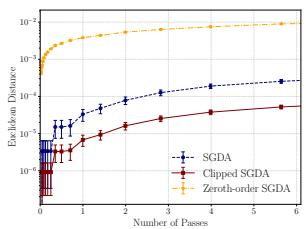  
svmguide3, η = 0.01

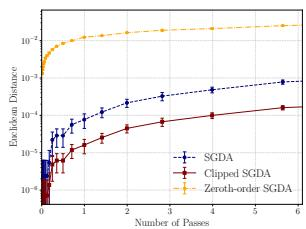  
svmguide3, η = 0.03

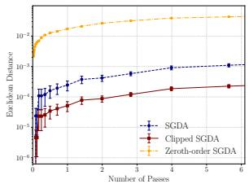  
svmguide3, η = 0.05

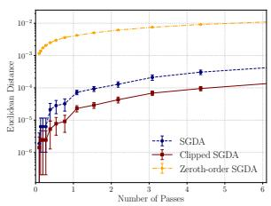  
sonar, η = 0.01

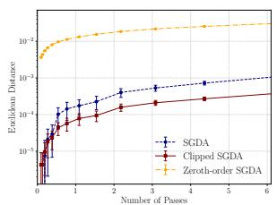  
sonar, η = 0.03

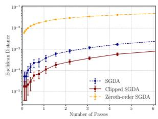

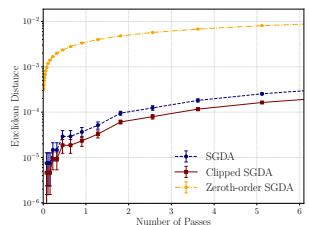  
dna, η = 0.01

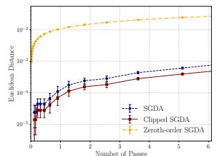  
dna, η = 0.03

sonar, η = 0.05  
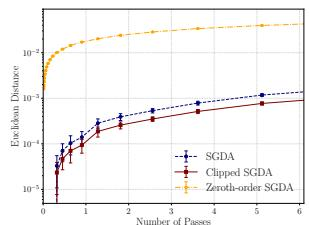  
dna, η = 0.05  
Figure 1: $\Delta _ { t }$ versus the number of passes for different datasets (svmguide3, sonar, DNA) and η 0.01, 0.03, 0.05 .

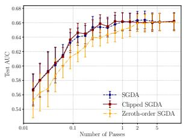  
svmguide3, η = 0.01

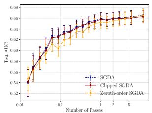  
svmguide3, η = 0.03

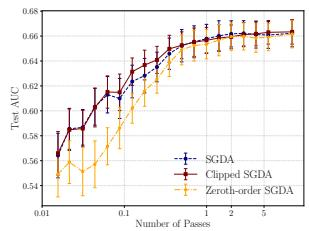  
svmguide3, η = 0.05

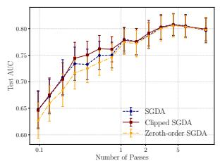  
sonar, η = 0.01

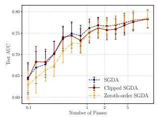

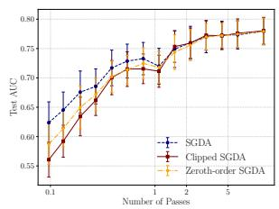  
sonar, η = 0.03  
sonar, η = 0.05

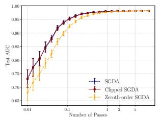  
dna, η = 0.01

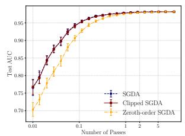  
dna, η = 0.03

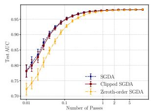  
dna, η = 0.05  
Figure 2: Test AUC versus # of passes for different datasets (svmguide3, sonar, dna) and $\eta \in$ 0.01, 0.03, 0.05 .

We also consider the stability of biased stochastic gradient methods for a nonconvex-nonconcave problem: GAN [21] on the MNIST [27], CIFAR-10 [25], and CelebA [35] datasets. We conduct the experiments with one NVIDIA GeForce RTX 3090 24GB GPU. We use $\eta _ { t } = 0 . 0 0 0 2$ , choose $\mu _ { 1 } = \mu _ { 2 } = 0 . 0 0 0 1 , K \asymp d$ for Zeroth-order SGDA, and clipping parameter $\tau _ { 1 } = \tau _ { 2 } = 1$ in Eq. (5.6) for Clipped-SGDA. As shown in Figure $3 , \Delta _ { t }$ of SGDA, Zeroth-order SGDA, and Clipped-SGDA increase along the training process and also appear to be comparable. Interestingly, the stability of Clipped-SGDA outperforms that of SGDA in this case.

We further study the parameter sensitivity to the smoothing parameter $\mu$ and clipping threshold $\tau .$ Figure 4 shows that the stability of Zeroth-order SGDA is independent of the choice of $\mu ,$ and that the generalization error of it matches that of SGDA when $\begin{array} { r } { \mu \lesssim \frac { \sqrt { \mathbb { E } [ G _ { S } ^ { 2 } ] } } { L \sqrt { n } } } \end{array}$ , verifying our theoretical findings in Remark 5 and Remark 7. Figure 5 shows that the stability and generalization error of Clipped SGDA match that of SGDA when $\tau _ { 1 } , \tau _ { 2 } \gtrsim G T ^ { \frac { 1 } { 4 } }$ and $\eta \lesssim 1 / \sqrt { T }$ , verifying our theoretical findings in Remark 8 and Remark 9.

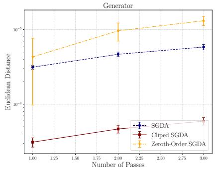

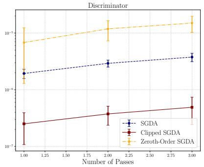

(a) MNIST  
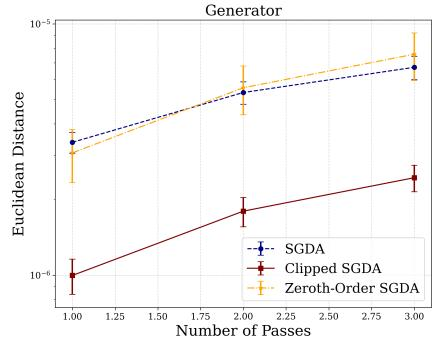

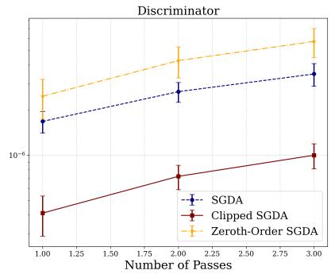

(b) CIFAR-10  
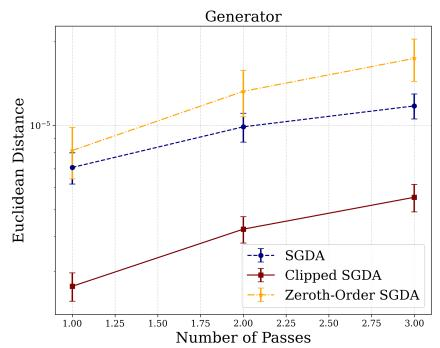

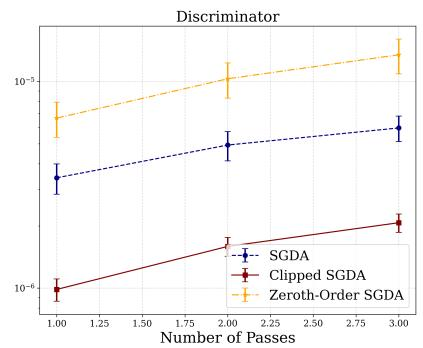  
(c) CelebA  
Figure 3: $\Delta _ { t }$ versus # of passes. Left: generator, right: discriminator. $\eta = 0 . 0 0 0 2 , K = 3 0 0$ $\mu _ { 1 } = \mu _ { 2 } = 0 . 0 0 0 1 , \tau _ { 1 } = \tau _ { 2 } = 1$

## B Proof

## B.1 Proof on Connecting Stability and Generalization

In this section, we present the proof of our results on connecting stability and generalization.

ProofofTheorem 1. Let $S = \{ z _ { 1 } , \ldots , z _ { n } \}$ and $S ^ { \prime } = \{ z _ { 1 } ^ { \prime } , \ldots , z _ { n } ^ { \prime } \}$ be two datasets drawn from the same distribution. For any $i \in [ n ]$ , define $S ^ { ( i ) } = \{ z _ { 1 } , \dots , z _ { i - 1 } , z _ { i } ^ { \prime } , z _ { i + 1 } , \dots , z _ { n } \}$ . For any function $g , { \widetilde { G } } ,$ we have the basic inequalities

$$
\begin{array} { r l } & { \underset { \mathbf { w } } { \operatorname* { s u p } } g ( \mathbf { w } ) - \underset { \mathbf { w } } { \operatorname* { s u p } } \widetilde { G } ( \mathbf { w } ) \leq \underset { \mathbf { w } } { \operatorname* { s u p } } \big ( g ( \mathbf { w } ) - \widetilde { G } ( \mathbf { w } ) \big ) } \\ & { \underset { \mathbf { w } } { \operatorname* { i n f } } g ( \mathbf { w } ) - \underset { \mathbf { w } } { \operatorname* { i n f } } \widetilde { G } ( \mathbf { w } ) \leq \underset { \mathbf { w } } { \operatorname* { s u p } } \big ( g ( \mathbf { w } ) - \widetilde { G } ( \mathbf { w } ) \big ) . } \end{array}\tag{B.1}
$$

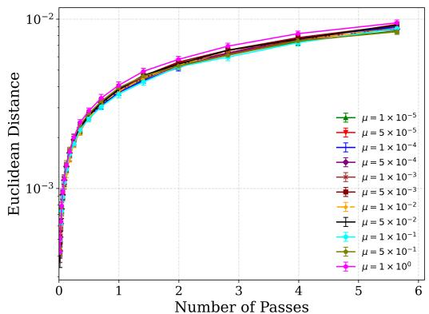  
(a) Euclidean distance ∆t

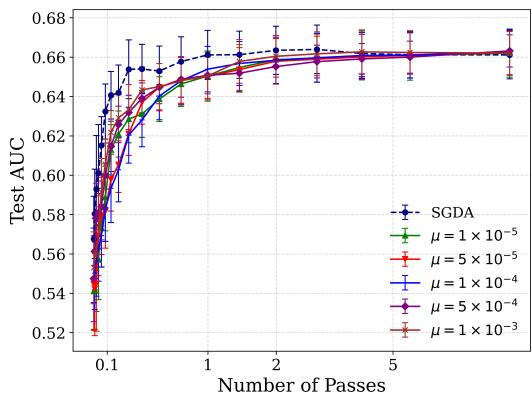  
(b) Test AUC

Figure 4: Parameter sensitivity of Zeroth-order SGDA w.r.t. the smoothing parameter $\mu$ on svmguide3: (a) $\Delta _ { t }$ versus # of passes; (b) Test AUC versus # of passes. $\eta = 0 . 0 1$  
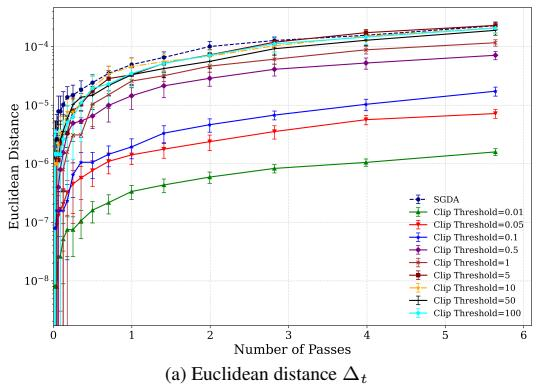

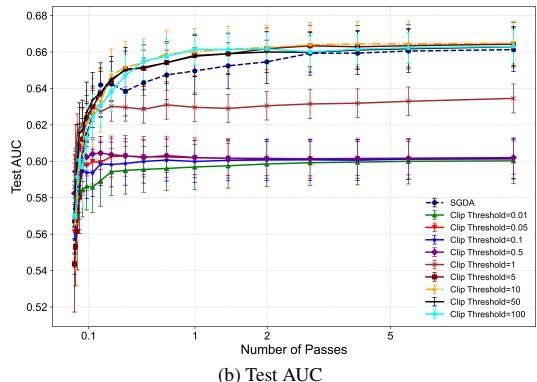  
Figure 5: Parameter sensitivity of Clipped-SGDA w.r.t. the clipping threshold $\tau$ on svmguide3: (a) $\Delta _ { t }$ versus # of passes; (b) Test AUC versus # of passes. $\eta = 0 . 0 1$

It follows from (B.1) that

$$
\begin{array} { r } { \bigtriangleup ^ { w } ( A _ { \mathbf { w } } ( S ) , A _ { \mathbf { v } } ( S ) ) - \bigtriangleup _ { S } ^ { w } ( A _ { \mathbf { w } } ( S ) , A _ { \mathbf { v } } ( S ) ) \leq \underset { \mathbf { v } ^ { \prime } \in \mathcal { V } } { \operatorname* { s u p } } \mathbb { E } [ F ( A _ { \mathbf { w } } ( S ) , \mathbf { v } ^ { \prime } ) - F _ { S } ( A _ { \mathbf { w } } ( S ) , \mathbf { v } ^ { \prime } ) ] } \\ { + \underset { \mathbf { w } ^ { \prime } \in \mathcal { W } } { \operatorname* { s u p } } \mathbb { E } [ F _ { S } ( \mathbf { w } ^ { \prime } , A _ { \mathbf { v } } ( S ) ) - F ( \mathbf { w } ^ { \prime } , A _ { \mathbf { v } } ( S ) ) ] . } \end{array}\tag{B.2}
$$

According to the symmetry between $z _ { i }$ and $z _ { i } ^ { \prime }$ we know

$$
\begin{array} { r l r } & { } & { \mathbb { E } [ F ( A _ { \mathbf { w } } ( S ) , { \mathbf { v } } ^ { \prime } ) - F _ { S } ( A _ { \mathbf { w } } ( S ) , { \mathbf { v } } ^ { \prime } ) ] = \displaystyle \frac { 1 } { n } \sum _ { i = 1 } ^ { n } \mathbb { E } [ F ( A _ { \mathbf { w } } ( S ^ { ( i ) } ) , { \mathbf { v } } ^ { \prime } ) ] - \mathbb { E } [ F _ { S } ( A _ { \mathbf { w } } ( S ) , { \mathbf { v } } ^ { \prime } ) ] } \\ & { } & { \quad \quad \quad \quad \quad = \displaystyle \frac { 1 } { n } \sum _ { i = 1 } ^ { n } \mathbb { E } \big [ f ( A _ { \mathbf { w } } ( S ^ { ( i ) } ) , { \mathbf { v } } ^ { \prime } ; z _ { i } ) - f ( A _ { \mathbf { w } } ( S ) , { \mathbf { v } } ^ { \prime } ; z _ { i } ) \big ] , } \end{array}
$$

where the second identity holds since $z _ { i }$ is not used to train $A _ { \mathbf { w } } ( S ^ { ( i ) } )$ . In a similar way, we can prove

$$
\mathbb { E } [ F _ { S } ( \mathbf { w } ^ { \prime } , A _ { \mathbf { v } } ( S ) ) - F ( \mathbf { w } ^ { \prime } , A _ { \mathbf { v } } ( S ) ) ] = \frac { 1 } { n } \sum _ { i = 1 } ^ { n } \left[ f ( \mathbf { w } ^ { \prime } , A _ { \mathbf { v } } ( S ^ { ( i ) } ) ; z _ { i } ) - f ( \mathbf { w } ^ { \prime } , A _ { \mathbf { v } } ( S ) ; z _ { i } ) \right] .
$$

As a combination of the above three inequalities we get

$$
\begin{array} { r l } & { \displaystyle \bigtriangleup ^ { w } \big ( A _ { \mathbf { w } } ( S ) , A _ { \mathbf { v } } ( S ) \big ) - \bigtriangleup _ { S } ^ { w } \big ( A _ { \mathbf { w } } ( S ) , A _ { \mathbf { v } } ( S ) \big ) \leq \operatorname* { s u p } _ { \mathbf { v } ^ { \prime } \in \mathcal { V } } \Big [ \frac { 1 } { n } \displaystyle \sum _ { i = 1 } ^ { n } \mathbb { E } \big [ f \big ( A _ { \mathbf { w } } ( S ^ { ( i ) } ) , \mathbf { v } ^ { \prime } ; z _ { i } \big ) - f \big ( A _ { \mathbf { w } } ( S ) , \mathbf { v } ^ { \prime } ; z _ { i } \big ) \big ] \Big ] } \\ & { \quad \quad \quad \quad \quad \quad \quad \quad + \operatorname* { s u p } _ { \mathbf { w } ^ { \prime } \in \mathcal { W } } \Big [ \frac { 1 } { n } \displaystyle \sum _ { i = 1 } ^ { n } \mathbb { E } \big [ f \big ( \mathbf { w } ^ { \prime } , A _ { \mathbf { v } } \big ( S ^ { ( i ) } \big ) ; z _ { i } \big ) - f \big ( \mathbf { w } ^ { \prime } , A _ { \mathbf { v } } ( S ) ; z _ { i } \big ) \big ] \Big ] . \quad \mathrm { ~ \ } \mathrm { ~ \ } \mathrm { ~ \ } \mathrm { ~ \ } \mathrm { ~ \ } \mathrm { ~ \ \ } \mathrm { ~ \ } \mathrm { ~ \ \ } \mathrm { ~ \ ( B . 3 ) ~ } } \end{array}
$$

According to Assumption 1, we know

$$
\begin{array} { r l } & { \quad f ( A _ { \mathbf { w } } ( S ^ { ( i ) } ) , \mathbf { v } ^ { \prime } ; z _ { i } ) - f ( A _ { \mathbf { w } } ( S ) , \mathbf { v } ^ { \prime } ; z _ { i } ) \leq \bigg \langle \left( \mathbf { \Delta } _ { \mathbf { v } } ( S ^ { ( i ) } ) - A _ { \mathbf { w } } ( S ) \right) , \left( \nabla _ { \mathbf { w } } f ( A _ { \mathbf { w } } ( S ) , \mathbf { v } ^ { \prime } ; z _ { i } ) \right) \bigg \rangle + } \\ & { \frac { L } { 2 } \Big \| \left( \mathbf { \Delta } _ { \mathbf { w } } ( S ^ { ( i ) } ) - A _ { \mathbf { w } } ( S ) \right) \Big \| _ { 2 } ^ { 2 } = \big \langle A _ { \mathbf { w } } ( S ^ { ( i ) } ) - A _ { \mathbf { w } } ( S ) , \nabla _ { \mathbf { w } } f ( A _ { \mathbf { w } } ( S ) , \mathbf { v } ^ { \prime } ; z _ { i } ) \big \rangle + \frac { L } { 2 } \big \| A _ { \mathbf { w } } ( S ^ { ( i ) } ) - A _ { \mathbf { w } } ( S ) \big \| _ { 2 } ^ { 2 } . } \end{array}
$$

According to Schwartz’s inequality we know for any $\gamma > 0$

$$
\begin{array} { r l r } & { } & { \left. A _ { \mathbf { w } } ( S ^ { ( i ) } ) - A _ { \mathbf { w } } ( S ) , \nabla _ { \mathbf { w } } f ( A _ { \mathbf { w } } ( S ) , \mathbf { v } ^ { \prime } ; z _ { i } ) \right. \leq \left\| A _ { \mathbf { w } } ( S ^ { ( i ) } ) - A _ { \mathbf { w } } ( S ) \right\| _ { 2 } \left\| \nabla _ { \mathbf { w } } f ( A _ { \mathbf { w } } ( S ) , \mathbf { v } ^ { \prime } ; z _ { i } ) \right\| _ { 2 } } \\ & { } & { \qquad \leq \displaystyle \frac { \gamma } { 2 } \left\| A _ { \mathbf { w } } ( S ^ { ( i ) } ) - A _ { \mathbf { w } } ( S ) \right\| _ { 2 } ^ { 2 } + \displaystyle \frac { 1 } { 2 \gamma } \left\| \nabla _ { \mathbf { w } } f ( A _ { \mathbf { w } } ( S ) , \mathbf { v } ^ { \prime } ; z _ { i } ) \right\| _ { 2 } ^ { 2 } . } \end{array}
$$

Therefore,

$$
\begin{array} { r l } & { \mathbb { E } [ f ( A _ { \mathbf { w } } ( S ^ { ( i ) } ) , \mathbf { v } ^ { \prime } ; z _ { i } ) - f ( A _ { \mathbf { w } } ( S ) , \mathbf { v } ^ { \prime } ; z _ { i } ) ] \leq \displaystyle \frac { L + \gamma } { 2 } \mathbb { E } \big [ \big \| A _ { \mathbf { w } } ( S ^ { ( i ) } ) - A _ { \mathbf { w } } ( S ) \big \| _ { 2 } ^ { 2 } \big ] } \\ & { \qquad + \displaystyle \frac { 1 } { 2 \gamma } \mathbb { E } \big [ \big \| \nabla _ { \mathbf { w } } f ( A _ { \mathbf { w } } ( S ) , \mathbf { v } ^ { \prime } ; z _ { i } ) \big \| _ { 2 } ^ { 2 } \big ] . } \end{array}
$$

Similarly, we have

$$
\begin{array} { r l } & { \mathbb { E } \big [ f ( \mathbf { w } ^ { \prime } , A _ { \mathbf { v } } ( S ^ { ( i ) } ) ; z _ { i } ) - f ( \mathbf { w } ^ { \prime } , A _ { \mathbf { v } } ( S ) ; z _ { i } ) \big ] \Big ] \leq \frac { L + \gamma } { 2 } \mathbb { E } \big [ \big \| A _ { \mathbf { v } } ( S ^ { ( i ) } ) - A _ { \mathbf { v } } ( S ) \big \| _ { 2 } ^ { 2 } \big ] } \\ & { \qquad + \ \frac { 1 } { 2 \gamma } \mathbb { E } \big [ \big \| \nabla _ { \mathbf { v } } f ( \mathbf { w } ^ { \prime } , A _ { \mathbf { v } } ( S ) ; z _ { i } ) \big \| _ { 2 } ^ { 2 } \big ] . } \end{array}
$$

Combining the above two inequalities with Eq. (B.3), we have

$$
\begin{array} { r l } & { \displaystyle \triangle ^ { w } ( A _ { \mathbf { w } } ( S ) , A _ { \mathbf { v } } ( S ) ) - \triangle _ { S } ^ { w } ( A _ { \mathbf { w } } ( S ) , A _ { \mathbf { v } } ( S ) ) \leq \frac { L + \gamma } { 2 n } \displaystyle \sum _ { i = 1 } ^ { n } \mathbb { E } \bigg [ \bigg \| \left( \begin{array} { l } { A _ { \mathbf { w } } ( S ^ { ( i ) } ) - A _ { \mathbf { w } } ( S ) } \\ { A _ { \mathbf { v } } ( S ^ { ( i ) } ) - A _ { \mathbf { v } } ( S ) } \end{array} \right) \bigg \| _ { 2 } ^ { 2 } \bigg ] } \\ & { \displaystyle + \frac { 1 } { 2 \gamma } \operatorname* { s u p } _ { \mathbf { v } ^ { \prime } \in \mathcal { V } } \mathbb { E } \Big [ \frac { 1 } { n } \displaystyle \sum _ { i = 1 } ^ { n } \big \| \nabla _ { \mathbf { w } } f ( A _ { \mathbf { w } } ( S ) , \mathbf { v } ^ { \prime } ; z _ { i } ) \big \| _ { 2 } ^ { 2 } \bigg ] + \frac { 1 } { 2 \gamma } \operatorname* { s u p } _ { \mathbf { w } ^ { \prime } \in \mathcal { W } } \mathbb { E } \Big [ \frac { 1 } { n } \displaystyle \sum _ { i = 1 } ^ { n } \big \| \nabla _ { \mathbf { v } } f ( \mathbf { w } ^ { \prime } , A _ { \mathbf { v } } ( S ) ; z _ { i } ) \big \| _ { 2 } ^ { 2 } \Big ] . } \end{array}
$$

Using the fact that (Assumption 2)

$$
\frac { 1 } { n } \sum _ { i = 1 } ^ { n } \left\| \nabla _ { \mathbf { w } } f ( A _ { \mathbf { w } } ( S ) , \mathbf { v } ^ { \prime } ; z _ { i } ) \right\| _ { 2 } ^ { 2 } = \mathbb { E } _ { r } [ \left\| \nabla _ { \mathbf { w } } f ( A _ { \mathbf { w } } ( S ) , \mathbf { v } ^ { \prime } ; S _ { r } ) \right\| _ { 2 } ^ { 2 } ] \leq G _ { S , A } ^ { 2 } ,
$$

$$
\frac { 1 } { n } \sum _ { i = 1 } ^ { n } \left\| \nabla _ { \mathbf { v } } f ( \mathbf { w } ^ { \prime } , A _ { \mathbf { v } } ( S ) ; z _ { i } ) \right\| _ { 2 } ^ { 2 } = \mathbb { E } _ { r } [ \left\| \nabla _ { \mathbf { v } } f ( \mathbf { w } ^ { \prime } , A _ { \mathbf { v } } ( S ) ; S _ { r } ) \right\| _ { 2 } ^ { 2 } ] \leq G _ { S , A } ^ { 2 } ,
$$

we further get

$$
\triangle ^ { w } ( A _ { \mathbf { w } } ( S ) , A _ { \mathbf { v } } ( S ) ) - \triangle _ { S } ^ { w } ( A _ { \mathbf { w } } ( S ) , A _ { \mathbf { v } } ( S ) ) \leq \frac { L + \gamma } { 2 n } \sum _ { i = 1 } ^ { n } \mathbb { E } \bigg [ \bigg \| \left( \begin{array} { l } { A _ { \mathbf { w } } ( S ^ { ( i ) } ) - A _ { \mathbf { w } } ( S ) } \\ { A _ { \mathbf { v } } ( S ^ { ( i ) } ) - A _ { \mathbf { v } } ( S ) } \end{array} \right) \bigg \| _ { 2 } ^ { 2 } \bigg ] + \frac { \mathbb { E } [ G _ { S , A } ^ { 2 } ] } { \gamma } .
$$

Since A is ϵ-argument-stable in expectation, we know

$$
\triangle ^ { w } ( A _ { \mathbf { w } } ( S ) , A _ { \mathbf { v } } ( S ) ) - \triangle _ { S } ^ { w } ( A _ { \mathbf { w } } ( S ) , A _ { \mathbf { v } } ( S ) ) \leq \frac { L + \gamma } { 2 } \epsilon ^ { 2 } + \frac { \mathbb { E } [ G _ { S , A } ^ { 2 } ] } { \gamma } .
$$

If we choose $\gamma = \sqrt { 2 \mathbb { E } [ G _ { S , A } ^ { 2 } ] } / \epsilon$ , then

$$
\triangle ^ { w } ( A _ { \mathbf { w } } ( S ) , A _ { \mathbf { v } } ( S ) ) - \triangle _ { S } ^ { w } ( A _ { \mathbf { w } } ( S ) , A _ { \mathbf { v } } ( S ) ) \leq L \epsilon ^ { 2 } / 2 + \sqrt { 2 \mathbb { E } [ G _ { S , A } ^ { 2 } ] } \epsilon .
$$

This completes the proof.

## B.2 Proofs on General Stability Bounds

In this section, we present the proof for our general stability bounds of Biased-SGDA under the convex-concave case.

To prove Theorem $^ { 2 , }$ we require the following standard lemma [45], which shows the monotonicity of the gradient map for convex-concave functions.

Lemma 11 ([45]). Let f be a convex-concave function. Then

$$
\left. \left( \mathbf { w } - \mathbf { w } ^ { \prime } \right) , \left( { \nabla _ { \mathbf { w } } } f ( \mathbf { w } , \mathbf { v } ) - \nabla _ { \mathbf { w } } f ( \mathbf { w } ^ { \prime } , \mathbf { v } ^ { \prime } ) \right) \right. \geq 0 .\tag{B.4}
$$

Proof of Theorem 2. Let $\textit { S } = \ \{ z _ { 1 } , \ldots , z _ { n } \}$ and $S ^ { ( i ) } ~ = ~ \{ z _ { 1 } , \ldots , z _ { i - 1 } , z _ { i } ^ { \prime } , z _ { i + 1 } , \ldots , z _ { n } \}$ . Let $\left\{ \mathbf { w } _ { t } , \mathbf { v } _ { t } \right\}$ and $\{ \mathbf { w } _ { t } ^ { ( i ) } , \mathbf { v } _ { t } ^ { ( i ) } \}$ be the sequence produced by (4.3) w.r.t. S and $S ^ { ( i ) }$ , respectively. Note that the projection step is nonexpansive, according to Eq. (4.3), Eq. (4.4), we know

$$
\begin{array} { r l r } & { } & { \left\| \left( \mathbf { w } _ { t + 1 } - \mathbf { w } _ { t + 1 } ^ { ( i ) } \right) \right\| _ { 2 } ^ { 2 } \leq \left\| \left( \mathbf { w } _ { t } - \mathbf { w } _ { t } ^ { ( i ) } \right) \right\| _ { 2 } ^ { 2 } + \eta ^ { 2 } \left\| \left( \begin{array} { l } { g _ { \mathbf { w } } ( \mathbf { w } _ { t } ^ { ( i ) } , \mathbf { v } _ { t } ^ { ( i ) } ; z _ { i _ { t } } ^ { ( i ) } ) - g _ { \mathbf { w } } ( \mathbf { w } _ { t } , \mathbf { v } _ { t } ; z _ { i _ { t } } ) } \\ { g _ { \mathbf { v } } ( \mathbf { w } _ { t } , \mathbf { v } _ { t } ; z _ { i _ { t } } ) - g _ { \mathbf { v } } ( \mathbf { w } _ { t } ^ { ( i ) } , \mathbf { v } _ { t } ^ { ( i ) } ; z _ { i _ { t } } ^ { ( i ) } ) } \end{array} \right) \right\| _ { 2 } ^ { 2 } } \\ & { } & { - 2 \eta \Bigg \langle \left( \mathbf { w } _ { t } - \mathbf { w } _ { t } ^ { ( i ) } \right) , \left( \begin{array} { l } { g _ { \mathbf { w } } ( \mathbf { w } _ { t } , \mathbf { v } _ { t } ; z _ { i _ { t } } ) - g _ { \mathbf { w } } ( \mathbf { w } _ { t } ^ { ( i ) } , \mathbf { v } _ { t } ^ { ( i ) } ; z _ { i _ { t } } ^ { ( i ) } ) } \\ { g _ { \mathbf { v } } ( \mathbf { w } _ { t } ^ { ( i ) } , \mathbf { v } _ { t } ^ { ( i ) } ; z _ { i _ { t } } ^ { ( i ) } ) - g _ { \mathbf { v } } ( \mathbf { w } _ { t } , \mathbf { v } _ { t } ; z _ { i _ { t } } ^ { ( i ) } ) } \end{array} \right) \Bigg \rangle . ~ ( \mathbf { B } . 5 ) } \end{array}
$$

Recall the definition of the bias as in Eq. (4.5). Taking a conditional expectation implies

$$
\begin{array} { r l } & { \mathbb { E } _ { t } [ \| ( \mathbf { w } _ { t + 1 } - \mathbf { w } _ { t + 1 } ^ { ( i ) } ) \| _ { 2 } ^ { 2 } ] } \\ & { \leq \| ( \mathbf { w } _ { t } - \mathbf { w } _ { t } ^ { ( i ) } ) \| _ { 2 } ^ { 2 } + \eta ^ { 2 } \mathbb { E } _ { t } [ \| ( \begin{array} { l } { g _ { \mathbf { w } } ( \mathbf { w } _ { t } ^ { ( i ) } , \mathbf { v } _ { t } ^ { ( i ) } ; z _ { i _ { t } } ^ { ( i ) } ) - g _ { \mathbf { w } } ( \mathbf { w } _ { t } , \mathbf { v } _ { t } ; z _ { i _ { t } } ) } \\ { g _ { \mathbf { w } } ( \mathbf { w } _ { t } , \mathbf { v } _ { t } ; z _ { i _ { t } } ) - g _ { \mathbf { v } } ( \mathbf { w } _ { t } ^ { ( i ) } , \mathbf { v } _ { t } ^ { ( i ) } ; z _ { i _ { t } } ^ { ( i ) } ) } \end{array} ) \| _ { 2 } ^ { 2 } ] } \\ &  - 2 \eta \Bigg \langle ( \mathbf { w } _ { t } - \mathbf { w } _ { t } ^ { ( i ) } ) , ( \begin{array} { l } { \nabla _ { \mathbf { w } } \widetilde { F } _ { 1 , S } ( \mathbf { w } _ { t } , \mathbf { v } _ { t } ) + b _ { t , \mathbf { w } } - \nabla _ { \mathbf { w } } \widetilde { F } _ { 1 , S ^ { ( i ) } } ( \mathbf { w } _ { t } ^ { ( i ) } , \mathbf { v } _ { t } ^ { ( i ) } ) - b _ { t , \mathbf { w } } ^ { ( i ) } } \\  \nabla _ { \mathbf { v } } \widetilde { F } _ { 2 , S ^ { ( i ) } } ( \mathbf { w } _ { t } ^ { ( i ) } , \mathbf { v } _ { t } ^ { ( i ) } ) + b _ { t , \mathbf { v } } ^ { ( i ) } - \nabla _ { \mathbf { v } } \widetilde { F } _ { 2 , S } \end{array} \end{array}\tag{B.6}
$$

We know

$$
\begin{array} { r l } & { - 2 \eta \Bigg \langle \left( \mathbf { w } _ { t } - \mathbf { w } _ { t } ^ { ( i ) } \right) , \left( \nabla _ { \mathbf { w } } \widetilde { F } _ { 1 , S } ( \mathbf { w } _ { t } , \mathbf { v } _ { t } ) - \nabla _ { \mathbf { w } } \widetilde { F } _ { 1 , S ^ { ( i ) } } ( \mathbf { w } _ { t } ^ { ( i ) } , \mathbf { v } _ { t } ^ { ( i ) } ) \right) \Bigg \rangle } \\ & { = - \frac { 2 \eta } { n } \displaystyle \sum _ { j : j \neq i } \Bigg \langle \left( \mathbf { w } _ { t } - \mathbf { w } _ { t } ^ { ( i ) } \right) , \left( \nabla _ { \mathbf { w } } \widetilde { F } _ { 2 , S } ( \mathbf { w } _ { t } ^ { ( i ) } , \mathbf { v } _ { t } ^ { ( i ) } ) - \nabla _ { \mathbf { v } } \widetilde { F } _ { 2 , S } ( \mathbf { w } _ { t } , \mathbf { v } _ { t } ) \right) \Bigg \rangle } \\ & { - \frac { 2 \eta } { n } \Bigg \langle \left( \mathbf { w } _ { t } - \mathbf { w } _ { t } ^ { ( i ) } \right) , \left( \nabla _ { \mathbf { w } } \widetilde { f } _ { 1 } ( \mathbf { w } _ { t } , \mathbf { v } _ { t } ; z _ { i } ) - \nabla _ { \mathbf { w } } \widetilde { f } _ { 1 } ( \mathbf { w } _ { t } ^ { ( i ) } , \mathbf { v } _ { t } ^ { ( i ) } ; z _ { j } ) \right) \Bigg \rangle } \\ & { - \frac { 2 \eta } { n } \Bigg \langle \left( \mathbf { w } _ { t } - \mathbf { w } _ { t } ^ { ( i ) } \right) , \left( \nabla _ { \mathbf { w } } \widetilde { f } _ { 1 } ( \mathbf { w } _ { t } , \mathbf { v } _ { t } ; z _ { i } ) - \nabla _ { \mathbf { w } } \widetilde { f } _ { 1 } ( \mathbf { w } _ { t } ^ { ( i ) } , \mathbf { v } _ { t } ^ { ( i ) } ; z _ { i } ^ { ( j ) } \right) \Bigg \rangle . } \end{array}
$$

Noting that $\tilde { f } _ { 1 } , \tilde { f } _ { 2 }$ are convex w.r.t. w and concave w.r.t $\mathbf { v } ,$ it then follows from Lemma 11 and Schwartz’s inequality that

$$
\begin{array} { r l } & { - 2 \eta \Bigg \langle \left( \mathbf { w } _ { t } - \mathbf { w } _ { t } ^ { ( i ) } \right) , \left( \nabla _ { \mathbf { w } } \widetilde { F } _ { 1 , S } ( \mathbf { w } _ { t } , \mathbf { v } _ { t } ) - \nabla _ { \mathbf { w } } \widetilde { F } _ { 1 , S ^ { ( i ) } } ( \mathbf { w } _ { t } ^ { ( i ) } , \mathbf { v } _ { t } ^ { ( i ) } ) \right) \Bigg \rangle } \\ & { ~ \leq \frac { 2 \eta } { n } \Bigg \Vert \left( \mathbf { w } _ { t } - \mathbf { w } _ { t } ^ { ( i ) } \right) \Bigg \Vert _ { 2 } \Bigg \Vert \left( \nabla _ { \mathbf { w } } \widetilde { F } _ { 2 , S ^ { ( i ) } } ( \mathbf { w } _ { t } ^ { ( i ) } , \mathbf { v } _ { t } ^ { ( i ) } ) - \nabla _ { \mathbf { w } } \widetilde { F } _ { 2 , S } ( \mathbf { w } _ { t } , \mathbf { v } _ { t } ) \right) \Bigg \Vert _ { 2 } } \\ & { \leq \frac { 2 \eta } { n } \Bigg \Vert \left( \mathbf { w } _ { t } - \mathbf { w } _ { t } ^ { ( i ) } \right) \Bigg \Vert _ { 2 } \Bigg \Vert \left( \nabla _ { \mathbf { w } } \widetilde { f } _ { 1 } ( \mathbf { w } _ { t } , \mathbf { v } _ { t } ; z _ { i } ) - \nabla _ { \mathbf { w } } \widetilde { f } _ { 1 } ( \mathbf { w } _ { t } ^ { ( i ) } , \mathbf { v } _ { t } ^ { ( i ) } ; z _ { i } ^ { \prime } ) \right) \Bigg \Vert _ { 2 } . } \end{array}\tag{B.7}
$$

Using Schwarz’s inequality, we also know

$$
- 2 \eta \Bigg \langle \left( \mathbf { w } _ { t } - \mathbf { w } _ { t } ^ { ( i ) } \right) , \left( b _ { t , \mathbf { w } } - b _ { t , \mathbf { w } } ^ { ( i ) } \right) \Bigg \rangle \leq 2 \eta \Bigg \rangle \Bigg \langle \left| \left( \mathbf { w } _ { t } - \mathbf { w } _ { t } ^ { ( i ) } \right) \right| \Bigg | \left| \left( b _ { t , \mathbf { w } } - b _ { t , \mathbf { w } } ^ { ( i ) } \right) \right| \Bigg | ,\tag{B.8}
$$

Plugging Eq. (B.7) and Eq. (B.8) into Eq. (B.6), we know

$$
\begin{array} { r l } & { \mathbb { E } _ { t } [  ( \mathbf { w } _ { t + 1 } - \mathbf { w } _ { t + 1 } ^ { ( i ) } )  _ { 2 } ^ { 2 } ] } \\ & { \leq  ( \mathbf { w } _ { t } - \mathbf { w } _ { t } ^ { ( i ) } )  _ { 2 } ^ { 2 } + \eta ^ { 2 } \mathbb { E } _ { t } [  ( \mathcal { G } _ { \mathbf { y } } ( \mathbf { w } _ { t } ^ { ( i ) } , \mathbf { v } _ { t } ^ { ( i ) } ; z _ { i } ^ { ( i ) } ) - \mathcal { G } _ { \mathbf { w } } ( \mathbf { w } _ { t } , \mathbf { v } _ { t } ; z _ { i } ) )  _ { 2 } ^ { 2 } ] } \\ & { +  \frac { 2 \eta } { n }  ( \mathbf { w } _ { t } - \mathbf { w } _ { t } ^ { ( i ) } )  _ { 2 }  ( \nabla _ { \mathbf { v } } \tilde { f } _ { 1 } ( \mathbf { w } _ { t } , \mathbf { v } _ { t } ; z _ { i } ) - \nabla _ { \mathbf { w } } \tilde { f } _ { 1 } ( \mathbf { w } _ { t } ^ { ( i ) } , \mathbf { v } _ { t } ^ { ( i ) } ; z _ { i } ^ { ( i ) } ) ) )  _ { 2 } } \\ & { +  2 \eta  ( \mathbf { w } _ { t } - \mathbf { w } _ { t } ^ { ( i ) } )  _ { 2 }  ( ( \nabla _ { \mathbf { v } } \tilde { f } _ { 2 } ( \mathbf { w } _ { t } , \mathbf { v } _ { t } ; z _ { i } ) - \nabla _ { \mathbf { v } } \tilde { f } _ { 2 } ( \mathbf { w } _ { t } , \mathbf { v } _ { t } ; z _ { i } ) ) )  _ { 2 } } \\ &  +  2 \eta  ( \mathbf { w } _ { t } - \mathbf { w } _ { t } ^ { ( i ) } )  _ { 2 }   \end{array}
$$

Taking an average of $i \in [ n ]$ , and using the fact that $\begin{array} { r } { \sum _ { i = 1 } ^ { n } a _ { i } b _ { i } \le ( \sum _ { i = 1 } ^ { n } a _ { i } ^ { 2 } ) ^ { \frac { 1 } { 2 } } ( \sum _ { i = 1 } ^ { n } b _ { i } ^ { 2 } ) ^ { \frac { 1 } { 2 } } } \end{array}$ , we get

$$
\begin{array} { r l } & { \mathbb { E } _ { t } [ \frac { 1 } { n } \displaystyle \sum _ { i = 1 } ^ { n }  ( { { { \bf { w } } _ { t + 1 } } - { { \bf { w } } _ { t + 1 } ^ { ( i ) } } } )  _ { 2 } ^ { 2 } ] } \\ & { \le \frac { 1 } { n } \displaystyle \sum _ { i = 1 } ^ { n }  ( { { { \bf { w } } _ { t } } - { \bf { w } } _ { t } ^ { ( i ) } } )  _ { 2 } ^ { 2 } + \eta ^ { 2 } \mathbb { E } _ { t } [ \frac { 1 } { n } \displaystyle \sum _ { i = 1 } ^ { n }  ( { \frac { \displaystyle \{ { \partial _ { \bf { w } } ( { \bf { w } } _ { t } ^ { ( i ) } , { { \bf { v } } _ { t } ^ { ( i ) } } ; { z _ { t } ^ { ( i ) } } ) - \mathcal { G } _ { w } ( { { { \bf { w } } _ { t } ^ { ( i ) } } ; { z _ { t } ^ { ( i ) } } ) } } ) } { \displaystyle \{ { \partial _ { \bf { v } } ( { { \bf { w } } _ { t } } , { { \bf { v } } _ { t } ^ { ( i ) } } ; { z _ { t } } ) - \mathcal { G } _ { w } ( { { { \bf { w } } _ { t } ^ { ( i ) } } ; { z _ { t } ^ { ( i ) } } ) } } ) } }  _ { 2 } ^ { 2 } ] } \\ &  +  \frac { 2 \eta } { n } ( \frac { 1 } { n } \displaystyle \sum _ { i = 1 } ^ { n }  ( { { { \bf { w } } _ { t } } - { { \bf { w } } _ { t } ^ { ( i ) } } } )  _ { 2 } ^ { 2 } ) ^ { \frac { 1 } { 2 } } ( \frac { 1 } { n } \displaystyle \sum _ { i = 1 } ^ { n }  (  \nabla _ { { \bf { w } } } \tilde { f } _ { i } (  { \bf { w } } _ { t } \end{array}
$$

Introduce

$$
\bar { \Delta } _ { t } = \left( \frac { 1 } { n } \sum _ { i = 1 } ^ { n } \mathbb { E } \left[ \left. \left( \mathbf { w } _ { t } - \mathbf { w } _ { t } ^ { ( i ) } \right) \right. _ { 2 } ^ { 2 } \right] \right) ^ { \frac { 1 } { 2 } } , \quad \forall t \in [ T ] .
$$

Taking the expectation to the above inequality and using the inequality $\mathbb { E } [ X Y ] \le ( \mathbb { E } [ X ^ { 2 } ] ) ^ { \frac { 1 } { 2 } } ( \mathbb { E } [ Y ^ { 2 } ] ) ^ { \cdot }$ we have

$$
\begin{array} { l } { \displaystyle \bar { \Delta } _ { t + 1 } ^ { 2 } \leq \bar { \Delta } _ { t } ^ { 2 } + \eta ^ { 2 } \mathbb { E } \Bigg [ \frac { 1 } { n } \sum _ { i = 1 } ^ { n } \Bigg \| \left( \begin{array} { l } { g _ { \mathbf { w } } ( \mathbf { w } _ { t } ^ { ( i ) } , \mathbf { v } _ { t } ^ { ( i ) } ; z _ { i } ^ { ( i ) } ) - g _ { \mathbf { w } } ( \mathbf { w } _ { t } , \mathbf { v } _ { t } ; z _ { i } _ { t } ) } \\ { g _ { \mathbf { v } } ( \mathbf { w } _ { t } , \mathbf { v } _ { t } ; z _ { i _ { t } } ) - g _ { \mathbf { v } } ( \mathbf { w } _ { t } ^ { ( i ) } , \mathbf { v } _ { t } ^ { ( i ) } ; z _ { i _ { t } } ^ { ( i ) } ) } \end{array} \right) \Bigg \| _ { 2 } ^ { 2 } \Bigg ] } \\ { \displaystyle ~ + \frac { 2 \eta } { n } \bar { \Delta } _ { t } \Bigg ( \mathbb { E } \Bigg [ \frac { 1 } { n } \sum _ { i = 1 } ^ { n } \Bigg \| \left( \begin{array} { l } { \nabla _ { \mathbf { w } } \tilde { f } _ { 1 } ( \mathbf { w } _ { t } , \mathbf { v } _ { t } ; z _ { i } ) - \nabla _ { \mathbf { w } } \tilde { f } _ { 1 } ( \mathbf { w } _ { t } ^ { ( i ) } , \mathbf { v } _ { t } ^ { ( i ) } ; z _ { i } ^ { \prime } ) } \\ { \nabla _ { \mathbf { v } } \tilde { f } _ { 2 } ( \mathbf { w } _ { t } ^ { ( i ) } , \mathbf { v } _ { t } ^ { ( i ) } ; z _ { i } ^ { \prime } ) - \nabla _ { \mathbf { v } } \tilde { f } _ { 2 } ( \mathbf { w } _ { t } , \mathbf { v } _ { t } ; z _ { i } ) } \end{array} \right) \Bigg \| _ { 2 } ^ { 2 } \Bigg ] \Bigg ) ^ { \frac { 1 } { 2 } } } \\  \displaystyle ~ + 2 \eta \bar { \Delta } _ { t } \Bigg  \end{array}
$$

Using conditions as in Eq. (4.6), Eq. (4.7) and Eq. (4.8), this further yields

$$
\bar { \Delta } _ { t + 1 } ^ { 2 } \leq ( 1 + A \eta ^ { 2 } + 2 \bar { A } ^ { \frac { 1 } { 2 } } \eta ) \bar { \Delta } _ { t } ^ { 2 } + 2 \eta \bigl ( \sqrt { \bar { B } } + \frac { \widetilde { G } } { n } \bigr ) \bar { \Delta } _ { t } + \eta ^ { 2 } B .
$$

Applying this inequality recursively and using the fact that $\bar { \Delta } _ { 1 } = 0$ imply that

$$
\begin{array} { r l r } & { } & { \bar { \Delta } _ { t + 1 } ^ { 2 } \le \eta ^ { 2 } B \displaystyle \sum _ { k = 1 } ^ { t } ( 1 + A \eta ^ { 2 } + 2 \bar { A } ^ { \frac { 1 } { 2 } } \eta ) ^ { t - k } + 2 \eta \displaystyle \sum _ { k = 1 } ^ { t } \big ( \sqrt { \bar { B } } + \frac { \widetilde G } { n } \big ) \bar { \Delta } _ { k } ( 1 + A \eta ^ { 2 } + 2 \bar { A } ^ { \frac { 1 } { 2 } } \eta ) ^ { t - k } } \\ & { } & { = \eta ^ { 2 } B \displaystyle \frac { \big ( 1 + A \eta ^ { 2 } + 2 \bar { A } ^ { \frac { 1 } { 2 } } \eta \big ) ^ { t } - 1 } { A \eta ^ { 2 } + 2 \bar { A } ^ { \frac { 1 } { 2 } } \eta } + 2 \eta \displaystyle \sum _ { k = 1 } ^ { t } \big ( \sqrt { \bar { B } } + \frac { \widetilde G } { n } \big ) \bar { \Delta } _ { k } ( 1 + A \eta ^ { 2 } + 2 \bar { A } ^ { \frac { 1 } { 2 } } \eta ) ^ { t - k } . } \end{array}
$$

Since the above inequality applies for any $t \in [ T ]$ , if we introduce $\bar { \Delta } = \operatorname* { m a x } _ { t \leq T } \bar { \Delta } _ { t }$ , we further get

$$
\bar { \Delta } ^ { 2 } \leq \eta ^ { 2 } B \frac { \bigl ( 1 + A \eta ^ { 2 } + 2 \bar { A } ^ { \frac { 1 } { 2 } } \eta \bigr ) ^ { T } - 1 } { A \eta ^ { 2 } + 2 \bar { A } ^ { \frac { 1 } { 2 } } \eta } + 2 \eta \bigl ( \sqrt { \bar { B } } + \frac { \widetilde { G } } { n } \bigr ) \frac { \bigl ( 1 + A \eta ^ { 2 } + 2 \bar { A } ^ { \frac { 1 } { 2 } } \eta \bigr ) ^ { T } - 1 } { A \eta ^ { 2 } + 2 \bar { A } ^ { \frac { 1 } { 2 } } \eta } \bar { \Delta } .
$$

Note the right-hand side of the above inequality is an increasing function of $A \eta ^ { 2 } + 2 \bar { A } ^ { \frac { 1 } { 2 } } \eta .$ . By taking $\eta$ such that $\begin{array} { r } { A \eta ^ { 2 } + 2 \bar { A } ^ { \frac { 1 } { 2 } } \eta \le \frac { 1 } { T } } \end{array}$ in the above inequality and using $( 1 + 1 / T ) ^ { T } \leq e ,$ , we get

$$
\bar { \Delta } ^ { 2 } \leq 2 \eta ^ { 2 } B T + 4 \eta \bigl ( \sqrt { \bar { B } } + { \frac { \widetilde G } { n } } \bigr ) T \bar { \Delta } .
$$

Solving the above quadratic inequality of $\bar { \Delta }$ implies that $( { \mathrm { i f ~ } } x ^ { 2 } \leq a x + b$ for some $a , b \geq 0$ , then $x ^ { 2 } \leq \breve { a ^ { 2 } } + 2 b )$ )

$$
\bar { \Delta } ^ { 2 } \leq 4 B \eta ^ { 2 } T + 1 6 \big ( \sqrt { \bar { B } } + \frac { \widetilde G } { n } \big ) ^ { 2 } \eta ^ { 2 } T ^ { 2 } .
$$

The stated bound follows directly.

## B.3 Proofs on Applications

In this section, we present stability bounds for the specific Biased-SGDA algorithms for the convexconcave case. We first present a lemma that is often applied in our proof. This lemma shows the condition Eq. (4.8) holds with $\widetilde { G } = 2 \sqrt { 2 \mathbb { E } [ G _ { S } ^ { 2 } ] }$ when we choose $\tilde { f } _ { 1 } = \tilde { f } _ { 2 } = f$

Lemma 12. Under Assumption 3, we know

$$
\mathbb { E } \left[ \frac { 1 } { n } \sum _ { i = 1 } ^ { n } \left\| \left( \nabla _ { \mathbf { w } } f ( \mathbf { w } _ { t } ^ { ( i ) } , \mathbf { v } _ { t } ^ { ( i ) } ; z _ { i } ^ { \prime } ) - \nabla _ { \mathbf { w } } f ( \mathbf { w } _ { t } , \mathbf { v } _ { t } ; z _ { i } ) \right) \right\| _ { 2 } ^ { 2 } \right] \leq 8 \mathbb { E } [ G _ { S } ^ { 2 } ] .
$$

Proof. By the inequality that $( a + b ) ^ { 2 } \leq 2 a ^ { 2 } + 2 b ^ { 2 }$ , we know

$$
\begin{array} { r l } & { \bigg \| \left( \nabla _ { \mathbf { w } } f ( \mathbf { w } _ { t } ^ { ( i ) } , \mathbf { v } _ { t } ^ { ( i ) } ; z _ { i } ^ { \prime } ) - \nabla _ { \mathbf { w } } f ( \mathbf { w } _ { t } , \mathbf { v } _ { t } ; z _ { i } ) \right) \bigg \| _ { 2 } ^ { 2 } } \\ & { = \big \| \nabla _ { \mathbf { w } } f ( \mathbf { w } _ { t } , \mathbf { v } _ { t } ; z _ { i } ) - \nabla _ { \mathbf { v } } f ( \mathbf { w } _ { t } ^ { ( i ) } , \mathbf { v } _ { t } ^ { ( i ) } ; z _ { i } ^ { \prime } ) \big ) \bigg \| _ { 2 } ^ { 2 } } \\ & { = \big \| \nabla _ { \mathbf { w } } f ( \mathbf { w } _ { t } ^ { ( i ) } , \mathbf { v } _ { t } ^ { ( i ) } ; z _ { i } ^ { \prime } ) - \nabla _ { \mathbf { w } } f ( \mathbf { w } _ { t } , \mathbf { v } _ { t } ; z _ { i } ) \big \| _ { 2 } ^ { 2 } + \big \| \nabla _ { \mathbf { v } } f ( \mathbf { w } _ { t } , \mathbf { v } _ { t } ; z _ { i } ) - \nabla _ { \mathbf { v } } f ( \mathbf { w } _ { t } ^ { ( i ) } , \mathbf { v } _ { t } ^ { ( i ) } ; z _ { i } ^ { \prime } ) \big \| _ { 2 } ^ { 2 } } \\ &  \leq 2 \Big ( \big \| \nabla _ { \mathbf { w } } f ( \mathbf { w } _ { t } ^ { ( i ) } , \mathbf { v } _ { t } ^ { ( i ) } ; z _ { i } ^ { \prime } ) \big \| _ { 2 } ^ { 2 } + \big \| \nabla _ { \mathbf { w } } f ( \mathbf { w } _ { t } , \mathbf { v } _ { t } ; z _ { i } ) \big \| _ { 2 } ^ { 2 } + \big \| \nabla _ { \mathbf { v } } f ( \mathbf { w } _ { t } , \mathbf { v } _ { t } ; z _ { i } ) \big \| _ { 2 } ^ { 2 } + \big \| \nabla _   \end{array}
$$

Taking the expectation of the above inequality, then taking an average of $i \in [ n ]$ , we get (r follows the uniform distribution over [n])

$$
\begin{array} { r l } & { \mathbb { E } \bigg [ \frac { 1 } { n } \displaystyle \sum _ { i = 1 } ^ { n } \bigg \| \bigg ( \nabla _ { \mathbf { w } } f ( \mathbf { w } _ { t } ^ { ( i ) } , \mathbf { v } _ { t } ^ { ( i ) } ; z _ { i } ^ { \prime } ) - \nabla _ { \mathbf { w } } f ( \mathbf { w } _ { t } , \mathbf { v } _ { t } ; z _ { i } ) \bigg ) \bigg \| _ { 2 } ^ { 2 } \bigg ] } \\ & { \leq 4 \mathbb { E } \bigg [ \frac { 1 } { n } \displaystyle \sum _ { i = 1 } ^ { n } \big \| \nabla _ { \mathbf { w } } f ( \mathbf { w } _ { t } , \mathbf { v } _ { t } ; z _ { i } ) \big \| _ { 2 } ^ { 2 } \bigg ] + 4 \mathbb { E } \bigg [ \frac { 1 } { n } \displaystyle \sum _ { i = 1 } ^ { n } \big \| \nabla _ { \mathbf { v } } f ( \mathbf { w } _ { t } , \mathbf { v } _ { t } ; z _ { i } ) \big \| _ { 2 } ^ { 2 } \bigg ] } \\ & { = 4 \mathbb { E } \big [ \big \| \nabla _ { \mathbf { w } } f ( \mathbf { w } _ { t } , \mathbf { v } _ { t } ; z _ { r } ) \big \| _ { 2 } ^ { 2 } \big ] + 4 \mathbb { E } \big [ \big \| \nabla _ { \mathbf { v } } f ( \mathbf { w } _ { t } , \mathbf { v } _ { t } ; z _ { r } ) \big \| _ { 2 } ^ { 2 } \big ] \leq 8 \mathbb { E } [ G _ { S } ^ { 2 } ] , } \end{array}
$$

where we have used the identity

$\begin{array} { r } { \mathbb { E } [ \| \nabla _ { \mathbf { w } } f ( \mathbf { w } _ { t } ^ { ( i ) } , \mathbf { v } _ { t } ^ { ( i ) } ; z _ { i } ^ { \prime } ) \| _ { 2 } ^ { 2 } ] = \mathbb { E } [ \| \nabla _ { \mathbf { w } } f ( \mathbf { w } _ { t } , \mathbf { v } _ { t } ; z _ { i } ) \| _ { 2 } ^ { 2 } ] , \mathbb { E } [ \| \nabla _ { \mathbf { w } } f ( \mathbf { w } _ { t } ^ { ( i ) } , \mathbf { v } _ { t } ^ { ( i ) } ; z _ { i } ^ { \prime } ) \| _ { 2 } ^ { 2 } ] = \mathbb { E } [ \| \nabla _ { \mathbf { v } } f ( \mathbf { w } _ { t } , \mathbf { v } _ { t } ; z _ { i } ) \| _ { 2 } ^ { 2 } ] . } \end{array}$ ∥22] in the first step, and Assumption 3 in the last step. □

## B.3.1 SGDA

In this subsection, we give the proofs for SGDA. We first prove Lemma 13 to show that Eq. (4.6), Eq. (4.7) hold for SGDA.

Lemma 13. Assumefor all z, thefunction $( { \bf w } , { \bf v } ) \mapsto f ( { \bf w } , { \bf v } ; z )$ is convex-concave. Let Assumption 1, 3 hold. Ifwe choose the gradient estimator in $E q . \left( 5 . 1 \right)$ and $\tilde { f } _ { 1 } = \tilde { f } _ { 2 } = f ,$ , then Eq. (4.6), Eq. (4.7) hold with $\begin{array} { r } { A = L ^ { 2 } , B = \frac { 8 \mathbb { E } [ G _ { S } ^ { 2 } ] } { n } , \bar { A } = 0 , \bar { B } = 0 } \end{array}$

ProofofLemma 13. Since $b _ { t } = b _ { t } ^ { ( i ) } = 0$ , it is clear that Eq. (4.7) holds with $\bar { A } = 0 , \bar { B } = 0$ Furthermore, we have

$$
\begin{array} { r l } & { \mathbb { E } [ \frac { 1 } { n } \displaystyle \sum _ { i = 1 } ^ { n } \| ( \begin{array} { l l } { g _ { \mathbf { w } } \big ( { \mathbf { w } } _ { t } ^ { ( i ) } , { \mathbf { v } } _ { t } ^ { ( i ) } ; z _ { i } ^ { ( i ) } \big ) - g _ { \mathbf { w } } \big ( { \mathbf { w } } _ { t } , { \mathbf { v } } _ { t } ; z _ { i } ^ { ( i ) } \big ) } \\ { g _ { \mathbf { w } } \big ( { \mathbf { w } } _ { t } , { \mathbf { v } } _ { t } ; z _ { i } ^ { ( i ) } , z _ { i } \big ) - g _ { \mathbf { v } } \big ( { \mathbf { w } } _ { t } ^ { ( i ) } , { \mathbf { v } } _ { t } ^ { ( i ) } ; z _ { i } ^ { ( i ) } \big ) } \end{array} ) \| _ { 2 } ^ { 2 } ] } \\ & { = \mathbb { E } [ \frac { 1 } { n ^ { 2 } } \displaystyle \sum _ { i = 1 } ^ { n } \sum _ { j \neq j \neq i } ^ { n } \| ( \begin{array} { l l } { \nabla _ { \mathbf { w } } f \big ( { \mathbf { w } } _ { t } ^ { ( i ) } , { \mathbf { v } } _ { t } ^ { ( i ) } ; z _ { j } \big ) - \nabla _ { \mathbf { w } } f \big ( { \mathbf { w } } _ { t } , { \mathbf { v } } _ { t } ; z _ { j } \big ) } \\ { \nabla _ { \mathbf { v } } f \big ( { \mathbf { w } } _ { t } , { \mathbf { v } } _ { t } ; z _ { j } \big ) - \nabla _ { \mathbf { v } } f \big ( { \mathbf { w } } _ { t } ^ { ( i ) } , { \mathbf { v } } _ { t } ^ { ( i ) } ; z _ { j } \big ) } \end{array} ) \| _ { 2 } ^ { 2 } ] } \\ &  + \mathbb { E } [ \frac { 1 } { n ^ { 2 } } \displaystyle \sum _ { i = 1 } ^ { n } \| ( \nabla _ { \mathbf { w } } f \big  \end{array}\tag{B.9}
$$

where we have used the fact that $i _ { t }$ follows the uniform distribution over [n] for the first step, Assumption 1 and Lemma 12 for the last step. This shows Eq. (4.6) holds with $A = L ^ { 2 } , B { \bar { = } }$ $\frac { 8 \mathbb { E } [ G _ { S } ^ { 2 } ] } { n }$ □

We then plug these estimates into Theorem 2 to immediately get Theorem 3. We omit the details for brevity.

## B.3.2 Zeroth-order SGDA

In this subsection, we give the proofs for Zeroth-order SGDA. Lemma 15 is a simple variant of Lemma 1 in [41]. We give the proof for completeness.

Lemma 14. Let $\mathbf { u } \in \mathbb { R } ^ { d }$ from Uni $: ( \mathbb { S } ^ { d - 1 } )$ , then $\begin{array} { r } { \mathbb { E } [ { \mathbf { u u } ^ { \top } } ] = \frac { 1 } { d } \mathbf { I } _ { d } } \end{array}$ , where $\mathbf { I } _ { d }$ denotes the d-dimensional identity matrix.

Proof. By definition, the uniform distribution on the unit sphere is rotationally invariant. That is, for any orthogonal matrix $\mathbf { R } \in \mathbb { R } ^ { d }$ , the random vectors Ru and u have the same distribution. Define $\mathbf { A } ^ { \top } = \mathbb { E } [ \mathbf { u } \mathbf { u } ^ { \top } ]$ . We first show that $\mathbf { A } = c \mathbf { I } _ { d }$ for some constant $c \in \mathbb { R }$

For any orthogonal matrix R, using linearity of expectation and rotational invariance,

$$
\mathbf { R A R } ^ { \top } = \mathbf { R } \mathbb { E } [ \mathbf { u u } ^ { \top } ] \mathbf { R } ^ { \top } = \mathbb { E } [ \mathbf { R u } ( \mathbf { R u } ) ^ { \top } ] = \mathbb { E } [ \mathbf { u u } ^ { \top } ] = \mathbf { A } .
$$

This implies that A commutes with all orthogonal matrices. Since any matrix that commutes with all orthogonal matrices must be a scalar multiple of the identity, we conclude that $\mathbf { A } = c \mathbf { I } _ { d }$ for some constant c.

Now we determine c. Since

$$
\mathrm { t r } ( \mathbf { A } ) = \mathrm { t r } \left( \mathbb { E } [ \mathbf { u } \mathbf { u } ^ { \top } ] \right) = \mathbb { E } \big [ \mathrm { t r } ( \mathbf { u } \mathbf { u } ^ { \top } ) \big ] = \mathbb { E } [ \mathbf { u } ^ { \top } \mathbf { u } ] = \mathbb { E } [ \| \mathbf { u } \| _ { 2 } ^ { 2 } ] = 1 , \quad \mathbf { a n d } \quad \mathrm { t r } ( \mathbf { A } ) = \mathrm { t r } ( c \mathbf { I } _ { d } ) = c d ,
$$

we know $\textstyle c = { \frac { 1 } { d } }$ . The result follows directly.

Lemma 15. Let $\mathbf { u } _ { l } \in \mathbb { R } ^ { d } , l \in \{ 1 , 2 \dots , K \}$ be drawn independently from $\mathrm { U n i f } ( \mathbb { S } ^ { d - 1 } )$ . For every random vector $\mathbf { v } \in \mathbb { R } ^ { d }$ independent ofall $\mathbf { u } _ { l } , l \in \{ 1 , 2 \ldots , K \}$ , it is true that

$$
\mathbb { E } _ { \mathbf { u } } \left[ \Big \| \frac { 1 } { K } \sum _ { l = 1 } ^ { K } \langle \mathbf { v } , \mathbf { u } _ { l } \rangle \mathbf { u } _ { l } \Big \| _ { 2 } ^ { 2 } \right] = \frac { 1 } { K ^ { 2 } } \Big ( \frac { K } { d } + \frac { K ( K - 1 ) } { d ^ { 2 } } \Big ) \| \mathbf { v } \| _ { 2 } ^ { 2 } = \frac { K + d - 1 } { K d ^ { 2 } } \| \mathbf { v } \| _ { 2 } ^ { 2 } ,
$$

where $\mathbb { E } _ { \mathbf { u } } [ \cdot ]$ denotes the conditional expectation w.r.t. $\mathbf { u } _ { 1 } , \ldots , \mathbf { u } _ { K }$

Proof. For any fixed $\mathbf { v } \in \mathbb { R } ^ { d }$ , we have

$$
\left\| \frac { 1 } { K } \sum _ { l = 1 } ^ { K } \langle \mathbf { v } , \mathbf { u } _ { l } \rangle \mathbf { u } _ { l } \right\| _ { 2 } ^ { 2 } = \frac { 1 } { K ^ { 2 } } \Big [ \sum _ { l = 1 } ^ { K } \mathbb { E } [ ( \langle \mathbf { v } , \mathbf { u } _ { l } \rangle ) ^ { 2 } ] + \sum _ { l \neq m } \mathbb { E } [ \langle \mathbf { v } , \mathbf { u } _ { l } \rangle \langle \mathbf { u } _ { l } , \mathbf { u } _ { m } \rangle \langle \mathbf { v } , \mathbf { u } _ { m } \rangle ] \Big ] .\tag{B.10}
$$

For the first term in Eq. (B.10), we have

$$
\mathbb { E } [ ( \langle \mathbf { v } , \mathbf { u } _ { l } \rangle ) ^ { 2 } ] = \mathbf { v } ^ { \top } \mathbb { E } [ \mathbf { u } _ { l } \mathbf { u } _ { l } ^ { \top } ] \mathbf { v } = \frac { 1 } { d } \| \mathbf { v } \| _ { 2 } ^ { 2 } ,
$$

where we use the fact that $\mathbb { E } [ { \bf u } _ { l } { \bf u } _ { l } ^ { \top } ] = \frac { 1 } { d } { \bf I } _ { d }$ from Lemma 14.

For the second term in Eq. (B.10), due to the independency of $\mathbf { u } _ { l }$ and $\mathbf { u } _ { m }$ , we know

$$
\mathbb { E } [ \langle \mathbf { v } , \mathbf { u } _ { l } \rangle \langle \mathbf { u } _ { l } , \mathbf { u } _ { m } \rangle \langle \mathbf { v } , \mathbf { u } _ { m } \rangle ] = \mathbb { E } [ ( \langle \mathbf { v } , \mathbf { u } _ { l } \rangle \mathbf { u } _ { l } ) ^ { \top } ] \cdot \mathbb { E } [ \langle \mathbf { v } , \mathbf { u } _ { m } \rangle \mathbf { u } _ { m } ] = ( \frac { 1 } { d } \mathbf { v } ) ^ { \top } \cdot ( \frac { 1 } { d } \mathbf { v } ) = \frac { 1 } { d ^ { 2 } } \| \mathbf { v } \| _ { 2 } ^ { 2 } ,
$$

where we use the fact that $\mathbb { E } [ ( \langle \mathbf { v } , \mathbf { u } \rangle \mathbf { u } ) ] = \frac { 1 } { d } \mathbf { v }$ for any u from $\mathrm { U n i f } ( \mathbb { S } ^ { d - 1 } )$ . We plug the above two identities back into Eq. (B.10), and derive

$$
\mathbb { E } _ { \mathbf { u } } \left[ \Big \| \frac { 1 } { K } \sum _ { l = 1 } ^ { K } \langle \mathbf { v } , \mathbf { u } _ { l } \rangle \mathbf { u } _ { l } \Big \| _ { 2 } ^ { 2 } \right] = \frac { 1 } { K ^ { 2 } } \Big ( \frac { K } { d } + \frac { K ( K - 1 ) } { d ^ { 2 } } \Big ) \| \mathbf { v } \| _ { 2 } ^ { 2 } = \frac { K + d - 1 } { K d ^ { 2 } } \| \mathbf { v } \| _ { 2 } ^ { 2 } .
$$

The proof is completed.

The following lemma is a direct application of Lemma 15, which is useful for our main results.

Lemma 16. Let $\mathbf { u } _ { 1 } , \mathbf { u } _ { 2 } \in \mathbb { R } ^ { d }$ be drawn independentlyfrom Unif $( \mathbb { S } ^ { d - 1 } )$ ). For every random vector $\mathbf { v } _ { 1 } \in \mathbb { R } ^ { d }$ independent of all $\mathbf { u } _ { 1 }$ and $\mathbf { v } _ { 2 } \in \mathbb { R } ^ { d }$ independent of all $\mathbf { u } _ { 2 } ,$ , it is true that

$$
\mathbb { E } _ { \mathbf { u } } \bigg [ \bigg \| \bigg ( \mathbf { \overline { { v } } } _ { 2 } ^ { \top } \mathbf { u } _ { 2 } \mathbf { u } _ { 2 } \bigg ) \bigg \| _ { 2 } ^ { 2 } \bigg ] = \frac { 1 } { d } \bigg \| \bigg ( \mathbf { \overline { { v } } } _ { 1 } \bigg ) \bigg \| _ { 2 } ^ { 2 } ,
$$

where $\mathbb { E } _ { \mathbf { u } } [ \cdot ]$ denotes the conditional expectation w.r.t. $\mathbf { u } _ { 1 }$ , u2.

Proof. By Lemma 15 with $K = 1$ , we derive

$$
\mathbb { E } _ { \mathbf { u } } \left[ \left. \left( \mathbf { v } _ { 2 } ^ { \top } \mathbf { u } _ { 1 } \mathbf { u } _ { 1 } \right) \right. _ { 2 } ^ { 2 } \right] = \mathbb { E } _ { \mathbf { u } _ { 1 } } \left[ \left. \mathbf { v } _ { 1 } ^ { \top } \mathbf { u } _ { 1 } \mathbf { u } _ { 1 } \right. _ { 2 } ^ { 2 } \right] + \mathbb { E } _ { \mathbf { u } _ { 2 } } \left[ \left. \mathbf { v } _ { 2 } ^ { \top } \mathbf { u } _ { 2 } \mathbf { u } _ { 2 } \right. _ { 2 } ^ { 2 } \right] = \frac { 1 } { d } \| \mathbf { v } _ { 1 } \| _ { 2 } ^ { 2 } + \frac { 1 } { d } \| \mathbf { v } _ { 2 } \| _ { 2 } ^ { 2 } .
$$

The stated bound follows directly.

We now prove an important lemma which shows that $\tilde { f } _ { 1 } , \tilde { f } _ { 2 }$ preserve the smoothness, bounded second moment condition, convexity, and concavity of $f ,$ and that $g$ is an unbiased estimator.

ProofofLemma 4. 1. Since for any $z , \mathbf { w } \mapsto f ( \mathbf { w } , \mathbf { v } ; z )$ is convex, from Lemma 4.1 in Gao et al. [20], we know $\mathbf { w } \mapsto \tilde { f } _ { 1 } ( \mathbf { w } , \mathbf { v } ; z )$ is convex. Since for any $z , \textbf { v } \mapsto \ r ( \textbf w , \textbf v ; z )$ is concave, we know $\mathbf { v } \mapsto \tilde { f } _ { 1 } ( \mathbf { w } , \mathbf { v } ; z )$ is concave. Then, $( { \bf w } , { \bf v } ) \mapsto \tilde { f } _ { 1 } ( { \bf w } , { \bf v } ; z )$ is convex-concave. Similarly, $( \mathbf { w } , \mathbf { v } ) \mapsto \tilde { f } _ { 2 } ( \mathbf { w } , \mathbf { v } ; z )$ is convex-concave.

Recall the surrogate functions

$$
\tilde { f } _ { 1 } ( { \bf w } , { \bf v } ; z ) = \mathbb { E } _ { { \bf u } \sim \mathrm { U n i f } ( \mathbb { B } ^ { d } ) } \left[ f ( { \bf w } + \mu _ { 1 } { \bf u } , { \bf v } ; z ) \right] = \frac { 1 } { \kappa } \int _ { \mathbb { B } ^ { d } } f ( { \bf w } + \mu _ { 1 } { \bf u } , { \bf v } ; z ) d { \bf u } ,
$$

$$
\tilde { f } _ { 2 } ( \mathbf { w } , \mathbf { v } ; z ) = \mathbb { E } _ { \mathbf { u } \sim \mathrm { U n i f } ( \mathbb { B } ^ { d } ) } \big [ f ( \mathbf { w } , \mathbf { v } + \mu _ { 2 } \mathbf { u } ; z ) \big ] = \frac { 1 } { \kappa } \int _ { \mathbb { B } ^ { d } } f ( \mathbf { w } , \mathbf { v } + \mu _ { 2 } \mathbf { u } ; z ) d \mathbf { u } ,
$$

where $\kappa$ is the volume of the ball $\mathbb { B } ^ { d }$ , we know

$$
\nabla _ { \mathbf { w } } \tilde { f } _ { 1 } ( \mathbf { w } , \mathbf { v } ; z ) = \frac { 1 } { \kappa } \int _ { \mathbb { B } ^ { d } } \nabla _ { \mathbf { w } } f ( \mathbf { w } + \mu _ { 1 } \mathbf { u } , \mathbf { v } ; z ) d \mathbf { u } , \quad \nabla _ { \mathbf { w } } \tilde { f } _ { 2 } ( \mathbf { w } , \mathbf { v } ; z ) = \frac { 1 } { \kappa } \int _ { \mathbb { B } ^ { d } } \nabla _ { \mathbf { w } } f ( \mathbf { w } , \mathbf { v } + \mu _ { 2 } \mathbf { u } ; z ) d \mathbf { u } ,
$$

Then for any w, $\mathbf { w } ^ { \prime } \in \mathcal { W }$ and $\mathbf { v } , \mathbf { v } ^ { \prime } \in \mathcal { V } ,$

$$
\begin{array} { r l } & { | ( \nabla _ { \mathbf { w } } \hat { f } _ { 1 } ( \mathbf { w } , \mathbf { v } ; z ) - \nabla _ { \mathbf { w } } \hat { f } _ { 1 } ( \mathbf { w } ^ { \prime } , \mathbf { v } ^ { \prime } ; z ) ) | _ { 2 } } \\ & { = \| ( \frac { 1 } { \sqrt { \mathbf { v } } _ { \times } \hat { f } _ { 1 } ( \mathbf { w } , \mathbf { v } ; z ) - \nabla _ { \mathbf { w } } \hat { f } _ { 1 } ( \mathbf { w } ^ { \prime } , \mathbf { v } ^ { \prime } ; z ) } { \sqrt { \mathbf { v } } _ { \times } \hat { f } _ { 1 } ( \mathbf { w } , \mathbf { v } ; z ) - \nabla _ { \mathbf { w } } f ( \mathbf { w } ^ { \prime } + \mu _ { 1 } \mathbf { u } , \mathbf { v } ^ { \prime } ; z ) } ) \| _ { 2 } } \\ & { = \| ( \frac { 1 } { \sqrt { \mathbf { v } } _ { \times } \hat { f } _ { \mathbf { w } } ( \nabla _ { \mathbf { w } } f ( \mathbf { w } + \mu _ { 1 } \mathbf { u } , \mathbf { v } ; z ) - \nabla _ { \mathbf { w } } f ( \mathbf { w } ^ { \prime } + \mu _ { 1 } \mathbf { u } , \mathbf { v } ^ { \prime } ; z ) ) d \mathbf { u } } { \sqrt { \mathbf { v } } _ { \times } \hat { f } _ { 1 } ( \mathbf { w } , \mathbf { v } ^ { \prime } ; z ) - \nabla _ { \mathbf { w } } f ( \mathbf { w } ^ { \prime } + \mu _ { 1 } \mathbf { u } , \mathbf { v } ^ { \prime } ; z ) } ) d \mathbf { u } ) \| _ { 2 } } \\ &  = \| \frac { 1 } { \kappa } \int _ { \mathbf { p } ^ { d } } ( \nabla _ { \mathbf { w } } f ( \mathbf { w } + \mu _ { 1 } \mathbf { u } , \mathbf { v } ; z ) - \nabla _ { \mathbf { w } } f ( \mathbf { w } ^ { \prime } + \mu _ { 1 } \mathbf { u } , \mathbf { v } ^  \prime \end{array}
$$

where we use Assumption 1 for the last step. In this way, we show that $( { \bf w } , { \bf v } ) \mapsto \tilde { f } _ { 1 } ( { \bf w } , { \bf v } ; z )$ is L-smooth, and similarly, $( { \bf w } , { \bf v } ) \mapsto \tilde { f } _ { 2 } ( { \bf w } , { \bf v } ; z )$ is L-smooth.   
We know

$$
\nabla _ { \mathbf { w } } \tilde { f } _ { 1 } ( \mathbf { w } , \mathbf { v } ; S _ { r } ) = \nabla _ { \mathbf { w } } \mathbb { E } _ { \mathbf { u } } [ f ( \mathbf { w } + \mu _ { 1 } \mathbf { u } , \mathbf { v } ; S _ { r } ) ] = \mathbb { E } _ { \mathbf { u } } [ \nabla _ { \mathbf { w } } f ( \mathbf { w } + \mu _ { 1 } \mathbf { u } , \mathbf { v } ; S _ { r } ) ] ,
$$

where $\mathbf { u } \sim \mathrm { U n i f } ( \mathbb { S } ^ { d - 1 } )$ . Then, applying Jensen’s inequality, we have

$$
\begin{array} { r } { \| \nabla _ { \mathbf { w } } \widetilde { f } _ { 1 } ( \mathbf { w } , \mathbf { v } ; S _ { r } ) \| _ { 2 } ^ { 2 } = \| \mathbb { E } _ { \mathbf { u } } \big [ \nabla _ { \mathbf { w } } f ( \mathbf { w } + \mu _ { 1 } \mathbf { u } , \mathbf { v } ; S _ { r } ) \big ] \| _ { 2 } ^ { 2 } \leq \mathbb { E } _ { \mathbf { u } } \big [ \| \nabla _ { \mathbf { w } } f ( \mathbf { w } + \mu _ { 1 } \mathbf { u } , \mathbf { v } ; S _ { r } ) \| _ { 2 } ^ { 2 } \big ] . } \end{array}
$$

Taking expectation w.r.t r to both sides above,

$$
\begin{array} { r l } & { \mathbb { E } _ { r } [ \| \nabla _ { \mathbf { w } } \widetilde { f } _ { 1 } ( \mathbf { w } , \mathbf { v } ; S _ { r } ) \| _ { 2 } ^ { 2 } ] \le \mathbb { E } _ { \mathbf { u } , r } [ \| \nabla _ { \mathbf { w } } f ( \mathbf { w } + \mu _ { 1 } \mathbf { u } , \mathbf { v } ; S _ { r } ) \| _ { 2 } ^ { 2 } ] } \\ & { \qquad = \mathbb { E } _ { \mathbf { u } } \left[ \mathbb { E } _ { r } [ \| \nabla _ { \mathbf { w } } f ( \mathbf { w } + \mu _ { 1 } \mathbf { u } , \mathbf { v } ; S _ { r } ) \| _ { 2 } ^ { 2 } ] \right] \le G _ { S } ^ { 2 } , } \end{array}
$$

where we use Assumption 3 for the last step. The results hold similarly for $\mathbb { E } _ { r } [ \| \nabla _ { \mathbf { v } } \tilde { f } _ { 2 } ( \mathbf { w } , \mathbf { v } ; S _ { r } )$ ∥22]. 2. Follows directly from Lemma 4.4 in Shalev-Shwartz [46]. □

We now present the proof of Lemma 18 and Lemma 21, which show that Eq. (4.6) and Eq. (4.8) hold for Zeroth-order SGDA. To prove Lemma 18, we require the following lemma to show that the Hessian matrices can be bounded.

Lemma 17. Let Assumption 1 hold. For any matrix A, the spectral norm is

$$
\| \mathbf { A } \| _ { 2 } = \operatorname* { s u p } _ { \mathbf { x } \in \mathbb { R } ^ { n } , \| \mathbf { x } \| _ { 2 } = 1 } \| \mathbf { A } \mathbf { x } \| _ { 2 } .
$$

Then for all $\mathbf { w } \in \mathcal { W } , \mathbf { v } \in \mathcal { V }$ and $z \in { \mathcal { Z } }$

$$
\begin{array} { r } { \| \nabla _ { \mathbf { w } } ^ { 2 } f ( \mathbf { w } , \mathbf { v } ; z ) \| _ { 2 } \leq L , \quad \| \nabla _ { \mathbf { v } } ^ { 2 } f ( \mathbf { w } , \mathbf { v } ; z ) \| _ { 2 } \leq L . } \end{array}
$$

Proof. From Assumption 1, we know $\| \nabla ^ { 2 } f ( \mathbf { w } , \mathbf { v } ; z ) \| _ { 2 } \leq L .$ , where

$$
\nabla ^ { 2 } f ( \mathbf { w } , \mathbf { v } ; z ) = \left( \begin{array} { l l } { \nabla _ { \mathbf { w } } ^ { 2 } f ( \mathbf { w } , \mathbf { v } ; z ) } & { \nabla _ { \mathbf { w } } \nabla _ { \mathbf { v } } f ( \mathbf { w } , \mathbf { v } ; z ) } \\ { \nabla _ { \mathbf { v } } \nabla _ { \mathbf { w } } f ( \mathbf { w } , \mathbf { v } ; z ) } & { \nabla _ { \mathbf { v } } ^ { 2 } f ( \mathbf { w } , \mathbf { v } ; z ) } \end{array} \right) .\tag{B.11}
$$

Then, for any $\mathbf { h } _ { \mathbf { w } } \in \mathbb { R } ^ { d }$ such that $\| \mathbf { h } _ { \mathbf { w } } \| _ { 2 } = 1$ , we construct $\mathbf { h } = ( \mathbf { h } _ { \mathbf { w } } ^ { \top } , 0 , \ldots , 0 ) ^ { \top } \in \mathbb { R } ^ { 2 d }$ . According to the definition of the matrix norm and Eq. (B.11), we know

$$
\begin{array} { r l } & { L \geq \| \nabla ^ { 2 } f ( \mathbf { w } , \mathbf { v } ; z ) \cdot \mathbf { h } \| _ { 2 } = \sqrt { \| \nabla _ { \mathbf { w } } ^ { 2 } f ( \mathbf { w } , \mathbf { v } ; z ) \cdot \mathbf { h } _ { \mathbf { w } } \| _ { 2 } ^ { 2 } + \| \nabla _ { \mathbf { v } , \mathbf { w } } ^ { 2 } f ( \mathbf { w } , \mathbf { v } ; z ) \cdot \mathbf { h } _ { \mathbf { w } } \| _ { 2 } ^ { 2 } } } \\ & { \quad \geq \| \nabla _ { \mathbf { w } } ^ { 2 } f ( \mathbf { w } , \mathbf { v } ; z ) \cdot \mathbf { h } _ { \mathbf { w } } \| _ { 2 } } \end{array}
$$

Therefore, $\| \nabla _ { \mathbf { w } } ^ { 2 } f ( \mathbf { w } , \mathbf { v } ; z ) \| _ { 2 } \leq L$ . Similarly, $\begin{array} { r } { \| \nabla _ { \mathbf { v } } ^ { 2 } f ( \mathbf { w } , \mathbf { v } ; z ) \| _ { 2 } \leq L . } \end{array}$

Lemma 18. Let Assumption 3 hold, $\tilde { f } _ { 1 } , \tilde { f } _ { 2 }$ be given in Eq. (5.3). Then, Eq. (4.8) holds with $\widetilde { G } ^ { 2 } =$ $8 \mathbb { E } [ G _ { S } ^ { 2 } ]$

Proof of Lemma 18. By the inequality that $( a + b ) ^ { 2 } \leq 2 a ^ { 2 } + 2 b ^ { 2 }$ , we know

$$
\begin{array} { r l } & { \bigg \| \left( \nabla _ { \mathbf { w } } \tilde { f } ( \mathbf { w } _ { t } ^ { ( i ) } , \mathbf { v } _ { t } ^ { ( i ) } ; z _ { i } ^ { \prime } ) - \nabla _ { \mathbf { w } } \tilde { f } ( \mathbf { w } _ { t } , \mathbf { v } _ { t } ; z _ { i } ) \right) \bigg \| _ { 2 } ^ { 2 } } \\ & { = \big \| \nabla _ { \mathbf { w } } \tilde { f } ( \mathbf { w } _ { t } , \mathbf { v } _ { t } ; z _ { i } ) - \nabla _ { \mathbf { v } } \tilde { f } ( \mathbf { w } _ { t } ^ { ( i ) } , \mathbf { v } _ { t } ^ { ( i ) } ; z _ { i } ^ { \prime } ) \big ) \bigg \| _ { 2 } ^ { 2 } } \\ & { = \big \| \nabla _ { \mathbf { w } } \tilde { f } ( \mathbf { w } _ { t } ^ { ( i ) } , \mathbf { v } _ { t } ^ { ( i ) } ; z _ { i } ^ { \prime } ) - \nabla _ { \mathbf { w } } \tilde { f } ( \mathbf { w } _ { t } , \mathbf { v } _ { t } ; z _ { i } ) \big \| _ { 2 } ^ { 2 } + \big \| \nabla _ { \mathbf { v } } \tilde { f } ( \mathbf { w } _ { t } , \mathbf { v } _ { t } ; z _ { i } ) - \nabla _ { \mathbf { v } } \tilde { f } ( \mathbf { w } _ { t } ^ { ( i ) } , \mathbf { v } _ { t } ^ { ( i ) } ; z _ { i } ^ { \prime } ) \big \| _ { 2 } ^ { 2 } } \\ &  \leq 2 \Big ( \big \| \nabla _ { \mathbf { w } } \tilde { f } ( \mathbf { w } _ { t } ^ { ( i ) } , \mathbf { v } _ { t } ^ { ( i ) } ; z _ { i } ^ { \prime } ) \big \| _ { 2 } ^ { 2 } + \big \| \nabla _ { \mathbf { w } } \tilde { f } ( \mathbf { w } _ { t } , \mathbf { v } _ { t } ; z _ { i } ) \big \| _ { 2 } ^ { 2 } + \big \| \nabla _ { \mathbf { v } } \tilde { f } ( \mathbf  \end{array}
$$

Taking the expectation of the above inequality, then taking an average of $i \in [ n ]$ , we $\mathrm { g e t } ( r$ follows the uniform distribution over [n])

$$
\begin{array} { r l } & { \mathbb { E } \biggl [ \frac { 1 } { n } \displaystyle \sum _ { i = 1 } ^ { n } \left\| \left( \nabla _ { \mathbf { w } } \tilde { f } ( \mathbf { w } _ { t } ^ { ( i ) } , \mathbf { v } _ { t } ^ { ( i ) } ; z _ { i } ^ { \prime } ) - \nabla _ { \mathbf { w } } \tilde { f } ( \mathbf { w } _ { t } , \mathbf { v } _ { t } ; z _ { i } ) \right) \right\| _ { 2 } ^ { 2 } \biggr ] } \\ & { \leq 4 \mathbb { E } \biggl [ \frac { 1 } { n } \displaystyle \sum _ { i = 1 } ^ { n } \left\| \nabla _ { \mathbf { w } } \tilde { f } ( \mathbf { w } _ { t } , \mathbf { v } _ { t } ; z _ { i } ) \right\| _ { 2 } ^ { 2 } \biggr ] + 4 \mathbb { E } \biggl [ \frac { 1 } { n } \displaystyle \sum _ { i = 1 } ^ { n } \left\| \nabla _ { \mathbf { v } } \tilde { f } ( \mathbf { w } _ { t } , \mathbf { v } _ { t } ; z _ { i } ) \right\| _ { 2 } ^ { 2 } \biggr ] } \\ & { = 4 \mathbb { E } \bigl [ \| \nabla _ { \mathbf { w } } \tilde { f } ( \mathbf { w } _ { t } , \mathbf { v } _ { t } ; z _ { r } ) \| _ { 2 } ^ { 2 } \bigr ] + 4 \mathbb { E } \bigl [ \| \nabla _ { \mathbf { v } } \tilde { f } ( \mathbf { w } _ { t } , \mathbf { v } _ { t } ; z _ { r } ) \| _ { 2 } ^ { 2 } \bigr ] \leq 8 \mathbb { E } [ G _ { S } ^ { 2 } ] , } \end{array}
$$

where in the first step we have used the fact $\begin{array} { r l r } { \mathbb { E } [ \| \nabla _ { \mathbf { w } } \tilde { f } ( \mathbf { w } _ { t } ^ { ( i ) } , \mathbf { v } _ { t } ^ { ( i ) } ; z _ { i } ^ { \prime } ) \| _ { 2 } ^ { 2 } ] } & { { } = } & { } \end{array}$ $\begin{array} { r l r } { \mathbb { E } [ \| \nabla _ { { \bf w } } \tilde { f } ( { \bf w } _ { t } , { \bf v } _ { t } ; z _ { i } ) \| _ { 2 } ^ { 2 } ] , \mathbb { E } [ \| \nabla _ { { \bf v } } \tilde { f } ( { \bf w } _ { t } ^ { ( i ) } , { \bf v } _ { t } ^ { ( i ) } ; z _ { i } ^ { \prime } ) \| _ { 2 } ^ { 2 } ] } & { = } & { \mathbb { E } [ \| \nabla _ { { \bf v } } \tilde { f } ( { \bf w } _ { t } , { \bf v } _ { t } ; z _ { i } ) \| _ { 2 } ^ { 2 } ] } \end{array}$ , and in the last step we have used Lemma 4. □

To prove Lemma 21, we need the following two lemmas.

Lemma 19 (Spherical Poincaré inequality; see, e.g., [15, 28]). Let $d \geq 2$ and $\mathbf { u } \sim \mathrm { U n i f } ( \mathbb { S } ^ { d - 1 } )$ . For any locally Lipschitzfunction $h : \mathbb { S } ^ { \bar { d } - 1 } \overset { \cdot } {  } \mathbb { R }$ , we have

$$
\mathbb { E } _ { \mathbf { u } } [ ( h ( \mathbf { u } ) - \mathbb { E } _ { \mathbf { u } } [ h ( \mathbf { u } ) ] ) ^ { 2 } ] \leq \frac { 1 } { d - 1 } \mathbb { E } _ { \mathbf { u } } [ \| \nabla _ { \mathbb { S } } h ( \mathbf { u } ) \| _ { 2 } ^ { 2 } ] ,
$$

where $\nabla _ { \mathbb { S } } h ( \mathbf { u } )$ denotes the tangential gradient of h at u. More precisely, $i f \widetilde { h }$ is a differentiable extension of h to a neighborhood $o f \mathbb { S } ^ { d - 1 }$ , denoting $\mathbf { I } _ { d } \in \mathbb { R } ^ { d \times d }$ as the identity matrix, then $\nabla _ { \mathbb { S } } h ( { \mathbf { u } } ) =$ $( \mathbf { I } _ { d } - \mathbf { u } \mathbf { u } ^ { \top } ) \nabla _ { \mathbf { u } } \widetilde { h } ( \mathbf { u } )$ (see, e.g., Section $4 . 6 . I$ in [2]).

Lemma 20. Let Assumption 1 hold. For any $\mathbf { w } , \mathbf { v } , \mathbf { w } ^ { \prime } , \mathbf { v } ^ { \prime }$ , thefunction

$$
h ( \mathbf { u } ) : = \left[ f ( \mathbf { w } ^ { \prime } + \mu \mathbf { u } , \mathbf { v } ^ { \prime } ; z ) - f ( \mathbf { w } ^ { \prime } - \mu \mathbf { u } , \mathbf { v } ^ { \prime } ; z ) \right] - \left[ f ( \mathbf { w } + \mu \mathbf { u } , \mathbf { v } ; z ) - f ( \mathbf { w } - \mu \mathbf { u } , \mathbf { v } ; z ) \right]
$$

with $\mathbf { u } \in \mathbb { S } ^ { d - 1 } i s 2 \mu L \Big \| \left( \mathbf { w } - \mathbf { w } ^ { \prime } \right) \Big \| _ { 2 }$ -Lipschitz continuous with respect to u.

Proof. Take arbitrary $\mathbf { u } _ { 1 } , \mathbf { u } _ { 2 } \in \mathbb { S } ^ { d - 1 }$ . Decompose the difference $h ( \mathbf { u } _ { 1 } ) - h ( \mathbf { u } _ { 2 } )$ as follows:

$$
\begin{array} { r l } & { h ( \mathbf { u } _ { 1 } ) - h ( \mathbf { u } _ { 2 } ) } \\ & { = [ f ( \mathbf { w } ^ { \prime } + \mu \mathbf { u } _ { 1 } , \mathbf { v } ^ { \prime } ; z ) - f ( \mathbf { w } ^ { \prime } - \mu \mathbf { u } _ { 1 } , \mathbf { v } ^ { \prime } ; z ) - f ( \mathbf { w } + \mu \mathbf { u } _ { 1 } , \mathbf { v } ; z ) + f ( \mathbf { w } - \mu \mathbf { u } _ { 1 } , \mathbf { v } ; z ) ] } \\ & { \quad - [ f ( \mathbf { w } ^ { \prime } + \mu \mathbf { u } _ { 2 } , \mathbf { v } ^ { \prime } ; z ) - f ( \mathbf { w } ^ { \prime } - \mu \mathbf { u } _ { 2 } , \mathbf { v } ^ { \prime } ; z ) - f ( \mathbf { w } + \mu \mathbf { u } _ { 2 } , \mathbf { v } ; z ) + f ( \mathbf { w } - \mu \mathbf { u } _ { 2 } , \mathbf { v } ; z ) ] } \\ & { = [ f ( \mathbf { w } ^ { \prime } + \mu \mathbf { u } _ { 1 } , \mathbf { v } ^ { \prime } ; z ) - f ( \mathbf { w } ^ { \prime } + \mu \mathbf { u } _ { 2 } , \mathbf { v } ^ { \prime } ; z ) ] - [ f ( \mathbf { w } ^ { \prime } - \mu \mathbf { u } _ { 1 } , \mathbf { v } ^ { \prime } ; z ) - f ( \mathbf { w } ^ { \prime } - \mu \mathbf { u } _ { 2 } , \mathbf { v } ^ { \prime } ; z ) ] } \\ & { \quad - [ f ( \mathbf { w } + \mu \mathbf { u } _ { 1 } , \mathbf { v } ; z ) - f ( \mathbf { w } + \mu \mathbf { u } _ { 2 } , \mathbf { v } ; z ) ] + [ f ( \mathbf { w } - \mu \mathbf { u } _ { 1 } , \mathbf { v } ; z ) - f ( \mathbf { w } - \mu \mathbf { u } _ { 2 } , \mathbf { v } ; z ) ] \cdot ( \mathbf { B } . 1 2 ) } \end{array}
$$

Apply the Newton-Leibniz formula

$$
f ( \mathbf { a } + \mathbf { b } , \mathbf { c } ; z ) - f ( \mathbf { a } , \mathbf { c } ; z ) = \int _ { 0 } ^ { 1 } \nabla _ { \mathbf { w } } f ( \mathbf { a } + t \mathbf { b } , \mathbf { c } ; z ) \cdot \mathbf { b } d t
$$

to each of the four difference terms:

For the first term, let $\mathbf { a } = \mathbf { w } ^ { \prime } + \mu \mathbf { u } _ { 2 } , \mathbf { b } = \mu ( \mathbf { u } _ { 1 } - \mathbf { u } _ { 2 } )$ , and $\mathbf { c } = \mathbf { v } ^ { \prime }$

$$
f ( \mathbf { w } ^ { \prime } + \mu \mathbf { u } _ { 1 } , \mathbf { v } ^ { \prime } ; z ) - f ( \mathbf { w } ^ { \prime } + \mu \mathbf { u } _ { 2 } , \mathbf { v } ^ { \prime } ; z ) = \mu \int _ { 0 } ^ { 1 } \nabla _ { \mathbf { w } } f \left( \mathbf { w } ^ { \prime } + \mu ( \mathbf { u } _ { 2 } + t ( \mathbf { u } _ { 1 } - \mathbf { u } _ { 2 } ) ) , \mathbf { v } ^ { \prime } ; z \right) \cdot ( \mathbf { u } _ { 1 } - \mathbf { u } _ { 2 } ) d t .
$$

For the second term, let $\mathbf { a } = \mathbf { w } ^ { \prime } - \mu \mathbf { u } _ { 2 } , \mathbf { b } = - \mu ( \mathbf { u } _ { 1 } - \mathbf { u } _ { 2 } )$ , and $\mathbf { c } = \mathbf { v } ^ { \prime }$

$$
f ( \mathbf { w } ^ { \prime } - \mu \mathbf { u } _ { 1 } , \mathbf { v } ^ { \prime } ; z ) - f ( \mathbf { w } ^ { \prime } - \mu \mathbf { u } _ { 2 } , \mathbf { v } ^ { \prime } ; z ) = - \mu \int _ { 0 } ^ { 1 } \nabla _ { \mathbf { w } } f \left( \mathbf { w } ^ { \prime } - \mu ( \mathbf { u } _ { 2 } + t ( \mathbf { u } _ { 1 } - \mathbf { u } _ { 2 } ) ) , \mathbf { v } ^ { \prime } ; z \right) \cdot ( \mathbf { u } _ { 1 } - \mathbf { u } _ { 2 } ) d t .
$$

For the third term, let $\mathbf { a } = \mathbf { w } + \mu \mathbf { u } _ { 2 } , \mathbf { b } = \mu ( \mathbf { u } _ { 1 } - \mathbf { u } _ { 2 } )$ , and $\mathbf { c } = \mathbf { v } \colon$

$$
f ( \mathbf { w } + \mu \mathbf { u } _ { 1 } , \mathbf { v } ; z ) - f ( \mathbf { w } + \mu \mathbf { u } _ { 2 } , \mathbf { v } ; z ) = \mu \int _ { 0 } ^ { 1 } \nabla _ { \mathbf { w } } f \left( \mathbf { w } + \mu ( \mathbf { u } _ { 2 } + t ( \mathbf { u } _ { 1 } - \mathbf { u } _ { 2 } ) ) , \mathbf { v } ; z \right) \cdot ( \mathbf { u } _ { 1 } - \mathbf { u } _ { 2 } ) d t .
$$

For the fourth term, let $\mathbf { a } = \mathbf { w } - \mu \mathbf { u } _ { 2 } , \mathbf { b } = - \mu ( \mathbf { u } _ { 1 } - \mathbf { u } _ { 2 } )$ , and $\mathbf { c } = \mathbf { v } ;$

$$
f ( \mathbf { w } - { \boldsymbol { \mu } } \mathbf { u } _ { 1 } , \mathbf { v } ; { \boldsymbol { z } } ) - f ( \mathbf { w } - { \boldsymbol { \mu } } \mathbf { u } _ { 2 } , \mathbf { v } ; { \boldsymbol { z } } ) = - { \boldsymbol { \mu } } \int _ { 0 } ^ { 1 } \nabla _ { \mathbf { w } } f \left( \mathbf { w } - { \boldsymbol { \mu } } ( \mathbf { u } _ { 2 } + t ( \mathbf { u } _ { 1 } - \mathbf { u } _ { 2 } ) ) , \mathbf { v } ; { \boldsymbol { z } } \right) \cdot ( \mathbf { u } _ { 1 } - \mathbf { u } _ { 2 } ) d t .
$$

Let $\pmb { \xi } _ { t } = \mathbf { u } _ { 2 } + t ( \mathbf { u } _ { 1 } - \mathbf { u } _ { 2 } )$ ). Note that $\| \pmb { \xi } _ { t } \| _ { 2 } \leq 1$ for all $t \in [ 0 , 1 ]$ since $\mathbf { u } _ { 1 } , \mathbf { u } _ { 2 } \in \mathbb { S } ^ { d - 1 }$ . Substitute the four integrals back into Eq. (B.12), we get

$$
\begin{array} { r } { h ( \mathbf { u } _ { 1 } ) - h ( \mathbf { u } _ { 2 } ) = \mu \displaystyle \int _ { 0 } ^ { 1 } [ ( \nabla _ { \mathbf { w } } f ( \mathbf { w } ^ { \prime } + \mu \pmb { \xi } _ { t } , \mathbf { v } ^ { \prime } ; z ) - \nabla _ { \mathbf { w } } f ( \mathbf { w } + \mu \pmb { \xi } _ { t } , \mathbf { v } ; z ) ) } \\ { + ( \nabla _ { \mathbf { w } } f ( \mathbf { w } ^ { \prime } - \mu \pmb { \xi } _ { t } , \mathbf { v } ^ { \prime } ; z ) - \nabla _ { \mathbf { w } } f ( \mathbf { w } - \mu \pmb { \xi } _ { t } , \mathbf { v } ; z ) ) ] \cdot ( \mathbf { u } _ { 1 } - \mathbf { u } _ { 2 } ) d t . } \end{array}\tag{B.13}
$$

Apply the Cauchy-Schwarz inequality $| \mathbf { a } \cdot \mathbf { b } | \leq \| \mathbf { a } \| _ { 2 } \| \mathbf { b } \| _ { 2 }$ followed by the triangle inequality $\| \bar { \mathbf { a } } + \mathbf { b } \| _ { 2 } \leq \| \mathbf { a } \| _ { 2 } + \| \mathbf { b } \| _ { 2 }$ to the integrand:

$$
\begin{array} { r l } & { \left| \left[ \left( \nabla _ { \mathbf { w } } f _ { + } ^ { \prime } - \nabla _ { \mathbf { w } } f _ { + } \right) + \left( \nabla _ { \mathbf { w } } f _ { - } ^ { \prime } - \nabla _ { \mathbf { w } } f _ { - } \right) \right] \cdot \left( \mathbf { u } _ { 1 } - \mathbf { u } _ { 2 } \right) \right| } \\ & { \leq \left( \left\| \nabla _ { \mathbf { w } } f _ { + } ^ { \prime } - \nabla _ { \mathbf { w } } f _ { + } \right\| _ { 2 } + \left\| \nabla _ { \mathbf { w } } f _ { - } ^ { \prime } - \nabla _ { \mathbf { w } } f _ { - } \right\| _ { 2 } \right) \cdot \| \mathbf { u } _ { 1 } - \mathbf { u } _ { 2 } \| _ { 2 } , } \end{array}
$$

where we use the shorthand $f _ { + } ^ { \prime } = f ( { \bf w } ^ { \prime } + \mu \pmb \xi _ { t } , { \bf v } ^ { \prime } ; z ) , f _ { - } ^ { \prime } = f ( { \bf w } ^ { \prime } - \mu \pmb \xi _ { t } , { \bf v } ^ { \prime } ; z ) , f _ { + } = f ( { \bf w } +$ $\mu \pmb { \xi } _ { t } , \mathbf { v } ; z )$ , and $f _ { - } = f ( \mathbf { w } - \mu \pmb { \xi } _ { t } , \mathbf { v } ; z )$

Now apply the joint L-smoothness in Assumption 1 to each gradient difference. For the first difference:

$$
\begin{array} { r l } & { \left\| \nabla _ { \mathbf { w } } f _ { + } ^ { \prime } - \nabla _ { \mathbf { w } } f _ { + } \right\| _ { 2 } = \left\| \nabla _ { \mathbf { w } } f ( \mathbf { w } ^ { \prime } + \mu \pmb { \xi } _ { t } , \mathbf { v } ^ { \prime } ; z ) - \nabla _ { \mathbf { w } } f ( \mathbf { w } + \mu \pmb { \xi } _ { t } , \mathbf { v } ; z ) \right\| _ { 2 } } \\ & { \qquad \leq L \left\| \left( \mathbf { w } ^ { \prime } + \mu \pmb { \xi } _ { t } ) - ( \mathbf { w } + \mu \pmb { \xi } _ { t } ) \right) \right\| _ { 2 } = L \left\| \left( \mathbf { w } ^ { \prime } - \mathbf { w } \right) \right\| _ { 2 } . } \end{array}
$$

For the second difference, the $- \mu \xi _ { t }$ terms cancel identically:

$$
\left\| \nabla _ { \mathbf { w } } f _ { - } ^ { \prime } - \nabla _ { \mathbf { w } } f _ { - } \right\| _ { 2 } \leq L \left\| \left( \mathbf { ( w ^ { \prime } } - \mu \pmb { \xi } _ { t } ) - ( \mathbf { w } - \mu \pmb { \xi } _ { t } ) \right) \right\| _ { 2 } = L \left\| \left( \mathbf { w ^ { \prime } } - \mathbf { w } \right) \right\| _ { 2 } .
$$

Combining these estimates:

$$
\begin{array} { r } { \left\| \nabla _ { \mathbf { w } } f _ { + } ^ { \prime } - \nabla _ { \mathbf { w } } f _ { + } \right\| _ { 2 } + \left\| \nabla _ { \mathbf { w } } f _ { - } ^ { \prime } - \nabla _ { \mathbf { w } } f _ { - } \right\| _ { 2 } \leq 2 L \left\| \left( \mathbf { w } - \mathbf { w } ^ { \prime } \right) \right\| _ { 2 } . } \end{array}
$$

Take the absolute value of $\operatorname { E q . } \left( \mathbf { B . } 1 3 \right)$ and substitute the above back into the expression for $\left| h ( \mathbf { u } _ { 1 } ) - \right.$ $h ( \mathbf { u } _ { 2 } )$ and integrate over $t \in [ 0 , 1 ] \colon$

$$
| h ( \mathbf { u } _ { 1 } ) - h ( \mathbf { u } _ { 2 } ) | \leq \mu \int _ { 0 } ^ { 1 } 2 L \left\| \left( \mathbf { w } - \mathbf { w } ^ { \prime } \right) \right\| _ { 2 } \cdot \| \mathbf { u } _ { 1 } - \mathbf { u } _ { 2 } \| _ { 2 } d t = 2 \mu L \left\| \left( \mathbf { w } - \mathbf { w } ^ { \prime } \right) \right\| _ { 2 } \cdot \| \mathbf { u } _ { 1 } - \mathbf { u } _ { 2 } \| _ { 2 } .
$$

This completes the proof.

Lemma 21. Let $g ( \mathbf { w } _ { t } , \mathbf { v } _ { t } ; z _ { i _ { t } } )$ be given in Eq. (5.2). IfAssumptions 1, 3 hold, then (4.6) holds with $\begin{array} { r } { A = L ^ { 2 } ( 1 + \frac { 4 d } { K } ) , B = \frac { 8 \mathbb { E } [ G _ { S } ^ { 2 } ] } { n } ( 1 + \frac { 2 d } { K } ) } \end{array}$

(B.14)

ProofofLemma 21. For $\mathbf { u } \sim \mathrm { U n i f } ( \mathbb { S } ^ { d - 1 } )$ , define the one-direction gradient estimators

$$
\begin{array} { r l } & { \widehat { g } _ { \mathbf { w } } ( \mathbf { w } , \mathbf { v } ; z , \mathbf { u } ) = \frac { f \left( \mathbf { w } + \mu _ { 1 } \mathbf { u } , \mathbf { v } ; z \right) - f \left( \mathbf { w } - \mu _ { 1 } \mathbf { u } , \mathbf { v } ; z \right) } { 2 \mu _ { 1 } / d } \mathbf { u } , } \\ & { } \\ & { \widehat { g } _ { \mathbf { v } } ( \mathbf { w } , \mathbf { v } ; z , \mathbf { u } ) = \frac { f \left( \mathbf { w } , \mathbf { v } + \mu _ { 2 } \mathbf { u } ; z \right) - f \left( \mathbf { w } , \mathbf { v } - \mu _ { 2 } \mathbf { u } ; z \right) } { 2 \mu _ { 2 } / d } \mathbf { u } . } \end{array}
$$

Since $\begin{array} { r } { \mathbb { E } [ X ^ { 2 } ] = \mathbb { E } [ ( X - \mathbb { E } [ X ] ) ^ { 2 } ] + ( \mathbb { E } [ X ] ) ^ { 2 } } \end{array}$ for a random variable X, we know

$$
\begin{array} { r l } & { \mathbb { E } _ { \mathbf { u } } [ \| ( \begin{array} { l } { \{ { g _ { \mathbf { w } } ( \mathbf { w } _ { t } ^ { ( i ) } , \mathbf { v } _ { t } ^ { ( i ) } ; z _ { i _ { t } } ^ { ( i ) } ) - g _ { \mathbf { w } } ( \mathbf { w } _ { t } , \mathbf { v } _ { t } ; z _ { i _ { t } } ) } } \\ { { g _ { \mathbf { v } } ( \mathbf { w } _ { t } , \mathbf { v } _ { t } ; z _ { i _ { t } } ) - g _ { \mathbf { v } } ( \mathbf { w } _ { t } ^ { ( i ) } , \mathbf { v } _ { t } ^ { ( i ) } ; z _ { i _ { t } } ^ { ( i ) } ) } \end{array} ) } \| _ { 2 } ^ { 2 } ] } \\ & { = \| \mathbb { E } _ { \mathbf { u } } [ ( \begin{array} { l } { g _ { \mathbf { w } } ( \mathbf { w } _ { t } ^ { ( i ) } , \mathbf { v } _ { t } ^ { ( i ) } ; z _ { i _ { t } } ^ { ( i ) } ) - g _ { \mathbf { w } } ( \mathbf { w } _ { t } , \mathbf { v } _ { t } ; z _ { i _ { t } } ) } \\ { g _ { \mathbf { v } } ( \mathbf { w } _ { t } , \mathbf { v } _ { t } ; z _ { i _ { t } } ) - g _ { \mathbf { v } } ( \mathbf { w } _ { t } ^ { ( i ) } , \mathbf { v } _ { t } ^ { ( i ) } ; z _ { i _ { t } } ^ { ( i ) } ) } \end{array} ) ] \| _ { 2 } ^ { 2 } } \\ &  \quad + \mathbb { E } _ { \mathbf { u } } [ \| ( \begin{array} { l }  g _ { \mathbf { w } } ( \mathbf { w } _ { t } ^ { ( i ) } , \mathbf { v } _ { t } ^ { ( i ) } ; z _ { i _ { t } } ^ { ( i ) } ) - g _ { \mathbf { w } } ( \mathbf { w } _ { t } ^ { ( i ) } , \mathbf { v } _ { t } ^ { ( i ) } ; z _  i _  t  \end{array} \end{array}
$$

Since an average of K independent random vectors divides the variance by a factor of K, we know

$$
\begin{array} { r l } &  \mathbb { E } _ { \mathbf { u } } \Bigg [ \Bigg \| ( \begin{array} { c } { \mathcal { G } _ { \mathbf { w } } ( \mathbf { w } _ { t } ^ { ( i ) } , \mathbf { v } _ { t } ^ { ( i ) } ; z _ { i _ { t } } ^ { ( i ) } ) - g _ { \mathbf { w } } ( \mathbf { w } _ { t } , \mathbf { v } _ { t } ; z _ { i _ { t } } ) } \\ { \mathcal { G } _ { \mathbf { v } } ( \mathbf { w } _ { t } , \mathbf { v } _ { t } ; z _ { i _ { t } } ) - g _ { \mathbf { v } } ( \mathbf { w } _ { t } ^ { ( i ) } , \mathbf { v } _ { t } ^ { ( i ) } ; z _ { i _ { t } } ^ { ( i ) } ) ) - \mathbb { E } _ { \mathbf { u } } \Bigg [ ( \begin{array} { c } { \mathcal { G } _ { \mathbf { w } } ( \mathbf { w } _ { t } ^ { ( i ) } , \mathbf { v } _ { t } ^ { ( i ) } ; z _ { i _ { t } } ^ { ( i ) } ) - \mathcal { G } _ { \mathbf { w } } ( \mathbf { w } _ { t } , \mathbf { v } _ { t } ; z _ { i _ { t } } ) } \\ { \mathcal { G } _ { \mathbf { v } } ( \mathbf { w } _ { t } , \mathbf { v } _ { t } ; z _ { i _ { t } } ) - g _ { \mathbf { v } } ( \mathbf { w } _ { t } ^ { ( i ) } , \mathbf { v } _ { t } ^ { ( i ) } ; z _ { i _ { t } } ^ { ( i ) } ) } \end{array} ) \Bigg ] \Bigg \| _ { 2 } ^ { 2 } \Bigg ] } \\ &  \leq \frac { 1 } { K } \mathbb { E } _ { \mathbf { u } } \Bigg [ \Bigg \| ( \widehat { \mathcal { G } } _ { \mathbf { w } } ( \mathbf { w } _ { t } ^ { ( i ) } , \mathbf { v } _ { t } ^ { ( i ) } ; z _ { i _ { t } } ^ { ( i ) } , \mathbf { u } _ { 1 , t , 1 } ) - \widehat { \mathcal { G } } _ { \mathbf { w } } ( \mathbf { w } _ { t } , \mathbf { v }  \end{array} \end{array}
$$

where we have also used the inequality $\mathbb { E } [ ( X - \mathbb { E } [ X ] ) ^ { 2 } ] \le \mathbb { E } [ X ^ { 2 } ]$

We next establish an empirical second-moment bound for these one-direction estimators. For fixed w, v and $z _ { i }$ , let

$$
h _ { i } ( \mathbf { u } ) = f ( \mathbf { w } + \mu _ { 1 } \mathbf { u } , \mathbf { v } ; z _ { i } ) - f ( \mathbf { w } - \mu _ { 1 } \mathbf { u } , \mathbf { v } ; z _ { i } ) .
$$

Since $h _ { i } ( - \mathbf { u } ) = - h _ { i } ( \mathbf { u } )$ , we have $\mathbb { E } _ { \mathbf { u } } [ h _ { i } ( \mathbf { u } ) ] = 0$ . By Lemma 19,

$$
\mathbb { E } _ { \mathbf { u } } [ h _ { i } ( \mathbf { u } ) ^ { 2 } ] \leq \frac { 1 } { d - 1 } \mathbb { E } _ { \mathbf { u } } \big [ \| \nabla _ { \mathbb { S } } h _ { i } ( \mathbf { u } ) \| _ { 2 } ^ { 2 } \big ] ,
$$

where $\nabla _ { \mathbb { S } }$ denotes the spherical gradient. Furthermore,

$$
\begin{array} { r l } & { \| \nabla _ { \mathbb { S } } h _ { i } ( { \mathbf { u } } ) \| _ { 2 } ^ { 2 } \leq \mu _ { 1 } ^ { 2 } \big \| \nabla _ { \mathbf { w } } f ( { \mathbf { w } } + \mu _ { 1 } { \mathbf { u } } , { \mathbf { v } } ; z _ { i } ) + \nabla _ { \mathbf { w } } f ( { \mathbf { w } } - \mu _ { 1 } { \mathbf { u } } , { \mathbf { v } } ; z _ { i } ) \big \| _ { 2 } ^ { 2 } } \\ & { \qquad \leq 2 \mu _ { 1 } ^ { 2 } \Big ( \| \nabla _ { \mathbf { w } } f ( { \mathbf { w } } + \mu _ { 1 } { \mathbf { u } } , { \mathbf { v } } ; z _ { i } ) \| _ { 2 } ^ { 2 } + \| \nabla _ { \mathbf { w } } f ( { \mathbf { w } } - \mu _ { 1 } { \mathbf { u } } , { \mathbf { v } } ; z _ { i } ) \| _ { 2 } ^ { 2 } \Big ) . } \end{array}
$$

Then, by Assumption 3,

$$
\begin{array} { r l } & { \displaystyle \mathbb { E } _ { \mathbf { u } } \left[ \frac { 1 } { n } \sum _ { i = 1 } ^ { n } \| \widehat { g } _ { \mathbf { w } } ( \mathbf { w } , \mathbf { v } ; z _ { i } , \mathbf { u } ) \| _ { 2 } ^ { 2 } \right] = \frac { d ^ { 2 } } { 4 \mu _ { 1 } ^ { 2 } } \mathbb { E } _ { \mathbf { u } } \left[ \frac { 1 } { n } \sum _ { i = 1 } ^ { n } h _ { i } ( \mathbf { u } ) ^ { 2 } \right] \leq \frac { d ^ { 2 } } { 4 \mu _ { 1 } ^ { 2 } ( d - 1 ) } \mathbb { E } _ { \mathbf { u } } \left[ \frac { 1 } { n } \sum _ { i = 1 } ^ { n } \| \nabla _ { \mathbb { S } } h _ { i } ( \mathbf { u } ) \| _ { 2 } ^ { 2 } \right] } \\ & { \displaystyle \leq \frac { d ^ { 2 } } { 2 ( d - 1 ) } \mathbb { E } _ { \mathbf { u } } \left[ \frac { 1 } { n } \sum _ { i = 1 } ^ { n } \left( \| \nabla _ { \mathbf { w } } f ( \mathbf { w } + \mu _ { 1 } \mathbf { u } , \mathbf { v } ; z _ { i } ) \| _ { 2 } ^ { 2 } + \| \nabla _ { \mathbf { w } } f ( \mathbf { w } - \mu _ { 1 } \mathbf { u } , \mathbf { v } ; z _ { i } ) \| _ { 2 } ^ { 2 } \right) \right] } \end{array}\tag{B.16}
$$

where we have used $d / ( d - 1 ) \leq 2$ for $d \geq 2 .$ . Analogously,

$$
\mathbb { E } _ { \mathbf { u } } \left[ \frac { 1 } { n } \sum _ { i = 1 } ^ { n } \| \widehat { g } _ { \mathbf { v } } ( \mathbf { w } , \mathbf { v } ; z _ { i } , \mathbf { u } ) \| _ { 2 } ^ { 2 } \right] \leq \frac { d ^ { 2 } } { d - 1 } G _ { S } ^ { 2 } \leq 2 d G _ { S } ^ { 2 } .\tag{B.17}
$$

We now estimate the right-hand side of Eq. (B.15) by considering the following two cases.

Case 1: $i _ { t } = i ,$ , which holds with probability $1 / n$ . Using $( a + b ) ^ { 2 } \leq 2 a ^ { 2 } + 2 b ^ { 2 }$ , Eqs. (B.16) and $_ { ( \mathrm { B } . 1 7 ) }$ , and the symmetry between $( S ^ { ( i ) } , z _ { i } ^ { \prime } )$ and $( S , z _ { i } )$ , we obtain

$$
\mathbb { E } \left[ \frac { 1 } { n } \sum _ { i = 1 } ^ { n } \mathbb { E } _ { \mathbf { u } } \left[ \left. \left( \widehat { \mathcal { G } } _ { \mathbf { w } } ( \mathbf { w } _ { t } ^ { ( i ) } , \mathbf { v } _ { t } ^ { ( i ) } ; z _ { i } ^ { \prime } , \mathbf { u } _ { 1 , t , 1 } ) - \widehat { \mathcal { G } } _ { \mathbf { w } } ( \mathbf { w } _ { t } , \mathbf { v } _ { t } ; z _ { i } , \mathbf { u } _ { 1 , t , 1 } ) \right) \right. _ { 2 } ^ { 2 } \right] \right] \leq 1 6 d \mathbb { E } [ G _ { S } ^ { 2 } ] .\tag{B.18}
$$

Case 2: $\begin{array} { r } { i _ { t } = j \neq i , } \end{array}$ , which holds with probability $1 - 1 / n$ . Define

$$
\begin{array} { r l } & { h _ { \mathbf { w } , j } ^ { ( i ) } ( \mathbf { u } ) = \big [ f ( \mathbf { w } _ { t } ^ { ( i ) } + \mu _ { 1 } \mathbf { u } , \mathbf { v } _ { t } ^ { ( i ) } ; z _ { j } ) - f ( \mathbf { w } _ { t } ^ { ( i ) } - \mu _ { 1 } \mathbf { u } , \mathbf { v } _ { t } ^ { ( i ) } ; z _ { j } ) \big ] } \\ & { \qquad - \left[ f ( \mathbf { w } _ { t } + \mu _ { 1 } \mathbf { u } , \mathbf { v } _ { t } ; z _ { j } ) - f ( \mathbf { w } _ { t } - \mu _ { 1 } \mathbf { u } , \mathbf { v } _ { t } ; z _ { j } ) \right] . } \end{array}
$$

Since $h _ { \mathbf { w } , j } ^ { ( i ) } ( - \mathbf { u } ) = - h _ { \mathbf { w } , j } ^ { ( i ) } ( \mathbf { u } )$ , we have $\mathbb { E } _ { \mathbf { u } } [ h _ { \mathbf { w } , j } ^ { ( i ) } ( \mathbf { u } ) ] = 0$ . Furthermore, Lemma 20 implies

$$
\| \nabla _ { \mathbb { S } } h _ { \mathbf { w } , j } ^ { ( i ) } ( \mathbf { u } ) \| _ { 2 } \leq 2 \mu _ { 1 } L \Bigg \| \left( \mathbf { w } _ { t } - \mathbf { w } _ { t } ^ { ( i ) } \right) \Bigg \| _ { 2 } .
$$

It then follows from Lemma 19 that

$$
\begin{array} { r l } & { \mathbb { E } _ { \mathbf { u } } \Big [ \Big \| \widehat { g } _ { \mathbf { w } } \big ( { \mathbf { w } } _ { t } ^ { ( i ) } , { \mathbf { v } } _ { t } ^ { ( i ) } ; z _ { j } , { \mathbf { u } } \big ) - \widehat { g } _ { \mathbf { w } } \big ( { \mathbf { w } } _ { t } , { \mathbf { v } } _ { t } ; z _ { j } , { \mathbf { u } } \big ) \Big \| _ { 2 } ^ { 2 } \Big ] = \frac { d ^ { 2 } } { 4 \mu _ { 1 } ^ { 2 } } \mathbb { E } _ { \mathbf { u } } \big [ h _ { { \mathbf { w } } , j } ^ { ( i ) } ( { \mathbf { u } } ) ^ { 2 } \big ] } \\ & { \leq \frac { d ^ { 2 } } { 4 \mu _ { 1 } ^ { 2 } ( d - 1 ) } \mathbb { E } _ { \mathbf { u } } \big [ \| \nabla _ { \mathbb { S } } h _ { { \mathbf { w } } , j } ^ { ( i ) } ( { \mathbf { u } } ) \| _ { 2 } ^ { 2 } \big ] \leq \frac { d ^ { 2 } L ^ { 2 } } { d - 1 } \left\| \left( \mathbf { w } _ { t } - { \mathbf { w } } _ { t } ^ { ( i ) } \right) \right\| _ { 2 } ^ { 2 } \leq 2 d L ^ { 2 } \left\| \left( \begin{array} { l } { { \mathbf { w } } _ { t } - { \mathbf { w } } _ { t } ^ { ( i ) } } \\ { { \mathbf { v } } _ { t } - { \mathbf { v } } _ { t } ^ { ( i ) } } \end{array} \right) \right\| _ { 2 } ^ { 2 } . } \end{array}
$$

The same argument applies to the estimator with respect to v. Then,

$$
\mathbb { E } _ { \mathbf { u } } \left[ \left. \left( \begin{array} { l } { \widehat { g } _ { \mathbf { w } } ( \mathbf { w } _ { t } ^ { ( i ) } , \mathbf { v } _ { t } ^ { ( i ) } ; z _ { j } , \mathbf { u } _ { 1 , t , 1 } ) - \widehat { g } _ { \mathbf { w } } ( \mathbf { w } _ { t } , \mathbf { v } _ { t } ; z _ { j } , \mathbf { u } _ { 1 , t , 1 } ) } \\ { \widehat { g } _ { \mathbf { v } } ( \mathbf { w } _ { t } , \mathbf { v } _ { t } ; z _ { j } , \mathbf { u } _ { 2 , t , 1 } ) - \widehat { g } _ { \mathbf { v } } ( \mathbf { w } _ { t } ^ { ( i ) } , \mathbf { v } _ { t } ^ { ( i ) } ; z _ { j } , \mathbf { u } _ { 2 , t , 1 } ) } \end{array} \right) \right. _ { 2 } ^ { 2 } \right] \leq 4 L ^ { 2 } d \left. \left( \begin{array} { l } { \mathbf { w } _ { t } - \mathbf { w } _ { t } ^ { ( i ) } } \\ { \mathbf { v } _ { t } - \mathbf { v } _ { t } ^ { ( i ) } } \end{array} \right) \right. _ { 2 } ^ { 2 } .\tag{B.19}
$$

Combining the two cases with Eq. (B.15), followed by taking an average over $i \in [ n ]$ and expectation, we obtain

$$
\begin{array} { r l } & { \mathbb { E } [ \displaystyle \frac { 1 } { n } \sum _ { i = 1 } ^ { n } \| ( { \mathcal { G } } _ { \mathbf { w } } ( \mathbf { w } _ { t } ^ { ( i ) } , \mathbf { v } _ { t } ^ { ( i ) } ; z _ { i _ { t } } ^ { ( i ) } ) - { \mathcal { G } } _ { \mathbf { w } } ( \mathbf { w } _ { t } , \mathbf { v } _ { t } ; z _ { i _ { t } } ) ) - { \mathbb { E } } _ { \mathbf { u } } [ ( { \mathcal { G } } _ { \mathbf { w } } ( \mathbf { w } _ { t } ^ { ( i ) } , \mathbf { v } _ { t } ^ { ( i ) } ; z _ { i _ { t } } ^ { ( i ) } ) - { \mathcal { G } } _ { \mathbf { w } } \big ( \mathbf { w } _ { t } , \mathbf { v } _ { t } ; z _ { i _ { t } } \big ) ) ] \| _ { 2 } ^ { 2 } } \\ & { \qquad \leq \displaystyle \frac { 4 L ^ { 2 } d } { K } \mathbb { E } [ \displaystyle \frac { 1 } { n } \sum _ { i = 1 } ^ { n } \| ( { \mathbf { w } } _ { t } - { \mathbf { w } } _ { t } ^ { ( i ) } ) \| _ { 2 } ^ { 2 } ] + \displaystyle \frac { 1 6 d \mathbb { E } [ G _ { S } ^ { ( i ) } , \mathbf { v } _ { t } ^ { ( i ) } ; z _ { i _ { t } } ^ { ( i ) } ) } { K n } } \end{array}
$$

Furthermore, we have

$$
\begin{array} { r l } & { \mathbb { E } \Bigg [ \frac { 1 } { n } \sum _ { i = 1 } ^ { n } \Bigg \| \mathbf { E } _ { \mathbf { a } } \Bigg [ \left( \mathcal { G } _ { y } ( \mathbf { w } _ { i } ^ { ( i ) } , \mathbf { v } _ { i } ^ { ( i ) } ; \boldsymbol { z } _ { i , i } ^ { ( i ) } ) - \mathcal { G } _ { y } ( \mathbf { w } _ { i } ^ { ( i ) } , \mathbf { v } _ { i } ^ { ( i ) } ; \boldsymbol { z } _ { i , i } ^ { ( i ) } ) \right) \Bigg ] \Bigg \| _ { 2 } ^ { 2 } \Bigg ] } \\ & { = \mathbb { E } \Bigg [ \frac { 1 } { n } \sum _ { i = 1 } ^ { n } \Bigg \| \left( \nabla _ { v } \mathcal { F } _ { 1 } ( \mathbf { w } _ { i } ^ { ( i ) } , \mathbf { v } _ { i } ^ { ( i ) } ; \boldsymbol { z } _ { i , i } ^ { ( i ) } ) - \mathcal { G } _ { y } ( \mathbf { w } _ { i } ^ { ( i ) } , \mathbf { v } _ { i } ^ { ( i ) } ; \boldsymbol { z } _ { i , i } ^ { ( i ) } ) \right) \Bigg ] \Bigg \| _ { 2 } ^ { 2 } \Bigg ] } \\ & { = \frac { 1 } { n ^ { 2 } } \sum _ { i = 1 } ^ { n } \Bigg \| \left( \nabla _ { v } \tilde { \mathcal { F } } _ { 2 } ( \mathbf { w } _ { i } ^ { ( i ) } , \mathbf { v } _ { i } ^ { ( i ) } ; \boldsymbol { z } _ { i , i } ^ { ( i ) } ) - \nabla _ { v } \tilde { \mathcal { F } } _ { 2 } ( \mathbf { w } _ { i } ^ { ( i ) } , \mathbf { v } _ { i } ^ { ( i ) } ; \boldsymbol { z } _ { i , i } ^ { ( i ) } ) \right) \Bigg \| _ { 2 } ^ { 2 } \Bigg ] } \\ &  = \frac { 1 } { n ^ { 2 } } \sum _ { i = 1 } ^ { n } \Bigg \{ \Bigg [ \Bigg ( \nabla _ { v } \tilde { \mathcal { F } } _ { 2 } ( \mathbf { w } _ { i } ^ { ( i ) } , \mathbf { v } \end{array}\tag{B.21}
$$

where we use the smoothness of $\tilde { f } _ { 1 } , \tilde { f } _ { 2 }$ (Lemma 4) for the first term in the identity,

$$
\left\| \left( \begin{array} { l } { \nabla _ { \mathbf { w } } \tilde { f } _ { 1 } ( \mathbf { w } _ { t } ^ { ( i ) } , \mathbf { v } _ { t } ^ { ( i ) } ; z _ { j } ) - \nabla _ { \mathbf { w } } \tilde { f } _ { 1 } ( \mathbf { w } _ { t } , \mathbf { v } _ { t } ; z _ { j } ) } \\ { \nabla _ { \mathbf { v } } \tilde { f } _ { 2 } ( \mathbf { w } _ { t } , \mathbf { v } _ { t } ; z _ { j } ) - \nabla _ { \mathbf { v } } \tilde { f } _ { 2 } ( \mathbf { w } _ { t } ^ { ( i ) } , \mathbf { v } _ { t } ^ { ( i ) } ; z _ { j } ) } \end{array} \right) \right\| _ { 2 } ^ { 2 } \leq L ^ { 2 } \left\| \left( \begin{array} { l } { \mathbf { w } _ { t } - \mathbf { w } _ { t } ^ { ( i ) } } \\ { \mathbf { v } _ { t } - \mathbf { v } _ { t } ^ { ( i ) } } \end{array} \right) \right\| _ { 2 } ^ { 2 } ,
$$

and Lemma 18 for the second term in the last identity.

Finally, taking an average over $i \in [ n ]$ and expectation in Eq. (B.14), and then plugging Eqs. (B.20) and (B.21) into it, we obtain

$$
\mathbb { E } \left[ \frac { 1 } { n } \sum _ { i = 1 } ^ { n } \left\| \left( g _ { \mathbf { w } } ( \mathbf { w } _ { t } ^ { ( i ) } , \mathbf { v } _ { t } ^ { ( i ) } ; z _ { i _ { t } } ^ { ( i ) } ) - g _ { \mathbf { w } } ( \mathbf { w } _ { t } , \mathbf { v } _ { t } ; z _ { i _ { t } } ) \right) \right\| _ { 2 } ^ { 2 } \right]
$$

$$
\leq L ^ { 2 } \Big ( 1 + \frac { 4 d } { K } \Big ) \mathbb { E } \Bigg [ \frac { 1 } { n } \sum _ { i = 1 } ^ { n } \Bigg \| \left( \mathbf { w } _ { t } - \mathbf { w } _ { t } ^ { ( i ) } \right) \Bigg \| _ { 2 } ^ { 2 } \Bigg ] + \frac { 8 \mathbb { E } [ G _ { S } ^ { 2 } ] } { n } \Big ( 1 + \frac { 2 d } { K } \Big ) .
$$

The proof is completed.

We then apply Lemma 21 and Lemma 18 to derive Theorem 5. We omit the details for brevity.

We are now ready to control the optimization error for Zeroth-order SGDA, which requires the following lemmas and we show the proofs here.

Lemma 22. Iff is $G _ { z } – L i p s c h i t z$ continuous w.r.t w, then thefunction

$$
h ( \mathbf { u } ) = f ( \mathbf { w } + \mu \mathbf { u } , \mathbf { v } ; z ) - f ( \mathbf { w } - \mu \mathbf { u } , \mathbf { v } ; z )
$$

with $\mathbf { u } \in \mathbb { S } ^ { d - 1 }$ is $2 \mu G _ { z }$ -Lipschitz continuous w.r.t u.

Proof. Take arbitrary $\mathbf { u } _ { 1 } , \mathbf { u } _ { 2 } \in \mathbb { S } ^ { d - 1 }$ . Decompose the difference:

$$
\begin{array} { r l } & { h ( \mathbf { u } _ { 1 } ) - h ( \mathbf { u } _ { 2 } ) } \\ & { = [ f ( \mathbf { w } + \mu \mathbf { u } _ { 1 } , \mathbf { v } ; z ) - f ( \mathbf { w } - \mu \mathbf { u } _ { 1 } , \mathbf { v } ; z ) ] - [ f ( \mathbf { w } + \mu \mathbf { u } _ { 2 } , \mathbf { v } ; z ) - f ( \mathbf { w } - \mu \mathbf { u } _ { 2 } , \mathbf { v } ; z ) ] } \\ & { = [ f ( \mathbf { w } + \mu \mathbf { u } _ { 1 } , \mathbf { v } ; z ) - f ( \mathbf { w } + \mu \mathbf { u } _ { 2 } , \mathbf { v } ; z ) ] + [ f ( \mathbf { w } - \mu \mathbf { u } _ { 2 } , \mathbf { v } ; z ) - f ( \mathbf { w } - \mu \mathbf { u } _ { 1 } , \mathbf { v } ; z ) ] . } \end{array}
$$

For the first term: by $G _ { z } \mathbf { - } \mathbf { I }$ ipschitz continuity of f,

$$
\begin{array} { r } { \| f ( \mathbf { w } + \mu \mathbf { u } _ { 1 } , \mathbf { v } ; z ) - f ( \mathbf { w } + \mu \mathbf { u } _ { 2 } , \mathbf { v } ; z ) \| \leq G _ { z } \| \mu \mathbf { u } _ { 1 } - \mu \mathbf { u } _ { 2 } \| = \mu G _ { z } \| \mathbf { u } _ { 1 } - \mathbf { u } _ { 2 } \| . } \end{array}
$$

For the second term: similarly,

$$
\big \| f \big ( \mathbf { w } - \mu \mathbf { u } _ { 2 } , \mathbf { v } ; z \big ) - f \big ( \mathbf { w } - \mu \mathbf { u } _ { 1 } , \mathbf { v } ; z \big ) \big \| \leq G _ { z } \big \| - \mu \mathbf { u } _ { 2 } + \mu \mathbf { u } _ { 1 } \big \| = \mu G _ { z } \big \| \mathbf { u } _ { 1 } - \mathbf { u } _ { 2 } \big \| .
$$

Combining via triangle inequality gives $\lvert h ( \mathbf { u } _ { 1 } ) - h ( \mathbf { u } _ { 2 } ) \rvert \leq 2 \mu G _ { z } \lVert \mathbf { u } _ { 1 } - \mathbf { u } _ { 2 } \rVert .$

Lemma 23. Let Assumption 3 hold. Let $g _ { \mathbf { w } } ( \mathbf { w } _ { t } , \mathbf { v } _ { t } ; z _ { i _ { t } } )$ and $g _ { \mathbf v } ( \mathbf w _ { t } , \mathbf v _ { t } ; z _ { i _ { t } } )$ be defined in $E q .$ (5.2). Then

$$
\mathbb { E } _ { i _ { t } , { \mathbf { u } } } [ \| g _ { \mathbf { w } } ( \mathbf { w } _ { t } , { \mathbf { v } } _ { t } ; z _ { i _ { t } } ) \| _ { 2 } ^ { 2 } ] \leq \mathbb { E } _ { i _ { t } } [ \| \nabla _ { \mathbf { w } } \widetilde { f } _ { 1 } ( \mathbf { w } _ { t } , { \mathbf { v } } _ { t } ; z _ { i _ { t } } ) \| _ { 2 } ^ { 2 } ] + \frac { 2 d G _ { S } ^ { 2 } } { K } ,
$$

$$
\mathbb { E } _ { i _ { t } , { \mathbf { u } } } [ \| g _ { \mathbf { v } } ( \mathbf { w } _ { t } , \mathbf { v } _ { t } ; z _ { i _ { t } } ) \| _ { 2 } ^ { 2 } ] \leq \mathbb { E } _ { i _ { t } } [ \| \nabla _ { \mathbf { v } } \tilde { f } _ { 2 } ( \mathbf { w } _ { t } , \mathbf { v } _ { t } ; z _ { i _ { t } } ) \| _ { 2 } ^ { 2 } ] + \frac { 2 d G _ { S } ^ { 2 } } { K } .
$$

Proof. Since $\begin{array} { r } { \mathbb { E } [ X ^ { 2 } ] = \mathbb { E } [ ( X - \mathbb { E } [ X ] ) ^ { 2 } ] + ( \mathbb { E } [ X ] ) ^ { 2 } } \end{array}$ for a random variable X, we know

$$
\begin{array} { r } { \mathbb { E } _ { \mathbf { u } } [ \| g _ { \mathbf { w } } ( \mathbf { w } _ { t } , \mathbf { v } _ { t } ; z _ { i _ { t } } ) \| _ { 2 } ^ { 2 } ] = \| \mathbb { E } _ { \mathbf { u } } [ g _ { \mathbf { w } } ( \mathbf { w } _ { t } , \mathbf { v } _ { t } ; z _ { i _ { t } } ) ] \| _ { 2 } ^ { 2 } + \mathbb { E } _ { \mathbf { u } } [ \| g _ { \mathbf { w } } ( \mathbf { w } _ { t } , \mathbf { v } _ { t } ; z _ { i _ { t } } ) - \mathbb { E } _ { \mathbf { u } } [ g _ { \mathbf { w } } ( \mathbf { w } _ { t } , \mathbf { v } _ { t } ; z _ { i _ { t } } ) ] \| _ { 2 } ^ { 2 } ] . } \end{array}\tag{B.22}
$$

Since an average of K independent random variables divides the variance by a factor of K, we know

$$
\begin{array} { r l } & { \mathbb { E } _ { \mathbf { u } } [ \| g _ { \mathbf { w } } ( \mathbf { w } _ { t } , \mathbf { v } _ { t } ; z _ { i _ { t } } ) - \mathbb { E } _ { \mathbf { u } } [ g _ { \mathbf { w } } ( \mathbf { w } _ { t } , \mathbf { v } _ { t } ; z _ { i _ { t } } ) ] \| _ { 2 } ^ { 2 } ] \leq } \\ & { \qquad \frac { 1 } { K } \mathbb { E } _ { \mathbf { u } } \Big [ \Big \| \frac { f \big ( \mathbf { w } _ { t } + \mu _ { 1 } \mathbf { u } _ { 1 , t , 1 } , \mathbf { v } _ { t } ; z _ { i _ { t } } \big ) - f \big ( \mathbf { w } _ { t } - \mu _ { 1 } \mathbf { u } _ { 1 , t , 1 } , \mathbf { v } _ { t } ; z _ { i _ { t } } \big ) } { 2 \mu _ { 1 } / d } \mathbf { u } _ { 1 , t , 1 } \Big \| _ { 2 } ^ { 2 } \Big ] . } \end{array}\tag{B.23}
$$

For each $i \in [ n ]$ , define

$$
h _ { i } ( \mathbf { u } ) = f ( \mathbf { w } _ { t } + \mu _ { 1 } \mathbf { u } , \mathbf { v } _ { t } ; z _ { i } ) - f ( \mathbf { w } _ { t } - \mu _ { 1 } \mathbf { u } , \mathbf { v } _ { t } ; z _ { i } ) .
$$

Since $h _ { i } ( - \mathbf { u } ) = - h _ { i } ( \mathbf { u } )$ , we have $\mathbb { E } _ { \mathbf { u } } [ h _ { i } ( \mathbf { u } ) ] = 0$ . By Lemma 19,

$$
\mathbb { E } _ { \mathbf { u } } [ h _ { i } ( \mathbf { u } ) ^ { 2 } ] \leq \frac { 1 } { d - 1 } \mathbb { E } _ { \mathbf { u } } \big [ \| \nabla _ { \mathbb { S } } h _ { i } ( \mathbf { u } ) \| _ { 2 } ^ { 2 } \big ] .
$$

By the definition in Lemma 19,

$$
\begin{array} { r l } & { \nabla _ { \mathbb { S } } h _ { i } ( \mathbf { u } ) = ( \mathbf { I } _ { d } - \mathbf { u u } ^ { \top } ) \nabla _ { \mathbf { u } } h _ { i } ( \mathbf { u } ) } \\ & { \qquad = ( \mathbf { I } _ { d } - \mathbf { u u } ^ { \top } ) \big ( \mu _ { 1 } \nabla _ { \mathbf { w } } f ( \mathbf { w } _ { t } + \mu _ { 1 } \mathbf { u } , \mathbf { v } _ { t } ; z _ { i } ) + \mu _ { 1 } \nabla _ { \mathbf { w } } f ( \mathbf { w } _ { t } - \mu _ { 1 } \mathbf { u } , \mathbf { v } _ { t } ; z _ { i } ) \big ) . } \end{array}
$$

Note $\| ( \mathbf { I } _ { d } - \mathbf { u } \mathbf { u } ^ { \top } ) \mathbf { y } \| _ { 2 } \leq \| \mathbf { y } \| _ { 2 }$ for any $\mathbf { y } \in \mathbb { R } ^ { d }$ and $\mathbf { u } \in \mathbb { S } ^ { d - 1 }$ . Applying this with $\mathbf { y } = \nabla _ { \mathbf { u } } h _ { i } ( \mathbf { u } )$ and using $( a + b ) ^ { 2 } \leq 2 a ^ { 2 } + 2 b ^ { 2 }$ , we obtain

$$
\begin{array} { r l } & { \| \nabla _ { \mathbb { S } } h _ { i } ( \mathbf { u } ) \| _ { 2 } ^ { 2 } \leq \| \nabla _ { \mathbf { u } } h _ { i } ( \mathbf { u } ) \| _ { 2 } ^ { 2 } } \\ & { \qquad = \mu _ { 1 } ^ { 2 } \big \| \nabla _ { \mathbf { w } } f \big ( \mathbf { w } _ { t } + \mu _ { 1 } \mathbf { u } , \mathbf { v } _ { t } ; z _ { i } \big ) + \nabla _ { \mathbf { w } } f \big ( \mathbf { w } _ { t } - \mu _ { 1 } \mathbf { u } , \mathbf { v } _ { t } ; z _ { i } \big ) \big \| _ { 2 } ^ { 2 } } \\ & { \qquad \leq 2 \mu _ { 1 } ^ { 2 } \Big ( \| \nabla _ { \mathbf { w } } f \big ( \mathbf { w } _ { t } + \mu _ { 1 } \mathbf { u } , \mathbf { v } _ { t } ; z _ { i } \big ) \| _ { 2 } ^ { 2 } + \| \nabla _ { \mathbf { w } } f \big ( \mathbf { w } _ { t } - \mu _ { 1 } \mathbf { u } , \mathbf { v } _ { t } ; z _ { i } \big ) \| _ { 2 } ^ { 2 } \Big ) . } \end{array}
$$

Therefore,

$$
\begin{array} { r l } & { \mathbb { E } _ { i _ { t } , \mathbf { u } } \Big [ \Big \lVert \frac { \mathcal { I } \big ( \mathbf { w } _ { t } + \mu _ { 1 } \mathbf { u } _ { 1 , t , 1 } , \mathbf { v } _ { t } ; z _ { i _ { t } } \big ) - f \big ( \mathbf { w } _ { t } - \mu _ { 1 } \mathbf { u } _ { 1 , t , 1 } , \mathbf { v } _ { t } ; z _ { i _ { t } } \big ) } { 2 \mu _ { 1 } / d } \mathbf { u } _ { 1 , t , 1 } \Big \rVert _ { 2 } ^ { 2 } \Big ] } \\ & { = \frac { d ^ { 2 } } { 4 \mu _ { 1 } ^ { 2 } } \mathbb { E } _ { i _ { t } , \mathbf { u } } [ h _ { i _ { t } } ( \mathbf { u } ) ^ { 2 } ] = \frac { d ^ { 2 } } { 4 \mu _ { 1 } ^ { 2 } } \cdot \frac { 1 } { n } \displaystyle \sum _ { i = 1 } ^ { n } \mathbb { E } _ { \mathbf { u } } \big [ h _ { i } ( \mathbf { u } ) ^ { 2 } \big ] \leq \frac { d ^ { 2 } } { 4 \mu _ { 1 } ^ { 2 } ( d - 1 ) } \cdot \frac { 1 } { n } \displaystyle \sum _ { i = 1 } ^ { n } \mathbb { E } _ { \mathbf { u } } \big [ \lVert \nabla _ { \mathbb { S } } h _ { i } ( \mathbf { u } ) \rVert _ { 2 } ^ { 2 } \big ] } \\ & { \leq \frac { d ^ { 2 } } { 2 ( d - 1 ) } \cdot \frac { 1 } { n } \displaystyle \sum _ { i = 1 } ^ { n } \mathbb { E } _ { \mathbf { u } } \Big [ \lVert \nabla _ { \mathbf { w } } f ( \mathbf { w } _ { t } + \mu _ { 1 } \mathbf { u } , \mathbf { v } _ { t } ; z _ { i } ) \rVert _ { 2 } ^ { 2 } + \lVert \nabla _ { \mathbf { w } } f ( \mathbf { w } _ { t } - \mu _ { 1 } \mathbf { u } , \mathbf { v } _ { t } ; z _ { i } ) \rVert _ { 2 } ^ { 2 } \Big ] } \\ &  \leq \frac { d ^ { 2 } }  d -  \end{array}
$$

where we use Assumption 3 and $d / ( d - 1 ) \leq 2$ for $d \geq 2$ . Plugging into Eq. (B.23), we get

$$
{ \mathbb E } _ { i _ { t } , { \mathbf { u } } } [ \| g _ { \mathbf { w } } ( \mathbf { w } _ { t } , \mathbf { v } _ { t } ; z _ { i _ { t } } ) - { \mathbb E } _ { \mathbf { u } } [ g _ { \mathbf { w } } ( \mathbf { w } _ { t } , \mathbf { v } _ { t } ; z _ { i _ { t } } ) ] \| _ { 2 } ^ { 2 } ] \le \frac { 2 d G _ { S } ^ { 2 } } { K } .\tag{B.24}
$$

Furthermore, we know

$$
\begin{array} { r } { \| \mathbb { E } _ { \mathbf { u } } \big [ g _ { \mathbf { w } } \big ( \mathbf { w } _ { t } , \mathbf { v } _ { t } ; z _ { i _ { t } } \big ) \big ] \| _ { 2 } ^ { 2 } = \| \nabla _ { \mathbf { w } } \tilde { f } _ { 1 } \big ( \mathbf { w } _ { t } , \mathbf { v } _ { t } ; z _ { i _ { t } } \big ) \| _ { 2 } ^ { 2 } . } \end{array}\tag{B.25}
$$

Taking expectation over $i _ { t }$ in Eq. (B.22), and plugging Eq. (B.24) and Eq. (B.25) into it, we know

$$
\mathbb { E } _ { i _ { t } , { \mathbf { u } } } [ \| g _ { \mathbf { w } } ( \mathbf { w } _ { t } , { \mathbf { v } } _ { t } ; z _ { i _ { t } } ) \| _ { 2 } ^ { 2 } ] \leq \mathbb { E } _ { i _ { t } } [ \| \nabla _ { \mathbf { w } } \widetilde { f } _ { 1 } ( \mathbf { w } _ { t } , { \mathbf { v } } _ { t } ; z _ { i _ { t } } ) \| _ { 2 } ^ { 2 } ] + \frac { 2 d G _ { S } ^ { 2 } } { K } .
$$

The proof for $\mathbb { E } _ { i _ { t } , { \mathbf { u } } } [ \| g _ { \mathbf { v } } ( \mathbf { w } _ { t } , \mathbf { v } _ { t } ; z _ { i _ { t } } ) \| _ { 2 } ^ { 2 } ]$ holds similarly.

The following lemma presents convergence rate analysis for Zeroth-order SGDA.

ProofofLemma 6. Note that the projection step is nonexpansive. For any ${ \bf w } \in B _ { R }$ , we know

$$
\begin{array} { r l } & { \| \mathbf { w } _ { t + 1 } - \mathbf { w } \| _ { 2 } ^ { 2 } \leq \| \mathbf { w } _ { t } - \eta _ { t } g _ { \mathbf { w } } ( \mathbf { w } _ { t } , \mathbf { v } _ { t } ; z _ { i _ { t } } ) - \mathbf { w } \| _ { 2 } ^ { 2 } } \\ & { = \| \mathbf { w } _ { t } - \mathbf { w } \| _ { 2 } ^ { 2 } - 2 \eta _ { t } \langle \mathbf { w } _ { t } - \mathbf { w } , g _ { \mathbf { w } } ( \mathbf { w } _ { t } , \mathbf { v } _ { t } ; z _ { i _ { t } } ) \rangle + \eta _ { t } ^ { 2 } \| g _ { \mathbf { w } } ( \mathbf { w } _ { t } , \mathbf { v } _ { t } ; z _ { i _ { t } } ) \| _ { 2 } ^ { 2 } } \\ & { = \| \mathbf { w } _ { t } - \mathbf { w } \| _ { 2 } ^ { 2 } + 2 \eta _ { t } \langle \mathbf { w } - \mathbf { w } _ { t } , \nabla \widetilde { F } _ { 1 , S } ( \mathbf { w } _ { t } , \mathbf { v } _ { t } ) \rangle + 2 \eta _ { t } \langle \mathbf { w } - \mathbf { w } _ { t } , g _ { \mathbf { w } } ( \mathbf { w } _ { t } , \mathbf { v } _ { t } ; z _ { i _ { t } } ) - \nabla \widetilde { F } _ { 1 , S } ( \mathbf { w } _ { t } , \mathbf { v } _ { t } ) \rangle } \\ & { + \eta _ { t } ^ { 2 } \| g _ { \mathbf { w } } ( \mathbf { w } _ { t } , \mathbf { v } _ { t } ; z _ { i _ { t } } ) \| _ { 2 } ^ { 2 } } \\ & { \leq \| \mathbf { w } _ { t } - \mathbf { w } \| _ { 2 } ^ { 2 } + 2 \eta _ { t } \big ( \widetilde { F } _ { 1 , S } ( \mathbf { w } , \mathbf { v } _ { t } ) - \widetilde { F } _ { 1 , S } ( \mathbf { w } _ { t } , \mathbf { v } _ { t } ) \big ) } \\ &  + 2 \eta _ { t } \langle \mathbf  w \end{array}
$$

where we have used the convexity of $\widetilde { F } _ { 1 , S }$ established in Lemma 4. Taking a summation of the above inequality from $t = 1$ to $t = T \left( \mathbf { w } _ { 1 } = 0 \right)$ , we derive

$$
\begin{array} { l } { \displaystyle \sum _ { t = 1 } ^ { T } 2 \eta _ { t } ( \widetilde { F } _ { 1 , S } ( \mathbf { w } _ { t } , \mathbf { v } _ { t } ) - \widetilde { F } _ { 1 , S } ( \mathbf { w } , \mathbf { v } _ { t } ) ) \leq \| \mathbf { w } \| _ { 2 } ^ { 2 } + \displaystyle \sum _ { t = 1 } ^ { T } \eta _ { t } ^ { 2 } \| g _ { \mathbf { w } } ( \mathbf { w } _ { t } , \mathbf { v } _ { t } ; z _ { i _ { t } } ) \| _ { 2 } ^ { 2 } } \\ { + \displaystyle 2 \sum _ { t = 1 } ^ { T } \eta _ { t } \langle \mathbf { w } - \mathbf { w } _ { t } , g _ { \mathbf { w } } ( \mathbf { w } _ { t } , \mathbf { v } _ { t } ; z _ { i _ { t } } ) - \nabla \widetilde { F } _ { 1 , S } ( \mathbf { w } _ { t } , \mathbf { v } _ { t } ) \rangle . } \end{array}
$$

Since $\eta _ { t } = \eta _ { \mathrm { : } }$ , we further get

$$
\begin{array} { l } { { \displaystyle \sum _ { t = 1 } ^ { T } ( \widetilde { F } _ { 1 , S } ( { \mathbf w } _ { t } , { \mathbf v } _ { t } ) - \widetilde { F } _ { 1 , S } ( { \mathbf w } , { \mathbf v } _ { t } ) ) \leq \frac { 1 } { 2 } \eta ^ { - 1 } \| { \mathbf w } \| _ { 2 } ^ { 2 } + \frac { 1 } { 2 } \eta \displaystyle \sum _ { t = 1 } ^ { T } \| g _ { \mathbf w } ( { \mathbf w } _ { t } , { \mathbf v } _ { t } ; z _ { i _ { t } } ) \| _ { 2 } ^ { 2 } } \ ~ } \\ { { \displaystyle ~ + \sum _ { t = 1 } ^ { T } \langle { \mathbf w } _ { t } , \nabla \widetilde { F } _ { 1 , S } ( { \mathbf w } _ { t } , { \mathbf v } _ { t } ) - g _ { \mathbf w } ( { \mathbf w } _ { t } , { \mathbf v } _ { t } ; z _ { i _ { t } } ) \rangle + \sum _ { t = 1 } ^ { T } \langle { \mathbf w } , g _ { \mathbf w } ( { \mathbf w } _ { t } , { \mathbf v } _ { t } ; z _ { i _ { t } } ) - \nabla \widetilde { F } _ { 1 , S } ( { \mathbf w } _ { t } , { \mathbf v } _ { t } ) \rangle } . } \end{array}
$$

It then follows from the concavity of $\widetilde { F } _ { 1 , S } ( \mathbf { w } , \cdot )$ and Schwartz’s inequality that

$$
\begin{array} { r l } & { \displaystyle \sum _ { t = 1 } ^ { T } ( \widetilde { F } _ { 1 , S } ( \mathbf { w } _ { t } , \mathbf { v } _ { t } ) - \widetilde { F } _ { 1 , S } ( \mathbf { w } , \widetilde { \mathbf { v } } _ { T } ) ) \leq \frac { 1 } { 2 } \eta ^ { - 1 } \| \mathbf { w } \| _ { 2 } ^ { 2 } + \frac { 1 } { 2 } \eta \displaystyle \sum _ { t = 1 } ^ { T } \| g _ { \mathbf { w } } ( \mathbf { w } _ { t } , \mathbf { v } _ { t } ; z _ { i _ { t } } ) \| _ { 2 } ^ { 2 } } \\ & { + \displaystyle \sum _ { t = 1 } ^ { T } \langle \mathbf { w } _ { t } , \nabla \widetilde { F } _ { 1 , S } ( \mathbf { w } _ { t } , \mathbf { v } _ { t } ) - g _ { \mathbf { w } } ( \mathbf { w } _ { t } , \mathbf { v } _ { t } ; z _ { i _ { t } } ) \rangle + \| \mathbf { w } \| _ { 2 } \Big \| \displaystyle \sum _ { t = 1 } ^ { T } \big ( g _ { \mathbf { w } } ( \mathbf { w } _ { t } , \mathbf { v } _ { t } ; z _ { i _ { t } } ) - \nabla \widetilde { F } _ { 1 , S } ( \mathbf { w } _ { t } , \mathbf { v } _ { t } ) \big ) \Big \| _ { 2 } . } \end{array}
$$

Since the above inequality holds for all ${ \bf w } \in B _ { R }$ , we further get

$$
\begin{array} { l } { \displaystyle \sum _ { t = 1 } ^ { T } ( \widetilde { F } _ { 1 , S } ( { \mathbf w } _ { t } , { \mathbf v } _ { t } ) - \displaystyle \operatorname* { i n f } _ { { \mathbf w } \in B _ { R } } \widetilde { F } _ { 1 , S } ( { \mathbf w } , \bar { { \mathbf v } } _ { T } ) ) \le \displaystyle \frac { 1 } { 2 } \eta ^ { - 1 } R ^ { 2 } + \displaystyle \frac { 1 } { 2 } \eta \sum _ { t = 1 } ^ { T } \| g _ { \mathbf w } ( { \mathbf w } _ { t } , { \mathbf v } _ { t } ; z _ { i _ { t } } ) \| _ { 2 } ^ { 2 } + } \\ { \displaystyle \sum _ { t = 1 } ^ { T } \langle { \mathbf w } _ { t } , \nabla \widetilde { F } _ { 1 , S } ( { \mathbf w } _ { t } , { \mathbf v } _ { t } ) - g _ { \mathbf w } ( { \mathbf w } _ { t } , { \mathbf v } _ { t } ; z _ { i _ { t } } ) \rangle + R \Big \| \displaystyle \sum _ { t = 1 } ^ { T } \big ( g _ { \mathbf w } ( { \mathbf w } _ { t } , { \mathbf v } _ { t } ; z _ { i _ { t } } ) - \nabla \widetilde { F } _ { 1 , S } ( { \mathbf w } _ { t } , { \mathbf v } _ { t } ) \big ) \Big \| _ { 2 } . } \end{array}\tag{B.26}
$$

According to Lemma 23 and Assumption 3,

$$
\mathbb { E } [ \| g _ { \mathbf { w } } ( \mathbf { w } _ { t } , \mathbf { v } _ { t } ; z _ { i _ { t } } ) \| _ { 2 } ^ { 2 } ] \leq \mathbb { E } [ \| \nabla _ { \mathbf { w } } \tilde { f } _ { 1 } ( \mathbf { w } _ { t } , \mathbf { v } _ { t } ; z _ { i _ { t } } ) \| _ { 2 } ^ { 2 } ] + \frac { c d \mathbb { E } [ G _ { S } ^ { 2 } ] } { K } .\tag{B.27}
$$

Then, taking an expectation on both sides of Eq. (B.26), noting Eq. (B.27) and

$$
\begin{array} { r } { \mathbb { E } _ { i _ { t } } \big [ \langle \mathbf { w } _ { t } , \nabla \widetilde { F } _ { 1 , S } ( \mathbf { w } _ { t } , \mathbf { v } _ { t } ) - g _ { \mathbf { w } } ( \mathbf { w } _ { t } , \mathbf { v } _ { t } ; z _ { i _ { t } } ) \rangle \big ] = 0 , } \end{array}\tag{B.28}
$$

we have

$$
\begin{array} { r l r } {  { \sum _ { t = 1 } ^ { T } \mathbb { E } [ \tilde { F } _ { 1 , S } ( \mathbf { w } _ { t } , \mathbf { v } _ { t } ) - \underset { { \mathbf { w } \in \mathbb { B } _ { n } } } { \operatorname* { i n f } } ~ \tilde { F } _ { 1 , S } ( \mathbf { w } , \bar { \mathbf { v } } _ { T } ) ] } } \\ & { } & { \leq \frac { R ^ { 2 } } { 2 \eta } + R \mathbb { E } \Big [ \Big \| \displaystyle \sum _ { t = 1 } ^ { T } \big ( g _ { \mathbf { w } } ( \mathbf { w } _ { t } , \mathbf { v } _ { t } ; z _ { i } ) - \nabla \widetilde { F } _ { 1 , S } ( \mathbf { w } _ { t } , \mathbf { v } _ { t } ) \big ) \Big \| _ { 2 } \Big ] + \frac { \eta } { 2 } \displaystyle \sum _ { t = 1 } ^ { T } \big ( \mathbb { E } [ \| \nabla _ { \mathbf { w } } \widetilde { f } _ { 1 } ( \mathbf { w } _ { t } , \mathbf { v } _ { t } ; z _ { i } ) \| _ { 2 } ^ { 2 } ] + \frac { 2 d \mathbb { E } [ G _ { S } ^ { 2 } ] } { K } \big ) } \\ & { } & { \leq \frac { 1 } { 2 } \eta ^ { - 1 } R ^ { 2 } + \frac { d \mathbb { E } [ G _ { S } ^ { 2 } ] } { K } \eta T + R \mathbb { E } \Big [ \Big \| \displaystyle \sum _ { t = 1 } ^ { T } \big ( g _ { \mathbf { w } } ( \mathbf { w } _ { t } , \mathbf { v } _ { t } ; z _ { i _ { 1 } } ) - \nabla \widetilde { F } _ { 1 , S } ( \mathbf { w } _ { t } , \mathbf { v } _ { t } ) \big ) \Big \| _ { 2 } \Big ] } \\ & { } &  + \frac { 1 } { 2 } \eta \displaystyle \sum _ { t = 1 } ^ { T } \mathbb { E } [ \| \nabla _ { \mathbf { w } } \widetilde { f } _ { 1 } ( \mathbf { w } _ { t } , \mathbf { v } _ { t } ; z _ { i _ { 1 } } ) \| _ { 2 } ^  2 \end{array}
$$

According to Jensen’s inequality and $\mathbb { E } [ ( X - \mathbb { E } [ X ] ) ^ { 2 } ] \le \mathbb { E } [ X ^ { 2 } ]$ (note that $\begin{array} { r } { \mathbb { E } _ { \mathbf { u } , i _ { t } } \big [ g _ { \mathbf { w } } ( \mathbf { w } _ { t } , \mathbf { v } _ { t } ; z _ { i _ { t } } ) \big ] = } \end{array}$ $\nabla \widetilde { F } _ { 1 , S } ( \mathbf { w } _ { t } , \mathbf { v } _ { t } )$ by Lemma 4), we know

$$
\left( \mathbb { E } \Big [ \Big \lVert \sum _ { t = 1 } ^ { T } \big ( g _ { \mathbf { w } } ( \mathbf { w } _ { t } , \mathbf { v } _ { t } ; z _ { i _ { t } } ) - \nabla \widetilde { F } _ { 1 , S } ( \mathbf { w } _ { t } , \mathbf { v } _ { t } ) \big ) \Big \rVert _ { 2 } \Big ] \right) ^ { 2 } \le \mathbb { E } \Big [ \Big \lVert \sum _ { t = 1 } ^ { T } \big ( g _ { \mathbf { w } } ( \mathbf { w } _ { t } , \mathbf { v } _ { t } ; z _ { i _ { t } } ) - \nabla \widetilde { F } _ { 1 , S } ( \mathbf { w } _ { t } , \mathbf { v } _ { t } ) \big ) \Big \rVert _ { 2 } ^ { 2 } \Big ]
$$

$$
= \sum _ { t = 1 } ^ { T } \mathbb { E } \bigg [ \Big \| g _ { \mathbf { w } } \big ( \mathbf { w } _ { t } , \mathbf { v } _ { t } ; z _ { i _ { t } } \big ) - \nabla \widetilde { F } _ { 1 , S } \big ( \mathbf { w } _ { t } , \mathbf { v } _ { t } \big ) \Big \| _ { 2 } ^ { 2 } \bigg ] \leq \sum _ { t = 1 } ^ { T } \mathbb { E } [ \| g _ { \mathbf { w } } \big ( \mathbf { w } _ { t } , \mathbf { v } _ { t } ; z _ { i _ { t } } \big ) \| _ { 2 } ^ { 2 } ] ,
$$

from which and Eq. (B.27), we get

$$
R \mathbb { E } \Big [ \Big \lVert \sum _ { t = 1 } ^ { T } \big ( g _ { \mathbf { w } } ( \mathbf { w } _ { t } , \mathbf { v } _ { t } ; z _ { i _ { t } } ) - \nabla \widetilde { F } _ { 1 , S } ( \mathbf { w } _ { t } , \mathbf { v } _ { t } ) \big ) \Big \rVert _ { 2 } \Big ] \leq \frac { R ^ { 2 } } { 4 \eta } + \Bigg ( \mathbb { E } \Big [ \Big \lVert \sum _ { t = 1 } ^ { T } \big ( g _ { \mathbf { w } } ( \mathbf { w } _ { t } , \mathbf { v } _ { t } ; z _ { i _ { t } } ) - \nabla \widetilde { F } _ { 1 , S } ( \mathbf { w } _ { t } , \mathbf { v } _ { t } ) \big ) \Big \rVert _ { 2 } \Big ] \Bigg ) ^ { 2 } \eta
$$

$$
\leq \frac { \eta ^ { - 1 } R ^ { 2 } } { 4 } + \eta \sum _ { t = 1 } ^ { T } \mathbb { E } [ \| g _ { \mathbf { w } } ( \mathbf { w } _ { t } , \mathbf { v } _ { t } ; z _ { t _ { k } } ) \| _ { 2 } ^ { 2 } ] \leq \frac { \eta ^ { - 1 } R ^ { 2 } } { 4 } + \eta \sum _ { t = 1 } ^ { T } \mathbb { E } [ \| \nabla _ { \mathbf { w } } \tilde { f } _ { 1 } ( \mathbf { w } _ { t } , \mathbf { v } _ { t } ; z _ { i _ { t } } ) \| _ { 2 } ^ { 2 } ] + \frac { 2 d \mathbb { E } [ G _ { S } ^ { 2 } ] } { K } \eta T ,
$$

where we use Cauchy-Schwarz’s inequality for the first step. Plugging the above inequality into Eq. (B.29), we have

$$
\sum _ { t = 1 } ^ { T } \mathbb { E } [ \widetilde { F } _ { 1 , S } ( \mathbf { w } _ { t } , \mathbf { v } _ { t } ) - \operatorname* { i n f } _ { \mathbf { w } \in B _ { R } } \widetilde { F } _ { 1 , S } ( \mathbf { w } , \bar { \mathbf { v } } _ { T } ) ] \leq \frac { 3 R ^ { 2 } } { 4 \eta } + \frac { 3 d \mathbb { E } [ G _ { S } ^ { 2 } ] \eta T } { K } + \frac { 3 } { 2 } \eta \sum _ { t = 1 } ^ { T } \mathbb { E } [ \| \nabla _ { \mathbf { w } } \widetilde { f } _ { 1 } ( \mathbf { w } _ { t } , \mathbf { v } _ { t } ; z _ { i _ { t } } ) \| _ { 2 } ^ { 2 } ]
$$

$$
\leq \frac { 3 R ^ { 2 } } { 4 \eta } + \frac { 3 d \mathbb { E } [ G _ { S } ^ { 2 } ] } { K } \eta T + \frac { 3 } { 2 } \mathbb { E } [ G _ { S } ^ { 2 } ] \eta T ,
$$

where we use Lemma 4 and Assumption 3 for the last step. This yields

$$
\frac { 1 } { T } \sum _ { t = 1 } ^ { T } \mathbb { E } [ \widetilde { F } _ { 1 , S } ( \mathbf { w } _ { t } , \mathbf { v } _ { t } ) ] - \mathbb { E } [ \operatorname* { i n f } _ { \mathbf { w } \in B _ { R } } \widetilde { F } _ { 1 , S } ( \mathbf { w } , \bar { \mathbf { v } } _ { T } ) ] \lesssim \frac { R ^ { 2 } } { \eta T } + \big ( 1 + \frac { d } { K } \big ) \mathbb { E } [ G _ { S } ^ { 2 } ] \eta .
$$

Moreover, by the mean-value theorem and Cauchy–Schwarz’s inequality, we know

$$
\begin{array} { r l r } {  { \big | \widetilde { F } _ { 1 , S } ( \mathbf { w } , \mathbf { v } ) - F _ { S } ( \mathbf { w } , \mathbf { v } ) \big | = \Big | \frac { 1 } { n } \sum _ { i = 1 } ^ { n } \mathbb { E } _ { \mathbf { u } } \big [ f ( \mathbf { w } + \mu _ { 1 } \mathbf { u } , \mathbf { v } ; z _ { i } ) - f ( \mathbf { w } , \mathbf { v } ; z _ { i } ) \big ] \Big | } } \\ & { } & { \leq \mu _ { 1 } \Big ( \frac { 1 } { n } \sum _ { i = 1 } ^ { n } \mathbb { E } _ { \mathbf { u } } \big [ \| \nabla _ { \mathbf { w } } f ( \mathbf { w } + \theta _ { i } \mu _ { 1 } \mathbf { u } , \mathbf { v } ; z _ { i } ) \| _ { 2 } ^ { 2 } \big ] \Big ) ^ { \frac { 1 } { 2 } } \leq \mu _ { 1 } G _ { S } , } \end{array}
$$

for some $\theta _ { i } \in [ 0 , 1 ]$ . Taking expectation then gives

$$
\begin{array} { r } { \left| \mathbb { E } [ \widetilde { F } _ { 1 , S } ( \mathbf { w } , \mathbf { v } ) - F _ { S } ( \mathbf { w } , \mathbf { v } ) ] \right| \leq \mu _ { 1 } \sqrt { \mathbb { E } [ G _ { S } ^ { 2 } ] } . } \end{array}
$$

Then,

$$
\frac { 1 } { T } \sum _ { t = 1 } ^ { T } \mathbb { E } [ F _ { S } ( \mathbf { w } _ { t } , \mathbf { v } _ { t } ) ] - \mathbb { E } [ \operatorname* { i n f } _ { \mathbf { w } \in B _ { R } } F _ { S } ( \mathbf { w } , \bar { \mathbf { v } } _ { T } ) ] \lesssim \frac { R ^ { 2 } } { \eta T } + \bigl ( 1 + \frac { d } { K } \bigr ) \mathbb { E } [ G _ { S } ^ { 2 } ] \eta + \mu _ { 1 } \sqrt { \mathbb { E } [ G _ { S } ^ { 2 } ] } .
$$

In a similar way, we can show that

$$
\mathbb { E } [ \operatorname* { s u p } _ { { \mathbf { v } } \in B _ { R } } F _ { S } ( \bar { \mathbf { w } } _ { T } , { \mathbf { v } } ) ] - \frac { 1 } { T } \sum _ { t = 1 } ^ { T } \mathbb { E } [ F _ { S } ( \mathbf { w } _ { t } , { \mathbf { v } } _ { t } ) ] \lesssim \frac { R ^ { 2 } } { \eta T } + \bigl ( 1 + \frac { d } { K } \bigr ) \mathbb { E } [ G _ { S } ^ { 2 } ] \eta + \mu _ { 2 } \sqrt { \mathbb { E } [ G _ { S } ^ { 2 } ] } .
$$

Then,

$$
\mathbb { E } [ \operatorname* { s u p } _ { \mathbf { v } \in B _ { R } } F _ { S } ( \bar { \mathbf { w } } _ { T } , \mathbf { v } ) - \operatorname* { i n f } _ { \mathbf { w } \in B _ { R } } F _ { S } ( \mathbf { w } , \bar { \mathbf { v } } _ { T } ) ] \lesssim \frac { R ^ { 2 } } { \eta T } + \big ( 1 + \frac { d } { K } \big ) \mathbb { E } [ G _ { S } ^ { 2 } ] \eta + \mu \sqrt { \mathbb { E } [ G _ { S } ^ { 2 } ] } .
$$

The proof is completed.

Combining Theorem 5 and Lemma 6, we derive the following theorem.

Proof of Theorem 7. Define

$$
\triangle _ { S } ^ { w , R } ( \mathbf { w } , \mathbf { v } ) = \operatorname* { s u p } _ { \mathbf { v } ^ { \prime } \in B _ { R } } \mathbb { E } \big [ F _ { S } ( \mathbf { w } , \mathbf { v } ^ { \prime } ) \big ] - \operatorname* { i n f } _ { \mathbf { w } ^ { \prime } \in B _ { R } } \mathbb { E } \big [ F _ { S } ( \mathbf { w } ^ { \prime } , \mathbf { v } ) \big ] .
$$

We have the decomposition

$$
\Delta ^ { w , R } ( \bar { \mathbf { w } } _ { T } , \bar { \mathbf { v } } _ { T } ) = \Delta ^ { w , R } ( \bar { \mathbf { w } } _ { T } , \bar { \mathbf { v } } _ { T } ) - \Delta _ { S } ^ { w , R } ( \bar { \mathbf { w } } _ { T } , \bar { \mathbf { v } } _ { T } ) + \Delta _ { S } ^ { w , R } ( \bar { \mathbf { w } } _ { T } , \bar { \mathbf { v } } _ { T } ) .\tag{B.30}
$$

From Theorem 5, we know

$$
\epsilon \lesssim \Big ( \frac { \sqrt { \mathbb { E } [ G _ { S } ^ { 2 } ] } } { \sqrt { n } } \Big ( 1 + \frac { d ^ { \frac { 1 } { 2 } } } { K ^ { \frac { 1 } { 2 } } } \Big ) \Big ) \eta \sqrt { T } + \frac { \sqrt { \mathbb { E } [ G _ { S } ^ { 2 } ] } } { n } \eta T \lesssim \frac { \sqrt { \mathbb { E } [ G _ { S } ^ { 2 } ] } / L } { \sqrt { n } } + \frac { \sqrt { \mathbb { E } [ G _ { S } ^ { 2 } ] } } { n } \eta T ,
$$

where we used $\begin{array} { r } { L ^ { 2 } \big ( 1 + \frac { 2 c d } { K } \big ) \eta ^ { 2 } \leq \frac { 1 } { T } } \end{array}$ in Theorem 5.

Furthermore, Assumption 3 implies that the data- and algorithm-dependent constant $G _ { S , A }$ in Assumption 2 satisfies $\mathbb { E } _ { S , A } [ G _ { S , A } ^ { 2 } ] \le \mathbb { E } [ G _ { S } ^ { 2 } ]$ . According to Theorem 1 and Eq. (5.4) $L \epsilon ^ { 2 } \lesssim \sqrt { \mathbb { E } [ G _ { S } ^ { 2 } ] } \epsilon .$ we know

$$
\triangle ^ { w , R } ( A _ { \mathbf { w } } ( S ) , A _ { \mathbf { v } } ( S ) ) - \triangle _ { S } ^ { w , R } ( A _ { \mathbf { w } } ( S ) , A _ { \mathbf { v } } ( S ) ) \lesssim \frac { \mathbb { E } [ G _ { S } ^ { 2 } ] / L } { \sqrt { n } } + \frac { \mathbb { E } [ G _ { S } ^ { 2 } ] } { n } \eta T .
$$

According to Lemma 6, we know

$$
\Delta _ { S } ^ { w , R } ( \bar { \mathbf { w } } _ { T } , \bar { \mathbf { v } } _ { T } ) \lesssim \frac { R ^ { 2 } } { \eta T } + \Bigl ( 1 + \frac { d } { K } \Bigr ) \mathbb { E } [ G _ { S } ^ { 2 } ] \eta + \mu \sqrt { \mathbb { E } [ G _ { S } ^ { 2 } ] } \lesssim \frac { R ^ { 2 } } { \eta T } + \frac { \mathbb { E } [ G _ { S } ^ { 2 } ] } { L ^ { 2 } \eta T } + \mu \sqrt { \mathbb { E } [ G _ { S } ^ { 2 } ] } ,
$$

where we use the condition $\begin{array} { r } { L ^ { 2 } \big ( 1 + \frac { 4 d } { K } \big ) \eta ^ { 2 } \le 1 / T } \end{array}$ for the last step. Combining the above two inequalities with Eq. (B.30), we obtain

$$
\Delta ^ { w , R } \big ( \bar { \mathbf { w } } _ { T } , \bar { \mathbf { v } } _ { T } \big ) \lesssim \frac { \mathbb { E } [ G _ { S } ^ { 2 } ] / L } { \sqrt { n } } + \frac { \mathbb { E } [ G _ { S } ^ { 2 } ] } { n } \eta T + \frac { R ^ { 2 } } { \eta T } + \frac { \mathbb { E } [ G _ { S } ^ { 2 } ] } { L ^ { 2 } \eta T } + \mu \sqrt { \mathbb { E } [ G _ { S } ^ { 2 } ] } .
$$

The bound then follows directly.

## B.3.3 Clipped-SGDA

To prove verify Eq. (4.6) for Clipped-SGDA, we introduce the following lemma which shows that the clipping operator is non-expansive. Actually, one can show that the clipping operator is a projector onto a convex set. We omit the proof for simplicity.

Lemma 24. For any $\mathbf { v } _ { 1 } , \mathbf { v } _ { 2 } \in \mathcal { W }$ , we have $\| \mathrm { c l i p } ( \mathbf { v } _ { 1 } , \tau ) - \mathrm { c l i p } ( \mathbf { v } _ { 2 } , \tau ) \| _ { 2 } \leq \| \mathbf { v } _ { 1 } - \mathbf { v } _ { 2 } \| _ { 2 } .$

Then, we apply Lemma 24 to verify Eq. (4.6) for Clipped-SGDA in the following lemma.

Lemma 25. Let $g ( \mathbf { w } _ { t } , \mathbf { v } _ { t } ; z _ { i _ { t } } )$ be given in Eq. (5.6), and Assumptions 1, 3 hold with $G _ { S } \leq G$ for some $G > 0$ . Then, Eq. (4.6) holds with $\begin{array} { r } { A = L ^ { 2 } , B = \frac { 8 G ^ { 2 } } { n } } \end{array}$

ProofofLemma 25. According to Eq. (5.6) and Lemma 24, we know

$$
\begin{array} { r l } & { \left\| \left( \begin{array} { l } { \displaystyle g _ { \mathbf { w } } \big ( \mathbf { w } _ { t } ^ { ( i ) } , \mathbf { v } _ { t } ^ { ( i ) } ; z _ { i _ { t } } ^ { ( i ) } \big ) - g _ { \mathbf { w } } \big ( \mathbf { w } _ { t } , \mathbf { v } _ { t } ; z _ { i _ { t } } \big ) } \\ { \displaystyle g _ { \mathbf { v } } \big ( \mathbf { w } _ { t } , \mathbf { v } _ { t } ; z _ { i _ { t } } \big ) - g _ { \mathbf { v } } \big ( \mathbf { w } _ { t } ^ { ( i ) } , \mathbf { v } _ { t } ^ { ( i ) } ; z _ { i _ { t } } ^ { ( i ) } \big ) } \end{array} \right) \right\| _ { 2 } ^ { 2 } } \\ & { \leq \| \nabla _ { \mathbf { w } } f \big ( \mathbf { w } _ { t } ^ { ( i ) } , \mathbf { v } _ { t } ^ { ( i ) } ; z _ { i _ { t } } ^ { ( i ) } \big ) - \nabla _ { \mathbf { w } } f \big ( \mathbf { w } _ { t } , \mathbf { v } _ { t } ; z _ { i _ { t } } \big ) \| _ { 2 } ^ { 2 } + \| \nabla _ { \mathbf { v } } f \big ( \mathbf { w } _ { t } , \mathbf { v } _ { t } ; z _ { i _ { t } } \big ) - \nabla _ { \mathbf { v } } f \big ( \mathbf { w } _ { t } ^ { ( i ) } , \mathbf { v } _ { t } ^ { ( i ) } ; z _ { i _ { t } } ^ { ( i ) } \big ) \| _ { 2 } ^ { 2 } } \\ & { = \left\| \left( \nabla _ { \mathbf { w } } f \big ( \mathbf { w } _ { t } ^ { ( i ) } , \mathbf { v } _ { t } ^ { ( i ) } ; z _ { i _ { t } } ^ { ( i ) } \big ) - \nabla _ { \mathbf { w } } f \big ( \mathbf { w } _ { t } , \mathbf { v } _ { t } ; z _ { i _ { t } } \big ) \right) \right\| _ { 2 } ^ { 2 } } \\ & { \qquad \quad \mathrm { ( B . 3 1 ) } } \ \end{array}
$$

It then follows that

$$
\begin{array} { r l } &  \mathbb { E } \left[ \displaystyle \frac { 1 } { n } \sum _ { i = 1 } ^ { n } \left\| \left( \begin{array} { l } { \displaystyle g _ { \mathbf { w } } ( \mathbf { w } _ { t } ^ { ( i ) } , \mathbf { v } _ { t } ^ { ( i ) } ; z _ { i _ { t } } ^ { ( i ) } ) - g _ { \mathbf { w } } ( \mathbf { w } _ { t } , \mathbf { v } _ { t } ; z _ { i _ { t } } ) } \\ { \displaystyle g _ { \mathbf { v } } ( \mathbf { w } _ { t } , \mathbf { v } _ { t } ; z _ { i _ { t } } ) - g _ { \mathbf { v } } ( \mathbf { w } _ { t } ^ { ( i ) } , \mathbf { v } _ { t } ^ { ( i ) } ; z _ { i _ { t } } ^ { ( i ) } ) \right) \right\| _ { 2 } ^ { 2 } \right] } \\ & { \leq \mathbb { E } \left[ \displaystyle \frac { 1 } { n } \sum _ { i = 1 } ^ { n } \left\| \left( \nabla _ { \mathbf { w } } f ( \mathbf { w } _ { t } ^ { ( i ) } , \mathbf { v } _ { t } ^ { ( i ) } ; z _ { i _ { t } } ^ { ( i ) } ) - \nabla _ { \mathbf { w } } f ( \mathbf { w } _ { t } , \mathbf { v } _ { t } ; z _ { i _ { t } } ) \right) \right\| _ { 2 } ^ { 2 } \right] } \\ & { \leq L ^ { 2 } \mathbb { E } \left[ \displaystyle \frac { 1 } { n } \sum _ { i = 1 } ^ { n } \left\| \left( \mathbf { w } _ { t } - \mathbf { w } _ { t } ^ { ( i ) } \right) \right\| _ { 2 } ^ { 2 } \right] + \frac { 8 \mathbb { E } [ G _ { S } ^ { 2 } ] } { n } , } \end{array} \end{array}\tag{B.32}
$$

where we use Eq. (B.9) for the last step. The proof is completed.

The following lemma shows the Lipschitz continuity of the bias of clipping operator.

Lemma 26 ([55]). For any $\mathbf { v } _ { 1 } , \mathbf { v } _ { 2 } \in \mathcal { W } ,$ , we have

$$
\begin{array} { r } { \| ( \mathrm { c l i p } ( \mathbf { v } _ { 1 } , \tau ) - \mathrm { c l i p } ( \mathbf { v } _ { 2 } , \tau ) ) - ( \mathbf { v } _ { 1 } - \mathbf { v } _ { 2 } ) \| _ { 2 } \leq \| \mathbf { v } _ { 1 } - \mathbf { v } _ { 2 } \| _ { 2 } \mathbb { I } \big [ \| \mathbf { v } _ { 1 } \| _ { 2 } > \tau \ o r \ \| \mathbf { v } _ { 2 } \| _ { 2 } > \tau \big ] , } \end{array}\tag{B.33}
$$

where $\mathbb { I } [ \cdot ]$ denotes the indicator function, $i . e . ,$ returning 1 if the argument holds and 0 otherwise.

We can easily generalize Lemma 26 with two variables $\mathbf { v } _ { 1 } , \mathbf { v } _ { 2 }$ in the following lemma, which shows the Lipschitz continuity of the bias of the clipping operator with four variables $\mathbf { v } _ { 1 } , \mathbf { v } _ { 2 } , \mathbf { v } _ { 3 } , \mathbf { v } _ { 4 }$ . We omit the details for brevity.

Lemma 27. For any $\mathbf { v } _ { 1 } , \mathbf { v } _ { 2 } , \mathbf { v } _ { 3 } , \mathbf { v } _ { 4 }$ , we have

$$
\begin{array} { r l } & { \bigg \| \left( \mathrm { c l i p } ( \mathbf { v } _ { 1 } , \tau _ { 1 } ) - \mathrm { c l i p } ( \mathbf { v } _ { 2 } , \tau _ { 1 } ) \right) - ( \mathbf { v } _ { 1 } - \mathbf { v } _ { 2 } ) \bigg ) \bigg \| _ { 2 } } \\ & { \qquad \leq \bigg \| \left( \mathrm { v } _ { 3 } , \tau _ { 2 } ) - \mathrm { c l i p } ( \mathbf { v } _ { 4 } , \tau _ { 2 } ) \right) - ( \mathbf { v } _ { 3 } - \mathbf { v } _ { 4 } ) \bigg ) \bigg \| _ { 2 } } \\ & { \qquad \leq \bigg \| \left( \mathrm { v } _ { 1 } - \mathbf { v } _ { 2 } \right) \bigg \| _ { 2 } \mathbb { I } \big [ \operatorname* { m a x } \{ \| \mathbf { v } _ { 1 } \| _ { 2 } / \tau _ { 1 } , \| \mathbf { v } _ { 2 } \| _ { 2 } / \tau _ { 1 } , \| \mathbf { v } _ { 3 } \| _ { 2 } / \tau _ { 2 } , \| \mathbf { v } _ { 4 } \| _ { 2 } / \tau _ { 2 } \} > 1 \big ] . } \end{array}
$$

We now prove that the bias of Clipped-SGDA satisfies a generalized Lipschitz-type condition in Lemma 29, which uses Lemma 27 and Lemma 28. Lemma 28 helps deal with the indicator function in the proof of Lemma 29. Let $S _ { r }$ denote the r-th elemtn of S.

Lemma 28. Let w, $\mathbf { w } ^ { \prime } \in \mathcal { W } , \mathbf { v } , \mathbf { v } ^ { \prime } \in \mathcal { V }$ and r follow the uniform distribution over [n]. Denote $\theta = ( \mathbf { w } , \mathbf { v } ) , \theta ^ { \prime } = ( \mathbf { w } ^ { \prime } , \mathbf { v } ^ { \prime } )$ . Then

$$
\begin{array} { r l r } {  { \frac { 1 } { n } \sum _ { j : j \neq i } \mathbb { I } [ \operatorname* { m a x } \{ \| \nabla _ { \mathbf { w } } f ( \theta ; z _ { j } ) \| _ { 2 } / \tau _ { 1 } , \| \nabla _ { \mathbf { w } } f ( \theta ^ { \prime } ; z _ { j } ) \| _ { 2 } / \tau _ { 1 } , \| \nabla _ { \mathbf { v } } f ( \theta ^ { \prime } ; z _ { j } ) \| _ { 2 } / \tau _ { 2 } , \| \nabla _ { \mathbf { v } } f ( \theta ; z _ { j } ) \| _ { 2 } / \tau _ { 2 } \} > 1 ] } } \\ & { } & { \leq \frac { \mathbb { E } _ { r } [ \| \nabla _ { \mathbf { w } } f ( \theta ; S _ { r } ) \| _ { 2 } ^ { 2 } ] } { \tau _ { 1 } ^ { 2 } } + \frac { \mathbb { E } _ { r } [ \| \nabla _ { \mathbf { w } } f ( \theta ^ { \prime } ; S _ { r } ^ { ( i ) } ) \| _ { 2 } ^ { 2 } ] } { \tau _ { 1 } ^ { 2 } } + \frac { \mathbb { E } _ { r } [ \| \nabla _ { \mathbf { v } } f ( \theta ; S _ { r } ) \| _ { 2 } ^ { 2 } ] } { \tau _ { 2 } ^ { 2 } } + \frac { \mathbb { E } _ { r } [ \| \nabla _ { \mathbf { v } } f ( \theta ^ { \prime } ; S _ { r } ^ { ( i ) } ) \| _ { 2 } ^ { 2 } ] } { \tau _ { 2 } ^ { 2 } } . } \end{array}
$$

Proof. We know

$$
\begin{array} { r l } & { \frac { 1 } { n } \displaystyle \sum _ { j : j \neq i } \mathbb { I } \big [ \operatorname* { m a x } \{ \| \nabla _ { \mathbf { w } } f ( \theta ; z _ { j } ) \| _ { 2 } / \tau _ { 1 } , \| \nabla _ { \mathbf { w } } f ( \theta ^ { \prime } ; z _ { j } ) \| _ { 2 } / \tau _ { 1 } , \| \nabla _ { \mathbf { v } } f ( \theta ^ { \prime } ; z _ { j } ) \| _ { 2 } / \tau _ { 2 } , \| \nabla _ { \mathbf { v } } f ( \theta ; z _ { j } ) \| _ { 2 } / \tau _ { 2 } \} > 1 \big ] } \\ & { \leq \mathbb { E } _ { r } \big [ \mathbb { I } \big [ \operatorname* { m a x } \{ \| \nabla _ { \mathbf { w } } f ( \theta ; S _ { r } ) \| _ { 2 } / \tau _ { 1 } , \| \nabla _ { \mathbf { w } } f ( \theta ^ { \prime } ; S _ { r } ^ { ( i ) } ) \| _ { 2 } / \tau _ { 1 } , \| \nabla _ { \mathbf { v } } f ( \theta ^ { \prime } ; S _ { r } ^ { ( i ) } ) \| _ { 2 } / \tau _ { 2 } , \| \nabla _ { \mathbf { v } } f ( \theta ; S _ { r } ) \| _ { 2 } / \tau _ { 2 } \} > 1 \big ] \big ] } \\ & { \leq \operatorname* { P r } \{ \| \nabla _ { \mathbf { w } } f ( \theta ; S _ { r } ) \| _ { 2 } > \tau _ { 1 } \} + \operatorname* { P r } \{ \| \nabla _ { \mathbf { w } } f ( \theta ^ { \prime } ; S _ { r } ^ { ( i ) } ) \| _ { 2 } > \tau _ { 1 } \} + \operatorname* { P r } \{ \| \nabla _ { \mathbf { v } } f ( \theta ^ { \prime } ; S _ { r } ^ { ( i ) } ) \| _ { 2 } > \tau _ { 2 } \} } \\ & { + \operatorname* { P r } \{ \| \nabla _ { \mathbf { v } } f ( \theta ; S _ { r } ) \| _ { 2 } > \tau _ { 2 } \} . } \end{array}
$$

By Markov’s inequality, we know

$$
\operatorname* { P r } \{ \| \nabla _ { \mathbf { w } } f ( \theta ; S _ { r } ) \| _ { 2 } > \tau _ { 1 } \} = \operatorname* { P r } \{ \| \nabla _ { \mathbf { w } } f ( \theta ; S _ { r } ) \| _ { 2 } ^ { 2 } > \tau _ { 1 } ^ { 2 } \} \le \frac { \mathbb { E } _ { r } [ \| \nabla _ { \mathbf { w } } f ( \theta ; S _ { r } ) \| _ { 2 } ^ { 2 } ] } { \tau _ { 1 } ^ { 2 } } ,
$$

(B.34)

and similarly,

$$
\begin{array} { r l } & { \operatorname* { P r } \bigl \{ \| \nabla _ { \mathbf { w } } f ( \theta ^ { \prime } ; S _ { r } ^ { ( i ) } ) \| _ { 2 } > \tau _ { 1 } \bigr \} \leq \frac { \mathbb { E } _ { r } [ \| \nabla _ { \mathbf { w } } f ( \theta ^ { \prime } ; S _ { r } ^ { ( i ) } ) \| _ { 2 } ^ { 2 } ] } { \tau _ { 1 } ^ { 2 } } , } \\ & { \operatorname* { P r } \bigl \{ \| \nabla _ { \mathbf { v } } f ( \theta ; S _ { r } ) \| _ { 2 } > \tau _ { 2 } \bigr \} \leq \frac { \mathbb { E } _ { r } [ \| \nabla _ { \mathbf { v } } f ( \theta ; S _ { r } ) \| _ { 2 } ^ { 2 } ] } { \tau _ { 2 } ^ { 2 } } , } \\ & { \operatorname* { P r } \bigl \{ \| \nabla _ { \mathbf { v } } f ( \theta ^ { \prime } ; S _ { r } ^ { ( i ) } ) \| _ { 2 } > \tau _ { 2 } \bigr \} \leq \frac { \mathbb { E } _ { r } [ \| \nabla _ { \mathbf { v } } f ( \theta ^ { \prime } ; S _ { r } ^ { ( i ) } ) \| _ { 2 } ^ { 2 } ] } { \tau _ { 2 } ^ { 2 } } . } \end{array}
$$

We complete the proof by combining all these inequalities together.

Lemma 29. Let $\mathbf { w } , \mathbf { w } ^ { \prime } \in \mathcal { W } , \mathbf { v } , \mathbf { v } ^ { \prime } \in \mathcal { V }$ and r follow the uniform distribution over [n]. Denote $\theta = ( \mathbf { w } , \mathbf { v } ) , \theta ^ { \prime } = ( \mathbf { w } ^ { \prime } , \mathbf { v } ^ { \prime } )$ . Then

$$
\begin{array} { r l } & { \bigg \| \left( \mathbb { E } _ { r } [ \mathrm { c l i p } ( \nabla _ { \mathbf { w } } f ( \theta ; S _ { r } ) , \tau _ { 1 } ) ] - \nabla _ { \mathbf { w } } F _ { S } ( \theta ) - \mathbb { E } _ { r } [ \mathrm { c l i p } ( \nabla _ { \mathbf { w } } f ( \theta ^ { \prime } ; S _ { r } ^ { ( i ) } ) , \tau _ { 1 } ) ] + \nabla _ { \mathbf { w } } F _ { S ^ { ( i ) } } ( \theta ^ { \prime } ) \right) \bigg \| _ { 2 } } \\ & { \leq L \| \mathbb { E } _ { r } [ \mathrm { c l i p } ( \nabla _ { \mathbf { v } } f ( \theta ^ { \prime } ; S _ { r } ^ { ( i ) } ) , \tau _ { 2 } ) ] - \nabla _ { \mathbf { v } } F _ { S ^ { ( i ) } } ( \theta ^ { \prime } ) - \mathbb { E } _ { r } [ \mathrm { c l i p } ( \nabla _ { \mathbf { v } } f ( \theta ; S _ { r } ) , \tau _ { 2 } ) ] + \nabla _ { \mathbf { v } } F _ { S } ( \theta ) \bigg ) \bigg \| _ { 2 } } \\ & { \leq L \| \theta - \theta ^ { \prime } \| _ { 2 } \bigg ( \mathbb { E } _ { r } [ \| \nabla _ { \mathbf { w } } f ( \theta ; S _ { r } ) \| _ { 2 } ^ { 2 } + \| \nabla _ { \mathbf { w } } f ( \theta ^ { \prime } ; S _ { r } ^ { ( i ) } ) \| _ { 2 } ^ { 2 } ] } + \frac { \mathbb { E } _ { r } [ \| \nabla _ { \mathbf { v } } f ( \theta ^ { \prime } ; S _ { r } ^ { ( i ) } ) \| _ { 2 } ^ { 2 } + \| \nabla _ { \mathbf { v } } f ( \theta ; S _ { r } ) \| _ { 2 } ^ { 2 } ] } { \tau _ { 2 } ^ { 2 } } \bigg )  \\ &  \qquad + \frac { 1 } { n } \bigg \| \left( \nabla _ { \mathbf { w } } f ( \theta ; z _ { i } ) - \nabla _ { \mathbf { w } } f ( \theta ^ { \prime } ; z _ { i } ^ { \prime } ) \right. \end{array}
$$

Proof. Noting that

$$
\begin{array} { r l r } { \nabla _ { \mathbf { w } } F _ { S } ( \theta ) = \mathbb { E } _ { r } [ \nabla _ { \mathbf { w } } f ( \theta ; S _ { r } ) ] , } & { } & { \nabla _ { \mathbf { w } } F _ { S ^ { ( i ) } } ( \theta ^ { \prime } ) = \mathbb { E } _ { r } [ \nabla _ { \mathbf { w } } f ( \theta ^ { \prime } ; S _ { r } ^ { ( i ) } ) ] , } \\ { \nabla _ { \mathbf { v } } F _ { S } ( \theta ) = \mathbb { E } _ { r } [ \nabla _ { \mathbf { v } } f ( \theta ; S _ { r } ) ] , } & { } & { \nabla _ { \mathbf { v } } F _ { S ^ { ( i ) } } ( \theta ^ { \prime } ) = \mathbb { E } _ { r } [ \nabla _ { \mathbf { v } } f ( \theta ^ { \prime } ; S _ { r } ^ { ( i ) } ) ] , } \end{array}
$$

we know (by Jensen’s inequality)

$$
\begin{array} { r l } & { \bigg \| ( \mathbb { E } _ { r } [ \mathrm { c l i p } ( \nabla _ { \mathbf { w } } f ( \theta ; S _ { r } ) , \tau _ { 1 } ) ] - \nabla _ { \mathbf { w } } F _ { S } ( \theta ) - \mathbb { E } _ { r } [ \mathrm { c l i p } ( \nabla _ { \mathbf { w } } f ( \theta ^ { \prime } ; S _ { r } ^ { ( i ) } ) , \tau _ { 1 } ) ] + \nabla _ { \mathbf { w } } F _ { S ^ { ( i ) } } ( \theta ^ { \prime } ) ) \bigg \| _ { 2 } } \\ & { \leq \mathbb { E } _ { r } [ \mathrm { c l i p } ( \nabla _ { \mathbf { v } } f ( \theta ^ { \prime } ; S _ { r } ^ { ( i ) } ) , \tau _ { 2 } ) ] - \nabla _ { \mathbf { v } } F _ { S ^ { ( i ) } } ( \theta ^ { \prime } ) - \mathbb { E } _ { r } [ \mathrm { c l i p } ( \nabla _ { \mathbf { v } } f ( \theta ; S _ { r } ) , \tau _ { 2 } ) ] + \nabla _ { \mathbf { v } } F _ { S } ( \theta ) \bigg ) \bigg \| _ { 2 } } \\ & { \leq \mathbb { E } _ { r } \bigg [ \bigg \| ( \mathrm { c l i p } ( \nabla _ { \mathbf { w } } f ( \theta ; S _ { r } ) , \tau _ { 1 } ) - \nabla _ { \mathbf { w } } f ( \theta ; S _ { r } ) - \mathrm { c l i p } ( \nabla _ { \mathbf { w } } f ( \theta ^ { \prime } ; S _ { r } ^ { ( i ) } ) , \tau _ { 1 } ) + \nabla _ { \mathbf { w } } f ( \theta ^ { \prime } ; S _ { r } ^ { ( i ) } ) ) \bigg \| _ { 2 } \bigg ] } \\ &  \leq \mathbb { E } _ { r } \bigg [ \bigg \| ( \nabla _ { \mathbf { w } } f ( \theta ^ { \prime } ; S _ { r } ^ { ( i ) } ) , \tau _ { 2 } ) - \nabla _ { \mathbf { v } } f ( \theta ^ { \prime } ; S _ { r } ^ { ( i ) } ) - \mathrm { c l i p } ( \nabla _ { \mathbf { w } } f ( \theta ; S _ { r } ) , \tau  \end{array}
$$

where we use Lemma 27 for the last step. Since r follows the uniform distribution over [n], we know

$$
\begin{array} { r l } & { \mathbb { E } _ { r } [ \| ( \nabla _ { \mathbf { w } } f ( \boldsymbol { \theta } ; S _ { r } ) - \nabla _ { \mathbf { w } } f ( \boldsymbol { \theta } ; S _ { r } ^ { ( i ) } ) ) ) \| _ { 2 } [ \mathbb { \Gamma } _ { \mathbf { w } } f ( \boldsymbol { \theta } ; S _ { r } ^ { ( i ) } ) \| _ { 2 } / { \tau _ { 1 } } , \| \nabla _ { \mathbf { w } } f ( \boldsymbol { \theta } ^ { \prime } ; S _ { r } ^ { ( i ) } ) \| _ { 2 } / { \tau _ { 1 } } , ] } \\ & { = \frac { 1 } { n } \sum _ { j : j \neq i } \| ( \nabla _ { \mathbf { w } } f ( \boldsymbol { \theta } ^ { \prime } ; S _ { r } ^ { ( i ) } ) - \nabla _ { \mathbf { v } } f ( \boldsymbol { \theta } ; S _ { r } ) ) \| _ { 2 } [ \| \nabla _ { \mathbf { w } } f ( \boldsymbol { \theta } ^ { \prime } ; S _ { r } ^ { ( i ) } ) \| _ { 2 } / { \tau _ { 2 } } , \| \nabla _ { \mathbf { v } } f ( \boldsymbol { \theta } ; S _ { r } ) \| _ { 2 } / { \tau _ { 2 } } \} > 1 ] } \\ & { + \frac { 1 } { n } \sum _ { j : j \neq i } \| ( \nabla _ { \mathbf { w } } f ( \boldsymbol { \theta } ; z _ { j } ) - \nabla _ { \mathbf { w } } f ( \boldsymbol { \theta } ^ { \prime } ; z _ { j } ) ) \| _ { 2 } [ \| \nabla _ { \mathbf { v } } f ( \boldsymbol { \theta } ; z _ { j } ) \| _ { 2 } / { \tau _ { 2 } } , \| \nabla _ { \mathbf { v } } f ( \boldsymbol { \theta } ; z _ { j } ) \| _ { 2 } / { \tau _ { 1 } } , ] } \\ &  + \frac { 1 } { n } \bigg \| ( \nabla _ { \mathbf { w } } f ( \boldsymbol { \theta } ; z _ { i } ) - \nabla _ { \mathbf { w } } f ( \boldsymbol { \theta } ; z _ { i } ^  \end{array}
$$

By the smoothness of $\theta \mapsto f ( \theta ; z )$ (Assumption 1) and Lemma 28, we further get

$$
\begin{array} { r l } & { \mathbb { E } _ { r } [ \| ( \nabla _ { \mathbf { w } } f ( \theta ; S _ { r } ) - \nabla _ { \mathbf { w } } f ( \theta ^ { \prime } ; S _ { r } ^ { ( i ) } ) ) \| _ { 2 } [ \operatorname* { m a x } \{ \| \nabla _ { \mathbf { w } } f ( \theta ; S _ { r } ) \| _ { 2 } / \tau _ { 1 } , \| \nabla _ { \mathbf { w } } f ( \theta ^ { \prime } ; S _ { r } ^ { ( i ) } ) \| _ { 2 } / \tau _ { 1 } , ] } \\ & { \leq L \| \theta - \theta ^ { \prime } \| _ { 2 } ( \frac { \mathbb { E } _ { r } [ \| \nabla _ { \mathbf { w } } f ( \theta ; S _ { r } ) \| _ { 2 } ^ { 2 } + \| \nabla _ { \mathbf { w } } f ( \theta ^ { \prime } ; S _ { r } ^ { ( i ) } ) \| _ { 2 } ^ { 2 } } { \tau _ { 1 } ^ { 2 } } + \frac { \mathbb { E } _ { r } [ \| \nabla _ { \mathbf { w } } f ( \theta ^ { \prime } ; S _ { r } ^ { ( i ) } ) \| _ { 2 } / \tau _ { 2 } , \| \nabla _ { \mathbf { w } } f ( \theta ^ { \prime } ; S _ { r } ^ { ( i ) } ) \| _ { 2 } / \tau _ { 1 } , ] } { \tau _ { 2 } ^ { 2 } } ) } \\ &  + \frac { 1 } { n } \bigg \| ( \nabla _ { \mathbf { w } } f ( \theta ; z _ { i } ) - \nabla _ { \mathbf { w } } f ( \theta ^ { \prime } ; S _ { r } ) ) \bigg \| _ { 2 } [ \operatorname* { m a x } \{ \| \nabla _ { \mathbf { w } } f ( \theta ^ { \prime } ; S _ { r } ^ { ( i ) } ) \| _ { 2 } ^ { 2 } \} + \frac  \mathbb { E } _ { r } [ \| \nabla _ { \mathbf { w } } f ( \theta ^ { \prime } ; S _ { r } ^ { ( i ) } ) \| _ { 2 } ^ { 2 } + \| \nabla _ { \mathbf { v } } f ( \theta ; S _ { r } ) \ \end{array}
$$

where we simply use the inequality

$$
\begin{array} { r } { \mathbb { I } \big [ \operatorname* { m a x } \{ \| \nabla _ { \mathbf { w } } f ( \theta ; z _ { i } ) \| _ { 2 } / \tau _ { 1 } , \| \nabla _ { \mathbf { w } } f ( \theta ^ { \prime } ; z _ { i } ^ { \prime } ) \| _ { 2 } / \tau _ { 1 } , \| \nabla _ { \mathbf { v } } f ( \theta ^ { \prime } ; z _ { i } ^ { \prime } ) \| _ { 2 } / \tau _ { 2 } , \| \nabla _ { \mathbf { v } } f ( \theta ; z _ { i } ) \| _ { 2 } / \tau _ { 2 } \} > 1 \big ] \leq 1 . } \end{array}
$$

Plugging Eq. (B.35) into Eq. (B.34) completes the proof.

We now apply the above lemma to show that Eq. (4.7) holds for Clipped-SGDA.

Lemma 30. Let $g ( \mathbf { w } _ { t } , \mathbf { v } _ { t } ; z _ { i _ { t } } )$ be defined in Eq. (5.6). Let Assumptions 1, 3 hold with $G _ { S } \leq G f o r$ some $G > 0 .$ . Then, Eq. (4.7) holds with $\begin{array} { r } { \bar { A } = 8 L ^ { 2 } G ^ { 4 } ( \frac { 1 } { \tau _ { 1 } ^ { 2 } } + \frac { 1 } { \tau _ { 2 } ^ { 2 } } ) ^ { 2 } , \bar { B } = \frac { 1 6 G ^ { 2 } } { n ^ { 2 } } } \end{array}$

Proof of Lemma 30. Denote $\boldsymbol { \theta } _ { t } = \left( \mathbf { w } _ { t } , \mathbf { v } _ { t } \right)$ and $\boldsymbol { \theta } _ { t } ^ { ( i ) } = ( \mathbf { w } _ { t } ^ { ( i ) } , \mathbf { v } _ { t } ^ { ( i ) } )$ . From Lemma 29, we know

$$
\begin{array} { r l } & { \left\| \left( \begin{array} { l } { \boldsymbol { b } _ { t , \mathrm { w } } - \boldsymbol { b } _ { t , \mathrm { w } } ^ { ( i ) } } \\ { \boldsymbol { b } _ { t , \mathrm { w } } ^ { ( i ) } - \boldsymbol { b } _ { t , \mathrm { w } } } \end{array} \right) \right\| _ { 2 } } \\ & { = \left\| \left( \begin{array} { l } { \mathbb { E } _ { i _ { t } } [ \mathrm { c l i p } ( \nabla _ { \mathbf { w } } f ( \theta _ { t } ; z _ { i _ { t } } ) , { \tau } _ { 1 } ) ] - \nabla _ { \mathbf { w } } F _ { S } ( \theta _ { t } ) - \mathbb { E } _ { i _ { t } } [ \mathrm { c l i p } ( \nabla _ { \mathbf { w } } f ( \theta _ { t } ^ { ( i ) } ; z _ { i _ { t } } ^ { ( i ) } ) , { \tau } _ { 1 } ) ] + \nabla _ { \mathbf { w } } F _ { S ^ { ( i ) } } ( \theta _ { t } ^ { ( i ) } ) } \\ { \mathbb { E } _ { i _ { t } } [ \mathrm { c l i p } ( \nabla _ { \mathbf { v } } f ( \theta _ { t } ^ { ( i ) } ; z _ { i _ { t } } ^ { ( i ) } ) , { \tau } _ { 2 } ) ] - \nabla _ { \mathbf { v } } F _ { S ^ { ( i ) } } ( \theta _ { t } ^ { ( i ) } ) - \mathbb { E } _ { i _ { t } } [ \mathrm { c l i p } ( \nabla _ { \mathbf { v } } f ( \theta _ { t } ; z _ { i _ { t } } ) , { \tau } _ { 2 } ) ] + \nabla _ { \mathbf { v } } F _ { S } ( \theta _ { t } ) } \end{array} \right) \right\| _ { 2 } } \\ &  \leq \frac { 1 } { n } \left\| \left( \nabla _ { \mathbf { w } } f ( \theta _ { t } ; z _ { i } ) - \nabla _ { \mathbf { w } } f ( \theta _ { t } ^ { ( i ) } ; z _ { i } ^ { \prime } ) \right) \right\| _ { 2 } + 2 L G _ { S } ^ { 2 } \Big ( \frac { 1 }  { \tau } _ { 1 }  \end{array}
$$

where we use Assumption 3 in the last step. It then follows from $( a + b ) ^ { 2 } \leq 2 ( a ^ { 2 } + b ^ { 2 } )$ that

$$
\begin{array} { r l } & { \mathbb { E } \left[ \frac { 1 } { n } \displaystyle \sum _ { i = 1 } ^ { n } \left\| \left( { \boldsymbol b } _ { t , \mathbf { w } } - { \boldsymbol b } _ { t , \mathbf { w } } ^ { ( i ) } \right) \right\| _ { 2 } ^ { 2 } \right] } \\ & { \leq \frac { 2 } { n ^ { 2 } } \mathbb { E } \left[ \frac { 1 } { n } \displaystyle \sum _ { i = 1 } ^ { n } \left\| \left( \nabla _ { \mathbf { w } } f ( \theta _ { t } ; z _ { i } ) - \nabla _ { \mathbf { w } } f ( \theta _ { t } ^ { ( i ) } ; z _ { i } ^ { \prime } ) \right) \right\| _ { 2 } ^ { 2 } \right] + 8 L ^ { 2 } \left( \frac { 1 } { \tau _ { 1 } ^ { 2 } } + \frac { 1 } { \tau _ { 2 } ^ { 2 } } \right) ^ { 2 } \mathbb { E } \left[ \frac { G _ { S } ^ { 4 } } { n } \displaystyle \sum _ { i = 1 } ^ { n } \left\| \left( \mathbf { w } _ { t } - \mathbf { w } _ { t } ^ { ( i ) } \right) \right\| _ { 2 } ^ { 2 } \right] } \\ & { \leq 8 L ^ { 2 } \Big ( \frac { 1 } { \tau _ { 1 } ^ { 2 } } + \frac { 1 } { \tau _ { 2 } ^ { 2 } } \Big ) ^ { 2 } \mathbb { E } \left[ \frac { G _ { S } ^ { 4 } } { n } \displaystyle \sum _ { i = 1 } ^ { n } \left\| \left( \mathbf { w } _ { t } - \mathbf { w } _ { t } ^ { ( i ) } \right) \right\| _ { 2 } ^ { 2 } \right] + \frac { 1 6 \mathbb { E } [ G _ { S } ^ { 2 } ] } { n ^ { 2 } } , \qquad ( \mathbf { B } . 3 7 ) } \end{array}
$$

where we use Lemma 12 and Assumption 3 for the last step. The proof is completed.

We then apply Lemma 25 and Lemma 30 to directly derive Theorem 8. We omit the details for brevity.

The following lemma presents the optimization error bounds for Clipped-SGDA.

Proof of Lemma 9. Let ${ \bf w } \in B _ { R }$ . We denote $\hat { g } _ { \mathbf { w } , t } = \mathrm { c l i p } ( \nabla _ { \mathbf { w } } f ( \mathbf { w } _ { t } , \mathbf { v } _ { t } ; z _ { i _ { t } } ) , \tau _ { 1 } )$ . By the update of Clipped-SGD and note that the projection step is nonexpansive, we know that

$$
\begin{array} { r } { \| { \mathbf { w } } _ { t + 1 } - { \mathbf { w } } \| _ { 2 } ^ { 2 } \leq \big \| { \mathbf { w } } _ { t } - \eta _ { t } \hat { g } _ { { \mathbf { w } } , t } - { \mathbf { w } } \big \| _ { 2 } ^ { 2 } = \| { \mathbf { w } } _ { t } - { \mathbf { w } } \| _ { 2 } ^ { 2 } + \eta _ { t } ^ { 2 } \| \hat { g } _ { { \mathbf { w } } , t } \| _ { 2 } ^ { 2 } + 2 \eta _ { t } \langle { \mathbf { w } } - { \mathbf { w } } _ { t } , \hat { g } _ { { \mathbf { w } } , t } \rangle . } \end{array}
$$

By $( a + b + c ) ^ { 2 } \leq 3 a ^ { 2 } + 3 b ^ { 2 } + 3 c ^ { 2 }$ , we know

$$
\begin{array} { r } { \| \widehat { g } _ { \mathbf { w } , t } \| _ { 2 } ^ { 2 } \leq 3 \| \widehat { g } _ { \mathbf { w } , t } - \mathbb { E } _ { t } [ \widehat { g } _ { \mathbf { w } , t } ] \| _ { 2 } ^ { 2 } + 3 \| \mathbb { E } _ { t } [ \widehat { g } _ { \mathbf { w } , t } ] - \nabla _ { \mathbf { w } } F _ { S } ( \mathbf { w } _ { t } , \mathbf { v } _ { t } ) \| _ { 2 } ^ { 2 } + 3 \| \nabla _ { \mathbf { w } } F _ { S } ( \mathbf { w } _ { t } , \mathbf { v } _ { t } ) \| _ { 2 } ^ { 2 } } \end{array}
$$

and

$$
\begin{array} { r } { \langle \mathbf { w } - \mathbf { w } _ { t } , \hat { g } _ { \mathbf { w } , t } \rangle = \langle \mathbf { w } - \mathbf { w } _ { t } , \hat { g } _ { \mathbf { w } , t } - \mathbb { E } _ { t } [ \hat { g } _ { \mathbf { w } , t } ] \rangle + \langle \mathbf { w } - \mathbf { w } _ { t } , \mathbb { E } _ { t } [ \hat { g } _ { \mathbf { w } , t } ] - \nabla _ { \mathbf { w } } F _ { S } ( \mathbf { w } _ { t } , \mathbf { v } _ { t } ) \rangle \quad } \\ { + \langle \mathbf { w } - \mathbf { w } _ { t } , \nabla _ { \mathbf { w } } F _ { S } ( \mathbf { w } _ { t } , \mathbf { v } _ { t } ) \rangle . } \end{array}
$$

We combine the above three inequalities together to derive

$$
\begin{array} { r l r } & { } & { \| { \bf w } _ { t + 1 } - { \bf w } \| _ { 2 } ^ { 2 } \leq \| { \bf w } _ { t } - { \bf w } \| _ { 2 } ^ { 2 } + 3 \eta _ { t } ^ { 2 } \| \hat { g } _ { { \bf w } , t } - \mathbb { E } _ { t } [ \hat { g } _ { { \bf w } , t } ] \| _ { 2 } ^ { 2 } + 3 \eta _ { t } ^ { 2 } \| \mathbb { E } _ { t } [ \hat { g } _ { { \bf w } , t } ] - \nabla _ { { \bf w } } F _ { S } ( { \bf w } _ { t } , { \bf v } _ { t } ) \| _ { 2 } ^ { 2 } } \\ & { } & { + 3 \eta _ { t } ^ { 2 } \| \nabla _ { { \bf w } } F _ { S } ( { \bf w } _ { t } , { \bf v } _ { t } ) \| _ { 2 } ^ { 2 } + 2 \eta _ { t } \langle { \bf w } - { \bf w } _ { t } , \hat { g } _ { { \bf w } , t } - \mathbb { E } _ { t } [ \hat { g } _ { { \bf w } , t } ] \rangle + 2 \eta _ { t } \langle { \bf w } - { \bf w } _ { t } , \mathbb { E } _ { t } [ \hat { g } _ { { \bf w } , t } ] - \nabla _ { { \bf w } } F _ { S } ( { \bf w } _ { t } , { \bf v } _ { t } ) \rangle } \\ & { } & { + \left. 2 \eta _ { t } \langle { \bf w } - { \bf w } _ { t } , \nabla _ { { \bf w } } F _ { S } ( { \bf w } _ { t } , { \bf v } _ { t } ) \rangle . \right. } \end{array}
$$

It was shown that [56]

$$
\left\| \mathbb { E } _ { t } \big [ \widehat { g } _ { \mathbf { w } , t } \big ] - \nabla _ { \mathbf { w } } F _ { S } \big ( \mathbf { w } _ { t } , \mathbf { v } _ { t } \big ) \right\| _ { 2 } \leq G ^ { 2 } \tau _ { 1 } ^ { - 1 } .
$$

Then we derive that

$$
\begin{array} { r l } & { \| { \mathbf { w } } _ { t + 1 } - { \mathbf { w } } \| _ { 2 } ^ { 2 } \leq \| { \mathbf { w } } _ { t } - { \mathbf { w } } \| _ { 2 } ^ { 2 } + 3 \eta _ { t } ^ { 2 } \| \hat { g } _ { { \mathbf { w } } , t } - \mathbb { E } _ { t } [ \hat { g } _ { { \mathbf { w } } , t } ] \| _ { 2 } ^ { 2 } + 3 \eta _ { t } ^ { 2 } G ^ { 4 } \tau _ { 1 } ^ { - 2 } + 3 \eta _ { t } ^ { 2 } \| \nabla _ { { \mathbf { w } } } F _ { S } ( { \mathbf { w } } _ { t } , { \mathbf { v } } _ { t } ) \| _ { 2 } ^ { 2 } } \\ & { + 2 \eta _ { t } \langle { \mathbf { w } } - { \mathbf { w } } _ { t } , \hat { g } _ { { \mathbf { w } } , t } - \mathbb { E } _ { t } [ \hat { g } _ { { \mathbf { w } } , t } ] \rangle + 2 G \tau _ { 1 } ^ { - 1 } \eta _ { t } \| { \mathbf { w } } - { \mathbf { w } } _ { t } \| _ { 2 } + 2 \eta _ { t } \langle { \mathbf { w } } - { \mathbf { w } } _ { t } , \nabla _ { { \mathbf { w } } } F _ { S } ( { \mathbf { w } } _ { t } , { \mathbf { v } } _ { t } ) \rangle } \\ & { \leq \| { \mathbf { w } } _ { t } - { \mathbf { w } } \| _ { 2 } ^ { 2 } + 3 \eta _ { t } ^ { 2 } \| \hat { g } _ { { \mathbf { w } } , t } - \mathbb { E } _ { t } [ \hat { g } _ { { \mathbf { w } } , t } ] \| _ { 2 } ^ { 2 } + 3 \eta _ { t } ^ { 2 } G ^ { 4 } \tau _ { 1 } ^ { - 2 } + 3 \eta _ { t } ^ { 2 } \| \nabla _ { { \mathbf { w } } } F _ { S } ( { \mathbf { w } } _ { t } , { \mathbf { v } } _ { t } ) \| _ { 2 } ^ { 2 } } \\ &  + 2 \eta  \end{array}
$$

where we use the convexity of $\mathbf { w } \mapsto F _ { S } ( \mathbf { w } , \mathbf { v } )$ for the last step above. Taking a summation of the above inequality from $t = 1$ to $t = T \left( \mathbf { w } _ { 1 } = 0 \right)$ , we derive

$$
\begin{array} { l } { \displaystyle | | { \mathbf { w } } _ { T + 1 } - { \mathbf { w } } | | _ { 2 } ^ { 2 } + 2 \sum _ { t = 1 } ^ { T } \eta _ { t } \big ( F _ { S } ( { \mathbf { w } } _ { t } , { \mathbf { v } } _ { t } ) - F _ { S } ( { \mathbf { w } } , { \mathbf { v } } _ { t } ) \big ) } \\ { \displaystyle \leq \| { \mathbf { w } } _ { 1 } - { \mathbf { w } } \| _ { 2 } ^ { 2 } + 3 \sum _ { t = 1 } ^ { T } \eta _ { t } ^ { 2 } \| \hat { g } _ { { \mathbf { w } } , t } - \mathbb { E } _ { t } [ \hat { g } _ { { \mathbf { w } } , t } ] \| _ { 2 } ^ { 2 } + 3 G ^ { 4 } { \tau _ { 1 } ^ { - 2 } } \sum _ { t = 1 } ^ { T } \eta _ { t } ^ { 2 } + 3 \sum _ { t = 1 } ^ { T } \eta _ { t } ^ { 2 } \| \nabla _ { { \mathbf { w } } } F _ { S } ( { \mathbf { w } } _ { t } , { \mathbf { v } } _ { t } ) \| _ { 2 } ^ { 2 } } \\ { + 2 \displaystyle \sum _ { t = 1 } ^ { T } \eta _ { t } \langle { \mathbf { w } } - { \mathbf { w } } _ { t } , \hat { g } _ { { \mathbf { w } } , t } - \mathbb { E } _ { t } [ \hat { g } _ { { \mathbf { w } } , t } ] \rangle + 2 G ^ { 2 } \tau _ { 1 } ^ { - 1 } \sum _ { t = 1 } ^ { T } \eta _ { t } \| { \mathbf { w } } _ { t } - { \mathbf { w } } \| _ { 2 } . } \end{array}
$$

Setting $\eta _ { t } = \eta _ { \mathrm { : } }$ , we further get

$$
\begin{array} { r l r } {  { \| { \mathbf { w } } _ { T + 1 } - { \mathbf { w } } \| _ { 2 } ^ { 2 } + 2 \eta \sum _ { t = 1 } ^ { T } ( F _ { S } ( \mathbf { w } _ { t } , { \mathbf { v } } _ { t } ) - F _ { S } ( { \mathbf { w } } , { \mathbf { v } } _ { t } ) ) } } \\ & { \leq \| { \mathbf { w } } _ { 1 } - { \mathbf { w } } \| _ { 2 } ^ { 2 } + 3 \eta ^ { 2 } \sum _ { t = 1 } ^ { T } \| \hat { g } _ { { \mathbf { w } } , t } - \mathbb { E } _ { t } [ \hat { g } _ { { \mathbf { w } } , t } ] \| _ { 2 } ^ { 2 } + 3 G ^ { 4 } { \tau _ { 1 } ^ { - 2 } } \eta ^ { 2 } T + 3 \eta ^ { 2 } \sum _ { t = 1 } ^ { T } \| \nabla _ { { \mathbf { w } } } F _ { S } ( \mathbf { w } _ { t } , { \mathbf { v } } _ { t } ) \| _ { 2 } ^ { 2 } } \\ & { + \ 2 \eta \sum _ { t = 1 } ^ { T } \langle { \mathbf { w } } - { \mathbf { w } } _ { t } , \hat { g } _ { { \mathbf { w } } , t } - \mathbb { E } _ { t } [ \hat { g } _ { { \mathbf { w } } , t } ] \rangle + 2 G ^ { 2 } { \tau _ { 1 } ^ { - 1 } } \eta \sum _ { t = 1 } ^ { T } \| { \mathbf { w } } _ { t } - { \mathbf { w } } \| _ { 2 } . } & { ( \mathbf { B } . } \end{array}\tag{.38}
$$

It then follows from the concavity of $F _ { S } ( \mathbf { w } , \cdot )$ and Schwartz’s inequality that

$$
\begin{array} { l } { \displaystyle | | { \mathbf { w } } _ { T + 1 } - { \mathbf { w } } | | _ { 2 } ^ { 2 } + 2 \eta \displaystyle \sum _ { t = 1 } ^ { T } \left( F _ { S } ( { \mathbf { w } } _ { t } , { \mathbf { v } } _ { t } ) - F _ { S } ( { \mathbf { w } } , \bar { { \mathbf { v } } } _ { T } ) \right) } \\ { \displaystyle \leq \| { \mathbf { w } } _ { 1 } - { \mathbf { w } } \| _ { 2 } ^ { 2 } + 3 \eta ^ { 2 } \displaystyle \sum _ { t = 1 } ^ { T } \| \hat { g } _ { { \mathbf { w } } , t } - \mathbb { E } _ { t } [ \hat { g } _ { { \mathbf { w } } , t } ] \| _ { 2 } ^ { 2 } + 3 G ^ { 4 } { \tau _ { 1 } ^ { - 2 } } \eta ^ { 2 } T + 3 \eta ^ { 2 } \displaystyle \sum _ { t = 1 } ^ { T } \| \nabla _ { { \mathbf { w } } } F _ { S } ( { \mathbf { w } } _ { t } , { \mathbf { v } } _ { t } ) \| _ { 2 } ^ { 2 } } \\ { + \displaystyle 2 \eta \displaystyle \sum _ { t = 1 } ^ { T } \langle { \mathbf { w } } _ { t } , \mathbb { E } _ { t } [ \hat { g } _ { { \mathbf { w } } , t } ] - \hat { g } _ { { \mathbf { w } } , t } \rangle + 2 \eta R \Big \| \displaystyle \sum _ { t = 1 } ^ { T } \left( \hat { g } _ { { \mathbf { w } } , t } - \mathbb { E } _ { t } [ \hat { g } _ { { \mathbf { w } } , t } ] \right) \Big \| _ { 2 } + 2 G ^ { 2 } { \tau _ { 1 } ^ { - 1 } } \eta \displaystyle \sum _ { t = 1 } ^ { T } \| { \mathbf { w } } _ { t } - { \mathbf { w } } \| _ { 2 } . } \end{array}
$$

Define $\mathbf { w } _ { S , 1 } = \arg \operatorname* { m i n } _ { \mathbf { w } \in B _ { R } } F _ { S } ( \mathbf { w } , \bar { \mathbf { v } } _ { T } )$ , then

$$
\begin{array} { l } { \displaystyle \| { \mathbf { w } } _ { T + 1 } - { \mathbf { w } } _ { S , 1 } \| _ { 2 } ^ { 2 } + 2 \eta \displaystyle \sum _ { t = 1 } ^ { T } \left( F _ { S } ( { \mathbf { w } } _ { t } , { \mathbf { v } } _ { t } ) - \displaystyle \operatorname* { i n f } _ { { \mathbf { w } } \in B _ { R } } F _ { S } ( { \mathbf { w } } , \bar { { \mathbf { v } } } _ { T } ) \right) } \\ { \displaystyle \leq \| { \mathbf { w } } _ { 1 } - { \mathbf { w } } _ { S , 1 } \| _ { 2 } ^ { 2 } + 3 \eta ^ { 2 } \displaystyle \sum _ { t = 1 } ^ { T } \| \hat { g } _ { { \mathbf { w } } , t } - \mathbb { E } _ { t } [ \hat { g } _ { { \mathbf { w } } , t } ] \| _ { 2 } ^ { 2 } + 3 G ^ { 4 } { \tau _ { 1 } } ^ { - 2 } \eta ^ { 2 } T + 3 \eta ^ { 2 } \displaystyle \sum _ { t = 1 } ^ { T } \| \nabla _ { { \mathbf { w } } } F _ { S } ( { \mathbf { w } } _ { t } , { \mathbf { v } } _ { t } ) \| _ { 2 } ^ { 2 } } \\ { + \displaystyle 2 \eta \displaystyle \sum _ { t = 1 } ^ { T } \langle { \mathbf { w } } _ { t } , \mathbb { E } _ { t } [ \hat { g } _ { { \mathbf { w } } , t } ] - \hat { g } _ { { \mathbf { w } } , t } \rangle + 2 \eta R \displaystyle \Big \| \displaystyle \sum _ { t = 1 } ^ { T } \left( \hat { g } _ { { \mathbf { w } } , t } - \mathbb { E } _ { t } [ \hat { g } _ { { \mathbf { w } } , t } ] \right) \Big \| _ { 2 } + 2 G ^ { 2 } { \tau _ { 1 } } ^ { - 1 } \eta \displaystyle \sum _ { t = 1 } ^ { T } \| { \mathbf { w } } _ { t } - { \mathbf { w } } _ { S , 1 } \| _ { 2 } . } \end{array}\tag{B.39}
$$

$$
\begin{array} { r } { \mathrm { { N o t e } } \ \mathbb { E } \big [ \| \nabla _ { \mathbf { w } } F _ { S } ( \mathbf { w } _ { t } , \mathbf { v } _ { t } ) \| _ { 2 } ^ { 2 } \big ] \leq G ^ { 2 } , \mathbb { E } [ \| \hat { g } _ { \mathbf { w } , t } - \mathbb { E } _ { t } [ \hat { g } _ { \mathbf { w } , t } ] \| _ { 2 } ^ { 2 } ] \leq G ^ { 2 } \ \mathrm { a n d } } \end{array}
$$

$$
\begin{array} { r } { \mathbb { E } _ { t } \big [ \langle \mathbf { w } _ { t } , \mathbb { E } _ { t } \big [ \hat { g } _ { \mathbf { w } , t } \big ] - \hat { g } _ { \mathbf { w } , t } \big \rangle \big ] = 0 . } \end{array}\tag{B.40}
$$

Then taking an expectation to both sides of Eq. (B.39), we have

$$
\begin{array} { r l r } {  { \mathbb { E } [ \| \mathbf { w } _ { T + 1 } - \mathbf { w } _ { S , 1 } \| _ { 2 } ^ { 2 } ] + 2 \eta \sum _ { t = 1 } ^ { T } \mathbb { E } \big [ F _ { S } ( \mathbf { w } _ { t } , \mathbf { v } _ { t } ) - \underset { \mathbf { w } \in B _ { R } } { \operatorname* { i n f } } F _ { S } ( \mathbf { w } , \bar { \mathbf { v } } _ { T } ) \big ] } } \\ & { } & \\ & { } & { \leq \mathbb { E } [ \| \mathbf { w } _ { 1 } - \mathbf { w } _ { S , 1 } \| _ { 2 } ^ { 2 } ] + 3 G ^ { 2 } \eta ^ { 2 } T + 3 G ^ { 4 } \tau _ { 1 } ^ { - 2 } \eta ^ { 2 } T + 3 G ^ { 2 } \eta ^ { 2 } T + 2 \eta R \mathbb { E } \Big [ \Big \| \displaystyle \sum _ { t = 1 } ^ { T } \big ( \hat { g } _ { \mathbf { w } , t } - \mathbb { E } _ { t } [ \hat { g } _ { \mathbf { w } , t } ] \big ) \Big \| _ { 2 } \Big ] } \\ & { } & \\ & { } & { + 2 G ^ { 2 } \tau _ { 1 } ^ { - 1 } \eta \displaystyle \sum _ { t = 1 } ^ { T } \mathbb { E } [ \| \mathbf { w } _ { t } - \mathbf { w } _ { S , 1 } \| _ { 2 } ] . } \end{array}
$$

According to Jensen’s inequality and Eq. (B.40), we know

$$
\left( \mathbb { E } _ { A } \left[ \Big \| \sum _ { t = 1 } ^ { T } \big ( \hat { g } _ { \mathbf { w } , t } - \mathbb { E } _ { t } [ \hat { g } _ { \mathbf { w } , t } ] \big ) \Big \| _ { 2 } \right] \right) ^ { 2 } \leq \mathbb { E } _ { A } \left[ \Big \| \sum _ { t = 1 } ^ { T } \big ( \hat { g } _ { \mathbf { w } , t } - \mathbb { E } _ { t } [ \hat { g } _ { \mathbf { w } , t } ] \big ) \Big \| _ { 2 } ^ { 2 } \right] = \sum _ { t = 1 } ^ { T } \mathbb { E } _ { A } \left[ \big \| \hat { g } _ { \mathbf { w } , t } - \mathbb { E } _ { t } [ \hat { g } _ { \mathbf { w } , t } ] \big \| _ { 2 } ^ { 2 } \right]
$$

and

$$
\begin{array} { r l r } {  { \mathbb { E } \Big [ \Big \| \sum _ { t = 1 } ^ { T } \big ( \hat { g } _ { \mathbf { w } , t } - \mathbb { E } _ { t } [ \hat { g } _ { \mathbf { w } , t } ] \big ) \Big \| _ { 2 } \Big ] \leq \mathbb { E } \big [ \big ( \sum _ { t = 1 } ^ { T } \mathbb { E } _ { A } \big [ \big \| \hat { g } _ { \mathbf { w } , t } - \mathbb { E } _ { t } [ \hat { g } _ { \mathbf { w } , t } ] \big \| _ { 2 } ^ { 2 } \big ] \big ) ^ { \frac { 1 } { 2 } } \big ] } } \\ & { } & { \leq \big ( \sum _ { t = 1 } ^ { T } \mathbb { E } [ \big \| \hat { g } _ { \mathbf { w } , t } - \mathbb { E } _ { t } [ \hat { g } _ { \mathbf { w } , t } ] \big \| _ { 2 } ^ { 2 } ] \big ) ^ { \frac { 1 } { 2 } } \leq G \sqrt { T } . } \end{array}
$$

Plugging the above inequality into Eq. (B.41) and using $\mathbb { E } [ \| \hat { g } _ { \mathbf { w } , t } - \mathbb { E } _ { t } [ \hat { g } _ { \mathbf { w } , t } ] \| _ { 2 } ^ { 2 } ] \leq G ^ { 2 }$ , we have

$$
\begin{array} { r } { \mathbb { E } [ \| { \bf w } _ { T + 1 } - { \bf w } _ { S , 1 } \| _ { 2 } ^ { 2 } ] + 2 \eta \displaystyle \sum _ { t = 1 } ^ { T } \mathbb { E } \big [ F _ { S } ( { \bf w } _ { t } , { \bf v } _ { t } ) - \operatorname* { i n f } _ { { \bf w } \in B _ { R } } F _ { S } ( { \bf w } , \bar { \bf v } _ { T } ) \big ] \leq \mathbb { E } [ \| { \bf w } _ { 1 } - { \bf w } _ { S , 1 } \| _ { 2 } ^ { 2 } ] } \\ { + 3 \big ( 2 + G ^ { 2 } \tau _ { 1 } ^ { - 2 } \big ) G ^ { 2 } \eta ^ { 2 } T + 2 R G \eta \sqrt { T } + 2 G ^ { 2 } \tau _ { 1 } ^ { - 1 } \eta \displaystyle \sum _ { t = 1 } ^ { T } \mathbb { E } [ \| { \bf w } _ { t } - { \bf w } _ { S , 1 } \| _ { 2 } ] . } \end{array}\tag{B.42}
$$

Note if $\begin{array} { r } { \cdot \sum _ { t = 1 } ^ { T } \mathbb { E } \big [ F _ { S } ( \mathbf w _ { t } , \mathbf v _ { t } ) - \operatorname* { i n f } _ { \mathbf w \in B _ { R } } F _ { S } ( \mathbf w , \bar { \mathbf v } _ { T } ) \big ] \geq 0 , } \end{array}$ , Eq. (B.41) implies the following inequality for any $t \in [ T ]$

$$
\begin{array} { r l r } {  { \mathbb { E } [ \| \mathbf { w } _ { t + 1 } - \mathbf { w } _ { S , 1 } \| _ { 2 } ^ { 2 } ] \leq \mathbb { E } [ \| \mathbf { w } _ { 1 } - \mathbf { w } _ { S , 1 } \| _ { 2 } ^ { 2 } ] + 3 \big ( 2 + \tau _ { 1 } ^ { - 2 } \big ) G ^ { 2 } \eta ^ { 2 } T + 2 R G \eta \sqrt { T } } } \\ & { } & \\ & { } & { \qquad + 2 G ^ { 2 } \tau _ { 1 } ^ { - 1 } \eta \displaystyle \sum _ { t = 1 } ^ { T } \mathbb { E } [ \| \mathbf { w } _ { t } - \mathbf { w } _ { S , 1 } \| _ { 2 } ] . } \end{array}
$$

If we denote $\begin{array} { r } { \bar { \boldsymbol { \triangle } } = \left( \operatorname* { m a x } _ { t \in \left[ T \right] } \mathbb { E } \big [ \| \mathbf { w } _ { t } - \mathbf { w } _ { S , 1 } \| _ { 2 } ^ { 2 } \big ] \right) ^ { \frac { 1 } { 2 } } } \end{array}$ , then it follows that

$$
\begin{array} { r } { \bar { \triangle } ^ { 2 } \leq \mathbb { E } \big [ \| { \bf w } _ { 1 } - { \bf w } _ { S , 1 } \| _ { 2 } ^ { 2 } \big ] + 3 \big ( 2 + G ^ { 2 } \tau _ { 1 } ^ { - 2 } \big ) G ^ { 2 } \eta ^ { 2 } T + 2 R G \eta \sqrt { T } + 2 G ^ { 2 } \tau _ { 1 } ^ { - 1 } \eta T \bar { \triangle } . } \end{array}
$$

Solving this quadratic inequality of $\bar { \triangle }$ implies that

$$
\begin{array} { r } { \bar { \mathcal { \Delta } } \leq \left( \mathbb { E } \big [ \| { \mathbf w } _ { 1 } - { \mathbf w } _ { S , 1 } \| _ { 2 } ^ { 2 } \big ] \right) ^ { \frac { 1 } { 2 } } + \sqrt { 3 } \big ( 2 + G ^ { 2 } \tau _ { 1 } ^ { - 2 } \big ) ^ { \frac { 1 } { 2 } } G \eta \sqrt { T } + \sqrt { 2 } R ^ { \frac { 1 } { 2 } } G ^ { \frac { 1 } { 2 } } \eta ^ { \frac { 1 } { 2 } } T ^ { \frac { 1 } { 4 } } + 2 G ^ { 2 } \tau _ { 1 } ^ { - 1 } \eta T . } \end{array}
$$

We plug this inequality back into Eq. (B.42) and derive (noting $\tau _ { 1 } \gtrsim G )$

$$
\begin{array} { r l } { \eta \displaystyle \sum _ { t = 1 } ^ { T } \mathbb { E } \big [ F _ { S } ( \mathbf { w } _ { t } , \mathbf { v } _ { t } ) - \operatorname* { i n f } _ { \mathbf { w } \in B _ { R } } F _ { S } ( \mathbf { w } , \bar { \mathbf { v } } _ { T } ) \big ] \lesssim } & { \mathbb { E } [ \| \mathbf { w } _ { S , 1 } \| _ { 2 } ^ { 2 } ] + G ^ { 2 } \eta ^ { 2 } T + R G \eta \sqrt { T } } \\ & { \quad \quad \quad \quad + G ^ { 2 } \tau _ { 1 } ^ { - 1 } \eta T \Big ( \big ( \mathbb { E } \big [ \| \mathbf { w } _ { S , 1 } \| _ { 2 } ^ { 2 } \big ] \big ) ^ { \frac { 1 } { 2 } } + G \eta \sqrt { T } + R ^ { \frac { 1 } { 2 } } G ^ { \frac { 1 } { 2 } } \eta ^ { \frac { 1 } { 2 } } T ^ { \frac { 1 } { 4 } } + G ^ { 2 } \tau _ { 1 } ^ { - 1 } \eta T \Big ) . } \end{array}
$$

It then follows that

$$
\begin{array} { r l } & { \eta \displaystyle \sum _ { t = 1 } ^ { T } \mathbb { E } \big [ F _ { S } ( { \mathbf w } _ { t } , { \mathbf v } _ { t } ) - \operatorname* { i n f } _ { { \mathbf w } \in B _ { R } } F _ { S } ( { \mathbf w } , \bar { \mathbf { v } } _ { T } ) \big ] \lesssim \mathbb { E } [ \| { \mathbf w } _ { S , 1 } \| _ { 2 } ^ { 2 } ] + G ^ { 2 } \eta ^ { 2 } T + R G \eta \sqrt { T } } \\ & { \quad \quad \quad \quad \quad \quad \quad + G ^ { 2 } \tau ^ { - 1 } \eta T \big ( \mathbb { E } \big [ \| { \mathbf w } _ { S , 1 } \| _ { 2 } ^ { 2 } \big ] \big ) ^ { \frac { 1 } { 2 } } + G ^ { 3 } \tau _ { 1 } ^ { - 1 } \eta ^ { 2 } T ^ { \frac { 3 } { 2 } } + G ^ { \frac { 5 } { 2 } } \tau _ { 1 } ^ { - 1 } R ^ { \frac { 1 } { 2 } } \eta ^ { \frac { 3 } { 2 } } T ^ { \frac { 5 } { 4 } } + G ^ { 4 } \tau _ { 1 } ^ { - 2 } \eta ^ { 2 } T ^ { 2 } . } \end{array}
$$

It is clear that $2 G ^ { 2 } \tau _ { 1 } ^ { - 1 } ( \mathbb { E } \big [ \| \mathbf { w } _ { S , 1 } \| _ { 2 } ^ { 2 } \big ] ) ^ { \frac { 1 } { 2 } } \eta T \le \mathbb { E } \big [ \| \mathbf { w } _ { S , 1 } \| _ { 2 } ^ { 2 } \big ] + G ^ { 4 } \tau _ { 1 } ^ { - 2 } \eta ^ { 2 } T ^ { 2 }$

$$
2 G ^ { 3 } \tau _ { 1 } ^ { - 1 } \eta ^ { 2 } T ^ { \frac { 3 } { 2 } } \leq G ^ { 2 } \eta ^ { 2 } T + G ^ { 4 } \tau _ { 1 } ^ { - 2 } \eta ^ { 2 } T ^ { 2 }
$$

and

$$
2 G ^ { \frac { 5 } { 2 } } \tau _ { 1 } ^ { - 1 } R ^ { \frac { 1 } { 2 } } \eta ^ { \frac { 3 } { 2 } } T ^ { \frac { 5 } { 4 } } \leq R G \eta \sqrt { T } + G ^ { 4 } \tau _ { 1 } ^ { - 2 } \eta ^ { 2 } T ^ { 2 } .
$$

Then,

$$
\eta \sum _ { t = 1 } ^ { T } \mathbb { E } \big [ F _ { S } ( \mathbf { w } _ { t } , \mathbf { v } _ { t } ) - \operatorname* { i n f } _ { \mathbf { w } \in B _ { R } } F _ { S } ( \mathbf { w } , \bar { \mathbf { v } } _ { T } ) \big ] \lesssim \mathbb { E } [ \| \mathbf { w } _ { S , 1 } \| _ { 2 } ^ { 2 } ] + G ^ { 2 } \eta ^ { 2 } T + R G \eta \sqrt { T } + G ^ { 4 } \tau _ { 1 } ^ { - 2 } \eta ^ { 2 } T ^ { 2 } ,
$$

which yields

$$
\frac { 1 } { T } \sum _ { t = 1 } ^ { T } \mathbb { E } \big [ F _ { S } ( \mathbf { w } _ { t } , \mathbf { v } _ { t } ) \big ] - \mathbb { E } \big [ \operatorname* { i n f } _ { \mathbf { w } \in B _ { R } } F _ { S } ( \mathbf { w } , \bar { \mathbf { v } } _ { T } ) \big ] \lesssim \frac { R ^ { 2 } } { \eta T } + G ^ { 2 } \eta + \frac { G R } { \sqrt { T } } + G ^ { 4 } \tau _ { 1 } ^ { - 2 } \eta T .
$$

$\begin{array} { r } { \mathrm { I f } \sum _ { t = 1 } ^ { T } \mathbb { E } \big [ F _ { S } ( \mathbf { w } _ { t } , \mathbf { v } _ { t } ) - \operatorname* { i n f } _ { \mathbf { w } \in B _ { R } } F _ { S } ( \mathbf { w } , \bar { \mathbf { v } } _ { T } ) \big ] < 0 . } \end{array}$ , the above inequality also holds. In a similar way, we can show that

$$
\mathbb { E } [ \operatorname* { s u p } _ { \mathbf { v } \in B _ { R } } F _ { S } ( \bar { \mathbf { w } } _ { T } , \mathbf { v } ) ] - \frac { 1 } { T } \sum _ { t = 1 } ^ { T } \mathbb { E } [ F _ { S } ( \mathbf { w } _ { t } , \mathbf { v } _ { t } ) ] \lesssim \frac { R ^ { 2 } } { \eta T } + G ^ { 2 } \eta + \frac { G R } { \sqrt { T } } + G ^ { 4 } \tau _ { 2 } ^ { - 2 } \eta T .
$$

Combining these two inequalities, we have

$$
\mathbb { E } \big [ \operatorname* { s u p } _ { { \bf v } \in { \cal B } _ { R } } F _ { S } ( \bar { \bf w } _ { T } , { \bf v } ) - \operatorname* { i n f } _ { { \bf w } \in { \cal B } _ { R } } F _ { S } ( { \bf w } , \bar { \bf v } _ { T } ) \big ] \lesssim \frac { R ^ { 2 } } { \eta T } + G ^ { 2 } \eta + \frac { G R } { \sqrt { T } } + G ^ { 4 } ( \tau _ { 1 } ^ { - 2 } + \tau _ { 2 } ^ { - 2 } ) \eta T .
$$

The proof is completed by noting $\begin{array} { r } { \frac { G R } { \sqrt { T } } \leq \frac { R ^ { 2 } } { \eta T } + G ^ { 2 } \eta } \end{array}$

Combining Theorem 8 and Lemma 9, we derive the following theorem.

ProofofTheorem 10. According to Part (b) of Theorem 1 and Theorem 8, we know

$$
\triangle ^ { w , R } (  { A _ { \mathbf { w } } } ( S ) ,  { A _ { \mathbf { v } } } ( S ) ) - \triangle _ { S } ^ { w , R } (  { A _ { \mathbf { w } } } ( S ) ,  { A _ { \mathbf { v } } } ( S ) ) \lesssim \frac { L G ^ { 2 } \eta ^ { 2 } T ^ { 2 } } { n ^ { 2 } } + \frac { L G ^ { 2 } \eta ^ { 2 } T } { n } + \frac { G ^ { 2 } \eta T } { n } + \frac { G ^ { 2 } \eta \sqrt { T } } { \sqrt { n } } .
$$

According to Lemma 9, we know

$$
\Delta _ { S } ^ { w , R } ( \bar { \bf w } _ { T } , \bar { \bf v } _ { T } ) \lesssim \frac { R ^ { 2 } } { \eta T } + G ^ { 2 } \eta + G ^ { 4 } ( \tau _ { 1 } ^ { - 2 } + \tau _ { 2 } ^ { - 2 } ) \eta T .
$$

The bound then follows directly from Eq. (B.30).