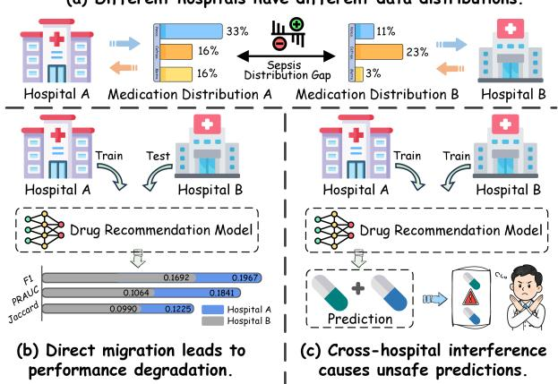
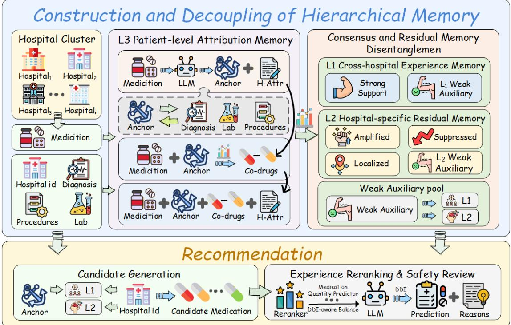
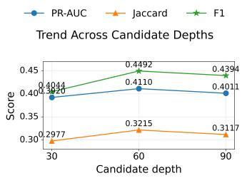
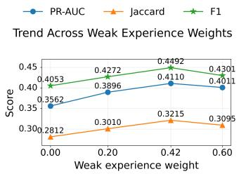

# HEM-Med: A Hierarchical Agentic Memory Framework for Safe Multi-Center Medication Recommendation

Min Xiao1,†, Jin Li2,†, Shoujin Wang2, Yeguang Zhen1, Yishuo Li1, Wenpeng Lu1,\* 1 Key Laboratory of Computing Power Network and Information Security, Ministry of Education; Shandong Computer Science Center (National Supercomputer Center in Jinan); Qilu University of Technology (Shandong Academy of Sciences);

Shandong Provincial Key Laboratory of Computing Power Internet and Service Computing; Shandong Fundamental Research Center for Computer Science, Jinan, Shandong, China Email: min.xiao02@foxmail.com; zhenyeguang92@gmail.com; yishuoli@foxmail.com; wenpeng.lu@qlu.edu.cn 2 University of Technology Sydney

Email: Jin.Li-4@student.uts.edu.au; shoujinwang@foxmail.com † Equal Contributors \* Corresponding author

Abstract—Medication recommendation (MR) is critical for clinical decision support. While existing MR methods are mostly designed for single-center learning, where only one independent hospital is involved, multi-center MR with hospitals of different scales has become increasingly demanding in practice. In multicenter settings, abundant data from large medical centers can improve recommendation performance for low-resource centers. Despite a few preliminary attempts on this task, two critical gaps remain. Gap 1: Existing multi-center methods fail to disentangle transferable cross-hospital clinical experience from hospital-specific prescribing patterns, limiting clinical feasibility and physician acceptance. Gap 2: They commonly overlook multilabel safety constraints of MR, including drug-drug interaction risks and local formulary feasibility, which are essential for safe real-world deployment. To address these gaps, we propose HEM-Med, a novel hierarchical agentic memory framework for multi-center MR. To address Gap 1, we design a disentangled hierarchical memory module that builds patient-level medicationcontext attribution records and disentangles them into crosshospital experience memory and hospital-specific residual memory. To address Gap 2, we introduce a safety-aware medication set generation module, which integrates dual-level experience retrieval with safety-aware set decoding to produce clinically relevant, safer, and locally adaptive medication recommendations. Experiments on a real-world multi-center eICU dataset show that HEM-Med outperforms representative transfer learning, LLM-based, and MR baselines in terms of both recommendation accuracy and safety.

Index Terms—Multi-center Medication Recommendation, Experience Memory, Drug-Drug Interaction, Memory Disentanglement

## I. INTRODUCTION

Medication recommendation (MR) is a key task in clinical decision support systems. The goal is to analyze a patient’s complex Electronic Health Record (EHR) and generate a set of candidate medications that are well aligned with the patient’s current physiological status and therapeutic needs [1], [2].

(a) Different hospitals have different data distributions  
  
Fig. 1: Motivating example of multi-center medication recommendation. Heterogeneous hospital prescribing patterns may cause negative transfer, and ignoring local feasibility and drug safety may lead to unsafe medication combinations.

Early MR studies focused on model development within a single center, where training and evaluation are conducted using EHR data from the same hospital. Representative methods include GAMENet, SafeDrug, and DKGM [1]–[3]. Despite their effectiveness in single-center settings, these methods rely on local data and may perform poorly in low-resource hospitals owing to data sparsity and cold-start issues [4].

Recent studies address single-center limitations through two lines of research: cross-domain and multi-center transfer for cross-hospital knowledge sharing. The first line borrows ideas from General Cross-Domain Recommendation (CDR), which transfers or shares knowledge across related domains, such as EMCDR and DDTCDR [5], [6]. The second line targets multi-center healthcare scenarios. A representative method TEMPT [7] pre-trains on pooled multi-center prescription data and then relies solely on prompt fine-tuning to adapt to the target hospital distribution.

Despite recent progress, existing studies still suffer from two major gaps. Gap 1: Entangled cross-hospital knowledge. Existing multi-center MR methods often overlook that prescribing decisions reflect both generalizable medical knowledge and hospital-specific resources, clinical protocols, and prescribing preferences. As shown in Fig. 1 (a), medication distributions may vary across hospitals for the same disease [7]. Fig. 1 (b) further illustrates that transferring entangled crosshospital knowledge in ICU settings with coexisting conditions may cause negative transfer and impair recommendation performance. Gap 2: Insufficient safety awareness. Existing transfer-based methods prioritize representation alignment but often overlook clinical safety constraints. Unlike general CDR, MR requires multi-label predictions that satisfy treatment needs, DDI constraints, and local formulary availability [2], [8], [9]. As illustrated in Fig. 1 (c), ignoring these constraints may yield inappropriate or unsafe medication combinations.

To address these gaps, we propose HEM-Med, a hierarchical agentic memory framework for multi-center MR. For Gap 1, a disentangled memory module separates transferable clinical experience from hospital-specific prescribing patterns into cross-hospital experience memory and hospital-specific residual memory. For Gap 2, a safety-aware medication set generation module combines dual-level retrieval with DDIaware set decoding to generate clinically relevant, safer, and locally adaptive recommendations.

The contributions are summarized as follows:

• We propose HEM-Med, a hierarchical agentic memory framework for multi-center MR that explicitly disentangles cross-hospital experience from hospital-specific prescribing preferences.

• We develop a safety-aware module for ICU medication set generation, integrating dual-level retrieval and DDIaware decoding to account for clinical relevance, local feasibility, and DDI risks.

• Experiments on the eICU dataset show that HEM-Med improves recommendation accuracy while maintaining competitive medication safety.

## II. RELATED WORK

## A. Medication Recommendation

EHR-based MR aims to recommend personalized, clinically safe medication combinations. Existing approaches include longitudinal modeling with RETAIN and DMNC [10], [11], time-aware modeling with MR-DTR [12], and DDI-aware recommendation with GAMENet, SafeDrug, and MoleRec [1], [2], [13]. DKINet, TCMPR, and SECGI [14]–[16] enhance patient representations with external knowledge or semantics. However, most methods target single-center settings and may suffer from negative transfer across hospitals.

## B. Cross-Domain Transfer and Multi-Center Learning

CDR and multi-center transfer alleviate data sparsity through knowledge sharing. EMCDR [5] and DisenCDR [17] align domain representations, while TEMPT [7] adapts to hospitals through pre-training and prompt-tuning. However, general CDR overlooks combination therapy and DDI risks, while medical transfer lacks explicit consensus–preference disentanglement, risking negative transfer.

## C. LLM Agents and Knowledge-Augmented Healthcare

LLMs support clinical decision-making through semantic reasoning [18]. Knowledge-enhanced methods include multiagent collaboration (MedAgents, MDTeamGPT [19], [20]) and retrieval- or tool-augmented reasoning (ClinicalGPT, TxAgent, JointCoder, SOAPTriage [21]–[24]). However, their promptbased knowledge integration often lacks explicit separation of general medical safety principles from hospital-specific execution rules for multi-center MR.

## III. PRELIMINARIES

## A. Multi-Center Electronic Health Records Data

Multi-center EHR data comprise independent ICU records from multiple hospitals. Let $\mathcal { H } = \{ h _ { 1 } , \ldots , h _ { | \mathcal { H } | } \}$ denote the hospital set, and D, P, O, and M the diagnosis, procedure, abnormal laboratory signal, and standardized medication vocabularies, respectively. The i-th record is represented as:

$$
\mathbf { r } _ { i } = ( h _ { i } , D _ { i } , P _ { i } , O _ { i } , M _ { i } ) ,\tag{1}
$$

where $h _ { i } \in \mathcal { H }$ is the hospital identifier, $D _ { i } \subseteq { \mathcal { D } } , P _ { i } \subseteq { \mathcal { P } } , O _ { i } \subseteq$ O, and $M _ { i } \subseteq { \mathcal { M } }$ denote the observed diagnoses, procedures, abnormal laboratory signals, and medications, respectively.

## B. Clinical Anchors

The clinical anchor set for EHR instance i comprises observed diagnoses, procedures, and abnormal laboratory signals:

$$
\begin{array} { r l } & { A _ { i } = \{ ( \mathrm { d i a g } , d ) ~ | ~ d \in D _ { i } \} \cup \{ ( \mathrm { p r o c } , p ) ~ | ~ p \in P _ { i } \} } \\ & { ~ \cup ~ \{ ( \mathrm { l a b } , o ) ~ | ~ o \in O _ { i } \} . } \end{array}\tag{2}
$$

Each anchor $a \ \in \ A _ { i }$ represents a typed clinical signal: a diagnosis, procedure, or abnormal laboratory state.

## C. Drug-Drug Interaction Knowledge

We denote the drug-drug interaction knowledge as a graph:

$$
\Omega _ { \mathrm { D D I } } = ( \mathcal { M } , \mathcal { E } _ { \mathrm { D D I } } ) ,\tag{3}
$$

where M is the standardized medication vocabulary and $\mathcal { E } _ { \mathrm { D D I } } \subseteq \mathcal { M } \times \mathcal { M }$ contains potentially interacting medication pairs. Each node represents a medication, and each edge $( u , v )$ represents a potential interaction with severity score $\operatorname { s e v } ( u , v )$

## D. Medication Recommendation

Based on the observed clinical context of the i-th EHR instance, we define the model input as:

$$
\mathbf { x } _ { i } = ( h _ { i } , D _ { i } , P _ { i } , O _ { i } ) ,\tag{4}
$$

while $M _ { i }$ is the ground-truth set. Multi-center MR estimates conditional relevance scores $s ( m \mid \mathbf { x } _ { i } )$ for $m \in \mathcal { M }$ and decodes the medication set $\hat { Y } _ { i } \subseteq { \mathcal { M } }$ as:

$$
\hat { Y } _ { i } = \operatorname { D e c o d e } \left( \{ s ( m \mid \mathbf { x } _ { i } ) \} _ { m \in \mathcal { M } } , \Omega _ { \mathrm { D D I } } , \mathbf { x } _ { i } \right) .\tag{5}
$$

## IV. METHOD

We propose HEM-Med, a hierarchical agentic memory framework for multi-center MR. As shown in Fig. 2, it comprises two components: (1) consensus–residual memory disentanglement, which separates historical medication–context experience into cross-hospital consensus and hospital-specific residual memories; and (2) safety-aware recommendation, which combines dual-level retrieval, experience-aware reranking, DDI-aware set decoding, and safety review to generate locally feasible and clinically safe medication sets.

## A. Patient-Level Attribution Memory

Raw ICU EHRs lack explicit medication links to diagnoses, procedures, or laboratory abnormalities. HEM-Med builds auditable $L _ { 3 }$ patient-level memory via constrained DeepSeekassisted attribution.

For each training ICU stay $s _ { i }$ and each observed medication $m _ { j } \in M _ { i }$ , we construct a stay-medication query:

$$
q _ { i j } = ( h _ { i } , m _ { j } , D _ { i } , P _ { i } , O _ { i } ) ,\tag{6}
$$

where $h _ { i }$ denotes the hospital identifier, and $D _ { i } , \ P _ { i }$ , and $O _ { i }$ denote the observed diagnoses, procedures, and abnormal laboratory signals of the current stay, respectively.

DeepSeek-v4-flash selects at most one observed context anchor for constrained attribution, without adding external indications or clinical facts:

$$
\begin{array} { r l } & { a _ { i j } \in \{ \mathrm { d i a g } ( d ) \mid d \in D _ { i } \} \cup \{ \mathrm { p r o c } ( p ) \mid p \in P _ { i } \} } \\ & { \qquad \cup \left\{ \mathrm { l a b } ( o ) \mid o \in O _ { i } \right\} \cup \{ \emptyset \} . } \end{array}\tag{7}
$$

Insufficient context yields ∅. Attribution is a conservative empirical hypothesis, not a verified prescribing intention, indication, or causal treatment relation.

For each validated stay-medication pair, the $L _ { 3 }$ record is defined as:

$$
e _ { i j } ^ { ( L _ { 3 } ) } = ( s _ { i } , h _ { i } , m _ { j } , a _ { i j } , r _ { i j } , S _ { i j } ) ,\tag{8}
$$

where $r _ { i j }$ denotes the conservative attribution hypothesis, and $S _ { i j }$ stores training-set statistical support for subsequent aggregation.

Training-only support statistics distinguish cross-hospital experience from hospital-specific residual patterns in anchor–medication associations.

All validated $L _ { 3 }$ training records are collected as:

$$
\begin{array} { r } { \mathcal { K } ^ { ( L _ { 3 } ) } = \left\{ \boldsymbol { e } _ { i j } ^ { ( L _ { 3 } ) } \mid \boldsymbol { s } _ { i } \in S _ { \mathrm { t r a i n } } , m _ { j } \in M _ { i } \right\} . } \end{array}\tag{9}
$$

Three clinicians reviewed 300 randomly sampled $L _ { 3 }$ records, yielding Fleiss’ κ values of 0.813 for anchor selection and 0.726 for attribution assessment.

## B. Consensus and Residual Memory Disentanglement

HEM-Med separates patient-level records into crosshospital experience and hospital-specific residual memories.

Cross-hospital experience memory. Let $n ( a )$ count occurrences of clinical anchor $a , n ( a , m )$ count its co-occurrences with medication $m ,$ and $H ( a , m )$ count hospitals observing $( a , m )$ . The anchor-conditioned medication frequency is:

$$
p ( m \mid a ) = { \frac { n ( a , m ) } { n ( a ) } } .\tag{10}
$$

The cross-hospital consensus memory $\mathcal { K } ^ { ( L _ { 1 } ) }$ stores associations that satisfy sufficient support, frequency, and hospitalcoverage constraints:

$$
\begin{array} { r } { \mathcal { K } ^ { ( L _ { 1 } ) } = \{ ( a , m ) \mid \mathbf { c } ( a , m ) \succeq \tau , \ p ( m \mid a ) \geq \tau _ { p } \} . } \end{array}\tag{11}
$$

Here, $\mathbf { c } ( a , m ) \ = \ [ n ( a ) , n ( a , m ) , H ( a ) , H ( a , m ) ]$ and $\begin{array} { r l } { \tau } & { { } = } \end{array}$ $[ \tau _ { a } , \tau _ { a m } , \tau _ { h a } , \tau _ { h } ] . \ Hat { H ( a ) }$ denotes the hospital coverage of anchor $^ { a , }$ and $\succeq$ denotes element-wise comparison.

Hospital-specific residual memory. For hospital $h ,$ anchor a, and medication m, we define:

$$
p _ { h } ( m \mid a ) = { \frac { n _ { h } ( a , m ) } { n _ { h } ( a ) } } ,\tag{12}
$$

where $n _ { h } ( a )$ and $n _ { h } ( a , m )$ denote the support and cooccurrence counts within hospital $h ,$ respectively. The residual deviation is computed as:

$$
\Delta _ { h } ( a , m ) = p _ { h } ( m \mid a ) - p ( m \mid a ) .\tag{13}
$$

Let $\tau _ { a } ^ { ( L _ { 2 } ) } , \tau _ { a m } ^ { ( L _ { 2 } ) } , \tau _ { p } ^ { ( L _ { 2 } ) }$ , and $\tau _ { \Delta } ^ { ( L _ { 2 } ) }$ be predefined thresholds. Only local associations with sufficient hospital-level support and residual magnitude are retained in $L _ { 2 }$ memory:

$$
\begin{array} { c } { { \mathcal { K } ^ { ( L _ { 2 } ) } = \Big \{ ( h , a , m , \Delta _ { h } ( a , m ) , c _ { h , a , m } ^ { ( L _ { 2 } ) } ) ~ \Big | ~ n _ { h } ( a ) \geq \tau _ { a } ^ { ( L _ { 2 } ) } , } } \\ { { n _ { h } ( a , m ) \geq \tau _ { a m } ^ { ( L _ { 2 } ) } , p _ { h } ( m \mid a ) \geq \tau _ { p } ^ { ( L _ { 2 } ) } , } } \\ { { | \Delta _ { h } ( a , m ) | \geq \tau _ { \Delta } ^ { ( L _ { 2 } ) } \Big \} . } } \end{array}\tag{14}
$$

Here, $c _ { h , a , m } ^ { ( L _ { 2 } ) }$ denotes the residual type: amplified, suppressed, or localized. $L _ { 2 }$ complements $L _ { 1 }$ by retaining hospital-specific residual prescribing patterns.

Weak $L _ { 1 }$ and Weak $L _ { 2 }$ Experience. HEM-Med aggregates and down-weights medication–context associations below strong $L _ { 1 }$ or $L _ { 2 }$ thresholds as weak experience to support inference recall for long-tail medications and rare clinical contexts.

Associations with cross-hospital support below strict $L _ { 1 }$ thresholds are retained as weak $L _ { 1 }$ experience:

$$
K _ { \mathrm { w e a k } } ^ { ( L _ { 1 } ) } = \left\{ ( a , m ) \mid ( a , m ) \not \in { \cal K } ^ { ( L _ { 1 } ) } , \ : { \mathcal C } _ { \mathrm { w e a k } } ^ { ( L _ { 1 } ) } ( a , m ) = 1 \right\} , \ :\tag{15}
$$

where $\mathcal { C } _ { \mathrm { w e a k } } ^ { ( L _ { 1 } ) } ( a , m )$ denotes relaxed cross-hospital criteria based on counts, conditional frequency, and hospital coverage.

  
Fig. 2: Overall agentic framework of HEM-Med. HEM-Med retrieves disentangled cross-hospital and hospital-specific experience, and generates medication sets through calibrated prediction and DDI-aware decoding.

Similarly, hospital-specific associations with sufficient local support but failing strict $L _ { 2 }$ residual criteria are retained as weak $L _ { 2 }$ experience:

$$
\begin{array} { r l r } {  { K _ { \mathrm { w e a k } } ^ { ( L _ { 2 } ) } = \{ ( h , a , m , \Delta _ { h } ( a , m ) , \rho _ { h , a , m } ^ { ( L _ { 2 } ) } ) \mid ( h , a , m ) \notin K ^ { ( L _ { 2 } ) } ,  } } \\ & { } & {  \mathcal { C } _ { \mathrm { w e a k } } ^ { ( L _ { 2 } ) } ( h , a , m ) = 1 \} , } \end{array}\tag{16}
$$

where $\mathcal { C } _ { \mathrm { w e a k } } ^ { ( L _ { 2 } ) } ( h , a , m )$ defines relaxed local criteria for support, conditional frequency, and residual deviation.

During retrieval, weak experience is down-weighted and cannot dominate strong $L _ { 1 }$ or $L _ { 2 }$ experience:

$$
g _ { L _ { 1 } } ( m , { \cal { A } } _ { i } ) = g _ { L _ { 1 } } ^ { \mathrm { s t r o n g } } ( m , { \cal { A } } _ { i } ) + \gamma _ { L _ { 1 } } ^ { \mathrm { w e a k } } g _ { L _ { 1 } } ^ { \mathrm { w e a k } } ( m , { \cal { A } } _ { i } ) ,\tag{17}
$$

$$
g _ { L _ { 2 } } ( m , { \cal A } _ { i } , h _ { i } ) = g _ { L _ { 2 } } ^ { \mathrm { s t r o n g } } ( m , { \cal A } _ { i } , h _ { i } ) + \gamma _ { L _ { 2 } } ^ { \mathrm { w e a k } } g _ { L _ { 2 } } ^ { \mathrm { w e a k } } ( m , { \cal A } _ { i } , h _ { i } ) ,\tag{18}
$$

where $g ^ { \mathrm { s t r o n g } } L _ { k }$ and $g ^ { \mathrm { w e a k } } L _ { k }$ denote strong and weak experience scores, respectively, and $\gamma _ { L _ { k } } ^ { \mathrm { w e a k } }$ down-weights weak experience, for $k \in { 1 , 2 }$

## C. Candidate Generation

Given $x _ { i } = ( h _ { i } , D _ { i } , P _ { i } , O _ { i } )$ , HEM-Med uses $\mathcal { A } _ { i } = D _ { i } \cup P _ { i } \cup$ $O _ { i }$ to retrieve medication–context experience from $L _ { 1 }$ crosshospital and $L _ { 2 }$ hospital-specific residual memories, forming a candidate medication pool.

For each medication m, we compute the memory-based experience score as:

$$
s _ { \mathrm { m e m } } ( m \mid x _ { i } ) = \alpha _ { 1 } g _ { L _ { 1 } } ( m , \mathcal { A } _ { i } ) + \alpha _ { 2 } g _ { L _ { 2 } } ( m , \mathcal { A } _ { i } , h _ { i } ) ,\tag{19}
$$

where $g _ { L _ { 1 } }$ and $g _ { L _ { 2 } }$ denote the aggregated experience scores from $L _ { 1 }$ and $L _ { 2 }$ memory, respectively.

To reduce the bias toward globally frequent medications, HEM-Med further incorporates prior statistics:

$$
\begin{array} { r l } & { \Phi _ { \mathrm { p r i o r } } ( m , h _ { i } , \boldsymbol { A } _ { i } ) = \phi _ { g } \operatorname* { P r } ( m ) + \phi _ { h } \operatorname* { P r } _ { h _ { i } } ( m ) } \\ & { \qquad + \phi _ { a } \operatorname* { P r } ( m \mid \boldsymbol { A } _ { i } ) + \phi _ { h a } \operatorname* { P r } _ { h _ { i } } ( m \mid \boldsymbol { A } _ { i } ) . } \end{array}\tag{20}
$$

where $\Phi _ { \mathrm { p r i o r } } ( m , h _ { i } , \mathcal { A } _ { i } )$ scores medication m using global, hospital, anchor, and hospital–anchor frequencies.

The initial candidate score is defined as:

$$
\begin{array} { c } { { s _ { \mathrm { i n i t } } ( m \mid x _ { i } ) = s _ { \mathrm { m e m } } ( m \mid x _ { i } ) + \beta \Phi _ { \mathrm { p r i o r } } ( m , h _ { i } , \mathcal { A } _ { i } ) } } \\ { { + b _ { \mathrm { c o m p } } ( m ) - \lambda _ { \mathrm { c a n d } } \psi _ { \mathrm { c a n d } } ( m ) , } } \end{array}\tag{21}
$$

where $b _ { \mathrm { c o m p } } ( m )$ compensates for under-retrieval, and $\psi _ { \mathrm { c a n d } } ( m )$ denotes a DDI-based soft safety penalty.

Top-ranked medications form the candidate pool:

$$
B _ { i } = \mathrm { T o p } _ { B } \left( \left\{ s _ { \mathrm { i n i t } } ( m \mid x _ { i } ) \mid m \in \mathcal { M } \right\} \right) ,\tag{22}
$$

where B is the retained candidate size. The candidate pool $B _ { i }$ is then passed to the learned experience reranker for further calibration and selection.

## D. Experience Reranking and Safety Review

HEM-Med estimates $p _ { \mathrm { f i n a l } } ( m \mid x _ { i } )$ for $m \in B _ { i }$ from calibrated reranking and predicts $p _ { \mathrm { s i z e } } ( k \mid x _ { i } )$ . Safety-constrained DDI-aware set decoding mitigates unsafe or redundant combinations from independent Top-K selection. Here, $\rho ( u , v )$ and sev(u, v) denote empirical co-administration confidence and DDI severity, respectively; Red(Y) counts redundant medications within therapeutic categories.

HEM-Med generates the final medication set by optimizing the following set-level objective:

$$
\begin{array} { l } { { S ( Y \mid x _ { i } ) = \displaystyle \sum _ { m \in Y } \log p _ { \mathrm { f i n a l } } ( m \mid x _ { i } ) + \log p _ { \mathrm { s i z e } } ( | Y | \mid x _ { i } ) } } \\ { { \ ~ - \lambda _ { \mathrm { D D I } } \displaystyle \sum _ { u , v \in Y \atop u < v } \mathrm { s e v } ( u , v ) ( 1 - \rho ( u , v ) ) } } \\ { { \ ~ - \lambda _ { \mathrm { r e d } } \mathrm { R e d } ( Y ) . } } \end{array}\tag{23}
$$

The recommended medication set is obtained as:

$$
{ \hat { Y _ { i } } } = \arg \operatorname* { m a x } _ { Y \subseteq B _ { i } } S ( Y \mid x _ { i } ) .\tag{24}
$$

In this objective, the first term encourages clinically relevant medications, and the second term favors a reasonable medication set size. The third term penalizes potentially unsafe DDI pairs, where the penalty increases with higher interaction severity and lower empirical co-administration confidence. The last term discourages redundant medications from the same therapeutic category.

## E. Model Training

HEM-Med adopts a modular training strategy for candidate calibration and set-size estimation. The pointwise scorer, pairwise reranker, therapeutic-class scorer, and medication-count predictor are trained as separate submodules and are combined only during inference. Given the candidate set $B _ { i }$ and the ground-truth medication set $M _ { i }$ , each candidate medication $m \in B _ { i }$ is assigned a binary label:

$$
y _ { i , m } = \mathbb { I } ( m \in M _ { i } ) .\tag{25}
$$

We optimize medication-level prediction with a weighted binary cross-entropy loss:

$$
{ \mathcal { L } } _ { \mathrm { p t } } = \sum _ { i } \sum _ { m \in B _ { i } } w _ { i , m } \mathrm { B C E } \left( y _ { i , m } , p _ { \mathrm { p t } } ( m \mid x _ { i } ) \right) ,\tag{26}
$$

where $w _ { i , m }$ alleviates medication-frequency imbalance.

To improve candidate ranking, we further construct positivenegative medication pairs and apply a pairwise ranking loss:

$$
{ \begin{array} { r l } { { \mathcal { L } } _ { \mathrm { p w } } = \displaystyle \sum _ { i } \sum _ { ( m ^ { + } , m ^ { - } ) \in \Pi _ { i } } { \mathrm { s o f t p l u s } } { \Big ( } - \left[ r _ { \mathrm { p w } } ( m ^ { + } \mid x _ { i } ) \right. } \\ & { \left. \qquad - r _ { \mathrm { p w } } ( m ^ { - } \mid x _ { i } ) \right] { \Big ) } } \end{array} }\tag{27}
$$

where $\Pi _ { i } = \{ ( m ^ { + } , m ^ { - } ) \mid m ^ { + } \in M _ { i } \cap B _ { i } , \ m ^ { - } \in B _ { i } \setminus M _ { i } \}$

Since HEM-Med predicts the medication set size rather than using a Top-K threshold, the set-size predictor is trained by:

$$
{ \mathcal { L } } _ { \mathrm { s i z e } } = - \sum _ { i } \log p _ { \mathrm { s i z e } } ( | M _ { i } | \mid x _ { i } ) .\tag{28}
$$

Pointwise, pairwise, therapeutic-class, and medication-count outputs are combined only at inference for calibrated reranking and DDI-aware set decoding. DDI knowledge serves only candidate-level safety penalties and final decoding, not additional supervision.

## V. EXPERIMENT

## A. Dataset

We evaluate HEM-Med on the eICU Collaborative Research Database, a real-world multi-center ICU database with over 200,000 de-identified ICU admissions in the United States [25]. In the processed cohort, the ground-truth medication sets have a DDI Rate of approximately 11.66%. Dataset statistics are reported in Table I.

TABLE I: Statistics of the processed eICU dataset.
<table><tr><td>Item</td><td>Number</td></tr><tr><td># of records / hospitals</td><td>90,545 /  149</td></tr><tr><td>Avg. / max / min # of records per hospital</td><td>607.68 / 3,315 /  1</td></tr><tr><td>Diag. / proc. / med. vocabulary size</td><td>2,958 /  1,852 /  161</td></tr><tr><td>Lab vocabulary size</td><td>12</td></tr><tr><td>Avg. / max / min # of diagnoses per record</td><td>4.04 / 91  / 1</td></tr><tr><td>Avg. / max / min # of procedures per record</td><td>6.60 /  102 / 1</td></tr><tr><td>Avg. / max / min # of medications per record</td><td>14.36 / 63  / 0</td></tr><tr><td>Avg. / max / min # of lab features per record</td><td>3.76 / 12 / 0</td></tr><tr><td># of records in train / validation / test</td><td>72,436 / 9,054 / 9,055</td></tr></table>

## B. Evaluation Metrics

Following prior studies [1], [2], [13], we assess accuracy using Jaccard and F1 for set overlap and PRAUC for prediction ranking, and safety using DDI Rate, the proportion of potentially interacting predicted medication pairs. To report the overall performance, we introduce SafeScore:

$$
{ \mathrm { S a f e S c o r e } } = { \frac { \mathrm { P R A U C } + { \mathrm { F 1 } } + { \mathrm { J a c c a r d } } } { 3 } } \cdot ( 1 - { \mathrm { D D I } } ) .\tag{29}
$$

Higher SafeScore indicates a better accuracy-safety trade-off.

## C. Implementation Details

We split the dataset into training, validation, and test sets with a ratio of 8:1:1. To avoid information leakage, all memory statistics and prior distributions are constructed only from the training set. For $\mathcal { K } ^ { ( L _ { 1 } ) }$ , the minimum anchor support threshold $\tau _ { a } ,$ , anchor–medication support threshold $\tau _ { a m } ,$ conditional frequency threshold $\tau _ { p } ,$ , anchor–medication hospital-coverage threshold $\tau _ { h } .$ , and anchor hospital-coverage threshold $\tau _ { h a }$ are set to 30, 10, 0.02, 4, and 5, respectively. For $\mathcal { K } ^ { ( L _ { 2 } ) }$ , the local anchor support threshold $\tau _ { a } ^ { ( L _ { 2 } ) }$ , local anchor–medication support threshold $\tau _ { a m } ^ { \left( L _ { 2 } \right) }$ , local conditional frequency threshold $\tau _ { p } ^ { ( \dot { L } _ { 2 } ^ { \dot { 2 } } ) }$ , and residual magnitude threshold $\tau _ { \Delta } ^ { ( L _ { 2 } ^ { \bot } ) }$ are set to $^ { 8 , }$ $4 , 0 . 1 0$ , and 0.12, respectively. These thresholds are used as reliability filters for memory construction rather than primary model-selection hyperparameters.

During candidate generation, the candidate depth B is set to 60, and the weak-experience decay factors are set to $\gamma _ { \mathrm { w e a k } } ^ { ( L _ { 1 } ) } =$ $\gamma _ { \mathrm { w e a k } } ^ { ( L _ { 2 } ) } = 0 . 4 2$ . Since B and the weak-experience decay factors directly affect candidate recall and noise, we analyze them in the parameter study. All other parameters are selected on the validation set and kept fixed during testing.

For fair comparison, all baselines use the same data split, medication vocabulary, DDI file [8], [9], and random seed. All experiments are conducted on a single NVIDIA GeForce RTX 3090 GPU with 24GB of memory.

TABLE II: Main experimental results on the eICU dataset.
<table><tr><td>Model</td><td>PRAUC ↑</td><td>F1 ↑</td><td>Jaccard ↑</td><td>DDI Rate ↓</td><td>SafeScore ↑</td></tr><tr><td>EMCDR</td><td> $0 . 3 4 2 1 \pm 0 . 0 0 4 3$ </td><td> $0 . 3 7 1 6 \pm 0 . 0 0 8 6$ </td><td> $0 . 2 6 4 7 \pm 0 . 0 0 9 5$ </td><td> $0 . 1 3 2 1 \pm 0 . 0 0 6 2$ </td><td> $0 . 2 8 3 1 \pm 0 . 0 0 4 4$ </td></tr><tr><td>DDTCDR</td><td> $0 . 3 5 9 8 \pm 0 . 0 1 3 6$ </td><td> $0 . 3 7 6 3 \pm 0 . 0 0 1 9$ </td><td> $0 . 2 6 6 5 \pm 0 . 0 1 0 2$ </td><td> $0 . 1 2 3 1 \pm 0 . 0 0 4 9$ </td><td> $0 . 2 9 3 1 \pm 0 . 0 0 5 3$ </td></tr><tr><td>TEMPT</td><td> $0 . 3 4 3 0 \pm 0 . 0 0 6 5$ </td><td> $0 . 3 3 3 5 \pm 0 . 0 0 5 4$ </td><td> $0 . 2 2 8 4 \pm 0 . 0 0 7 5$ </td><td> $0 . 1 2 0 4 \pm 0 . 0 0 3 8$ </td><td> $0 . 2 6 5 3 \pm 0 . 0 0 3 5$ </td></tr><tr><td>Reason4Rec</td><td> $0 . 3 6 9 7 \pm 0 . 0 0 8 3$ </td><td> $0 . 3 8 9 3 \pm 0 . 0 0 2 2$ </td><td> $0 . 2 7 8 3 \pm 0 . 0 0 3 6$ </td><td> $\mathbf { 0 . 0 8 1 4 \pm 0 . 0 0 6 4 }$ </td><td> $0 . 3 1 7 6 \pm 0 . 0 0 3 6$ </td></tr><tr><td>EXP3RT</td><td> $0 . 3 7 3 2 \pm 0 . 0 1 4 8$ </td><td> $0 . 3 9 4 4 \pm 0 . 0 0 2 6$ </td><td> $0 . 2 8 1 9 \pm 0 . 0 0 2 8$ </td><td> $0 . 0 9 2 7 \pm 0 . 0 0 1 4$ </td><td> $0 . 3 1 7 4 \pm 0 . 0 0 4 6$ </td></tr><tr><td>SafeDrug</td><td> $0 . 3 9 2 6 \pm 0 . 0 0 3 8$ </td><td> $0 . 4 0 8 2 \pm 0 . 0 0 6 1$ </td><td> $0 . 2 9 3 9 \pm 0 . 0 0 4 9$ </td><td> $0 . 0 8 6 2 \pm 0 . 0 0 6 4$ </td><td> $0 . 3 3 3 4 \pm 0 . 0 0 3 5$ </td></tr><tr><td>VITA</td><td> $\overline { { 0 . 3 5 7 8 \pm 0 . 0 0 3 7 } }$ </td><td> $\overline { { 0 . 3 7 8 2 \pm 0 . 0 0 2 5 } }$ </td><td> $\overline { { 0 . 2 6 8 8 \pm 0 . 0 1 2 0 } }$ </td><td> $0 . 1 1 0 7 \pm 0 . 0 0 7 1$ </td><td> $\overline { { 0 . 2 9 7 9 \pm 0 . 0 0 4 5 } }$ </td></tr><tr><td>RES-MR</td><td> $0 . 3 6 9 7 \pm 0 . 0 0 4 6$ </td><td> $0 . 3 8 9 3 \pm 0 . 0 0 1 9$ </td><td> $0 . 2 7 8 2 \pm 0 . 0 0 7 6$ </td><td> $0 . 1 0 1 3 \pm 0 . 0 0 2 1$ </td><td> $0 . 3 1 0 7 \pm 0 . 0 0 2 8$ </td></tr><tr><td>HEM-Med</td><td> $\mathbf { 0 . 4 1 6 1 \pm 0 . 0 0 8 6 }$ </td><td> $\mathbf { 0 . 4 5 3 2 \pm 0 . 0 0 6 2 }$ </td><td> $\mathbf { 0 . 3 2 4 6 \pm 0 . 0 0 7 4 }$ </td><td> $\underline { { 0 . 0 8 3 1 } } \pm 0 . 0 0 3 5$ </td><td> $\mathbf { 0 . 3 6 4 9 \pm 0 . 0 0 4 2 }$ </td></tr></table>

The best results are marked in bold and the second-best results are underlined.

TABLE III: Ablation study results on the eICU dataset.
<table><tr><td>Variant</td><td>PRAUC ↑</td><td>F1 ↑</td><td>Jaccard ↑</td><td>DDI Rate ↓</td><td>SafeScore ↑</td></tr><tr><td>HEM-Med w/o MD</td><td> $0 . 3 7 2 3 \pm 0 . 0 1 4 5$ </td><td> $0 . 4 2 2 1 \pm 0 . 0 0 1 9$ </td><td> $0 . 2 9 3 8 \pm 0 . 0 0 9 2$ </td><td> $0 . 0 9 9 3 \pm 0 . 0 1 8 7$ </td><td> $0 . 3 2 6 7 \pm 0 . 0 0 8 5$ </td></tr><tr><td>HEM-Med w/o DDI-Dec</td><td> $0 . 3 6 3 1 \pm 0 . 0 1 3 6$ </td><td> $\overline { { 0 . 4 1 7 5 \pm 0 . 0 0 2 1 } }$ </td><td> $\overline { { 0 . 2 8 4 0 \pm 0 . 0 1 0 2 } }$ </td><td> $0 . 1 2 5 4 \pm 0 . 0 0 7 4$ </td><td> $0 . 3 1 0 4 \pm 0 . 0 0 5 6$ </td></tr><tr><td>HEM-Med w/o RERANKER</td><td> $0 . 4 0 2 5 \pm 0 . 0 0 4 9$ </td><td> $0 . 3 2 3 5 \pm 0 . 0 0 7 8$ </td><td> $0 . 2 1 1 1 \pm 0 . 0 0 5 3$ </td><td> $0 . 0 9 5 3 \pm 0 . 0 0 4 9$ </td><td> $0 . 2 8 2 6 \pm 0 . 0 0 3 6$ </td></tr><tr><td>HEM-Med w/o WAM</td><td> $\overline { { 0 . 3 6 7 7 \pm 0 . 0 0 4 7 } }$ </td><td> $0 . 4 1 1 7 \pm 0 . 0 0 9 1$ </td><td> $0 . 2 8 2 4 \pm 0 . 0 0 6 2$ </td><td> $0 . 0 8 8 6 \pm 0 . 0 0 3 7$ </td><td> $0 . 3 2 2 6 \pm 0 . 0 0 3 9$ </td></tr><tr><td>HEM-Med</td><td> $\mathbf { 0 . 4 1 6 1 \pm 0 . 0 0 8 6 }$ </td><td> $\mathbf { 0 . 4 5 3 2 \pm 0 . 0 0 6 2 }$ </td><td> $\mathbf { 0 . 3 2 4 6 \pm 0 . 0 0 7 4 }$ </td><td> $\mathbf { 0 . 0 8 3 1 \pm 0 . 0 0 3 5 }$ </td><td> $\mathbf { 0 . 3 6 4 9 \pm 0 . 0 0 4 2 }$ </td></tr></table>

## D. Result Analysis

Table II reports results on the preprocessed eICU dataset. Baselines include transfer learning methods EMCDR and DDTCDR [5], [6], general LLM recommenders Reason4Rec and EXP3RT [26], [27], and MR methods SafeDrug, VITA, TEMPT, and RES-MR [2], [7], [28], [29]. TEMPT targets multi-center MR. All methods undergo 10 bootstrap evaluations with a sampling ratio of 0.8; metric means and standard deviations are reported.

  
(a) Weak weight  
(b) Candidate depth  
Fig. 3: Parameter analysis of weak experience weight and candidate depth.

HEM-Med outperforms transfer and general LLM baselines on all accuracy-related metrics and achieves the highest SafeScore. These results suggest that domain alignment or preference reasoning alone may be insufficient for multi-center MR. Compared with SafeDrug, the strongest MR baseline, HEM-Med improves the accuracy–safety trade-off through disentangled memory, calibrated reranking, and DDI-aware decoding. Although Reason4Rec has the lowest DDI Rate, HEM-Med combines higher accuracy with competitive safety.

## E. Ablation Study

Table III reports four ablations: w/o MD, w/o DDI-Dec, w/o RERANKER, and w/o WAM, removing memory decoupling, DDI-aware decoding, experience reranking, and weak auxiliary memory, respectively. Each removal degrades performance, supporting the contributions of memory disentanglement, safety-aware decoding, candidate calibration, and weak experience. Full HEM-Med achieves the best overall performance.

## F. Parameter Analysis

We analyze the influence of two key hyperparameters: the weak auxiliary experience weight and the candidate depth. The results are shown in Fig. 3.

Impact of weak auxiliary experience weight. With the candidate depth fixed to 60, introducing weak auxiliary experience improves recommendation performance compared with removing weak memory. The model achieves the best performance when the weak experience weight is set to 0.42. Further increasing the weight leads to performance degradation, indicating that weak experience is useful as supplementary information but may introduce noise when overemphasized.

Impact of candidate depth. With the weak experience weight fixed to 0.42, the model performs best when the candidate depth is set to 60. A smaller candidate depth may miss relevant medications before reranking, while a larger depth introduces more noisy candidates and false positives. Therefore, we set the weak auxiliary experience weight to 0.42 and the candidate depth to 60 in the final experiments.

## G. Case Study

Table IV presents two ICU cases from different hospitals. Both cases involve alcohol or toxicology-related conditions and electrolyte management, yet their medication requirements differ. Although the baseline methods identify some common electrolyte medications, they frequently produce falsepositive recommendations and miss key medications, such as Furosemide in Case A and Hydralazine in Case B, indicating limited adaptation to hospital- and patient-specific needs. In contrast, HEM-Med accurately matches the medication sets in both cases, preserving shared electrolyte medications while identifying case-specific requirements. This demonstrates its ability to integrate cross-hospital common knowledge, hospital-specific experience, and safety-aware decoding.

TABLE IV: Case study comparison between two clinically similar ICU stays from different hospitals.
<table><tr><td>Method</td><td>Case A: H452</td><td>Case B: H444</td></tr><tr><td>Ground Truth</td><td>Dex; Fur; NaCl; KCl; MgSO₄</td><td>Enox; Hyd; Lor; NaCl; KCl</td></tr><tr><td>DDTCDR</td><td>3/5 NaCl; MgSO₄; CaGlu; KCl; APAP</td><td>3/5 KCl; Ond; APAP; NaCl; Lor Miss: Enox; Hyd</td></tr><tr><td>SafeDrug</td><td>Miss: Dex; Fur Dex Miss: Fur</td><td>4/5 NaCl; CaGlu; MgSO₄; KCl; 4/5 KCl; Lor; Eso; NaCl; Enox Miss: Hyd</td></tr><tr><td>TEMPT</td><td>3/5 NaCl; Lor; Dex; KCl; Glu Miss: Fur; MgSO4</td><td>4/5 Enox; Lor; NaCl; KCl; Eso Miss: Hyd</td></tr><tr><td>RES-MR</td><td>4/5 NaCl; KCl; MgSO₄; CaGlu; Dex</td><td>4/5 KCl; Lor; NaCl; Eso; Enox Miss: Hyd</td></tr><tr><td>HEM-Med</td><td>Miss: Fur 5/5 NaCl; KCl; MgSO₄; Dex; Fur</td><td>5/5 Lor; Enox; KCl; Hyd;</td></tr></table>

Color legend: Blue = correctly predicted medication; Red = false-positive medication; Orange = missed ground-truth medication.  
Abbreviations: Dex = Dextrose; Fur = Furosemide; NaCl = Sodium chloride; KCl = Potassium chloride; MgSO = Magnesium sulfate; CaGlu = Calcium gluconate; APAP = Acetaminophen; Ond = Ondansetron; Eso = Esomeprazole; Glu = Glucagon; Enox = Enoxaparin; Hyd = Hydralazine; Lor = Lorazepam.

## VI. CONCLUSION

In this paper, we propose HEM-Med, a hierarchical agentic memory framework for safe multi-center medication recommendation. HEM-Med explicitly separates cross-hospital consensus experience from hospital-specific residual patterns and integrates DDI-aware decoding for safer medication set generation. Experiments on a real-world multi-center eICU dataset show that HEM-Med improves recommendation accuracy while maintaining medication safety. Ablation studies validate the effectiveness of its key components. Future work will explore richer clinical constraints, fine-grained medication safety knowledge, and prospective validation.

## ACKNOWLEDGMENT

This work is supported by the National Natural Science Foundation of China (No. 62376130), Program of New Twenty Policies for Universities of Jinan (No. 202333008), the Pilot Project for Integrated Innovation of Science, Education, and Industry of Qilu University of Technology (Shandong Academy of Sciences) (No. 2025ZDZX01).

## REFERENCES

[1] J. Shang, C. Xiao, T. Ma, H. Li, and J. Sun, “Gamenet: Graph augmented memory networks for recommending medication combination,” in AAAI, vol. 33, 2019, pp. 1126–1133.

[2] C. Yang, C. Xiao, F. Ma, L. Glass, and J. Sun, “Safedrug: Dual molecular graph encoders for recommending effective and safe drug combinations,” in IJCAI, 2021, pp. 3735–3741.

[3] Y. Zhao, P. Wang, and X. Shi, “Dkgm: A diffusion knowledge graph model for medication recommendation leveraging medical and drug information,” in ICHI, 2025, pp. 268–279.

[4] C. Wang, S. Wang, Y. Li, Q. Zhang, L. Hu, and W. Lu, “Eval4direc: A unified and systematic evaluation framework for diffusion-based recommender systems,” in ACM TKDD, 2026, p. 3856821.

[5] T. Man, H. Shen, X. Jin, and X. Cheng, “Cross-domain recommendation: An embedding and mapping approach.” in IJCAI, vol. 17, 2017, pp. 2464–2470.

[6] P. Li and A. Tuzhilin, “Ddtcdr: Deep dual transfer cross domain recommendation,” in WSDM, 2020, pp. 331–339.

[7] Q. Liu, Z. Qiu, X. Zhao et al., “A contrastive pretrain model with prompt tuning for multi-center medication recommendation,” ACM Transactions on Information Systems, vol. 43, no. 3, pp. 1–29, 2025.

[8] N. P. Tatonetti, P. P. Ye, R. Daneshjou, and R. B. Altman, “Datadriven prediction of drug effects and interactions,” Science Translational Medicine, vol. 4, no. 125, pp. 125ra31–125ra31, 2012.

[9] D. S. Wishart, Y. D. Feunang, A. C. Guo et al., “Drugbank 5.0: A major update to the drugbank database for 2018,” Nucleic Acids Research, vol. 46, no. D1, pp. D1074–D1082, 2018.

[10] E. Choi, M. T. Bahadori, J. Sun, J. Kulas, A. Schuetz, and W. Stewart, “Retain: An interpretable predictive model for healthcare using reverse time attention mechanism,” in NeurIPS, vol. 29, 2016, p. 1.

[11] H. Le, T. Tran, and S. Venkatesh, “Dual control memory augmented neural networks for treatment recommendations,” in PAKDD, 2018, pp. 273–284.

[12] Y. Li, Q. Zhang, W. Lu et al., “Time-aware medication recommendation via intervention of dynamic treatment regimes,” in ACM Web Conference, 2025, pp. 5161–5172.

[13] N. Yang, K. Zeng, Q. Wu, and J. Yan, “Molerec: Combinatorial drug recommendation with substructure-aware molecular representation learning,” in ACM Web Conference, 2023, pp. 4075–4085.

[14] S. Liu, X. Wang, X. Zhao, and H. Chen, “Dkinet: Medication recommendation via domain knowledge informed deep learning,” in BIBM, 2024, pp. 3521–3526.

[15] X. Dong, Y. Zheng, Z. Shu et al., “Tcmpr: Tcm prescription recommendation based on subnetwork term mapping and deep learning,” BioMed Research International, vol. 2022, no. 1, p. 4845726, 2022.

[16] H. Yang, Y. Zhang, J. Zhang, K. Che, and L. Xing, “Secgi: A medication recommendation model combining llm-based semantic enrichment and causal graph inference,” in BIBM, 2025, pp. 3130–3136.

[17] J. Cao, X. Lin, X. Cong, J. Ya, T. Liu, and B. Wang, “Disencdr: Learning disentangled representations for cross-domain recommendation,” in ACM SIGIR, 2022, pp. 267–277.

[18] K. Singhal, S. Azizi, T. Tu et al., “Large language models encode clinical knowledge,” Nature, vol. 620, no. 7972, pp. 172–180, 2023.

[19] X. Tang, A. Zou, Z. Zhang et al., “Medagents: Large language models as collaborators for zero-shot medical reasoning,” in ACL, 2024, pp. 599–621.

[20] K. Chen, X. Li, T. Yang, H. Wang, W. Dong, and Y. Gao, “Mdteamgpt: A self-evolving llm-based multi-agent framework for multi-disciplinar team medical consultation,” arXiv preprint arXiv:2503.13856, 2025.

[21] G. Wang, G. Yang, Z. Du, L. Fan, and X. Li, “Clinicalgpt: Large language models finetuned with diverse medical data and comprehensive evaluation,” arXiv preprint arXiv:2306.09968, 2023.

[22] S. Gao, R. Zhu, Z. Kong et al., “Txagent: An ai agent for therapeutic reasoning across a universe of tools,” arXiv preprint arXiv:2503.10970, 2025.

[23] K. Liu, Z. Li et al., “Jointcoder: Exploring automated icd coding on real-world chinese ehrs with a multi-agent framework,” in ACL, 2026, pp. 263–274.

[24] E. Wang, J. Wang et al., “Soaptriage: Soap-guided multi-view clinical text modeling framework for automated esi prediction,” in ACL, 2026, pp. 34 813–34 837.

[25] T. J. Pollard, A. E. Johnson, J. D. Raffa, L. A. Celi, R. G. Mark, and O. Badawi, “The eicu collaborative research database, a freely available multi-center database for critical care research,” Scientific Data, vol. 5, no. 1, p. 180178, 2018.

[26] Y. Fang, W. Wang, Y. Zhang et al., “Reason4rec: Large language models for recommendation with deliberative user preference alignment,” arXiv preprint arXiv:2502.02061, 2025.

[27] J. Kim, H. Kim, H. Cho et al., “Review-driven personalized preference reasoning with large language models for recommendation,” in ACM SIGIR, 2025, pp. 1697–1706.

[28] T. Kim, J. Heo, H. Kim, K. Shin, and S.-W. Kim, “Vita:‘carefully chosen and weighted less’ is better in medication recommendation,” in AAAI, vol. 38, no. 8, 2024, pp. 8600–8607.

[29] C. Wang, J. Li, S. Wang, Y. Li, H. Gu, and W. Lu, “Res-mr: Riskaware reasoning for explainable and safe medication recommendation,” in ACM SIGIR, 2026, accepted paper.