# Human Demonstrations as Post-Training Data for Any Robot Body: Retargeting the Object, Not the Hand

Nagasrikanth Kallakuri

Dxtr AI Co.

srikanth@dxtr.co∗

## Abstract

Human demonstrations are today used largely for pretraining vision-language-action models, with little ability to use the same data for target-embodiment or task-oriented training, which scalable deployment of robots in industrial and general environments depends on. A human demonstration recorded on a simple and scalable device such as a mobile phone can serve as post-training data for a robot whose body difers in structure and capability from the human who recorded it. This is made possible not by retargeting the hand’s motion but the object’s. A capture yields a body-free record: the object’s pose over time, its contact intervals, and a reconstructed 3D object with provenance. Any robot, given as a URDF and a short descriptor, is solved against that record and scored in simulation against the demonstrated object motion as ground truth: the human-to-simulation leg of human-to-simulation- to-robot transfer, measured per robot. Each (robot, episode) pair gets one outcome: pass, failure with a named mode, or refusal, with its reason, before any motion. The method runs as a working system over a growing collection; the set analysed here is a sample of it: 42 captures solved on 8 robots, 157 pairs, of which 31.2% pass, 52.2% fail, 14.0% are refused and 2.5% are unauditable (kinematic feasibility · ±50 mm / ±15◦ · in simulation). Refusals held up: every pair the checks refuse on stored evidence yet ran anyway failed (13 of 13; 5 on a body whose public model welds its hand). A description file could not be shown to screen a robot: its outcomes were barely more predictable than guessing. No policy has yet been trained on the record.

The record decides what a robot may post-train on; whether the policy then works on the real robot is the simulation-to-robot question, answered downstream.

## 1 Introduction

A human demonstration records what an object did, and a great deal about the body that did it. Any robot can use the first, but only a body built like the demonstrator’s can use the second. Today, robot learning uses human demonstrations mostly for pretraining, where human video at internet scale is retargeted in bulk to teach a vision-language-action model what manipulation looks like [25, 42]. Deployment depends on the step after that (Fig. 3), in which a specific robot is post-trained on a specific task from tens to a few hundred episodes of its own body. Human demonstrations are hard to use there, because the robot’s body decides which of them it can execute at all. Systems that do transfer a demonstration to a robot target one robot at a time [15, 21, 50, 54], and they drop the demonstrations that robot cannot use.

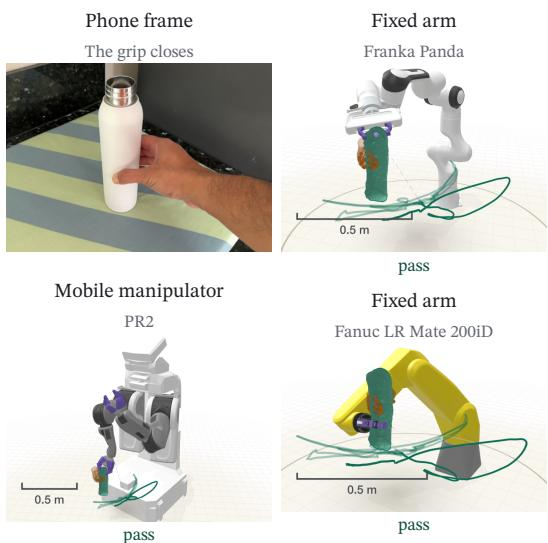  
Figure 1: One phone capture, multiple robots, multiple passes. The demonstrator’s own frame as the grip closes in a pouring episode, and the same moment replayed in simulation by two fixed arms and a mobile manipulator, each with its own grasp; orange marks where the hand held the object. Nothing is retouched. [kinematic feasibility · ±50 mm / ±15◦ · in simulation]

This paper turns a demonstration recorded on a simple and scalable device, such as a mobile phone with nothing attached to it, into post-training data for any robot (Fig. 1). It does so by retargeting the object’s motion. Throughout, the data is post-training data: a target-embodiment training set, the tens to a few hundred episodes of one robot on one task on which a pretrained policy is post-trained, or at that scale a task policy is trained from scratch. Nothing here is pretraining data. We write post-training set for short.

Fig. 2 shows the design, and Table 1 collects the terms. A capture is reduced to a body-free record: the object’s pose over time in metres, the intervals over which it was held, and one reconstructed 3D object whose observed surface is kept apart from the completed one. The hand is treated as a witness to contact rather than copied: when and where it held the object are kept on the object, as the contact intervals and as a contact map on the mesh. Any robot, given as a URDF and the short descriptor of Table 4, is solved against that record without rescaling it. Its kinematic replay is then scored against the demonstrated object motion as ground truth. This measures, for each robot, the human-to-simulation leg of human-to-simulation-to-robot transfer (§2). Each (robot, episode) pair receives one outcome. The pair passes at the declared tolerance or fails with a named mode, or the robot refuses the episode before any motion is generated. A refusal carries a reason from a fixed list and the measured quantity behind it. Every outcome goes to an append-only ledger in which the latest entry for a run supersedes the earlier ones. A pass that cannot meet a later check is therefore retracted by a dated entry, and the earlier row stays in the ledger.

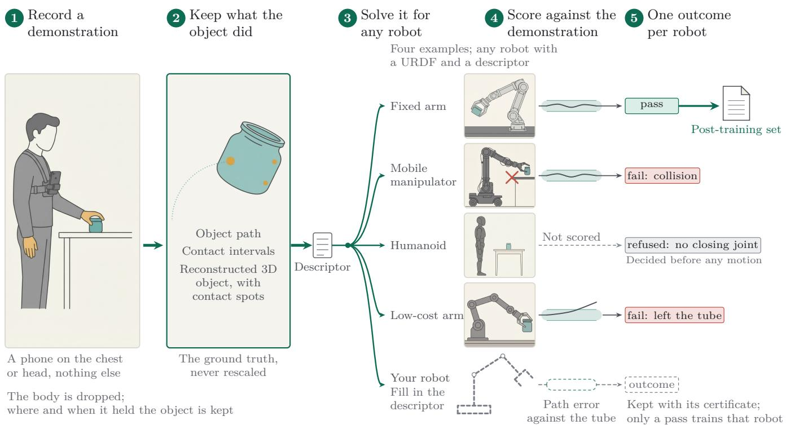

Figure 2: One demonstration, one body-free record, an answer for every robot. A demonstration is recorded on a phone worn on the body, here the chest. Only what the object did is kept, its path, its contact intervals and its reconstructed 3D object, and that is the ground truth. Any robot given as a URDF and a short descriptor is solved against it, and its replay is scored against the demonstrated motion by object-path error inside the tube. Only a pass enters that robot’s post-training set, and a refusal is decided before any motion. The bodies and the outcomes shown are examples: each outcome is one that a body of that class received in §6, and a robot the method has never seen is admitted by filling in the descriptor. [kinematicfeasibility · ±50 mm / ±15◦ · in simulation]  
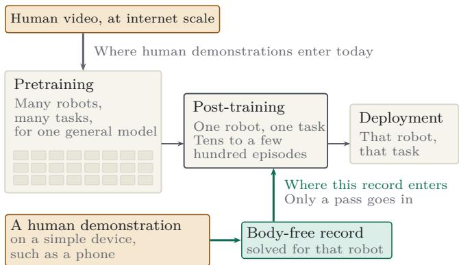  
Figure 3: Where a demonstration enters. Human video reaches robot learning mostly at pretraining. The record lets one demonstration enter at post-training, for one robot and one task, which is where the body decides what can be used.

Every pipeline we know of that retargets human demonstra- tions already makes the refusal decision. A feasibility filter drops motions a humanoid cannot track [12, 16]. A grasp planner discards a trajectory when none of its sampled grasps survives a simulator check [54], and a curation stage removes whatever a quality model dislikes [42, 48]. The decision stays inside the pipeline, and only what survives it is released. A reader then cannot tell whether an episode is missing because it was never captured, because one body could not reach it, or because a filter that no longer exists once rejected it. We keep the decision, with its reason, beside the record.

The set analysed here holds 42 captures solved on 8 robots from 4 body classes, 157 (robot, episode) pairs in all, of which 31.2% pass, 52.2% fail, 14.0% are refused and 2.5% are unauditable. Every refused pair that ran anyway failed (13 of 13, §6.3). A robot’s description predicts its outcomes barely better than guessing does (§6.4). Ranking grasps by sweep coverage passed 33% of pairs where ranking by grasp quality passed 13% (§6.2).

Human2Sim2Robot [24] names the human-to-robot embodiment gap. It and Video2Sim2Real [11] cross that gap for one robot. They use the demonstrated object motion as a reward for reinforcement learning in simulation, then transfer the policy. We use the same object motion as ground truth, not as a re-ward. We measure the human-to-simulation leg for every robot, kinematically and with no learning in the loop, and we keep the measurement. The simulation-to-robot leg belongs to the policy post-trained on the result and is measured downstream.

Table 1: Terms used throughout.
<table><tr><td>post-training set</td><td>a target-embodiment training set: tens to a few hundred episodes of one robot on one task</td></tr><tr><td>record</td><td>the body-free part of a demonstration: the object&#x27;s pose over time, its contact intervals, and its reconstructed 3D object</td></tr><tr><td>reference motion</td><td>the demonstrated object motion, the ground truth every robot is scored against</td></tr><tr><td>pair</td><td>one robot&#x27;s answer on one solve run; a capture solved under more than one retargeting mode contributes one pair per solve run</td></tr><tr><td>outcome</td><td>a pair&#x27;s answer at the stated tier: pass, failure with a named mode, refusal with a reason, or unauditable</td></tr><tr><td>tube</td><td>the declared tolerance around the reference motion, 50 mm and 15°</td></tr><tr><td>tube coverage human-to-sim to-simulation</td><td>the fraction of scored frames inside the tube; a pass needs 85% the object-path error of a robot&#x27;s kinematic replay against the gap (the human- reference motion; tube coverage is its summary</td></tr><tr><td>tier line</td><td>the claim a number may support, printed with it; a simulated outcome and a hardware measurement never share one</td></tr><tr><td>witness</td><td>the evidence certifying a frame as contact: a pinch bar and a fingertip trigger together certify touch; object co-motion may extend a touch-certified span and never open one</td></tr><tr><td>headroom</td><td>a body property over the demonstration&#x27;s demand: reach over path extent, usable stroke over object width</td></tr></table>

## Contributions.

1. The body-free demonstration record, and the per-robot human-to-simulation gap it makes measurable (Fig. 2, Fig. 5, §4).

2. Refusal before motion, from a fixed vocabulary and kept with its certificate. Refused pairs that ran anyway all failed, and we could not screen a robot the model has not seen from its description (§6.3, §6.4).

3. Grasp selection ranked by sweep coverage of the whole demonstrated path, with its ablation against ranking by grasp quality (Alg. 1, Table 6).

4. A worked corpus across 8 embodiments in 4 classes, with retractions on the record (Fig. 11, Table 5, Table 7).

## 2 The object as ground truth

Copying the hand has no ground truth once the body changes. A hand path scaled onto the jaw gripper of a low-cost arm is a guess about what that arm should do, and the guess difers for every body. Robots given the same demonstration then cannot be compared with each other, and none of them can be said to have reproduced it (Fig. 4). The object’s motion is diferent: it is what the task is about, it is the same for every body, and a robot either reproduces it within a stated tolerance or does not. We therefore take the ground truth from the object: its pose over time and the intervals over which it was held. Both are recovered once from the capture, in metres, and never rescaled to suit a workspace.

This makes outcomes comparable across bodies, since every body is scored against the same reference motion with the same tolerance. It also makes the gap between the demonstration and the simulated robot a per-frame quantity, the object-path error, summarised by the fraction of scored frames inside the tube (§5.4). Some episodes can be ruled out from a robot’s description and the record alone: its end efector has no closing joint, its stroke is narrower than the object, or its reach is shorter than the sweep. An attempt that cannot pass spends solve time and, worse, would put a motion the body cannot execute into its post-training set. So the robot refuses before any motion, and the measured quantity goes on the record.

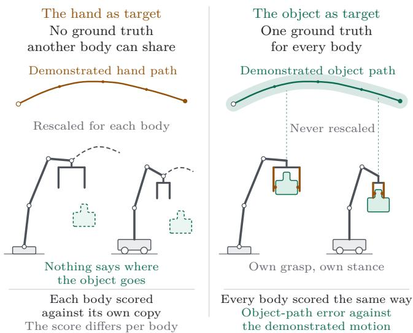  
Figure 4: The hand as target, the object as target. Copying the hand gives a body of a diferent build nothing to be measured against. Retargeting the object gives every body the same target, scored the same way.

The choice has costs, however. The object must be rigid, with a recoverable pose, so a deformable object or a hand-to-hand transfer is refused as object not rigid (Table 3). Only the contact interval is scored, because the approach and the retreat are the least transferable part of a demonstration, and each body therefore gets its own synthesised approach and retreat. The demonstrated path is a tolerance target for reproducing the task, not an optimum, and a robot that finds a better path is scored as having missed this one.

Other parts of a demonstration do not depend on the body either: the scene the object moved through, the demonstrator’s path across it, the state changes the task caused and the sounds it made. The record in this paper holds the object’s motion, its contact intervals, its reconstructed 3D object, and the support plane and scene bounds that the solver reads for collision and placement. The demonstrator’s path is formulated for bodies that move but has no gated outcome yet. Environment state and audio are left as extensions of the same record. Fig. 5 shows what is stored.

## 3 Related work

Object-centric transfer from human video. Transferring the object’s motion instead of the hand’s is an established line of work. Single-video systems replay a recovered object trajectory [13, 19, 21, 55], and a policy can be trained to generate the object’s pose trajectory from a few demonstrations [14]. Flow and track methods transfer point motion [2, 3, 43, 45, 52], and real-to-sim-to-real systems use the demonstrated object motion as a reward [6, 11, 24]. Capture on a bare phone is not new either [28], nor is retargeting a demonstration to a body given only as a URDF [42, 49]; cross-embodiment policy transfer can also mask the end efector out of the policy’s view instead of retargeting [32]. A handheld gripper, with or without a phone on it [4, 7, 8, 29, 46], or a motion-capture glove [39] records the end efector itself and so bypasses retargeting at the price of the device; a phone with nothing attached records the object and leaves the end efector to the descriptor. MimicGen and DexMimicGen [17, 27] also cut demonstrations into object-centric segments, to generate robot data in simulation from a few robot demonstrations, and EgoMimic [18] co-trains on egocentric human video and robot data for one platform; the record keeps the segments as a measurement per body instead. The record itself is recovered with of-the-shelf com onents, named in Appendix C [23, 31, 34, 44]. Table 2 lists no system that releases, per robot, the episodes it could not use and why.

Table 2: Where the record difers. The closest systems and this one, as their sources state them. “Internal” means the system decides and does not publish the decision.
<table><tr><td>Method</td><td>Input</td><td>Per-robot data</td><td>Bodies</td><td>Verification</td><td>Failures / refusals published</td></tr><tr><td>OKAMI [21]</td><td>1 RGB-D human video</td><td>robot rollouts for the policy</td><td>1 humanoid</td><td>hardware</td><td>aggregate failure modes</td></tr><tr><td>RSRD [19]</td><td>1 video + object scan</td><td>none</td><td>1 bimanual</td><td>hardware, 90 trials</td><td>per-phase and end-to-end rates</td></tr><tr><td>PhysV2A [15]</td><td>video 6-DoF object motion + RGB-D</td><td>kinematic model</td><td>1 arm</td><td>hardware, 80 trials, 88.75%</td><td>gates grasp-path pairs, then ranks the survivors continuously; decision not published</td></tr><tr><td>PSI [54]</td><td>RGB-D human videos per task</td><td>none (sim as a filter)</td><td>1 arm</td><td>hardware, 20 episodes per task</td><td>keeps a per-pair feasibility label and trains a scorer on it; not published as a record</td></tr><tr><td>Human2Sim2Robot [24]</td><td>1 RGB-D human video</td><td>none; RL in simulation 1 arm + dex hand per task</td><td></td><td>hardware</td><td>per-task success rates only</td></tr><tr><td>Video2Sim2Real [11]</td><td>1 video, fixed RGB-D</td><td>none</td><td>1 arm + dex hand</td><td>hardware, 10 trials per task</td><td>per-task misses</td></tr><tr><td>Ego2Robot [42]</td><td>egocentric video</td><td>20 teleop demos per task</td><td>15 synth., 1 real</td><td>hardware, 5 tasks</td><td>internal curation</td></tr><tr><td>EgoInfinity [40]</td><td>internet RGB video</td><td>none</td><td>G1, Robonaut2, two FR3 (retargeting)</td><td>retargeting metrics; no task success reported</td><td>qualitative only</td></tr><tr><td>R2R2R [50]</td><td>phone scan + 1 video</td><td>none</td><td>1 bimanual</td><td>hardware, 1 050 trials</td><td>qualitative modes, on a second arm only</td></tr><tr><td>DROID [20]</td><td>teleoperation</td><td>yes, by definition</td><td>13 institutions, one shared platform</td><td>none</td><td>unsuccessful episodes released, one body</td></tr><tr><td>This work</td><td>one phone, nothing attached</td><td>none; a URDF and a descriptor</td><td>8 bodies, 4 classes</td><td>kinematic replay against a declared tube</td><td>per robot: pass, named failure or pre-flight refusal from a closed vocabulary, with retractions</td></tr></table>

Grasp selection conditioned on the whole motion. Choosing a grasp because the motion after it stays feasible is an old idea. The grasp is a planning variable in Siméon et al. [36], filtered by reachability in Xue and Dillmann [47], chosen by post-grasp objectives in Ghalamzan E. et al. [9, 10], optimised with the trajectory by Wang et al. [41] and ranked under predicted object motion by Akinola et al. [1]. Huang et al. [15] rank the grasp– path pairs that pass their gate, and Zhai et al. [54] discard a trajectory when every sampled grasp fails in simulation, then train a scorer on that label. See also Liu et al. [22], Shi et al. [35], Trupin et al. [37]. We claim none of this for Alg. 1, whose base search follows reachability and placement work [33, 38, 53]. What we add is to keep, per robot, the coverage and the refusal the algorithm produces.

What happens to the discards. Feasibility filtering before training is standard, in humanoid motion retargeting [12, 16], at capture time [49], by command-following checks over generated videos [30] and by success in simulation [48]. None keeps the discard as a per-robot outcome with a reason. DROID does release the episodes its collectors marked unsuccessful, on one platform [20]. A benchmark on the SO-101 arm classifies rollout failures after execution [51], and Dex-Net predicts a grasp’s probability of success [26]. Our refusal is a geometric decision, made before anything moves.

## 4 The record

The record is what a capture keeps once the demonstrator’s body is taken out. A robot’s outcome is stored beside it and never edits it, so adding a robot cannot change an earlier robot’s outcome (Fig. 5).

The reference motion. A capture yields the object’s pose over time, one pose per frame on a uniform 10 Hz clock, with position in metres and orientation as a unit quaternion. The poses are recovered by registering masked depth clouds to a fused reference cloud. The capture also yields the intervals over which the object was held, each frame tagged with the witness that certified it. Together these form the reference motion. The commanded opening comes from the object’s geometry, and the demonstrated pinch only times opening and closing. The mesh flags each vertex as observed or completed, so which surface a chosen grasp touches can be seen. Where the hand touched the surface is kept on the mesh as a contact map. It biases the choice among candidate grasps and never filters them (Alg. 1), so a robot may grasp where the person did not.

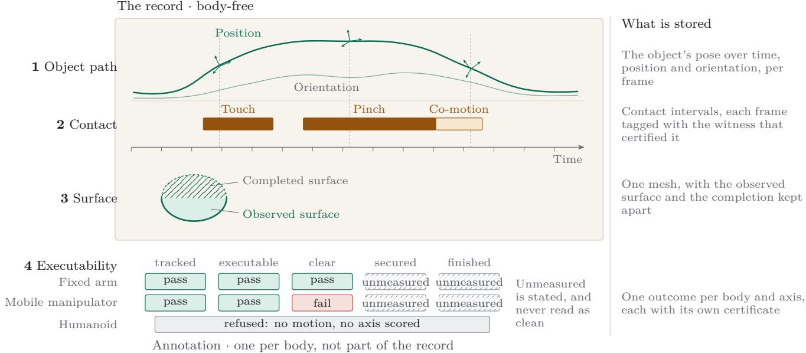  
Figure 5: What an episode carries, and what a body adds to it. The record (left, cream) is body-free. It holds the object’s pose over time, the contact intervals with the witness that certified each frame, and one mesh that keeps the observed surface apart from the completion. The executability block (bottom) is an annotation with one row per body, and it never edits the record. An axis nobody measured is hatched and is not read as a pass. Only a pass enters a body’s post-training set. A named failure or a refusal is kept with its certificate and stays out. [kinematic feasibility · ±50 mm / ±15◦ · in simulation]

Outcomes. Each (robot, episode) pair gets one outcome: pass, a named failure from the verifier’s list of modes, a refusal from the pre-flight list, or unauditable when the stored bundle is missing and nothing may be claimed. The outcome has axes, scored separately: tracked, the object pose inside the tube over the scored frames; executable, the motion-quality gate; clear, no interpenetration of the scene, the body’s own links or the object with a non-jaw link; secured, the grasp-closure checks; andfinished, the phase decomposition through release. A pass at the kinematic tier (tier K in the figures) needs tracked, executable and clear; secured and finished belong to higher tiers, quoted once in §6.3 from the supplement’s re-score ledger. An axis nobody measured is recorded as unmeasured and is never read as a pass.

Refusals. A refusal names one of 7 reasons, each provable at solve time (Fig. 6, Table 3). The robot holds its rest pose, and the refusal is stored with its certificate, which gives the quantity measured and the limit it missed. Partial coverage is not a refusal. When a grasp covers only part of the demonstrated interval, the pair is attempted, and the covered fraction is recorded beside the outcome as a quantity of its own.

The descriptor. A robot is read only through the descriptor of Table 4. Nothing downstream branches on a robot’s name, so a robot outside the set studied here is admitted by filling in that table. Supplement §S2 gives every field and what happens when it is left blank.

The ledger. Outcomes go to an append-only log with one row per run and robot. A row records the source revision, the tube in force, the per-axis outcome, the witness counts and the hashes of the artefacts scored. The latest row supersedes earlier ones, and a superseded pass stays as a dated entry. Later entries have superseded 22.3% of the pairs: 25 because the bundle was produced again and re-scored, 10 because a pre-flight check now refuses the pair before it moves, and none because the same artefact failed a stricter check (Table 7).

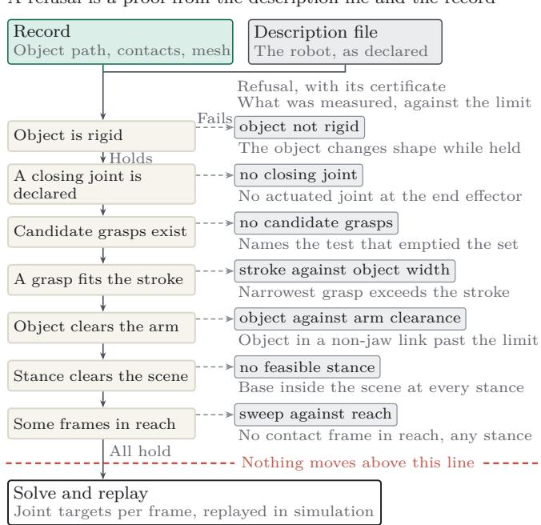  
Figure 6: Refusal before motion. The pre-flight checks read the description file and the record. The first check that fails ends the pair in a refusal with its certificate, and the robot does not move. A pair that clears every check is solved and replayed.

## 5 Method

The steps below follow Fig. 7, in the order a team would build them. The grasp choice and the contact vote do the work, and

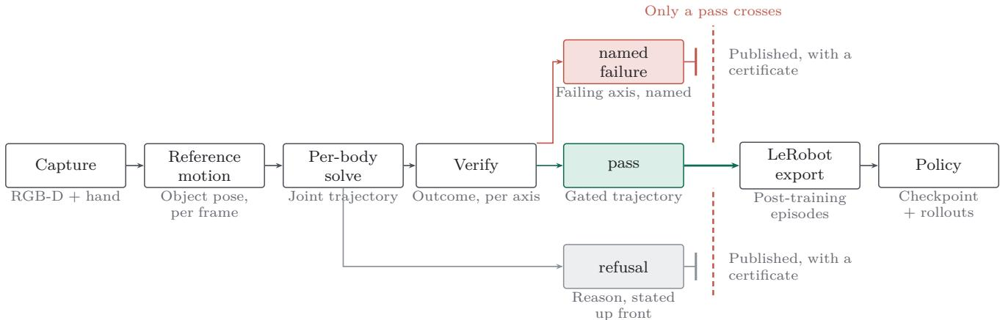  
Figure 7: Capture to policy, and the two exits. Only a passing trajectory enters the body’s post-training set. A named failure and a refusal are kept with their certificates and go no further. The refusal is decided from solve-time artefacts, before any motion is generated. The export and post-training stages are drawn to show where the record sits in the chain. This paper’s measurements stop at the gate.

Table 3: The refusal vocabulary. Each reason, the quantity its certificate carries and the limit that quantity missed, in the order of Fig. 6. No check reads a replay.
<table><tr><td>reason</td><td>quantity measured</td><td>what it missed</td></tr><tr><td>object not rigid</td><td>held frames that fit the object&#x27;s too few, on an object shape at rest</td><td>declared deformable</td></tr><tr><td>no closing joint</td><td>actuated joints at the end effector, from the descriptor</td><td>none declared</td></tr><tr><td>no candidate grasps</td><td>antipodal pairs in both friction cones, with a clear approach</td><td>none survive sampling; the test that emptied the set is named</td></tr><tr><td>stroke against object width</td><td>usable stroke against the narrowest candidate</td><td>every candidate is wider</td></tr><tr><td>object against arm clearance</td><td>object depth inside a non-jaw link</td><td>over 5 mm for every candidate</td></tr><tr><td></td><td>no feasible stance a wheeled base&#x27;s clearance</td><td>inside it at every stance</td></tr><tr><td>sweep against reach</td><td>from the scene coverage of the contact frames zero at every searched</td><td></td></tr></table>

both read a robot only through its descriptor. Supplement §S1 specifies every stage with its constants.

## 5.1 The body description

A closure is read from the descriptor as the joints that close and the opening they can command, so a parallel jaw and a multifinger hand enter the same way. A body that declares no closing joint gets no synthesised grasp and the pair is refused before any motion; its row records the width it would have needed. Bundles minted before the checks were enforced instead let the open hand follow the object origin; §6.3 counts them as ran anyway. A wrist that cannot reach every orientation tracks position and reports the orientation it achieved. The freedom it has left is measured by sweeping the free joint, not assumed from the mechanism. Base type decides how a body may stand. A body bolted to the work surface may be moved across it but not up or down, and a wheeled base may go only to stances it can occupy.

Table 4: The body descriptor. What the method reads out of a body description beyond the model’s own joint list, joint limits and rest pose, what reads it, and what it can decide. A property the description omits still produces an answer.
<table><tr><td>property</td><td>read by</td><td>decides</td></tr><tr><td>closing joints</td><td>candidate synthesis</td><td>a refusal when none is declared; a closure is never</td></tr><tr><td>usable stroke</td><td>width filter</td><td>faked a stroke-against-width refusal when no candidate fits</td></tr><tr><td>reach radius</td><td>coverage and placement</td><td>a sweep-against-reach refusal when no stance covers the interval</td></tr><tr><td>wrist actuation</td><td>target construction</td><td>orientation commanded, or position tracked and</td></tr><tr><td>base type</td><td>placement search</td><td>orientation reported whether the stance may also move vertically, or</td></tr><tr><td>joint count</td><td>the solver&#x27;s null</td><td>follow a base path how much freedom is left once the pose is fixed</td></tr><tr><td>frozen link lists</td><td>space collision queries</td><td>which links may touch the object and which are a</td></tr><tr><td>grasp-frame transform</td><td>every target</td><td>violation reported as calibrated, identity or manual (a bare flange), never assumed</td></tr></table>

## 5.2 Grasp selection by sweep coverage

Candidates are generated geometrically, without a learned model (Alg. 1). Normals come from the reconstruction, because a centroid heuristic mislabels the inward faces of non-convex shapes. A pair of surface samples is a candidate only if the line through its contacts lies inside both friction cones, which have a half-angle of 21.8◦ at $\mu = 0 . 4 0$ . A pair outside them slips under the planner’s own friction model, so it is discarded outright. Candidates are also dropped when the approach shaft passes through the object or the object would sit more than 5 mm inside a non-jaw link.

Sweep coverage ranks the survivors (Fig. 8). It is the fraction of contact frames on which a strict inverse-kinematics solve meets both position and orientation. Ties go to grasp quality.

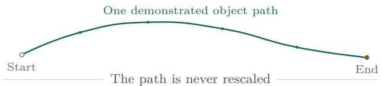

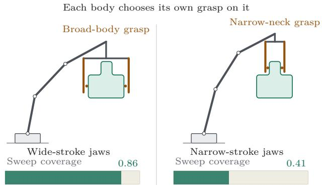  
Figure 8: One path, two bodies, two grasps. The demonstrated object path is the same for both arms and is never rescaled. Each body picks the grasp that keeps the most of that path solvable under strict inverse kinematics, so sweep coverage, not geometric quality, ranks the grasps. Conditioning a grasp on the motion that follows is prior work [1, 9, 15, 54]. The sweep-coverage statistic and the outcome kept per robot are ours.

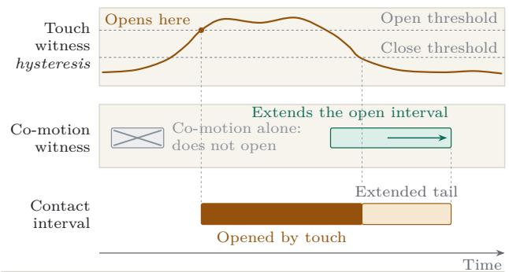  
Co-motion extends an interval, and never starts one  
Figure 9: Touch opens a contact, and co-motion may only extend it. The object-side witness certifies frames that a fingertip distance cannot, as in a raised carry. It is clamped to the touch-only onset, so the first frame of an interval is exactly what it was before the witness existed. Over the 3 517 scored contact frames of the 79 pairs that carry the witness split, 6.7% are held by co-motion alone.

A full solve on a body with a torso and a second arm costs tens of milliseconds, so the search is staged: a reach test with no inverse kinematics, then a sparse keyframe probe, then a dense sweep of the survivors. When a fixed mount cannot cover the interval, the search moves where the robot stands, over a coarse grid. The path itself is never rescaled. Coverage does not see collision. The ranking cannot tell that a grasp it prefers will put the arm through the table or through itself, and collision is the largest failure class, at 52.4% of failures (§6.5).

A search that ends without a grasp writes its reason into the grasp block, and the outcome is read from that field. With no grasp, sweep against reach means none was found. Beside a chosen grasp, the same certificate means that some contact frames were left uncovered and the last feasible pose was held.

Algorithm 1: Grasp selection by sweep coverage, with   
a staged base search.   
Input: canonical mesh � with per-vertex normals and   
observed/completed provenance; contact heat ℎ; object path   
$T _ { \mathrm { o b j } } ( t )$ over the demonstrated contact interval � bod � with   
URDF, usable stroke �, reach radius �, grasp-frame transform;   
constants � = 0.40, cone half-angle 21.8◦, clearance gate   
5 mm, and the rest of the constants table, Supplement §S1.15   
Output: grasp �, placement �, per-frame reachability mask, sweep   
coverage � — or a refusal reason written into the grasp block   
1 if � declares no closing joint then return no closing joint   
2 � ← area-weighted surface samples on �, fixed seed   
3 � ← antipodal pairs of � whose contact line lies inside both friction   
cones   
4 if � = ∅ then return no candidate grasps, naming the test that   
emptied it   
5 � ← { � ∈ � : width $( a ) \leq s \}$   
6 if � = ∅ then return stroke against object width   
7 � ← poses from �: closing axis on the contact line, a fixed set of   
approach rolls, shafts clear of �   
8 � ← {� ∈ � : the object at � penetrates no non-jaw link of � by   
more than 5 mm}   
9 if � = ∅ then return object against arm clearance   
10 ← geometric mean of antipodal margin, stroke margin and local   
flatness, biased (never filtered) by contact heat ℎ; deduplicate   
11 B ← {nominal placement} extended by a coarse stance grid across   
the surface; if � is neither bolted to the work surface nor on a cart   
then extend B in height as well   
12 foreach � ∈ B do   
13 Stage A order � by the fraction of $\mathrm { E E } _ { b } ( t )$ inside the reach   
annulus of � (no IK)   
14 Stage B probe a few spread keyframes at a reduced iteration   
budget, warm-started; stop earl once enough clear the target   
15 Stage C dense strict IK over al $t \in C$ for the top survivors;   
� ← | {� : strict solve} |/|�   
16 if every � ∈ B puts �’s base inside the scene then return no   
feasible stance   
17 (�, �) ← arg max lexicographically over $( \kappa , q )$   
18 if � = 0 then return sweep against reach   
19 return (�, �, mask, � ); uncovered frames hold the last feasible pose   
and are reported

## 5.3 The contact vote

Contact intervals decide which frames are scored and where the grasp must exist, and 3 witnesses vote on them (Alg. 2). A pinch bar thresholds the thumb-to-index distance at a fraction of the episode’s own open-to-closed range, since a fixed threshold does not transfer across hand-pose backends. A fingertip trigger opens below 8 mm from the surface and closes only above 20 mm. Every binary threshold is such a hysteresis pair, because a single threshold at the noise level chatters.

Both read the hand, and both fail on a raised carry, where the fingertip distance to a partly completed mesh stays large while the object is plainly held. The third witness reads the object. The palm’s ofset, expressed in the object’s own frame, stays constant for a rigidly held object however the object moves. It counts as rigid when it varies by no more than 30 mm over 5 frames, a tolerance set from the capture’s own measurement noise.

Co-motion may extend a contact and never open one (Fig. 9). A co-motion run counts only if it abuts a touch-certified span, and no frame before its first touch-certified frame is certified. Grasp onset, which the pre-flight checks key of, is therefore exactly what touch alone gives. The rule acts on 28 of the

Algorithm 2: Contact-interval vote. Co-motion may   
extend an interval and may never open one.   
Input: hand landmarks and object poses per frame; reconstructed   
surface; onset 8 mm, release 20 mm, dwell 3, co-motion   
tolerance 30 mm over 5 frames dis lacement floor 50 mm all   
from the constants table, Supplement §S1.15   
Output: contact intervals; per-frame witness tag in {touch,   
co\_motion, none}   
1 � ← frames where the pinch bar is closed (median-filtered   
thumb-to-index distance below a run-relative fraction of this   
episode’s own open-to-closed range) and a Schmitt trigger on the   
minimum fingertip-to-surface distance is open (below 8 mm, closing   
above 20 mm, dwell 3)   
2 foreachframe � with a tracked hand do   
3 $o ( t ) \gets R _ { \mathrm { o b j } } ( t ) ^ { \top } ( p _ { \mathrm { p a l m } } ( t ) - t _ { \mathrm { o b j } } ( t ) )$   
4 rigid(� ) ← worst deviation of � from its window mean ≤ 30 mm,   
and the pose was not propagated from the hand   
5 open(� ) ← rigid(� )∧ object measured moving   
6 hold(� ) ← rigid(� )∧ (moving ∨ displaced > 50 mm from rest)   
7 foreach maximal run � ofholdframes do   
8 if � has no open frame, or abuts no span of � then discard �   
9 never-start: drop every � ∈ � before the first touch-certified   
frame that � abuts   
10 tag the survivors co\_motion and merge them into �   
11 return the merged intervals with their per-frame tags

38 episodes whose stored evidence could be replayed (Sup- plement §S1.6). Its efect on outcomes was re-scored, not re-solved: with the object witness withheld, onset is unchanged on every one of the 40 re-scored episodes (40 of 40), the scored window changes, and no outcome changes (Table 6). The denominators difer because the never-start probe replays stored evidence on 38 episodes, while the re-score covers 40 of the ablation set’s 42 episodes.

## 5.4 Solving, replay and scoring

With a grasp and a stance chosen, each frame gets an end- efector target tagged with its source: parked, a synthesised approach or retreat, an observed or interpolated object pose, or a held pose where the grasp cannot reach. Frames are solved by damped least squares inside a loop that keeps only the arm chain’s own joints and holds the others at a fixed posture, so the whole-body solver cannot reach a target by moving the torso or the other arm.

The trajectory is then replayed kinematically against a table plane at the lowest height the demonstration reached, with the object attached to the grasping link at its onset pose over the contact interval. This keeps the tier cheap and also limits what it can claim, since an arm holding nothing can still score well. Grasp closure is left to a higher tier. The demonstration and robot worlds are aligned by the solver’s own declared placement translation.

The human-to-sim gap is measured on this replay. On each scored contact frame, the gap is the object-path error: the replayed object’s distance from the reference motion, in position and in orientation. Tube coverage summarises it as the fraction of scored frames inside 50 mm and 15◦ (Fig. 10). A pair passes when at least 85% of its scored contact frames lie inside the tube and no failure mode fires. Penetration of the scene, of the robot’s own links or of the object into a non-jaw link fails a pair however well the object tracked. Supplement §S1.13 lists every mode, with the order in which a failure is named. Coverage is counted over the object-scored window, which is published with the outcome, and collisions over every frame the object was held. A frame with no realised object pose counts as unmeasured, not as clean.

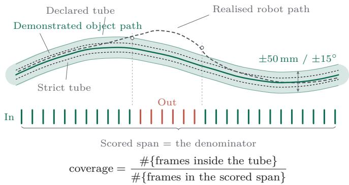  
Figure 10: The human-to-sim gap, measured. The demonstrated object path is the ground truth and the tube is the declared tolerance. Coverage is the fraction of scored frames inside the tube, and a pass needs at least 85%. The inner dashed band is the strict tube, a tighter reference tolerance recorded beside every outcome as strict coverage; the outcome itself is decided on the declared tube.

## 6 The corpus

The set analysed here is just a small sample of a much larger and growing collection. It holds 42 captures, solved as 45 episodes because some captures were solved a second time under another retargeting mode. Below, episode means one solve. The robots studied are 8 robots in 4 classes, listed in Table 5 with the properties the method reads: four bodies with seven joints, three with six and one with five; one body has no closing joint. Fig. 1 shows several of them on one episode, and Appendix B (Figs. 15 to 17) shows rendered examples of the phone frame, the record, the replay and the grasp each body chose. Both humanoids are solved as one arm on a frozen torso: the torso does not bend, the stance does not shift and the base does not turn, so their rows measure an arm, not a humanoid. The low-cost class contributes 1 of the 157 pairs, too few to estimate anything. A body here is a robot on a given base, so an arm solved standing on the wheeled cart counts as a mobile manipulator, which is why the class panels of Fig. 11 count more bodies than Table 5 lists; 4 pairs listed under their arm in Table 5 are mobile-manipulator pairs there. Of 336 possible capture-by-body cells, 136 carry an answer, a fill of 40.5%. The 157 pairs include 21 repeat solves: 14 in the object-centric mode (3 pass) and 7 under the hand-copy mode, each a failure, object could not be scored, never a pass (Table 6 withholds its outcome because that comparison is on geometry alone). The ledger does not record why the other cells were not ofered, so a class and family with no pair is labelled as such (Fig. 11). Of the 157 pairs with an outcome, 146 carry solve-time evidence and 144 a scored window, which is a property of the record and so exists for refused pairs too. The 4 unauditable pairs have no stored bundle, which is why the pass, fail and refusal shares do not add up to the whole. Every number below is printed with its denominator.

Table 5: The robots studied. One row per body, with the properties the method reads out of its description and the outcomes it was given. The method never reads the first column. One humanoid has a three-fingered hand read as a closure with its efective stroke; the other wears a five-fingered hand that its published model welds, with no finger joint, so it declares no closing joint. [kinematicfeasibility · ±50 mm $/ \pm I 5 ^ { \circ }$ · in simulation]
<table><tr><td>body</td><td>class</td><td></td><td>DoF end effector</td><td>stroke (mm)</td><td>reach (m)</td><td>base</td><td>pairs passed refused</td><td></td><td></td></tr><tr><td>Franka Panda</td><td>fixed arm</td><td></td><td>7 parallel jaw</td><td>80</td><td></td><td>0.85 fixed</td><td>45</td><td>18</td><td>5</td></tr><tr><td>PR2</td><td>mobile manipulator</td><td></td><td>7 parallel jaw</td><td>80</td><td>0.82</td><td>mobile</td><td>20</td><td>8</td><td>1</td></tr><tr><td>myCobot 280</td><td>fixed arm</td><td></td><td>6 parallel jaw</td><td>45</td><td></td><td>0.30 fixed</td><td>19</td><td>2</td><td>3</td></tr><tr><td>Unitree G1</td><td>humanoid</td><td></td><td>7 multi-finger hand</td><td>90</td><td></td><td>0.41 mobile</td><td>19</td><td>3</td><td>0</td></tr><tr><td>UR5e</td><td>fixed arm</td><td></td><td>6 parallel jaw</td><td>85</td><td></td><td>0.85 fixed</td><td>19</td><td>7</td><td>1</td></tr><tr><td>Apptronik Apollo</td><td>humanoid</td><td></td><td>7 welded hand</td><td>一</td><td></td><td>0.53 mobile</td><td>17</td><td>0</td><td>11</td></tr><tr><td>Fanuc LR Mate 200iD</td><td>fixed arm</td><td></td><td>6 parallel jaw</td><td>85</td><td></td><td>0.72 fixed</td><td>17</td><td>11</td><td>1</td></tr><tr><td>SO-101</td><td>low-cost 5-DoF</td><td></td><td>5 parallel jaw</td><td>34</td><td>0.44 fixed</td><td></td><td>1</td><td>0</td><td>0</td></tr></table>

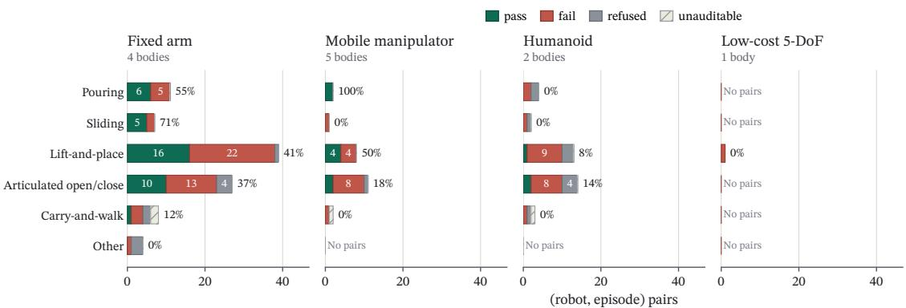  
136 of 336 capture × body cells carry an answer (42 captures × 8 bodies); 157 pairs over 45 solve runs; latest ledger entry per solve run · kinematic feasibility · ±50 mm / ±15° · in simulation · the figure after each bar is that bar's pass share  
Figure 11: Outcomes by task family and body class. Ever air that was ofered has an answer here. A bod here is a robot on a iven base, so an arm solved standing on the wheeled cart counts as a mobile manipulator. The corpus fills 40.5% of the capture-by-body matrix; a class and family that received no pair is labelled as such rather than drawn as a zero. The refusal band shows the pairs that other pipelines discard silently. [kinematicfeasibility · ±50 mm $/ \pm I 5 ^ { \circ }$ · in simulation]

## 6.1 Yield per minute of capture

Only part of a recorded take becomes robot motion that passes, and the record measures that part. The 19.2 minutes of recorded takes credit 6.1 robot-minutes inside the declared tube (Fig. 12) [kinematicfeasibility · ±50 mm / ±15◦ · in simulation]. A robot-minute is scored contact time during which the replayed object stayed inside the tube, credited only to a pair whose replay was executable and clear, so a pair that collided or never moved the object credits nothing. Approach, retreat and dead time fill most of a take: the scored window is a median 15.9% of the recorded take and 79.1% of the demonstrated contact span.

## 6.2 Grasp ranking: sweep coverage against grasp quality

When the same pairs are re-solved, ranking grasps by sweep coverage passes 33% of them, against 13% for ranking by geometric quality alone (Table 6) [kinematic feasibility · ±50 mm / $\pm I 5 ^ { \circ }$ · in simulation]. Most pairs, 77%, keep their outcome, and almost all of those that change pass only under sweep-coverage ranking. A hand copy gets no outcome here, and on the same object tube its median tube coverage is 18.7% against 100.0%. The base search raises the pass share from 31% to 33%. The contact vote is a re-score, not a re-solve: with the object witness withheld, 25 of 55 pairs pass either way, so it changes which frames are scored and no outcome.

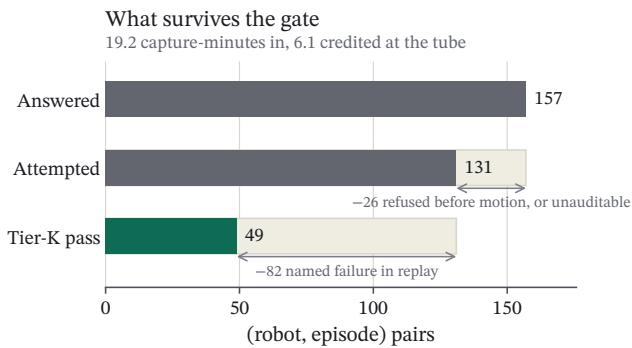  
kinematic feasibility · ±50 mm / ±15° · in simulation  
Figure 12: Robot-minutes per capture-minute. Of 157 answered pairs, 131 are attempted and 49 pass. The 19.2 minutes of recorded takes credit 6.1 robot-minutes at the declared tube. This is the cost side of the gate, in the one unit used throughout. [kinematicfeasibility · ±50 mm / ±15◦ · in simulation]

These ablations ran on 2 fixed arms, which are among the higher-passing robots studied. No mobile, humanoid or short- reach body was re-solved. The quality-only variant also had help. When its grasp could not carry the path, a base-motion fallback fired, and that fallback itself ranks on sweep coverage. It fired several times more often than under the control, which flatters the quality-only variant, so the gap above understates what ranking alone buys.

Table 6: Ablations. Each construction is compared with its alternative, re-solved on the same pairs and scored the same way (the contact vote is re-scored, not re-solved), on 2 fixed arms over 42 episodes. These runs are kept apart from the main ledger. A hand copy earns no outcome in this scoring because it does not target the reference motion. Its coverage is measured on the same tube. Coverage is the median tube coverage; path ratio is the median length of the replayed object path relative to the demonstrated one. [kinematicfeasibility · ±50 mm $/ \pm I 5 ^ { \circ }$ · in simulation]
<table><tr><td>ablation</td><td>arm</td><td>pairs</td><td></td><td>pass median coverage median path ratio</td><td></td></tr><tr><td>target: object path vs hand object path copy</td><td></td><td></td><td>84 28 / 84 (33%)</td><td>100.0%</td><td>1.00</td></tr><tr><td></td><td>hand copy (wrist path), scored on the same object tube</td><td>84</td><td>no outcome</td><td>18.7%</td><td>1.56</td></tr><tr><td>grasp: coverage-first vs best coverage-first (shipped) quality</td><td></td><td></td><td>84 28 / 84 (33%)</td><td>100.0%</td><td>1.00</td></tr><tr><td></td><td>grasp ranked by geometric quality only (sweep coverage ignored)</td><td></td><td>84 11 / 84 (13%)</td><td>85.9%</td><td>1.13</td></tr><tr><td>contact: full witness vote full vote vs touch only</td><td></td><td></td><td>55 25 / 55 (45%)</td><td>100.0%</td><td></td></tr><tr><td>stance: base search vs fixed base search on (shipped)</td><td>touch only</td><td></td><td>55 25 / 55 (45%)</td><td>100.0%</td><td></td></tr><tr><td>default</td><td></td><td></td><td>84 28 / 84 (33%)</td><td>100.0%</td><td>1.00</td></tr><tr><td></td><td>fixed default stance (no base/mount trans- lation search, no rung-1 re-park)</td><td></td><td>84 26 / 84 (31%)</td><td>100.0%</td><td>1.00</td></tr></table>

## 6.3 Refusal validity, and where refusals come from

Every refused pair that was run anyway failed [kinematic feasibility · ±50 mm / ±15◦ · in simulation]. Recomputing the pre-flight checks over the 146 rows that carry solve-time evidence refuses 34 pairs. Of those, 21 were stored as a rest-pose hold and cannot test their own refusal. The other 13 were produced before the checks were enforced and ran anyway. In this natural experiment, 13 of 13 failed to pass (Wilson interval 77.2–100.0%), and none reached grasp closure on the supplement’s re-score ledger. The composition matters. 8 of the 13 were refused for declaring no closing joint: 5 on the welded-hand humanoid, whose open hand followed the object without holding it, and 3 on bodies whose early bundles declared no stroke, which §8 reads as no closing joint. The other 5, refused on stroke or on an empty candidate set by bodies that do have a closure, failed as well (5 of 5, Wilson interval 56.6–100.0%), on a sample too small to bound the rate tightly. The denominators, in order: 157 answered pairs, of which 146 carry solve-time evidence; the ledger stores 22 refusals, 21 of them inside those rows; recomputing the checks over those rows refuses 34, of which 13 ran anyway. The 10 superseded passes of Appendix A are not counterexamples: each refusal is of an artefact produced again, not of the artefact that ran.

Of the 34 refusals the checks recompute (Fig. 13 counts the 22 the ledger stores), 76.5% come from the closure entries of the description file: no closing joint, or a stroke narrower than every candidate grasp. The one body with no closing joint, a humanoid whose five-fingered hand is welded in its published model, accounts for 11 of the 22 refusals stored in the ledger, 50.0% of them, so that much of the refused share in the headline is one body’s model. That refusal is about the description, not the hand: the other humanoid’s hand has joints, and is solved. Recall is zero by construction, since the checks refuse only on proof available at solve time, before any trajectory is generated, and catch none of the failures among attempted pairs. Wider refusal boundaries, measured and not adopted, nest (a negative sweep clearance, then a contact of the observed surface, then a friction-cone violation) and would have refused 43, 53 and 54 more pairs. The widest would have caught 50.8% of those failures (32 of the 63 failures with solve-time evidence) while refusing 44.9% of the passes, and none would have lost a pair that the re-score ledger scores as grasp-secured.

## 6.4 Screening a new robot from its description

From the descriptor and the episode’s geometry, the best model predicts the pass or fail label of a robot it has not seen at 0.56 balanced accuracy, averaged over held-out robots, against 0.50 for always guessing the majority label [kinematic feasibility · ±50 mm $/ \pm I 5 ^ { \circ }$ · in simulation]. The average is over the 6 of 8 robots that have both a pass and a fail, with a range of 0.43–0.65. Pooled over every prediction, the same model scores 0.63. Pooling rewards a model for recognising which robot a pair belongs to, so the average over robots is the fairer measure. This does not contradict §6.3. The descriptor screens refusals trivially, since most refusals follow from one of its lines; it is among the attempted pairs that it could not be shown to predict pass or fail, and with 131 attempted pairs over 8 robots that is a result we could not show, not one shown impossible. A corpus filtered to its passes could not be used for this test at all, since it has no negative label. Grouped by body property, 3 of 5 statements keep the direction of their pass-share gap when any single robot is left out: reach headroom, base type, and whether the jaw spans the object (Supplement §S7).

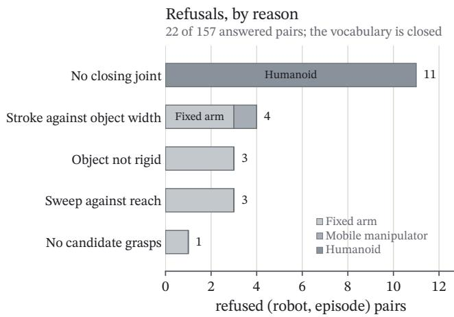  
A refusal is decided before any motion and is published with a certificate; it is not a failure  
Figure 13: Refusals, by reason. The refusal vocabulary, counted. Failure modes among attempts are in the supplement. [kinematic feasibility · ±50 mm / ±15◦ · in simulation]

## 6.5 Refusals and failures, with their denominators

Of all answered pairs, 31.2% pass, and of those attempted, 37.4% [kinematic feasibility · ±50 mm / ±15◦ · in simulation]. The 22 refusals use 5 of the 7 reasons (Fig. 13). Among the 82 failures, collision is the largest class at 52.4%, and the largest single mode is collision self at 23.2%. Because the object stays attached to the end efector over the whole scored window, dropped names a carried path that stays below the demonstrated one, and never\_grasped an empty scored window.

## 7 From the record to a robot

A trajectory reaches a robot only as a gated file. The gate runs ofline. It re-parses the description, runs its own forward kinematics and collision queries, and shares no implementation with the solver it checks. Its output is a file that carries its own limits and a hash of the positions, and a file whose positions do not hash to the recorded value is refused. Position and orientation error are reported but do not gate. The replay refuses any outcome produced without a measured bench map. The checks are listed in the supplement. [kinematic replay · SO-101 · as measured]

A post-training episode is also assembled from the gated file (Fig. 14). The record supplies the action side: the joint targets and the gripper command for every frame. The observation side, the camera frames and the joint readings, comes from replaying the gated trajectory on the target robot with its own cameras. Actions and observations are then joined, with the task as a string, into one episode in the LeRobot dataset format.

The record makes an experiment possible, and the supplement fixes its protocol. Bench tasks are captured with the phone and exported as nested sets of the same captures: every retargeted trajectory, only those passing the kinematic tier, and only those also scored on grasp closure. A teleoperated set on the same tasks and start poses is matched on robot-minutes. The cheapest part needs no policy. Replaying each gated episode on the arm

Actions from the record, observations from the robot

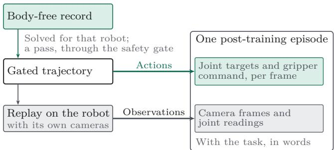  
Figure 14: Actions from the record, observations from the robot. A passing, gated trajectory supplies the joint targets and the gripper command. Replaying it on the robot with its own cameras supplies the camera frames and joint readings. With the task described in words, these make one post-training episode.

and scoring the simulated outcome against what the arm did tests whether the record predicts anything on hardware.

A pilot on the bench. We ran that cheapest part on 4 phone takes of one bench task, a marker picked of the bench and dropped into a container, carried through the chain above for the low-cost arm’s bench body, its description as mounted on the bench. Perception recovered 4 of them, 0 passed the kinematic tier [kinematic feasibility · ±50 mm / ±15◦ · in simulation], 0 reached the ofline safety gate,

and none was eligible for the replay: every take failed the verifier (left the tube on three takes and self-collision on one take) and the arm stayed parked. The protocol prescribes five takes on five cells; 4 were filmed, on two of them, and the single permitted re-pilot restarts the count. The takes were filmed with the phone worn on the chest, where the pilot protocol had prescribed a tripod, and with a thin marker that the hand covered: the camera saw the marker on at most 31% of the frames in which the hand held it; the rest of its path was propagated from the hand. The verifier scores reproduction of the demonstrated object path, so a path the record did not observe cannot pass.

These takes are the protocol’s pilot and are not in the corpus of §6; the supplement lists each take and where it stopped.

## 8 Adopting the record

To add a robot, supply its kinematic description and the descrip tor of Table 4: the closing joints, the usable stroke, reach radius, wrist actuation, base type, the joint list with limits, the frozen list of links allowed to touch the object, the grasp-frame transform with its provenance, and a rest pose. A blank field still yields an answer. A missing stroke is read as no closing joint, and a missing grasp frame is derived from the fingertip kinematics, with its provenance recorded. To add a demonstration, record it on a sim le and scalable device such as a mobile hone, with nothing attached. The mesh is reconstructed from the episode, so no object scan is needed. Publish, per (robot, episode) pair, the outcome, its coverage, the window scored, the certificate of any refusal or failure, and the tier line. Append rows and never edit them. The latest row supersedes. The tolerances are the same for every body, so a failure on a robot outside this corpus is described in the same words as a failure on the robots studied here.

## 9 Decisions kept and decisions revised

We would do these again, each within the scope it was measured on:

• Keep the non-passes. They made the refusal class testable (§6.3), and they made the screening question possible to ask, since a corpus filtered to its passes has no negative class (§6.4).

• Rank a grasp by sweep coverage of the demonstrated path. We measured this against ranking by grasp quality on the same pairs, on 2 fixed arms (Table 6).

• Let a witness extend a contact and never open one. The rule acted on 28 of 38 episodes. Re-scored with the whole witness withheld, no outcome changed; the rule’s own efect is unmeasured, so its value is in the frames it scores, not in the pass count (§5.3).

We would change these in the next version of the record:

• Let the ranking statistic see collision. Sweep coverage counts reachable frames and cannot see the arm pass through the table or through itself. Collision is the largest failure class, at 52.4% of failures (§6.5).

• Refuse below the pass threshold, not only at zero. A pair whose best grasp reaches only part of the path is an attempt that cannot pass. It belongs in the refusal class, with its sweep coverage as the certificate.

• Model the humanoid’s hand. The one refusal that follows from a body’s description alone is a five-fingered hand that its published model welds. The record never asked for a jaw; the descriptor asks for a closing joint, and a hand model with joints answers it the way the other humanoid’s does.

• Fill the body-by-episode matrix by design. Captures were ofered to bodies as they arrived, at a fill of 40.5%. A planned fill would let the property statements of §6.4 be tested. Here they are only observed.

## 10 Limits

Scope, by design.

• Outcomes are kinematic [kinematicfeasibility · ±50 mm / ±15◦ · in simulation]. A pass says the object’s demonstrated motion is reproducible by this body at the declared tolerance, with the object attached at the grasp. Whether the jaw or hand closed on it, and the contact physics, belong to higher tiers.

• The corpus is a single-demonstrator sample of 42 captures and 19.2 minutes of recorded takes. It is sized to show the representation and the refusal vocabulary at work, not to estimate population rates. Every number regenerates from the ledger.

• The record assumes a rigid object with a recoverable pose. Deformable objects and hand-to-hand transfers are refused as object not rigid.

• Bodies that carry their own base are solved on a frozen torso. The base path is a free variable in the same formulation, solved against the object path, and the supplement gives it in full. No ledger entry carries a gated base-motion outcome yet.

• The property groupings are observational and confounded with each other. They say which property to screen on, but none is shown to cause a pass.

• Coverage is measured on the scored window, which is a median 79.1% of the demonstrated contact span. Both numbers are recorded with every outcome.

• No policy has yet been post-trained on the record. Before the pilot of §7, one exported trajectory, not a kinematic-tier pass and never entered in the ledger, was streamed open- loop to one low-cost arm under its safety gate alone with no object present: a bench check of the route, not an outcome. The pilot of §7 is the first run of the hardware protocol, on a bench task outside the corpus; no take reached the arm, and the false-pass rate of the 49 corpus passes themselves is still unmeasured. The protocol that answers both is in the supplement.

## 11 Conclusion

We took the ground truth for retargeting from the object’s motion, the part of a demonstration that every robot can use. Each body is then scored against the same reference, and a refusal before motion becomes an answer kept with its reason. In the sample analysed here, 14.0% of the answers are refusals, and most of them follow from a line in a description file. We argue for keeping every answer, retractions included. The record decides what a robot may post-train on. The next measurement is what a policy post-trained on it does on the real robot, and the record lets us make it body by body.

## Disclosure

The author holds U.S. Provisional Patent Application No. 64/158,349 on the method described here.

## Appendix

## A. Retractions, by cause class

A retraction is a dated ledger entry that supersedes a published pass. Later entries have superseded 35 pairs across 16 captures, 22.3% of the corpus. Most were withdrawn because the bundle was produced again and re-scored, so the artefact the pass described no longer exists. The 10 that a pre-flight check now refuses were also produced again; the superseding entry is a refusal of the new artefact, and the earlier artefact’s own standing under the checks is not stored, so these pairs are kept out of the natural experiment of §6.3 rather than counted on either side. None was withdrawn because the same artefact failed a stricter check.

Table 7: Superseded passes by cause class.
<table><tr><td>cause class superseded pairs</td></tr><tr><td>a pre-flight check now refuses the pair 10</td></tr><tr><td>bundle produced again and re-scored 25</td></tr><tr><td>same artefact, stricter check 0</td></tr></table>

## B. Rendered examples

Fig. 1 and Figures 15 to 17 are stills of the record and its replays, shot through the viewer’s print theme from bundles in the corpus of §6; nothing in them is retouched beyond that theme’s lighting. The phone frames are the captures’ own RGB frames at the moments the replays are shown. In every render the capture mesh is grey, the reconstructed object is green, the demonstrated object path is teal, the closing jaw is violet and the demonstrator’s hand, where drawn, is orange. Each tile’s body, and the outcome printed under it or stated in its caption, are read from the ledger when the figure is built, never typed.

## C. Reproducibility

Every number, table and results figure here is regener- ated from the ledger (latest entry per run) by one command, make results, and a second, make check, fails the build on an unlisted digit typed into the prose, on a cap- ture identifier and on a page overrun. This version was built on the ledger as of 2026-10-14T00:31:58Z. A sub- set of episodes with their per-robot outcomes is available at https://playground.dxtr.co; the full ledger, the re-score ledger and the code are available from the author.

Implementation. Captures come from the Eye iOS app on an iPhone with a LiDAR scanner: RGB frames, ARKit scene depth and ARKit camera poses on one clock. Hands are detected per frame with MediaPipe [23] and lifted to metric world coordinates with the LiDAR depth; a second backend regresses an articulated MANO hand with HaMeR [31] and registers it to the LiDAR wrist depth, and the backend used is recorded in each episode’s hands table. The object is segmented by SAM 2 [34] from a prompt placed at contact onset, and its pose per frame is recovered by trimmed ICP of the masked depth cloud against a reference cloud fused at onset; a frame whose residual or jump exceeds its budget takes a pose propagated rigidly from the hand and is flagged as such. The mesh is reconstructed by the best method available: TSDF fusion of the masked depth with a symmetry completion is always computed, and a TRELLIS [44] mesh anchored to the metric cloud replaces it when it clears the anchoring gates; every vertex carries observed or completed provenance. Inverse kinematics, the kinematic replay and every collision query run in PyBullet [5]. The safety gate of §7 re-implements its forward kinematics and collision checks apart from the solver.

## References

[1] I. Akinola, J. Xu, S. Song, and P. K. Allen. Dynamic grasping with reachability and motion awareness. In IEEE/RSJ International Conference on Intelligent Robots and Systems (IROS), 2021. arXiv:2103.10562.

[2] H. Bharadhwaj, R. Mottaghi, A. Gupta, and S. Tulsiani. Track2Act: Predicting point tracks from internet videos enables generalizable robot manipulation. In European Conference on Computer Vision (ECCV), 2024. arXiv:2405.01527.

[3] Y. Chen, P. Li, Y. Huang, J. Yang, K. Chen, and L. Wang. EC-Flow: Enabling versatile robotic manipulation from action-unlabeled videos via embodiment-centric flow. In IEEE/CVF International Conference on Computer Vision (ICCV), 2025. arXiv:2507.06224.

[4] C. Chi, Z. Xu, C. Pan, E. Cousineau, B. Burchfiel, S. Feng, R. Tedrake, and S. Song. Universal manipulation interface: In-the-wild robot teaching without in-the-wild robots. In Robotics: Science and Systems (RSS), 2024.

[5] E. Coumans and Y. Bai. PyBullet, a Python module for physics simulation for games, robotics and machine learning, 2016–2021. http://pybullet.org.

[6] P. Dan, K. Kedia, A. Chao, E. W. Duan, M. A. Pace, W.-C. Ma, and S. Choudhury. X-Sim: Cross-embodiment learn- ing via real-to-sim-to-real. In Conference on Robot Learning (CoRL), volume 305 of Proceedings of Machine Learning Research, pages 816–833, 2025. arXiv:2505.07096.

[7] H. Etukuru, N. Naka, Z. Hu, S. Lee, J. Mehu, A. Edsinger, C. Paxton, S. Chintala, L. Pinto, and N. M. M. Shafiullah. Robot utility models: General policies for zero-shot de- ployment in new environments. In 2025 IEEE International Conference on Robotics and Automation (ICRA), pages 8275–8283, 2025. doi: 10.1109/ICRA55743.2025. 11127857.

[8] J. Fang, W. Chen, H. Xue, F. Zhou, T. Le, Y. Wang, Y. Zhang, J. Lv, C. Wen, and C. Lu. RoboPocket: Im- prove robot policies instantly with your phone, 2026. arXiv:2603.05504.

[9] A. M. Ghalamzan E., N. Mavrakis, M. Kopicki, R. Stolkin, and A. Leonardis. Task-relevant grasp selection: A joint solution to planning grasps and manipulative motion trajectories. In IEEE/RSJ International Conference on Intelligent Robots and Systems (IROS), pages 907–914, 2016. doi: 10.1109/IROS.2016.7759158.

[10] A. M. Ghalamzan E., N. Mavrakis, and R. Stolkin. Grasp that optimises objectives along post-grasp trajectories. In 2017 5th RSI International Conference on Robotics and Mechatronics (ICRoM), pages 51–56, 2017. doi: 10.1109/ICROM.2017.8466161.

pass  
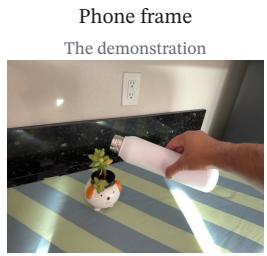

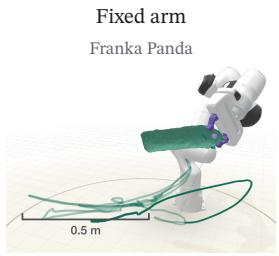

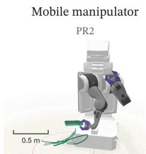

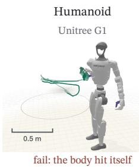

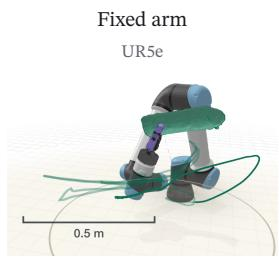  
Figure 15: One episode, several bodies, each with its own answer. One pouring episode, shown mid-transport, with the demonstrated object path in teal; the leftmost tile is the phone’s own frame at that moment. Each body chose its own grasp and stance against the same path, which is never rescaled. Scale bars difer because each tile is fitted to its bod . Each tile’s outcome is read from the led er at build time: a ass, or an attempt that failed with its named mode. The thin ring marks the height of the work surface. [kinematicfeasibility · ±50 mm / ±15◦ · in simulation]

The jaw closes

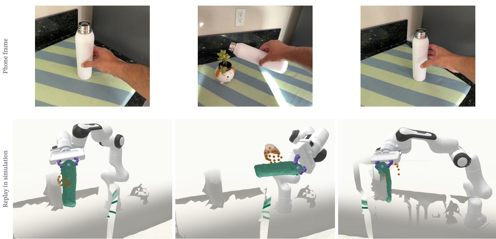  
Figure 16: From the phone to the replay. One pouring episode at three moments: the demonstrator’s grip closing on the object, the carry and tilt over the plant, and the release. Above, the phone’s own frame. Below, the same moment in the simulated replay of a fixed arm against the record: the capture mesh, the reconstructed object on its demonstrated path, and the demonstrator’s hand as contact marks where it held the object. The hand is a witness to contact and is never co ied; the arm’s jaw closes elsewhere on the object, where the ath sta s reachable for tha body. This body passed the episode. [kinematic feasibility · ±50 mm / ±15◦ · in simulation]

[11] Y. Han, J. Qiu, L. Bai, Z. Xiao, Z. Zeng, Y. Liu, Z. Yang, S. Jain, W. Ma, J. Fu, Y. Zheng, M. Natarajan, M. Z. Irshad, K. Shaw, M. Gombolay, Z. Kira, and H. Ravichan- dar. Video2Sim2Real: Full-stack autonomous dexter- ous skill acquisition from a single human video, 2026. arXiv:2606.08828.

[12] T. He, Z. Luo, W. Xiao, C. Zhang, K. Kitani, C. Liu, and G. Shi. Learning human-to-humanoid real-time whole- body teleoperation. In IEEE/RSJInternational Conference on Intelligent Robots and Systems (IROS), pages 8944– 8951, 2024. doi: 10.1109/IROS58592.2024.10801984.

[13] N. Heppert, M. Argus, T. Welschehold, T. Brox, and A. Valada. DITTO: Demonstration imitation by trajectory transformation. In IEEE/RSJ International Conference on Intelligent Robots and Systems (IROS), 2024. arXiv:2403.15203.

[14] C.-C. Hsu, B. Wen, J. Xu, Y. Narang, X. Wang, Y. Zhu, J. Biswas, and S. Birchfield. SPOT: SE(3) pose trajectory difusion for object-centric manipulation. In IEEE International Conference on Robotics and Automation (ICRA), 2025. arXiv:2411.00965.

[15] H. Huang, J. Duan, T. Teng, and C. Yang. PhysV2A: Reachability-gated and semantic-mask-constrained feasi- bility completion for video-to-robot manipulation, 2026. arXiv:2607.09365.

[16] M. Ji, X. Peng, F. Liu, J. Li, G. Yang, X. Cheng, and X. Wang. ExBody2: Advanced expressive humanoid whole-body control. In 2026 IEEE International Conference on Robotics and Automation (ICRA), pages 613–620, 2026. doi: 10.1109/ICRA57385.2026.11696204.

[17] Z. Jiang, Y. Xie, K. Lin, Z. Xu, W. Wan, A. Mandlekar, L. Fan, and Y. Zhu. DexMimicGen: Automated data gen-

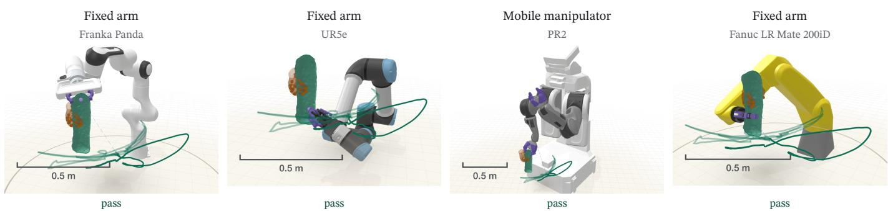  
Figure 17: The grasp is the body’s own. The same pouring episode at the moment the jaw closes, on four bodies that all passed it; the demonstrator’s hand at that moment is drawn where it held the object. Each body closes its jaw where its own kinematics keep the demonstrated path reachable, ranked by sweep coverage (§5.2): near the top, low on the body or across the middle. None copies the hand. Each tile is fitted to its body, so read the scale bars. [kinematicfeasibility · ±50 mm / ±15◦ · in simulation]

eration for bimanual dexterous manipulation via imitation learning. In IEEE International Conference on Robotics and Automation (ICRA), 2025. arXiv:2410.24185.

[18] S. Kareer, D. Patel, R. Punamiya, P. Mathur, S. Cheng, C. Wang, J. Hofman, and D. Xu. EgoMimic: Scaling imitation learning via egocentric video. In IEEE International Conference on Robotics and Automation (ICRA), 2025. arXiv:2410.24221.

[19] J. Kerr, C. M. Kim, M. Wu, B. Yi, Q. Wang, K. Goldberg, and A. Kanazawa. Robot see robot do: Imitating articu- lated object manipulation with monocular 4D reconstruction. In Conference on Robot Learning (CoRL), 2024. arXiv:2409.18121.

[20] A. Khazatsky, K. Pertsch, et al. DROID: A large-scale inthe-wild robot manipulation dataset. In Robotics: Science and Systems (RSS), 2024. arXiv:2403.12945.

[21] J. Li, Y. Zhu, Y. Xie, Z. Jiang, M. Seo, G. Pavlakos, and Y. Zhu. OKAMI: Teaching humanoid robots manipulation skills through single video imitation. In Conference on Robot Learning (CoRL), 2024. arXiv:2410.11792.

[22] T. Liu, R. A. Patamia, B. Champion, R. Dazeley, and A. Cosgun. Execution-aware pre-execution rank- ing for grasp-conditioned robotic placement, 2026. arXiv:2609.19946.

[23] C. Lugaresi, J. Tang, H. Nash, C. McClanahan, E. Uboweja, M. Hays, F. Zhang, C.-L. Chang, M. G. Yong, J. Lee, W.-T. Chang, W. Hua, M. Georg, and M. Grund- mann. MediaPipe: A framework for building perception pipelines, 2019. arXiv:1906.08172.

[24] T. G. W. Lum, O. Y. Lee, C. K. Liu, and J. Bohg. Crossing the human-robot embodiment gap with sim-to-real RL using one human demonstration. In Conference on Robot Learning (CoRL), volume 305 of Proceedings of Machine Learning Research, pages 4418–4441, 2025. arXiv:2504.12609.

[25] H. Luo, Y. Wang, W. Zhang, S. Zheng, Z. Xi, C. Xu, H. Xu, H. Yuan, C. Zhang, Y. Wang, Y. Feng, and Z. Lu. Being- H0.5: Scaling human-centric robot learning for cross- embodiment generalization, 2026. arXiv:2601.12993.

[26] J. Mahler, J. Liang, S. Niyaz, M. Laskey, R. Doan, X. Liu, J. A. Ojea, and K. Goldberg. Dex-Net 2.0: Deep learning to plan robust grasps with synthetic point clouds and analytic grasp metrics. In Robotics: Science and Systems (RSS), 2017.

[27] A. Mandlekar, S. Nasiriany, B. Wen, I. Akinola, Y. Narang, L. Fan, Y. Zhu, and D. Fox. MimicGen: A data generation system for scalable robot learning using human demon- strations. In Conference on Robot Learning (CoRL), 2023.

[28] S. Palanisamy, A. Anand, S. S. Rathore, P. Patnaik, S. Khatana, and E. Janweja. MobileEgo Anywhere: Open infrastructure for long horizon egocentric data on com- modity hardware, 2026. arXiv:2605.05945.

[29] A. Patel, B. Pekarek, J. E. Castro Hernandez, and S. Song. What enables in-context behavior prompting for manipu- lation?, 2026. arXiv:2606.30457.

[30] S. Patel, S. Mohan, H. Mai, U. Jain, S. Lazebnik, and Y. Li. Robotic manipulation by imitating generated videos without physical demonstrations. In International Conference on Learning Representations (ICLR), 2026. arXiv:2507.00990.

[31] G. Pavlakos, D. Shan, I. Radosavovic, A. Kanazawa, D. Fouhey, and J. Malik. Reconstructing hands in 3D with transformers. In IEEE/CVF Conference on Computer Vision and Pattern Recognition (CVPR), 2024.

[32] M. Piseno, G. Tevet, and C. K. Liu. Cloak: Zero-shot cross-embodiment manipulation by masking the end-efector from the VLA, 2026. arXiv:2606.22836.

[33] O. Porges, T. Stouraitis, C. Borst, and M. A. Roa. Reachability and capability analysis for manipulation tasks. In ROBOT2013: First Iberian Robotics Conference, volume 253 of Advances in Intelligent Systems and Computing, pages 703–718. Springer, 2014. doi: 10.1007/978-3-319-03653-3\_50.

[34] N. Ravi, V. Gabeur, Y.-T. Hu, R. Hu, C. Ryali, T. Ma, H. Khedr, R. Rädle, C. Rolland, L. Gustafson, E. Mintun, J. Pan, K. V. Alwala, N. Carion, C.-Y. Wu, R. Girshick, P. Dollár, and C. Feichtenhofer. SAM 2: Segment

anything in images and videos. In International Conference on Learning Representations (ICLR), 2025. arXiv:2408.00714.

[35] Y. Shi, D. Wen, Z. Han, Z. Guo, Y. Hu, E. Welte, K. Peng, R. Stiefelhagen, and R. Rayyes. Hand-centric human- to-robot trajectory transfer from video demonstrations via object category-agnostic temporal localization, 2026. arXiv:2606.10743.

[36] T. Siméon, J.-P. Laumond, J. Cortés, and A. Sahbani. Manipulation planning with probabilistic roadmaps. The International Journal ofRobotics Research, 23(7–8):729– 746, 2004. doi: 10.1177/0278364904045471.

[37] N. Trupin, Z. Wang, and A. H. Qureshi. Physics-conditioned grasping for stable tool use, 2025. arXiv:2505.01399.

[38] N. Vahrenkamp, T. Asfour, and R. Dillmann. Robot placement based on reachability inversion. In IEEE International Conference on Robotics and Automation (ICRA), pages 1970–1975, 2013. doi: 10.1109/ICRA. 2013.6630839.

[39] C. Wang, H. Shi, W. Wang, R. Zhang, L. Fei-Fei, and C. K. Liu. DexCap: Scalable and portable mocap data collection system for dexterous manipulation. In Robotics: Science and Systems (RSS), 2024.

[40] G. Wang, K. Ren, A. Morgan, Y. Chen, H. H. Qian, P. Chanrungmaneekul, and K. Hang. EgoInfinity: A web- scale 4D hand-object interaction data engine for any-view robot retargeting and video-to-action robot learning, 2026. arXiv:2606.17385.

[41] L. Wang, Y. Xiang, and D. Fox. Manipulation trajectory optimization with online grasp synthesis and selection. In Robotics: Science and Systems (RSS), 2020.

[42] Y. Wang, P. Lin, X.-H. Chen, H. Yuan, Z. Liang, Y. Huang, A. Chen, Z. Lei, J. Zhang, T. Zhang, H. Li, T. Zhang, C. Xiao, Z. Jiao, and Q. Jin. Ego2Robot: Scalable robot data synthesis from egocentric human data, 2026. arXiv:2608.02580.

[43] C. Wen, X. Lin, J. So, K. Chen, Q. Dou, Y. Gao, and P. Abbeel. Any-point trajectory modeling for policy learning. In Robotics: Science and Systems (RSS), 2024. arXiv:2401.00025.

[44] J. Xiang, Z. Lv, S. Xu, Y. Deng, R. Wang, B. Zhang, D. Chen, X. Tong, and J. Yang. Structured 3D latents for scalable and versatile 3D generation. In IEEE/CVF Conference on Computer Vision and Pattern Recognition (CVPR), 2025.

[45] M. Xu, Z. Xu, Y. Xu, C. Chi, G. Wetzstein, M. Veloso, and S. Song. Flow as the cross-domain manipulation interface. In Conference on Robot Learning (CoRL), 2024. arXiv:2407.15208.

[46] X. Xu, J. Park, H. Zhang, E. Cousineau, A. Bhat, J. Barreiros, D. Wang, J. Bohg, and S. Song. HoMMI: Learning whole-body mobile manipulation from human demonstrations. In Robotics: Science and Systems (RSS), Sydney, Australia, 2026. doi: 10.15607/RSS.2026.XXII. 205.

[47] Z. Xue and R. Dillmann. Eficient grasp planning with reachability analysis. International Journal ofHumanoid Robotics, 8(4):761–775, 2011. doi: 10.1142/ S0219843611002654.

[48] W. Ye, F. Liu, Z. Ding, Y. Gao, O. Rybkin, and P. Abbeel. Video2Policy: Scaling up manipulation tasks in simula- tion through internet videos, 2025. arXiv:2502.09886.

[49] Z. Yin, F. Li, Y. Gui, and J. Liu. FeasibleCap: Real-time embodiment constraint guidance for in-the-wild robot demonstration collection, 2026. arXiv:2603.07580.

[50] J. Yu, L. Fu, H. Huang, K. El-Refai, R. A. Ambrus, R. Cheng, M. Z. Irshad, and K. Goldberg. Real2Render2Real: Scaling robot data without dynam- ics simulation or robot hardware. In Conference on Robot Learning (CoRL), volume 305 of Proceedings of Machine Learning Research, pages 547–577, 2025. arXiv:2505.09601.

[51] Y. Yu and X. Qiu. Benchmarking vision-language-action models on SO-101: Failure and recovery analysis, 2026. arXiv:2606.08881.

[52] C. Yuan, C. Wen, T. Zhang, and Y. Gao. General flow as foundation afordance for scalable robot learn- ing. In Conference on Robot Learning (CoRL), 2024. arXiv:2401.11439.

[53] F. Zacharias, C. Borst, and G. Hirzinger. Capturing robot workspace structure: representing robot capabilities. In IEEE/RSJ International Conference on Intelligent Robots and Systems (IROS), pages 3229–3236, 2007. doi: 10. 1109/IROS.2007.4399105.

[54] A. J. Zhai, K.-H. Zeng, J. Lu, A. Farhadi, S. Wang, and W.-C. Ma. Imitating what works: Simulation-filtered modular policy learning from human videos. Transactions on Machine Learning Research (TMLR), 2026. arXiv:2602.13197.

[55] Y. Zhu, A. Lim, P. Stone, and Y. Zhu. Vision-based manipulation from single human video with open-world object graphs. Autonomous Robots, 50(2):27, 2026. doi: 10.1007/s10514-026-10253-8.