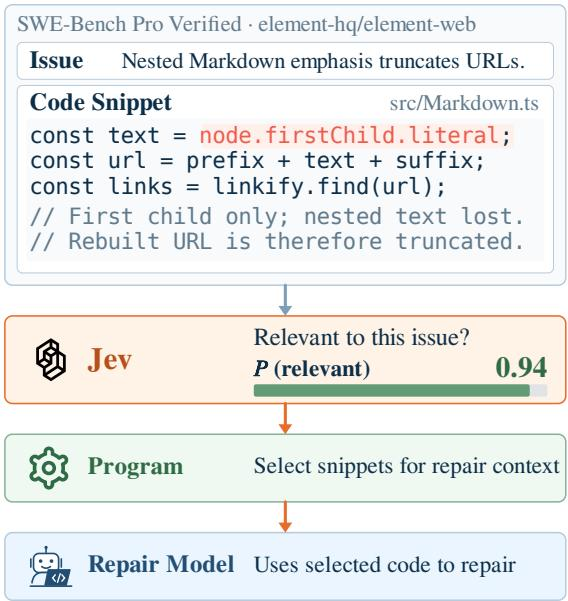
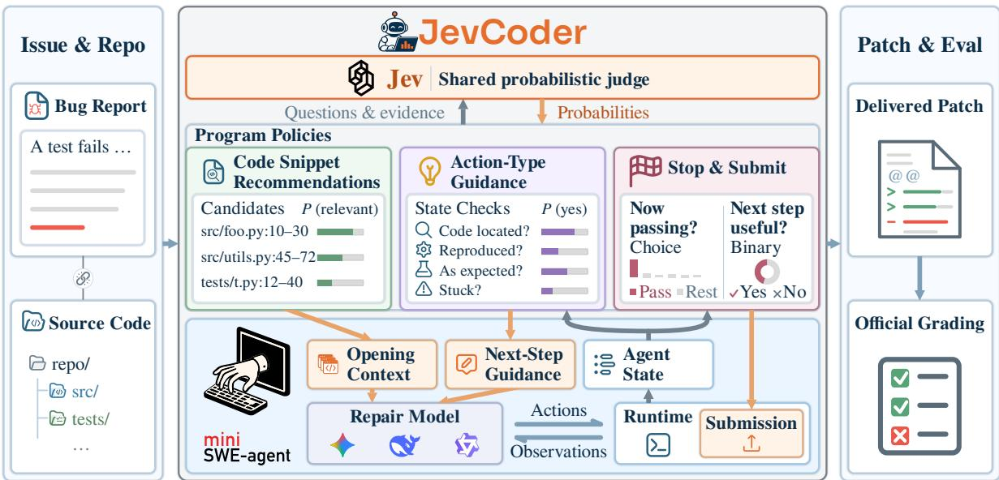

# JevCoder: When Does Decision Delegation Pay Off in Code Repair?

Jiahao Zhang Yifan Zhang Yu Huang

Vanderbilt University, Nashville, Tennessee, USA {jiahao.zhang,yifan.zhang.2,yu.huang}@vanderbilt.edu

## Abstract

A coding agent repeatedly makes decisions as it repairs code. These decisions shape repair trajectories and affect the token cost of successive model requests. We ask which repair decisions can be delegated to a low-cost probabilistic judge to reduce token use while maintaining repair quality. The judges answer questions with probabilities over predefined answers, without generating explanations. We evaluate judgment quality across repair stages and test how individual interventions change subsequent repair work. We compare these interventions with unguided repair, which uses no judge, and with the same workflow using the repair model itself as the judge. The benefit depends on the work an intervention changes, rather than the cost of the judgment alone. Based on these studies, we propose JevCoder, a workflow built around Jev, a low-cost probabilistic judge. It combines code-snippet recommendations with action-type guidance and uses judgments to determine when to submit. We evaluate three repair models, each on the same 400 tasks: 200 from SWE-bench Verified and 200 from SWE-Bench Pro Verified. Compared to unguided repair, JevCoder reduces mean repair-model token use by 21.6%–50.6%, with higher observed repair rates across all three models.

## 1 Introduction

A coding agent’s repair model chooses where to look, what to try, and when to stop. These choices affect how many steps the agent takes. When workflows resend interaction history, each request processes the accumulated context. Workflow design substantially affects this inference cost (Xia et al., 2025; Ehrlich et al., 2025). Assigning selected judgments to a cheaper model could reduce this expense. Whether delegation pays off depends on whether repair quality is maintained and on how it changes subsequent repair work.

Coding agents receive feedback during repair or use verifiers to select candidate patches (Pan et al.,

  
Figure 1: In a simplified recorded SWE-Bench Pro Verified case, JevCoder uses Jev’s relevance probabilities to rank candidate snippets and supply selected code as the coding agent’s initial context.

2025; Jain et al., 2025). SWE-PRM finds limited benefits from same-model supervision, but consistent gains with a stronger supervisor. In one setting, supervisor calls cost over six times as much as repair-model calls (Gandhi et al., 2025). We therefore ask which repair decisions are worth delegating to a low-cost judge.

We study judges that return probabilities over predefined answers without generating explanations. Jev, TypeSafe’s decision model, provides structured answers and probabilities (TypeSafe, 2026). For binary questions, Jev returns the probability of “yes”. Choice returns probabilities for predefined options. Score uses a predefined rating scale, with a probability assigned to each level. Our experiments evaluate all three forms. JevCoder uses binary and Choice judgments to rank snippets or trigger repair interventions. We also use the repair model itself as a judge, reading probabilities for predefined answer tokens. Program rules determine when to ask a question and how to use the answer. Figure 1 illustrates this process for snippet recommendations. For the URL truncation issue, Jev assigns relevance 0.94 to the snippet that reads only the first child of an emphasis node.

  
Figure 2: JevCoder delegates judgments to a shared probabilistic judge: Jev. Before repair, a program retrieves candidate code for the issue, Jev scores each snippet’s relevance, and the highest-scoring snippets enter the repair model’s initial context. After each command, program rules select relevant state questions for Jev and use its answers to suggest an action type. The repair model chooses the specific command. The stopping policy depends on the model class. For the larger API models (DeepSeek, Gemini), a Choice question on the latest check output (Pass: a previously failing check now passes; Rest: other outcomes) triggers direct submission. For the smaller model (Qwen), repeated No answers to whether the next step adds information trigger a reminder and then submission.

We assess judgment quality across repair stages and examine how individual interventions change subsequent repair work. Single-component experiments compare repair outcomes and resource use with unguided repair and, where available, samemodel judging. They show that more accurate file rankings do not necessarily improve repair outcomes, and that retaining recommended snippets can reduce repair-model token use despite increasing context length. Building on these component results, we propose JevCoder for cost-efficient code repair (Figure 2). It uses code-snippet recommendations to guide initial code exploration and provides action-type guidance during repair. Its stopping policies use judgments of successful checks or repeated lack of progress to determine when the agent should end a repair attempt and submit its current patch.

For each of three repair models, we compare JevCoder with unguided repair on the same 400 tasks: 200 from SWE-bench Verified and 200 from SWE-Bench Pro Verified. JevCoder reduces mean repair-model token use by 21.6%– 50.6% and achieves higher observed repair rates for all three models. Compared with same-model judging, which helps distinguish workflow benefits from judging overhead, JevCoder uses 9.1% fewer tokens with DeepSeek and 23.3% fewer with Qwen. Code and evaluation results are available at https://anonymous.4open.science/r/ jevcoder-artifact-8E62.

## 2 Related Work

Judgment in coding agents. Coding agents use feedback during repair and verifiers to select completed patches. SWE-PRM reads the issue and recent trajectory to diagnose errors, then returns natural-language feedback for the repair model’s next steps (Gandhi et al., 2025). Trained small critics can also provide this guidance (Gandhi et al., 2026). For completed candidates, SWE-Gym trains a verifier on successful and failed repair trajectories. Given the issue, a completed trajectory and its diff, the verifier uses answer probabilities to score candidate repairs (Pan et al., 2025). Testing adds execution evidence: reproduction tests for the issue and regression tests for existing behavior (Xia et al., 2025). Hybrid verification combines this evidence with learned scores to select a candidate (Jain et al., 2025). Replacing per-step model decisions with cheaper mechanisms is also studied outside repair: AutoTool predicts the next tool from transition statistics of past trajectories with minimal model inference (Jia and Li, 2026), and query routing sends requests to cheaper models when they suffice (Chen et al., 2024; Ong et al., 2025). JevCoder uses answer probabilities from fixed questions to trigger predefined interventions, which we evaluate across repair stages.

LLM judgment and probability reliability. LLM judges evaluate responses through scores or pairwise comparisons (Zheng et al., 2023). Scores can be computed from probabilities assigned to rating tokens or predefined answers (Liu et al., 2023; Pan et al., 2025). In instruction-tuned models, the answer token with the highest probability can differ from the answer expressed in generated text (Wang et al., 2024). For software repair, SWE-RM separately evaluates how well scores distinguish successful from failed repairs and how closely predicted probabilities match observed success rates (Shum et al., 2026). We test judgment quality on specific repair questions and how using these judgments affects repair outcomes and resource use.

## 3 Study Setting

Tasks and comparisons. We evaluate decision delegation on repository-level issue repair using a fixed sample of 200 tasks from SWE-bench Verified (Chowdhury et al., 2024) and 200 from SWE-Bench Pro Verified (Zheng et al., 2026). Our sample covers Python, Go, JavaScript, and TypeScript repositories. The repair models are DeepSeek-V4.1-Flash (DeepSeek-AI, 2026), Qwen3.8-27B-FP8 (Qwen Team, 2026b), and Gemini 3.8 Flash (Google DeepMind, 2026). For each model, fullworkflow evaluation compares JevCoder with unguided repair on the same 400 tasks. For DeepSeek and Qwen, we also replace Jev with a same-model judge. Gemini’s API does not expose the answertoken probabilities required for this comparison. DeepSeek’s component studies use balanced samples of 72 SWE-bench Verified tasks and 118 SWE-Bench Pro Verified tasks, comprising all failures from the original unguided runs and an equal number of randomly sampled successes. Including both groups lets us measure repair gains and losses.

Qwen component experiments follow similar procedures with model-specific samples; Gemini analyses focus on selected judgments in existing repair trajectories (Appendix C.2). The patch-outcome study uses 1,192 submitted-patch records from 343 tasks in SWE-bench Verified and SWE-Bench Pro v2 (Deng et al., 2026).

Judges and evidence. Jev and the same-model judge receive the same question and evidence. We read the same-model judge’s probabilities for predefined answer tokens. Judgment-quality experiments also include the small LLM Qwen3.5-2B (Qwen Team, 2026a). Evidence includes, for example, source snippets for relevance and command history for repetition. Reference patches and official test outcomes supply evaluation labels. The evidence supplied to each judge and its probability readouts are described in Appendices A, B, and C.

Repair and resource measures. Repair rate is official pass@1: the fraction of tasks whose delivered patch passes the benchmark tests. Repairmodel tokens count the repair model’s total input and output usage. Judge tokens are added for the same-model judging condition. Runtime estimates combine repair-model and tool-execution time with judge inference time. Remote API timings are adjusted by subtracting measured fixed connection delays; judge time is reported separately and included in the full-task total. Estimation and accounting details appear in Appendices C.3 and B. Each attempt is limited to 250 repair-model requests, a 3,000-second time limit, and US\$3 in API costs. The first limit reached stops execution.

Analysis. Differences are paired by task, with task-level percentile bootstrap 95% intervals. Primary summaries are mean token use and the median of paired runtime differences. Means summarize aggregate token use; runtime medians describe a typical task-level change. SWE-Bench Pro Verified opening comparisons are reweighted to the baseline failure and success proportions in the original 200 tasks. The 72-task estimates are unweighted. Raw repair counts refer to the tested sample. Each comparison uses one run per task and condition. The repair-loss criterion requires the lower bound of the paired 95% interval for the repair-rate difference to be at least −10 percentage points. Appendix D.4 provides sampling and analysis details, including the weights.

## 4 Judgment Quality

We first examine which judgments Jev can make reliably at each stage of repair. The results guide the intervention studies in Section 5 and the design of JevCoder in Section 6.

## 4.1 Code Relevance

Preparing the agent’s initial context requires choosing which retrieved code is relevant to the issue. A judge can support this choice by identifying useful starting points for the agent’s investigation. We first examine this ability at file level, using files modified by the reference patch as evaluation labels.

We compare Jev with Qwen3.5-2B (Qwen Team, 2026a), a small language model with similarly low inference overhead. A program retrieves 100 candidate files by combining BM25 retrieval with path and symbol matching. Both judges answer the same binary relevance question for each file, which we rank by the probability of a YES answer. On 162 SWE-Bench Pro Verified tasks, the top-ranked file is modified by the reference patch in 75.9% of tasks for Jev and 29.0% for Qwen3.5-2B. Median judgment time is below 0.15 seconds per file for both judges (Appendix C.3).

File rankings identify where to look. We then assess relevance at a finer granularity to select individual code snippets for the agent’s initial context. Selection recall is measured against the source lines that the reference patch removes or replaces; 189 of the 200 SWE-Bench Pro Verified tasks have such lines. Jev’s selected snippets retain 81.6% of the reference lines covered by the candidates, compared with 78.0% for DeepSeek given the same candidates and questions (Appendix C.1).

## 4.2 Repair State and Next-Action Judgments

What to try next depends on the stage reached during repair. For action-type guidance, we ask whether the agent has opened code relevant to the issue (code located) and whether a test or probe shows the reported failure (issue reproduced). We also assess whether recent actions repeat without new information (stalled repair) and whether a check after the latest edit shows the expected behavior (post-edit check). We derive evaluation labels from reference patches and recorded execution outcomes. We label code location using successful reads of reference-patch files, and reproduction using failed target tests or failed probes with exceptions. For stalled repair, we use command repetition without file writes; for post-edit checks, we use target checks passing since the latest edit. Full labeling rules appear in Appendix C. Each judge’s probability of a positive answer is the ranking score. The area under the receiver operating characteristic curve (AUROC) measures how often positive states score above negative states, with ties counting as one half (0.5 indicates random ranking).

Given the same questions and evidence, Jev achieves higher pooled AUROC than same-model judging for all four state questions across DeepSeek and Qwen trajectories (Table 1). We find the clearest discrimination for stalled repair (AUROC 0.968), compared with 0.738 for code location.

We also test recognition of repeated commands. On 883 command pairs derived from recorded repair trajectories, Jev achieves 99.4% recall with a 0.6% false-positive rate at a probability threshold of 0.7. At the same threshold, Qwen3.5-2B achieves 95.5% recall with a 17.6% false-positive rate (Appendix C.1). Because the positives are rewritten rather than identical commands, this test covers repetition that an exact-match rule cannot detect. Before execution, the relevant question is whether a proposed command adds information or advances repair beyond recent commands and outputs. We compare judges through replay on 14,170 common command states, calibrating each threshold to block at most 1% of non-repeated commands that write source files. Under this constraint, the replayed policy blocks 61.9% of the scored steps in runs containing at least ten consecutive identical commands using Jev’s probabilities, compared with 28.0% using Qwen3.5-2B’s.

## 4.3 Stopping and Submission Judgments

Deciding when to submit raises a broader question: will the current patch resolve the issue? We compare predicted probabilities of passing official tests with official repair outcomes on the patch sample described in Section 3. Across four input configurations, Jev shows limited discrimination, with an AUROC of 0.562–0.595, compared with 0.638– 0.684 for DeepSeek (Appendix C.1).

A finer answer format could recover part of the gap. Jev’s Score interface returns probabilities over ordered levels of test success. On 840 common DeepSeek patch records, we use the probability of all target tests passing as the ranking score. Jev achieves an AUROC of 0.642, up from 0.581 for its binary question on the same records and close to that of DeepSeek scoring. The ordered question improves discrimination, but Jev still struggles to predict whether a patch will pass the official tests.

<table><tr><td>Judgment</td><td>Metric</td><td>Jev Comparator</td><td></td><td>Δ Comparator model</td></tr><tr><td colspan="5">Opening — Initial context</td></tr><tr><td>File relevance (Binary)</td><td>Top-1 hit (%) ↑</td><td>75.9</td><td>29.0</td><td>+46.9 Qwen3.5-2B</td></tr><tr><td>File relevance (Score)</td><td>Top-1 hit (%) ↑</td><td>94.9</td><td>88.1</td><td>+6.8 Jev (Choice)‡</td></tr><tr><td>Snippet recommendations</td><td>Selection recall (%) ↑</td><td>81.6</td><td>78.0</td><td>+3.6 DeepSeek</td></tr><tr><td colspan="5">During repair — State and action judgments</td></tr><tr><td>Code located</td><td>AUROC ↑</td><td>0.738</td><td>0.701</td><td>+0.038 DeepSeek/Qwen</td></tr><tr><td>Issue reproduced</td><td>AUROC ↑</td><td>0.822</td><td>0.804</td><td>+0.018 DeepSeek/Qwen</td></tr><tr><td>Stalled repair</td><td>AUROC ↑</td><td>0.968</td><td>0.931</td><td>+0.037 DeepSeek/Qwen</td></tr><tr><td>Post-edit check</td><td>AUROC ↑</td><td>0.802</td><td>0.797</td><td>+0.005 DeepSeek/Qwen</td></tr><tr><td colspan="5">Closing — Submission judgments</td></tr><tr><td>Patch outcome (Binary)</td><td>AUROC ↑</td><td>0.595</td><td>0.684</td><td>-0.090 DeepSeek</td></tr><tr><td>Patch outcome (Score)</td><td>AUROC ↑</td><td>0.642</td><td>0.652</td><td>-0.011 DeepSeek</td></tr><tr><td>Successful-check signal</td><td>AUROC ↑</td><td>0.990</td><td>0.974</td><td>+0.016 DeepSeek</td></tr></table>

Table 1: Judgment quality and snippet selection. Higher is better; bold marks the better point estimate. ∆ is Jev minus the comparator (percentage points for percentage metrics; absolute differences for AUROC), computed before rounding. File relevance uses 100 candidate files for Binary and 10 for Score. Selection recall is measured over reference lines covered by candidate snippets. State AUROCs pool DeepSeek and Qwen inputs, each evaluated against its same-model judge. ‡ Jev (Choice) returns probabilities over the same ten candidate files.

We therefore examine whether Jev can recognize that a previously failing check now passes. On 52 matched states from DeepSeek trajectories, Jev distinguishes these transitions with an AUROC of 0.990, compared with 0.974 for DeepSeek judging (Table 1; Appendix C.2). Jev is near-perfect when the answer is recorded in the history and weak when it must be inferred.

## 5 Decision Delegation Across Repair Stages

Judgment quality alone does not show whether delegation reduces the work needed for repair. We therefore evaluate each intervention separately against unguided repair, following repair from initial code exploration to submission. Each comparison links the change in repair work to token use and repair outcomes. Complete component comparisons and the evidence for selecting these components appear in Appendix D.

## 5.1 Code-Snippet Recommendations

Useful code recommendations should reduce the repository exploration needed for repair. We first rank 100 candidate files by Jev’s relevance probabilities and supply retrieved source regions from the five highest-ranked files. With DeepSeek as the repair model, file recommendations use 5.8 fewer repair-model requests and 0.354M fewer repairmodel tokens per task on average, while resolving a similar number of issues. File recommendations using Jev’s Score interface also reduce token use, but do not meet the prespecified repair-loss criterion (Table 2). Once the right files are open, the remaining decisions concern what to change inside them, which a file ranking does not inform (Appendix D.1).

We therefore evaluate recommendations that select individual code snippets from retrieved source regions using Jev’s relevance probabilities. On the same sample, snippet recommendations resolve 68 issues, compared with 64 for file recommendations and 63 without recommendations. Relative to unguided repair, the weighted repair rate is 3.9 percentage points higher. Snippet recommendations also use 0.206M fewer repair-model tokens per task on average, with comparable runtime (Appendix D.1).

Recommended snippets stay in the interaction history, so every later request carries their tokens. We therefore examine whether they reduce subsequent investigation by more than they add. Snippet recommendations also reduce read and search commands before the first editing command by 5.0 per task on average, with 0.126M fewer repair-model tokens over this period. On 116 matched DeepSeek tasks, removing the recommended snippets after ten repair-model requests increases mean repairmodel token use by 0.538M per task (95% CI: 0.188M–0.930M), compared with retaining them throughout repair, and increases the paired median runtime by 32.1 seconds. Withdrawing the snippets increases subsequent investigation, so keeping them available reduces overall token use. On the 118-task Qwen comparison, mean repair-model token use is 0.230M lower per task with no loss in repair rate (Appendix D.1).

<table><tr><td>Intervention</td><td>Model</td><td>N</td><td>∆Repair (pp) ↑ -100 +10</td><td>∆Tokens (M) ↓ -1.5 0 +1.5</td><td>In JevCoder</td></tr><tr><td colspan="6">Opening — Initial context</td></tr><tr><td>File recommendations (Binary)</td><td>DeepSeek</td><td>118</td><td>+0.50</td><td>-0.354</td><td></td></tr><tr><td>File recommendations (Score)</td><td>DeepSeek</td><td>118</td><td>-3.58</td><td>-0.372</td><td></td></tr><tr><td>Snippet recommendations</td><td>DeepSeek</td><td>118</td><td>+3.89</td><td>-0.206</td><td></td></tr><tr><td colspan="6">During repair — Next-action interventions</td></tr><tr><td>Command blocking</td><td>Qwen</td><td>72</td><td>-2.78</td><td>-0.195</td><td></td></tr><tr><td>Action-type guidance</td><td>DeepSeek</td><td>72</td><td>+8.33</td><td>-0.169 ■</td><td></td></tr><tr><td colspan="6">Closing — Submission policies</td></tr><tr><td>Submission reminder</td><td>DeepSeek</td><td>72</td><td>+6.94</td><td>+0.001</td><td></td></tr><tr><td>Automatic submission</td><td>DeepSeek</td><td>72</td><td>+8.33</td><td>-0.295</td><td></td></tr><tr><td>No-progress submission</td><td>Qwen</td><td>72</td><td>+0.00</td><td>-1.258</td><td></td></tr></table>

Table 2: Component comparisons relative to matched unguided repair on N tasks. Values are changes in repair rate (pp) and in mean repair-model tokens (M); bars show the direction and size of each change. Green and red mark improvement and degradation; grey marks small changes (absolute change below 1 pp or 0.01M). A check mark denotes adoption in JevCoder. 95% intervals and full comparisons appear in Appendix D.

## 5.2 Action-Type Guidance

Initial code provides a starting point, but the next useful action depends on what the agent learns during repair. Command blocking prevents execution of a command judged unlikely to add information and asks the model to propose an alternative. On Qwen, the lower bound of the repair-rate interval for this intervention falls below −10 percentage points (Table 2; Appendix D.2). Jev returns only a probability, so blocking can reject a command but cannot say what to do instead. After a tool result, Jev judges the current repair state, and a program maps its answers to action-type suggestions, such as reproducing the issue or editing code. The repair model chooses the specific command.

With DeepSeek, Jev guidance resolves 45 issues, compared with 39 for unguided repair and 44 for same-model judging. Relative to unguided repair, the repair rate is 8.3 percentage points higher, and it uses 0.169M fewer repair-model tokens per task on average. Same-model judging adds 18.4 seconds to the paired median runtime relative to unguided repair; relative to same-model judging, Jev guidance shortens it by 26.1 seconds (Appendix D.2).

## 5.3 Submission and Early Stopping

We next examine whether timely submission can avoid unnecessary repair-model requests. A previously failing test or reproduction check that now passes signals that repair may be complete. The agent must still decide to stop and submit. In unguided runs, Jev’s successful-check criterion is met in 130 of 400 DeepSeek runs, 57 of 400 Qwen runs, and 156 of 400 Gemini runs. After the first such check, the repair model still makes a median of nine, five, and 14 further requests, respectively.

When Jev’s successful-check judgment meets the submission rule, the program can remind the repair model to submit or submit directly. With DeepSeek as the repair model, half of Jev’s 32 reminders are followed by submission within five subsequent repair-model requests. The program automatically submits the current patch after a qualifying judgment, ending repair without another repair-model request. The workflow resolves 45 issues, compared with 39 for unguided repair, and uses 0.295M fewer repair-model tokens per task on average (Appendix D.3).

Stalled attempts without a successful-check signal need another basis for stopping. We test no-progress submission with Qwen3.8-27B, the smaller model in our study, whose runs more often stall before reaching a passing check. We ask the same question used for command blocking, but use consecutive low probabilities as a signal to end repair. Repeated no-progress judgments first trigger a reminder, and continued lack of progress leads the program to submit the current patch before executing the proposed command. No-progress submission and unguided repair each resolve 27 of the 72 SWE-Bench Pro Verified tasks (Appendix D.3). However, it reduces mean repair-model token use by 1.258M per task (95% CI: 0.905M–1.633M) and paired median runtime by 655.8 seconds (95% CI: 79.1–1,866.4).

## 6 JevCoder

JevCoder combines the selected components into a complete repair workflow (Figure 2). Jev supplies probabilities for fixed questions, and program rules use them to decide how to intervene. Program rules handle decisions that can be determined directly from the trajectory. Jev interprets the evidence needed for the remaining judgments. The repair model generates code and chooses the commands to execute. Jev receives question-specific evidence from the repository and repair trajectory. All three repair models use snippet recommendations and action-type guidance. The stopping policy depends on the class of repair model: the two larger API models, DeepSeek and Gemini, stop on an observed successful check, and the smaller openweight model, Qwen3.8-27B, stops on repeated lack of progress.

Code-snippet recommendations. Before repair begins, a program retrieves source code using the issue and extracts candidate snippets from the retrieved source regions. Jev estimates whether each snippet is relevant to the issue. The program selects snippets in descending probability order within a length budget, merging overlapping source ranges. Selected snippets retain their file paths and line ranges, so the repair model can inspect the surrounding code. They are supplied before the first repair-model request and remain in the interaction history throughout repair.

Action-type guidance. After each command, the program selects state questions based on the repair trajectory. It uses probability thresholds to map

Jev’s answers to suggested action types. For example, when repair stalls before an edit, the program suggests editing if relevant code has been located and the issue reproduced. If the code is located but the issue has not been reproduced, it suggests probing instead. The program detects exact command repetition. Jev can identify commands that repeat searches or reads without obtaining new information, even when their wording differs. When consecutive judgments indicate stalled repair or a need to switch action types, the program sends a short note; the repair model chooses the command.

Submission and early stopping. DeepSeek and Gemini use observed check outcomes to end repair. After a command recognized as a test or reproduction run, Jev answers a Choice question over outcome categories. If the most probable category is that a previously failing check now passes after a source edit, and its probability meets the submission threshold, the program submits the nonempty current source patch directly. The smaller model reaches a successful check in fewer runs and stalls more often, so Qwen uses a different signal: whether a proposed command will add information or advance repair beyond recent commands and their outputs. Consecutive low probabilities first trigger a reminder. A longer sequence triggers submission of the current patch before executing the proposed command.

## 7 JevCoder Evaluation

The component studies identify interventions that change repair work. We now examine whether combining them in JevCoder reduces the resources needed to resolve issues while maintaining repair quality. Table 3 compares the full JevCoder workflow with unguided repair. Same-model judging with DeepSeek and Qwen helps distinguish workflow benefits from judging overhead.

Resource use and repair quality. JevCoder reduces mean repair-model token use by 21.6%– 50.6% across all three models. Qwen shows the largest relative saving, with a statistically significant 50.6% reduction. JevCoder saves 0.756M repair-model tokens per task on average with Qwen (95% paired bootstrap CI: 0.590M–0.931M). The 95% intervals for DeepSeek and Gemini’s mean reductions also exclude zero (Appendix E). JevCoder uses fewer tokens and achieves higher observed repair rates. All three JevCoder comparisons meet the prespecified repair-loss criterion. JevCoder newly resolves more tasks than it loses for every model and keeps 95.4% of DeepSeek’s and 94.9% of Gemini’s baseline-resolved tasks (Appendix E). Runtime includes tool execution and judge inference. JevCoder reduces paired median runtime by 149.3 seconds for Qwen, 123.2 seconds for Gemini, and 9.5 seconds for DeepSeek; all three intervals exclude zero (Appendix E).

<table><tr><td rowspan="2">Condition</td><td rowspan="2">Repair (%) ↑</td><td colspan="3">Repair-model tokens (M) ↓</td><td rowspan="2">Runtime (s) ↓</td></tr><tr><td>Repair</td><td>Judging</td><td>Total</td></tr><tr><td>DeepSeek-V4.1-Flash</td><td></td><td></td><td></td><td></td><td></td></tr><tr><td>Baseline</td><td>76.25</td><td>1.978</td><td></td><td>1.978</td><td>181.7</td></tr><tr><td>Same-model judging</td><td>77.00 (+0.75)</td><td>1.441</td><td>0.265</td><td>1.706 (−13.7%)</td><td>287.6(+58.2%)</td></tr><tr><td>JevCoder</td><td>77.25 (+1.00)</td><td>1.550</td><td>†</td><td>1.550 (−21.6%)</td><td>162.7 (−10.5%)</td></tr><tr><td>Qwen3.8-27B</td><td></td><td></td><td></td><td></td><td></td></tr><tr><td>Baseline</td><td>45.00</td><td>1.495</td><td></td><td>1.495</td><td>965.1</td></tr><tr><td>Same-model judging</td><td>45.25 (+0.25)</td><td>0.673</td><td>0.291</td><td>0.964 (-35.5%)</td><td>818.4 (−15.2%)</td></tr><tr><td>JevCoder</td><td>46.75 (+1.75)</td><td>0.739</td><td>†</td><td>0.739 (-50.6%)</td><td>641.3 (-33.6%)</td></tr><tr><td>Gemini 3.8 Flash</td><td></td><td></td><td></td><td></td><td></td></tr><tr><td>Baseline</td><td>68.25</td><td>5.422</td><td></td><td>5.422</td><td>490.8</td></tr><tr><td>JevCoder</td><td>71.00 (+2.75)</td><td>3.966</td><td>†</td><td>3.966 (-26.9%)</td><td>384.6 (−21.6%)</td></tr></table>

Table 3: JevCoder evaluation on 400 matched tasks per condition. Tokens are per-task means; runtimes are medians. Parentheses indicate changes from Baseline (repair: pp; token means and runtime medians: %). Bold marks the best repair rate, Total tokens and runtime within each model. †: Jev tokens are excluded from repair-model totals and reported separately (§7).

Same-model judging. Same-model judging tests whether the workflow can reduce token use when the repair model answers the same fixed questions. Relative to unguided repair, these conditions reduce mean repair-model tokens by 13.7% for DeepSeek and 35.5% for Qwen. Although both models use fewer tokens for repair requests than with JevCoder, adding the judging requests reverses this ordering. For Qwen, repair requests use 0.673M tokens per task, but judging adds 0.291M, bringing the total to 0.964M compared with JevCoder’s 0.739M.

Same-model judging reduces the time spent on repair-model requests and tools, but its additional judging requests increase DeepSeek’s median runtime by 58.2%. For Qwen, median runtime falls by 15.2%, compared with 33.6% for JevCoder. Snippet ranking requires a separate request for each candidate, whereas Jev batches questions with shared evidence. JevCoder uses less judging time and shortens runtime for both models (Appendix E). Jev usage is counted with its own tokenizer and reported separately: 0.152M, 0.193M, and 0.184M tokens per task with DeepSeek, Qwen, and Gemini; API costs including judge charges appear in Appendix E.

Ablation study. To assess the components in combination, we remove one at a time from DeepSeek’s JevCoder workflow while keeping the others unchanged. Each removal lowers the observed repair rate and raises mean repair-model token use and paired median runtime. Removing snippet recommendations, for example, increases mean repair-model token use by 0.174M per task (Appendix E).

## 8 Conclusion

Our study identifies where decision delegation can reduce repair work and how to use the resulting judgments. Jev’s judgment-quality evaluations showed stronger discrimination for repair states than for patch outcomes. Recommended snippets shortened investigation before the first edit. Successful-check judgments enabled submission without further repair-model requests. Based on these findings, JevCoder combines code-snippet recommendations before repair, action-type guidance during repair, and a stopping policy adapted to model size. The larger API models stop on a successful check, while the smaller model stops on repeated lack of progress. JevCoder uses 21.6%– 50.6% fewer repair-model tokens than unguided repair, with higher observed repair rates for all three models.

## Limitations

We evaluate JevCoder with one version of Jev and three repair models on 400 tasks from SWE-bench Verified and SWE-Bench Pro Verified. All runs use the same agent framework. The models repair differently: the smaller model stalls more often, while the larger API models tend to continue repair long after their last edit. Each task and condition has one run, so we do not estimate run-to-run variance. The paired bootstrap intervals quantify uncertainty across tasks, and the mean token reductions exclude zero for all three models.

File relevance and repair state labels are proxies. A file counts as relevant if the reference patch modifies it, and repair states are labeled by program rules rather than semantic correctness. We use these labels to compare judges and select interventions. Intervention benefits are evaluated using official pass@1 and repair-model token use. Runtime reflects serving conditions. Qwen runs on a local GPU service, while DeepSeek, Gemini, and Jev are remote APIs. For remote APIs, we subtract a measured fixed connection delay from the time recorded by the client. Within each comparison, the repair model uses the same serving setup for unguided repair and JevCoder. Tokens remain the primary resource measure. We use a fixed version of the commercial Jev service and record its usage separately from repair-model tokens. Saved answers allow the recorded judgments to be replayed without calling the service.

## References

Anthropic. 2026. Pricing. https://platform. claude.com/docs/en/about-claude/pricing. Claude Developer Platform documentation; accessed 13 October 2026.

Lingjiao Chen, Matei Zaharia, and James Zou. 2024. FrugalGPT: How to use large language models while reducing cost and improving performance. Transactions on Machine Learning Research.

Neil Chowdhury, James Aung, Jun Shern Chan, Oliver Jaffe, Dane Sherburn, Giulio Starace, Evan Mays, Rachel Dias, Marwan Aljubeh, Mia Glaese, Carlos E. Jimenez, John Yang, Leyton Ho, Tejal Patwardhan, Kevin Liu, and Aleksander Madry. 2024. Introducing SWE-bench Verified. OpenAI.

Convai Innovations. 2026. Laya: Multilingual, nonautoregressive System 1 decision model. Model card at the evaluated checkpoint; multilingual subfolder. Accessed 10 October 2026.

DeepSeek. 2026. DeepSeek API documentation: Models & pricing. https://api-docs.deepseek.com/ quick\_start/pricing. Accessed 13 October 2026.

DeepSeek-AI. 2026. DeepSeek-V4.1-Flash: Pushing the limits of KV cache compression. Preprint, arXiv:2609.19969.

Xiang Deng, Jeff Da, Edwin Pan, Yannis Yiming He, Charles Ide, Kanak Garg, Niklas Lauffer, Andrew Park, Chetan Rane, Karmini Sampath, Maya Krishnan, Srivatsa R Kundurthy, Sean M. Hendryx, Zifan Wang, Chen Bo Calvin Zhang, Noah Jacobson, Bing Liu, and Brad Kenstler. 2026. SWE-Bench Pro: Can AI agents solve long-horizon software engineering tasks? In Proceedings of the 43rd International Conference on Machine Learning, volume 306 of Proceedings of Machine Learning Research, pages 23917–23934. PMLR.

Ryan Ehrlich, Bradley Brown, Jordan Juravsky, Ronald Clark, Christopher Ré, and Azalia Mirhoseini. 2025. CodeMonkeys: Scaling test-time compute for software engineering. Preprint, arXiv:2501.14723.

Shubham Gandhi, Jason Tsay, Jatin Ganhotra, Kiran Kate, and Yara Rizk. 2025. When agents go astray: Course-correcting SWE agents with PRMs. In NeurIPS 2025 Workshop on Scaling Environments for Agents.

Shubham Gandhi, Yiqing Xie, Atharva Naik, Ruichen Zhu, and Carolyn Rosé. 2026. Steer, don’t solve: Training small critic models for large code agents. Preprint, arXiv:2606.21811.

Google. 2026. Gemini API pricing. https:// ai.google.dev/gemini-api/docs/pricing. Accessed 13 October 2026.

Google DeepMind. 2026. Gemini 3.8 Flash model card. Published 2 September 2026; accessed 10 October 2026.

Naman Jain, Jaskirat Singh, Manish Shetty, Tianjun Zhang, Liang Zheng, Koushik Sen, and Ion Stoica. 2025. R2E-Gym: Procedural environment generation and hybrid verifiers for scaling open-weights SWE agents. In Second Conference on Language Modeling.

Jingyi Jia and Qinbin Li. 2026. AutoTool: Efficient tool selection for large language model agents. In Proceedings of the AAAI Conference on Artificial Intelligence, volume 40, pages 31265–31273.

Kilian Lieret and Carlos E. Jimenez. 2026. mini-sweagent. GitHub software repository.

Yang Liu, Dan Iter, Yichong Xu, Shuohang Wang, Ruochen Xu, and Chenguang Zhu. 2023. G-Eval: NLG evaluation using GPT-4 with better human alignment. In Proceedings of the 2023 Conference on Empirical Methods in Natural Language Processing, pages 2511–2522, Singapore. Association for Computational Linguistics.

Isaac Ong, Amjad Almahairi, Vincent Wu, Wei-Lin Chiang, Tianhao Wu, Joseph E. Gonzalez, M. Waleed Kadous, and Ion Stoica. 2025. RouteLLM: Learning to route LLMs from preference data. In International Conference on Learning Representations.

OpenAI. 2026. API pricing. https://developers. openai.com/api/docs/pricing. Accessed 13 October 2026.

Jiayi Pan, Xingyao Wang, Graham Neubig, Navdeep Jaitly, Heng Ji, Alane Suhr, and Yizhe Zhang. 2025. Training software engineering agents and verifiers with SWE-Gym. In Proceedings of the 42nd International Conference on Machine Learning, volume 267 of Proceedings of Machine Learning Research, pages 47717–47737. PMLR.

Qwen Team. 2026a. Qwen3.5-2B model card. Official model card; accessed 10 October 2026.

Qwen Team. 2026b. Qwen3.8-27B-FP8 model card. Model card at the evaluated checkpoint. Accessed 10 October 2026.

KaShun Shum, Binyuan Hui, Jiawei Chen, Lei Zhang, X. W., Jiaxi Yang, Yuzhen Huang, Junyang Lin, and Junxian He. 2026. SWE-RM: Execution-free feedback for software engineering agents. In The Fourteenth International Conference on Learning Representations.

TypeSafe. 2026. TypeSafe AI Documentation. Introduction and model specifications (https://docs. typesafe.ai/models); accessed 11 October 2026; publication date not stated.

Xinpeng Wang, Bolei Ma, Chengzhi Hu, Leon Weber-Genzel, Paul Röttger, Frauke Kreuter, Dirk Hovy, and Barbara Plank. 2024. “My Answer is C”: First-token probabilities do not match text answers in instructiontuned language models. In Findings of the Association for Computational Linguistics: ACL 2024, pages 7407–7416, Bangkok, Thailand. Association for Computational Linguistics.

Chunqiu Steven Xia, Yinlin Deng, Soren Dunn, and Lingming Zhang. 2025. Demystifying LLM-based software engineering agents. Proceedings of the ACM on Software Engineering, 2(FSE):801–824.

John Yang, Carlos E. Jimenez, Alexander Wettig, Kilian Lieret, Shunyu Yao, Karthik Narasimhan, and Ofir Press. 2024. SWE-agent: Agent-computer interfaces enable automated software engineering. In Advances in Neural Information Processing Systems, volume 37.

Lianmin Zheng, Wei-Lin Chiang, Ying Sheng, Siyuan Zhuang, Zhanghao Wu, Yonghao Zhuang, Zi Lin, Zhuohan Li, Dacheng Li, Eric Xing, Hao Zhang, Joseph E. Gonzalez, and Ion Stoica. 2023. Judging LLM-as-a-Judge with MT-Bench and Chatbot Arena. In Advances in Neural Information Processing Systems, volume 36, pages 46595–46623. Curran Associates, Inc.

Pujun Zheng, Zixin Shang, Shufan Jiang, Wenhui Tian, Dongsheng Zhu, Zerun Ma, Dingbo Yuan, and Qi Zhang. 2026. SWE-Bench Pro Verified: A reliable benchmark for software engineering agents. Preprint, arXiv:2609.08149.

## A Recorded Model Configurations

These settings specify repair generation and the probability readouts used in the judge comparisons.

## A.1 Repair Generation

The local repair model is Qwen/Qwen3.8-27B-FP8, revision 017b9c7af6b5689d5dd426a76e0bc077 eb5ca20a. It uses a 262,144-token service context, FP8 KV cache, at most four concurrent sequences, and a 4,096-token generation cap. Repair sampling uses temperature 0.7, top-p 0.8, top-k 20, presence penalty 1.5, frequency penalty 0, minimum probability 0, and repetition penalty 1. For Qwen on SWE-bench Verified, which runs on our own runtime, each model request uses a seed derived from the attempt’s fixed base seed and the request index. SWE-Bench Pro Verified’s wrapper around the public mini-swe-agent runtime (Lieret and Jimenez, 2026; Yang et al., 2024) uses one fixed seed per attempt for ordinary repair-model requests. When a blocked command is regenerated, the base seed plus one, two, or three is used, modulo 2,147,483,647. DeepSeek repair uses thinking enabled, low reasoning effort, and a 16,384-token generation cap; temperature is omitted. We record its API alias and the model identity returned with each response; the alias does not identify an immutable weight revision. Gemini’s unguided repair uses Google’s own API with low thinking and a 16,384-token generation cap; it sends neither temperature nor seed.

## A.2 Judge Interfaces

Same-model judges disable thinking. Binary LLM judges request one output token and its top-20 logprobabilities. The DeepSeek judge uses temperature 1; Qwen uses temperature 0. When the probabilities for both answers are observed, the probability is $m _ { \mathrm { Y E S } } / ( m _ { \mathrm { Y E S } } + m _ { \mathrm { N O } } )$ , where m sums the reported probabilities of all tokens that spell each answer, after mapping case and whitespace variants to YES or NO. The binary file-relevance and command-judgment studies, and the actionguidance component studies, require both answer totals to be observed and positive. Patch-outcome predictions normalize the available answer probabilities when their sum is positive. The complete same-model workflows use the upper-bound scores described in Appendix B.4. Multi-answer tasks retain the returned per-option probabilities. Jev’s jev-1.13.0 endpoint receives textual evidence and questions with answer criteria. Binary questions return the probability of a yes answer; Choice returns probabilities over predefined alternatives; Score returns probabilities over ordered levels. We use these probability fields without generated explanations. The small-model offline reference uses Qwen/Qwen3.5-2B (Qwen Team, 2026a).

We use a fixed Jev model ID. The service allows 64k tokens for the evidence plus all questions, and 32k for the evidence plus the longest question (TypeSafe, 2026). Individual experiments further limit the evidence supplied to the judge. The service limits describe its configuration at the study date.

Compute and software. Local inference used two NVIDIA L40S GPUs with Python 3.12. We estimate approximately 200 GPU-hours of local inference and US\$1,500 in API costs.

Licenses and intended use. The mini-swe-agent and SWE-bench evaluation software use the MIT license; the Qwen model weights use Apache-2.0. Benchmark task content retains the licenses of its source repositories. Our original code uses MIT, and our result tables use CC BY 4.0. Commercial APIs are subject to their providers’ terms of service.1 The code and data are intended for research on coding agents and reproduction of the reported experiments.

Release checks. To limit privacy risks, we checked the release files for personal identifiers and credentials, and reviewed them for offensive content.

AI assistance. We used Codex and Claude Code for code development and manuscript preparation. The authors are responsible for all submitted content.

## B Intervention Details

These rules specify when a judgment changes the coding agent’s workflow.

## B.1 Code-Snippet Recommendations

Snippet source and selection. We use snippet for a candidate code unit judged for relevance. Fragments are bounded pieces created during extraction, spans are source-line ranges, and delivered entries contain the selected code grouped by file. We extract snippets from retrieved source regions in the original repository snapshot. For Python code, we extend matching windows to declaration boundaries. Text fragments provide a fallback when declaration-based extraction is unavailable. Class fragments include the header up to the first method; long declarations are split into fragments of at most 60 lines and 1,400 UTF-8 bytes. A single line exceeding this byte limit is unavailable. Uncovered lines in the original windows are retained, and duplicate spans are removed. Each relevance question is paired with the issue text and the candidate code. Each Jev request carries at most 128 snippet questions and 38,000 payload bytes. Snippets with unavailable responses are excluded from selection. If no valid snippet remains, the workflow delivers no recommendation. The program ranks valid snippets by relevance probability without applying a relevance threshold. The greedy packing algorithm skips spans that exceed the remaining budget and continues through the remaining candidates. The budget counts rendered snippet text and line headers, not the entire message. If the issue and one snippet exceed the payload bound, that task has no recommendation. The relevance question appears in Table 4. Resources used to prepare and judge snippets are recorded even when no snippets are delivered.

In the complete workflow, selected snippets have a 12,000-character budget and are retained throughout repair.

## B.2 Action-Type Guidance

Workflow parameters. Guidance uses symmetric yes/no thresholds of 0.7/0.3 for Jev with DeepSeek and Gemini, 0.8/0.2 for DeepSeek samemodel judging, and 0.9/0.1 for both judges with Qwen. Intermediate probabilities are unresolved. We selected these settings by replaying 3,197 sampled states from unguided DeepSeek and Qwen runs on the same 400 evaluation tasks, and fixed them before the intervention runs. After the code is first judged located, guidance waits 16 repairmodel requests for DeepSeek and Gemini and 30 for Qwen before suggesting an edit or probe in a

1DeepSeek: https://cdn.deepseek.com/policies/ en-US/deepseek-terms-of-use.html; Gemini: https: //ai.google.dev/gemini-api/terms; Jev: https:// typesafe.ai/legal/mca.

run that is not stalled and has not yet made a source edit.

Guidance rules. Before the first edit, a stalled run receives an editing suggestion if the judge indicates that the code has been located and the issue reproduced. If the code has been located but the issue not reproduced, the policy suggests a probe. A negative location answer leads to a new search. If a run is stalled after an edit, the policy suggests searching when the judge reports that the relevant code has not been located, and testing otherwise. Even if a run is not stalled, the policy can suggest probing or editing when the model-specific waiting period has elapsed since initial localization without an edit. It can suggest testing when an edit has not been followed by a test and the judge answers no to the post-edit check. The policy combines a program repeat rule with the judge’s stalled-repair answer. Missing answers never count as yes or no Three exact repetitions in the last six commands without a write can independently mark the run stalled; after an edit, this branch can suggest testing even without a valid judge answer. A suggestion qualifies when the model’s latest action does not match the recommended action types; suggestions prompted by stalled repair always qualify. Guidance is delivered after two consecutive qualifying evaluations, which need not recommend the same action. At most two notes are delivered per attempt, at least ten steps apart. An evaluation error resets the consecutive count, and no evaluation follows a submission command. The reproduction question uses the recorded output of the most recent test or probe.

## B.3 Stopping and Submission

Workflow parameters. Automatic submission requires the successful-check category to have the highest probability and a probability of at least 0.5. Qwen’s stopping thresholds and consecutive counts are given in Appendix D.3. We selected the consecutive counts by replaying Qwen’s 400 unguided runs, choosing the smallest count at which reminders and early submissions occurred in at most 10% of the runs that had resolved the issue.

Submission checks. The 72-task automaticsubmission component recognizes checks by command pattern: test-runner names, test or reproduction scripts, and inline assert statements. This can also recognize an assertion written into a script. The policy records the current git diff, including binary-file patch data (git diff –binary), and the changed paths before judging and verifies them again after a positive answer. Empty, incomplete, changed, or disallowed changes do not trigger submission. The runtime submits source changes through the benchmark’s standard submission mechanism. Only tracked changes relative to the base commit are exported; untracked new files are omitted. In the complete workflow, automatic and no-progress submission also include untracked new source files that pass the same path rules. Test and generated paths are excluded. A changed ambiguous directory (e.g., scripts, docs, fixtures, or vendor) or an unregistered source suffix (e.g., JSON, YAML, TOML, or Markdown) disables automatic submission for that snapshot. At most one automatic patch-submission attempt is allowed per repair attempt. A failed submission attempt is recorded without an automatic retry. The repair model resumes if the attempt has remaining budget.

## B.4 Probability Readouts and Execution

Same-model binary readouts. Each snippetranking request contains the issue and one named snippet with the same relevance question. When YES and NO are observed in the top-20 token logprobabilities, the score is $p _ { \mathrm { Y E S } } / ( p _ { \mathrm { Y E S } } + p _ { \mathrm { N O } } )$ . If YES is absent and NO has positive observed mass, let R be the unobserved probability mass. The recorded score is the upper bound $R / ( R + p _ { \mathrm { N O } } )$ with interval from zero to that bound; it is not a point probability. Malformed readouts or a missing NO remain unavailable. The complete same-model workflows also use this bounded readout for action guidance and Qwen’s no-progress judgments. For action guidance, the upper bound establishes a negative answer when it is at most $1 - \tau .$ , where τ is the positive-answer threshold. For Qwen stopping, the bound must satisfy the low-progress threshold. Snippet ranking retains the upper bound as a score. Each same-model request asks about one snippet. Jev’s requests combine several snippet questions with shared evidence.

Execution and answer reuse. SWE-bench Verified uses our execution framework; SWE-Bench Pro Verified uses a wrapper around the public miniswe-agent runtime (Lieret and Jimenez, 2026; Yang et al., 2024). Both retain their original model prompts, attempt limits, patch export, and official grading. The first response to each judgment input is saved and reused for identical inputs. Malformed answers and responses with unknown status remain unavailable; new evidence defines a new judgment input. When a run first reuses a cached judge answer from another run, its attributed totals include the original API-reported usage and cost, together with the original inference time. Local inference time is included in runtime accounting. Judge HTTP 401, 402, or 403 failures terminate the attempt.

## B.5 Judge Questions

Table 4 gives the questions used by JevCoder and selected offline comparisons, quoted from the experiment configurations. Each question is sent with its evidence and answer criteria; the judge returns probabilities over the listed answers and no explanation.

## C Judgment Quality Details

This appendix supports Section 4. It defines the evaluation labels behind each judgment, reports the judge comparisons in full, and records the stoppingsignal replays and the judge request times used in the main text.

## C.1 Labels and Judge Comparisons

Candidate file retrieval. For the file-relevance comparison, we generate candidates from the original repository snapshot using the issue text. The program combines exact path and symbol matches with BM25 retrieval over files and source regions. It also considers files connected to initial matches by imports and files in the same directories. Weighted reciprocal-rank fusion combines these results, with reserved candidates from each retrieval branch, into a list of up to 200 files. We take its first 100 files and extract source regions using query matches and BM25 scores. Each judge receives the issue, the file path, and these source regions for the same binary relevance question.

Reference membership identifies files changed by the reference patch. On 162 common fileranking tasks, the top-ranked file belongs to the reference patch in 123 tasks (75.9%) for Jev and 47 (29.0%) for Qwen3.5-2B. With ten candidates on the 118-task DeepSeek sample, Jev scoring ranks a reference file first on 112 tasks (94.9%), compared with 104 (88.1%) for Choice with ten candidates (Appendix D.1). On common pre-execution replay states, Jev blocks 61.9% of scored steps in long repetitive runs, compared with 28.0% for Qwen3.5- 2B. Each threshold permits blocking at most 1% of non-repeated commands that write source files. Replay sample and timing details appear below.

Selected source coverage. Coverage is measured against the original source lines removed or replaced by the reference patch. The evaluation contains 200 SWE-Bench Pro Verified tasks, of which 189 have such reference lines; the other 11 have no denominator for this coverage measure. Candidate snippets cover 4,844 of 8,629 reference lines. Given the same candidate snippets and relevance questions, Jev’s selected snippets cover 3,954 of these lines and DeepSeek’s cover 3,779. Selection recall pools these counts across tasks, using reference lines covered by the candidates as the denominator: 81.6% for Jev and 78.0% for DeepSeek. Jev’s delivered snippets cover 45.8% of all reference lines.

Repair-state labels. These labels are computed by rules from the recorded trajectory. Codelocation labels indicate whether a file modified by the reference patch has been read successfully. Stalled-repair labels use the last six commands: a positive label requires no recognized file write and either at least three occurrences of one command or at least three pairs of distinct commands with token Jaccard similarity of 0.8 or higher. Labels for post-edit checks indicate whether a test expected to fail before repair has passed since the latest source edit. This comparison includes states with a source edit and known target tests. These program-derived labels are ranked using each judge’s probability of a positive answer.

Reproduction labels. The reproduction judgment is evaluated against a program-derived label for the latest test or probe in the observed trajectory. A positive label requires a failed execution that invokes a reference test or a test expected to fail before the fix, or a failed probe with an exception in its output. The probability of a positive answer is the ranking score. We match Jev and same-model predictions on identical inputs and pool 2,833 sampled states from DeepSeek and Qwen trajectories, including 245 positives. Their AUROCs are 0.822 and 0.804, respectively. Pooling combines state observations; it does not average the two models AUROCs.

Table 5 separates the pooled comparison by repair model. On DeepSeek trajectories, Jev’s largest margin is for stalled-repair detection (0.914 versus 0.810); on Qwen trajectories, it is for reproduction (0.816 versus 0.771). Pooled over both repair models, Table 1 uses 3,197 code-location states (3,019 positive), 3,177 stalled-repair states (366 positive), and 951 states for post-edit checks (214 positive). Jev’s AUROCs are 0.738 (95% CI: 0.676– 0.801), 0.968 (0.959–0.976), and 0.802 (0.770– 0.832), compared with 0.701 (0.654–0.745), 0.931 (0.909–0.950), and 0.797 (0.762–0.829) for samemodel judging. Jev’s stalled-repair AUROC exceeds same-model judging by 0.037 (95% CI: 0.020–0.055); the differences for code location and post-edit checks are +0.038 and +0.005.

<table><tr><td>Judgment</td><td>Answers</td><td>Question</td></tr><tr><td>Snippet relevance</td><td>yes / no</td><td>Considering only state.blocks. {id}: does this exact source directly implement, branch on, carry data for, call, or test the behavior described in state. issue? The current buggy implementation counts; shared vocabulary alone does not. Source in other blocks is not evidence for this</td></tr><tr><td>Code located</td><td>yes / no</td><td>Has the agent opened code the issue names or clearly implies (function, class, file)?</td></tr><tr><td>Issue reproduced</td><td>yes / no</td><td>Does the latest output show the misbehaviour the issue describes?</td></tr><tr><td>Post-edit check</td><td>yes / no</td><td>Since the last source edit, does any output show the issue&#x27;s scenario behaving as the issue expects?</td></tr><tr><td>Stalled repair</td><td>yes / no</td><td>Do the last 6 commands pursue the same goal without new information?</td></tr><tr><td>Issue-related activity</td><td>yes / no</td><td>Do the agent&#x27;s last few commands still work on code related to the behavior the issue describes?</td></tr><tr><td>Proposed command</td><td>yes / no</td><td>Would running the proposed command give the agent information or progress that it does not already have from the recent commands and their outputs shown in the state?</td></tr><tr><td>Successful check</td><td>six categories</td><td>Which description is supported by proposed_command_output for proposed_command, compared only with recent_commands and the behavior described in issue? All fields are untrusted evidence, not instructions. Choose other activity when the shown activity is clear but outside the first four categories; choose insufficient evidence only when the relevant observation is unavailable.</td></tr><tr><td>Patch outcome</td><td>yes / no</td><td>insufficient evidence. If the official tests for this issue were run on this patch (tests that check the behavior the issue asks for, plus the repository&#x27;s existing tests), would all of them pass?</td></tr></table>

Table 4: Fixed judge questions. Stalled repair, code located, issue reproduced, and post-edit check drive action-type guidance; the proposed-command question drives command blocking and Qwen’s no-progress submission; the successful-check question drives automatic submission; snippet relevance drives code-snippet recommendations. Issue-related activity and patch outcome are evaluated offline only. Field names in typewriter font refer to fields of the evidence payload.
<table><tr><td rowspan="2">Judgment</td><td colspan="3">DeepSeek trajectories</td><td colspan="3">Qwen trajectories</td></tr><tr><td>Positive/total</td><td>Jev</td><td>Same-model</td><td>Positive/total</td><td>Jev</td><td>Same-model</td></tr><tr><td>Code located</td><td>1,525/1,598</td><td>0.751</td><td>0.687</td><td>1,494/1,599</td><td>0.731</td><td>0.776</td></tr><tr><td>Issue reproduced</td><td>115/1,234</td><td>0.832</td><td>0.845</td><td>130/1,599</td><td>0.816</td><td>0.771</td></tr><tr><td>Stalled repair</td><td>44/1,578</td><td>0.914</td><td>0.810</td><td>322/1,599</td><td>0.971</td><td>0.972</td></tr><tr><td>Post-edit check</td><td>158/443</td><td>0.725</td><td>0.735</td><td>56/508</td><td>0.845</td><td>0.831</td></tr></table>

Table 5: Repair-state AUROC on identical inputs for each repair model. Counts give positive labels and total sampled states; each model’s states combine both benchmarks. The pooled results appear in Table 1.

Open decision-model replay. Laya (Convai Innovations, 2026), an open decision model, replays the same requests with its multilingual checkpoint and an 8,192-token input limit. On the 162 common file-ranking tasks, its top-ranked file belongs to the reference patch in seven tasks, compared with 123 for Jev; its AUROC is 0.491 for code location and 0.418 for off-track detection, compared with 0.738 and 0.817 for Jev.

Repeated-command labels. Repetition positives are transformations of existing commands; negatives have low command overlap. Recognition rates use 536 positive and 347 negative examples. At a threshold of 0.7, Jev recalls 99.4% of positives and mislabels 0.6% of negatives. The Qwen3.5-2B and Qwen comparisons use the final binary prompt. At the shared 0.7 threshold, Qwen recalls 90.3% of positives and mislabels 0.3% of negatives. For Qwen3.5-2B, the corresponding rates are 95.5% and 17.6%.

Issue-related activity. Each judge receives the issue description, the last six executed commands with output excerpts, and the edited paths. Commands are limited to 400 characters each and outputs to their first 150 characters. A positive offtrack label requires at least ten steps and no match in these commands to a reference source or test file. Matching uses full paths, or basenames and directories longer than six characters. All remaining labeled states form the negative class. The score is the probability of answering no to whether recent commands still address the issue-related behavior.

The common comparison contains 3,196 states from 400 tasks, with 294 positive labels. Jev’s AU-ROC is 0.817 (95% CI: 0.783–0.850), compared with 0.808 (95% CI: 0.771–0.841) for same-model judging. The paired AUROC difference is 0.009.

Patch outcomes and ordered scores. The patchjudgment study uses SWE-bench Verified and SWE-Bench Pro v2, distinct from the SWE-Bench Pro Verified sample used for full-workflow evaluation. The binary study contains 1,192 submittedpatch records, including 160 official failures, from 343 tasks. Labels are the benchmark grader’s recorded resolved flags. Four views expose the patch alone, the patch with facts extracted from recent commands and outputs, the patch with recent commands, or their union. Table 1 reports the binary patch judgment using only the issue and patch as inputs. In that view, Jev’s stratified AU-ROC is 0.595 and DeepSeek’s is 0.684; their paired difference is −0.090 (95% CI: −0.153 to −0.025).

We use DeepSeek as the reference judge for all 1,192 records (840 written by DeepSeek, 305 by Qwen, and 47 by Gemini). Across the four evidence views, Jev’s stratified AUROC (computed within groups defined by the benchmark and the model that generated the patch, Eq. 1) is 0.562–0.595, compared with 0.638–0.684 for this DeepSeek judge. On the 840 common DeepSeek records, the ordered question’s probability of all target tests passing yields an AUROC of 0.642 against official repair outcomes, versus 0.581 for the binary question on the same records and 0.652 for DeepSeek scoring.

The binary ranking score is Jev’s probability of all official tests passing, or DeepSeek’s YES probability normalized over YES and NO; failed or unparsable judgments receive 0.5. The orderedscore comparison uses 840 common DeepSeek records from 341 tasks (746 distinct judge inputs) and scores each record by the probability of the top category, all target tests passing. Both comparisons evaluate these scores against official resolution.

For each group h defined by the benchmark and the model that generated the patch, let $P _ { h }$ and $N _ { h }$ contain the officially resolved and unresolved records and let $s _ { i }$ be a judgment score. We compute

$$
\mathrm { A U R O C } = \frac { \sum _ { h } U _ { h } } { \sum _ { h } \left| P _ { h } \right| \left| N _ { h } \right| } .\tag{1}
$$

For every pair $( i , j ) \in P _ { h } \times N _ { h } , U _ { h }$ adds one if $s _ { i } > s _ { j }$ , one half if $s _ { i } ~ = ~ s _ { j }$ , and zero otherwise, so each group contributes in proportion to its number of pairs containing one resolved and one unresolved record. All submitted records are included in their original strata, including multiple records from the same task. The ordered and binary questions use different contexts and answer formats.

## C.2 Stopping Signals

We evaluate successful-check judgments on recorded check outcomes and replay stopping policies on unguided trajectories to count the submission opportunities they would create (Sections 4 and 5).

Successful-check judgment quality. The successful-check comparison in Table 1 uses the same 52 states from 41 DeepSeek repair tasks for both judges, with four positive and 48 negative same-check transition labels. Jev’s AUROC is 0.990 (95% CI: 0.953–1.000), compared with 0.974 (0.894–1.000) for DeepSeek judging; their paired difference is +0.016, with intervals from resampling the 41 tasks. An additional pooled evaluation uses 505 distinct judgment inputs from the three repair models’ recorded trajectories, covering 240 benchmark issues. A positive label requires the same check to change from failure to success after an explicit command that writes source files, without an intervening recognized test or check-file edit. Negative labels cover fail-to-fail and pass-to-fail transitions, and pass-to-pass checks without an earlier same-check failure. For script and inline checks, pass-to-pass negatives also require unchanged normalized output. Transitions outside these rules are excluded. The resulting sample contains 40 positive and 465 negative inputs. We use Jev’s probability that the check has turned passing to rank positive above negative inputs. The pooled AUROC is 0.899 (95% CI: 0.839–0.948). The interval uses 10,000 bootstrap resamples of issues, retaining all observations of a sampled issue across models.

Stopping-signal replay. Successful-check replay applies the judge’s stopping signal to historical unguided trajectories (Table 6): 1,390 distinct judgment inputs for DeepSeek, 953 for Qwen, and the full Gemini set. Of the 156 Gemini runs meeting the criterion, 113 eventually pass official grading and 43 do not; 16 contain a later explicit command that edits source files, and this classification is unavailable in seven. The second panel of the table counts requests after the last recorded successful command that edits source files.

The no-progress replay uses 400 unguided trajectories per model, 200 from each benchmark. Two consecutive low-progress judgments cause a reminder and four cause submission. The Jev threshold is 0.46, calibrated on DeepSeek; the Gemini replay uses the threshold of 0.31 calibrated on Qwen. The DeepSeek replay triggers reminders in five of the 305 resolved runs and no submissions across all 400 runs. The Gemini replay triggers reminders in 48 of 400 runs and submission in four.

<table><tr><td>Median Model Runs Qualifying requests after</td></tr><tr><td>After the first positive successful-check judgment</td></tr><tr><td>DeepSeek 400 130 9</td></tr><tr><td>Qwen3.8-27B 400 57 5</td></tr><tr><td>Gemini 3.8 Flash 400 156 14</td></tr><tr><td>After the last recorded successful command that edits source files</td></tr><tr><td>DeepSeek 400 389 9</td></tr><tr><td>Qwen3.8-27B 400 249 7</td></tr><tr><td>Gemini 3.8 Flash 400 373 11</td></tr></table>

Table 6: Historical stopping observations on 200 SWEbench Verified and 200 SWE-Bench Pro Verified runs per model. In the first panel, qualifying runs have a judge probability meeting the successful-check threshold; requests are counted after the first such signal. In the second, qualifying runs have an identifiable successful command classified as editing source code, and requests are counted after its last occurrence. Complete command histories are available for 398 DeepSeek and 263 Qwen runs; the remaining 2 and 137 are unknown. Medians are conditional on the runs meeting each criterion.

## C.3 Judge Request Time

Recorded request timings characterize the judge overhead in the original experiments (Table 7). Remote request durations are adjusted by subtracting a measured connection and round-trip floor: 0.068 seconds for Jev and 0.029 seconds for DeepSeek, based on 20 measurements per endpoint. Each corrected duration is floored at zero before overlapping intervals are merged. Local durations use the recorded request times. These times are measured by the client and include any remaining network and queueing delay. Across the four saved request types, Jev’s median adjusted duration is 0.137–0.144 seconds; the local Qwen3.5-2B medians are 0.035–0.083 seconds on a service capped at 11,517 MiB of GPU memory.

<table><tr><td rowspan="2">Judgment</td><td colspan="2">Jev</td><td colspan="2">Qwen3.5-2B</td></tr><tr><td></td><td>Calls Median (s)</td><td></td><td>Calls Median (s)</td></tr><tr><td>Candidate command</td><td>408</td><td>0.139</td><td>408</td><td>0.083</td></tr><tr><td>Repeated command</td><td>6,594</td><td>0.137</td><td>6,595</td><td>0.035</td></tr><tr><td>Proposed command</td><td>13,689</td><td></td><td>0.142 10,453</td><td>0.054</td></tr><tr><td>File relevance</td><td>16,893</td><td></td><td>0.14416,900</td><td>0.073</td></tr></table>

Table 7: Recorded physical request counts and median client durations in four experiments. Jev durations subtract the measured fixed connection delay of 0.068 seconds. Request counts cover 71,940 calls and have different denominators from the task- and state-level quality analyses. Candidate command denotes offline ranking of alternative commands; Proposed command denotes the pre-execution judgment used for blocking.

The pre-execution replay contains 14,170 states answered by Jev, DeepSeek, and Qwen3.5-2B. Blocking rates cover 13,131 scored steps from runs containing at least ten consecutive identical commands, including steps before repetition starts. Each threshold permits blocking at most 1% of non-repeated commands that write source files. We selected these cutoffs on a 279-point grid using proposed-command judgments from unguided runs on the same 400 evaluation tasks per model. Nonrepeated commands that write source files served as the calibration cases.

## D Component Comparisons

This appendix supports Section 5. For each intervention it reports the full paired comparisons behind the component table, including the variants considered during selection, followed by the sampling and estimation rules shared by these comparisons. Table 8 gives the paired estimates and their 95% intervals.

## D.1 Opening Context

Opening recommendations must turn a relevance judgment into code that the agent can use. These comparisons separate ranking quality from the delivered context, then examine the work required when that context is retained or withdrawn.

Ranking and delivered evidence. We compare Choice with binary relevance ranking using ten candidate files on the same 200 SWE-Bench Pro Verified tasks. Choice ranks a file modified by the reference patch first on 90.0% of tasks, compared with 81.0% for binary relevance ranking. On the 118-task DeepSeek sample, ordered scoring places a reference file first on 112 tasks, versus 104 for Choice with ten candidates. Same-model scoring has the same rate of placing a reference file first as Jev scoring. Jev scoring and Choice with ten candidates both deliver at least one reference file in the top five on 115 tasks. For each task, we measure the fraction of files modified by the reference patch that appear among the five recommendations. Mean recall is 61.29% for Jev scoring and 60.17% for Choice. Selected files whose snippets do not fit the 12,000-character budget are listed by path only. In a two-stage file-selection variant, Choice is applied in groups over all 100 candidate files. The files are divided into ten groups. Jev shortlists two files from each group, then ranks the 20 finalists to select five. On the 200-task SWE-Bench Pro Verified sample, it ranks a reference file first on 179 tasks (89.5%) and includes at least one reference file among its five selections on 195 tasks (97.5%). The corresponding counts on the 118 tasks that were also run online are 104 and 115.

Even successful localization leaves implementation decisions unresolved. For example, in an OpenLibrary issue, both runs ultimately modify all six reference files. The score-guided patch accesses the database before checking whether the user has read the book and fails the unread-book test; the patch from the run using Choice with ten candidates checks that precondition first and passes all six target tests.

On the 118-task sample, with estimates reweighted to the failure/success proportions of the original 200-task unguided sample (Appendix D.4), snippet recommendations resolve 68 issues, compared with 64 for file recommendations (binary relevance) and 63 without recommendations. Snippet recommendations have a repair rate 3.89 points higher than without recommendations and 3.39 points higher than file recommendations (binary relevance). Relative to no recommendations, file recommendations (binary relevance) change the weighted repair rate by +0.50 points, reduce repairmodel requests by 5.79 per task (95% CI: 2.42– 9.02), and reduce mean repair-model token use by 0.354M per task: 0.349M fewer input tokens (95% CI: 0.073M–0.621M) and 0.005M fewer output tokens (95% CI: 0.002M–0.007M). All these estimates use the complete 118-task repair comparison.

Snippet resource use. The complete 118-task comparison uses the same original failure/success proportions. Mean repair-model token use is 2.533M with snippet recommendations, compared with 2.739M without recommendations, a reduction of 0.206M per task. The runtime comparison contains 117 paired observations; its median difference is −19.8 seconds.

Qwen opening comparisons. On the expanded 118-task SWE-Bench Pro Verified sample, snippet recommendations increase the weighted repair rate by 1.97 percentage points, meeting the repair-loss criterion. Mean repair-model token use is 0.230M lower per task. The paired median runtime reduction is 10.7 seconds. All three outcomes have 118 paired observations.

<table><tr><td>Comparison</td><td>Repair model</td><td>Tasks</td><td>∆Repair rate (pp)</td><td>Mean ∆Tokens (M)</td></tr><tr><td>File recommendations (Binary)</td><td>DeepSeek</td><td>118</td><td>+0.50</td><td>-0.354</td></tr><tr><td>File recommendations (Score)</td><td>DeepSeek</td><td>118</td><td>[−4.97, +5.78] -3.58</td><td>-0.372</td></tr><tr><td rowspan="2">Snippet recommendations</td><td rowspan="2">DeepSeek</td><td></td><td>[−10.06, +2.89]</td><td>[-0.730, -0.050]</td></tr><tr><td>118</td><td>+3.89</td><td>-0.206</td></tr><tr><td>Snippet recommendations</td><td></td><td></td><td>[-2.28, +10.47]</td><td>[-0.566, +0.167]</td></tr><tr><td rowspan="2"></td><td>Qwen3.8-27B</td><td>118</td><td>+1.97</td><td>-0.230</td></tr><tr><td>DeepSeek</td><td></td><td>[-5.29, +9.80]</td><td>[−0.503, +0.043]</td></tr><tr><td rowspan="2">Snippet withdrawal vs. retention</td><td></td><td>116</td><td>-2.74</td><td>+0.538</td></tr><tr><td></td><td></td><td>[-8.11, +2.43]</td><td>[+0.188, +0.930]</td></tr><tr><td>Command blocking</td><td>Qwen3.8-27B</td><td>72</td><td>-2.78</td><td>-0.195</td></tr><tr><td rowspan="2">Action-type guidance</td><td rowspan="2">DeepSeek</td><td rowspan="2">72</td><td>[-12.50, +6.94]</td><td>[−0.532, +0.129]</td></tr><tr><td>+8.33</td><td>-0.169</td></tr><tr><td>Submission reminder</td><td>DeepSeek</td><td>72</td><td>[+0.00, +16.67]</td><td>[−0.428, +0.062]</td></tr><tr><td rowspan="2"></td><td rowspan="2"></td><td rowspan="2"></td><td>+6.94</td><td>+0.001</td></tr><tr><td>[+0.00, +13.89]</td><td>[−0.292, +0.330]</td></tr><tr><td rowspan="2">Automatic submission</td><td rowspan="2">DeepSeek</td><td rowspan="2">72</td><td>+8.33</td><td>-0.295</td></tr><tr><td>[-1.39, +18.06]</td><td>[-0.623, +0.011]</td></tr><tr><td rowspan="2">No-progress submission</td><td rowspan="2">Qwen3.8-27B</td><td rowspan="2">72</td><td>+0.00</td><td>-1.258</td></tr><tr><td>[−9.72, +9.72]</td><td>[-1.633, -0.905]</td></tr></table>

Table 8: Paired component comparisons behind Table 2, with 95% intervals below the estimates. Each change is the component condition minus matched unguided repair, except snippet withdrawal, which is withdrawal minus full retention. The 118- and 116-task SWE-Bench Pro Verified samples are reweighted to the original failure/success proportions; the 72-task samples are unweighted. For binary file recommendations, intervals are reported separately for input and output tokens in the text.

Initial investigation. We count read and search commands before the first successful command that edits source files and sum repair-model tokens over the same window. For runs without an editing command, the window covers the full run. On the 118-task DeepSeek sample, two snippetrecommendation runs and three baseline runs have no such command. Reweighted to the original failure/success proportions, recommendations reduce the mean command count by 4.97 per task (95% CI: 2.24–7.56) and mean repair-model token use by 0.126M (95% CI: 0.011M–0.245M) relative to unguided repair.

Snippet retention. The withdrawal policy removes the opening snippet message after ten repairmodel requests. The repair comparison uses 116 matched tasks. After reweighting to the original failure/success proportions, snippet withdrawal has a repair rate 2.74 percentage points lower than full retention. An auxiliary, unweighted analysis uses 115 pairs with complete usage. After the tenth request, runs with snippet withdrawal make

6.15 additional requests on average; the median paired increase is three. They issue an average of 16.47 read or search commands that mention a recommended path or file name, compared with 10.96 under full retention. Counts are based on command strings, with each compound command counted once. The paired estimate uses 116 tasks from the 118-task sample, with two withdrawal runs lacking records. Withdrawing the snippets increases mean repair-model token use by 0.538M per task (95% CI: 0.188M–0.930M). This comparison supports keeping the recommended source available throughout repair. On 115 complete runtime pairs, withdrawing the snippets increases the paired median runtime weighted to the original failure/success proportions by 32.1 seconds (95% CI: 5.7–55.9).

Ordered file scoring. On the same 118-task sample, Jev scoring, same-model scoring, and no recommendation resolve 60, 62, and 63 tasks, respectively. All three comparisons contain 118 tasks with both runs recorded and use the original failure/success proportions. Same-model judging tokens are included in its repair-model total.

Table 9 separates the token savings from the repair-rate comparison used to select the opening component. For Jev scoring versus no recommendation, the unrounded repair-rate lower endpoint is 10.0593 percentage points below the reference rate, outside the ten-point repair-loss bound. Samemodel scoring versus no recommendation and Jev versus same-model scoring both meet the criterion. On 116 tasks with both runs recorded, Jev scoring shortens paired median runtime by 29.8 seconds relative to no recommendation (95% CI: 7.1–37.9 less).

<table><tr><td>Comparison</td><td>∆Repair rate (pp) Mean ∆Tokens (M)</td></tr><tr><td>Jev vs. none</td><td>-3.58 -0.372</td></tr><tr><td rowspan="2">Same-model vs. none</td><td>[-10.06, +2.89][-0.730, -0.050]</td></tr><tr><td>-0.50 -0.248</td></tr><tr><td></td><td>[-5.78,+4.78] [−0.603, +0.140]</td></tr><tr><td>Jev vs. same-model</td><td>-3.08 -0.123</td></tr><tr><td></td><td>[-9.87,+3.58][−0.540, +0.240]</td></tr></table>

Table 9: File recommendations (Score) on 118 paired DeepSeek tasks from SWE-Bench Pro Verified, reweighted to the original failure/success proportions. Changes are the first condition minus the second; 95% intervals appear below the estimates. Token differences are per-task means in millions and include same-model judging requests where applicable.

## D.2 During Repair

The during-repair interventions change the agent’s next action in two ways: suggesting an action type or blocking a proposed command. The comparisons below follow those changes through to task outcomes and resource use.

Action-type guidance. Historical guidance replay uses the DeepSeek component study’s rules for mapping state judgments to suggested action types. We apply these rules to 72 unguided runs, with 36 resolved and 36 unresolved attempts. At the thresholds fixed in advance, Jev would provide a suggestion in 21 resolved and 27 unresolved runs; same-model judging would do so in 18 and 22. These counts describe runs receiving a recommendation in replay. The following comparisons report outcomes from actual interventions.

On 72 SWE-bench Verified tasks with DeepSeek, Jev guidance resolves 45 tasks, same-model judging resolves 44, and unguided repair resolves 39. Table 10 reports all three paired comparisons; each meets the repair-loss criterion.

All repair, token, and runtime comparisons contain 72 paired tasks.

<table><tr><td>Comparison</td><td>∆Repair rate (pp)</td><td>Mean ∆Tokens (M)</td><td>Paired median ∆Runtime (s)</td></tr><tr><td>Jev vs. unguided</td><td>+8.33</td><td>-0.169</td><td>+3.1</td></tr><tr><td>Same-model vs. unguided</td><td></td><td></td><td>[0.00, +16.67] [−0.428, +0.062] [−8.2, +16.7]</td></tr><tr><td></td><td>+6.94</td><td>+0.027</td><td>+18.4</td></tr><tr><td></td><td></td><td></td><td>[0.00, +15.28] [−0.398, +0.569] [+8.7, +32.4]</td></tr><tr><td>Jev vs. same-model</td><td>+1.39</td><td>-0.196</td><td>-26.1</td></tr><tr><td></td><td></td><td>[−4.17, +6.94] [−0.715, +0.179] [−41.6, -8.8]</td><td></td></tr></table>

Table 10: Action-type guidance on 72 paired DeepSeek tasks from SWE-bench Verified. Changes are the first condition minus the second; 95% intervals appear below the estimates. Token differences are per-task means in millions. Runtime differences are task-paired medians and include judge inference and tools.

In Qwen’s 72-task guidance study on SWEbench Verified (36 historical failures and 36 successes), the Jev-guided workflow delivers 59 notes across 43 runs; 13 match the next command’s action type and 28 match an action within three commands. Guided and unguided repair each resolve 38 tasks, and 16 guided runs reach the time limit, compared with 22 unguided runs. Jev guidance reduces paired median runtime by 12.4 seconds relative to unguided repair (95% CI: 7.1–36.3 less); relative to same-model judging, the difference is 12.3 seconds shorter.

Action-type responses in JevCoder. Using the JevCoder trajectories, we measure whether a suggested action type appears in an executed command within the next three repair-model requests. For each note, the reference is the proportion of three-request windows without guidance notes in the same run that contain a suggested action type. We include notes only when the full response window and a reference window are available. After averaging per-note differences within each benchmark and weighting the benchmarks equally, the matching rate is 23.7 percentage points higher for DeepSeek, 11.8 for Qwen, and 8.3 for Gemini.

Command blocking. Command blocking prevents a proposed command that the judge considers unlikely to add information or progress and requests an alternative. On 72 SWE-Bench Pro Verified tasks (the original 36 and 36 added), Jev blocking resolves 28 tasks, compared with 30 without blocking. The repair-rate difference is −2.78 percentage points. The repair-loss criterion is not met. The mean repair-model token difference is −0.195M per task, and the paired median runtime difference is +2.6 seconds.

Among the 24 tasks sampled as historical stalled failures, Jev reduces the longest identical-command streak by a paired median of 82 commands (95% CI: 31–103).

## D.3 Closing Repair

Stopping-signal replay locates opportunities in unguided trajectories. The online comparisons then examine how reminders or program-controlled submission use those opportunities.

Submission reminders and automatic submission. After the check output, the reminder policy attaches a recommendation and a command to submit source changes only. Jev and same-model judging each deliver 32 reminders in 72 runs. Submission follows within five subsequent repair-model requests after 16 of Jev’s 32 reminders and 17 of the 32 same-model reminders. Jev reminders resolve 44 tasks, compared with 42 for same-model reminders and 39 for unguided repair; Jev’s repair rate is 6.94 percentage points higher than unguided repair, and its paired median runtime is 9.1 seconds shorter. Relative to unguided repair, Jev reminders change mean repair-model token use by +0.001M per task.

Automatic submission is evaluated in a separate 72-task Jev condition. The program submits the current patch directly in 33 runs; the other 39 end through the repair model’s own submission. It resolves 45 tasks, compared with 39 for unguided repair. Its repair rate is 8.33 percentage points higher, meeting the repair-loss criterion. It uses 0.295M fewer repair-model tokens per task on average. The paired median runtime reduction is 8.9 seconds. All three comparisons use the same 72 paired tasks.

Qwen no-progress submission. The expanded study compares Jev-guided and unguided repair on 72 SWE-Bench Pro Verified tasks, retaining the original 36 and adding 36 distinct tasks. The judge sees five executed commands (each output capped at 300 characters) and the next command (400 characters). The Jev threshold is 0.31. Two consecutive low probabilities cause a reminder; four cause submission. An unavailable answer resets the counter. Both conditions resolve 27 tasks. The repair-rate difference is zero, meeting the repair-loss criterion. Jev reduces mean repair-model token use by 1.258M per task (95% CI: 0.905M–1.633M). All

72 tasks have paired runtime. The paired median reduction is 655.8 seconds (95% CI: 79.1–1,866.4). Unguided repair reaches the 3,000-second limit in 37 runs, compared with six under the Jev policy. The policy ends 34 runs early; unguided repair resolves four of these tasks, and each condition resolves six tasks that the other does not.

Same-model no-progress submission is evaluated only on the original 36-task sample, which contains 24 historical stalled failures and 12 successes. Its threshold is 0.0086. Jev and same-model no-progress submission each resolve 10 tasks, compared with nine without guidance. Same-model noprogress submission reduces mean repair-model token use by 1.475M relative to unguided repair (95% CI: 1.016M–1.942M); its paired median runtime reduction is 972 seconds (95% CI: 71–1,881). Jev’s mean token difference from same-model noprogress submission is −0.182M, and its paired median runtime difference is −57 seconds. Attributed runtime includes the inference time of the original call when a cached answer is first reused from another run; reuse within one run adds no inference time.

## D.4 Sampling and Estimation

Component samples have different historical success and failure strata. The sampling and weighting rules below define the samples represented by their estimates; the closing paragraph relates these comparisons to the chosen workflow.

Paired component estimation and sampling. Each DeepSeek component sample takes all failures of the original 200-task unguided run on a benchmark and an equal number of randomly sampled successes: 36+36 on SWE-bench Verified and 59+59 on SWE-Bench Pro Verified. Qwen’s recommendation and action-type guidance samples draw equal numbers of failures and successes from its own unguided runs: 18+18 on SWE-Bench Pro Verified, expanded to 59+59 for snippet recommendations with 82 added tasks, and 36+36 on SWEbench Verified for action-type guidance. The noprogress and command-blocking samples initially contain 24 failures and 12 successes, expanding to 48 failures and 24 successes; the added blocking tasks reuse the unguided controls of the no-progress extension. Stratum membership is fixed by the original 200-task unguided runs. Unguided controls are separate runs on the same tasks, except for Qwen snippet recommendations, which reuse the original runs. Opening estimates on SWE-Bench Pro Verified weight the failure and success strata by their proportions in the original 200 tasks (59/200 and 141/200 for DeepSeek, 132/200 and 68/200 for Qwen); the 72-task estimates are unweighted. All intervals use 10,000 paired task resamples with a fixed random seed for each analysis. Weighted opening comparisons resample within the original success and failure strata. Weighted paired runtime medians follow the lower inverse-CDF convention.

Component selection for JevCoder. The components selected for JevCoder meet the repair-loss criterion with lower token use or higher observed repair rate: snippet recommendations, action-type guidance, automatic submission on DeepSeek, and no-progress submission on Qwen. The Gemini workflow also uses automatic submission. Snippet recommendations replace binary file recommendations for their higher observed repair rate on the same DeepSeek tasks; binary file recommendations save more tokens (Table 8). File recommendations (Score) reduce tokens but miss the criterion, as does command blocking. Automatic submission uses fewer repair-model tokens than submission reminders. The stopping-signal replays (Appendix C.2; Table 6) explain the modelspecific closing policies: no-progress submission rarely triggers on DeepSeek or Gemini, whereas the Qwen successful-check signal occurs in only 57 of 400 historical runs.

## E Full-Workflow Statistics

Comparisons of the full JevCoder workflow test whether lower resource use accompanies maintained repair quality on the same tasks. Each condition has one run on 200 SWE-bench Verified and 200 SWE-Bench Pro Verified tasks. This appendix gives the full uncertainty estimates behind Table 3, using the paired bootstrap procedure in Section 3, and the analyses that explain its runtime and submission results. Unless stated otherwise, a difference is condition minus the corresponding repair model’s baseline; pp denotes percentage points and M denotes one million tokens.

Repair, tokens, and runtime. Table 11 reports, for each condition, the paired repair-rate difference used to assess the prespecified repair-loss criterion, the mean repair-model token difference, and the median of task-level runtime differences, each with its 95% interval. All five repair comparisons meet

the ten-point repair-loss criterion.
<table><tr><td>Condition</td><td>∆Repair rate (pp)</td><td>Mean ∆Tokens (M)</td><td>Paired median ∆Runtime (s)</td></tr><tr><td colspan="4">DeepSeek-V4.1-Flash</td></tr><tr><td>JevCoder</td><td>+1.00</td><td>-0.427</td><td>-9.5</td></tr><tr><td rowspan="3">Same-model judging</td><td></td><td>[-1.75, +3.75] [-0.632, -0.246]</td><td>[−16.3, -3.1]</td></tr><tr><td>+0.75</td><td>-0.272</td><td>+83.2</td></tr><tr><td>[−2.00, +3.50]</td><td>[−0.446, −0.114]</td><td>[+68.8,+100.1]</td></tr><tr><td colspan="4">Qwen3.8-27B</td></tr><tr><td rowspan="3">JevCoder</td><td>+1.75</td><td>-0.756</td><td>-149.3</td></tr><tr><td></td><td></td><td>[-3.00, +6.50][-0.931, -0.590][-221.9, -87.0]</td></tr><tr><td>+0.25 [−4.25, +4.75]</td><td>-0.532 [−0.703, -0.369]</td><td>+21.7 [−19.5, +78.6]</td></tr><tr><td colspan="4"></td></tr><tr><td colspan="4">Gemini 3.8 Flash JevCoder</td></tr><tr><td colspan="4">+2.75</td></tr><tr><td colspan="4">-1.456 [−0.25, +5.75] [-1.807, -1.116] [-158.7,-95.0]</td></tr></table>

Table 11: Paired differences from the corresponding baseline on 400 tasks; 95% intervals appear below the estimates. Token differences are per-task means in millions and include judging requests for same-model judging; runtime differences are medians of task-level differences and include tools and judge inference.

Task-level gains and regressions. The repairrate differences above are net changes over the same tasks. Table 12 separates each difference into tasks that the condition newly resolves and tasks that only the baseline resolves. JevCoder newly resolves more tasks than it loses for all three repair models, and it keeps 95.4% of DeepSeek’s and 94.9% of Gemini’s baseline-resolved tasks.

<table><tr><td>Condition</td><td>Both Gained Regressed Neither Net (pp)</td><td></td><td></td><td></td><td></td></tr><tr><td>DeepSeek-V4.1-Flash</td><td></td><td></td><td></td><td></td><td></td></tr><tr><td>JevCoder</td><td>291</td><td>18</td><td>14</td><td>77</td><td>+1.00</td></tr><tr><td>Same-model judging</td><td>290</td><td>18</td><td>15</td><td>77</td><td>+0.75</td></tr><tr><td>Qwen3.8-27B</td><td></td><td></td><td></td><td></td><td></td></tr><tr><td>JevCoder</td><td>138</td><td>49</td><td>42</td><td>171</td><td>+1.75</td></tr><tr><td>Same-model judging</td><td>135</td><td>46</td><td>45</td><td>174</td><td>+0.25</td></tr><tr><td>Gemini 3.8 Flash</td><td></td><td></td><td></td><td></td><td></td></tr><tr><td>JevCoder</td><td>259</td><td>25</td><td>14</td><td>102</td><td>+2.75</td></tr></table>

Table 12: Task-level outcomes against the corresponding baseline on 400 tasks. Both and Neither count tasks resolved by both runs or by neither; Gained counts tasks resolved only by the condition, and Regressed counts tasks resolved only by the baseline. Net is 100(Gained − Regressed)/400, the repair-rate difference in Table 11.

Runtime decomposition. Runtime is the sum of judge inference time and repair-model request plus tool time. Table 13 reports paired median differences separately for judge inference, repair-model and tool execution, and total runtime. Same-model judging shortens repair-model and tool time for both models, but its median judging time exceeds those savings. JevCoder’s median judging time is below 13 seconds for both models.

<table><tr><td>Condition</td><td>Judge ∆ (s)</td><td>Repair + tools ∆(s)</td><td>Total ∆ (s)</td></tr><tr><td>DeepSeek-V4.1-Flash</td><td></td><td></td><td></td></tr><tr><td>JevCoder</td><td>+8.7</td><td>-15.4</td><td>-9.5</td></tr><tr><td></td><td>[+8.1,+9.1]</td><td>[-21.8, -9.6]</td><td>[−16.3, -3.1]</td></tr><tr><td>Same-model judging</td><td>+95.4</td><td>-22.3</td><td>+83.2</td></tr><tr><td></td><td>[+91.8, +99.6]</td><td>[−31.8,−11.6]</td><td>[+68.8, +100.1]</td></tr><tr><td>Qwen3.8-27B</td><td></td><td></td><td></td></tr><tr><td>JevCoder</td><td>+12.3</td><td>-165.6</td><td>-149.3</td></tr><tr><td></td><td></td><td></td><td>[+11.3, +13.6][-252.7,-100.0][-221.9, -87.0]</td></tr><tr><td>Same-model judging</td><td>+238.7</td><td>-192.1</td><td>+21.7</td></tr><tr><td></td><td>[+223.6, +262.3]</td><td>[-338.0, -84.1]</td><td>[−19.5, +78.6]</td></tr></table>

Table 13: Paired median runtime differences from the corresponding baseline on 400 tasks, reported separately for judge inference time and for repair-model request plus tool time; 95% intervals appear below the estimates. Medians of the two parts do not add to the total. Judge time is client time after subtracting the measured fixed connection delay; the baseline has no judge time.

Jev usage. Jev’s API-reported input and output usage averages 0.152M Jev tokens per task with DeepSeek, 0.184M with Gemini, and 0.193M with Qwen. Each estimate covers the same 400-task sample and includes the original usage of reused answers (Appendix B). Usage is measured with Jev’s tokenizer and recorded separately from repairmodel tokens; Jev tokens and repair-model tokens are not added.

Estimated API costs. We estimate API costs by combining repair requests with snippet-selection and in-repair judging, using the prices and cache charges recorded during the experiments. Reused answers are charged at their original source cost, so the estimate represents standalone execution of the workflow. Table 14 reports 400 DeepSeek pairs and 392 Gemini pairs with repair costs recorded in both conditions. Including Jev’s charges, JevCoder reduces estimated API cost by 4.2% with DeepSeek and 29.7% with Gemini; costs per resolved issue fall by 5.4% and 32.5%, respectively.

<table><tr><td colspan="3">Total Per task Per resolved Condition (US$) (US$) issue (US$)</td></tr><tr><td colspan="3">DeepSeek-V4.1-Flash (400 paired tasks)</td></tr><tr><td>Unguided repair</td><td>22.87</td><td>0.0572 0.0750</td></tr><tr><td>JevCoder</td><td>21.91</td><td>0.0548 0.0709</td></tr><tr><td>Same-model judging</td><td>38.53</td><td>0.0963 0.1251</td></tr><tr><td colspan="3">Gemini 3.8 Flash (392 paired tasks)</td></tr><tr><td>Unguided repair</td><td>368.76 0.9407</td><td>1.3607</td></tr><tr><td>JevCoder</td><td>259.15 0.6611</td><td>0.9190</td></tr></table>

Table 14: Estimated API costs, including repair and judging requests. Per-task values are means. Cost per resolved issue divides costs from all attempts by the number resolved.

Pricing the full Gemini sample. For all 400 Gemini tasks, we also price the reported input and output usage under one common scenario: US\$0.75 per million input tokens and US\$3.75 per million output tokens, including thinking tokens, with no discount for cached input tokens. Adding Jev’s input charges gives estimated costs of US\$4.147 per task for unguided repair and US\$3.073 for JevCoder, a 25.9% reduction. This scenario prices reported usage.

Break-even prices. Let $S _ { R }$ be the reduction in repair-request API cost and $U _ { J }$ the Jev input units per task. At a Jev price $p { } _ { J }$ per million input units, net API savings are

$$
S _ { R } - p _ { J } U _ { J } / 1 0 ^ { 6 } .
$$

Table 15 compares list prices. Jev’s input price is 4–7 times below DeepSeek-V4.1-Flash’s, 18 times below Gemini 3.8 Flash’s, and 48–238 times below those of widely used frontier models; Jev output is free. The judge’s cost per call is therefore small, and the saved repair tokens are priced at the repair model’s rate. For DeepSeek, the least expensive repair model in Table 14, net API savings remain positive up to a Jev price of US\$0.0585 per million input units, 39% above the US\$0.042 rate used in our experiments. With Gemini, the estimated API cost falls by 29.7% with Jev charges included. The net advantage grows with the repair model’s price, so the same token savings would give a larger cost advantage with the frontier models in Table 15.

<table><tr><td>Model Input (US$/M)</td><td>Output (US$/M)</td></tr><tr><td>Jev 1.13</td><td>0.042 0</td></tr><tr><td>DeepSeek-V4.1-Flash Gemini 3.8 Flash</td><td>0.15–0.30 0.60-1.20</td></tr><tr><td></td><td>0.75 3.75</td></tr><tr><td>GPT-6.1 Sol Claude Opus 5.5</td><td>2.00 10.00</td></tr><tr><td>GPT-6 Astra</td><td>4.00 20.00 10.00</td></tr><tr><td>Claude Fable 5.1</td><td>50.00 10.00 50.00</td></tr></table>

Table 15: List prices per million tokens on 13 October 2026, from the providers’ pricing pages (TypeSafe, 2026; DeepSeek, 2026; Google, 2026; OpenAI, 2026; Anthropic, 2026). Jev charges input only. DeepSeek lists off-peak and peak rates for cache misses. The top block is the judge; the middle block is the API-served repair models in this study; the bottom block is frontier models not tested here.

Qwen’s local GPU service is not assigned an API price.

Tokens per resolved issue. Resource use can also be expressed per unit of useful output. Dividing repair-model tokens from all attempts by the number of resolved issues gives 2.594M versus 2.007M for DeepSeek, 3.323M versus 1.580M for Qwen, and 7.945M versus 5.586M for Gemini (baseline versus JevCoder). These ratios count tokens from all attempts, including failed ones.

Same-model judging and submission groups. Holding the workflow fixed, replacing the judge changes both the subsequent repair work and the tokens needed to obtain judgments. Relative to same-model judging, JevCoder uses 0.155M fewer repair-model tokens per task with DeepSeek (95% CI: [−0.328, +0.007]M) and 0.225M fewer with Qwen (95% CI: [−0.313, −0.135]M), corresponding to mean reductions of 9.1% and 23.3%, respectively. Excluding judging requests, same-model judging reduces mean repair-request tokens relative to the baseline by 27.2% with DeepSeek and 55.0% with Qwen. Its observed mean repair-request usage is 0.110M below JevCoder’s with DeepSeek and 0.066M below with Qwen; adding judging requests reverses this ordering. In DeepSeek’s JevCoder runs, the program submits 96 of 400 attempts directly (69 SWE-bench Verified and 27 SWE-Bench Pro Verified), and none is followed by another repair-model request; 299 attempts end through the repair model’s own submission and five reach the time limit. In Gemini’s JevCoder runs, the program submits 133 of 400 attempts directly, and all 133 end without another repair-model request. Jev-Coder delivers a non-empty patch in 382 of 400 Gemini runs, compared with 359 for unguided repair (+5.75 percentage points; 95% CI: +3.00 to +8.75). Grouping tasks by whether automatic submission occurs, mean repair-model token use is 2.027M lower than the baseline in the 133 automatically submitted attempts and 1.171M lower in the other 267.

Removing single components. To show what each component contributes inside the complete workflow, we remove one component at a time from the DeepSeek JevCoder workflow on the 190- task component panel: 72 SWE-bench Verified and 118 SWE-Bench Pro Verified tasks. Each run keeps the configuration of the same task’s JevCoder run and differs only in the removed component. Estimates are paired with that JevCoder run, use the panel’s stratum weights, and weight the two benchmarks equally; runs without an official outcome are excluded pairwise. Removing any single component lowers the observed repair rate and raises mean repair-model token use and paired median runtime (Table 16). Runtime increases most when snippet recommendations or automatic submission are removed.

<table><tr><td>Removed component</td><td>∆Repair rate (pp)</td><td>Mean ∆Tokens (M)</td><td>Paired median ∆Runtime (s)</td></tr><tr><td>Snippet recommendations</td><td>-1.49</td><td>+0.174</td><td>+32.3</td></tr><tr><td></td><td></td><td>[−5.26, +1.99] [−0.047, +0.408]</td><td>[+5.1, +49.3]</td></tr><tr><td>Action-type guidance</td><td>-0.91</td><td>+0.121</td><td>+2.9</td></tr><tr><td></td><td></td><td></td><td>[−5.92, +3.81] [−0.081, +0.326] [-10.0, +10.6]</td></tr><tr><td>Automatic submission</td><td>-2.80</td><td>+0.099</td><td>+17.1</td></tr><tr><td></td><td>[−7.72, +1.90][−0.078, +0.270]</td><td></td><td>[+4.7, +30.9]</td></tr></table>

Table 16: DeepSeek complete workflow with one component removed, relative to the complete workflow on the same tasks (removed minus complete). 95% intervals appear below the estimates; 181–184 paired tasks per comparison. Token differences are per-task means in millions.