# JockeyBench: Evaluating LLM Agents on Horse-Racing Decision-Making

Zhongwei Xie<sup>1</sup>\*, Xingsu Li<sup>1\*</sup>, Jingqiao Yu<sup>1\*</sup>

Zihao Wang<sup>2</sup>, Hong ChiTat<sup>1</sup>, Zhaowei Wang<sup>1</sup>, Weizhi Du<sup>3</sup>

Yuxuan Liu<sup>1</sup>, Huihao Jing<sup>1</sup>, Jiaxin Bai<sup>4†</sup>, Yangqiu Song<sup>1</sup>

<sup>1</sup>The Hong Kong University of Science and Technology

<sup>2</sup>Tsy Capital Limited

<sup>3</sup>Independent researcher <sup>4</sup>Hong Kong Baptist University

{zxiebk,xlijp,jyuck}@connect.ust.hk

zihaow0710@gmail.com, baijiaxin@hkbu.edu.hk, yqsong@ust.hk

## Abstract

Repeated event forecasting requires extracting predictive signals from noisy evidence and evaluating their value across successive decisions. We introduce JOCKEYBENCH, a benchmark and evaluation protocol that studies this prob lem through historical Japanese horse racing. The protocol combines time-gated evidence, priced tools, paired frozen-program controls, and two workflows: executing an LLM-written predictor or acquiring evidence for a fresh perrace LLM forecast. Evaluation separates forecast quality, benchmark-specific net utility, and retrospective betting returns and risk under fixed decision rules. Across 28 model–scaffold configurations on 324 races, paired tests identify seven revision gains and two declines after multiple-testing correction. Yet every configuration has negative mean profit under capped-Kelly settlement. In a four-model comparison, the reusable-program workflow has higher mean betting profit and lower research fees, although both workflows lose on average. Further diagnostics reveal that mean probability bias reverses on selected bets and that profitable individual runs can depend on concentrated returns. These findings motivate evaluating predictive competence, adaptation, resource use, and decision value separately when assessing agents for repeated event forecasting. Code repository: https://github.com/ HKUST-KnowComp/JockeyBench.

## 1 Introduction

Repeated event forecasting requires identifying predictive signals in noisy historical evidence. LLM agents must decide what evidence to acquire and how to construct and revise forecasting procedures as outcomes become available. In financial applications, the value of these forecasts also depends on the returns, risks, and costs of acting on them. Agents can construct predictive models through code generation and experimentation (Huang et al., 2024; Chan et al., 2025; Jiang et al., 2025), or forecast directly from evidence (Halawi et al., 2024; Karger et al., 2025). KellyBench connects sequential forecasting with betting decisions (Grady et al., 2026). These capabilities raise an evaluation question: when does predictive advantage translate into value across repeated decisions, and how do revision and information costs affect that value?

Horse racing provides a concrete setting for this question (McManus et al., 2012; Wincewicz-Bosy, 2013), with repeated events, structured historical evidence, and verifiable outcomes. Official dividends permit retrospective evaluation of forecasts under fixed betting rules (Benter, 1994). We introduce JOCKEYBENCH, built from the JRDB archive of Japanese horse racing (JRDB, n.d.). Its linked records cover races, runners, past performances, workouts, and results. A restricted interface enforces historical information cut-offs and delays outcome release until predictions are sealed, limiting access to future records (Kapoor and Narayanan, 2023). Odds and expert ratings are excluded from agent inputs, so forecasts must be constructed from factual evidence.

Our protocol contribution combines persistent programs, priced evidence access, and controlled information release. In Program, an LLM constructs and revises an executable predictor; in Adaptive Acquisition, it maintains an evidenceacquisition program followed by a fresh LLM forecast for each race. This design compares two locations for LLM reasoning within the forecasting process. Within Program, each revised trajectory is paired with its own frozen initial program on the same races, providing a reference for revision gains that is distinct from final forecast quality.

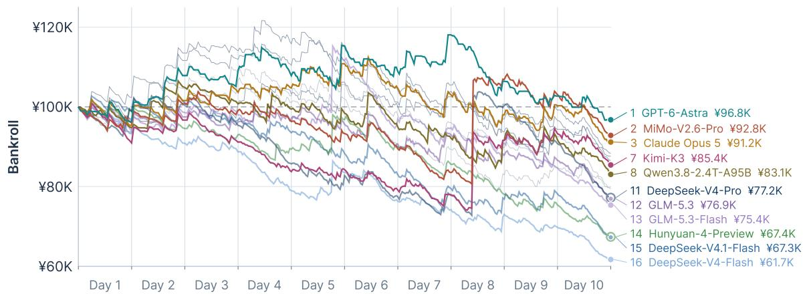  
Figure 1: Mean bankroll across repeats for selected configurations under retrospective capped-Kelly staking. Initial bankroll is JPY 100,000; the full-Kelly fraction is capped at 1% of day-start bankroll per race. Returns use historical race outcomes and official JRA WIN dividends, which incorporate the standard 20% WIN takeout. No live bets were placed. Labels identify selected curves and give their final ranks among all 28 configurations. Settlement details: Appendix A.5.4.

Our evaluation contribution is a joint assessment of delivery, prediction, adaptation, resource use, and decision outcomes. Building on accuracy–cost evaluation (Kapoor et al., 2025; Liu et al., 2026), we define a protocol-specific net utility that combines predictive reward with research fees under a common tariff. Established forecast and risk measures retain their separate roles: log gain assesses probability quality, while returns and drawdowns describe the consequences of a specified decision rule. Synthetic research fees, provider charges, and betting profit are reported separately to preserve their interpretation.

Experiments across 28 configurations on 324 races over 10 shared days distinguish predictive competence, adaptation, and decision value in this setting. High final forecast quality does not imply large revision gains; gains in predictive reward can be outweighed by research costs; and positive log gain does not ensure positive realized betting profit (Figure 1). Across four models, Program has higher mean betting profit and lower research fees than Adaptive Acquisition, but both lose on average. Analyses of selected bets and repeated executions further show why aggregate probability summaries and isolated profitable runs can give an incomplete account of decision performance. These findings motivate paired controls, explicit cost accounting, and repeated decision-level diagnostics for evaluating how predictive signals translate into value.

## 2 Related Work

Table 1 compares JOCKEYBENCH’s design features with related evaluations. Appendix A.6 de-

fines the criteria.

Long-Horizon Agents and Cost-Aware Evaluation. Vending-Bench and CEO-Bench study sustained decisions in simulated businesses (Backlund and Petersson, 2025; Chen et al., 2026). Persistent programs and feedback-based revision provide mechanisms for repeated agent activity: MLAgentBench and MLE-bench evaluate agent-built machine-learning solutions, while AIDE searches over candidate programs (Huang et al., 2024; Chan et al., 2025; Jiang et al., 2025). Voyager retains executable skills, Self-Debugging improves code using explanation and execution feedback, and Reflexion and Self-Refine explore feedback-based reflection and revision (Wang et al., 2024; Chen et al., 2024; Shinn et al., 2023; Madaan et al., 2023). Such mechanisms also raise questions about resource use. Cost-aware service-agent training balances user reward and interaction costs (Gao et al., 2026). CostBench evaluates planning with priced tools (Liu et al., 2026), and BAGEN tests agents’ estimates of remaining resource needs (Lin et al., 2026). Ask When It Pays weighs uncertainty reduction against oracle-query costs in navigation (Zhao et al., 2026). Selective Critique gates expensive feedback (Park et al., 2026), and SPIKE reuses strategic reasoning between event-triggered interventions in games (Jiang et al., 2026). Following the joint accuracy–cost evaluation advocated by Kapoor et al. (2025), JOCKEYBENCH compares daily program revision with frozen initial programs and charges for evidence, tool calls, and computa tion. Its fixed tariff measures research expenditure, and its ten-day window captures short-term program revision.

Table 1: Design features of related evaluations. ✓: included; ×: absent or unreported in the reviewed protocol. Outcome revision updates programs using released results; dual workflows compares program-generated and perevent LLM forecasts. Payoffs include returns, profit, or net worth; risk metrics include drawdown or Sharpe. Full criteria: Appendix A.6.
<table><tr><td>Benchmark</td><td>Time-gated data</td><td>Predictive code</td><td>Feedback loop</td><td>Outcome revision</td><td>Dual workflows</td><td>Payoffs</td><td>Risk metrics</td><td>Priced tools</td><td>Frozen control</td></tr><tr><td>FORECASTBENCH</td><td>√</td><td>X</td><td>X</td><td>X</td><td>X</td><td>X</td><td>X</td><td>X</td><td>X</td></tr><tr><td>PROPHET ARENA</td><td>√</td><td>X</td><td>×</td><td>X</td><td>X</td><td>V</td><td>√</td><td>X</td><td>X</td></tr><tr><td>POLYBENCH</td><td>√</td><td>X</td><td>X</td><td>X</td><td>X</td><td>√</td><td>√</td><td>X</td><td>X</td></tr><tr><td>VENDING-BENCH</td><td>X</td><td>X</td><td>√</td><td>X</td><td>X</td><td>√</td><td>X</td><td>X</td><td>X</td></tr><tr><td>COSTBENCH</td><td>×</td><td>X</td><td>√</td><td>X</td><td>×</td><td>×</td><td>X</td><td>√</td><td>×</td></tr><tr><td>MLE-BENCH</td><td>X</td><td>√</td><td>√</td><td>X</td><td>X</td><td>X</td><td>X</td><td>X</td><td>X</td></tr><tr><td>KELLYBENCH</td><td>√</td><td>√</td><td>√</td><td>√</td><td>X</td><td>√</td><td>V</td><td>X</td><td>X</td></tr><tr><td>JOCKEYBENCH (ours)</td><td>V</td><td>5</td><td>√</td><td>√</td><td>√</td><td>V</td><td>√</td><td>√</td><td>√</td></tr></table>

Forecasting and Financial Decision-Making. Surveys by Su et al. (2024) and Xu et al. (2026) cover LLM forecasting and forecasting agents, respectively. ForecastBench, Prophet Arena, and PolyBench benchmark forecasting on unresolved questions, live events, and timestamped market snapshots, respectively (Karger et al., 2025; Yang et al., 2026; Cheng et al., 2026). Q-Guide and ClinSeekAgent study evidence acquisition for document and clinical tasks (Popa, 2026; Wu et al., 2026). LLMs have also been used to select acquisition functions in Bayesian optimization (Ngo et al., 2026). In time-series forecasting, Tan et al. (2024) find that removing LLM components need not reduce accuracy. Studies of corporate profitability forecasting assess both predictive accuracy and economic relevance (Evans et al., 2017; Jones et al., 2023). KellyBench studies agents that build models for sequential sports betting (Grady et al., 2026), while CLQT studies portfolio agents with pointin-time access and trading costs (Qu and Chen, 2026). JOCKEYBENCH compares LLM-written predictors with LLM-written evidence collectors followed by fresh per-race LLM forecasts. Agent inputs exclude odds and expert ratings, and evaluation separates forecast quality, betting outcomes, and research fees.

## Horse-Race Modeling and Statistical Inference.

Conditional-logit approaches model race winners (Bolton and Chapman, 1986; Chapman, 1994). Ali (1998) examines probability models for finishing positions using win-pool information. Benter (1994) combines fundamental and public betting probabilities. These studies motivate our statistical and market references. Proper scoring rules ground probabilistic evaluation (Gneiting and Raftery, 2007), while Kelly-based analyses study wealth growth and sequential betting risk (Kelly, 1956; Velegol and Bishop, 2024), providing foundations for assessing forecast quality and settlement separately. Cluster-robust inference addresses within-group dependence (Cameron and Miller, 2015). Our uncertainty estimates cluster races by day across the ten-day window.

## 3 The JockeyBench Protocol

## 3.1 Dataset and information controls

Cleaning and leakage controls. Leakage can make machine-learning results misleading (Kapoor and Narayanan, 2023). Historical replay further requires controlling information availability as well as persistent state, since a historical corpus alone does not prevent hindsight leakage (Zhou et al., 2026). We built JOCKEYBENCH from raw archive files to a replay environment. Twelve years of Japanese racing records were parsed, cleaned, and linked into one database. Every record was given the time at which it would have become public. Identities were pseudonymised, and 97 objective fields were exposed through priced tools. A whitelist defines the agent view and public schema, excluding odds, popularity, dividends, expert predictions and ratings, and free text. External tools and program network access are disabled. Appendix Figure 4 shows an example.

Data Coverage and Features. The cleaned database contains 40,357 races and 564,224 runner entries from 2015–2026, linked across races, horses, jockeys, trainers, and pedigrees, and traceable to source files. Experiments use only races up to the 2024 evaluation windows. Agents and their programs access 97 whitelisted fields in five groups: race conditions, runner attributes, workouts, past starts, and jockey and trainer statistics. Appendix Table 4 provides the complete field list.

## 3.2 Program workflow and frozen controls

The prediction–outcome–update cycle follows the prequential approach of Dawid (1984): forecasts are evaluated before their outcomes are incorporated. Temporal dependence remains relevant to interpreting sequential scores (Žliobaite et al.˙ , 2015). As in agentic machine-learning experimentation (Huang et al., 2024; Jiang et al., 2025), the LLM builds and revises code. Here, the environment executes the saved forecasting program on each race. Before evaluation, an exploration session builds the initial program using labelled races from before the evaluation window. Each race day d follows the cycle shown in Figure 2: Cards. Cards for race day d become available at 21:00 JST on day $d - 1$ . Prediction. Before the races on day d, the environment runs the saved program and seals its forecasts. Results. At 20:30 JST on day $d ,$ the finishing order is released and the forecasts are scored. Reflection. The LLM receives the day’s feedback and may revise the program for the next race day.

Program execution. Each program receives a race identifier and entrant numbers, accesses the same priced data tools as the agent, and returns an entrant ranking and win probabilities. New candidates must pass interface and resource checks, without testing predictive accuracy, before replacing the current program. At prediction time, execution failures fall back to the previous valid version, then to a uniform forecast. All forecasts, including fallbacks, are scored and tagged by delivery source.

Frozen controls and persistence. Each dailyrevision trajectory is paired with a control that executes the same initial program without LLM revision, under the same race schedule and tariff. The contrast evaluates revision relative to a common starting predictor. Exploration allows up to 40 model calls and daily reflection up to 20. Conversations restart between sessions; only code, fitted parameters, and notes persist, not training data.

## 3.3 Adaptive Acquisition workflow

Figure 2 contrasts persistence of a predictor with persistence of an acquisition policy. Adaptive Acquisition shares Program’s information cut-offs and release clock, but an LLM-written acquisition program selects evidence for a fresh per-race LLM forecast. This separates reusable evidence collection from repeated LLM inference.

An initial acquisition program $P _ { 0 }$ is constructed from released historical races preceding evaluation. On day d, $P _ { d - 1 }$ remains fixed and runs separately for each race. It selects recent history, workouts, condition statistics, and track context using an information-state view of coverage, missingness, freshness, and costs. It cannot inspect raw evidence values or construct a predictor. A fresh LLM session receives the acquired evidence and race card, returns a complete ranking and win probabilities without further queries, and seals its forecast before outcome release.

After results are released, an update session uses the Research-Program Experience Frame to retain $P _ { d - 1 }$ or produce a validated $P _ { d } .$ . The program and released aggregate feedback persist across days; per-race forecasting conversations do not. Appendix A.2.2 specifies the interface and validation, and Appendix A.5.1 specifies marginal evidence accounting.

## 3.4 Evaluation metrics

The evaluation distinguishes predictive quality, resource-adjusted utility, and the outcomes of acting on forecasts. Scores include all N races per trajectory, including fallbacks, so delivery failures remain part of measured performance. Configuration scores average across trajectories.

Forecast quality. Logarithmic scoring provides a basis for evaluating predictive probabilities (Gneiting and Raftery, 2007). After scratches, let $p _ { r i }$ be the renormalized probability over the $n _ { r }$ starters (uniform if no mass survives), set $\widetilde { p } _ { r i } = 0 . 9 8 p _ { r i }$ + $0 . 0 2 / n _ { r }$ , and let $W _ { r }$ be the $k _ { r }$ official winners. The smoothed log gain

$$
g _ { r } = \ln \left( \frac { n _ { r } } { k _ { r } } \sum _ { i \in W _ { r } } \widetilde { p } _ { r i } \right)
$$

is measured in nats relative to uniform (zero for uniform forecasts). Top-1 is the mean of $h _ { r }$ , which indicates whether the first surviving runner in the submitted ranking wins. Top-3 (precision at three) is the share of the first min $( 3 , n _ { r } )$ surviving ranked runners that finish in the official top three, ties included.

Synthetic utility. We report resource use alongside forecast quality, following joint accuracy–cost evaluation (Kapoor et al., 2025). For the Program protocol, we define the benchmark-specific net

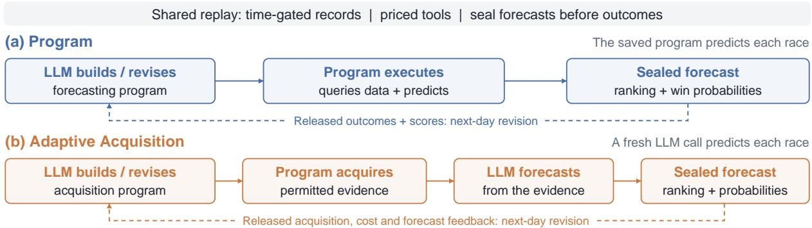  
Figure 2: Two forecasting workflows under the same replay clock. Program executes an LLM-written forecasting program, whereas Adaptive Acquisition executes an LLM-written acquisition program before a fresh per-race LLM forecast. Dashed arrows denote next-day revision after outcome release.

score

$$
\mathrm { N e t } = 1 0 0 \sum _ { r } \left[ g _ { r } + I _ { r } \left( h _ { r } - \frac { 1 } { n _ { r } } \right) \right] - C ,
$$

where $I _ { r }$ marks eligibility for the program-delivery bonus. Uniform and fallback outputs are ineligible. The weighted research fee is

$$
C = 0 . 5 \left( 0 . 0 1 N _ { \mathrm { c e l l } } + 0 . 5 N _ { \mathrm { c a l l } } + 0 . 2 T _ { \mathrm { C P U } } \right) ,
$$

where $N _ { \mathrm { c e l l } } , \ N _ { \mathrm { c a l l } }$ , and $T _ { \mathrm { C P U } }$ count billable evidence cells (delivered scalar fact slots), data-tool calls, and sandbox CPU seconds recorded during construction, revision, validation, and prediction. We report Net/N and $C / N$ in score-yen per race. LLM-provider charges are reported separately and excluded from Net.

Resource limits and accounting are specified in Appendices A.2.1 and A.5.1. The common tariff makes research expenditures comparable under one price schedule.

For workflow comparisons, both workflows are rescored from saved predictions using the same log-gain and top-1 terms, without the deliveryeligibility factor $I _ { r }$ . The common scoring and accounting rules are detailed in Appendix A.5.2. Smoothing shifts the optimal probability report and the bonus rewards the top pick, so Net is a synthetic utility, not a strictly proper scoring rule.

Retrospective betting outcomes. Betting profit is total payouts and refunds minus total stakes. Negative values indicate losses. Flat bets stake 100 yen to win on the first surviving runner of the sealed ranking and settle at official dividends, which include takeout. Turnover ROI is profit over total stakes. Our capped adaptation of the Kelly rule (Kelly, 1956) stakes $B _ { d } \operatorname* { m i n } ( f _ { r } , 0 . 0 1 )$ of the day-start bankroll on the original sealed pick, with $f _ { r } = \mathrm { m a x } \{ 0 , ( q _ { r } O _ { r } - 1 ) / ( O _ { r } - 1 ) \}$ from its sealed probability $q _ { r }$ and the last pre-race odds $O _ { r }$ . Both rules are applied retrospectively using odds withheld from agents and exclude synthetic and provider costs. Maximum drawdown and profit-based Sharpe summarize the mean P&L path, rather than average individual-trajectory risk. Appendices A.5.4 and A.5.5 detail settlement and risk aggregation.

## 4 Experiments and Analysis

The experiments examine whether agents construct useful predictors, whether revision improves matched initial programs, and whether workflow differences in forecasting survive research costs and decision rules. We evaluate 28 Program model– scaffold configurations. OpenAI models use the Codex app-server, Claude models use Claude Code, and the others use DeepInfra’s compatible API, with high reasoning effort requested. The workflow comparison covers DeepSeek-V4-Flash, GLM-5.3- Flash, GPT-6-Astra, and MiMo-V2.6-Pro under these routes. Both workflows use 324 races over 10 days, from 6 January to 3 February 2024, under Section 3’s information schedule. Appendix A.3 specifies cohorts; Table 5 records the earlier 25- configuration export.

## 4.1 Forecasting performance

## 4.1.1 Program forecasts

Delivery and predictive competence. Table 2 distinguishes successful execution from useful forecasting. Agents produce 40,428 predictor outputs among 44,712 forecasts, yet some delivered programs score below uniform: Granite-4.2-8B has 90% predictor delivery and mean log gain −0.087. Gemma-4-E4B and Nemotron-3.5-Lightning never deliver a predictor. At the upper end, GPT-6.1-Sol achieves 0.525 nats (between-run SD 0.002), exceeding the card-and-history reference R2 at 0.343. Reporting delivery alongside quality therefore distinguishes construction failures from statistically weak programs.

Table 2: Main Program results: 324 races, ten race days, 138 matched pairs. A: daily revision; S: frozen initial program. Agent metrics describe A unless labeled otherwise. Log gain (nats relative to uniform): A mean ± betweenrun SD; S paired-run mean. A−S: paired mean log-gain difference. Top-1/Top-3: top-pick win rate/precision at three. Predictor: non-uniform program delivery rate. Validated versions: mean accepted programs per run, including the initial program. Net/fees: score-yen per race, excluding provider charges. ↑: higher is better. Bold/underline: highest/second-highest agent means (ties retained); ranks are descriptive. Darker forecast/delivery/net cells indicate higher values within columns; teal/orange A−S cells mark significant gains/losses. †: Holm-adjusted p < .05 across 28 tests; 95% CIs are pointwise and day-clustered. Closing market is an external reference; dashes: not applicable. Run counts: Appendix Table 6.
<table><tr><td></td><td colspan="4">Forecast quality</td><td>Delivery</td><td>Utility</td><td colspan="4">Daily revision</td><td>Cost Run setup</td></tr><tr><td>Model / reference</td><td>Log gain ↑ mean ± SD</td><td>S log gain ↑ mean</td><td>Top-1 Top-3 %↑</td><td>%↑</td><td>Predictor %</td><td>Net ↑ /race</td><td></td><td>A-S [95% CI]</td><td>Validated Fees versions</td><td>/race</td><td>Access</td></tr><tr><td>GPT-6.1-Sol</td><td>0.525 ±0.002</td><td>0.525</td><td>28.5</td><td>48.3</td><td>100</td><td>+59.5</td><td></td><td>+0.000 [+0.000, +0.000]</td><td>1.0</td><td>14.1</td><td>Codex</td></tr><tr><td>GPT-6-Astra</td><td>0.523 ±0.008</td><td>0.523</td><td>30.0</td><td>48.0</td><td>100</td><td>+61.3</td><td></td><td>+0.000 [+0.000, +0.000]</td><td>1.0</td><td>13.6</td><td>Codex</td></tr><tr><td>Claude Opus 5</td><td>0.484 ±0.023</td><td>0.485</td><td>28.2</td><td>46.3</td><td>100</td><td>+54.3</td><td></td><td>-0.001 [−0.008, +0.006]</td><td>4.0</td><td>14.9</td><td>Claude Code</td></tr><tr><td>GPT-5.6-Sol</td><td>0.473 ±0.023</td><td>0.468</td><td>27.8</td><td>45.9</td><td>100</td><td>+50.6</td><td>+0.004</td><td>[−0.005, +0.014]</td><td>4.2</td><td>17.0</td><td>Codex</td></tr><tr><td>GPT-6-Sol</td><td>0.471 ±0.019</td><td>0.462</td><td>27.3</td><td>45.4</td><td>100</td><td>+50.2</td><td>+0.009</td><td>[−0.000, +0.018]</td><td>4.2</td><td>16.7</td><td>Codex</td></tr><tr><td>Claude Fable 5.1</td><td>0.468 ±0.046</td><td>0.470</td><td>27.7</td><td>45.9</td><td>100</td><td>+52.7</td><td>-0.003</td><td>[−0.019, +0.014]</td><td>4.8</td><td>14.3</td><td>Claude Code</td></tr><tr><td>Claude Opus 5.5</td><td>0.465 ±0.012</td><td>0.465</td><td>27.5</td><td>46.7</td><td>100</td><td>+53.4</td><td></td><td>+0.000 [+0.000, +0.000]</td><td>1.0</td><td>13.2</td><td>Claude Code</td></tr><tr><td>GLM-5.3</td><td>0.401 ±0.054</td><td>0.385</td><td>24.6</td><td>43.5</td><td>100</td><td>+38.6</td><td></td><td>+0.017 [−0.006, +0.039]</td><td>5.8</td><td>18.7</td><td>API</td></tr><tr><td>Qwen3.8-2.4T-A95B</td><td>0.367 ±0.048</td><td>0.337</td><td>24.6</td><td>43.1</td><td>100</td><td>+37.7</td><td></td><td>+0.030 [+0.002, +0.058]</td><td>4.2</td><td>16.1</td><td>API</td></tr><tr><td>Hunyuan-4-Preview</td><td>0.354 ±0.202</td><td>0.336</td><td>23.2</td><td>40.7</td><td>87</td><td>+30.5</td><td>+0.018</td><td>[−0.001, +0.037]</td><td>7.8</td><td>20.0</td><td>API</td></tr><tr><td>Kimi-K3</td><td>0.350 ±0.101</td><td>0.034</td><td>24.9</td><td>42.7</td><td>100</td><td>+32.3</td><td></td><td>+0.316 [+0.219, +0.413]†</td><td>5.3</td><td>20.2</td><td>API</td></tr><tr><td>MiMo-V2.6-Pro</td><td>0.338 ±0.195</td><td>0.135</td><td>24.6</td><td>42.9</td><td>100</td><td>+35.5</td><td></td><td>+0.203 [+0.141, +0.265]†</td><td>4.8</td><td>15.5</td><td>API</td></tr><tr><td>DeepSeek-V4.1-Flash</td><td>0.323 ±0.130</td><td>0.391</td><td>23.8</td><td>41.3</td><td>100</td><td>+30.0</td><td>-0.068</td><td>[-0.107, -0.029]</td><td>5.8</td><td>18.6</td><td>API</td></tr><tr><td>GLM-5.3-Flash</td><td>0.286 ±0.225</td><td>-0.011</td><td>23.4</td><td>42.4</td><td>100</td><td>+22.0</td><td>+0.297 [</td><td>[+0.190, +0.404]†</td><td>6.4</td><td>22.5</td><td>API</td></tr><tr><td>DeepSeek-V4-Pro</td><td>0.266 ±0.145</td><td>0.128</td><td>20.7</td><td>38.9</td><td>100</td><td>+20.5</td><td>+0.138 </td><td>[+0.081, +0.195]†</td><td>5.5</td><td>19.4</td><td>API</td></tr><tr><td>DeepSeek-V4-Flash</td><td>0.232 ±0.128</td><td>0.194</td><td>20.6</td><td>39.2</td><td>99</td><td>+22.3</td><td></td><td>+0.039 [-0.013, +0.090]</td><td>3.8</td><td>14.1</td><td>API</td></tr><tr><td>GPT-5.6-Luna</td><td>0.214 ±0.094</td><td>0.229</td><td>22.8</td><td>41.0</td><td>100</td><td>+20.6</td><td></td><td>-0.014 [−0.034, +0.005]</td><td>4.6</td><td>16.1</td><td>Codex</td></tr><tr><td>MiMo-V2.5-Pro</td><td>0.207 ±0.160</td><td>-0.098</td><td>24.4</td><td>41.8</td><td>100</td><td>+26.1</td><td></td><td>+0.304 [+0.240, +0.368]†</td><td>7.2</td><td>11.4</td><td>API</td></tr><tr><td>MiMo-V2.6-Flash</td><td>0.202 ±0.143</td><td>0.194</td><td>17.3</td><td>36.8</td><td>98</td><td>+20.5</td><td></td><td>+0.008 [-0.010, +0.025]</td><td>3.4</td><td>9.6</td><td>API</td></tr><tr><td>GPT-6-Luna</td><td>0.200 ±0.162</td><td>0.165</td><td>18.6</td><td>36.9</td><td>95</td><td>+22.4</td><td></td><td>+0.035 [+0.017, +0.053]†</td><td>3.0</td><td>8.6</td><td>Codex</td></tr><tr><td>GPT-5.6-Terra</td><td>0.170 ±0.119</td><td>0.242</td><td>16.6</td><td>35.0</td><td>98</td><td>+14.7</td><td></td><td>-0.072 [-0.108, -0.037]†</td><td>2.8</td><td>11.4</td><td>Codex</td></tr><tr><td>Gemma-4-26B-A4B</td><td>0.070 ±0.063</td><td>0.079</td><td>17.0</td><td>34.4</td><td>70</td><td>+7.8</td><td>-0.009</td><td>[−0.062, +0.043]</td><td>5.2</td><td>8.5</td><td>API</td></tr><tr><td>Gemma-4-E4B</td><td>0.000 ±0.000</td><td>0.000</td><td>7.1</td><td>23.4</td><td>0</td><td>-0.0</td><td>+0.000 [</td><td>[+0.000, +0.000]</td><td>0.0</td><td>0.0</td><td>API</td></tr><tr><td>Nemotron-3.5-Lightning</td><td>0.000 ±0.000</td><td>0.000</td><td>7.3</td><td>23.4</td><td>0</td><td>-0.6</td><td>+0.000 [</td><td>[+0.000, +0.000]</td><td>1.4</td><td>0.6</td><td>API</td></tr><tr><td>Nemotron-3-Ultra-550B</td><td>−0.083 ±0.247</td><td>-0.442</td><td>14.9</td><td>31.7</td><td>98</td><td>-10.2</td><td></td><td>+0.359 [+0.220, +0.498]†</td><td>9.2</td><td>9.3</td><td>API</td></tr><tr><td>Granite-4.2-8B</td><td>-0.087 ±0.188</td><td>-0.013</td><td>11.0</td><td>26.5</td><td>90</td><td>-11.0</td><td></td><td>-0.074 [-0.120, -0.029]</td><td>5.8</td><td>6.1</td><td>API</td></tr><tr><td>Qwen3.5-35B-A3B</td><td>−0.218 ±0.428</td><td>0.016</td><td>12.4</td><td>28.0</td><td>89</td><td>-25.2</td><td></td><td>-0.234 [−0.535, +0.067]</td><td>10.6</td><td>8.5</td><td>API</td></tr><tr><td>Qwen3.5-9B</td><td>−0.280 ±0.291</td><td>0.024</td><td>13.2</td><td>28.6</td><td>70</td><td>-33.0</td><td>−0.304 [−0.450, -0.158]†</td><td></td><td>13.0</td><td>10.4</td><td>API</td></tr><tr><td>Closing market</td><td>0.757</td><td></td><td>34.0</td><td>51.4</td><td></td><td></td><td></td><td></td><td>一</td><td></td><td></td></tr></table>

Reference choice changes the comparison. Table 3 places agent performance between supportfitted and larger offline references. The agentinspired ensemble reaches 0.523 nats, near the best agent mean of 0.525, while broad factual features reach 0.608. Broad factual features remain the strongest offline reference across all three periods, and the closing market has the highest log gain in each. Within the support-fitted references, R3’s expanded features underperform R2 in every period; additional factual features alone do not ensure better forecasts in this setup. These comparisons establish the importance of reference strength, while jointly varying training data, fitting, and features prevents attributing the gaps to agent-based modeling alone. Methods appear in Appendix A.4.

Revision gains differ from final quality. Table 2 shows seven significant revision gains and two declines in mean log gain after Holm correction across 28 tests (Holm, 1979). The largest gain, +0.359 for Nemotron-3-Ultra-550B, still leaves its revised mean below uniform at −0.083. Conversely, the two highest-scoring configurations show no revision gain. Final-score rankings therefore do not characterize adaptation: paired frozen controls distinguish strong initial predictors from improvements during evaluation. The contrast covers the full revision process, including feedback, further analysis, data access, and debugging; it does not isolate learning from outcomes alone. Appendix A.5.6 details inference, and Appendix D traces executed revisions.

Table 3: Forecasting references across three periods in 2024: main evaluation (324 races), Jan–Jun (1,800 races, including main), and autumn (323 races over ten race days). Log gain is in nats relative to uniform; Top-1 is the win rate of top-ranked non-scratched runners (0–1). ↑: higher is better. Darker cells indicate higher values; log-gain columns share a scale, while accuracy is scaled separately. R0 reports empirical accuracy under a seeded pseudorandom ranking. Agent-inspired features were selected post hoc. Methods: Appendix A.4.
<table><tr><td>Reference</td><td colspan="2">6 Jan–3 Feb 2024</td><td>Jan-Jun 2024</td><td>From 5 Oct 2024</td><td>Predictor</td></tr><tr><td></td><td>Log gain ↑</td><td>Top-1 accuracy ↑</td><td>Log gain ↑</td><td>Log gain ↑</td><td></td></tr><tr><td colspan="6">Agent-interface references: R1-R3 fitted on 87 support races</td></tr><tr><td>RO: uniform</td><td>0.000</td><td>0.071</td><td>0.000</td><td>0.000</td><td>Equal probabilities</td></tr><tr><td>R1: race-card features</td><td>0.155</td><td>0.157</td><td>0.160</td><td>0.088</td><td>Conditional logit</td></tr><tr><td>R2: card + recent history</td><td>0.343</td><td>0.238</td><td>0.363</td><td>0.239</td><td>Conditional logit</td></tr><tr><td>R3: expanded factual features</td><td>0.298</td><td>0.210</td><td>0.310</td><td>0.167</td><td>Conditional logit</td></tr><tr><td colspan="6">Offline references (pre-window pools: 20,730 races for Main/Jan-Jun; 23,345 for Autumn)</td></tr><tr><td>18 hand-built features</td><td>0.462</td><td>0.253</td><td>0.457</td><td>0.369</td><td>Conditional logit</td></tr><tr><td>Agent-inspired features</td><td>0.523</td><td>0.278</td><td>0.496</td><td>0.405</td><td>Logit + boosted trees</td></tr><tr><td>Broad factual features</td><td>0.608</td><td>0.309</td><td>0.573</td><td>0.458</td><td>Logit + boosted trees</td></tr><tr><td colspan="6">External references: inputs unavailable to agents</td></tr><tr><td>Expert forecast</td><td>0.679</td><td>0.318</td><td>0.630</td><td>0.533</td><td>Calibrated inverse odds</td></tr><tr><td>Pre-race market</td><td>0.700</td><td>0.318</td><td>0.675</td><td>0.618</td><td>Normalized inverse odds</td></tr><tr><td>Closing market</td><td>0.757</td><td>0.340</td><td>0.719</td><td>0.673</td><td>Normalized inverse odds</td></tr></table>

## 4.1.2 Adaptive Acquisition forecasts

Fresh per-race LLM inference does not consistently improve forecasts in these cohorts. Adaptive Acquisition produces direct forecasts for 96.9–99.4% of outputs, with positive mean log gain for all four models. DeepSeek has slightly higher observed log gain than Program (0.256 versus 0.232), as well as higher Top-1 and Top-3 scores; Program leads on all three metrics for GLM, GPT-6-Astra, and MiMo. Thus, frequent LLM invocation is not sufficient for a consistent forecasting advantage. These are descriptive workflow comparisons: the Adaptive cohorts contain six, one, two, and one completed trajectories, respectively, and all share historical outcomes. Repaired, fallback, and uniform outputs remain scored. Appendix B.1.1 reports full quality and delivery results.

## 4.2 Decision-making performance

Predictive signal does not ensure profit. Figure 1 exposes a gap between forecast quality and realized decision value: every configuration has negative mean profit under retrospective capped-Kelly settlement, despite positive log gain for many agents. Thirteen of 138 individual trajectories finish in profit, underscoring the difference between a profitable run and a profitable configuration mean. Appendix B.3 details these outcomes; its Table 14 reports pooled ROI −19.7% for the separately archived 54-trajectory, 22-model flat-WIN subset. These results make betting outcomes a separate evaluation target rather than a consequence that can be inferred from forecast scores.

The four-model workflow comparison applies flat JPY 100 WIN and full-Kelly staking capped at 1% of day-start bankroll to sealed top picks. Withdrawals are refunded; official dividends include takeout. Kelly sizing uses archived TYB quotes, so these results are archive-clock retrospective counterfactuals. Research and provider fees are excluded from betting P&L. Appendix A.5.5 specifies settlement and timing.

Returns and risk give different orderings. Figure 3 shows that Program has higher mean terminal P&L under both staking rules for all four models, although both workflows lose on average. Appendix Table 15 also shows smaller maximum drawdowns of the mean P&L curves for Program in all eight comparisons. The financial measures nevertheless disagree for DeepSeek under Kelly: Program loses JPY 38,305 with drawdown JPY 39,405, versus losses of JPY 39,395 and drawdown JPY 58,663 for Adaptive Acquisition. Yet Adaptive Acquisition has a less negative Sharpe of −6.33 versus −9.78, and slightly higher turnover ROI of

−30.18% versus −31.14%. A less negative Sharpe with negative mean profit does not establish lower volatility, and ROI also depends on total stakes. This example supports reporting return, exposure, and path risk separately. These descriptive risk summaries use mean paths, whose smoothing differs with unequal trajectory counts.

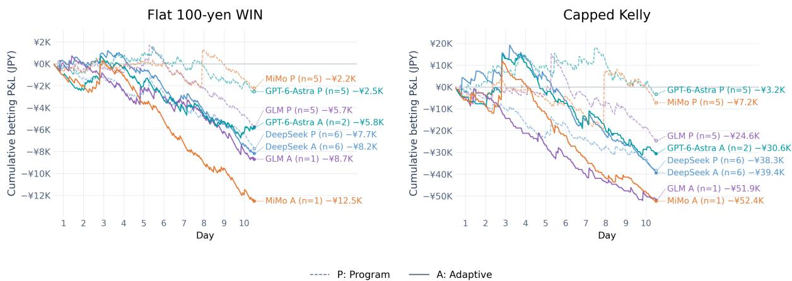  
Figure 3: Mean cumulative retrospective betting P&L by workflow.

Bet selection reverses mean probability bias. Across all four models, Adaptive Acquisition’s mean saved probability is below the realized win frequency over all non-refunded top picks, but above it among Kelly-selected bets. For DeepSeek, predicted and observed rates are 18.14% and 21.25% overall, versus 17.83% and 7.82% on selected bets. Program also overpredicts wins in its Kelly subsets. Thus, average bias across all forecasts can conceal overprediction on the subset used for decisions. These pooled mean gaps are descriptive, not a full calibration test or a causal explanation of losses. They motivate examining probability reliability conditional on the decision rule alongside overall forecast quality (Guo et al., 2017). Appendix B.3.1 gives the diagnostics using original saved probabilities.

Profitable runs can depend on concentrated returns. DeepSeek Adaptive R1 earns JPY 1,470 under Kelly, whereas the other five completed trajectories lose JPY 47,568 on average. Three winning tickets account for 55.35% of R1’s gross returns, without consistently superior overall forecast quality. Program also varies substantially: MiMo’s Kelly profits range from JPY −70,500 to JPY +73,080 across five trajectories. Selecting a profitable execution would therefore provide an incomplete description of observed reliability. These repeats measure construction and execution variability on fixed outcomes; they do not constitute independent temporal replications. Appendix B.3.2 details return concentration; Figure 8 shows individual trajectory returns.

Research costs can reverse reward comparisons. Under the common rescoring rule, Appendix Table 16 shows lower mean research fees and higher mean net scores for Program across all four models. DeepSeek illustrates the distinction: Adaptive Acquisition gains approximately 1,000 scoreyen in gross reward but incurs 4,551 more in research fees per trajectory. Its predictive reward advantage therefore disappears after costs under the specified tariff. For GLM, GPT-6-Astra, and MiMo, Adaptive Acquisition has both lower gross reward and higher fees. The three supplementary matched pairs in Appendix B.2.1 show that Adaptive Acquisition reduces fees relative to its Frozen-P<sub>0</sub> control, but net-score changes are mixed. Together, these decompositions distinguish predictive improvement, economical information acquisition, and positive net utility. Score-yen remains separate from betting P&L and provider charges.

## 5 Conclusion

JOCKEYBENCH combines a historical racing resource with a protocol for evaluating persistent forecasting programs, evidence acquisition, and revision under information and resource constraints. Its empirical contribution is to distinguish outcomes that aggregate scores can conflate: valid execution and predictive competence, revision gains and final quality, predictive reward and net utility, and overall probability bias and errors on selected bets. The evaluated agents recover useful signals, yet no configuration is profitable on average under capped Kelly. These findings support paired frozen controls, explicit cost decomposition, and repeated decision-level diagnostics in agent evaluation. Their generality beyond the shared historical window remains to be tested.

## Limitations

Our evaluation focuses on structured forecasting tasks in horse racing. Generalization to other sports, unstructured information environments, and broader decision-making tasks remains to be established (Srinivasan, 2026). Results reflect the specific model–scaffold configurations evaluated. Different tool interfaces, reasoning budgets, and subsequent model versions may change their relative performance. Research costs are compared under a common tariff, providing a consistent basis for comparison. How agents adapt their information acquisition and resource allocation under alternative pricing schemes remains unexplored.Costper-outcome comparisons in deployment can also be confounded by difficulty-based model routing (Irassar, 2026), which our fixed-history evaluation does not assess.

## Ethics Statement

Animal welfare and social issues form part of the wider ethical context of horseracing (McManus et al., 2012). This study evaluates forecasting and decision-making through historical simulation; no real bets were placed. Score-yen is a synthetic evaluation unit, while betting outcomes are calculated retrospectively using historical results and official dividends. The source archive was accessed through a commercial membership. Raw database files and private identifier mappings remain on the evaluation host. Pseudonymized tool responses are transmitted through the configured model-provider routes. Public release remains subject to verification of permissions for external processing and redistribution.

## References

Mukhtar M Ali. 1998. Probability models on horse-race outcomes. Journal ofApplied Statistics, 25(2):221– 229.

Anthropic. n.d. Models overview. Official model documentation. Accessed 12 October 2026.

Axel Backlund and Lukas Petersson. 2025. Vending-Bench: A benchmark for long-term coherence of autonomous agents. Preprint, arXiv:2502.15840.

William Benter. 1994. Computer Based Horse Race Handicapping and Wagering Systems: A Report. In

Donald B. Hausch, Victor S. Y. Lo, and William T. Ziemba, editors, Efficiency of Racetrack Betting Markets, pages 183–198. Academic Press, San Diego. Reprinted by World Scientific, 2008.

Ruth N. Bolton and Randall G. Chapman. 1986. Searching for Positive Returns at the Track: A Multinomial Logit Model for Handicapping Horse Races. Management Science, 32(8):1040–1060.

A. Colin Cameron and Douglas L. Miller. 2015. A Practitioner’s Guide to Cluster-Robust Inference. Journal ofHuman Resources, 50(2):317–372.

Jun Shern Chan, Neil Chowdhury, Oliver Jaffe, James Aung, Dane Sherburn, Evan Mays, Giulio Starace, Kevin Liu, Leon Maksin, Tejal Patwardhan, Aleksander Madry, and Lilian Weng. 2025. MLE-bench: Evaluating Machine Learning Agents on Machine Learning Engineering. In International Conference on Learning Representations, volume 2025, pages 50466–50494.

Randall G. Chapman. 1994. Still Searching for Positive Returns at the Track: Empirical Results from 2,000 Hong Kong Races. In Donald B. Hausch, Victor S. Y. Lo, and William T. Ziemba, editors, Efficiency of Racetrack Betting Markets, pages 173–181. Academic Press, San Diego. Reprinted by World Scientific, 2008.

Haozhe Chen, Karthik Narasimhan, and Zhuang Liu. 2026. CEO-Bench: Can Agents Play the Long Game? Preprint, arXiv:2606.18543.

Xinyun Chen, Maxwell Lin, Nathanael Schärli, and Denny Zhou. 2024. Teaching large language models to self-debug. In International Conference on Learning Representations.

Pu Cheng, Juncheng Liu, and Yunshen Long. 2026. PolyBench: Benchmarking LLM Forecasting and Trading Capabilities on Live Prediction Market Data. Preprint, arXiv:2604.14199.

A. P. Dawid. 1984. Present Position and Potential Developments: Some Personal Views: Statistical Theory: The Prequential Approach. Journal ofthe Royal Statistical Society. Series A (General), 147(2):278–290.

DeepSeek AI. n.d. DeepSeek model releases. Official model repository. Accessed 12 October 2026.

Mark E Evans, Kenneth Njoroge, and Kevin Ow Yong. 2017. An examination of the statistical significance and economic relevance of profitability and earnings forecasts from models and analysts. Contemporary Accounting Research, 34(3):1453–1488.

Ning Gao, Wei Zhang, Yuqin Dai, Ling Shi, Ziyin Wang, Yujie Wang, Wei He, Jinpeng Wang, and Chaozheng Wang. 2026. Reinforcing real-world service agents: Balancing utility and cost in task-oriented dialogue. arXiv preprint arXiv:2602.22697.

Tilmann Gneiting and Adrian E Raftery. 2007. Strictly Proper Scoring Rules, Prediction, and Estimation. Journal of the American Statistical Association, 102(477):359–378.

Google. n.d. Gemma 4 model card. Official model card. Accessed 12 October 2026.

Thomas Grady, Kip Parker, Iliyan Zarov, Henry Course, Chengxi Taylor, and Ross Taylor. 2026. KellyBench: A benchmark for long-horizon sequential decision making. arXiv preprint arXiv:2604.27865.

Chuan Guo, Geoff Pleiss, Yu Sun, and Kilian Q. Weinberger. 2017. On calibration of modern neural networks. In Proceedings ofthe 34th International Conference on Machine Learning, volume 70 of Proceedings ofMachine Learning Research, pages 1321– 1330. PMLR.

Danny Halawi, Fred Zhang, Chen Yueh-Han, and Jacob Steinhardt. 2024. Approaching human-level forecasting with language models. In Advances in Neural Information Processing Systems, volume 37, pages 50426–50468.

Sture Holm. 1979. A simple sequentially rejective multiple test procedure. Scandinavian Journal ofStatistics, 6(2):65–70.

Qian Huang, Jian Vora, Percy Liang, and Jure Leskovec. 2024. MLAgentBench: Evaluating language agents on machine learning experimentation. In Proceedings ofthe 41st International Conference on Machine Learning, volume 235 of Proceedings of Machine Learning Research, pages 20271–20309. PMLR.

IBM. n.d. Granite-4.2-8B model card. Official model card. Accessed 12 October 2026.

Pablo Irassar. 2026. You cannot read the value of a token off your own logs: Why cost per outcome is a confounded number in agentic ai. Available at SSRN 7199138.

Wencan Jiang, Jiangning Zhang, Jianbiao Mei, Jinzhuo Liu, Yu Yang, Xiaobin Hu, Zhucun Xue, Yong Liu, and Dacheng Tao. 2026. SPIKE: An adaptive dual controller framework for cost-efficient long-horizon game agents. arXiv preprint arXiv:2605.18636.

Zhengyao Jiang, Dominik Schmidt, Dhruv Srikanth, Dixing Xu, Ian Kaplan, Deniss Jacenko, and Yuxiang Wu. 2025. AIDE: AI-driven exploration in the space of code. arXiv preprint arXiv:2502.13138.

Stewart Jones, William J Moser, and Matthew M Wieland. 2023. Machine learning and the prediction of changes in profitability. Contemporary Accounting Research, 40(4):2643–2672.

JRDB. n.d. JRDB data specifications. Official dataformat documentation. Accessed 12 October 2026.

Sayash Kapoor and Arvind Narayanan. 2023. Leakage and the reproducibility crisis in machine-learningbased science. Patterns, 4(9):100804.

Sayash Kapoor, Benedikt Stroebl, Zachary S. Siegel, Nitya Nadgir, and Arvind Narayanan. 2025. AI Agents That Matter. Transactions on Machine Learning Research. ArXiv:2407.01502.

Ezra Karger, Houtan Bastani, Chen Yueh-Han, Zachary Jacobs, Danny Halawi, Fred Zhang, and Philip E Tetlock. 2025. ForecastBench: A dynamic benchmark of AI forecasting capabilities. In International Conference on Learning Representations, volume 2025, pages 93943–93980.

J. L. Kelly, Jr. 1956. A New Interpretation of Information Rate. Bell System Technical Journal, 35(4):917– 926.

Yuxiang Lin, Zihan Wang, Mengyang Liu, Yuxuan Shan, Longju Bai, Junyao Zhang, Xing Jin, Boshan Chen, Jinyan Su, Xingyao Wang, et al. 2026. BAGEN: Are LLM agents budget-aware? arXiv preprint arXiv:2606.00198.

Jiayu Liu, Cheng Qian, Zhaochen Su, Qing Zong, Shijue Huang, Bingxiang He, and Yi R Fung. 2026. CostBench: Evaluating multi-turn cost-optimal planning and adaptation in dynamic environments for LLM tool-use agents. In Proceedings ofthe 64th Annual Meeting ofthe Associationfor Computational Linguistics (Volume 1: Long Papers), pages 12826– 12858.

Andrew W. Lo. 2002. The statistics of Sharpe ratios. Financial Analysts Journal, 58(4):36–52.

Aman Madaan, Niket Tandon, Prakhar Gupta, Skyler Hallinan, Luyu Gao, Sarah Wiegreffe, Uri Alon, Nouha Dziri, Shrimai Prabhumoye, Yiming Yang, et al. 2023. Self-Refine: Iterative refinement with self-feedback. In Advances in Neural Information Processing Systems, volume 36, pages 46534–46594.

Phil McManus, Glenn Albrecht, and Raewyn Graham. 2012. The global horseracing industry: Social, economic, environmental and ethical perspectives. Routledge.

Moonshot AI. n.d. Kimi-K3 model card. Official model card. Accessed 12 October 2026.

Giang Ngo, Dat Phan Trong, Dang Nguyen, Sunil Gupta, and Svetha Venkatesh. 2026. Adaptive acquisition selection for bayesian optimization with large language models. In International Conference on Learning Representations, volume 2026, pages 149314–149336.

NVIDIA. n.d. NVIDIA model releases. Official model repository. Accessed 12 October 2026.

OpenAI. n.d. Models. Official model documentation. Accessed 12 October 2026.

Heewon Park, Somin Im, and Minhae Kwon. 2026. Selective critique for cost-aware LLM agents in long-horizon decision making. arXiv preprint arXiv:2610.07335.

Alin-Ionut Popa. 2026. Question-guided evidence acquisition for multimodal visual question answering. arXiv preprint arXiv:2608.19739.

Bo Qu and Mingguang Chen. 2026. CLQT: A closedloop, cost-aware, strategy-consistent benchmark for diagnostic evaluation of LLM portfolio-management agents. arXiv preprint arXiv:2606.29771.

Qwen Team. n.d. Qwen model releases. Official model repository. Accessed 12 October 2026.

William F. Sharpe. 1994. The Sharpe ratio. The Journal ofPortfolio Management, 21(1):49–58.

Noah Shinn, Federico Cassano, Ashwin Gopinath, Karthik Narasimhan, and Shunyu Yao. 2023. Reflexion: language agents with verbal reinforcement learning. In Advances in Neural Information Processing Systems, volume 36, pages 8634–8652. Curran Associates, Inc.

Vasundra Srinivasan. 2026. Deployment decision reliability: A generalizability-theory framework for sizing long-horizon agent evaluations. arXiv preprint arXiv:2608.11323.

Jing Su, Chufeng Jiang, Xin Jin, Yuxin Qiao, Tingsong Xiao, Hongda Ma, Rong Wei, Zhi Jing, Jiajun Xu, and Junhong Lin. 2024. Large language models for forecasting and anomaly detection: A systematic literature review. arXiv preprint arXiv:2402.10350.

Mingtian Tan, Mike A Merrill, Vinayak Gupta, Tim Althoff, and Thomas Hartvigsen. 2024. Are language models actually useful for time series forecasting? In Advances in Neural Information Processing Systems, volume 37, pages 60162–60191.

Tencent Hy Team. n.d. Hy4-preview. Official model repository. Accessed 12 October 2026.

Darrell Velegol and Kyle JM Bishop. 2024. Analyzing sequential betting with a Kelly-inspired convectivediffusion equation. Entropy, 26(7):600.

Guanzhi Wang, Yuqi Xie, Yunfan Jiang, Ajay Mandlekar, Chaowei Xiao, Yuke Zhu, Linxi Fan, and Anima Anandkumar. 2024. Voyager: An Open-Ended Embodied Agent with Large Language Models. Transactions on Machine Learning Research. ArXiv:2305.16291.

Marta Wincewicz-Bosy. 2013. Networks of economic entities related to horse racing exemplified by the japan racing association (jra). Prace Naukowe Uniwersytetu Ekonomicznego we Wrocławiu, (295):109– 118.

Juncheng Wu, Letian Zhang, Yuhan Wang, Haoqin Tu, Hardy Chen, Zijun Wang, Cihang Xie, and Yuyin Zhou. 2026. ClinSeekAgent: Automating multimodal evidence seeking for agentic clinical reasoning. arXiv preprint arXiv:2605.20176.

Xiaomi MiMo. n.d. MiMo model releases. Official model repository. Accessed 12 October 2026.

Xiaogang Xu, Jiaqi Tang, Jianmin Chen, Yingying Yan, Zhenchao Tang, Xiangxin Zhou, Xiaobin Hu, Wei Wei, Jinfeng Wu, Qifeng Chen, et al. 2026. LLMbased agents for forecasting and prediction: Methods, training, evaluation, and applications. arXiv preprint arXiv:2608.23058.

Qingchuan Yang, Simon Mahns, Sida Li, Anri Gu, Jibang Wu, and Haifeng Xu. 2026. LLM-asa-prophet: Understanding predictive intelligence with Prophet Arena. In International Conference on Learning Representations, volume 2026, pages 107020–107072.

Z.ai. n.d. GLM model releases. Official model repository. Accessed 12 October 2026.

Xunyi Zhao, Sihao Lin, Gengze Zhou, Zerui Li, Shijie Li, Wei Tao, Jiajun Liu, and Qi Wu. 2026. Ask when it pays: Cost-aware open-ended interaction for instance goal navigation. arXiv preprint arXiv:2606.03175.

Yixi Zhou, Fan Zhang, Sikun Wang, Yingfan Xu, and Haipeng Zhang. 2026. A historical corpus is not a historical system: Auditing hindsight leakage in stateful data discovery. arXiv preprint arXiv:2609.12766.

Indre Žliobait˙ e, Albert Bifet, Jesse Read, Bernhard˙ Pfahringer, and Geoff Holmes. 2015. Evaluation methods and decision theory for classification of streaming data with temporal dependence. Machine Learning, 98(3):455–482.

## Guide to the appendix

<table><tr><td>Contents</td><td>Page</td></tr><tr><td>A. Benchmark and experimental details</td><td>12</td></tr><tr><td>B. Extended results and diagnostics</td><td>19</td></tr><tr><td>C. Prompt templates and submission inter- faces</td><td>30</td></tr><tr><td>D. Case studies of executed strategies</td><td>35</td></tr><tr><td>E. Reproducibility and released materials</td><td>39</td></tr></table>

## A Benchmark and Experimental Details

## A.1 Data, preprocessing, and information timing

Figure 2 shows the evaluation cycle described in Section 3.2. Figure 4 illustrates the preprocessing and agent-facing view of Section 3.1 using a synthetic runner, while Table 4 lists the fields available to the agent and its program.

Archive provenance. The archive is distributed as fixed-width Shift-JIS text: 40,974 daily files and annual packs (6.45 GB) in 41 file series. Each file is stored verbatim with its SHA-256 hash and capture time, and 1,100 field definitions were transcribed from the published format specifications (JRDB, n.d.), including older layout variants. Records are sliced by byte position before CP932 decoding, since slicing decoded text misplaces every field after a double-byte character. The 7.5 million source records in the cleaned database each trace back to a hashed file. Jockey and trainer links follow each race’s declarations rather than a later master snapshot, and pseudonyms are keyed HMACs whose mapping stays on the evaluation host.

## A.2 Agent workflows and execution

Both workflows use the information-release schedule in Section 3.2.

## A.2.1 Program

The LLM constructs an initial predictor and may revise it after each released day. Race forecasts are produced by the saved program. The phase prompts and submission example are in Appendix C.

Interface, validation, and repair. Programs implement predict(sdk, context), query data through sdk.call, and return complete rankings and win probabilities. Validation checks Python syntax, signature, entrant coverage, finite probabilities in [0, 1] summing to 1 ± 0.02, execution limits, and prohibited file writes. Candidates run twice on up to three initial-support races. Nondeterministic or exactly uniform outputs prompt repair; these flags alone neither reject programs nor select them by accuracy. Invalid candidates retain the previous valid version; execution failures fall back to an earlier valid program, then deterministic uniform output. All delivery categories enter the scores.

In Table 2, Predictor counts predictor deliveries as a percentage, excluding exactly uniform outputs. Other labels are silent\_uniform/explicit\_uniform (uniform outputs), no\_strategy (missing program), and execution\_fallback (runtime fallback). Validated versions averages accepted programs per A trajectory, including the initial program.

Allowances, persistence, and sandbox. Initial sessions allow 35 model responses plus five reserved for repair and 400,000 cells. Revision sessions allow 15 plus five repair responses and 100,000 cells. Each race execution permits 40 data calls, 5,000 cells, and 120 CPU-seconds. Repair uses the reserved responses and any unused mainsession responses within the original phase ceiling, with at most one repair session per phase. Data allowances are shared within construction or revision phases, including repair; each prediction and validation execution has its own allowance.

Source, fitted parameters, concise notes, the ledger, and validation feedback persist between otherwise fresh session contexts. Historical samples and training arrays may not be persisted on disk; archive access remains mediated by the SDK. The sandbox has no network or subprocess access and fixes the interpreter, allowed libraries, thread count, and hash seed. The specification records the concrete interface and additional machine limits.

## A.2.2 Adaptive Acquisition

Program and evidence interface. An acquisition program defines collect\_evidence(sdk, context) and runs in a restricted Python interpreter. Context contains the race identifier, day index, feature cut-off, field size, and entrant numbers. Through sdk.state(), the program observes query counts, costs, domain coverage, returnedrecord counts, missingness, freshness, and the availability of further bounded history. The trusted broker retains raw observations and constructs the evidence package. Every request uses the racespecific pre-race clock, with outcome-bearing information withheld until release. The program permits bounded control flow and approved SDK operations, but no external files, network access, arbitrary code execution, model calls, or access to unreleased outcomes. It returns the broker-managed evidence package rather than rankings or probabilities.

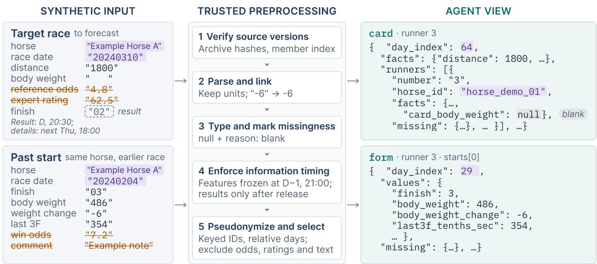

Figure 4: Synthetic example of preprocessing and information filtering. The runner, identifiers, dates, and record values are invented. Struck-through fields are excluded, and the dashed result is withheld until release. The card and form views illustrate identifier replacement, relative dates, typed values, and explicit missing-value reasons. Table 4: Fields available to the agent and its program. Each card also carries the entrant number and pseudonymous horse, jockey and trainer IDs; categorical codes come without a codebook, and unknown values are null with a reason.
<table><tr><td>Group</td><td>Fields</td><td>Content</td></tr><tr><td>Race</td><td>23</td><td>distance; surface; direction; course layout and variant; venue; meeting day; age class; eligibility condition; weight rule; grade; declared field size; turf grass type and height; rolling and antifreeze treatment; rainfall; forecast weather; forecast turf and dirt going; inner, middle and outer turf condition</td></tr><tr><td>Runner</td><td>25</td><td>carried weight; draw; sex; age in days; blinkers; body weight and its change (when on the card); layoff duration; transport; earned and class prize money; starts and days since stabling; class-drop, rest-reason and hoof codes; late-start rate; sire and damsire turf and dirt top-two rates and average distance; sire and damsire IDs</td></tr><tr><td>Workout</td><td>13</td><td>workout distance; early, middle and late split times; effort and urging; rider role; training partner&#x27;s result, class, age and effort; course type; distance type</td></tr><tr><td>Past start</td><td>30</td><td>finishing position; abnormal result; distance; surface; going; venue; condition; grade; age class; field size; draw; carried weight; body weight and its change; first and last three-furlong times; margin to the winner; fourth-corner position and path; path; overall, early, middle and late trouble; race pace and own pace; running style; slow start; jockey and trainer IDs</td></tr><tr><td>Connections</td><td>6</td><td>jockey and trainer starts, wins and top-three finishes over the preceding 365 days, counted from released results</td></tr><tr><td>Withheld</td><td></td><td>odds and popularity (current and past races); dividends; expert indices, ratings and marks; predicted positions; aptitude, class and track-bias assessments; free text; real names; absolute dates</td></tr></table>

Forecast delivery. Acquisition executes without an LLM call. A fresh forecasting session then receives the basic card and evidence package, with only the native submission tool available. It must submit a complete ranking and finite win probabilities. One bounded repair request is allowed, followed by a uniform forecast if repair fails. Direct, repaired, and fallback outputs remain in the scores and are labelled separately.

Warmup and persistence. Historical warmup uses legally released support preceding the window. Its analysis can affect query order, thresholds, branches, and stopping conditions in the saved program. The persisted artifact consists of validated source, its identity and provenance, and construction metadata. It contains no fitted predictive parameters. Raw historical records, the warmup conversation, and the analysis workspace are not transferred into the formal trajectory.

Updates and validation. After outcome release, the updater receives the current program, currentday statistics, cumulative acquisition and cost summaries, delivery and forecast-quality measures, recent released Experience Frames, and a bounded history of program changes. It inspects the acquisition contract and either validates and saves an exact candidate or retains and validates the current source. Invalid candidates leave the previous valid program unchanged. Validation repeatedly executes synthetic cards to check the interface, determinism, and evidence-package construction, without real-race outcomes or accuracy-based selection. Queries, stopping decisions, packages, and hashes are recorded alongside adopted programs.

At the context limit, the current program, currentday statistics, cumulative summary, and newest interaction round are retained. Only complete older optional components or earlier interaction rounds are removed. The audit retains complete Frames and updater transcripts.

Lifecycle checks. Before the first five outcomes are released, an engineering gate checks acquisition execution, forecast sealing, model identity, request size, accounting consistency, and the absence of acquisition-time LLM calls. It does not inspect winners or forecast quality. Progress to Day 2 requires the Day-1 updater to return a parsed keep-or-revise decision, validate the adopted program, and finish successfully. The same decisions, validations, program identities, and completion states are recorded on later days, separately from forecast completion.

## A.3 Models, configurations, and evaluation cohorts

The evaluated model families and their original developers are GPT (OpenAI, n.d.), Claude (Anthropic, n.d.), GLM (Z.ai, n.d.), MiMo (Xiaomi MiMo, n.d.), Qwen (Qwen Team, n.d.), Kimi (Moonshot AI, n.d.), DeepSeek (DeepSeek AI, n.d.), Gemma (Google, n.d.), Nemotron (NVIDIA, n.d.), Granite (IBM, n.d.), and Hunyuan (Tencent Hy Team, n.d.).

Codex configurations use the app-server with dynamic tools and code-mode batching. Claude Code configurations disable built-in tools and use an MCP bridge. API configurations use the compatible-agent loop. Table 5 reports the model IDs, requested reasoning effort, and response counts retained in the earlier 25-configuration export. Reasoning settings, batching, and token exposure vary by provider and scaffold. Provider charges are accounted for separately from scoreyen fees. Detailed provider token accounting and immutable model revision identifiers are incompletely recorded in the frozen aggregate export.

The main manifest requires complete 324-race daily-revision and frozen-program runs under the Program protocol, matching schedule and tariff fingerprints, and identical initial-program fingerprints within each pair. It records the full run list and SHA-256 hashes of all analysis inputs. Older diagnostics are reported separately; matching to the main cohort uses recorded run IDs and fingerprints. Partial control exports are retained as provenance material.

Table 6 lists the per-configuration A/S trajectory counts for the main cohort.

Workflow comparison. We compare DeepSeek-V4-Flash (deepseek-ai/ DeepSeek-V4-Flash-0731), GLM-5.3- Flash (zai-org/GLM-5.3-Flash), GPT-6- Astra (gpt-6-astra), and MiMo-V2.6-Pro (XiaomiMiMo/MiMo-V2.6-Pro). DeepSeek, GLM, and MiMo use DeepInfra’s OpenAI-compatible API; GPT-6-Astra uses the Codex app-server. All configurations request high reasoning.

The Program comparators are verified saved daily-revision trajectories from the Program manifest. For the workflow analyses, Program/Adaptive Acquisition counts are 6/6 for DeepSeek, 5/1 for GLM, 5/2 for GPT-6-Astra, and 5/1 for MiMo-V2.6-Pro. Forecast quality, betting outcomes, and common cost-aware scores use the same 31 trajectories listed in Table 7.

Cohort inclusion and completion. Completion means that all 324 forecasts have been scored. Update-session and terminal-report completion are assessed separately; full-window trajectories with updater or reporting anomalies remain included. The DeepSeek Adaptive R1–R7 series completed six of seven attempts. R5 stopped after 24 races and remains in failure accounting, without imputed full-window results. Earlier Active-v2 and pre-fix v3 trajectories are excluded from the current comparison.

Three additional Frozen trajectories form matched same- $P _ { 0 }$ controls: DeepSeek R1 and R2, and GPT-6-Astra R1. Their Adaptive partners already belong to the comparison cohorts and are not counted again. The Astra control matches the ReceiptFixed R1 trajectory. Matched-control results appear in Appendix B.2.1.

Table 5: Recorded identifiers, requested reasoning settings, and mean model responses per A trajectory in the earlier 25-configuration export. The main cohort contains 28 configurations. Responses count model outputs; data-tool calls may be batched differently by route. Each configuration combines a model with its execution scaffold. Exact run IDs, initial-program hashes, tariff and schedule fingerprints are in the accompanying manifest; model IDs retain the recorded provider aliases.
<table><tr><td>Display name</td><td>Recorded model identifier</td><td>Route</td><td>Effort</td><td>Model responses per run</td></tr><tr><td>GPT-6-Astra</td><td>gpt-6-astra</td><td>Codex</td><td>high</td><td>26.0</td></tr><tr><td>Claude Fable 5.1</td><td>claude-fable-5-1</td><td>Claude Code</td><td>high</td><td>52.0</td></tr><tr><td>GPT-5.6-Sol</td><td>gpt-5.6-sol</td><td>Codex</td><td>high</td><td>74.0</td></tr><tr><td>GPT-6-Sol</td><td>gpt-6-sol</td><td>Codex</td><td>high</td><td>86.7</td></tr><tr><td>Claude Opus 5</td><td>claude-opus-5</td><td>Claude Code</td><td>high</td><td>47.7</td></tr><tr><td>Claude Opus 5.5</td><td>claude-opus-5-5</td><td>Claude Code</td><td>high</td><td>30.3</td></tr><tr><td>GLM-5.3</td><td>zai-org/GLM-5.3</td><td>API</td><td>high</td><td>51.3</td></tr><tr><td>GLM-5.3-Flash</td><td>zai-org/GLM-5.3-Flash</td><td>API</td><td>high</td><td>73.0</td></tr><tr><td>MiMo-V2.6-Pro</td><td>XiaomiMiMo/MiMo-V2.6-Pro</td><td>API</td><td>high</td><td>48.0</td></tr><tr><td>Qwen3.8-2.4T-A95B</td><td>Qwen/Qwen3.8-2.4T-A95B</td><td>API</td><td>high</td><td>64.3</td></tr><tr><td>Kimi-K3</td><td>moonshotai/Kimi-K3</td><td>API</td><td>high</td><td>59.7</td></tr><tr><td>GPT-5.6-Luna</td><td>gpt-5.6-luna</td><td>Codex</td><td>high</td><td>52.7</td></tr><tr><td>DeepSeek-V4-Flash</td><td>deepseek-ai/DeepSeek-V4-Flash-0731</td><td>API</td><td>high</td><td>60.2</td></tr><tr><td>GPT-6-Luna</td><td>gpt-6-luna</td><td>Codex</td><td>high</td><td>27.0</td></tr><tr><td>DeepSeek-V4-Pro</td><td>deepseek-ai/DeepSeek-V4-Pro-0813</td><td>API</td><td>high</td><td>106.5</td></tr><tr><td>MiMo-V2.5-Pro</td><td>XiaomiMiMo/MiMo-V2.5-Pro</td><td>API</td><td>high</td><td>62.5</td></tr><tr><td>MiMo-V2.6-Flash</td><td>XiaomiMiMo/MiMo-V2.6-Flash</td><td>API</td><td>high</td><td>49.7</td></tr><tr><td>GPT-5.6-Terra</td><td>gpt-5.6-terra</td><td>Codex</td><td>high</td><td>42.7</td></tr><tr><td>Gemma-4-26B-A4B</td><td>google/gemma-4-26B-A4B-it</td><td>API</td><td>high</td><td>31.3</td></tr><tr><td>Nemotron-3-Ultra-550B</td><td>nvidia/NVIDIA-Nemotron-3-Ultra-550B-A55B</td><td>API</td><td>high</td><td>81.0</td></tr><tr><td>Gemma-4-E4B</td><td>google/gemma-4-E4B-it</td><td>API</td><td>high</td><td>34.0</td></tr><tr><td>Nemotron-3.5-Lightning</td><td>nvidia/NVIDIA-Nemotron-3.5-Lightning</td><td>API</td><td>high</td><td>42.3</td></tr><tr><td>Granite-4.2-8B</td><td>ibm-granite/granite-4.2-8b</td><td>API</td><td>high</td><td>47.7</td></tr><tr><td>Qwen3.5-9B</td><td>Qwen/Qwen3.5-9B</td><td>API</td><td>high</td><td>112.0</td></tr><tr><td>Qwen3.5-35B-A3B</td><td>Qwen/Qwen3.5-35B-A3B</td><td>API</td><td>high</td><td>71.7</td></tr></table>

## A.4 Forecasting references

All references produce runner win probabilities and rankings; betting rules are evaluated separately. The identifiers R0–R3 denote reference programs, while F18, FAGENT, and FV5 denote feature representations.

References using the agent interface. R0 assigns uniform probabilities without fitting; Top-1 reports the observed win rate under a seeded pseudorandom ranking. R1 (race-card features) uses nine measurements: two prize totals, carried weight, layoff weeks, age, draw, starts since stabling, and two workout times. Prize totals are log-transformed; observed values are standardized within each race, missing values become zero after scaling, and centered missing-value indicators are appended. R2 (card and recent history) adds average and best finish, win and top-three rates, and the number of usable finishes from up to five previous starts. R3 (expanded factual features) adds horse-condition, pedigree, workout, race-condition, and jockey/trainer fields; added historical fields are averaged over available starts, and string categories are deterministically hashed to numerical values. R1–R3 fit the same regularized conditional-logit procedure on 87 labelled support races under the agent interface and tariff. Their weights remain fixed after initial fitting, while time-eligible inputs are refreshed for each prediction.

Offline feature construction. F18 (18 hand-built features) combines card/workout measurements with recent finish percentiles, career performance, recency, jockey/trainer win rates, and a no-history indicator; the first 17 features are standardized within race. FAGENT (agent-inspired features) combines recent, best, and recency-weighted performances, transformed finish margins, changes in race conditions, and smoothed jockey/trainer rates. It uses within-race scaling and missing-value indicators. These feature families were chosen after inspecting high-scoring agent programs and used to fit a new reference predictor. FV5 (broad factual features) uses broader factual records, including summaries over the last 1, 3, and 5 starts, workout-derived measures, and jockey/trainer/pedigree statistics. Numerical values receive trainingderived and within-race scaling with missing indicators; categorical values use indicator columns for frequent levels, other values, and missing values. None of these feature representations includes market odds or expert forecasts.

Table 6: Run counts for the main Program cohort in Table 2. A: daily revision; S: frozen initial program. Runs A/S counts complete 324-race trajectories in each arm. The cohort contains 138 matched pairs across 28 configurations, listed in the same order as the main table.
<table><tr><td>Model</td><td>Runs A/S</td></tr><tr><td>GPT-6.1-Sol</td><td>5/5</td></tr><tr><td>GPT-6-Astra</td><td>5/5</td></tr><tr><td>Claude Opus 5</td><td>4/4</td></tr><tr><td>GPT-5.6-Sol</td><td>5/5</td></tr><tr><td>GPT-6-Sol</td><td>5/5</td></tr><tr><td>Claude Fable 5.1</td><td>4/4</td></tr><tr><td>Claude Opus 5.5</td><td>4/4</td></tr><tr><td>GLM-5.3</td><td>5/5</td></tr><tr><td>Qwen3.8-2.4T-A95B</td><td>5/5</td></tr><tr><td>Hunyuan-4-Preview</td><td>5/5</td></tr><tr><td>Kimi-K3</td><td>6/6</td></tr><tr><td>MiMo-V2.6-Pro</td><td>5/5</td></tr><tr><td>DeepSeek-V4.1-Flash</td><td>5/5</td></tr><tr><td>GLM-5.3-Flash</td><td>5/5</td></tr><tr><td>DeepSeek-V4-Pro</td><td>6/6</td></tr><tr><td>DeepSeek-V4-Flash</td><td>6/6</td></tr><tr><td>GPT-5.6-Luna</td><td>5/5</td></tr><tr><td>MiMo-V2.5-Pro</td><td>6/6</td></tr><tr><td>MiMo-V2.6-Flash</td><td>5/5</td></tr><tr><td>GPT-6-Luna</td><td>5/5</td></tr><tr><td>GPT-5.6-Terra</td><td>5/5</td></tr><tr><td>Gemma-4-26B-A4B</td><td>5/5</td></tr><tr><td>Gemma-4-E4B</td><td>3/3</td></tr><tr><td>Nemotron-3.5-Lightning</td><td>5/5</td></tr><tr><td>Nemotron-3-Ultra-550B</td><td>5/5</td></tr><tr><td>Granite-4.2-8B</td><td>4/4</td></tr><tr><td></td><td>5/5</td></tr><tr><td>Qwen3.5-35B-A3B</td><td>5/5</td></tr><tr><td>Qwen3.5-9B</td><td></td></tr><tr><td>Total</td><td>138/138</td></tr></table>

Offline fitting and training data. The mainwindow and January–June references use 20,730 races from 6 January 2018 to 28 December 2023. For each feature set and training size, races are ordered in time and split by day into initial fitting, model selection, and calibration blocks (approximately 80/10/10). Conditional-logit $\ell _ { 2 }$ strengths are {1, 10, 100}. The histogram gradient-boosted classifier considers two configurations: (15 leaves, $\ell _ { 2 } = 1$ , 120 iterations) and (31 leaves, $\ell _ { 2 } = 1 0 .$ 180 iterations), with at least 20 examples per leaf. Selection maximizes pre-window smoothed log gain. The selected logit is refitted on the full training pool; the boosted model is refitted on fitting plus selection blocks, reserving the final block for temperature calibration. The ensemble averages the two models’ scores before a within-race softmax. Table 3 reports logit alone for F18 and the ensemble for FAGENT and FV5, so differences change both features and fitted models.

The full main-window pool is initially divided into 16,578 fitting, 2,076 selection, and 2,076 calibration races. FV5 selects logit regularization 100 and the 31-leaf boosted configuration; its fitted boosted-model temperature is approximately 1.039. The autumn references are fitted separately on 23,345 races through 29 September 2024. For the autumn FAGENT fit, the logit optimizer reaches its 400-iteration limit without reporting convergence (maximum gradient approximately $4 . 3 \times 1 0 ^ { - 5 } )$ we retain the archived predictions and scores. Fit diagnostics and per-setting scores are retained in the evaluation records.

External probability references. The calibrated expert forecast uses the previous evening’s expert forecast odds (source code KYI): probabilities are proportional to inverse odds raised to a power fitted on historical training races. Pre-race market probabilities use the last archived pre-off snapshot (TYB), and closing market probabilities use final odds; both normalize inverse odds without fitting a feature model. These inputs are unavailable to agents, and closing odds are a retrospective yardstick.

Table 7: Samples used by the principal analyses.
<table><tr><td>Analysis</td><td>Coverage</td><td>Sample</td></tr><tr><td>Main Program comparison</td><td>28 configurations</td><td>138 A/S pairs</td></tr><tr><td>Delivery archive</td><td>25 configurations</td><td>Earlier export</td></tr><tr><td>Flat-WIN archive</td><td>22 models</td><td>54 Program trajectories</td></tr><tr><td>Workflow forecasts</td><td>4 models</td><td>31 trajectories</td></tr><tr><td>Workflow betting and costs</td><td>4 models</td><td>Same 31 trajectories</td></tr><tr><td>Matched acquisition controls</td><td>2 models</td><td>3 Frozen/Adaptive pairs</td></tr></table>

Software environment. The archived dependency lock and pre-experiment installation snapshot record NumPy 2.4.2, SciPy 1.17.0, and scikitlearn 1.8.0. Program run bindings record Python 3.13.2, four numerical threads, and hash seed zero. Package versions come from the archived installation records, as individual run bindings record library availability rather than package versions.

Numerical implementation. Feature transformations use custom NumPy code. FV5 keeps the 16 most frequent levels per categorical field, with separate other and missing categories. Conditional logit uses SciPy’s minimize with L-BFGS-B, zero initial weights, and analytic gradients. R1–R3 allow 100 iterations and add 5∥w∥<sup>2</sup> to summed race cross-entropy before dividing by the number of training races. Offline logit allows 400 iterations with $\mathsf { f t o l } = 1 0 ^ { - 1 0 }$ and gtol $= 1 0 ^ { - 6 }$ . The boosted model uses scikit-learn’s HistGradientBoostingClassifier with learning rate 0.08, early stopping disabled, and random seed 20260924. Each race has unit total sample weight, with fractional positive and negative weights for dead-heat winners. Temperature calibration uses SciPy’s bounded minimize\_scalar in log-temperature space over $T \in [ 0 . 1 , 1 0 ]$ , with $\mathsf { x a t o l } = 1 0 ^ { - 5 }$ , retaining $T = 1$ if it scores better. Expert-odds calibration uses the same scalar optimizer and tolerance over power exponents [0.05, 5], also checking both endpoints and exponent one. Scoring uses the benchmark implementation described in Section 3.4 and Appendix A.5.

## A.5 Scoring, costs, settlement, and inference

Forecast metrics follow Section 3.4. The following specifies the tariff, workflow rescoring, retrospective settlement, and uncertainty calculations.

## A.5.1 Data tools and tariff

Nine data tools expose cards, recent form, paginated race and horse histories, workouts, aggregate statistics, coverage, connections, and released results. An evidence cell is one delivered scalar slot, including null values and charged identifiers but excluding duplicated metadata. A full card contains $2 5 + 4 3 n$ cells for n runners. Repeat reads with the same tool, canonical arguments, and response digest within a trajectory incur no new evidence fee and consume no additional evidence allowance; data-tool call fees and call/byte counters still apply.

Base fees are 0.01 score-yen per evidence cell, 0.5 per data-tool call, and 0.2 per sandbox CPUsecond. Main runs use a common multiplier of 0.5; control operations are free. Allowances and charges are returned in the ledger. LLM-provider charges are reported separately and do not enter this synthetic fee term.

Exploration data covers warmup and reflection queries, while execution data covers queries made by the forecasting program. Log and hit revenue follow the objective in Section 3.4.

Adaptive Acquisition accounting. Marginal charges are determined by native acquisition identity and the evidence already owned in the trajectory cache, rather than by global equality of delivered field values. Evidence already owned through the same acquisition path is not repurchased, and an expanded request acquires only its missing records and evidence cells. However, distinct native reads retain their own data and call charges even when some delivered values overlap. For example, the initial race card and a whole-race workout read remain separate native acquisition identities.

Recent-history requests support depths of one, three, and five starts. Expanding a history request acquires only unseen starts and evidence cells. Condition statistics reuse the owned history cache and acquire only the additional records required to summarize up to five earlier starts. Track context must be requested exactly once.

Workout records are acquired through a racelevel native operation and can subsequently be projected locally to selected runners. Changing runner coverage after this purchase does not trigger another native workout acquisition. The ledger therefore distinguishes logical program actions, native acquisition operations, newly acquired evidence cells, and local projections. Each actual native acquisition retains its call fee, whereas a projection served entirely from the applicable owned cache does not trigger another native data acquisition.

Billable acquisition CPU time covers generatedpolicy execution and excludes trusted SDK and backend work. Updater model calls and synthetic validations incur no additional score-yen research fees; LLM-provider charges are excluded from Net.

## A.5.2 Common workflow rescoring

Common rescoring separates forecast rewards from research costs. The quantities $g _ { r } , h _ { r }$ , and $n _ { r }$ follow Section 3.4. For comparisons between Program and Adaptive Acquisition, both workflows are rescored from saved predictions:

$$
{ \mathrm { G r o s s } } _ { \mathrm { c m p } } = 1 0 0 \sum _ { r } \left[ g _ { r } + h _ { r } - { \frac { 1 } { n _ { r } } } \right] ,\tag{1}
$$

$$
\mathrm { N e t } _ { \mathrm { c m p } } = \mathrm { G r o s s } _ { \mathrm { c m p } } - C .\tag{2}
$$

Unlike the delivery-gated objective, this common score omits $I _ { r }$ from the top-1 term. Uniform and fallback forecasts remain included. Gross therefore combines smoothed log gain and top-1 reward rather than measuring probability quality alone.

Costs follow the shared tariff and workflowspecific accounting rules. The weighted research fee C uses the common ×0.5 tariff defined in Section 3.4. Recorded historical warmup costs are included once per trajectory. Evidence and datatool accounting follow Appendix A.5.1; Adaptive Acquisition’s native acquisition identities, ownedcache reuse, and marginal charges follow Appendix A.5.1. LLM-provider charges are excluded. Score-yen is a synthetic benchmark utility and is separate from official-dividend betting profit.

## A.5.3 Flat-WIN settlement

Settlement uses official dividends, including takeout, and combines stakes and returns over the exact matched subset before calculating ROI. The per-model replicate lists underlying archived bootstrap intervals are checked against that subset. Those intervals resample races rather than days; repeated forecasts do not create independent outcomes. Closing-odds references are retrospective yardsticks, unavailable to the agent at the prediction cut-off. The staking rules and top-six selection are evaluated retrospectively.

## A.5.4 Capped-Kelly settlement

The settlement in Figure 1 gives each daily-revision trajectory its own account of 100,000 yen. At the start of each race day the stake on a race’s top pick is B min(f, 0.01) with $f = \operatorname* { m a x } \{ 0 , ( p O$ $1 ) / ( O - 1 ) \}$ , where B is the day-start bankroll, p the program’s sealed win probability and O the decimal odds at the last pre-race snapshot. Stakes are floored to 100-yen tickets and scaled down to the free cash. Bets settle at official WIN dividends, with refunds for withdrawals, and winnings return to the account only at the end of the day. The staking rule was selected retrospectively and uses archived odds excluded from agent inputs.

## A.5.5 Workflow comparison under shared betting rules

The comparison in Section 4.2 settles the workflows’ separately generated, sealed predictions under the same financial rules. Flat WIN bets stake JPY 100 on the original sealed top pick. If that runner withdraws, the stake is refunded without promoting another runner. Kelly uses the original saved probability of the same pick, without scoringtime smoothing or renormalization. Kelly staking and cash accounting follow Appendix A.5.4. Each trajectory’s account is simulated separately before averaging its outcomes. Research fees and modelprovider charges are excluded from betting P&L.

Odds timing. Archived TYB quotes are used for Kelly sizing, while official dividends are used only for settlement. Kelly places no bet when the required quote is missing or ineligible under the recorded archive clock. Original quote publication times have not been independently verified, so the Kelly results remain descriptive archive-clock retrospective counterfactuals.

Risk summaries and completed trajectories. Profit is the arithmetic mean of terminal trajectory P&L. Turnover ROI is total profit divided by total original stakes, including stakes on subsequently refunded bets. For risk summaries, we first average per-race profits equally across the included trajectories. Maximum drawdown is the largest decline from a running peak of the cumulative mean profit curve, with the initial profit and peak set to zero. The annualized P&L Sharpe is

$$
\operatorname { S R } _ { \operatorname { P \& L } } = { \frac { \mu } { s } } { \sqrt { 3 4 5 4 } } ,
$$

where $\mu$ and s are the mean and sample standard deviation of the averaged per-race profit sequence, with a zero profit benchmark. These are mean-path risk measures, rather than averages of individualtrajectory risks. The ratio uses profits in yen, not account percentage returns. The nominal frequency of 3,454 races per year is a reporting convention; this ten-day diagnostic does not estimate annual account performance (Sharpe, 1994; Lo, 2002).

Here, n counts included trajectories with 324 scored forecasts. Full-window financial values are not imputed for incomplete trajectories. Table 7 in Appendix A.3 records cohort membership and completion. Unequal trajectory counts can produce different amounts of mean-path smoothing. Repeated trajectories share the same historical outcomes and are not independent temporal replications.

## A.5.6 Paired statistical inference

For a paired contrast, let $d _ { j }$ be the mean difference for day $j$ after averaging repetitions within each race, and let $n _ { j }$ be the number of unique races that day. With $N = \textstyle \sum _ { j } n _ { j }$ and $g = 1 0$ , we use

$$
\begin{array} { r l } & { \hat { \Delta } = \frac { \sum _ { j } n _ { j } d _ { j } } { N } , } \\ & { \widehat { \mathrm { S E } } = \frac { \sqrt { \frac { g } { g - 1 } \sum _ { j } [ n _ { j } ( d _ { j } - \hat { \Delta } ) ] ^ { 2 } } } { N } . } \end{array}\tag{3}
$$

(4)

Pointwise intervals are $\widehat { \Delta } { \pm } t _ { g - 1 , . 9 7 5 } \widehat { \mathrm { S E } }$ . Two-sided t-test probabilities feed Holm’s procedure. Zerovariance, zero-mean contrasts receive $p = 1$ . The revision recomputes these statistics from exported day summaries and checks the original values; a rounded critical value in the dashboard explains small differences before rounding for publication. Dropping one day from these summaries tests sensitivity of the mean while holding the original forecasts and program-revision history fixed.

## A.6 Benchmark comparison criteria

Table 1 records features of the reviewed evaluation protocols. A check indicates inclusion; a cross denotes a feature outside the described protocol or not established by the reviewed paper.

Information and agent workflows. Time-gated data requires real-event forecasting with explicit information and outcome timing. Predictive code means agent-constructed executable predictors. Feedback loop includes retained state during iterative model development or environment interaction; repeated fresh forecasts alone do not qualify. Outcome revision is narrower: a persistent forecasting or acquisition program can be updated after new event results are released. Dual workflows compares program-executed forecasts with fresh per-event LLM forecasts in a common environment. In JOCKEYBENCH, these are Program and Adaptive Acquisition; the latter uses an LLM-written evidence collector before each LLM forecast.

Financial evaluation, costs, and controls. Payoffs denotes monetary outcomes, including betting returns, profit, or business net worth. Risk metrics denotes financial loss or risk-adjusted performance measures, such as maximum drawdown or a Sharpe ratio; dispersion of final scores across runs alone does not qualify. JOCKEYBENCH’s maximum drawdown and profit-based Sharpe ratio use the mean profit curve across runs, as defined in Appendix A.5.5. Priced tools requires tool, evidence, or computation charges in the task objective. CostBench optimizes these charges; JOCKEY-BENCH deducts research fees in its synthetic net score and reports betting profit separately. Operating expenses, trading frictions, and runtime limits serve other purposes. Frozen control pairs each adaptive program with its own initial program on the same outcomes.

The bibliography lists published versions where available.

## B Extended Results and Diagnostics

The analyses below supplement the forecast and decision-making results in the main text. Table 7 identifies their samples.

## B.1 Forecast quality and delivery

Figure 5 shows the individual runs behind the main results. Table 8 gives delivery and session diagnostics for an earlier 25-configuration export, rather than the full 138-run main cohort.

Additional evaluation windows. Table 10 reports results for 1,800 eligible races in January– June 2024 and 323 races over ten race days from 5 October 2024. The January–June window includes the 324-race main window. Both additional windows evaluate reference predictors. Table 9 reports main-window scores by feature set, training size, and fitting method.

## B.1.1 Forecast quality across workflows

Scoring and aggregation. Forecast metrics follow Section 3.4. Repaired, fallback, and uniform forecasts remain included. Table 11 reports equally weighted trajectory means and between-trajectory sample standard deviations; a dash marks unavailable SD for $n = 1$ . Here, n counts trajectories with 324 scored forecasts. Updater and terminal-report completion are assessed separately, as specified in Appendix A.3. Trajectories share historical outcomes, so their spread describes execution variability rather than independent temporal replications.

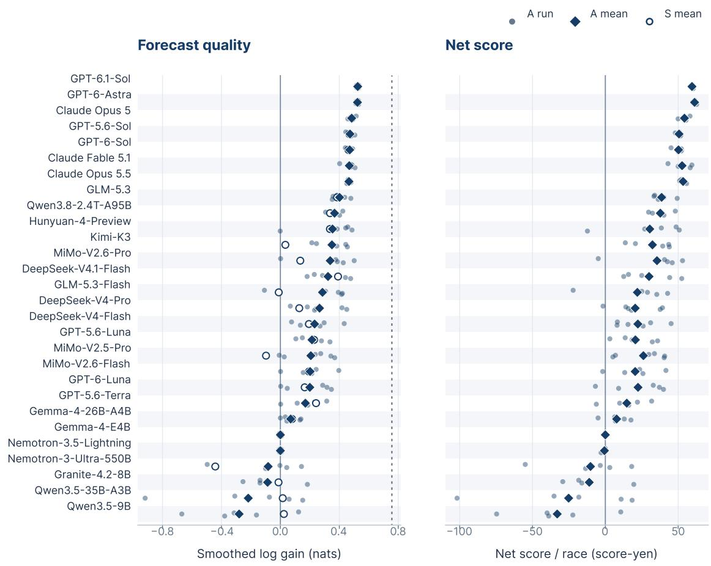  
Figure 5: Forecast quality and net score for every daily-revision run (28 configurations, 138 runs). Dots are individual runs and diamonds their configuration means; open circles in the left panel are the paired frozen-program means. The dotted line marks the closing market’s log gain (left); the market has no net score. Runs share the same outcomes, so their spread reflects session variability rather than independent replications.

Table 8: Delivery and session diagnostics for an earlier export of 25 configurations (77 A trajectories; 24,948 forecasts). The first five columns partition forecasts into non-uniform predictors, exactly uniform program outputs, explicit uniform choices, missing programs, and execution fallbacks. SDK misuse and No save count events and sessions, respectively. This is not the full main cohort.
<table><tr><td></td><td colspan="4">Sealed prediction outcomes</td><td colspan="2">Session diagnostics</td></tr><tr><td>Model</td><td>Predictor</td><td>Silent unif.</td><td>Explicit unif.</td><td>No program</td><td>Fallback</td><td>SDK misuse</td><td>No save</td></tr><tr><td>GPT-6-Astra</td><td>972</td><td>0</td><td>0</td><td>0</td><td>0</td><td>1</td><td>0</td></tr><tr><td>Claude Fable 5.1</td><td>972</td><td>0</td><td>0</td><td>0</td><td>0</td><td>0</td><td>0</td></tr><tr><td>GPT-5.6-Sol</td><td>972</td><td>0</td><td>0</td><td>0</td><td>0</td><td>0</td><td>0</td></tr><tr><td>GPT-6-Sol</td><td>972</td><td>0</td><td>0</td><td>0</td><td>0</td><td>0</td><td>0</td></tr><tr><td>Claude Opus 5</td><td>972</td><td>0</td><td>0</td><td>0</td><td>0</td><td>0</td><td>0</td></tr><tr><td>Claude Opus 5.5</td><td>972</td><td>0</td><td>0</td><td>0</td><td>0</td><td>0</td><td>0</td></tr><tr><td>GLM-5.3</td><td>972</td><td>0</td><td>0</td><td>0</td><td>0</td><td>0</td><td>0</td></tr><tr><td>GLM-5.3-Flash</td><td>972</td><td>0</td><td>0</td><td>0</td><td>0</td><td>11</td><td>1</td></tr><tr><td>MiMo-V2.6-Pro</td><td>648</td><td>0</td><td>0</td><td>0</td><td>0</td><td>0</td><td>0</td></tr><tr><td>Qwen3.8-2.4T-A95B</td><td>972</td><td>0</td><td>0</td><td>0</td><td>0</td><td>0</td><td>0</td></tr><tr><td>Kimi-K3</td><td>972</td><td>0</td><td>0</td><td>0</td><td>0</td><td>0</td><td>0</td></tr><tr><td>GPT-5.6-Luna</td><td>972</td><td>0</td><td>0</td><td>0</td><td>0</td><td>0</td><td>0</td></tr><tr><td>DeepSeek-V4-Flash</td><td>1296</td><td>0</td><td>0</td><td>0</td><td>0</td><td>0</td><td>0</td></tr><tr><td>GPT-6-Luna</td><td>916</td><td>56</td><td>0</td><td>0</td><td>0</td><td>0</td><td>0</td></tr><tr><td>DeepSeek-V4-Pro</td><td>1294</td><td>0</td><td>0</td><td>0</td><td>2</td><td>1</td><td>2</td></tr><tr><td>MiMo-V2.5-Pro</td><td>1293</td><td>0</td><td>0</td><td>0</td><td>3</td><td>1</td><td>0</td></tr><tr><td>MiMo-V2.6-Flash</td><td>948</td><td>0</td><td>0</td><td>24</td><td>0</td><td>0</td><td>0</td></tr><tr><td>GPT-5.6-Terra</td><td>972</td><td>0</td><td>0</td><td>0</td><td>0</td><td>0</td><td>0</td></tr><tr><td>Gemma-4-26B-A4B</td><td>591</td><td>270</td><td>0</td><td>108</td><td>3</td><td>0</td><td>0</td></tr><tr><td>Nemotron-3-Ultra-550B</td><td>948</td><td>24</td><td>0</td><td>0</td><td>0</td><td>0</td><td>0</td></tr><tr><td>Gemma-4-E4B</td><td>0</td><td>0</td><td>420</td><td>552</td><td>0</td><td>1</td><td>0</td></tr><tr><td>Nemotron-3.5-Lightning</td><td>0</td><td>0</td><td>0</td><td>972</td><td>0</td><td>2</td><td>0</td></tr><tr><td>Granite-4.2-8B</td><td>852</td><td>72</td><td>48</td><td>0</td><td>0</td><td>0</td><td>0</td></tr><tr><td>Qwen3.5-9B</td><td>571</td><td>361</td><td>36</td><td>0</td><td>4</td><td>0</td><td>0</td></tr><tr><td>Qwen3.5-35B-A3B</td><td>903</td><td>21</td><td>0</td><td>48</td><td>0</td><td>0</td><td>0</td></tr></table>

Table 9: Smoothed log gain on the 324-race main window by training-set size and feature representation. F18: 18 hand-built features; FAGENT: agent-inspired features chosen post hoc; FV5: broad factual features (definitions in Appendix A.4). Logit: conditional logit; HGB: histogram gradient boosting; ⊕: logit averaging before softmax. Training subsets differ in size and historical composition; columns vary feature representation and fitting method.
<table><tr><td></td><td>F18</td><td colspan="2">FAGENT</td><td colspan="3">FV5</td></tr><tr><td>Train N</td><td>Logit</td><td>Logit</td><td>Logit⊕HGB</td><td>Logit</td><td>HGB</td><td>Logit⊕HGB</td></tr><tr><td>100</td><td>0.411</td><td>0.470</td><td>0.438</td><td>0.394</td><td>0.327</td><td>0.431</td></tr><tr><td>300</td><td>0.442</td><td>0.487</td><td>0.462</td><td>0.492</td><td>0.405</td><td>0.493</td></tr><tr><td>1,000</td><td>0.461</td><td>0.501</td><td>0.494</td><td>0.536</td><td>0.466</td><td>0.535</td></tr><tr><td>3,000</td><td>0.462</td><td>0.502</td><td>0.510</td><td>0.577</td><td>0.571</td><td>0.597</td></tr><tr><td>10,000</td><td>0.463</td><td>0.503</td><td>0.519</td><td>0.584</td><td>0.606</td><td>0.613</td></tr><tr><td>all (20,730)</td><td>0.462</td><td>0.503</td><td>0.523</td><td>0.584</td><td>0.598</td><td>0.608</td></tr></table>

Table 10: Smoothed log gain on two additional 2024 windows (nats relative to uniform; higher is better). January– June contains 1,800 races, including the 324-race main window. Autumn contains 323 races over ten days from 5 October. Offline references use 20,730 pre-2024 training races for January–June and a separate pool of 23,345 races through 29 September for Autumn. These are reference-model evaluations, not additional agent trajectories.
<table><tr><td>Reference</td><td>January–June 2024</td><td>Autumn 2024</td></tr><tr><td>Uniform (R0)</td><td>0</td><td>0</td></tr><tr><td>Race-card features (R1)</td><td>0.160</td><td>0.088</td></tr><tr><td>Card and recent history (R2)</td><td>0.363</td><td>0.239</td></tr><tr><td>Expanded factual features (R3)</td><td>0.310</td><td>0.167</td></tr><tr><td>18 hand-built features + logit (F18)</td><td>0.457</td><td>0.369</td></tr><tr><td>Agent-inspired feature ensemble (FAGENT)</td><td>0.496</td><td>0.405</td></tr><tr><td>Broad factual-feature ensemble (FV5)</td><td>0.573</td><td>0.458</td></tr><tr><td>Calibrated expert forecast</td><td>0.630</td><td>0.533</td></tr><tr><td>Pre-race market probabilities</td><td>0.675</td><td>0.618</td></tr><tr><td>Closing market probabilities</td><td>0.719</td><td>0.673</td></tr></table>

Figure 6 displays individual trajectories as dots and equal-weight cohort means as short horizontal bars. The legend’s “Adaptive” denotes Adaptive Acquisition; n counts trajectories. The plotted spread and table standard deviations are descriptive, not confidence intervals.

Prediction delivery. For Adaptive Acquisition, direct forecasts account for 1,918/1,944 outputs for DeepSeek (98.66%), 314/324 for GLM (96.91%), 644/648 for GPT-6-Astra (99.38%), and 322/324 for MiMo (99.38%). The corresponding repairedoutput counts are 12, 7, 4, and 2. DeepSeek additionally records ten execution fallbacks and four explicit uniform submissions; GLM records three explicit uniform submissions.

Program records 1,920/1,944 outputs as predictor for DeepSeek and 1,620/1,620 for each other model. The remaining 24 DeepSeek outputs are no\_strategy deliveries with uniform probabilities. Native delivery categories differ across workflows: Program’s predictor category is not equivalent to Adaptive Acquisition’s direct\_predictor, and the absence of a comparable Program repair category does not establish zero repairs.

## B.2 Revision and frozen controls

Program revision. Table 2 reports the direct A and S means and paired revision contrasts for the 138 matched pairs. Figure 5 shows individual A trajectories and paired S means. Inference follows Appendix A.5.6. Executed strategy changes are illustrated in Appendix D.

## B.2.1 Matched Frozen acquisition controls

Matched protocol. Three supplementary comparisons pair DeepSeek R1, DeepSeek R2, and GPT-6-Astra R1 with their own Frozen- $P _ { 0 }$ controls. Within each pair, the initial acquisition source, race order, runtime, predictor configuration, tariff, and scorer are matched. Frozen executes its parent’s exact $P _ { 0 }$ throughout the window without daily updates. The arms generate their per-race forecasts separately. All 324 scored forecasts are retained in each arm, including repaired, fallback, and uniform outputs. Appendix A.3 includes the Adaptive parents in the workflow cohorts and records the three Frozen trajectories as additional controls.

Frozen does not repeat warmup. The same historical $P _ { 0 }$ initialization charge is assigned once to each arm and cancels in their difference. Common scoring and accounting follow Appendix A.5.2.

Reward–cost differences. Table 12 reports the matched scores. Adaptive has lower research fees and lower gross reward in all three pairs. Its net-score differences are nevertheless mixed: +5,373.76 for DeepSeek R1, +68.11 for DeepSeek R2, and −203.99 for Astra R1. Fee savings therefore do not imply a consistent net-score improvement. All scores are calculated before display rounding.

Table 11: Forecast quality by workflow. Values are trajectory means, with sample standard deviations in parentheses; – denotes n = 1.
<table><tr><td rowspan="2"></td><td rowspan="2"></td><td>Probabilistic score</td><td colspan="2">Ranking accuracy</td></tr><tr><td>Smoothed log gain (nats)</td><td>Top-1 (%)</td><td>Top-3 precision (%)</td></tr><tr><td colspan="6">DeepSeek-V4-Flash</td></tr><tr><td>Program</td><td>6</td><td>0.232 (0.128)</td><td>20.63 (3.18)</td><td>39.25 (3.48)</td></tr><tr><td>Adaptive Acquisition</td><td>6</td><td>0.256 (0.107)</td><td>21.35 (2.39)</td><td>40.91 (2.86)</td></tr><tr><td colspan="6">GLM-5.3-Flash</td></tr><tr><td>Program</td><td>5</td><td>0.286 (0.225)</td><td>23.40 (2.43)</td><td>42.45 (2.34)</td></tr><tr><td>Adaptive Acquisition</td><td>1</td><td>0.271 (-)</td><td>23.15 (−)</td><td>39.61 (-)</td></tr><tr><td colspan="6">GPT-6-Astra</td></tr><tr><td>Program</td><td>52</td><td>0.523 (0.008)</td><td>30.00 (0.51)</td><td>48.02 (0.94)</td></tr><tr><td>Adaptive Acquisition</td><td></td><td>0.499 (0.034)</td><td>27.47 (0.87)</td><td>46.24 (0.65)</td></tr><tr><td colspan="6">MiMo-V2.6-Pro</td></tr><tr><td>Program</td><td>5</td><td>0.338 (0.195)</td><td>24.57 (5.30)</td><td>42.92 (5.25)</td></tr><tr><td>Adaptive Acquisition</td><td>1</td><td>0.234 (-)</td><td>19.75 (-)</td><td>40.12 (−)</td></tr></table>

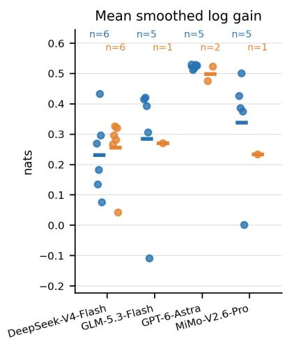

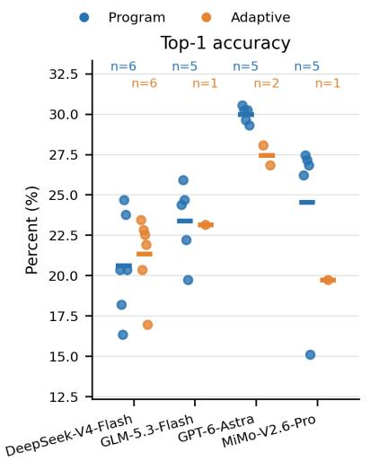

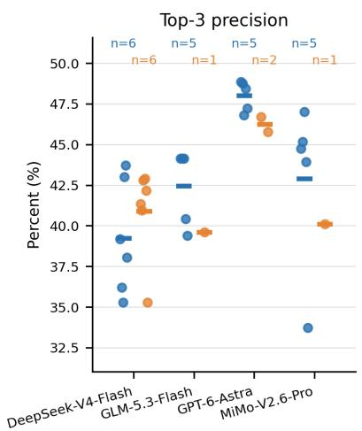  
Figure 6: Trajectory-level forecast quality by workflow.

Forecast and betting outcomes. Table 12 reports forecast quality and betting outcomes for each arm. Here, g¯ is mean smoothed log gain, Top-3 denotes precision at three, and monetary outcomes are in JPY. Settlement follows Appendix A.5.5. MDD and SR denote maximum drawdown and annualized P&L Sharpe, calculated for each trajectory separately rather than from an averaged path.

Forecast-quality rankings are mixed. DeepSeek R1 improves Top-1 but reduces log gain and Top-3 precision. DeepSeek R2 slightly improves log gain and Top-3 precision but reduces Top-1. Astra R1 improves Top-1 and Top-3 precision while reducing log gain.

DeepSeek R1 improves Kelly P&L by JPY 43,510, but its drawdown increases by JPY 63,980.

Profit improvements therefore need not reduce drawdown.

DeepSeek R1 acquisition accounting. Table 13 attributes almost all R1 fee savings to reduced condition-statistics acquisition; these savings outweigh its gross-reward decrease. Its standalone history and native workout purchases remain unchanged; subsequent policies reduce conditionstatistics queries. The other pairs reduce history data fees while increasing call fees; DeepSeek R2 also adds condition-statistics purchases. Accounting follows Appendix A.5.1.

Completion and interpretation. Completion here refers to 324 scored forecasts. DeepSeek R1’s failed Day-10 updater occurs after the evaluation forecasts and remains recorded as an updaterlifecycle anomaly, not a legal keep. Astra R1 completes forecasting and all ten update sessions, but its original terminal report fails a model-specific guard; its Frozen control has a successful JSON terminal report. These statuses are retained separately.

Table 12: Matched scores, forecast quality, and betting outcomes.
<table><tr><td>Metric</td><td colspan="2">DeepSeek R1</td><td colspan="2">DeepSeek R2</td><td colspan="2">GPT-6-Astra R1</td></tr><tr><td></td><td>Frozen-P0</td><td>Adaptive</td><td>Frozen-P0</td><td>Adaptive</td><td>Frozen-P0</td><td>Adaptive</td></tr><tr><td colspan="7">Synthetic scores (score-yen)</td></tr><tr><td>Gross score</td><td>14,502.13</td><td>13,853.16</td><td>14,641.41</td><td>13,766.93</td><td>23,255.99</td><td>22,071.05</td></tr><tr><td>Weighted fees</td><td>12,609.19</td><td>6,586.46</td><td>11,202.53</td><td>10,259.94</td><td>8,758.57</td><td>7,777.62</td></tr><tr><td>Net score</td><td>1,892.94</td><td>7,266.70</td><td>3,438.88</td><td>3,506.99</td><td>14,497.42</td><td>14,293.44</td></tr><tr><td colspan="7">Forecast quality</td></tr><tr><td>ā (nats)</td><td>0.293750</td><td>0.267547</td><td>0.294963</td><td>0.295750</td><td>0.523808</td><td>0.474890</td></tr><tr><td>Top-1 (%)</td><td>22.84</td><td>23.46</td><td>23.15</td><td>20.37</td><td>26.85</td><td>28.09</td></tr><tr><td>Top-3 precision (%)</td><td>42.08</td><td>41.36</td><td>40.64</td><td>40.95</td><td>45.78</td><td>46.71</td></tr><tr><td colspan="7">Betting outcomes</td></tr><tr><td>Flat WIN P&amp;L (JPY)</td><td>-8,760</td><td>480</td><td>-11,170</td><td>-11,780</td><td>-7,420</td><td>-4,950</td></tr><tr><td>Kelly P&amp;L (JPY)</td><td>-42,040</td><td>1,470</td><td>-55,490</td><td>-49,790</td><td>-30,390</td><td>-37,800</td></tr><tr><td>Kelly ROI (%)</td><td>-44.30</td><td>0.68</td><td>-69.28</td><td>-49.15</td><td>-29.74</td><td>-38.65</td></tr><tr><td>Kelly MDD (JPY)</td><td>49,510</td><td>113,490</td><td>58,410</td><td>49,790</td><td>52,700</td><td>53,630</td></tr><tr><td>Kelly P&amp;L SR</td><td>-6.30</td><td>0.06</td><td>-16.39</td><td>-8.87</td><td>-3.94</td><td>-5.35</td></tr></table>

Table 13: DeepSeek R1 condition-statistics accounting.
<table><tr><td>Measure</td><td>Frozen P0</td><td>Adaptive R1</td><td>Reduction</td></tr><tr><td>Logical calls</td><td>4,568</td><td>392</td><td>4,176</td></tr><tr><td>Native acquisitions</td><td>3,500</td><td>287</td><td>3,213</td></tr><tr><td>Newly charged cells</td><td>s 1,136,800</td><td>92,904</td><td>1,043,896</td></tr><tr><td>Weighted data fee</td><td>5,684.00</td><td>464.52</td><td>5,219.48</td></tr><tr><td>Weighted call fee</td><td>875.00</td><td>71.75</td><td>803.25</td></tr><tr><td>Weighted total</td><td>6,559.00</td><td>536.27</td><td>6,022.73</td></tr></table>

The three comparisons are descriptive matched cases. Separately generated forecasts, shared historical outcomes, and the small number of matched initial policies prevent interpreting the differences as a pure causal effect of daily acquisition updates.

Scope of the comparisons. Program revision combines outcome feedback, further analysis, data access, and debugging. The workflow comparison jointly varies the forecasting mechanism and information interface. Matched feedback interventions and independent outcome windows would separate these effects and test their generality.

## B.3 Retrospective returns and risk

Program settlement. Figure 7 follows the same flat rule race by race. Each panel is one configuration’s cumulative profit, averaged over its repeats, with drawdowns from the running peak shaded; panels are ordered by final profit. Each footer also gives the annualized profit-based Sharpe ratio: mean per-race betting profit divided by its standard deviation, scaled by the square root of 3,454 races a year. Every configuration ends below zero and every Sharpe ratio is negative, from −1.93 (MiMo-V2.6-Pro) to −20.4 (GPT-5.6-Terra); always backing the closing favourite gives −9.42. The configurations that finish closest to zero still spend much of the window under water: GPT-6-Astra’s longest run below its earlier peak lasts 182 of the 324 races. The two configurations marked † never delivered a non-uniform predictor and were settled using uniform forecasts; yet their Sharpe ratios (−3.04 and −2.57) are among the highest, showing how little the ratio separates configurations over 324 races.

Table 14: Retrospective settlement at official dividends (takeout included): flat 100-yen WIN or PLACE tickets on the top-ranked runner, 324 races per round. The 23 September archive is intersected with the main manifest by exact run ID and Program protocol: 54 A trajectories from 22 models. Archived per-model bootstrap intervals are retained only after verifying their replicate lists. Resampling is by race, without day dependence. All-model pooled WIN ROI: -19.7%.
<table><tr><td>Model (rounds pooled)</td><td></td><td>Win ROI % [95% bootstrap] Place ROI %</td><td></td></tr><tr><td>GPT-6-Astra (3)</td><td>-5.0</td><td>[-21, +11]</td><td>-16.3</td></tr><tr><td>Claude Fable 5.1 (3)</td><td>-12.7</td><td>[-27,+2]</td><td>-15.6</td></tr><tr><td>GPT-5.6-Sol (3)</td><td>-7.6</td><td>[-24, +10]</td><td>-14.9</td></tr><tr><td>GPT-6-Sol (3)</td><td>-8.1</td><td>[-25, +10]</td><td>-15.9</td></tr><tr><td>Claude Opus 5 (3)</td><td>-10.0</td><td>[-26, +7]</td><td>-14.1</td></tr><tr><td>Claude Opus 5.5 (3)</td><td>-10.5</td><td>[-25, +5]</td><td>-15.9</td></tr><tr><td>GLM-5.3 (3)</td><td>-17.0</td><td>[-30, -3]</td><td>-20.6</td></tr><tr><td>GLM-5.3-Flash (3)</td><td>-18.7</td><td>[-33, -3]</td><td>-21.7</td></tr><tr><td>Kimi-K3 (3)</td><td>-26.3</td><td>[-38, -14]</td><td>-24.0</td></tr><tr><td>GPT-5.6-Luna (3)</td><td>-16.6</td><td>[-33, +4]</td><td>-21.3</td></tr><tr><td>DeepSeek-V4-Flash (3)</td><td>-17.9</td><td>[-36, +4]</td><td>-21.0</td></tr><tr><td>GPT-6-Luna (3)</td><td>-24.8</td><td>[-40, -7]</td><td>-21.2</td></tr><tr><td>DeepSeek-V4-Pro (3)</td><td>-29.3</td><td>[-42, -16]</td><td>-29.2</td></tr><tr><td>MiMo-V2.5-Pro (3)</td><td>-22.3</td><td>[-36,-8]</td><td>-15.8</td></tr><tr><td>MiMo-V2.6-Flash (3)</td><td>-30.4</td><td>[-48, -11]</td><td>-21.3</td></tr><tr><td>GPT-5.6-Terra (3)</td><td>-37.7</td><td>[-51, -23]</td><td>-19.8</td></tr><tr><td>Gemma-4-26B-A4B (1)</td><td>-25.0</td><td>[-41, -8]</td><td>-22.3</td></tr><tr><td>Gemma-4-E4B (1)</td><td>-26.0</td><td>[-73, +48]</td><td>-45.6</td></tr><tr><td>Nemotron-3.5-Lightning (1)</td><td>-26.0</td><td>[-73, +49]</td><td>-45.6</td></tr><tr><td>Granite-4.2-8B (1)</td><td>-21.0</td><td>[-64, +38]</td><td>-42.0</td></tr><tr><td>Qwen3.5-9B (1)</td><td>-4.1</td><td>[-48, +56]</td><td>-28.2</td></tr><tr><td>Qwen3.5-35B-A3B (1)</td><td>-75.7</td><td>[-88, -62]</td><td>-41.3</td></tr><tr><td>Favourite at pre-off snapshot</td><td>-22.9</td><td>[-36, -9]</td><td>-16.9</td></tr><tr><td>Favourite at closing</td><td>-19.4</td><td>[-32, -6]</td><td>-17.4</td></tr><tr><td>Uniform random pick</td><td>-38.2</td><td>[-50,-23]</td><td>-27.9</td></tr></table>

Capped-Kelly outcomes. The cap binds on 96% of placed bets, so in practice the rule backs the top pick with 1% of the bankroll whenever pO > 1; a trajectory bets on 166 of the 324 races on average. Curves average a configuration’s repeats with equal weight. No account goes bankrupt, 13 of 138 repeats end in profit, and no configuration’s mean does.

Workflow returns and risk. Table 15 reports mean terminal P&L, pooled turnover ROI, and risk measures for the cohorts listed in Table 7. Each trajectory is settled separately before averaging its P&L. Settlement and aggregation follow Appendix A.5.5.

Run-level betting returns. Figure 8 shows terminal betting P&L for individual trajectories under flat WIN and capped Kelly staking. Dots represent trajectories, short horizontal bars show their arithmetic means, and n counts trajectories with 324 scored forecasts. The legend’s Adaptive denotes Adaptive Acquisition. Cohort membership and settlement rules appear in Table 7 and Appendix A.5.5, respectively.

## B.3.1 Calibration and bet selection

Diagnostic scope. We compare all original top picks with the subset actually selected for Kelly betting. The diagnostics use sealed rankings and raw saved top-pick probabilities, without smoothing, recalibration, or renormalization. Refunded selections are excluded from probability and winfrequency summaries, but retained in financial accounting. Means pool forecast instances across trajectories; these instances share historical outcomes and are not independent race samples. Cohort membership appears in Table 7.

Probability bias by betting subset. Across all four models, Adaptive Acquisition’s mean saved probability is below the observed win frequency among all non-refunded top picks, but above it among Kelly-selected bets. Within the Kelly subsets, predicted versus observed rates are 17.83% versus 7.82% for DeepSeek, 16.34% versus 6.82% for GLM, 20.10% versus 10.55% for GPT-6-Astra, and 17.12% versus 5.97% for MiMo. Program also overpredicts average wins in all four Kelly subsets. These descriptive mean gaps do not establish overall calibration quality or identify the cause of betting losses.

Selected-bet returns. In the current GLM cohort, quotes of at least 10 account for 57.05% of Adaptive Acquisition’s Kelly turnover, compared with 32.40% for Program. Assigning JPY 100 to each of the same 132 non-refunded Adaptive Kelly selections yields an ROI of −55.38%, compared with −59.00% under actual Kelly stakes. Thus, losses persist on the recorded selection set without Kelly’s variable stake weighting. This is an accounting reweighting of fixed selections, not a new simulation of bankroll-dependent selection, forecasts, or daily updates; it does not identify a causal effect of stake weighting.

## B.3.2 Return concentration across DeepSeek repeats

This diagnostic covers the six completed DeepSeek Adaptive Acquisition trajectories: R1, R2, R3, R4, R6, and R7. Cohort membership and completion accounting appear in Appendix A.3.

R1’s positive return is concentrated in a small number of winning tickets. It earns JPY 1,470 under capped Kelly, whereas the other five completed trajectories lose JPY 47,568 on average. R1 records 13 wins among 144 non-refunded bets. Its three largest winning-ticket gross returns account for 55.35% of total gross returns. Quoted odds of at least 10 contribute JPY 32,700 of net profit in R1, but a mean loss of JPY 32,050 in the other five trajectories.

Figure 9 summarizes ticket-return concentration, odds-band profits, trajectory profits, and selectedpick probabilities. Gross returns are winning-ticket payouts before subtracting stakes, with refunds excluded. Top-k denotes the k winning tickets with

<table><tr><td>GLM-5.3-Flash -5,752</td></tr><tr><td></td></tr></table>

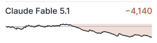

<table><tr><td>DeepSeek-V4.1-Flash</td><td>-6,042</td></tr><tr><td></td></tr></table>

<table><tr><td></td></tr><tr><td>MiMo-V2.6-Pro -2,250</td></tr></table>

<table><tr><td>GPT-6-Astra -2,520</td></tr><tr><td></td></tr><tr><td></td></tr></table>

<table><tr><td>GPT-5.6-Sol -3,188</td></tr><tr><td></td></tr><tr><td></td></tr></table>

<table><tr><td>Claude Opus 5 -3,345</td></tr><tr><td></td></tr><tr><td></td></tr></table>

5 rounds  SR 1 93  max DD 3 552 longest underwater run 176 races  
5 rounds  SR 3 26  max DD 4 302 longest underwater run 182 races  
5 rounds <sub>·</sub> SR <sub>−</sub>4<sub>.</sub>14 <sub>·</sub> max DD <sub>−</sub>5<sub>,</sub>456 longest underwater run 201 races  
4 rounds  SR 4 44  max DD 5 128 longest underwater run 182 races

<table><tr><td>GPT-6-Sol -3,484</td></tr><tr><td></td></tr><tr><td></td></tr></table>

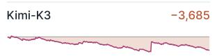  
5 d  SR 4 52   DD 5 380 l g t d t  201  
5 r und  SR 4 46  m DD 4 030 longest underwater run 182 races  
6 r und  SR 3 67  m DD 4 318 longest underwater run 318 races  
4 rounds  SR 5 57  max DD 5 080 longest under ater run 197 races

<table><tr><td>Qwen3.8-2.4T-A95B</td><td>-4,322</td></tr><tr><td colspan="2"></td></tr></table>

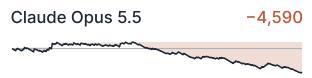

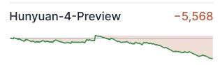  
5 rounds  SR 6 17  max DD 5 020 longest underwater run 270 races  
4 rounds  SR 6 18  max DD 5 838 longest underwater run 189 races  
5 rounds  SR 8 06  max DD 5 294 longest underwater run 310 races  
5 rounds  SR 767  max DD 6 282 longest underwater run 188 races

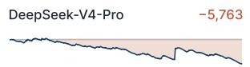

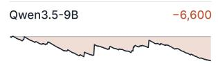  
5 rounds  SR 779  max DD 7 446 longest underwater run 188 races  
6 rounds  SR 5 86  max DD 6 075 longest underwater run 288 races

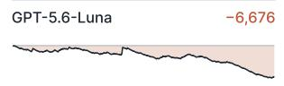  
5 rounds  SR 10 03  max DD 6 400 longest underwater run 309 races  
5 rounds  SR 4 92  max DD 6 706 longest underwater run 320 races

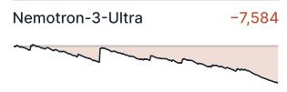  
5 r d  SR 9 76   DD 6 82 longest underwater run 324 races  
5 rounds  SR 6 81  max DD 7 944 longest underwater run 301 races

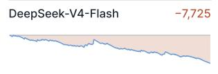  
6 r d  SR 11 67   DD 7725 l ng t und r t r run 324 r

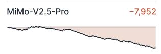  
6 rounds  SR 12 93  max DD 8 302 longest underwater run 255 races

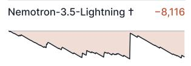  
5 rounds  SR 3 04  max DD 8 716 longest underwater run 324 races

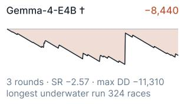

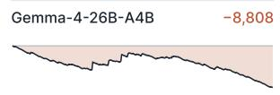  
5 rounds  SR 9 88  max DD 8 808 l g d  324

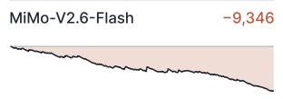  
5 rounds  SR 15 13  max DD 9 346 longest underwater run 324 races

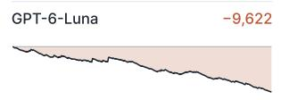  
5 rounds  SR 15 22  max DD 9 622 longest underwater run 324 races

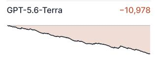  
5 rounds  SR 20 40  max DD 11 028 longest underwater run 324 races

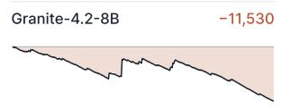  
4 rounds  SR 8 49  max DD 11 530 longest underwater run 324 races

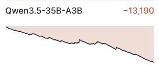  
5 rounds  SR 19 69  max DD 13 190 longest underwater run 324 races

Figure 7: Mean cumulative profit across repeats from flat JPY 100 WIN stakes at official dividends (28 configurations, 138 runs). Shading shows drawdown. Footers report repeat counts, annualized profit-based Sharpe ratio (SR), maximum drawdown as a signed JPY loss, and the longest run below the prior peak. † marks configurations that never delivered a non-uniform predictor.

Table 15: Retrospective betting returns and mean-path risk on 324 races. n counts trajectories with 324 scored forecasts. Profit is mean terminal P&L. ROI pools profits and stakes. Drawdown and annualized P&L SR use the equal-weight mean per-race P&L path, rather than averaged individual risks. P&L SR is not account-return Sharpe. Appendix A.5.5 defines the measures and completion accounting and discusses annualization qualifications (Sharpe, 1994; Lo, 2002).
<table><tr><td></td><td></td><td></td><td colspan="2">Return</td><td colspan="2">Mean-path risk</td></tr><tr><td>Model</td><td>Workflow</td><td>n</td><td>Profit (JPY)</td><td>ROI (%)</td><td>Max. DD (JPY)</td><td>Annualized P&amp;L SR</td></tr><tr><td colspan="7">Flat JPY 100 WIN</td></tr><tr><td>DeepSeek</td><td>Program</td><td>6</td><td>-7,738</td><td>-23.88</td><td>7,738</td><td>-11.73</td></tr><tr><td>DeepSeek</td><td>Adaptive Acquisition</td><td>6</td><td>-8,175</td><td>-25.23</td><td>9,415</td><td>-11.23</td></tr><tr><td>GLM</td><td>Program</td><td>5</td><td>-5,732</td><td>-17.69</td><td>7,446</td><td>-7.76</td></tr><tr><td>GLM</td><td>Adaptive Acquisition</td><td>1</td><td>-8,700</td><td>-26.85</td><td>9,470</td><td>-8.99</td></tr><tr><td>GPT-6-Astra</td><td>Program</td><td>5</td><td>-2,520</td><td>-7.78</td><td>4,302</td><td>-3.26</td></tr><tr><td>GPT-6-Astra</td><td>Adaptive Acquisition</td><td>2</td><td>-5,810</td><td>-17.93</td><td>7,460</td><td>-6.08</td></tr><tr><td>MiMo</td><td>Program</td><td>5</td><td>-2,210</td><td>-6.82</td><td>3,552</td><td>-1.89</td></tr><tr><td>MiMo</td><td>Adaptive Acquisition</td><td>1</td><td>-12,520</td><td>-38.64</td><td>12,840</td><td>-13.40</td></tr><tr><td colspan="7">Full Kelly, 1% cap</td></tr><tr><td>DeepSeek</td><td>Program</td><td>6</td><td>-38,305</td><td>-31.14</td><td>39,405</td><td>-9.78</td></tr><tr><td>DeepSeek</td><td>Adaptive Acquisition</td><td>6</td><td>-39,395</td><td>-30.18</td><td>58,663</td><td>-6.33</td></tr><tr><td>GLM</td><td>Program</td><td>5</td><td>-24,646</td><td>-15.78</td><td>39,872</td><td>-3.59</td></tr><tr><td>GLM</td><td>Adaptive Acquisition</td><td>1</td><td>-51,920</td><td>-59.00</td><td>52,120</td><td>-12.69</td></tr><tr><td>GPT-6-Astra</td><td>Program</td><td>5</td><td>-3,244</td><td>-2.55</td><td>21,376</td><td>-0.57</td></tr><tr><td>GPT-6-Astra</td><td>Adaptive Acquisition</td><td>2</td><td>-30,575</td><td>-29.96</td><td>46,035</td><td>-4.37</td></tr><tr><td>MiMo</td><td>Program</td><td>5</td><td>-7,158</td><td>-5.08</td><td>23,132</td><td>-0.78</td></tr><tr><td>MiMo</td><td>Adaptive Acquisition</td><td>1</td><td>-52,350</td><td>-51.07</td><td>64,020</td><td>-7.89</td></tr></table>

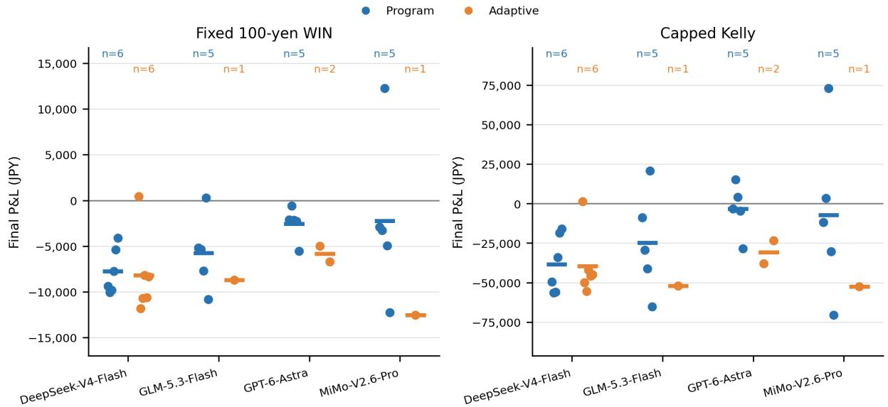  
Figure 8: Retrospective betting P&L across trajectories.

the largest gross returns, rather than a forecast accuracy metric. The other-five odds-band bars report per-trajectory means.

R1’s profitability does not coincide with consistently superior probability quality. Its Kellyselected picks still overpredict wins: the mean raw saved probability is 17.88%, compared with an observed win rate of 9.03%. R2, R3, R4, and R6 have lower full-vector Brier scores than R1 but all lose under Kelly. These observations distinguish overall probability quality, selected-bet reliability, and realized dividend returns; they do not establish a reproducible profitable edge.

R1: concentrated returns from 13 hits  
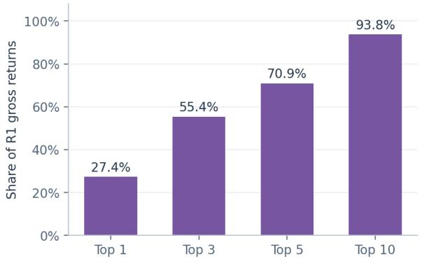

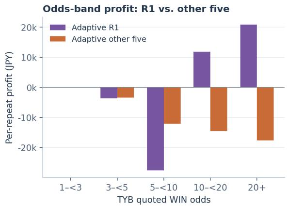

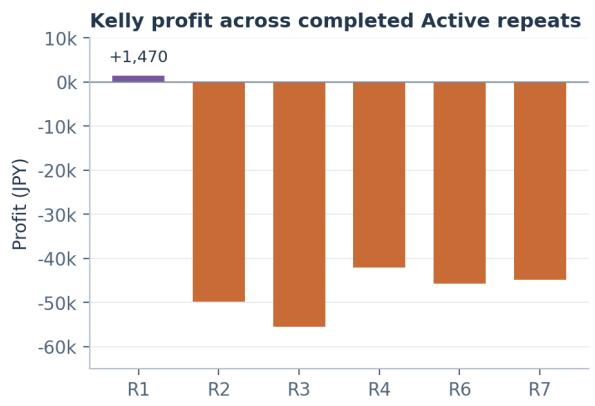

Kelly bets: predicted vs. observed wins  
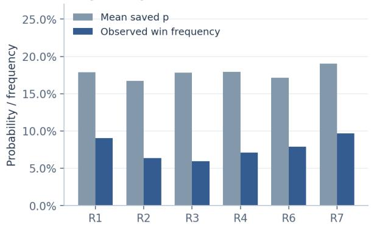  
Figure 9: Return concentration in DeepSeek Adaptive Acquisition.

## B.4 Research costs and synthetic utility

Program costs and rewards. For the top six configurations, fees average approximately 14–17 score-yen per race; execution-time and exploration data dominate the fee decomposition. Net scores broadly track forecast reward, but rankings differ: Claude Opus 5.5 has lower log gain than GPT-6- Sol and a higher net score. Fees and hit rewards can therefore reorder configurations relative to log gain. Recorded LLM charges or list-price equivalents are separate accounting quantities. Matched tariff interventions would test how acquisition and spending respond to information prices.

Workflow score decomposition. Program achieves higher mean net scores across all four models through different reward–cost trade-offs. Table 16 reports mean total gross reward, weighted research fees, and net score per completed 324-race trajectory; n denotes completed trajectories. For DeepSeek, Adaptive Acquisition’s higher mean gross reward is outweighed by its additional research fees. For GLM-5.3-Flash, GPT-6-Astra, and MiMo-V2.6-Pro, Adaptive Acquisition has both lower mean gross reward and higher mean research fees. Scores are calculated before display rounding; cohort provenance is documented in Appendix A.3.

Figure 10 shows the trajectory-level scores underlying Table 16. The panels report gross reward, weighted research fees, and net score, respectively. Dots denote individual trajectories, short bars show group means, and n counts trajectories with 324 scored forecasts.

Table 16: Mean workflow scores per trajectory (score-yen).
<table><tr><td>Model</td><td>Workflow</td><td>n</td><td>Gross score</td><td>Weighted fees</td><td>Net score</td></tr><tr><td>DeepSeek-V4-Flash</td><td>Program</td><td>6</td><td>11,793.52</td><td>4,553.46</td><td>7,240.05</td></tr><tr><td>DeepSeek-V4-Flash</td><td>Adaptive Acquisition</td><td>6</td><td>12,793.60</td><td>9,104.15</td><td>3,689.45</td></tr><tr><td>GLM-5.3-Flash</td><td>Program</td><td>5</td><td>14,420.59</td><td>7,299.45</td><td>7,121.14</td></tr><tr><td>GLM-5.3-Flash</td><td>Adaptive Acquisition</td><td>1</td><td>13,861.49</td><td>10,974.81</td><td>2,886.68</td></tr><tr><td>GPT-6-Astra</td><td>Program</td><td>5</td><td>24,254.02</td><td>4,408.87</td><td>19,845.15</td></tr><tr><td>GPT-6-Astra</td><td>Adaptive Acquisition</td><td>2</td><td>22,661.31</td><td>8,428.89</td><td>14,232.42</td></tr><tr><td>MiMo-V2.6-Pro</td><td>Program</td><td>5</td><td>16,503.03</td><td>5,013.52</td><td>11,489.51</td></tr><tr><td>MiMo-V2.6-Pro</td><td>Adaptive Acquisition</td><td>1</td><td>11,580.26</td><td>6,220.94</td><td>5,359.32</td></tr></table>

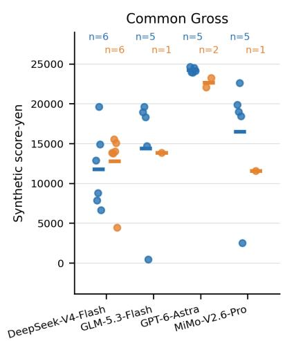

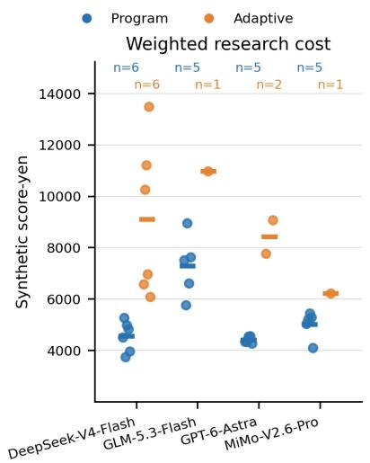

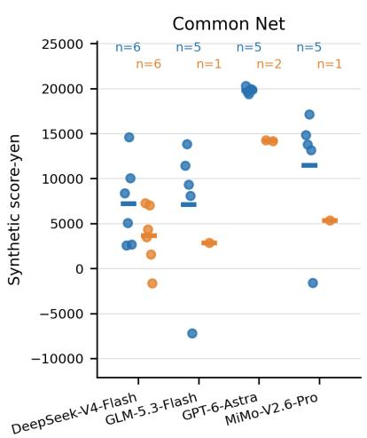  
Figure 10: Workflow rewards, research fees, and net scores.

## C PROMPT TEMPLATES AND SUBMISSION INTERFACES

Reference prompt templates, tool schemas, and configuration are provided in minimal-interfacesupplement.zip. The model is called during initial construction and subsequent revision sessions, with at most one repair session per phase. Forecast execution calls the saved program, not the LLM. Program parameters and notes may persist, while access to archived observations remains mediated by the interface. Template provenance and scope are described in Appendix C.1.

## C.1 PROGRAM PHASE PROMPTS

The supplement contains the reference system specification and tool schemas for the Program workflow. The reference system prompt was regenerated from the archived implementation under the supplied configuration and compared exactly with the stored specification. Tool schemas and the empty initial-task template were copied from the same specification. This check covers the reference templates, not historical client wrappers or run-specific rendered messages.

The complete reference system prompt is reproduced below, with line wrapping adjusted.

## Program system prompt

1. Create and improve strategy.py defining predict(sdk, context). The framework executes and seals every race prediction. Model sessions occur during initial exploration, daily reflection and at most one repair per phase. No odds, popularity, payouts for current or past races, JRDB indices, marks, predictions, aptitude or class ratings, track−bias figures or free text are available. Unknown values are null with missing reasons.

2. Feedback schema: items[] contains this day’s races only; race\_id is its identifier. top1\_hits/top1\_n are this day’s champion hits/scored races; top3\_hits/top3\_n are this day’s correct top−three choices/eligible selected choices. These are daily counts, not cumulative. Each item has status (ok, cancelled, no\_valid\_runners or missing\_results) and revenue\_yen (that race’s gross score or null), revenue\_log\_yen (log component or null when unscored), and revenue\_hit\_yen (hit component, zero when ineligible or unscored; always zero for score−yen−v1). hits contains the daily counts; ledger is cumulative. Ledger fields: currency, tariff and multiplier identify units; cost\_yen is incurred cost; settled\_revenue\_yen is booked gross; net\_score is booked gross minus cost; remaining\_days counts unpredicted days; monetary\_cap=null. Ledger hit\_bonus\_yen is the configured bonus; revenue\_log\_yen/ revenue\_hit\_yen are the cumulative booked components.

## Time contract

1. For every race of day D, predict runs at the previous evening cutoff, 21:00 JST. Visible inputs are that card, workouts and permitted labels released up to that cutoff. Day D results release at 20:30 JST; later objective review fields release at their review publication time. Reflection runs after the day closes and before day D+1 cards exist (21:00 JST). Attached form is frozen at its target race cutoff even when queried later. context['seed'] is constant per trajectory and is the only sanctioned randomness source; seed any random generator from it. Initial support labels require review release; online finish/abnormal labels become accessible after day close.

## Program interface and validation

1. Define callable predict(sdk, context) in strategy.py. Return a JSON object containing only ranking and probabilities; ranking is a list of every entrant number string exactly once, with no omissions, extras or duplicates. Probabilities are mandatory. When supplied, probabilities map every entrant to a finite number in [0,1]; their sum must be within absolute tolerance 0.02 of 1 (positive mass required). Accepted rounding is normalized; sums within 1e−12 are retained. predict must not write files. sdk.call(tool\_name, ∗∗arguments) returns the same JSON as the direct tool. sdk. history(...) is a paging generator. There are no per−tool methods such as sdk.card. SDK data calls inside predict are the only way a strategy sees the race data; context supplies only identifiers, runner numbers and seed.

## Program system prompt (continued)

Validation checklist: Python syntax and two−argument predict declaration on save; callable predict at execution; JSON output schema; full ranking; probability domain and normalization; no workspace changes; per−race calls, evidence and CPU caps; job wall time, RSS, storage, artifact, open−file and output/IPC ceilings where configured. Imports and uncaught exceptions can fail a job.

Failure matrix: save syntax/artifact rejection −> tool error, correct and save again; candidate execution/interface/resource failure −> candidate rejected, previous valid version retained, one repair session; prediction execution/interface/resource failure −> try the previous valid version once, then uniform. Storage quota or an unresolved interruption stops the run for inspection. Missing strategy or mode= uniform −> deterministic fallback ranking with uniform probabilities.

Each of up to three initial−support validation races executes twice. Differing ranking or probabilities sets nondeterministic\_output=true in last\_validation and prompts the same one repair session; it does not invalidate the program. Validation uses no predictive−accuracy threshold.

Uninformative−output rule: all returned probabilities are exactly equal. If this holds on every validation race, silent\_uniform requests the one repair session, regardless of evidence read. The program stays valid if kept, including after repeated uninformative output.

## Scoring

1. Maximize net\_score = sum\_races [S∗ln(n\_r∗pbar\_r) + I(delivery=predictor)∗hit\_bonus\_yen ∗(h\_r−1/n\_r)] − sum(evidence fees + call fees + CPU fees) over the entire trajectory. After removing scratched runners from the sealed ranking, renormalize their remaining probability mass; if it is zero use uniform. n\_r is the number that actually started. Smooth each remaining probability: p\_smoothed=(1−lambda)∗p+lambda/ n\_r. pbar\_r is the mean smoothed probability over ALL official winners (dead heat: every official winner counts). Tariff score−yen−v2: hit\_bonus\_yen=100. Ranking now has a scoring role: h\_r=1 if the top−ranked runner that actually started is any official winner, else 0. The hit bonus requires a validated program and sealed delivery=predictor; I is 1 only for that delivery, otherwise 0. explicit\_uniform, no\_strategy, silent\_uniform and execution\_fallback receive exactly zero hit bonus, including fallback to an older valid version. At n=14 and hit\_bonus\_yen=100, a hit pays +92.9 and a miss pays −7.1, in addition to the log part. The hit bonus is independent of submitted probabilities; with one official winner, a uniformly random top choice has expected bonus zero. revenue\_log\_yen and revenue\_hit\_yen are booked separately and sum to revenue\_yen. Invalid/cancelled results book zero gross score. Each day’s revenue is booked when that day closes; costs are booked when incurred. The final value is the ledger after the last day and its reflection close. S=100; lambda=0.02. At S=100, lambda=0.02, n=14 and winner probability 0.10, p\_smoothed =0.0994285714 and log revenue=33.1; uniform gives 0. For beliefs q with a feasible interior optimum, the optimal report is p=(q−lambda/n)/(1−lambda), within O(lambda) of belief; otherwise the constrained optimum has boundary components. Fees do not depend on the reported probabilities.

## Costs and units

1. One evidence cell is one scalar fact slot delivered, null included; identifiers/day indices count, duplicate metadata and missing−reason strings do not. Statistics/ coverage meter underlying scalar evidence inspected. field\_yen=0.01 score−yen/cell; call\_yen=0.5 per data−tool call; cpu\_yen=0.2 per CPU−second (user+system) of the isolated process, including failed code. All three rates are multiplied by 0.5. Data tools: card, connections, coverage, form, history, horse\_history, results, statistics, training. Control tools are free of fees; compute adds CPU and nested data−tool fees. Tool steps and response bytes still count for controls. From the live field catalogue, a card with all three entity identifiers per runner delivers 25 + 43∗n cells: n=14 gives 627 cells, approximately 3.39 score−yen including one call (excluding CPU); omitted entity identifiers reduce the count. Score−yen is a scoring unit, not real currency. No monetary cap or requirement to spend; uniform without any incurred costs has net\_score zero. Within one agent’s own trajectory ( its initial exploration is shared by that agent’s own arms only), the same tool and

## Program system prompt (continued)

canonical arguments (excluding max\_spend) with an identical response digest is a repeat: evidence fee and charged\_cells are zero and no session or per−race evidence allowance is consumed. Call fees and call/byte counters are unchanged. A changed response digest is charged in full. Only digests are retained, never data pages.

## Allowances

per−race prediction and validation job | strategy\_calls=40, strategy\_evidence\_cells=5000, strategy\_cpu\_seconds=120 | Separate from sessions; each execution has fresh caps ( including each validation repeat). Outer compute and all SDK calls count. | Job fails; candidate rejection or prediction fallback applies.

```jsonl
4. Additional session limits: {"batch_bytes": 33554432, "batch_calls": 1000,
batch_evidence_cells": 100000, "batch_model_calls": 20, "batch_seconds": null,
context_bytes": 262144, "default_page_size": 2, "feedback_memory_bytes": 16384, "
feedback_memory_items": 32, "format_repairs": 1, "max_page_size": 8, "
model_output_tokens": null, "model_turns": 64, "repair_model_calls": 5, "
response_bytes": 1048576, "strategy_calls": 40, "strategy_cpu_seconds": 120, "
strategy_evidence_cells": 5000, "warmup_bytes": 67108864, "warmup_calls": 1000, "
warmup_evidence_cells": 400000, "warmup_model_calls": 40}
```

## Sessions and persistence

1. Every compute starts fresh with injected sdk. Assign result to a small JSON value. Variables do not persist. Persist only small code, concise NOTES.md and fitted parameters; historical samples, race packages and training arrays on disk are rejected and rolled back. predict cannot modify files. Files written during a session persist only if save\_strategy is called at least once (saving NOTES.md suffices); otherwise restore the session−start workspace. Current source, notes and last\_validation are shown in the next session. Watch \_budget; save when model calls <=3 or a data allowance <=20%. Oldest complete tool rounds are dropped first; the task message, strategy source and notes are never dropped (oversize initial context ends the session; source inclusion has an explicit truncation manifest).

## Execution environment

## Program system prompt (continued)

## Glossary

1. Initial support: races before window day 0 whose labels were released by the initial clock. Trajectory: one agent’s exploration and scheduled prediction days. Entrant: declared runner identified by number. Cutoff: latest permitted input time. Sealed: immutable saved prediction. Validation: interface/resource checks on support cases, without model selection by outcomes. Reflection: optional program update after a day closes. net\_score: cumulative gross score minus incurred fees.

The frozen compatible-API client uses these phase instructions:

## Initial construction.

“Initial exploration. Build an initial strategy from scratch and save it. No predictions yet.”

## Daily revision.

“Day complete. You may change strategy or leave it unchanged. No new predictions until next batch.”

## Repair.

“Repair the candidate program with remaining session resources, or choose uniform.”

## C.2 TASK CONTEXT AND WORKFLOW DIFFERENCES

The Program task object supplies the horizon, remaining days, current program and notes, validation feedback, recent errors, and the cost ledger. Revision messages add released daily feedback. Repair messages add a validation notice, including invalid, uniform, or nondeterministic candidate output. Fields are populated at the replay clock. S skips A’s daily revision sessions while retaining time-varying legal inputs.

Adaptive Acquisition updates an evidence collector. Its update context includes the current source, daily and cumulative acquisition summaries, delivery and forecast metrics, recent released Experience Frames, and a bounded change history. The forecasting session receives the basic card and collected evidence and submits a ranking and probabilities. The two sessions and their validation rules are specified in Appendix A.2.2. The minimal prompt supplement covers the Program reference templates.

## C.3 MINIMAL SUBMISSION EXAMPLE

The following uniform predictor comes from the framework’s SDK help, with line wrapping adjusted. It shows data access and the required return schema. R0 uses a separate seeded ranking implementation.

```python
Minimal submission example
def predict(sdk, context):
card = sdk.call(
'card', race_id=context['race_id'])
numbers = [runner['number']
for runner in card['runners']]
return {
'ranking': numbers,
'probabilities': {
n: 1 / len(numbers)
for n in numbers}}
```

This output is classified as silent\_uniform and receives no program-delivery hit bonus.

## D CASE STUDIES OF EXECUTED STRATEGIES

The Program cases each cover 324 races and compare daily revision (A) with the matched frozen initial program (S). The acquisition case uses the DeepSeek Frozen-P<sub>0</sub>/Adaptive R1 control. Condensed pseudocode summarizes the executed programs, saved parameters, and query schedules. Here, n is the field size. Program probability transformations precede evaluator smoothing. Reflection excerpts reproduce model replies verbatim. Ellipses mark omissions.

## D.1 INITIAL STRATEGY CONSTRUCTION

GPT-6-Astra: a fixed linear predictor   
Selected trajectory: repeat 3. One executed program version.   
Initial strategy. The program constructs 42 features from the race card, the two most   
recent starts, and jockey/trainer statistics. Recent-form summaries weight the latest   
start by 0.65 and the preceding start by 0.35. A linear score uses fitted feature means,   
scales, and coefficients. It converts scores into probabilities and mixes in a small   
uniform component.   
x = features(card, form(k=2), connections) # 42 features   
z = (x − fitted\_mean) / fitted\_scale   
score = z @ fitted\_weights   
p = 0.98 ∗ softmax(score) + 0.02 / n   
ranking = descending\_order(p)   
Reflection after Day 1 (excerpt). “This supports continuing without costly retraining   
or overreacting to one day.”   
Corresponding execution. The initial artifact remains the executed predictor on days   
1–10. It still reads the current permitted inputs for each race, using three data calls.   
All 324 probability vectors and complete rankings match S.   
Results (S → A). Log gain: 0.517 → 0.517 nats. Top-1: 29.6% → 29.6%.

## GPT-6.1-Sol: a linear and tree score ensemble

Selected trajectory: repeat 1. One executed program version.   
Initial strategy. The program constructs 86 features from the race card, two recent   
starts, and connection statistics. It centers features within each race, divides by   
fitted scales, and clips the transformed values to [−6, 6]. The saved predictor combines   
a linear score with an ensemble of 80 depth-two decision trees. Inspection of the fitted   
trees confirms that all 80 are nonconstant.   
Executed prediction rule. The tree contribution sums the trees with a learning rate of   
0.04. Linear and tree scores receive weights 0.7 and 0.3, respectively. Their combined   
score is multiplied by 1.2 before softmax, followed by a 3% uniform mixture.   
x = features(card, form(k=2), connections) # 86 features   
z = clip((x − race\_mean(x)) / fitted\_scale, −6, 6)   
linear = z @ fitted\_weights   
trees = 0.04 ∗ sum(tree(z) for tree in saved\_trees) # 80 trees   
score = 1.2 ∗ (0.7 ∗ linear + 0.3 ∗ trees)   
p = 0.97 ∗ softmax(score) + 0.03 / n   
The combination occurs at the score level, before probability normalization.   
Execution and revision trace. The same fitted program is used throughout days 1–10.   
Its feature inputs are updated for each race, but the executed parameters and   
architecture remain fixed. A and S produce identical forecasts throughout the window.   
Results (S → A). Log gain: 0.527 → 0.527 nats. Top-1: 29.6% → 29.6%.

## D.2 CONFIDENCE ADJUSTMENT

Kimi-K3: temperature updates with fixed rankings

Selected trajectory: repeat 5. Seven executed source snapshots.   
Initial strategy and observed feedback. The initial predictor uses 16 fixed feature   
weights and temperature T = 1. Its first day has mean log gain −0.243 nats. Subsequent   
saved programs change the temperature while retaining the feature weights and ranking   
logic.   
Reflection after Day 1 (excerpt). “Change made: kept the ranking model unchanged, but   
flattened the probability calibration by raising TEMP from 1.0 to 3.0.”   
Corresponding execution. The temperature is 3 on days 2–5 and 2 on days 6–10. The core   
confidence transformation is shown below. Raising the positive temperature flattens   
softmax probabilities while preserving the ordering of the underlying scores.   
score = features @ fixed\_weights # same 16 weights   
temperature\_by\_day = [1, 3, 3, 3, 3, 2, 2, 2, 2, 2]   
T = temperature\_by\_day[day − 1]   
q = softmax(score / T) # core temperature transformation   
The seven source snapshots contain only three distinct parsed code structures. The final   
four source changes add comments without changing executable code.   
Compared with S, A changes 300 probability vectors but no complete ranking or top pick.   
Mean top-pick probability falls from 53.9% in S to 29.3% in A on the same 324 races.   
Results (S → A). Log gain: 0.093 → 0.383 nats. Top-1: 25.3% → 25.3%.

## D.3 FEATURE AND WEIGHT REVISION

## DeepSeek-V4.1-Flash: feature and probability revisions

Selected trajectory: repeat 3. Seven executed source snapshots.   
Strategy construction. The saved programs use weighted feature scores. Their feature   
counts change from 12 on day 1 to 7 on days 2–3, 10 on days 4–6, 14 on day 7, and 25 on   
days 8–10. The final feature set combines 14 card, connection, and workout features with   
11 recent-form features, querying up to five previous starts.   
Executed final strategy. Missing numerical values are filled with the observed mean   
within the race. Features are then standardized within that race and combined linearly.   
The program ranks runners by score. Its submitted probabilities apply a clipped   
adjustment after softmax.   
x = features(card, connections, form(k=5)) # 25 features   
x = fill\_missing\_with\_race\_mean(x)   
z = standardize\_within\_race(x)   
score = z @ weights   
q = softmax(score)   
p = normalize(maximum(q − 0.02 / n, 0))   
ranking = descending\_order(score)   
The final transformation offsets evaluator smoothing only when clipping is inactive.   
With clipping, it is not an exact inverse.   
Revision trace and paired outcome. Seven source snapshots correspond to six distinct   
parsed code structures. The last two snapshots have the same parsed structure. Results   
(S → A). Log gain: 0.288 → 0.230 nats. Top-1: 22.5% → 19.8%.

## Claude Fable 5.1: early weight updates and later calibration

Selected trajectory: repeat 3. Nine executed source snapshots.   
Initial strategy. The initial program uses 28 features and a saved coefficient vector.   
Both arms use this common predictor for the first 24 races. The prediction functions   
retain the same structure through the early revisions, while the saved weights change.   
Reflection after Day 3 (excerpt). “... run a CV’d refit, and update only if it holds   
up.”   
Corresponding execution. Before each of days 2, 3, and 4, 27 of the 28 weight entries   
change relative to the preceding version. From day 5 onward, the weight vector stays   
fixed. Later saved versions change calibration or metadata. The parameter history is:   
day 1: w0   
day 2: w1 # 27 of 28 entries differ from w0   
day 3: w2 # 27 of 28 entries differ from w1   
day 4: w3 # 27 of 28 entries differ from w2   
days 5−10: w3 # later calibration / metadata changes   
A changes 70 top picks and 298 complete rankings relative to S. Its probability vectors   
differ on 300 races. All 324 races have predictor delivery. The trajectory records ten   
provider failures. Results (S → A). Log gain: 0.471 → 0.486 nats. Top-1:   
27.8% → 30.2%.

## D.4 INFORMATION ACQUISITION

## GPT-5.6-Terra: switching to a card-only predictor

Selected trajectory: repeat 1. Two executed program versions.   
Initial strategy. The first program reads the race card and recent form for every   
prediction, using two data calls. This is also the initial program retained by S.   
Reflection after Day 3 (excerpt). “Change: removed the costly separate form(k=3) call   
while retaining card, pedigree, and embedded workout features. This reduces per-race   
evidence cost substantially.”   
Corresponding execution. From day 4, A uses a shorter card-only predictor and stops   
requesting recent form. Data calls fall to one per prediction. The source shrinks from   
123 to 70 lines, and the revised version handles the remaining 252 races. The revision   
also changes the prediction code.   
days 1−3:   
card, form = read\_card(), read\_recent\_form()   
prediction = initial\_predictor(card, form)   
days 4−10:   
card = read\_card()   
prediction = revised\_predictor(card)   
Paired outcome and accounting. A changes 102 top picks relative to S. Across the full   
trajectory, protocol fees fall by 3.53 score-yen per race, but gross forecast reward   
falls by 17.97. Net utility therefore falls by 14.44 score-yen per race. Results (S →   
A). Log gain: 0.333 → 0.187 nats. Top-1: 20.1% → 16.7%. Net score: 30.51 → 16.07   
score-yen/race.

## DeepSeek Adaptive Acquisition: changing the query schedule

Selected comparison: Frozen-P<sub>0</sub> and Adaptive R1, 324 races per arm.   
Initial strategy. Both arms start with the same acquisition program P<sub>0</sub>. It collects   
evidence for a fresh per-race LLM forecast. On Day 1, both execute the initial query   
policy.   
Executed revisions. Adaptive R1 removes broad condition\_stats acquisition on Days 2–4.   
On Day 5 it queries only the first listed runner in each race, then removes those querie   
again on Days 6–10. One saved intermediate version is replaced before formal execution.   
condition\_stats query coverage:   
day 1: all runners   
days 2−4: none   
day 5: first listed runner only   
days 6−10: none   
Recorded acquisition. Frozen-P<sub>0</sub> makes 3,500 native condition-statistics acquisitions   
and purchases 1,136,800 cells through them. Adaptive R1 makes 287 and purchases 92,904   
cells. Their weighted condition-statistics charges are 6,559.00 and 536.27 score-yen.   
Both arms make 4,568 depth-one recent-history acquisitions and 324 race-level workout   
purchases. Further local workout projections use the owned cache.   
Results (Frozen → Adaptive). Gross score: 14,502.13 → 13,853.16. Weighted fees:   
12,609.19 → 6,586.46. Net score: 1,892.94 → 7,266.70. All scores are total score-yen over   
324 races. The arms generate their forecasts separately.

## E Reproducibility and Released Materials

The code repository is https://github.com/ HKUST-KnowComp/JockeyBench.

The manuscript source contains the figures and tables used in the paper; the accompanying minimal interface supplement is described below. The aggregate audit checks run IDs, pairing, completion, protocol and tariff identity, revenue/net arithmetic, delivery totals, replication counts, main means, and day-level contrasts. Settlement is filtered by exact run ID before summing stakes and returns. Source hashes prevent a silent refresh from changing the cohort. The audit operates on saved outputs; predictor re-execution and archive-level information-flow checks are separate tasks.

The benchmark supports archive replay and sealed-program re-execution. A public release still requires a complete run-by-run audit-coverage manifest, immutable software/configuration metadata, exact rendered prompts where releasable, and instructions for authorized archive reconstruction.

Minimal interface supplement. The accompanying minimal-interface-supplement.zip contains the complete reference prompt and tool schemas, phase instructions, reference configuration, source-hash provenance, and selected SDK, validation, scoring, and fallback code excerpts. A small test suite uses invented in-memory examples to check the calling convention, mandatory probabilities, scratch renormalization (including zero surviving mass), dead-heat scoring, and deliverygated bonuses, without a database or model call. Commercial archive records, private identifier mappings, and run conversations are excluded.

These materials support inspection of the interface and selected scoring rules. They do not reproduce the reported empirical results or replace archive-level replay. Full numerical reproduction additionally requires the corresponding permitted analysis inputs and scripts; predictor re-execution requires authorized archive access and run-specific artifacts. Aggregate arithmetic checks, predictor replay, and information-timing audits must be reported separately, with their actual coverage.