# LABCOMPILER: A FRAMEWORK FOR VERIFIABLE HUMAN-MACHINE LABORATORY EXECUTION FROM IMPERFECT PROTOCOLS

Jingyuan Li<sup>1,2\*</sup>, Dongzhan Zhou<sup>2\*</sup>, Minting Pan<sup>2†</sup>, Yujie Liu<sup>2,3</sup>, Yuan Gao<sup>4</sup>, Yankai Jiang<sup>2</sup>, Xinyu Gu<sup>2</sup>, Zhe Liu<sup>5</sup>, Yang Li<sup>1</sup>, Bo Zhang<sup>2</sup>, Lei Bai<sup>2</sup>, Tong Si<sup>4†</sup>, Weinan Zhang<sup>1†</sup>

<sup>1</sup>Shanghai Jiao Tong University <sup>2</sup>Shanghai Artificial Intelligence Laboratory

<sup>3</sup>Fudan University <sup>4</sup>Shenzhen Institutes of Advanced Technology

<sup>5</sup>East China University of Science and Technology

<sup>\*</sup>Equal contribution. <sup>†</sup>Corresponding authors.

## ABSTRACT

Closing the loop of AI-driven science requires reliably translating naturallanguage protocols into executable laboratory workflows despite protocol defects and heterogeneous hardware. Existing approaches often couple scientific interpretation with device-specific code generation, making errors difficult to localize and limiting reuse across laboratory platforms. We introduce LabCompiler, a robust protocol-to-execution framework that transforms imperfect natural-language protocols into verifiable human-machine workflows. Its protocol firewall diagnoses and repairs defects before compilation while preserving unaffected content, guided by troubleshooting knowledge accumulated through perturbationguided self-evolution. A two-level, device-agnostic graph representation separates experimental semantics from hardware-specific implementation and supports capability-based device assignment with coordinated human execution. We further introduce a protocol recovery benchmark covering four controlled perturbation types and naturally occurring errors collected from protocols written by iGEM participants. Experiments show that LabCompiler outperforms frontier LLMs in protocol error correction while enabling coordinated human-machine execution across heterogeneous, partially automated laboratory settings.

## 1 INTRODUCTION

Artificial intelligence for science (AI4S) is moving toward closed-loop experimentation. Recent systems can synthesize literature (Qiu et al., 2025), formulate hypotheses (Baek et al., 2025), and design experimental procedures (Huang et al., 2025), while self-driving laboratories and robotic platforms are beginning to automate experimental execution and iterative optimization (Boiko et al., 2023). Connecting these capabilities requires translating natural-language protocols into actions that can be carried out in a particular laboratory. Researchers usually perform this translation, resolving implicit details and deciding how the available instruments should be used. When this work depends on individual interpretation, the same protocol may be executed differently by different operators. A standardized interface between experimental descriptions and laboratory actions would allow this translation to be reproduced and audited, making laboratory automation easier to scale.

Coding agents provide a natural foundation for such an interface, as they can generate programs, invoke external tools, and iteratively revise code based on execution feedback (Wang et al., 2024; Yang et al., 2024). Recent work has explored the use of coding agents to translate experimental protocols into machine-executable scripts (Inagaki et al., 2023; Gao et al., 2025; Jiang et al., 2026). Nevertheless, they still face three fundamental challenges. First, the protocol itself may be imperfect, containing incorrect parameters, missing steps, or ambiguous instructions. Direct compilation may therefore produce valid code that faithfully implements a scientifically invalid experiment. Second, direct protocol-to-code generation entangles scientific interpretation with device-specific implementation, making failures difficult to localize and limiting reuse across heterogeneous hardware. Third, many protocols are only partially automatable with available devices and require human manipulation or judgment to complete the experiment.

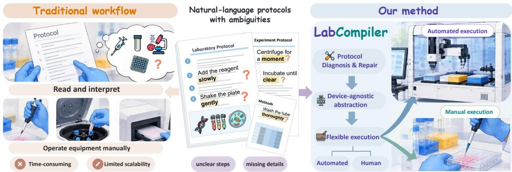  
Figure 1: Overview of LabCompiler. Unlike traditional workflows that rely on manual interpretation and operation, LabCompiler transforms ambiguous natural-language protocols into human-machine workflows through diagnosis and repair, device-agnostic abstraction, and hybrid execution.

We introduce LabCompiler, a robust protocol-to-execution framework that addresses these challenges through a staged “diagnose-represent-execute” architecture, as illustrated in Figure 1. Its protocol firewall diagnoses and repairs defects before compilation while constraining unnecessary changes to valid experimental content. The firewall incorporates perturbations-guided selfevolution, through which diagnosis and repair outcomes on perturbed training protocols are examined against verified references and distilled into reusable troubleshooting knowledge. Accumulated in an external memory, this knowledge guides subsequent screening.

The repaired protocol is compiled into a Semantic Experiment Graph that captures operations and their control and material dependencies, then deterministically normalized into a Canonical Action Graph of standardized actions. This device-agnostic representation decouples experimental semantics from hardware-specific implementation. Related actions are grouped into execution units and assigned to compatible devices when possible, while unsupported operations remain humanexecution steps. Automated units are grounded in physical resources, translated into device-specific code, and checked against device and resource constraints, with simulation used when available. The shared representation also allows execution assignments to adapt as laboratory capabilities expand.

We construct a benchmark for protocol recovery, which requires systems to identify and repair defects without predefined corrective options while preserving unaffected experimental information. Unlike LAB-Bench (Laurent et al., 2024), which uses multiple-choice questions for protocol troubleshooting, our benchmark evaluates protocol recovery by requiring systems to directly identify and repair defects in imperfect protocols. It combines structured perturbations of validated public protocols with naturally occurring errors curated from protocols written by iGEM competition teams and annotated by domain experts, enabling us to evaluate specific failure modes and examine whether recovery extends to errors encountered in practice. Our contributions are as following:

• We introduce LabCompiler, a staged protocol-to-execution framework that diagnoses protocol defects before compilation, reducing the propagation of protocol errors into downstream execution.

• We develop a two-level device-agnostic experiment representation and capability-grounded execution mechanism that separates scientific semantics from hardware-specific implementation while supporting coordinated machine-human workflows.

• We introduce a protocol correction benchmark and correction-guided self-evolution mechanism for evaluating and improving protocol diagnosis and repair.

## 2 RELATED WORK

Agentic Laboratory Automation. Autonomous laboratories are emerging as infrastructure for closing the loop from scientific reasoning to physical experimentation. Early platforms commonly encoded task-specific procedures in fixed orchestration workflows, making adaptation to new protocols or instruments costly (MacLeod et al., 2020; Seifrid et al., 2022; Lo et al., 2024; Rapp et al., 2024). Recent advances in large language models and coding agents have made this interface more flexible, enabling goal-level experimental instructions to be translated into executable robotic scripts (Ruan et al., 2024; Gao et al., 2025; Jiang et al., 2026). However, many such approaches couple scientific interpretation with device-specific execution within the same generation process. Thus, experimental semantics are tied to particular hardware realizations, so transferring protocols across instruments often requires regenerating or revising backend-specific implementations. Complementary work has introduced machine-readable and hardware-agnostic representations, including XDL (Mehr et al., 2020), BPL (Song et al., 2026), and LabOP (Bartley et al., 2023), to standardize experimental procedures and improve interoperability across laboratory platforms. Building on this direction, LabCompiler introduces a two-level, device-agnostic experimental representation that explicitly separates protocol understanding from hardware realization, allowing the same experimental intent to be consistently mapped to heterogeneous laboratory platforms.

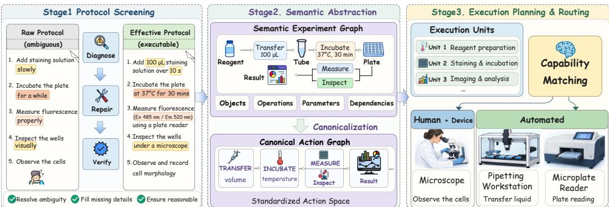  
Figure 2: Overview of LabCompiler. It first screens and repairs ambiguous natural-language protocols, then converts them into device-agnostic semantic and canonical representations. The resulting actions are grouped into execution units and capability-matched to human or automated execution.

Protocol Diagnosis and Repair. Protocols used in practice may contain errors, ambiguities, or missing information, making direct execution unsafe. This has motivated recent agentic laboratory systems to incorporate protocol validation and refinement before robotic grounding or code generation, treating scientific correctness as a prerequisite for physical execution (Liu et al., 2026b;c; Jiang et al., 2026). In parallel, recent benchmarks such as LAB-Bench and BioProBench have begun assessing whether language models can identify and correct errors in biological protocols (Laurent et al., 2024; 2026; Liu et al., 2026a; Ivanov, 2024). Our benchmark evaluates protocol recovery under two complementary settings: controlled errors introduced into validated protocols, and naturally occurring errors identified in protocols written by iGEM participants and corrected by domain experts. This design supports both controlled analysis of specific failure modes and evaluation on errors encountered in practice. Additionally, LabCompiler couples an iterative diagnose-repair-verify loop with a perturbation-guided self-evolving diagnosis mechanism, distilling resolved cases into reusable troubleshooting knowledge for subsequent protocol diagnosis and repair.

## 3 LABCOMPILER

LabCompiler transforms a natural-language experimental protocol into a verifiable laboratory workflow through protocol verification, device-agnostic semantic compilation, and capability-aware human-machine execution. Formally, the input is $\mathcal { I } = ( g , \mathcal { P } )$ , where $g$ denotes the experimental goal and P the ordered procedures. LabCompiler first detects and repairs protocol-level defects, yielding a verified protocol ${ \widetilde { \mathcal { P } } } _ { ; }$ , then maps it into a device-agnostic experiment graph $\mathcal { G }$ capturing experimental operations and their dependencies. Based on $\mathcal { G }$ and the capabilities of available laboratory resources, automatable operations are lowered to validated device-specific code, while unsupported or intrinsically manual operations remain coordinated human-execution steps. This staged design separates scientific interpretation from hardware implementation and exposes intermediate artifacts for independent inspection and validation. Figure 2 illustrates the overall framework.

## 3.1 PROTOCOL FIREWALL: DIAGNOSE BEFORE COMPILING

Protocols in realistic laboratory settings are not always execution-ready. Even when they describe a valid experimental goal, individual procedures may contain incorrect parameters, ambiguous operations, or inconsistencies across steps. LabCompiler places a protocol firewall before compilation to detect defects before they propagate into executable actions.

The firewall operates as an iterative diagnose-repair-verify loop. From the original protocol ${ \mathcal { P } } _ { : }$ , the screening agent identifies suspicious segments and proposes a minimally revised candidate $\mathcal { P } ^ { ( t ) }$ Crucially, each repaired candidate is validated before acceptance, emphasizing comparison against the original protocol. The goal is to ensure that the correction resolves the diagnosed defect without causing unnecessary drift in unaffected experimental content, preserving valid operations, materials, targets, and dependencies while allowing revision of erroneous or inconsistent elements. Formally, letting $\mathcal { E } ^ { ( t ) }$ denote the validation feedback at iteration $t ,$

$$
\begin{array} { r } { \mathcal { P } ^ { ( t + 1 ) } = \mathcal { R } \Big ( \mathcal { P } , \mathcal { P } ^ { ( t ) } , \mathcal { E } ^ { ( t ) } \Big ) , \qquad \mathcal { E } ^ { ( t + 1 ) } = \mathcal { V } \Big ( \mathcal { P } , \mathcal { P } ^ { ( t + 1 ) } \Big ) , } \end{array}\tag{1}
$$

where R denotes protocol diagnosis and repair, and $\nu$ validates whether the proposed repair resolves the diagnosed defect while preserving unaffected content and satisfying consistency and executability constraints. Whenever validation fails, the original protocol, the revised candidate, and the validation feedback are returned to the repair agent for another revision. The loop terminates only when the candidate satisfies the required validation constraints; otherwise, revision proceeds for at most 12 iterations, after which the protocol is deemed unresolved. Importantly, scientific ambiguities that cannot be justified from available evidence are explicitly preserved for human clarification rather than resolved through unsupported assumptions.

Besides the repaired protocol, the firewall maintains a structured resolution trace for each accepted modification, diagnosed issue, supporting evidence, and applied correction. This preserves an explicit correspondence between the original and verified protocols, turning protocol repair into an auditable transformation rather than an unconstrained rewrite. The verified protocol $\widetilde { \mathcal P }$ then enters the subsequent representation stage.

## 3.2 PERTURBATION-GUIDED SELF-EVOLVING DIAGNOSIS

To improve repair accuracy, LabCompiler introduces a perturbation-guided self-evolution mechanism converting controlled protocol perturbations in our benchmark into reusable troubleshooting knowledge. The perturbations span multiple failure modes, as described in Section 4.1.

Each self-evolution instance pairs a perturbed protocol with its verified reference, from which reusable troubleshooting experience is distilled without explicit error-category supervision. Lab-Compiler compares its diagnosis and repair with the reference and distills this experience into an external memory for subsequent retrieval. The memory is constructed from a protocol-disjoint training split of 100 instances per error category and frozen during held-out protocol evaluation.

## 3.3 DEVICE-AGNOSTIC REPRESENTATION ABSTRACTION

Natural-language protocols effectively support scientific communication but provide a poor execution interface. The same experimental operation may be expressed in substantially different forms, while implementation details such as repeated targets, implicit transfers, and compound operations are often linguistically underspecified. Directly generating device code from such descriptions would entangle scientific interpretation with low-level execution choices, making errors difficult to localize and the resulting workflow difficult to verify or reuse across platforms.

To provide a stable interface between protocol understanding and downstream execution, LabCompiler compiles the verified protocol $\widetilde { \mathcal P }$ into a device-agnostic experiment graph ${ \mathcal { G } } .$ . Rather than committing immediately to device operations, the graph progressively resolves protocol semantics through two complementary representations:

$$
{ \widetilde { \mathcal { P } } } \ { \xrightarrow { \mathcal { S } } } \ { \mathcal { G } } ^ { \mathrm { s e m } } \ { \xrightarrow { \mathcal { N } } } \ { \mathcal { G } } ^ { \mathrm { c a n } } ,\tag{2}
$$

where $s$ performs semantic interpretation and $\mathcal { N }$ denotes deterministic canonicalization.

Semantic Experiment Graph. $\mathcal { G } ^ { \mathrm { s e m } }$ captures the experimental semantics of the verified protocol $\widetilde { \mathcal P }$ without committing to any specific device implementation. It organizes the protocol into explicit operation-centric representations, where each operation specifies its participating materials, source and target objects, quantitative parameters, and experimental conditions, as illustrated in Figure 2. Beyond individual operations, $\bar { \mathcal { G } } ^ { \mathrm { s e m } }$ explicitly encodes control-flow and material-flow dependencies, transforming a sequential textual procedure into a structured graph of how experimental operations and material states evolve throughout the workflow. Thus, $\bar { \boldsymbol { \mathcal { G } } } ^ { \mathrm { s \bar { e } m } }$ provides a device-independent representation preserving the scientific intent and procedural structure of the verified protocol while making its implicit experimental relationships explicit.

Canonical Action Graph. The semantic graph is subsequently transformed into a canonical action graph ${ \mathcal G } ^ { \mathrm { c a n } }$ , expressing the experiment through a compact vocabulary of standardized laboratory actions. This transformation reduces representational variability and aligns operations to a common granularity by standardizing parameters and units, decomposing compound procedures when necessary, and expanding repeated or multi-target operations into explicit action instances. The current action space comprises 26 canonical action types, covering common laboratory operations such as liquid transfer, plate reading and incubation, and can be extended as additional experimental scenarios are incorporated. The complete action set appears in Appendix C.2. For example, add 100 µL of blue dye reagent to every occupied well is represented in $\mathcal { G } ^ { \mathrm { s e m } }$ as a single operation over 17 targets, whereas $\bar { \boldsymbol g } ^ { \mathrm { c a n } }$ expands it into 17 target-specific liquid transfer actions following the corresponding canonical semantics. Together, $\bar { \mathcal { G } } ^ { \mathrm { s e m } }$ and $\mathcal { G } ^ { \mathrm { c a n } }$ form a progressive abstraction hierarchy: the former reconstructs and preserves protocol-level scientific semantics, while the latter projects them onto a uniform action space for downstream execution planning. Appendix C provides the complete action set and representation details.

## 3.4 CAPABILITY-GROUNDED HYBRID EXECUTION

Rather than assigning devices to canonical actions independently, LabCompiler first groups closely related actions into coherent execution units. Actions are grouped by their material flow, dependency structure, and whether they can be executed consecutively on the same device. For example, a sequence of liquid addition and mixing can be treated as a single execution unit when it operates on the same sample and can be executed within a compatible device. For each execution unit $u _ { i } .$ LabCompiler selects an automated realization when a compatible device is available; otherwise, the unit is retained for human execution. Let D denote the available devices. In our current implementation, D comprises 45 integrated devices, such as the Opentrons OT-2 and Flex (Opentrons Labworks Inc., a;b), Hamilton STAR (Hamilton Company), and Cytation plate readers.We define

$$
\pi ( u _ { i } ) = \left\{ \begin{array} { l l } { d , \quad d \in \mathcal { D } \mathrm { ~ a n d ~ } \Gamma ( u _ { i } , d ) = 1 , } & { \mathrm { i f ~ s u c h ~ } d \mathrm { ~ e x i s t s } , } \\ { { \mathrm { H U M A N } } , } & { \mathrm { o t h e r w i s e } . } \end{array} \right.\tag{3}
$$

Here, $\Gamma ( u _ { i } , d ) = 1$ indicates that device d supports the required actions in the execution unit $u _ { i }$ Thus, this local assignment allows a protocol to combine automated and manual operations without requiring the entire workflow to be executable on a single automation platform.

Once an execution unit is assigned to a device, its logical experimental objects are bound to concrete physical resources, such as labware, wells, and device locations. Device adapters then translate the corresponding canonical actions into platform-specific commands or code. This separation allows the same canonical experiment representation to be realized on different hardware without changing its underlying experimental semantics. The generated device-specific code is first validated against the target device and resource constraints and, when a simulator is available, further verified through simulation. Only code passing these checks is accepted as a valid automated realization; otherwise, the automated compilation is considered unsuccessful.

## 4 PROTOCOL CORRECTION BENCHMARK

Existing benchmarks such as LAB-Bench (Laurent et al., 2024) and BioProBench (Liu et al., 2026a) evaluate protocol troubleshooting through multiple-choice questions or task-specific formulations such as error recognition and step ordering. In contrast, we evaluate protocol recovery: given an imperfect protocol without predefined corrective options, a system must identify and repair defects while preserving unaffected experimental information. Our benchmark comprises two complementary subsets capturing controlled and naturally occurring protocol errors: a controlled perturbation subset, constructed by introducing structured defects into validated public protocols, and a realworld error subset, curated from experimental protocols written by iGEM competition teams (iGEM Headquarters, 2023) and annotated by domain experts for naturally occurring errors.

Table 1: Taxonomy of controlled protocol perturbations.
<table><tr><td>Perturbation</td><td>Construction</td><td>Illustrative example</td></tr><tr><td>Parameter or reagent replacement</td><td>Replace a valid experimental parameter or reagent with an incompatible alternative.</td><td>Incubate at  $3 7 ^ { \circ } \mathrm { C } $  incubate  $\mathrm { a t 4 } ^ { \circ } \mathrm { C } .$ </td></tr><tr><td>Critical-step deletion</td><td>Remove an operation required to establish the state assumed by a downstream step.</td><td>Delete the quenching step before washing labeled cells.</td></tr><tr><td>Cross-step inconsistency</td><td>Modify a reference, quantity, or material such that two distant steps become inconsistent.</td><td>Prepare N samples but later use reagents for M samples.</td></tr><tr><td>Operation or parameter ambiguity</td><td>Replace an explicit operation or quantitative specification with an expression insufficient to determine the intended procedure.</td><td>Add 500 µL of PBS → add an appropriate amount of buffer.</td></tr></table>

## 4.1 BENCHMARK CONSTRUCTION

Controlled Perturbation Subset. We construct this subset from a quality-controlled collection of biological protocols from public sources, including SciRecipe (Sun et al., 2026). For each validated protocol, we introduce a targeted modification while leaving unrelated procedures unchanged, yielding perturbed instances with known error locations and reference corrections. This construction supports controlled evaluation of a model’s ability to identify and repair specific protocol defects. We consider four perturbation families: parameter or reagent replacement, critical-step deletion, crossstep inconsistency, and operation or parameter ambiguity. Table 1 summarizes their construction. These perturbations are designed to alter the experimental meaning rather than the surface wording, while keeping the resulting protocol locally plausible. The held-out evaluation subset contains 2,000 perturbed protocols, with 500 instances per perturbation type.

Real-World Error Subset. We further construct a real-world subset from experimental protocols written by participating teams in the iGEM competition. Unlike the controlled subset, these protocols contain errors that arise during actual protocol preparation rather than through predefined perturbation rules. To ensure the validity of the data, we recruited domain experts to review the selected protocols, identify erroneous procedures, and provide scientifically valid corrections. Each erroneous protocol is paired with its expert-corrected reference version for evaluation. The resulting subset contains 259 instances and the detailed dataset statistics are provided in Appendix E

## 4.2 QUALITY CONTROL AND EVALUATION METRIC

To ensure quality and reliability, automated checks are applied to verify that each instance contains a single error and that the error is consistent with its assigned category. Biological domain experts then review 20% of each error category to confirm that the labeled error constitutes a genuine experimental defect and that the corresponding reference protocol provides a valid correction.

The benchmark evaluates protocol recovery using two metrics. Classification accuracy measures whether the model correctly identifies the error type, while repair score measures the quality of the corrected protocol relative to the reference. Because valid repairs may differ in wording, protocol repair is evaluated semantically rather than by exact string matching. A score of 2 is assigned when the defect is fully resolved and the repair is scientifically consistent with the reference. A score of 1 indicates a partially correct repair with a minor omission or inaccuracy, whereas a score of 0 indicates that the defect remains unresolved or that the repair introduces a substantive error.

## 5 EXPERIMENTS

We evaluate LabCompiler along the three interfaces introduced by its staged design. Specifically, we test whether (i) the firewall can recover imperfect protocols before compilation, (ii) the deviceagnostic representation preserves experimental semantics, and (iii) capability grounding reliably

Table 2: Protocol correction on the controlled perturbation subset across four error categories. We report classification accuracy (Acc.) and repair score (Rep.). LabCompiler\* denotes the self-evolved variant. Best and second-best results are shown in bold and underline, respectively.
<table><tr><td rowspan="2">Method</td><td colspan="2">Critical-step deletion</td><td colspan="2">Operation or parameter ambiguity</td><td colspan="2">Parameter or reagent replacement</td><td colspan="2">Cross-step inconsistency</td></tr><tr><td>Acc.↑</td><td>Rep. ↑</td><td>Acc.↑</td><td>Rep. ↑</td><td>Acc.↑</td><td>Rep. ↑</td><td>Acc.↑</td><td>Rep. ↑</td></tr><tr><td>MiniMax-M3</td><td>68.0</td><td>26.0</td><td>26.6</td><td>15.0</td><td>45.0</td><td>29.0</td><td>38.2</td><td>39.9</td></tr><tr><td>Qwen3.8-Max</td><td>65.2</td><td>29.0</td><td>32.0</td><td>20.0</td><td>55.0</td><td>35.4</td><td>45.0</td><td>44.6</td></tr><tr><td>DeepSeek-V4-Pro</td><td>69.8</td><td>37.3</td><td>37.0</td><td>23.7</td><td>49.0</td><td>35.0</td><td>47.4</td><td>47.7</td></tr><tr><td>Gemini-3.1-Pro</td><td>68.0</td><td>36.4</td><td>39.8</td><td>22.0</td><td>52.0</td><td>32.0</td><td>51.4</td><td>45.9</td></tr><tr><td>Kimi-K3</td><td>74.0</td><td>36.0</td><td>42.4</td><td>24.0</td><td>58.2</td><td>38.5</td><td>44.6</td><td>42.2</td></tr><tr><td>GPT-5.6 Sol</td><td>79.6</td><td>39.0</td><td>48.2</td><td>26.8</td><td>72.6</td><td>52.6</td><td>48.4</td><td>55.3</td></tr><tr><td>Claude Opus 5</td><td>78.4</td><td>38.9</td><td>47.4</td><td>25.3</td><td>79.4</td><td>61.2</td><td>54.4</td><td>56.2</td></tr><tr><td>Codex+GPT-5.6 Sol</td><td>81.8</td><td>39.3</td><td>48.8</td><td>30.5</td><td>76.8</td><td>59.8</td><td>49.2</td><td>57.4</td></tr><tr><td>LabCompiler</td><td>80.0</td><td>39.1</td><td>49.6</td><td>30.6</td><td>78.8</td><td>54.0</td><td>59.2</td><td>64.0</td></tr><tr><td>LabCompiler*</td><td>93.8</td><td>44.4</td><td>64.2</td><td>35.3</td><td>85.6</td><td>63.9</td><td>66.8</td><td>72.4</td></tr></table>

translates the representation into executable human-machine workflows. This decomposition allows failures to be attributed to individual stages rather than conflated into a single end-to-end score. Additional component-wise ablations of the three stages are reported in Appendix F.

## 5.1 EXPERIMENTAL SETUP

We compare LabCompiler with a diverse set of frontier LLMs, including GPT-5.6 Sol (OpenAI, 2026), Claude Opus 5 (Anthropic, 2026), DeepSeek-V4-Pro (Xu et al., 2026), Gemini-3.1- Pro (Google DeepMind, 2026), Qwen3.8-Max (Qwen Team, 2026), MiniMax-M3 (MiniMax, 2026), Kimi-K3 (Kimi Team et al., 2026), and Codex(GPT-5.6 Sol) as a coding-agent baseline. Both Lab-Compiler and its self-evolving variant use DeepSeek-V4-Pro as the underlying model. For categor ical predictions, including error classification and execution routing, we report accuracy against the reference annotations. Metrics requiring semantic assessment are independently scored by two LLM judges, GPT-5.5 and Gemini-3.1-Pro. The scores are then averaged and normalized to a 0-100 scale. Experts scored 30% of model responses to assess agreement with LLM judges (Appendix G.3).

## 5.2 PROTOCOL CORRECTION

Main results. Table 2 and Figure 3(a,b) evaluate recovery from the four controlled perturbation families. Even without self-evolution, LabCompiler reaches an average classification accuracy of 66.9% and a repair score of 46.9, improving over the strongest direct LLM baseline by 2.0 percentage points and 1.5 score points, respectively. The comparison to its own DeepSeek-V4-Pro backbone is more pronounced: the proposed framework improves classification from 50.8% to 66.9% and repair from 35.9 to 46.9. The gain is particularly clear for failures that require reasoning across protocol context. LabCompiler obtains 59.2% classification accuracy and a repair score of 64.0 on cross-step inconsistencies, and reaches 49.6% classification accuracy on operation or parameter ambiguity. Figure 3(c,d) evaluates the same recovery task on the real-world error subset containing naturally occurring errors. LabCompiler achieves 54.4% classification accuracy and a repair score of 45.8, compared with 43.6% and 39.5 for its DeepSeek-V4-Pro backbone. With frozen self-evolved troubleshooting memory, LabCompiler\* further improves to 76.8% classification accuracy and a repair score of 55.5. Notably, our method exhibits a larger advantage on naturally occurring errors than on controlled perturbations, indicating stronger robustness to heterogeneous defects encountered in practice. This advantage extends to LAB-Bench (Laurent et al., 2024), where LabCompiler consistently outperforms the baselines, as reported in Appendix H. By resolving these defects before compilation, the firewall reduces their propagation into downstream representation and execution.

Effect of perturbation-guided self-evolution. We isolate the contribution of self-evolution while keeping the underlying language model fixed, as represented by two blue bars in Figure 3(a,b). As the number of self-evolution examples per perturbation category increases from 0 to 50 and 100, average classification accuracy improves from 66.9% to 72.5% and 77.6%, while the repair score increases from 46.9 to 50.1 and 54.0, respectively. At the 100-example-per-category setting, this yields absolute gains of 10.7 points in classification accuracy and 7.1 points in repair over Lab-Compiler without self-evolution. Importantly, the gains are consistent across all four perturbation types, rather than being driven by a single category (Figure F.1). These results indicate that distilled troubleshooting experience improves both defect localization and the quality of correction.

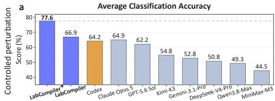

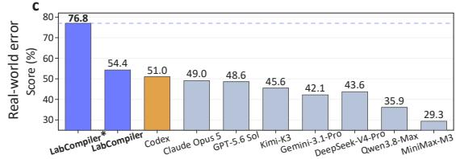

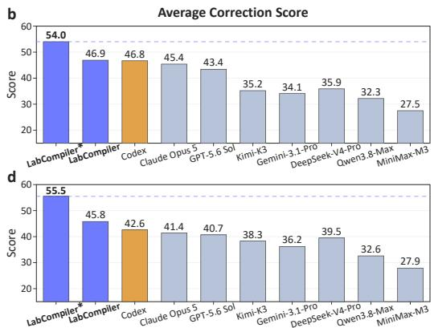

Figure 3: Average performance of protocol correction on the controlled perturbation subset (a,b) and the real-world error subset (c,d). LabCompiler\* denotes the self-evolved variant. LabCompiler consistently improves both error classification and semantic repair over direct LLM baselines.  
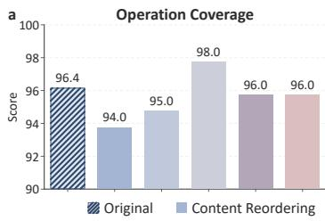

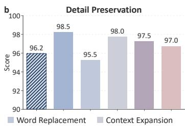

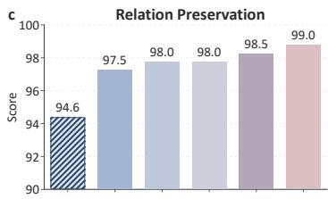  
Figure 4: Fidelity and stability of the device-agnostic representation. Original bars measure fidelity to the source protocol, while the other bars measure stability under five semantics-preserving rewrites, evaluated by (a) operation coverage, (b) detail preservation, and (c) relation preservation.

## 5.3 ANALYSIS OF DEVICE-AGNOSTIC REPRESENTATION

A reliable intermediate representation should satisfy two properties: fidelity, by preserving the experimental semantics of the source protocol, and stability, by producing consistent execution structures for semantically equivalent protocol descriptions. We evaluate these two properties separately.

Representation fidelity. We first evaluate whether the generated IR faithfully preserves the source protocol. Two independent judges assess each IR along three dimensions: operation coverage, which measures whether the required experimental operations are correctly represented without unsupported additions; detail preservation, which measures retention of execution-relevant materials, parameters, and conditions; and relation preservation, which measures whether dependencies and relationships among operations are correctly maintained. As shown by the original bars in Figure 4, LabCompiler achieves scores of 96.4, 96.2, and 94.6 on the three dimensions, respectively. The consistently high scores show that the device-agnostic abstraction preserves both the experimental operations and the execution-relevant details of the source protocol. Relation preservation is comparatively more challenging, indicating that errors are more likely to arise when reconstructing dependencies across operations than when preserving individual operations or parameters.

Representation stability. We next examine whether semantically equivalent descriptions lead to consistent representations. For each protocol, we generate ten rewrites spanning five meaningpreserving transformations: content reordering, word replacement, context expansion, structure rewrite, unit conversion. We then compare the resulting IRs with the representation generated from the original protocol. As shown in Figure 4, LabCompiler remains highly consistent across all five transformations, with average scores of 95.8 for operation coverage, 97.3 for detail preservation, and 98.2 for relation preservation. These results show that the inferred execution structure is largely insensitive to surface-level variations in protocol description, allowing semantically equivalent protocols to be mapped to consistent device-agnostic representations.

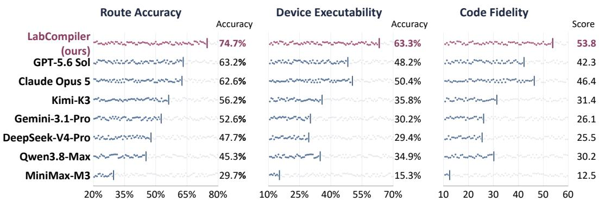  
Figure 5: Execution performance across route accuracy, device executability, and code fidelity. Lab Compiler consistently outperforms direct LLM baselines across all three metrics.

## 5.4 EVALUATION OF HYBRID EXECUTION

The final evaluation examines whether the canonical representation can be grounded into an executable human-machine workflow while preserving the intended experimental semantics. We evaluate three complementary aspects of this process: route accuracy, device executability, and code fidelity. Specifically, route accuracy measures whether each execution unit is assigned to the expertannotated executor under the available device capabilities, $i . e . ,$ a compatible device or a human operator. Device executability is evaluated on units annotated for automated execution. Generated code is considered successful only if it satisfies the target-device and resource constraints defined by the corresponding device interface and, when an official simulator or device validation pathway is available, passes the corresponding validation procedure. Finally, code fidelity evaluates whether executable code still realizes the intended experiment. Following the scoring scheme described above, two LLM judges assess each generated program along three dimensions on a 0-5 scale: action correctness, experimental constraint preservation, and logic preservation. The three dimensions are averaged and normalized to a 0-100 scale.

As shown in Figure 5, LabCompiler achieves 74.7% route accuracy, 63.3% device executability, and a code-fidelity score of 53.8, outperforming the strongest direct baseline on each metric by 11.5, 12.9, and 7.4 points, respectively. Notably, stronger routing does not necessarily lead to better downstream execution: GPT-5.6 Sol slightly exceeds Claude Opus 5 in route accuracy (63.2% vs. 62.6%), but underperforms it in both device executability (48.2% vs. 50.4%) and code fidelity (42.3 vs. 46.4). This suggests that selecting an appropriate executor is only one part of successful execution, and that preserving protocol semantics during device-specific realization remains a separate challenge. With DeepSeek-V4-Pro fixed as the backbone, LabCompiler improves route accuracy, device executability, and code fidelity by 27.0, 33.9, and 28.3 points over direct inference, respectively. The consistent gains suggest that the proposed framework, particularly its structured representation, provides a more reliable bridge from protocol semantics to device-specific execution. These metrics assess execution grounding rather than wet-lab outcomes.

## 6 CONCLUSIONS AND LIMITATIONS

We introduced LabCompiler, a staged framework for translating imperfect natural-language protocols into verifiable human-machine laboratory workflows. By separating protocol correction, device-agnostic representation, and capability-grounded execution, LabCompiler improves protocol recovery, preserves experimental semantics, and supports capability-grounded execution planning across heterogeneous laboratory settings. Experiments on both controlled and naturally occurring protocol errors further show that perturbation-guided self-evolution consistently strengthens correction performance. Our current implementation covers a finite action space and set of device backends. Future work will expand this coverage to broader laboratory settings and further validate the framework through real-world wet-lab experiments.

## REFERENCES

Anthropic. Claude Opus 5 system card, July 2026. URL https://www.anthropic.com/ claude-opus-5-system-card.

Jinheon Baek, Sujay Kumar Jauhar, Silviu Cucerzan, and Sung Ju Hwang. ResearchAgent: Iterative research idea generation over scientific literature with large language models. In Proceedings of the 2025 Conference ofthe Nations ofthe Americas Chapter ofthe Associationfor Computational Linguistics: Human Language Technologies, pp. 6709–6738. Association for Computational Linguistics, 2025. doi: 10.18653/v1/2025.naacl-long.342.

Bryan Bartley, Jacob Beal, Miles Rogers, Daniel Bryce, Robert P Goldman, Benjamin Keller, Peter Lee, Vanessa Biggers, Joshua Nowak, and Mark Weston. Building an open representation for biological protocols. ACM Journal on Emerging Technologies in Computing Systems, 19(3):1– 21, 2023.

Daniil A Boiko, Robert MacKnight, Ben Kline, and Gabe Gomes. Autonomous chemical research with large language models. Nature, 624(7992):570–578, 2023.

Yuan Gao, Yizhou Luo, Yunquan Lan, Han Jiang, Lihao Fu, and Tong Si. Autonomous liquidhandling robotics scripting through large language models enables accessible and safe protein engineering workflows. bioRxiv, 2025.

Google DeepMind. Gemini 3.1 Pro: Model card, February 2026. URL https://deepmind. google/models/model-cards/gemini-3-1-pro/. Accessed: 2026-09-20.

Hamilton Company. Microlab STAR automated liquid handling platform. URL https://www. hamiltoncompany.com/microlab-star.

Kexin Huang, Ying Jin, Ryan Li, Michael Y Li, Emmanuel Candes, and Jure Leskovec. Auto-\` mated hypothesis validation with agentic sequential falsifications. In Proceedings of the 42nd International Conference on Machine Learning, volume 267, pp. 25372–25437, 2025.

iGEM Headquarters. 20 years of communicating with the world through iGEM team wikis, September 2023. URL https://blog.igem.org/blog/2023/9/13/ communicating-with-the-world-through-igem-team-wikis.

Takashi Inagaki, Akari Kato, Koichi Takahashi, Haruka Ozaki, and Genki N Kanda. Llms can generate robotic scripts from goal-oriented instructions in biological laboratory automation. arXiv preprint arXiv:2304.10267, 2023.

Igor Ivanov. Biolp-bench: Measuring understanding of biological lab protocols by large language models. bioRxiv, 2024.

Ashwin K Jainarayanan, Anastasios Galanis, Athira Sreejith, Sourav Suresh, Amatullah Mustafa Nakara, Guilherme E Kundlatsch, and Roger Rubio-Sanchez. iGEM comes of age: Trends´ in its research output. Nature Biotechnology, 39(12):1599–1601, 2021. doi: 10.1038/ s41587-021-01152-7.

Yankai Jiang, Weiting Tang, Haoran Sun, Zhenyu Tang, Yuejie Hou, Yingnan Han, Rubo Wang, Yueyuxiao Yang, Cheng Liang, Lilong Wang, et al. A self-evolving agentic system for automated generation and execution of biological protocols. arXiv preprint arXiv:2606.31763, 2026.

Kimi Team, Tongtong Bai, Yifan Bai, Yiping Bao, et al. Kimi K3: Open frontier intelligence. arXiv preprint arXiv:2607.24653, 2026.

Jon M Laurent, Joseph D Janizek, Michael Ruzo, Michaela M Hinks, Michael J Hammerling, Siddharth Narayanan, Manvitha Ponnapati, Andrew D White, and Samuel G Rodriques. Lab-bench: Measuring capabilities of language models for biology research. arXiv preprint arXiv:2407.10362, 2024.

Jon M Laurent, Albert Bou, Michael Pieler, Conor Igoe, Alex Andonian, Siddharth Narayanan, James Braza, Alexandros Sanchez Vassopoulos, Jacob L Steenwyk, Blake Lash, et al. Labbench2: An improved benchmark for ai systems performing biology research. arXiv preprint arXiv:2604.09554, 2026.

Yuyang Liu, Liuzhenghao Lv, Xiancheng Zhang, Jingya Wang, Li Yuan, and Yonghong Tian. Bio-ProBench: A corpus and benchmark for biological protocol reasoning in autonomous science. In Proceedings of the 43rd International Conference on Machine Learning, 2026a.

Yuyang Liu, Jingya Wang, Liuzhenghao Lv, and Yonghong Tian. Bioproagent: Neuro-symbolic grounding for constrained scientific planning. In Proceedings of the 64th Annual Meeting of the Associationfor Computational Linguistics (Volume 1: Long Papers), pp. 42764–42783, 2026b.

Zhe Liu, Jiaming Gu, Zhaohui Du, Zhe Wang, Huanbo Jin, Quan Lu, Qi Wang, Ting Xiao, Minting Pan, and Dongzhan Zhou. Protoact: Turning wet-lab protocols into embodied robotic actions. arXiv preprint arXiv:2608.01690, 2026c.

Stanley Lo, Sterling G Baird, Joshua Schrier, Ben Blaiszik, Nessa Carson, Ian Foster, Andres´ Aguilar-Granda, Sergei V Kalinin, Benji Maruyama, Maria Politi, et al. Review of low-cost self-driving laboratories in chemistry and materials science: the “frugal twin” concept. Digital Discovery, 3(5):842–868, 2024.

Benjamin P MacLeod, Fraser GL Parlane, Thomas D Morrissey, Florian Hase, Lo¨ ¨ıc M Roch, Kevan E Dettelbach, Raphaell Moreira, Lars PE Yunker, Michael B Rooney, Joseph R Deeth, et al. Self-driving laboratory for accelerated discovery of thin-film materials. Science Advances, 6(20): eaaz8867, 2020.

S Hessam M Mehr, Matthew Craven, Artem I Leonov, Graham Keenan, and Leroy Cronin. A universal system for digitization and automatic execution of the chemical synthesis literature. Science, 370(6512):101–108, 2020.

MiniMax. MiniMax M3: Frontier coding, 1m context, native multimodality—all in one model, June 2026. URL https://www.minimax.io/blog/minimax-m3. Accessed: 2026-09-20.

OpenAI. GPT-5.6 Sol model, 2026. URL https://developers.openai.com/api/ docs/models/gpt-5.6-sol.

Opentrons Labworks Inc. Opentrons Flex instruction manual, a. URL https://docs. opentrons.com/flex/.

Opentrons Labworks Inc. Opentrons OT-2 instruction manual, b. URL https://docs. opentrons.com/ot-2/.

Rui Qiu, Shijie Chen, Yu Su, Po-Yin Yen, and Han Wei Shen. Completing a systematic review in hours instead of months with interactive AI agents. In Proceedings of the 63rd Annual Meeting of the Association for Computational Linguistics (Volume 1: Long Papers), pp. 31559–31593. Association for Computational Linguistics, 2025.

Qwen Team. Qwen3.8-Max: A new bar for coding and cowork, August 2026. URL https: //qwen.ai/blog?id=qwen3.8. Accessed: 2026-09-20.

Jacob T Rapp, Bennett J Bremer, and Philip A Romero. Self-driving laboratories to autonomously navigate the protein fitness landscape. Nature Chemical Engineering, 1(1):97–107, 2024.

Yixiang Ruan, Chenyin Lu, Ning Xu, Yuchen He, Yixin Chen, Jian Zhang, Jun Xuan, Jianzhang Pan, Qun Fang, Hanyu Gao, et al. An automatic end-to-end chemical synthesis development platform powered by large language models. Nature communications, 15(1):10160, 2024.

Martin Seifrid, Robert Pollice, Andres Aguilar-Granda, Zamyla Morgan Chan, Kazuhiro Hotta, Cher Tian Ser, Jenya Vestfrid, Tony C Wu, and Alan Aspuru-Guzik. Autonomous chemical experiments: Challenges and perspectives on establishing a self-driving lab. Accounts of Chemical Research, 55(17):2454–2466, 2022.

Renjian Song, Yaokai Fu, Ziyan Zhao, Jigang Yu, Qing Yuan, and Chang-Ting Chen. Towards autonomous biology: Compiler-verified protocols as a foundation for real-world ai execution. bioRxiv, 2026.

Haoran Sun, Yankai Jiang, Zhenyu Tang, Yaning Pan, Shuang Gu, Zekai Lin, Lilong Wang, Wenjie Lou, Lei Liu, Lei Bai, et al. Unleashing scientific reasoning for bio-experimental protocol generation via structured component-based reward mechanism. In International Conference on Learning Representations, volume 2026, pp. 73240–73296, 2026.

Xingyao Wang, Yangyi Chen, Lifan Yuan, Yizhe Zhang, Yunzhu Li, Hao Peng, and Heng Ji. Executable code actions elicit better llm agents. In Proceedings ofthe 41st International Conference on Machine Learning, volume 235, pp. 50208–50232, 2024.

Anyi Xu, Bangcai Lin, Bing Xue, Bingxuan Wang, Bingzheng Xu, Bochao Wu, Bowei Zhang, Chaofan Lin, Chen Dong, Chenchen Ling, et al. Deepseek-v4: Towards highly efficient milliontoken context intelligence. arXiv preprint arXiv:2606.19348, 2026.

John Yang, Carlos Jimenez, Alexander Wettig, Kilian Lieret, Shunyu Yao, Karthik Narasimhan, and Ofir Press. Swe-agent: Agent-computer interfaces enable automated software engineering. In Advances in Neural Information Processing Systems, volume 37, pp. 50528–50652, 2024.

## CONTENTS

A Comparison with Closely Related Systems 14   
B Protocol Firewall and Self-Evolving Diagnosis 14   
B.1 SCREENING CRITERIA AND DECISION RULES 14   
B.2 Minimal Repair and Resolution Traces 16   
B.3 Memory Construction and Frozen Evaluation 16   
C Device-Agnostic Intermediate Representations 16   
C.1 Semantic Experiment Graph Schema 16   
C.2 Canonical Action Graph Schema and the 26 Canonical Actions . 19   
C.3 Deterministic Canonicalization Rules 21   
C.4 Worked Representation Examples 22   
D Execution Grounding and Device Routing Details 24   
D.1 Execution-Unit Construction and Execution Modes 24   
D.2 Device Capability Matrix 25   
D.3 Cross-Device Resource Binding and Human Handoffs . 28   
D.4 Validation Levels, Compilation Failures, and Fallback . 29   
E Benchmark Construction, Data Splits, and Expert Annotation 30   
E.1 Data Provenance and Perturbation Construction 30   
E.2 Protocol-Disjoint Splits and Leakage Audit 31   
E.3 Expert Review of Benchmark Annotations 32   
F Component-Wise Ablations 33   
F.1 SCREENING Loop 33   
F.2 Troubleshooting Memory 33   
F.3 Two-Level Representation 34   
F.4 Execution-Unit Grouping 35   
G Evaluation Protocols, Expert–Judge Agreement, and Statistical Details 35   
G.1 Experimental Configurations and Stage-Wise Evaluation Inputs . 35   
G.2 Scoring Rubrics and Metric Denominators 35   
G.3 Expert Validation of LLM-Judge Scores 38   
G.4 Reporting Conventions and Statistical Details 39   
H Additional Results on Lab-Bench 40

## A COMPARISON WITH CLOSELY RELATED SYSTEMS

Recent studies have explored different components of laboratory automation, including structured protocol representations, protocol reasoning and verification, robotic execution, and agentic scientific workflow generation. Table A.1 summarizes capabilities explicitly described in closely related systems that are relevant to reliable protocol-to-execution translation.

We use three categories to describe each capability. “Supported” indicates that the capability is explicitly described or implemented in the original publication. “Partial” indicates that the work contains a related mechanism but differs in scope, objective, or level of integration. “Not explicitly reported” indicates that the corresponding capability is not described in the original publication and does not imply that the system cannot support it. The table is intended as a qualitative summary of reported system components rather than a unified empirical benchmark across systems.

Table A.1: Qualitative summary of explicitly reported capabilities in closely related laboratory automation systems. Hierarchical representation refers to systems that expose multiple abstraction levels or explicit transformation stages between protocol descriptions and execution representations. Human hybrid workflow support refers to explicit coordination between automated and humanperformed operations rather than the general possibility of manual intervention.
<table><tr><td>Method</td><td>Protocol defect repair</td><td>Explicit protocol verification</td><td>IR</td><td>Device- Hierarchical Device agnostic representa- capability tion</td><td>grounding</td><td>Human hybrid workflow</td><td>Auditable intermedi- ate artifacts</td></tr><tr><td>XDL (Mehr et al., 2020)</td><td>Partial</td><td>Supported Supported</td><td></td><td>Partial</td><td>Partial</td><td>Not explicitly reported</td><td>Supported</td></tr><tr><td>LabOP (Bartley et al., 2023)</td><td>Not explicitly reported</td><td>Supported Supported</td><td></td><td>Partial</td><td>Partial</td><td>Supported</td><td>Supported</td></tr><tr><td>BPL (Song et al., 2026)</td><td>Partial</td><td>Supported Supported</td><td></td><td>Partial</td><td>Supported Supported</td><td></td><td>Partial</td></tr><tr><td>BioProAgent (Liu et al., 2026b)</td><td>Partial</td><td>Supported</td><td>Partial</td><td>Partial</td><td>Supported</td><td>Partial</td><td>Partial</td></tr><tr><td>ProtoAct (Liu et al., 2026c)</td><td>Partial</td><td>Partial</td><td>Partial</td><td>Partial</td><td>Supported</td><td>Partial</td><td>Partial</td></tr><tr><td>ProtoPilot (Jiang et al., 2026)</td><td></td><td>Supported Supported</td><td>Partial</td><td>Partial</td><td>Supported</td><td>Partial</td><td>Supported</td></tr><tr><td>LabCompiler</td><td></td><td></td><td></td><td></td><td>Supported Supported Supported Supported Supported Supported Supported</td><td></td><td></td></tr></table>

The comparison emphasizes a distinction that is central to LabCompiler: laboratory workflows may combine automated operations with human observation, judgment, or manipulation when available devices cannot fully execute a protocol. LabCompiler retains these operations as explicit humancoordinated steps while preserving intermediate artifacts for inspection.

## B PROTOCOL FIREWALL AND SELF-EVOLVING DIAGNOSIS

## B.1 SCREENING CRITERIA AND DECISION RULES

The protocol firewall applies an iterative diagnose–repair–screen procedure before semantic compilation. In this work, a “verified” protocol is an internal status assigned after the protocol passes the firewall’s screening criteria. It indicates that the diagnosed defect has been addressed, unaffected content has been preserved, and the applicable consistency and ambiguity-handling checks have passed. It does not constitute a formal proof of scientific correctness or physical laboratory validation. The firewall evaluates four major aspects:

Table B.2: Summary of protocol firewall screening criteria.
<table><tr><td>Category</td><td>Check</td><td>Failure handling</td></tr><tr><td>Report structure</td><td>Required screening fields and protocol artifact consistency</td><td rowspan="3">The screening report is rejected and returned for revision The candidate protocol is re- jected if valid content is re-</td></tr><tr><td>Experimental content preservation</td><td>Preservation of explicit op- erations, materials, prepara- tion commitments, and protocol</td></tr><tr><td>Consistency checking</td><td>moved or altered without justi- constraints fication Consistency among steps, ma- Feedback is returned for an- terials, parameters, and depen-</td></tr><tr><td>Ambiguity classifica- tion</td><td>dencies Classification of remaining am- biguities into blocking or de-</td><td rowspan="2">other repair attempt Blocking ambiguity leads to un- resolved status; deferred ambi- guity may be carried forward Unsupported assumptions re-</td></tr><tr><td>Evidence-supported completion</td><td>ferred cases Completion of missing infor- mation only when supported by main unresolved rather than be- available evidence or justified ing inserted</td></tr></table>

• Report validity: the screening output must satisfy the required protocol report format and contain the necessary effective protocol artifact.

• Content preservation: explicit experimental information in the original protocol, including operations, materials, preparation requirements, and relevant constraints, must be preserved unless a justified correction is required.

• Protocol consistency: the repaired protocol must maintain consistency among operations, materials, parameters, and dependencies.

• Ambiguity handling: remaining ambiguities are classified according to whether they prevent construction of a valid executable representation.

The verification process distinguishes deterministic checks from scientific-context judgments. Deterministic checks are enforced by the screening system and cannot be overridden by the model’s self-reported status. Scientific-context decisions determine whether missing information can be reasonably resolved or should remain explicitly represented as ambiguity. Table B.2 summarizes the screening criteria.

The firewall uses four execution states:

• Accept: all applicable screening constraints are satisfied and an approved effective protocol is generated.

• Revise: the submitted screening result fails a screening constraint and is returned for another repair attempt.

• Unresolved: protocols marked unresolved are excluded from downstream automated execution.

• Clarification required: remaining ambiguity is preserved for human clarification when it does not prevent continued execution planning.

Clarification required indicates that additional human input is needed before the corresponding unresolved interpretation can be finalized. Such cases are kept explicit in the workflow artifacts and are not treated as automatically resolved scientific decisions. Remaining ambiguities that do not block representation may be retained as explicit clarification items for human review. Such items are preserved in the workflow artifacts rather than silently resolved by unsupported assumptions. In contrast, blocking ambiguities prevent generation of an approved effective protocol and stop downstream compilation.

The diagnose–repair–verify loop follows the iterative procedure described in the main text. The revision process continues for at most 12 iterations. If the protocol does not satisfy the screening requirements within this budget, the protocol is marked unresolved.

## B.2 MINIMAL REPAIR AND RESOLUTION TRACES

The repair process follows a minimal modification principle. The objective is to resolve diagnosed defects while preserving unaffected experimental information. The screening module avoids introducing additional operations, parameters, or assumptions that are not supported by the protocol context. For each accepted modification, the firewall records a structured resolution trace. The trace provides correspondence between the original protocol and the accepted effective protocol, enabling inspection of how each correction was obtained.

A resolution record contains the following information: Resolution traces are also used to distinguish protocol-level clarification from execution-level human involvement. Scientific ambiguities that cannot be resolved from available evidence are preserved as remaining ambiguities rather than being replaced by unsupported assumptions. Human clarification and human execution represent different mechanisms. Human clarification occurs during protocol screening when scientific inter pretation remains unresolved. Human execution occurs after representation and routing when an operation cannot be automatically executed using available laboratory capabilities.

## B.3 MEMORY CONSTRUCTION AND FROZEN EVALUATION

LabCompiler uses perturbation-guided self-evolution to construct an external troubleshooting memory from corrected protocol-recovery examples. Each self-evolution example consists of a perturbed protocol and its reference correction. LabCompiler first performs protocol diagnosis and repair on the perturbed protocol, compares the resulting diagnosis and correction against the reference correction, and then distills reusable troubleshooting experience into memory. The resulting memory is intended to capture transferable diagnostic and repair patterns rather than to store or reproduce individual protocol instances. Memory entries summarize reusable information such as characteristic error patterns, contextual conditions under which a pattern may apply, relevant screening considerations, and correction guidance. The underlying language-model parameters are not updated during this process; self-evolution only updates the external troubleshooting memory used by the protocol firewall.

For controlled analysis, we vary the amount of protocol-recovery experience used for memory construction. Let K denote the number of self-evolution examples sampled from each perturbation category. We evaluate $K \in \{ 0 , 5 0 , 1 0 0 \}$ . Because the controlled benchmark contains four perturbation categories, these settings correspond to 0, 200, and 400 memory-construction examples in total, respectively. The per-category allocation is used only to construct balanced self-evolution pools. Importantly, perturbation-category labels are not provided to LabCompiler during memory construction; the system learns troubleshooting patterns from the protocol–reference pairs without explicit error-category supervision.

The full self-evolution split contains 100 examples from each perturbation category, for a total of 400 examples. These examples are separated from the 2,000 held-out controlled evaluation instances described in Appendix E. The 50-example-per-category condition uses a subset of 200 self-evolution examples, whereas the 100-example-per-category condition uses the complete 400-example selfevolution split. For each evaluation condition, troubleshooting memory is constructed before evaluation and then frozen. Held-out evaluation protocols, their reference corrections, and their evaluation annotations are not used to update the memory during testing. Consequently, differences among the $K = 0 , K = 5 0$ , and K = 100 conditions reflect different amounts of previously accumulated troubleshooting experience while keeping the evaluation set and the underlying language model fixed.

## C DEVICE-AGNOSTIC INTERMEDIATE REPRESENTATIONS

## C.1 SEMANTIC EXPERIMENT GRAPH SCHEMA

The Semantic Experiment Graph, $G _ { \mathrm { s e m } } .$ , represents the experimental semantics of the approved effective protocol before device-specific realization. An operation is represented as a logical node, while predecessor relationships are represented through explicit dependencies. Participating materials, samples, containers, and collections are represented as logical objects rather than physical device resources. The serialized representation contains an operations array and, when applicable, an analysis annotations array. Table C.3 summarizes the operation-level schema.

Table C.3: Operation-level fields of the Semantic Experiment Graph.
<table><tr><td>Field</td><td>Type</td><td>Description</td></tr><tr><td>operation_id</td><td>String</td><td>Unique identifier of the semantic operation.</td></tr><tr><td>operation_type</td><td>String</td><td>Semantic operation type before canonical action normalization.</td></tr><tr><td>source_text</td><td>String</td><td>Exact excerpt from the approved effective protocol supporting the operation.</td></tr><tr><td>objects</td><td>Array</td><td>Logical materials, samples, containers, or collections participating in the operation, together with their semantic roles.</td></tr><tr><td>parameters</td><td>Object</td><td>Quantitative parameters, experimental conditions, and other operation-level values explicitly represented by the</td></tr><tr><td>dependencies</td><td>Array</td><td>protocol. Identifiers of predecessor operations.</td></tr><tr><td>operation_detailsObject</td><td></td><td>Additional semantic information that does not belong to the dependency structure or primary parameter set.</td></tr></table>

Logical objects and material flow. Objects may contain a stable logical identifier, a humanreadable name, a semantic role, an object type, and attributes that are explicitly established by the protocol. Examples include a sample, solution, container, plate, or collection of wells. Object identity is kept separate from object state. The same logical sample can therefore be referenced by successive operations without creating a new identity solely because its state has changed. Material flow is represented jointly by logical object reuse and operation dependencies. The semantic representation does not bind these objects to a physical well, deck slot, pipette, or device instance. Such bindings are introduced only during execution grounding.

Control and dependencies. $G _ { \mathrm { s e m } }$ represents procedural ordering and prerequisite relations through explicit dependencies between operations. Control-related information, including conditions, repetitions, and qualitative endpoints, is retained as semantic attributes of the corresponding operations when it is part of the approved protocol. When an operation depends on independently prepared branches, its dependencies preserve the relevant predecessor operations rather than collapsing the branches into a single implicit ordering.

Source correspondence. Each semantic operation retains a source text field that points to the corresponding text in the approved effective protocol. The correspondence from the original raw protocol to the approved effective protocol is maintained separately through the resolution traces described in Appendix B.

Missing values. Empty object, parameter, and dependency collections are represented as [], {}, and [], respectively. An unknown numerical value is represented by omitting the corresponding parameter key rather than inserting a numerical default.

When a value has been explicitly declared as a runtime quantity, it may be represented as

{"runtime\_input": "<declared\_name>"}

Derived values may retain a formula together with the runtime inputs referenced by that formula. Qualitative protocol descriptions remain qualitative unless a numerical value is explicitly established by the protocol or by the preceding screening stage.

Analysis annotations. Protocol statements that describe analysis rather than material manipula tion can be stored separately in analysis annotations. An annotation records its identifier, type, source text, related operation identifiers, and optional details. For example, constructing a standard curve after a plate measurement can be retained as an analysis annotation rather than being converted into an execution action.

## Illustrative serialization. For the protocol fragment

Transfer 200 uL of sample alpha to destination alpha.   
Measure absorbance of each assay reaction at 450 nm.   
Build a standard curve and calculate each sample concentration.

a simplified semantic representation is:

```jsonl
{
"operations": [
{
"operation_id": "op-001",
"operation_type": "liquid_transfer",
"source_text": "Transfer 200 uL of sample_alpha to
destination_alpha.",
"objects": [
{
"object_id": "sample_alpha",
"name": "sample_alpha",
"role": "source"
},
{
"object_id": "destination_alpha",
"name": "destination_alpha",
"role": "destination"
}
],
"parameters": {
"volume": "200 uL"
},
"dependencies": [],
"operation_details": {}
},
{
"operation_id": "op-measure",
"operation_type": "measure_absorbance",
"source_text": "Measure absorbance of each assay reaction at 450
nm.",
"objects": [
{
"name": "assay reactions",
"role": "measurement targets"
}
],
"parameters": {
"wavelength": "450 nm"
},
"dependencies": ["op-001"],
"operation_details": {}
}
],
"analysis_annotations": [
{
"annotation_id": "ann-standard-curve",
"annotation_type": "post_measurement_analysis",
"source_text": "Build a standard curve and calculate each sample
concentration.",
"related_operation_ids": ["op-measure"]
}
]
}
```  
Listing 1: Example JSON output of the structured representation of laboratory operations and postmeasurement analysis.

Table C.4: Operation-level fields of the Canonical Action Graph.
<table><tr><td>Field</td><td>Description</td></tr><tr><td>normalized_operation_id</td><td>Unique identifier of the normalized operation.</td></tr><tr><td>canonical_action</td><td>One of the 26 canonical action identifiers listed in Table C.5.</td></tr><tr><td>sequence_index</td><td>Position of the operation in the normalized operation sequence.</td></tr><tr><td>derived_from_semantic _operation_ids</td><td>Semantic operations from which the canonical operation is derived.</td></tr><tr><td>source_texts</td><td>Source excerpts corresponding to the contributing semantic operations.</td></tr><tr><td>objects</td><td>Mapping between action-specific logical roles and logical objects.</td></tr><tr><td>parameters</td><td>Action-specific experimental parameters.</td></tr><tr><td>dependencies</td><td>Predecessor canonical operations.</td></tr><tr><td>operation_details</td><td>Additional action-specific semantic details.</td></tr><tr><td>control</td><td>Condition, repetition, endpoint, or constraint metadata when</td></tr><tr><td>normalization_trace</td><td>present. Provenance of the semantic-to-canonical transformation.</td></tr></table>

## C.2 CANONICAL ACTION GRAPH SCHEMA AND THE 26 CANONICAL ACTIONS

The Canonical Action Graph, $G _ { \mathrm { c a n } }$ , expresses the experiment using a standardized vocabulary of 26 laboratory action types. The representation remains device-agnostic: canonical actions specify what operation is required without selecting a physical executor or binding the operation to devicespecific resources. Each normalized operation preserves its correspondence to $G _ { \mathrm { s e m } }$ and contains the fields summarized in Table C.4.

Object roles. Unlike the object array in $G _ { \mathrm { s e m } } ,$ the objects field in $G _ { \mathrm { c a n } }$ is organized using action-specific logical roles. For example, a liquid-transfer operation may contain source and destination, whereas an incubation operation primarily acts on a sample. These roles remain logical. They do not encode a physical deck location, well allocation, or selected laboratory instrument.

Quantities and units. An explicit numerical quantity may be represented as follows, such that both the normalized quantity and its original textual form are retained:

```json
{
"value": 200,
"unit": "uL",
"source_value": "200 uL"
}
```

Canonical unit labels include uL and mL for volume; celsius for temperature; second, minute, hour, and day for time; rpm for rotational speed; g for relative centrifugal force; and nm for wavelength. Missing values are not introduced solely to populate the schema. Device-specific capability ranges and resource requirements are applied during execution grounding and are described in Appendix D.

Table C.5: Complete vocabulary of the 26 canonical actions, including their experimental semantics, logical roles, and key semantic restrictions.
<table><tr><td>Canonical action</td><td>Semantics and logical roles</td><td>Key semantic restriction</td></tr><tr><td>liquid transfer</td><td>Move liquid from one logical source to one logical destination.</td><td>Single-source, single-destination liquid movement; it does not represent</td></tr><tr><td>liquid distribution</td><td>Distribute liquid from one source to multiple logical destinations.</td><td>mixing or liquid disposal. Used when one source supplies a logical destination collection.</td></tr><tr><td>liquid consolidation</td><td>Collect liquid from multiple logical sources into one destination.</td><td>Distinguished from a single-source liquid transfer.</td></tr><tr><td>liquid_removal</td><td>Remove liquid from a source to a discard destination; a protected material may remain</td><td>Represents removal rather than productive transfer of the</td></tr><tr><td>non_liquid_ sample_transfer</td><td>in the source. Move a discrete non-liquid sample to a logical destination.</td><td>removed liquid. Used for non-liquid sample movement rather than liquid</td></tr><tr><td>solid combination</td><td>Combine a solid component and a liquid component into a resulting product.</td><td>transfer. Material phase must be supported by the interpreted</td></tr><tr><td>non_liquid_ material_removal</td><td>Remove a non-liquid material from a source while retaining the relevant remaining</td><td>protocol. Distinguished from liquid removal and whole-sample</td></tr><tr><td>pipette_mixing</td><td>material. Mix a sample through repeated aspiration and</td><td>transfer. Preserves explicit</td></tr><tr><td>vortex_mixing</td><td>dispensing. Mix a sample by vortexing.</td><td>pipette-mixing semantics. Vortexing is retained as a</td></tr><tr><td>orbital_shaking</td><td>Apply orbital shaking to a sample.</td><td>distinct mixing mechanism. Preserves orbital-shaking</td></tr><tr><td>mechanical</td><td>Mechanically stir a sample</td><td>semantics. Used when a mechanical</td></tr><tr><td>stirring manual_inversion</td><td>Mix a sample by repeatedly inverting its</td><td>stirring mechanism is specified. Preserves inversion rather than</td></tr><tr><td></td><td>container. Maintain a sample under stated experimental</td><td>replacing it with another mixing mechanism. Used when the operation</td></tr><tr><td></td><td>conditions for a duration or until a stated endpoint. Measure a sample using a stated plate-reading</td><td>carries incubation semantics. Measurement modality and</td></tr><tr><td></td><td>modality.</td><td>wavelengths are preserved without selecting a physical reader.</td></tr><tr><td>waiting temperature_</td><td>Represent a protocol-defined delay or waiting period. Apply or maintain a non-cyclic temperature</td><td>Used when the operation does not carry incubation semantics. Distinguished from a repeated</td></tr><tr><td>control</td><td>condition.</td><td>multi-step temperature program.</td></tr><tr><td>thermal_cycling</td><td>Apply a repeated multi-step temperature program.</td><td>Represents an explicitly structured thermal-cycling program.</td></tr><tr><td>magnetic separation</td><td>Separate magnetic material from or within a sample using a magnetic field.</td><td>Requires magnetic-separation semantics.</td></tr><tr><td>plate_tilting</td><td>Tilt a plate to a stated orientation.</td><td>Tilting does not itself imply shaking or inversion.</td></tr><tr><td>centrifugation</td><td>Apply centrifugation to a sample.</td><td>Rotational speed and relative centrifugal force remain</td></tr><tr><td>plate_washing</td><td>Represent a protocol-level washing operation</td><td>distinct quantities. Retains high-level plate-washing semantics.</td></tr></table>

Continued on next page

Table C.5 continued from previous page
<table><tr><td>Canonical action</td><td>Semantics and logical roles</td><td>Key semantic restriction</td></tr><tr><td>plate_sealing</td><td>Seal a sample plate.</td><td>Sealing conditions are retained when specified.</td></tr><tr><td>plate_unsealing</td><td>Remove a seal from a sample plate.</td><td>Distinguished from applying a plate seal.</td></tr><tr><td>colony_picking</td><td>Pick specified colonies from a sample plate.</td><td>Requires colony-picking semantics in the interpreted protocol.</td></tr><tr><td>controlled_ environment</td><td>Operate under explicitly stated environmental conditions.</td><td>Retains explicitly stated environmental conditions without selecting a physical</td></tr><tr><td>reagent_ dispensing</td><td>Dispense reagent using dedicated dispensing semantics.</td><td>environment controller. Distinguished from ordinary liquid transfer or distribution</td></tr></table>

## C.3 DETERMINISTIC CANONICALIZATION RULES

As defined in the main text, the approved effective protocol is first mapped to $G _ { \mathrm { s e m } }$ through semantic interpretation and then normalized into $G _ { \mathrm { c a n } }$

$$
\widetilde { P } \stackrel { \mathcal { S } } { \longrightarrow } G _ { \mathrm { s e m } } \stackrel { \mathcal { N } } { \longrightarrow } G _ { \mathrm { c a n } } .\tag{4}
$$

Here, $s$ resolves protocol-level semantics, whereas $\mathcal { N }$ standardizes the resulting representation into the canonical action space. The main deterministic transformations are described below.

Parameter and unit normalization. Equivalent textual quantity forms are mapped to a common representation. For example, "200 uL" is normalized as

```json
{
"value": 200,
"unit": "uL",
"source_value": "200 uL"
}
```

Unit aliases are normalized without changing the underlying stated quantity. For example, microliter variants are represented as uL, Celsius temperature as celsius, and common time abbreviations are mapped to their canonical time-unit labels. Normalization does not introduce a numerical value solely because a parameter is absent. Qualitative experimental conditions remain qualitative unless a quantitative value has already been established by the protocol interpretation.

Canonical operation granularity. $G _ { \mathrm { c a n } }$ projects semantically equivalent operations onto a common action vocabulary. Compound operations may therefore be decomposed into multiple canonical operations when required to expose the executable action structure. Conversely, multiple semantic fragments that jointly describe one executable action can retain their combined lineage in the normalized representation. The normalization trace records the correspondence using four mapping modes: direct, decomposed, merged, and decomposed and merged, together with the contributing semantic operation identifiers and source text.

Repeated and multi-target operations. Repeated or multi-target procedures are made explicit in $G _ { \mathrm { c a n } }$ . In particular, the example described in the main text,

## Add 100 uL of blue dye reagent to every occupied well.

is represented in $G _ { \mathrm { s e m } }$ as one semantic operation over 17 targets and normalized into 17 targetspecific liquid-transfer actions. This makes the individual executable actions explicit while preserving their common semantic origin.

Dependencies and lineage. Normalization preserves the dependency structure established in $G _ { \mathrm { s e m } }$ . Every canonical action records the semantic operation or operations from which it was derived. When a single semantic operation is decomposed, the resulting canonical operations retain the same source lineage. Logical sample and material identities are likewise preserved across the transformation. Canonicalization changes the representation and action granularity without performing physical resource allocation.

Control information. Conditions, repetitions, endpoints, and other control information can be retained in the control field of a canonical operation. Waiting behavior is represented through the canonical waiting or incubation actions according to the semantics established upstream. Canonicalization does not introduce device selection, physical well allocation, deck placement, or backend code. These decisions belong to the execution-grounding stage described in Appendix D.

Missing information. Missing numerical values remain absent rather than being filled with arbitrary defaults. Explicit runtime quantities retain their declared runtime bindings, while derived quantities retain their formulas and referenced runtime inputs. This treatment preserves the distinction between information that is specified by the protocol, information resolved during protocol screening, and information that remains unavailable at canonicalization time.

## C.4 WORKED REPRESENTATION EXAMPLES

The following examples illustrate the correspondence between protocol text, $G _ { \mathrm { s e m } } .$ , and $G _ { \mathrm { c a n } }$ . The JSON blocks show selected fields only; they are not complete serialized artifacts.

## C.4.1 DIRECT MAPPING AND QUANTITY NORMALIZATION

Consider the effective protocol:

Transfer 200 uL of sample alpha to destination alpha.   
Measure absorbance of each assay reaction at 450 nm.   
Build a standard curve and calculate each sample concentration.

The first two statements correspond to executable semantic operations. The final statement is retained as an analysis annotation.

A selected semantic excerpt is:

```json
{
"operation_id": "op-001",
"operation_type": "liquid_transfer",
"objects": [
{
"object_id": "sample_alpha",
"role": "source"
},
{
"object_id": "destination_alpha",
"role": "destination"
}
],
"parameters": {
"volume": "200 uL"
},
"dependencies": []
}
```

## The corresponding canonical excerpt is:

"normalized\_operation\_id": "norm-001",   
"canonical\_action": "liquid\_transfer",

"derived\_from\_semantic\_operation\_ids": [   
"op-001"   
],   
"objects": {   
"source": {   
"logical\_object\_id": "sample\_alpha"   
},   
"destination": {   
"logical\_object\_id": "destination\_alpha"   
}   
},   
"parameters": {   
"volume": {   
"value": 200,   
"unit": "uL",   
"source\_value": "200 uL"   
}   
},   
"dependencies": []   
}

The transformation therefore changes the representation of the quantity and logical object roles without changing the stated transfer semantics. The absorbance operation is represented using plate reading, while the analysis annotation does not become an execution node.

## C.4.2 EXPANSION OF A MULTI-TARGET OPERATION

The second example corresponds to the multi-target operation described in the main text:

## Add 100 uL of blue dye reagent to every occupied well.

For this example, the semantic representation contains 17 logical targets:

```json
{
"operation_id": "op-add",
"operation_type": "liquid_add",
"objects": [
{
"object_id": "blue-dye",
"name": "blue dye reagent",
"role": "source"
},
{
"object_id": "occupied-wells",
"role": "destination",
"member_count": 17
}
],
"parameters": {
"volume_per_destination": "100 uL"
},
"dependencies": []
}
```

Normalization expands this collection-level semantic operation into 17 target-specific canonical actions:

$$
v _ { \mathrm { a d d } } \longrightarrow \left\{ u _ { \mathrm { a d d , 1 } } , \dotsc , u _ { \mathrm { a d d , 1 7 } } \right\} .\tag{5}
$$

A selected canonical action is:

{   
"normalized\_operation\_id": "norm-add-01",   
"canonical\_action": "liquid\_transfer",   
"derived\_from\_semantic\_operation\_ids": [   
"op-add"   
],   
"objects": {   
"source": {   
"logical\_object\_id": "blue-dye"   
},   
"destination": {   
"logical\_object\_id": "target-01"   
}   
},   
"parameters": {   
"volume": {   
"value": 100,   
"unit": "uL",   
"source\_value": "100 uL"   
}   
},   
"normalization\_trace": {   
"mapping\_mode": "decomposed"   
}   
}

The remaining actions correspond to the other 16 logical targets. The target identifiers represent logical targets rather than physical well addresses. Assignment to physical labware, devices, and locations is deferred to the execution-grounding stage.

## D EXECUTION GROUNDING AND DEVICE ROUTING DETAILS

## D.1 EXECUTION-UNIT CONSTRUCTION AND EXECUTION MODES

The Canonical Action Graph specifies the experimental actions and their dependencies, but does not determine how these actions are executed in a particular laboratory. Before device assignment, related canonical actions are therefore organized into execution units. Each execution unit represents a coherent portion of the workflow that can be considered jointly for executor selection and resource grounding.

Execution-unit construction. Execution-unit grouping follows the material-flow and dependency structure encoded in $G _ { \mathrm { c a n } }$ . Actions may remain in the same execution unit when they contribute to the same local experimental objective, operate on a continuous logical material state, and can be executed consecutively without crossing a required control or resource boundary. Table D.6 summarizes the grouping rules. The execution-unit graph preserves the partial order of the canonical action graph. Dependencies between actions assigned to different units induce dependencies between the corresponding execution units. Grouping therefore changes execution granularity without changing the experimental ordering established by the intermediate representation.

Automated execution corresponds to selecting a compatible device $d \in \mathcal { D }$ . The execution unit subsequently enters device assignment, physical-resource binding, backend generation, and the applicable validation pathway.

Human-coordinated execution corresponds to the HUMAN executor in Eq. (3). This category includes operations performed directly by a human as well as operations in which a human operates or supervises an appropriate laboratory instrument. When relevant, the routing artifact may retain device guidance for the operator; this does not constitute a separate executor class. Table D.7 summarizes the principal information retained for the two modes.

Table D.6: Execution-unit grouping rules.
<table><tr><td>Criterion</td><td>Grouping rule</td></tr><tr><td>Local experimental objective</td><td>Actions that jointly accomplish the same local experimental operation may be grouped when no intervening boundary requires independent execution.</td></tr><tr><td>Material continuity</td><td>Actions operating on the same logical sample or material state may remain in the same unit when the intermediate state does not need to be exposed to another unit.</td></tr><tr><td>Dependency structure</td><td>The original prerequisite relations in  $G _ { \mathrm { c a n } }$  are preserved. Grouping does not remove a dependency required by a downstream operation.</td></tr><tr><td>Control boundary</td><td>A waiting period, incubation boundary, conditional operation, experimental endpoint, or measurement whose result is consumed downstream may separate execution units.</td></tr><tr><td>Resource continuity</td><td>Actions may be grouped only when a compatible realization exists for the resulting unit. A required change of executor or physical carrier can therefore introduce a unit boundary.</td></tr><tr><td>Intermediate-material use</td><td>When an intermediate material or state is independently consumed by another part of the workflow, its producing and consuming operations remain separated by an explicit dependency boundary.</td></tr></table>

Table D.7: Execution modes and corresponding routing information.
<table><tr><td>Mode</td><td>Eq. (3) executor</td><td>Retained routing information</td></tr><tr><td>Automated</td><td> $d \in \mathcal { D }$ </td><td>Canonical-operation lineage and dependencies, compatible-device set, physical-resource bindings, generated backend artifact, and validation result.</td></tr><tr><td>Human-coordinated</td><td>HUMAN</td><td>Source operation and canonical-operation context, dependencies, human-execution instruction, relevant runtime inputs, and optional device-class or device-model guidance.</td></tr></table>

## D.2 DEVICE CAPABILITY MATRIX

Meaning of device integration. The 45 devices reported in the main text are physically integrated laboratory devices supported by the LabCompiler execution layer. For each integrated device, the system provides an explicit capability description together with a device-facing grounding interface or backend through which supported canonical actions can be mapped to device-specific commands and checked against applicable device and resource constraints. The available validation pathway differs across device backends.

Device capability matrix. Table D.8 lists the 45 physical devices used by the grounding catalog. Canonical action names follow Appendix C.2. The validation pathways are abbreviated as official simulation, offline simulation, and contract validation.

Table D.8: Device capability matrix.
<table><tr><td>Device</td><td>Backend family</td><td>Supported canonical actions</td><td>Integration</td><td>Key constraints</td><td>Validation</td></tr><tr><td>Opentrons OT-2</td><td>Opentrons</td><td>liquid_transfer, liquid_distribution, liquid_consolidation, liquid_removal, pipette_mixing, orbital_shaking, temperature_control, incubation,</td><td>Adapter + compiler</td><td>Positive liquid volumes; mixing Official volume up to 1000 uL; shaking sim. 200–3000 rpm; temperature, thermal-cycling, and magnetic-module constraints are checked when applicable.</td><td></td></tr></table>

Continued on next page

Table D.8 continued from previous page
<table><tr><td rowspan=1 colspan=22>Device            Backend      Supported canonical actions    Integration      Key constraints             Validationfamily</td></tr><tr><td rowspan=32 colspan=22>Opentrons Flex      Opentrons     liquid_transfer,         Adapter +       Positive liquid volumes and    Officialcompatible liquid-handling    sim.resources.pipette_mixingOfflinesim.compatible plate, reservoir, andtube-rack resources.Eight-channel liquid handling; Offlineliquid_distribution,    compiler                                 sim.liquid_removal,Offlineliquid_distribution,                   volumes up to 1000 uL.       sim.Offlineliquid_distribution,    compiler       volumes up to 1000 uL.      sim.formats; mode-specific</td></tr><tr><td rowspan=2 colspan=6></td><td rowspan=1 colspan=6></td><td rowspan=1 colspan=6></td></tr><tr><td rowspan=1 colspan=9></td></tr><tr><td rowspan=1 colspan=6></td><td rowspan=1 colspan=9></td></tr><tr><td rowspan=1 colspan=6></td></tr><tr><td rowspan=2 colspan=6>Hamilton STARPyLabRobot</td></tr><tr><td rowspan=1 colspan=14></td></tr><tr><td rowspan=2 colspan=6></td><td rowspan=1 colspan=8>liquid_distribution,</td><td rowspan=1 colspan=4></td></tr><tr><td rowspan=1 colspan=4></td><td rowspan=1 colspan=8>liguid_consolidation.</td><td rowspan=1 colspan=3></td></tr><tr><td rowspan=1 colspan=6></td><td rowspan=1 colspan=8>liquid_removal,</td><td rowspan=1 colspan=3></td></tr><tr><td rowspan=1 colspan=6></td><td rowspan=1 colspan=8></td><td rowspan=1 colspan=3></td></tr><tr><td rowspan=1 colspan=3>Hamilton Nimbus</td><td rowspan=1 colspan=3>PyLabRobot</td><td rowspan=1 colspan=8>liquid_transfer,</td><td rowspan=1 colspan=3>Adapter +</td></tr><tr><td rowspan=1 colspan=4></td><td rowspan=1 colspan=2></td><td rowspan=1 colspan=8>liquid_distribution,</td><td rowspan=1 colspan=3>compiler</td><td rowspan=4 colspan=2></td></tr><tr><td rowspan=2 colspan=5></td><td rowspan=1 colspan=1></td><td rowspan=1 colspan=8>liquid_consolidation,</td><td rowspan=2 colspan=3></td></tr><tr><td rowspan=1 colspan=4></td><td rowspan=1 colspan=8>liquid_removal,</td></tr><tr><td rowspan=1 colspan=6></td><td rowspan=1 colspan=8></td><td rowspan=1 colspan=1></td><td rowspan=1 colspan=2></td></tr><tr><td rowspan=1 colspan=6>Hamilton VantagePyLabRobot</td><td rowspan=1 colspan=8></td><td rowspan=1 colspan=1>Adapter +</td><td rowspan=1 colspan=2></td><td rowspan=1 colspan=2>Eight-channel liquid handling;</td></tr><tr><td rowspan=1 colspan=6></td><td rowspan=1 colspan=8>liquid_distribution,</td><td rowspan=1 colspan=1>compiler</td><td rowspan=1 colspan=2></td><td rowspan=1 colspan=2>volumes up to 1000 uL.</td></tr><tr><td rowspan=1 colspan=6></td><td rowspan=1 colspan=8>liquid_consolidation,</td><td rowspan=1 colspan=1></td><td rowspan=1 colspan=2></td></tr><tr><td rowspan=3 colspan=8>liquid_removal,</td><td rowspan=3 colspan=1></td><td rowspan=4 colspan=2></td></tr><tr><td rowspan=3 colspan=2></td></tr><tr><td rowspan=2 colspan=6></td></tr><tr><td rowspan=1 colspan=8>pipette_mixing</td><td rowspan=1 colspan=1></td></tr><tr><td rowspan=1 colspan=6>Tecan EVOPyLabRobot</td><td rowspan=1 colspan=8></td><td rowspan=1 colspan=3>Adapter +</td><td rowspan=1 colspan=2>Eight-channel liquid handling;</td></tr><tr><td rowspan=2 colspan=6></td><td rowspan=1 colspan=8>liquid_distribution,</td><td rowspan=1 colspan=1>compiler</td><td rowspan=1 colspan=2></td><td rowspan=4 colspan=2></td></tr><tr><td rowspan=2 colspan=4></td><td rowspan=1 colspan=8>liquid_consolidation,</td><td rowspan=1 colspan=1></td><td rowspan=1 colspan=1></td></tr><tr><td rowspan=2 colspan=4></td><td rowspan=1 colspan=1></td><td rowspan=1 colspan=2></td><td rowspan=1 colspan=8>liquid_removal,</td><td rowspan=1 colspan=2></td><td rowspan=1 colspan=1></td></tr><tr><td rowspan=1 colspan=3></td><td rowspan=1 colspan=8></td><td rowspan=1 colspan=1></td><td rowspan=1 colspan=2></td></tr><tr><td rowspan=4 colspan=6></td><td rowspan=1 colspan=5>PyLabRobot</td><td rowspan=1 colspan=6></td><td rowspan=1 colspan=1>Adapter +</td><td rowspan=1 colspan=4>Absorbance, fluorescence, and</td></tr><tr><td rowspan=3 colspan=8></td><td rowspan=1 colspan=3>compiler</td><td rowspan=1 colspan=2>luminescence; 96/384-well</td><td rowspan=1 colspan=2>sim.</td></tr><tr><td rowspan=1 colspan=3></td><td rowspan=1 colspan=2>formats; mode-specific</td><td rowspan=1 colspan=2></td></tr><tr><td rowspan=1 colspan=3></td><td rowspan=1 colspan=2>wavelength requirements.</td><td rowspan=1 colspan=2></td></tr><tr><td rowspan=2 colspan=2>Agilent BioTek</td><td></td><td></td><td></td><td></td><td></td><td></td><td></td><td></td><td></td><td></td><td></td><td></td><td></td><td></td><td></td><td></td><td></td><td></td><td></td><td></td></tr><tr><td rowspan=12 colspan=6>PyLabRobotCytation 5Agilent BioTek      PyLabRobotSynergy HTAgilent BioTek      PyLabRobotSynergy H1</td><td rowspan=3 colspan=8>plate_reading</td><td rowspan=1 colspan=1>Adapter +</td><td rowspan=1 colspan=2></td><td rowspan=1 colspan=2>Absorbance, fluorescence, and</td><td rowspan=1 colspan=2>Offlin</td><td rowspan=20 colspan=1>eee</td></tr><tr><td rowspan=1 colspan=1>compiler</td><td rowspan=1 colspan=2></td><td rowspan=1 colspan=2>luminescence; 96/384-well</td><td rowspan=1 colspan=2>sim.</td></tr><tr><td rowspan=1 colspan=1></td><td rowspan=1 colspan=2></td><td rowspan=1 colspan=2>formats; mode-specific</td><td rowspan=1 colspan=2></td></tr><tr><td rowspan=1 colspan=8></td><td rowspan=1 colspan=1></td><td rowspan=1 colspan=2></td><td rowspan=1 colspan=2>wavelength requirements.</td><td rowspan=1 colspan=2></td></tr><tr><td rowspan=3 colspan=8>plate_reading</td><td rowspan=1 colspan=3>Adapter +</td><td rowspan=1 colspan=2>Absorbance, fluorescence, and</td><td rowspan=1 colspan=2>Offline</td></tr><tr><td rowspan=1 colspan=4></td><td rowspan=1 colspan=3>compiler</td><td rowspan=1 colspan=2>luminescence; 96/384-well</td><td rowspan=1 colspan=2>sim.</td></tr><tr><td rowspan=1 colspan=4></td><td rowspan=1 colspan=3></td><td></td><td></td><td></td><td></td></tr><tr><td rowspan=5 colspan=4>plate_reading</td><td></td><td></td><td></td><td></td><td></td><td></td><td></td><td></td><td></td><td></td><td></td></tr><tr><td></td><td></td><td></td><td></td><td></td><td></td><td></td><td rowspan=2 colspan=2>formats.Absorbance, fluorescence, and</td><td rowspan=2 colspan=2>Offline</td></tr><tr><td rowspan=2 colspan=4></td><td rowspan=2 colspan=3>Adapter +compiler</td></tr><tr><td rowspan=1 colspan=2>luminescence; 96/384-well</td><td rowspan=1 colspan=2>sim.</td></tr><tr><td rowspan=1 colspan=3></td><td rowspan=1 colspan=2></td><td rowspan=1 colspan=2></td><td rowspan=1 colspan=2></td><td rowspan=1 colspan=3></td><td rowspan=1 colspan=2>formats.</td><td rowspan=1 colspan=2></td></tr><tr><td rowspan=6 colspan=6>BMG CLARIOstar  PyLabRobot</td><td></td><td></td><td></td><td></td><td></td><td></td><td></td><td></td><td></td><td></td><td></td><td></td><td></td><td></td><td></td></tr><tr><td rowspan=5 colspan=4>plate_reading</td><td rowspan=3 colspan=2>ading</td><td rowspan=3 colspan=4></td><td rowspan=1 colspan=1></td><td></td><td></td><td></td><td></td><td></td><td></td><td></td></tr><tr><td rowspan=2 colspan=1>ng</td><td></td><td></td><td></td><td></td><td></td><td></td><td></td></tr><tr><td rowspan=1 colspan=3>Adapter +</td><td rowspan=1 colspan=2>Absorbance, fluorescence, and</td><td rowspan=1 colspan=2>Offlin</td></tr><tr><td rowspan=2 colspan=4></td><td rowspan=2 colspan=3>compiler</td><td rowspan=1 colspan=2>luminescence; 96/384-well</td><td rowspan=1 colspan=2>sim.</td></tr><tr><td rowspan=1 colspan=2>formats.</td><td rowspan=1 colspan=2></td></tr><tr><td rowspan=4 colspan=6>Molecular Devices   PyLabRobotSpectraMax M5e</td><td rowspan=2 colspan=4>plate_reading</td><td rowspan=2 colspan=4></td><td rowspan=2 colspan=3>Adapter +</td><td rowspan=2 colspan=2>Absorbance, fluorescence, and</td><td rowspan=2 colspan=2>Offlin</td></tr><tr><td rowspan=3 colspan=4></td></tr><tr><td rowspan=2 colspan=4></td><td rowspan=2 colspan=3>compiler</td><td rowspan=1 colspan=2>luminescence; 96/384-well</td><td rowspan=19 colspan=3>sim.Offlinesim.Offlinesim.Offlinesim.Offlinesim.Offline</td></tr><tr><td rowspan=1 colspan=2>formats.</td></tr><tr><td rowspan=6 colspan=6>Tecan Infinite 200    PyLabRobotPROTecan Spark 20M    PyLabRobot</td><td rowspan=1 colspan=4>plate_reading</td><td rowspan=1 colspan=4></td><td rowspan=1 colspan=3>Adapter +</td><td rowspan=1 colspan=2>Absorbance, fluorescence, and</td><td rowspan=1 colspan=2>Offlin</td></tr><tr><td rowspan=2 colspan=4></td><td rowspan=2 colspan=4></td><td rowspan=1 colspan=3>compiler</td><td rowspan=1 colspan=2>luminescence: 96/384-well</td><td rowspan=1 colspan=2>sim.</td></tr><tr><td rowspan=1 colspan=3></td><td rowspan=1 colspan=2>formats.</td><td rowspan=1 colspan=2></td></tr><tr><td rowspan=1 colspan=4>plate_reading</td><td rowspan=1 colspan=4></td><td rowspan=1 colspan=3>Adapter +</td><td rowspan=1 colspan=2>Absorbance, fluorescence, and</td><td rowspan=1 colspan=2>Offlin</td></tr><tr><td rowspan=2 colspan=4></td><td rowspan=2 colspan=4></td><td rowspan=1 colspan=3>compiler</td><td rowspan=1 colspan=2>luminescence: 96/384-well</td></tr><tr><td rowspan=1 colspan=3></td><td rowspan=1 colspan=2>formats.</td></tr><tr><td rowspan=2 colspan=6>Byonoy Absorbance  PyLabRobot96 Automate</td><td rowspan=2 colspan=4>plate_reading</td><td rowspan=1 colspan=7>Adapter +</td><td rowspan=1 colspan=2>Absorbance mode; 96-well</td></tr><tr><td rowspan=1 colspan=4></td><td rowspan=1 colspan=2>compiler</td><td></td><td rowspan=1 colspan=2>format; wavelength required.</td></tr><tr><td rowspan=2 colspan=6>Byonoy            PyLabRobotLuminescence 96</td><td rowspan=2 colspan=4>plate_reading</td><td rowspan=1 colspan=4></td><td rowspan=1 colspan=2>Adapter +</td><td></td><td rowspan=1 colspan=2>Luminescence mode; 96-well</td></tr><tr><td rowspan=1 colspan=7>compiler</td><td rowspan=1 colspan=2>format.</td></tr><tr><td rowspan=3 colspan=6>Byonoy            PyLabRobotLuminescence 96Automate</td><td rowspan=3 colspan=4>plate_reading</td><td rowspan=1 colspan=7>Adapter +</td><td rowspan=1 colspan=2>Luminescence mode; 96-well</td></tr><tr><td rowspan=2 colspan=7>compiler</td><td rowspan=1 colspan=2>format.</td></tr><tr><td rowspan=2 colspan=2>Adapter +</td><td rowspan=2 colspan=2>Absorbance mode; 96/384-well</td></tr><tr><td rowspan=2 colspan=6>Molecular Devices   PyLabRobotSpectraMax 384Plus</td><td rowspan=2 colspan=4>plate_reading</td><td rowspan=1 colspan=4></td><td></td></tr><tr><td rowspan=1 colspan=4></td><td rowspan=1 colspan=2>compiler</td><td></td><td rowspan=1 colspan=2>formats; wavelength required.</td></tr><tr><td rowspan=1 colspan=6>Cytomat 2C 425     PyLabRobot</td><td rowspan=1 colspan=4>incubation</td><td rowspan=1 colspan=7>Adapter +</td><td rowspan=1 colspan=2>Positive duration and specified</td></tr><tr><td rowspan=1 colspan=6></td><td rowspan=1 colspan=4></td><td rowspan=1 colspan=7>compiler</td><td rowspan=1 colspan=2>incubation temperature.</td><td rowspan=1 colspan=3>sim.</td></tr></table>

Continued on next page

Table D.8 continued from previous page
<table><tr><td>Device</td><td>Backend family</td><td>Supported canonical actions</td><td>Integration</td><td>Key constraints</td><td>Validation</td></tr><tr><td>Cytomat 5C</td><td>PyLabRobot</td><td>incubation</td><td>Adapter + compiler</td><td>Positive duration and specified incubation temperature.</td><td>Offline sim.</td></tr><tr><td>Cytomat 6000</td><td>PyLabRobot</td><td>incubation</td><td>Adapter + compiler</td><td>Positive duration and specified incubation temperature.</td><td>Offline sim.</td></tr><tr><td>Cytomat 6002</td><td>PyLabRobot</td><td>incubation</td><td>Adapter + compiler</td><td>Positive duration and specified incubation temperature.</td><td>Offline sim.</td></tr><tr><td>Cytomat 2C 450 Shake</td><td>PyLabRobot</td><td>incubation, orbital_shaking</td><td>Adapter + compiler</td><td>Incubation temperature 4–50 °C; applicable shaking parameters.</td><td>Offline sim.</td></tr><tr><td>Inheco Incubator Shaker</td><td>PyLabRobot</td><td>incubation, orbital_shaking</td><td>Adapter + compiler</td><td>Duration, temperature, and shaking parameters when specified.</td><td>Offline sim.</td></tr><tr><td>Inheco SCILA</td><td>PyLabRobot</td><td>incubation</td><td>Adapter + compiler</td><td>Duration and incubation temperature.</td><td>Offline sim.</td></tr><tr><td>LiCONiC STX</td><td>PyLabRobot</td><td>incubation</td><td>Adapter + compiler</td><td>Duration and incubation temperature.</td><td>Offline sim.</td></tr><tr><td>Hamilton Heater Shaker</td><td>PyLabRobot</td><td>orbital_shaking, temperature_control, incubation</td><td>Adapter + compiler</td><td>Incubation temperature 25–105 C and applicable shaking parameters.</td><td>Offline sim.</td></tr><tr><td>Inheco Thermoshake</td><td>PyLabRobot</td><td>orbital_shaking temperature_control, incubation</td><td>Adapter + compiler</td><td>Temperature, duration, and shaking parameters when specified.</td><td>Offline sim.</td></tr><tr><td>Inheco Thermoshake AC</td><td>PyLabRobot</td><td>orbital_shaking, temperature_control, incubation</td><td>Adapter + compiler</td><td>Temperature, duration, and shaking parameters when specified.</td><td>Offline sim.</td></tr><tr><td>Inheco Thermoshake RM</td><td>PyLabRobot</td><td>orbital_shaking, temperature_control, incubation</td><td>Adapter + compiler</td><td>Temperature, duration, and shaking parameters when specified.</td><td>Offline sim.</td></tr><tr><td>QInstruments BioShake</td><td>PyLabRobot</td><td>orbital_shaking, temperature_control, incubation</td><td>Adapter + compiler</td><td>Temperature, duration, and shaking parameters when specified.</td><td>Offline sim.</td></tr><tr><td>Hamilton Heater Cooler</td><td>PyLabRobot</td><td>temperature_control, incubation</td><td>Adapter + compiler</td><td>Required temperature setpoint and applicable duration.</td><td>Offline sim.</td></tr><tr><td>Inheco CPAC</td><td>PyLabRobot</td><td>temperature_control, incubation</td><td>Adapter + compiler</td><td>Required temperature setpoint and applicable duration.</td><td>Offline sim.</td></tr><tr><td>Hamilton Tilt Module PyLabRobot</td><td></td><td>plate_tilting</td><td>Adapter + compiler</td><td>Tilt angle required; duration and repetitions retained when specified.</td><td>Offline sim.</td></tr><tr><td>Inheco ODTC</td><td>PyLabRobot</td><td>thermal_cycling</td><td>Adapter + compiler</td><td>At least one cycle and an explicit thermal-step program.</td><td>Offline sim.</td></tr><tr><td>Thermo Fisher ATC</td><td>PyLabRobot</td><td>thermal_cycling</td><td>Adapter + compiler</td><td>At least one cycle and an explicit thermal-step program.</td><td>Offline sim.</td></tr><tr><td>Thermo Fisher ProFlex</td><td>PyLabRobot</td><td>thermal_cycling</td><td>Adapter + compiler</td><td>At least one cycle and an explicit thermal-step program.</td><td>Offline sim.</td></tr><tr><td>AIAO Centrifuge 2030</td><td>Supplemental</td><td>centrifugation</td><td>Capability + contract</td><td>Duration 60–3600 s; speed 100–4200 rpm or RCF 100–2000 g; applicable ramp constraint.</td><td>Contract</td></tr><tr><td>Agilent Centrifuge 773</td><td>Supplemental</td><td>centrifugation</td><td>Capability + contract</td><td>Speed 100–3000 rpm; duration 1–86400 s; acceleration and deceleration 0–100%.</td><td>Contract</td></tr><tr><td></td><td>AIAO Dispenser 1427 Supplemental</td><td>reagent_dispensing</td><td>Capability + contract</td><td>Dispense-volume, valve, dispensing-speed, priming, and related command constraints.</td><td>Contract</td></tr><tr><td>Hydro Flex 588</td><td>Supplemental</td><td>plate_washing</td><td>Capability + contract</td><td>Wash volume 50–3000 uL in 50-uL increments; 1–9 cycles; channel and wash-program</td><td>Contract</td></tr></table>

Continued on next page

Table D.8 continued from previous page
<table><tr><td>Device</td><td>Backend family</td><td>Supported canonical actions</td><td>Integration</td><td>Key constraints</td><td>Validation</td></tr><tr><td>WASP Sealer 2144</td><td>Supplemental</td><td>1plate_sealing</td><td>Capability + contract</td><td>Sealing time 2.5–9.9 s and sealing-temperature constraints.</td><td>Contract</td></tr><tr><td>SP 100 700</td><td>Supplemental</td><td>plate_sealing, plate_unsealing</td><td>Capability + contract</td><td>Film type and applicable sealing or peeling configuration.</td><td>Contract</td></tr><tr><td>QPix 420 2059</td><td></td><td>Supplementalcolony-picking</td><td>Capability + contract</td><td>Positive colony-pick count and Contract applicable lid configuration.</td><td></td></tr><tr><td></td><td></td><td>Fluent Glovebox 2035 Supplemental controlled_environment Capability +</td><td>contract</td><td>Named environment method plus at least one declared environmental threshold and comparison.</td><td>Contract</td></tr></table>

Compatibility function. The compatibility function $\Gamma ( u _ { i } , d )$ evaluates more than action-name membership. For an execution unit $u _ { i }$ and device $d ,$ compatibility requires all applicable checks in Table D.9 to succeed. An execution unit is compatible only if a single device can realize it as a whole; support distributed across devices is insufficient.

## D.3 CROSS-DEVICE RESOURCE BINDING AND HUMAN HANDOFFS

Logical-to-physical resource binding. Logical material identities are preserved across execution units using the object identifiers defined in the intermediate representation. Device assignment does not change the identity of a sample or material. Instead, each automated execution unit introduces a physical binding between the logical object and the resources required by the selected device. The binding records the logical object, its carrier resource, its physical position when applicable, and the execution-unit scope in which that binding is used. This separation permits the same logical material to remain identifiable when successive execution units are assigned to different devices.

Cross-device handoffs. When a logical object produced or modified by one automated execution unit is consumed by a dependent unit assigned to a different device, the layout layer records a crossdevice handoff. A handoff retains the same logical object id while recording the physical binding on both sides of the transition:

logical\_object\_id   
from:   
device   
carrier\_resource   
position   
to:   
device   
carrier\_resource   
position

The handoff therefore represents the resource transition required by the workflow without changing the underlying logical sample identity. It is a planning and provenance artifact used to preserve cross-device correspondence.

Human-coordinated handoffs. For execution units assigned to HUMAN, the workflow retains an instruction derived from the approved protocol and the corresponding canonical-operation context. The instruction can include the relevant materials, parameters, expected manipulation, declared runtime inputs, and, when appropriate, device-class or device-model guidance. Human-coordinated units are represented explicitly in the routing artifact, while the remaining automated units continue through device assignment and backend generation. Dependencies from automated units to human-coordinated operations are preserved as human prerequisites in the workflow plan. The human-routing artifact specifies the required operation and its dependencies; it is not interpreted as an additional automated device backend or as evidence of wet-lab completion.

Table D.9: Checks contributing to execution-unit/device compatibility.
<table><tr><td>Compatibility component</td><td>Requirement</td></tr><tr><td>Action compatibility</td><td>Every canonical action in the execution unit must have a supported realization on the candidate device.</td></tr><tr><td>Object and resource compatibility</td><td>Required logical objects, carriers, labware types, and input/output shapes must be compatible with the device interface.</td></tr><tr><td>Parameter compatibility 7</td><td>Required parameters must be present where necessary and satisfy the applicable unit, range, and device-capability constraints.</td></tr><tr><td>Backend compatibility</td><td>An applicable adapter and backend realization must exist for the action-device combination.</td></tr><tr><td>Validation compatibility</td><td>The realization must admit the validation pathway associated with the backend, including simulator validation or contract validation as applicable.</td></tr></table>

Table D.10: Validation levels for automated realizations.
<table><tr><td>Validation level</td><td>What is checked</td><td>Interpretation</td></tr><tr><td>Static and device-constraint validation</td><td>Action mapping, required parameters, object/resource compatibility, device-capability constraints, backend contract, and physical-layout consistency when applicable.</td><td>Required for an automated realization.</td></tr><tr><td>Simulator validation</td><td>Generated backend artifact is evaluated using the simulator associated with the selected device backend.</td><td>Applied when a simulator is available.</td></tr><tr><td>Contract validation</td><td>The normalized device command is checked against the registered device-command and parameter contract.</td><td>Used for backends without an applicable</td></tr></table>

## D.4 VALIDATION LEVELS, COMPILATION FAILURES, AND FALLBACK

Automated realizations are validated according to the pathway available for the selected backend.   
Table D.10 distinguishes the validation levels used in this work.

Static and device-constraint validation. Before an automated realization is accepted, the selected execution unit is checked against the device and resource requirements used during grounding. These checks cover the canonical-action mapping, required operation parameters, logical-object roles, relevant device capability ranges, and resource/layout requirements.

Simulator validation. When a simulator is available for the selected backend, the generated device-specific realization is additionally evaluated in simulation. A simulated realization is accepted only when the generated artifact and its simulator result satisfy the applicable backend checks. The simulator or contract checks are provided by the corresponding device backend and are not constructed from LabCompiler’s predicted outputs. They evaluate whether the generated realization conforms to the execution interface and constraints of the target platform.

Backends without a simulator. For device interfaces for which no simulator is used, the corresponding device-command contract provides the applicable validation pathway. In this case, successful static and contract validation represents the highest validation level used by the executiongrounding stage. Such a realization is reported as contract-validated rather than simulator-validated.

Compilation failures and routing behavior. An automated realization is accepted only when all validation stages applicable to its selected backend succeed. If an applicable device, resource, compilation, or simulator check fails, that automated realization is considered unsuccessful. For recoverable capability or configuration cases, the affected operation can be assigned to the humancoordinated route while unaffected automated units remain available for compilation. The resulting workflow therefore preserves the executable automated portions of the experiment together with explicit human-coordinated steps. This behavior should not be interpreted as a general automatic fallback chain that successively tries another device and then progressively degrades through multiple human-execution modes. Alternative automated routes follow the compatible-device checks described in Appendix D.2, whereas the human-coordinated route represents the HUMAN executor in Eq. (3).

## E BENCHMARK CONSTRUCTION, DATA SPLITS, AND EXPERT ANNOTATION

## E.1 DATA PROVENANCE AND PERTURBATION CONSTRUCTION

Controlled corpus and evaluation subset. The complete controlled corpus contains 2,400 accepted perturbation instances, with 600 instances in each of the four categories. For each category, 100 instances are reserved for self-evolution memory construction and the remaining 500 are used exclusively for held-out evaluation. Thus, the controlled benchmark results reported in the main text are computed on 2,000 held-out evaluation protocols, while the additional 400 instances are used only for constructing the troubleshooting memory. The protocol recovery benchmark contains two complementary subsets: a controlled perturbation subset constructed from validated protocols and a real-world subset curated from iGEM protocols. The two subsets were constructed independently and serve different purposes. The controlled subset supports category-specific analysis under a single targeted perturbation, whereas the iGEM subset evaluates recovery from naturally occurring protocol errors.

Controlled source protocols. Source protocols for the controlled subset were expert-selected from SciRecipe (Sun et al., 2026). The selected protocols were used as validated source procedures from which controlled perturbations were constructed.

For each of the four perturbation categories reported in the main text, 600 accepted instances were retained. Within a category, each accepted instance was constructed from a different source protocol ID; thus, a source protocol contributes at most one instance to a given perturbation category. The same source protocol may contribute to different perturbation categories. However, all instances derived from the same source protocol are assigned to the same data partition, ensuring source protocol disjointness between the self-evolution and held-out evaluation sets. Unique-source counts are therefore reported per category rather than summed across categories. The four perturbation families follow the definitions in the main text. Table E.11 provides the corresponding construction and quality-control rules used during benchmark generation.

Candidate generation and quality control. Approximately 4,000 candidate perturbation instances were generated across the four reported categories. Candidate construction was constrained so that the intended modification affected one target defect while leaving unrelated protocol content unchanged. The candidate pool was screened using automated quality-control checks to verify the intended perturbation category, error location, single-error constraint, and preservation of unrelated protocol content. After automated screening and quality control, 600 accepted instances were retained for each category. The final controlled data therefore contain 2,400 accepted instances, of which 100 per category are used for troubleshooting memory construction and 500 per category form the held-out controlled evaluation subset.

Scope of the single-error constraint. For the controlled subset, the single-error constraint is part of the construction procedure: each instance contains one targeted perturbation belonging to one of the four categories above. Quality-control checks verify that the intended perturbation is present and that unrelated protocol content has not been substantively altered. The iGEM subset is not generated through synthetic perturbation. Consequently, the single-error property is established through expert curation rather than by the perturbation generator.

Real-world iGEM subset. The real-world subset was curated from publicly available experimental protocols produced by iGEM teams (Jainarayanan et al., 2021; iGEM Headquarters, 2023).

Table E.11: Construction rules for the four controlled perturbation categories. Each controlled instance contains one targeted perturbation.
<table><tr><td>Perturbation</td><td>Construction rule</td><td>Quality-control constraint</td></tr><tr><td>Critical-step deletion</td><td>Delete one complete operation required to establish a state used by a downstream step.</td><td>All remaining source steps retain their original content and relative order, except for necessary step renumbering. The deletion must create the intended missing prerequisite rather than modifying unrelated content.</td></tr><tr><td>Operation or parameter ambiguity</td><td>Retain the underlying operation while making one execution-critical operation or quantitative specification underdetermined, for example by removing a numerical value, unit, or required range.</td><td>No additional step is inserted or deleted, the step order is unchanged, and the target is not replaced by a different concrete reagent or parameter.</td></tr><tr><td>Parameter or reagent replacement</td><td>Replace one explicit experimental parameter or reagent identity with an incompatible alternative.</td><td>The underlying operation, number of steps, step order, and unrelated parameters remain unchanged.</td></tr><tr><td>Cross-step inconsistency</td><td>Modify a later reference to a sample, reagent, component, quantity, or state established by an earlier step.</td><td>The modified statement remains locally plausible while introducing a cross-step inconsistency. Unrelated steps are preserved.</td></tr></table>

Subject-matter experts manually inspected candidate protocols, identified naturally occurring experimental defects, assigned an error category and location, and produced a corrected reference protocol. To ensure a well-defined evaluation target, experts retained instances for which a primary protocol defect and a corresponding reference correction could be reliably identified. The resulting iGEM subset contains 259 expert-curated instances spanning the same four error categories as the controlled benchmark.

## E.2 PROTOCOL-DISJOINT SPLITS AND LEAKAGE AUDIT

For each controlled perturbation category, the 600 accepted instances were partitioned into 100 instances for self-evolution and 500 held-out instances for evaluation. Partitioning was performed at the source-protocol level across all four perturbation categories. Consequently, no source protocol ID appears in both the self-evolution and held-out evaluation sets, regardless of perturbation category. When multiple perturbation instances are derived from the same source protocol, all such instances are assigned to the same partition. No development split is used for this benchmark construction. Table E.12 summarizes the resulting data partitions. The “Expert audit” column refers to the 20% expert-reviewed portion of the held-out controlled evaluation set described in Appendix E.3.

Controlled evaluation split. The 2,000 controlled instances reported in the main experimental tables are the 500 held-out evaluation instances from each of the four categories, for a total of 2,000 instances. The additional 100 instances per category are used only for the perturbation-guided memory construction described in Appendix B and are not part of the controlled test set.

Frozen self-evolution memory. Troubleshooting memory is constructed from the 400 controlled evolution instances and is frozen before evaluation on the held-out controlled test protocols. Test reference corrections, true error categories, and annotated error locations are evaluation targets and are not used to update the frozen memory during testing.

iGEM isolation. The iGEM subset is reserved for real-world evaluation and is completely excluded from self-evolution and development. Specifically, iGEM protocols, reference corrections, error categories, and error locations are not used for

• troubleshooting-memory construction;

Table E.12: Benchmark composition and data splits. Unique source protocols are reported within each perturbation category; the same source protocol may appear in different categories.
<table><tr><td>Dataset / category</td><td>Accepted</td><td>Unique source protocols</td><td>Self- evolution</td><td>Dev.</td><td>Test</td><td>Expert audit</td></tr><tr><td>Critical-step deletion</td><td>600</td><td>600</td><td>100</td><td>0</td><td>500</td><td>100</td></tr><tr><td>Operation or parameter ambiguity</td><td>600</td><td>600</td><td>100</td><td>0</td><td>500</td><td>100</td></tr><tr><td>Parameter or reagent replacement</td><td>600</td><td>600</td><td>100</td><td>0</td><td>500</td><td>100</td></tr><tr><td>Cross-step inconsistency</td><td>600</td><td>600</td><td>100</td><td>0</td><td>500</td><td>100</td></tr><tr><td>Controlled total</td><td>2,400</td><td>_a</td><td>400</td><td>0</td><td>2,000</td><td>400</td></tr><tr><td>iGEM real-world subset</td><td>259</td><td>259</td><td>0</td><td>0</td><td>259</td><td>259</td></tr></table>

<sup>a</sup>Unique source counts are not summed across categories because a source protocol may contribute to more than one perturbation category. All instances derived from the same source protocol are assigned to the same partition, ensuring source-protocol disjointness between the self-evolution and held-out evaluation sets.

• prompt tuning;

• in-context example selection; or

• checkpoint or model selection.

The 259 iGEM instances are therefore evaluated independently of the controlled self-evolution process.

## E.3 EXPERT REVIEW OF BENCHMARK ANNOTATIONS

Expert review in this section concerns the construction and annotation of the benchmark itself. It is separate from the expert validation of model-response scores described in Appendix G.

Controlled perturbation audit. Five reviewers participated in the expert audit of the controlled evaluation set. All reviewers held doctoral degrees and had approximately 3–5 years of biological laboratory experience. Reviewers examined the sampled instances with respect to four aspects: 1. whether the assigned error category matched the introduced defect; 2. whether the annotated error location identified the intended perturbation; 3. whether the reference correction restored a scientifically coherent protocol; and 4. whether experimental content unrelated to the targeted perturbation remained unaffected. Consistent with the quality-control procedure described in the main text, experts reviewed 20% of the held-out evaluation instances in each controlled error category. This corresponds to 100 instances per category and 400 controlled test instances in total. Reviewers were compensated at USD 5 per reviewed controlled instance.

Expert curation of the iGEM subset. The iGEM subset was curated separately from the controlled perturbation data. Subject-matter experts manually inspected candidate protocols and retained only instances containing an identifiable primary protocol defect for which a scientifically defensible corrected reference could be constructed. The subject-matter experts involved in this curation had an average Google Scholar h-index of 27. Experts were compensated at USD 10 per retained iGEM instance. The resulting 259 instances were individually expert curated and paired with corrected reference protocols.

Reference corrections and non-unique repairs. The corrected reference associated with each benchmark instance specifies an expert-validated repair, but it is not intended to define a unique textual realization. Scientifically equivalent repairs may differ in wording or local presentation. Accordingly, protocol-repair evaluation is semantic rather than based on exact string matching, as described in the main text. For the real-world subset, experts retained cases with a clearly identifiable target defect and a scientifically defensible reference correction, enabling consistent evaluation of protocol recovery.

## F COMPONENT-WISE ABLATIONS

We conduct component-wise ablations separately at different stages of LabCompiler. Each ablation modifies only the component under study while keeping the remaining evaluation configuration fixed. This section first examines two components of the protocol-recovery stage: the iterative verification loop and the self-evolved troubleshooting memory. Evaluation metrics and scoring procedures follow Appendix G.

## F.1 SCREENING LOOP

This ablation evaluates the contribution of iterative screening in the protocol firewall. We compare a one-pass variant against the complete iterative diagnose–repair–verify procedure. The one-pass variant performs a single diagnosis-and-repair pass and returns the resulting repair without iterative screening feedback. The iterative variant uses the complete verification loop, in which an unsuccessful candidate can be revised based on screening feedback before acceptance. To isolate the veri fication mechanism, both variants use the same DeepSeek-V4-Pro backbone and the same screening knowledge, without self-evolved troubleshooting memory. We randomly sample 100 test protocol from each of the four controlled perturbation categories, resulting in 400 evaluation instances in total. Because each category contributes the same number of protocols, the overall score is the arithmetic mean of the four category-level scores. Table F.13 reports the protocol-repair results.

Table F.13: Ablation of the iterative screening loop. One hundred test protocols are randomly sampled from each controlled perturbation category (400 protocols in total). ∆ denotes the improvement of the iterative loop over one-pass diagnosis and repair, in score points.
<table><tr><td>Perturbation category</td><td>One-pass repair</td><td>Iterative repair</td><td>∆</td></tr><tr><td>Critical-step deletion</td><td>38.1</td><td>39.8</td><td>+1.7</td></tr><tr><td>Operation or parameter ambiguity</td><td>27.9</td><td>31.2</td><td>+3.3</td></tr><tr><td>Parameter or reagent replacement</td><td>44.3</td><td>53.4</td><td>+9.1</td></tr><tr><td>Cross-step inconsistency</td><td>53.2</td><td>63.6</td><td>+10.4</td></tr><tr><td>Overall</td><td>40.9</td><td>47.0</td><td>+6.1</td></tr></table>

The iterative screening loop improves the average repair score from 40.9 to 47.0, corresponding to a gain of 6.1 score points over one-pass diagnosis and repair. The magnitude of the improvement varies across error types. The gains are relatively small for critical-step deletion (+1.7) and operation or parameter ambiguity (+3.3), and are larger for parameter or reagent replacement (+9.1) and cross-step inconsistency (+10.4). This comparison isolates the effect of iterative screening from that of the self-evolved troubleshooting memory examined below.

## F.2 TROUBLESHOOTING MEMORY

This ablation evaluates the contribution of perturbation-guided self-evolved troubleshooting memory to protocol recovery. The backbone model, screening knowledge, diagnose–repair–verify procedure, and held-out evaluation protocols are kept fixed; only the amount of troubleshooting experience incorporated into the frozen memory is varied. The 0-example condition uses no self-evolved troubleshooting memory. The 50-example-per-category condition uses 50 protocol-recovery examples from each perturbation category (200 examples in total), whereas the 100-example-per-category condition uses 100 examples from each category (400 examples in total). In all cases, the resulting memory is frozen before evaluation and is not updated using held-out test protocols.

As shown in Figure F.1, protocol-recovery performance improves progressively as additional troubleshooting experience is incorporated into the frozen memory. Overall classification accuracy increases from 66.9% without evolved memory to 72.5% with 50 self-evolution examples per category and 77.6% with 100 examples per category. Relative to the no-memory condition, these correspond to absolute gains of 5.6 and 10.7 percentage points, respectively. The correction score follows the same trend, increasing from 46.9 without evolved memory to 50.1 and 54.0 with 50 and 100 self-evolution examples per category, respectively, corresponding to absolute gains of 3.2 and 7.1 score points. This ablation isolates the effect of reusable troubleshooting experience: the underlying DeepSeek-V4-Pro backbone, screening knowledge, iterative verification procedure, and held-out evaluation set remain unchanged across the three memory conditions.

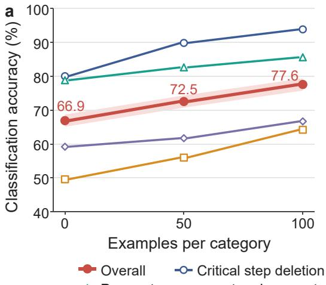

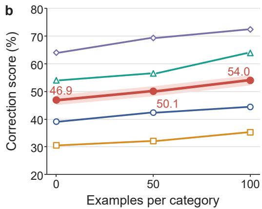  
Operation or parameter ambiguity Cross-step consistency disruption  
Figure F.1: Effect of self-evolved troubleshooting memory on protocol recovery. Classification accuracy (a) and correction score (b) are reported using 0, 50, and 100 self-evolution examples per perturbation category, corresponding to 0, 200, and 400 memory-construction examples in total, respectively. The resulting memories are frozen before evaluation on the same held-out test set. Curves show the overall result and the four controlled perturbation categories.

Table F.14: Ablation of the two-level intermediate representation. Higher values are better. ∆ denotes the improvement of the two-level representation over direct-to-canonical mapping.
<table><tr><td></td><td colspan="3">Fidelity</td><td colspan="3">Stability</td></tr><tr><td>Representation</td><td>Operation</td><td>Detail</td><td>Relation</td><td>Operation</td><td>Detail</td><td>Relation</td></tr><tr><td>Direct-to-canonical (w/o  $G _ { \mathrm { s e m } } )$ </td><td>88.6</td><td>87.6</td><td>85.4</td><td>89.7</td><td>86.5</td><td>83.2</td></tr><tr><td>Two-level  $( G _ { \mathrm { s e m } } \to G _ { \mathrm { c a n } } )$ </td><td>96.4</td><td>96.2</td><td>94.6</td><td>95.8</td><td>97.3</td><td>98.2</td></tr><tr><td>∆</td><td>+7.8</td><td>+8.6</td><td>+9.2</td><td>+6.1</td><td>+10.8</td><td>+15.0</td></tr></table>

## F.3 TWO-LEVEL REPRESENTATION

We evaluate whether the explicit semantic intermediate representation contributes to the quality of the final canonical representation. Both variants start from the same source protocols and use the same canonical action vocabulary and normalization procedure. In the full two-level variant, the protocol is first converted into the Semantic Experiment Graph $G _ { \mathrm { s e m } }$ and subsequently normalized into $G _ { \mathrm { c a n } }$ . In the direct-to-canonical ablation, the explicit $G _ { \mathrm { s e m } }$ representation is removed and canonical actions are generated directly from the protocol using the same canonical action vocabulary. We use the same 50 source protocols and representation-evaluation protocol described in Appendix G. Results are shown in Table F.14.

Removing $G _ { \mathrm { s e m } }$ degrades all six representation metrics. The largest reduction occurs in relation stability, where the two-level representation improves the score by 15.0 points. The results indicate that explicitly reconstructing protocol-level semantics before canonicalization is particularly important for preserving details and relations across semantically equivalent rewrites.

Table F.15: Ablation of execution-unit grouping on the same 50 execution protocols. ∆ denotes the improvement obtained by grouping related actions before capability matching.
<table><tr><td>Routing granularity</td><td>Execution-unit grouping</td><td>Route accuracy (%)</td><td>Device executability (%)</td></tr><tr><td>Action-wise routing</td><td>No</td><td>61.2</td><td>49.5</td></tr><tr><td>Execution-unit routing</td><td>Yes</td><td>72.9</td><td>59.6</td></tr><tr><td>Δ</td><td>一</td><td>+11.7</td><td>+10.1</td></tr></table>

## F.4 EXECUTION-UNIT GROUPING

Table F.15 shows the contribution of execution-unit grouping. The full variant groups related canonical actions according to their material flow and dependencies before capability matching. In the ablated variant, each canonical action is treated as an independent singleton execution unit and routed separately. Both variants use the same canonical representations, device capability catalog, compatibility checks, and validation procedure. We evaluate them on the same 50 protocols sampled from the execution-grounding evaluation set. Metric definitions follow Appendix G. Execution-unit grouping improves route accuracy from 61.2% to 72.9% and device executability from 49.5% to 59.6%, corresponding to gains of 11.7 and 10.1 percentage points, respectively. This comparison shows that capability grounding benefits from considering related actions jointly rather than routing each canonical action in isolation.

## G EVALUATION PROTOCOLS, EXPERT–JUDGE AGREEMENT, AND STATISTICAL DETAILS

## G.1 EXPERIMENTAL CONFIGURATIONS AND STAGE-WISE EVALUATION INPUTS

We evaluate LabCompiler at three distinct interfaces: (i) protocol recovery, which evaluates the protocol firewall; (ii) device-agnostic representation, which evaluates the transformation from a source protocol to the canonical intermediate representation; and (iii) execution grounding, which evaluates routing, device executability, and device-specific realization. The evaluation setup is intentionally stage dependent. Protocol recovery is evaluated independently from downstream compilation. Rep resentation fidelity is evaluated directly against the source protocol, whereas the execution experiment begins from the protocol input and allows upstream representation errors to propagate into downstream grounding.

Methods and baselines. The protocol-recovery experiments compare direct LLM baselines, a coding-agent baseline, LabCompiler, and the self-evolved LabCompiler variant. The direct LLM baselines are MiniMax-M3, Qwen3.8-Max, DeepSeek-V4-Pro, Gemini-3.1-Pro, Kimi-K3, GPT-5.6 Sol, and Claude Opus 5. Codex with GPT-5.6 Sol is used as the coding-agent baseline.

Both LabCompiler and LabCompiler\* use DeepSeek-V4-Pro as the underlying language model. LabCompiler uses the protocol-screening knowledge available to the firewall but does not use evolved troubleshooting memory. LabCompiler\* uses the same backbone and screening configuration together with a frozen self-evolved troubleshooting memory constructed from 100 selfevolution examples per perturbation category.

## G.2 SCORING RUBRICS AND METRIC DENOMINATORS

The reported metrics operate at different evaluation units (Table G.16 ). For metrics with multiple evaluation instances per source protocol (e.g., execution units within protocols or rewrites derived from a protocol), scores are first aggregated within each protocol using the corresponding reference instances as denominators, and then averaged across protocols.

Table G.16: Summary of evaluation metrics, within-protocol denominators, and final aggregation procedures.
<table><tr><td>Metric</td><td>Evaluation unit</td><td>Raw scale</td><td>Within-protocol denominator</td><td>Final aggregation</td></tr><tr><td>Classification accuracy</td><td>Protocol</td><td>0/1</td><td>All evaluated controlled protocols</td><td>Mean correctness over protocols</td></tr><tr><td>Repair score</td><td>Protocol</td><td>0–2 per judge</td><td>All protocols with paired judge scores</td><td>Two-judge mean, linearly mapped to 0–100</td></tr><tr><td>IR fidelity</td><td>Protocol</td><td>0–5 per dimension</td><td>50 original protocols</td><td>Mean across protocols</td></tr><tr><td>IR stability</td><td>Rewrite</td><td>0–5 per dimension</td><td>100 rewrites per transformation</td><td>Average within source protocol, then across source protocols</td></tr><tr><td>Route accuracy</td><td>Execution unit</td><td>0/1</td><td>Reference execution units in each protocol</td><td>Protocol-level accuracy, then mean across protocols</td></tr><tr><td>Device executability</td><td>Automated execution unit</td><td>0/1</td><td>Reference automated execution units in each protocol</td><td>Protocol-level success rate, then mean across protocols</td></tr><tr><td>Code fidelity</td><td>Automated execution unit dimensions</td><td>Three 0–5</td><td>Reference automated execution units in each protocol</td><td>Node score → protocol mean → mean across protocols</td></tr></table>

## G.2.1 PROTOCOL-RECOVERY METRICS

Classification accuracy. Each controlled instance belongs to one of the four perturbation categories defined in Section 4 and Appendix E. A prediction receives a score of one only when the predicted category exactly matches the reference category. For N evaluated protocols:

$$
\operatorname { A c c } = \frac { 1 } { N } \sum _ { i = 1 } ^ { N } \mathbb { I } [ \hat { y } _ { i } = y _ { i } ] .\tag{6}
$$

The controlled evaluation contains 500 test protocols in each of the four categories. Consequently, the pooled protocol-level mean over all 2,000 instances is numerically identical to the macro-average of the four category-level accuracies.

Repair score. Protocol repair is scored on the 0–2 scale defined in the main text:

• the target defect is fully resolved and the repair is scientifically consistent with the reference;

• the repair is partially correct but contains a minor omission or inaccuracy;

• the defect remains unresolved or the repair introduces a substantive error.

Both judge calls succeeded for the reported experiments, so no protocol was removed because of judge failure.

## G.2.2 REPRESENTATION FIDELITY AND STABILITY

Both representation fidelity and representation stability are evaluated along three dimensions:

• Operation coverage: whether required experimental operations are represented without unsupported additions;

• Detail preservation: whether execution-relevant materials, quantities, parameters, and conditions are retained;

• Relation preservation: whether procedural, material-flow, and dependency relations among operations are preserved.

Each dimension is scored on a 0–5 ordinal scale by GPT-5.5 and Gemini-3.1-Pro. A score of 5 indicates no identified representation error; a score of 4 corresponds to only minor issues, while a critical semantic failure constrains the score to 3 or below. For dimension k, the paired judge score for protocol i is

$$
\bar { s } _ { i , k } = \frac { s _ { i , k } ^ { ( 1 ) } + s _ { i , k } ^ { ( 2 ) } } { 2 } .\tag{7}
$$

The normalized percentage score is obtained by dividing by 5 and multiplying by 100.

Representation fidelity. Fidelity is evaluated on 50 original source protocols. For each protocol, the generated $G _ { \mathrm { c a n } }$ is evaluated against the corresponding source protocol along operation coverage, detail preservation, and relation preservation. All representation-fidelity artifacts are also individually reviewed by biological-domain experts to verify semantic correspondence with the source protocol and preservation of execution-relevant information.

Representation stability. The semantics-preserving rewrite set was designed by five biologicaldomain experts based on common variations in how laboratory procedures are expressed in practice. Five transformation types are considered: content reordering, word replacement, context expansion, structure rewrite, and unit conversion.

For each of the 50 source protocols, ten rewrites were constructed, with two instances for each transformation type. The rewrites were expert-checked to ensure that the experimental operations, parameters, conditions, and procedural relationships remained semantically equivalent to those in the corresponding source protocol. This yields 100 rewrite instances per transformation and 500 rewrite instances in total. The reference for stability is the canonical representation generated from the corresponding original protocol. A rewritten protocol is processed through the same pipeline and its resulting $G _ { \mathrm { c a n } }$ is compared with this reference representation. For each transformation, the two rewrites associated with a source protocol are first averaged within that protocol. The resulting protocol-level scores are then averaged across the 50 source protocols. This gives equal weight to each original protocol rather than to individual rewrite instances.

## G.2.3 EXECUTION-GROUNDING METRICS

These protocols were manually reviewed by biological-domain experts to establish the execution ground truth before evaluation. For each protocol, experts decomposed the workflow into reference execution units and annotated the expected executor type together with the applicable devicecapability requirements for automated execution. These reference requirements were determined from the experimental requirements of each execution unit and the available laboratory device capabilities. The resulting ground-truth set contains 643 reference execution units, including 376 units annotated for automated device execution and 267 units annotated for HUMAN execution. These expert annotations serve as the reference targets for routing and execution-grounding evaluation.

Route accuracy. Route accuracy is computed at the execution-unit level using expert-reviewed reference requirements. A prediction is counted as correct when it satisfies the executor requirement for that unit; human-coordinated units require the HUMAN route. For automated units, compatibility is determined by the device-capability checks in Appendix D.2.

For protocol $p$ with $N _ { p }$ reference execution units,

$$
{ \mathrm { R o u t e A c c } } _ { p } = { \frac { \# \{ { \mathrm { r e f e r e n c e ~ u n i t s ~ w i t h ~ c o r r e c t ~ e x e c u t o r ~ a s s i g n m e n t } } \} } { N _ { p } } } .\tag{8}
$$

The reported route accuracy is the arithmetic mean of ${ \mathrm { R o u t e A c c } } _ { p }$ across the 100 protocols. The denominator is therefore defined by reference execution units rather than by the number of units predicted by a method.

Device executability. Device executability is evaluated only on the 376 reference execution units annotated for Automated execution. A unit is counted as executable only when the method routes it to Automated execution and the resulting realization passes the validation pathway provided by the corresponding device backend. A reference Automated unit receives a score of zero when any of the following occurs:

• the unit is routed to HUMAN;

• no device-specific realization is produced;

• compilation fails;

• applicable device or resource constraints fail; or

• simulator validation fails when a simulator is available.

For backends without an applicable simulator, successful static and device-contract validation constitutes a successful executability result, as described in Appendix D. For protocol $p ,$ device executability is

$$
\mathrm { E x e c } _ { p } = \frac { \# \{ \mathrm { s u c c e s s f u l ~ r e f e r e n c e ~ A u t o m a t e d ~ u n i t s } \} } { \# \{ \mathrm { r e f e r e n c e ~ A u t o m a t e d ~ u n i t s } \} } .\tag{9}
$$

The reported result is the mean of the protocol-level executability scores.

Code fidelity. Code fidelity evaluates whether the device-specific realization preserves the intended experimental procedure. It is evaluated over all reference Automated units, rather than only units that pass executability validation. If no executable realization is generated for a reference Automated unit, the unit receives a fidelity score of zero and remains in the denominator. For a generated realization, each LLM judge evaluates three dimensions on a 0–5 scale:

• Action correctness;

• Experimental constraint preservation;

• Logic preservation.

The code-fidelity judge receives the experimental goal, protocol text, generated device-specific realization, the reference execution-unit action and summary, and the scoring rubric. The judge is not asked to re-evaluate routing or simulator success. Let $a _ { i } ^ { ( j ) } , c _ { i } ^ { ( j ) }$ , and $\mathcal { l } _ { i } ^ { ( j ) }$ denote the three dimension scores from judge j. The two judges are first averaged within each dimension:

$$
\bar { a } _ { i } = \frac { a _ { i } ^ { ( 1 ) } + a _ { i } ^ { ( 2 ) } } { 2 } , \qquad \bar { c } _ { i } = \frac { c _ { i } ^ { ( 1 ) } + c _ { i } ^ { ( 2 ) } } { 2 } , \qquad \bar { l } _ { i } = \frac { l _ { i } ^ { ( 1 ) } + l _ { i } ^ { ( 2 ) } } { 2 } .\tag{10}
$$

The normalized node-level fidelity score is then

$$
\mathrm { F i d e l i t y } _ { i } = 1 0 0 \frac { \bar { a } _ { i } + \bar { c } _ { i } + \bar { l } _ { i } } { 1 5 } .\tag{11}
$$

Node-level scores are averaged within each protocol, and the reported code fidelity is the arithmetic mean of the resulting protocol-level scores. All LLM-judge calls used for the reported code-fidelity results completed successfully.

## G.3 EXPERT VALIDATION OF LLM-JUDGE SCORES

Expert validation in this section concerns agreement with the LLM-judge scoring and is distinct from the expert review of benchmark annotations described in Appendix E and from the expert review of representation artifacts. All representation-fidelity artifacts are individually reviewed by domain experts against their corresponding source protocols to verify semantic correspondence and preservation of execution-relevant information.

Table G.17: Coverage of independent expert auditing of LLM-judge scores. The reported fractions refer only to score-level validation and are separate from the expert verification of representationfidelity artifacts described above. Each sampled response was evaluated independently by two blinded domain experts using the same rubric as the corresponding LLM judges.
<table><tr><td>Task</td><td>Score-audit fraction</td><td>Independent expert ratings per response</td></tr><tr><td>Protocol repair</td><td>30%</td><td>2</td></tr><tr><td>IR fidelity</td><td>30%</td><td>2</td></tr><tr><td>IR stability</td><td>30%</td><td>2</td></tr><tr><td>Code fidelity</td><td>30%</td><td>2</td></tr></table>

Table G.18: Evaluation populations for the main experiments.
<table><tr><td>Evaluation</td><td></td><td>Source protocols Evaluation instances</td><td>Notes</td></tr><tr><td>Controlled protocol recovery</td><td>2,000</td><td>2,000</td><td>500 protocols in each of four perturbation categories</td></tr><tr><td>iGEM protocol recovery</td><td>259</td><td>259</td><td>Independent real-world held-out subset</td></tr><tr><td>Representation fidelity</td><td>50</td><td>50</td><td>Source protocol →  $G _ { \mathrm { c a n } }$ </td></tr><tr><td>Representation stability</td><td>50</td><td>500 rewrites</td><td>10 rewrites per source protocol; 100 instances for each of five transformations</td></tr><tr><td>Execution grounding</td><td>100</td><td>643 execution units</td><td>376 Automated and 267 HUMAN reference units</td></tr></table>

Separately, to assess the reliability of the LLM-based evaluation scores, 30% of model responses were sampled within each model–category stratum. This score-level validation covers protocol repair, IR fidelity, IR stability, and code fidelity across the corresponding evaluation datasets (Table G.17 ). The 30% sampling therefore refers to the independent audit of LLM-judge scores rather than to the expert verification of the representation-fidelity artifacts themselves.

Eight biological-domain experts participated in this score-level validation. Each expert had 3–5 years of relevant biological research or laboratory experience. Every sampled response was independently scored by two experts. Experts were blinded to both the identity of the model that produced the response and the scores assigned by the LLM judges. Experts used the same taskspecific rubrics as the LLM judges: the 0–2 protocol-repair rubric, the 0–5 representation rubric, and the three 0–5 dimensions used for code fidelity. For each task, expert scores were aggregated using the same scale and normalization convention as the corresponding LLM-judge metric. Across the audited tasks, the difference between aggregate expert scores and aggregate LLM-judge scores ranged from −1.6 to +1.8 percentage points. The expert validation is used to assess the consistency of the judge-based semantic metrics rather than to replace the primary LLM-judge scores reported in the main experiments.

## G.4 REPORTING CONVENTIONS AND STATISTICAL DETAILS

Table G.18 summarizes the principal evaluation populations used in the main experiments. Retries caused by transport or structured-output failures are treated as execution retries of the same benchmark instance rather than as independent experimental repetitions.

Averaging conventions. Controlled protocol-recovery results are computed over the complete set of 2,000 test protocols. Because the four controlled categories are balanced at 500 protocols each, pooled protocol-level averaging and category-level macro averaging yield the same overall value. Representation fidelity is averaged across the 50 source protocols. For stability, rewrite scores are first averaged within each source protocol for a given transformation and then averaged across source protocols. Execution metrics are first computed within each protocol and are then averaged across the 100 protocols. This convention gives equal weight to each protocol rather than weighting protocols in proportion to their number of execution units.

Table H.19: Results on the 108-question public ProtocolQA subset of LAB-Bench. These metrics follow the LAB-Bench task definition and should not be directly compared with the open-ended protocol-recovery metrics used in our main benchmark.
<table><tr><td>Method</td><td>Accuracy</td><td>Precision</td><td>Coverage</td></tr><tr><td>Human</td><td>0.79</td><td>0.87</td><td>0.91</td></tr><tr><td>Claude 3.5 Sonnet</td><td>0.48</td><td>0.66</td><td>0.73</td></tr><tr><td>Claude 3 Opus</td><td>0.52</td><td>0.62</td><td>0.84</td></tr><tr><td>Gemini 1.5 Pro</td><td>0.47</td><td>0.58</td><td>0.81</td></tr><tr><td>GPT-40</td><td>0.53</td><td>0.56</td><td>0.95</td></tr><tr><td>GPT-4 Turbo</td><td>0.37</td><td>0.59</td><td>0.62</td></tr><tr><td>Claude 3 Haiku</td><td>0.45</td><td>0.51</td><td>0.87</td></tr><tr><td>Llama-3-70B-Instruct</td><td>0.44</td><td>0.49</td><td>0.90</td></tr><tr><td>GLM-5.3</td><td>0.73</td><td>0.75</td><td>0.98</td></tr><tr><td>DeepSeek-V4-Pro</td><td>0.80</td><td>0.84</td><td>0.94</td></tr><tr><td>Kimi-K3</td><td>0.82</td><td>0.84</td><td>0.98</td></tr><tr><td>GPT-5.6 Sol</td><td>0.83</td><td>0.85</td><td>0.98</td></tr><tr><td>LabCompiler</td><td>0.86</td><td>0.88</td><td>0.98</td></tr></table>

Rounding. Internal metric summaries retain two decimal places. Values displayed in the main tables and figures are rounded to the precision shown in the corresponding presentation, typically one decimal place for the headline comparison plots and tables. All normalization to a 0–100 scale is performed before display rounding.

## H ADDITIONAL RESULTS ON LAB-BENCH

We additionally evaluate LabCompiler on the public ProtocolQA subset of LAB-Bench (Laurent et al., 2024). The evaluation contains 108 public ProtocolQA questions and uses the benchmark’s Accuracy, Precision, and Coverage metrics (Table H.19). LabCompiler obtains 0.86 accuracy and 0.88 precision, compared with 0.83 and 0.85 for GPT-5.6 Sol.