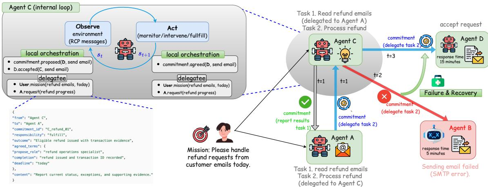
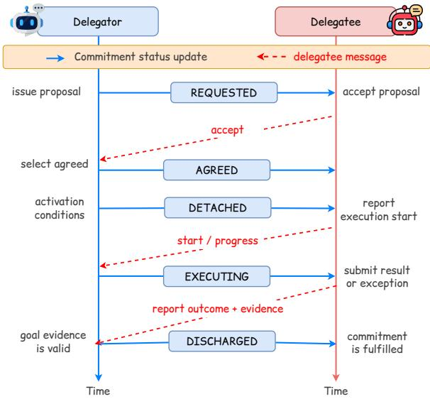
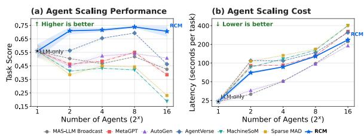
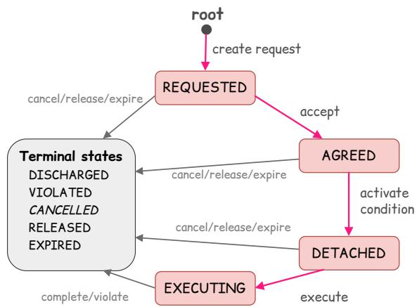

# A Responsibility-Centered Coordination Mechanism for Decentralized Multi-Agent Systems

Thi-Nhung Nguyen, Viet-Thanh Pham, Linhao Luo, Thuy-Trang Vu and Dinh Phung 1 Department of Data Science & AI, Monash University

{nhung.thinguyen,thanh.pham1,linhao.luo1,trang.vu1,dinh.phung}@monash.edu

## Abstract

Centralized orchestration provides comprehensive multi-agent coordination but creates bottlenecks in scalability, adaptability, and collective performance. Decentralized approaches alleviate these bottlenecks by distributing coordination across agents, yet often leave re sponsibility for delegated dependencies and failure recovery unclear. To address this gap, we propose RCM, a responsibility-centered coordination mechanism that leverages commitments to couple task delegation with explicit responsibilities of the involved parties. Through recursive delegation, agents retain their upstream responsibilities while locally or chestrating downstream commitments, thereby preserving accountability across delegation chains, creating a network of local orchestration. We operationalize this mechanism locally through responsibility-constrained decisionmaking and a responsibility-oriented communication protocol (RCP), enabling agents to autonomously establish, manage, and termi nate commitments. As agents act in parallel, their local actions continuously evolve the commitment graph, allowing global coordination to emerge and adapt toward a shared mission with out centralized control. Across reasoning, coding, and executable agent environments demonstrate that RCM outperforms strong central ized and decentralized coordination baselines by up to 18.7 points in task performance and 10.2 points in Responsibility, while improving failure and harm detection without task-specific training.

## 1 Introduction

Coordination is essential for multi-agent systems (MAS) because it enables specialized agents to collaborate toward a shared mission. Centralized orchestration, ranging from predefined workflows to central orchestrators, has demonstrated effectiveness in coordinating complex tasks (e.g., AUTO-GEN and AGENTVERSE) (Wu et al., 2024; Chen et al., 2024). In these architectures, an orchestrator or prescribed control structure maintains a global view of the task, decomposes it into subtasks, assigns work to suitable agents, manages dependencies, monitors execution, and revises plans when failures occur. However, centralized orchestration creates scalability bottlenecks as coordination overhead and context grow, limits adaptability because execution changes must pass through the central control point, and bounds collective performance by the orchestrator’s reasoning and inference capacity (Rana and Stout, 2000; Kim et al., 2025; Yang et al., 2026b).

An alternative is decentralized coordination, which seeks scalable, adaptive, and resilient collaboration through peer-to-peer communication and local decision-making. Recent LLM-agent approaches distribute information exchange, collective reasoning, and adaptive task routing (e.g., AGENTNET) (Yang et al., 2025b; Zhou et al., 2025; Lee et al., 2026), while local inference-time control guides individual agents during execution (Stolfo et al., 2025). When an agent lacks the capabilities or resources to complete a task independently, it may act as the delegator and delegate supporting work to another agent, the delegatee. As delegation propagates across agents, downstream dependencies must be monitored, verified, and recovered from while preserving upstream commitments, which are functions traditionally handled by a central orchestrator. Existing decentralized coordination approaches may distribute task execution without explicitly assigning responsibility for managing these dependencies throughout execution. Consequently, these responsibilities may become fragmented across agents, leaving ownership of downstream dependencies and responsibility for recovery unclear.

To address this gap, we propose a Responsibilitycentered Coordination Mechanism (RCM) that treats commitments as the basic units of coordination. Each commitment combines a task delegation with explicit responsibilities for both parties. Upon opening a delegation, the delegatee is responsible for fulfilling the agreed task, while the delegator remains responsible for managing the resulting dependency until the commitment terminates. We refer to the delegator’s ongoing responsibility as local orchestration, as it involves functions traditionally performed by a central orchestrator, but only over the delegator’s downstream commitments. Through recursive delegation, agents retain their upstream commitments while locally orchestrating downstream dependencies, maintaining responsibility across delegation chains.

  
Figure 1: Overview of RCM. The right side shows global coordination through a dynamic network of commitments and local failure recovery. The left side illustrates each agent’s internal observe–decide–act loop, through which local decisions collectively give rise to this global coordination.

We operationalize this mechanism with responsibility-constrained decision-making to guide each agent’s actions according to its current responsibilities, and a responsibility-oriented communication protocol (RCP) to support the establishment, management, and termination of commitments through inter-agent communication. Local orchestrators act in parallel, they observe changes in their local commitments and take appropriate actions (e.g., switching delegatees). These local actions continuously evolve the commitment graph, enabling global coordination to emerge and adapt toward the shared mission without a central orchestrator.

## Our contributions are summarized as follows:

• We propose a responsibility-centered coordination mechanism (RCM) that uses commitments as units of coordination, preserving upstream responsibilities while managing downstream dependencies and failures across recur-

sive delegation chains.

• We operationalize this mechanism at the local level through responsibility-constrained decision-making and a responsibility-oriented communication protocol (RCP), enabling global coordination to emerge from autonomous local decisions.

• We introduce responsibility-oriented evaluation metrics, including Communication, Monitoring, Intervention, and Fulfillment to assess how effectively agents uphold their responsibilities throughout execution and failure recovery.

• Across reasoning, coding, and executable agent environments, RCM outperforms strong centralized and decentralized baselines, achieving a 10.2-point gain in overall responsibility and up to an 18.7-point gain in task performance, while improving failure and harmful-trajectory detection without taskspecific training.

## 2 Responsibility-centered Coordination Mechanism (RCM)

Consider a mission q assigned to a team A = $\{ a _ { 1 } , \ldots , a _ { n } \}$ of autonomous agents with distributed capabilities. Each agent controls its own planner, tools, permissions, and execution state. Without a central orchestrator, the key challenge is how to coordinate autonomous agents while maintaining explicit responsibility as tasks are delegated and dependencies evolve. As illustrated in Figure 1, RCM addresses this challenge by coordinating agents through commitments arising from task delegation. When $a _ { i }$ delegates an outcome g to $a _ { j } .$ , a commitment $C _ { i \to j }$ is formed, assigning local orchestration responsibility to $a _ { i }$ and activating fulfilment responsibility for $a _ { j }$ upon agreement. The formation and lifecycle of commitments establish and evolve coordination relationships among agents (Section 2.1).

Locally, each agent then acts autonomously according to its active responsibilities, using the responsibility-oriented communication protocol (RCP) to coordinate relevant changes with other agents. As agents act in parallel, their local decisions evolve a network of interconnected commitments, allowing global coordination to emerge and adapt toward the shared mission without centralized control (Section 2.2).

## 2.1 Global Coordination through Commitments

Coordination across agents is established by linked commitments. Each commitment captures a delegated outcome, its lifecycle state, and the responsibilities that govern how its parties coordinate.

Commitment formation. When a delegator $a _ { i }$ opens a delegation to a delegatee $a _ { j } .$ , it creates a commitment record

$$
C _ { i  j } = \langle d _ { i  j } ^ { v } , s _ { C } , \rho _ { C } \rangle ,
$$

where $d _ { i  j } ^ { v }$ is the delegation specification, $s C$ tracks the commitment lifecycle from the initial request through resolution, and $\rho _ { C }$ specifies the parties’ state-dependent responsibilities.

The delegation specification describes the requested outcome and its terms:

$$
d _ { i \to j } ^ { v } = \langle { \mathrm { i d } } , v , a _ { i } , a _ { j } , g , \tau \rangle .
$$

Here, id distinguishes concurrent delegations, v identifies the proposed or agreed version, and $g$ is the requested outcome. The terms $\tau$ specify the delegatee’s task role, activation condition α, completion criterion $\beta ,$ scope, permissions, resource budget, and timing. The parties may negotiate $g$ and $\tau$ while the commitment is in REQUESTED state.

Commitment lifecycle The commitment lifecy cle captures the delegation’s execution status and the responsibilities active at each stage. Specifically, $s _ { C }$ tracks the delegation state, while $\rho _ { C }$ determines the corresponding active responsibilities.

  
Figure 2: Example commitment handshake between a delegator and a delegatee. Blue arrows show commitment state updates; red dashed arrows show the delegatee’s acceptance, progress reports, and outcome with completion evidence.

Upon opening a delegation, $a _ { i }$ assumes local $o r { - }$ chestration: it manages the delegation, monitors its subsequent execution, and intervenes when failures or consequential changes threaten the requested outcome. This responsibility persists until the request is declined or the commitment terminates. While $s _ { C } = { \tt R E Q U E S T E D }$ $\rho _ { C } ( a _ { j } ) = \alpha \colon$ the delegatee has no fulfilment responsibility. Once the parties agree on the delegation, $s _ { C }$ becomes AGREED, and $\rho _ { C }$ assigns fulfilment to $a _ { j }$ . Fulfilment entails executing the agreed work, once α holds, and communicating consequential changes. These responsibilities are bounded by the agreed scope and authority, and revisions require renewed agreement. Verified completion or valid termination discharges the parties’ active responsibilities. Figure 2 illustrates the commitment lifecycle from its formation to verified completion. See Appendix A.1 for the complete list of possible commitment lifecycle statuses.

As agents recursively delegate work needed to fulfil their own commitments, the records form a dynamic coordination graph $\mathcal { G } _ { t } = \langle \mathcal { A } , \mathcal { C } _ { t } , \mathcal { R } _ { t } \rangle$ ， where $\mathcal { C } _ { t }$ contains live commitments and $\mathcal { R } _ { t }$ records the support relations between them. The formation and state evolution of these linked commitments coordinate work across the team without requiring any agent to prescribe or observe a global execution plan.

## 2.2 From Local Actions to Global Coordination

The preceding subsection describes how commitments establish coordination relationships among agents. We now explain how these relationships emerge and evolve from autonomous local actions governed by active responsibilities. To characterize decision making under limited visibility, we borrow the decentralized, partially observable perspective of a Dec-POMDP as a descriptive abstraction. This formulation characterizes local observations and responsibility-constrained choices; it is not an agent-training procedure and does not require learning or solving a Dec-POMDP. We write

$$
\mathcal { M } _ { \mathrm { M L O } } = \langle \varTheta , S , \{ \mathcal { O } _ { i } \} _ { i \in \mathcal { A } } , \{ \mathcal { U } _ { i } \} _ { i \in \mathcal { A } } \rangle ,
$$

where $\boldsymbol { \mathcal { S } }$ is the global state space, while $\mathcal { O } _ { i }$ and $\mathcal { U } _ { i }$ are agent $a _ { i } \mathrm { ^ { * } s }$ local observation and action spaces.

The global state is

$$
s _ { t } = \langle x _ { t } , \mathcal { G } _ { t } , \rho _ { t } , M _ { t } \rangle \in \mathcal { S } ,
$$

where $x _ { t }$ captures mission progress and relevant environmental conditions, $\mathcal { G } _ { t }$ is the evolving commitment graph, and $\rho _ { t } ~ = ~ \{ \rho _ { C } \} _ { C \in \mathcal { C } _ { t } }$ records the active responsibility allocations. The communication state $M _ { t } = \{ M _ { t } ^ { i } \} _ { i \in \mathcal { A } }$ contains messages exchanged among agents concerning live commitments, including delegation proposals, negotiation exchanges, execution reports, and updates.

No agent observes $s _ { t }$ in full. Instead, agent $a _ { i }$ receives the local observation

$$
o _ { t } ^ { i } = \langle x _ { t } ^ { i } , \widehat { \mathcal { G } } _ { t } ^ { i } , \rho _ { t } ^ { i } , M _ { t } ^ { i } \rangle \in \mathcal { O } _ { i } ,
$$

where $\ v { x } _ { t } ^ { i }$ contains the execution progress and environmental conditions directly observable for the work it owns or performs; $\widehat { \mathcal { G } } _ { t } ^ { i }$ contains its local view of the commitments to which it is a party and their support relations; ${ \widehat { \mathcal { C } } } _ { t } ^ { i } \subseteq { \mathcal { C } } _ { t }$ contains the live commitments in that view; $\textstyle \rho _ { t } ^ { i } = \bigcup _ { C \in \widehat { \mathcal { C } } _ { \ast } ^ { i } } \rho _ { C } ( a _ { i } )$ is its active responsibility set; and $M _ { t } ^ { i } \stackrel { \cdot } { = } \{ m \in M _ { t } \ | $ $a _ { r } ( m ) = a _ { i } \}$ contains the messages addressed to $a _ { i } .$

Responsibility-constrained actions. Given this local view, agent $a _ { i }$ selects actions according to its active responsibilities. The local action space $\mathcal { U } _ { i }$ comprises three classes of actions: $( \mathrm { i } ) f u l f l$ an upstream commitment, by performing the agreed task and reporting its outcome; (ii) create a downstream commitment, by delegating required supporting work; and (iii) intervene in or update a downstream commitment, by monitoring, verifying, revising, or recovering delegated work. We denote these classes by

<table><tr><td>RCP operation</td><td>Initiator and semantics</td></tr><tr><td>delegate.propose</td><td> $\overline { { a _ { i }  a _ { j } } } \colon$  open a delegation; record the g, τ proposal as REQUESTED.</td></tr><tr><td>delegate.accept/ decline</td><td> ${ \bar { a } } _ { j } \  a _ { i } \colon$  accept or decline the proposal version; acceptance establishes commitment edge C in</td></tr><tr><td>commitment.query/</td><td>AGREED.  $a _ { i }  a _ { j } \colon$  exchange questions, clarifications,</td></tr><tr><td>communicate</td><td>information, or intervention requests within scope; correlate responses by rep  ${ \mathsf { l y \_ t o . } }$ </td></tr><tr><td>commitment.notify</td><td> $a _ { i }  a _ { j } \colon$  report consequential changes;  $a _ { j }$  also</td></tr><tr><td>outcome.submit/</td><td>reports start, progress, partial results, and exceptions.  $a _ { j }  a _ { i }$  : submit outcome evidence;  $a _ { i }$  verifies it</td></tr><tr><td>verify</td><td>against β before discharge.</td></tr><tr><td>commitment.revise</td><td> $a _ { i }  a _ { j } \colon$  counter or revise g, τ; changes take effect only after agreement on the new version.</td></tr><tr><td>commitment.update/ terminate</td><td>Local orchestration by  $a _ { i } \colon$  update sC on edge C using validated conditions and evidence; termination</td></tr></table>

Table 1: Core RCP operations between delegator $a _ { i }$ and delegatee $a _ { j }$ . Messages inform the recipient’s decisions under its active responsibility in $\rho _ { C } ;$ lifecycle updates are guarded changes to commitment edges.

$$
\mathcal { U } _ { i } = \mathcal { U } _ { i } ^ { \mathrm { f u l f i l } } \cup \mathcal { U } _ { i } ^ { \mathrm { c r e a t e } } \cup \mathcal { U } _ { i } ^ { \mathrm { u p d a t e } } .
$$

The agent’s local action–observation history is $h _ { t } ^ { i } = \bar { ( } o _ { 0 } ^ { i } , u _ { 0 } ^ { i } , \ldots , u _ { t - 1 } ^ { i } , o _ { t } ^ { i } )$ . Its own decision policy $\pi _ { i }$ selects an action subject to the responsibility constraint:

$$
\begin{array} { c } { { u _ { t } ^ { i } \sim \pi _ { i } ( \cdot \mid h _ { t } ^ { i } ) } } \\ { { \mathrm { s u b j e c t ~ t o ~ } \quad c _ { \mathrm { r e s p } } ( u _ { t } ^ { i } ; o _ { t } ^ { i } ) = 0 . } } \end{array}\tag{1}
$$

Here, $\pi _ { i }$ denotes the agent’s autonomous decision policy, not a policy trained by RCM. The constraint $c _ { \mathrm { r e s p } } = 0$ only when the selected action is consistent with the agent’s active responsibilities and permitted by the relevant commitment state and applicable delegation terms; otherwise $c _ { \mathrm { r e s p } } > 0$ In implementation, RCM applies a set of rules based on the agent’s role, the commitment lifecycle, and the agreed terms. For example, execution while the commitment is still REQUESTED, or an attempt to move a DISCHARGED commitment back to EXECUTING, violates the lifecycle and yields $c _ { \mathrm { r e s p } } > 0 .$

Communication and commitment-state updates. When taking a local action $u _ { t } ^ { i } \in \mathcal { U } _ { i }$ , agent $a _ { i }$ may need to coordinate with its delegator or delegatee to fulfil an upstream commitment or create and manage downstream commitments. To support these responsibility-driven interactions, agents communicate through the responsibility-oriented communication protocol (RCP), which standardizes message operations for delegation negotiation, information exchange, execution reporting, outcome verification, and guarded commitment updates (Table 1).

RCP messages in $M _ { t } .$ , together with evidence and results of task execution, inform subsequent local decisions and may trigger transitions in commitment state s . Each transition is applied only after its conditions and evidence are verified. In particular, a delegatee reports consequential changes to its upstream delegator, enabling the latter to monitor or intervene in the corresponding downstream commitment. Updates are exchanged only with relevant counterparts. RCP can run over existing messaging systems, while agents retain their own planners and tools; see Appendix A.2 for message processing and delivery.

Dynamic Emergence and Evolution of the Commitment Graph. As agents fulfil their upstream commitments, they may recursively delegate supporting work, establishing chains of downstream commitments. These commitments and their support relations collectively form the commitment graph Gt. Agents observe changes in their local commitments and take necessary actions accordingly. For example, when a downstream commitment becomes VIOLATED, the delegator closes it and may establish a replacement commitment with another delegatee, while unaffected work continues independently. When a commitment terminates, its dependent supporting commitments are closed or released under their agreed terms. As agents act in parallel, these local actions continuously evolve G , giving rise to a dynamic execution workflow toward the shared mission q without a central orchestrator. Algorithm 1 illustrates how agents recursively fulfil upstream commitments and locally orchestrate downstream commitments.

## 3 Experimental Setup

Evaluation Data: AIME25 (Zhang and Team, 2025) and HUMANEVAL (Chen et al., 2021) test whether coordination preserves mathematical reasoning and functional code generation, respectively. CLAW-EVAL (Ye et al., 2026) evaluates multiservice tasks under controlled failures, and CLAW-EVAL-LIVE (Li et al., 2026a) evaluates changing real-world workflows. In the latter two, we randomly partition the available tools across all agents in each team, creating a distributed tool environment that requires delegation and communication. All methods use identical task instances, tool allocations, permissions, prompts, and test-time budgets.

responsibility-constraine local actions.   
Require: Mission q, agents A, initial commitments C (q), delegation limits   
K, L   
1 foreach C ∈ C0(q) with s = AGREED in parallel do   
2 Start COORDINATE(delegatee(C), C)   
3 procedure COORDINATE(a, C↑):   
4 while C↑ is live do   
5 Observe oat ; verify commitment-state changes   
6 Select uat ∈ Ua such that cresp(uat ; oat ) = 0   
7 if uat fulfil then   
8 Execute g↑ when active; report results and evidence via RCP   
9 else if ua ∈ Ucreate then   
10 Open downstream commitments in REQUESTED; negotiate via RCP   
within (K, L) limits   
11 Record support links   
12 else if ua ∈ Uupdate then   
13 Monitor and update downstream commitments   
14 Close VIOLATED commitments; reassess support and replacement if   
needed   
15 foreach newly AGREED C↓ in parallel do   
16 Start COORDINATE( delegatee(C↓), C↓)   
17 Notify relevant counterparts of consequential changes via RCP   
18 Close pending proposals; release dependent commitments under their terms   
19 Propagate termination; prune closed records and links

Appendix A.3 gives benchmark details.

Metrics: We evaluate RCM along two dimensions: task capability and responsibility.

• Task capabilityis measured using accuracy (AIME25), Pass@1 (HUMANEVAL), score and completion (CLAW-EVAL), and score (CLAW-EVAL-LIVE).

• Responsibility measures how effectively agents handle failures during execution. We define an environmentalfailure as an explicit unsuccessful response from a tool or the execution environment, and define four metrics: (i) Communicate is the fraction of environmental failures subsequently reported by an agent; (ii) Monitor is the fraction of environmental failures followed by a relevant change in action; (iii) Intervene is the fraction of such changed actions that successfully resolve or bypass the corresponding failure; (iv) Fulfillment is the mean official CLAW-EVAL completion score. Their equal-weight mean gives the Responsibility score. Failure signals and deduplication are specified in Appendix A.4.

Baselines: We consider three families of multiagent baselines:

• Decentralized: MAS-BROADCAST, MACHINE-SOM, SPARSE MAD, and AGENTNET (Zhang et al., 2024; Li et al., 2024; Yang et al., 2025b);

• Hand-designed: METAGPT, AUTOGEN, and AGENTVERSE (Hong et al., 2024; Wu et al., 2024; Chen et al., 2024);

• Optimized: AFLOW, GPTSWARM, and AGENT-PRUNE (Zhang et al., 2025b; Zhuge et al., 2024; Zhang et al., 2025a). On Who&When, we include Aegis attribution models (Kong et al., 2026) and training-free LLMs. On ATBench-C, we include guard models (Meta, 2024, 2025; Zhao et al., 2025; Chen et al., 2025; Liu et al., 2026) and general-purpose LLMs.

<table><tr><td rowspan="3" colspan="2">Workflow Method</td><td rowspan="3">Dynamic workflow</td><td rowspan="3">Responsi- bility</td><td rowspan="3">Distributed M/R</td><td colspan="4">Qwen3-4B</td><td colspan="4">GPT-5.4</td></tr><tr><td colspan="2">Non-Agentic</td><td colspan="2">Agentic</td><td colspan="2">Non-Agentic</td><td colspan="2">Agentic</td></tr><tr><td>|AIME25 HumanEval</td><td></td><td></td><td>Claw-Eval Claw-Live |</td><td>AIME25</td><td>HumanEval</td><td>Claw-Eval</td><td>Claw-Live</td></tr><tr><td rowspan="5"></td><td>Broadcast MAS-Broadcast</td><td>×</td><td>Unspecified</td><td>×</td><td>|30.0±3.3</td><td>83.3±2.2</td><td>35.7±1.9</td><td>40.2±3.7</td><td>43.3±8.4</td><td>93.9±1.5</td><td>50.5±1.4</td><td>64.4±2.7</td></tr><tr><td>MachineSoM</td><td>×</td><td>Debate</td><td>X</td><td>16.7±5.1</td><td>87.9±0.9</td><td>41.6±1.4</td><td>56.3±1.5</td><td>66.7±0.0</td><td>90.9±4.0</td><td>44.2±1.5</td><td>51.5±3.1</td></tr><tr><td>Sparse MAD</td><td>X</td><td>Debate</td><td></td><td>6.7±3.3</td><td>81.8±2.3</td><td>43.0±0.5</td><td>59.5±0.8</td><td>60.0±10.2</td><td>98.5±0.0</td><td>46.9±0.9</td><td>60.0±1.1</td></tr><tr><td>MetaGPT</td><td>×</td><td>Role</td><td></td><td>36.7±8.8</td><td>86.4±1.5</td><td>40.5±1.9</td><td>52.4±1.0</td><td>63.3±5.1</td><td>89.4±3.5</td><td>51.4±2.6</td><td>57.6±2.4</td></tr><tr><td>AutoGen AgentVerse</td><td>×</td><td>Role Role</td><td>&lt; × × × ×</td><td>26.7±1.9 26.7±5.6</td><td>90.9±1.8 81.8±3.2</td><td>36.0±0.3</td><td>35.1±3.0</td><td>53.3±8.4</td><td>93.9±0.9</td><td>54.0±1.4</td><td>70.8±1.5</td></tr><tr><td rowspan="4"></td><td></td><td>0</td><td></td><td></td><td></td><td></td><td>44.3±1.4</td><td>57.3±0.8</td><td>63.3±0.0</td><td>87.9±3.0</td><td>66.5±0.3</td><td>71.9±1.3</td></tr><tr><td>AFlow</td><td>X</td><td>Implicit</td><td></td><td>23.3±5.1</td><td></td><td>40.6±0.7</td><td>53.9±1.0</td><td>66.7±1.9</td><td>95.5±0.9</td><td>48.2±0.9</td><td>55.5±1.7</td></tr><tr><td>GPTSwarm</td><td>×</td><td>Implicit</td><td></td><td>30.0±5.1</td><td>81.8±1.5</td><td>40.2±0.8</td><td>46.5±1.7</td><td>56.7±11.5</td><td>95.5±0.9</td><td>50.0±1.2</td><td>59.4±3.1</td></tr><tr><td>AgentNet</td><td>√</td><td>Execution</td><td>X × × X</td><td>13.3±3.3</td><td>86.4±1.5</td><td>36.4±1.8</td><td>48.5±0.2</td><td>53.3±6.7</td><td>93.9±0.9</td><td>49.1±0.4</td><td>50.0±3.0</td></tr><tr><td></td><td>AgentPrune</td><td>×</td><td>Implicit</td><td></td><td>34.6±2.0</td><td>84.8±2.3</td><td>38.6±1.6</td><td>44.8±2.0</td><td>50.0±7.7</td><td>95.5±0.9</td><td>51.4±0.7</td><td>61.7±1.2</td></tr><tr><td>Emergent RCM</td><td></td><td>√</td><td>Commitment</td><td>V</td><td>50.0±5.8</td><td>91.9±0.0</td><td>63.0±2.2</td><td>61.4±1.6</td><td>66.7±0.0</td><td>97.0±0.9</td><td>72.8±1.3</td><td>79.4±0.3</td></tr></table>

Table 2: Performance across tasks, environments, and executor models. Dynamic workflow indicates whether task relationships can change during execution. Responsibility is unspecified under broadcast, induced through debate or role assignment, implicit in workflow structure, execution-based, or explicit through commitment. Distributed M/R denotes distributed monitoring and recovery. ✓, ◦, and ×indicate full, partial, and no support.  
Figure 3: Agent scaling on CLAW-EVAL.

Baseline and implementation details are in Appendices A.5 and A.6, respectively.

## 4 Results

Our evaluation first examines whether RCM enables robust coordination across tasks and teams, then analyzes how explicit responsibilities support reliable coordination.

## 4.1 Robustness and Autonomous Adaptation

Main results. Table 2 reports overall performance on reasoning and coding benchmarks that do not require agent interaction and on executable agentic tasks. For CLAW-EVAL and CLAW-EVAL-LIVE, tools are partitioned across agents so that no single agent can complete the task independently; success therefore requires delegation and communication rather than stronger individual execution alone.

Across Qwen3-4B experiments, RCM achieves the best result in all four columns. With GPT-5.4, it leads both agentic benchmarks, ties the best AIME25 result, and remains within 1.5 points of the best HumanEval result. The advantage is largest when coordination is essential. Relative to the strongest baseline in each column, RCM improves CLAW-EVAL by 18.7 points with Qwen3- 4B and 6.3 points with GPT-5.4, and CLAW-EVAL-LIVE by 1.9 and 7.5 points, respectively. Overall, explicit responsibility for each commitment enables robust and autonomous coordination without sacrificing the executor’s reasoning and coding capability.

Adaptation to changing agent teams. Figure 3 tests whether this robustness persists as the team changes. We increase the team from 1 to 16 agents and divide a fixed tool set more finely among them, progressively increasing the need for distributed coordination. RCM maintains the strongest task performance throughout this scaling process. Several baselines are faster with small teams, but their latency grows more sharply as agents are added, while RCM becomes more efficient at larger team sizes. These results show that coordination centered on responsibility can adapt to new team configurations without requiring a separate workflow for each configuration.

## 4.2 How Responsibility Shapes Coordination

Responsibility during execution. Table 3 evaluates whether agents communicate consequential failures, monitor the affected commitment, intervene effectively, and still fulfill the delegated outcome. Several baselines communicate and monitor failures reliably but fail to convert detection into successful response. For example, GPTSwarm reaches 95.2% Communicate and 95.0% Monitor, yet only 32.5% Intervene and 37.8% Fulfillment.

<table><tr><td>Method</td><td>Comm.↑</td><td>Mon.↑</td><td>Intv.↑</td><td>Ful.↑</td><td>Resp.↑</td></tr><tr><td colspan="6">Broadcast</td></tr><tr><td>MAS-Broadcast</td><td>82.9±5.0 89.7±4.7 44.8±5.2 38.1±1.7 63.9±2.7</td><td></td><td></td><td></td><td></td></tr><tr><td colspan="6">Designed</td></tr><tr><td>MachineSoM</td><td>94.7±6.0 77.8±4.8 13.9±5.1 30.2±1.5 54.1±1.5</td><td></td><td></td><td></td><td></td></tr><tr><td>Sparse MAD</td><td>93.9±0.4 77.4±1.3 12.9±1.4 33.7±1.1 54.5±0.9</td><td></td><td></td><td></td><td></td></tr><tr><td>MetaGPT</td><td>75.4±10.0 83.7±7.7 51.2±10.1 39.8±2.9 62.5±5.2</td><td></td><td></td><td></td><td></td></tr><tr><td>AutoGen</td><td>73.7±8.8 71.4±4.764.3±13.442.8±1.7 63.0±2.9</td><td></td><td></td><td></td><td></td></tr><tr><td>AgentVerse</td><td>95.8±0.8 95.7±0.840.6±4.258.4±0.2 72.6±1.2</td><td></td><td></td><td></td><td></td></tr><tr><td colspan="6">Learned</td></tr><tr><td>AFlow</td><td>92.7±0.8 92.1±1.2 18.4±7.2 35.2±0.9 59.6±2.1</td><td></td><td></td><td></td><td></td></tr><tr><td>GPTSwarm</td><td>95.2±8.4 95.0±2.3 32.5±4.2 37.8±1.0 65.1±3.4</td><td></td><td></td><td></td><td></td></tr><tr><td>AgentNet</td><td>92.7±5.3 84.2±4.0 42.1±3.4 36.9±0.9 64.0±1.6</td><td></td><td></td><td></td><td></td></tr><tr><td>AgentPrune</td><td>93.8±2.2 93.3±4.0 43.3±13.3 39.2±0.6 67.4±4.3</td><td></td><td></td><td></td><td></td></tr><tr><td colspan="6">Emergent</td></tr><tr><td>RCM</td><td>100.0±0.0 99.0±0.7 67.0±1.0 65.4±0.4 82.8±0.0</td><td></td><td></td><td></td><td></td></tr></table>

Table 3: Responsibility metrics on CLAW-EVAL with GPT-5.4. Resp. is the equal-weight mean of Comm., Mon., Intv., and Ful.
<table><tr><td>Model</td><td></td><td>Pair Agent Error Avg.</td><td></td><td></td></tr><tr><td colspan="5">Trained baselines (Trained √)</td></tr><tr><td>DCL (Aegis)</td><td>1.60</td><td>8.40</td><td>14.67</td><td>8.22</td></tr><tr><td>Aegis-SFT (Qwen2.5-14B)</td><td>4.03</td><td>51.14</td><td>9.87</td><td>21.68</td></tr><tr><td>Aegis-GRPO (Qwen2.5-14B)</td><td>2.45</td><td>54.43</td><td>4.15</td><td>20.34</td></tr><tr><td>Qwen3-8B-Thinking + GRPO</td><td>8.10</td><td>53.12</td><td>11.25</td><td>24.16</td></tr><tr><td colspan="5">Training-free baselines (Trained ×)</td></tr><tr><td>Qwen3-8B-Thinking</td><td>1.95</td><td>37.91</td><td>4.65</td><td>14.84</td></tr><tr><td>gpt-oss-120b</td><td>8.09</td><td>51.56</td><td>14.75</td><td>24.80</td></tr><tr><td>03</td><td>7.41</td><td>53.10</td><td>14.88</td><td>25.13</td></tr><tr><td>Gemini-2.5-Flash</td><td>7.32</td><td>55.56</td><td>11.94</td><td>24.94</td></tr><tr><td>Claude-Sonnet-4</td><td>6.77</td><td>44.76</td><td>13.33</td><td>21.62</td></tr><tr><td>RCM (Qwen3-4B)</td><td>7.07</td><td>54.89</td><td></td><td>10.87 24.28</td></tr><tr><td>RCM (ĠPT-5.4)</td><td>14.67</td><td>66.30</td><td></td><td>23.91 34.96</td></tr></table>

Table 4: Failure attribution on Who&When under the Aegis protocol. Baseline results are from Kong et al. (2026). Avg. is the mean of Pair, Agent, and Error micro-F1.

In contrast, RCM performs consistently across the full responsibility chain. It reaches 100.0% Communicate, 99.0% Monitor, 67.0% Intervene, and 65.4% Fulfillment, yielding a Responsibility score of 82.8%, 10.2 points above the strongest baseline. Higher responsibility is associated with stronger task performance. Across methods, the Responsibility score exhibits a strong positive linear correlation with the corresponding Claw-Eval task score in Table 2.

Local Orchestration for Safe and Resilient Coordination. To evaluate the effectiveness of monitoring in local orchestration, we apply RCM’s local-orchestration mechanism to detecting execution failures and harmful trajectories on Who&When and ATBench-C, respectively. Who&When evaluates whether the monitor identifies the responsible agent and decisive error step, while ATBench-C assesses its ability to detect harmful trajectories before an intervention is accepted.

On Who&When (Table 4), RCM with GPT-5.4 achieves an average F1 of 34.96, outperforming the strongest selected baseline (o3) by 9.83 points.

<table><tr><td>Model</td><td>Acc.</td><td>Prec.</td><td>Rec.</td><td>F1</td></tr><tr><td colspan="5">Guard models (Trained √)</td></tr><tr><td>LlamaGuard3-8B</td><td>53.1</td><td>85.7</td><td>3.8</td><td>7.3</td></tr><tr><td>LlamaGuard4-12B</td><td>58.1</td><td>63.8</td><td>30.9</td><td>41.7</td></tr><tr><td>Qwen3-Guard</td><td>51.5</td><td>40.0</td><td>0.4</td><td>0.8</td></tr><tr><td>ShieldAgent</td><td>62.5</td><td>58.0</td><td>81.4</td><td>67.7</td></tr><tr><td>AgentDoG-Qwen3-4B</td><td>64.0</td><td>59.2</td><td>88.9</td><td>71.1</td></tr><tr><td colspan="5">Open-source models (Trained ×)</td></tr><tr><td>Qwen3-4B-Instruct-2507</td><td>55.7</td><td>77.6</td><td>15.3</td><td>25.5</td></tr><tr><td>Qwen3-235B-A22B-Instruct-2507</td><td>59.2</td><td>58.2</td><td>63.8</td><td>60.8</td></tr><tr><td>Qwen3.5-397B-A17B</td><td>66.8</td><td>65.5</td><td>70.2</td><td>67.8</td></tr><tr><td colspan="5">RCM (Qwen3-4B-Instruct-2507)</td></tr></table>

Table 5: Harmful-trajectory detection on ATBench-C. Baseline results are from Li et al. (2026b).
<table><tr><td>Variant</td><td>Task ↑</td><td>Resp. ↑</td></tr><tr><td>Full RCM</td><td>72.8±1.3</td><td>82.8±0.0</td></tr><tr><td>Relevant-1 initial receiver</td><td>61.5±1.6 73.9±5.0</td><td></td></tr><tr><td>Random-1 initial receiver</td><td>59.1±1.4 67.5±3.6</td><td></td></tr><tr><td>Without explicit delegator responsibility</td><td>60.4±1.7 68.5±1.6</td><td></td></tr><tr><td>Without explicit delegatee responsibility</td><td>50.4±1.8 65.0±0.5</td><td></td></tr><tr><td>Without commitment lifecycle</td><td>56.6±1.4 47.8±0.4</td><td></td></tr><tr><td>Without support dependencies</td><td></td><td>60.8±2.1 68.9±0.1</td></tr><tr><td>Without RČP</td><td></td><td>46.7±0.6 69.3±0.1</td></tr></table>

Table 6: Ablation on CLAW-EVAL with GPT-5.4. Relevant-1 and Random-1 initially assign the task to the most relevant or a randomly selected agent, respectively, instead of all agents.

On ATBench-C (Table 5), RCM with Qwen3-4B-Instruct-2507 achieves an F1 of 73.82, surpassing the strongest selected guard model by 2.72 points. Notably, these results are achieved without taskspecific training, suggesting that local orchestration can enable agents to act autonomously and safely while remaining resilient to failures.

Component contributions. Table 6 separates the mechanisms that make responsibility operational. Restricting initial task receivers to a single agent, whether relevance-based or random, degrades performance compared to assigning the task to all agents initially. Removing any component further degrades performance, confirming that each contributes to the overall effectiveness of RCM.

Emergent Coordination Patterns To understand the advantages of RCM, we examine the organizational and coordination patterns that emerge from RCM trajectories on the Claw-Eval datasets.

Table 7 (left) demonstrates how RCM enables task-driven self-organization without predefined workflows or static role assignments. Agents autonomously formed diverse coordination structures, including linear support (35.2%), hybrid networks (27.5%), and specialist hubs (24.2%), while adapting delegation to emerging execution needs (44.0%). Expertise roles also emerged dynamically, with agents recruiting missing capabilities (75.8%) for specialized execution or overlapping capabilities (34.1%) for verification, coverage, and load sharing. These findings highlight that RCM enables adaptive self-organization, allowing coordination structures, delegation strategies, and expertise roles to evolve under stable responsibility constraints. This reduces reliance on manually engineered workflows and role assignments as tasks and agent capabilities evolve.

<table><tr><td>Observed behavior</td><td>Rate (%)</td><td>Observed behavior</td><td>Rate / Value</td></tr><tr><td>Emergent task architectures</td><td></td><td>Low breadth, high depth</td><td>34.25 (16.67–83.33)</td></tr><tr><td>Linear / sequential support</td><td>35.2</td><td>Directed peer-edge density</td><td></td></tr><tr><td>Hybrid network</td><td>27.5 24.2</td><td>Exchanges per active edge</td><td>4.53 (med. 3.25; max 14)</td></tr><tr><td>Specialist hub Delegation star</td><td>9.9</td><td></td><td>94.5</td></tr><tr><td>Hierarchical cascade</td><td>3.3</td><td colspan="2">Evidence-grounded collaboration Environment-grounded</td></tr><tr><td>Adaptive delegation</td><td></td><td colspan="2">peer reports</td></tr><tr><td>Needs discovered during</td><td>44.0</td><td colspan="2">Multi-agent evidence</td></tr><tr><td>execution Before execution</td><td>39.6</td><td colspan="2">synthesis Collective agreement</td></tr><tr><td>Both early and during</td><td>16.5</td><td>Rejection triggers action</td><td>60.4</td></tr><tr><td>execution Emergent expertise roles</td><td></td><td colspan="2">revision Dependencies prevent</td></tr><tr><td>Complementary capabilities</td><td>75.8</td><td>premature closure Conditional communication complexity</td><td>35.2</td></tr><tr><td>Overlapping capabilities</td><td>34.1</td><td colspan="2">Bounded peer degree</td></tr><tr><td>for verification, coverage, or load sharing</td><td>and exchanges</td><td>Dense peer interaction</td><td>O(n) O(dn2)</td></tr></table>

Table 7: Emergent self-organization and local coordination. Complexity bounds are structural, with d events per edge.

Table 7 (right) further shows that adaptive organization does not necessarily require dense communication. Agents exhibited low communication breadth but high coordination depth, with a mean directed peer-edge density of 34.25% and 4.53 exchanges per active edge. Crucially, coordination is grounded in environmental evidence with 94.5% of peer reports were environment-grounded, and 84.6% of trajectories synthesized evidence across agents. Moreover, collective agreement was coupled to executable task progress rather than communication alone: rejected actions prompted revision (60.4%), while unresolved dependencies prevented premature task closure (35.2%). Together, these behaviors illustrate how RCM supports accountable decentralized coordination through evidence exchange, action revision, and dependencyaware completion, without mandatory centralized routing or global voting. Under bounded peer degree and exchange depth, communication can scale as O(n), compared with $O ( d n ^ { 2 } )$ for dense peer interaction with d events per edge. These structural bounds suggest a potential scalability advantage without requiring predefined communication topologies.

## 5 Related Work

Multi-agent Coordination Classical multi-agent coordination formalizes collective activity through joint intentions and responsibilities (Levesque et al.,

1990; Cohen and Levesque, 1991; Jennings, 1993; Jennings and Mamdani, 1999), social commitments (Singh, 1999; Yolum and Singh, 2002; Chopra and Singh, 2009), and protocols governing roles and dependencies (Grosz and Kraus, 1996; Tambe, 1997; Singh, 2007). Recent LLM-based MAS operationalize collaboration through designed role-based workflows (Hong et al., 2024; Wu et al., 2024; Chen et al., 2024) or learned orchestration structures (Zhang et al., 2025b; Zhuge et al., 2024; Zhang et al., 2025a), with dependencies governed by the resulting workflow. Building on both lines of work, RCM extends social commitments with explicit delegator responsibility and operationalizes joint responsibility through clearly defined obligations, maintained across recursive delegation.

LLM-based Decentralized MAS enable scalable and adaptive coordination through local decision-making, with recent work exploring structured communication and collective reasoning (Zhang et al., 2024; Li et al., 2024; Lee et al., 2026), adaptive planning and routing (Zhou et al., 2025; Liu et al., 2024; Yang et al., 2025b, 2026a), and inference-time control (Stolfo et al., 2025). However, decentralization alone does not explicitly assign responsibility for monitoring dependencies, verifying outcomes, and recovering from failures. RCM addresses this gap by making each delegator a local orchestrator responsible for its delegated work, collectively enabling decentralized coordination while preserving agent autonomy.

## 6 Conclusion

We introduced a responsibility-centered coordination mechanism for decentralized MAS. By explicitly assigning responsibility for task fulfillment and local orchestration to involved parties, and orienting its decision-making and communication toward fulfilling those responsibilities, RCM enables autonomous and robust coordination and outperforms strong centralized and decentralized baselines. Our results further show that local orchestration enables agents to detect harmful actions and execution failures, effectively initiate local recovery, and adapt to changes, allowing diverse coordination patterns to emerge without prior specification and improving safety, adaptability, and resilience. By bounding orchestration and communication to local commitments, RCM reduces coordination overhead and brings communication costs closer to linear O(n) scaling.

## Limitations

Our evaluation covers multiple reasoning, coding, and executable agent environments, two executor models, and team configurations of different sizes. Nevertheless, these settings cannot represent every task, model, or operating environment in which multi-agent coordination may be deployed. Future work should examine broader deployment settings and more ambitious problems.

## Ethical Considerations

Our study has several ethical considerations. First, enabling more autonomous multi-agent coordination may reduce direct human oversight and could amplify harmful actions when agents operate with incorrect assumptions, unreliable evidence, or inappropriate permissions. Although RCM makes operational responsibility explicit and constrains interventions by agent roles, authority, and agreed terms, it does not replace human accountability or guarantee safe behavior. Deployments in highstakes settings should therefore retain appropriate access controls, auditing, and human oversight.

Second, evaluating multiple models, coordination methods, and repeated runs requires substantial computation, with associated energy consumption and carbon emissions. We limit this cost by using fixed evaluation sets, reusing execution traces where appropriate, and reporting results over three runs rather than conducting unrestricted large-scale searches.

## References

A2A Project. 2026. Agent2agent protocol specification. Version 1.0.1.

Mark Chen, Jerry Tworek, Heewoo Jun, Qiming Yuan, Henrique Ponde De Oliveira Pinto, Jared Kaplan, Harri Edwards, Yuri Burda, Nicholas Joseph, Greg Brockman, et al. 2021. Evaluating large language models trained on code. arXiv preprint arXiv:2107.03374.

Weize Chen, Yusheng Su, Jingwei Zuo, Cheng Yang, Chenfei Yuan, Chi-Min Chan, Heyang Yu, Yaxi Lu, Yi-Hsin Hung, Chen Qian, Yujia Qin, Xin Cong, Ruobing Xie, Zhiyuan Liu, Maosong Sun, and Jie Zhou. 2024. Agentverse: Facilitating multi-agent collaboration and exploring emergent behaviors. In International Conference on Learning Representations.

Zhaorun Chen, Mintong Kang, and Bo Li. 2025. Shield-Agent: Shielding agents via verifiable safety policy

reasoning. In Proceedings ofthe 42nd International Conference on Machine Learning, volume 267 of Proceedings of Machine Learning Research, pages 8313–8344. PMLR.

Amit K. Chopra and Munindar P. Singh. 2009. Multiagent commitment alignment. In Proceedings of the 8th International Conference on Autonomous Agents and Multiagent Systems, pages 937–944.

Philip R. Cohen and Hector J. Levesque. 1991. Teamwork. Noûs, 25(4):487–512.

Barbara J. Grosz and Sarit Kraus. 1996. Collaborative plans for complex group action. Artificial Intelligence, 86(2):269–357.

Sirui Hong, Mingchen Zhuge, Jiaqi Chen, Xiawu Zheng, Yuheng Cheng, Ceyao Zhang, Jinlin Wang, Zili Wang, Steven Ka Shing Yau, Zijuan Lin, Liyang Zhou, Chenyu Ran, Lingfeng Xiao, Chenglin Wu, and Jürgen Schmidhuber. 2024. MetaGPT: Meta programming for a multi-agent collaborative framework. In International Conference on Learning Representations.

Xinyi Hou, Yanjie Zhao, Shenao Wang, and Haoyu Wang. 2026. Model context protocol (mcp): Landscape, security threats, and future research directions. ACM Transactions on Software Engineering and Methodology, 35(10):1–37.

Nicholas R. Jennings. 1993. Commitments and conventions: The foundation of coordination in multiagent systems. The Knowledge Engineering Review, 8(3):223–250.

Nicholas R. Jennings and Ebrahim H. Mamdani. 1999. Using joint responsibility to coordinate collaborative problem solving in dynamic environments. In Arthur B. Baskin, George Kovács, and Gianni Jacucci, editors, Cooperative Knowledge Processing for Engineering Design, volume 5 of IFIP—The International Federation for Information Processing, pages 325–339. Springer, Boston, MA.

Yubin Kim, Ken Gu, Chanwoo Park, Chunjong Park, Samuel Schmidgall, A Ali Heydari, Yao Yan, Zhihan Zhang, Yuchen Zhuang, Yun Liu, et al. 2025. Towards a science of scaling agent systems. arXiv preprint arXiv:2512.08296.

Fanqi Kong, Ruijie Zhang, Huaxiao Yin, Guibin Zhang, Xiaofei Zhang, Ziang Chen, Zhaowei Zhang, Xiaoyuan Zhang, Song-Chun Zhu, and Xue Feng. 2026. Aegis: Automated error generation and attribution for multi-agent systems. In International Conference on Learning Representations, volume 2026, pages 52994–53028.

Haejoon Lee, Vincent-Daniel Yun, Dimitra Panagou, and Sai Praneeth Karimireddy. 2026. Robust multiagent LLMs under byzantine faults. arXiv preprint arXiv:2605.09076.

Hector J. Levesque, Philip R. Cohen, and José H. T. Nunes. 1990. On acting together. In Proceedings of the Eighth National Conference on Artificial Intelligence, pages 94–99. AAAI Press.

Chenxin Li, Zhengyang Tang, Mingxin Huang, Yunlong Lin, Shijue Huang, Shengyuan Liu, Bowen Ye, Rang Li, Lei Li, Benyou Wang, and Yixuan Yuan. 2026a. Claw-Eval-Live: A live agent benchmark for evolving real-world workflows. arXiv preprint arXiv:2604.28139.

Yu Li, Haoyu Luo, Yuejin Xie, Yuqian Fu, Zhonghao Yang, Shuai Shao, Qihan Ren, Wanying Qu, Yanwei Fu, Yujiu Yang, Jing Shao, and Dongrui Liu. 2026b. ATBench: A diverse and realistic agent trajectory benchmark for safety evaluation and diagnosis. In Third Conference on Language Modeling.

Yunxuan Li, Yibing Du, Jiageng Zhang, Le Hou, Peter Grabowski, Yeqing Li, and Eugene Ie. 2024. Improving multi-agent debate with sparse communication topology. In Findings of the Association for Computational Linguistics: EMNLP 2024, pages 7281– 7294. Association for Computational Linguistics.

Dongrui Liu, Qihan Ren, Chen Qian, Shuai Shao, Yuejin Xie, Yu Li, Zhonghao Yang, Haoyu Luo, Peng Wang, Qingyu Liu, et al. 2026. AgentDoG: A diagnostic guardrail framework for AI agent safety and security. arXiv preprint arXiv:2601.18491.

Zijun Liu, Yanzhe Zhang, Peng Li, Yang Liu, and Diyi Yang. 2024. A dynamic LLM-powered agent network for task-oriented agent collaboration. In First Conference on Language Modeling.

Meta. 2024. Llama Guard 3-8B model card.

Meta. 2025. Llama Guard 4-12B model card.

OpenAI. 2026. Introducing GPT-5.4. OpenAI.

Omer F. Rana and Kate Stout. 2000. What is scalability in multi-agent systems? In Proceedings of the Fourth International Conference on Autonomous Agents, pages 56–63. Association for Computing Machinery.

Munindar P. Singh. 1999. An ontology for commitments in multiagent systems: Toward a unification of normative concepts. Artificial Intelligence and Law, 7(1):97–113.

Munindar P. Singh. 2007. Formalizing communication protocols for multiagent systems. In Proceedings of the 20th International Joint Conference on Artificial Intelligence (IJCAI), pages 1519–1524.

Alessandro Stolfo, Vidhisha Balachandran, Safoora Yousefi, Eric Horvitz, and Besmira Nushi. 2025. Improving instruction-following in language models through activation steering. In International Conference on Learning Representations.

Milind Tambe. 1997. Towards flexible teamwork. Journal ofArtificial Intelligence Research, 7:83–124.

Qingyun Wu, Gagan Bansal, Jieyu Zhang, Yiran Wu, Beibin Li, Erkang Zhu, Li Jiang, Xiaoyun Zhang, Shaokun Zhang, Jiale Liu, Ahmed Hassan Awadallah, Ryen W White, Doug Burger, and Chi Wang. 2024. Autogen: Enabling next-gen LLM applications via multi-agent conversations. In First Conference on Language Modeling.

An Yang, Anfeng Li, Baosong Yang, Beichen Zhang, Binyuan Hui, Bo Zheng, Bowen Yu, Chang Gao, Chengen Huang, Chenxu Lv, et al. 2025a. Qwen3 technical report. arXiv preprint arXiv:2505.09388.

Qingwen Yang, Feiyu Qu, Tiezheng Guo, Yanyi Liu, and Yingyou Wen. 2026a. Augmented runtime collaboration for self-organizing multi-agent systems: A hybrid bi-criteria routing approach. Proceedings of the AAAI Conference on Artificial Intelligence, 40(35):29811–29819.

Yingxuan Yang, Huacan Chai, Shuai Shao, Yuanyi Song, Siyuan Qi, Renting Rui, and Weinan Zhang. 2025b. Agentnet: Decentralized evolutionary coordination for LLM-based multi-agent systems. In The Thirtyninth Annual Conference on Neural Information Processing Systems.

Yingxuan Yang, Chengrui Qu, Muning Wen, Laixi Shi, Ying Wen, Weinan Zhang, Adam Wierman, and Shangding Gu. 2026b. Understanding agent scaling in llm-based multi-agent systems via diversity. arXiv preprint arXiv:2602.03794.

Bowen Ye, Rang Li, Qibin Yang, Yuanxin Liu, Linli Yao, Hanglong Lv, Zhihui Xie, Chenxin An, Lei Li, Lingpeng Kong, et al. 2026. Claw-Eval: Toward trustworthy evaluation of autonomous agents. arXiv preprint arXiv:2604.06132.

Pinar Yolum and Munindar P. Singh. 2002. Flexible protocol specification and execution: Applying event calculus planning using commitments. In Proceedings of the First International Joint Conference on Autonomous Agents and Multiagent Systems, pages 527–534.

Guibin Zhang, Yanwei Yue, Zhixun Li, Sukwon Yun, Guancheng Wan, Kun Wang, Dawei Cheng, Jeffrey Yu, and Tianlong Chen. 2025a. Cut the crap: An economical communication pipeline for LLM-based multi-agent systems. In International Conference on Learning Representations.

Jiayi Zhang, Jinyu Xiang, Zhaoyang Yu, Fengwei Teng, XiongHui Chen, Jiaqi Chen, Mingchen Zhuge, Xin Cheng, Sirui Hong, Jinlin Wang, Bingnan Zheng, Bang Liu, Yuyu Luo, and Chenglin Wu. 2025b. AFlow: Automating agentic workflow generation. In International Conference on Learning Representations.

Jintian Zhang, Xin Xu, Ningyu Zhang, Ruibo Liu, Bryan Hooi, and Shumin Deng. 2024. Exploring collaboration mechanisms for LLM agents: A social psychology view. In Proceedings of the 62nd Annual Meeting ofthe Associationfor Computational

Linguistics (Volume 1: Long Papers), pages 14544– 14607. Association for Computational Linguistics.

Yifan Zhang and Math-AI Team. 2025. American invitational mathematics examination (aime) 2025.

Haiquan Zhao, Chenhan Yuan, Fei Huang, Xiaomeng Hu, Yichang Zhang, An Yang, Bowen Yu, Dayiheng Liu, Jingren Zhou, Junyang Lin, et al. 2025. Qwen3Guard technical report. arXiv preprint arXiv:2510.14276.

Heng Zhou, Hejia Geng, Xiangyuan Xue, Li Kang, Yiran Qin, Zhiyong Wang, Zhenfei Yin, and Lei Bai. 2025. ReSo: A reward-driven self-organizing LLMbased multi-agent system for reasoning tasks. In Proceedings of the 2025 Conference on Empirical Methods in Natural Language Processing, pages 15979– 15998. Association for Computational Linguistics.

Mingchen Zhuge, Wenyi Wang, Louis Kirsch, Francesco Faccio, Dmitrii Khizbullin, and Jürgen Schmidhuber. 2024. GPTSwarm: Language agents as optimizable graphs. In Forty-first International Conference on Machine Learning.

## A Additional Evaluation Details

## A.1 Commitment Lifecycle Statuses

Table 8 defines the nine commitment lifecycle statuses, and Figure 4 summarizes their transitions. A request records a proposal; acceptance of the same proposal version establishes a binding commitment. The nominal exchange between the parties is shown in Figure 2 in the main text.

Status transitions. An event $e _ { t }$ identifies its actor, agreement version, event type, and supporting evidence. The transition uses the current state, the event, and the accepted terms τ:

$$
s _ { t + 1 } ( C ) = \delta _ { C } \bigl ( s _ { t } ( C ) , e _ { t } ; \tau \bigr ) .
$$

A valid acceptance establishes AGREED; evidence that α holds permits DETACHED; and a report that execution has begun permits EXECUTING. Acceptance and activation may occur together when α already holds. A completion submission provides evidence for review without introducing another lifecycle state. It permits DISCHARGED only when the delegator verifies that its evidence satisfies $\beta .$ Further work may remain necessary when a submission is insufficient; insufficient evidence alone is not a verified violation.

A verified unmet due outcome or breached constraint permits VIOLATED. Authorized termination before verified fulfilment permits CANCELLED; release without recording a violation permits RE-LEASED. An unresolved record reaches EXPIRED when its agreed deadline or validity window ends. Each transition checks the applicable authority, version, conditions, and evidence before taking effect. Invalid or unauthorized events do not alter the accepted record. Terminal records remain available for assessing effects on other commitments.

## A.2 RCP Processing and Transport

Processing rules. An agent processes messages against its local coordination record, checking identity, version, sender authority, and any required evidence. Questions, clarifications, progress reports, exceptions, and outcome evidence inform the local decision policy (Singh, 2007). Under local orchestration, the delegator updates the lifecycle state on the commitment edge only when validated events, conditions, and evidence satisfy the transition guards in Appendix A.1. Questions and reports do not by themselves change its lifecycle state.

  
Figure 4: Commitment lifecycle and state transitions relevant to responsibility in RCM.

Duplicate message identifiers are idempotent. A stale version returns an error identifying the current version. Ordering is required within the affected agreement, without imposing a total order across unrelated commitments. These rules support local processing; they do not require agents to share a globally synchronized execution trace.

Transport binding. RCP separates message semantics from transport, following the interoperability approach of MCP and A2A (Hou et al., 2026; A2A Project, 2026). Its envelopes can be carried over an authenticated bidirectional channel through, for example, a JSON-RPC binding, an A2A extension, or a local message bus. A binding may change serialization and delivery while preserving commitment identity, versioning, and correlation. Each agent retains its own planner, tools, and internal execution state.

## A.3 Benchmark Details

AIME25. AIME25 is a competitionmathematics benchmark designed to test multi-step mathematical reasoning with objectively verifiable answers (Zhang and Team, 2025). Because it requires no tool interaction or changing environment state, it serves as a capability control: improvements should reflect useful coordination, while regressions reveal coordination overhead that disrupts an executor’s underlying reasoning.

HumanEval. HUMANEVAL contains 164 handwritten Python synthesis problems specified by function signatures and docstrings and evaluated by unit tests (Chen et al., 2021). Pass@1 therefore measures functional correctness rather than textual similarity.

<table><tr><td>Status</td><td>Description</td></tr><tr><td>REQUESTED</td><td>The delegator records the proposed goal and terms and sends the request. No obligation exists yet.</td></tr><tr><td>AGREED</td><td>The delegatee accepts the proposal. The commitment is now binding, although its activation conditions may not yet hold.</td></tr><tr><td>DETACHED</td><td>The activation conditions in τ hold, making the obligation to achieve g active.</td></tr><tr><td>EXECUTING</td><td>Records that the delegatee has started work and reported progress.</td></tr><tr><td>DISCHARGED VIOLATED</td><td>The delegator has verified that the outcome satisfies the agreed completion criteria.</td></tr><tr><td></td><td>The delegator has verified that a due outcome was not achieved or that an agreed constraint was breached.</td></tr><tr><td>CANCELLED RELEASED</td><td>The delegator has terminated the commitment before verified fulfilment. The delegator has released the delegatee from the obligation without recording a</td></tr><tr><td>EXPIRED</td><td>violation. The deadline or validity window has ended before the commitment was resolved.</td></tr></table>

Table 8: Commitment lifecycle states and their operational semantics in RCM.

Claw-Eval. CLAW-EVAL comprises 300 humanverified tasks across general service orchestration, multimodal interaction, and multi-turn professional dialogue, with 2,159 fine-grained rubric items (Ye et al., 2026). It records execution traces, audit logs, and environment snapshots and separately evaluates completion, safety, and robustness. This trajectory-grounded evidence is essential for our study because it reveals not only whether the final task succeeds, but whether agents detect consequential failures, communicate them, monitor the affected work, and intervene safely under controlled execution failures.

Scoring. For task t, let $r _ { t \ell } \in [ 0 , 1 ]$ be the result of rubric item ℓ with weight $w _ { t \ell } .$ . Completion is the normalized weighted rubric score, $s _ { \mathrm { c o m p } } ( t ) =$ $\sum _ { \ell } w _ { t \ell } r _ { t \ell } / \sum _ { \ell } w _ { t \ell }$ . The official score for one attempt is

$$
s _ { t } = s _ { \mathrm { s a f e } } ( t ) \left( 0 . 8 s _ { \mathrm { c o m p } } ( t ) + 0 . 2 s _ { \mathrm { r o b } } ( t ) \right) ,
$$

where the safety score is a multiplicative gate. If $\mathcal { T } _ { \mathrm { e r r } }$ is the set of tool types that encounter an injected error and $\mathcal { T } _ { \mathrm { r e c } }$ is the subset later returning a successful response, then $s _ { \mathrm { r o b } } = | \mathcal { T } _ { \mathrm { r e c } } | / | \mathcal { T } _ { \mathrm { e r r } } |$ , or 1 when no error is injected. For each run r, the dataset score is the mean over all tasks,

$$
\mathrm { S c o r e } ^ { ( r ) } = \frac { 1 0 0 } { \left| \mathcal { T } \right| } \sum _ { t \in \mathcal { T } } s _ { t } ^ { ( r ) } .
$$

We report the mean ± standard deviation of $\mathrm { S c o r e } ^ { ( \bullet ) }$ over 3 different runs.

Claw-Eval-Live. CLAW-EVAL-LIVE evaluates 105 end-to-end tasks spanning controlled business services and local workspace repair (Li et al., 2026a). Its task mixture is derived from refreshable public workflow-demand signals, while each release remains reproducible through a time-stamped snapshot with fixed fixtures, services, workspaces, and graders. Execution traces, audit logs, service state, and post-run artifacts verify that work was actually performed. The benchmark therefore tests whether coordination generalizes beyond a fixed task set and remains effective as workflow demand and operating conditions evolve.

Scoring. Each task-specific grader produces a completion score $s _ { t , m } \in [ 0 , 1 ]$ from execution evidence, using deterministic checks when possible and structured LLM judgment only for semantic rubric items. For each run $r ,$ the dataset score is the mean over all tasks,

$$
\mathrm { S c o r e } ^ { ( r ) } = \frac { 1 0 0 } { \left| \mathcal { T } \right| } \sum _ { t \in \mathcal { T } } s _ { t } ^ { ( r ) } .
$$

We report the mean ± standard deviation of Score(r) over 3 different runs.

Together, the four benchmarks separate underlying reasoning and coding capability from executable coordination and adaptation. AIME25 and HumanEval expose unnecessary coordination overhead, Claw-Eval measures safe and robust behavior under observable failures, and Claw-Eval-Live tests transfer to evolving workflows.

<table><tr><td>Dataset</td><td>Setting</td><td>Primary metric</td></tr><tr><td>AIME25</td><td>Mathematical reasoning</td><td>Accuracy</td></tr><tr><td>HumanEval</td><td>Code generation</td><td>Pass@1</td></tr><tr><td>Claw-Eval</td><td>Executable agent tasks</td><td>Score, completion, safety, responsibility</td></tr><tr><td>Claw-Eval-Live</td><td>Dynamic executable tasks</td><td>Score</td></tr></table>

Table 9: Evaluation benchmarks, task settings, and primary metrics.

## A.4 Failure Signals

We group them as follows:

• Execution: HTTP status ≥ 400, non-zero shell exit, timeout, rejected, or denied.

• Resource/state: out\_of\_stock, unavailable, missing, not\_found, or blocked.

• Operational: overdue, expired, cancelled, failed, critical, degraded, or unhealthy.

• Validation/safety: invalid, unsafe, violation, or false success, health, or valid flags.

Signals are deduplicated within each task/trial by (tool, entity, field, value). Each method uses its own observed-failure denominator rather than a cross-method union.

## A.5 Baselines

We consider three families of multi-agent baselines based on their primary coordination mechanisms. Decentralized communication includes MAS-BROADCAST, which enables all-to-all information sharing; MACHINESOM, which supports peer collaboration through debate and reflection; SPARSE MAD, which employs sparse peerto-peer communication; and AGENTNET, which enables decentralized task routing over a dynamically evolving interaction graph (Zhang et al., 2024; Li et al., 2024; Yang et al., 2025b). Hand-designed coordination includes METAGPT, AUTOGEN, and AGENTVERSE, which organize agent interactions through predefined roles, workflows, or conversation protocols (Hong et al., 2024; Wu et al., 2024; Chen et al., 2024). Automatically optimized coordination includes AFLOW, GPTSWARM, and AGENTPRUNE, which optimize agentic workflows or communication structures through search, graph optimization, or pruning (Zhang et al., 2025b; Zhuge et al., 2024; Zhang et al., 2025a). On Who&When, we include trained attribution models from Aegis (Kong et al., 2026) and training-free LLMs. On ATBench-C, we include guard models (Meta, 2024, 2025; Zhao et al., 2025; Chen et al., 2025; Liu et al., 2026) and general-purpose LLMs.

## A.6 Implementation Details

All main experiments use sixteen-agent teams with either QWEN3-4B-INSTRUCT-2507 (Yang et al., 2025a) or GPT-5.4 (OpenAI, 2026). In agentic environments, each agent receives only its assigned subset of tools and permissions, while the complete capability set is available only to the team; completing a task therefore requires agents to communicate and delegate work to one another. For RCM, each agent can discover and directly contact any other team member through a directory of agent identities, capabilities, and endpoints. We set the per-round candidate limit to K = 2 and the discovery round budget to L = 1 per attempt. Each attempt therefore contacts at most two candidates in one round and stops on agreement, candidate exhaustion, or the round budget. Recontact is allowed, with at least one untried candidate included whenever available; subsequent attempts are triggered by revised requirements or changed conditions. We use temperature 0.7, top-p 0.8, at most 220 agent events, and maximum output lengths of 32,768 tokens; Qwen additionally uses top-k 20. Each configuration is evaluated over 3 different runs, and we report the mean and standard deviation. For Qwen, each agent uses a separate base-model instance hosted on a dedicated NVIDIA A100 80GB GPU and accessed via an API; GPT-5.4 uses its provider API. Latency is measured as end-to-end wall-clock time per task, including cross-server API overhead. It is therefore used for relative comparisons among methods under the same serving setup, with Qwen and GPT-5.4 reported separately.