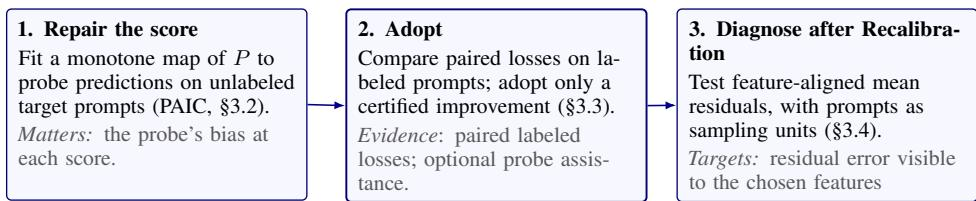
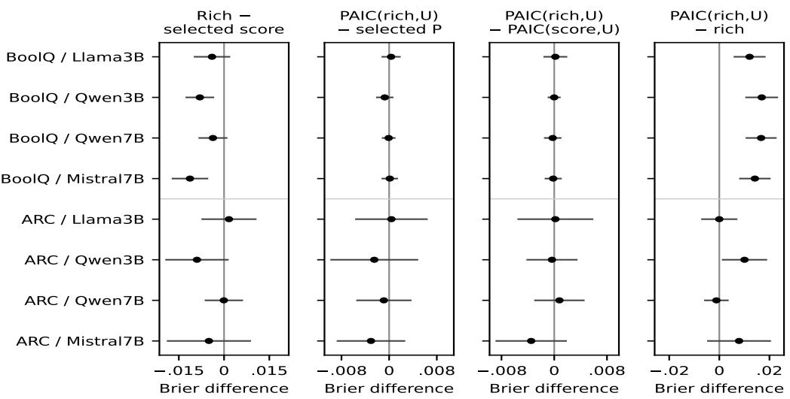
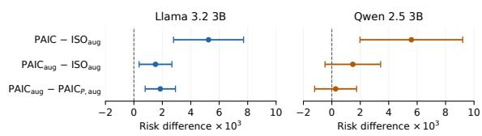
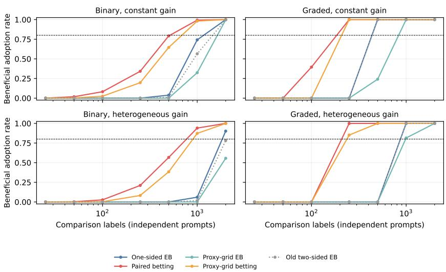
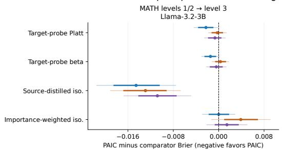
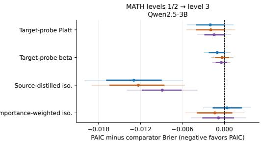
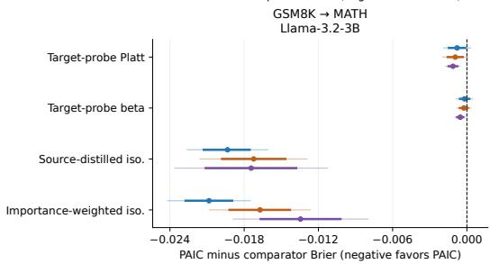
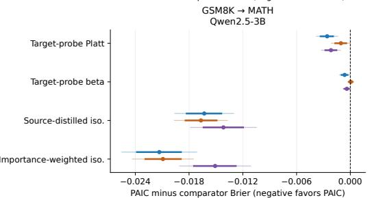
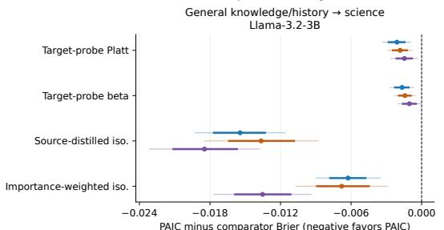
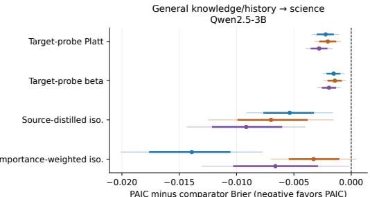

# ARE YOU SURE YOUR LLM IS SURE? REPAIRING AND AUDITING CONFIDENCE

Arijit Dey1,2§ Bhartendu Kumar2§ Ramya Hebbalaguppe2,3§ Khuushi Maheshwari2   
1 MBZUAI   
2 TCS Research Labs, India   
3 IIT Delhi

## ABSTRACT

Confidence scores determine whether an LLM answer is accepted, reviewed, or regenerated, yet scalar recalibration can only correct errors that are visible through the score itself. We introduce RADAR (Repair, Adopt, and Diagnose After Recalibration), a reliability framework that separates confidence repair from deciding whether the repair should be deployed and auditing the errors that remain. Under squared loss, we decompose prediction risk into outcome noise, information hidden by the score, and mapping error; restricting repair to order-preserving maps additionally introduces a pooling gap. For repair, we propose Probe-Anchored Isotonic Calibration (PAIC), which learns a monotone map from correctness-probe predictions on unlabeled target prompts. We show that PAIC’s excess risk depends on the probe’s score-conditional bias and fitting error, rather than on its overall prediction accuracy. For adoption, we derive a paired procedure with finite-sample control of false improvements. For auditing, we develop a prompt-clustered kernel test that detects feature-aligned residual errors while accounting for dependent answers from the same prompt. Across multiple LLM checkpoints, benchmarks, and distribution shifts, we find that richer predictors can improve confidence estimation, but projecting their information back to a scalar score can lose these gains, and lower prediction risk does not necessarily yield better review decisions. Across 47,400 replayed raw-score allocations, paired betting adopts candidates with lower held-out test risk in 42.95% of allocations, compared with 15.09% for one-sided empirical Bernstein. Together, RADAR provides a principled workflow to repair what a scalar confidence score can express, adopt a repair only when supported by evidence, and diagnose the systematic errors that recalibration leaves behind. Code and data will be released upon acceptance.

## 1 INTRODUCTION

A confidence score can be calibrated and still fail predictably. LLM confidence often determines whether an answer is accepted, reviewed, or regenerated. A standard remedy is scalar recalibration, which learns a transformation of confidence using methods such as temperature scaling, Platt scaling, or isotonic regression (Zadrozny & Elkan, 2002; Guo et al., 2017). Yet scalar recalibration has two fundamental limitations: it typically requires labeled data from the deployment population, which may be unavailable under distribution shift, and it can change score values but cannot recover information absent from the score.

For example, suppose every answer receives confidence 0.8, 80% are correct, and the remaining 20% systematically confuse minutes with hours. Expected calibration error is zero (Pakdaman Naeini et al., 2015; Guo et al., 2017), yet the failure remains perfectly predictable. Even correcting an original confidence of 0.9 to 0.8 reduces squared loss without revealing this subgroup. Thus, correcting a score and recovering distinctions hidden by that score are different problems.

RADAR: Repair, Adopt, and Diagnose After Recalibration. We formalize this distinction through RADAR (Repair, Adopt, and Diagnose After Recalibration), illustrated in Figure 1. Under squared loss, the risk of a scalar-repaired score decomposes into outcome noise, information hidden by the score, and mapping error; only the last term can be corrected by scalar recalibration. Restricting the repair to preserve score ordering can introduce an additional pooling gap. This decomposition motivates three distinct questions: how should a score be repaired without target labels, when should the repair be adopted, and what systematic errors remain afterward?

  
Shared protocol: one outcome Y · equal-prompt population · prompt-disjoint roles  
Figure 1: RADAR uses separate prompt sets to fit a confidence repair, compare candidate risks, and test residual errors. All stages use the same outcome definition and weight prompts equally. PAIC fits the repair from probe predictions; comparison and auditing use held-out labels.

Our approach. For Repair, we introduce Probe-Anchored Isotonic Calibration (PAIC), which distills an independently trained correctness probe into a monotone function of the original confidence using unlabeled target prompts. PAIC requires no target labels to fit, but held-out target labels test whether the fitted repair lowers target risk. We show that PAIC’s excess risk is controlled by the probe’s score-conditional bias and its fitting error, rather than by overall probe accuracy.

For Adopt, we show that agreement with an imperfect probe can misorder candidate confidence scores. We derive a paired risk comparison using held-out labels and a betting-based procedure that controls the probability of adopting a candidate that does not lower squared risk.

For Diagnose, we develop a feature-aware residual audit. Because multiple answers generated for the same prompt may be dependent, the audit uses cross-prompt kernel products and a promptlevel multiplier procedure to test systematic residual structure without treating sibling answers as independent.

## Contributions. Our contributions are:

1. A unified framework for confidence repair, adoption, and residual diagnosis: RADAR specifies separate data requirements and statistical guarantees for fitting a confidence repair, comparing candidate risks, and auditing residual errors. PAIC implements its repair stage using probe predictions on unlabeled target prompts.

2. Risk guarantees for repair and adoption. PAIC performs target-label-free monotone repair with excess risk bounded by $( \left\| b _ { n } \right\| _ { 2 } + \sqrt { u _ { n } } ) ^ { 2 }$ (Theorem 3.2), while our paired adoption rule controls the probability of deploying a non-improving candidate (Proposition 3.3).

3. Residual diagnosis beyond scalar calibration. We introduce a prompt-clustered kernel audit that detects feature-aligned residual errors while remaining valid under dependent answers from the same prompt (Theorem 3.4).

Our experiments show that scalar recalibration can improve risk under some shifts, lose information relative to richer predictors in others, and fail to improve downstream decision utility even when prediction risk decreases. RADAR is designed to distinguish these regimes rather than assume that improved calibration alone is sufficient for deployment.

More broadly, this work aims to make AI systems more trustworthy not by making them answer more questions correctly, but by repairing their confidence when we can—and identifying when that confidence still should not be trusted.

## 2 RELATED WORK

Grouping loss and monotone repair. Forecast decompositions separate reliability from resolution (DeGroot & Fienberg, 1983; Brocker¨ , 2009). Grouping loss measures predictive information hidden by a score, and non-injective recalibration can increase it (Perez-Lebel et al., 2023); our I is grouping loss under squared loss, and isotonic calibration (Zadrozny & Elkan, 2002; Dimitriadis et al., 2021) is our monotone benchmark. Multiaccuracy, multicalibration, and semantic grouping correct with features (Kim et al., 2018; Hebert-Johnson et al.´ , 2018; Yang et al., 2023). For LLMs, Chen et al. (2024) fit label-based isotonic maps within learned groups, so serving needs group features, and Melo et al. (2026) estimate grouping loss for local audits and deferral. PAIC instead serves a single map of the score (Appendix A.10).

Unlabeled adaptation and distillation. Under covariate shift, importance weighting reweights labeled source data toward the target (Shimodaira, 2000), including for calibration (Park et al., 2020; Wang et al., 2020); label-shift methods re-estimate class priors (Lipton et al., 2018; Alexandari et al., 2020); and ATC and DoC predict target accuracy from unlabeled data (Garg et al., 2022; Guillory et al., 2021). PAIC takes the complementary outcome-model route: instead of a density ratio over high-dimensional features, it transfers a probe’s predictions on unlabeled target prompts into the map. It is distillation with a student restricted to the score (Hinton et al., 2015), akin to learning with privileged information (Lopez-Paz et al., 2016); our contribution is a guarantee identifying which teacher errors matter.

Evidence for adopting a change. Prediction-powered inference (PPI) corrects model-based estimates with labeled residuals (Angelopoulos et al., 2023; 2024); we apply it to paired squared-loss contrasts between frozen candidates. Our adoption rule tests bounded means by betting (Waudby-Smith & Ramdas, 2024), and empirical-Bernstein bounds (Maurer & Pontil, 2009) give simultaneous intervals (Appendix A.6).

Kernel calibration tests. MMCE and the squared kernel calibration error (SKCE) embed residuals in a reproducing kernel Hilbert space (RKHS) (Kumar et al., 2018; Widmann et al., 2019; Marx et al., 2023). Their estimators treat observations as independent; we handle answers clustered by prompt, with multipliers in the spirit of wild-bootstrap kernel tests (Chwialkowski et al., 2014).

LLM confidence. Confidence can come from token likelihoods (Jiang et al., 2021), self-evaluation such as P(True) (Kadavath et al., 2022), verbalized statements (Lin et al., 2022; Xiong et al., 2024), agreement across samples (Wang et al., 2023; Kuhn et al., 2023; Farquhar et al., 2024), or probes of internal states (Orgad et al., 2025). Our methods accept any bounded scalar score; we evaluate likelihood-based and fixed-choice scores. Nakkiran et al. (2026) relate semantic calibration to local loss optimality; we instead repair and audit scores for fixed realized answers.

See Appendix D for a detailed and extended related work.

## 3 REPAIRING, ADOPTING, AND AUDITING A CONFIDENCE SCORE

Setup. Let $Z = \psi ( X , A )$ collect the inputs available for answer A to prompt X, and let $Y \in [ 0 , 1 ]$ be binary correctness or a grade. A base score $P = s _ { 0 } ( Z )$ , a correctness probe $g ( Z )$ , and candidate scores $s ( Z )$ all lie in [0, 1]. We measure squared risk, $\dot { L ( s ) } = \mathbb { E } [ ( Y - s \dot { ( Z ) } ) ^ { 2 } ] \dot { : }$ the Brier score for binary labels, and mean squared error targeting the expected grade for graded labels. It is minimized by $m ^ { \star } ( Z ) = \mathbb { E } [ Y \mid Z ]$ , and

$$
\mathbb { E } [ Y - s ( Z ) \mid Z ] = 0 \iff s ( Z ) = m ^ { \star } ( Z ) \quad { \mathrm { a . s . } }\tag{1}
$$

Scalar calibration, $\mathbb { E } [ Y \mid s ( Z ) ] = s ( Z )$ , checks averages only at each reported value and is weaker. Several answers are sampled per prompt and may be dependent, so expectations use the law $\mathbb { Q }$ that draws a prompt and then one of its answers uniformly, and $\| \cdot \| _ { 2 }$ is the corresponding rootmean-square norm. The guarantees require sibling-preserving splits and fitted components frozen independently of the comparison or audit prompts (Appendix A.2).

When must a correction use only the score? We study deployments in which the original score P is available for each answer, while richer probe inputs or computation are available during offline adaptation. PAIC serves a fitted map of P and preserves its ordering up to ties. When probe inputs are available at serving time, we include the direct probe in the candidate set (Table 1). A scalar map is the right object when deployment fixes the score’s interface while richer signals are available offline. Interface constraints: a threshold, triage queue, or API field consumes one score, and an order-preserving map corrects its values while keeping its validated ranking, up to ties. Fitting-time signals: an expensive teacher, such as a larger verifier, agreement among sampled answers, or execution checks, can score an unlabeled calibration set once but is too costly for every served answer. Access limits: a hosted model may expose token log-probabilities but not hidden states. When probe inputs are available at serving time, include the direct probe among the candidate scores. Declare supervision and serving inputs before comparison (Table 1). Section 4.2 distinguishes same-model probes from a verifier needing an extra pass per answer.

<table><tr><td>Correction</td><td>Supervision</td><td>Serving inputs</td></tr><tr><td>Source scalar maps</td><td>Source labels fit the map</td><td>P</td></tr><tr><td>Importance-weighted isotonic</td><td>Source labels, reweighted toward unlabeled target prompts</td><td>P</td></tr><tr><td>Source-distilled isotonic</td><td>g from source labels; isotonic fit to g on source prompts</td><td>P</td></tr><tr><td>Target-probe Platt, beta</td><td>g from source labels; parametric fit to g on target prompts</td><td>P</td></tr><tr><td>PAIC</td><td>g from source labels; isotonic fit to g on target prompts</td><td>P</td></tr><tr><td>Target isotonic (yardstick)</td><td>Target labels fit the map</td><td> $P$ </td></tr><tr><td>Group maps (Chen et al., 2024)</td><td>Source labels fit groups and maps</td><td> $P ,$  group features</td></tr><tr><td>Direct probe</td><td>Source labels train g</td><td>Probe features</td></tr></table>

Table 1: Supervision and serving inputs in the raw-score shift experiments, with the base scorer fixed. Source scalar maps are label-isotonic, positive Platt, monotone beta, and a flexible nonmonotone regressor; the four rows from importance weighting to PAIC share 500 unlabeled target and 500 unlabeled source prompts, and target isotonic is a yardstick, not a competitor (Appendix A.10).

## 3.1 WHAT A SCALAR MAP CAN CHANGE

For a recalibration $\tau : [ 0 , 1 ]  [ 0 , 1 ]$ , the best unrestricted target is $q ( P ) = \mathbb { E } [ Y \mid P ]$ , the expected correctness at each score. Let $\dot { N } = \operatorname { \mathbb { E } } [ \operatorname { V a r } ( Y \mid Z ) ]$ be outcome noise and $I = \bar { \mathbb { E } } [ \bar { \mathrm { V a r } } ( m ^ { \star } ( Z ) \mid P ) ]$ the variation in expected correctness hidden by the score. Theorem A.3 gives

$$
L ( \tau \circ s _ { 0 } ) = N + I + \mathbb { E } [ ( \tau ( P ) - q ( P ) ) ^ { 2 } ] .\tag{2}
$$

Only the last term changes when we remap P. In the introductory population, remapping 0.9 to 0.8 lowers risk from 0.17 to 0.16; if Z identifies the two families, the remaining 0.16 is I and $N = 0$ The term I is grouping loss under squared loss (Perez-Lebel et al., 2023): risk below $N + I$ requires inputs beyond P.

Preserving score order restricts τ to the class M of nondecreasing maps $[ 0 , 1 ]  [ 0 , 1 ]$ . A strictly increasing map leaves every ranking-based measure unchanged, including AUROC and the risk– coverage curve: it moves values and the thresholds applied to them, not the order of answers. Where q decreases, a monotone map must pool distinct scores, which can create ties. Let $\tau _ { \mathrm { i s o } }$ be the map in $\mathcal { M }$ closest to q in $\| \cdot \| _ { 2 }$ , which weights scores by their frequency, and let $G = \| q - \tau _ { \mathrm { i s o } } \| _ { 2 } ^ { 2 }$ be the resulting pooling gap (Appendix A.1.2).

Theorem 3.1 (Monotone repair and pooling). Under the common bounded-information setup, $T =$ $\tau _ { \mathrm { i s o } } ( P )$ minimizes squared risk over M and satisfies

$$
L ( T ) = N + I + G , \qquad \mathbb { E } [ Y \mid T ] = T , \qquad \mathbb { E } [ \operatorname { V a r } ( m ^ { \star } \mid T ) ] = I + G .
$$

The maximum monotone gain over P is $\mathbb { E } [ ( P - q ( P ) ) ^ { 2 } ] - G .$

The best order-preserving repair is therefore calibrated yet still loses $I + G$ relative to $m ^ { \star }$ , a loss that no check of its own calibration can reveal. Theorem A.4 covers arbitrary score laws, including atoms, and gives a three-state example with $I = 0$ and $G = 1 / 2 4$

## 3.2 PAIC: FITTING THE MAP TO PROBE PREDICTIONS

Label-isotonic regression estimates $\tau _ { \mathrm { i s o } }$ from labeled pairs $( P , Y )$ . PAIC replaces the labels with a probe’s predictions, so the map can be fitted on prompts whose labels are unavailable, including

prompts from the population where the score will be served. Fit a bounded probe $g _ { n }$ on labeled training prompts. On n calibration prompts that are independent of probe training, each with $1 \leq K _ { j } <$ ∞ answers, fit

$$
\hat { \tau } _ { n } \in \arg \operatorname* { m i n } _ { \tau \in \mathcal { M } } \frac { 1 } { n } \sum _ { j = 1 } ^ { n } \frac { 1 } { K _ { j } } \sum _ { i = 1 } ^ { K _ { j } } ( \tau ( P _ { j i } ) - g _ { n } ( Z _ { j i } ) ) ^ { 2 } , \quad \quad s _ { \mathrm { P A I C } } = \hat { \tau } _ { n } \circ s _ { 0 } .\tag{3}
$$

Each prompt has total weight $1 / n$ , and serving evaluates only $\hat { \tau } _ { n } ( P )$ . Conditional on probe training, PAIC’s population target is the monotone projection $\tau _ { g _ { n } }$ of $q _ { g _ { n } } \dot { ( P ) } = \mathbb { E } [ g _ { n } ( Z ) \mid \dot { P } ]$ . Define the score-conditional bias $b _ { n } = q _ { g _ { n } } - q$ and the population fitting gap ${ \dot { u } } _ { n } = { R } _ { g _ { n } } \dot { ( \tau _ { n } ) } - { R } _ { g _ { n } } \dot { ( \tau _ { g _ { n } } } )$ , where $R _ { g } ( a ) = \mathbb { E } [ ( g ( Z ) - a ( P ) ) ^ { 2 } ] ; u _ { n }$ is a population loss gap, not the observed training error.

Theorem 3.2 (PAIC under score-conditional probe bias). With bounded probesfitted independently of the calibration prompts as above,

$$
0 \leq L ( \hat { \tau } _ { n } \circ s _ { 0 } ) - ( N + I + G ) \leq ( \| b _ { n } \| _ { 2 } + \sqrt { u _ { n } } ) ^ { 2 } .
$$

$I f \mathbb { E } _ { \mathrm { t r a i n } } \Vert b _ { n } \Vert _ { 2 } ^ { 2 }  0$ as independent calibration prompts grow, PAIC converges in risk and in $L ^ { 2 }$ to the optimal monotone repair.

Which probe errors matter. Only the probe’s error averaged at each base score moves PAIC’s target. Errors that cancel within a score level are harmless: in the constant-score example, a probe predicting 0.8 for every answer yields the optimal scalar target while missing both families. A constant offset persists however many calibration prompts are used. If only the unlabeled calibration inputs and a fixed probe are available, populations whose correctness at one score differs ${ \tt b y } \pm \sqrt { \delta }$ can be indistinguishable; every scalar repair then has worst-case excess risk at least δ. Overall accuracy therefore does not determine repair quality (Section 4.2), and full probe consistency is sufficient but not necessary. Theorem A.10 gives $\mathbb { E } u _ { n } \leq 2 5 / { \sqrt { n } } ;$ localization sharpens this to $\dot { \mathbb E } u _ { n } = O ( n ^ { - 2 / 3 } )$ even for a non-monotone probe target, at the classical isotonic rate (Zhang, 2002; Chatterjee et al., 2015). With squared score-conditional bias bounded by $\delta ,$ the order $\bar { \delta } + n ^ { - 2 / 3 }$ is minimax for monotone scalar recalibration from exactly n independent $( P , g ( Z ) )$ observations and no additional target-population information (Appendix A.5). The rates characterize convergence to the optimal monotone repair, which is also the population target of label-isotonic regression. Target-probe bias remains an assumption while finite-sample performance is evaluated in Section 4.

Adapting to a new population. Theorem 3.2 holds under whichever population supplies the calibration prompts, so drawing them from the target population repairs the score there without target labels, with excess risk governed by the probe’s target bias $\mathbb { E } _ { \mathrm { t g t } } [ \bar { g } _ { n } - Y \mid P ] ;$ : under covariate shift, the source-trained probe’s error averaged over target inputs at each score. Importance-weighted calibration targets the same map but needs a density ratio over $Z ,$ where PAIC needs only those errors to average out.

## 3.3 DECIDING WHETHER TO ADOPT A REPAIR

Agreement with a probe cannot settle a comparison: a probe agrees perfectly with itself, correct or not. For frozen candidates $s _ { a } , s _ { b }$ and probe $^ { g , }$ let $\hat { D _ { g } } ( a , b ) \overset {  } { = } \mathbb { E } [ ( \overset { \cdot } { s } _ { a } - g ) ^ { \overset { \cdot } { 2 } } ] - \mathbb { E } [ ( s _ { b } - g ) ^ { 2 } ]$ be their difference in squared disagreement with $^ { g , }$ the probe-relative calibration error (PRCE), and let $\Delta _ { a b } = L ( s _ { a } ) - L ( \bar { s _ { b } } )$ be their risk difference; negative values favor a. Exactly (Proposition A.6),

$$
\Delta _ { a b } = D _ { g } ( a , b ) + 2 \mathbb { E } [ ( s _ { a } - s _ { b } ) ( g - Y ) ] .\tag{4}
$$

Only probe error aligned with the candidate difference biases the comparison; for scalar candidates it enters through $b _ { g } ( \bar { P ) } = \mathbb { E } [ g - Y \mid P ]$

Correcting the comparison with labels. Freeze g and M candidates, including $s _ { 0 } = P ,$ , and draw a labeled pool L and an unlabeled pool U from the same cluster law, independent of each other and of all fitting. With $s _ { a , j i } = s _ { a } ( Z _ { j i } )$ and $g _ { j i } = g ( Z _ { j i } )$ , define for prompt j

$$
A _ { j , a b } = \frac { 1 } { K _ { j } } \sum _ { i } \big [ ( s _ { a , j i } - g _ { j i } ) ^ { 2 } - ( s _ { b , j i } - g _ { j i } ) ^ { 2 } \big ] , \qquad C _ { j , a b } = \frac { 2 } { K _ { j } } \sum _ { i } ( s _ { a , j i } - s _ { b , j i } ) ( g _ { j i } - Y _ { j i } ) .\tag{5}
$$

With bars denoting prompt averages over a pool, the prediction-powered estimate $\widehat { \Delta } _ { a b } = \overline { { { A } } } _ { { \mathcal U } , a b } +$ $\overline { { C } } \mathcal { L } , _ { a b }$ is unbiased for $\Delta _ { a b }$ conditional on fitting, for any bounded probe (Angelopoulos et al., 2023); a useful probe reduces the labeled term’s variance, and coincident pools give ordinary paired validation.

Adopting only certified improvements. Simultaneous empirical-Bernstein intervals cover every pairwise contrast (Theorem A.12). Their range terms exceed the gains at the budgets in our tested controls (Section 4.3). Adoption needs only a one-sided answer per candidate h: does it lower risk relative to $P ?$ Let $D _ { j h }$ be prompt $j ^ { \circ } \mathrm { s }$ average squared-loss difference between $h$ and $P$ on the labeled pool. Let $\delta _ { h } \in [ 0 , 1 ]$ satisfy $\delta _ { h }  { \geq } \operatorname* { s u p } _ { z } | h (  { \bar { z } } ) - s _ { 0 } ( z ) |$ , certified over the whole input domain; then $| D _ { j h } | \le B _ { h } : = \overset { \cdot } { \delta } _ { h } ( \overset { . } { 2 } - \delta _ { h } )$

Proposition 3.3 (Adoption by betting). Fix $0 < \alpha < 1$ , a nonemptyfinite set $\mathcal { S } \subset ( 0 , 1 )$ , and $H \geq 1$ non-original candidates with $B _ { h } > 0$ , independently of comparison outcomes. For n labeled prompts drawn i.i.d.from the target cluster law and independently offitting, let

$$
E _ { h } = \frac { 1 } { | { \cal S } | } \sum _ { s \in \cal S } \prod _ { j = 1 } ^ { n } \Big ( 1 - s \frac { D _ { j h } } { B _ { h } } \Big ) .
$$

Certify h if $E _ { h } \ge H / \alpha ;$ adopt the certified candidate with the smallest mean $\overline { { D } } _ { h }$ under a fixed tie order, and otherwise retain $P .$ . Conditionally onfitting, the probability that any candidate with $L ( h ) \ge L ( P )$ is certified is at most α; in particular, a candidate that does not lower risk is adopted with probability at most α.

Each factor is positive with mean at most one when $L ( h ) \ge L ( P )$ , so independence and Markov’s inequality give the bound (Appendix A.7). This standard betting construction (Waudby-Smith & Ramdas, 2024) controls adoption, not two-sided coverage. The proxy-assisted variant additionally requires disjoint groups of mutually independent labeled and unlabeled prompt clusters from the same target law, independent of fitting, with its certified range and fixed mixture (Appendix A.7). We use $\bar { \mathcal { S } } = \{ 0 . 0 5 , 0 . \dot { 1 } , 0 . 2 5 , 0 . 5 , 0 . 9 \}$ ; choosing a procedure or budget after inspecting a sweep is outside this guarantee.

## 3.4 AUDITING RESIDUAL ERROR AFTER REPAIR

A repaired score can still leave mean errors along features that it does not see: the losses $I + G$ in Theorem 3.1. In the introductory population, the repaired score’s residual $r = Y - s ( Z )$ averages zero overall but −0.8 within the conversion family. Let k be a real measurable positive-definite kernel with separable RKHS $\mathcal { H } _ { k }$ , measurable feature map $\Phi ( z ) = k ( z , \cdot )$ , and $k ( z , z ) \leq \kappa < \infty$ . With independent primed copies,

$$
\mathrm { S K C E } _ { k } ( s ) = \| \mathbb { E } [ ( Y - s ( Z ) ) \Phi ( Z ) ] \| _ { \mathcal { H } _ { k } } ^ { 2 } = \mathbb { E } [ r r ^ { \prime } k ( Z , Z ^ { \prime } ) ]\tag{6}
$$

is the squared largest residual moment over the RKHS unit ball (Widmann et al., 2019; Marx et al., 2023) (Theorem A.15). If $\mathcal { H } _ { k }$ is dense in $L ^ { 2 } ( \mathbb { Q } _ { Z } )$ , zero identifies $s = m ^ { \star } ;$ a finite feature map tests only its own moments, so the kernel declares which hidden errors the audit looks for.

Prompts, not answers, are the sampling units. Answers sampled for one prompt share its content and often its mistakes, so their residuals can be correlated even when every conditional mean is correct. Take $J \ge 2$ i.i.d. prompt clusters, independent of the fitted score, kernel and representation, each with $1 \le K _ { j } < \infty$ possibly dependent answers and bounded outcomes. Average residual features within each prompt, and multiply only across different prompts:

$$
\zeta _ { j } : = \frac { 1 } { K _ { j } } \sum _ { i = 1 } ^ { K _ { j } } r _ { j i } k ( Z _ { j i } , \cdot ) , \qquad \widehat { \mathrm { S K C E } } _ { k , c } : = \frac { 1 } { J ( J - 1 ) } \sum _ { j \neq \ell } \langle \zeta _ { j } , \zeta _ { \ell } \rangle _ { \mathscr { H } _ { k } } .\tag{7}
$$

Theorem 3.4 (Prompt-clustered audit). Under Assumptions (T3)–(T4) and the bounded setup above, $\widehat { \mathrm { S K C E } } _ { k , c }$ is unbiased for SKCEk(s) under $\mathbb { Q } ,$ for arbitrary within-prompt dependence and unequal cluster sizes. Suppose $\mathrm { S K C E } _ { k } ( s ) = 0$ and the covariance operator of $\mathrm { \dot { \zeta } } _ { j }$ is nonzero. Let $x _ { j } = \zeta _ { j } - \bar { \zeta } ,$ draw independent $e _ { j } \sim \mathcal { N } ( 0 , 1 )$ , and set $\begin{array} { r } { T _ { J } ^ { * } = ( J - 1 ) ^ { - 1 } \sum _ { j \neq \ell } e _ { j } e _ { \ell } \langle x _ { j } , x _ { \ell } \rangle _ { \mathcal { H } _ { k } } } \end{array}$ . Rejecting when $\widehat { J \operatorname { S K C E } _ { k , c } }$ exceeds the conditional $( 1 - \alpha )$ quantile of $T _ { J } ^ { \ast }$ has pointwise asymptotic size α as J and the number ofmultiplier draws grow.

  
Figure 2: Direct and projected confidence predictors on BoolQ and ARC. The fourth column measures the risk change from projecting each rich predictor onto a monotone function of P.

Theorems A.20 and A.22 give the proofs and the weighted chi-squared null limit. A statistic over all pairs of answers instead has mean $\begin{array} { r } { \theta + \frac { K - 1 } { J K - 1 } ( \gamma - \theta ) } \end{array}$ with K answers per prompt, where $\theta = \operatorname { S K C E } _ { k } ( s )$ and γ is the mean product of two sibling residual features (Remark A.21); this bias has the order of the null statistic, so answer-level tests can reject calibrated scores whenever siblings share errors. Non-rejection does not certify a small residual (Proposition A.23), and applied to the probe the statistic bounds the comparison bias in (4) (Proposition A.17).

## 4 EXPERIMENTS

We test whether unlabeled target prompts improve scalar repair, which teacher errors affect the fitted map, and whether the adoption and audit procedures distinguish useful score changes from residual failures. We then evaluate review decisions at fixed costs. Each study specifies its correctness labels, serving inputs, and independent sampling units; Appendix B gives the full protocols.

## 4.1 WHAT RICHER INPUTS ADD BEYOND THE SCORE

We compare 13 predictors for Llama 3.2 3B, Qwen 2.5 3B/7B and Mistral 7B on 3,270 BoolQ validation and 1,172 ARC Challenge test questions; ARC fitting uses Easy questions. Each model selects one fixed answer per question. P is its probability normalized over allowed choices. Scalar controls use $P ;$ full-score controls retain the choice probabilities and selected-option identity; rich direct also uses hidden states. Supervised candidates share fitting labels. Rich-PAIC-U and score-PAIC-U project their respective teachers on the same unlabeled target inputs, serving only a monotone map of P (Appendix C).

Serving the rich predictor directly yields lower Brier risk than its monotone projection for all four BoolQ models and for ARC Qwen3B. The differences are 0.0121-0.0169 on BoolQ and 0.0101 on ARC Qwen3B, with joint intervals excluding zero. Relative to the selected full-score predictor, hidden states improve Brier risk for BoolQ Qwen3B and Mistral7B by 0.00803 and 0.01131; the other six comparisons are unresolved. No joint interval establishes an advantage for rich-PAIC-U over the selected scalar control or score-PAIC-U. Figure 2 shows all 32 prespecified contrasts.

## 4.2 REPAIR QUALITY AND TRANSFER

Where the probe is wrong matters. Equal probe MSE produces different scalar repairs. Three probes have the same excess outcome MSE, 0.0064. With 2,000 calibration prompts, the two probes whose errors cancel within each score level yield mean excess repair risks of $3 . 9 0 \times 1 0 ^ { - 7 }$ and $3 . 1 6 \times 1 0 ^ { - 5 }$ . A constant 0.08 offset yields 0.0064. Increasing the calibration sample removes fitting error but leaves the offset bias, as predicted by Theorem 3.2.

Adapting a raw likelihood score under shift. Across difficulty, task, and subject shifts for Llama 3.2-3B and Qwen2.5-3B, tree-based PAIC reduces mean squared risk by 4.9 - 16.4% relative to source label-isotonic calibration (Table 1; Appendix B.3). These means use three overlapping refits, with 500 labeled source prompts and 500 unlabeled target prompts. PAIC has lower mean risk than every source-fitted scalar baseline in all six settings. Direct probes achieve lower risk in all six settings when their features are retained at serving time. With source labels and unlabeled source and target prompts matched, PAIC has lower estimated risk in 67 of 72 prespecified contrasts; approximate globally adjusted intervals favor PAIC in 47. All 18 contrasts with source-distilled isotonic favor target PAIC under that adjustment. Fitting on the target inputs therefore accounts for a substantial part of the improvement. Matching the squared-loss objective also narrows the difference from parametric target maps: PAIC’s mean advantage over squared-loss beta is 0.000125–0.001368 across the six settings (Appendix B.4).

Adapting a learned score to harder MATH problems. Holding the learned scorer and probe fixed, refitting PAIC on 777 unlabeled level-3 MATH prompts lowers Llama’s target risk by 0.00633 relative to source PAIC and by 0.00552 relative to source label-isotonic; both adjusted intervals exclude zero. The effect varies by subject: Prealgebra risk increases by 0.00456. For Qwen, the change from source PAIC is unresolved, and target PAIC remains 0.00083 above source label-isotonic. The two checkpoints show different transfer outcomes under the same adaptation procedure (Appendix B.6).

Presentation changes do not ensure repair gains. On constructed inventory-tracking problems, each model’s answers stay fixed across entity renaming, reordered facts and irrelevant context. Comparators reuse 2,400 fitting labels per model across views. On 1,800 evaluation families per model, target PAIC has higher risk than transformed-view label-isotonic. Transformed teacher-fitting views narrow the gap, but no primary comparison establishes a PAIC advantage: four favor the control and two remain unresolved (Figure 3; Appendix B.7).

## 4.3 ADOPTION REQUIRES BOTH AN UNBIASED TARGET AND PRECISION

Six fixed candidates across 28 constructed settings test residual correction, with 2,000 repetitions per setting. For a true risk difference +0.0004, an offset probe gives mean proxy estimate −0.002805, reversing the preferred score; labeled correction gives +0.000397. Corrected-to-labeled estimator SD ratios are 0.798 for a graded oracle control, 1.000 for a binary blind probe and 1.304 for a reversed probe: assistance can improve, leave unchanged or worsen precision (Appendix B.9).

  
Figure 3: Controlled changes in presentation. All six primary risk contrasts; negative favors the first method. PAIC uses target projection; aug fits transformed views with the same unique labels; P marks a score-only teacher. Approximate stratified finitepopulation Welch-t intervals allocate 0.05/6 per contrast, conditional on fixed fits and grades.

The simultaneous finite-sample intervals resolve no improvement in any repetition, including with 2,000 labeled and 8,000 unlabeled prompts; their range terms alone ex-

ceed the gains in these controls. A prespecified normal benchmark has joint coverage 0.971–0.991 (labeled) and 0.9725–0.991 (corrected), with asymptotic justification only. Figure 4 isolates the adoption procedure using fixed candidates with known population risks. Under matched hypotheses, candidate families, certified ranges, and error budgets, paired betting reaches the prespecified adoption criterion with half as many comparison prompts in three populations and one quarter as many in the graded heterogeneous-gain population. Oracle-probe assistance does not reduce these crossings. Thus, correcting proxy bias and improving adoption efficiency are separate requirements; additional unlabeled predictions do not automatically reduce the labeling budget. On 47,400 cached raw-score allocations, betting adopts a beneficial candidate 20,356 times versus 7,155 for one-sided empirical

Same one-sided hypotheses, ranges, family and error budget

Oracle probes; four unlabeled prompts per label; 2,000 repetitions per cell

  
Dashed line: 80% point-rate reference; reported crossings use Wilson bounds. Fixed-budget control only.

Figure 4: Adoption under matched one-sided tests. Beneficial adoption rate against the number of labeled comparison prompts in the four known-risk gain populations (oracle probe, four unlabeled prompts per label, 2,000 repetitions per cell).

Bernstein, with no false adoption estimated on held-out test prompts; most adoptions select a direct feature predictor (Appendix B.10).

## 4.4 AUDITS DETECT THE MEAN ERRORS THEIR FEATURES EXPOSE

The controlled audit fixes two score levels and two equally likely subgroups. When subgroup errors cancel at each score, the feature test detects them while the score-only test remains under its own null. A scalar distortion instead favors the score-only test (Table 16). Across seven calibrated controls, feature-test rejection is 0.0485–0.0590, with pointwise Wilson intervals containing 0.05. The learned auditor rejects 126 of 2,000 graded-null repetitions (0.0630, interval [0.0532, 0.0745]). An 18,000- trial paired follow-up of that cell bounds the Gaussian test’s excess rejection over a sign-flip reference below 0.5 percentage points with exact residuals (simultaneous 95% bound); it neither explains the earlier rate nor establishes nominal finite-sample size (Appendices B.11 and B.12).

## 4.5 PREDICTION LOSS AND DECISION UTILITY ARE DIFFERENT OUTCOMES

Perfect review costs c and wrong acceptance one: accept $s \geq 1 - c ;$ otherwise review. $\mathbf { A t } c = . 1 0 ,$ both adapted MATH maps review all answers: Qwen’s acceptance falls from 73.0% to zero as its maximum score crosses the threshold from 0.900015 to 0.899516. Rich-PAIC-U accepts nothing on ARC Mistral at $c = . 0 5$ and exceeds accept-all loss on BoolQ Qwen3B/Mistral at $c = . 5 0$ . Rich direct has higher decision loss than its selected score control on ARC Llama at every declared cost. On the archived learned score (a previously recalibrated supervised score) at full budget, comparison-fitted PAIC thresholds have higher mean review loss than directly fitted original-score thresholds in 23/24 settings with matched downstream labels (descriptive; Appendix B.13).

## 5 CONCLUSION

RADAR reframes confidence calibration as more than a score-correction problem. By separating confidence repair, evidence-based adoption, and residual diagnosis, it clarifies what scalar recalibration can improve, what information it cannot recover, and what evidence is needed before a repaired score should be deployed. Across models, tasks, and distribution shifts, our results show that lower prediction risk does not necessarily imply better downstream decisions. Our results argue for treating confidence not as a number to be calibrated once, but as a quantity that should be repaired, validated, and audited before it is trusted in deployment.

## AI USE STATEMENT

Large language models were used for synthetic question and reference-solution authoring and correctness grading, and for assistance with methodological development, proof drafting, code, and writing. This disclosure records uses known for the current draft, not a verification certificate.

## REPRODUCIBILITY STATEMENT

Appendix A states all assumptions and gives complete proofs. Appendix B specifies the populations, splits, supervision budgets, candidate families and uncertainty conventions for every experiment, and Appendix C gives the fixed-choice study and its 32B extension. Fitted candidates were saved before evaluation outcomes were joined. The controlled studies, the fixed-choice and 32B studies, and the equal-information, MATH-transfer, verifier and regeneration analyses were also recomputed from saved predictions by a separate implementation. Code, saved predictions and figure data will be released upon acceptance.

## ETHICS STATEMENT

Automated grades can reflect grader bias or mistakes, and repeated grading does not measure all such errors. Neither low calibration error nor audit non-rejection establishes safety for a high-stakes use. The intended use is to support inspection and comparison of confidence scores, not to replace domain-specific validation or human oversight. Any data and code release must respect model and dataset licenses and remove credentials and identifying infrastructure information.

## REFERENCES

Amr Alexandari, Anshul Kundaje, and Avanti Shrikumar. Maximum likelihood with bias-corrected calibration is hard-to-beat at label shift adaptation. In Proceedings of the 37th International Conference on Machine Learning, volume 119 of Proceedings of Machine Learning Research, pp. 222–232. PMLR, 2020. URL https://proceedings.mlr.press/v119/alexandar i20a.html.

Anastasios N. Angelopoulos, Stephen Bates, Clara Fannjiang, Michael I. Jordan, and Tijana Zrnic. Prediction-powered inference. Science, 382(6671):669–674, 2023. doi: 10.1126/science.adi6000. URL https://arxiv.org/abs/2301.09633.

Anastasios N. Angelopoulos, John C. Duchi, and Tijana Zrnic. PPI++: Efficient prediction-powered inference. arXiv preprint arXiv:2311.01453v2, 2024. URL https://arxiv.org/abs/23 11.01453v2. Version 2, revised 26 March 2024; originally submitted in 2023.

Peter L. Bartlett, Olivier Bousquet, and Shahar Mendelson. Local Rademacher complexities. The Annals ofStatistics, 33(4):1497–1537, 2005. doi: 10.1214/009053605000000282.

Jochen Brocker. Reliability, sufficiency, and the decomposition of proper scores. ¨ Quarterly Journal ofthe Royal Meteorological Society, 135(643):1512–1519, 2009. doi: 10.1002/qj.456.

Sabyasachi Chatterjee, Adityanand Guntuboyina, and Bodhisattva Sen. On risk bounds in isotonic and other shape restricted regression problems. The Annals of Statistics, 43(4):1774–1800, 2015. doi: 10.1214/15-AOS1324.

Lihu Chen, Alexandre Perez-Lebel, Fabian M. Suchanek, and Gael Varoquaux. Reconfidencing ¨ LLMs from the grouping loss perspective. In Findings of the Association for Computational Linguistics: EMNLP 2024, pp. 1567–1581. Association for Computational Linguistics, 2024. doi: 10.18653/v1/2024.findings-emnlp.85. URL https://aclanthology.org/2024.find ings-emnlp.85/.

Kacper Chwialkowski, Dino Sejdinovic, and Arthur Gretton. A wild bootstrap for degenerate kernel tests. arXiv preprint arXiv:1408.5404, 2014. doi: 10.48550/arXiv.1408.5404. URL https://arxiv.org/abs/1408.5404.

Christopher Clark, Kenton Lee, Ming-Wei Chang, Tom Kwiatkowski, Michael Collins, and Kristina Toutanova. BoolQ: Exploring the surprising difficulty of natural yes/no questions. In Proceedings of the 2019 Conference of the North American Chapter of the Association for Computational Linguistics: Human Language Technologies, Volume 1 (Long and Short Papers), pp. 2924–2936. Association for Computational Linguistics, 2019. doi: 10.18653/v1/N19-1300. URL https: //aclanthology.org/N19-1300/.

Peter Clark, Isaac Cowhey, Oren Etzioni, Tushar Khot, Ashish Sabharwal, Carissa Schoenick, and Oyvind Tafjord. Think you have solved question answering? try ARC, the AI2 reasoning challenge. arXiv preprint arXiv:1803.05457, 2018. doi: 10.48550/arXiv.1803.05457. URL https://arxiv.org/abs/1803.05457.

Morris H. DeGroot and Stephen E. Fienberg. The comparison and evaluation of forecasters. The Statistician, 32(1/2), 1983. doi: 10.2307/2987588.

Timo Dimitriadis, Tilmann Gneiting, and Alexander I. Jordan. Stable reliability diagrams for probabilistic classifiers. Proceedings of the National Academy of Sciences, 118(8):e2016191118, 2021. doi: 10.1073/pnas.2016191118.

Sebastian Farquhar, Jannik Kossen, Lorenz Kuhn, and Yarin Gal. Detecting hallucinations in large language models using semantic entropy. Nature, 630(8017):625–630, 2024. doi: 10.1038/s41586 -024-07421-0. URL https://doi.org/10.1038/s41586-024-07421-0.

Saurabh Garg, Sivaraman Balakrishnan, Zachary C. Lipton, Behnam Neyshabur, and Hanie Sedghi. Leveraging unlabeled data to predict out-of-distribution performance. In International Conference on Learning Representations, 2022. URL https://openreview.net/forum?id=o\_Hs iMPYh\_x.

Yonatan Geifman and Ran El-Yaniv. Selective classification for deep neural networks. In Advances in Neural Information Processing Systems, volume 30, pp. 4878–4887, 2017.

Tilmann Gneiting and Adrian E. Raftery. Strictly proper scoring rules, prediction, and estimation. Journal ofthe American Statistical Association, 102(477):359–378, 2007. doi: 10.1198/01621450 6000001437.

Arthur Gretton, Karsten M. Borgwardt, Malte J. Rasch, Bernhard Scholkopf, and Alexander Smola.¨ A kernel two-sample test. Journal ofMachine Learning Research, 13(25):723–773, 2012. URL https://jmlr.org/papers/v13/gretton12a.html.

Devin Guillory, Vaishaal Shankar, Sayna Ebrahimi, Trevor Darrell, and Ludwig Schmidt. Predicting with confidence on unseen distributions. In Proceedings ofthe IEEE/CVF International Conference on Computer Vision, pp. 1134–1144, 2021. URL https://openaccess.thecvf.com/co ntent/ICCV2021/html/Guillory\_Predicting\_With\_Confidence\_on\_Unsee n\_Distributions\_ICCV\_2021\_paper.html.

Adityanand Guntuboyina and Bodhisattva Sen. Nonparametric shape-restricted regression. Statistical Science, 33(4):568–594, 2018. doi: 10.1214/18-STS665.

Chuan Guo, Geoff Pleiss, Yu Sun, and Kilian Q. Weinberger. On calibration of modern neural networks. In Proceedings of the 34th International Conference on Machine Learning, volume 70 of Proceedings ofMachine Learning Research, pp. 1321–1330, 2017. URL https://procee dings.mlr.press/v70/guo17a.html.

Ursula Hebert-Johnson, Michael Kim, Omer Reingold, and Guy Rothblum. Multicalibration: Cali-´ bration for the (computationally-identifiable) masses. In Proceedings of the 35th International Conference on Machine Learning, volume 80 of Proceedings of Machine Learning Research, pp. 1939–1948, 2018. URL https://proceedings.mlr.press/v80/hebert-johnson 18a.html.

Dan Hendrycks, Collin Burns, Saurav Kadavath, Akul Arora, Steven Basart, Eric Tang, Dawn Song, and Jacob Steinhardt. Measuring mathematical problem solving with the MATH dataset. NeurIPS, 2021. URL https://arxiv.org/abs/2103.03874.

Geoffrey Hinton, Oriol Vinyals, and Jeff Dean. Distilling the knowledge in a neural network. arXiv preprint arXiv:1503.02531, 2015. doi: 10.48550/arXiv.1503.02531. URL https: //arxiv.org/abs/1503.02531.

Wassily Hoeffding. A class of statistics with asymptotically normal distribution. The Annals of Mathematical Statistics, 19(3):293–325, 1948. doi: 10.1214/aoms/1177730196.

Wassily Hoeffding. Probability inequalities for sums of bounded random variables. Journal ofthe American Statistical Association, 58(301):13–30, 1963. doi: 10.1080/01621459.1963.10500830.

Zhengbao Jiang, Jun Araki, Haibo Ding, and Graham Neubig. How can we know when language models know? on the calibration of language models for question answering. Transactions ofthe Associationfor Computational Linguistics, 9:962–977, 2021. doi: 10.1162/tacl a 00407. URL https://aclanthology.org/2021.tacl-1.57/.

Saurav Kadavath, Tom Conerly, Amanda Askell, et al. Language models (mostly) know what they know. arXiv preprint arXiv:2207.05221, 2022. doi: 10.48550/arXiv.2207.05221. URL https://arxiv.org/abs/2207.05221.

Michael P. Kim, Amirata Ghorbani, and James Zou. Multiaccuracy: Black-box post-processing for fairness in classification. arXiv preprint arXiv:1805.12317, 2018. doi: 10.48550/arXiv.1805.12317. URL https://arxiv.org/abs/1805.12317.

Lorenz Kuhn, Yarin Gal, and Sebastian Farquhar. Semantic uncertainty: Linguistic invariances for uncertainty estimation in natural language generation. In International Conference on Learning Representations, 2023. URL https://arxiv.org/abs/2302.09664.

Meelis Kull, Telmo Silva Filho, and Peter Flach. Beta calibration: a well-founded and easily implemented improvement on logistic calibration for binary classifiers. In Proceedings ofthe 20th International Conference on Artificial Intelligence and Statistics, volume 54 of Proceedings of Machine Learning Research, pp. 623–631, 2017. URL https://proceedings.mlr.pres s/v54/kull17a.html.

Meelis Kull, Miquel Perello-Nieto, Markus Kangsepp, Telmo Silva Filho, Hao Song, and Peter Flach.¨ Beyond temperature scaling: Obtaining well-calibrated multi-class probabilities with dirichlet calibration. In Advances in Neural Information Processing Systems, volume 32, pp. 12316–12326, 2019.

Ananya Kumar, Percy Liang, and Tengyu Ma. Verified uncertainty calibration. In Advances in Neural Information Processing Systems, volume 32, 2019. URL https://arxiv.org/abs/1909 .10155.

Aviral Kumar, Sunita Sarawagi, and Ujjwal Jain. Trainable calibration measures for neural networks from kernel mean embeddings. In Proceedings ofthe 35th International Conference on Machine Learning, volume 80 of Proceedings of Machine Learning Research, pp. 2805–2814, 2018. URL https://proceedings.mlr.press/v80/kumar18a.html.

Stephanie Lin, Jacob Hilton, and Owain Evans. Teaching models to express their uncertainty in words. Transactions on Machine Learning Research, 2022. URL https://openreview.n et/forum?id=8s8K2UZGTZ.

Zachary C. Lipton, Yu-Xiang Wang, and Alexander J. Smola. Detecting and correcting for label shift with black box predictors. In Proceedings ofthe 35th International Conference on Machine Learning, volume 80 of Proceedings ofMachine Learning Research, pp. 3122–3130. PMLR, 2018. URL https://proceedings.mlr.press/v80/lipton18a.html.

David Lopez-Paz, Leon Bottou, Bernhard Sch´ olkopf, and Vladimir Vapnik. Unifying distillation¨ and privileged information. In International Conference on Learning Representations, 2016. doi: 10.48550/arXiv.1511.03643. URL https://arxiv.org/abs/1511.03643.

Charlie Marx, Sofian Zalouk, and Stefano Ermon. Calibration by distribution matching: Trainable kernel calibration metrics. In Advances in Neural Information Processing Systems, volume 36, pp. 25910–25928, 2023. doi: 10.52202/075280-1127. URL https://proceedings.neurip s.cc/paper\_files/paper/2023/hash/52493d82db00e73abb2858a5a5f2871 7-Abstract-Conference.html.

Andreas Maurer and Massimiliano Pontil. Empirical bernstein bounds and sample variance penalization. In Proceedings of the 22nd Annual Conference on Learning Theory, 2009. URL https://arxiv.org/abs/0907.3740.

Colin McDiarmid. Concentration. In Probabilistic Methods for Algorithmic Discrete Mathematics, pp. 195–248. Springer, 1998. doi: 10.1007/978-3-662-12788-9 6.

Sebastien Melo, Ga´ el Varoquaux, and Marine Le Morvan. Epistemic uncertainty quantification to im-¨ prove decisions from black-box models. In International Conference on Learning Representations, 2026. URL https://proceedings.iclr.cc/paper\_files/paper/2026/hash/ 51b3bf54f2a06c3c844b09d20b70eadb-Abstract-Conference.html.

Meta. Llama 3.2 model card, 2024. URL https://huggingface.co/meta-llama/Lla ma-3.2-3B-Instruct.

Matthias Minderer, Josip Djolonga, Rob Romijnders, Frances Hubis, Xiaohua Zhai, Neil Houlsby, Dustin Tran, and Mario Lucic. Revisiting the calibration of modern neural networks. In Advances in Neural Information Processing Systems, volume 34, pp. 15682–15694, 2021.

Mistral AI. Mistral-7B-Instruct-v0.3 model card, 2024. URL https://huggingface.co/mis tralai/Mistral-7B-Instruct-v0.3/blob/c170c708c41dac9275d15a8fff4 eca08d52bab71/README.md. Model card at the experimental checkpoint revision; accessed 19 September 2026.

Krikamol Muandet, Kenji Fukumizu, Bharath Sriperumbudur, and Bernhard Scholkopf. Kernel mean¨ embedding of distributions: A review and beyond. Foundations and Trends in Machine Learning, 10(1–2):1–141, 2017. doi: 10.1561/2200000060.

Allan H. Murphy. A new vector partition of the probability score. Journal ofApplied Meteorology, 12(4):595–600, 1973. doi: 10.1175/1520-0450(1973)012⟨0595:ANVPOT⟩2.0.CO;2.

Preetum Nakkiran, Arwen Bradley, Adam Golinski, Eugene Ndiaye, Michael Kirchhof, and Sinead´ Williamson. Trained on tokens, calibrated on concepts: The emergence of semantic calibration in LLMs. In International Conference on Learning Representations, 2026. URL https: //arxiv.org/abs/2511.04869.

Alexandru Niculescu-Mizil and Rich Caruana. Predicting good probabilities with supervised learning. In Proceedings of the 22nd International Conference on Machine Learning, pp. 625–632, 2005. doi: 10.1145/1102351.1102430.

Hadas Orgad, Michael Toker, Zorik Gekhman, Roi Reichart, Idan Szpektor, Hadas Kotek, and Yonatan Belinkov. LLMs know more than they show: On the intrinsic representation of LLM hallucinations. arXiv preprint arXiv:2410.02707v4, 2025. doi: 10.48550/arXiv.2410.02707. URL https://arxiv.org/abs/2410.02707v4. Version 4, revised 18 May 2025; originally submitted in 2024.

Yaniv Ovadia, Emily Fertig, Jie Ren, Zachary Nado, D. Sculley, Sebastian Nowozin, Joshua V. Dillon, Balaji Lakshminarayanan, and Jasper Snoek. Can you trust your model’s uncertainty? evaluating predictive uncertainty under dataset shift. In Advances in Neural Information Processing Systems, volume 32, pp. 13991–14002, 2019.

Mahdi Pakdaman Naeini, Gregory Cooper, and Milos Hauskrecht. Obtaining well calibrated probabilities using Bayesian binning. In Proceedings ofthe AAAI Conference on Artificial Intelligence, volume 29, 2015. doi: 10.1609/aaai.v29i1.9602. URL https://ojs.aaai.org/index.p hp/AAAI/article/view/9602.

Sangdon Park, Osbert Bastani, James Weimer, and Insup Lee. Calibrated prediction with covariate shift via unsupervised domain adaptation. In Proceedings ofthe 23rd International Conference on Artificial Intelligence and Statistics, volume 108 of Proceedings ofMachine Learning Research, pp. 3219–3229. PMLR, 2020. URL https://proceedings.mlr.press/v108/park2 0b.html.

Alexandre Perez-Lebel, Marine Le Morvan, and Gael Varoquaux. Beyond calibration: estimating the¨ grouping loss of modern neural networks. In International Conference on Learning Representations, 2023. URL https://arxiv.org/abs/2210.16315.

John C. Platt. Probabilistic outputs for support vector machines and comparisons to regularized likelihood methods. In Alexander J. Smola, Peter L. Bartlett, Bernhard Scholkopf, and Dale¨ Schuurmans (eds.), Advances in Large Margin Classifiers, pp. 61–74. MIT Press, 1999.

Qwen Team. Qwen2.5 technical report. arXiv preprint arXiv:2412.15115v2, 2025. doi: 10.48550/a rXiv.2412.15115. URL https://arxiv.org/abs/2412.15115v2. Version 2, revised 3 January 2025; originally submitted in 2024.

Rebecca Roelofs, Nicholas Cain, Jonathon Shlens, and Michael C. Mozer. Mitigating bias in calibration error estimation. In Proceedings of the 25th International Conference on Artificial Intelligence and Statistics, volume 151 of Proceedings of Machine Learning Research, pp. 4036– 4054, 2022. URL https://proceedings.mlr.press/v151/roelofs22a.html.

Hidetoshi Shimodaira. Improving predictive inference under covariate shift by weighting the loglikelihood function. Journal of Statistical Planning and Inference, 90(2):227–244, 2000. doi: 10.1016/S0378-3758(00)00115-4.

Bharath K. Sriperumbudur, Kenji Fukumizu, and Gert R.G. Lanckriet. Universality, characteristic kernels and RKHS embedding of measures. Journal ofMachine Learning Research, 12(70):2389– 2410, 2011. URL https://jmlr.org/papers/v12/sriperumbudur11a.html.

Katherine Tian, Eric Mitchell, Allan Zhou, Archit Sharma, Rafael Rafailov, Huaxiu Yao, Chelsea Finn, and Christopher Manning. Just ask for calibration: Strategies for eliciting calibrated confidence scores from language models fine-tuned with human feedback. In Proceedings of the 2023 Conference on Empirical Methods in Natural Language Processing, pp. 5433–5442, Singapore, 2023. Association for Computational Linguistics. doi: 10.18653/v1/2023.emnlp-main.330.

Juozas Vaicenavicius, David Widmann, Carl Andersson, Fredrik Lindsten, Jacob Roll, and Thomas B. Schon. Evaluating model calibration in classification. In¨ Proceedings ofthe 22nd International Conference on Artificial Intelligence and Statistics, volume 89 of Proceedings of Machine Learning Research, pp. 3459–3467, 2019.

Aad W. van der Vaart and Jon A. Wellner. Weak Convergence and Empirical Processes: With Applications to Statistics. Springer Series in Statistics. Springer, New York, 1996. doi: 10.1007/97 8-1-4757-2545-2.

Ximei Wang, Mingsheng Long, Jianmin Wang, and Michael I. Jordan. Transferable calibration with lower bias and variance in domain adaptation. In Advances in Neural Information Processing Systems, volume 33, 2020. URL https://proceedings.neurips.cc/paper\_files /paper/2020/hash/df12ecd077efc8c23881028604dbb8cc-Abstract.html.

Xuezhi Wang, Jason Wei, Dale Schuurmans, Quoc V. Le, Ed H. Chi, Sharan Narang, Aakanksha Chowdhery, and Denny Zhou. Self-consistency improves chain of thought reasoning in language models. In International Conference on Learning Representations, 2023. URL https://open review.net/forum?id=1PL1NIMMrw.

Ian Waudby-Smith and Aaditya Ramdas. Estimating means of bounded random variables by betting. Journal ofthe Royal Statistical Society Series B: Statistical Methodology, 86(1):1–27, 2024. doi: 10.1093/jrsssb/qkad009.

David Widmann, Fredrik Lindsten, and Dave Zachariah. Calibration tests in multi-class classification: A unifying framework. In Advances in Neural Information Processing Systems, volume 32, 2019. URL https://arxiv.org/abs/1910.11385.

Miao Xiong, Zhiyuan Hu, Xinyang Lu, Yifei Li, Jie Fu, Junxian He, and Bryan Hooi. Can LLMs express their uncertainty? an empirical evaluation of confidence elicitation in LLMs. In International Conference on Learning Representations, 2024. URL https://arxiv.org/abs/23 06.13063.

Jia-Qi Yang, De-Chuan Zhan, and Le Gan. Beyond probability partitions: Calibrating neural networks with semantic aware grouping. In Advances in Neural Information Processing Systems, volume 36, pp. 58448–58460, 2023. doi: 10.52202/075280-2547. URL https://proceedings.neur ips.cc/paper\_files/paper/2023/hash/b693a240cf1009bff9fa4422141c9 392-Abstract-Conference.html.

Bin Yu. Assouad, Fano, and Le Cam. In David Pollard, Erik Torgersen, and Grace L. Yang (eds.), Festschriftfor Lucien Le Cam: Research Papers in Probability and Statistics, pp. 423–435. Springer, New York, 1997. doi: 10.1007/978-1-4612-1880-7 29.

Bianca Zadrozny and Charles Elkan. Transforming classifier scores into accurate multiclass probability estimates. In Proceedings of the Eighth ACM SIGKDD International Conference on Knowledge Discovery and Data Mining, pp. 694–699, 2002. doi: 10.1145/775047.775151.

Cun-Hui Zhang. Risk bounds in isotonic regression. The Annals of Statistics, 30(2):528–555, 2002. doi: 10.1214/aos/1021379864.

## APPENDIX CONTENTS

Section titles and page numbers link to the corresponding material. Appendix A gives the theory; Appendix B details the experiments of Section 4; Appendix C reports the fixed-choice study and its 32B extension; Appendix E discusses broader impact.

A Theory and assumptions 18   
A.1 Notation and definitions: a reader’s guide 18   
A.2 Information and sampling conventions 19   
A.3 Population risk and scalar repair limits 20   
A.4 Probe-based comparisons of candidate repairs 22   
A.5 PAIC: fixed-probe target and empirical consistency 23   
A.6 Residual-corrected risk comparisons and recommendations . 27   
A.7 Directional adoption by betting . 28   
A.8 Kernel identities and their scope 29   
A.9 Inference with independent prompt clusters 31   
A.10 Repair classes and relation to prior work 33   
B Experimental details and additional results 35   
B.1 Data, scores and uncertainty 35   
B.2 Controlled PAIC fitting with equally accurate probes 35   
B.3 Raw-score repair under distribution shift 36   
B.4 Equally informed adaptation 37   
B.5 Conditional bias of learned probes 39   
B.6 A learned score transferred to harder MATH problems 40   
B.7 Controlled presentation changes 40   
B.8 An offline verifier as teacher 41   
B.9 Controlled tests of residual-corrected comparisons . 42   
B.10 Adoption tests with matched finite inference 43   
B.11 Controlled residual audits: what each test can detect . 44   
B.12 Audit reruns and real-data audits 47   
B.13 Decisions and incremental scoring cost . 48   
C Fixed-choice confidence on BoolQ and ARC 50   
C.1 A larger checkpoint 51   
D Extended Related Work 51   
E Broader Impact and Implications 54

## A THEORY AND ASSUMPTIONS

This appendix gives the full statements and proofs for repair, comparison, and auditing. For scalar repair, Theorem A.4 identifies information lost through monotone pooling; Theorem A.10 separates score-conditional probe bias from the population probe-loss fitting gap. Theorem A.12 gives observ able comparison intervals and the resulting improvement rule; Proposition A.14 gives the directional adoption test used in the main text. Proposition A.17 relates comparison bias to kernel residual moments; Theorems A.20 and A.22 establish the clustered audit and its null test. These results apply established conditional-expectation, projection, model-assisted estimation, and concentration tools under the information and sampling conventions below.

## A.1 NOTATION AND DEFINITIONS: A READER’S GUIDE

The two parts below explain the inputs, prediction target, and repair geometry under the population law used throughout. Appendix A.2 collects the assumptions.

## A.1.1 WHAT IS THE INFORMATION SET, AND WHICH LOSS IS USED?

The information set is the collection of variables available to a predictor. We represent it by $Z =$ $\psi ( X , { \dot { A } } )$ , where $X$ is a prompt and A is a generated answer. The base score $P \doteq s _ { 0 } ( Z )$ and each candidate $s ( Z )$ are functions of these inputs. In the shift experiments, $Z$ contains the projected final answer state, likelihood summaries and $P ;$ for the archived learned score, $Z = ( W _ { \psi } , \mathsf { \bar { P } } )$ contains a learned answer representation and the base score. Reference-free serving excludes the gold reference and correctness label. It does not mean that training or evaluation is label-free, or that $Z$ contains all information inside the LLM.

Formally, the information is the σ-algebra $\sigma ( Z )$ . With a predictor fixed, two observations sharing $Z$ must receive the same score. Previously learned components are held fixed, or conditioned on their independent training data, throughout the population analysis.

The label $Y$ is binary correctness or a grade in [0, 1]. The target $m ^ { \star } ( Z ) = \mathbb { E } [ Y \mid Z ]$ is therefore a correctness probability or an expected grade. For a confidence value $t \in [ 0 , 1 ]$ and predictor $s ,$ define the loss and its population risk by

$$
\ell _ { \mathrm { s q } } ( Y , t ) = ( Y - t ) ^ { 2 } , \qquad L ( s ) = \mathbb { E } [ \ell _ { \mathrm { s q } } ( Y , s ( Z ) ) ] .\tag{8}
$$

For binary $Y ,$ this is the binary Brier convention with one predicted probability. For graded $Y ,$ the risk $L ( s )$ is mean-squared error. The squared loss is neither negative log-likelihood nor squared negative log-likelihood: for $0 < t < 1$ , binary log loss is instead −Y log $t - ( 1 - Y ) \log ( \bar { 1 } - t )$ Token-likelihood summaries may be predictor inputs, but they do not change the loss used to evaluate answer correctness.

With repeated answers, $\mathbb { Q }$ first samples a prompt and then one of its answers uniformly. Thus prompts, not answer rows, receive equal weight in population targets and risks. Equation (9) defines this law when answer counts differ or siblings are dependent.

## A.1.2 MISCALIBRATION, MONOTONE PROJECTION, AND THE TWO REMAINING LOSSES

The ideal correctness curve for the base score is $q ( p ) = \mathbb { E } [ Y \mid P = p ]$ , defined up to the score law $\nu = \mathcal { L } ( P )$ . Scalar calibration of $P$ means $q ( P ) = P$ almost surely. More generally, a score s is scalar-calibrated when $\mathbb { E } [ Y \mid s ] = s ;$ the stronger condition relative to $Z$ is ${ \bar { \mathbb { E } } } [ Y - s { \bar { | } } Z ] = 0$ . The latter implies the former, but not conversely (Proposition A.2).

A scalar recalibration is a measurable map $\tau : [ 0 , 1 ]  [ 0 , 1 ] ;$ its output $\tau ( P )$ cannot distinguish answers sharing $P .$ . Theorem ${ \mathrm { A } } . 3$ separates its risk into outcome noise, score insufficiency, and mapping error:

$$
L ( \tau ( P ) ) = \underbrace { \mathbb { E } [ \mathrm { V a r } ( Y \mid Z ) ] } _ { N } + \underbrace { \mathbb { E } [ \mathrm { V a r } ( m ^ { \star } ( Z ) \mid P ) ] } _ { I } + \| \tau - q \| _ { L ^ { 2 } ( \nu ) } ^ { 2 } .
$$

For the unchanged score, the last term is $\| \boldsymbol { P } - \boldsymbol { q } ( \boldsymbol { P } ) \| _ { 2 } ^ { 2 }$ , its squared scalar calibration error. The norm averages under the declared population law; $\| \hat { \tau } - q \| _ { L ^ { 2 } ( \nu ) } ^ { 2 } \dot { = } \int ( \tau ( p ) - q ( p ) ) ^ { 2 } d \nu ( p )$ . Insufficiency concerns differences in conditional mean correctness hidden by $P ,$ , not merely different realized labels at the same score. The noise term N is present even for the best predictor using $Z .$

Monotone projection means: among all order-preserving recalibration functions, choose the one closest to the ideal correctness curve in population squared distance. Score values are weighted by their frequency under $\nu ,$ not uniformly along the horizontal axis of a plot. With M the nondecreasing maps $[ 0 , \bar { 1 } ]  [ 0 , 1 ]$ , this is

$$
\tau _ { \mathrm { i s o } } \in \mathop { \arg \operatorname* { m i n } } _ { \tau \in \mathcal { M } } \int ( \tau ( p ) - q ( p ) ) ^ { 2 } d \nu ( p ) , \qquad G = \| q - \tau _ { \mathrm { i s o } } \| _ { L ^ { 2 } ( \nu ) } ^ { 2 } .
$$

Nondecreasing means that score order cannot reverse, although distinct scores may become tied. Pooling combines regions whose ideal correctness values would otherwise violate this order. The population curve q is unknown; PAIC instead fits to probe predictions, with its target and estimation error analyzed in Appendix A.5.

For the ideal monotone output $T = \tau _ { \mathrm { i s o } } ( P )$ , the two losses that can remain are:

• $I \colon$ differences in expected correctness already hidden by the base score, before recalibration.

• G: additional differences lost when the monotone map pools distinct base-score values into the same output.

Theorem A.4 gives

$$
L ( T ) = N + I + G , \qquad \mathbb { E } [ Y \mid T ] = T , \qquad \mathbb { E } [ \operatorname { V a r } ( m ^ { \star } \mid T ) ] = I + G .
$$

Thus $I { + } G$ is excess risk above $L ( m ^ { \star } ) = N$ , not residual scalar miscalibration of T. The components need not both be positive. If Z identifies the two families in the introduction, their constant score has $N = G = 0$ and $I = 0 . 1 6$ . The three-state example after Theorem A.4 instead has $N = I = 0$ and $G = 1 / 2 4$ . The calibration identity is for the ideal population map; a finite PAIC fit need not be scalar-calibrated when probe bias or fitting error remains. For a general non-injective repair, $\| \tau - q \| _ { 2 } ^ { 2 }$ is error relative to the original score’s ideal curve, not necessarily the scalar calibration error of the repaired output itself.

## A.2 INFORMATION AND SAMPLING CONVENTIONS

The following conditions are used only where indicated.

(T1) Let $( X , A , Y )$ have a fixed probability law $\mathbb { Q } ,$ , where $Y \in [ 0 , 1 ]$ and the spaces are standard Borel. A measurable representation $\dot { Z } = \psi ( X , A )$ is fixed. Both $s ( Z )$ and $P = s _ { 0 } ( Z )$ take values in [0, 1] and use this same information. Write $\nu = \mathcal { L } ( P )$ and $m ^ { \star } ( Z ) = \mathbb { E } [ Y \mid Z ]$ Conditional expectations and optimal predictors are identified up to equality almost surely. All expectations use the declared population weighting.

(T2) For PAIC, let $\mathcal { T } _ { n }$ denote standard-Borel training data, independent of n i.i.d. calibration observations from $\mathbb { Q } .$ . The map $( T _ { n } , z ) \mapsto g _ { n } ( z ) \bar { \in } [ 0 , 1 ]$ is jointly measurable. For a fresh population observation independent of training, define

$$
q _ { g _ { n } } ( P ) = \mathbb { E } [ g _ { n } ( Z ) \mid P , \mathcal { T } _ { n } ] , \qquad b _ { n } = q _ { g _ { n } } - q , \qquad \delta _ { n } = \mathbb { E } _ { \mathrm { t r a i n } } \| b _ { n } \| _ { L ^ { 2 } ( \nu ) } ^ { 2 } .
$$

The consistency result assumes $\delta _ { n } \  \ 0 \colon$ probe bias averaged at the base score vanishes. Training randomness is held fixed inside the conditional expectation. Training size may grow with n. The representation and base score remain fixed; if learned previously, condition on that independent upstream training. This assumption is not a property automatically supplied by a finite probe family. Full probe consistency, $\mathbb { E } _ { \mathrm { t r a i n } } \lVert g _ { n } - m ^ { \star } \rVert _ { 2 } ^ { 2 } \stackrel { \cdot } {  } 0$ , is a stronger sufficient condition by conditional-expectation contraction.

(T3) For kernel results, k is a real measurable positive-definite kernel with a separable RKHS $\mathcal { H } _ { k }$ measurable feature map $\Phi ( z ) = k ( z , \cdot )$ , and $k ( z , z ) \leq \kappa < \infty$ . Consequently, $| k ( z , z ^ { \prime } ) | \leq \kappa$ and $\| \Phi ( z ) \| \le \sqrt { \kappa }$ . For the zero-identification theorem, additionally assume that $\mathcal { H } _ { k }$ is dense in $L ^ { 2 } ( \mathbb { Q } _ { Z } ) . \mathbf { A }$ sufficient condition is that $\mathcal { Z }$ is a compact metric space and k is continuous and universal. This extra condition is not needed for the norm identity or its upper bound.

<table><tr><td>Stage</td><td>Inputs and label access</td></tr><tr><td>Fit the probe</td><td>Train g on its feature inputs and Y. Count these labels even when later stages use only its predictions.</td></tr><tr><td>Fit scalar repairs</td><td>Label-fitted maps use  $( P , Y ) ;$  PAIC uses  $( P , g ( Z ) )$  on repair prompts independent of probe training, without their labels.</td></tr><tr><td>Compare candidates</td><td>Evaluate the frozen candidates and g on disjoint  $\mathcal { L }$  and  $\mathcal { U } ;$  use  $Y$  only on  ${ \mathcal { L } } .$  Both</td></tr><tr><td>Serve the score</td><td>pools are independent of fitting. PAIC uses  $P ;$  group calibration also needs a feature-based group; direct g needs its feature inputs. None uses  $Y .$ </td></tr><tr><td>Audit the score</td><td>Use  $Z , Y .$  , and the chosen score on new independent prompts, with a kernel fixed before the audit.</td></tr></table>

Table 2: Information use with the representation and base scorer frozen. Reference-free serving still incurs the cost of $P ;$ fitting and evaluation use labels. Risk comparisons share one outcome and population weighting.

(T4) When prompt-cluster sampling is invoked, comparison or audit data consist of $J \ge 2 \mathrm { i . i . d }$ prompt clusters $C _ { j } = ( ( Z _ { j i } , Y _ { j i } ) ) _ { i = 1 } ^ { K _ { j } }$ , with $1 \le K _ { j } < \infty$ almost surely. Dependence inside a cluster is unrestricted. All fitted components used in the statistic are fixed independently of these clusters: the probe and entire candidate family for comparisons, or the score and kernel for auditing, including their representation. The population law $\mathbb { Q }$ is then the prompt-weighted answer law,

$$
\mathbb { Q } f = \mathbb { E } _ { C } \left[ \frac { 1 } { K } \sum _ { i = 1 } ^ { K } f ( Z _ { i } , Y _ { i } ) \right] .\tag{9}
$$

Cluster results use $\mathbb { Q }$ for targets, risks, norms, and any kernel-density condition. This equals the usual answer-average weighting when every cluster has the same size; otherwise the two weighting schemes generally define different populations.

Notation. Set $L ( s ) ~ = ~ \mathbb { E } [ ( Y - s ( Z ) ) ^ { 2 } ] , ~ q ( P ) ~ = ~ \mathbb { E } [ Y ~ \mid ~ P ] , ~ N ~ = ~ \mathbb { E } [ \mathrm { V a r } ( Y ~ \mid ~ Z ) ]$ , and $I = \mathbb { E } [ \mathrm { V a r } ( m ^ { \star } ( Z ) \mid P ) ]$ . The symbol $P$ denotes the scalar score and $\mathbb { Q }$ the population law. A composition such as $\tau \circ s _ { 0 }$ is abbreviated by $\tau ( P )$ inside an expectation. Unless a law is specified, $L ^ { 2 }$ norms of feature functions use $\mathbb { Q } _ { Z }$ , and norms of scalar maps use $\nu .$ For graded labels, the loss is mean-squared error; the binary case is the Brier score. Results for fixed fitted objects can be read conditionally on their joint training data; independence is required from the subsequent sample on which a comparison or audit is evaluated.

Information use across stages. Table 2 details the label access and independence conditions behind the workflow in Figure 1. The compact main-text comparison in Table 1 distinguishes the candidates fitting targets and serving inputs.

## A.3 POPULATION RISK AND SCALAR REPAIR LIMITS

Theorem A.1 (Oracle PRCE equals excess squared risk). Under $( T I ) ,$ , every measurable $s : \mathcal { Z } \to$ [0, 1] satisfies

$$
L ( s ) = N + \| s - m ^ { \star } \| _ { 2 } ^ { 2 } , \qquad \mathrm { P R C E } ( s ; m ^ { \star } ) = L ( s ) - L ( m ^ { \star } ) .
$$

Thus $m ^ { \star }$ uniquely minimizes risk among $Z .$ -measurable scores.

Proof. Insert $Y - s = ( Y - m ^ { \star } ) + ( m ^ { \star } - s )$ into the square. The cross-term is zero because $\mathbb { E } [ Y ^ { \cdot } - m ^ { \star } \mid Z ] = 0$ and $m ^ { \star } - s$ is Z-measurable. The first squared term is $\mathbb { E } [ ( Y - m ^ { \star } ) ^ { 2 } ] =$ $\mathbb { E } [ \mathrm { V a r } ( Y \mid { \dot { Z } } ) ] { \dot { = } } N$ . The remaining term is $\| s - m ^ { \star } \| _ { 2 } ^ { 2 }$ , which is zero exactly when $s = m ^ { \star }$ almost surely. □

Proposition A.2 (Semantic calibration implies scalar calibration). Under $( T I ) , s ( Z ) = m ^ { \star } ( Z )$ implies $\mathbb { E } [ Y \mid s ( Z ) ] = s ( Z )$ . The converse canfail.

Proof. The tower property gives $\operatorname { \mathbb { E } } [ Y \mid s ] = \operatorname { \mathbb { E } } [ \operatorname { \mathbb { E } } [ Y \mid Z ] \mid s ] = \operatorname { \mathbb { E } } [ s \mid s ] = s$ . For the converse, take the two-family population from the introduction: $Y = 1$ on a family of mass $0 . 8$ and $Y = 0$ on its complement, let $Z$ identify the family, and set $s = 0 . 8$ . The score is scalar-calibrated but differs from $m ^ { \star } = Y$ in both families. □

Theorem A.3 (Total-risk decomposition). Under $( T I ) ,$ for any measurable $\tau : [ 0 , 1 ]  [ 0 , 1 ]$

$$
L ( \tau \circ s _ { 0 } ) = N + I + \| \tau - q \| _ { L ^ { 2 } ( \nu ) } ^ { 2 } .\tag{10}
$$

In particular, $\mathrm { P R C E } ( \tau \circ s _ { 0 } ; m ^ { \star } ) = I + \| \tau - q \| _ { 2 } ^ { 2 }$ . Subtracting the representation-relative optimum $L ( { \dot { m } } ^ { \star } ) = N$ leaves information loss and mapping error.

Proof. Since $P = s _ { 0 } ( Z ) , q ( P ) = \mathbb { E } [ m ^ { \star } ( Z ) \mid P ]$ . In the squared term of Theorem ${ \bf A } . 1 .$ , write $m ^ { \star } - \tau ( P ) = ( m ^ { \star } - q ( P ) ) + ( q ( P ) - \tau ( P ) )$ . Its cross-term vanishes after conditioning on $P .$ . The first squared term equals $\mathbb { E } [ \mathrm { V a r } ( m ^ { \star } \mid P ) ] = I ;$ the second is $\| \tau - q \| _ { 2 } ^ { 2 }$ . These are applications of conditional-mean orthogonality underlying classical forecast decompositions (DeGroot & Fienberg, 1983; Brocker¨ , 2009). The information term also exposes the within-score heterogeneity studied as grouping loss (Perez-Lebel et al., 2023). □

Restricting the repair class. Let

$$
\mathcal { M } = \{ \tau : [ 0 , 1 ]  [ 0 , 1 ] : \tau \mathrm { ~ i s ~ n o n d e c r e a s i n g } \}
$$

be the set of actual bounded nondecreasing maps; these maps are Borel measurable. Write $[ \tau ] _ { \nu }$ for the equivalence class modulo ν-almost-everywhere equality, and define its quotient image

$$
\overline { { \mathcal { M } } } = \{ [ \tau ] _ { \nu } : \tau \in \mathcal { M } \} \subset L ^ { 2 } ( \nu ) .
$$

Empirical objectives are evaluated on maps in $\mathcal { M } ,$ , including their values at observed scores. Popula tion projection takes place in ${ \overline { { \mathcal { M } } } } .$ . Choosing actual representatives specifies values at observed scores and keeps empirical fitting distinct from population uniqueness modulo ν.

Theorem A.4 (Monotone projection and the remaining gap). The set $\overline { { \mathcal { M } } }$ is nonempty, closed, and convex. The projection $o f [ q ] _ { \nu }$ onto it is a unique class $\left[ \tau _ { \mathrm { i s o } } \right] _ { \nu } .$ . Choose and fix a representative $\tau _ { \mathrm { i s o } } \in \mathcal { M }$ of this class. With $G = \| q - \tau _ { \mathrm { i s o } } \| _ { 2 } ^ { 2 }$

$$
\operatorname* { i n f } _ { \tau \in { \mathcal { M } } } L ( \tau \circ s _ { 0 } ) = N + I + G ,\tag{11}
$$

$$
\lVert \tau - \tau _ { \mathrm { i s o } } \rVert _ { 2 } ^ { 2 } \leq \lVert \tau - q \rVert _ { 2 } ^ { 2 } - G \quad ( \tau \in \mathcal { M } ) .\tag{12}
$$

The gap $G$ is zero $i f$ and only $i f q$ has a nondecreasing version. The maximal improvement over the unchanged score is $\| \mathrm { i d } - \dot { q } \| _ { 2 } ^ { 2 } - G \geq 0$ , since the identity map belongs to M. Moreover, for $T = \tau _ { \mathrm { i s o } } ( P )$

$$
\operatorname { \mathbb { E } } [ Y \mid T ] = T , \qquad \operatorname { \mathbb { E } } [ \operatorname { V a r } ( m ^ { \star } ( Z ) \mid T ) ] = I + G .\tag{13}
$$

Thus G is additional output grouping loss, even though the projected score is scalar-calibrated.

Proof. Constants belong to $\mathcal { M } ,$ and convex combinations preserve bounds and order, so $\overline { { \mathcal { M } } }$ is nonempty and convex. For closedness, take an $L ^ { 2 } ( \nu )$ -convergent sequence in $\overline { { \mathcal { M } } }$ , choose representatives in $\mathcal { M } ,$ , and extract an almost-everywhere convergent subsequence. Its pointwise limit on a full-measure set is bounded and nondecreasing there, and extends monotonically to [0, 1]. Values at atoms are retained; right-continuity is not imposed. The limit class therefore belongs to ${ \overline { { \mathcal { M } } } } .$ . The Hilbert-space projection theorem on this closed convex set gives existence, uniqueness modulo $\nu ,$ and $\langle q - \tau _ { \mathrm { i s o } } , \tau - \tau _ { \mathrm { i s o } } \rangle \leq 0$ . Expanding $\| \tau - q \| _ { 2 } ^ { 2 }$ proves (12); combining with Theorem A.3 proves the optimum and improvement formula. Closedness gives the characterization of $G = 0$

To establish output calibration without a continuity assumption on $\nu ,$ write $T \ = \ \tau _ { \mathrm { i s o } } ( P )$ and $R = q ( P ) - T$ . For any Lipschitz function $h$ compactly supported in $( 0 , 1 )$ , the maps $v \mapsto v \pm \epsilon h ( v )$ are nondecreasing and remain in $[ 0 , 1 ]$ for sufficiently small $\epsilon > 0$ . Composing them with $\tau _ { \mathrm { i s o } }$ gives feasible perturbations in both directions. The projection inequality implies $\bar { \mathbb { E } } [ R h ( T ) ] = 0$ . Such functions determine the finite signed residual measure on $( 0 , \bar { 1 } )$ , so $\mathbb { E } [ { \dot { R } } \mid T ] { \dot { = } } 0$ on that interval, including its atoms.

For the endpoints, use the feasible maps max $\cdot ( T , a )$ and min $( T , 1 - a )$ . Divide their variational inequalities by $a > 0$ and let a ↓ 0. Dominated convergence gives

$$
\mathbb { E } \big [ q ( P ) \mathbf { 1 } \{ T = 0 \} \big ] \leq 0 , \qquad \mathbb { E } \big [ ( 1 - q ( P ) ) \mathbf { 1 } \{ T = 1 \} \big ] \leq 0 .
$$

Both integrands are nonnegative; hence both expectations vanish. It follows that $\mathbb { E } [ q ( P ) \mid T ] = T$ everywhere almost surely, and the tower property gives $\mathbb { E } [ Y \mid T ] = \mathbb { E } [ m ^ { \star } \mid T ] { \stackrel { \star \star } { = } } { \stackrel { } { T } }$ . Finally, conditional-mean orthogonality yields

$$
\begin{array} { r } { \mathbb { E } [ \mathrm { V a r } ( m ^ { \star } \mid T ) ] = \mathbb { E } [ ( m ^ { \star } - T ) ^ { 2 } ] = \mathbb { E } [ ( m ^ { \star } - q ( P ) ) ^ { 2 } ] + \mathbb { E } [ ( q ( P ) - T ) ^ { 2 } ] = I + G . } \end{array}
$$

This connects isotonic pooling to standard calibration and grouping-loss decompositions (Dimitriadis et al., 2021; Perez-Lebel et al., 2023). □

Information and ordering are distinct. Put equal mass on three states with $P = ( 0 , 1 / 2 , 1 )$ and $Y = m ^ { \star } = q = ( 0 , 1 , 1 / 2 )$ . Spearman correlation is $1 / 2 > 0$ , but $q$ is not nondecreasing. Its isotonic projection is $( 0 , 3 / 4 , 3 / 4 )$ , so $I = 0$ and $G = 1 / 2 4 > 0$ . The score retains all predictive information here; only the monotonicity restriction prevents perfect prediction.

Information versus learnability. The term I uses all measurable scalar predictors. For a restricted class A of scalar maps, the best risk is instead $\begin{array} { r } { N + I + \operatorname* { i n f } _ { \tau \in \mathcal { A } } \| \tau - \stackrel { \cdot } { q } \| _ { 2 } ^ { 2 } } \end{array}$ , before estimation or optimization error. On a finite or countable full-measure state set, an injective score can retain all information in $Z ,$ , giving $I = 0 ,$ , even when learning a useful restricted remapping is difficult. Better performance by a fitted feature-dependent predictor therefore need not establish $I > 0$

## A.4 PROBE-BASED COMPARISONS OF CANDIDATE REPAIRS

A probe supplies a fitted comparison target. We first separate its error from oracle excess risk, then compare two scores directly. The paired calculation cancels terms shared by the candidates and is therefore more informative for a repair decision than two separate absolute-error bounds.

For fixed scores s and $g$ under the same population law, define Probe-Relative Calibration Error by

$$
\operatorname { P R C E } ( s ; g ) = \mathbb { E } [ ( s ( Z ) - g ( Z ) ) ^ { 2 } ] .
$$

This measures squared disagreement with $g .$ The oracle identity $\mathrm { P R C E } ( s ; m ^ { \star } ) = L ( s ) - L ( m ^ { \star } )$ follows from Theorem A.1.

Theorem A.5 (Fixed-probe discrepancy and oracle excess risk). Under (T1),forfixed $s , g : \mathcal { Z } \to$ [0, 1], let $e = g - m ^ { \star }$ . Then

$$
\mathrm { P R C E } ( s ; g ) - \mathrm { P R C E } ( s ; m ^ { \star } ) = \| e \| _ { 2 } ^ { 2 } - 2 \mathbb { E } [ ( s - m ^ { \star } ) e ] ,\tag{14}
$$

$$
| \mathrm { P R C E } ( s ; g ) - \mathrm { P R C E } ( s ; m ^ { \star } ) | \leq 2 \| e \| \leq 2 \| e \| _ { 2 } .\tag{15}
$$

An independent evaluation average is unbiased for $\mathrm { P R C E } ( s ; g )$ , conditional on thefitted s and $g .$

Proof. Expand $( s - g ) ^ { 2 } = ( s - m ^ { \star } - e ) ^ { 2 }$ for the first identity. For the bound, factor the difference of squares: $| ( s - g ) ^ { 2 } - \bar { ( } s - m ^ { \star } ) ^ { 2 } | = | e | | g + m ^ { \star } - 2 s | \leq 2 | e |$ . Cauchy–Schwarz bounds its expectation. Unbiasedness for the fixed-probe quantity follows by taking the expectation of each independently evaluated summand. Equal-prompt averages have the same property under (9). This statement concerns a fixed candidate; selection on the comparison sample requires simultaneous control, given below. □

Proposition A.6 (Pairwise transfer from probe agreement to risk). Under $( T I ) , f x s _ { a } , s _ { b } , g : \mathcal { Z } $ [0, 1]. Write $D _ { g } ( a , b ) = \mathrm { P R C E } ( s _ { a } ; g ) - \bar { \mathrm { P R C E } ( s _ { b } ; g ) } a n d \Delta _ { a b } = L ( s _ { a } ) - L ( s _ { b } )$ . Then

$$
D _ { g } ( a , b ) - \Delta _ { a b } = - 2 \mathbb { E } [ ( s _ { a } - s _ { b } ) ( g - m ^ { \star } ) ] ,\tag{16}
$$

$$
| D _ { g } ( a , b ) - \Delta _ { a b } | \leq 2 \| s _ { a } - s _ { b } \| _ { 2 } \| g - m ^ { \star } \| _ { 2 } .\tag{17}
$$

In particular, $i f \rho _ { g } \geq \| g - m ^ { \star } \|$ and $D _ { g } ( a , b ) < - 2 \rho _ { g } \| s _ { a } - s _ { b } \| _ { 2 } ,$ , then $L ( s _ { a } ) < L ( s _ { b } )$ . For scalar candidates $s _ { a } = \tau _ { a } ( P )$ and $s _ { b } = \tau _ { b } ( P )$ , let $b _ { g } ( P ) = \mathbb { E } [ g ( Z ) - Y \mid P ]$ . The sharper identity and bound are

$$
\begin{array} { r } { D _ { g } ( a , b ) - \Delta _ { a b } = - 2 \langle \tau _ { a } - \tau _ { b } , b _ { g } \rangle _ { L ^ { 2 } ( \nu ) } , \qquad | D _ { g } ( a , b ) - \Delta _ { a b } | \leq 2 \| \tau _ { a } - \tau _ { b } \| _ { 2 } \| b _ { g } \| _ { 2 } . } \end{array}\tag{18}
$$

Proof. Subtract the expansions in Theorem A.5 for a and b. The shared term $\lVert g - m ^ { \star } \rVert _ { 2 } ^ { 2 }$ cancels, while Theorem A.1 gives $\mathrm { P R C E } ( s _ { a } ; m ^ { \star } ) - \mathrm { P R C E } ( s _ { b } ; m ^ { \star } ) = \Delta _ { a b }$ . This proves (16). Cauchy– Schwarz gives (17); the strict margin then implies $\Delta _ { a b } \leq D _ { q } ( a , b ) + 2 \rho _ { q } \| s _ { a } - s _ { b } \| _ { 2 } < 0 .$ . For scalar candidates, condition the product in (16) on $\bar { P }$ and use $\mathbb { E } [ g ^ { \overleftarrow { \ } } m ^ { \star } \mid P ] = \mathbb { E } [ g - Y ^ { \cdot } \mid P ] = b _ { g }$ □

The identity isolates the direction of probe error relevant to a comparison. If $g - m ^ { \star }$ is orthogonal to $s _ { a } - s _ { b }$ , the two differences agree even when the probe is imperfect. Otherwise their signs can differ. This is a population statement about squared correctness risk, with a common target and law for both candidates.

Corollary A.7 (Uncorrected comparisons: a bias-dependent benchmark). Under (T1) and the cluster sampling in (T4), condition on a jointly fitted probe g and $M \geq 2$ candidates $s _ { 1 } , \ldots , s _ { M }$ , all frozen independently ofthe J comparison clusters. All population quantities in this corollary use $\mathbb { Q } ,$ including $\grave { m } ^ { \star } = \mathbb { E } \breve { \mathbb { Q } } ^ { \star } | \breve { Z } |$ . Define

$$
\widehat { R } _ { c } ^ { g } = \frac { 1 } { J } \sum _ { j = 1 } ^ { J } \frac { 1 } { K _ { j } } \sum _ { i = 1 } ^ { K _ { j } } ( s _ { c } ( Z _ { j i } ) - g ( Z _ { j i } ) ) ^ { 2 } , \qquad \widehat { D } _ { a b } = \widehat { R } _ { a } ^ { g } - \widehat { R } _ { b } ^ { g } .
$$

Write $\begin{array} { l l l } { e _ { g } } & { = } & { \| g \mathrm { ~ - ~ } m ^ { \star } \| _ { 2 } } \end{array}$ and $\begin{array} { c c l } { { d _ { a b } } } & { { = } } & { { \| s _ { a } - s _ { b } \| _ { 2 } } } \end{array}$ For $\begin{array} { l l l l l } { 0 } & { < } & { \alpha } & { < } & { 1 } \end{array}$ , set $\begin{array} { r l } { t _ { J , M , \alpha } } & { { } = } \end{array}$ $\sqrt { ( 2 / J ) \log ( M ( M - 1 ) / \alpha ) }$ . With conditional probability at least $1 - \alpha ,$ simultaneously for every pair,

$$
| \widehat { D } _ { a b } - [ L ( s _ { a } ) - L ( s _ { b } ) ] | \leq 2 e _ { g } d _ { a b } + t _ { J , M , \alpha } \leq 2 e _ { g } + t _ { J , M , \alpha } .\tag{19}
$$

On the same event, any measurable empirical minimizer $\hat { c } \in$ arg min1≤c≤M Rbgc satisfies

$$
L ( s _ { \hat { c } } ) - \operatorname* { m i n } _ { 1 \leq c \leq M } L ( s _ { c } ) \leq 2 e _ { g } + t _ { J , M , \alpha } .\tag{20}
$$

Proof. For each pair, the within-prompt average of squared-loss differences lies in $[ - 1 , 1 ]$ , has expectation $D _ { g } ( a , b )$ ), and is independent across prompts. Hoeffding’s inequality (Hoeffding, 1963) gives

$$
\operatorname* { P r } \{ | \widehat { D } _ { a b } - D _ { g } ( a , b ) | > t \} \leq 2 \exp ( - J t ^ { 2 } / 2 ) .
$$

There are $M ( M - 1 ) / 2$ unordered pairs; reversing a pair only changes its sign. A union bound with the displayed $t _ { J , M , \alpha }$ and Proposition A.6 proves (19). Since bounded scores give $d _ { a b } \leq 1$ , the second inequality follows. $\operatorname { I f } c ^ { \star }$ minimizes true risk within the family, empirical optimality gives $\widehat { D } _ { \widehat { c } c ^ { \star } } \leq 0$ Apply the simultaneous event to this selected pair to obtain (20). Bounded cluster averages require no moment assumption on the finite cluster sizes. □

Interpreting a conditional comparison bound. The corollary allows selection within the frozen family; fitting or tuning candidates on these comparison prompts requires additional control, even if their labels are unused. The probe error $e _ { g }$ remains unknown. For example, an honest upper confidence bound $U _ { g } \geq L ( g )$ from labeled validation under the same law supplies $e _ { g } ^ { 2 } = L ( g ) - N \leq$ $U _ { g }$ . If this bound has coverage $1 - \beta ,$ using $\sqrt { U _ { g } }$ in place of $e _ { g }$ gives joint coverage at least $1 - \alpha - \beta$ by a union bound. The radius is conservative because labeled probe risk retains outcome noise. Thus the result states the ingredients needed for a reliable surrogate comparison; it neither estimates probe accuracy from unlabeled agreement nor demonstrates a selection advantage over ordinary labeled validation.

## A.5 PAIC: FIXED-PROBE TARGET AND EMPIRICAL CONSISTENCY

Before studying increasing training and calibration samples, consider the population repair obtained from one fixed probe. This separates error in the anchor from error in fitting a monotone curve to finitely many examples.

Proposition A.8 (Fixed-probe projection and additional risk). Under (T1), fix $g : { \mathcal { Z } } \to [ 0 , 1 ]$ and let $q _ { g } ( P ) = \operatorname { \mathbb { E } } [ g ( Z ) \mid P ]$ . Choose a representative $\tau _ { q } \in \mathcal { M }$ ofthe projection of $q _ { g }$ onto M. This is also the unique population minimizing class for $\mathbb { E } [ ( g ( Z ) - \tau ( P ) ) ^ { 2 } ]$ . Then

$$
\| \tau _ { g } - \tau _ { \mathrm { i s o } } \| _ { L ^ { 2 } ( \nu ) } \leq \| q _ { g } - q \| _ { L ^ { 2 } ( \nu ) } \leq \| g - m ^ { \star } \| _ { 2 } ,\tag{21}
$$

$$
0 \leq L ( \tau _ { g } \circ s _ { 0 } ) - ( N + I + G ) \leq \| q _ { g } - q \| _ { L ^ { 2 } ( \nu ) } ^ { 2 } \leq \| g - m ^ { \star } \| _ { 2 } ^ { 2 } .\tag{22}
$$

For $T _ { g } = \tau _ { g } ( P ) , \mathbb { E } [ g \mid T _ { g } ] = T _ { g }$ , while

$$
\mathbb { E } [ Y \mid T _ { g } ] - T _ { g } = \mathbb { E } [ m ^ { \star } - g \mid T _ { g } ] .\tag{23}
$$

Proof. Conditioning on $P$ gives $\mathbb { E } [ ( g - \tau ( P ) ) ^ { 2 } ] = \mathbb { E } [ \mathrm { V a r } ( g \mid P ) ] + \| q _ { g } - \tau \| _ { 2 } ^ { 2 } .$ , so the minimizing class is the projection of $q _ { g }$ . Write $d = \tau _ { g } - \tau _ { \mathrm { i s o } }$ and $h = q _ { g } - q$ as elements of $L ^ { 2 } ( \nu )$ . Adding the variational inequalities for the two projections gives $\lVert d \rVert _ { 2 } ^ { 2 } \leq \langle d , h \rangle$ and hence $\| d \| _ { 2 } \leq \| h \| _ { 2 }$ Conditional-expectation contraction gives $\| \mathbf { \bar { \boldsymbol { h } } } \| _ { 2 } = \| \mathbf { \bar { \boldsymbol { E } } } [ g - m ^ { \star } \mathbf { \bar { \xi } } | P ] \| _ { 2 } \leq \| g - m ^ { \star } \| _ { 2 }$

Apply the projection inequality with target $q _ { g }$ and competitor $\tau _ { \mathrm { i s o } }$ to obtain $\| { \tau } _ { g } - { q } _ { g } \| _ { 2 } ^ { 2 } - \| { \tau } _ { \mathrm { i s o } } - { q } _ { g } \| _ { 2 } ^ { 2 } \leq$ $- \| d \| _ { 2 } ^ { 2 }$ . By Theorem ${ \mathrm { A } } . 3$

$$
\begin{array} { r l } & { L ( \tau _ { g } \circ s _ { 0 } ) - L ( \tau _ { \mathrm { i s o } } \circ s _ { 0 } ) = \| \tau _ { g } - q \| _ { 2 } ^ { 2 } - \| \tau _ { \mathrm { i s o } } - q \| _ { 2 } ^ { 2 } } \\ & { \qquad \leq 2 \langle d , h \rangle - \| d \| _ { 2 } ^ { 2 } = \| h \| _ { 2 } ^ { 2 } - \| h - d \| _ { 2 } ^ { 2 } \leq \| h \| _ { 2 } ^ { 2 } . } \end{array}
$$

The lower bound follows from optimality of $\tau _ { \mathrm { i s o } }$ . Apply the output-calibration argument of Theorem $_ { \mathrm { A } . 4 }$ with $g$ in place of $\mathbf { \bar { \rho } } _ { Y }$ to obtain $\mathbb { E } [ g \mid T _ { g } ] \ = \ T _ { g }$ . Subtract this identity from $\mathbb { E } [ Y \mid T _ { g } ] = \mathbb { E } [ m ^ { \star } \mid \bar { T } _ { g } ]$ for (23). □

Consequently, the fixed-probe population repair improves on the base score whenever $\| \mathrm { i d } - q \| _ { 2 } ^ { 2 } { - } G >$ $\| q _ { g } - \bar { q } \| _ { 2 } ^ { 2 } \colon$ the available monotone gain then exceeds the bound on anchor error. This is a sufficient population condition. A fitted finite-sample repair also incurs calibration error, addressed next.

Measurable population and empirical maps. A regular conditional kernel $K _ { Z } ( p , d z )$ gives the jointly measurable version $\begin{array} { r } { q _ { g } ( t , \bar { p } ) = \int g ( \bar { t , z } ) K _ { Z } ( p , \bar { d } z ) } \end{array}$ . The space $L ^ { 2 } ( \nu )$ is separable and projection onto $\overline { { \mathcal { M } } }$ is continuous, so the projected class is measurable in training data. One jointly measurable monotone representative of a projected class $f$ is its prefix essential supremum, equivalently

$$
f ^ { \sharp } ( p ) = \operatorname* { s u p } \left( \{ 0 \} \cup \left\{ r \in \mathbb { Q } \cap [ 0 , 1 ] : \int _ { [ 0 , p ] } ( f ( u ) - r ) _ { + } d \nu ( u ) > 0 \right\} \right) .
$$

The integrals depend only on the class and are jointly measurable in the class and $p .$ For a monotone class this representative agrees ν-almost everywhere and retains every atom; empty prefixes take value zero. Empirical minimizers, in contrast, retain their actual observed values. Stable sorting, pooling tied scores, and a specified monotone interpolation give a jointly measurable empirical map.

Lemma A.9 (Uniform loss deviation for an independently fitted anchor). Let $\mathbb { Q } _ { n }$ be the empirical measure ofn i.i.d. calibration observations under $( T I )$ . For eachfixed measurable $g : { \mathcal { Z } } \to [ 0 , 1 ]$ there is a bounded measurable $\Delta _ { n } ( g )$ with

$$
\operatorname* { s u p } _ { a \in \mathcal { M } } \big \vert ( \mathbb { Q } _ { n } - \mathbb { Q } ) ( a ( P ) - g ( Z ) ) ^ { 2 } \big \vert \leq \Delta _ { n } ( g ) , \qquad \mathbb { E } _ { \mathrm { c a l } } \Delta _ { n } ( g ) \leq \frac { C _ { 0 } } { \sqrt { n } } , \quad C _ { 0 } = \frac { 2 5 } { 2 } .
$$

The constant is uniform overfixed bounded anchors and all score laws, including laws with atoms.   
The statement therefore applies conditionally to the independent, possibly changing $g _ { n }$ in (T2).

Proof. Let $\mathcal { H } _ { \uparrow }$ contain the open and closed upper half-lines in $[ 0 , 1 ]$ , including the empty and full sets. For fixed measurable $0 \overset { \cdot } { \leq } w ( Z ) \leq 1$ , define

$$
D _ { n } ( w ) = \operatorname* { s u p } _ { H \in \mathcal { H } _ { \uparrow } } | ( \mathbb { Q } _ { n } - \mathbb { Q } ) w ( Z ) \mathbf { 1 } \{ P \in H \} | .
$$

One-sided limits of rational cuts recover open and closed half-lines, so the supremum is measurable. Symmetrization with independent Rademacher signs $\varepsilon _ { i }$ and decreasing-score ordering gives

$$
\mathbb { E } D _ { n } ( w ) \leq \frac { 2 } { n } \mathbb { E } \operatorname* { m a x } _ { 0 \leq l \leq n } \left| \sum _ { i = 1 } ^ { l } \varepsilon _ { ( i ) } w ( Z _ { ( i ) } ) \right| \leq \frac { 4 } { \sqrt { n } } .
$$

For the last inequality, condition on the observations. The weighted partial sums form a martingale, and Doob’s $L ^ { 2 }$ maximal inequality bounds their expected maximum by $2 ( \textstyle \sum _ { i } w ( Z _ { i } ) ^ { 2 } ) ^ { 1 / 2 } \le \bar { 2 } \sqrt { n }$

Ties only reduce the attainable prefixes. For any bounded nondecreasing a, every superlevel set $\{ p : a ( p ) > u \}$ is such a half-line. The layer-cake identities

$$
a ( p ) ^ { 2 } = \int _ { 0 } ^ { 1 } 2 u { \bf 1 } \{ a ( p ) > u \} d u , \qquad a ( p ) = \int _ { 0 } ^ { 1 } { \bf 1 } \{ a ( p ) > u \} d u
$$

imply a uniform bound with

$$
\Delta _ { n } ( g ) = D _ { n } ( 1 ) + 2 D _ { n } ( g ) + \lvert ( \mathbb { Q } _ { n } - \mathbb { Q } ) g ^ { 2 } \rvert .
$$

The final term has expectation at most $1 / ( 2 \sqrt { n } )$ because $g ^ { 2 } \in [ 0 , 1 ]$ . Adding the bounds gives $C _ { 0 } = 2 5 / 2$ . Uniformity is over monotone maps for each fixed anchor, not over anchors chosen using the calibration observations. Training independence allows conditioning on $g _ { n }$ before applying the bound. □

Theorem A.10 (PAIC risk and consistency under score-conditional bias). Under (T1) and $( T 2 ) ,$ let $\hat { \tau } _ { n } \in \mathcal { M }$ be ajointly measurable empirical minimizer of $\begin{array} { r } { { \bf \dot { \theta } } n ^ { - 1 } \sum _ { i } ( \tau ( P _ { i } ) - g _ { n } ( Z _ { i } ) ) ^ { 2 } } \end{array}$ over actual maps $\tau \in { \mathcal { M } }$ . Let $\tau _ { g _ { n } }$ be the population projection of $\cdot _ { q _ { g _ { n } } }$ , and $d e f i n e ,$ , conditionally on training,

$$
R _ { g _ { n } } ( a ) = \mathbb { Q } ( g _ { n } ( Z ) - a ( P ) ) ^ { 2 } , \qquad u _ { n } = R _ { g _ { n } } ( \hat { \tau } _ { n } ) - R _ { g _ { n } } ( \tau _ { g _ { n } } ) \geq 0 .
$$

Then almost surely

$$
\begin{array} { r } { \| \hat { \tau } _ { n } - \tau _ { \mathrm { i s o } } \| _ { 2 } ^ { 2 } \leq L ( \hat { \tau } _ { n } \circ s _ { 0 } ) - ( N + I + G ) \leq ( \| b _ { n } \| _ { 2 } + \sqrt { u _ { n } } ) ^ { 2 } , \qquad u _ { n } \leq 2 \Delta _ { n } ( g _ { n } ) . } \end{array}\tag{24}
$$

In particular,

$$
\mathbb { E } _ { \mathrm { t r a i n } , \mathrm { c a l } } \big [ L \big ( \hat { \tau } _ { n } \circ s _ { 0 } ) - ( N + I + G ) \big ] \leq \left( \sqrt { \delta _ { n } } + \sqrt { \frac { 2 C _ { 0 } } { \sqrt { n } } } \right) ^ { 2 } \leq 2 \delta _ { n } + \frac { 4 C _ { 0 } } { \sqrt { n } } .\tag{25}
$$

Thus $\delta _ { n } \to 0$ implies risk convergence to $N + I + G$ and squared $L ^ { 2 } ( \nu )$ convergence ofthe map $t o \ \tau _ { \mathrm { i s o } } ,$ , both in mean and in probability. The rate is a non-sharp uniform consistency bound, not an observable confidence interval or a guarantee at ν-null scores.

Proof. Condition on training. Empirical optimality and Lemma $\mathrm { A } . 9$ imply $u _ { n } \leq 2 \Delta _ { n } ( g _ { n } )$ . Write $d = \tau _ { g _ { n } } - \tau _ { \mathrm { i s o } } , e = \hat { \tau } _ { n } - \tau _ { g _ { n } }$ , and $b = b _ { n }$ . Projection at target $q _ { g _ { r } }$ gives

$$
\| e \| _ { 2 } ^ { 2 } \leq u _ { n } , \qquad R _ { g _ { n } } ( \tau _ { g _ { n } } ) - R _ { g _ { n } } ( \tau _ { \mathrm { i s o } } ) \leq - \| d \| _ { 2 } ^ { 2 } .
$$

Differences of label risks equal differences of probe risks plus 2⟨map difference, b⟩. Therefore

$$
\begin{array} { r l } & { L ( \widehat { \tau } _ { n } \circ s _ { 0 } ) - L ( \tau _ { \mathrm { i s o } } \circ s _ { 0 } ) \leq u _ { n } - \| d \| _ { 2 } ^ { 2 } + 2 \langle d + e , b \rangle } \\ & { \qquad = u _ { n } + \| b \| _ { 2 } ^ { 2 } - \| d - b \| _ { 2 } ^ { 2 } + 2 \langle e , b \rangle } \\ & { \qquad \leq ( \sqrt { u _ { n } } + \| b \| _ { 2 } ) ^ { 2 } . } \end{array}
$$

Projection at the true target q gives the lower inequality in (24). Taking expectations, using $\mathbb { E } u _ { n } \leq$ $2 C _ { 0 } ^ { \bar { \alpha } } / \sqrt { n }$ and Cauchy–Schwarz on $\mathbb { E } [ \left| \left| \boldsymbol { b } _ { n } \right| \right| _ { 2 } \sqrt { u _ { n } } ]$ proves (25). Markov’s inequality gives convergence in probability. This argument uses projection inequalities rather than linearity of the projection.

Sharper fitting rate and scalar-calibration minimax order. Condition on probe training and write $\ell _ { a } = \overset { \cdot } { ( } a ( P ) - \overset g { \cdot } g _ { n } ( Z ) ) ^ { 2 }$ . The loss differences $f _ { a } = \ell _ { a } - \ell _ { { \tau _ { a } } _ { n } } , a \in \mathcal { M }$ , satisfy $\mathbb { E } f _ { a } ^ { 2 } \leq 4 \| a - \tau _ { g _ { n } } \| _ { 2 } ^ { 2 } \leq$ 4E $f _ { a } { \mathrm { : } }$ squared loss is 2-Lipschitz on $[ 0 , 1 ]$ , and projection at $q _ { g _ { r } }$ gives the second inequality. The monotone class has $L ^ { 2 } ( \mu )$ bracketing entropy of order $1 / \eta$ uniformly over probability measures $\mu$ (van der Vaart & Wellner, 1996, Thm. 2.7.5, p. 159). For the loss differences with $\mathbb { E } f _ { a } ^ { 2 } \le r .$ chaining bounds the expected local Rademacher complexity by a constant times $n ^ { - 1 / 2 } r ^ { 1 / 4 } + n ^ { - 2 / 3 }$ This sub-root bound has fixed point of order $n ^ { - 2 / 3 }$ ; Bartlett et al. (2005, Thm. $3 . 3 ( 1 ) )$ therefore gives $\mathbb { E } [ u _ { n } \mid \mathcal { T } _ { n } ] \le C n ^ { - 2 / 3 }$ for a universal $C ,$ without requiring $q \ \mathrm { o r } \ q _ { g _ { r } }$ to be monotone. Related fixed-design bounds for error relative to the monotone projection under misspecification are given by Chatterjee et al. (2015, Thm. 6.1); here localization controls the full excess probe loss $u _ { n }$ Theorem A.10 therefore gives

$$
\begin{array} { r } { \mathbb { E } L ( \hat { \tau } _ { n } \circ s _ { 0 } ) - ( N + I + G ) \leq \big ( \sqrt { \delta _ { n } } + \sqrt { C } n ^ { - 1 / 3 } \big ) ^ { 2 } . } \end{array}
$$

For i.i.d. prompt clusters, put $\begin{array} { r } { F _ { a } ( C ) = K ^ { - 1 } \sum _ { i } f _ { a } ( Z _ { i } ) } \end{array}$ . Jensen gives E $F _ { a } ^ { 2 } \leq 4 \| a - \tau _ { g _ { n } } \| _ { 2 } ^ { 2 } \leq 4 \mathbb { E } F _ { a }$ and $\| F _ { a } - F _ { b } \| _ { L ^ { 2 } ( \mathbb { Q } , J ) } \leq 2 \| a - b \| _ { L ^ { 2 } ( \mu , J ) }$ , where $\mu _ { J } = J ^ { - 1 } \textstyle \sum _ { j } K _ { j } ^ { - 1 } \sum _ { i } \delta _ { P _ { j } }$ is a probability measure. Thus the same entropy argument applies with $J$ in place of $n ,$ under the prompt-weighted law and calibration independence conditions of Appendix $_ { \mathrm { A . 5 } }$

For a precise minimax statement, consider the experiment observing only $D _ { n } = ( ( P _ { i } , V _ { i } ) ) _ { i = 1 } ^ { n } .$ i.i.d., with $V _ { i } = g ( Z _ { i } ) \in [ 0 , 1 ] \colon$ ; an estimator returns a bounded nondecreasing map $a _ { D _ { n } } ( P )$ . No target outcomes, additional target draws or population oracle are available. Any auxiliary input is independent of $D _ { n }$ and has the same law for every population in the comparison. Let $\mathfrak { P } _ { \delta }$ be the class of laws of $\tilde { ( P , V , Y ) } \in [ 0 , 1 ] ^ { 3 }$ with $\| \mathbb { E } [ V \stackrel { \cdot } { - } \dot { Y } \stackrel { \cdot } { | } P ] \| _ { 2 } ^ { 2 } \leq \delta ,$ for $0 \le \delta \le 1 / 4$ . Write $L _ { \mathbb { Q } } ( a ) = \mathbb { E } _ { \mathbb { Q } } ( a ( P ) - \dot { Y } ) ^ { 2 }$ and $\begin{array} { r } { L _ { \mathbb { Q } } ^ { * } = \operatorname* { i n f } _ { a \in \mathcal { M } } L _ { \mathbb { Q } } ( a ) = N + I + G } \end{array}$ . Then

$$
\operatorname* { i n f } _ { a _ { D _ { n } } \in \mathcal { M } } \operatorname* { s u p } _ { \mathbb { Q } \in \mathfrak { B } _ { \delta } } \mathbb { E } \big [ L _ { \mathbb { Q } } ( a _ { D _ { n } } ) - L _ { \mathbb { Q } } ^ { * } \big ] \asymp \delta + n ^ { - 2 / 3 } .
$$

The infimum is over measurable estimators; expectation includes calibration and estimator randomness. The upper bound follows above. Both lower constructions use the same fixed representation $Z = ( P , V )$ and known probe $\begin{array} { r } { g ( P , V ) = V , } \end{array}$ with auxiliary information identical across alternatives. For bias, take $P = V = 1 / 2$ and $Y \sim$ Bernoull $\mathrm { i } ( 1 / 2 \pm { \sqrt { \delta } } )$ . The observed law is identical under both signs, and the average excess risk is $\mathbb { E } [ ( a _ { D _ { n } } ( 1 / 2 ) - \dot { 1 } / 2 ) ^ { 2 } ] + \delta \geq \delta$ (Le Cam’s two-point method; Yu, 1997).

For fitting, put $k = \lceil n ^ { 1 / 3 } \rceil$ and let P be uniform on $p _ { j } = j / ( k { + } 1 ) , j = 1 , \ldots , k$ . Set $Y = V$ and $V \mid$ $P = p _ { j }$ ∼ Bernoulli $. ( \theta _ { j } )$ , with $\theta _ { j } = 1 / 4 + ( j - 1 / 2 ) \bar { / } ( 2 k ) + \varepsilon _ { j } / ( 8 k ) , \varepsilon _ { j } \in \{ - 1 , 1 \}$ . These curves are monotone, lie in $[ 1 / 4 , 3 / 4 ]$ , and have zero probe bias. Scalar excess risk is $\begin{array} { r l } { \dot { k } ^ { - 1 } \sum _ { j } ( a _ { D _ { n } } ( p _ { j } ) - \theta _ { j } ) ^ { 2 } } & { { } } \end{array}$ Neighboring sign models differ by $1 / ( 4 k )$ at one score and have $\mathrm { K L } ( D _ { n } ^ { + } , D _ { n } ^ { - } ) \stackrel { \textstyle  } { \leq } n / ( 3 k ^ { 3 } ) \leq 1 / 3$ Their testing error is bounded away from zero, so summing the coordinate errors gives a lower bound of order $k ^ { - 2 } \asymp n ^ { - 2 / 3 } ( \mathrm { Y u } , \mathrm { i } 9 9 7 )$ , the isotonic minimax order (Zhang, 2002; Guntuboyina & Sen, 2018). The maximum of the two lower bounds controls their sum up to a constant. This is a worst-case result for the specified scalar-calibration experiment, not for serving the richer probe directly, and it supplies neither a bias certificate nor usable constants for a particular fitted probe.

Corollary A.11 (PAIC’s limit and the role of the anchor). Under Theorem A.10, PAIC’s risk converges to $N + \dot { I } + G$ . It converges to oracle PRCE zero when $I = G = 0 .$ $H q$ is nondecreasing, the remaining excess risk is $\bar { I ; }$ otherwise pooling contributes $G .$ . Isotonic regression on labels has the same population minimizing class in $\bar { \mathcal { M } }$ as isotonic regression on $m ^ { \star }$

Proof. For any two bounded maps, the difference of their squared losses is bounded in expectation by twice their $L ^ { 1 }$ distance. Hence convergence in (25) gives convergence of risk to $L ( \tau _ { \mathrm { i s o } } ) \stackrel { \cdot } { = } N + I + \dot { G }$ The final claim follows from $\mathbb { E } ( Y - \overline { { a } } ( P ) ) ^ { 2 } = \bar { N } + \mathbb { E } ( m ^ { \star } - \overline { { a } } ( P ) ) ^ { 2 } \colon$ the term $N$ does not depend on $a .$ . Probe anchoring can change finite-sample bias and variance, but the population projection argument does not guarantee dominance over label-anchored isotonic regression (Zadrozny & Elkan, 2002). □

The weaker assumption can hold without full probe consistency: take $Z = Y$ a fair bit, $P = 1 / 2$ , and $g _ { n } = 1 / 2$ . Then $b _ { n } = 0$ and $\delta _ { n } = 0$ , but $\lVert g _ { n } - m ^ { \star } \rVert _ { 2 } ^ { 2 } = 1 / 4$ for every $n$ . The probe is adequate for the scalar target while ignoring within-score information. Training independence remains essential: a probe that equals one only at continuously distributed calibration observations can have zero population error against $m ^ { \star } = 0$ while producing all-one fit targets.

Extension to repeated answers. For i.i.d. calibration clusters, independent of probe training, replace $\mathbb { Q } _ { n }$ by the prompt-level empirical law $\begin{array} { r } { \mathbb { Q } _ { J } f = J ^ { - 1 } \sum _ { j } K _ { j } ^ { - 1 } \sum _ { i } f ( Z _ { j i } , Y _ { j i } ^ { \cdot } ) } \end{array}$ and use the target and norms under (9). For independent uniform answer indices $I _ { j }$ within the observed clusters, conditional Jensen gives

$$
\operatorname* { s u p } _ { H } \left| \sum _ { j } \varepsilon _ { j } { \frac { 1 } { K _ { j } } } \sum _ { i } w ( Z _ { j i } ) \mathbf { 1 } \{ P _ { j i } \in H \} \right| \leq \mathbb { E } _ { I | C } \operatorname* { s u p } _ { H } \left| \sum _ { j } \varepsilon _ { j } w ( Z _ { j I _ { j } } ) \mathbf { 1 } \{ P _ { j I _ { j } } \in H \} \right| .
$$

After averaging over clusters and indices, the selected answers are $\mathrm { i . i . d . }$ . under $\mathbb { Q }$ . The same symmetrization bound applies with J in place of $n ;$ the $g ^ { 2 }$ term is also a bounded independent cluster average. Hence Lemma A.9 and Theorem A.10 hold with the same $C _ { 0 }$ and J as sample size. Finite random cluster sizes need no moment bound. All training/calibration independence conditions remain. Pooling out-of-fold predictions from different fitted representations requires a separate aggregation argument and compatible feature geometry.

## A.6 RESIDUAL-CORRECTED RISK COMPARISONS AND RECOMMENDATIONS

The following construction applies prediction-powered mean estimation (Angelopoulos et al., 2023) to paired losses. Unlike an uncorrected PRCE comparison, it uses labels to estimate the probe-error direction relevant to the decision. It does not require probe consistency.

Condition on a fitted probe $g$ and $M \geq 2$ bounded candidate scores, including $s _ { 0 }$ . Take two mutually independent samples from the same prompt-cluster law in (T4): $J _ { L } \geq 2$ labeled prompts and $J _ { U } \geq 2$ prompts whose labels are unobserved. Both samples are independent of all fitting, feature selection, and candidate construction. For a generic cluster $C = ( ( Z _ { i } , \bar { Y _ { i } } ) ) _ { i = 1 } ^ { K } ,$ , define

$$
A _ { a b } ( C ) = \frac { 1 } { K } \sum _ { i } \big [ ( s _ { a } ( Z _ { i } ) - g ( Z _ { i } ) ) ^ { 2 } - ( s _ { b } ( Z _ { i } ) - g ( Z _ { i } ) ) ^ { 2 } \big ] ,\tag{26}
$$

$$
D _ { a b } ( C ) = \frac { 1 } { K } \sum _ { i } \left[ ( Y _ { i } - s _ { a } ( Z _ { i } ) ) ^ { 2 } - ( Y _ { i } - s _ { b } ( Z _ { i } ) ) ^ { 2 } \right] .\tag{27}
$$

Then ${ \mathbb E } A _ { a b } = D _ { g } ( a , b )$ and $\mathbb { E } D _ { a b } = \Delta _ { a b }$ under the common induced law $\mathbb { Q }$ . The exact residual correction is

$$
D _ { a b } ( C ) - A _ { a b } ( C ) = \frac { 2 } { K } \sum _ { i } ( s _ { a } ( Z _ { i } ) - s _ { b } ( Z _ { i } ) ) ( g ( Z _ { i } ) - Y _ { i } ) .\tag{28}
$$

For a fixed $\lambda \in [ 0 , 1 ]$ , write

$$
\widehat { \Delta } _ { a b } ^ { \lambda } = \overline { { { ( D _ { a b } - \lambda A _ { a b } ) } } } _ { L } + \lambda \overline { { { A } } } _ { U , a b } .\tag{29}
$$

Here and below bars average prompts. The choice $\lambda = 1$ is the residual-corrected comparison; $\lambda = 0$ is ordinary paired labeled validation. For each fixed $\lambda ,$ cancellation of the two proxy expectations proves $\mathbb { E } \hat { \Delta } _ { a b } ^ { \bar { \lambda } } = \Delta _ { a b }$ . In contrast, $\mathrm { P R C E } ( g ; g ) = 0$ automatically makes $g$ an uncorrected PRCE minimizer if it is an eligible candidate. Independent probe fitting does not remove this self-reference.

An observable mean bound. For $n \geq 2$ , unbiased sample variance v with divisor $n - 1$ , known range diameter $R ,$ and $0 < \epsilon < 1$ , let

$$
B ( n , v , R , \epsilon ) = \sqrt { \frac { 2 v \log ( 4 / \epsilon ) } { n } } + \frac { 7 R \log ( 4 / \epsilon ) } { 3 ( n - 1 ) } .\tag{30}
$$

For i.i.d. observations in an interval of diameter $R ,$ their mean is within this radius of its expectation with probability at least $1 - \epsilon$ . This follows by rescaling Theorem 4 of Maurer & Pontil (2009) and applying its one-sided bound to both tails at error level $\epsilon / 2$ . Their pairwise sample variance equals the usual variance with divisor $n - 1$

Theorem A.12 (Simultaneous corrected comparisons). Under thefixed-fitting and two-pool assumptions above, let $\Lambda \subset [ 0 , 1 ]$ be a nonemptyfinite setfixed before comparison. Set $H = \grave { M } ( M - 1 ) \grave { / } 2$ and $\epsilon = \alpha / ( 2 H | \Lambda | ) \bar { f } o r \bar { 0 } < \alpha < 1$ . Let $v _ { L , a b } ^ { \lambda }$ be the sample variance of $D _ { a b } - \lambda A _ { a b }$ across labeled prompts, and $v _ { U , a b }$ the sample variance $o f A _ { a b }$ across unlabeled prompts. Define

$$
r _ { a b } ^ { \lambda } = B ( J _ { L } , v _ { L , a b } ^ { \lambda } , 2 ( 1 + \lambda ) , \epsilon ) + \lambda B ( J _ { U } , v _ { U , a b } , 2 , \epsilon ) .\tag{31}
$$

Conditionally on fitting, with probability at least $1 - \alpha ,$

$$
\vert \widehat { \Delta } _ { a b } ^ { \lambda } - \Delta _ { a b } \vert \leq r _ { a b } ^ { \lambda } f o r e \nu e r y c a n d i d a t e p a i r a n d e \nu e r y \lambda \in \Lambda .\tag{32}
$$

The event covers selection within thefrozenfamily and grid. It does not make a post-selected point estimate unbiased.

Proof. Squared losses lie in $[ 0 , 1 ]$ , so $A _ { a b } , D _ { a b } \in [ - 1 , 1 ]$ and $D _ { a b } - \lambda A _ { a b } \in [ - ( 1 + \lambda ) , 1 + \lambda ]$ Apply (30) to the labeled and unlabeled prompt averages for every unordered pair and every grid value. There are at most $2 H | \Lambda |$ events, each failing with probability at most ϵ. Their simultaneous success has probability at least $1 - \alpha$ by a union bound; events for different pairs need not be independent. The triangle inequality, expectation cancellation in (29), and reversal of pair signs prove (32). Arbitrary within-prompt dependence and finite random K are allowed because contributions are bounded cluster averages. □

For the main construction use $\Lambda = \{ 1 \}$ , giving $\epsilon = \alpha / ( 2 H )$ and labeled/unlabeled range diameters 4 and 2. For a prespecified labeled-only procedure no unlabeled sample is needed: use $\overline { { D } } _ { L }$ with radius $B ( J _ { L } , v _ { D } , 2 , \overline { { \alpha } } / \bar { H } )$ . Comparing several separately reported methods does not authorize selecting one afterward while retaining its unadjusted coverage level.

Corollary A.13 (A recommendation with controlled false improvement). Fix $\eta _ { \mathrm { m i n } } \geq 0 .$ . For afixed permitted weight, select the candidate a $\neq 0$ with smallest $U _ { a 0 } = \widehat { \Delta } _ { a 0 } ^ { \lambda } + r _ { a 0 } ^ { \lambda } ,$ , using a predeclared tie order. Recommend it only when $U _ { a 0 } < - \eta _ { \mathrm { m i n } } ;$ otherwise retain $s _ { 0 }$ and report an inconclusive comparison. Under Theorem A.12,

$$
\operatorname* { P r } \{ r e c o m m e n d a \neq 0 w i t h L ( s _ { a } ) \geq L ( s _ { 0 } ) - \eta _ { \operatorname* { m i n } } \mid f i t t i n g \} \leq \alpha .
$$

Selection of both the candidate and a weight in the jointly covered Λ obeys the same guarantee.

Proof. On the simultaneous event, $\Delta _ { a 0 } \leq U _ { a 0 } < - \eta _ { \mathrm { { m i n } } }$ for every accepted recommendation. A false declaration therefore implies failure of that event. This is an unconditional false-declaration probability over comparison samples, not a conditional error rate among recommendations. □

When the correction can help. For a fixed weight, independence of the two pools gives exactly

$$
\mathrm { V a r } ( \widehat { \Delta } _ { a b } ^ { \lambda } ) = \frac { \mathrm { V a r } ( D _ { a b } - \lambda A _ { a b } ) } { J _ { L } } + \frac { \lambda ^ { 2 } \mathrm { V a r } ( A _ { a b } ) } { J _ { U } } .\tag{33}
$$

Thus additional unlabeled prompts reduce the proxy contribution, while probe usefulness depends on the residual contribution. $\bar { \mathrm { I f } } \mathrm { V a } \bar { \mathrm { r } } ( A _ { a b } ) > 0$ , the population variance-minimizing weight in [0, 1] is

$$
\lambda _ { a b } ^ { \star } = \mathrm { c l i p } _ { [ 0 , 1 ] } \frac { \mathrm { C o v } ( D _ { a b } , A _ { a b } ) } { ( 1 + J _ { L } / J _ { U } ) \mathrm { V a r } ( A _ { a b } ) } .
$$

When $\mathrm { V a r } ( A _ { a b } ) = 0 .$ , all weights have the same variance; choose zero. This is the familiar controlvariate calculation underlying power tuning (Angelopoulos et al., 2024). A plug-in weight estimated on the comparison data is not automatically covered by a fixed-weight theorem; use an independently fixed weight or the simultaneous finite-grid result. A common weight gives coherent differences of candidate-risk estimates; pair-specific weights instead define pairwise comparisons.

The finite-sample radius is observable, not necessarily narrow. Its variance term can adapt to small paired differences, but its range term can dominate at small $J _ { L } , \mathbf { \Omega } \triangleq L$ valid known bound $\| s _ { a } - \bar { s } _ { b } \| _ { \infty } \leq d \leq 1$ permits replacing the absolute bound 1 for $A _ { a b } , D _ { a b }$ by $2 d - d ^ { 2 }$ : factor the difference of squares and maximize over two scores at distance at most d and a target in $[ 0 , 1 ]$ . This can tighten the range diameters, but an observed maximum does not bound unobserved values. If labeled and unlabeled pools are the same observations with the same weights, (29) reduces algebraically to $\overline { { D } } _ { L }$ for every λ; the independent-pool variance formula no longer applies. Neither correction nor a small probe error guarantees a label-efficiency or runtime advantage.

## A.7 DIRECTIONAL ADOPTION BY BETTING

The intervals above cover every pairwise contrast in both directions. Adopting a candidate requires less: evidence that it lowers risk relative to the unchanged score. The following test uses a standard betting construction (Waudby-Smith & Ramdas, 2024). It controls false adoption.

Condition on the fitted probe and the frozen candidate family, and let H count the non-original candidates. For candidate h and an independent labeled prompt j with $K _ { j }$ answers, write

$$
D _ { j h } = \frac { 1 } { K _ { j } } \sum _ { i = 1 } ^ { K _ { j } } \big [ ( Y _ { j i } - h ( Z _ { j i } ) ) ^ { 2 } - ( Y _ { j i } - P _ { j i } ) ^ { 2 } \big ] ,
$$

$$
A _ { j h } = \frac { 1 } { K _ { j } } \sum _ { i = 1 } ^ { K _ { j } } \big [ ( h ( Z _ { j i } ) - g ( Z _ { j i } ) ) ^ { 2 } - ( P _ { j i } - g ( Z _ { j i } ) ) ^ { 2 } \big ] ,
$$

so that $\mathbb { E } D _ { j h } = L ( h ) - L ( P )$ under Q. Let $\delta _ { h } \in [ 0 , 1 ]$ satisfy $\delta _ { h } \geq \operatorname* { s u p } _ { z } | h ( z ) - s _ { 0 } ( z ) |$ ; this must be a certified bound over the whole input domain, not an observed maximum. Two scores within $\delta _ { h }$ of each other and a target in [0, 1] have squared losses differing by at most $B _ { h } = \delta _ { h } ( 2 - \delta _ { h } )$ : factor the difference of squares and maximize, as in Appendix A.6. Hence $| D _ { j h } | , | A _ { j h } | \leq \dot { B } _ { h }$

Proposition A.14 (Adoption by betting). Condition onfitting, and let the n labeled prompts be i.i.d. and independent offitting. $F i x \thinspace \dot { 0 } < \alpha < 1$ and a nonempty finite set $s \subset [ 0 , 1 )$ . For each non-original candidate with $B _ { h } > 0$ , let

$$
E _ { h } ( s ) = \prod _ { j = 1 } ^ { n } \Big ( 1 - s \frac { D _ { j h } } { B _ { h } } \Big ) , \qquad E _ { h } = \frac { 1 } { | \cal S | } \sum _ { s \in \cal S } E _ { h } ( s ) .
$$

Then

$$
\operatorname* { P r } \left\{ \exists h : { L ( h ) } \geq L ( P ) a n d E _ { h } \geq H / \alpha \right\} \leq \alpha .
$$

Consequently, the rule that certifies every candidate with $E _ { h } \ge H / \alpha$ , adopts the certified candidate with the smallest mean $\overline { { D } } _ { h }$ under a fixed tie order, and otherwise retains $P ,$ , adopts a candidate with $L ( h ) \ge L ( P )$ with probability at most α.

Proof. Fix h with $L ( h ) \ge L ( P )$ , so $\mathbb { E } D _ { j h } \ge 0$ . For $s \in S .$ , each factor satisfies $1 - s D _ { j h } / B _ { h } \geq$ $1 - s > 0$ because $| D _ { j h } | \le B _ { h }$ , and its expectation is $1 - s \mathbb { E } D _ { j h } / B _ { h } \le 1$ . Prompts are independent, so E $\begin{array} { r } { \mathbf { \dot { \theta } } : E _ { h } ( s ) = \prod _ { i } \dot { \mathbb { E } } ( \dot { 1 } - s D _ { j h } / B _ { h } ) \le 1 } \end{array}$ , and averaging over S gives $\mathbb { E } E _ { h } \le 1$ . Markov’s inequality gives $\operatorname* { P r } \{ E _ { h } \ge \overset { \cdot } { H } / \alpha \} \le \alpha / H$ , and a union bound over at most H such candidates proves the claim. A candidate with $B _ { h } = 0$ coincides with P and is never certified. □

The main text and experiments use $\mathcal { S } = \{ 0 . 0 5 , 0 . 1 , 0 . 2 5 , 0 . 5 , 0 . 9 \}$ . The guarantee applies to one prespecified method and comparison; choosing a method or budget after inspecting a sweep is not covered.

A proxy-assisted variant. Condition on fitting and prespecify disjoint groups. Each group contains one labeled prompt and a fixed positive number r of unlabeled prompts. All these prompt clusters are mutually independent, sampled from the same target cluster law, and independent of fitting; their prompt-weighted answer law is Q. For fixed $\lambda \in [ \bar { 0 , 1 } ]$ , form

$$
\widetilde { D } _ { j h , \lambda } = D _ { j h } - \lambda A _ { j h } + \lambda \overline { { A } } _ { j h } ^ { \mathcal { U } } ,
$$

where $\overline { { A } } _ { j h } ^ { \mathcal { U } }$ averages A over the group’s unlabeled prompts. Then $\mathbb { E } \widetilde { D } _ { j h , \lambda } = \mathbb { E } D _ { j h }$ and $| \widetilde { D } _ { j h , \lambda } | \leq$ $B _ { h } + 2 \dot { \lambda \delta } _ { h }$ : the residual part $D - \lambda A = ( 1 - \lambda ) D + \lambda ( D - A )$ is bounded by $( 1 - \lambda ) B _ { h } + 2 \lambda \delta _ { h }$ because $| D - A | \leq 2 \delta _ { h }$ , and the unlabeled part by $\lambda B _ { h }$ . Replacing $D _ { j h } / B _ { h }$ by $\widetilde { D } _ { j h , \lambda } / ( B _ { h } + 2 \lambda \delta _ { h } )$ and averaging over a fixed uniform mixture of $s \in S$ and $\lambda \in \bar { \{ 0 , \cdot 2 5 , . 5 , . 7 5 , 1 \} }$ , the same proof applies. The zero-weight component gives a valid fallback but pays a mixture penalty.

## A.8 KERNEL IDENTITIES AND THEIR SCOPE

The kernel step maps a conditional-mean residual into a collection of testable moments. For attribution, take the product kernel $\widetilde { k } ( ( z , y ) , ( z ^ { \prime } , y ^ { \prime } ) ) = k ( z , z ^ { \prime } ) y y ^ { \prime }$ in the distribution-matching framework of Marx et al. (2023). Compare the law of $( Z , Y )$ with a law of $( Z , { \tilde { Y } } )$ having the same Z marginal and $\mathbb { E } [ \widetilde { Y } \mid Z ] = s ( Z )$ , with $\widetilde { Y } \in [ 0 , 1 ]$ . Their difference of mean embeddings is ${ \mathbb E } [ ( Y - s ( Z ) ) \Phi ( Z ) ]$ Its squared norm is the SKCE below; for graded outcomes this specializes distribution matching to conditional means.

Define the corresponding residual functional by

$$
\operatorname { S C F } _ { k } ( s ) : = \operatorname* { s u p } _ { \scriptstyle f \in { \mathscr { H } _ { k } } \atop \| f \| _ { { \mathscr { H } _ { k } } } \leq 1 } | \mathbb { E } [ ( Y - s ( Z ) ) f ( Z ) ] | .\tag{34}
$$

Theorem A.15 (Residual norm identity and zero identification). Under (T1) and the bounded-RKHS part of(T3), put $r = Y - s ( Z )$ and $\mu _ { s } = \operatorname { \mathbb { E } } [ r \Phi ( Z ) ]$ . For independent primed copies,

$$
\mathrm { S K C E } _ { k } ( s ) = \mathbb { E } [ r r ^ { \prime } k ( Z , Z ^ { \prime } ) ] = \| \mu _ { s } \| _ { \mathcal { H } _ { k } } ^ { 2 } = \mathrm { S C F } _ { k } ( s ) ^ { 2 } .
$$

${ \cal I } f \mathcal { H } _ { k }$ is dense in $L ^ { 2 } ( \mathbb { Q } _ { Z } )$ , then $\mathrm { S K C E } _ { k } ( s ) = 0 \ i f$ and only $i f s = m ^ { \star }$ almost surely.

Proof. The bound $\| r \Phi ( Z ) \| \le \sqrt { \kappa }$ makes the Bochner mean well defined. The reproducing property and independence give

$$
\begin{array} { r } { \mathbb { E } [ r r ^ { \prime } k ( Z , Z ^ { \prime } ) ] = \mathbb { E } \langle r \Phi ( Z ) , r ^ { \prime } \Phi ( Z ^ { \prime } ) \rangle = \langle \mu _ { s } , \mu _ { s } \rangle . } \end{array}
$$

For $f \in { \mathcal { H } } _ { k } , \mathbb { E } [ r f ( Z ) ] = \langle \mu _ { s } , f \rangle$ . Cauchy–Schwarz gives a supremum of $\| \mu _ { s } \|$ over the unit ball; when $\mu _ { s } \neq 0$ it is attained at $\mu _ { s } / \lVert \boldsymbol { \mu } _ { s } \rVert$ , and when $\mu _ { s } = 0$ every value is zero. These are the usual mean-embedding identities (Gretton et al., 2012; Muandet et al., 2017). Related kernel calibration criteria use distribution matching (Marx et al., 2023); the identity here specifically concerns the residual-weighted mean embedding.

Conditioning on Z writes the moment as $\mathbb { E } [ ( m ^ { \star } - s ) f ( Z ) ]$ ]. If it vanishes for every RKHS function, density and $\mathbf { \bar { \rho } } _ { m ^ { \star } - s \in L ^ { 2 } ( \mathbb { Q } _ { Z } ) }$ imply $\| m ^ { \star } - s \| _ { 2 } ^ { 2 } = 0$ . The converse is immediate. On a compact metric space, continuous universality supplies this density through density of continuous functions in $L ^ { 2 }$ (Sriperumbudur et al., 2011). The relevant residual measure is signed, so injectivity stated only for probability measures is not, by itself, the required argument. □

Theorem A.16 (Upper bound by oracle PRCE and continuity). Under the bounded-RKHS conditions above,for bounded Z-measurable scores s, t,

$$
0 \leq \mathrm { S K C E } _ { k } ( s ) \leq \kappa \mathrm { P R C E } ( s ; m ^ { \star } ) ,\tag{35}
$$

$$
| \sqrt { \mathrm { S K C E } _ { k } ( s ) } - \sqrt { \mathrm { S K C E } _ { k } ( t ) } | \leq \sqrt { \kappa } \| s - t \| _ { 2 } .\tag{36}
$$

Universality is unnecessary for either statement.

Proof. ${ \mathbb E } [ ( Y - m ^ { \star } ) \Phi ( Z ) ] = 0 ,$ so $\mu _ { s } = \mathbb { E } [ ( m ^ { \star } - s ) \Phi ( Z ) ]$ ]. Consequently,

$$
\begin{array} { r } { \| \mu _ { s } \| \leq \sqrt { \kappa } \mathbb { E } | m ^ { \star } - s | \leq \sqrt { \kappa } \| m ^ { \star } - s \| _ { 2 } . } \end{array}
$$

Square to obtain the first bound. For the second, use the reverse triangle inequality followed by $\| \hat { \mu } _ { s } - \mu _ { t } \| = \| \mathbb { E } [ ( t - s ) \Phi ( Z ) ] \| \le \sqrt { \kappa } \| s - t \| _ { 2 }$ 口

Proposition A.17 (Kernel control of comparison bias). Under (T1) and the bounded-RKHS conditions in $( T 3 ) , f x s _ { a } , s _ { b } , g$ under one population law. $\mathit { I f w } = s _ { a } - s _ { b } \in \mathcal { H } _ { k }$ , then

$$
| D _ { g } ( a , b ) - \Delta _ { a b } | \leq 2 \| w \| _ { \mathcal { H } _ { k } } \sqrt { \mathrm { S K C E } _ { k } ( g ) } .\tag{37}
$$

For any $v \in \mathcal { H } _ { k }$ approximating w in $L ^ { 2 }$

$$
| D _ { g } ( a , b ) - \Delta _ { a b } | \leq 2 \| v \| _ { \mathcal { H } _ { k } } \sqrt { \mathrm { S K C E } _ { k } ( g ) } + 2 \| w - v \| _ { 2 } \| g - m ^ { \star } \| _ { 2 } .
$$

Proof. For $\mu _ { q } = \mathbb { E } [ ( Y - g ) \Phi ( Z ) ]$ , the paired identity gives $D _ { g } - \Delta _ { a b } = 2 \mathbb { E } [ ( Y - g ) w ( Z ) ] =$ $2 \langle \mu _ { g } , w \rangle$ . Apply RKHS Cauchy–Schwarz and Theorem A.15. For the second statement, split $w = v + ( w - v )$ and condition the remainder on $Z ,$ then use $L ^ { 2 }$ Cauchy–Schwarz. This is a decision-specific specialization of residual/kernel loss control (Marx et al., 2023); it audits the probe, not the chosen candidate’s residuals. □

A finite Nystrom space need not contain nonlinear or isotonic candidate contrasts. One alternative,¨ fixed after candidate fitting but before comparison, is a finite kernel spanning those contrasts: $\begin{array} { r } { k _ { S } ( z , z ^ { \prime } ) = H ^ { - 1 } \sum _ { a < b } w _ { a b } \overline { { ( z ) } } w _ { a b } ( z ^ { \prime } ) } \end{array}$ . It has diagonal at most one and RKHS contrast norms at most $\sqrt { H }$ . Its SKCE tests precisely the selected residual moments, not every feature-conditioned error. A quantitative use of (37) needs an upper bound on SKCE, not merely failure to reject its zero null.

Theorem A.18 (Limiting SKCE after PAIC). Under Theorem A.10 and (T3),

$$
\mathrm { S K C E } _ { k } ( \hat { \tau } _ { n } \circ s _ { 0 } ) \longrightarrow \mathrm { S K C E } _ { k } ( \tau _ { \mathrm { i s o } } \circ s _ { 0 } ) \le \kappa ( I + G )
$$

in probability and in mean. This is a limiting upper bound, not a guarantee that recalibration decreases SKCE.

Proof. Apply (36) to the two composed scores. Each square root is at most ${ \sqrt { \kappa } } ,$ so the difference of the SKCE values is at most $2 \kappa \| \widehat { \tau } _ { n } - \tau _ { \mathrm { i s o } } \| _ { 2 } .$ Theorem A.10 gives the asserted convergence. The limiting bound uses Theorem A.16 and $\operatorname { P R C E } ( \tau _ { \mathrm { i s o } } \circ s _ { 0 } ; m ^ { \star } ) \stackrel { } { = } I + G$ □

Remark A.19 (Kernel dependence, approximation, and tolerance claims). Exact zero identification does not make nonzero tolerances kernel-free. For equiprobable $Z \in \{ 0 , 1 \}$ , let $Y = Z$ and $s = 1 / 2$ The normalized kernel matrix

$$
K _ { \rho } = \left( \begin{array} { c c } { { 1 } } & { { \rho } } \\ { { \rho } } & { { 1 } } \end{array} \right) , \qquad 0 \le \rho < 1 ,
$$

is universal on this finite space, yet $\mathrm { S K C E } _ { K _ { \rho } } ( s ) = ( 1 - \rho ) / 8$ while $\operatorname* { P R C E } ( s ; m ^ { \star } ) = 1 / 4$ . The kernel can make the former arbitrarily small without changing the latter. Thus neither normalization nor universality supplies a kernel-uniform inverse bound. For a fixed finite feature map, including a Nystrom approximation, the norm identity continues to hold but zero tests only those feature¨ moments. Full identification does not follow automatically.

PAIC need not minimize SKCE either. Let $Y = Z \in \{ 0 , 1 \}$ with state probabilities $( 1 / 4 , 3 / 4 )$ $s _ { 0 } = 9 / 1 0$ , and $k ( z , z ^ { \prime } ) = \mathbf { 1 } \{ z = z ^ { \prime } \}$ . With oracle anchor $g = m ^ { \star }$ , population PAIC gives $3 / 4$ lowering risk from $2 1 / 1 0 0 \mathrm { t o } 3 / 1 6$ , while increasing SKCE from $9 / 1 6 0 \mathrm { t o } 9 / 1 2 8$ . The residual IPM and its square have the same minimizers. Squaring provides the quadratic form used by the unbiased pair estimator; the norm identity computes the witness supremum directly.

## A.9 INFERENCE WITH INDEPENDENT PROMPT CLUSTERS

Let $\begin{array} { r } { \zeta _ { j } = K _ { j } ^ { - 1 } \sum _ { i } ( Y _ { j i } - s ( Z _ { j i } ) ) \Phi ( Z _ { j i } ) , \mu = \mathbb { E } \zeta _ { j } } \end{array}$ , and $C = \mathbb { E } [ ( \zeta _ { j } - \mu ) \otimes ( \zeta _ { j } - \mu ) ]$ . Here $u \otimes v$ is the operator $w \mapsto \langle v , w \rangle u$ . Because $\| \zeta _ { j } \| \le \sqrt { \kappa } , C$ is trace-class. In this subsection $\theta = \| \boldsymbol { \mu } \| ^ { 2 }$ is SKCE under the law in (9).

Theorem A.20 (Prompt-cluster U-statistic). Under (T3) and $( T 4 ) ,$

$$
U _ { J } = \frac { 1 } { J ( J - 1 ) } \sum _ { j \neq \ell } \langle \zeta _ { j } , \zeta _ { \ell } \rangle
$$

is unbiasedfor θ. $I f \sigma ^ { 2 } = 4 \mathrm { V a r } \langle \zeta _ { 1 } , \mu \rangle > 0 ,$ , then ${ \sqrt { J } } ( U _ { J } - \theta ) \Rightarrow { \mathcal { N } } ( 0 , \sigma ^ { 2 } )$ . Under $\mu = 0 ;$ , with $\left( \lambda _ { b } \right)$ the eigenvalues of C,

$$
J U _ { J } \ \Rightarrow \ W _ { C } : = \sum _ { b \geq 1 } \lambda _ { b } ( G _ { b } ^ { 2 } - 1 ) , \qquad G _ { b } ^ { \mathrm { ~ i i d } } \sim \mathcal { N } ( 0 , 1 ) .\tag{38}
$$

The eigenvalues are those of the residual-weighted cluster covariance, not of the bare semantic kernel.

Proof. Different prompt clusters are independent, hence every off-diagonal summand has expectation $\langle \mu , \mu \rangle$ . Write $v _ { j } = \zeta _ { j } - \mu$ . The Hoeffding decomposition (Hoeffding, 1948) is

$$
U _ { J } - \theta = \frac { 2 } { J } \sum _ { j } \langle v _ { j } , \mu \rangle + \frac { 1 } { J ( J - 1 ) } \sum _ { j \neq \ell } \langle v _ { j } , v _ { \ell } \rangle .
$$

The second term has variance $2 \mathbb { E } \langle v _ { 1 } , v _ { 2 } \rangle ^ { 2 } / [ J ( J - 1 ) ] \colon$ ; multiplied by ${ \sqrt { J } } .$ , it vanishes in mean square.   
The ordinary scalar CLT applies to the first term when its variance is positive.

Under the null, $\mu = 0$ and the exact identity is

$$
J U _ { J } = \frac { J } { J - 1 } \left[ \left. J ^ { - 1 / 2 } \sum _ { j } \zeta _ { j } \right. ^ { 2 } - \frac { 1 } { J } \sum _ { j } \Vert \zeta _ { j } \Vert ^ { 2 } \right] .
$$

Finite-dimensional projection CLTs and the tail bound $\begin{array} { r } { \mathbb { E } \| J ^ { - 1 / 2 } \sum _ { i } ( I - \Pi _ { d } ) \zeta _ { j } \| ^ { 2 } = \operatorname { t r } ( ( I - } \end{array}$ $\Pi _ { d } ) C )  0$ give the Hilbert-space Gaussian limit with covariance C. The strong law gives convergence of the subtracted average to tr C. Diagonalizing C yields (38). The series converges since $\sum _ { b } \lambda _ { b } = \mathrm { t r } C < \infty ;$ in particular the centered series converges in mean square. □

Remark A.21 (Degeneracy, diagonals, and sibling answers). The U-statistic can be negative although $\theta \ge 0$ . The empirical squared mean $V _ { J } = \| J ^ { - 1 } \textstyle \sum _ { j } \zeta _ { j } \| ^ { 2 }$ instead satisfies

$$
U _ { J } = \frac { J } { J - 1 } V _ { J } - \frac { \sum _ { j } \Vert \zeta _ { j } \Vert ^ { 2 } } { J ( J - 1 ) } .
$$

Under the null, $J V _ { J }$ has an uncentered weighted chi-squared limit; $J U _ { J }$ has the centered limit in (38). Agreement of two computations of $V _ { J }$ does not verify this diagonal correction. $\mathbf { A l s o } , \theta > 0$ alone does not ensure $\sigma ^ { 2 } > 0 \colon$ for equiprobable binary $Z , \dot { Y } = 1 , s \dot { = } 0$ , and $k ( z , z ^ { \prime } ) = \mathbf { 1 } \{ z = z ^ { \prime } \}$ $\theta = 1 / 2$ but $\langle \zeta , \mu \rangle = 1 / 2$ is constant when each cluster contains one answer.

If there are $K \geq 2$ answers per prompt, an all-row-pairs statistic also includes sibling pairs. Let γ be the average expected summand over two distinct answers within one prompt. Counting ordered pairs gives

$$
\mathbb { E } [ U _ { \mathrm { r o w s } } ] = \theta + \frac { K - 1 } { J K - 1 } ( \gamma - \theta ) .
$$

This bias is generally nonzero and is of the same order as the null statistic. Excluding within-prompt pairs matches the estimator to the independent sampling unit; grouping cross-validation folds alone does not change which pairs enter the statistic.

The construction below uses one multiplier per independent prompt, in the spirit of wild-bootstrap tests for kernel statistics (Chwialkowski et al., 2014). Its validity is proved for the present centered cluster statistic rather than inferred from a row-level test.

Theorem $\mathbf { A } . 2 2 ( \mathrm { A }$ centered Gaussian multiplier test). Under the null and conditions ofTheorem A.20, let $\begin{array} { r } { \bar { \zeta } = J ^ { - 1 } \sum _ { j } \zeta _ { j } , x _ { j } = \zeta _ { j } - \bar { \zeta } } \end{array}$ , and draw one independent $e _ { j } \sim \mathcal { N } ( 0 , 1 )$ per prompt. Set

$$
T _ { J } ^ { * } = \frac { 1 } { J - 1 } \sum _ { j \neq \ell } e _ { j } e _ { \ell } \langle x _ { j } , x _ { \ell } \rangle .
$$

Its conditional law converges weakly almost surely to the law of $W _ { C } . ~ H C \ne 0 ,$ , rejecting when $J U _ { J }$ exceeds its conditional $( 1 - \alpha )$ quantile has pointwise asymptotic size $\alpha , f o r 0 < \alpha < \mathrm { ] }$ 1. For Monte Carlo quantiles, the number of multiplier draws must also grow to obtain this exact asymptotic statement.

Proof. Put $\widehat { C } _ { J } = J ^ { - 1 } \sum _ { j } x _ { j } \otimes x _ { j }$ and $\begin{array} { r } { B _ { J } ^ { * } = J ^ { - 1 / 2 } \sum _ { j } e _ { j } x _ { j } } \end{array}$ . Conditional on the observations, $B _ { J } ^ { * }$ is Gaussian with covariance $\widehat { C } _ { J }$ , and

$$
T _ { J } ^ { * } = \frac { J } { J - 1 } \left[ \| B _ { J } ^ { * } \| ^ { 2 } - \mathrm { t r } \widehat { C } _ { J } - \frac { 1 } { J } \sum _ { j } ( e _ { j } ^ { 2 } - 1 ) \| x _ { j } \| ^ { 2 } \right] .
$$

Empirical covariance operators converge to $C$ in trace norm almost surely. To see this here, apply the strong law to finite-rank matrix entries and to squared norms. The trace in the complementary projection can be made arbitrarily small; off-diagonal blocks are controlled by Cauchy–Schwarz. Subtracting the empirical mean contributes a rank-one term converging to the corresponding population term. Thus the conditional law of the first two terms converges weakly almost surely to $\| B \| ^ { 2 } - \operatorname { t r } C = W _ { C }$ for $B \sim { \mathcal { N } } ( 0 , C )$ , by the same finite-projection and trace-tail argument. The last term has conditional variance

$$
\frac { 2 } { J ^ { 2 } } \sum _ { j } \| x _ { j } \| ^ { 4 } \leq \frac { 3 2 \kappa ^ { 2 } } { J } ,
$$

so it vanishes. If $C \neq 0$ , at least one nonzero $\lambda _ { b } G _ { b } ^ { 2 }$ has a density positive on $( 0 , \infty )$ . The sum of the remaining nonnegative terms has positive probability arbitrarily near zero: make finitely many Gaussian coordinates small, then use summability of the eigenvalues and Markov’s inequality for the independent tail. Convolution therefore gives a continuous CDF strictly increasing on $\left( - \operatorname { t r } C , \infty \right)$ and hence unique interior quantiles. Quantile convergence and Theorem A.20 give asymptotic size. If $C = 0$ under the null, $\zeta _ { j } = 0$ almost surely; use strict rejection and never reject the identically zero statistic. □

Proposition A.23 (A finite-sample upper bound for a fixed kernel). Under (T3) and $( T 4 )$ , let $V _ { J } \begin{array} { r } { V _ { J } = \lVert J ^ { - 1 } \sum _ { j } \zeta _ { j } \rVert ^ { 2 } } \end{array}$ and $\theta = \| \mathbb { E } \dot { \zeta } _ { j } \| ^ { 2 }$ . For $0 < \alpha < 1$ , with probability at least $1 - \alpha _ { i }$

$$
\theta \leq \left[ \sqrt { V _ { J } } + \sqrt { \frac { \kappa } { J } } \left( 1 + \sqrt { 2 \log ( 1 / \alpha ) } \right) \right] ^ { 2 } .\tag{39}
$$

This bound concerns the declared kernel only and is not an inverse bound on oracle PRCE.

Proof. Write $F = \| J ^ { - 1 } \textstyle \sum _ { i } \zeta _ { j } - \mu \|$ . Independence and centering give $\mathbb { E } F \le \sqrt { \mathbb { E } F ^ { 2 } } \le \sqrt { \kappa / J }$ Replacing one cluster changes $F$ by at most $2 \sqrt { \kappa } / J$ . The bounded-differences inequality (McDiarmid, 1998) therefore gives $F \le \sqrt { \kappa / J } + \sqrt { 2 \kappa \log ( 1 / \alpha ) / J }$ with probability at least $1 - \alpha$ . Since $\| \mu \| \leq \sqrt { V _ { J } } + F$ , squaring proves the claim. □

Interpreting an audit. The point-null test asks whether the selected feature moments reveal residual error. Establishing a tolerance $\theta < \varepsilon$ instead requires a one-sided procedure for $H _ { 0 } : \theta \geq \varepsilon$ , with a prespecified kernel, threshold, and valid uncertainty control. Non-rejection of the point null does not establish that tolerance or small oracle PRCE. Proposition $_ { \mathrm { A } . 2 3 }$ supplies one conservative alternative: declare $\theta < \varepsilon$ only when its upper bound is below the prespecified $\varepsilon .$ Combine its error budget with that of any simultaneous candidate comparisons when using Proposition A.17. Repeated testing over time needs a multiple-testing or sequential policy; the theorem conditions on a fixed score, kernel, and population law.

## A.10 REPAIR CLASSES AND RELATION TO PRIOR WORK

Inputs define what a repair can change. Suppose $Z$ contains every input used by the compared predictors and all risks use the same outcome and population law. A global scalar map $\tau ( P )$ assigns the same output whenever $P$ agrees. A group-dependent map $\tau _ { \gamma ( Z ) } ( P )$ additionally uses a group assignment $\gamma ( Z )$ . When the group is not determined by $P ,$ , it can distinguish answers that no function of $\bar { P }$ alone can distinguish. Each group map may be nondecreasing without preserving order across groups. Both outputs are scalars: the distinction is their input restriction, not output dimension. If a candidate uses features outside the declared $Z ,$ , augment the information set before applying the common-target identities.

Chen et al. (2024, Section 4) learn a supervised tree partition from LLM top-layer query embeddings, using a squared-loss criterion on correctness labels, and then fit a separate label-based isotonic regressor within each group. Their groups are learned, not restricted to supplied demographic categories. The deployed correction needs the group assignment. PAIC instead fits one global map of $P$ to predictions from an independently trained correctness probe. Table 1 separates these choices from direct feature-based prediction.

Melo et al. (2026) develop partition-based estimators of grouping loss and excess decision risk, with local confidence audits and LLM cascades. Their work already connects errors hidden by average calibration to downstream decisions. Our guarantees address a different set of objects: the conditional probe bias affecting a global monotone map, paired risk contrasts between frozen candidates, and residual moments with dependent answers grouped by prompt.

All rows require accounting for fitting and tuning labels. PAIC’s map does not see its fitting prompts labels, but its probe is label-trained. The table describes the correction’s inputs, not the cost of obtaining $P ,$ which may already require learned features. A score-only constraint must be declared before comparisons. Enlarging a population predictor class cannot worsen its optimal risk, but finite fitted methods can differ in approximation and estimation error. A richer fitted predictor beating a scalar fit does not identify I (Appendix A.3).

Grouping loss and monotone pooling. For any measurable repair output $T _ { \tau } = \tau ( P )$ , conditional variance decomposition gives

$$
\mathbb { E } [ \operatorname { V a r } ( m ^ { \star } \mid T _ { \tau } ) ] = I + \mathbb { E } [ \operatorname { V a r } ( q ( P ) \mid T _ { \tau } ) ] .
$$

This is the squared-loss form of the recalibration identity in Perez-Lebel et al. (2023, Appendix C.10). A noninjective map can add grouping loss; an invertible map preserves it. For the ideal monotone output $\bar { T } = \tau _ { \mathrm { i s o } } ( P )$ , Theorem A.4 establishes $\mathbb { E } [ q ( P ) \mid T ] = { \dot { T } }$ , so the additional term is exactly G. The result connects monotone pooling to this established information-loss identity.

Probe targets and the role of the guarantee. Label-isotonic and PAIC optimize over the same monotone class but fit different targets. Conditional on probe training, $\dot { q _ { g } } ( P ) = \mathbb { E } [ g ( Z ) \mid P ]$ determines the population probe-loss minimizer. Theorem A.10 bounds the label-risk excess over $N + I + G$ by $( \| b _ { n } \| _ { 2 } + \sqrt { u _ { n } } ) ^ { 2 }$ and controls the fitting term under independent calibration sampling. Vanishing score-conditional bias is sufficient for convergence to the monotone benchmark; it neither removes I + G nor guarantees finite-sample superiority over label-isotonic or group-dependent calibration. In particular, greater agreement with the training probe is not evidence of such superiority.

Comparison and audit are separate from candidate construction. The labeled residual correction applies prediction-powered inference (Angelopoulos et al., 2023; 2024) to paired squared losses; Theorem A.12 instantiates empirical Bernstein bounds (Maurer & Pontil, 2009) for frozen candidates and independent prompt pools. It can compare scalar and feature-dependent candidates without requiring any one of them to be correct. Its coverage does not promise narrow intervals or lower label cost. The residual embedding is an established kernel construction (Widmann et al., 2019; Marx et al., 2023). Our Theorems A.20 and A.22 specify cross-prompt products and centered multipliers for dependent sibling answers. Groupwise fitting uses labels to change predictions; an independent audit uses labels to test mean-error structure in the selected predictor. These different roles require separate evidence, not a common proxy score treated as ground truth.

## B EXPERIMENTAL DETAILS AND ADDITIONAL RESULTS

This appendix gives the design, results and uncertainty conventions for the experiments of Section 4, in the order of the main text. Appendix C reports the fixed-choice study of Section 4.1.

## B.1 DATA, SCORES AND UNCERTAINTY

Cached answers and loss. We evaluate confidence scores for eight sampled answers per prompt from Llama-3.2-3B-Instruct and Qwen2.5-3B-Instruct on GSM8K (7,353 prompts per model), MATH (5,729) and a mixed-domain collection of 10,000 questions. GSM8K and MATH labels are binary final-answer matches from a fixed parser; 10K labels are automated grades in [0, 1]. Risk averages squared loss within each prompt and then equally across prompts. Each labeled prompt therefore supplies eight answer labels and forms one sampling unit. The loss is Brier loss for binary outcomes and mean squared error for graded outcomes.

Three score regimes. The raw likelihood score is $P = \exp ( { }$ −mean answer-token NLL), where NLL denotes negative log-likelihood. Its probes use a fixed, label-independent 64-coordinate randomsign projection of the final answer state plus eight likelihood summaries, standardized on source fitting data. A learned GSM8K-trained scorer, with 32 learned coordinates, is transferred to MATH in Appendix B.6. The archived learned score is a previously trained and temperature-recalibrated supervised score on GSM8K and 10K. It tests the additional benefit of scalar repair after supervised calibration. These regimes use different fitted functions and should be interpreted separately.

Data separation. Fitting, unlabeled adaptation, labeled comparison, discovery, audit and test roles are prompt-disjoint; all answers from a prompt stay together. Fitted candidates, maps and thresholds were saved before evaluation outcomes were joined. The cached answer pools had already been used in earlier analyses, so these evaluations are retrospective.

Uncertainty. The three refits, repeated allocations and seed/fold blocks overlap; their means and ranges are descriptive. Unless stated otherwise, paired prompt-bootstrap intervals are pointwise and conditional on the fitted functions. The archived-score analyses cover four dataset/model cells, three seeds, five folds and three nested fitting budgets, giving 180 settings. Each block contains 147–200 comparison prompts, 73–100 discovery prompts and 75–100 audit prompts.

## B.2 CONTROLLED PAIC FITTING WITH EQUALLY ACCURATE PROBES

We test why probes with the same mean squared error can produce different scalar repairs. The key distinction is whether their errors cancel within each score level or leave a persistent bias. Using three constructed probes with known population risks, we separate score-conditional bias from finite-sample fitting error in Theorem 3.2. This controlled study uses no learned probes or LLM predictions.

Population and targets. The four states $( S , H ) \in \{ 0 . 3 5 , 0 . 6 5 \} \times \{ - 1 , 1 \}$ are equally likely. The variable S determines the score level, while H distinguishes two groups at that level. Their correctness probability is $m = S + 0 . 1 0 H$ , and $Y \mid S , H \sim$ Bernoulli(m). The reported score $P = S + 0 . 0 2$ assigns the same confidence to both groups. We evaluate outcome risks analytically, without sampling outcomes. Here $N = 0 . 2 1 7 5 , I \stackrel { . } { = } 0 . { \dot { 0 } } 1$ , and $G = 0 .$ . The optimal scalar and monotone map is $P \mapsto S$ , with risk $N + I = 0 . 2 2 7 5$ ; the unchanged score has risk 0.2279. The three probes are

$$
g _ { - } = m - 0 . 0 8 H , \qquad g _ { \mathrm { o f f s e t } } = m + 0 . 0 8 , \qquad g _ { + } = m + 0 . 0 8 H .
$$

All lie in [0, 1] and have the same excess outcome MSE E $\dot { \iota } [ ( g - m ) ^ { 2 } ] = 0 . 0 0 6 4$ , hence the same outcome MSE 0.2239. Their conditional targets $q _ { g } ( P ) = \mathbb { E } [ \bar { g } \mid P ]$ are respectively $S , S + 0 . 0 8$ , and S. These targets are already nondecreasing. Thus the population PAIC excess risks are 0, 0.0064, and 0: the two hidden-state errors average away at each score, whereas the constant offset remains.

Frozen finite-sample procedure. For each calibration count $C \in \{ 2 0 , 5 0 , 1 0 0 , 5 0 0 , 2 0 0 0 \}$ , we generate 2,000 independent samples. Each sample is a multinomial count vector over the four equiprobable states, shared by all three probes. Different values of C use independent samples.

Table 3: PAIC excess risk above the scalar optimum 0.2275. Entries are mean (Monte Carlo standard error), both multiplied $b y ~ 1 0 ^ { 3 }$ , over 2,000 repetitions. Standard errors are the empirical standard deviation divided by $\sqrt { 2 0 0 0 }$ and are pointwise, not simultaneous intervals. The unchanged score’s excess is 0.4 in these units.
<table><tr><td>C</td><td>g-</td><td>goffset</td><td>g+</td></tr><tr><td>20</td><td>0.04347 (0.00095)</td><td>7.6023 (0.0874)</td><td>3.5208 (0.0767)</td></tr><tr><td>50</td><td>0.01649 (0.00036)</td><td>6.8077 (0.0535)</td><td>1.3354 (0.0294)</td></tr><tr><td>100</td><td>0.00791 (0.00017)</td><td>6.6049 (0.0366)</td><td>0.64096 (0.01358)</td></tr><tr><td>500</td><td>0.001527 (0.000035)</td><td>6.4237 (0.0157)</td><td>0.12366 (0.00287)</td></tr><tr><td>2000</td><td>0.000390 (0.000009)</td><td>6.4011 (0.0079)</td><td>0.03156 (0.00073)</td></tr><tr><td>Population limit</td><td>0</td><td>6.4</td><td>0</td></tr></table>

A separate 50-repetition pilot uses distinct random streams and does not tune this design. We fit weighted isotonic regression at $P \in \{ 0 . 3 7 , 0 . 6 7 \}$ . If both scores occur, their mean probe targets are retained unless they cross, in which case they are pooled using the observed counts. If one score is absent, both fitted values equal the observed group’s mean target. This extension rule is fixed before sampling. Integer cross-products of the targets, expressed in hundredths, distinguish strict crossings from exact ties.

For a fitted map $f ,$ all expectations below are over the known population, conditional on its calibration sample. With $\bar { b } \in \{ 0 , 0 . \bar { 0 } 8 , 0 \}$ for the three probes, we calculate

$$
\begin{array} { r } { L ( f ) - ( N + I ) = \mathbb { E } [ ( f ( P ) - S ) ^ { 2 } ] , \qquad u = \mathbb { E } [ ( f ( P ) - ( S + b ) ) ^ { 2 } ] , } \\ { L ( f ) - ( N + I ) \le ( | b | + \sqrt { u } ) ^ { 2 } . \qquad \quad } \end{array}
$$

Here u is the population probe-loss gap above its monotone minimum, not empirical fitting loss. Exact evaluation removes outcome-sampling noise; the reported Monte Carlo uncertainty comes only from calibration samples.

Results and scope. Table 3 separates fitting variation from the persistent offset bias. $\operatorname { A t } C = 2 0 0 0 .$ mean excess risks are approximately $3 . 9 0 \times \mathrm { \bar { 1 0 ^ { - 7 } } , 0 . 0 0 6 4 0 1 1 }$ , and $3 . 1 6 \times 1 0 ^ { - 5 }$ . Equal probe MSE does not imply equal finite-sample variation: the within-score target amplitudes are 0.02, 0.10, and 0.18. More calibration samples bring the offset probe’s repair toward its biased population target, not toward the scalar optimum.

All 30,000 fitted maps satisfy the bound to numerical tolerance $1 0 ^ { - 1 2 }$ . For the two zero-offset probes, the bound is an algebraic equality. Appendix B.5 examines the same mechanism in learned probes.

## B.3 RAW-SCORE REPAIR UNDER DISTRIBUTION SHIFT

The shift study crosses two models, three shifts, three refits, source fitting budgets $F \in { }$ {100, 500, 1000} and unlabeled adaptation budgets $U \in \{ 1 0 0 , 5 0 0 , 1 0 0 0 \}$ . Difficulty transfer uses MATH levels 1–2 as source and level 3 as target; task transfer uses GSM8K as source and MATH as target; subject transfer uses 10K general knowledge and history as source and science as target, excluding mathematics. Test sets have 598, 3,085 and 1,300 prompts per refit. The primary comparison fixes $\check { F } = U = 5 0 0$

Platt and beta minimize outcome-targeted cross-entropy, with soft targets for grades; beta uses sigmoid(a log $P - b \log ( 1 - P ) + c )$ with nonnegative bounded a, b (Kull et al., 2017). The flexible scalar model uses 60 histogram-boosting iterations, eight leaves, minimum leaf size 32 and unit $L _ { 2 }$ regularization. Ridge uses penalty 10; the tree probe, prespecified as primary, uses 48 ExtraTrees with maximum depth 10, minimum leaf size 32 and feature fraction .7. The group method fits an at-most-eight-leaf feature tree on one source half and within-leaf isotonic maps on the other, following Chen et al. (2024) with projected answer states instead of their query embeddings. Scalar methods and PAIC serve only $P ;$ direct probes need the 72 probe inputs. The target-isotonic diagnostic uses labeled target prompts and no source labels, so it is a yardstick rather than an equally supervised competitor.

Table 4: Primary shift risks at $F = U = 5 0 0$ , averaged over three overlapping refits (lower is better). “Group” is the adapted group calibrator of Chen et al. (2024), which serves P and group features; direct trees serve the probe’s features. “Target” is the isotonic diagnostic with 250 target labels and no source labels; every other fitted method uses 500 source labels, and PAIC also uses 500 unlabeled target prompts.
<table><tr><td></td><td></td><td></td><td>Source</td><td></td><td></td><td>Non-</td><td>PAIC</td><td>PAIC</td><td></td><td>Direct</td><td></td></tr><tr><td>Shift</td><td></td><td>Model Original</td><td>iso.</td><td>Platt</td><td>Beta</td><td>mono.</td><td>ridge</td><td>trees</td><td>Group</td><td>trees</td><td>Target</td></tr><tr><td>Difficulty Llama.296066.251714.251608.251833.253394.237544.238951.249526.193440.236763</td><td></td><td></td><td></td><td></td><td></td><td></td><td></td><td></td><td></td><td></td><td></td></tr><tr><td></td><td></td><td></td><td></td><td></td><td></td><td></td><td></td><td></td><td>Qwen .229475.210177.209458.209722.211439.194298.196389.206683.138683.194654</td><td></td><td></td></tr><tr><td>Task</td><td></td><td>Llama.247051.238183.237836.236746.238634.234934.218722.246771.199584.219169</td><td></td><td></td><td></td><td></td><td></td><td></td><td></td><td></td><td></td></tr><tr><td></td><td></td><td></td><td></td><td></td><td></td><td></td><td>Qwen.175655.185457.185327.182487.182422.166735.165191.184328.148355.159922</td><td></td><td></td><td></td><td></td></tr><tr><td>Subject</td><td></td><td></td><td></td><td></td><td></td><td></td><td>Llama.325099.099458.103151.102349.099871.083310.083183.099059.054461.082144</td><td></td><td></td><td></td><td></td></tr><tr><td></td><td></td><td></td><td>Qwen.253062.122240.129469.128146.120107.117090.116237.125438.074457.112542</td><td></td><td></td><td></td><td></td><td></td><td></td><td></td><td></td></tr></table>

Table 5: Archived learned score at the full downstream fitting budget. Entries average 15 overlapping seed/fold blocks per cell.
<table><tr><td colspan="4"></td><td colspan="4">Flexible</td></tr><tr><td>Dataset</td><td>Model</td><td>Original</td><td>Label iso.</td><td>scalar</td><td>Platt</td><td>PAIC</td><td>Direct g</td></tr><tr><td>GSM8K</td><td>Llama</td><td>.104379</td><td>.105213</td><td>.104840</td><td>.104688</td><td>.104812</td><td>.106254</td></tr><tr><td rowspan="3">10K</td><td>Qwen</td><td>.085551</td><td>.085418</td><td>.085300</td><td>.085266</td><td>.085281</td><td>.086493</td></tr><tr><td>Llama</td><td>.049106</td><td>.048715</td><td>.048548</td><td>.048779</td><td>.048607</td><td>.048427</td></tr><tr><td>Qwen</td><td>.054499</td><td>.054428</td><td>.054160</td><td>.054534</td><td>.054235</td><td>.054067</td></tr></table>

With either probe, PAIC has lower mean risk than every source-fitted scalar map and the unchanged score in all six cells (Table 4). Tree PAIC improves on source-fitted beta in all 18 refits, with all 18 pointwise paired intervals below zero; ridge PAIC does so in 17. Against the flexible scalar map, Qwen subject transfer is less decisive: one of three ridge intervals and two of three tree intervals exclude zero. Relative to source label-isotonic, tree and ridge PAIC lower mean risk by 4.9–16.4% and 1.4–16.2% and close 62–102% and 17–102% of the gap to the target-isotonic yardstick (median 87% over both probes and six cells). Direct probes have lower mean risk in all six cells. PAIC improves the deployed map of P; retaining the probe inputs enables further risk reduction. The group calibrator, the closest published comparator, improves on source label-isotonic in four of six cells but is above PAIC in all six and above the unchanged score under Qwen task transfer.

Learning curves and boundaries. With U = 500, increasing F from 100 to 1,000 lowers difficultyshift ridge-PAIC risk from .241287 to .237034 for Llama and from .194314 to .193718 for Qwen. Under Llama task transfer, ridge PAIC worsens from .234934 at F = 500 to .249177 at F = 1000, above the unchanged score (.247051), while tree PAIC stays stable (.218722 to .218441); probe and variant choice is therefore left to the labeled adoption test of Appendix B.10. More unlabeled target data changes risk less: Qwen task-transfer ridge risks are .165542/.166735/.166094 at U = 100/500/1000. Within a single domain, at $F = U = 5 0 0$ , ridge PAIC and label-isotonic differ by less than .0004 in every GSM8K, MATH and 10K cell mean, as expected when source and target share one score–correctness curve. On the archived learned score, every scalar map changes risk by less than $1 0 ^ { - 3 }$ (Table 5); PAIC improves on label-isotonic by .000108–.000401 in the four full-budget means.

## B.4 EQUALLY INFORMED ADAPTATION

Design. The comparison reuses the six model–shift settings and three overlapping refits above. Every adaptation method is allowed 500 labeled source prompts, 500 unlabeled target prompts and an independent pool of 500 source prompts whose labels are masked; each prompt keeps its eight siblings with equal weight. The tree and ridge teachers are reused; trees are primary and ridge is a prespecified sensitivity. Target-probe Platt and beta fit exactly the target prompts and teacher predictions used by PAIC, minimizing soft cross-entropy. Source-distilled isotonic fits the same teacher’s predictions on the masked source pool, isolating the value of target adaptation. Importance-weighted (IW)

Table 6: Equally informed adaptation: target risks averaged over three overlapping refits (lower is better). CE and SQ denote cross-entropy and squared-loss fitting of the target-probe maps; the SQ maps are a posthoc sensitivity with its own contrast family.
<table><tr><td></td><td></td><td></td><td colspan="2">Target-probe Platt</td><td colspan="2">Target-probe beta</td><td colspan="2">Source-</td></tr><tr><td>Shift</td><td>Model</td><td>PAIC</td><td>CE</td><td>SQ</td><td>CE</td><td>SQ</td><td>distilled</td><td>IW iso.</td></tr><tr><td>Difficulty</td><td>Llama</td><td>.238951</td><td>.240000</td><td>.240173</td><td>.239466</td><td>.239557</td><td>.251711</td><td>.237170</td></tr><tr><td></td><td>Qwen</td><td>.196389</td><td>.198206</td><td>.198034</td><td>.196995</td><td>.196972</td><td>.207772</td><td>.197005</td></tr><tr><td>Task</td><td>Llama</td><td>.218722</td><td>.219675</td><td>.219552</td><td>.219042</td><td>.218932</td><td>.236728</td><td>.235725</td></tr><tr><td></td><td>Qwen</td><td>.165191</td><td>.167125</td><td>.166397</td><td>.165519</td><td>.165316</td><td>.180906</td><td>.184300</td></tr><tr><td>Subject</td><td>Llama</td><td>.083183</td><td>.084982</td><td>.084411</td><td>.084557</td><td>.084132</td><td>.099035</td><td>.092045</td></tr><tr><td></td><td>Qwen</td><td>.116237</td><td>.118592</td><td>.118227</td><td>.117870</td><td>.117605</td><td>.123411</td><td>.124173</td></tr></table>

Table 7: Counts of the 18 refit-level contrasts per comparator in which PAIC has the lower estimate, and in which pointwise or globally adjusted intervals favor PAIC. The squared-loss rows form a separate 36-contrast family.
<table><tr><td>Comparator</td><td>Lower PAIC estimate</td><td>Pointwise interval favors PAIC</td><td>Global interval favors PAIC</td></tr><tr><td>Target-probe Platt (CE)</td><td>18</td><td>15</td><td>10</td></tr><tr><td>Target-probe beta (CE)</td><td>16</td><td>10</td><td>8</td></tr><tr><td>Source-distilled isotonic</td><td>18</td><td>18</td><td>18</td></tr><tr><td>Importance-weighted isotonic</td><td>15</td><td>12</td><td>11</td></tr><tr><td>Total</td><td>67/72</td><td>55/72</td><td>47/72</td></tr><tr><td>Target-probe Platt (SQ)</td><td>18</td><td>13</td><td>9</td></tr><tr><td>Target-probe beta (SQ)</td><td>15</td><td>9</td><td>7</td></tr></table>

isotonic fits the 500 source outcomes with prompt-level density ratios estimated by five-fold domain classification (Park et al., 2020); the classifier receives the prompt means of the 72 probe inputs and the mean original confidence, but no outcomes or task labels. Logistic regularization is fixed at C = 0.1, odds are clipped to [0.1, 10], and one weight applies to all siblings of a prompt. The group calibrator uses no unlabeled target prompts and serves group features, so its risks appear in Table 4.

Paired contrasts. The 72 prespecified primary contrasts compare tree-PAIC with the four comparators in each of the 18 panels. Losses average siblings within a prompt, and uncertainty uses 1,999 prompt bootstraps with pointwise intervals and approximate normal-Bonferroni intervals across all 72 contrasts (Table 7, Figure 5). Within-panel four-contrast max-t intervals favor PAIC in 53 of 72 contrasts and importance weighting in one; no contrast favors a comparator under the global adjustment. PAIC’s estimate is higher in five contrasts: against beta by .000046 (Qwen task) and .000316 (Llama difficulty), and against IW by .003894 and .001453 (Llama difficulty) and .000373 (Qwen difficulty), each in one refit. Only the .003894 difference has a pointwise interval excluding zero, [.001080, .006801]. Direct tree predictors remain more accurate than PAIC in all six settings.

Fitting objective. The cross-entropy maps and isotonic PAIC minimize different objectives. A sensitivity analysis fits 36 further Platt and beta maps that minimize squared error to the same target teacher values, with the same $1 0 ^ { - 6 }$ parameter penalty and bounds and two fixed starts chosen by adaptation loss alone. Every selected map lowers adaptation teacher error relative to its cross-entropy version, and on test data squared-loss beta improves on cross-entropy beta in 15 of 18 refits (Platt in 14). PAIC still has the lower estimate against squared-loss Platt in 18 of 18 refits and against squared-loss beta in 15 of 18, with mean gains over the latter of .000125–.001368 per cell. The objective thus explains part of the gap to parametric maps; the remainder is a modest mapping benefit that holds in most refits.

Overlap and importance weighting. Natural-shift overlap differs sharply (Table 8). Clipping inflates the effective sample size (ESS) by equalizing tiny weights but does not restore missing support. Task and subject shifts have nearly separable source and target inputs. We therefore also evaluate randomized GSM8K shifts with known overlap. Estimated and oracle importance weighting

Paired prompt-level contrasts against equally informed alternatives

Heavy intervals: pointwise paired bootstrap 95%. Light intervals: normal-Bonferroni across 72 primary contrasts. Blue/orange/purple: refits 20260922/23/24. Intervals are approximate and conditional on fitted models. Refits overlap; all outcomes are historical.  

  
Figure 5: Paired contrasts against equally informed alternatives. PAIC minus comparator Brier risk for each refit (negative favors PAIC). Heavy bars are pointwise paired-bootstrap 95% intervals; light bars are normal-Bonferroni intervals across the 72 primary contrasts. Intervals are conditional on the fitted models.

give similar risks in these controls, and all target-aware maps have similar mean risks (Table 8). Six randomized GSM8K controls therefore assign each prompt to source or target with known probability $e ( X ) = 0 . 2 + 0 . 6$ sigmoid(z), where z standardizes the prompt’s mean original confidence; this provides overlap and preserves the conditional outcome law by design. In these controls all targetaware maps nearly tie, PAIC has the lowest mean risk, and estimated and oracle $( e / ( 1 - e ) )$ ) weighting agree.

## B.5 CONDITIONAL BIAS OF LEARNED PROBES

The raw-score diagnostic compares ridge probes with 16 or 72 inputs and ExtraTrees, fitted on identical source labels. Bounded perturbations separate score-dependent bias from cancelling error: independent-sign perturbations raise probe MSE by .006470 on average but PAIC risk by only .000029, whereas score-dependent perturbations raise MSE by .000459 and PAIC risk by .001161.

On the archived learned score, four probes (ridge penalties .1 and 10; 32 shallow and 64 deeper ExtraTrees) and nested unlabeled calibration prefixes give 720 probe fits and 2,880 maps. Reversals persist: on GSM8K Qwen (seed 42, fold 0, quarter budget), shallow trees have lower direct risk than ridge (.090788 versus .094128) but a worse PAIC map (.089870 versus .087777; paired interval for the gap [.000632, .003630]).F Coarse bins approximate, rather than identify, the conditional-bias norm of Theorem 3.2: the reversals support the mechanism, while reliable target-label-free probe selection remains open, and the labeled adoption test is the safeguard.

Table 8: Top: overlap diagnostics for importance weighting, averaged over three refits; ESS counts source prompts out of 500. Bottom: target risks in the randomized-overlap GSM8K controls.
<table><tr><td>Shift</td><td>Model</td><td>Domain AUC</td><td>Raw ESS</td><td>Clipped ESS</td><td>Lower-clipped fraction</td></tr><tr><td>Difficulty</td><td>Llama</td><td>.643</td><td>210.0</td><td>225.3</td><td>.026</td></tr><tr><td rowspan="2">Task</td><td>Qwen</td><td>.672</td><td>195.3</td><td>229.7</td><td>.023</td></tr><tr><td>Llama</td><td>.999</td><td>46.0</td><td>347.8</td><td>.956</td></tr><tr><td rowspan="2">Subject</td><td>Qwen</td><td>.998</td><td>26.8</td><td>137.2</td><td>.902</td></tr><tr><td>Llama</td><td>.994</td><td>24.6</td><td>56.3</td><td>.808</td></tr><tr><td rowspan="2">Randomized GSM8K</td><td>Qwen</td><td>.993</td><td>7.9</td><td>43.3</td><td>.798</td></tr><tr><td>Llama</td><td>.586</td><td>275.8</td><td>280.9</td><td>.007</td></tr><tr><td></td><td>Qwen</td><td>.585</td><td>300.1</td><td>304.9</td><td>.019</td></tr><tr><td>Model</td><td>Source iso.</td><td>Estimated IW</td><td>Oracle IW PAIC</td><td>Target-probe beta</td><td>Source-distilled</td></tr><tr><td>Llama</td><td>.144594</td><td></td><td>.144009</td><td>.144090</td><td></td></tr><tr><td>Qwen</td><td>.107361</td><td>.144691 .107121</td><td>.144531 .107149</td><td>.106985 .107043</td><td>.144074 .106991</td></tr></table>

## B.6 A LEARNED SCORE TRANSFERRED TO HARDER MATH PROBLEMS

This study uses a learned scorer rather than the raw likelihood score. Each model’s final scorer, trained on GSM8K, is applied to cached MATH answers with eight answers per problem (Hendrycks et al., 2021); levels 1–2 supply 3,110 source problems and level 3 supplies the target. Difficulty is observational: the levels also differ in subject mix and answer length. Labels are the original parser matches, replayed exactly for all 91,664 answers. A fixed hash splits the source problems into probe fitting F (1,555), scalar-map calibration C (777) and source evaluation (778). The probe takes the scorer’s 32 learned coordinates and P (a 256-component Nystrom ridge model). Label-isotonic is¨ fitted on $F$ outcomes and source PAIC on C with the probe’s predictions, so both use the same 12,440 source labels; the direct probe serves the richer inputs.

Transfer. Both scalar repairs lower squared loss relative to P on source and on target, and all eight corresponding Bonferroni-adjusted (99.6875%) intervals exclude zero. On source, the PAIC–isotonic difference is unresolved; on all 2,619 level-3 problems, label-isotonic is lower by 0.00087 for Llama and 0.00094 for Qwen, both intervals excluding zero. The repairs’ gain over P shrinks from source to target for Llama (0.09391 to 0.05793 for PAIC) and grows for Qwen (0.00466 to 0.01242).

Adaptation with unlabeled target answers. Keeping the scorer and probe fixed, target PAIC refits only the monotone map, on 777 level-3 problems whose labels are not used; the remaining 1,842 level-3 problems form a common evaluation set (Table 9). For Llama, target PAIC lowers risk by 0.00633 relative to source PAIC and by 0.00552 relative to source label-isotonic (Bonferroni 98.75% intervals [−0.00792, −0.00479] and [−0.00689, −0.00418]). The gain is not uniform across subjects: Prealgebra risk rises by 0.00456 (pointwise interval [0.00194, 0.00715]), while Intermediate Algebra and Precalculus improve most. For Qwen, the change relative to source PAIC is unresolved (−0.00008, interval [−0.00026, 0.00010]), and target PAIC remains 0.00083 above source labelisotonic ([0.00019, 0.00149]). In the highest score bin, the fixed probe overpredicts correctness by 0.068 for Llama and 0.049 for Qwen; such coarse bins are consistent with score-conditional bias but neither estimate $b _ { n }$ nor isolate the cause of any risk difference.

Review decisions. With perfect review at cost c = 0.10 (accept when the score is at least 0.90), both target PAIC maps review every answer and so match the always-review loss 0.10. For Qwen, acceptance falls from 73.00% under source PAIC to zero because the largest adapted score, 0.899516, lies just below the threshold, whereas source PAIC reaches 0.900015. A small change in squared risk near a threshold can thus change many decisions.

## B.7 CONTROLLED PRESENTATION CHANGES

This study asks whether an unlabeled target projection improves a scalar confidence when a problem’s presentation changes but its answer and label do not. Constructed problems track integer counts of red tokens through additions, removals and transfers among crates. Eight strata cross 4/8/12/16 operations with 4/6 crates, and each structural family has two numerical instances. Entity renaming, fact reordering and irrelevant context supply three known transformations. Llama-3.2-3B-Instruct and Qwen2.5-3B-Instruct each answer the canonical problem once, and every presentation reuses that answer, so only the confidence changes. The design tests held-out structural families under known transformations.

Table 9: A learned GSM8K-trained score on MATH level 3: squared risk and squared disagreement with the fixed probe on the common 1,842-prompt evaluation set (eight answers per prompt), with pointwise 95% intervals.
<table><tr><td>Model Candidate</td><td></td><td></td><td>Squared risk</td><td></td><td>Probe disagreement</td></tr><tr><td>Llama</td><td>Unchanged score</td><td></td><td>0.30109 [0.29077, 0.31163]</td><td></td><td>0.10114 [0.09632, 0.10616]</td></tr><tr><td></td><td>Llama Source label-isotonic</td><td>0.23767</td><td>[0.23206, 0.24340]</td><td></td><td>0.01821 [0.01730, 0.01913</td></tr><tr><td>Llama</td><td>Source PAIC</td><td>0.23848</td><td>[0.23284,0.24424]</td><td></td><td>0.01858 [0.01764, 0.01954]</td></tr><tr><td>Llama</td><td>Target PAIC</td><td>0.23215</td><td>[0.22695, 0.23740]</td><td>0.01725</td><td>[0.01636, 0.01816]</td></tr><tr><td>Llama</td><td>Direct probe</td><td>0.21456</td><td>[0.20900, 0.22012]</td><td></td><td>0.00000 [0.00000, 0.00000]</td></tr><tr><td>Qwen</td><td>Unchanged score</td><td>0.16308</td><td>[0.15296,0.17326]</td><td></td><td>0.01505 [0.01397, 0.01618]</td></tr><tr><td>Qwen</td><td>Source label-isotonic</td><td>0.15026</td><td>[0.14161,0.15896]</td><td>0.00249</td><td>[0.00222, 0.00279]</td></tr><tr><td>Qwen</td><td>Source PAIC</td><td>0.15117</td><td>[0.14249,0.15991]</td><td></td><td>0.00191 [0.00167, 0.00218]</td></tr><tr><td>Qwen</td><td>Target PAIC</td><td>0.15109</td><td>[0.14239,0.15983]</td><td></td><td>0.00191 [0.00166, 0.00218]</td></tr><tr><td>Qwen</td><td>Direct probe</td><td></td><td>0.15123 [0.14253, 0.15993]</td><td></td><td>0.00000 [0.00000, 0.00000]</td></tr></table>

The direct probe serves richer inputs. Source fits are fixed; each target PAIC map is fitted on 777 separate level-3 prompts without their labels.

Score, teachers and supervision. Here $P$ is the model’s probability of the Yes verification sequence, normalized over Yes and No for the question and fixed answer; it differs from both the answer-token likelihood and the fixed-choice score of Appendix C. The rich teacher uses three prefix hidden-state blocks (last, middle and quarter) plus $P ;$ its matched score-only teacher uses $\dot { P }$ alone. Both are Nystrom kernel ridge models with 256 components, ridge penalty 1 and unit kernel scale, fitted ¨ with five family folds. Per model, the family-disjoint roles are fitting $F$ (1,200 families; 2,400 graded answers), canonical projection C (600 families), target projection $U$ (600 families, one transformed view each, balanced within strata), and evaluation $\dot { T }$ (1,800 families; 3,600 graded answers). Canonical fitting uses the 2,400 labeled rows. Augmented fitting, denoted aug, uses the three transformed views of the same answers: 7,200 rows with the same 2,400 labels. Thus $\mathrm { I S O _ { a u g } }$ fits label-isotonic to transformed scores; target PAIC projects the canonical rich teacher on $U ; { \mathrm { { \breve { P A I C } } _ { a u g } } }$ projects a transformed-trained rich teacher; and $\mathrm { P A I C } _ { P , \mathrm { a u g } }$ projects its score-only counterpart. Source PAIC projects on canonical C.

Evaluation. Every evaluation answer has a binary solver-based grade; answers that cannot be parsed count as incorrect (49 of 3,600 for Llama, including 37 truncated, and 16 for Qwen, including 10 truncated). Primary risk averages the two instances and three transformed presentations within each family and applies fixed stratum weights: 0.05 for each four-operation stratum and 0.15 for each other stratum. Families, not presentation rows, are the sampling units. The six primary contrasts in Figure 3 use approximate stratified finite-population Welch-t intervals with $\alpha = 0 . 0 5 / 6$ each, conditional on the fits and grades. All six point estimates favor the comparator; four intervals exclude zero and the two Qwen augmented comparisons are unresolved (Table 10). In point estimates, transformed-view fitting helps the direct rich teacher most, while no projected map recovers that gain.

## B.8 AN OFFLINE VERIFIER AS TEACHER

Can a score-only map keep part of the benefit of an extra verifier pass? For Qwen2.5-3B-Instruct under the MATH difficulty shift, a fixed hash selects one cached answer per prompt: 500 labeled level-1/2 source prompts, 500 unlabeled level-3 adaptation prompts and 598 level-3 test prompts. A second pass of the same checkpoint scores True against False for the question and fixed answer, without a reference answer. A positive Platt map fitted to the 500 source grades calibrates this verifier, and the calibrated verifier is the teacher. PAIC fits a nondecreasing map of the likelihood score to the teacher on the adaptation prompts. Target Platt and monotone beta maps receive the same inputs and teacher values, fitted by cross-entropy (CE) or Brier loss; source isotonic and Platt use the source grades. Supervision is thus shared, while the information and computation needed at serving differ.

Table 10: Controlled presentation changes: target Brier risk for all twelve candidates, averaging the three transformed views and two instances within each family with fixed stratum weights. All fitted candidates share 2,400 unique fitting labels per model; the six primary paired contrasts are in Figure 3.
<table><tr><td>Candidate</td><td>Llama 3.2 3B</td><td>Qwen 2.5 3B</td></tr><tr><td>Original P</td><td>0.295817</td><td>0.377312</td></tr><tr><td>Canonical label-isotonic</td><td>0.247903</td><td>0.241805</td></tr><tr><td>Source PAIC</td><td>0.246479</td><td>0.244422</td></tr><tr><td>Target PAIC</td><td>0.250821</td><td>0.247072</td></tr><tr><td>Direct rich teacher</td><td>0.243782</td><td>0.231066</td></tr><tr><td>Direct score-only teacher</td><td>0.244477</td><td>0.242851</td></tr><tr><td>Target score-only PAIC</td><td>0.245427</td><td>0.242856</td></tr><tr><td> $\mathrm { I S O } _ { \mathrm { a u g } }$ </td><td>0.245572</td><td>0.241482</td></tr><tr><td>Direct rich teacher, transformed fitting</td><td>0.235877</td><td>0.223031</td></tr><tr><td>Direct score-only teacher, transformed fitting</td><td>0.244191</td><td>0.242760</td></tr><tr><td> $\mathrm { P A I C _ { a u g } }$ </td><td>0.247091</td><td>0.242958</td></tr><tr><td> $\mathrm { P A I C } _ { P , \mathrm { a u g } }$ </td><td>0.245234</td><td>0.242692</td></tr></table>

PAIC lowers squared risk from 0.21274 to 0.19718 while serving only the original score, and it improves on both target Platt variants (Table 11). Comparisons with source isotonic, source Platt, the raw verifier and both target beta variants are unresolved. The calibrated verifier reaches 0.15506: the projection keeps part of the teacher’s benefit and leaves a gap of 0.04212 ([0.02548, 0.05914]).

Table 11: Offline verifier as teacher: squared risk and paired differences on the 598 test prompts. $\Delta = { \cal L } ( \mathrm { P A I C } ) - { \cal L } ( \mathrm { c a n d i d a t e } )$ ; negative values favor PAIC. Intervals are pointwise 95% paired prompt-bootstrap intervals (1,999 draws), conditional on the fitted maps.
<table><tr><td>Candidate</td><td>MSE</td><td colspan="2">∆ 95% interval for ∆</td></tr><tr><td>Original score</td><td>0.21274</td><td>-0.01556</td><td>-0.02088, -0.01031]</td></tr><tr><td>Source isotonic</td><td>0.19748</td><td>-0.00030</td><td>-0.00863, 0.00767]</td></tr><tr><td>Source Platt</td><td>0.19622</td><td>0.00096</td><td>[-0.00351, 0.00574]</td></tr><tr><td>Raw verifier</td><td>0.19672</td><td>0.00046</td><td>[-0.02123, 0.02271]</td></tr><tr><td>Calibrated verifier</td><td>0.15506</td><td>0.04212</td><td>[0.02548, 0.05914]</td></tr><tr><td>PAIC</td><td>0.19718</td><td>0.00000</td><td>[0.00000, 0.00000]</td></tr><tr><td>Target Platt (CE)</td><td>0.20071</td><td>-0.00353</td><td>[-0.00640, -0.00086]</td></tr><tr><td>Target beta (CE)</td><td>0.19853</td><td>-0.00135</td><td>-0.00339, 0.00059]</td></tr><tr><td>Target Platt (Brier)</td><td>0.20020</td><td>-0.00302</td><td>-0.00577, -0.00048]</td></tr><tr><td>Target beta (Brier)</td><td>0.19817</td><td>-0.00099</td><td></td></tr><tr><td></td><td></td><td></td><td>[-0.00293, 0.00086]</td></tr></table>

Review decisions and cost. Under the perfect-review policy, PAIC accepts only 6 of 598 answers at c = 0.10 (loss 0.10401, just above reviewing everything), and all four target Platt/beta variants review every answer; at $c = 0 . 2 5$ and 0.50 the calibrated verifier has the lowest loss (Table 12). On a separate sample of 16 newly generated answers, the extra verifier pass took 0.0401 seconds against 11.203 seconds for generation and original confidence, about 0.36% of the recorded time. The separate timing experiment measures the verifier’s incremental inference cost for this fixed teacher.

## B.9 CONTROLLED TESTS OF RESIDUAL-CORRECTED COMPARISONS

These known-population controls evaluate the comparison procedure of Appendix ${ \bf A } . 6 ;$ they contain no fitted repairs or LLM predictions. Independent prompts have uniformly distributed $( S , H ) \in$ $\{ 0 . 3 5 , 0 . 6 5 \bar  \} \times \{ - 1 , 1 \} \quad$ , conditional mean $m = S + d H$ and starting score $\boldsymbol { P } = \boldsymbol { S } + \boldsymbol { c } ,$ with $d = 0 . 1$ and $c = 0 . 0 2$ by default. The six candidates are $P , S , S + 0 . 1 H , 1 / \bar { 2 } , S - 0 . 1 H$ and $^ { g , }$ and the probe is one of $m , m + 0 . 0 8 , S \mathrm { o r } 1 - m$ . The 28 settings comprise 12 singleton binary controls (four probes, $J _ { L } \in \{ 1 0 0 , 5 0 0 , 2 0 0 0 \}$ , $J _ { U } = 4 J _ { L } )$ , four balanced-pool controls $( J _ { L } = J _ { U } = 5 0 0 )$ , four nouseful-repair controls $( d = c = 0 )$ , six sibling controls $( K = 8$ with $\rho \in \{ 0 , 0 . 8 \}$ , or $K = 2$ versus 16 by subgroup) and two graded controls; each has 2,000 repetitions. We compare paired labels, the uncorrected proxy comparison and correction with $\lambda = 1$ , using the global empirical-Bernstein ranges over the 15 pairs at $\alpha = 0 . 0 5$

Table 12: Offline verifier as teacher: review policies at three review costs. Each pair reports mean decision loss and automated acceptance (A, percent) under perfect review; scoring latency is not included.
<table><tr><td rowspan="2">Candidate</td><td colspan="2"> $c = 0 . 1 0$ </td><td colspan="2"> $c = 0 . 2 5$ </td><td colspan="2"> $c = 0 . 5 0$ </td></tr><tr><td>Loss</td><td>A</td><td>Loss</td><td>A</td><td>Loss</td><td>A</td></tr><tr><td>Original score</td><td>0.14732</td><td>58.03</td><td>0.25962</td><td>97.83</td><td>0.26756</td><td>100.00</td></tr><tr><td>Source isotonic</td><td>0.14448</td><td>49.16</td><td>0.24582</td><td>95.32</td><td>0.26505</td><td>97.83</td></tr><tr><td>Source Platt</td><td>0.12659</td><td>33.61</td><td>0.22952</td><td>88.46</td><td>0.26672</td><td>99.50</td></tr><tr><td>Raw verifier</td><td>0.18846</td><td>88.80</td><td>0.20778</td><td>89.80</td><td>0.23495</td><td>90.47</td></tr><tr><td>Calibrated verifier</td><td>0.11488</td><td>55.35</td><td>0.19064</td><td>84.62</td><td>0.23328</td><td>89.80</td></tr><tr><td>PAIC</td><td>0.10401</td><td>1.00</td><td>0.24540</td><td>95.48</td><td>0.26672</td><td>99.83</td></tr><tr><td>Target Platt (CE)</td><td>0.10000</td><td>0.00</td><td>0.26756</td><td>100.00</td><td>0.26756</td><td>100.00</td></tr><tr><td>Target beta (CE)</td><td>0.10000</td><td>0.00</td><td>0.25962</td><td>97.83</td><td>0.26756</td><td>100.00</td></tr><tr><td>Target Platt (Brier)</td><td>0.10000</td><td>0.00</td><td>0.26756</td><td>100.00</td><td>0.26756</td><td>100.00</td></tr><tr><td>Target beta (Brier)</td><td>0.10000</td><td>0.00</td><td>0.25836</td><td>97.66</td><td>0.26756</td><td>100.00</td></tr><tr><td>Review all</td><td>0.10000</td><td>0.00</td><td>0.25000</td><td>0.00</td><td>0.50000</td><td>0.00</td></tr><tr><td>Accept all</td><td>0.26756</td><td>100.00</td><td>0.26756</td><td>100.00</td><td>0.26756</td><td>100.00</td></tr></table>

Correction removes proxy bias. Outside the no-useful-repair controls, the true contrast is $L ( P ) -$ $L ( S ) = 0 . 0 0 0 4  \it$ , favoring S. For the offset binary control with $( J _ { L } , J _ { U } ) = ( 5 0 0 , 2 0 0 0 )$ , mean estimates over 2,000 repetitions are 0.000412584 for paired labels, −0.002805102 for the proxy and 0.000397034 after correction (Monte Carlo standard errors 0.000019079, 0.000002000 and 0.000018762): the proxy precisely estimates the wrong target, −0.0028. Corrected-to-labeled estimator SD ratios are 0.9801, 1.0000 and 1.3044 for the binary oracle, blind and reversed probes and 0.7979 for the graded oracle, so precision gains depend on the probe.

Two-sided bounds cover but do not decide. Both empirical-Bernstein procedures have 100% observed simultaneous coverage and retain $P$ in every repetition. At $( J _ { L } , \dot { J } _ { U } ) = ( 2 0 0 0 , 8 0 0 0 )$ the range-only half-widths are about 0.01655 for paired labels and 0.04088 for correction, exceeding the largest true improvement, 0.0104. A normal benchmark with Bonferroni critical values has observed simultaneous coverage 0.971–0.991 for paired labels and 0.9725–0.991 for correction across the 28 settings, with asymptotic justification only. This motivates the one-sided adoption test of Proposition 3.3.

## B.10 ADOPTION TESTS WITH MATCHED FINITE INFERENCE

Procedures. For non-original candidate h and prompt j, $D _ { j h }$ is the prompt-averaged squared-loss difference from P. A certificate $\delta _ { h } \geq \operatorname* { s u p } | h - P |$ gives the range $[ - B _ { h } , B _ { h } ]$ with $\bar { B _ { h } } = \bar { \delta } _ { h } ( 2 - \delta _ { h } )$ observed maxima are not certificates. For a scalar map, su $\mathrm { p } _ { p } \mathinner { | { \hat { \tau } ( p ) - p } | }$ is computed exactly from the fitted map, while a feature-based candidate that admits no tighter bound takes the certificate implied by its output range, which widens $B _ { h }$ . Both primary tests use the one-sided null that h does not lower expected squared loss, the same certified ranges, the same family of H candidates, the same fixed comparison budget and familywise $\alpha = 0 . 0 5$ . The one-sided empirical-Bernstein (EB) test (Maurer & Pontil, 2009) certifies h when

$$
\overline { { D } } { h } + \sqrt { \frac { 2 s _ { h } ^ { 2 } \log ( 2 H / \alpha ) } { n } } + \frac { 7 ( 2 B _ { h } ) \log ( 2 H / \alpha ) } { 3 ( n - 1 ) } < 0 ,
$$

and betting certifies h when the e-value of Proposition A.14, with $\mathcal { S } = \{ . 0 5 , . 1 , . 2 5 , . 5 , . 9 \}$ , reaches $H / \alpha$ . Both adopt the certified candidate with the lowest paired mean and otherwise retain P. Assisted variants add a frozen probe’s contrasts on independent unlabeled prompts (Appendix A.7), with the weight grid $\{ 0 , . 2 \bar { 5 } , . 5 , . 7 5 , 1 \}$ and candidate-by-weight Bonferroni correction. Two-sided EB intervals, which use $\log ( 4 H / \alpha )$ , and same-sample PPI++ (Angelopoulos et al., 2024), with weights clipped to [0, 1], serve as references; $\mathrm { P P I } { + + }$ is asymptotic. Guarantees apply to a prespecified budget and procedure, not to choices made after inspecting the sweeps.

Table 13: First tested label count at which beneficial adoption has Wilson lower bound at least 80% and false improvement Wilson upper bound at most $5 \%$ (oracle probe, $r = 4 ; { \cdots } ;$ no crossing through 2,000). The middle four columns share one-sided hypotheses, certified ranges, candidate family, and error budget; PPI++ is asymptotic.
<table><tr><td>Population</td><td>Two-sided EB</td><td>One-sided EB</td><td>Betting</td><td>Assisted EB</td><td>Assisted betting</td><td>PPI++</td></tr><tr><td>Binary constant gain</td><td>2,000</td><td>2,000</td><td>1,000</td><td>2,000</td><td>1,000</td><td>500</td></tr><tr><td>Graded constant gain</td><td>500</td><td>500</td><td>250</td><td>1,000</td><td>250</td><td>25</td></tr><tr><td>Binary heterogeneous gain</td><td></td><td>2,000</td><td>1,000</td><td></td><td>1,000</td><td>1,000</td></tr><tr><td>Graded heterogeneous gain</td><td>1,000</td><td>1,000</td><td>250</td><td>2,000</td><td>250</td><td>25</td></tr></table>

Known-risk simulations. The matrix crosses six finite-support populations (binary or graded null, constant gain and heterogeneous gain), oracle or reversed probes, $n \_ { \mathrm { ~ \in ~ } }$ {25, 50, 100, 250, 500, 1000, 2000} labeled prompts, and $r \in \{ 0 , 1 , 4 \}$ unlabeled prompts per label. Each of the 252 cells has 2,000 datasets and the same five candidates. A prompt state is uniform over four conditional means $\mu = ( . 2 , . 4 , . 6 , . 8 )$ with $z = ( 1 , - 1 , 1 , - 1 )$ . The original score is $P = \mu + o ,$ where $o = . 0 4$ under the null, .16 under constant gain, and (.02, .02, .18, .18) under heterogeneous gain; the alternatives are $\mu - . 0 4 , \mu + . 0 4 z , \mu - . 0 4 z$ and µ + o + .005. Binary siblings are Bernoulli(µ); graded siblings are $\mu \pm . 0 4$ with equal probability. With probability .8 all eight siblings share one draw. The null therefore has three risk-tied repairs and one harmful repair, and adopting a tie counts as a false improvement. Across 168,000 null decisions per method, paired betting certifies a tie 50 times and assisted betting 26 times; neither ever selects a harmful candidate, the largest cell rate is .2%, and the EB tests make no null certification. Asymptotic PPI++ made 3,120 false adoptions, 41 of them harmful (largest cell rate 3.25%).

Matched to the same hypotheses, betting reaches the criterion with half the labels in three populations and a quarter in the fourth (Table 13, Figure 4). Paired betting and one-sided EB do not use the probe, so their crossings are the same for oracle and reversed probes and for every unlabeled ratio: across all 24 alternative settings, betting crosses at 250–1,000 labels and one-sided EB at 500–2,000. The two-sided intervals overstate the binary heterogeneous gap, since the matched one-sided EB test crosses at 2,000. Proxy assistance does not improve betting’s crossings; constant-gain oracle contrasts have no variation for a proxy to remove.

Cached LLM panels. The replay uses all feasible allocations from 30 raw-score panels (16 shared candidates, including five PAIC maps, two of them controlled perturbations) and 180 archived-score panels (eight shared candidates), with learned or reversed auxiliary probes; candidates and allocations are unchanged and nothing is refitted. False adoption is classified by a separate test set (Table 14). At 250 comparison prompts, beneficial adoption is 16.81% for one-sided EB versus 66.73% for betting, and 37.82% versus 79.28% at 500; at least one PAIC map is certified in 14.40% versus 50.10% and 32.73% versus 67.55% of allocations. Feasible panels and unlabeled ratios differ with budget, so these pooled percentages are not a common-population learning curve. Richer direct predictors account for 99.29% of betting’s adoptions. Counting the same 500 source fitting labels, 14 of 36 panel/ratio combinations in which both tests reach 80% beneficial adoption show at least twofold fewer total labels for betting. On the archived learned score, all five procedures retain the original in all 117,000 learned-probe allocations per method: its comparison pools hold 25–100 labels per block, and its scalar-map gains are below $1 0 ^ { - 3 }$

## B.11 CONTROLLED RESIDUAL AUDITS: WHAT EACH TEST CAN DETECT

Opposite subgroup errors can cancel at each score level. We ask which audit features can detect these errors under dependent answers and unequal answer counts. Scores are fixed, subgroup information is observed, and conditional means are known. A rerun of all 37 configurations reproduces every rejection count (Appendix B.12).

Table 14: Matched procedures on 47,400 raw-score allocations per method (learned probes, 16 candidates). “PAIC certified” counts allocations in which at least one PAIC map is certified; false adoption is estimated on a separate test set.
<table><tr><td>Procedure</td><td>Beneficial adoption</td><td>PAIC certified</td><td>PAIC selected</td><td>Richer selected</td><td>False adoption</td></tr><tr><td>One-sided EB</td><td>7,155 (15.09%)</td><td>5,794 (12.22%)</td><td>47</td><td>7,108</td><td>0</td></tr><tr><td>Betting</td><td>20,356 (42.95%)</td><td>15,635 (32.99%)</td><td>125</td><td>20,212</td><td>0</td></tr><tr><td>Assisted EB</td><td>6,610 (13.95%)</td><td>5,440 (11.48%)</td><td>35</td><td>6,575</td><td>0</td></tr><tr><td>Assisted betting</td><td>19,012 (40.11%)</td><td>14,598 (30.80%)</td><td>183</td><td>18,815</td><td>0</td></tr><tr><td>Two-sided EB</td><td>6,358 (13.41%)</td><td>5,207 (10.99%)</td><td>130</td><td>6,228</td><td>0</td></tr></table>

Population, controls and label budgets. Each independent prompt draws base rate $S \in$ {0.35, 0.65} and subgroup $H \in \{ - 1 , \top \}$ independently and uniformly. Binary outcomes have conditional mean $S + \delta H$ . The reported score is either $s \ = \ S$ or the fixed invertible distortion $s = f ( S ) = \mathrm { s i g m o i d } ( \log \mathrm { i t } ( \bar { S ) } / 0 . 7 )$ . The 30 core configurations cross both scores with $\delta \in \{ 0 , 0 . 0 5 , 0 . 1 0 , 0 . 2 0 , 0 . 3 5 \}$ and $J \in \{ 1 0 0 , 5 0 0 , 2 0 0 0 \}$ , using one answer per prompt. With $s = S ,$ positive δ introduces hidden subgroup error while preserving scalar calibration; with $s = f ( S ) , \delta = 0$ introduces scalar error alone. Positive δ and distortion combine both.

Seven additional configurations hold $J = 5 0 0$ and $s = S .$ . Four use $K = 8$ answers per prompt, $\rho \in \{ 0 , 0 . 8 \}$ and $\delta \in \{ \bar { 0 } , 0 . 1 0 \}$ . Here $\rho$ is the probability of one shared outcome for all answers to a prompt; otherwise outcomes are independent conditional on $S , H$ . Two configurations use the same mechanism with $\rho = 0 . 8 , \delta \in \{ 0 , 0 . 1 0 \}$ , and $K = 2$ for $H = - 1$ versus $K = 1 6$ for $H = 1$ . The final, calibrated graded control uses $K = 8 , \rho = 0 . 8$ and $\begin{array} { r } { Y = S + \sigma ( H ) \epsilon } \end{array}$ , where ϵ is a fair sign, $\sigma ( - 1 ) = 0 . 0 5$ and $\sigma ( 1 ) = 0 . 1 5$ . Its values already lie in [0.2, 0.8], so the implementation’s clipping leaves the declared mean unchanged. The shared-outcome mechanism also applies to this control.

All methods receive the same J labeled audit prompts. In each repetition, the learned auditor also uses 500 independent, single-answer training prompts from the same outcome model. It fits residuals $Y - s$ by ridge regression on the four joint-state indicators, with summed squared loss, penalty 1 and no intercept. Its predictions $h ( S , H )$ are clipped to $[ - 1 , 1 ]$ and frozen before auditing. These additional training labels are counted separately.

A common statistic, four different null hypotheses. Each test asks whether mean residuals align with its features, defining its own null (Table 15). The one-hot vectors $e _ { ( S , H ) }$ and $e _ { S }$ indicate joint-state and score membership. All kernels use $k ( z , z ^ { \prime } ) = \langle \Phi ( z ) , \Phi ( z ^ { \prime } ) \rangle$ , without a bandwidth search. The feature, subgroup and learned tests observe $S , H$ directly, without learning subgroup representations from LLM outputs.
<table><tr><td>Test</td><td>Feature map Φ</td><td>Null hypothesis under the prompt-weighted law</td></tr><tr><td>Feature</td><td> $e _ { ( S , H ) }$ </td><td> $\mathbb { E } [ Y - s \mid S , H ] = 0$  in every joint state.</td></tr><tr><td>Score-only</td><td>es</td><td> ${ \mathbb E } \big [ Y - s \big | \ S \big ] = \bar { 0 }$  at each score level.</td></tr><tr><td>Subgroup</td><td>H</td><td> $\mathbb { E } \big [ ( Y - s ) \dot { H } \big ] = 0 .$ </td></tr><tr><td>Learned auditor</td><td> $h ( S , H )$ </td><td> $\mathbb { E } [ ( Y - s ) h ( \dot { S } , H ) ] = 0 ,$  conditional on the fitted h.</td></tr></table>

Table 15: An audit’s null depends on its features. Hidden-only error satisfies the score-only null; scalar-only error satisfies the subgroup null. Their non-rejection in these cases is not failure to detect an alternative to their own null.

For every map, the residual contribution first averages within a prompt:

$$
a _ { j } = \frac { 1 } { K _ { j } } \sum _ { i = 1 } ^ { K _ { j } } ( Y _ { j i } - s _ { j i } ) \Phi ( Z _ { j i } ) , \qquad U _ { J } = \frac { \| \sum _ { j } a _ { j } \| ^ { 2 } - \sum _ { j } \| a _ { j } \| ^ { 2 } } { J ( J - 1 ) } .
$$

This weights prompts equally even when K depends on H and excludes all within-prompt pairs. The observed $U _ { J }$ is uncentered and may be negative. For calibration, $x _ { j } = a _ { j } - \bar { a }$ and independent

Gaussian prompt multipliers give

$$
T _ { b } ^ { * } = \frac { \| \sum _ { j } e _ { b j } x _ { j } \| ^ { 2 } - \sum _ { j } e _ { b j } ^ { 2 } \| x _ { j } \| ^ { 2 } } { J - 1 } , \qquad p = \frac { 1 + \sum _ { b = 1 } ^ { 1 9 9 9 } \mathbf { 1 } \{ T _ { b } ^ { * } \geq J U _ { J } \} } { 2 0 0 0 } .
$$

Methods share multiplier draws within each repetition; each rejects at $p \leq 0 . 0 5$ . Theorems A.20 and A.22 establish the population target and asymptotic justification. With fixed J and 1,999 multiplier draws, finite-sample rejection rates remain an empirical question.

Each configuration has 2,000 repetitions. A fixed master seed, with configuration and repetition indices, determines separate simulation and multiplier streams. Separate child streams generate audit and auditor-training data. Reported 95% Wilson intervals describe each marginal Monte Carlo rejection rate. They are pointwise, not simultaneous intervals or paired intervals for method differences.

Results and interpretation. Feature choice determines which residual moments are tested. Hidden subgroup errors cancel in the score-only moment; scalar-only errors cancel in the subgroup moment. Each satisfies the corresponding test’s null.

Across the seven fully calibrated configurations, feature-test rejection ranges from 0.0485 to 0.0590; each pointwise interval contains 0.05. This includes the stated sibling, unequal-K and graded controls, without establishing validity outside them. The graded-null learned auditor rejects $1 2 6 / 2 0 0 0 \ = \ 0 . 0 6 3 0$ (pointwise Wilson interval [0.05317, 0.07451]); with a new seed it rejects 4.70% (Appendix B.12). Across the 46 method-specific null cells, 45 pointwise intervals contain 0.05; this count is neither a simultaneous validity statement nor an equivalence test.

Under hidden-only error at $\delta = 0 . 0 5 $ , feature-test rejection increases from 0.1265 to 0.4445 to 0.9790 as J increases from 100 to 500 to 2,000. For scalar-only error at J = 500, the score-only test has higher observed rejection: 0.6770, versus 0.5575 for the feature test. These descriptive differences support choosing features for the errors of interest. Table 16 retains every configuration.

Checks and scope. Deterministic fixtures check the cross-prompt formula and centered multiplier arithmetic against explicit pair sums. Audit-label budgets are J prompts per repetition; the auditor’s additional 500 training labels are counted separately. These known-state simulations do not validate an LLM representation or a real-data repair, and non-rejection concerns the specified moment only.

Table 16: All 37 controlled audit configurations: rejection rates from 2,000 repetitions per configuration at nominal level 0.05. Pointwise 95% Wilson half-widths are about 0.01 near 0.05 and at most 0.022. A superscript ◦ marks a method-specific population null by construction; for the learned auditor this applies under full calibration.
<table><tr><td>Configuration</td><td>Feature</td><td>Score only Subgroup</td><td></td><td>Auditor</td></tr><tr><td colspan="5">Identity score s = S, binary outcomes, K = 1; configuration: (J, δ)</td></tr><tr><td>(100, 0)</td><td>0.0590°</td><td> $0 . 0 \dot { 5 } 4 0 ^ { \circ }$ </td><td>0.0570°</td><td>0.0510°</td></tr><tr><td>(100, 0.05)</td><td>0.1265</td><td> $0 . 0 4 9 0 ^ { \circ }$ </td><td>0.1940</td><td>0.1475</td></tr><tr><td>(100, 0.1)</td><td>0.3625</td><td> $0 . 0 5 1 0 ^ { \circ }$ </td><td>0.5950</td><td>0.5500</td></tr><tr><td>(100, 0.2)</td><td>0.9475</td><td> $0 . 0 5 0 5 ^ { \circ }$ </td><td>0.9930</td><td>0.9915</td></tr><tr><td>(100, 0.35)</td><td>1.0000</td><td> $0 . 0 5 1 5 ^ { \circ }$ </td><td>1.0000</td><td>1.0000</td></tr><tr><td>(500, 0)</td><td>0.0510°</td><td> $0 . 0 4 6 0 ^ { \circ }$ </td><td>0.0500°</td><td>0.0490°</td></tr><tr><td>(500, 0.05)</td><td>0.4445</td><td> $0 . 0 5 4 0 ^ { \circ }$ </td><td>0.6540</td><td>0.4680</td></tr><tr><td>(500, 0.1)</td><td>0.9735</td><td> $0 . 0 4 5 5 ^ { \circ }$ </td><td>0.9975</td><td>0.9925</td></tr><tr><td>(500, 0.2)</td><td>1.0000</td><td> $0 . 0 4 3 0 ^ { \circ }$ </td><td>1.0000</td><td>1.0000</td></tr><tr><td>(500, 0.35)</td><td>1.0000</td><td> $0 . 0 5 2 0 ^ { \circ }$ </td><td>1.0000</td><td>1.0000</td></tr><tr><td>(2, 000, 0)</td><td>0.0545°</td><td> $0 . 0 4 4 5 ^ { \circ }$ </td><td>0.0480°</td><td>0.0435°</td></tr><tr><td>(2, 000, 0.05)</td><td>0.9790</td><td> $0 . 0 5 8 0 ^ { \circ }$ </td><td>0.9980</td><td>0.8880</td></tr><tr><td>(2, 000, 0.1)</td><td>1.0000</td><td> $0 . 0 4 9 5 ^ { \circ }$ </td><td>1.0000</td><td>1.0000</td></tr><tr><td>(2, 000, 0.2)</td><td>1.0000</td><td> $0 . 0 5 2 5 ^ { \circ }$ </td><td>1.0000</td><td>1.0000</td></tr><tr><td>(2, 000, 0.35)</td><td>1.0000</td><td> $0 . 0 4 9 5 ^ { \circ }$ </td><td>1.0000</td><td>1.0000</td></tr><tr><td colspan="5">Distorted score  $s = f ( S )$  , binary outcomes,  $K = 1 ;$  configuration: (J, δ) (100, 0) 0.1230 0.1720 0.0570° 0.1645</td></tr></table>

Continued on next page

Table 16 continued. ◦: method-specific population null.
<table><tr><td>Configuration</td><td>Feature</td><td>Score only</td><td>Subgroup</td><td>Auditor</td></tr><tr><td>(100, 0.05)</td><td>0.1900</td><td>0.1665</td><td>0.1945</td><td>0.2625</td></tr><tr><td>(100, 0.1)</td><td>0.4550</td><td>0.1795</td><td>0.5880</td><td>0.6045</td></tr><tr><td>(100, 0.2)</td><td>0.9595</td><td>0.1600</td><td>0.9930</td><td>0.9880</td></tr><tr><td>(100, 0.35)</td><td>1.0000</td><td>0.1535</td><td>1.0000</td><td>1.0000</td></tr><tr><td>(500, 0)</td><td>0.5575</td><td>0.6770</td><td>0.0535°</td><td>0.6140</td></tr><tr><td>(500, 0.05)</td><td>0.8425</td><td>0.6990</td><td>0.6645</td><td>0.8820</td></tr><tr><td>(500, 0.1)</td><td>0.9960</td><td>0.6705</td><td>0.9980</td><td>0.9990</td></tr><tr><td>(500, 0.2)</td><td>1.0000</td><td>0.6665</td><td>1.0000</td><td>1.0000</td></tr><tr><td>(500, 0.35)</td><td>1.0000</td><td>0.6685</td><td>1.0000</td><td>1.0000</td></tr><tr><td>(2, 000, 0)</td><td>0.9980</td><td>0.9995</td><td>0.0525°</td><td>0.9620</td></tr><tr><td>(2, 000, 0.05)</td><td>1.0000</td><td>0.9995</td><td>0.9950</td><td>0.9990</td></tr><tr><td>(2, 000, 0.1)</td><td>1.0000</td><td>0.9990</td><td>1.0000</td><td>1.0000</td></tr><tr><td>(2, 000, 0.2)</td><td>1.0000</td><td>0.9995</td><td>1.0000</td><td>1.0000</td></tr><tr><td>(2, 000, 0.35)</td><td>1.0000</td><td>0.9990</td><td>1.0000</td><td>1.0000</td></tr><tr><td>Sibling and graded controls:</td><td> $J = 5 0 0 , s = S$ </td><td></td><td></td><td></td></tr><tr><td> $K = 8 , \rho = 0 , \delta = 0$ </td><td>0.0485°</td><td>0.0535°</td><td>0.0500°</td><td>0.0525°</td></tr><tr><td> $K = 8 , \ \rho = 0 , \delta = 0 . 1$ </td><td>1.0000</td><td>0.0485°</td><td>1.0000</td><td>1.0000</td></tr><tr><td> $K = 8 , \rho = 0 . 8 , \delta = 0$ </td><td>0.0500°</td><td>0.0485°</td><td>0.0570°</td><td>0.0490°</td></tr><tr><td> $K = 8 , \rho = 0 . 8 , \delta = 0 . 1$ </td><td>0.9940</td><td>0.0520°</td><td>1.0000</td><td>0.9965</td></tr><tr><td> $K = 2 / 1 6 , \ \rho = 0 . 8 , \delta = 0$ </td><td>0.0505°</td><td>0.0490°</td><td>0.0465°</td><td>0.0525°</td></tr><tr><td> $K = 2 / 1 6 , \ \rho = 0 . 8 , \delta = 0 . 1$ </td><td>0.9915</td><td>0.0475°</td><td>0.9995</td><td>0.9980</td></tr><tr><td> $K = 8 , \rho = 0 . 8 , \delta = 0 ,$ </td><td>graded0.0545°</td><td>0.0500°</td><td>0.0580°</td><td>0.0630°</td></tr><tr><td></td><td></td><td></td><td></td><td></td></tr></table>

## B.12 AUDIT RERUNS AND REAL-DATA AUDITS

Reruns of the controlled audits. Reruns of all 37 configurations of Appendix B.11 and nine diagnostics reproduce all 148 original rejection counts. The graded-null learned auditor rejects at 6.30%; another seed gives 4.70%, and the excess does not survive the declared Holm family. A binary 100-prompt Gaussian cell rejects 7.25% and does survive that correction; replaying the identical observations against an exact conditional binomial reference gives 6.60%, so that realization is rejection-rich even for a valid exact test. A 48-cell, 96,000-trial study varies sample size, outcome type, witness rank and multiplier count; at 100 prompts, binary Gaussian rates with 1,999 multipliers are 4.80/5.25% across two seeds versus 4.25/4.30% for the exact reference, and graded rates are 5.95/6.20% versus 5.25/5.25% for symmetric sign flips. No excess survives the 280-comparison Holm family, which is not a proof of uniform validity; exact or sign-flip references are the safer choice for small audits when the null permits.

A paired diagnostic of the graded-null cell. We ran 18,000 further repetitions of the gradednull cell with 500 audit prompts, eight answers per prompt, sibling dependence $\rho = . 8$ and 1,999 reference draws. Each repetition trains and freezes its witness before auditing. Three rejection indicators share the same outcomes: $G _ { L }$ uses the Gaussian procedure with residuals computed as in the controlled study (explicit outcome construction, averaging and score subtraction); $G _ { I }$ uses the Gaussian procedure with exact, sign-symmetric residuals; and $S _ { I }$ uses exact residuals with a sign-flip reference. The two Gaussian arms share multiplier draws. The prespecified contrasts are $\theta _ { G } ^ { \bf { - } } = \dot { \mathbb { E } } [ G _ { I } - S _ { I } ]$ and $\theta _ { F } = \mathbb { E } [ G _ { L } - G _ { I } ]$ . For each, we bound its two discordance probabilities separately and subtract the bounds; eight one-sided exact Clopper–Pearson tails at .00625 give simultaneous coverage at least 95% for both intervals.

<table><tr><td>Contrast</td><td>Left/right-only rejections</td><td>Estimate</td><td>Simultaneous interval</td></tr><tr><td> $\theta _ { G }$ </td><td>73/54</td><td>0.1056</td><td>[-0.1210, 0.3319]</td></tr><tr><td> $\theta _ { F }$ </td><td>0/0</td><td>0</td><td>[—0.0282, 0.0282]</td></tr></table>

Estimates and intervals are in percentage points. The bounds exclude a 0.5-point Gaussian excess, and the floating-point residual computation changes no decision in this cell. Marginal rejections are 959/18,000 for each Gaussian arm and 940/18,000 for $S _ { I } { \mathrm { : } }$ , descriptive rather than a test of absolute size. The diagnostic does not identify the cause of the earlier 126/2,000 rate, and it concerns this cell only.

Table 17: Learned audit rule (length > 1,018 tokens) versus a mechanical screen (exactly 1,024 tokens) over all eight siblings per prompt.
<table><tr><td>Partition</td><td>Prompts</td><td>Learned answers</td><td>Mechanical answers</td><td>Jaccard</td><td>Learned-group error</td><td>Mechanical- group error</td></tr><tr><td>Discovery</td><td>572</td><td>200</td><td>196</td><td>98.00%</td><td>97.00%</td><td>98.98%</td></tr><tr><td>Audit</td><td>572</td><td>243</td><td>238</td><td>97.94%</td><td>99.59%</td><td>100.00%</td></tr><tr><td>Final evaluation</td><td>1,435</td><td>510</td><td>498</td><td>97.65%</td><td>98.82%</td><td>99.20%</td></tr></table>

Audits of repaired LLM scores. The raw-score audit fixes discovery-trained kernels, ridge witnesses, score bins and metadata groups before evaluating independent audit prompts. For ridge PAIC, approximate feature tests reject in 30 of 30 panels, score tests in 7 and metadata tests in 19; conservative bounded tests reject none. A partition audit adapts the local grouping-loss approach of Melo et al. (2026): discovery fits honest trees, optionally after spending its first 20% on Platt calibration; debiased leaf energy subtracts within-leaf sampling variance; and only finite-rejecting leaves receive an audit-estimated residual offset, fixed before test evaluation. Across 300 raw-score plans, seven corrections in five panels trigger; all seven lower test point risk, by .02474–.05914, with favorable pointwise normal intervals, though none passes the conservative finite-sample certificate. On the archived learned score, 1,440 plans across 180 panels with 75–100 audit prompts each produce no finite rejection; non-rejection does not establish sufficiency.

A discovered family All seven triggering leaves depend on answer length. One Qwen task-transfer leaf contains 510 test answers from 179 prompts, with mean raw confidence .91565, correctness .01176 and mean length 1,023.93 tokens. Inspecting raw states, all 20 sampled long answers hit the 1,024-token cap without an end-of-sequence token or closed boxed answer, whereas all 20 shorter siblings terminate with a closed box.

A mechanical screen. The learned rule flags answers longer than 1,018 tokens; a mechanical rule flags exactly 1,024 tokens. The two groups nearly coincide (Table 17). On the 572-prompt, one-answer audit sample, the mechanical rule selects 32 prompts and the learned rule 33, with Platt-adjusted two-sided Hoeffding $p = . 0 1 3 9 8$ and .01049. Mechanical membership needs no labels; testing its residual bias uses 114 discovery labels for Platt calibration and 572 audit labels, and learning the tree uses 458 further discovery labels. The audit surfaced an unanticipated failure family; once found, a length rule describes it nearly exactly.

## B.13 DECISIONS AND INCREMENTAL SCORING COST

At prespecified review costs $c \in \{ . 0 5 , . 1 0 , . 2 0 , . 3 0 , . 4 0 , . 5 0 \}$ , accepting incurs 1 − Y and reviewing incurs c, assuming perfect review, and a value policy accepts at score 1−c. A strictly monotone remap preserves ranking and isotonic pooling can add ties, so these experiments assess threshold choices and their transfer rather than risk–coverage curves. Baselines fit original-score thresholds directly on the same labels, fixed before test outcomes are evaluated. On the archived learned score, 21,600 policies over 180 settings give useful acceptance without a consistent advantage over directly fitted thresholds (Table 18). For GSM8K Qwen at $c = . 2 0 .$ , PAIC accepts 76.87% with 5.10% accepted error and loss .085398, versus .086033 for the directly fitted threshold; at $c = . 1 0$ its loss .055525 exceeds that baseline’s .055109. At the full fitting budget, when both policies also use comparison labels, the comparison-fitted PAIC threshold has higher mean loss in 23 of 24 cell–cost settings than the original-score threshold fitted on F plus comparison labels. At $c = . 0 5$ , Llama 10K PAIC accepts .56% of answers on average, with loss .050141, slightly worse than reviewing everything. Matching downstream label budgets matters: recalibration need not improve these decisions.

On cached inputs, with one thread, five warmups, twenty repetitions and randomized order, median batch-one latency is 14.5/8.7 microseconds for Llama/Qwen PAIC versus 263.1/142.6 for direct ridge and $3 , 6 1 6 . 0 / 1 , 8 \dot { 6 } 3 . 9$ for direct trees; at batch 256, PAIC takes .137/.113 microseconds per answer. These are incremental costs on cached inputs, excluding generation and state extraction.

Table 18: Archived learned score, full fitting budget: mean PAIC value-policy loss minus the originalscore threshold fitted directly on the same F labels. Negative favors PAIC. Each entry averages 15 overlapping blocks and is descriptive, not an independent-refit interval.
<table><tr><td>Dataset</td><td>Model</td><td>c = .05</td><td>.10</td><td>.20</td><td>.30</td><td>.40</td><td>.50</td></tr><tr><td>GSM8K</td><td>Llama</td><td>-.000539</td><td>-.000410</td><td>+.000367</td><td>-.000301</td><td>+.000067</td><td>-.000320</td></tr><tr><td rowspan="3">10K</td><td>Qwen</td><td>+.000101</td><td>+.000415</td><td>-.000634</td><td>-.000034</td><td>+.000359</td><td>-.000267</td></tr><tr><td>Llama</td><td>+.000100</td><td>-.000110</td><td>-.000308</td><td>-.000318</td><td>-.000056</td><td>-.000207</td></tr><tr><td>Qwen</td><td>+.000027</td><td>+.000120</td><td>-.000282</td><td>+.000055</td><td>-.000179</td><td>+.000308</td></tr></table>

## C FIXED-CHOICE CONFIDENCE ON BOOLQ AND ARC

Question and design. The study asks whether hidden states help predict correctness beyond the full choice scores, and whether that information survives when deployment is restricted to a monotone function of one scalar score. Each model selects one option once per question, and every candidate predicts whether that fixed selection is correct. The design crosses four checkpoints, Llama 3.2 3B Instruct (Meta, 2024), Qwen 2.5 3B and 7B Instruct (Qwen Team, 2025) and Mistral 7B Instruct v0.3 (Mistral AI, 2024), with two benchmarks. The same questions occur across models, so the eight cells are not independent replications, and pretraining exposure to these public benchmarks is unknown.

Tasks and data separation. BoolQ (Clark et al., 2019) supplies passage-based yes/no questions; its public validation split is the evaluation population $T ,$ and its training data supply development $D ,$ fitting $F$ and two unlabeled projection sets $C$ and U from the same population. ARC (Clark et al., 2018) supplies a difficulty shift: Easy training supplies $D / F _ { ; }$ , Easy validation $C$ and Easy test a source evaluation set $S ;$ Challenge training and validation supply unlabeled target inputs $U ,$ and Challenge test is $T$ (Table 19). Groups of questions linked by normalized exact matches of questions, passages or IDs are kept within one role, and all predictions were saved before evaluation labels were joined.

Table 19: Question counts after outcome-blind overlap filtering, shared by all models. BoolQ has no separate source-evaluation role.
<table><tr><td>Benchmark</td><td>D</td><td>F</td><td>C</td><td> $U$ </td><td>S</td><td> $T$ </td></tr><tr><td>BoolQ</td><td>400</td><td>4,393</td><td>1,597</td><td>1,598</td><td></td><td>3,270</td></tr><tr><td>ARC</td><td>112</td><td>2,126</td><td>570</td><td>1,410</td><td>2,375</td><td>1,172</td></tr></table>

Scores and candidates. Each allowed option letter is one prefix-stable token with next-token logit $\ell _ { j } ;$ the choice probabilities are $q _ { j } = \mathrm { e x p } ( \ell _ { j } ) / \sum _ { k } \mathrm { e x p } ( \ell _ { k } )$ , the model selects the first maximizer $j ,$ and the scalar confidence is $P = q _ { \widehat { i } }$ , conditional on the allowed choices. Every supervised candidate uses the same $F$ questions, and five label-blind folds that keep linked questions together select hyperparameters by out-of-fold Brier loss. The seven direct candidates are raw $P ,$ , label-isotonic, monotone Platt, a flexible $P \mathrm { - o n l y }$ predictor, ridge and tree predictors of the 24 choice-score features, and a rich ridge predictor that adds every coordinate of the middle and final hidden states. Six further candidates project three teachers (the selected scalar, score and rich predictors) onto nondecreasing functions of P by isotonic regression on C or U, without their labels. Supervised labels are therefore matched, while PAIC additionally uses unlabeled inputs.

Primary comparisons. At the full fitting budget on T, each of the eight cells contributes four Brier-risk differences (first minus second; negative favors the first): rich direct minus the selected score predictor; rich-PAIC-U minus the selected scalar predictor; rich-PAIC-U minus score-PAIC-U; and rich-PAIC-U minus rich direct. All 32 effects form one family of approximate simultaneous 95% intervals from 19,999 dependency-component bootstrap draws, conditional on the fits and fitting-based selections (Figure 2). Failure to resolve a difference does not establish equivalence.

Results. Hidden states add resolved accuracy over the full choice scores in two of eight cells: rich ridge minus the selected score control is −0.00803 for BoolQ Qwen3B (joint interval $[ - 0 . 0 1 2 \bar { 4 } 3 , - 0 . 0 0 3 6 2 ] ,$ ) and −0.01131 for BoolQ Mistral7B $( [ - 0 . 0 1 7 0 2 , - 0 . 0 0 5 5 9 ] )$ ); the other six differences are unresolved. Rich-PAIC-U versus the selected scalar control is unresolved in all eight cells (point differences negative in five), and so is rich-PAIC-U versus score-PAIC-U. Serving the rich predictor directly is more accurate than projecting it for each BoolQ model (differences 0.0121–0.0169) and for ARC Qwen3B (0.0101); the other three ARC differences are unresolved. BoolQ’s projection sets share its fitting population, and ARC’s C and U differ in both population and size, so this design does not isolate the effect of adaptation.

Decisions. For costs $c \in \{ . 0 5 , . 1 0 , . 2 0 , . 3 0 , . 5 0 \}$ , a fixed rule accepts when $s \geq 1 - c$ and otherwise requests perfect review. On BoolQ, every candidate beats both reference policies at $c = . 2 0$ , but the pattern changes at other costs: at $c = . 5 0$ , rich-PAIC-U equals the accept-all loss for Llama3B and Qwen7B and exceeds it for Qwen3B and Mistral7B. On ARC Mistral7B at $c = . 0 5 ,$ rich-PAIC-U accepts nothing. The rich direct predictor has its own limits: on ARC Llama3B its decision loss exceeds that of the selected score-ridge control at every cost, although their Brier contrast is unresolved.

<table><tr><td>Benchmark</td><td>Contrast</td><td>Effect</td><td>Lower</td><td>Upper</td><td>Direction</td></tr><tr><td>BoolQ</td><td>Rich — score</td><td>-0.00297949</td><td>-0.00637632</td><td>0.00041735</td><td>unresolved</td></tr><tr><td>BoolQ</td><td>PAIC-R-U — scalar</td><td>0.00010225</td><td>-0.00079915</td><td>0.00100366</td><td>unresolved</td></tr><tr><td>BoolQ</td><td>PAIC-R-U – PAIC-S-U</td><td>-0.00032620</td><td>-0.00092227</td><td>0.00026986</td><td>unresolved</td></tr><tr><td>BoolQ</td><td>PAIC-R-U − rich</td><td>0.01234145</td><td>0.00720879</td><td>0.01747412</td><td>first higher risk</td></tr><tr><td>ARC</td><td>Rich — score</td><td>0.00257319</td><td>-0.00239375</td><td>0.00754012</td><td>unresolved</td></tr><tr><td>ARC</td><td>PAIC-R-U — scalar</td><td>0.00109614</td><td>-0.00309369</td><td>0.00528598</td><td>unresolved</td></tr><tr><td>ARC</td><td> $\mathrm { P A I C - R - } U - \mathrm { P A I C - } \mathrm { S } \ – U$ </td><td>0.00042009</td><td>-0.00386352</td><td>0.00470370</td><td>unresolved</td></tr><tr><td>ARC</td><td>PAIC-R-U − rich</td><td>-0.00234922</td><td>-0.00461969</td><td>-0.00007876</td><td>first lower risk</td></tr></table>

Table 20: Qwen2.5-32B primary contrasts. Approximate joint 95% intervals from 19,999 questionweighted dependency-component draws, conditional on the fitted candidates and the F-based control selection. R/S abbreviate rich/score teachers.

## C.1 A LARGER CHECKPOINT

We repeat the protocol for Qwen2.5-32B-Instruct, fitting the same 13 candidates at 25%, 50% and 100% of F and forming a separate family of eight simultaneous intervals for the four questions on each benchmark. The selected full-score control is score trees on BoolQ and score ridge on ARC; isotonic is the selected scalar control on both. Six of eight intervals cross zero (Table 20): the richer direct predictor resolves no gain over the full-score control on either benchmark, and rich-PAIC-U resolves no gain over the scalar control or score-PAIC-U. The only resolved contrasts compare rich-PAIC-U with its direct rich teacher, with opposite signs: projection increases risk on BoolQ and lowers it on ARC. The value of serving a richer teacher through one monotone scalar thus remains population-dependent at this scale; one checkpoint does not establish a trend with model size.

## D EXTENDED RELATED WORK

Classical calibration and probabilistic prediction. Calibration asks whether predictive probabilities agree with empirical outcome frequencies. Classical forecast decompositions separate reliability, resolution, and irreducible uncertainty (Murphy, 1973; DeGroot & Fienberg, 1983; Brocker¨ , 2009), while proper scoring rules provide decision-theoretic objectives for probabilistic prediction (Gneiting & Raftery, 2007). In machine learning, post-hoc methods such as Platt scaling, isotonic regression, temperature scaling, beta calibration, and Dirichlet calibration modify predictive probabilities without retraining the underlying model (Platt, 1999; Niculescu-Mizil & Caruana, 2005; Zadrozny & Elkan, 2002; Guo et al., 2017; Kull et al., 2017; 2019). Reliability diagrams and Expected Calibration Error (ECE) are widely used summaries, although their interpretation depends on binning and finite-sample estimation (Pakdaman Naeini et al., 2015; Vaicenavicius et al., 2019; Kumar et al., 2019; Roelofs et al., 2022). More recent studies also emphasize that calibration behavior depends on architecture, scale, pretraining, and distribution shift rather than following a universal relationship with accuracy (Minderer et al., 2021; Ovadia et al., 2019). Our analysis differs from work that asks only whether the reported scalar is calibrated: we ask which part of correctness risk remains recoverable after the prediction has already been compressed into that scalar.

Grouping loss, sufficiency, and feature-dependent calibration. A scalar confidence score can be calibrated while hiding systematic differences among examples assigned the same value. Grouping loss formalizes the predictive information lost through this compression (Perez-Lebel et al., 2023); under squared loss, our information term $I = \mathbb { E } [ \mathrm { V a r } ( \mathbf { \bar { \boldsymbol { m } } } ^ { \star } ( Z ) \mid P ) ]$ is precisely this quantity under the declared representation Z. Non-injective recalibration may further merge distinct score values and thereby increase grouping loss (Perez-Lebel et al., 2023). Related approaches enrich the conditioning information rather than repairing only the original scalar. Multiaccuracy corrects systematic residuals over identifiable subpopulations (Kim et al., 2018), while multicalibration requires calibration over many computationally identifiable groups (Hebert-Johnson et al.´ , 2018). Semantic and representationaware variants similarly use features to expose errors hidden by an aggregate score (Yang et al., 2023). Our decomposition separates this pre-existing information loss from an additional monotone-pooling term G: even the population-optimal order-preserving repair can therefore be scalar-calibrated while remaining insufficient relative to Z.

Group-dependent calibration for LLMs. Recent LLM work has begun to examine this distinction directly. Chen et al. (2024) use learned representation-based groups and fit label-supervised isotonic calibrators within those groups. Their deployed prediction therefore depends on both the original confidence and the learned group assignment. Melo et al. (2026) use grouping-loss estimates to identify local epistemic uncertainty and support auditing and deferral. These approaches exploit richer information at serving time. PAIC addresses a different constraint: richer features or a correctness model may be available during fitting, while deployment must retain a single map of the original score. Our theory therefore asks how much of a richer predictor can be transferred into that restricted interface, and which errors of the richer predictor affect the resulting scalar map.

Calibration under distribution shift. Calibration commonly deteriorates when the deployment distribution differs from the calibration distribution (Ovadia et al., 2019; Minderer et al., 2021). Under covariate shift, importance weighting reweights labeled source observations to approximate target expectations (Shimodaira, 2000), and analogous ideas have been developed specifically for calibration (Park et al., 2020; Wang et al., 2020). Under label shift, class priors can instead be estimated and corrected (Lipton et al., 2018; Alexandari et al., 2020). Other work uses unlabeled target data to estimate aggregate target performance, including ATC and difference-of-confidence approaches (Garg et al., 2022; Guillory et al., 2021). These methods primarily estimate target performance or reconstruct the target calibration objective through assumptions on distribution shift. PAIC takes an outcome-model route: a source-trained correctness probe predicts outcomes on unlabeled target examples, and these predictions define the target-population scalar repair. Accordingly, its relevant assumption is not an accurate target density ratio but small score-conditional probe bias on the target population.

Distillation and privileged information. PAIC is also related to knowledge distillation, where a richer teacher provides soft supervision for a restricted student (Hinton et al., 2015), and to learning using privileged information, where additional features are available during training but unavailable at test time (Lopez-Paz et al., 2016). Standard distillation typically asks whether the student can approximate the teacher’s predictions or improve task accuracy. In our setting, the student hypothesis class is deliberately narrow: it is a nondecreasing function of a pre-existing scalar score. Consequently, global teacher accuracy is not the quantity governing transfer. Only the teacher’s systematic error after conditioning on the student input P shifts the population projection. The PAIC guarantee makes this distinction explicit and shows why two probes with similar global prediction error can induce very different scalar repairs.

Selective prediction, abstention, and decision utility. Confidence is often useful because it determines whether a model prediction is accepted, rejected, reviewed, or deferred. Selective classification studies this accuracy–coverage trade-off and constructs predictors that abstain on lowconfidence inputs (Geifman & El-Yaniv, 2017); related reject-option and risk–coverage formulations likewise emphasize that uncertainty estimates are valuable through the decisions they support. These objectives are distinct from calibration itself: a monotone transformation can change probabilities while preserving ranking, whereas a fixed decision threshold can change behavior substantially after recalibration. Our decision experiments therefore evaluate prediction risk and downstream review utility separately rather than assuming that lower Brier risk implies a better selective policy. This distinction is particularly important when the application assigns explicit costs to acceptance and review.

Evidence for adopting a fitted repair. A lower empirical loss on the data used to construct a repair is not evidence that the repair improves population risk. Prediction-powered inference (PPI) combines abundant model predictions with a smaller labeled sample by correcting the model-based estimate with observed residuals (Angelopoulos et al., 2023); PPI++ adapts the prediction contribution to improve statistical efficiency (Angelopoulos et al., 2024). We specialize this model-assisted estimation principle to paired squared-loss differences between frozen confidence candidates. The resulting identity also clarifies which component of probe error can reverse a candidate comparison. For finite candidate families, empirical-Bernstein inequalities provide observable simultaneous bounds (Maurer & Pontil, 2009). When the operational question is only whether a candidate improves over the deployed score, rather than estimation of every pairwise contrast, we additionally use bounded-mean betting (Waudby-Smith & Ramdas, 2024). Our contribution here is not a new generic inference paradigm, but an explicit separation between constructing a confidence repair and obtaining independent statistical evidence that it should be deployed.

Kernel calibration and residual-moment tests. Kernel methods provide a complementary way to detect calibration errors that are invisible to low-dimensional summaries. MMCE (Kumar et al., 2018) and squared kernel calibration error (SKCE) (Widmann et al., 2019) embed calibration residuals in a reproducing kernel Hilbert space, while distribution-matching formulations generalize these ideas to richer calibration conditions (Marx et al., 2023). In our setting the residual embedding

$$
{ \mathbb E } [ ( Y - s ( Z ) ) \Phi ( Z ) ]
$$

tests whether mean correctness errors remain associated with the declared features. With a sufficiently rich RKHS, a zero population embedding identifies the conditional mean predictor; with a finite feature map it tests only the corresponding residual moments. This feature dependence is intentional: an audit can only detect errors represented by its chosen features and kernel.

Dependence, clustered answers, and kernel inference. Standard calibration estimators commonly treat evaluated examples as independent. LLM evaluation often violates this assumption because multiple answers are sampled from the same prompt and can share reasoning paths, difficulty, or failure modes. Pairing sibling residuals in a kernel U-statistic can therefore introduce a nonvanishing finite-sample term even when the population conditional-mean null holds. We instead treat prompts as the independent sampling units and average residual features within prompt before forming crossprompt products. The corresponding multiplier procedure is related to wild-bootstrap methods for degenerate kernel statistics (Chwialkowski et al., 2014), but is formulated for the prompt-clustered statistic used here. This distinction is important for LLM settings with best-of-K, self-consistency, repeated decoding, or other multiple-answer evaluation protocols.

Confidence estimation in language models. LLM confidence can be derived from several fundamentally different signals. Token and sequence likelihoods use the model’s generative probability (Jiang et al., 2021); self-evaluation methods ask the model whether its own answer is correct, includ ing P(True) (Kadavath et al., 2022); verbalized-confidence methods elicit numerical or linguistic uncertainty directly (Lin et al., 2022; Tian et al., 2023; Xiong et al., 2024); and sampling-based methods estimate uncertainty through agreement or disagreement among multiple generations (Wang et al., 2023; Kuhn et al., 2023; Farquhar et al., 2024). These quantities need not coincide: likelihood measures probability of the generated text, whereas answer-level confidence targets the probability that the realized answer is correct. Empirical studies consequently find that the quality of different confidence signals varies with model, task, elicitation method, and access regime. Our framework is agnostic to the origin of the base score: it treats any bounded scalar as the object to be retained, repaired, or compared against richer alternatives.

Semantic uncertainty and answer-level correctness. Sampling-based semantic uncertainty methods address the fact that different surface forms can express the same underlying answer. Semantic entropy aggregates probability across meaning-equivalent generations (Kuhn et al., 2023; Farquhar et al., 2024), while self-consistency exploits agreement across reasoning trajectories (Wang et al., 2023). Nakkiran et al. (2026) study conditions under which calibration of semantic answer classes can emerge from local sequence-level loss optimality. These works concern uncertainty over semantic answers or distributions of generated responses. Our object is different: the answer A has already been generated and fixed, and we ask whether a score attached to that realized answer predicts its correctness. Semantic or sampling-based signals can enter our framework as components of $P ,$ as probe features in $Z ,$ or as richer candidate predictors, but the repair, comparison, and audit questions remain unchanged.

Internal representations and correctness probes. A growing line of work predicts hallucination or correctness from hidden representations rather than from output probabilities alone (Orgad et al., 2025). Such probes can reveal correctness information that is absent from the reported scalar, making them natural witnesses of score insufficiency. They also create an important comparison problem: if hidden states are available at serving time, the direct probe should be compared against any scalar projection of that probe rather than being used only as a teacher. Conversely, when hidden states, additional sampling, execution checks, or verifier calls are available offline but unavailable or too costly at deployment, distilling their information into the existing scalar interface becomes meaningful. Our experiments therefore distinguish the information available for fitting from the information permitted at serving.

Relationship to our framework. Taken together, prior work provides powerful tools for calibration, group-dependent correction, adaptation, model-assisted inference, and residual testing. Our framework connects these tools through a different organizing question: what evidence is required before changing a deployed confidence score? The risk decomposition first separates error recoverable from the scalar from information already lost by scalar compression; PAIC studies target-population repair when richer supervision is available only offline; labeled comparisons ask whether a fitted candidate actually improves correctness risk; and a separate prompt-level audit tests structured residual errors that average-risk comparisons can miss. Thus, “repair,” “adopt,” and “audit” are treated as distinct statistical problems rather than as different names for calibration.

## E BROADER IMPACT AND IMPLICATIONS

Reliable confidence estimates matter when LLM outputs trigger review, abstention, regeneration or downstream actions. This work shows that improving average calibration is not sufficient: a scalar score may discard correctness-relevant distinctions, a fitted repair may not warrant adoption, and residual failures may remain after average risk improves. Separating these questions encourages deployment practices that state the information available to a confidence predictor, compare repairs on held-out correctness evidence, and audit structured residual errors at the right sampling unit. None of calibration, a successful repair or audit non-rejection is a certificate of safety: downstream utility depends on the application, decision costs, label quality and the failure modes an audit represents.

Where the distinctions change a decision. For review or abstention, the question is whether the score separates the answers on which errors are costly. If relevant distinctions were discarded, moving a threshold or fitting another scalar map cannot recover them, and richer inputs become a candidate to evaluate; a repair that lowers average squared loss still needs comparison at the intended review cost. For a new population without labels, PAIC fits a score-only map from an available correctness probe, which helps when the probe’s inputs are available during adaptation but costly or unavailable at serving; its guarantee names the required transfer property—small probe bias averaged at each score—and held-out target labels are still needed for adoption. For regeneration or other corrective actions, an audit can locate feature-aligned mean errors, but whether a new answer fixes them needs its own comparison of success and cost.