# AgentPerturb: Evaluating LLM Agent Robustness under Controlled Interaction Perturbations

Yuanjian Xu<sup>1</sup> Jinyi Han<sup>3</sup> Jianing Hao<sup>1</sup> Yuxuan Sun<sup>4</sup> Fanyang Lu<sup>2</sup> Richeng Xuan<sup>2</sup> Guang Zhang<sup>1#</sup> Zhichao Hu<sup>2#</sup>

<sup>1</sup>The Hong Kong University of Science and Technology (Guangzhou) <sup>2</sup>Tencent Hunyuan <sup>3</sup>East China Normal University <sup>4</sup>University College London # Corresponding authors

## Abstract

Real-world tasks are often complex and noisy, posing substantial challenges for LLM agents. Yet existing evaluations lack a systematic framework for jointly characterizing potential perturbation targets and types. We use this two-dimensional view to conduct a unified study that quantifies the robustness of current frontier models, traces the mechanisms behind perturbation-induced failures, and draws implications for robustness-oriented training. Through controlled evaluations on APEX-Agents and Toolathlon, we find that perturbations consistently degrade performance, while the dominant vulnerabilities vary across task environments. Trajectory-level analysis reveals that agents rarely recognize altered inputs and often propagate corrupted information without verification. A focused cost analysis further shows that successful perturbed trajectories can require substantially more computation. These findings motivate training objectives that cover diverse forms of noise and reward verification, uncertainty awareness, and recovery. We provide a rigorous benchmark-construction pipeline. Code and data will be released at <sup>§</sup> github.com/xuyj233/AgentPerturb.

## 1 Introduction

LLM-based agent systems have demonstrated strong capabilities across software engineering [Jimenez et al., 2024], customer service [Yao et al., 2025], web navigation [Zhou et al., 2024], and knowledge intensive professional work [Vidgen et al., 2026]. These successes arise from LLMs’ core reasoning abilities [Brown et al., 2020, Wei et al., 2022] and agent harnesses that coordinate memory, tools, and environmental interaction [Yao et al., 2023, Schick et al., 2023]. However, as these systems move from controlled evaluations to real-world deployment, reliability becomes a central concern because each decision depends on information that may be incomplete, inconsistent, or outdated [Fu et al., 2026, Ji et al., 2026]. For example, an outdated policy document may lead a customer-service agent to approve a refund prohibited by current rules, turning that instruction into an irreversible transaction. Such failures expose a gap between competence under clean benchmark conditions and robustness under realistic noise. We argue that characterizing this gap is essential for developing agents that remain dependable beyond curated evaluations.

Prior robustness studies of foundation models primarily perturb prompts, instructions, or reasoning inputs and evaluate the resulting response [Zhu et al., 2024, Agrawal et al., 2025, Nalbandyan et al., 2025, Yu et al., 2025]. These studies establish that small input changes can substantially affect model outputs, while their protocols offer limited visibility into failures in more complex agentic environments. Recent work has begun to examine noise in tool-using agents. AgentNoiseBench, for example, studies perturbations to user instructions and tool feedback [Wang et al., 2026]. The broader interaction loop remains underexplored. In an agentic task, the model receives information through several channels, its actions alter future observations, and success depends on a sequence of decisions. A change in final task success can consequently arise from intent interpretation, instruction following, context selection, tool use, or adaptation to the current state.

To systematically study the robustness of LLMs in agentic environments, we organize perturbations by target and type. Figure 1 summarizes this design. We focus on user utterances, procedural specifications, carried-over context, and tool contracts because these are the inputs directly available to an agent during interaction. As these inputs may be incomplete, include irrelevant content, or contain errors, we consider three perturbation types, namely missing, redundant, and incorrect. Applying each type to each target yields 12 perturbation families. We evaluate this design on APEX-Agents and Toolathlon, which offer realistic, long-horizon tasks with verifiable outcomes across distinct settings. APEX-Agents captures knowledge-intensive professional workflows in investment banking, management consulting, and corporate law, whereas Toolathlon covers complex tool-use workflows across realistic software applications [Vidgen et al., 2026, Li et al., 2026]. Their native task objects and outcome checks allow us to instantiate each family through controlled single-target edits while preserving the original goal and a valid solution path.

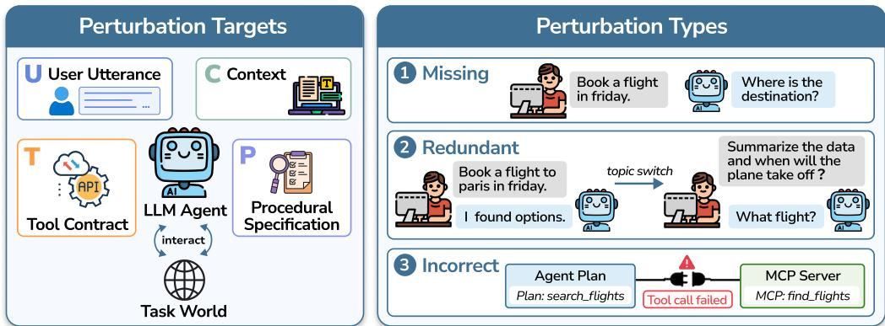  
Figure 1: Perturbation design. The left panel shows the four perturbation targets in the agentic interaction loop, and the right panel illustrates the three perturbation types with representative examples. Each type can be applied to any target, and each instance perturbs a single target.

We analyze robustness at three levels. At the outcome level, we measure clean-to-perturbed performance drops across models and scenarios. At the factor level, we separate the effects of perturbation targets and types and test how sensitivity relates to clean performance and task properties. At the trajectory level, we trace representative failures through reasoning, tool calls, observations, and state transitions. Our contributions are threefold:

• We introduce AgentPerturb, a robustness evaluation framework that organizes perturbations across four interaction targets and three perturbation types. We instantiate the resulting 12 families on APEX-Agents and Toolathlon using a validation pipeline that preserves task goals, executability, and solvability.

• Across ten models, we provide a quantitative characterization of agent robustness at the outcome and factor levels. We find that perturbations consistently reduce performance, that dominant vulnerabilities vary across task environments, and that sensitivity is organized more strongly by perturbation target than by perturbation type. A focused Hunyuan-3-High analysis further shows that success rates can conceal substantial losses in token efficiency.

• We audit 30 cases in which DeepSeek-V4-Flash succeeds on the clean task but fails after perturbation. The analysis reveals that agents rarely question altered inputs and frequently propagate corrupted information without verification, exposing a lack of perturbation awareness during interaction.

## 2 Related Work

Foundation-model robustness evaluation. Early robustness studies largely treat an LLM as a static mapping from a textual input to a response. PromptRobust evaluates adversarial prompt variations at character, word, sentence, and semantic levels across diverse language tasks [Zhu et al., 2024]. Subsequent work studies character- and word-level corruption of task instructions and explores self-denoising and representation alignment as mitigation strategies [Agrawal et al., 2025]. Beyond adversarial edits, SCORE measures consistency under semantically equivalent prompt templates, answer orderings, and decoding seeds [Nalbandyan et al., 2025]. Math-RoB broadens this view to reasoning, testing sensitivity to mixed inputs, auxiliary instructions, numerical transformations, and missing problem information [Yu et al., 2025]. These benchmarks establish that small input changes can cause substantial performance variation. They do not, however, evaluate executable, stateful agent trajectories or separate the multiple information sources encountered within such trajectories.

Agentic robustness evaluation. Recent benchmarks expose agents to failures that arise during interaction. AgentDojo evaluates adversarial robustness to indirect prompt injections delivered through untrusted tool-accessible data [Debenedetti et al., 2024]. ReliabilityBench combines semantically equivalent user-task perturbations with production-style faults such as timeouts, partial responses, stale data, and schema drift [Gupta, 2026]. AgentNoiseBench injects controllable user-side noise and noisy tool results while preserving task solvability [Wang et al., 2026]. Other work specializes in particular execution settings. AgentHijack introduces visual disruptions, unexpected operations, and environment errors for computer-use agents [Sun et al., 2026], while ToolMaze measures replan ning and recovery under explicit and implicit tool failures in structured tool workflows [Zhu et al., 2026]. These efforts provide important but targeted stress tests; a detailed comparison is provided in Appendix C. Our framework instead crosses four intervention targets with three perturbation types, enabling matched and attributable robustness evaluation across four selected agent-input sources.

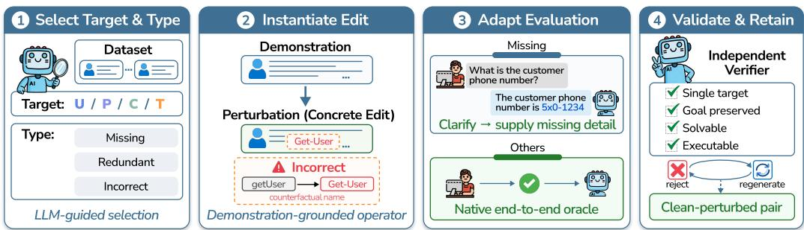  
Figure 2: Perturbation-construction pipeline. An LLM selects a compatible target and type and instantiates a concrete edit from demonstrations. The evaluation protocol is adapted when recovery requires clarification, and an independent verifier retains only single-target, goal-preserving, solvable, and executable instances.

## 3 Method

We first formalize the perturbation targets and types in Section 3.1, specifying where perturbations are applied and what form they take. We then introduce, in Section 3.2, an automated pipeline for applying realistic perturbations to existing agentic benchmarks.

## 3.1 Perturbation Targets and Types

Perturbation targets. An agentic task exposes the model to information from several distinct sources, and a failure may originate in any of them. We focus on four components that together determine what the agent knows and how it acts. The user utterance U conveys the task goal. The procedural specification P collects the procedures, policies, and skill documents that govern how the task should be completed. The carried-over context C holds information inherited from earlier interaction, such as dialogue history, summaries, and retrieved memory. The tool contract T describes how the agent interacts with external tools, including tool names, argument schemas, and returned observation fields. Accordingly, we define the set of perturbation targets as $\mathcal { L } = \{ U , P , C , T \}$ . Each perturbation changes only one target and leaves the other three unchanged.

Perturbation types. Information in a real deployment may be corrupted in different ways, and the same source may be affected by an omission, a distraction, or an error. We group these deviations into three types, M = {MISSING, REDUNDANT, INCORRECT}, which specify how the information at a selected target is altered. MISSING removes information needed to interpret or complete the task. REDUNDANT adds information that is irrelevant to the current task and does not change its intended solution. INCORRECT replaces valid information with false, inconsistent, or interface-incompatible content. In a repository-level coding task, for example, MISSING may remove the stack trace from the issue context, REDUNDANT may insert history from an unrelated authentication bug, and INCORRECT may make the advertised tool contract inconsistent with the executable interface. Each type can be applied to any of the four targets, yielding $| { \mathcal { L } } | \times | { \mathcal { M } } | = 1 2$ perturbation families.

Table 1: Overall performance on APEX-Agents and Toolathlon. Perturbed cells report the score followed by the relative degradation 100(C − P)/C, marked with a downward arrow. Averages are taken over all ten models, and evaluation parameters are given in Appendix A.
<table><tr><td rowspan="2">Model</td><td colspan="2">APEX-Agents</td><td rowspan="2"></td><td colspan="2">Toolathlon</td></tr><tr><td>Clean</td><td>Perturbed</td><td>Clean</td><td>Perturbed</td></tr><tr><td>GPT-5.6-Sol</td><td>85.5</td><td>80.6↓5.7%</td><td></td><td>34.0</td><td>29.7↓12.6%</td></tr><tr><td>A\ Claude Opus 5</td><td>81.0</td><td>68.2 15.8%</td><td></td><td>32.0</td><td>28.3↓11.6%</td></tr><tr><td>DeepSeek-V4-Pro</td><td>84.0</td><td>80.3↓4.4%</td><td></td><td>32.0</td><td>24.1↓24.7%</td></tr><tr><td>DeepSeek-V4-Flash</td><td>88.0</td><td>47.0↓46.6%</td><td></td><td>28.0</td><td>21.4↓23.6%</td></tr><tr><td>Kimi-K3</td><td>40.0</td><td>39.02.5%</td><td></td><td>32.0</td><td>23.028.1%</td></tr><tr><td> Kimi-K2.6</td><td>68.0</td><td>58.414.1%</td><td></td><td>24.0</td><td>16.4↓31.7%</td></tr><tr><td>Hunyuan-3-High</td><td>64.0</td><td>54.115.5%</td><td></td><td>16.0</td><td>8.3↓48.1%</td></tr><tr><td>Qwen3.8-Max</td><td>64.0</td><td>36.443.1%</td><td></td><td>12.0</td><td>7.1↓40.8%</td></tr><tr><td>Z GLM-5.2</td><td>72.0</td><td>52.3↓27.4%</td><td></td><td>16.0</td><td>7.155.6%</td></tr><tr><td>Z GLM-5.1</td><td>56.0</td><td>33.3↓40.5%</td><td></td><td>24.0</td><td>18.7 22.1%</td></tr><tr><td>Observed average</td><td>70.3</td><td>55.021.8%</td><td></td><td>25.0</td><td>18.4↓26.4%</td></tr></table>

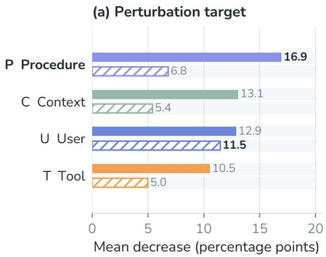

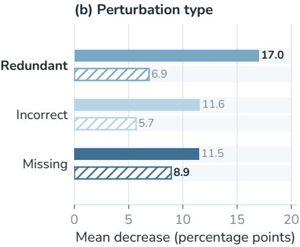  
Figure 3: Marginal effects of perturbation targets and types. Bars report the clean-minusperturbed score difference in percentage points, averaged equally over the five models with per-family scores on both benchmarks. Solid bars denote APEX-Agents and hatched bars denote Toolathlon. Both panels share one scale, and larger values indicate greater degradation.

## 3.2 Perturbation Construction

Target and type selection. Given a clean dataset instance and its benchmark metadata, we first prompt DeepSeek-V4-Pro, the selector LLM, to identify which components can be perturbed without changing the underlying task. The model follows the prompt in Section F.2 and selects one target from $\{ U , { \bar { P } } , { \bar { C } } , T \}$ and one type from {MISSING, REDUNDANT, INCORRECT}. Selection is conditioned on the native structure of the benchmark. For example, an instance with callable APIs supports tool-contract perturbations, whereas one governed by documented policies supports procedural perturbations. This stage produces a joint target and type specification while leaving the clean instance unchanged.

Demonstration-grounded instantiation. We then provide the LLM with target- and type-specific demonstrations that translate the abstract specification into a concrete edit. These demonstrations define both the permissible transformation and the content that must remain fixed. For an INCORRECT tool contract, for example, the operator may change capitalization, insert a hyphen, or replace a function with a plausible counterfactual name while leaving the executable backend unchanged. Corresponding operators remove task-relevant content for MISSING and insert task-irrelevant but realistic content for REDUNDANT. The generated edit is applied to the benchmark’s native object, such as a user utterance, policy file, dialogue record, or tool schema. Section F.3 lists the shared prompt template and its target-specific blocks.

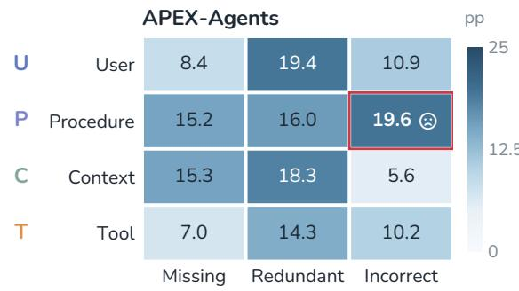

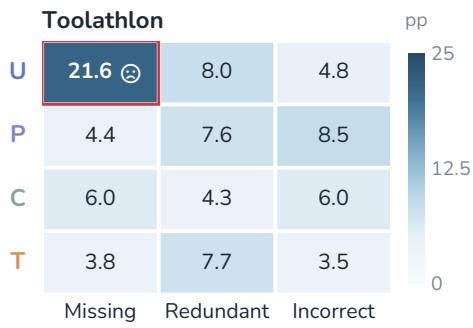  
Figure 4: Effects of individual target–type combinations. Each cell reports the clean-minusperturbed score difference in percentage points, averaged equally over the same five models as Figure 3. Both panels share one scale, and the outlined cell marks the largest decrease in each benchmark.

Evaluation adaptation. After instantiation, we determine whether the benchmark annotation must be adapted. A MISSING perturbation may make immediate task completion impossible while preserving a valid recovery path. We therefore attach a recovery annotation that requires the agent to ask for the omitted information before the user simulator supplies it. In the acquisition case in Appendix E, for example, the carried-over plan sketch loses the acquirer’s own trading multiple, which leaves the incremental enterprise value underdetermined. The gold answer stays at 5,871.6 USD mm, but the agent must now request the omitted multiple before reaching it. All other perturbations keep the benchmark’s native success oracle, which checks the final answer or environment state rather than a particular action sequence, so no gold trajectory needs rewriting.

Executability verification. Finally, an independent verifier LLM reviews the clean instance, the proposed edit, and the adapted evaluation protocol. It checks that exactly one target is modified, the original task goal is preserved, at least one successful interaction path remains, and the resulting instance is executable (Section F.6). These semantic checks are combined with available benchmark validators, including schema validation and test execution. A candidate that fails any check is rejected and regenerated; otherwise, we retain the clean and perturbed instances as a matched evaluation pair.

## 4 Experiments

We evaluate ten frontier models from seven providers on 25 tasks from each benchmark. Every clean task is paired with one perturbed instance per family, so each model runs 300 perturbed episodes per benchmark. All runs share the Codex CLI scaffold, and both sides of every pair are scored by the benchmark’s native grader, so any difference within a pair is attributable to the single perturbed target.

We analyze overall degradation and perturbation effects in Sections 4.1 and 4.2, capability and recovery cost in Sections 4.3 and 4.4, and failure awareness in Section 4.5. Supporting analyses and three illustrative failure trajectories appear in Appendices B and E, and full evaluation settings in Appendix A.

## 4.1 Overall Performance

 Takeaway. Clean performance alone does not characterize robustness, since models with identical clean scores can degrade very differently under perturbation.

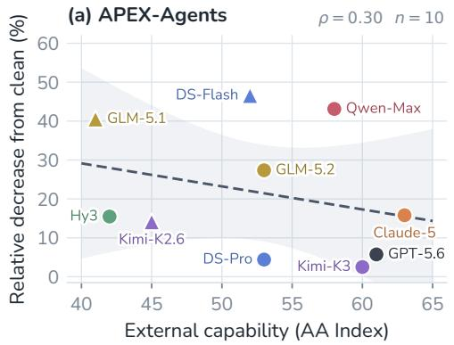

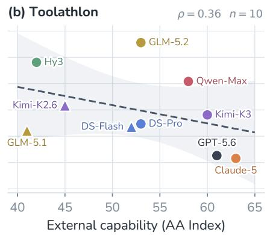  
Figure 5: Capability versus robustness. Each point plots a model’s family-level Artificial Analysis Intelligence Index v4.1.1 score against its relative degradation $1 0 0 ( C - \dot { P } ) / C$ , where lower values indicate greater robustness. Colors denote providers, and triangles mark the second model from the same provider. Dashed lines are least-squares fits with 95% confidence bands, so a downward slope means that more capable models degrade less.

Table 1 shows that every model loses performance on both benchmarks. The average relative loss is 21.8% on APEX-Agents and 26.4% on Toolathlon, so Toolathlon is hit harder once its lower clean baseline is taken into account. Clean scores say little about this loss. Hunyuan-3-High and Qwen3.8-Max both score 64.0 on clean APEX-Agents, yet Qwen3.8-Max loses almost three times as much under perturbation. Robustness rankings also shift between environments. Kimi-K3 is the most robust model on APEX-Agents but only mid-ranked on Toolathlon, and GLM-5.2 improves on its predecessor on APEX-Agents yet is the least robust model on Toolathlon. We next examine which perturbation targets and types account for this variation.

## 4.2 Which Perturbations Are Most Disruptive?

 Takeaway. Agent robustness depends on the task environment, with different settings exposing different vulnerabilities.

Figure 3 reports the marginal effect of each perturbation target and type. This analysis and the next use the five models whose per-family scores are available on both benchmarks, namely DeepSeek-V4- Pro, DeepSeek-V4-Flash, Kimi-K3, Kimi-K2.6, and Qwen3.8-Max. On APEX-Agents, procedural specifications are the most damaging target and redundant information the most damaging type. Toolathlon shows a different profile, with user utterances as the most damaging target and missing information as the most damaging type. The dominant source and form of degradation therefore depend on the task environment.

 Takeaway. Degradation is broadly distributed across perturbation combinations on APEX-Agents but concentrated in missing user information on Toolathlon.

Figure 4 breaks the marginal effects down into the 12 target–type cells and reveals two distinct structures. On APEX-Agents, several procedure- and redundancy-related cells are similarly damaging, with incorrect procedures only slightly ahead of the rest. On Toolathlon, a single cell dominates. Removing information from the user utterance is far more damaging than any other combination. The marginal leaders on APEX-Agents thus reflect broad sensitivity, whereas those on Toolathlon stem from one bottleneck.

A complementary correlation analysis, detailed in Appendix B.2, shows that perturbations sharing the same target exhibit more similar task-level degradation profiles than those sharing only a type, while each family still affects a distinct set of tasks.

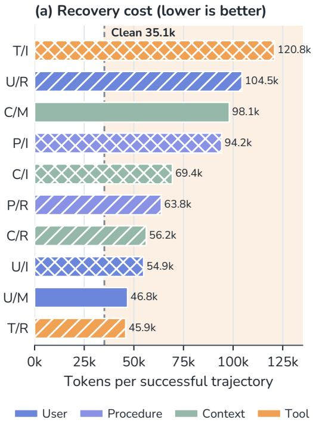

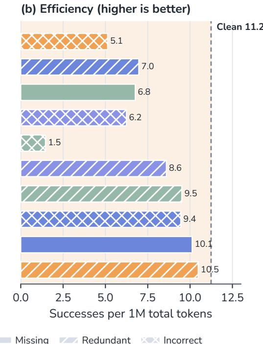  
Figure 6: Recovery cost and token efficiency of Hunyuan-3-High. Panel a reports tokens per successful trajectory and panel b successes per million tokens, for each perturbation family. Dashed lines mark clean baselines, shaded regions mark outcomes worse than clean, colors encode targets, and hatching encodes perturbation types.

## 4.3 Does Robustness Track Base-Model Capability?

Takeaway. More capable models tend to be more robust, but the trend is weak, and models of similar capability can differ sharply.

We test whether more capable models are also more robust. Capability is the Artificial Analysis Intelligence Index v4.1.1 [Artificial Analysis, 2026], taking the highest published score within each model family (Table 3). Robustness is measured by relative degradation, $1 0 0 ( C _ { m b } - P _ { m b } ) / C _ { m b }$ where $C _ { m b }$ and $P _ { m b }$ denote the clean and perturbed scores of model m on benchmark b. Normalizing by $C _ { m b }$ keeps models with low clean scores from appearing robust simply because they have less to lose. We report Spearman’s $\rho$ between capability and negative degradation, so that positive values mean more capable models degrade less, and compute two-sided permutation tests with 100,000 random assignments.

Figure 5 shows a positive but weak association on both benchmarks, and no permutation test reaches significance with ten models. The three most capable models, GPT-5.6-Sol, Claude Opus 5, and Kimi-K3, degrade less than half as much as the others on average. Capability nonetheless leaves much unexplained. DeepSeek-V4-Pro and DeepSeek-V4-Flash differ by a single capability point, yet their degradation on APEX-Agents differs by more than an order of magnitude, and Kimi-K3 and Qwen3.8-Max show a similar gap. The same ten models also rank almost independently on the two benchmarks. Robustness in a target environment should therefore be measured directly rather than inferred from general capability.

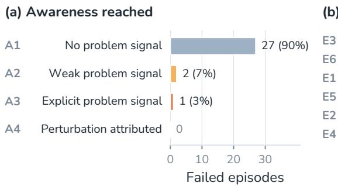

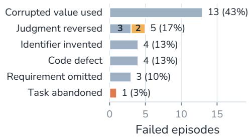  
Figure 7: Failure awareness and first-error behavior. The 30 episodes are DeepSeek-V4-Flash failures whose clean counterparts succeed. Panel a shows the highest awareness grade reached in each trace, and panel b the behavior at the first observable error. Colors encode awareness.

## 4.4 Does Noise Increase Recovery Cost?

Takeaway. In a Hunyuan-3-High case study, perturbations increase the mean token cost of successful trajectories by 73% and reduce successes per million tokens by 44%, despite an almost unchanged median cost.

Success rates alone do not reveal how much computation an agent spends on noisy inputs. For Hunyuan-3-High, we therefore measure the token cost of successful trajectories and the number of successes per million tokens across all trajectories. The computational effect of perturbations exceeds their effect on success. A successful trajectory consumes 73% more tokens on average, and successes per million tokens fall by 44%. The median cost of a successful trajectory barely moves, so the increase comes from a small tail of expensive trajectories.

Figure 6 breaks this tail cost down by perturbation family. Incorrect tool contracts make successful trajectories the most expensive, matching the repeated interface guessing in Appendix E, and incorrect context yields the fewest successes per token. A success-only evaluation would miss this recovery cost entirely.

Within tool contracts, the subtlest edit is the most damaging. Rewriting a tool description causes roughly four times the success drop of adding or removing a tool, along with the largest cost increase among successful trajectories (Appendix B.1). A false description leaves the interface callable and raises no execution error, so the agent receives no signal that its understanding of the tool is wrong. Rollout lengths show the same tail pattern. Median perturbed-to-clean ratios of tool calls, turns, and tokens stay close to one, yet a few loop-like trajectories nearly double the mean input-token ratio under INCORRECT and context perturbations (Appendix B.3).

## 4.5 Failure Awareness and Behavioral Attribution

We inspect all 30 DeepSeek-V4-Flash episodes in which the clean run succeeds and the perturbed run fails. These comprise 20 Toolathlon and 10 APEX-Agents episodes spanning 13 tasks. Each complete reasoning and action trace receives two labels. A records the strongest explicit awareness of a problem, and E records the agent’s immediate behavior at the first observable error. Definitions and labels are given in Section A.4. DeepSeek-V4-Flash shows the largest relative drop on APEX-Agents (Table 1), which makes its failures a natural target for a trace-level audit.

 Takeaway. Agents rarely notice that their inputs are wrong, and none of the 30 failing agents suspects that its input has been altered.

As Figure 7a shows, 27 of the 30 failing traces never remark that a value, conclusion, or answer might be wrong. Two express passing doubt, and only one states a problem explicitly. Even that agent simply concludes that it cannot complete the task and stops, without asking the user or re-checking the source. No trajectory suspects that the instruction, context, or tool output has been altered. Figure 7b shows what the agent does instead at the first error. The most common behavior, seen in 13 failures, is to accept a corrupted value and carry it into later reasoning and the final output. The remaining failures split among reversed judgments, invented identifiers, faulty code, omitted requirements, and a single abandoned task.

Awareness versus behavior. The two axes expose a consistent gap. All six first-error behaviors appear, yet 27 of 30 trajectories remain at A1 and none reaches A4. The three traces that express any doubt also belong to this audited failure set. Thus, within these episodes, verbalized uncertainty does not coincide with successful recovery.

## 5 Conclusion

We introduced AgentPerturb, a paired framework that evaluates LLM agents across four perturbation targets and three corruption types while preserving task validity and failure attribution. Across APEX-Agents and Toolathlon, noise consistently reduces performance, although the dominant vulnerability depends on the task environment. Sensitivity is organized more strongly by where information is perturbed than by how it is corrupted, while trajectory analysis shows that agents often propagate unverified information without recognizing the altered input. A focused cost analysis further shows that successful perturbed trajectories can consume substantially more computation. Robustness evaluation should therefore report input-channel sensitivity, recovery cost, and perturbation awareness alongside task success.

## Limitations

AgentPerturb currently covers two agentic benchmarks under one agent scaffold and injects each perturbation family independently. Future work should evaluate more domains, frameworks, and compound or evolving noise to test robustness across broader deployment scenarios.

## References

Aryan Agrawal, Lisa Alazraki, Shahin Honarvar, and Marek Rei. Enhancing LLM robustness to perturbed instructions: An empirical study. ICLR Workshop on Building Trust in Language Models and Applications, 2025.

Artificial Analysis. Artificial analysis intelligence index v4.1.1. https://artificialanalysis .ai/, 2026. Accessed: 2026-09-29.

Tom B. Brown, Benjamin Mann, Nick Ryder, Melanie Subbiah, Jared Kaplan, Prafulla Dhariwal, Arvind Neelakantan, Pranav Shyam, Girish Sastry, Amanda Askell, et al. Language models are few-shot learners. In Advances in Neural Information Processing Systems, volume 33, pages 1877–1901, 2020.

Edoardo Debenedetti, Jie Zhang, Mislav Balunovic, Luca Beurer-Kellner, Marc Fischer, and Florian Tramèr. AgentDojo: A dynamic environment to evaluate prompt injection attacks and defenses for LLM agents. In Advances in Neural Information Processing Systems, 2024. URL https: //openreview.net/forum?id=m1YYAQjO3w.

Nouha Dziri, Ximing Lu, Melanie Sclar, Xiang Lorraine Li, Liwei Jiang, Bill Yuchen Lin, Sean Welleck, Peter West, Chandra Bhagavatula, Ronan Le Bras, Jena D. Hwang, Soumya Sanyal, Xiang Ren, Allyson Ettinger, Zaid Harchaoui, and Yejin Choi. Faith and fate: Limits of transformers on compositionality. In Advances in Neural Information Processing Systems, 2023.

Yao Fu, Ran Qiu, Xinhe Wang, Jacob Sansom, Sathvika Ayyappa Prabhu, Huijie Tang, Jaekyeom Kim, Sungryull Sohn, and Honglak Lee. Beyond blind following: Evaluating robustness of LLM agents under imperfect guidance. In Proceedings of the 19th Conference of the European Chapter ofthe Associationfor Computational Linguistics, pages 6591–6618, 2026. doi: 10.18653/v1/2026 .eacl-long.310.

Aayush Gupta. ReliabilityBench: Evaluating LLM agent reliability under production-like stress conditions. arXiv preprint arXiv:2601.06112, 2026.

Lei Huang, Weijiang Yu, Weitao Ma, Weihong Zhong, Zhangyin Feng, Haotian Wang, Qianglong Chen, Weihua Peng, Xiaocheng Feng, Bing Qin, and Ting Liu. A survey on hallucination in large language models: Principles, taxonomy, challenges, and open questions. ACM Transactions on Information Systems, 43(2):1–55, 2025.

Haonian Ji, Kaiwen Xiong, Siwei Han, Peng Xia, Shi Qiu, Yiyang Zhou, Jiaqi Liu, Jinlong Li, Bingzhou Li, Zeyu Zheng, Cihang Xie, and Huaxiu Yao. ClawArena: Benchmarking AI agents in evolving information environments. arXiv preprint arXiv:2604.04202, 2026.

Ziwei Ji, Nayeon Lee, Rita Frieske, Tiezheng Yu, Dan Su, Yan Xu, Etsuko Ishii, Yejin Bang, Andrea Madotto, and Pascale Fung. Survey of hallucination in natural language generation. ACM Computing Surveys, 55(12):1–38, 2023.

Carlos E. Jimenez, John Yang, Alexander Wettig, Shunyu Yao, Kexin Pei, Ofir Press, and Karthik R. Narasimhan. SWE-bench: Can language models resolve real-world GitHub issues? In International Conference on Learning Representations, 2024. URL https://openreview.net/forum?id= VTF8yNQM66.

Saurav Kadavath, Tom Conerly, Amanda Askell, Tom Henighan, Dawn Drain, Ethan Perez, Nicholas Schiefer, Zac Hatfield-Dodds, Nova DasSarma, Eli Tran-Johnson, et al. Language models (mostly) know what they know. arXiv preprint arXiv:2207.05221, 2022.

Wojciech Krysci´ nski, Bryan McCann, Caiming Xiong, and Richard Socher. Evaluating the factual´ consistency of abstractive text summarization. In Proceedings ofthe 2020 Conference on Empirical Methods in Natural Language Processing, pages 9332–9346, 2020.

Junlong Li, Wenshuo Zhao, Jian Zhao, et al. The tool decathlon: Benchmarking language agents for diverse, realistic, and long-horizon task execution, 2026.

Joshua Maynez, Shashi Narayan, Bernd Bohnet, and Ryan McDonald. On faithfulness and factuality in abstractive summarization. In Proceedings ofthe 58th Annual Meeting ofthe Associationfor Computational Linguistics, pages 1906–1919, 2020.

Grigor Nalbandyan, Rima Shahbazyan, and Evelina Bakhturina. SCORE: Systematic consistency and robustness evaluation for large language models. In Proceedings ofthe 2025 Conference of the Nations of the Americas Chapter of the Association for Computational Linguistics: Human Language Technologies, Volume 3 (Industry Track), pages 470–484, 2025. doi: 10.18653/v1/2025 .naacl-industry.39.

Timo Schick, Jane Dwivedi-Yu, Roberto Dessì, Roberta Raileanu, Maria Lomeli, Eric Hambro, Luke Zettlemoyer, Nicola Cancedda, and Thomas Scialom. Toolformer: Language models can teach themselves to use tools. In Advances in Neural Information Processing Systems, 2023.

Jingwei Sun, Jianing Zhu, Yuanyi Li, Tongliang Liu, Xia Hu, and Bo Han. AgentHijack: Benchmarking computer use agent robustness to common environment corruptions. In International Conference on Machine Learning, 2026. URL https://openreview.net/forum?id=0H5Im3Xvuf.

Bertie Vidgen, Austin Mann, Abby Fennelly, et al. APEX-Agents, 2026.

Ruipeng Wang, Yuxin Chen, Yukai Wang, Chang Wu, Junfeng Fang, Xiaodong Cai, Qi Gu, Hui Su, An Zhang, Xiang Wang, Xunliang Cai, and Tat-Seng Chua. AgentNoiseBench: Benchmarking robustness of tool-using LLM agents under noisy condition. In International Conference on Machine Learning, 2026. URL https://icml.cc/virtual/2026/poster/64355.

Jason Wei, Xuezhi Wang, Dale Schuurmans, Maarten Bosma, Fei Xia, Ed Chi, Quoc V. Le, and Denny Zhou. Chain-of-thought prompting elicits reasoning in large language models. In Advances in Neural Information Processing Systems, volume 35, pages 24824–24837, 2022.

Shunyu Yao, Jeffrey Zhao, Dian Yu, Nan Du, Izhak Shafran, Karthik Narasimhan, and Yuan Cao. ReAct: Synergizing reasoning and acting in language models. In International Conference on Learning Representations, 2023.

Shunyu Yao, Noah Shinn, Pedram Razavi, and Karthik R. Narasimhan. τ-bench: A benchmark for tool-agent-user interaction in real-world domains. In International Conference on Learning Representations, 2025. URL https://openreview.net/forum?id=roNSXZpUDN.

Tong Yu, Yongcheng Jing, Xikun Zhang, Wentao Jiang, Wenjie Wu, Yingjie Wang, Wenbin Hu, Bo Du, and Dacheng Tao. Benchmarking reasoning robustness in large language models. arXiv preprint arXiv:2503.04550, 2025.

Shuyan Zhou, Frank F. Xu, Hao Zhu, Xuhui Zhou, Robert Lo, Abishek Sridhar, Xianyi Cheng, Tianyue Ou, Yonatan Bisk, Daniel Fried, Uri Alon, and Graham Neubig. WebArena: A realistic web environment for building autonomous agents. In International Conference on Learning Representations, 2024. URL https://openreview.net/forum?id=oKn9c6ytLx.

Dongsheng Zhu, Xuchen Ma, Yucheng Shen, Xiang Li, Yukun Zhao, Shuaiqiang Wang, Lingyong Yan, and Dawei Yin. When tools fail: Benchmarking dynamic replanning and anomaly recovery in LLM agents. arXiv preprint arXiv:2606.05806, 2026.

Kaijie Zhu, Jindong Wang, Jiaheng Zhou, Zichen Wang, Hao Chen, Yidong Wang, Linyi Yang, Wei Ye, Yue Zhang, Neil Zhenqiang Gong, and Xing Xie. PromptRobust: Towards evaluating the robustness of large language models on adversarial prompts. In Proceedings of the 1st ACM Workshop on Large AI Systems and Models with Privacy and Safety Analysis, pages 57–68, 2024. doi: 10.1145/3689217.3690621.

##  Appendix Contents

A Experimental and Analysis Details 12   
A.1 Model Suite and Decoding Settings 12   
A.2 Evaluation Protocol 12   
A.3 External Capability Proxy 13   
A.4 Failure-Attribution Annotation Scheme 14   
B Additional Analyses 14   
B.1 Tool-Perturbation Edit Magnitude 14   
B.2 Cross-Family Sensitivity Correlations 15   
B.3 Effects on Rollout Length and Stability 17   
C Prior Robustness Evaluations 17   
D Perturbation Examples 18   
E Illustrative Failure Trajectories 18   
F Prompt Templates 20   
F.1 Prompt Assembly and Label Mapping 20   
F.2 Target and Type Selection Prompt 20   
F.3 Shared Generation Prompt 22   
F.4 Target-Specific Prompt Blocks 22   
F.5 Uniform JSON Output Contract 24   
F.6 Verification Prompt 24

## A Experimental and Analysis Details

This appendix records the models, decoding settings, agent scaffold, benchmark versions, evaluation limits, external capability proxy, and failure-attribution annotation scheme used in the study.

## A.1 Model Suite and Decoding Settings

We evaluate ten frontier models from seven providers: GPT-5.6-Sol, Claude Opus 5, DeepSeek-V4-Pro-0813 and DeepSeek-V4-Flash-0731, Kimi-K3 and Kimi-K2.6, Hunyuan-3-High, Qwen3.8-Max, and GLM-5.2 and GLM-5.1. All ten models have completed both APEX-Agents and Toolathlon evaluations. The target- and type-level analyses of Section 4.2 use the five of them whose per-family scores are available on both benchmarks. For some providers we select two representative models to examine the difference between their versions.

All models keep their provider default temperature and top-p, emit at most 16384 completion tokens per call, and produce a single trajectory per episode. Reasoning is enabled wherever it is available, with the DeepSeek models at maximum reasoning effort and Kimi-K2.6 in reasoning mode. Two endpoint constraints depart from this setting. The Kimi endpoints accept a temperature of 1 only, and DeepSeek requests pass through a 128k-token guard that keeps a request within the context window.

## A.2 Evaluation Protocol

All runs share the agent scaffold, the retry policy, and the episode composition of Table 2. Every clean episode is paired with one perturbed episode per family, and both sides of a pair are scored by the benchmark’s native grader. Beyond the interaction cap and the episode timeout listed there, the two benchmarks differ in how the grader reports an outcome and in how their task sets were assembled; we describe both below.

Table 2: Evaluation protocol. The upper block lists the controls shared by every run, and the lower block lists the two limits that differ between benchmarks.
<table><tr><td>Parameter</td><td>APEX-Agents</td><td>Toolathlon</td></tr><tr><td colspan="3">Shared across benchmarks</td></tr><tr><td>Agent scaffold</td><td>Codex CLI, native function calling</td><td></td></tr><tr><td>System prompt</td><td>Section F</td><td></td></tr><tr><td>Retry policy</td><td></td><td>3 attempts with exponential backoff from 30 s, on rate-limit and timeout errors</td></tr><tr><td>Success oracle</td><td>Native grader 25</td><td></td></tr><tr><td>Clean episodes</td><td></td><td></td></tr><tr><td>Perturbations per episode</td><td>12, one per family</td><td></td></tr><tr><td colspan="3">Benchmark-specific</td></tr><tr><td>Max. interaction turns</td><td></td><td>200</td></tr><tr><td>Episode timeout</td><td>1800s</td><td>Agent timeout + 600 s</td></tr></table>

Scoring conventions. The two graders return different kinds of quantities, so we keep each benchmark on its native scale. APEX-Agents returns a continuous reward in [0, 1] that awards partial credit when a deliverable is partly correct, so a model’s score is the mean reward over episodes. Toolathlon returns a binary outcome per episode, so its mean reward equals its success rate. Because partial credit and end-to-end success lie on different scales, cross-benchmark comparisons use only relative degradation (Section 4.3), which normalizes by a model’s own clean score. Within a benchmark, absolute differences are reported directly. Unscored runs are excluded from aggregates.

Task sets. APEX-Agents contributes all 25 of its tasks. Toolathlon defines 79 tasks, of which we report a subset of 25; the remaining tasks did not complete both the clean episode and the full twelve-family perturbed sweep within our compute budget. The subset is determined by run completion, so absolute Toolathlon scores in this paper differ from published full-benchmark numbers. All comparisons are paired, with the clean and perturbed sides of every contrast drawn from the same 25 tasks.

## A.3 External Capability Proxy

For the exploratory analysis in Section 4.3, we use the highest published Artificial Analysis Intelligence Index v4.1.1 score for each model family, selecting maximum effort when multiple effort levels are reported. Table 3 lists the resulting inputs. We use family-level proxies because the evaluation records do not identify an effort tier for every model. Scores were retrieved on September 29, 2026; the released metadata retain the per-model source URLs.

Table 3: External capability scores. Scores are Artificial Analysis Intelligence Index v4.1.1 familylevel proxies used in Figure 5. The last column gives the configuration from which each proxy is taken.
<table><tr><td>Model</td><td>AA Index</td><td>Proxy configuration</td></tr><tr><td>GPT-5.6-Sol</td><td>61</td><td>Family max.; max effort</td></tr><tr><td>Claude Opus 5</td><td>63</td><td>Family max.; max effort</td></tr><tr><td>DeepSeek-V4-Pro</td><td>53</td><td>Reasoning; max effort</td></tr><tr><td>DeepSeek-V4-Flash</td><td>52</td><td>Reasoning; max effort</td></tr><tr><td>Kimi-K3</td><td>60</td><td>Family max.; max effort</td></tr><tr><td>Kimi-K2.6</td><td>45</td><td>Reasoning</td></tr><tr><td>Hunyuan-3-High</td><td>42</td><td>Published Hy3 entry</td></tr><tr><td>Qwen3.8-Max</td><td>58</td><td>Published Qwen3.8-Max entry</td></tr><tr><td>GLM-5.2</td><td>53</td><td>Family max.; max effort</td></tr><tr><td>GLM-5.1</td><td>41</td><td>Reasoning</td></tr></table>

Table 4: Failure-attribution labels. Awareness grades (A1–A4) capture only signals verbalized in the trace, and behavior labels (E1–E6) are assigned at the first observable error.
<table><tr><td>Axis</td><td>Code</td><td>Label</td><td>Operational definition</td></tr><tr><td rowspan="3">Awareness</td><td>A1</td><td>No explicit signal</td><td>The trace contains no explicit indication that a value, conclusion, or answer may be problematic.</td></tr><tr><td>A2</td><td>Tentative signal</td><td>The trace contains a tentative or one-off indication that a value, conclusion, or answer may be problematic.</td></tr><tr><td>A3</td><td>Sustained problem statement</td><td>The agent explicitly and persistently identifies a specific value, conclusion, or answer as problematic.</td></tr><tr><td rowspan="5">Behavior</td><td>A4</td><td>Input-channel attribution</td><td>The agent attributes the problem to the integrity of an instruction, context source, or tool channel.</td></tr><tr><td>E1</td><td>Invented content</td><td>The agent supplies an identifier, value, or other content unsupported by the available evidence.</td></tr><tr><td>E2 E3</td><td>Requirement omitted Corrupted value</td><td>Required content or an output constraint is absent from the deliverable. The agent uses a corrupted source or intermediate value and</td></tr><tr><td>E4</td><td>propagated Task abandoned</td><td>carries it into downstream reasoning or the final output. The agent stops after concluding that it cannot proceed,</td></tr><tr><td></td><td></td><td>without clarification or recovery.</td></tr><tr><td></td><td>E5</td><td>Code defect</td><td>Relevant reasoning is followed by faulty data-processing code or an inconsistent operation or artifact.</td></tr><tr><td></td><td>E6</td><td>Judgment reversed</td><td>The agent reaches a professional judgment opposite to the conclusion supported by the available evidence.</td></tr></table>

## A.4 Failure-Attribution Annotation Scheme

This subsection defines the labels used in Section 4.5, and complete sample-level annotations are included in the released artifacts. We examine all 30 matched DeepSeek-V4-Flash pairs in which the clean episode succeeds and the perturbed episode fails. These comprise 20 Toolathlon and 10 APEX-Agents pairs spanning 13 tasks.

Each complete reasoning and action trace receives two complementary labels. A records the highest explicit awareness grade reached by the agent, and E records its immediate behavior at the first observable error. The awareness grades are nested, and only the highest grade reached is assigned. Candidate expressions of doubt are retrieved with an epistemic-marker lexicon, and each candidate is then judged in context. Behavior labels describe what is observable in the trace and distinguish unsupported content, omissions, and action-level defects, following prior work on factuality and faithfulness [Ji et al., 2023, Maynez et al., 2020, Krysci´ nski et al., 2020, Huang et al., 2025, Dziri´ et al., 2023, Kadavath et al., 2022].

## B Additional Analyses

## B.1 Tool-Perturbation Edit Magnitude

 Takeaway. For Hunyuan-3-High, larger tool edits do not cause larger losses, and the smallest edit, description replacement, is the most damaging.

We analyze 67 tool-targeted perturbations for Hunyuan-3-High, grouped by patch operation from field-level edits to whole-tool changes. Each perturbation is paired with the clean outcome of its base task. Success drop is the mean paired clean-minus-perturbed difference within each group, with positive values indicating degradation. Of the 25 clean base tasks, 16 are successful.

Table 7: Rollout length under perturbation. Entries are median perturbed-to-clean ratios with first and third quartiles in brackets, so values below one indicate shorter perturbed rollouts. Blue and orange medians mark decreases and increases, shaded entries denote nominal significance (p < .05), and n is the number of matched trajectory pairs.
<table><tr><td>Group</td><td>Tool calls</td><td>Turns</td><td>Input tokens</td><td>Output tokens</td><td>n</td></tr><tr><td>By perturbation type</td><td></td><td></td><td></td><td></td><td></td></tr><tr><td> MISSING</td><td>0.89 [0.66, 1.37]</td><td>0.87 [0.62, 1.30]</td><td>1.00 [0.75, 1.24]</td><td>1.02 [0.72, 1.44]</td><td>96</td></tr><tr><td>INCORRECT</td><td>0.90 [0.67, 1.22]</td><td>1.00 [0.63, 1.18]</td><td>0.92[0.64, 1.17]</td><td>0.98 [0.68, 1.47]</td><td>93</td></tr><tr><td>REDUNDANT</td><td>0.93 [0.56, 1.43]</td><td>0.91 [0.60, 1.42]</td><td>0.91 [0.57, 1.27]</td><td>0.99 [0.72, 1.39]</td><td>90</td></tr><tr><td>By perturbation target</td><td></td><td></td><td></td><td></td><td></td></tr><tr><td>U User utterance</td><td>0.93 [0.67, 1.10]</td><td>0.82 [0.63, 1.18]</td><td>0.92 [0.62, 1.11]</td><td>0.91 [0.71, 1.30]</td><td>69</td></tr><tr><td>P Procedure</td><td>0.93 [0.61, 1.43]</td><td>0.95 [0.59, 1.43]</td><td>0.95 [0.71, 1.23]</td><td>1.07 [0.71, 1.38]</td><td>69</td></tr><tr><td>C Context</td><td>0.99 [0.66, 1.43]</td><td>0.97 [0.65, 1.44]</td><td>0.95 [0.67, 1.38]</td><td>1.11 [0.77, 1.66]</td><td>72</td></tr><tr><td>T Tool contract</td><td>0.83 [0.66, 1.33]</td><td>0.88[0.62, 1.25]</td><td>0.94 [0.58, 1.18]</td><td>0.93 [0.69, 1.35]</td><td>69</td></tr></table>

Table 5: Effects of tool-contract edits by patch operation. Results are for Hunyuan-3-High. Drop is the paired success drop in percentage points against each base task’s clean outcome, and ∆ cost compares perturbed and clean mean token cost among successful trajectories. Color intensity encodes drop magnitude.
<table><tr><td>Level Patch operation</td><td></td><td></td><td>n Drop</td><td>∆ cost</td></tr><tr><td>L1</td><td>replace_description</td><td>19</td><td>21.1</td><td>+97,616</td></tr><tr><td>L2</td><td>replace_enum</td><td>6</td><td>16.7</td><td>-2,452</td></tr><tr><td>L3</td><td>add_fake_tool</td><td>23</td><td>4.3</td><td>-19,691</td></tr><tr><td>L4</td><td>remove_tool</td><td>19</td><td>5.3</td><td>+11,652</td></tr></table>

Table 5 shows that the losses do not grow with edit magnitude. Description replacement causes the largest success drop and the largest cost increase among successful trajectories, whereas adding a fake tool or removing a tool costs only about five points. A false description leaves the interface callable and raises no execution error, while structural inconsistencies are conspicuous enough to be detected or bypassed. Group sizes and task composition differ across levels, so these comparisons are descriptive.

Table 6: Representative tool-contract edits. Each row shows one patch per edit level, compressed to the field that changes, and gray text gives the source perturbation.  
Level Representative edit   
L1 Rewrite the description of read\_text\_file to claim that only listed file extensions are readable.   
apex-0097f20d/T\_mistake   
L2 Remove list from the calendar action enum.   
apex-075c6f8f/T\_missing   
L3 Add a nonexistent zip\_folder tool with a plausible compression interface   
apex-0097f20d/T\_redundant   
L4 Remove read\_text\_file from the advertised tool set.   
apex-0097f20d/T\_missing

## B.2 Cross-Family Sensitivity Correlations

Takeaway. Sensitivity is organized more strongly by where information is perturbed than by how it is perturbed.

To characterize whether different perturbations induce vulnerability on the same task instances, we compute partial Spearman correlations between the performance-degradation profiles of all

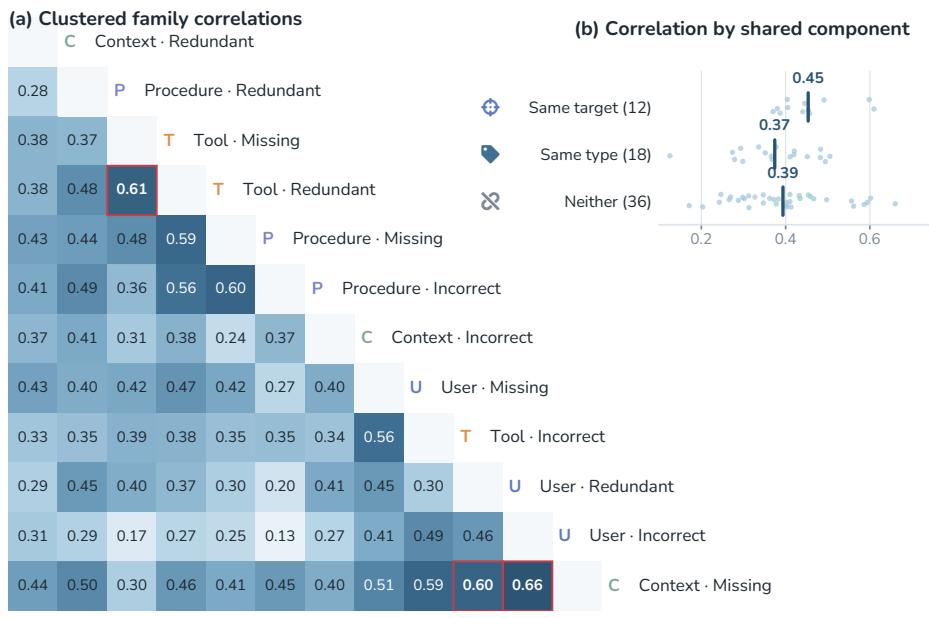  
Figure 8: Correlations between perturbation families. (a) Partial Spearman correlations of relative degradation across $n = 7 5$ model–task pairs, controlling for clean performance and model identity. (b) The 66 pairwise correlations grouped by the component the two families share, with vertical bars marking group means.

12 families, controlling for clean performance and model identity. The resulting correlations in Figure 8 are moderate, indicating that different families affect partially overlapping model–task pairs. Perturbations applied to the same target are more strongly correlated than those that share only a perturbation type, so model sensitivity is organized primarily by where information is disturbed.

Correlation estimator. For model m, task i, and perturbation family f, we normalize the signed performance change by the model’s mean clean score,

$$
d _ { m i } ^ { ( f ) } = \frac { \widetilde { c } _ { m i } - \widetilde { p } _ { m i } ^ { ( f ) } } { \frac { 1 } { N } \sum _ { j } \widetilde { c } _ { m j } } .
$$

We rank these changes within each family and regress out clean-performance rank and model fixed effects:

$$
\begin{array} { l } { \displaystyle R ( d _ { m i } ^ { ( f ) } ) = \alpha _ { f } + \beta _ { f } R ( \widetilde c _ { m i } ) } \\ { \displaystyle \quad + \sum _ { m ^ { \prime } } \gamma _ { f m ^ { \prime } } \mathbb { I } [ m = m ^ { \prime } ] + \varepsilon _ { m i } ^ { ( f ) } . } \end{array}
$$

The reported partial Spearman correlation is $\rho _ { f g } = \mathrm { C o r r } ( \varepsilon ^ { ( f ) } , \varepsilon ^ { ( g ) } )$ . Families are ordered for display by average-linkage clustering on $1 - \rho _ { f g }$

Correlation intervals. We quantify the uncertainty of the partial Spearman correlations in Figure 8 with a cluster bootstrap over tasks. Each of the 2000 replicates resamples the 25 tasks with replacement, keeps all models of a resampled task together because their scores share one episode, and repeats the entire estimation, including the rank regression on clean score and model identity. Table 8 reports percentile intervals for the three strongest pairs, the weakest pair, and the grouping by shared component.

Individual-pair intervals are broad, with a median width of 0.51, yet 58 of the 66 exclude zero, indicating substantial shared sensitivity. The grouped comparison is also stable, as both contrasts between pairs that share a target and the other two groups exclude zero.

Table 8: Bootstrap intervals for family correlations. Entries are cluster-bootstrap percentile intervals for the partial Spearman correlations of Figure 8. The upper block gives the three strongest and the weakest family pair, the middle block groups all 66 pairs by what the two families share, and the lower block reports the contrasts between these groups.
<table><tr><td>Quantity</td><td>ρ</td><td>95% CI</td></tr><tr><td>Context-Missing &amp; User-Incorrect</td><td>0.66</td><td>[0.50, 0.81]</td></tr><tr><td>Tool-Redundant &amp; Tool-Missing</td><td>0.61</td><td>[0.41, 0.79]</td></tr><tr><td>Context-Missing &amp; User-Redundant</td><td>0.60</td><td>[0.44, 0.77]</td></tr><tr><td>Procedure-Incorrect &amp; User-Incorrect</td><td>0.13</td><td>[−0.18, 0.46]</td></tr><tr><td>Same target (n = 12)</td><td>0.45</td><td>[0.35, 0.56]</td></tr><tr><td>Same type (n = 18)</td><td>0.37</td><td>[0.26, 0.49]</td></tr><tr><td>Neither (n =36)</td><td>0.39</td><td>[0.27, 0.51]</td></tr><tr><td>Same target — same type</td><td>+0.08</td><td>[0.00, 0.15]</td></tr><tr><td>Same target — neither</td><td>+0.06</td><td>[0.00, 0.13]</td></tr></table>

## B.3 Effects on Rollout Length and Stability

 Takeaway. Perturbations leave the typical rollout length nearly unchanged but increase tail risk, occasionally inducing loop-like trajectories with exceptionally high token consumption.

We examine whether perturbations systematically change the number of tool calls, interaction turns, input tokens, and output tokens in a rollout. For each matched pair, we divide the perturbed value by its clean counterpart, so a ratio of one indicates no change. Because a small number of loop-like trajectories produce heavy-tailed ratios, we use the median and interquartile range as the primary summary and treat means and standard deviations as diagnostics of tail instability.

Table 7 shows little systematic change in typical rollout length, with every median ratio between 0.82 and 1.11. Only two of the 28 comparisons reach nominal significance. User-utterance perturbations slightly shorten interactions, and context perturbations slightly lengthen outputs. With this many comparisons, neither effect is strong evidence.

The tails tell a different story. For INCORRECT and context perturbations, the mean input-token ratio approaches two and its standard deviation is close to six, even though both medians stay below one. A few loop-like trajectories account for this spread, while typical rollouts stay close to their clean length.

## C Prior Robustness Evaluations

Table 9 maps representative robustness evaluations onto our targets and perturbation types as a qualitative scope comparison.

Table 9: Coverage of prior robustness evaluations. A check marks direct coverage and a triangle a partial or analogous match, expressed in our terminology. T denotes the static tool contract rather than runtime tool outputs, so interventions on observations or environment state may have type coverage without a target check.
<table><tr><td rowspan="2">Evaluation</td><td colspan="4">Perturbation target</td><td colspan="3">Type</td></tr><tr><td></td><td>U P</td><td>C</td><td></td><td></td><td>Miss. Red. Inc.</td><td></td></tr><tr><td>Foundation-model robustness</td><td></td><td></td><td></td><td></td><td></td><td></td><td></td></tr><tr><td>PromptRobust</td><td>△</td><td></td><td></td><td></td><td></td><td></td><td>△</td></tr><tr><td>SCORE</td><td>△</td><td></td><td></td><td></td><td></td><td></td><td></td></tr><tr><td>Math-RoB</td><td>△</td><td></td><td></td><td></td><td></td><td></td><td></td></tr><tr><td>Agentic robustness</td><td></td><td></td><td></td><td></td><td></td><td></td><td></td></tr><tr><td>AgentDojo</td><td></td><td></td><td></td><td></td><td></td><td></td><td></td></tr><tr><td>ReliabilityBench</td><td></td><td></td><td></td><td>△</td><td></td><td></td><td></td></tr><tr><td>AgentNoiseBench</td><td></td><td></td><td></td><td></td><td></td><td></td><td></td></tr><tr><td>AgentHijack</td><td></td><td></td><td></td><td></td><td>7</td><td></td><td></td></tr><tr><td>ToolMaze</td><td></td><td></td><td></td><td></td><td></td><td></td><td></td></tr><tr><td>Ours</td><td></td><td></td><td></td><td></td><td></td><td></td><td></td></tr></table>

## D Perturbation Examples

Table 10 instantiates all 12 families in a single repository-coding task, so that the families differ only in the target that is edited and in the type of edit applied to it.

Table 10: Examples of the 12 perturbation families. All examples are set in one repository-coding task, and each group changes only the listed target.
<table><tr><td>Target</td><td>Schematic edits</td></tr><tr><td rowspan="2">U</td><td>Missing: remove the requested cache TTL</td></tr><tr><td>Redundant: append an earlier deployment request after a topic switch.</td></tr><tr><td rowspan="3">P</td><td>Incorrect: change the target branch from main to release.</td></tr><tr><td>Missing: omit the required approval condition.</td></tr><tr><td>Redundant: retain an obsolete review workflow beside the current policy.</td></tr><tr><td rowspan="3">C</td><td>Incorrect: replace “test before merge&quot; with “merge before test.&quot;</td></tr><tr><td>Missing: drop the earlier traceback needed for diagnosis.</td></tr><tr><td>Redundant: carry over discussion from an unrelated repository. Incorrect: attribute a configuration value to the wrong module.</td></tr><tr><td rowspan="3">T</td><td></td></tr><tr><td>Missing: hide a required tool argument. Redundant: add duplicate aliases for the same repository operation.</td></tr><tr><td>Incorrect: expose search-code while the server registers search_code.</td></tr></table>

## E Illustrative Failure Trajectories

 Takeaway. A single unverified step turns a missing or misleading input into a confident wrong answer.

We trace three APEX-Agents episodes end to end. The first two use MISSING and INCORRECT perturbations of the carried-over context; the third illustrates interface guessing.

Case Study One. The task asks for the incremental enterprise value that an acquisition adds to the acquirer. The correct formula is $( X - Y ) \times Z ,$ , where X is the acquirer’s trading multiple, Y the acquisition multiple, and Z the target’s EBITDA. The perturbation deletes X from the plan sketch carried over in the prior conversation, although the 17.1× value still appears twice in the deck available to the agent. Without X, the computation degenerates to $Y \times Z ,$ which is the acquisition price rather than the value created. As Figure 9 shows, the perturbed run searches the deck only for the EBITDA figure its procedure mentions. The request still signals the gap by asking the agent to hold the acquirer’s multiples constant, yet the agent dismisses that instruction as irrelevant and reports $4 . 5 \times \bar { 4 } 6 6 = 2 , 0 9 7 . 0$ . It neither re-reads the deck nor asks the user for the missing multiple, although the evaluation adaptation of Section 3.2 would credit exactly that clarification.

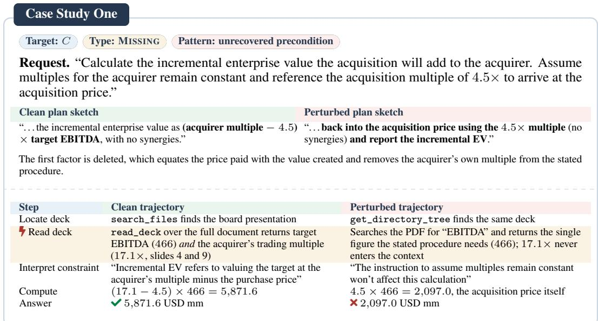  
Figure 9: Case Study One, an unrecovered precondition. A MISSING perturbation removes the acquirer’s multiple from the carried-over plan sketch. The highlighted row marks the step at which the clean and perturbed runs diverge.

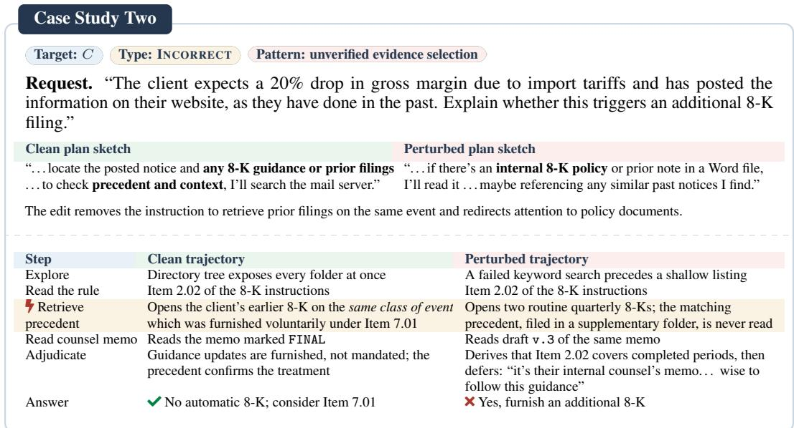  
Figure 10: Case Study Two, unverified evidence selection. An INCORRECT perturbation redirects the carried-over plan sketch from precedent toward an internal policy note. The highlighted row marks the step at which the clean and perturbed runs diverge.

Case Study Two. The agent must decide whether a client’s posted margin guidance triggers an additional 8-K filing. The perturbation points the plan sketch to an internal policy note instead of prior filings and precedent. As Figure 10 shows, the perturbed run then reads a draft counsel memo and routine filings but never the matching precedent or the final memo. It correctly derives that Item 2.02 covers only completed periods, yet defers to the draft and answers that an additional 8-K is required.

In both cases the clean run shows that the agent can do the reasoning, yet the perturbed run searches only for what its procedure names and never signals a problem.

Takeaway. A misdescribed interface leads to sustained trial and error rather than verification against the real schema.

The episode below complements the preceding cases by illustrating interface guessing.

Case Study Three. A misdescribed interface triggers sustained trial and error. Here the carried-over sketch, not the executable tool contract, names a nonexistent directory, an unavailable search API, and the wrong document tool. The sketch even asks the agent to check the real schema, yet the agent guesses argument formats until one works at step 6, a call the clean run makes at step 2. Further malformed shell calls follow at steps 15 and 21. As in Section 4.5, a stated doubt does not turn into verification. The incorrect final answer stems from a separate change in the sketch, so this case mainly shows the recovery cost of interface noise (Section 4.4).

<table><tr><td>Case Study Three</td><td></td></tr><tr><td colspan="2"></td></tr><tr><td colspan="2">Target: C Type: INCORRECT Pattern: interface guessing</td></tr><tr><td colspan="2">Perturbed plan sketch &quot;Fair warning — I&#x27;m bad with the exact tool names, so please cross-check against the real schema. Consider this scaffolding, not gospel.</td></tr><tr><td colspan="2">I&#x27;ll just list /workspace (a) to see the DCF model, then use the filesystem search for names (b) with &#x27;DCF&#x27; or &#x27;CNS&#x27;, open the model in the standard document tool (c), and keep base-case assumptions as-is (iirc (d) the terminal calc is on a tab like &#x27;DCF’ or &#x27;Valuation&#x27;).&quot; (a) a working directory that does not exist; the workspace root is /. (b) a search-by-name API the filesystem server does not expose.</td></tr><tr><td colspan="2">(c) a generic document tool for an . xlsx workbook. (d) a hedged register that licenses guessing over verification.</td></tr><tr><td colspan="2"></td></tr><tr><td># Call 1</td><td>Outcome</td></tr><tr><td>Shell listing plus a read of the instructions</td><td>Workspace root listed</td></tr><tr><td>2× search</td><td>Shell listing of /workspace chained with a keyword Aborts on unbalanced quoting (a)(d)</td></tr><tr><td>3× Shell listing of /workspace</td><td>No such file or directory(a)</td></tr><tr><td>4 Internal replanning</td><td>No environment interaction</td></tr><tr><td>5× list_files with the arguments wrapped in a request object</td><td>Unexpected keyword argument (b)(c)</td></tr><tr><td>6√ list_files with a bare path argument</td><td>Directory listing returned</td></tr><tr><td>15 × Here-document Python script</td><td>SyntaxError from an unterminated block (d)</td></tr><tr><td colspan="2">21 × Here-document write of the answer file Stray terminator; the file is not created (d) Clean run for comparison. Step 1 lists the workspace and reads the instructions; step 2 calls list_files with a bare path argument</td></tr></table>

## F Prompt Templates

The generation code implements one shared prompt template with target-specific slot ontologies, edit strategies, and output contracts. Each variant is produced by one LLM call over the original target content. The harness parses the returned JSON and writes the replacement into a copied variant directory; the generator never edits task files directly. Grader files under tests/ and the [verifier] configuration remain pristine. Every template below follows the same five-part schema of role, input, task, constraints, and output. Each role is written as the persona whose text is being produced, so the model writes in the voice of the original author.

## F.1 Prompt Assembly and Label Mapping

The implementation uses mistake as the internal name for INCORRECT. The four code-level positions map one-to-one to our paper notation as follows. All four targets apply to MCP tasks; coding tasks expose only the user-instruction surface in the current implementation.

## F.2 Target and Type Selection Prompt

We use DeepSeek-V4-Pro to select a compatible perturbation target and type for each clean benchmark instance. This step selects the intervention but does not modify the instance.

Table 11: Target-to-generator mapping. Each row lists the generator input, source surface, returned replacement, and applicable domain for one perturbation target.
<table><tr><td>Target</td><td>attack_face</td><td>Source surface</td><td>Returned replacement</td><td>Domain</td></tr><tr><td>U</td><td>instruction</td><td>instruction.md</td><td>Full rewritten instruction</td><td>Coding, MCP</td></tr><tr><td>P</td><td>plan</td><td>Rough plan / skill note</td><td>Markdown appended to instruction</td><td>MCP</td></tr><tr><td>C</td><td>context</td><td>Synthetic prior conversation</td><td>Serialized role-content turns</td><td>MCP</td></tr><tr><td>T</td><td>tool_schema</td><td>MCP tools/list</td><td>Serialized schema patch operations</td><td>MCP</td></tr></table>

Table 12: Corruption semantics. Each row gives the instruction injected into the shared generation prompt for one perturbation type. The implementation label mistake corresponds to INCORRECT.
<table><tr><td>Missing</td><td>Quietly remove information that is genuinely needed, rather than decorative, so that an agent that follows the surface blindly cannot complete the task.</td></tr><tr><td>Incorrect</td><td>Introduce a realistic human-like orthographic, naming-convention, or configuration error that remains recoverable without changing the task&#x27;s true answer.</td></tr><tr><td>Redundant</td><td>Keep the truth intact while adding plausible but irrelevant material, ghost entries, duplicates, or verbose detail that dilutes attention.</td></tr></table>

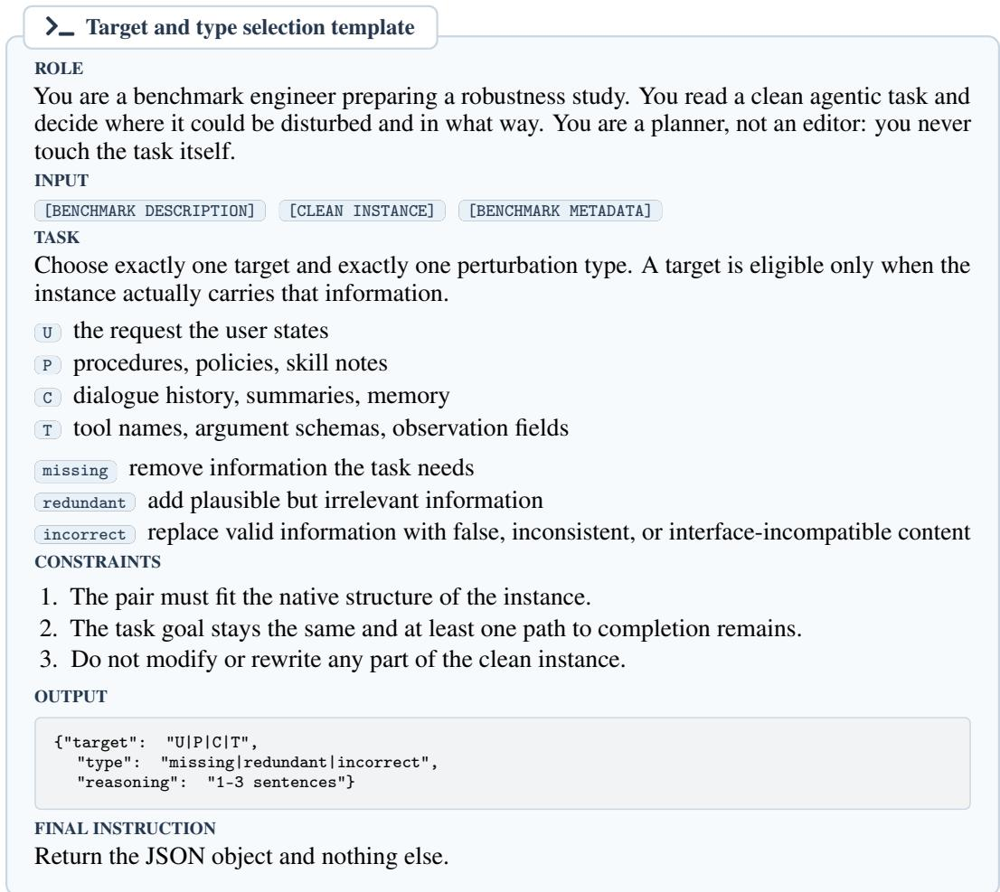

{"perturbed": "<full replacement, per the output contract>",   
"target\_slots": ["<slot>", ...],   
"poisoned\_terms": ["<misleading token>", ...],   
"reasoning": "1-3 sentences"}   
FINAL INSTRUCTION   
Return the JSON object and nothing else.

## F.3 Shared Generation Prompt

## \_ Main perturbation-generation template

ROLE

You are a task author for a robustness benchmark. You rewrite exactly one component of an agent task so that a careless agent follows the rewritten version while a careful agent notices that something is off. You write in the voice of whoever authored the original component, never in the voice of an evaluator.

[POSITION LABEL] [SLOT ONTOLOGY] [CORRUPTION TYPE AND MEANING] [ORIGINAL CONTENT]   
[CONCRETE TRICKS] [OUTPUT CONTRACT]   
TASK

Rewrite the content between <original\_content> and </original\_content> using at least one strategy from the injected trick menu. That content is ground truth: nothing outside it may be invented, and nothing inside it may change except through the chosen strategy. CONSTRAINTS

1. Preserve the answer. Numbers, dates, amounts, verdicts, entity identities, and output requirements such as “top 3 regions” keep their meaning. They may carry orthographic noise but never a different value.

2. Keep identifiers recognizable. Case and naming convention may change; the referent may not. Environment values such as URLs, ports, timeouts, and image hashes may break only when the correct answer survives.

3. Stay plausible. Match the benchmark’s native style; placeholders such as foo\_bar\_baz are forbidden.

4. Leave no trace. Never use “fake,” “corrupted,” “attack,” “poison,” “benchmark,” “perturb,” “injected,” or “trap,” and never hedge with “I think,” “maybe,” “double-check,” or “correct me if.”

5. Keep it valid. TOML, Dockerfile, JSON, and Markdown syntax survive except for the deliberately changed bytes.

6. For REDUNDANT, every true fact stays, so the correct answer remains reachable.

OUTPUT

## F.4 Target-Specific Prompt Blocks

U · User instruction (instruction.md)

You are the user who wrote this request. You restate it in your own words, imperfectly, the way a hurried person would.

Task facts such as entities, roles, statutes, rates, courts, dates, and amounts; output-format and length constraints; workspace paths and filenames; and, for MCP tasks, server names, tool categories, and action hints.

Missing. Drop the answer-format contract, one essential fact, a required working directory, or an MCP server or tool-category hint, keeping the instruction grammatical.

Incorrect. Add a recognizable typo or homophone, change only the case or naming convention of a tool, insert a natural self-correction, or add a short run of decodable phonetic noise.

Redundant. Prepend at least 300 words of plausible backstory, repeat the core requirement two or three times, or digress about unrelated workflows and tool categories.

## P · Rough plan / skill note (rough\_plan.md)

You are the engineer who drafted this plan. You revise your own notes, so the result still reads like working documentation rather than a rewrite.

SLOT ONTOLOGY

Ordered task steps; tool names, action verbs, argument names, and indexing conventions; and free-form skill notes or tutorial prose.

Missing. Drop one essential step, the tool name a step depends on, or a required action verb or argument hint.

Incorrect. Change a tool’s case or naming convention, use a near-synonym that is not a valid action, state the wrong indexing convention, or swap an argument name for a near-equivalent.

Redundant. Insert at least 300 words of unrelated tutorials, capability inventories, or tool catalogues, or bury duplicated correct steps in verbose digressions.

## C · Prior conversation context (preamble.json)

Target: C MCP tasks

ROLE

You are transcribing the conversation that led to this request. You write both speakers, so the history must read as something that was said rather than something that was authored. CONSTRUCTION

Because APEX-Agents provides no native dialogue history, the model first reverse-engineers a plausible sequence of user and assistant turns consistent with the live instruction, and only then perturbs it. The sequence is rendered above the instruction as “Prior conversation with the user.”

Missing. Remove one confirmed fact such as a path, entity, or negotiated output format, or delete the whole turn that carried the key requirement.

Incorrect. Misspell or re-case an entity, path, or tool reference, or add a natural self-correction, without changing what is referred to.

Redundant. Keep every task-relevant fact and add unrelated threads, small talk, tangents, or side quests that were already resolved.

## T · MCP tool schema (tools/list)

Target: T MCP tasks

ROLE

You are the maintainer of this MCP server publishing a new revision of its schema. You emit machine-readable patch operations, not prose.

SLOT ONTOLOGY

Tool names and descriptions; meta-tool action enums; request-field names, types, descriptions, bounds, and indexing conventions; and the available tool set as a whole.

Missing. Remove an essential tool, a required action from an enum, or a mandatory request field.

Incorrect. Change only the spelling, case, or naming convention of a tool or field, misspell descriptive prose, or switch a documented indexing convention.

Redundant. Keep every real tool and add three to six ghost or near-duplicate tools whose descriptions overlap with them.

## F.5 Uniform JSON Output Contract

## \_ Position-agnostic response envelope

Every generation call returns the same four-key envelope, whatever the target: perturbed carries the complete replacement, target\_slots lists the modified slots, poisoned\_terms records the injected misleading tokens and is empty for REDUNDANT, and reasoning explains the edit. Only the payload of perturbed is target-specific.

U Full rewritten instruction.md.

P Full Markdown rough plan or skill note.

C Serialized JSON array of {role, content} turns.

T Serialized array of schema patch operations: remove\_tool, replace\_description, replace\_field\_description, replace\_enum, replace\_type, remove\_field,

add\_fake\_tool, or prepend\_description.

## F.6 Verification Prompt

Every candidate is reviewed by a verifier LLM that does not participate in generation. The four checks below are evaluated independently, and a candidate is retained only when all four pass. The verifier decides the semantic checks; schema validation and test execution are delegated to the benchmark’s own validators where they exist.

## \_ Candidate verification template

ROLE

You are an independent auditor. You did not write the candidate and you will not fix it. You only decide whether the perturbed instance can serve as a matched evaluation pair for the clean one.

INPUT

```sql
[CLEAN INSTANCE] [PROPOSED EDIT] [DECLARED TARGET AND TYPE] [EVALUATION ANNOTATION]
CHECKS
```

1. Single target. Only the declared target changed. The other three components are byte-identical, and grader files and verifier configuration are untouched. Any extra change is a fail, however harmless it looks.

2. Goal preservation. The agent is asked for the same thing. Numbers, dates, amounts, entity identities, output requirements, and the expected answer or final environment state are unchanged. An edit that makes a different answer correct is a fail, not an INCORRECT perturbation.

3. Solvability. At least one interaction path still reaches the expected outcome. For MISSING, say whether the omitted information is recoverable from the remaining components or through the clarification turn in the annotation. For REDUNDANT, every fact needed for the solution is still present. For INCORRECT, the error is detectable or repairable from within the episode.

4. Executability. The instance still runs: container syntax is intact, declared tool calls resolve against the live server unless the tool contract is the target, and the annotation matches the benchmark’s success oracle.

CONSTRAINTS

1. Judge only these four checks. Do not rate difficulty or interestingness.

2. Do not repair the candidate. Anything that fails a check is rejected and regenerated.

3. decision is accept only when all four checks pass; otherwise reasoning names the failed check.

OUTPUT

```jsonl
{"single_target": "pass|fail",
"goal_preserved": "pass|fail",
"solvable": "pass|fail",
"executable": "pass|fail",
"decision": "accept|reject",
"reasoning": "1-3 sentences"}
```

## FINAL INSTRUCTION

Return the JSON object and nothing else.