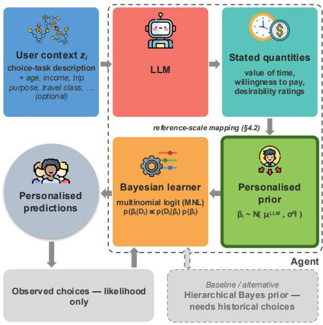
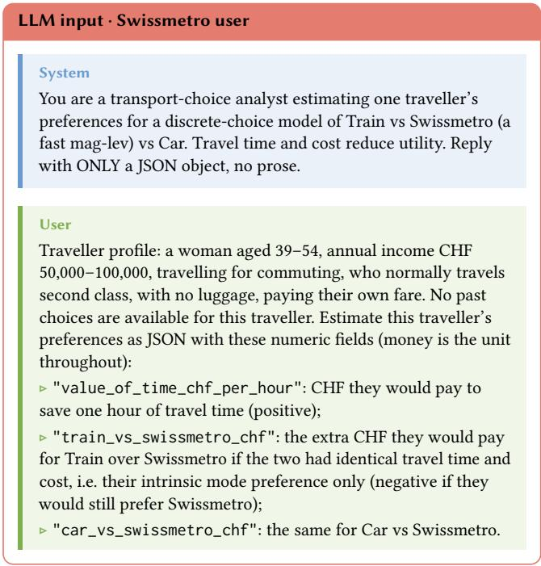
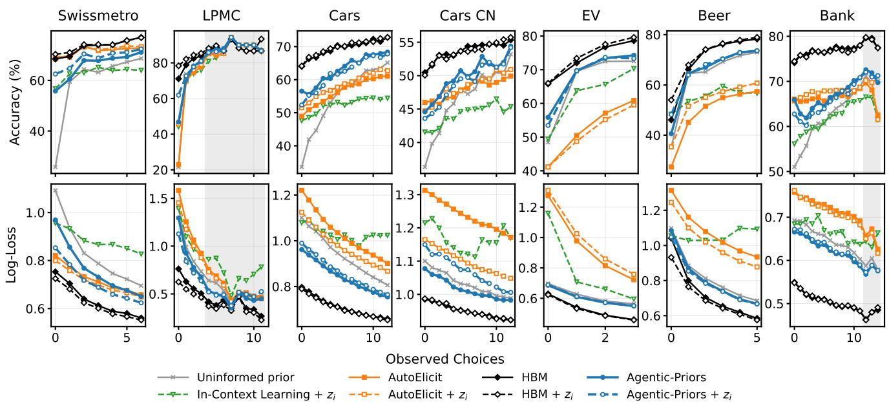
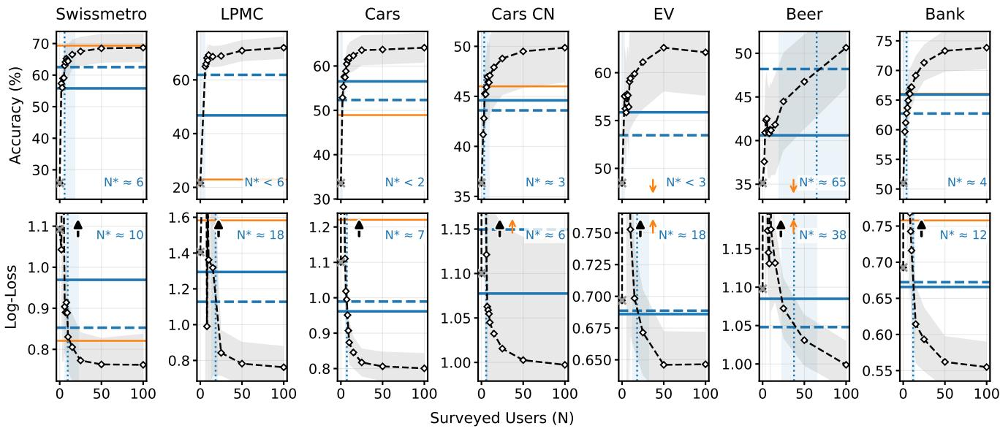

# Agentic-Priors: Using Large Language Models to Address the Cold Start Problem in Preference Elicitation

Bruno Arcanjo University of Southampton Southampton, United Kingdom brqa1a24@soton.ac.uk

Zhaoxing Li University of Southampton Southampton, United Kingdom zhaoxing.Li@soton.ac.uk

## Abstract

An agent that learns a user’s preferences from their choices faces a cold start problem: before any choices are observed, it must rely solely on a prior. Informative priors are usually fitted to historical choice data, which new tasks and deployments lack. To address this, we present Agentic-Priors, which lets agentic systems use the implicit knowledge of large language models (LLMs) instead. Specifically, an LLM states a new user’s trade-ofs in interpretable terms, such as willingness to pay or value of time, which we map to a prior over multinomial logit coeficients. This prior is then refined by a Bayesian learner as choices are observed. Across seven choice datasets, Agentic-Priors improves cold start accuracy over an uninformed prior by 5–40 percentage points. It also outperforms AutoElicit, a state-of-the-art LLM prior-elicitation method, on three datasets and loses on one. It is up to 18 points more accurate than in-context learning, and never significantly worse. Against hierarchical Bayes models fitted to surveys of increasing size, our approach is worth roughly 6–40 surveyed users, in terms of log-loss, so its value is concentrated in a deployment’s first users.

## Keywords

Preferences, LLMs, Choice Models, Cold Start Problem, Agents

## 1 Introduction

For an agent to make personalised recommendations, or even autonomous decisions, it must estimate a user’s preferences. A standard approach observes the user’s choices and updates a utility model by Bayesian inference [10, 15]. Before the first choice, however, the agent can rely only on its prior, and a poor prior means poor early recommendations and slower learning. This is known as the cold start problem.

The usual remedy is population data. A hierarchical Bayes model (HBM) fitted to other users’ choices on the same task gives an informative prior [3], and conditioning it on user characteristics makes that prior user-specific [13]. But this needs a choice dataset for the task at hand, which a new product, service or deployment does not have. Without one, the agent falls back on an uninformed prior, which says nothing about what the user prefers.

Large language models (LLMs) encode broad knowledge about how people make choices [4, 16], which suggests a third option: using this implicit knowledge to derive more informative priors. Specifically, in our approach, an LLM reasons about how a user would trade of the attributes of a choice, and states those tradeofs in a form a choice model can use. This can then be used to provide relevant recommendations or make autonomous actions on the user’s behalf. Here, the dificulty is that utility coeficients have no natural units [32], so an LLM has nothing to anchor their

Sebastian Stein University of Southampton Southampton, United Kingdom ss2@soton.ac.uk

  
Figure 1: Agentic-Priors overview. An LLM, given the choice task and (optionally) the user’s characteristics $z _ { i } ,$ states interpretable quantities such as willingness to pay. These are mapped to multinomial logit (MNL) coeficients that form a personalised prior $\beta _ { i } \sim \bar { N } ( \mu _ { i } ^ { \mathrm { L L M } } , \sigma ^ { 2 } I _ { K } )$ , which a Bayesian learner updates as choices are observed. Unlike a hierarchical Bayes prior, it needs no historical choice data.

magnitude to. We instead ask for trade-ofs on a reference scale it can reason about, such as how much the user would pay to save an hour of travel, and convert these into coeficients.

Against this background, we introduce Agentic-Priors, which elicits a user-specific prior from a single LLM call. The LLM is given a description of the choice task and, optionally, whatever is known about the user, such as their demographics or other relevant context (e.g. the purpose of a trip). Agentic-Priors requires no historical choice data, and then hands the prior to a Bayesian learner that updates it as real choices arrive (Figure 1), e.g. when a user chooses from a set of presented options. We evaluate it on seven statedand revealed-choice datasets from transport, vehicle purchase, consumer goods and finance, against an uninformed prior, an LLM that predicts choices directly using in-context learning [12], and AutoElicit [14], a state-of-the-art approach that uses LLMs as priors for general machine learning problems. We also compare our approach to HBM [3, 25], which is widely used in choice modelling when detailed historical population data is available.

Agentic-Priors improves cold start accuracy over an uninformed prior on all seven datasets, by 5 to 40 percentage points. In accuracy, it outperforms AutoElicit on three datasets, loses on one and is inconclusive on the remaining three. Predicting choices directly with the LLM, with past choices given in context, is never significantly better than eliciting a prior and updating it, and is up to 18 percentage points less accurate. To measure what the prior is worth in data, we compare it with HBMs fitted to surveys of increasing size: in log-loss it is worth between about six and about forty surveyed users, depending on the dataset, and in accuracy at most about six on all datasets but one. Its value is therefore real but confined to a deployment’s first users. Moreover, on most datasets a prior elicited from the task description alone, without any information about the user, is worth almost as much: the value lies mainly in the LLM’s knowledge of the task.

Our contributions are:

• Agentic-Priors, a method that turns an LLM’s reasoning about a user into a prior over choice-model coeficients. This uses a reference scale that gives the elicited quantities meaningful units and produces a choice model prior that can be updated using Bayesian learning (Section 4).

• An evaluation on seven real-world datasets against a range of state-of-the-art baselines that use no data, population data, or in-context learning (Section 6).

• An exchange rate that expresses the value of an LLM prior as the number of surveyed users it is worth, a concrete basis for deciding when one is worth using (Section 6.3).

## 2 Related Work

An agent that recommends or decides on a user’s behalf must estimate their preferences from few interactions—the cold start problem of recommender systems [28]. Research on preference elicitation has largely optimised which comparisons to present: decision-theoretic formulations select queries that reduce utility uncertainty or minimax regret [10, 11, 15, 34], and adaptive conjoint and eficient choice designs pursue the same goal through experimental design [24, 27, 31]. Every such method, however, proceeds from what the agent already believes before the first question is asked—and that belief alone determines its behaviour while no choices have yet been observed. In contrast, we here study the complementary lever: the user-specific information available before any interaction.

Random-utility models make that beliefexplicit and interpretable, representing a user’s preferences as a coeficient vector over attribute trade-ofs [21, 32]. Conventionally, the distribution over those coeficients is estimated from a population of earlier users, with mixed logit and hierarchical Bayes capturing how preferences vary across individuals [3]. Closest to our setting, FAVOUR maps sociodemographic profiles to population-informed priors for personalised routing and then refines them by Bayesian learning [13]. This pipeline is similar to ours, but difers in where the prior comes from. Recent personalisation methods likewise learn shared preference structure from prior users before adapting to a new one [9, 22, 29]. All provide informative starting points, but all require a historical choice dataset from comparable users performing a comparable task—assumptions we make explicit in Section 3.3, and whose cost motivates this work.

LLMs ofer a diferent source for the same object. One line of work elicits priors for Bayesian models directly from an LLM and examines how well its stated uncertainty is calibrated [14, 23], though the elicited prior is one per task rather than one per user, and the work considers general machine learning tasks rather than choice models; hence, we adapt this approach to choice data, with and without user conditioning, as baselines. A second line of work simulates users or augments human choice data, including individual-level mimicry conditioned on socio-economic microdata, with mixed evidence on behavioural fidelity [4, 8, 16, 20, 33]; these yield simulated answers rather than a distribution over preference coeficients. LLMs given stated preferences are also competitive recommenders near cold start [26], but return recommendations, not a model of trade-ofs. A third line places LLM knowledge inside sequential decision loops: CBLI warm-starts bandits with synthetic preferences and subsequent work identifies negative transfer when those preferences are misaligned [1, 5], while OPEN combines LLMs with Bayesian experimental design to select informative queries [17]. There the knowledge enters as synthetic training data for a blackbox reward model, not as a prior over interpretable coeficients.

We combine these perspectives: in Agentic-Priors, an LLM supplies a prior over the coeficients of an interpretable choice model, conditioned on whatever is known about the user and requiring no historical choice data. The user’s own choices enter afterwards, through the likelihood alone (Section 3.2). This isolates what encoded world knowledge contributes at cold start, and allows us to ask—against priors that do draw on historical choices—whether that contribution persists as evidence accumulates.

## 3 Preference Modelling

This section lays the necessary groundwork for our method Agentic-Priors presented in Section 4 by formulating the preference learning and elicitation problem, detailing notation and assumptions. We start from the discrete choice problem and how user preferences naturally arise from the formulation. We follow with how Bayesian learning is used to update preferences as new choices are observed. Finally, we describe the conventional priors, with and without population data.

## 3.1 Discrete Choice Problem

In a discrete-choice setting [6, 32], each user � completes a sequence of choice tasks $t = 1 , 2 , \ldots { }$ , in each choosing one of � alternatives described by � attributes whose values difer between tasks (e.g. A, B or C first, then D, E or F). Alternative � in task � has attribute vector $x _ { i j t } \in \mathbb { R } ^ { K }$ , and $X _ { i t } = ( x _ { i 1 t } , \dots , x _ { i J t } )$

The utility $U _ { i j t }$ that user � derives from alternative � in task � is represented by the linear combination

$$
U _ { i j t } = x _ { i j t } ^ { T } \beta _ { i } + \epsilon _ { i j t }\tag{1}
$$

where $\beta _ { i }$ is the coeficient vector representing user �’s preferences, the same in every task, and $\epsilon _ { i j t }$ is an error term, assumed to be i.i.d. Gumbel, accounting for unobserved randomness. The MNL model [32, Ch. 3] then calculates the probability that user � chooses alternative � in task � as follows

$$
P ( y _ { i t } = j \mid X _ { i t } , \beta _ { i } ) = \frac { \exp ( x _ { i j t } ^ { T } \beta _ { i } ) } { \sum _ { l = 1 } ^ { J } \exp ( x _ { i l t } ^ { T } \beta _ { i } ) }\tag{2}
$$

where $y _ { i t } \in \{ 1 , . . . , J \}$ is user $i \gamma _ { s }$ choice in task �.

In this work, the objective of preference learning is to find an estimate ${ \hat { \beta } } _ { i }$ that best approximates the true, latent preference vector $\beta _ { i }$ . We make an explicit distinction between two information sources for estimating $\beta _ { i } { \mathrm { : } }$ : historical population-level data and the user’s observed choices.

## 3.2 Bayesian Updates

Before observing any choices, we hold a prior belief $ { p } ( \beta _ { i } )$ of user �’s preferences. If relevant population-level data is available, $\textstyle p ( \beta _ { i } )$ can be estimated from it; otherwise, an uninformed prior is used (Section 3.3).

After observing user $i ^ { \circ } s$ first � choices, $D _ { i } = \{ ( X _ { i t } , y _ { i t } ) \} _ { t = 1 } ^ { T }$ (so $T = | D _ { i } | ) , \boldsymbol { p } ( \beta _ { i } )$ is updated by Bayes’ rule,

$$
p ( \beta _ { i } \mid D _ { i } ) \propto p ( D _ { i } \mid \beta _ { i } ) p ( \beta _ { i } ) ,\tag{3}
$$

where $p ( \beta _ { i } \mid D _ { i } )$ is the posterior and $p ( D _ { i } \mid \beta _ { i } )$ is the MNL likelihood which, assuming the � observed choices are conditionally independent given $\beta _ { i ; }$ , is $\begin{array} { r } { \mathop { p } ( D _ { i } \mid \beta _ { i } ) = \prod _ { t = 1 } ^ { T } P ( y _ { i t } \mid X _ { i t } , \beta _ { i } ) } \end{array}$

We define a cold start at $T = 0$ where $D _ { i } = \varnothing .$ , i.e. there are yet no observed choices for user �. Consequently,

$$
p ( \beta _ { i } \mid D _ { i } = 0 ) = p ( \beta _ { i } )\tag{4}
$$

Therefore, in a cold start scenario, the user-specific preference information comes entirely from the prior. Thus, methods for estimating the starting $\textstyle p ( \beta _ { i } )$ become particularly important for addressing the cold start problem.

## 3.3 Conventional Priors

A historical choice dataset gives an informative prior when its users share the new user’s population of preferences and performed a comparable task, with compatible attributes and utility model. The standard approach is a hierarchical model, $\beta _ { i } \ \sim \ N ( \mu ^ { \mathrm { p o p } } , \Sigma ^ { \mathrm { p o p } } )$ fitted jointly to all historical users’ choices, where $\mu ^ { \mathrm { p o p } }$ may depend on user characteristics[3]. A new user then starts from $\beta _ { i } \sim$ $N ( \mu ^ { \mathrm { p o p } } , \Sigma ^ { \mathrm { p o p } } ) \colon \mu ^ { \mathrm { p o p } }$ sets where preferences are centred, and Σpop how much they vary across users and how the coeficients covary. Without such a dataset, one resorts to an uninformed prior, $\beta _ { i } \sim { \cal N } ( 0 , \sigma ^ { 2 } I )$ , which carries no user-specific information. In the next section, we replace the source of the prior with the knowledge encoded in an LLM, which needs no historical data.

## 4 Agentic-Priors for Preference Elicitation

Agentic-Priors elicits a prior over MNL coeficients from an LLM, given only a description of the choice task and whatever is known about the user, $z _ { i } ,$ e.g. demographics or additional contextual information (possibly nothing). It requires no historical choice data. This section describes what the LLM is given (Section 4.1), how its answers are mapped to MNL coeficients (Section 4.2), and how a prior is formed around them (Section 4.3).

Figure 2: LLM input for one Swissmetro user (abridged: definitions shortened). Prompts for all datasets are in Appendix A.

## 4.1 LLM Input

The LLM receives two messages via a single prompt. The system message is fixed per task: it sets the LLM’s role, names the alternatives, states which attributes reduce utility, and requires a JSON reply. The user message is specific to the user: it describes $z _ { i }$ in a short natural-language profile, lists any choices the user has already made (in our cold start setting this is always empty), and asks for each quantity on the task’s reference scale (Section 4.2), with a one-line definition and sign convention for each. We give the LLM only the user information each dataset provides (Table 1). When �� is omitted, the profile is replaced by a generic description (e.g. $\mathbf { \ddot { a } }$ Swiss intercity traveller”), so the LLM relies on its knowledge of the task alone. Figure 2 shows the Swissmetro messages for one user (datasets: Section 5.1).

## 4.2 Reference-Scale Framework

Guided by the prompt, the LLM expresses each preference as a quantity $a _ { i k }$ on a common reference scale, so that preferences over diferent attributes are directly comparable. A reference coeficient $c _ { \mathrm { r e f } }$ fixes the utility value ofone unit ofthat scale, and a task-specific map converts each answer into a coeficient:

$$
\beta _ { i k } ^ { \mathrm { r a w } } = \delta _ { k } c _ { \mathrm { r e f } } \frac { a _ { i k } } { u _ { k } } ,\tag{5}
$$

where $u _ { k }$ converts units and $\delta _ { k } \in \{ - 1 , + 1 \}$ is −1 for attributes the LLM values as reductions (e.g. paying to save time) and +1 otherwise.

When the task has a monetary attribute, money is the natural reference scale: $a _ { i k }$ is the user’s willingness to pay for (or to avoid) attribute $k ,$ and the money attribute is the numeraire, with $\beta _ { \mathrm { n u m } } ^ { \mathrm { r a w } } =$ $- c _ { \mathrm { r e f } } .$ . For example, in Swissmetro,

$$
\beta _ { \mathrm { t i m e } } ^ { \mathrm { r a w } } = - c _ { \mathrm { r e f } } \frac { \mathrm { V O T } } { 6 0 } ,\tag{6}
$$

with $\delta _ { \mathrm { t i m e } } = - 1 , a _ { i , \mathrm { t i m e } } = \mathrm { V O T }$ (the stated value of time in CHF per hour) and $u _ { \mathrm { t i m e } } = 6 0$ , converting CHF per hour into CHF per minute. Both $\beta _ { \mathrm { c o s t } } ^ { \mathrm { r a w } }$ and $\beta _ { \mathrm { t i m e } } ^ { \mathrm { r a w } }$ are negative because higher cost and longer travel time reduce utility. In the Cars dataset,

$$
\beta _ { \mathrm { H E V } } ^ { \mathrm { r a w } } = c _ { \mathrm { r e f } } \frac { \mathrm { W T P } _ { \mathrm { H E V } } } { 1 0 0 0 } ,\tag{7}
$$

with $\delta _ { \mathrm { { H E V } } } = + 1 , a _ { i , \mathrm { { H E V } } } = \mathrm { { W T P } _ { \mathrm { { H E V } } } }$ (what the user would pay for a hybrid over an otherwise identical gasoline vehicle) and $u _ { \mathrm { H E V } } =$ 1000, since price is measured in thousands of dollars. WTPHEV can be negative, in which case the coeficient is negative too.

When no attribute has a meaningful monetary value, the LLM instead rates each attribute level on a bounded desirability scale, $a _ { i k } \in \left[ - 1 0 0 , 1 0 0 \right]$ , relative to the attribute’s baseline level $( \delta _ { k } = + 1$ $u _ { k } = 1 0 0 )$ , and $c _ { \mathrm { r e f } }$ is the utility of a maximally (un)desirable level.

The resulting coeficients must then be expressed on the same scale as the features used by the discrete-choice model. The choice attributes are normalised by their design standard deviations,

$$
x _ { i j t k } ^ { \mathrm { n o r m } } = \frac { x _ { i j t k } } { s _ { k } } ,\tag{8}
$$

where $s _ { k }$ is the standard deviation of attribute � across all alternatives in all choice tasks of the design. To preserve utility, the coeficients are scaled accordingly:

$$
\beta _ { i } ^ { \mathrm { s c a l e d } } = D _ { s } \beta _ { i } ^ { \mathrm { r a w } } , \qquad D _ { s } = \mathrm { d i a g } ( s _ { 1 } , \dots , s _ { K } ) .\tag{9}
$$

Finally, the coeficient vector is divided by the design standard deviation of the reference attribute, $s _ { \mathrm { r e f } } \colon$

$$
\beta _ { i } ^ { \mathrm { { n o r m } } } = \frac { \beta _ { i } ^ { \mathrm { { s c a l e d } } } } { s _ { \mathrm { { r e f } } } } ,\tag{10}
$$

where $s _ { \mathrm { r e f } } ~ = ~ s _ { \mathrm { n u m } }$ when a numeraire exists, which anchors $\vert \beta _ { \mathrm { n u m } } ^ { \mathrm { n o r m } } \vert = c _ { \mathrm { r e f } } .$ , so that $c _ { \mathrm { r e f } }$ becomes the utility of a one-standarddeviation change in the numeraire, and $s _ { \mathrm { r e f } } = 1$ otherwise.

## 4.3 Prior Construction from a Single Elicitation

For each user �, we query the LLM once, with �� when it is available, under a fixed prompt and decoding configuration, and use the normalised coeficient vector from Section 4.2 as the prior mean, $\mu _ { i } ^ { \mathrm { L L M } } = \beta _ { i } ^ { \mathrm { n o r m } }$ . Unlike the population priors in Section 3.3, this requires no historical choice data; with $z _ { i }$ it is specific to each user, and without it every user gets the same prompt.

A single elicitation gives a point estimate but no measure of uncertainty, so we do not directly derive the covariance from the LLM’s outputs. We use an isotropic covariance with one scale $\sigma ,$ shared by all coeficients and fixed across datasets:

$$
\beta _ { i } \sim { \cal N } \biggl ( \mu _ { i } ^ { \mathrm { L L M } } , \sigma ^ { 2 } I _ { K } \biggr ) .\tag{11}
$$

Normalisation by design standard deviations, together with the reference scale, puts coeficients on a comparable scale across attributes and datasets, so one shared � is reasonable; it also keeps the prior broad enough for a few observed choices to move the posterior (Section 3.2). We also experimented with asking the LLM for a plausible range for each quantity and with deriving the covariance from the spread of repeated elicitations, but both gave priors far too narrow to learn from: the stated ranges had to be widened about 16-fold, and the spread across elicitations reflects decoding variation rather than uncertainty about the user (Section 5.2).

## 5 Experimental Setup

This section presents the datasets, the implementation details of Agentic-Priors (elicitation settings, prior scale and language models), and the methods we compare against.

## 5.1 Datasets

We evaluate on seven publicly available choice datasets spanning transport, vehicle purchase, consumer goods and finance (Table 1), chosen to cover diferent domains and because each records user characteristics that can serve as $z _ { i } ;$ Table 2 lists the quantities the LLM states for each. All are stated-choice experiments except LPMC, which records revealed choices, i.e. real trips. These choices come from surveys rather than from users of a deployed system; for consistency with the rest of the paper, we refer to their respondents as users. From each dataset we randomly draw 100 users as a heldout test set; all reported results are on these users, and the HBM baselines are fitted on all remaining (non-test) users. In each of five random permutations of a test user’s tasks, three are held out and the rest revealed one at a time; at every � we score posteriorpredictive accuracy and log-loss on the held-out tasks.

5.1.1 Swissmetro. A stated-preference survey of intercity travellers in Switzerland on a proposed high-speed underground maglev (Swissmetro), chosen against their existing train and car options [7].

5.1.2 LPMC. Trip diaries from the London Travel Demand Survey (2012–2015), each trip augmented with the routes, times and costs of the modes not taken [19]. We keep travellers with at least six trips.

5.1.3 Cars and Cars CN. A 2012–13 conjoint survey of new-car buyers in the US (Cars) and in three Chinese cities (Cars CN), choosing among conventional, hybrid, plug-in hybrid and battery-electric vehicles [18]. The two markets share one instrument, so they difer only in users (and in currency and units, which the LLM is given in local terms).

5.1.4 EV. A 2019 US survey in which car buyers choose between a gasoline car and an otherwise identical EV whose price, range and charging infrastructure vary; prices are pivoted on each user’s stated budget [35].

5.1.5 Beer. A 2019 US survey on willingness to pay for sustainability attributes in beer, with eco-labels and a no-purchase option [30].

5.1.6 Bank. A credit-card conjoint in which customers choose between pairs of ofers [2]. Attribute levels are numerically disguised in the public data, so the LLM rates each level’s desirability instead of stating a monetary value (Section 4.2).

Table 1: Datasets. Tasks: choice tasks per user.
<table><tr><td>Dataset</td><td>Users</td><td>Tasks</td><td>Alternatives</td><td>Choice attributes</td><td>Zi</td></tr><tr><td>Swissmetro</td><td>1,191</td><td>9</td><td>Train, Swissmetro,  $\mathrm { C a r ^ { a } }$ </td><td>Travel time, cost; Train and Car ASCs</td><td>Age, gender, income, trip purpose, travel class, luggage, who pays, rail season ticket</td></tr><tr><td>LPMC</td><td></td><td></td><td>1,304 6–16 Walk, cycle, public transport, drive Mode-specific travel times, cost, PT</td><td>interchanges; mode ASCs</td><td>Age, gender, travel year, driving li- cence, household car ownership, fare</td></tr><tr><td>Cars / Cars CN 384 / 448</td><td></td><td>15</td><td>Three vehicles</td><td>Powertrain (HEV/PHEV/BEV vs gasoline), electric range, fast ital status, education, household size, charging, price, operating cost, vehicles owned, daily mileage, home- acceleration, brand origin</td><td>type, trip purpose Age, gender, household income, mar- /work charging access, environmen- tal and status attitudes; urbanicity</td></tr><tr><td>EV</td><td>983</td><td>6</td><td>Gasoline car, EV</td><td>drive time and availability, highway ership</td><td>(US) or city (China) EV indicator, price, range, walking Age, gender, state, household income, time to home/work charger, fast- education, car budget, daily mileage, charge time, in-town fast-charger home/work charging access, EV own-</td></tr><tr><td>Beer</td><td>1,291</td><td>8</td><td>Two six-packs, no purchase</td><td>charger spacing and availability Packaging, water/carbon/landfill eco- Age, region, income, education, pri- labels, locally brewed, price; no- mary shopper, purchase frequency, purchase ASC</td><td>typical price, usual beer type, nov-</td></tr><tr><td>Bank</td><td></td><td></td><td>946 14-17 Two credit-card offers</td><td>Interest rate, reward programme, an- Age, gender, income nual fee, issuing bank, rebate, credit line, grace period (levels disguised)</td><td>elty seeking, recycling</td></tr></table>

aCar available only to car owners.

Table 2: LLM-stated quantities and their reference scale.
<table><tr><td>Dataset</td><td>Reference</td><td>Quantities stated</td></tr><tr><td>Swissmetro</td><td>Cost (CHF)</td><td>Value of time; Train and Car vs Swiss- metro preference</td></tr><tr><td>LPMC</td><td>Cost (£)</td><td>Cycle, PT and drive vs walk; value of time per mode; avoiding an interchange</td></tr><tr><td>Cars</td><td>Price ($ / ¥)</td><td>Each powertrain vs gasoline; per unit of electric range; fast charging; lower operating cost; faster acceleration; each</td></tr><tr><td>EV</td><td>Price ($)</td><td>brand origin vs German EV vs gasoline; per mile of range; per minute of home/work walking, fast- charge and in-town charger time; in- town and highway charger availability;</td></tr><tr><td>Beer</td><td>Price ($)</td><td>per mile of highway charger spacing Bottles vs cans; each eco-label; locally</td></tr><tr><td>Bank</td><td>Rating (±100)</td><td>brewed; highest price for a basic six-pack Desirability of each attribute level rela- tive to its baseline</td></tr></table>

## 5.2 Agentic-Priors Implementation Details

5.2.1 Elicitation setings. We set $c _ { \mathrm { r e f } } = 1$ for all datasets: where a numeraire exists, its coeficient is −1 in normalised units; on Bank, a maximally desirable level has raw utility 1. Each user is elicited with one call (the prompt of Figure 2, temperature 0.4, fixed seed). A reply that cannot be parsed, or that implies $| \beta _ { i k } ^ { \mathrm { n o r m } } | > 2 5$ , is reissued with a new seed and an instruction to return only the required output, at most twice. All responses are cached, and every reported result replays from the cache; the code and the cache will be made publicly available.

5.2.2 Prior scale. We set $\sigma = 1$ , which we selected on a development set of 100 users from Swissmetro (diferent from the test set) and held fixed for all other datasets and experiments; Swissmetro is therefore our development dataset. In ablations on Swissmetro (Appendix C), the LLM’s stated ranges for each $a _ { i k }$ had to be widened about 16× before the prior learned as fast as the isotropic one, and never significantly outperformed it in log-loss. Averaging eight elicitations per user did not help either: with the same � its log-loss was worse at every � , and using the eight answers’ own spread as the covariance made the prior too narrow to learn from (log-loss after six choices 0.765 vs. 0.624).

5.2.3 Language Models. Our primary elicitor is Qwen3-32B (4- bit AWQ, reasoning disabled), chosen because it is open-weight, relatively small and cheap to run, so a prior can be elicited for every new user without a proprietary API. To test sensitivity to this choice, we repeat cold start elicitation on three datasets covering both reference scales (Swissmetro, Cars and Bank) with seven open-weight models from four families (Mistral, Qwen, Gemma, Llama; 8–31B) on a public API, with identical prompts and no permodel tuning (full results in Appendix D). Cold start accuracy is largely insensitive to the elicitor: on Swissmetro, every model except Gemma-3-12B is within 2 percentage points of our primary model (none significant), and on Cars and Bank the others difer by at most 4 points in either direction. Log-loss is more sensitive, since it also penalises miscalibrated magnitudes: on Swissmetro, only Mistral-Small-24B matches our primary model, the other 24–31B models are 0.03–0.06 worse, and Llama-3.1-8B is 0.10 worse. The exception on both metrics is the previous-generation Gemma-3-12B, which states implausibly large monetary values, loses 5–6 accuracy points on Swissmetro and Cars, and is worse than an uninformed prior in log-loss on both; Gemma-4 does not show this failure.

Table 3: Cold start (� = 0) accuracy (%, higher is better) and log-loss (lower is better) on the test users (� = 100 per dataset). Methods above the line use no historical choice data; $^ { * } + z _ { i } ^ { ~ p }$ methods are also given the user’s information. Best no-data method per column in bold.
<table><tr><td></td><td>Swissmetro</td><td>LPMC</td><td>Cars</td><td>Cars CN</td><td>EV</td><td>Beer</td><td>Bank</td></tr><tr><td>Accuracy</td><td></td><td></td><td></td><td></td><td></td><td></td><td></td></tr><tr><td>Uninformeda</td><td>25.8</td><td>21.6</td><td>33.6</td><td>36.3</td><td>48.5</td><td>35.1</td><td>51.0</td></tr><tr><td>AutoElicit</td><td>69.3</td><td>22.9</td><td>48.9</td><td>46.0</td><td>41.1</td><td>27.3</td><td>66.1</td></tr><tr><td>AutoElicit  $+ \ z _ { i }$ </td><td>68.5</td><td>45.7</td><td>51.5</td><td>44.7</td><td>41.1</td><td>35.3</td><td>65.7</td></tr><tr><td>Agentic-Priors</td><td>55.8</td><td>46.8</td><td>56.5</td><td>44.6</td><td>55.9</td><td>40.6</td><td>65.9</td></tr><tr><td>Agentic-Priors + zi</td><td>62.5</td><td>61.9</td><td>52.3</td><td>43.6</td><td>53.5</td><td>48.2</td><td>62.7</td></tr><tr><td>In-Context Learning + z</td><td>56.7</td><td>44.1</td><td>47.6</td><td>41.6</td><td>49.4</td><td>48.3</td><td>56.1</td></tr><tr><td>HBM</td><td>68.5</td><td>71.1</td><td>64.0</td><td>50.5</td><td>65.8</td><td>46.1</td><td>74.1</td></tr><tr><td> $\mathrm { H B M } + z _ { i }$ </td><td>70.3</td><td>78.3</td><td>64.1</td><td>50.1</td><td>66.0</td><td>54.0</td><td>74.5</td></tr><tr><td>Log-loss</td><td></td><td></td><td></td><td></td><td></td><td></td><td></td></tr><tr><td>Uninformed</td><td>1.092</td><td>1.405</td><td>1.101</td><td>1.100</td><td>0.697</td><td>1.098</td><td>0.693</td></tr><tr><td>AutoElicit</td><td>0.821</td><td>1.583</td><td>1.220</td><td>1.313</td><td>1.276</td><td>1.314</td><td>0.758</td></tr><tr><td> ${ \mathrm { A u t o E l i c i t } } + z _ { i }$ </td><td>0.800</td><td>1.453</td><td>1.125</td><td>1.165</td><td>1.310</td><td>1.245</td><td>0.762</td></tr><tr><td>Agentic-Priors</td><td>0.969</td><td>1.294</td><td>0.962</td><td>1.077</td><td>0.686</td><td>1.085</td><td>0.666</td></tr><tr><td>Agentic-Priors + zi</td><td>0.853</td><td>1.128</td><td>0.989</td><td>1.150</td><td>0.689</td><td>1.048</td><td>0.672</td></tr><tr><td>In-Context Learning + z</td><td>0.956</td><td>1.392</td><td>1.079</td><td>1.215</td><td>1.159</td><td>1.056</td><td>0.685</td></tr><tr><td>HBM</td><td>0.753</td><td>0.762</td><td>0.797</td><td>0.985</td><td>0.629</td><td>1.042</td><td>0.549</td></tr><tr><td> $\mathrm { H B M } + z _ { i }$ </td><td>0.725</td><td>0.625</td><td>0.789</td><td>0.987</td><td>0.623</td><td>0.932</td><td>0.548</td></tr></table>

aBelow chance on Swissmetro (35%) and LPMC (25%): averaging predictions over a zero-mean prior favours alternatives with extreme attribute values.

Table 4: Information required by each method.
<table><tr><td>Method</td><td>Historical choices</td><td> $z _ { i }$ </td></tr><tr><td>Uninformed prior</td><td>No</td><td>No</td></tr><tr><td>AutoElicit</td><td>No</td><td>No</td></tr><tr><td>AutoElicit + zi</td><td>No</td><td>Yes</td></tr><tr><td>In-Context Learning + zi</td><td>No</td><td>Yes</td></tr><tr><td>HBM</td><td>Yes</td><td>No</td></tr><tr><td> $\mathrm { H B M } + z _ { i }$ </td><td>Yes</td><td>Yes</td></tr><tr><td>Agentic-Priors (ours)</td><td>No</td><td>No</td></tr><tr><td> ${ \mathrm { A g e n t i c - P r i o r s } } + z _ { i } \ { \mathrm { ( o u r s ) } }$ </td><td>No</td><td>Yes</td></tr></table>

## 5.3 Benchmarks

We compare against six benchmarks with varying data requirements (Table 4). To separate what the LLM knows about the task from what it infers about the individual, we also run Agentic-Priors without $z _ { i } ,$ where the LLM sees only the task description. All methods except In-Context Learning supply a Gaussian prior to the same Bayesian learner (Section 3.2) and are evaluated identically.

5.3.1 Uninformed Prior. Without historical data, one can resort to an uninformed prior, $\beta _ { i } \sim { \cal N } ( 0 , \sigma ^ { 2 } I )$ (Section 3.3). We set $\sigma = 1 ,$ the natural unit scale under design-SD normalisation, so it difers from our prior only in its mean.

5.3.2 Hierarchical Bayes Model. We fit the hierarchical model of Section 3.3 on the non-test users’ choices with the hierarchical MNL sampler of the bayesm R package [25] (a single normal mixing component, default hyperpriors; 6,000 MCMC draws, 1,000 burnin), and use the posterior means of $\mu ^ { \mathrm { p o p } }$ and $\Sigma ^ { \mathrm { p o p } }$ as the prior for every test user. $\mathrm { H B M } + z _ { i }$ conditions the mean on the user facts shown to the LLM, $\beta _ { i } \sim  { N ( \mu ^ { \mathrm { p o p } } + \Delta ^ { T } z _ { i } , \Sigma ^ { \mathrm { p o p } } ) }$ , with $z _ { i }$ standardised and centred on the non-test users; to keep Δ from overfitting, we place a N (0, 0.01 �) prior on vec(Δ). The covariance stays shared across the population. For the exchange rate (Section 6.3), we also fit HBM $+ \ z _ { i }$ to random, nested surveys of � = 2 to 400 non-test users (10 draws per � up to 50, 3 above; Appendix F).

5.3.3 AutoElicit. AutoElicit [14] is the closest existing LLM-based prior elicitation method. We run the authors’ code, adapting only the prompt template: AutoElicit targets linear and logistic regression, so the template for choice tasks is ours, with role paraphrases generated by the authors’ rephrasing prompt. The same LLM as for our method is prompted with every combination of 10 paraphrased system roles and 10 user roles (� = 100 elicitations, temperature 0.1), each time stating a Normal mean and standard deviation for each parameter. Following the authors, the prior is the diagonal Gaussian that moment-matches the equal-weight mixture of the � elicited Normals, common to all users. As in their implementation, intercepts are not elicited but receive a fixed N (0, 1) prior on the unnormalised dummy scale. AutoElicit $+ \ z _ { i }$ adds $z _ { i }$ to every userrole prompt and moment-matches per user; since the intercepts keep their fixed prior, $z _ { i }$ afects only the attribute coeficients.

Figure 3: Accuracy and log-loss as choices are observed. Dashed lines with open markers: methods given the user’s information $z _ { i } .$ Shaded: steps reached by only some users, whose points average a smaller, self-selected group.  
  
Figure 4: Cold start performance of HBM $+ \ z _ { i }$ fitted to � surveyed users (� = 0: uninformed prior; grey band: 95% interval). $N ^ { * } { : }$ survey size at which the HBM overtakes Agentic-Priors $+ \ z _ { i }$ (blue band: bootstrap interval; $N ^ { * } <$ �: already ahead at the smallest survey that can be fitted). Arrows: values beyond the plotted range.

5.3.4 In-Context Learning $+ z _ { i } .$ To test whether a prior and a choice model are needed at all, the same LLM predicts choices directly. For user �, the prompt contains $z _ { i } ,$ the � choices observed so far (the same ones the Bayesian learner sees) and the held-out tasks, and the

LLM returns a probability for each alternative: learning happens only in context. We use our method’s system prompt and decoding settings (one call per user and value of $T ) ,$ score the same held-out tasks, and mix $1 0 ^ { \bar { - 3 } }$ of uniform probability into each prediction so that a confidently wrong answer has finite log-loss.

## 6 Results

We address three questions. First, at cold start $( T = 0 ) ,$ is a prior elicited by Agentic-Priors more accurate than the alternatives that need no historical data (Section 6.1)? Second, does its advantage persist as the user’s choices are observed, and is updating an explicit prior better than giving the LLM those choices in context (Section 6.2)? Third, how much population data is the prior worth (Section 6.3)? Unless otherwise stated, all comparisons are paired over the same 100 test users per dataset, and “significant” means $\textstyle p < 0 . 0 5$ in a paired �-test, Holm-corrected within dataset (Appendix B).

## 6.1 Cold Start

Table 3 shows results at � = 0. Agentic-Priors $+ \ z _ { i }$ is significantly more accurate than the uninformed prior on all datasets, by 5 to 40 percentage points. In accuracy, it beats AutoElicit on LPMC, EV and Beer and loses only on Swissmetro; adding $z _ { i }$ to AutoElicit changes no accuracy verdict in its favour. In-Context Learning is less accurate on six datasets, significantly on LPMC and Bank, and never significantly better. Both HBMs remain ahead, except on Beer, where Agentic-Priors + �� is level with the HBM without $z _ { i }$ (no significant diference) using no data. Among methods that need no historical data, Agentic-Priors $+ \ z _ { i }$ is thus the most consistent at cold start: always more accurate than the uninformed prior, never significantly behind In-Context Learning, and behind AutoElicit only on Swissmetro. Swapping covariances between Agentic-Priors $+ \ z _ { i }$ and the HBM shows that its remaining gap to the HBM at cold start lies in the prior’s mean: with the HBM’s covariance, our prior’s accuracy changes by at most 2 points on every dataset. The LLM’s stated trade-ofs, not the spread placed around them, are what population data improves on (Appendix E).

## 6.2 Learning From Observed Choices

Figure 3 shows performance as the user’s choices are observed. The accuracy advantage over the uninformed prior shrinks quickly: on LPMC, EV and Beer a single choice is enough to close it (in log-loss it persists), on Cars CN it falls to 1–3 points, while on Swissmetro, Cars and Bank it persists (2 to 4 percentage points at the last step all users reach). In-Context Learning falls further behind on Swissmetro, Cars, Cars CN and Beer, by up to 17 points; on the others it improves about as fast as the Bayesian learner, but from a lower start. The HBMs stay ahead (on Beer, from the first observed choice), though the accuracy gap narrows as the user’s own choices outweigh the population prior. The prior’s advantage thus persists in accuracy on three datasets and fades on the others, and updating it with the user’s choices is never significantly worse than giving them to the LLM in context. What slows Agentic-Priors after cold start, compared with the HBMs, is its isotropic covariance, not the LLM’s estimates: with the HBM’s covariance, our mean learns faster on every dataset but Swissmetro, and after the last observed choice it is within about 1 point of the HBM’s accuracy on LPMC, Cars CN, Beer and Bank (Appendix E).

## 6.3 Exchange Rate with Population Data

Figure 4 compares Agentic-Priors $+ \ z _ { i }$ with $\mathrm { H B M s } + z _ { i }$ fitted to � surveyed users; the survey size $N ^ { * }$ at which the HBM overtakes the prior is its exchange rate (all values in Appendix F). In log-loss, the prior is worth about 10 users on Swissmetro, 7 on Cars and 12–38 on the others (Beer highest); on Cars CN, where it is worse than the uninformed prior, it beats only HBMs fitted on fewer than about 6 users, whose priors are badly over-confident. In accuracy, it is worth about 6 users on Swissmetro, 4 on Bank and 3 on Cars CN, and fewer than the smallest survey we could fit on Cars (2), EV (3) and LPMC (6); only on Beer is it worth more (about 65). In log-loss, the prior without � is worth about as much on every dataset except Swissmetro (6) and Beer (22), and the HBM gains little from �� either, outside LPMC and Beer: the user information these datasets record changes little in either method’s exchange rate. The prior is therefore worth a small survey: at most about 40 users in log-loss, and at most about 6 in accuracy on all datasets but Beer. It is this small because a small survey quickly estimates the mean that the LLM must guess: our mean combined with the covariance of an HBM without $z _ { i }$ fitted on � users beats that HBM in log-loss only for the smallest surveys (EV at $N = 1 0$ , Beer up to $N = 1 5 )$ , and from 25 users the survey’s own mean is as good or better on every dataset (Appendix E).

## 7 Conclusions and Future Work

We introduced Agentic-Priors, in which an LLM states a user’s trade-ofs on a reference scale, such as willingness to pay, that we map to a prior over choice-model coeficients. Across seven datasets, the prior is more accurate than an uninformed prior at cold start on every dataset, beats AutoElicit in accuracy on three, and outperforms in-context learning with the same information. Its value is real but bounded: in log-loss it is worth between about 6 and 40 surveyed users, and most of it comes from the LLM’s knowledge of the task rather than of the individual. An LLM prior is therefore best seen as a way to start learning before any data exist, not a substitute for population data once a small survey is available.

Future work should extend the LLM’s role beyond the prior: an LLM-assisted learner could choose which choices to ask about or revise the prior when observed choices contradict it, while keeping the Bayesian update that in-context learning lacks. The prior’s covariance is also set without input from the LLM; since its stated uncertainty proved far too narrow, a dedicated protocol for eliciting calibrated spread and correlations is a natural next step.

## Acknowledgments

This work was supported by a Turing AI Fellowship (EP/V022067/1) on Citizen-Centric AI Systems (https://ccais.ac.uk/) and by the FEVER Programme Grant (EP/W005883/1).

## References

[1] Parand A. Alamdari, Yanshuai Cao, and Kevin H. Wilson. 2024. Jump Starting Bandits with LLM-Generated Prior Knowledge. In Proceedings ofthe 2024 Conference on Empirical Methods in Natural Language Processing. Association for

Computational Linguistics, Miami, Florida, USA, 19821–19833. doi:10.18653/v1/ 2024.emnlp-main.1107

[2] Greg M Allenby and James L Ginter. 1995. Using extremes to design products and segment markets. Journal of marketing research 32, 4 (1995), 392–403.

[3] Greg M. Allenby and Peter E. Rossi. 1998. Marketing Models of Consumer Heterogeneity. Journal ofEconometrics 89, 1–2 (1998), 57–78. doi:10.1016/S0304- 4076(98)00055-4

[4] Lisa P. Argyle, Ethan C. Busby, Nancy Fulda, Joshua R. Gubler, Christopher Rytting, and David Wingate. 2023. Out of One, Many: Using Language Models to Simulate Human Samples. Political Analysis 31, 3 (2023), 337–351.

[5] Adam Bayley, Xiaodan Zhu, Raquel Aoki, Yanshuai Cao, and Kevin H. Wilson. 2026. Jump Start or False Start? A Theoretical and Empirical Evaluation of LLM Initialized Bandits. arXiv:2604.02527 [cs.LG] https://arxiv.org/abs/2604.02527

[6] Moshe Ben-Akiva and Steven R. Lerman. 1985. Discrete Choice Analysis: Theory and Application to Travel Demand. MIT Press, Cambridge, MA.

[7] Michel Bierlaire, Kay Axhausen, and Georg Abay. 2001. The acceptance of modal innovation: The case of Swissmetro. In Swiss transport research conference.

[8] James Bisbee, Joshua D. Clinton, Cassy Dorf, Brenton Kenkel, and Jen nifer M. Larson. 2024. Synthetic Replacements for Human Survey Data? The Perils of Large Language Models. Political Analysis 32, 4 (2024), 401–416. https://www.cambridge.org/core/journals/politicalanalysis/article/synthetic-replacements-for-human-survey-data-the-perilsof-large-language-models/B92267DC26195C7F36E63EA04A47D2FE

[9] Avinandan Bose, Simon Shaolei Li, Faeze Brahman, Pang Wei Koh, Simon S. Du, Yulia Tsvetkov, Maryam Fazel, Lin Xiao, and Asli Celikyilmaz. 2026. Cold-Start Personalization via Training-Free Priors from Structured World Models. arXiv:2602.15012 https://arxiv.org/abs/2602.15012

[10] Craig Boutilier. 2002. A POMDP Formulation of Preference Elicitation Problems. In Proceedings of the Eighteenth National Conference on Artificial Intelligence. AAAI Press, 239–246.

[11] Darius Braziunas and Craig Boutilier. 2007. Minimax Regret Based Elicitation of Generalized Additive Utilities. In Proceedings of the Twenty-Third Conference on Uncertainty in Artificial Intelligence. AUAI Press. https://www.cs.toronto.edu/ \~cebly/Papers/BraziunasBoutilier\_uai07-abs.htm

[12] Tom Brown, Benjamin Mann, Nick Ryder, Melanie Subbiah, Jared D Kaplan, Prafulla Dhariwal, Arvind Neelakantan, Pranav Shyam, Girish Sastry, Amanda Askell, Sandhini Agarwal, Ariel Herbert-Voss, Gretchen Krueger, Tom Henighan, Rewon Child, Aditya Ramesh, Daniel Ziegler, Jefrey Wu, Clemens Winter, Chris Hesse, Mark Chen, Eric Sigler, Mateusz Litwin, Scott Gray, Benjamin Chess, Jack Clark, Christopher Berner, Sam McCandlish, Alec Radford, Ilya Sutskever, and Dario Amodei. 2020. Language Models are Few-Shot Learners. In Advances in Neural Information Processing Systems, H. Larochelle, M. Ran zato, R. Hadsell, M.F. Balcan, and H. Lin (Eds.), Vol. 33. Curran Associates, Inc., 1877–1901. https://proceedings.neurips.cc/paper\_files/paper/2020/file/ 1457c0d6bfcb4967418bfb8ac142f64a-Paper.pdf

[13] Paolo Campigotto, Christian Rudlof, Maximilian Leodolter, and Dietmar Bauer. 2017. Personalized and Situation-Aware Multimodal Route Recommendations: The FAVOUR Algorithm. IEEE Transactions on Intelligent Transportation Systems 18, 1 (2017), 92–102. doi:10.1109/TITS.2016.2565643

[14] Alexander Capstick, Rahul Krishnan, and Payam Barnaghi. 2025. AutoElicit: Using Large Language Models for Expert Prior Elicitation in Predictive Mod elling. In Proceedings ofthe 42nd International Conference on Machine Learning (Proceedings of Machine Learning Research, Vol. 267). PMLR, 6746–6777. https://proceedings.mlr.press/v267/capstick25a.html

[15] Urszula Chajewska, Daphne Koller, and Ronald Parr. 2000. Making Rational Decisions Using Adaptive Utility Elicitation. In Proceedings ofthe Seventeenth National Conference on Artificial Intelligence. AAAI Press, 363–369. https://wap. aaai.org/Library/AAAI/2000/aaai00-056.php

[16] Ali Goli and Amandeep Singh. 2024. Frontiers: Can Large Language Models Capture Human Preferences? Marketing Science 43, 4 (2024), 709–722. doi:10. 1287/mksc.2023.0306

[17] Kunal Handa, Yarin Gal, Ellie Pavlick, Noah Goodman, Jacob Andreas, Alex Tamkin, and Belinda Z. Li. 2024. Bayesian Preference Elicitation with Language Models. arXiv:2403.05534 https://arxiv.org/abs/2403.05534

[18] John Paul Helveston, Yimin Liu, Elea McDonnell Feit, Erica Fuchs, Erica Klampfl, and Jeremy J Michalek. 2015. Will subsidies drive electric vehicle adoption? Measuring consumer preferences in the US and China. Transportation Research Part A: Policy and Practice 73 (2015), 96–112.

[19] Tim Hillel, Mohammed ZEB Elshafie, and Ying Jin. 2018. Recreating passenger mode choice-sets for transport simulation: A case study of London, UK. Proceedings ofthe Institution ofCivil Engineers-Smart Infrastructure and Construction 171, 1 (2018), 29–42.

[20] Leonard Kinzinger and Jochen Hartmann. 2026. Synthetic Personalities: How Well Can LLMs Mimic Individual Respondents Using Socio-Economic Microdata? arXiv:2606.04592 https://arxiv.org/abs/2606.04592

[21] Daniel McFadden and Kenneth Train. 2000. Mixed MNL Models for Discrete Response. Journal ofApplied Econometrics 15, 5 (2000), 447–470

[22] Sriyash Poddar, Yanming Wan, Hamish Ivison, Abhishek Gupta, and Natasha Jaques. 2024. Personalizing Reinforcement Learning from Human Feedback with Variational Preference Learning. In Advances in Neural Information Processing Systems, Vol. 37. https://proceedings.neurips.cc/paper\_files/paper/2024/hash/ 5e1c255653eb98cef13f45b2d337c882-Abstract-Conference.html

[23] Alana Renda, Jillian Ross, and Jacob Andreas. 2026. OpenEstimate: Evaluating LLMs on Reasoning Under Uncertainty with Real-World Data. In The Fourteenth International Conference on Learning Representations. https://proceedings.iclr.cc/paper\_files/paper/2026/hash/ 04d39dca309cb02e8d7a8f16b75f41c5-Abstract-Conference.html

[24] John M. Rose and Michiel C. J. Bliemer. 2009. Constructing Eficient Stated Choice Experimental Designs. Transport Reviews 29, 5 (2009), 587–617.

[25] Peter E. Rossi and Greg M. Allenby. 2003. Bayesian Statistics and Marketing. Marketing Science 22, 3 (2003), 304–328.

[26] Scott Sanner, Krisztian Balog, Filip Radlinski, Ben Wedin, and Lucas Dixon. 2023. Large Language Models are Competitive Near Cold-start Recommenders fo Language- and Item-based Preferences. In Proceedings ofthe 17th ACM Conference on Recommender Systems. ACM. doi:10.1145/3604915.3608845

[27] Denis Sauré and Juan Pablo Vielma. 2019. Ellipsoidal Methods for Adaptive Choice-Based Conjoint Analysis. Operations Research 67, 2 (2019), 315–338. doi:10.1287/opre.2018.1790

[28] Andrew I. Schein, Alexandrin Popescul, Lyle H. Ungar, and David M. Pennock. 2002. Methods and Metrics for Cold-Start Recommendations. In Proceedings of the 25th Annual International ACM SIGIR Conference on Research and Development in Information Retrieval. ACM, 253–260. doi:10.1145/564376.564421

[29] Idan Shenfeld, Felix Faltings, Pulkit Agrawal, and Aldo Pacchiano. 2025. Language Model Personalization via Reward Factorization. arXiv:2503.06358 https://arxiv. org/abs/2503.06358

[30] Aaron J Staples, Carson J Reeling, Nicole J Olynk Widmar, and Jayson L Lusk. 2020. Consumer willingness to pay for sustainability attributes in beer: A choice experiment using eco-labels. Agribusiness 36, 4 (2020), 591–612.

[31] Olivier Toubia, John R. Hauser, and Duncan I. Simester. 2004. Polyhedral Methods for Adaptive Choice-Based Conjoint Analysis. Journal ofMarketing Research 41, 1 (2004), 116–131. doi:10.1509/jmkr.41.1.116.25082

[32] Kenneth E. Train. 2009. Discrete Choice Methods with Simulation (2nd ed.). Cambridge University Press. https://eml.berkeley.edu/books/choice2.html

[33] Mengxin Wang, Dennis J. Zhang, and Heng Zhang. 2026. Large Language Models for Market Research: A Data-Augmentation Approach. Marketing Science (2026). doi:10.1287/mksc.2025.0009

[34] Luisa M. Zintgraf, Diederik M. Roijers, Sjoerd Linders, Catholijn M. Jonker, and Ann Nowé. 2018. Ordered Preference Elicitation Strategies for Supporting Multi-Objective Decision Making. In Proceedings ofthe 17th International Conference on Autonomous Agents and MultiAgent Systems. International Foundation for Autonomous Agents and Multiagent Systems, 1477–1485. https://ifaamas.org/ Proceedings/aamas2018/pdfs/p1477.pdf

[35] Tianqi Zou, Moein Khaloei, and Don MacKenzie. 2020. Efects of charging infrastructure characteristics on electric vehicle preferences of new and used car buyers in the United States. Transportation Research Record 2674, 12 (2020), 165–175.

System   
You are a transport-choice analyst estimating one traveller's preferences for a discrete-choice model of Train vs Swissmetro (a fast   
↩→ mag-lev) vs Car. Travel time and cost reduce utility. Reply with ONLY a JSON object, no prose.   
User message (one test user, � = 0)   
Traveller profile: a man aged 39-54, annual income over CHF 100,000, travelling for business travel, who normally travels first class,   
↩→ with no luggage, sharing the fare with their employer.   
No past choices are available for this traveller.   
Estimate this traveller's preferences as JSON with these numeric fields (money is the unit throughout):   
"value\_of\_time\_chf\_per\_hour": CHF they would pay to save one hour of travel time (positive),   
"train\_vs\_swissmetro\_chf": the extra CHF they would pay for Train over Swissmetro IF the two had identical travel time and cost — i.e.   
↩→ their intrinsic mode preference only, NOT the real time/cost difference (negative if they would still prefer Swissmetro),   
"car\_vs\_swissmetro\_chf": the same for Car vs Swissmetro, again at identical travel time and cost (negative if they prefer Swissmetro).

## A Prompts

This appendix lists, for every dataset, the exact messages Agentic-Priors sends to the LLM. As in the main text, we refer to each dataset’s survey respondents as users. Each user is elicited with one system message and one user message, at temperature 0.4 with a fixed seed. The system message is fixed per dataset. The user message gives the user’s profile �� as a sentence, states that no past choices are available (all reported results elicit the prior at � = 0), and lists the quantities to state on the dataset’s reference scale. We show the user message for the first test user of each dataset; other users difer only in the profile sentence. When �� is omitted, the profile sentence is replaced by the generic line shown last. The texts below are generated from the code that sends the requests and match the logged requests exactly.

Retry instruction. If a reply cannot be parsed, or implies an implausibly large coeficient, the request is reissued (at most twice) with this text appended to the system message:

System (appended on retries)   
STRICT OUTPUT: reply with exactly one complete, valid JSON object — double-quoted keys, plain numbers (no '+' signs), no comments, no   
trailing commas, nothing after the closing brace.

## A.1 Swissmetro

## LLM input · Swissmetro

User message, profile line without ��   
Traveller profile: a Swiss intercity traveller.

User message, profile line without ��   
Traveller profile: a London traveller making everyday trips.

## A.2 LPMC

## LLM input · LPMC

System   
You are a transport-choice analyst estimating one London traveller's preferences for a discrete-choice model of everyday trip mode:   
walking vs cycling vs public transport (bus/rail/underground) vs travelling by car (as driver or passenger). Travel time and   
out-of-pocket cost reduce utility. Reply with ONLY a JSON object, no prose.

User message (one test user, � = 0)   
Traveller profile: a 63-year-old man living in London, making everyday trips in 2014, holding a driving licence, in a household with at   
↩→ least one car per adult, holding a 60+/Freedom Pass giving free public transport, mostly everyday errands and other personal trips.   
No past trips are available for this traveller.   
Estimate this traveller's preferences as JSON with these numeric fields:   
All amounts are GBP (British pounds): the most the traveller would pay (negative = they would need to be paid that much instead). Fields:   
"cycle\_vs\_walk\_gbp": £ to cycle rather than walk, for a trip that takes 20 minutes door to door either way and costs the same,   
"pt\_vs\_walk\_gbp": £ to take public transport (a direct service with no interchanges) rather than walk, for a trip that takes 20 minutes   
↩→ door to door either way and costs the same,   
"car\_vs\_walk\_gbp": £ to travel by car, as driver or passenger, rather than walk, for a trip that takes 20 minutes door to door either   
↩→ way and costs the same,   
"vot\_walk\_gbp\_per\_hour": £ to avoid one hour of walking,   
"vot\_cycle\_gbp\_per\_hour": £ to avoid one hour of cycling,   
"vot\_pt\_gbp\_per\_hour": £ to avoid one hour on public transport door to door,   
"vot\_car\_gbp\_per\_hour": £ to avoid one hour of travelling by car, as driver or passenger,   
"interchange\_gbp": £ for one additional public-transport interchange on the same trip, with the same door-to-door time and cost.

## A.3 Cars

LLM input · Cars   
System   
You are a vehicle-choice analyst estimating one US car buyer's preferences for a discrete-choice model of new cars that vary in powertrain   
(conventional gasoline, hybrid, plug-in hybrid, or battery-electric), electric range, fast-charging, price, operating cost, 0-60↩→   
acceleration, and brand country-of-origin. Price and operating cost reduce utility. Reply with ONLY a JSON object, no prose.↩→   
User message (one test user, � = 0)   
Buyer profile: a 45-year-old man, with a household income of about \$81,000, married, a college graduate, living in a rural area, in a   
2-person household with no children, currently owning 3 vehicles, driving about 40 miles a day, able to charge an electric car at↩→   
home, who sees a car's appearance as an important status symbol.↩→   
No past choices are available for this buyer.   
Estimate this buyer's car preferences as JSON with these numeric fields:   
All amounts are US dollars of purchase price (positive = would pay more; negative = would need a discount). Fields:   
"hev\_vs\_gasoline\_usd": extra \$ for a hybrid (HEV) vs an otherwise-identical conventional gasoline car,   
"phev\_vs\_gasoline\_usd": same for a plug-in hybrid at its base 10-mile electric range,   
"bev\_vs\_gasoline\_usd": same for a battery-electric car at its base 75-mile range,   
"phev\_range\_usd\_per\_mile": extra \$ per additional mile of plug-in-hybrid electric range,   
"bev\_range\_usd\_per\_mile": extra \$ per additional mile of battery-electric range,   
"phev\_fastcharge\_usd": extra \$ for fast-charging capability on a plug-in hybrid,   
"bev\_fastcharge\_usd": extra \$ for fast-charging capability on a battery-electric car,   
"opcost\_usd\_per\_cent\_per\_mile": extra \$ of purchase price to lower operating cost by 1 cent per mile,   
"acceleration\_usd\_per\_second": extra \$ for each 1-second-quicker 0-60 mph time,   
"american\_vs\_german\_usd": extra \$ for an American-brand vs a German-brand car,   
"japanese\_vs\_german\_usd": same for Japanese vs German,   
"chinese\_vs\_german\_usd": same for Chinese vs German,   
"skorean\_vs\_german\_usd": same for South-Korean vs German.   
User message, profile line without ��   
Buyer profile: a US car buyer.

## A.4 Cars CN

## LLM input · Cars CN

## System

You are a vehicle-choice analyst estimating one Chinese car buyer's preferences for a discrete-choice model of new cars sold in urban China that vary in powertrain (conventional gasoline, hybrid, plug-in hybrid, or battery-electric), electric range, fast-charging,↩→ price, running cost, acceleration, and brand country-of-origin. Price and running cost reduce utility. Reply with ONLY a JSON object, ↩→ no prose.

User message (one test user, � = 0)

Buyer profile: a 47-year-old woman in Shanghai, with an annual household income of about ¥120,000, married, without a college degree, in a 3-person household with 1 child, currently owning 1 vehicle, driving about 35 km a day, with no access to electric-car charging at↩→ home or work.↩→

No past choices are available for this buyer.

Estimate this buyer's car preferences as JSON with these numeric fields:

"phev\_vs\_gasoline\_rmb": same for a plug-in hybrid at its base 16-km electric range,

"bev\_vs\_gasoline\_rmb": same for a battery-electric car at its base 121-km range,

"phev\_range\_rmb\_per\_km": extra ¥ per additional km of plug-in-hybrid electric range,

"bev\_range\_rmb\_per\_km": extra ¥ per additional km of battery-electric range,

"phev\_fastcharge\_rmb": extra ¥ for fast-charging capability on a plug-in hybrid,

"bev\_fastcharge\_rmb": extra ¥ for fast-charging capability on a battery-electric car,

"opcost\_rmb\_per\_rmb\_100km": extra ¥ of purchase price to lower running cost by ¥1 per 100 km,

"acceleration\_rmb\_per\_second": extra ¥ for each 1-second-quicker 0-100 km/h time,

"american\_vs\_german\_rmb": extra ¥ for an American-brand vs a German-brand car,

"japanese\_vs\_german\_rmb": same for Japanese vs German,

"chinese\_vs\_german\_rmb": same for Chinese vs German,

"skorean\_vs\_german\_rmb": same for South-Korean vs German.

User message, profile line without ��

Buyer profile: a car buyer in urban China.

User message, profile line without ��   
Shopper profile: a US beer shopper in 2019.

## A.5 EV

## LLM input · EV

System   
You are a vehicle-choice analyst estimating one US car buyer's preferences in 2019 for a discrete-choice model of choosing between a   
conventional gasoline car and an otherwise-identical electric vehicle that differ in price, driving range, and the local charging   
environment (walking distance to slow charging, fast-charge time, and fast-charger availability in town and on highways). Price   
reduces utility. Reply with ONLY a JSON object, no prose.

User message (one test user, � = 0)   
Buyer profile: a 25-year-old man in Florida, shopping for a car in 2019, with a household income \$25,000-\$49,999, with some college, with   
↩→ a car budget of about \$10,000, driving about 5 miles a day, without charging access at their home parking.   
No past choices are available for this buyer.   
Estimate this buyer's preferences as JSON with these numeric fields:   
All amounts are US dollars of purchase price (positive = would pay more; negative = would need a discount). Fields:   
"ev\_vs\_gasoline\_usd": extra \$ for an electric vehicle vs an otherwise-identical gasoline car, at equal price, 300-mile range and   
↩→ convenient charging,   
"range\_usd\_per\_mile": extra \$ per additional mile of EV driving range,   
"homewalk\_usd\_per\_minute": extra \$ to have home slow charging one walking-minute closer,   
"workwalk\_usd\_per\_minute": same for charging at work,   
"fastcharge\_usd\_per\_minute": extra \$ for a one-minute-faster empty-to-full fast charge,   
"town\_usd\_per\_minute": extra \$ to have the nearest in-town fast charger one driving-minute closer,   
"town\_available\_usd": extra \$ for having in-town fast charging at all vs none,   
"highway\_usd\_per\_mile": extra \$ to reduce the distance between highway fast chargers by one mile,   
"highway\_available\_usd": extra \$ for having highway fast charging at all vs none.

User message, profile line without ��   
Buyer profile: a US car buyer in 2019.

## A.6 Beer

LLM input · Beer

You are a consumer-choice analyst estimating one US beer shopper's preferences for a discrete-choice model of six-pack purchases. Six-packs differ in price, packaging (glass bottles vs aluminum cans), three sustainability eco-labels (water conservation, carbon reduction, landfill diversion), and whether the beer is locally brewed; the shopper may also buy nothing. Higher price reduces utility. Reply with ONLY a JSON object, no prose.

User message (one test user, � = 0)   
Shopper profile: a US beer shopper aged 25-34, living in the US West, with a household income \$50,000-\$74,999, with some college but no   
↩→ degree, the household's primary grocery shopper, who never buys beer, regularly recycles at home.   
No past choices are available for this shopper.   
Estimate this shopper's preferences as JSON with these numeric fields:   
All amounts are US dollars per six-pack (positive = would pay more; negative = would need a discount). Fields:   
"bottles\_vs\_cans\_usd": extra \$ for a six-pack in glass bottles instead of aluminum cans,   
"water\_label\_usd": extra \$ for an eco-label certifying reduced water use and wastewater in brewing,   
"carbon\_label\_usd": extra \$ for an eco-label certifying reduced energy use and carbon emissions,   
"landfill\_label\_usd": extra \$ for an eco-label certifying landfill diversion and reduced solid waste,   
"local\_usd": extra \$ for a beer that is locally brewed,   
"max\_basic\_sixpack\_usd": the highest price in \$ at which this shopper would still buy a basic six-pack (aluminum cans, no eco-labels,   
↩→ not locally brewed) rather than buy no beer.

## A.7 Bank

LLM input · Bank   
System   
You are a financial-choice analyst estimating one bank customer's preferences for a discrete-choice model of credit-card offers that   
differ in interest rate, reward program, annual fee, issuing bank, rebate, credit line, and grace period. A card is generally more↩→   
attractive with a lower interest rate, a lower annual fee, a bigger rebate, a higher credit line, and a longer grace period. Reply↩→   
with ONLY a JSON object, no prose.   
User message (one test user, � = 0)   
Customer profile: a 50-year-old man, with an annual income of about \$40,000.   
No past choices are available for this customer.   
Estimate this customer's credit-card preferences as JSON with these fields:   
Rate EACH field on a scale from -100 to +100: +100 = this level makes the card MUCH more attractive to this customer than the reference   
level, -100 = MUCH less attractive, 0 = no difference. Note on the reward programs: each is a CONDITIONAL benefit (an annual-fee↩→   
waiver or interest-rebate reduction that the customer earns only by meeting a required level of card spending or checking-account↩→   
balance), so more is not automatically better. Fields:↩→   
"medium\_fixed\_interest": desirability of a MEDIUM fixed interest rate instead of a HIGH fixed rate,   
"low\_fixed\_interest": desirability of a LOW fixed interest rate instead of a HIGH fixed rate,   
"medium\_variable\_interest": desirability of a MEDIUM VARIABLE interest rate (which can change over time) instead of a HIGH fixed rate,   
"reward\_program\_2": desirability of conditional reward program 2 instead of reward program 1,   
"reward\_program\_3": desirability of conditional reward program 3 instead of reward program 1,   
"reward\_program\_4": desirability of conditional reward program 4 instead of reward program 1,   
"medium\_annual\_fee": desirability of a MEDIUM annual fee instead of a HIGH annual fee,   
"low\_annual\_fee": desirability of a LOW annual fee instead of a HIGH annual fee,   
"bank\_b": desirability of the card issued by Bank B instead of Bank A (two comparable banks),   
"out\_of\_state\_bank": desirability of the card issued by an unfamiliar out-of-region bank instead of a local bank,   
"medium\_rebate": desirability of a MEDIUM rebate instead of a LOW rebate,   
"high\_rebate": desirability of a HIGH rebate instead of a LOW rebate,   
"high\_credit\_line": desirability of a HIGH credit line instead of a LOW credit line,   
"long\_grace\_period": desirability of a LONG grace period instead of a SHORT one.   
User message, profile line without ��   
Customer profile: a bank customer.

## B Paired Comparisons at Cold Start

Table 3 reports each method’s accuracy and log-loss at � = 0. Tables 5 and 6 give the significance behind the comparisons we draw from it: for every method, the paired diference from Agentic-Priors + � on the same test users, with paired �-test �-values Holm-corrected over the 14 tests of each dataset. Each user’s score is first averaged over their five task permutations, so the unit of analysis is the user.

Agentic-Priors + �� is significantly more accurate than the uninformed prior on every dataset. Against AutoElicit it is significantly more accurate on LPMC, EV and Beer and less accurate on Swissmetro; with �� added to AutoElicit, the Swissmetro diference is no longer significant. In-Context Learning + �� is less accurate on six datasets, significantly on LPMC and Bank, and never significantly better. The HBMs are significantly more accurate on most datasets; on Beer, the HBM without � does not difer significantly from Agentic-Priors + � in either metric.

Table 5: Cold start (� = 0) paired diferences from Agentic-Priors $+ z _ { i } \colon$ Accuracy (percentage points). Method minus Agentic-Priors + $z _ { i } ,$ test users (� = 100 per dataset); in brackets, paired �-test �-values Holm-corrected over the 14 tests of each dataset (7 methods × 2 metrics); $^ { * } \colon p < 0 . 0 5$
<table><tr><td></td><td>Swissmetro</td><td>LPMC</td><td>Cars</td><td>Cars CN</td><td>EV</td><td>Beer</td><td>Bank</td></tr><tr><td>Uninformed</td><td>-36.7* (&lt;0.001)</td><td>-40.3* (&lt;0.001)</td><td>-18.7* (&lt;0.001)</td><td>-7.3* (0.005)</td><td>-5.0* (0.018)</td><td>-13.1* (&lt;0.001)</td><td>-11.7* (&lt;0.001)</td></tr><tr><td>AutoElicit</td><td>+6.8* (0.049)</td><td>-38.9* (&lt;0.001)</td><td>-3.4 (0.324)</td><td>+2.4 (1.000)</td><td>-12.3* (0.009)</td><td>-20.9* (&lt;0.001)</td><td>+3.3 (0.091)</td></tr><tr><td>AutoElicit +  $\cdot \ z _ { i }$ </td><td>+5.9 (0.080)</td><td>-16.1* (&lt;0.001)</td><td>-0.8 (0.723)</td><td>+1.1 (1.000)</td><td>-12.3* (0.009)</td><td>-12.9* (&lt;0.001)</td><td>+2.9 (0.091)</td></tr><tr><td>Agentic-Priors</td><td>-6.7* (0.014)</td><td>-15.1* (&lt;0.001)</td><td>+4.2 (0.084)</td><td>+1.0 (1.000)</td><td>+2.4 (0.066)</td><td>-7.6* (0.022)</td><td>+3.2* (&lt;0.001)</td></tr><tr><td>In-Context Learning + zi</td><td>-5.8 (0.096)</td><td>-17.7* (&lt;0.001)</td><td>-4.7 (0.084)</td><td>-2.0 (1.000)</td><td>-4.0 (0.181)</td><td>+0.1</td><td>-6.6*</td></tr><tr><td>HBM</td><td>+5.9 (0.080)</td><td>+9.2* (&lt;0.001)</td><td>+11.7* (&lt;0.001)</td><td>+6.9* (0.009)</td><td>+12.3* (&lt;0.001)</td><td>(1.000) -2.1 (1.000)</td><td>(0.002) +11.4* (&lt;0.001)</td></tr><tr><td> $\mathrm { H B M } + z _ { i }$ </td><td>+7.8* (0.021)</td><td>+16.5* (&lt;0.001)</td><td>+11.8* (&lt;0.001)</td><td>+6.5* (0.022)</td><td>+12.5* (&lt;0.001)</td><td>+5.8 (0.090)</td><td>+11.7* (&lt;0.001)</td></tr></table>

Table 6: Cold start (� = 0) paired diferences from Agentic-Priors + ��: Log-loss (positive: worse than Agentic-Priors + ��). Method minus Agentic-Priors + � , test users (� = 100 per dataset); in brackets, paired �-test �-values Holm-corrected over the 14 tests of each dataset (7 methods × 2 metrics); $\displaystyle \ddot { } : p < 0 . 0 5 $
<table><tr><td></td><td>Swissmetro</td><td>LPMC</td><td>Cars</td><td>Cars CN</td><td>EV</td><td>Beer</td><td>Bank</td></tr><tr><td>Uninformed</td><td>+0.239*</td><td>+0.278*</td><td>+0.111*</td><td>-0.049</td><td>+0.008* (0.008)</td><td>+0.050* (&lt;0.001)</td><td>+0.020* (&lt;0.001)</td></tr><tr><td>AutoElicit</td><td>(&lt;0.001) -0.032 (0.103)</td><td>(0.001) +0.455* (&lt;0.001)</td><td>(&lt;0.001) +0.231* (&lt;0.001)</td><td>(1.000) +0.163 (0.350)</td><td>+0.587* (&lt;0.001)</td><td>+0.266* (&lt;0.001)</td><td>+0.085 (0.072)</td></tr><tr><td>AutoElicit + zi</td><td>-0.053* (0.049)</td><td>+0.325* (&lt;0.001)</td><td>+0.135* (0.026)</td><td>+0.015 (1.000)</td><td>+0.621* (&lt;0.001)</td><td>+0.197* (&lt;0.001)</td><td>+0.090 (0.091)</td></tr><tr><td>Agentic-Priors</td><td>+0.117* (&lt;0.001)</td><td>+0.167* (0.012)</td><td>-0.028 (0.324)</td><td>-0.072</td><td>-0.003</td><td>+0.037*</td><td>-0.007*</td></tr><tr><td>In-Context Learning + zi</td><td>+0.103* (&lt;0.001)</td><td>+0.264* (&lt;0.001)</td><td>+0.089* (&lt;0.001)</td><td>(1.000) +0.065</td><td>(0.076) +0.470*</td><td>(0.007) +0.008</td><td>(&lt;0.001) +0.012</td></tr><tr><td>HBM</td><td>-0.100* (0.036)</td><td>-0.366* (&lt;0.001)</td><td>-0.193*</td><td>(1.000) -0.164</td><td>(&lt;0.001) -0.059*</td><td>(1.000) -0.006</td><td>(0.091) -0.123*</td></tr><tr><td>HBM  $\vdash z _ { i }$ </td><td>-0.128* (0.002)</td><td>-0.503* (&lt;0.001)</td><td>(&lt;0.001) -0.200* (&lt;0.001)</td><td>(0.239) -0.162 (0.249)</td><td>(&lt;0.001) -0.066* (&lt;0.001)</td><td>(1.000) -0.116*</td><td>(&lt;0.001) -0.124*</td></tr></table>

## C Prior-Scale Ablations

We set the prior’s covariance to $\sigma ^ { 2 } I _ { K }$ with � = 1 rather than deriving it from the LLM. These ablations, on Swissmetro (our development dataset), test the two LLM-derived alternatives under the evaluation of Section 5 (same test users, posterior-predictive evaluation).

Stated uncertainty (Table 7). The LLM states a plausible range for each quantity, which we map to a per-coeficient standard deviation. Used as given (×1), the prior is far too narrow to learn from: its log-loss barely improves with observed choices. It must be widened about 16× before it learns as fast as the isotropic prior, at which point its cold start log-loss is much worse. No widening is significantly better than the isotropic prior in log-loss at any $T ;$ in accuracy, moderate widening (×4) is ahead after one observed choice, but not later.

Repeated elicitation (Table 8). Averaging eight elicitations per user, with the same �, is slightly worse in log-loss at every �. Using the eight answers’ own spread as the covariance gives a sharper cold start (higher accuracy at $T \leq 1 )$ but a prior too narrow to learn from: after six choices its log-loss is 0.765 against 0.624. The variation across repeated elicitations is thus far smaller than the uncertainty about the user: it reflects decoding variation, not that uncertainty.

Table 7: Using the LLM’s stated uncertainty as the prior’s spread. The LLM states a plausible range for each quantity; its implied standard deviation is multiplied by the factor shown. Swissmetro test users $( n = 1 0 0 ) ;$ accuracy (%) / log-loss after � observed choices. ∗: paired diference from the single-elicitation prior with $\sigma = 1$ (last row) significant at $\textstyle p < 0 . 0 5$
<table><tr><td>Prior</td><td> $T = 0$ </td><td> $T = 1$ </td><td> $T = 3$ </td><td> $T = 6$ </td></tr><tr><td>Stated ranges ×1</td><td> $6 6 . 5 \ : / \ : 0 . 8 8 3$ </td><td> $6 7 . 1 / 0 . 8 7 7 ^ { \ast }$ </td><td> $6 8 . 5 \mid 0 . 8 6 2 ^ { \ast }$ </td><td> $7 0 . 1 / 0 . 8 4 2 ^ { \ast }$ </td></tr><tr><td>Stated ranges ×4</td><td> $6 5 . 7 / 0 . 9 0 8 ^ { \ast }$ </td><td> $6 8 . 5 ^ { * } / 0 . 8 4 8 ^ { * }$ </td><td> $7 1 . 3 / 0 . 7 6 9 ^ { \ast }$ </td><td> $7 2 . 9 \mathrm { ~ / ~ } 0 . 7 0 3 ^ { \ast }$ </td></tr><tr><td>Stated ranges ×8</td><td> $6 3 . 3 \ : / \ : 0 . 9 3 9 ^ { \ast }$ </td><td> $6 3 . 7 / 0 . 8 3 0 ^ { * }$ </td><td> $7 0 . 1 / 0 . 7 1 3 ^ { \ast }$ </td><td> $7 2 . 9 / 0 . 6 3 4$ </td></tr><tr><td>Stated ranges ×16</td><td> $5 4 . 7 ^ { * } / 0 . 9 7 5 ^ { * }$ </td><td> $6 2 . 1 ^ { * } / 0 . 8 4 1 ^ { * }$ </td><td> $7 0 . 3 \mathrm { ~ / ~ } 0 . 6 9 9$ </td><td> $7 2 . 8 \mathrm { ~ / ~ } 0 . 6 1 8$ </td></tr><tr><td>Stated ranges ×32</td><td> $4 6 . 2 ^ { * } / 1 . 0 0 7 ^ { * }$ </td><td> $6 1 . 1 ^ { * } / 0 . 8 7 9 ^ { * }$ </td><td> $6 9 . 6 \mathrm { ~ / ~ } 0 . 7 3 3 ^ { \ast }$ </td><td> $7 2 . 1 / 0 . 6 5 2 ^ { \ast }$ </td></tr><tr><td>Stated ranges ×64</td><td> $4 2 . 3 ^ { \ast } / 1 . 0 2 9 ^ { \ast }$ </td><td> $6 0 . 7 ^ { * } / 0 . 9 2 4 ^ { * }$ </td><td> $6 7 . 8 \mathrm { ~ / ~ } 0 . 8 0 3 ^ { \ast }$ </td><td> $7 1 . 6 / 0 . 7 2 4 ^ { * }$ </td></tr><tr><td>Single elicitation, σ = 1 (ours)</td><td> $6 2 . 5 \ : / \ : 0 . 8 5 3$ </td><td> $6 4 . 7 / 0 . 7 8 3$ </td><td> $6 8 . 8 \mathrm { ~ / ~ } 0 . 6 8 9$ </td><td> $7 2 . 4 / 0 . 6 2 4$ </td></tr></table>

Table 8: Repeated elicitation: eight elicitations per user (varied phrasing, temperature and seed), averaged, with either the same $\sigma = 1$ or the eight answers’ own spread as the covariance. Swissmetro test users (� = 100); accuracy (%) / log-loss after � observed choices. ∗: paired diference from the single-elicitation prior with $\sigma = 1$ (last row) significant at $\textstyle p < 0 . 0 5$
<table><tr><td>Prior</td><td> $T = 0$ </td><td> $T = 1$ </td><td> $T = 3$ </td><td>T = 6</td></tr><tr><td>8 elicitations,  $\sigma = 1$ </td><td> $6 1 . 7 / 0 . 9 0 4 ^ { * }$ </td><td> $6 2 . 3 ^ { * } / 0 . 8 1 7 ^ { * }$ </td><td> $6 8 . 2 \ : / \ : 0 . 7 0 9 ^ { \ast }$ </td><td> $7 2 . 2 \ : / \ : 0 . 6 3 6 ^ { * }$ </td></tr><tr><td>8 elicitations, own spread</td><td> $7 0 . 1 ^ { * } \mathrm { ~ / ~ } 0 . 8 2 1$ </td><td> $7 0 . 4 ^ { * } \mathrm { ~ / ~ } 0 . 8 0 9$ </td><td> $7 1 . 5 / 0 . 7 8 6 ^ { \ast }$ </td><td> $7 2 . 1 / 0 . 7 6 5 ^ { * }$ </td></tr><tr><td>Single elicitation,  $\sigma = 1 \mathrm { ( o u r s ) }$ </td><td> $6 2 . 5 \ : / \ : 0 . 8 5 3$ </td><td> $6 4 . 7 / 0 . 7 8 3$ </td><td> $6 8 . 8 \mathrm { ~ / ~ } 0 . 6 8 9$ </td><td> $7 2 . 4 / 0 . 6 2 4$ </td></tr></table>

## D Other Elicitors

Our primary elicitor is Qwen3-32B, served privately with 4-bit quantisation and reasoning disabled. To test sensitivity to this choice, we elicited the cold start prior with seven open-weight models from four families through a public API, on three datasets covering both reference scales (Swissmetro and Cars use money; Bank uses ratings). Every model received exactly the prompts of Appendix A, with no per-model tuning; models that reason by default were run with reasoning disabled. Table 9 reports each model as a paired diference from the primar elicitor at $T = 0$

Accuracy is largely insensitive to the elicitor: apart from Gemma-3-12B, no model difers significantly from the primary on Swissmetro, and on Cars and Bank the diferences are within four points in either direction. Log-loss is more sensitive, because it also penalises miscalibrated magnitudes. The previous-generation Gemma-3-12B fails on Swissmetro and Cars, with log-loss above that of the uninformed prior, because it states implausibly large monetary values; its successor Gemma-4 does not.

Table 9: Cold start $( T = 0 )$ results with other elicitors, using identical prompts and no per-model tuning (test users, $n = 1 0 0$ per dataset). First two rows: accuracy (%) and log-loss of the primary elicitor and of the uninformed prior. Other rows: paired diference from the primary elicitor (accuracy in percentage points; positive log-loss is worse). ${ \displaystyle { } ^ { * } \colon p ~ } < ~ 0 . 0 5 .$ , paired �-test, unadjusted. –: not run.
<table><tr><td>Elicitor</td><td colspan="2">Swissmetro</td><td colspan="2">Cars</td><td colspan="2">Bank</td></tr><tr><td></td><td>Acc.</td><td>LL</td><td>Acc.</td><td>LL</td><td>Acc.</td><td>LL</td></tr><tr><td>Primary (Qwen3-32B, 4-bit, private)</td><td>62.5</td><td>0.853</td><td>52.3</td><td>0.989</td><td>62.7</td><td>0.672</td></tr><tr><td>Uninformed prior</td><td>25.8</td><td>1.092</td><td>33.6</td><td>1.101</td><td>51.0</td><td>0.693</td></tr><tr><td>mistralai/mistral-small-24b-instruct-2501</td><td>-0.2</td><td>+0.017</td><td>-2.9*</td><td>+0.033*</td><td>+1.7</td><td>-0.005*</td></tr><tr><td>qwen/qwen3-30b-a3b-instruct-2507</td><td>+0.5</td><td>+0.064*</td><td>-0.3</td><td>-0.005</td><td>-1.5</td><td>+0.002</td></tr><tr><td>qwen/qwen3.8-27b</td><td>-0.9</td><td>+0.043*</td><td>1</td><td></td><td>一</td><td></td></tr><tr><td>google/gemma-4-31b-it</td><td>+0.2</td><td>+0.029*</td><td>-1.1</td><td>+0.004</td><td>+2.5*</td><td>-0.006*</td></tr><tr><td>google/gemma-4-26b-a4b-it</td><td>-0.1</td><td>+0.039*</td><td>-2.2</td><td>+0.013*</td><td>+2.1*</td><td>-0.006*</td></tr><tr><td>meta-1lama/1lama-3.1-8b-instruct</td><td>-1.9</td><td>+0.100*</td><td>-0.8</td><td>+0.015*</td><td>-3.9*</td><td>-0.000</td></tr><tr><td>google/gemma-3-12b-it</td><td>-5.1</td><td> $+ 1 . 0 9 7 ^ { * }$ </td><td> $- 6 . 1 ^ { * }$ </td><td> $+ 0 . 1 5 2 ^ { * }$ </td><td>+0.9</td><td>-0.003</td></tr></table>

## E Diagnostics

These analyses explain the results of Section 6 from Agentic-Priors’ side. Both use the same runs: Agentic-Priors $+ \ z _ { i }$ and the HBM without $z _ { i } ,$ on the same test users, task permutations and posterior-draw seeds, so every diference is paired.

Covariance swap (Table 10). Each prior is split into its mean and its covariance, and the two halves are exchanged between Agentic-Priors and the HBM. $\mathrm { A t } T = 0 ,$ , exchanging covariances barely moves either prior: with the HBM’s covariance, our prior’s accuracy changes by at most 2 points on every dataset, and the HBM with our covariance stays within about 1 point of the HBM. The cold start gap therefore lies in the prior’s mean. Once choices are observed, learning speed follows the covariance: with the HBM’s covariance, our mean gains more from the observed choices on every dataset but Swissmetro, and after the last step all users reach it is within about 1 point of the HBM’s accuracy on LPMC, Cars CN, Beer and Bank. Conversely, the HBM’s mean with our isotropic covariance learns more slowly than the HBM on most datasets.

What a small survey adds (Table 11). Our mean is combined with the covariance of an HBM fitted on � surveyed users and compared with that HBM, using the exchange-rate surveys of Section 6.3. In log-loss, our mean is better only for the smallest surveys (EV at $N = 1 0 ;$ Beer up to � = 15); from 25 users the survey’s own mean is as good or better on every dataset, and in accuracy it is better at every � on six datasets. A small survey thus estimates the mean the LLM must guess, which is why the prior’s exchange rate is small.

Table 10: Covariance swap between Agentic-Priors + �� (ours) and the HBM without ��: accuracy (%) / log-loss of each prior, of our mean with the HBM’s covariance, and of the HBM’s mean with our covariance $\sigma ^ { 2 } I$ (test users, � = 100 per dataset).
<table><tr><td></td><td>Ours</td><td>Ours + HBM cov.</td><td>HBM + our cov.</td><td>HBM</td></tr><tr><td colspan="5"> $T = 0$ </td></tr><tr><td>Swissmetro</td><td>62.5 / 0.853</td><td>64.3 / 0.898</td><td>68.8 / 0.845</td><td>68.5 / 0.753</td></tr><tr><td>LPMC</td><td>61.9 / 1.128</td><td>60.8 / 1.208</td><td>72.3 / 0.915</td><td>71.1 / 0.762</td></tr><tr><td>Cars</td><td>52.3 / 0.989</td><td>53.4 / 1.010</td><td>64.6 / 0.806</td><td>64.0 / 0.797</td></tr><tr><td>Cars CN</td><td>43.6 / 1.150</td><td>43.4 / 1.159</td><td>49.9 / 0.998</td><td>50.5 / 0.985</td></tr><tr><td>EV</td><td>53.5 / 0.689</td><td>54.7 / 0.687</td><td>64.9 / 0.631</td><td>65.8 / 0.629</td></tr><tr><td>Beer</td><td>48.2 / 1.048</td><td>47.1 / 1.061</td><td>45.0 / 1.107</td><td>46.1 / 1.042</td></tr><tr><td>Bank</td><td>62.7  / 0.672</td><td>63.7 / 0.669</td><td>74.3 / 0.562</td><td>74.1 / 0.549</td></tr><tr><td colspan="5">Last step all users reach</td></tr><tr><td>Swissmetro (T = 6)</td><td> $7 2 . 4 / 0 . 6 2 4$ </td><td>73.8 / 0.615</td><td>76.5 / 0.547</td><td>77.0 / 0.561</td></tr><tr><td> $\mathrm { L P M C } \left( T = 3 \right)$ </td><td>81.1 / 0.637</td><td>83.3 / 0.721</td><td>82.9 / 0.550</td><td>83.9 / 0.504</td></tr><tr><td>Cars (T = 12)</td><td>67.8 / 0.764</td><td>70.3 / 0.724</td><td>71.7 / 0.701</td><td>72.8 / 0.659</td></tr><tr><td>Cars CN (T = 12)</td><td>54.2 / 1.006</td><td>54.7 / 1.024</td><td>54.5 / 0.964</td><td>55.3 / 0.923</td></tr><tr><td>EV (T = 3)</td><td>73.3 / 0.551</td><td>75.2 / 0.539</td><td>77.8 / 0.478</td><td>78.6 / 0.460</td></tr><tr><td>Beer (T = 5)</td><td>73.6 / 0.666</td><td>78.4 / 0.615</td><td>75.0 / 0.646</td><td>78.3 / 0.584</td></tr><tr><td>Bank (T = 11)</td><td>70.9 / 0.590</td><td>77.5 / 0.523</td><td>75.4 / 0.547</td><td>77.9 / 0.483</td></tr></table>

Table 11: What a survey of � users adds to the LLM’s mean: our prior’s mean combined with the covariance of an HBM without $z _ { i }$ fitted on � users, minus that HBM, at � = 0 (positive: our mean is better; averaged over survey draws; ${ } ^ { * } \colon p < 0 . 0 5 ,$ , paired, unadjusted; –: � not below the pool).
<table><tr><td></td><td>N = 10</td><td>N = 15</td><td>N = 25</td><td>N = 50</td><td>N = 100</td><td>N = 200</td><td>N = 400</td><td>All</td></tr><tr><td>Log-loss</td><td></td><td></td><td></td><td></td><td></td><td></td><td></td><td></td></tr><tr><td>Swissmetro</td><td>-0.088*</td><td>-0.117*</td><td>-0.127*</td><td>-0.146*</td><td> $- 0 . 1 3 7 ^ { * }$ </td><td> $- 0 . 1 3 7 ^ { * }$ </td><td> $- 0 . 1 3 9 ^ { \ast } \quad - 0 . 1 4 5 ^ { \ast }$ </td><td></td></tr><tr><td>LPMC</td><td>+0.208</td><td>-0.018</td><td>-0.297*</td><td>-0.380*</td><td>-0.353*</td><td> $- 0 . 3 8 0 ^ { * }$ </td><td> $- 0 . 4 3 0 ^ { * } \quad - 0 . 4 4 6 ^ { * }$ </td><td></td></tr><tr><td>Cars</td><td>-0.170*</td><td>-0.197*</td><td>-0.217*</td><td>-0.217*</td><td>-0.214*</td><td> $- 0 . 2 1 7 ^ { \ast }$ </td><td></td><td>-0.214*</td></tr><tr><td>Cars CN</td><td>-0.089</td><td>-0.110</td><td>-0.129</td><td>-0.146*</td><td>-0.154*</td><td> $- 0 . 1 6 4 ^ { * }$ </td><td></td><td>-0.174*</td></tr><tr><td>EV</td><td> $+ 0 . 0 4 7 ^ { * }$ </td><td>+0.004</td><td>-0.014</td><td>-0.044*</td><td>-0.046*</td><td> $- 0 . 0 5 5 ^ { \ast }$ </td><td>-0.055*</td><td>-0.058*</td></tr><tr><td>Beer</td><td>+0.110*</td><td>+0.063*</td><td>+0.016</td><td>-0.009</td><td>-0.014</td><td>-0.014</td><td>-0.019</td><td>-0.019</td></tr><tr><td>Bank</td><td>+0.061</td><td>-0.078*</td><td>-0.092*</td><td>-0.116*</td><td>-0.124*</td><td> $- 0 . 1 2 1 ^ { * }$ </td><td>-0.120*</td><td>-0.120*</td></tr><tr><td colspan="9">Accuracy (percentage points)</td></tr><tr><td>Swissmetro</td><td>-6.7*</td><td>-8.6*</td><td>-8.3*</td><td>-9.9*</td><td>-5.5*</td><td>-7.0*</td><td>-5.2*</td><td>-4.1</td></tr><tr><td>LPMC</td><td>-6.9*</td><td>-6.5*</td><td>-5.9*</td><td>-8.3*</td><td>-8.5*</td><td>-9.6*</td><td>-11.6*</td><td>-10.3*</td></tr><tr><td>Cars</td><td>-14.8*</td><td>-14.9*</td><td>-14.8*</td><td>-13.4*</td><td>-12.9*</td><td>-12.6*</td><td></td><td>-10.6*</td></tr><tr><td>Cars CN</td><td>-6.0*</td><td>-6.6*</td><td>-7.1*</td><td>-7.6*</td><td>-6.8*</td><td>-7.3*</td><td></td><td>-7.1*</td></tr><tr><td>EV</td><td>-6.5*</td><td>-7.9*</td><td>-7.7*</td><td>-9.2*</td><td>-8.6*</td><td>-11.3*</td><td>-10.8*</td><td>-11.1*</td></tr><tr><td>Beer</td><td>+3.6*</td><td>+2.4</td><td>+1.8</td><td>+2.0</td><td>+1.2</td><td>+2.2</td><td>+0.7</td><td>+1.0</td></tr><tr><td>Bank</td><td>-12.1*</td><td>-13.8*</td><td>-13.8*</td><td>-14.2*</td><td>-13.2*</td><td>-12.3*</td><td>-12.9*</td><td>-10.4*</td></tr></table>

## F Exchange-Rate Method

The exchange rate expresses the value of Agentic-Priors $+ \ z _ { i }$ as the number of surveyed users whose data it is worth. For each dataset, we fit $\mathrm { H B M } + z _ { i }$ (as in the benchmark of Section 5.3, with the same prompt-matched user characteristics and settings) to random surveys of � users drawn from the non-test users, and score each fit at $T = 0$ on the same test users, task permutations and posterior-draw seeds as our prior.

Surveys. � runs over 2–9, 10, 15, 25, 50, 100, 200 and 400 (below the pool size), plus the whole pool. Each � is drawn 10 times for $N \leq 5 0$ and 3 times above; each draw is nested, so a draw’s survey of size � contains its smaller surveys. bayesm rejects some of the smallest surveys: LPMC’s when a travel mode is never chosen, $\mathrm { E V } ^ { \ } s$ when the covariance cannot be estimated. Rejected fits are skipped, so LPMC and EV cannot be fitted below 6 and 3 users (Table 12).

Exchange rate. For each �, the paired diference between the HBM and our prior is averaged over users and survey draws. $N ^ { * }$ is where a non-decreasing least-squares fit of this diference, against log �, crosses zero (interpolated in log $N ) ;$ its 95% interval comes from 2,000 bootstrap resamples of the test users. When the HBM is already ahead at the smallest fittable survey, only a bound is reported. In Figure 4, each $N _ { \mathrm { ~ } } ^ { \ast }$ band combines the user and survey-draw uncertainty of that �; HBMs fitted on the smallest surveys can be badly over-confident, which is why our prior can be worth a few users even where it is worse than the uninformed prior (Cars CN, log-loss).

Table 12: Exchange rate $N ^ { * }$ of Agentic-Priors + �� against HBM $+ z _ { i } \colon$ the survey size at which the HBM overtakes the prior, with its 95% user-bootstrap interval. <�: the HBM is already ahead at the smallest survey that could be fitted. Smallest fit: smallest � with at least one successful fit; rejected: fits bayesm rejected across all � and draws; pool: non-test users.
<table><tr><td></td><td>Log-loss  $N ^ { * }$ </td><td>Accuracy  $N ^ { * }$ </td><td>Smallest fit</td><td>Rejected</td><td>Pool</td></tr><tr><td>Swissmetro</td><td>9.6 [5.8, 23]</td><td> $5 . 9 \ [ 5 . 0 , 1 9 ]$ </td><td>2</td><td>12</td><td>1091</td></tr><tr><td>LPMC</td><td>18 [13, 21]</td><td>&lt;6 [&lt;6, 6.2]</td><td>6</td><td>82</td><td>1204</td></tr><tr><td>Cars</td><td>7.1 [5.5, 8.4]</td><td>&lt;2 [&lt;2, 3.2]</td><td>2</td><td>1</td><td>284</td></tr><tr><td>Cars CN</td><td>5.7 [3.9, 8.2]</td><td>3.3 [&lt;2, 10.0]</td><td>2</td><td>0</td><td>348</td></tr><tr><td>EV</td><td>18 [13, 33]</td><td>&lt;3 [&lt;3, 6.1]</td><td>3</td><td>24</td><td>883</td></tr><tr><td>Beer</td><td>38 [23, 65]</td><td>65 [19, 432]</td><td>2</td><td>8</td><td>1191</td></tr><tr><td>Bank</td><td>12 [9.4, 14]</td><td>4.0 [&lt;2, 6.7]</td><td>2</td><td>9</td><td>846</td></tr></table>