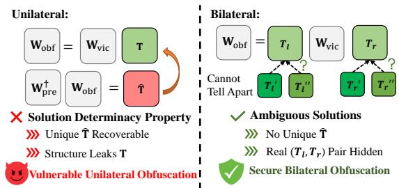
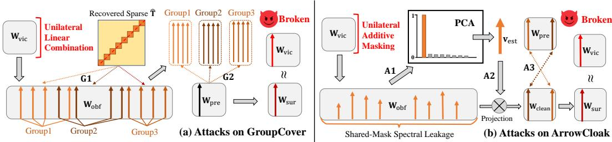
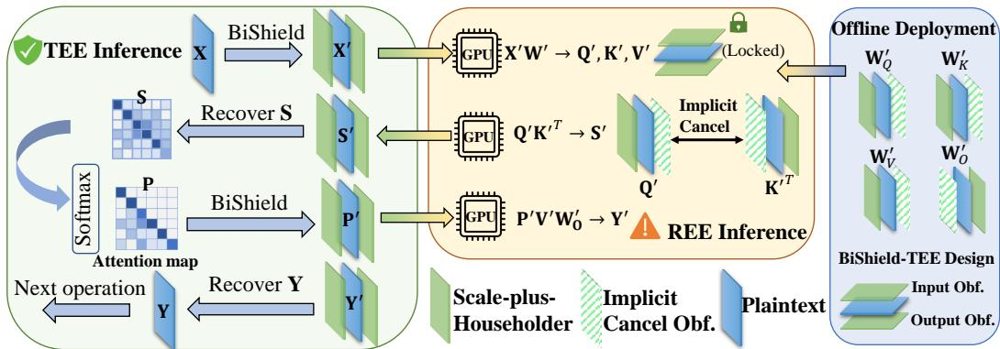
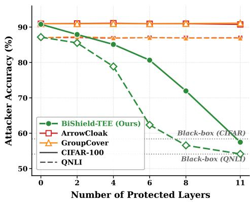
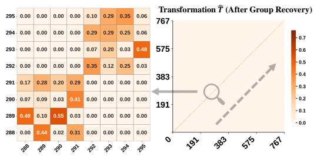
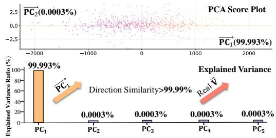
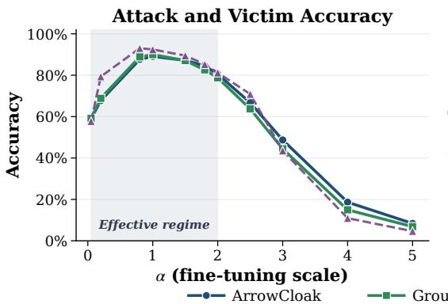
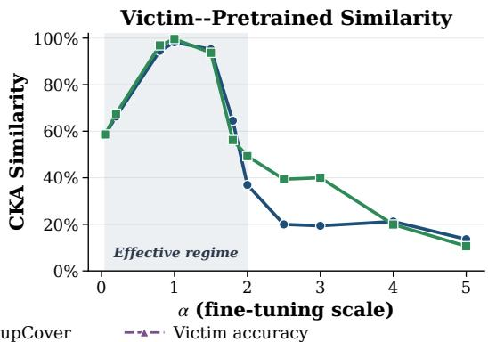

# BiShield-TEE: On the (In-)Security of Unilateral Weight Obfuscation in On-Device TEE-Shielded LLM Partition

Zhiyuan Wang1,2 Yuezhi Zhou1,2∗ Ziqi Zhang3 Zhu Zhang1 Zhixing Tan2∗ Yongheng Deng1

1Department of Computer Science and Technology,

Beijing National Research Center for Information Science and Technology, Tsinghua University, Beijing, China

2Zhongguancun Laboratory, Beijing, China 3University of Illinois Urbana-Champaign, IL, USA

{wzycs24,zhuzhang24}@mails.tsinghua.edu.cn zhouyz@mail.tsinghua.edu.cn ziqi24@illinois.edu zxtan@zgclab.edu.cn dengyh1013@gmail.com

## Abstract

On-device deployment of large language models (LLMs) is increasingly adopted due to latency and privacy requirements, but exposes proprietary models to reverse engineering and intellectual property theft. Trusted Execution Environments (TEEs) provide hardware-enforced isolation for on-device inference, yet most TEE-based parameter obfuscation relies on unilateral matrix transformations that obfuscate only output side. We identify a vulnerability in this design, termed the Solution Determinacy Property (SDP): the obfuscation secret is uniquely determined, exposing the structure of the true key and enabling attackers to break the protection. Under our attacks, representative methods GROUPCOVER and ARROWCLOAK are reduced to negligible protection, with attack accuracy reaching over 2.4× the full-shielding black-box baseline and recovering near-complete model functionality. To address this vulnerability, we propose BISHIELD-TEE, a bilateral framework that induces Ambiguous Solutions through joint obfuscation of input and output dimensions, hiding the true key among many equally valid candidates. Experiments across diverse models and datasets show that BISHIELD-TEE confines attack accuracy to the full-shielding black-box baseline, while achieving higher inference efficiency than prior methods on real hardware. Our code is available at https://github.com/laduiw/BiShield-TEE.

## 1 Introduction

The deployment of large language models (LLMs) is increasingly shifting from cloud servers to edge devices, particularly in latency-sensitive scenarios [1, 2, 3]. While this transition reduces response time and enhances user privacy by enabling local processing [4, 5, 6], it also exposes high-value models to untrusted and potentially adversarial environments. Unlike cloud-based services where models operate as black boxes behind APIs, on-device deployment requires storing and executing models locally, making them vulnerable to white-box attacks [7, 8, 9]. Given that high-performance models represent valuable intellectual property [10, 11, 12], protecting them in on-device settings becomes critical [13, 14].

Trusted Execution Environments (TEEs) provide hardware-enforced isolation to protect sensitive computations even against privileged adversaries [15, 16, 17, 18]. However, limited computational resources and memory in edge TEEs [15, 19, 20] make full model execution impractical. Existing defenses thus adopt a partitioned execution paradigm [20, 21, 22, 23, 24, 25], offloading computationintensive layers to untrusted accelerators while keeping lightweight recovery logic inside the TEE. A common design is to obfuscate each linear layer’s weights W with a secret invertible transformation T sampled inside the TEE, deploying $\mathbf { W } _ { \mathrm { o b f } } = \mathbf { W } \mathbf { T }$ on the GPU. At inference, the GPU computes $\mathbf { Y } _ { \mathrm { o b f } } = \mathbf { X } \mathbf { W } _ { \mathrm { o b f } } .$ and the TEE recovers the true output via $\mathbf { Y } = \mathbf { Y } _ { \mathrm { o b f } } \mathbf { T } ^ { - 1 } = \mathbf { X } \mathbf { W }$ . Existing schemes explore various designs of T, seeking to ensure that the obfuscated parameters leak no information about the underlying private weights.

However, current approaches share a common paradigm of unilateral obfuscation, reducing to right-multiplication by a secret T. We identify a fundamental vulnerability of this paradigm, termed SDP: The secret T admits a unique, high-precision estimate Tˆ that inherits its structure and enables successful reconstruction, provided the victim is fine-tuned from a public pre-trained model.

Exploiting this structure leakage in practice is non-trivial. Existing attacks [22] succeed on per-vector obfuscation [21, 23, 24, 25] through vector direction similarity, where Tˆ takes a simple diagonal or permutation form. But these attacks are ineffective against the more elaborate Tˆ produced by GROUPCOVER (ICML’24) [20] and ARROWCLOAK (USENIX Security’25) [22]. We design two dedicated attacks that exploit specific structural patterns in Tˆ : for GROUPCOVER, Tˆ exhibits a block-diagonal structure that we recover through a clustering procedure based on energy-distribution similarity; for ARROWCLOAK, Tˆ admits a low-rank structure that manifests as a spectral anomaly in $\mathbf { W _ { \mathrm { o b f } } }$ , which we recover via Principal Component Analysis (PCA). Both deliver the first successful attack of these schemes, recovering model functionality nearly identical to the originals.

To prevent the structural leakage exploited by SDP, we propose BISHIELD-TEE, a bilateral framework that obfuscates both sides of the weight matrix. We show that this design avoids SDP and induces Ambiguous Solutions, yielding an ill-posed system where the true keys are not uniquely recoverable.

We conduct extensive evaluations across diverse models and tasks, including ViT [26], GPT-2 [27], and Llama3.2 [28]. Our results expose the fragility of existing defenses: attacks on GROUPCOVER and ARROWCLOAK elevate attack accuracy to 2.44× the black-box baseline, effectively recovering model functionality. By contrast, BISHIELD-TEE confines attack accuracy to the black-box level. Beyond stronger security, the bilateral design also yields favorable efficiency, running 1.70× and 1.46× faster than GROUPCOVER and ARROWCLOAK, respectively.

We summarize our contributions as follows:

• We identify the SDP, a common vulnerability in unilateral obfuscation, and devise effective attacks on GROUPCOVER and ARROWCLOAK. By exploiting the structural leakage in each scheme, our attacks recover model functionality close to the white-box baseline.

• We propose BISHIELD-TEE, a bilateral framework that obfuscates input and output sides, providing strong protection while remaining efficient for Transformer architectures.

• We empirically show that unilateral defenses degrade to near-white-box security, whereas BISHIELD-TEE achieves strong protection with improved inference latency on real devices.

## 2 Related Work

## 2.1 On-device Model Stealing

Deploying a proprietary model $M _ { \mathrm { v i c } }$ on edge devices exposes it to model stealing and IP leakage [5, 29]. We assume the adversary can access all information outside the TEE. With white-box access to unprotected parameters, the adversary directly extracts weights to build a high-fidelity surrogate $M _ { \mathrm { s u r } }$ [22], whereas under full-shielding black-box access, $M _ { \mathrm { v i c } }$ is fully protected inside the TEE and the adversary has no information about its parameters [30]. Our defense aims to reduce adversarial capability from white-box to black-box, limiting the effectiveness of $M _ { \mathrm { s u r } }$

Table 1: Comparative analysis of TEE-based weight obfuscation schemes.
<table><tr><td>Paradigm</td><td>Method</td><td>Venue</td><td>Mechanism</td><td>SDP-free</td></tr><tr><td rowspan="4">Unilateral Per-vector</td><td>SOTER [21]</td><td>ATC&#x27;22</td><td>Per-vector scaling</td><td>X</td></tr><tr><td>ShadowNet [23]</td><td>S&amp;P&#x27;23</td><td>Per-vector scaling + permutation</td><td>X</td></tr><tr><td>TLG [24]</td><td>MM&#x27;24</td><td>Per-vector permutation</td><td>x</td></tr><tr><td>TSQP [25]</td><td>S&amp;P&#x27;25</td><td>Quantized per-vector scaling</td><td>x</td></tr><tr><td>Unilateral mul.</td><td>GROUPCOVER [20]</td><td>ICML&#x27;24</td><td>Group columns, mix within group</td><td>x</td></tr><tr><td>Unilateral add.</td><td>ARROWCLOAK [22]</td><td>USENIX Sec’25</td><td>Add shared mask to all columns</td><td>x</td></tr><tr><td>Bilateral (ours)</td><td>BISHIELD-TEE</td><td>this work</td><td>Joint input-output obfuscation</td><td>√</td></tr></table>

## 2.2 Trusted Execution Environment

TEE is a secure, hardware-enforced area within a processor that protects code and data integrity and confidentiality from the host OS [31]. A prominent implementation, Intel Software Guard Extensions (SGX) [15], provides a private memory region called an enclave in which contents are encrypted by the CPU and isolated by hardware from external access. Crucially, SGX supports remote attestation [32], enabling a remote party to verify the inference code’s integrity before provisioning proprietary model weights. Following prior work [9, 14, 20, 21, 22, 23], BISHIELD-TEE adopts the TEE as the root of trust to securely store obfuscation keys and execute lightweight de-obfuscation, while offloading the bulk of computation to untrusted accelerators.

## 2.3 Partitioned Execution in TEE-Assisted Inference

Since executing modern LLMs entirely inside TEEs is impractical [33, 34], prior work adopts a partitioned paradigm [9, 20, 21, 22, 23] that offloads heavy matrix multiplications to untrusted GPUs while keeping key management inside the TEE. A common design obfuscates weights by right-multiplication with a secret T acting only on the output side of parameter W, with T typically given a special structure so that $\mathbf { T } ^ { - 1 }$ is cheap to apply inside the TEE.

These unilateral schemes differ in how they instantiate T, and Table 1 groups them into three types. The first applies per-vector obfuscation such as random scaling or permutation, which is insecure under fine-tuning from public pre-trained checkpoints [9, 19, 22, 35]. The second uses unilateral multiplicative obfuscation (e.g., GROUPCOVER [20]), mixing output features within groups. The third uses unilateral additive obfuscation (e.g., ARROWCLOAK [22]), adding a scaled shared mask to each column. All three remain unilateral, confining obfuscation to the output side of W. AMULET [36] also employs bilateral weight obfuscation, with its design centered on reducing TEE interactions during inference. Our work focuses on the SDP vulnerability of unilateral obfuscation and develops lightweight bilateral transformations to resist reconstruction attacks. For intermediate features, we follow prior work [37, 23] and use integrity verification and one-time pad (OTP) protection [37], with implementation details provided in Appendix H.

## 3 Threat Model

Scenario. Following prior TEE-based on-device inference settings [9, 20, 22, 24, 25], we consider a model owner deploying a proprietary model $M _ { v i c }$ to user-controlled devices with TEEs, where an obfuscated model $M _ { o b f }$ runs outside the TEE on the GPU while secrets and recovery logic remain inside TEE. The defender aims to reduce the adversary’s effective capability from white-box to black-box, ensuring any extracted surrogate $M _ { s u r }$ has substantially lower utility than $M _ { v i c } .$ . The attacker is a malicious device user with full control over $M _ { o b f }$ , runtime traces, and the software stack outside the TEE, and knows the defense mechanism but cannot access TEE-internal secrets.

Prior Knowledge. Following prior work and practical deployment settings [9, 20, 22, 25], we assume that $M _ { v i c }$ is fine-tuned from a publicly available pre-trained model $M _ { p r e }$ . The parameter reconstruction stage of our attack is query-free, relying solely on $W _ { p r e }$ and the obfuscated weights $W _ { o b f }$ . Queries to $M _ { v i c }$ are required only for downstream task adaptation (e.g., retraining the surrogate’s classification head), and the query budget is capped at less than 1% of the training data size, consistent with prior work [9, 14, 20, 22, 24].

## 4 Attacks on Unilateral Defenses

In this Section, we formalize SDP and instantiate concrete attacks on unilateral defenses.

Notation. We denote the weight matrices of the victim, obfuscated, and pre-trained models by ${ \bf W } _ { \mathrm { v i c } } , { \bf W } _ { \mathrm { o b f } }$ , and $\mathbf { W } _ { \mathrm { p r e } } .$ , respectively. The i-th column is denoted by $\mathbf { w } ^ { ( i ) }$ . Weight matrices are $\mathbf { W } \in \mathbb { R } ^ { d \times n }$ with input/output dimensions d and n, and features $\mathbf { X } \in \mathbb { R } ^ { l \times d }$ with sequence length l.

## 4.1 Solution Determinacy Property in Unilateral Obfuscation

Under partitioned TEE inference, outsourced computation is dominated by linear matrix multiplications [20, 21, 22, 23]. To preserve correctness, unilateral defenses apply a rightside transformation $\textbf { T } \in \ \mathbb { R } ^ { n \times n }$ to obtain $\mathbf { W } _ { \mathrm { o b f } } = \mathbf { W } _ { \mathrm { v i c } } \mathbf { T }$ (Figure 1). Since the victim is fine-tuned from a public checkpoint, we can write $\mathbf { W } _ { \mathrm { v i c } } = \mathbf { W } _ { \mathrm { p r e } } ^ { } + \Delta$ with a small fine-tuning increment $\pmb { \Delta }$ . The adversary can therefore approximately solve for T from the public $\mathbf { W } _ { \mathrm { p r e } }$ and the observed $\mathbf { W _ { \mathrm { o b f } } }$ via leastsquares:

  
Figure 1: Comparison of unilateral and bilateral obfuscation.

$$
\hat { \mathbf { T } } = \arg \operatorname* { m i n } _ { \mathbf { T } } \| \mathbf { W } _ { \mathrm { o b f } } - \mathbf { W } _ { \mathrm { p r e } } \mathbf { T } \| _ { F } ^ { 2 } = \mathbf { W } _ { \mathrm { p r e } } ^ { \dagger } \mathbf { W } _ { \mathrm { o b f } } \approx ( \mathbf { I } + \mathbf { W } _ { \mathrm { p r e } } ^ { \dagger } \mathbf { \Delta } \mathbf { \Delta } \mathbf { \Delta } ) \mathbf { T } ,\tag{1}
$$

where $\mathbf { W } _ { \mathrm { p r e } } ^ { \dagger }$ denotes the Moore–Penrose pseudoinverse. Since $\pmb { \Delta }$ is small, $\hat { \mathbf { T } }$ stays close to $\mathbf { T }$ and preserves its structural properties. A dense random T would leave Tˆ devoid of exploitable structure, but is impractical inside TEEs since applying $\mathbf { T } ^ { - 1 }$ during recovery becomes prohibitively expensive. Existing defenses therefore impose structural constraints on $\mathbf { T } \left( \mathbf { e . g } \right.$ ., sparsity or low-rank structure), which are inherited by $\hat { \mathbf { T } }$ and allow the adversary to recover the true transformation from its structure. We refer to this inherent vulnerability as SDP.

SDP directly explains why the per-vector schemes [21, 23, 24, 25] in Table 1 are insecure: their permutation- or scaling-based obfuscation causes $\hat { \mathbf { T } }$ to concentrate at the true permutation or scaling locations, so the key can be read off by selecting the maximum in each row or column. Prior attacks [22] also succeed through vector direction similarity, but cannot extend to GROUPCOVER or ARROWCLOAK, whose designs further obfuscate the column directions and eliminate the direction similarity.

We close this gap by exploiting the structures of $\hat { \mathbf { T } }$ to attack GROUPCOVER and ARROWCLOAK. Since these structures take different forms in each scheme, we design two dedicated attacks, illustrated in Figure 2, that reconstruct the protected weights. The original defense details of GROUPCOVER and ARROWCLOAK are deferred to Appendix A.

## 4.2 Breaking Unilateral Multiplicative Schemes: GROUPCOVER Case Study

GROUPCOVER [20] partitions the output columns into $n / s$ groups of size s, applies an independent random $s \times s$ linear mixing within each group, and permutes columns to hide group membership, yielding a block-diagonal transformation under random row and column permutations:

$$
\mathbf { T } _ { \mathrm { G R O U P C O V E R } } = \mathbf { \Pi } \mathbf { { I } } _ { 1 } { \mathrm { ~ b l o c k d i a g } } ( \mathbf { T } _ { 1 } , \dots , \mathbf { T } _ { n / s } ) \mathbf { \Pi } \mathbf { { I } } _ { 2 } , \quad \mathbf { T } _ { i } \in \mathbb { R } ^ { s \times s } .\tag{2}
$$

The least-squares estimate $\hat { \mathbf { T } }$ inherits this block-sparse structure: each column concentrates its mass on a small subset of s indices, and the group size s can be inferred from the number of dominant entries per row or column. We exploit this leakage via a two-stage attack shown in Figure 2(a).

G1: Group recovery. Columns belonging to the same group share a common set of s dominant indices in $\hat { \mathbf { T } }$ , while entries outside the group are close to zero. Starting from each unassigned column, we identify the $s - 1$ columns with the greatest overlap in the row indices of their largest-magnitude entries and assign them to the same group. Repeating this process until all columns are assigned recovers the grouping $\{ G _ { 1 } , \dots , G _ { n / s } \}$

  
Figure 2: Attacks against unilateral model protection schemes. (a) Attack on GROUPCOVER. Step G1 recovers the block-diagonal grouping from Tˆ . Step G2 reconstructs $\mathbf { W } _ { \mathrm { v i c } }$ within each group. (b) Attack on ARROWCLOAK. Step A1 extracts the shared mask direction via PCA. Step A2 denoises $\mathbf { W } _ { \mathrm { o b f } }$ via orthogonal projection. Step A3 restores $\mathbf { W } _ { \mathrm { v i c } }$ via least-squares reconstruction.

G2: Parameter reconstruction. Given the recovered groups, the global reconstruction problem decomposes into independent low-dimensional subproblems. For each column of $\mathbf { W } _ { \mathrm { p r e } } .$ , we identify candidate groups in $\bar { \mathbf { W } } _ { \mathrm { o b f } }$ from the row indices of its largest-magnitude entries, perform local leastsquares reconstruction within each group, and select the result with the highest cosine similarity. As formally proved in Appendix B, the parameter recovery error is only an $s / d$ fraction of that in the black-box setting; with the default $s = 4$ and matrix dimension d, we have $s \ll d ,$ , leading to highly accurate recovery.

## 4.3 Breaking Unilateral Additive Scheme: ARROWCLOAK Case Study

ARROWCLOAK [22] applies per-column scaling controlled by p and a column permutation Π, together with an additive mask shared across all columns, where the direction of the mask is determined by a secret coefficient vector k and its per-column weights are given by q:

$$
\mathbf { T } _ { \mathrm { A R R o w C L O A K } } = \big ( \mathrm { d i a g } ( \mathbf { p } ) + \mathbf { k q } ^ { \top } \big ) \mathbf { I I } , \quad \mathbf { p } , \mathbf { k } , \mathbf { q } \in \mathbb { R } ^ { n } .\tag{3}
$$

This transformation injects a shared vector $\mathbf { v } : = \mathbf { W } _ { \mathrm { v i c } } \mathbf { k } \in \mathbb { R } ^ { d }$ into every column of $\mathbf { W _ { \mathrm { o b f } } }$ , scaled by a per-column factor. The resulting low-rank structure exposes v as a dominant direction in $\mathbf { W _ { \mathrm { o b f } } }$ which we exploit via a three-step attack as shown in Figure 2(b).

A1: Mask extraction. Since the shared mask dominates the variance of $\mathbf { W _ { \mathrm { o b f } } } ,$ , we estimate its direction via PCA:

$$
\mathbf { v } _ { \mathrm { e s t } } \approx \mathrm { P C A } _ { 1 } ( \mathbf { W } _ { \mathrm { o b f } } ) .\tag{4}
$$

A2: Denoised alignment. The additive term distorts column-wise similarity, making direct matching unreliable. We remove this component by projecting onto the orthogonal complement of $\mathbf { v } _ { \mathrm { e s t } }$

$$
\mathbf { W } _ { \mathrm { c l e a n } } = \mathbf { W } _ { \mathrm { o b f } } - \mathbf { v } _ { \mathrm { e s t } } ( \mathbf { v } _ { \mathrm { e s t } } ^ { \top } \mathbf { W } _ { \mathrm { o b f } } ) ,\tag{5}
$$

and recover the column permutation by computing cosine similarities between normalized columns of $\mathbf { W } _ { \mathrm { c l e a n } }$ and $\mathbf { W } _ { \mathrm { p r e } }$

A3: Parameter reconstruction. With column alignment established, each column is reconstructed by solving a least-squares problem over the obfuscated weights and the estimated mask:

$$
\mathbf { w } _ { \mathrm { s u r } } ^ { ( i ) } = \hat { \alpha } _ { i } \mathbf { w } _ { \mathrm { o b f } } ^ { ( i ) } + \hat { \beta } _ { i } \mathbf { v } _ { \mathrm { e s t } } .\tag{6}
$$

Appendix C provides additional details of our attacks against GROUPCOVER and ARROWCLOAK, including pseudocode, diagnostic visualizations and complexity analysis.

## 5 Design of BISHIELD-TEE

Since the above attacks all exploit SDP, BISHIELD-TEE breaks it by applying bilateral obfuscation over both row and column spaces. For a weight matrix $\mathbf { W } _ { \mathrm { v i c } } \in \mathbb { R } ^ { d \times n }$ , the protected form is

$$
{ \bf W } _ { \mathrm { o b f } } = { \bf T } _ { l } { \bf W } _ { \mathrm { v i c } } { \bf T } _ { r } , \quad { \bf T } _ { l } \in \mathbb { R } ^ { d \times d } , ~ { \bf T } _ { r } \in \mathbb { R } ^ { n \times n } ,
$$

where $\mathbf { T } _ { l } = \mathbf { H } _ { l } \mathbf { D } _ { l }$ and $\mathbf { T } _ { r } = \mathbf { D } _ { r } \mathbf { H } _ { r }$ . Each D is a diagonal scaling matrix that perturbs the magnitude of every dimension, and each H is a Householder matrix [38],

$$
\mathbf { H } = \mathbf { I } - 2 \mathbf { v } \mathbf { v } ^ { \top } , \ \| \mathbf { v } \| = 1 ,
$$

that perturbs directional structure. Since Householder matrices are involutory $( \mathbf { H } ^ { - 1 } = \mathbf { H } )$ , the inverses simplify to $\mathbf { T } _ { l } ^ { - 1 } = \mathbf { D } _ { l } ^ { - 1 } \mathbf { H } _ { l }$ and ${ \bf T } _ { r } ^ { - 1 } = { \bf H } _ { r } { \bf D } _ { r } ^ { - 1 }$ , which can be computed efficiently inside the TEE. We then demonstrate this framework on linear layers and self-attention.

## 5.1 Linear Layers

By applying the inverse transformation to the right-side of the input $\textbf { X } \in \ \mathbb { R } ^ { l \times d }$ , the left-side obfuscation of W is implicitly cancelled. During inference, X is preprocessed inside the TEE as

$$
\mathbf { X } ^ { \prime } = \mathbf { T } _ { m } \mathbf { X } \mathbf { T } _ { l } ^ { - 1 } = \mathbf { T } _ { m } \mathbf { X } \mathbf { D } _ { l } ^ { - 1 } \mathbf { H } _ { l } .
$$

where $\mathbf { T } _ { m } = \mathbf { H } _ { m } \mathbf { D } _ { m }$ is sampled per forward pass inside the TEE as an independent scale-plus-Householder transformation that protects intermediate activations. GPU execution then yields

$$
\mathbf { Y } ^ { \prime } = \mathbf { X } ^ { \prime } \mathbf { W } _ { \mathrm { o b f } } = \mathbf { T } _ { m } \mathbf { X } \left( \mathbf { D } _ { l } ^ { - 1 } \mathbf { H } _ { l } \mathbf { H } _ { l } \mathbf { D } _ { l } \right) \mathbf { W } _ { \mathrm { v i c } } \mathbf { T } _ { r } = \mathbf { T } _ { m } \mathbf { Y } \mathbf { T } _ { r } .
$$

The TEE recovers the output via ${ \bf Y } = { \bf T } _ { m } ^ { - 1 } { \bf Y } ^ { \prime } { \bf T } _ { r } ^ { - 1 }$

## 5.2 Self-Attention

Figure 3 illustrates the BISHIELD-TEE for self-attention. Standard self-attention [39] computes

$$
\begin{array} { r } { \begin{array} { c c } { \mathbf { Q } = \mathbf { X } \mathbf { W } _ { Q } , \mathbf { K } = \mathbf { X } \mathbf { W } _ { K } , \mathbf { V } = \mathbf { X } \mathbf { W } _ { V } , } \\ { \mathbf { S } = \mathbf { Q } \mathbf { K } ^ { \top } , \mathbf { P } = \mathrm { s o f t m a x } \left( \frac { \mathbf { s } } { \sqrt { d } } \right) , \mathbf { Y } = \mathbf { P } \mathbf { V } \mathbf { W } _ { O } . } \end{array} } \end{array}
$$

Each projection matrix is obfuscated bilaterally as $\mathbf { W } _ { Q } ^ { \prime } = \mathbf { T } _ { Q } ^ { l } \mathbf { W } _ { Q } \mathbf { T } _ { Q } ^ { r }$ . With runtime preprocessing $\mathbf { X } ^ { \prime } = \mathbf { T } _ { \cal Q } \mathbf { X } ( \mathbf { T } _ { \cal Q } ^ { l } ) ^ { - 1 }$ , we obtain

$$
\mathbf { Q } ^ { \prime } = \mathbf { T } _ { Q } \mathbf { Q } \mathbf { T } _ { Q } ^ { r } .
$$

Similarly, the transformed projections for keys and values are $\mathbf { K } ^ { \prime } = \mathbf { T } _ { K } \mathbf { K } \mathbf { T } _ { K } ^ { r }$ and $\mathbf { V } ^ { \prime } = \mathbf { T } _ { V } \mathbf { V } \mathbf { T } _ { V } ^ { r }$ By coupling the two right-side keys via $( \mathbf { T } _ { K } ^ { r } ) ^ { \top } = ( \mathbf { T } _ { Q } ^ { r } ) ^ { - 1 }$ , they cancel implicitly in the dot product:

$$
\mathbf { S } ^ { \prime } = \mathbf { Q } ^ { \prime } \mathbf { K } ^ { \prime \top } = \mathbf { T } _ { Q } \mathbf { Q } \mathbf { K } ^ { \top } \mathbf { T } _ { K } ^ { \top } = \mathbf { T } _ { Q } \mathbf { S } \mathbf { T } _ { K } ^ { \top } .
$$

The TEE restores $\mathbf { S } = \mathbf { T } _ { Q } ^ { - 1 } \mathbf { S } ^ { \prime } ( \mathbf { T } _ { K } ^ { \top } ) ^ { - 1 }$ , applies softmax to obtain P, and re-obfuscates as $\mathbf { P } ^ { \prime } =$ $\mathbf { T } _ { P } \mathbf { P } \mathbf { T } _ { V } ^ { - 1 }$ . With $\mathbf { W } _ { O } ^ { \prime } = ( \mathbf { T } _ { V } ^ { r } ) ^ { - 1 } \mathbf { W } _ { O } \mathbf { T } _ { O }$ , the $\mathbf { T } _ { V } ^ { r }$ factors cancel implicitly:

$$
\begin{array} { r } { \mathbf { Y } ^ { \prime } = \mathbf { P } ^ { \prime } \mathbf { V } ^ { \prime } \mathbf { W } _ { O } ^ { \prime } = \mathbf { T } _ { P } \mathbf { Y } \mathbf { T } _ { O } . } \end{array}
$$

and the TEE recovers $\mathbf { Y } = \mathbf { T } _ { P } ^ { - 1 } \mathbf { Y } ^ { \prime } \mathbf { T } _ { O } ^ { - 1 }$

  
Figure 3: Overview of BISHIELD-TEE for self-attention layers.

## 5.3 Efficiency and Security Analysis

TEE-side computation is limited to Householder and scale transformations, while dense matrix multiplications are offloaded to GPUs. Since applying a Householder matrix reduces to two matrixvector products, the recovery overhead remains low. The number of TEE transitions is also unchanged from unilateral schemes [20, 22], since both unilateral and bilateral schemes share the same workflow: obfuscation is applied before offloading inputs and reversed once results return to the TEE.

From a security perspective, bilateral obfuscation turns key recovery into an ill-posed problem: given $\mathbf { W } _ { \mathrm { o b f } } = \mathbf { T } _ { l } \mathbf { W } _ { \mathrm { v i c } } \mathbf { \bar { T } }$ and a pre-trained model, a continuum of scale-plus-Householder pairs remain observationally indistinguishable up to the fine-tuning slack. This set of Ambiguous Solutions conceals the genuine keys among many equally valid candidates. Whereas unilateral defenses allow the adversary to readily obtain a structurally constrained approximation of the true key, bilateral obfuscation makes such recovery substantially harder. A formal analysis is provided in Appendix D.

## 6 Experiments

To evaluate the effectiveness of our approach, we focus on the following key questions:

• RQ1: Are representative unilateral defenses secure against our reconstruction attacks?

• RQ2: Can bilateral design withstand the same or more adaptive attacks?

• RQ3: How efficient is bilateral protection on real-world hardware?

## 6.1 Experimental Setup

Models and Datasets. We evaluate on five representative architectures spanning vision and language tasks: ViT-Base, ViT-Large, GPT2-Base, Llama3.2-1B and Llama3.2-3B. For vision tasks, ViT models are evaluated on CIFAR-10, CIFAR-100 [40], and Food-101 [41]. For NLP, GPT2-Base is evaluated on four GLUE [42] tasks, and Llama3.2-1B and Llama3.2-3B are evaluated on both GSM8K [43] and IFEval [44] to assess mathematical reasoning and instruction-following capabilities.

Baselines and Settings. The white-box baseline with full plaintext access and the black-box baseline with pre-trained weight substitution represent the upper and lower bounds of attacker capability, respectively. To enable comparison across tasks with different baseline difficulties, we additionally report Rel. Black, the ratio of attack accuracy to the black-box baseline. Values close to 1× indicate that the adversary is reduced to the black-box level, while large values indicate that protection has effectively failed. For Llama3.2, surrogate models are evaluated with lm-evaluation-harness [45]. We focus on GROUPCOVER and ARROWCLOAK as representative unilateral schemes, and additionally include TLG [24] as a per-vector obfuscation scheme in Table 1, though this category has already been broken by prior work [22]. Further details on the experimental pipeline, hyperparameters, and implementation are provided in Appendix E.

## 6.2 Attack Performance

Table 2 reports attack accuracy across all evaluated models and datasets. TLG exhibits security vulnerabilities, consistent with prior findings [22]. More importantly, our attack also reduces GROUP-COVER and ARROWCLOAK, the stronger unilateral schemes, to near white-box behaviour: their average Rel. Black ratio of 2.44× closely matches the white-box bound at 2.49×. The gap to the white-box bound stays small across vision, language understanding, and reasoning tasks, indicating that the leakage we exploit is intrinsic to unilateral obfuscation.

Figure 4 further confirms that attack accuracy against GROUPCOVER and ARROWCLOAK stays high regardless of the number of protected layers, since each layer is compromised independently and additional protected layers introduce no compounding noise.

Answer to RQ1: Our reconstruction attacks substantially weaken both GROUPCOVER and ARROWCLOAK, increasing the attack accuracy by 2.44× over the black-box baseline.

Table 2: Attack performance against unilateral defenses. We report our attack accuracy and its ratio to the black-box baseline (Rel. Black). Higher values indicate failed protection (closer to no-shield white-box); lower values indicate effective defense (closer to full-shielding black-box).
<table><tr><td rowspan="2">Model</td><td rowspan="2">Dataset</td><td colspan="2">TLG</td><td colspan="2">GROUPCOVER</td><td colspan="2">ARROWCLOAK</td><td colspan="2">White-box</td><td rowspan="2">Black-box</td></tr><tr><td>Our Attack</td><td>Rel. Black</td><td>Our Attack</td><td>Rel. Black</td><td>Our Attack</td><td>Rel. Black</td><td>Acc.</td><td>Rel. Black</td></tr><tr><td rowspan="3">ViT-Base</td><td>CIFAR-10</td><td>98.4%</td><td>1.55×</td><td>98.4%</td><td>1.55×</td><td>98.5%</td><td>1.55×</td><td>98.1%</td><td>1.55×</td><td>63.4%</td></tr><tr><td>CIFAR-100</td><td>90.5%</td><td>1.52×</td><td>90.6%</td><td>1.52×</td><td>90.0%</td><td>1.51×</td><td>90.9%</td><td>1.52×</td><td>59.7%</td></tr><tr><td>FOOD-101</td><td>87.9%</td><td>1.49×</td><td>85.6%</td><td>1.45×</td><td>84.9%</td><td>1.43×</td><td>83.4%</td><td>1.41×</td><td>59.2%</td></tr><tr><td rowspan="2">ViT-Large</td><td>CIFAR-100</td><td>91.8%</td><td>1.33×</td><td>91.8%</td><td>1.33×</td><td>91.1%</td><td>1.32×</td><td>91.6%</td><td>1.33×</td><td>68.8%</td></tr><tr><td>FOOD-101</td><td>88.9%</td><td>1.36×</td><td>86.9%</td><td>1.33×</td><td>85.9%</td><td>1.32×</td><td>85.5%</td><td>1.31×</td><td>65.3%</td></tr><tr><td rowspan="4">GPT2-Base</td><td>SST2</td><td>92.1%</td><td>1.46×</td><td>92.1%</td><td>1.46×</td><td>92.6%</td><td>1.47×</td><td>92.4%</td><td>1.47×</td><td>63.0%</td></tr><tr><td>QQP</td><td>88.1%</td><td>1.34×</td><td>88.1%</td><td>1.34×</td><td>87.9%</td><td>1.34×</td><td>88.1%</td><td>1.34×</td><td>65.6%</td></tr><tr><td>QNLI</td><td>87.4%</td><td>1.63×</td><td>87.1%</td><td>1.62×</td><td>87.0%</td><td>1.62×</td><td>86.7%</td><td>1.61×</td><td>53.7%</td></tr><tr><td>MNLI</td><td>80.8%</td><td>1.69×</td><td>80.5%</td><td>1.69×</td><td>80.4%</td><td>1.69×</td><td>80.8%</td><td>1.69×</td><td>47.7%</td></tr><tr><td rowspan="2">Llama3.2-1B</td><td>GSM8K</td><td>34.0%</td><td>5.08×</td><td>31.8%</td><td>4.75×</td><td>30.7%</td><td>4.58×</td><td>35.5%</td><td>5.30×</td><td>6.7%</td></tr><tr><td>IFEVAL</td><td>58.7%</td><td>4.85×</td><td>55.5%</td><td>4.59×</td><td>56.7%</td><td>4.69×</td><td>54.6%</td><td>4.51×</td><td>12.1%</td></tr><tr><td rowspan="2">Llama3.2-3B</td><td>GSM8K</td><td>64.2%</td><td>2.32×</td><td>61.6%</td><td>2.22×</td><td>61.9%</td><td>2.23×</td><td>64.4%</td><td>2.32×</td><td>27.7%</td></tr><tr><td>IFEVAL</td><td>74.2%</td><td>7.07×</td><td>71.7%</td><td>6.83×</td><td>73.8%</td><td>7.03×</td><td>73.5%</td><td>7.00×</td><td>10.5%</td></tr><tr><td>Average</td><td></td><td>一</td><td>2.47×</td><td>一</td><td>2.44×</td><td>一</td><td>2.44×</td><td>一</td><td>2.49×</td><td>1.00×</td></tr></table>

## 6.3 Defense Effectiveness

Security against adaptive attacks. Reconstruction attacks designed for unilateral defenses cannot directly compromise bilateral protection, since recovering only one side leaves the other side missing. We therefore design four attack strategies tailored to the bilateral structure: parameter substitution as the black-box baseline, input-only and output-only recovery, and a joint adaptive attack that alternately fits one side’s key with the other fixed, minimizing the residual against $\mathbf { W } _ { \mathrm { p r e } }$ . As shown in Table 3, unilateral recovery causes catastrophic performance collapse: on Llama models, both Input-Only and Output-Only attacks leave the surrogate unable to produce coherent outputs. Even the Joint I&O attack yields negligible gains, and on most settings the strongest adversary is the parameter substitution baseline itself.

  
Figure 4: Attack accuracy vs. the number of protected layers on ViT-Base and GPT2-Base.

Security against the strongest unilateral defense. We adopt the most adversary-favorable comparison: for BISHIELD-TEE we report the highest attack accuracy across all adaptive strategies in Table 3, while for the unilateral baseline we take the lowest attack accuracy in Table 2. Even when comparing our worst case against strongest unilateral defense’s best case, Table 4 shows that BISHIELD-TEE reduces Rel. Black to an average of 1.00×, against 2.42× for the strongest unilateral defense. Its security compounds across layers, as layer-wise reconstruction errors accumulate and progressively diminish attacker capability as shown in Figure 4.

Utility preservation. Bilateral obfuscation should also preserve service quality for authorized users. Table 5 compares the original model with its BISHIELD-TEE obfuscated version. The matching accuracies across all datasets confirm that the TEE inverse transformations recover the original output and preserve authorized inference quality.

Answer to RQ2: BISHIELD-TEE remains secure against all adaptive attacks, consistently reducing adversaries to black-box level performance with Rel. Black averaging 1.00×.

Table 3: Adaptive attack accuracy against BISHIELD-TEE. Results cover input-only, outputonly, joint input&output recovery and parameter substitution attacks.
<table><tr><td rowspan="2">Model</td><td rowspan="2">Data</td><td colspan="4">Attack Strategies on BISHIELD-TEE</td></tr><tr><td>Input Only</td><td>Output Only</td><td>Joint I&amp;0</td><td>Param. Subst.</td></tr><tr><td rowspan="3">ViT-Base</td><td>C10</td><td>10.7%</td><td>14.8%</td><td>63.6%</td><td>63.4%</td></tr><tr><td>C100</td><td>1.7%</td><td>6.1%</td><td>59.7%</td><td>59.7%</td></tr><tr><td>F101</td><td>1.0%</td><td>4.5%</td><td>59.0%</td><td>59.2%</td></tr><tr><td rowspan="2">ViT-Large</td><td>C100</td><td>2.5%</td><td>6.7%</td><td>68.6%</td><td>68.8%</td></tr><tr><td>F101</td><td>1.5%</td><td>4.3%</td><td>65.3%</td><td>65.3%</td></tr><tr><td rowspan="4">GPT2-Base</td><td>SST2</td><td>56.2%</td><td>52.4%</td><td>63.0%</td><td>63.0%</td></tr><tr><td>QQP</td><td>63.5%</td><td>63.4%</td><td>65.6%</td><td>65.6%</td></tr><tr><td>QNLI</td><td>51.6%</td><td>50.5%</td><td>53.7%</td><td>53.7%</td></tr><tr><td>MNLI</td><td>34.3%</td><td>37.4%</td><td>47.7%</td><td>47.7%</td></tr><tr><td rowspan="2">Llama-1B</td><td>GSM8K</td><td>0.0%</td><td>0.0%</td><td>7.0%</td><td>6.7%</td></tr><tr><td>IFEVAL</td><td>0.0%</td><td>0.0%</td><td>12.0%</td><td>12.1%</td></tr><tr><td rowspan="2">Llama-3B</td><td>GSM8K</td><td>0.0%</td><td>0.0%</td><td>28.0%</td><td>27.7%</td></tr><tr><td>IFEVAL</td><td>0.0%</td><td>0.0%</td><td>9.4%</td><td>10.5%</td></tr></table>

Table 4: Defense effectiveness comparison. “Prior Best” is the strongest defense among the unilateral schemes in Table $2 ; \mathrm { \cdots O u r s ^ { \prime \prime } }$ is the highest attack accuracy achieved by the best adaptive attack strategy in Table 3.
<table><tr><td rowspan="2">Model</td><td rowspan="2">Dataset</td><td colspan="2">Prior Best</td><td colspan="2">Ours</td></tr><tr><td>Acc.</td><td>Rel.Black</td><td>Acc.</td><td>Rel.Black</td></tr><tr><td rowspan="3">ViT-Base</td><td>C10</td><td>98.4%</td><td>1.55×</td><td>63.6%</td><td>1.00×</td></tr><tr><td>C100</td><td>90.0%</td><td>1.51×</td><td>59.7%</td><td>1.00×</td></tr><tr><td>F101</td><td>84.9%</td><td>1.43×</td><td>59.2%</td><td>1.00×</td></tr><tr><td rowspan="2">ViT-Large</td><td>C100</td><td>91.1%</td><td>1.32×</td><td>68.8%</td><td>1.00×</td></tr><tr><td>F101</td><td>85.9%</td><td>1.32×</td><td>65.3%</td><td>1.00×</td></tr><tr><td rowspan="4">GPT2-Base</td><td>SST2</td><td>92.1%</td><td>1.46×</td><td>63.0%</td><td>1.00×</td></tr><tr><td>QQP</td><td>87.9%</td><td>1.34×</td><td>65.6%</td><td>1.00×</td></tr><tr><td>QNLI</td><td>87.0%</td><td>1.62×</td><td>53.7%</td><td>1.00×</td></tr><tr><td>MNLI</td><td>80.4%</td><td>1.69×</td><td>47.7%</td><td>1.00×</td></tr><tr><td rowspan="2">Llama-1B</td><td>GSM8K</td><td>30.7%</td><td>4.58×</td><td>7.0%</td><td>1.04×</td></tr><tr><td>IFEVAL</td><td>55.5%</td><td>4.59×</td><td>12.1%</td><td>1.00×</td></tr><tr><td rowspan="2">Llama-3B</td><td>GSM8K</td><td>61.6%</td><td>2.22×</td><td>28.0%</td><td>1.01×</td></tr><tr><td>IFEVAL</td><td>71.7%</td><td>6.83×</td><td>10.5%</td><td>1.00×</td></tr><tr><td>Average</td><td></td><td>一</td><td>2.42×</td><td>一</td><td>1.00×</td></tr></table>

Table 5: Authorized utility of BISHIELD-TEE. $\mathrm { \ddot { \hbar } { o r i g i n a l } \vec { \tau } }$ is the unprotected fine-tuned victim; “Obfuscated” is the same model under bilateral obfuscation.
<table><tr><td rowspan="2">Setting</td><td colspan="3">ViT-Base</td><td colspan="2">ViT-Large</td><td colspan="4">GPT2-Base</td><td colspan="2">Llama3.2-1B</td><td colspan="2">Llama3.2-3B</td></tr><tr><td>C10</td><td>C100</td><td>F101</td><td>C100</td><td>F101</td><td>SST2</td><td>QQP</td><td>QNLI</td><td>MNLI</td><td>GSM8K</td><td>IFEVAL</td><td>GSM8K</td><td>IFEVAL</td></tr><tr><td>Original</td><td>98.1%</td><td>90.9%</td><td>83.4%</td><td>91.6%</td><td>85.5%</td><td>92.4%</td><td>88.1%</td><td>86.7%</td><td>80.8%</td><td>35.5%</td><td>54.6%</td><td>64.4%</td><td>73.5%</td></tr><tr><td>Obfuscated</td><td>98.1%</td><td>90.9%</td><td>83.4%</td><td>91.6%</td><td>85.5%</td><td>92.4%</td><td>88.1%</td><td>86.7%</td><td>80.8%</td><td>35.5%</td><td>54.6%</td><td>64.4%</td><td>73.5%</td></tr></table>

## 6.4 Real-Device Performance

We benchmark end-to-end inference latency, with each experiment repeated 10 times after warm-up. As shown in Table 6, BISHIELD-TEE achieves the lowest latency on every model, delivering on average 1.70× and 1.46× speedups over GROUPCOVER and ARROWCLOAK. This advantage stems from a structural property of bilateral protection. Unilateral schemes apply obfuscation on only one side of the weight matrix and rely on more complex transformations but remain vulnerable to our attacks. In contrast, bilateral protection derives security from joint indistinguishability, allowing each side to remain lightweight while maintaining strong protection. Our results confirm that this design achieves both higher security and lower computational overhead. Further details on the real-device evaluation and recovery-cost analysis are provided in Appendix E.3.

Table 6: End-to-end inference latency (ms) across obfuscation schemes. “Mean Ratio” is the average slowdown relative to BISHIELD-TEE across all models.
<table><tr><td>Scheme</td><td>ViT-Base</td><td>ViT-Large</td><td>GPT2-Base</td><td>Llama3.2-1B</td><td>Llama3.2-3B</td><td>Mean Ratio</td></tr><tr><td>GROUPCOVER</td><td> $1 6 6 7 . 9 7 \pm 1 4 . 5 8$ </td><td> $4 7 7 0 . 4 5 \pm 3 0 . 7 4$ </td><td> $1 0 2 8 . 1 3 \pm 2 . 2 9$ </td><td> $3 9 9 5 . 2 8 \pm 1 3 . 0 6$ </td><td> $9 8 4 8 . 2 3 \pm 7 4 . 2 3$ </td><td>1.70×</td></tr><tr><td>ARROWCLOAK</td><td> $1 4 2 7 . 1 4 \pm 2 . 3 5$ </td><td> $4 2 3 4 . 4 6 \pm 2 1 . 9 9$ </td><td> $8 5 3 . 9 9 \pm 1 . 4 7$ </td><td> $3 3 8 6 . 3 8 \pm 2 4 . 3 1$ </td><td> $8 4 4 1 . 5 3 \pm 3 2 . 5 4$ </td><td>1.46×</td></tr><tr><td></td><td>BISHIELD-TEE 1073.74 ± 11.24</td><td>2918.47 ± 10.16 624.04 ± 11.54 2272.86 ± 21.10</td><td></td><td></td><td> $\mathbf { 5 1 4 8 . 1 0 \pm 7 . 2 2 }$ </td><td>1.00×</td></tr></table>

Answer to RQ3: BISHIELD-TEE achieves lower end-to-end inference latency than the two unilateral schemes across all five models.

## 7 Discussion

Availability of pre-trained models. Fine-tuning from public checkpoints has become a prevalent practice, making $\mathbf { W } _ { \mathrm { p r e } }$ widely available to the adversary. To assess how strongly our attacks rely on this resource, we vary the magnitude of the fine-tuning increment and measure the resulting surrogate–victim similarity. The attacks remain highly effective at similarity levels typical of standard fine-tuning, and their effectiveness only diminishes when the increment becomes sufficiently large to noticeably degrade the victim model itself. Full results are reported in Appendix F.

Ablation of Bilateral Transformation Components. We ablate diagonal scaling while retaining the bilateral Householder transformations. The Householder-only variant yields a mean Rel. Black of 1.34×, compared with 1.00× for the full design. Householder transformations introduce ambiguity in key recovery, but this alone leaves the attacker with measurable gains over the black-box baseline. Adding diagonal scaling largely removes these gains. The complete results and an analysis of both components are provided in Appendix G.

GPU TEEs. Hardware-backed GPU TEEs offer confidential computing in principle, but practical deployment on edge devices remains limited [46]. Existing solutions target server-class platforms such as NVIDIA H100 or require firmware modifications [47, 48, 49], both incompatible with commodity edge GPUs. BISHIELD-TEE sidesteps this dependence with a purely algorithmic design deployable on off-the-shelf hardware.

Limitations. Our real-device evaluation is limited to Intel SGX. Other TEEs such as Arm Trust-Zone [16] remain to be tested. The current design does not support quantized inference because INT8/INT4 scaling, clipping and rounding may disrupt the algebraic relations used to recover outputs. Our analysis does not consider side-channel attacks against the TEE [50, 51]. Model updates in on-device fine-tuning and federated learning may introduce additional privacy risks that remain for future study.

## 8 Conclusions

We identified SDP as a fundamental vulnerability shared across existing TEE-based unilateral obfuscation defenses. Building on this insight, we developed the first successful attacks against GROUPCOVER and ARROWCLOAK, boosting attack accuracy by over 2.4× relative to the black-box baseline and revealing an overlooked risk for TEE-based on-device model protection. To address the issue, we proposed BISHIELD-TEE, a bilateral framework that induces Ambiguous Solutions through joint input-output obfuscation, confining attack accuracy to the black-box baseline while delivering practical efficiency on real hardware. Together, these contributions establish a unified offensive-defensive perspective on TEE-based model protection and provide a deployable foundation for safeguarding proprietary models in real-world edge scenarios.

## Acknowledgments and Disclosure of Funding

This work is supported by the National Cyber Security-National Science and Technology Major Project (Grant No. 2025ZD1503603).

## References

[1] Ruiyang Qin, Dancheng Liu, Chenhui Xu, Zheyu Yan, Zhaoxuan Tan, Zhenge Jia, Amir Nassereldine, Jiajie Li, Meng Jiang, Ahmed Abbasi, Jinjun Xiong, and Yiyu Shi. Empirical Guidelines for Deploying LLMs onto Resource-constrained Edge Devices. ACM Transactions on Design Automation ofElectronic Systems, 30(5):1–58, September 2025.

[2] Liangxuan Wu, Yanjie Zhao, Chao Wang, Tianming Liu, and Haoyu Wang. A First Look at LLM-powered Smartphones. In Proceedings of the 39th IEEE/ACM International Conference on Automated Software Engineering Workshops, ASEW ’24, pages 208–217, New York, NY, USA, October 2024. Association for Computing Machinery.

[3] Yuan Chen, Zi-han Ding, Ziqin Wang, Yan Wang, Lijun Zhang, and Si Liu. Asynchronous Large Language Model Enhanced Planner for Autonomous Driving. In Aleš Leonardis, Elisa

Ricci, Stefan Roth, Olga Russakovsky, Torsten Sattler, and Gül Varol, editors, Computer Vision – ECCV 2024, pages 22–38, Cham, 2025. Springer Nature Switzerland.

[4] P. Ram Mohan Rao, S. Murali Krishna, and A. P. Siva Kumar. Privacy preservation techniques in big data analytics: a survey. Journal of Big Data, 5(1):33, September 2018.

[5] Asmita Mohanty, Gezheng Kang, Lei Gao, and Murali Annavaram. DistilLock: Safeguarding LLMs from Unauthorized Knowledge Distillation on the Edge, October 2025. arXiv:2510.16716.

[6] Taegyeong Lee, Zhiqi Lin, Saumay Pushp, Caihua Li, Yunxin Liu, Youngki Lee, Fengyuan Xu, Chenren Xu, Lintao Zhang, and Junehwa Song. Occlumency: Privacy-preserving Remote Deep-learning Inference Using SGX. In The 25th Annual International Conference on Mobile Computing and Networking, MobiCom ’19, pages 1–17, New York, NY, USA, October 2019. Association for Computing Machinery.

[7] Ziyu Liu, Yukui Luo, Shijin Duan, Tong Zhou, and Xiaolin Xu. Mirrornet: A tee-friendly framework for secure on-device dnn inference. In 2023 IEEE/ACM International Conference on Computer Aided Design (ICCAD), pages 1–9. IEEE, 2023.

[8] Jiahui Hou, Huiqi Liu, Yunxin Liu, Yu Wang, Peng-Jun Wan, and Xiang-Yang Li. Model Protection: Real-Time Privacy-Preserving Inference Service for Model Privacy at the Edge. IEEE Transactions on Dependable and Secure Computing, 19(6):4270–4284, November 2022.

[9] Ziqi Zhang, Chen Gong, Yifeng Cai, Yuanyuan Yuan, Bingyan Liu, Ding Li, Yao Guo, and Xiangqun Chen. No Privacy Left Outside: On the (In-)Security of TEE-Shielded DNN Partition for On-Device ML . In 2024 IEEE Symposium on Security and Privacy (SP), pages 3327–3345, Los Alamitos, CA, USA, May 2024. IEEE Computer Society.

[10] Yifan Yao, Jinhao Duan, Kaidi Xu, Yuanfang Cai, Zhibo Sun, and Yue Zhang. A survey on large language model (LLM) security and privacy: The Good, The Bad, and The Ugly. High-Confidence Computing, 4(2):100211, June 2024.

[11] Lixin Fan, Kam Woh Ng, Chee Seng Chan, and Qiang Yang. Deepipr: Deep neural network ownership verification with passports. IEEE Transactions on Pattern Analysis and Machine Intelligence, 44(10):6122–6139, 2022.

[12] Tribhuvanesh Orekondy, Bernt Schiele, and Mario Fritz. Knockoff nets: Stealing functionality of black-box models. In Proceedings of the IEEE/CVF conference on computer vision and pattern recognition, pages 4954–4963. IEEE Computer Society, 2019.

[13] Hanbo Huang, Yihan Li, Bowen Jiang, Bo Jiang, Lin Liu, Zhuotao Liu, Ruoyu Sun, and Shiyu Liang. A Middle Path for On-Premises LLM Deployment: Preserving Privacy Without Sacrificing Model Confidentiality. In Christos Christodoulopoulos, Tanmoy Chakraborty, Carolyn Rose, and Violet Peng, editors, Proceedings of the 2025 Conference on Empirical Methods in Natural Language Processing, pages 8332–8370, Suzhou, China, November 2025. Association for Computational Linguistics.

[14] Tong Sun, Bowen Jiang, Hailong Lin, Borui Li, Yixiao Teng, Yi Gao, and Wei Dong. Tensor-Shield: Safeguarding On-Device Inference by Shielding Critical DNN Tensors with TEE. In Proceedings ofthe 2025 ACM SIGSAC Conference on Computer and Communications Security, CCS ’25, pages 1008–1022, New York, NY, USA, November 2025. Association for Computing Machinery.

[15] Victor Costan and Srinivas Devadas. Intel SGX Explained, 2016. Publication info: Preprint.

[16] Sandro Pinto and Nuno Santos. Demystifying Arm TrustZone: A Comprehensive Survey. ACM Comput. Surv., 51(6):130:1–130:36, January 2019.

[17] AMD Sev-Snp. Strengthening vm isolation with integrity protection and more. White Paper, January, 53(2020):1450–1465, 2020.

[18] Huan Yang, Deyu Zhang, Yudong Zhao, Yuanchun Li, and Yunxin Liu. A first look at efficient and secure on-device llm inference against kv leakage. In Proceedings of the 19th Workshop on Mobility in the Evolving Internet Architecture, MobiArch ’24, page 13–18, New York, NY, USA, 2024. Association for Computing Machinery.

[19] Ziqi Zhang, Lucien K. L. Ng, Bingyan Liu, Yifeng Cai, Ding Li, Yao Guo, and Xiangqun Chen. Teeslice: slicing dnn models for secure and efficient deployment. In Proceedings of the 2nd ACM International Workshop on AI and Software Testing/Analysis, AISTA 2022, page 1–8, New York, NY, USA, 2022. Association for Computing Machinery.

[20] Zheng Zhang, Na Wang, Ziqi Zhang, Yao Zhang, Tianyi Zhang, Jianwei Liu, and Ye Wu. Group-Cover: A secure, efficient and scalable inference framework for on-device model protection based on TEEs. In Ruslan Salakhutdinov, Zico Kolter, Katherine Heller, Adrian Weller, Nuria Oliver, Jonathan Scarlett, and Felix Berkenkamp, editors, Proceedings ofthe 41st International Conference on Machine Learning, volume 235 of Proceedings ofMachine Learning Research, pages 59992–60003. PMLR, 21–27 Jul 2024.

[21] Tianxiang Shen, Ji Qi, Jianyu Jiang, Xian Wang, Siyuan Wen, Xusheng Chen, Shixiong Zhao, Sen Wang, Li Chen, Xiapu Luo, Fengwei Zhang, and Heming Cui. SOTER: Guarding blackbox inference for general neural networks at the edge. In 2022 USENIX Annual Technical Conference (USENIX ATC 22), pages 723–738, Carlsbad, CA, July 2022. USENIX Association.

[22] Pengli Wang, Bingyou Dong, Yifeng Cai, Zheng Zhang, Junlin Liu, Huanran Xue, Ye Wu, Yao Zhang, and Ziqi Zhang. Game of arrows: on the (in-)security of weight obfuscation for on-device tee-shielded llm partition algorithms. In Proceedings ofthe 34th USENIX Conference on Security Symposium, SEC ’25, USA, 2025. USENIX Association.

[23] Zhichuang Sun, Ruimin Sun, Changming Liu, Amrita Roy Chowdhury, Long Lu, and Somesh Jha. Shadownet: A secure and efficient on-device model inference system for convolutional neural networks. In 2023 IEEE Symposium on Security and Privacy (SP), pages 1596–1612. IEEE Computer Society, 2023.

[24] Qinfeng Li, Zhiqiang Shen, Zhenghan Qin, Yangfan Xie, Xuhong Zhang, Tianyu Du, Sheng Cheng, Xun Wang, and Jianwei Yin. TransLinkGuard: Safeguarding Transformer Models Against Model Stealing in Edge Deployment. In Proceedings of the 32nd ACM International Conference on Multimedia, MM ’24, pages 3479–3488, New York, NY, USA, October 2024. Association for Computing Machinery.

[25] Yu Sun, Gaojian Xiong, Jianhua Liu, Zheng Liu, and Jian Cui. TSQP: Safeguarding Real-Time Inference for Quantization Neural Networks on Edge Devices . In 2025 IEEE Symposium on Security and Privacy (SP), pages 2114–2132, Los Alamitos, CA, USA, May 2025. IEEE Computer Society.

[26] Alexey Dosovitskiy, Lucas Beyer, Alexander Kolesnikov, Dirk Weissenborn, Xiaohua Zhai, Thomas Unterthiner, Mostafa Dehghani, Matthias Minderer, Georg Heigold, Sylvain Gelly, Jakob Uszkoreit, and Neil Houlsby. An image is worth 16x16 words: Transformers for image recognition at scale. In 9th International Conference on Learning Representations, ICLR 2021, Virtual Event, Austria, May 3-7, 2021. OpenReview.net, 2021.

[27] Alec Radford, Jeffrey Wu, Rewon Child, David Luan, Dario Amodei, Ilya Sutskever, et al. Language models are unsupervised multitask learners. OpenAI blog, 1(8):9, 2019.

[28] Aaron Grattafiori, Abhimanyu Dubey, Abhinav Jauhri, Abhinav Pandey, Abhishek Kadian, Ahmad Al-Dahle, Aiesha Letman, Akhil Mathur, Alan Schelten, Alex Vaughan, et al. The llama 3 herd of models. arXiv preprint arXiv:2407.21783, 2024.

[29] Daryna Oliynyk, Rudolf Mayer, and Andreas Rauber. I know what you trained last summer: A survey on stealing machine learning models and defences. ACM Computing Surveys, 55(14s):1– 41, 2023.

[30] Lucjan Hanzlik, Yang Zhang, Kathrin Grosse, Ahmed Salem, Maximilian Augustin, Michael Backes, and Mario Fritz. Mlcapsule: Guarded offline deployment of machine learning as a service. In 2021 IEEE/CVF Conference on Computer Vision and Pattern Recognition Workshops (CVPRW), pages 3295–3304. IEEE Computer Society, 2021.

[31] Mohamed Sabt, Mohammed Achemlal, and Abdelmadjid Bouabdallah. Trusted execution environment: What it is, and what it is not. In Proceedings of the 2015 IEEE Trustcom/Big-DataSE/ISPA - Volume 01, TRUSTCOM ’15, page 57–64, USA, 2015. IEEE Computer Society.

[32] Ruisi Zhang, Yifei Zhao, Neusha Javidnia, Mengxin Zheng, and Farinaz Koushanfar. AttestLLM: Efficient Attestation Framework for Billion-scale On-device LLMs, September 2025.

[33] Jared Kaplan, Sam McCandlish, Tom Henighan, Tom B. Brown, Benjamin Chess, Rewon Child, Scott Gray, Alec Radford, Jeffrey Wu, and Dario Amodei. Scaling Laws for Neural Language Models, January 2020. arXiv:2001.08361.

[34] Luigi Coppolino, Salvatore D’Antonio, Giovanni Mazzeo, and Luigi Romano. An experimental evaluation of TEE technology: Benchmarking transparent approaches based on SGX, SEV, and TDX. Computers & Security, 154:104457, July 2025.

[35] Gaojian Xiong, Yu Sun, Jianhua Liu, Jian Cui, and Jianwei Liu. LoRO: Real-time on-device secure inference for LLMs via TEE-based low rank obfuscation. In The Thirty-ninth Annual Conference on Neural Information Processing Systems. Curran Associates, Inc., 2025.

[36] Zikai Mao, Lingchen Zhao, Lei Xu, Wentao Dong, Shenyi Zhang, Cong Wang, and Qian Wang. Amulet: Fast tee-shielded inference for on-device model protection, 2025.

[37] Florian Tramèr and Dan Boneh. Slalom: Fast, verifiable and private execution of neural networks in trusted hardware. In 7th International Conference on Learning Representations, ICLR 2019, New Orleans, LA, USA, May 6-9, 2019. OpenReview.net, 2019.

[38] Alston S Householder. Unitary triangularization of a nonsymmetric matrix. Journal ofthe ACM (JACM), 5(4):339–342, 1958.

[39] Ashish Vaswani, Noam Shazeer, Niki Parmar, Jakob Uszkoreit, Llion Jones, Aidan N Gomez, Ł ukasz Kaiser, and Illia Polosukhin. Attention is all you need. In I. Guyon, U. Von Luxburg, S. Bengio, H. Wallach, R. Fergus, S. Vishwanathan, and R. Garnett, editors, Advances in Neural Information Processing Systems, volume 30. Curran Associates, Inc., 2017.

[40] Alex Krizhevsky, Geoffrey Hinton, et al. Learning multiple layers of features from tiny images. Technical report, University of Toronto, 2009.

[41] Lukas Bossard, Matthieu Guillaumin, and Luc Van Gool. Food-101 – mining discriminative components with random forests. In David Fleet, Tomas Pajdla, Bernt Schiele, and Tinne Tuytelaars, editors, Computer Vision – ECCV 2014, pages 446–461, Cham, 2014. Springer International Publishing.

[42] Alex Wang, Amanpreet Singh, Julian Michael, Felix Hill, Omer Levy, and Samuel Bowman. GLUE: A multi-task benchmark and analysis platform for natural language understanding. In Tal Linzen, Grzegorz Chrupała, and Afra Alishahi, editors, Proceedings ofthe 2018 EMNLP Workshop BlackboxNLP: Analyzing and Interpreting Neural Networksfor NLP, pages 353–355, Brussels, Belgium, November 2018. Association for Computational Linguistics.

[43] Karl Cobbe, Vineet Kosaraju, Mohammad Bavarian, Mark Chen, Heewoo Jun, Lukasz Kaiser, Matthias Plappert, Jerry Tworek, Jacob Hilton, Reiichiro Nakano, Christopher Hesse, and John Schulman. Training verifiers to solve math word problems. CoRR, abs/2110.14168, 2021.

[44] Jeffrey Zhou, Tianjian Lu, Swaroop Mishra, Siddhartha Brahma, Sujoy Basu, Yi Luan, Denny Zhou, and Le Hou. Instruction-following evaluation for large language models, 2023.

[45] Leo Gao, Jonathan Tow, Baber Abbasi, Stella Biderman, Sid Black, Anthony DiPofi, Charles Foster, Laurence Golding, Jeffrey Hsu, Alain Le Noac’h, Haonan Li, Kyle McDonell, Niklas Muennighoff, Chris Ociepa, Jason Phang, Laria Reynolds, Hailey Schoelkopf, Aviya Skowron, Lintang Sutawika, Eric Tang, Anish Thite, Ben Wang, Kevin Wang, and Andy Zou. The language model evaluation harness, 07 2024.

[46] Qifan Wang and David Oswald. Confidential Computing on Heterogeneous CPU-GPU Systems: Survey and Future Directions, September 2024. arXiv:2408.11601.

[47] Stavros Volos, Kapil Vaswani, and Rodrigo Bruno. Graviton: Trusted execution environments on GPUs. In 13th USENIX Symposium on Operating Systems Design and Implementation (OSDI 18), pages 681–696, Carlsbad, CA, October 2018. USENIX Association.

[48] Chenxu Wang, Yunjie Deng, Zhenyu Ning, Kevin Leach, Jin Li, Shoumeng Yan, Zhengyu He, Jiannong Cao, and Fengwei Zhang. Building a Lightweight Trusted Execution Environment for Arm GPUs. IEEE Transactions on Dependable and Secure Computing, 21(4):3801–3816, July 2024.

[49] Yunjie Deng, Chenxu Wang, Shunchang Yu, Shiqing Liu, Zhenyu Ning, Kevin Leach, Jin Li, Shoumeng Yan, Zhengyu He, Jiannong Cao, and Fengwei Zhang. Strongbox: A gpu tee on arm endpoints. In Proceedings of the 2022 ACM SIGSAC Conference on Computer and Communications Security, CCS ’22, page 769–783, New York, NY, USA, 2022. Association for Computing Machinery.

[50] Yuanyuan Yuan, Zhibo Liu, Sen Deng, Yanzuo Chen, Shuai Wang, Yinqian Zhang, and Zhendong Su. Hypertheft: Thieving model weights from tee-shielded neural networks via ciphertext side channels. In Proceedings of the 2024 on ACM SIGSAC Conference on Computer and Communications Security, CCS ’24, page 4346–4360, New York, NY, USA, 2024. Association for Computing Machinery.

[51] Sen Deng, Mengyuan Li, Yining Tang, Shuai Wang, Shoumeng Yan, and Yinqian Zhang. CipherH: Automated detection of ciphertext side-channel vulnerabilities in cryptographic implementations. In 32nd USENIX Security Symposium (USENIX Security 23), pages 6843– 6860, Anaheim, CA, August 2023. USENIX Association.

[52] Chia-Che Tsai, Donald E Porter, and Mona Vij. Graphene-SGX: A practical library OS for unmodified applications on SGX. In 2017 USENIX annual technical conference (USENIX ATC 17), pages 645–658, 2017.

[53] Simon Kornblith, Mohammad Norouzi, Honglak Lee, and Geoffrey Hinton. Similarity of neural network representations revisited. In International conference on machine learning, pages 3519–3529. PMLR, 2019.

## A Details of Existing Obfuscation Schemes

GROUPCOVER. GROUPCOVER [20] partitions the columns of a weight matrix $\mathbf { W } _ { \mathrm { v i c } } \in \mathbb { R } ^ { d \times n }$ into disjoint groups of size s. Within each group, linear combinations of the s columns are applied, yielding a dense $s \times s$ transformation submatrix. Since interactions are restricted within groups, the overall transformation matrix exhibits a block-diagonal structure. To conceal this structure, random row and column permutations are applied. The resulting transformation can be expressed as

$$
\mathbf { T } _ { \mathrm { G R O U P C O V E } } = \mathbf { P } _ { 1 } \left[ \begin{array} { l l l l } { \mathbf { T } _ { 1 } } & { \mathbf { 0 } } & { \cdots } & { \mathbf { 0 } } \\ { \mathbf { 0 } } & { \mathbf { T } _ { 2 } } & { \cdots } & { \mathbf { 0 } } \\ { \vdots } & { \vdots } & { \ddots } & { \vdots } \\ { \mathbf { 0 } } & { \mathbf { 0 } } & { \cdots } & { \mathbf { T } _ { k } } \end{array} \right] \mathbf { P } _ { 2 } , \quad \mathbf { T } _ { i } \in \mathbb { R } ^ { s \times s } ,\tag{7}
$$

where $\mathbf { P } _ { 1 } , \mathbf { P } _ { 2 } \in \mathbb { R } ^ { n \times n }$ are permutation matrices and each $\mathbf { T } _ { i }$ corresponds to a feature group.

ARROWCLOAK. ARROWCLOAK [22] applies column-wise scaling and a shared additive masking to $\mathbf { W } _ { \mathrm { v i c } } \in \mathbb { R } ^ { d \times n }$ . The obfuscated matrix is given by

$$
\mathbf { W } _ { \mathrm { o b f } } = ( \mathbf { W } _ { \mathrm { v i c } } \mathbf { D } _ { p } + \mathbf { v } \mathbf { q } ^ { \top } ) \mathbf { \Pi } ,\tag{8}
$$

where $\mathbf { D } _ { p } = \mathrm { d i a g } ( p _ { 1 } , . . . , p _ { n } )$ defines column-wise scaling, $\mathbf { q } \in \mathbb { R } ^ { n }$ controls the additive coefficients, and Π is a permutation matrix. The shared mask vector v is constructed as a linear combination of columns:

$$
\begin{array} { r } { \mathbf { v } = \mathbf { W } _ { \mathrm { v i c } } \mathbf { k } , } \end{array}\tag{9}
$$

where k $\in \mathbb { R } ^ { n }$ is a secret coefficient vector. Substituting v yields the equivalent transformation

$$
\mathbf { T } _ { \mathrm { A R R O W C L O A K } } = \bigl ( \mathrm { d i a g } ( p _ { 1 } , \dots , p _ { n } ) + \mathbf { k } \mathbf { q } ^ { \top } \bigr ) \mathbf { I } ,\tag{10}
$$

which can be explicitly written as

$$
\mathbf { T } _ { \mathrm { A R R o w C L o a K } } = \left[ \begin{array} { c c c c } { p _ { 1 } + k _ { 1 } q _ { 1 } } & { k _ { 1 } q _ { 2 } } & { \cdots } & { k _ { 1 } q _ { n } } \\ { k _ { 2 } q _ { 1 } } & { p _ { 2 } + k _ { 2 } q _ { 2 } } & { \cdots } & { k _ { 2 } q _ { n } } \\ { \vdots } & { \vdots } & { \ddots } & { \vdots } \\ { k _ { n } q _ { 1 } } & { k _ { n } q _ { 2 } } & { \cdots } & { p _ { n } + k _ { n } q _ { n } } \end{array} \right] \mathbf { I } .\tag{11}
$$

## B Proof of Parameter Recovery for GROUPCOVER

We show that GROUPCOVER’s reliance on an $s \times s$ obfuscation matrix to protect a $d \times s$ target matrix is inherently vulnerable when $s \ll d \colon$ once the grouping is compromised, the recovered surrogate $\mathbf { W } _ { \mathrm { s u r } }$ can be made close to the victim $\mathbf { W } _ { \mathrm { v i c } }$

Proof. Let $\mathbf { W } _ { \mathrm { p r e } } , \mathbf { W } _ { \mathrm { v i c } } , \mathbf { W } _ { \mathrm { o b f } } \in \mathbb { R } ^ { d \times s }$ , and write

$$
\mathbf { W } _ { \mathrm { v i c } } = \mathbf { W } _ { \mathrm { p r e } } + \boldsymbol { \Delta } , \qquad \mathbf { W } _ { \mathrm { o b f } } = \mathbf { W } _ { \mathrm { v i c } } \mathbf { T } ,
$$

where $\mathbf { T } \in \mathbb { R } ^ { s \times s }$ is the unknown invertible obfuscation matrix. We assume $\mathbf { W } _ { \mathrm { p r e } }$ has full column rank (which is generic for $s \ll d )$ and that $\Delta$ is a small perturbation, i.e. $\| \Delta \| \ll \| \mathbf { W } _ { \mathrm { p r e } } \|$

Estimating T. The attacker solves

$$
\hat { \mathbf { T } } = \arg \operatorname* { m i n } _ { \mathbf { X } \in \mathbb { R } ^ { s \times s } } \| \mathbf { W } _ { \mathrm { p r e } } \mathbf { X } - \mathbf { W } _ { \mathrm { o b f } } \| _ { F } ^ { 2 } ,
$$

which admits the unique solution $\hat { \mathbf { T } } = \mathbf { W } _ { \mathrm { p r e } } ^ { \dagger } \mathbf { W } _ { \mathrm { o b f } }$ with $\mathbf { W } _ { \mathrm { p r e } } ^ { \dagger } = ( \mathbf { W } _ { \mathrm { p r e } } ^ { \top } \mathbf { W } _ { \mathrm { p r e } } ) ^ { - 1 } \mathbf { W } _ { \mathrm { p r e } } ^ { \top }$ . Substituting $\mathbf { W } _ { \mathrm { o b f } } = ( \mathbf { W } _ { \mathrm { p r e } } + \boldsymbol { \Delta } ) \mathbf { T }$ and using $\mathbf { W } _ { \mathrm { p r e } } ^ { \dagger } \mathbf { W } _ { \mathrm { p r e } } = \mathbf { I } _ { s }$

$$
\begin{array} { r } { \hat { \mathbf { T } } = ( \mathbf { I } _ { s } + \mathbf { M } ) \mathbf { T } , \qquad \mathbf { M } : = \mathbf { W } _ { \mathrm { p r e } } ^ { \dagger } \Delta . } \end{array}
$$

Since $\| \mathbf { M } \| \ll 1 , \mathbf { I } _ { s } + \mathbf { M }$ is invertible and $\hat { \mathbf { T } } ^ { - 1 } = \mathbf { T } ^ { - 1 } ( \mathbf { I } _ { s } + \mathbf { M } ) ^ { - 1 }$

First-order expansion of $\mathbf { W _ { s u r } } .$ . The surrogate $\mathbf { W } _ { \mathrm { s u r } } : = \mathbf { W } _ { \mathrm { o b f } } \mathbf { \hat { T } } ^ { - 1 }$ satisfies

$$
\mathbf { W } _ { \mathrm { s u r } } = ( \mathbf { W } _ { \mathrm { p r e } } + \boldsymbol { \Delta } ) ( \mathbf { I } _ { s } + \mathbf { M } ) ^ { - 1 } .
$$

Applying the Neumann series $( \mathbf { I } _ { s } + \mathbf { M } ) ^ { - 1 } = \mathbf { I } _ { s } - \mathbf { M } + O ( \| \mathbf { M } \| ^ { 2 } )$ and discarding terms of order $\| \dot { \boldsymbol { \Delta } } \| ^ { 2 }$ or higher,

$$
\mathbf { W } _ { \mathrm { s u r } } - \mathbf { W } _ { \mathrm { v i c } } = - \mathbf { P } \Delta + O ( \| \Delta \| ^ { 2 } ) ,
$$

where $\mathbf { P } : = \mathbf { W } _ { \mathrm { p r e } } \mathbf { W } _ { \mathrm { p r e } } ^ { \dagger }$ is the orthogonal projector onto co $. ( \mathbf { W } _ { \mathrm { p r e } } )$ , an s-dimensional subspace of $\mathbb { R } ^ { d }$

Error scales as $s / d .$ The reconstruction error is thus the projection of $\Delta$ onto an s-dimensional subspace of $\mathbb { R } ^ { d }$ . Since the column space of $\mathbf { W } _ { \mathrm { p r e } }$ occupies only a small fraction of the ambient space when $s \ll d ,$ a generic perturbation $\Delta$ has roughly an $s / d$ fraction of its energy lying in this subspace, giving

$$
\lVert \mathbf { W } _ { \mathrm { s u r } } - \mathbf { W } _ { \mathrm { v i c } } \rVert _ { F } ^ { 2 } \approx \frac { s } { d } \lVert \Delta \rVert _ { F } ^ { 2 } .
$$

When $s \ll d ,$ the reconstruction error is therefore much smaller than the original perturbation, so $\mathbf { W } _ { \mathrm { s u r } }$ closely recovers $\mathbf { W } _ { \mathrm { v i c } }$ □

## C Detailed Attack Analysis

This appendix provides additional diagnostics and complexity analysis for the attacks on GROUP-COVER and ARROWCLOAK.

## C.1 Details of the GROUPCOVER Attack

Preprocessing of the estimated transformation. The attack starts from the least-squares estimate

$$
\begin{array} { r } { \hat { \mathbf { T } } = \mathbf { W } _ { \mathrm { p r e } } ^ { \dagger } \mathbf { W } _ { \mathrm { o b f } } . } \end{array}\tag{12}
$$

Although $\hat { \mathbf { T } }$ already preserves the block-sparse structure of the true transformation, its raw entries may vary substantially across rows and columns due to scale differences. To sharpen the hidden grouping pattern, we normalize each entry by the geometric mean of its row and column energy:

$$
\tilde { T } _ { i j } = \frac { \hat { T } _ { i j } ^ { 2 } } { \sqrt { \sum _ { k } \hat { T } _ { i k } ^ { 2 } \cdot \sum _ { k } \hat { T } _ { k j } ^ { 2 } } } .\tag{13}
$$

This preprocessing suppresses weak noisy entries while amplifying the dominant intra-group correla tions. After normalization, each row and column exhibits approximately s large entries, which makes the hidden group structure much easier to identify.

Group recovery via greedy clique extraction. After normalization, columns belonging to the same group share a common support of s dominant indices, while columns from different groups have nearly disjoint supports. We exploit this by constructing a soft co-support similarity matrix $\mathbf { W } = \tilde { \mathbf { S } } ^ { \top } \tilde { \mathbf { S } }$ (with the diagonal zeroed out), where $\tilde { \bf S }$ retains the top-M entries per column of T˜ , with $M = \operatorname* { m i n } ( n , { 4 s } )$ . Each entry $W _ { j k }$ thus measures how strongly columns j and k co-activate on the same rows, and groups correspond to dense s-cliques in W. We recover them in batches: each unassigned column proposes a candidate clique with its top s−1 neighbors, scored by the total intra-clique affinity, and candidates are committed in decreasing order of score while skipping any whose columns have already been claimed. The corresponding column group is taken directly as the clique itself. The full procedure is summarized in Algorithm 1.

Visualization. Figure 5a shows the preprocessed transformation matrix for the first-layer $\mathbf { W } _ { Q }$ parameters of ViT-Base. The dominant entries are sharply concentrated in block-diagonal regions, directly revealing the grouping structure used by GROUPCOVER. This confirms that the structural sparsity of the true secret key is preserved in the estimated transformation.

Algorithm 1 Group Recovery for GROUPCOVER   
Require: Estimated transformation $\hat { \mathbf { T } } \in \mathbb { R } ^ { n \times n }$ , group size s   
Ensure: Column groups G and column-to-group assignment π   
$1 : \tilde { \textbf { T } }  \mathrm { N O R M A L I Z E } ( \hat { \textbf { T } } )$ via Eq. (13); $\tilde { \mathbf { S } } \gets \mathrm { T o P M } ( \tilde { \mathbf { T } } )$ , M = min(n, 4s) ▷ top-M entries per   
column   
2: $\mathbf { W }  \tilde { \mathbf { S } } ^ { \top } \tilde { \mathbf { S } }$ with $W _ { j j } {  } 0 ; \ U  [ n ] ; \ \mathcal { G }  \emptyset$   
3: while $| U | \geq s$ do   
4: for $j \stackrel { \cdot } { \in } U$ do   
5: $\mathcal { C } _ { j } \gets \{ j \}$ ∪ TOPNEIGHBORSU (W[:, j], s−1); score(j) ← Pu,v∈C Wuv   
6: end for   
7: for $j \in U$ in decreasing order of score(j) do   
8: if $\mathcal { C } _ { j } \subseteq U$ then   
9: $\pi ( \overline { { c } } )  \mathcal { C } _ { j } \forall c \in \mathcal { C } _ { j } ; \mathcal { G }  \mathcal { G } \cup \{ \mathcal { C } _ { j } \}$   
10: $U  U \backslash \mathcal { C } _ { j }$   
11: end if   
12: end for   
13: end while   
14: return ${ \mathcal { G } } , \pi$

Complexity. For a target matrix of size $d \times n ,$ computing $\hat { \mathbf { T } }$ costs $O ( n d \cdot \operatorname* { m i n } ( n , d ) )$ . The preprocessing in Eq. (13) is linear in the size of $\hat { \mathbf { T } }$ and thus costs $O ( n ^ { 2 } )$ . Constructing W from the sparsified S˜ costs $O ( n M ^ { 2 } )$ , and each iteration of the clique extraction loop touches at most $O ( n s )$ entries; with $n / s$ iterations the total clique-recovery cost is $O ( n ^ { 2 } )$ . The subsequent reconstruction stage has complexity $O ( n ^ { 2 } d )$ when the group size s is a small fixed constant. Therefore, the overall complexity is dominated by $\overset { \cdot } { O } ( n ^ { 2 } d )$

  
(a) GROUPCOVER: block sparsity in $\hat { \mathbf { T } }$ after preprocessing.

  
(b) ARROWCLOAK: dominant principal component.  
Figure 5: Diagnostic visualization of unilateral obfuscation leakage.

## C.2 Details of the ARROWCLOAK Attack

Attack overview. ARROWCLOAK obfuscates each weight matrix by combining per-column scaling, a shared additive mask v, and a column permutation Π (Eq. (11)). The shared mask is the central source of leakage: because it is added to every column, it dominates the column-wise variance of $\mathbf { W _ { \mathrm { o b f } } }$ and emerges as the leading principal component after centering. We exploit this leakage in three stages, summarized in Algorithm 2: (i) extract the mask direction $\mathbf { v } _ { \mathrm { e s t } }$ via SVD on the centered matrix; (ii) project $\mathbf { W _ { \mathrm { o b f } } }$ onto the orthogonal complement of $\mathbf { v } _ { \mathrm { e s t } }$ to remove the additive component, then recover the column permutation by Hungarian matching against $\mathbf { W } _ { \mathrm { p r e } } ; \mathrm { ( i i i ) }$ for each column, jointly fit the scaling coefficient and residual mask weight via least squares.

Visualization. As shown in Figure 5b, the obfuscated matrix exhibits a clear spectral outlier: the first principal component dominates the spectrum and aligns with the shared mask direction, with a cosine similarity to the true mask exceeding 99.99% across all evaluated layers.

Algorithm 2 Reconstruction Attack on ARROWCLOAK   
Require: Obfuscated weights $\mathbf { W _ { \mathrm { o b f } } } \in \mathbb { R } ^ { d \times n }$ , pre-trained reference $\mathbf { W _ { \mathrm { p r e } } } \in \mathbb { R } ^ { d \times n }$   
Ensure: Surrogate weights $\mathbf { W } _ { \mathrm { s u r } }$   
1: // Stage 1: Mask extraction via PCA   
2: $\mathbf { W } _ { c } \bar { \mathbf { \Psi } } \bar { \mathbf { W } } _ { \mathrm { o b f } } - \bar { \mathbf { w } } \mathbf { 1 } _ { n } ^ { \top }$ , where w¯ is the column-mean vector of $\mathbf { W _ { \mathrm { o b f } } }$   
3: $\mathbf { v } _ { \mathrm { e s t } } $ leading left singular vector of Wc   
4: // Stage 2: Denoised column alignment   
5: $\mathbf { W } _ { \mathrm { c l e a n } }  \mathbf { W } _ { \mathrm { o b f } } - \mathbf { v } _ { \mathrm { e s t } } ( \mathbf { v } _ { \mathrm { e s t } } ^ { \top } \mathbf { W } _ { \mathrm { o b f } } )$   
6: $\mathbf { C } \gets \mathbf { 1 } - \widehat { \mathbf { W } } _ { \mathrm { p r e } } ^ { \top } \widehat { \mathbf { W } } _ { \mathrm { c l e a n } } .$ , where (c·) denotes column-wise $\ell _ { 2 }$ normalization   
7: $\pi \gets$ HUNGARIANMATCH(C); $\widetilde { \mathbf { W } } _ { \mathrm { o b f } }  \mathbf { W } _ { \mathrm { o b f } } [ : , \pi ]$   
8: // Stage 3: Per-column least-squares reconstruction   
9: for $i = 1 , \ldots , n$ do   
10: $\mathbf { B } _ { i } \gets [ \widetilde { \mathbf { w } } _ { \mathrm { o b f } } ^ { ( i ) } ~ \mathbf { v } _ { \mathrm { e s t } } ] \in \mathbb { R } ^ { d \times 2 }$   
11: $( \hat { \alpha } _ { i } , \hat { \beta } _ { i } ) ^ { \top } \gets$ arg minθ $\| \mathbf { B } _ { i } \pmb \theta - \mathbf { w } _ { \mathrm { p r e } } ^ { ( i ) } \| _ { 2 } ^ { 2 }$   
12: $\mathbf { w } _ { \mathrm { s u r } } ^ { ( i ) }  \hat { \alpha } _ { i } \widetilde { \mathbf { w } } _ { \mathrm { o b f } } ^ { ( i ) } + \hat { \beta } _ { i } \mathbf { v } _ { \mathrm { e s t } }$   
13: end for   
14: return $\mathbf { W } _ { \mathrm { s u r } }$

Complexity. For a target matrix of size $d \times n ,$ PCA on the centered matrix costs $O ( n d \cdot \operatorname* { m i n } ( n , d ) )$ alignment via the Hungarian algorithm costs $O ( n ^ { 3 } )$ in the worst case, and the per-column leastsquares stage solves n independent $d \times 2$ systems in $O ( n d )$ total. In practice, the distinct directionality of column vectors facilitates efficient matching, and runtime is dominated by the PCA step, making the overall complexity lower than that of attacking GROUPCOVER.

## D Security Analysis: Ambiguous Solutions

Under bilateral obfuscation,

$$
\mathbf { W } _ { \mathrm { o b f } } = \mathbf { T } _ { l } \mathbf { W } _ { \mathrm { v i c } } \mathbf { T } _ { r } ,\tag{14}
$$

where $\mathbf { T } _ { l } = H ( \mathbf { u } _ { \star } ) \mathbf { D } _ { l } ^ { \star }$ and $\mathbf { T } _ { r } = \mathbf { D } _ { r } ^ { \star } G ( \mathbf { v } _ { \star } )$ are the secret transformations. Here, $\begin{array} { r } { H ( \mathbf { u } ) = \mathbf { I } _ { d } \mathbf { - } 2 \mathbf { u } \mathbf { u } ^ { \top } } \end{array}$ and $G ( \mathbf { v } ) = \mathbf { I } _ { n } - 2 \mathbf { v } \mathbf { v } ^ { \top }$ are Householder reflections with $\mathbf { u } \in S ^ { d - 1 }$ and $\mathbf { v } \in S ^ { n - 1 }$ , and the invertible diagonal factors satisfy

$$
\begin{array} { r } { \kappa ^ { - 1 } \leq | ( { \bf D } _ { l } ) _ { i i } | \leq \kappa , \qquad \kappa ^ { - 1 } \leq | ( { \bf D } _ { r } ) _ { j j } | \leq \kappa , } \end{array}
$$

$\kappa > 1$ . Let P denote the resulting key space and write

$$
F ( \mathbf { u } , \mathbf { D } _ { l } , \mathbf { D } _ { r } , \mathbf { v } ) = \mathbf { D } _ { l } ^ { - 1 } H ( \mathbf { u } ) \mathbf { W } _ { \mathrm { o b f } } G ( \mathbf { v } ) \mathbf { D } _ { r } ^ { - 1 }
$$

for the recovery map. At the true key $p _ { \star } = ( \mathbf { u } _ { \star } , \mathbf { D } _ { l } ^ { \star } , \mathbf { D } _ { r } ^ { \star } , \mathbf { v } _ { \star } )$ , this map returns $\mathbf { W } _ { \mathrm { v i c } } .$ . We consider a fine-tuning increment $\pmb { \Delta } = \mathbf { W } _ { \mathrm { v i c } } - \mathbf { W } _ { \mathrm { p r e } }$ satisfying $\lVert \pmb { \Delta } \rVert _ { F } \le \varepsilon \ll \lVert \mathbf { W } _ { \mathrm { v i c } } \rVert _ { F }$ . The adversary observes $( { \bf W } _ { \mathrm { o b f } } , { \bf W } _ { \mathrm { p r e } } )$ and seeks a surrogate Wc that retains the victim’s fine-tuned functionality.

## D.1 The Adversary’s Recovery Problem

Given $( \mathbf { W } _ { \mathrm { o b f } } , \mathbf { W } _ { \mathrm { p r e } } ) ,$ a natural residual-based recovery strategy is to search for a key $p \in \mathcal P$ that makes $F ( p )$ close to $\mathbf { W } _ { \mathrm { p r e } } { \mathrm { : } }$

$$
p ^ { \dagger } \in \arg \operatorname* { m i n } _ { p \in \mathcal { P } } \| F ( p ) - \mathbf { W } _ { \mathrm { p r e } } \| _ { F } .\tag{15}
$$

Define the admissible set at residual tolerance $\eta ,$

$$
U _ { \eta } = \big \{ p \in \mathcal { P } : \| F ( p ) - \mathbf { W } _ { \mathrm { p r e } } \| _ { F } \leq \eta \big \} ,
$$

which contains all keys whose reconstructed weights satisfy the pre-trained reference constraint at tolerance η. The true key satisfies

$$
r _ { \star } : = \| F ( p _ { \star } ) - \mathbf { W } _ { \mathrm { p r e } } \| _ { F } = \| \Delta \| _ { F } \leq \varepsilon ,
$$

so $p _ { \star } \in U _ { \varepsilon }$ . Every key in $U _ { \varepsilon }$ satisfies the same residual bound as the true key, although its residual need not be smaller than $r _ { \star }$

## D.2 Ambiguity of the Transformation Keys

The recovery map $F$ admits exact symmetries that produce distinct keys with identical recovered weights. The simplest is the antipodal symmetry of Householder reflections:

$$
H ( - \mathbf { u } ) = H ( \mathbf { u } ) , \qquad G ( - \mathbf { v } ) = G ( \mathbf { v } ) .
$$

Hence the four keys

$$
\left( \pm \mathbf { u } _ { \star } , \mathbf { D } _ { l } ^ { \star } , \mathbf { D } _ { r } ^ { \star } , \pm \mathbf { v } _ { \star } \right)
$$

all yield identical F-values and identical residuals.

Bilateral obfuscation also admits reciprocal scaling between the two diagonal factors. For any $c > 0$ such that the rescaled factors remain admissible, define

$$
p _ { c } = \left( \mathbf { u } _ { \star } , c \mathbf { D } _ { l } ^ { \star } , c ^ { - 1 } \mathbf { D } _ { r } ^ { \star } , \mathbf { v } _ { \star } \right) .
$$

Then

$$
F ( p _ { c } ) = ( c \mathbf { D } _ { l } ^ { \star } ) ^ { - 1 } H ( \mathbf { u } _ { \star } ) \mathbf { W } _ { \mathrm { o b f } } G ( \mathbf { v } _ { \star } ) ( c ^ { - 1 } \mathbf { D } _ { r } ^ { \star } ) ^ { - 1 } = F ( p _ { \star } ) .
$$

When the magnitudes of the true diagonal entries lie strictly between $\kappa ^ { - 1 }$ and $\kappa ,$ , all c sufficiently close to 1 are valid. Thus, a fixed recovered weight matrix can correspond to a continuum of distinct transformation pairs. These symmetries establish non-uniqueness of the transformation keys, although they do not by themselves produce different surrogate weights.

## D.3 A Continuum of Admissible Reconstructions

We next show that approximate agreement with $\mathbf { W } _ { \mathrm { p r e } }$ can admit distinct recovered weight matrices. Choose a nonzero row of $\mathbf { W } _ { \mathrm { v i c } } .$ , indexed by $i ,$ and let $\mathbf { e } _ { i }$ denote the corresponding standard basis vector. Define the diagonal perturbation

$$
\mathbf { A } ( t ) = \mathbf { I } _ { d } + ( e ^ { t } - 1 ) \mathbf { e } _ { i } \mathbf { e } _ { i } ^ { \top }
$$

and the candidate key

$$
p ( t ) = ( { \bf u } _ { \star } , { \bf D } _ { l } ^ { \star } { \bf A } ( t ) , { \bf D } _ { r } ^ { \star } , { \bf v } _ { \star } ) .
$$

Because $\kappa > 1$ , t can vary over a nontrivial admissible interval containing 0, possibly on only one side of 0 when the corresponding diagonal magnitude lies at a boundary. Substituting into the recovery map gives

$$
F ( \boldsymbol { p } ( t ) ) = \mathbf { A } ( t ) ^ { - 1 } \mathbf { W } _ { \mathrm { v i c } } ,
$$

and consequently

$$
\| F ( p ( t ) ) - \mathbf { W } _ { \mathrm { v i c } } \| _ { F } = | e ^ { - t } - 1 | \| \mathbf { e } _ { i } ^ { \top } \mathbf { W } _ { \mathrm { v i c } } \| _ { 2 } .
$$

For $t \neq 0 ,$ , the recovered weights differ from $\mathbf { W } _ { \mathrm { v i c } } .$ . Nevertheless, each candidate remains exactly consistent with the observed obfuscated matrix under its corresponding transformations.

By the triangle inequality,

$$
\| F ( p ( t ) ) - \mathbf { W } _ { \mathrm { p r e } } \| _ { F } \leq r _ { \star } + | e ^ { - t } - 1 | \| \mathbf { e } _ { i } ^ { \top } \mathbf { W } _ { \mathrm { v i c } } \| _ { 2 } .
$$

Since the second term tends to zero as $t  0 .$ , every tolerance $\eta > r _ { \star }$ admits a continuum of such candidates in $U _ { \eta } .$ . In particular, for every $\delta > 0$ , sufficiently small admissible perturbations belong to $U _ { \varepsilon + \delta }$ . If the prior bound has positive slack, $r _ { \star } < \varepsilon$ , a continuum also lies within $U _ { \varepsilon }$ itself.

Thus, the same obfuscated matrix can be compatible with distinct reconstructed weights that all satisfy an approximate pre-trained reference constraint. Their residuals need not be equal, but membership in the admissible set alone does not identify the victim weights.

## D.4 Implications for Reconstruction Attacks

For BISHIELD-TEE, reconstruction requires jointly estimating the input- and output-side transformations, whose effects are coupled and can compensate for one another. The constructions above establish non-unique key representations and, when the residual tolerance exceeds $r _ { \star } ,$ , multiple admissible weight reconstructions. Moreover, the objective in (15) measures agreement with $\mathbf { W } _ { \mathrm { p r e } } .$ so a smaller residual does not necessarily imply better recovery of the private fine-tuning increment. If $\mathbf { W } _ { \mathrm { p r e } } \in F ( \mathcal { P } )$ , a zero-residual solution reproduces the public checkpoint itself. These observations explain why pre-trained reference fitting alone cannot reliably identify the genuine reconstruction and why useful recovery requires resolving the coupled transformations using additional information.

## E Experimental Details

## E.1 Datasets and Settings

Table 7 summarizes the size of the original training set used to fine-tune the victim model and the size of the surrogate retraining set. Surrogate labels are obtained by querying the victim, and the surrogate set never exceeds ${ \sim } 1 \%$ of the corresponding victim training set. For the Llama3.2 series, we apply obfuscation only to the intermediate transformer layers, leaving components such as the embedding and output projection untouched. Under this design, the reconstructed surrogate already achieves strong attack performance without retraining, and we therefore evaluate it directly using the lm-evaluation-harness [45]. On GSM8K, we use 8-shot prompting and report the strict-match accuracy. On IFEval, we use 0-shot prompting and report the average of the Prompt-Strict and Instruction-Strict metrics.

Table 7: Dataset statistics. Victim Train is the size of the dataset used for victim fine-tuning; Surrogate Train is the size of the query-answer set used to retrain the surrogate’s classification head.
<table><tr><td>Modality</td><td>Dataset</td><td>Victim Train</td><td>Surrogate Train</td><td>Ratio</td></tr><tr><td rowspan="3">Vision</td><td>CIFAR-10</td><td>50,000</td><td>20</td><td>0.04%</td></tr><tr><td>CIFAR-100</td><td>50,000</td><td>200</td><td>0.40%</td></tr><tr><td>Food-101</td><td>75,750</td><td>379</td><td>0.50%</td></tr><tr><td rowspan="4">Language</td><td>SST-2</td><td>67,349</td><td>134</td><td>0.20%</td></tr><tr><td>QQP</td><td>363,846</td><td>181</td><td>0.05%</td></tr><tr><td>QNLI</td><td>104,743</td><td>273</td><td>0.26%</td></tr><tr><td>MNLI</td><td>392,702</td><td>982</td><td>0.25%</td></tr></table>

## E.2 Experimental Pipeline

Victim Model Training. All victim models are obtained by full-parameter fine-tuning from public pre-trained checkpoints using AdamW, with detailed hyperparameters summarized in Table 8. The checkpoint achieving the highest validation accuracy is selected as the victim model. Gradient accumulation steps are set to 1 throughout all experiments. For the Llama3.2 series, we adopt a more realistic threat model in which the publicly available base model serves as the attacker’s starting point, while the instruction-tuned model serves as the victim. This reflects real-world scenarios where providers apply proprietary alignment pipelines (e.g., SFT and RLHF) on private data to produce capable instruction-following models [28], and naturally captures the capability gap between base and instruction-tuned variants.

Obfuscation and Attack. Victim model parameters are obfuscated under each defense scheme and exposed to the adversary. Obfuscation targets the transformer layers, which constitute the majority of model capacity. For unilateral baselines, the adversary applies the attacks described in Section 4: sparsity-driven reconstruction for GROUPCOVER and PCA-based reconstruction for ARROWCLOAK.

We analyze a range of attack strategies against BISHIELD-TEE. Unilateral recovery targets a single side of the key, while adaptive joint recovery alternately refines the input and output side keys to minimize the gap between the reconstructed weights $W _ { \mathrm { s u r } }$ and the pre-trained weights $W _ { \mathrm { p r e } } ,$ , with the number of iterations fixed to 5; additional iterations only drive $W _ { \mathrm { s u r } }$ toward $W _ { \mathrm { p r e } }$ rather than the true $W _ { \mathrm { v i c } }$ . Learning-based recovery offers no advantage in this setting: it lacks an informative initialization and needs to contend with indistinguishable keys (Appendix D), so gradient-based optimization may converge to a solution that remains far from the true key. Query-based attacks are likewise ineffective, since the low-rank OTP refreshes masks at each forward pass, leaving intermediate states as inconsistent masked views from which no consistent information about the underlying model can be accumulated.

Surrogate Model Training. Since the pre-trained classification head cannot directly adapt to downstream tasks, we retrain only the classification head of the surrogate model. This component contains few parameters and can be effectively trained using the small query-answer sets reported in Table 7. To simulate realistic attack conditions, retraining data is drawn from a held-out split disjoint from the victim’s validation set, with labels obtained by querying the victim. Surrogate hyperparameters are reported in the lower block of Table 8. For the Llama3.2 series, the reconstructed surrogate already achieves strong attack performance without further adaptation; we therefore report its accuracy directly after parameter reconstruction.

Table 8: Training hyperparameters for victim fine-tuning and surrogate classification-head retraining. All experiments use the AdamW optimizer with gradient accumulation steps set to 1. For the surrogate, the learning rate is selected via grid search.
<table><tr><td>Stage</td><td>Model</td><td>Learning Rate</td><td>Batch Size</td><td>Epochs</td></tr><tr><td rowspan="3">Victim</td><td>ViT-Base</td><td> $1 \times 1 0 ^ { - 4 }$ </td><td>128</td><td>5</td></tr><tr><td>ViT-Large</td><td> $1 \times 1 0 ^ { - 4 }$ </td><td>128</td><td>3</td></tr><tr><td>GPT2-Base</td><td> $2 \times 1 0 ^ { - 5 }$ </td><td>128</td><td>3</td></tr><tr><td rowspan="2">Surrogate</td><td>ViT</td><td> $\{ 2 , 5 , 8 \} \times 1 0 ^ { - 4 } , 1 \times 1 0 ^ { - 3 }$ </td><td>32</td><td>10</td></tr><tr><td>GPT2-Base</td><td> $\left\{ 2 , 5 , 8 \right\} \times 1 0 ^ { - 4 } , 1 \times 1 0 ^ { - 3 }$ </td><td>16</td><td>10</td></tr></table>

## E.3 Real-Device Latency Benchmark.

For the end-to-end inference experiments in Section 6.4, we use the fixed input configurations in Table 9. Here B denotes the batch size and l the sequence length. For ViT, l = 197 consists of 196 image patches and the [CLS] token under a $2 2 4 \times 2 2 4$ input with $1 6 \times 1 6$ patches. Each reported latency is the mean and standard deviation of 10 complete forward passes after warm-up.

Table 9: Input configurations for end-to-end inference latency measurement.
<table><tr><td>Model</td><td>Batch Size B</td><td>Sequence Length l</td></tr><tr><td>ViT-Base</td><td>1</td><td>197</td></tr><tr><td>ViT-Large</td><td>1</td><td>197</td></tr><tr><td>GPT2-Base</td><td>2</td><td>64</td></tr><tr><td>Llama3.2-1B</td><td>2</td><td>64</td></tr><tr><td>Llama3.2-3B</td><td>2</td><td>64</td></tr></table>

TEE-Resident Key Footprint. Table 10 reports the transformation keys retained inside the TEE for output recovery. This is the scheme-specific key footprint rather than the total memory usage of the enclave. BISHIELD-TEE has the smallest footprint on every model. Averaged across the five models, its footprint is 19.0% smaller than ARROWCLOAK and 45.5% smaller than GROUPCOVER.

Table 10: TEE-resident transformation-key footprint (MiB). Lower is better.
<table><tr><td>Scheme</td><td>ViT-Base</td><td>ViT-Large</td><td>GPT2-Base</td><td>Llama3.2-1B</td><td>Llama3.2-3B</td></tr><tr><td>GROUPCOVER</td><td>3.80</td><td>10.13</td><td>3.80</td><td>11.25</td><td>24.94</td></tr><tr><td>ARROWCLOAK</td><td>2.53</td><td>6.75</td><td>2.53</td><td>7.69</td><td>17.06</td></tr><tr><td>BISHIELD-TEE</td><td>2.06</td><td>5.39</td><td>2.00</td><td>6.33</td><td>14.03</td></tr></table>

Recovery-Cost Analysis. Let $X \in \mathbb { R } ^ { l \times d }$ and $Y ^ { \prime } , Y \in \mathbb { R } ^ { l \times n }$ denote the input, outsourced output, and recovered output of a linear layer. GROUPCOVER applies a dense $r \times r$ inverse transformation within each group of output features. Its recovery cost is $O ( l n r )$ . We use the default group size $r = 4 ,$ , so each group requires more multiplications inside the TEE.

For linear layers, ARROWCLOAK [22] computes

$$
Y = Y ^ { \prime } \Pi ^ { - 1 } D _ { 1 } ^ { - 1 } - ( X v ) \mathbf { 1 } _ { n } ^ { \top } D _ { 2 } D _ { 1 } ^ { - 1 } .\tag{16}
$$

Inverse permutation and scaling cost $O ( l n )$ , while computing Xv costs $O ( l d )$ . The complete recovery therefore costs $O ( l ( d + n ) )$ ) and includes an input-dependent correction. BISHIELD-TEE instead computes

$$
Y = T _ { m } ^ { - 1 } Y ^ { \prime } T _ { r } ^ { - 1 } = D _ { m } ^ { - 1 } H _ { m } Y ^ { \prime } H _ { r } D _ { r } ^ { - 1 } .\tag{17}
$$

Its diagonal scalings and rank-one Householder updates act directly on $Y ^ { \prime }$ with $O ( l n )$ recovery cost. The attention-score paths differ as well. For $S = Q K ^ { \top }$ , the obfuscation of $Q$ and K in ARROW-CLOAK [22] yields

$$
S ^ { \prime } = \Pi _ { 1 } ( D _ { 1 } S D _ { 3 } + \mathrm { O B S } ) \Pi _ { 2 } , \qquad S = D _ { 1 } ^ { - 1 } \big ( \Pi _ { 1 } ^ { - 1 } S ^ { \prime } \Pi _ { 2 } ^ { - 1 } - \mathrm { O B S } \big ) D _ { 3 } ^ { - 1 } , \qquad\tag{18}
$$

where

$$
\begin{array} { r l } & { \mathrm { O B S } = D _ { 2 } \mathbf { 1 } _ { l } v _ { Q } K ^ { \top } D _ { 3 } + D _ { 1 } Q v _ { K } ^ { \top } \mathbf { 1 } _ { l } ^ { \top } D _ { 4 } } \\ & { ~ + D _ { 2 } \mathbf { 1 } _ { l } v _ { Q } v _ { K } ^ { \top } \mathbf { 1 } _ { l } ^ { \top } D _ { 4 } . } \end{array}\tag{19}
$$

Here $\mathbf { 1 } _ { l }$ is the all-ones vector, $v _ { Q }$ and $v _ { K }$ are masking vectors, $D _ { i }$ are diagonal matrices, and $\Pi _ { i }$ are permutation matrices. The first two correction terms depend on the current K and $Q ,$ respectively, while the third accounts for the interaction between their masks.

In BISHIELD-TEE, the coupled transformations yield $S ^ { \prime } = T _ { Q } S T _ { K } ^ { \top }$ . The TEE recovers the scores directly:

$$
S = T _ { Q } ^ { - 1 } S ^ { \prime } ( T _ { K } ^ { \top } ) ^ { - 1 } = D _ { Q } ^ { - 1 } H _ { Q } S ^ { \prime } H _ { K } D _ { K } ^ { - 1 } .\tag{20}
$$

This recovery uses diagonal scalings and rank-one Householder updates without constructing Q- or K-dependent correction terms. The difference in recovery operations is consistent with the end-to-end latency results in Table 6.

## E.4 Defense and Attack Hyperparameters

For GROUPCOVER and ARROWCLOAK, we follow the hyperparameters reported in their original papers; in particular, GROUPCOVER uses the default group size of 4. For BISHIELD-TEE, the Householder matrices are randomly generated, and the diagonal entries of the scale matrices are sampled log-uniformly from [0.1, 10] with signs drawn uniformly at random, yielding obfuscation factors that are balanced in magnitude on a multiplicative scale.

## E.5 Implementation

All models are trained on a single NVIDIA A800-80G GPU using PyTorch 2.7.1 with CUDA 12.8. For real-device inference evaluation, our implementation builds upon the Gramine framework [52], running on a workstation equipped with an Intel Xeon W-1250 CPU with SGX1 and 93.5 MiB of physical EPC, and an NVIDIA GeForce RTX 5060 Ti GPU.

## F Sensitivity to Victim–Pretrained Correlation

Our reconstruction attacks on GROUPCOVER and ARROWCLOAK exploit the structural relationship between the victim weights $\mathbf { W } _ { \mathrm { v i c } }$ and the publicly available pre-trained weights $\mathbf { W } _ { \mathrm { p r e } } .$ . We assess how sensitive this exploitation is by varying the magnitude of the fine-tuning increment.

Experimental setup. We fine-tune ViT-Base on CIFAR-100 with a scaled fine-tuning update

$$
\begin{array} { r } { \mathbf { W } _ { \mathrm { v i c } } = \mathbf { W } _ { \mathrm { p r e } } + \boldsymbol { \alpha } \cdot \boldsymbol { \Delta } , } \end{array}\tag{21}
$$

where $\pmb { \Delta }$ is the standard fine-tuning update under our experiment configuration, and $\alpha \geq 0$ controls the strength of the deviation from $\mathbf { \bar { W } } _ { \mathrm { p r e } }$ . We measure the representational similarity between the victim and the pre-trained model using Centered Kernel Alignment (CKA) [53], where higher CKA indicates greater similarity. We then run the reconstruction attacks of Section 4 at each α and report attack accuracy alongside the victim’s own accuracy.

## Results. Figure 6 reveals three regimes.

(i) Effective attack regime $( \alpha \leq 2 )$ . Across the entire range relevant to standard fine-tuning, attack accuracy stays high and tracks the victim’s own accuracy closely. Notably, this tracking persists even as $\mathrm { C K A }$ drops substantially: at $\alpha = 1 . 8$ and $\alpha = 2 . 0 ,$ CKA falls to roughly $0 . 5 { - } 0 . 6 ,$ indicating that $\mathbf { W } _ { \mathrm { v i c } }$ and $\bar { \bf W } _ { \mathrm { p r e } }$ have already diverged considerably in their internal representations, yet attack accuracy remains within a few percentage points of the victim. The attacks therefore recover the victim’s functional behavior even when its structural overlap with $\mathbf { W } _ { \mathrm { p r e } }$ is far from tight.

  
Figure 6: Attack and victim accuracy (left), and victim–pre-trained CKA similarity (right), as functions of the fine-tuning scale α on ViT-Base / CIFAR-100. The shaded region marks the effective attack regime $( \alpha \leq 2 )$ . Attack accuracy tracks the victim’s own accuracy closely across the full range, even when CKA has dropped substantially.

(ii) Boundary regime $( \alpha \approx 2 )$ . As α approaches 2, both attack accuracy and CKA begin to drop together. However, this regime also corresponds to noticeable degradation of $\mathbf { W } _ { \mathrm { v i c } }$ itself, with victim accuracy falling below 82% at $\alpha = 2$

(iii) Out-of-scope regime $( \alpha > 2 )$ . For $\alpha \geq 2 . 5$ the victim model collapses, with accuracy dropping below 70% and continuing to fall sharply. Such a model would not be deployed, so the weakening of attacks in this regime is not a meaningful limitation.

## G Role of Householder Transformations and Diagonal Scaling

We remove diagonal scaling from BISHIELD-TEE while retaining the bilateral Householder transformations. We apply the unilateral and adaptive bilateral attacks used in the main experiments and report the strongest attacker result for each model and dataset. Rel. Black is attack accuracy divided by black-box accuracy, so values closer to 1.00× indicate stronger protection.

Table 11: Ablation of diagonal scaling. “H-only” uses bilateral Householder transformations without scaling. “Scale+H” is the complete BISHIELD-TEE design.
<table><tr><td rowspan="2">Model</td><td rowspan="2">Dataset</td><td rowspan="2">Black-box Acc.</td><td colspan="2">H-only</td><td colspan="2">Scale+H</td></tr><tr><td>Acc.</td><td>Rel. Black</td><td>Acc.</td><td>Rel. Black</td></tr><tr><td rowspan="3">ViT-Base</td><td>CIFAR-10</td><td>63.4%</td><td>68.11%</td><td>1.07×</td><td>63.6%</td><td>1.00×</td></tr><tr><td>CIFAR-100</td><td>59.7%</td><td>72.62%</td><td>1.22×</td><td>59.7%</td><td>1.00×</td></tr><tr><td>Food-101</td><td>59.2%</td><td>68.96%</td><td>1.16×</td><td>59.2%</td><td>1.00×</td></tr><tr><td rowspan="2">ViT-Large</td><td>CIFAR-100</td><td>68.8%</td><td>81.23%</td><td>1.18×</td><td>68.8%</td><td>1.00×</td></tr><tr><td>Food-101</td><td>65.3%</td><td>74.90%</td><td>1.15×</td><td>65.3%</td><td>1.00×</td></tr><tr><td rowspan="4">GPT2-Base</td><td>SST-2</td><td>63.0%</td><td>83.37%</td><td>1.32×</td><td>63.0%</td><td>1.00×</td></tr><tr><td>QQP</td><td>65.6%</td><td>73.89%</td><td>1.13×</td><td>65.6%</td><td>1.00×</td></tr><tr><td>QNLI</td><td>53.7%</td><td>63.72%</td><td>1.19×</td><td>53.7%</td><td>1.00×</td></tr><tr><td>MNLI</td><td>47.7%</td><td>61.03%</td><td>1.28×</td><td>47.7%</td><td>1.00×</td></tr><tr><td rowspan="2">Llama3.2-1B</td><td>GSM8K</td><td>6.7%</td><td>8.57%</td><td>1.28×</td><td>7.0%</td><td>1.04×</td></tr><tr><td>IFEval</td><td>12.1%</td><td>23.83%</td><td>1.97×</td><td>12.1%</td><td>1.00×</td></tr><tr><td rowspan="2">Llama3.2-3B</td><td>GSM8K</td><td>27.7%</td><td>31.46%</td><td>1.14×</td><td>28.0%</td><td>1.01×</td></tr><tr><td>IFEval</td><td>10.5%</td><td>24.86%</td><td>2.37×</td><td>10.5%</td><td>1.00×</td></tr><tr><td colspan="2">Average</td><td>一</td><td>一</td><td>1.34×</td><td>一</td><td>1.00×</td></tr></table>

Ablation Results. Householder-only protection allows limited but measurable recovery, with a mean Rel. Black of 1.34× and a maximum of 2.37× on Llama3.2-3B/IFEval. Under the corresponding attacks, the mean ratios for GROUPCOVER and ARROWCLOAK both exceed $2 . 4 \times$ . Bilateral Householder transformations therefore provide substantial protection, but do not consistently reduce attack performance to the black-box level. Adding diagonal scaling reduces the mean ratio to 1.00×.

Role of Householder Transformations. Bilateral Householder transformations introduce ambiguity into key recovery. However, key ambiguity does not necessarily imply a large difference between the recovered and original weights. A Householder reflection changes the weights along only one direction and preserves their Frobenius norm and singular values. For a uniformly random reflection direction, the expected relative weight displacement decreases as the dimension grows. Thus, in high dimensions, Householder-only protection can obscure the key while leaving the weights relatively close to their original values. This is consistent with the residual recovery gains in Table 11.

Role of Diagonal Scaling. The full design uses $T _ { l } = H _ { l } D _ { l }$ and $T _ { r } = D _ { r } H _ { r }$ . Diagonal scaling changes magnitudes across dimensions and can increase reconstruction errors under an incorrect key. Scaling alone, however, has a separable row-and-column structure. When relative fine-tuning changes are small, element-wise ratios between the protected and pretrained weights approximately reveal the row and column scales. These scales can be estimated up to a reciprocal global factor, which cancels during weight recovery. The two components therefore serve complementary roles: Householder transformations introduce key ambiguity, while diagonal scaling can make incorrect recovery less accurate.

## H Background on Integrity Verification and One-Time Pad Protection

## H.1 Integrity Check

Integrity checking [37] aims to ensure that computations outsourced from the TEE to an untrusted component are performed correctly. In general, the TEE delegates part of the computation and subsequently verifies the returned results using Freivalds’ algorithm. Rather than recomputing the full operation, the verifier checks consistency between the input, the output and a small amount of locally generated randomness. If the verification fails, the TEE rejects the result and aborts the execution.

Such integrity checks are typically probabilistic: an incorrect result is detected with high probability, while the verification cost remains significantly lower than that of recomputation. This approach enables efficient integrity protection for linear operations commonly found in neural network inference, while keeping the trusted computing base small and lightweight.

## H.2 One-Time Pad Protection

One-time pad (OTP) techniques [37] are commonly used to protect intermediate results during outsourced computation. Given an intermediate value $\mathbf { X } \in \bar { \mathbb { R } } ^ { n \times n }$ , the TEE prepares a random mask $\mathbf { R } \in \mathbb { R } ^ { n \times n }$ , sends $\tilde { \mathbf { X } } = \mathbf { X } + \mathbf { R }$ to the untrusted component, and recovers the true output as $\mathbf { Y } = { \tilde { \mathbf { Y } } } - f ( \mathbf { R } )$ , where $f ( \cdot )$ is the outsourced operation and $f ( \mathbf { R } )$ is pre-computed inside the TEE. However, vanilla OTP suffers from two practical issues. First, the mask R has the same dimensionality as the protected value, so its storage cost scales quadratically with model size and quickly becomes prohibitive on memory-constrained TEEs. Second, refreshing R frequently is expensive, but reusing the same mask across queries weakens the OTP security guarantee.

To mitigate both issues, low-rank OTP [35] approximates the full mask as the product of two low-rank factors,

$$
\mathbf { R } \approx \mathbf { U } \mathbf { V } ^ { \top } , \quad \mathbf { U } \in \mathbb { R } ^ { n \times r } , ~ \mathbf { V } \in \mathbb { R } ^ { n \times r } , ~ r \ll n ,
$$

reducing storage from $O ( n ^ { 2 } )$ to $O ( n r )$ and allowing the TEE to refresh or regenerate U, V with substantially lower overhead. This enables higher-frequency mask rotation and improves practical security for memory-constrained on-device deployments.

## NeurIPS Paper Checklist

## 1. Claims

Question: Do the main claims made in the abstract and introduction accurately reflect the paper’s contributions and scope?

Answer: [Yes]

Justification: The main contributions have been concluded in the final of Introduction (Section 1).

Guidelines:

• The answer [N/A] means that the abstract and introduction do not include the claims made in the paper.

• The abstract and/or introduction should clearly state the claims made, including the contributions made in the paper and important assumptions and limitations. A [No] or [N/A] answer to this question will not be perceived well by the reviewers.

• The claims made should match theoretical and experimental results, and reflect how much the results can be expected to generalize to other settings.

• It is fine to include aspirational goals as motivation as long as it is clear that these goals are not attained by the paper.

## 2. Limitations

Question: Does the paper discuss the limitations of the work performed by the authors?

Answer: [Yes]

Justification: Limitations of the work are included in Section 7.

Guidelines:

• The answer [N/A] means that the paper has no limitation while the answer [No] means that the paper has limitations, but those are not discussed in the paper.

• The authors are encouraged to create a separate “Limitations” section in their paper.

• The paper should point out any strong assumptions and how robust the results are to violations of these assumptions (e.g., independence assumptions, noiseless settings, model well-specification, asymptotic approximations only holding locally). The authors should reflect on how these assumptions might be violated in practice and what the implications would be.

• The authors should reflect on the scope of the claims made, e.g., if the approach was only tested on a few datasets or with a few runs. In general, empirical results often depend on implicit assumptions, which should be articulated.

• The authors should reflect on the factors that influence the performance of the approach. For example, a facial recognition algorithm may perform poorly when image resolution is low or images are taken in low lighting. Or a speech-to-text system might not be used reliably to provide closed captions for online lectures because it fails to handle technical jargon.

• The authors should discuss the computational efficiency of the proposed algorithms and how they scale with dataset size.

• If applicable, the authors should discuss possible limitations of their approach to address problems of privacy and fairness.

• While the authors might fear that complete honesty about limitations might be used by reviewers as grounds for rejection, a worse outcome might be that reviewers discover limitations that aren’t acknowledged in the paper. The authors should use their best judgment and recognize that individual actions in favor of transparency play an important role in developing norms that preserve the integrity of the community. Reviewers will be specifically instructed to not penalize honesty concerning limitations.

## 3. Theory assumptions and proofs

Question: For each theoretical result, does the paper provide the full set of assumptions and a complete (and correct) proof?

Answer: [Yes]

Justification: The detailed proofs are deferred to Appendix B and Appendix D.

Guidelines:

• The answer [N/A] means that the paper does not include theoretical results.

• All the theorems, formulas, and proofs in the paper should be numbered and crossreferenced.

• All assumptions should be clearly stated or referenced in the statement of any theorems.

• The proofs can either appear in the main paper or the supplemental material, but if they appear in the supplemental material, the authors are encouraged to provide a short proof sketch to provide intuition.

• Inversely, any informal proof provided in the core of the paper should be complemented by formal proofs provided in appendix or supplemental material.

• Theorems and Lemmas that the proof relies upon should be properly referenced.

## 4. Experimental result reproducibility

Question: Does the paper fully disclose all the information needed to reproduce the main experimental results of the paper to the extent that it affects the main claims and/or conclusions of the paper (regardless of whether the code and data are provided or not)?

Answer: [Yes]

Justification: We provide full experimental details in Appendix E.

Guidelines:

• The answer [N/A] means that the paper does not include experiments.

• If the paper includes experiments, a [No] answer to this question will not be perceived well by the reviewers: Making the paper reproducible is important, regardless of whether the code and data are provided or not.

• If the contribution is a dataset and/or model, the authors should describe the steps taken to make their results reproducible or verifiable.

• Depending on the contribution, reproducibility can be accomplished in various ways. For example, if the contribution is a novel architecture, describing the architecture fully might suffice, or if the contribution is a specific model and empirical evaluation, it may be necessary to either make it possible for others to replicate the model with the same dataset, or provide access to the model. In general. releasing code and data is often one good way to accomplish this, but reproducibility can also be provided via detailed instructions for how to replicate the results, access to a hosted model (e.g., in the case of a large language model), releasing of a model checkpoint, or other means that are appropriate to the research performed.

• While NeurIPS does not require releasing code, the conference does require all submissions to provide some reasonable avenue for reproducibility, which may depend on the nature of the contribution. For example

(a) If the contribution is primarily a new algorithm, the paper should make it clear how to reproduce that algorithm.

(b) If the contribution is primarily a new model architecture, the paper should describe the architecture clearly and fully.

(c) If the contribution is a new model (e.g., a large language model), then there should either be a way to access this model for reproducing the results or a way to reproduce the model (e.g., with an open-source dataset or instructions for how to construct the dataset).

(d) We recognize that reproducibility may be tricky in some cases, in which case authors are welcome to describe the particular way they provide for reproducibility. In the case of closed-source models, it may be that access to the model is limited in some way (e.g., to registered users), but it should be possible for other researchers to have some path to reproducing or verifying the results.

## 5. Open access to data and code

Question: Does the paper provide open access to the data and code, with sufficient instructions to faithfully reproduce the main experimental results, as described in supplemental material?

## Answer: [Yes]

Justification: Our data and code are available at https://anonymous.4open.science/ r/BiShield-TEE-28DF.

## Guidelines:

• The answer [N/A] means that paper does not include experiments requiring code.

• Please see the NeurIPS code and data submission guidelines (https://neurips.cc/ public/guides/CodeSubmissionPolicy) for more details.

• While we encourage the release of code and data, we understand that this might not be possible, so [No] is an acceptable answer. Papers cannot be rejected simply for not including code, unless this is central to the contribution (e.g., for a new open-source benchmark).

• The instructions should contain the exact command and environment needed to run to reproduce the results. See the NeurIPS code and data submission guidelines (https: //neurips.cc/public/guides/CodeSubmissionPolicy) for more details.

• The authors should provide instructions on data access and preparation, including how to access the raw data, preprocessed data, intermediate data, and generated data, etc.

• The authors should provide scripts to reproduce all experimental results for the new proposed method and baselines. If only a subset of experiments are reproducible, they should state which ones are omitted from the script and why.

• At submission time, to preserve anonymity, the authors should release anonymized versions (if applicable).

• Providing as much information as possible in supplemental material (appended to the paper) is recommended, but including URLs to data and code is permitted.

## 6. Experimental setting/details

Question: Does the paper specify all the training and test details (e.g., data splits, hyperparameters, how they were chosen, type of optimizer) necessary to understand the results?

Answer: [Yes]

Justification: All experimental details are provided in Appendix E.

Guidelines:

• The answer [N/A] means that the paper does not include experiments.

• The experimental setting should be presented in the core of the paper to a level of detail that is necessary to appreciate the results and make sense of them.

• The full details can be provided either with the code, in appendix, or as supplemental material.

## 7. Experiment statistical significance

Question: Does the paper report error bars suitably and correctly defined or other appropriate information about the statistical significance of the experiments?

Answer: [Yes]

Justification: As our primary focus is on reporting model accuracy, error bars may not adequately capture the strongest performance of adversaries. Instead, we report the best results across five independent runs, which provides a more informative assessment.

Guidelines:

• The answer [N/A] means that the paper does not include experiments.

• The authors should answer [Yes] if the results are accompanied by error bars, confidence intervals, or statistical significance tests, at least for the experiments that support the main claims of the paper.

• The factors of variability that the error bars are capturing should be clearly stated (for example, train/test split, initialization, random drawing of some parameter, or overall run with given experimental conditions).

• The method for calculating the error bars should be explained (closed form formula, call to a library function, bootstrap, etc.)

• The assumptions made should be given (e.g., Normally distributed errors).

• It should be clear whether the error bar is the standard deviation or the standard error of the mean.

• It is OK to report 1-sigma error bars, but one should state it. The authors should preferably report a 2-sigma error bar than state that they have a 96% CI, if the hypothesis of Normality of errors is not verified.

• For asymmetric distributions, the authors should be careful not to show in tables or figures symmetric error bars that would yield results that are out of range (e.g., negative error rates).

• If error bars are reported in tables or plots, the authors should explain in the text how they were calculated and reference the corresponding figures or tables in the text.

## 8. Experiments compute resources

Question: For each experiment, does the paper provide sufficient information on the computer resources (type of compute workers, memory, time of execution) needed to reproduce the experiments?

Answer: [Yes]

Justification: Implementation details, including the experimental environment and hardware setup, are described in Appendix E.5.

Guidelines:

• The answer [N/A] means that the paper does not include experiments.

• The paper should indicate the type of compute workers CPU or GPU, internal cluster, or cloud provider, including relevant memory and storage.

• The paper should provide the amount of compute required for each of the individual experimental runs as well as estimate the total compute.

• The paper should disclose whether the full research project required more compute than the experiments reported in the paper (e.g., preliminary or failed experiments that didn’t make it into the paper).

## 9. Code of ethics

Question: Does the research conducted in the paper conform, in every respect, with the NeurIPS Code of Ethics https://neurips.cc/public/EthicsGuidelines?

Answer: [Yes]

Justification: We follow the NeurIPS Code of Ethics.

Guidelines:

• The answer [N/A] means that the authors have not reviewed the NeurIPS Code of Ethics.

• If the authors answer [No], they should explain the special circumstances that require a deviation from the Code of Ethics.

• The authors should make sure to preserve anonymity (e.g., if there is a special consideration due to laws or regulations in their jurisdiction).

## 10. Broader impacts

Question: Does the paper discuss both potential positive societal impacts and negative societal impacts of the work performed?

Answer: [N/A]

Justification: Our work focuses on model privacy. Although the attack techniques may have dual-use implications, they are intended to reveal weaknesses in existing defenses and guide the design of more secure systems.

Guidelines:

• The answer [N/A] means that there is no societal impact of the work performed.

• If the authors answer [N/A] or [No], they should explain why their work has no societal impact or why the paper does not address societal impact.

• Examples of negative societal impacts include potential malicious or unintended uses (e.g., disinformation, generating fake profiles, surveillance), fairness considerations (e.g., deployment of technologies that could make decisions that unfairly impact specific groups), privacy considerations, and security considerations.

• The conference expects that many papers will be foundational research and not tied to particular applications, let alone deployments. However, if there is a direct path to any negative applications, the authors should point it out. For example, it is legitimate to point out that an improvement in the quality of generative models could be used to generate Deepfakes for disinformation. On the other hand, it is not needed to point out that a generic algorithm for optimizing neural networks could enable people to train models that generate Deepfakes faster.

• The authors should consider possible harms that could arise when the technology is being used as intended and functioning correctly, harms that could arise when the technology is being used as intended but gives incorrect results, and harms following from (intentional or unintentional) misuse of the technology.

• If there are negative societal impacts, the authors could also discuss possible mitigation strategies (e.g., gated release of models, providing defenses in addition to attacks, mechanisms for monitoring misuse, mechanisms to monitor how a system learns from feedback over time, improving the efficiency and accessibility of ML).

## 11. Safeguards

Question: Does the paper describe safeguards that have been put in place for responsible release of data or models that have a high risk for misuse (e.g., pre-trained language models, image generators, or scraped datasets)?

Answer: [N/A]

Justification: We do not release any models or datasets.

Guidelines:

• The answer [N/A] means that the paper poses no such risks.

• Released models that have a high risk for misuse or dual-use should be released with necessary safeguards to allow for controlled use of the model, for example by requiring that users adhere to usage guidelines or restrictions to access the model or implementing safety filters.

• Datasets that have been scraped from the Internet could pose safety risks. The authors should describe how they avoided releasing unsafe images.

• We recognize that providing effective safeguards is challenging, and many papers do not require this, but we encourage authors to take this into account and make a best faith effort.

## 12. Licenses for existing assets

Question: Are the creators or original owners of assets (e.g., code, data, models), used in the paper, properly credited and are the license and terms of use explicitly mentioned and properly respected?

Answer: [Yes]

Justification: All assets used in this work are publicly available for research purposes, and their licenses can be found on Hugging Face.

Guidelines:

• The answer [N/A] means that the paper does not use existing assets.

• The authors should cite the original paper that produced the code package or dataset.

• The authors should state which version of the asset is used and, if possible, include a URL.

• The name of the license (e.g., CC-BY 4.0) should be included for each asset.

• For scraped data from a particular source (e.g., website), the copyright and terms of service of that source should be provided.

• If assets are released, the license, copyright information, and terms of use in the package should be provided. For popular datasets, paperswithcode.com/datasets has curated licenses for some datasets. Their licensing guide can help determine the license of a dataset.

• For existing datasets that are re-packaged, both the original license and the license of the derived asset (if it has changed) should be provided.

• If this information is not available online, the authors are encouraged to reach out to the asset’s creators.

## 13. New assets

Question: Are new assets introduced in the paper well documented and is the documentation provided alongside the assets?

Answer: [N/A]

Justification: No new assets are released.

Guidelines:

• The answer [N/A] means that the paper does not release new assets.

• Researchers should communicate the details of the dataset/code/model as part of their submissions via structured templates. This includes details about training, license, limitations, etc.

• The paper should discuss whether and how consent was obtained from people whose asset is used.

• At submission time, remember to anonymize your assets (if applicable). You can either create an anonymized URL or include an anonymized zip file.

## 14. Crowdsourcing and research with human subjects

Question: For crowdsourcing experiments and research with human subjects, does the paper include the full text of instructions given to participants and screenshots, if applicable, as well as details about compensation (if any)?

Answer: [N/A]

Justification: No crowdsourcing nor research with human subjects are involved.

Guidelines:

• The answer [N/A] means that the paper does not involve crowdsourcing nor research with human subjects.

• Including this information in the supplemental material is fine, but if the main contribution of the paper involves human subjects, then as much detail as possible should be included in the main paper.

• According to the NeurIPS Code of Ethics, workers involved in data collection, curation, or other labor should be paid at least the minimum wage in the country of the data collector.

## 15. Institutional review board (IRB) approvals or equivalent for research with human subjects

Question: Does the paper describe potential risks incurred by study participants, whether such risks were disclosed to the subjects, and whether Institutional Review Board (IRB) approvals (or an equivalent approval/review based on the requirements of your country or institution) were obtained?

Answer: [N/A]

Justification: No crowdsourcing nor research with human subjects are involved.

Guidelines:

• The answer [N/A] means that the paper does not involve crowdsourcing nor research with human subjects.

• Depending on the country in which research is conducted, IRB approval (or equivalent) may be required for any human subjects research. If you obtained IRB approval, you should clearly state this in the paper.

• We recognize that the procedures for this may vary significantly between institutions and locations, and we expect authors to adhere to the NeurIPS Code of Ethics and the guidelines for their institution.

• For initial submissions, do not include any information that would break anonymity (if applicable), such as the institution conducting the review.

## 16. Declaration of LLM usage

Question: Does the paper describe the usage of LLMs if it is an important, original, or non-standard component of the core methods in this research? Note that if the LLM is used only for writing, editing, or formatting purposes and does not impact the core methodology, scientific rigor, or originality of the research, declaration is not required.

Answer: [N/A]

Justification: Our workflow and algorithms do not involve the use of LLMs.

Guidelines:

• The answer [N/A] means that the core method development in this research does not involve LLMs as any important, original, or non-standard components.

• Please refer to our LLM policy in the NeurIPS handbook for what should or should not be described.