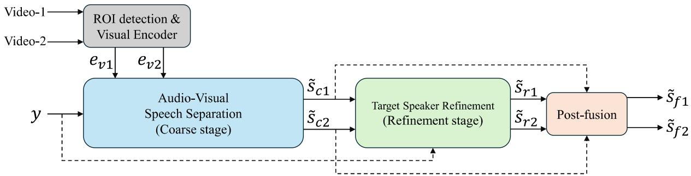
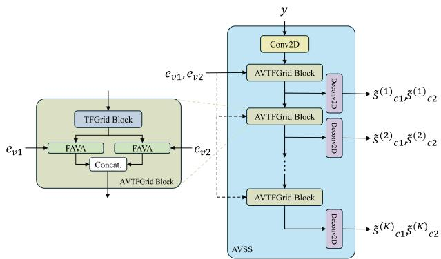
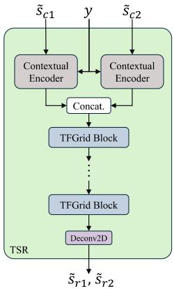

# CF-AVSS: A Coarse-to-Fine Audio-Visual Speech Separation Framework with Target-Speaker Refinement and Post-Fusion for Real-World AVSE Challenge

Longjie Luo1, Zhongshu Hou1, Yuepeng Li1, Gang Yang1,2,∗, Shidong Shang1, Fan Zhou2

1Tencent Ethereal Audio Lab, Tencent Corporation, China

2University of Electronic Science and Technology of China, China

drakeluo@tencent.com, zhongshuhou@tencent.com, felixypli@tencent.com, gangy@std.uestc.edu.cn, simeonshang@tencent.com, fan.zhou@uestc.edu.cn

## Abstract

Audio-visual speech enhancement (AVSE) leverages visual cues to recover target speech from mixtures corrupted by reverberation, noise, and overlapping speakers. We propose a coarse-to-fine two-stage AVSE framework. In the first stage, a progressive SPAV-TFGridNet is extended to two synchronized visual streams to produce visually ordered coarse estimates by progressively suppressing interfering speech while preserving target reverberation and shared background noise. In the second stage, a TFGridNet-based target speaker refinement network takes the original mixture and both coarse estimates as input to further recover target speech and improve signal quality. The coarse and refined estimates are finally combined using development-set-calibrated fusion. On the ISCSLP 2026 Real-World AVSE Challenge, our system tied for first place on Track 1 and ranked second on Track 2 in OVRL, while achieving the lowest CER on both tracks at 12.31% and 14.79%, respectively. Index Terms: audio-visual speech enhancement, speech separation, target speaker extraction, progressive learning

## 1. Introduction

Audio-visual speech enhancement (AVSE) combines acoustic observations with visual speech cues to recover desired speech from adverse recordings [1, 2, 3, 4]. Lip motion and facial articulation provide target-dependent information that does not suffer from acoustic noise [5], so AVSE can improve communication, automatic speech recognition, and human-machine interaction when reverberation, noise, or concurrent speakers make audio-only processing unreliable [6].

Most AVSE systems encode a noisy mixture and one target face track, align the two feature streams, and estimate one enhanced waveform [7]. Time-domain separators and timefrequency masking networks commonly follow this paradigm: an acoustic encoder represents the mixture, a visual encoder represents mouth motion, a fusion module injects the visual cue into the acoustic stream, and a decoder reconstructs the target signal. This direct mapping works well for additive simulations and clean frontal videos, but it leaves several problems in real recordings. Natural overlap does not follow ideal additive assumptions; rooms introduce long reverberant tails and devicedependent responses; and imperfect faces, side views, occlusion, motion blur, low resolution, frozen frames, or audio-visual desynchronization can weaken visual conditioning. Aggressive one-step enhancement may also suppress weak target phonemes while removing interference, which creates a conflict between perceptual quality, intelligibility, and identity preservation.

The ISCSLP 2026 Real-World AVSE Challenge was designed to bridge the gap between clean-video benchmarks and practical deployment conditions [8, 9]. Track 1 evaluates naturally captured multi-speaker recordings with spontaneous speech overlap, room reverberation, background noise, and device-dependent acoustic responses. Track 2 further degrades the visual modality through occlusion, low resolution, frozen or dropped frames, and audio-visual desynchronization, while also introducing far-field recordings captured at a distance of 3 m. Each track contains real mix scenes without isolated acoustic references and reference-available remix scenes constructed from separately recorded sources. These conditions require a system to maintain reliable target-speaker association when either the acoustic or visual evidence becomes unreliable. The evaluation consequently combines intrusive fidelity metrics, non-intrusive quality estimators, recognition accuracy, and speaker similarity, emphasizing balanced performance rather than optimization of a single enhancement criterion.

In this paper, we address these conditions with coarse separation followed by fine extraction. We first extend SPAV-TFGridNet [10] from a single visually conditioned output to two jointly estimated, visually ordered outputs. Progressive supervision removes reverberant non-target speakers in stages while preserving the target room response and common noise. We then use a TFGridNet-based[11] refinement model to extract cleaner target speech from the original mixture, guided by both coarse estimates. An asymmetric over-suppression loss discourages the removal of weak target components, while PESQ-oriented and adversarial losses complement SI-SDR and compressed-spectral reconstruction. Finally, we select one linear-fusion coefficient from the development set and keep it fixed for test inference. The resulting system obtained an official OVRL of 2.86 on both tracks, corresponding to joint first place on Track 1 and second place on Track 2. Its CER of 12.31% and 14.79% was the best submitted result on Track 1 and Track 2, respectively.

## 2. Preliminary

## 2.1. Problem formulation

We consider a single-channel noisy and reverberant mixture containing $M \geq 2$ speakers,

$$
y = \sum _ { m = 1 } ^ { M } u _ { m } + n , \qquad u _ { m } = h _ { m } \ast s _ { m } ,\tag{1}
$$

where $s _ { m }$ is the clean speech of speaker m, $h _ { m }$ is its room impulse response, $u _ { m }$ is the corresponding reverberant speech, and n denotes background noise. Given the mixture y and

  
Figure 1: Overview ofthe proposed two-stage AVSE method.

two visual streams $( v _ { 1 } , v _ { 2 } )$ , our system estimates two enhanced signals $\left( \tilde { s } _ { f 1 } , \tilde { s } _ { f 2 } \right)$ , each aligned with its corresponding visible speaker, while suppressing the remaining interfering speakers.

## 3. Method

In this section, we first describe the audio-visual representations used to associate the mixture with two target speakers. We then introduce the progressive coarse AVSS stage, which suppresses competing speakers while preserving target reverberation and shared background noise. Next, we present the contextual TSR network for recovering cleaner target signals from the original mixture under the guidance of the coarse estimates. Finally, we describe the development-set-calibrated post-fusion strategy that combines the complementary information retained by the coarse and refined outputs.

## 3.1. System overview

As shown in Fig. 1, given an observed mixture y and two synchronized video streams, the visual encoder extracts targetspecific features $e _ { v _ { i } }$ , where $i \in \{ 1 , 2 \}$ . Conditioned on these features, the coarse audio-visual speech separation (AVSS) stage suppresses competing speech and generates visually ordered estimates $\tilde { s } _ { c _ { i } }$ , keeping each estimate aligned with its corresponding visual stream. The TFGridNet-based target speaker refinement (TSR) stage then jointly processes y and both coarse estimates to produce refined estimates $\tilde { s } _ { r _ { i } }$ , which are combined through development-set-calibrated post-fusion to obtain the final outputs $\tilde { s } _ { f _ { i } }$

## 3.2. Visual representation

For each video stream, we apply the official AV-HuBERT preprocessing pipeline, which detects 68 facial landmarks, aligns the face to a canonical mean shape, and crops a mouth-centered region of interest (ROI) [12]. The ROI sequence is then processed by AV-HuBERT Base to directly extract visual speech features $e _ { v _ { i } }$ at 25 frames per second, where $i \in \{ 1 , 2 \}$ . The two visual features $e _ { v _ { 1 } }$ and $e _ { v _ { 2 } } ,$ together with the mixture y, are fed to the coarse separation stage while retaining their correspondence to the input video streams.

## 3.3. Progressive coarse separation

As shown in Fig. 2, the coarse AVSS stage suppresses competing speech while preserving target reverberation and shared background noise. We adapt SIR-Progressive Audio-Visual TF-GridNet [10] to jointly estimate two visually ordered targets. After Conv2D encoding, the mixture y is processed by K cascaded AVTFGrid blocks, each comprising a TFGrid block and two feature-wise audio-visual attention (FAVA) modules conditioned on $e _ { v 1 }$ and $e _ { v 2 }$ [13]; their internal structures follow [10]. The k-th decoder predicts

  
Figure 2: Architecture of the progressive coarse AVSS stage.

$$
\begin{array} { r } { \left( \tilde { s } _ { c 1 } ^ { ( k ) } , \tilde { s } _ { c 2 } ^ { ( k ) } \right) = F _ { \mathrm { s e p } } ^ { ( k ) } ( y , e _ { v 1 } , e _ { v 2 } ) , \qquad k = 1 , \dots , K , } \end{array}\tag{2}
$$

where $\tilde { s } _ { c i } = \tilde { s } _ { c i } ^ { ( K ) }$ is the final coarse estimate for visual stream i. Tying each output index to its visual stream avoids permutation ambiguity during both training and inference.

For target i, let $\begin{array} { r } { q _ { i } = \sum _ { m \neq i } u _ { m } } \end{array}$ denote the competing reverberant speech. The final coarse target is

$$
c _ { i } = u _ { i } + n ,\tag{3}
$$

which retains the complete reverberant target and shared background noise while excluding competing speakers. Since n is shared by both targets, we impose no mixture-consistency constraint requiring $\tilde { s } _ { c 1 } + \tilde { s } _ { c 2 } = y .$

Following the progressive training strategy in [10], the tar get at level k is

$$
c _ { i } ^ { ( k ) } = c _ { i } + \gamma _ { k } q _ { i } , \qquad 1 \ge \gamma _ { 1 } > \cdot \cdot \cdot > \gamma _ { K } = 0 ,\tag{4}
$$

where $\gamma _ { k }$ follows the stage-wise SIR schedule. Thus, earlier levels retain more interfering speech, whereas the final level reaches the background-preserving coarse target.

For a complex STFT coefficient Z, we define power compression as $\bar { C _ { p } ( Z ) } = | Z | ^ { p } \exp ( j \angle Z )$ . All progressive outputs

  
Figure 3: Architecture ofthe contextual TSR stage.

are supervised by

$$
\begin{array} { r l } & { \mathcal { L } _ { \mathrm { s e p } } = \displaystyle \sum _ { k = 1 } ^ { K } w _ { k } \sum _ { i = 1 } ^ { 2 } \Big [ - \lambda _ { s } \mathrm { S I } \mathrm { - S D R } \left( \tilde { s } _ { c i } ^ { ( k ) } , c _ { i } ^ { ( k ) } \right) } \\ & { ~ + \lambda _ { c } \left\| C _ { p } \left( \tilde { S } _ { c i } ^ { ( k ) } \right) - C _ { p } \left( C _ { i } ^ { ( k ) } \right) \right\| _ { 2 } ^ { 2 } \Big ] , } \end{array}\tag{5}
$$

where $\tilde { S } _ { c i } ^ { ( k ) }$ and $C _ { i } ^ { ( k ) }$ are the STFTs of the prediction and target, respectively, and w is the level weight. The compressed spectral term preserves absolute scale and emphasizes low-energy components [14].

## 3.4. Contextual target speaker refinement

Although the coarse estimates preserve target identity, they may contain residual interference or missing target components. We therefore employ a TFGridNet-based TSR network that revisits the original mixture y. For each target, a contextual encoder jointly encodes y and the corresponding coarse estimate $\tilde { s } _ { c i } ;$ we adopt the contextual encoder from [15]. The two contextual representations are concatenated and processed by stacked TFGrid blocks followed by a Deconv2D decoder:

$$
\left( \widetilde { s } _ { r 1 } , \widetilde { s } _ { r 2 } \right) = F _ { \mathrm { T S R } } \left( y , \widetilde { s } _ { c 1 } , \widetilde { s } _ { c 2 } \right) ,\tag{6}
$$

where $\tilde { s } _ { r i }$ is the refined estimate for target i. The mixture provides target components suppressed during coarse separation, while the two coarse estimates preserve target identity and provide complementary separation cues.

We supervise each refined estimate using its clean target $s _ { i } .$ . The reconstruction loss combines SI-SDR with compressed complex-spectral reconstruction:

$$
\mathcal { L } _ { \mathrm { r e c } } = \sum _ { i = 1 } ^ { 2 } \left[ - \mathrm { S I - S D R } \left( \widetilde { s } _ { r i } , s _ { i } \right) + \lambda _ { r } \left. C _ { p } \left( \widetilde { S } _ { r i } \right) - C _ { p } \left( S _ { i } \right) \right. _ { 2 } ^ { 2 } \right]\tag{7}
$$

where $\tilde { S } _ { r }$ and $S _ { i }$ are the complex STFTs of the refined estimate and clean target, respectively.

To reduce over-suppression, let $\begin{array} { r c l } { A _ { i , t f } } & { = } & { | [ C _ { p } ( S _ { i } ) ] _ { t f } | , } \end{array}$ $B _ { i , t f } ~ = ~ \Big | [ C _ { p } ( \tilde { S } _ { r i } ) ] _ { t f } \Big | ,$ and let $W _ { i , t f }$ indicate target-active time-frequency bins. We define the asymmetric loss

$$
\mathcal { L } _ { \mathrm { o v e r } } = \frac { \sum _ { i , t , f } W _ { i , t f } \left[ \operatorname* { m a x } \left( A _ { i , t f } - B _ { i , t f } , 0 \right) \right] ^ { 2 } } { \sum _ { i , t , f } W _ { i , t f } + \epsilon } ,\tag{8}
$$

which penalizes missing target magnitude in active bins without directly encouraging excess energy.

We further employ a differentiable PESQ-oriented loss, implemented using $\mathrm { t o r c h - p e s q ^ { 0 } }$ , together with the adversarial training scheme of PASE [16]. Let $\mathcal { D } = \{ D _ { t } , D _ { f } \}$ contain the time- and frequency-domain discriminators. The generator adversarial loss is

$$
\mathcal { L } _ { \mathrm { a d v } } = \sum _ { D \in \mathcal { D } } \sum _ { i = 1 } ^ { 2 } \mathbb { E } \left[ ( D ( \tilde { s } _ { r i } ) - 1 ) ^ { 2 } \right] ,\tag{9}
$$

while the discriminators use the corresponding least-squares real/fake objective. The overall refinement objective is

$$
\begin{array} { r } { \mathcal { L } _ { \mathrm { T S R } } = \mathcal { L } _ { \mathrm { r e c } } + \mu _ { o } \mathcal { L } _ { \mathrm { o v e r } } + \mu _ { p } \mathcal { L } _ { \mathrm { p e s q } } + \mu _ { a } \mathcal { L } _ { \mathrm { a d v } } + \mu _ { f } \mathcal { L } _ { \mathrm { f m } } , } \end{array}\tag{10}
$$

where ${ \mathcal L } _ { \mathrm { f m } }$ denotes discriminator feature matching and $\mu _ { o } , \mu _ { p } ,$ $\mu _ { a } .$ and $\mu _ { f }$ are the corresponding loss weights.

## 3.5. Post-fusion

The coarse and refined estimates are complementary: the former preserves the reverberation and background ambience, whereas the latter favors cleaner target extraction. We linearly combine them as

$$
\tilde { s } _ { f i } = ( 1 - \alpha ) \tilde { s } _ { c i } + \alpha \tilde { s } _ { r i } , \qquad 0 \leq \alpha \leq 1 ,\tag{11}
$$

where $\tilde { s } _ { f i }$ is the final estimate for target i and α is a global fusion weight selected on the development set. The selected value is fixed for all test samples without reference-based or utterance-dependent tuning.

## 4. Experimental Setup

## 4.1. Datasets

During training, we use VoxCeleb2 [17] and the MISP 2023 Challenge dataset [18]. VoxCeleb2 provides diverse synchronized audio-visual utterances, while MISP introduces multiparty and far-field recording conditions. To construct each training mixture, we sample $\bar { M } \in \{ 2 , 3 , 4 \}$ speakers with probabilities 0.75, 0.20, and 0.05, respectively. We designate two speakers as visible targets and treat the remaining speakers as off-screen interferers. Each source utterance is independently convolved with a 16-kHz room impulse response sampled from OpenSLR SLR26 or SLR28 [19]. We then sum the reverberant sources, add environmental noise, and crop the audio and corresponding video streams into synchronized 4.0-s segments.

We use official development sets for validation and parameter selection. The Track 1 development set contains 1,242 real-recorded mix clips and 900 reference-available remix clips, while the Track 2 development set contains 1,527 mix clips and 1,098 remix clips. We use these data for model selection and hyperparameter tuning, including the post-fusion coefficient.

We perform the final evaluation on the official test sets, which contain 4,257 clips for Track 1 and 4,941 clips for Track 2. The reference signals remain hidden and all test scores are computed by the organizers. Track 2 further introduces degraded visual conditions and additional far-field recordings, resulting in more severe visual corruption and acoustic mismatch than Track 1.

## 4.2. Evaluation metrics

We follow the official evaluation protocol of the ISCSLP 2026 Real-World AVSE Challenge [8, 9]. SI-SDR [20], PESQ [21], and STOI [22] are evaluated on the remix subset against clean references, whereas the non-intrusive UTMOSv2 [23, 24] and DNSMOS metrics are computed on both mix and remix. DNS-MOS includes P.808 overall quality and P.835 SIG, BAK, and OVRL scores [25, 26]. CER is computed from FunASR [27] hypotheses after text normalization, and SPK-SIM is the cosine similarity between WeSpeaker [28] embeddings of enhanced speech and enrollment voiceprints. Higher is better for all metrics except CER and the official OVRL rank score.

Table 1: Official test-set results in the overall (mix + remix) scope. Ours denotes the submitted system; all competitors are anonymized. P808, SIG, and BAK are display-only and do not enter the leaderboard OVRL. Higher is better except CER and OVRL.
<table><tr><td>Track</td><td>System</td><td>SI-SDR</td><td>PESQ</td><td>STOI</td><td>UTMOS</td><td>P808</td><td>SIG</td><td>BAK</td><td>DNS-OVRL</td><td>CER</td><td>SPK-SIM</td><td>OVRL</td></tr><tr><td rowspan="6">Track 1</td><td>Ours</td><td>10.70</td><td>2.93</td><td>0.84</td><td>2.07</td><td>2.93</td><td>2.34</td><td>2.62</td><td>1.83</td><td>0.123</td><td>0.75</td><td>2.86</td></tr><tr><td>Team 1</td><td>12.72</td><td>3.00</td><td>0.85</td><td>2.10</td><td>2.71</td><td>2.14</td><td>2.42</td><td>1.70</td><td>0.145</td><td>0.77</td><td>2.86</td></tr><tr><td>Team 2</td><td>9.16</td><td>2.77</td><td>0.83</td><td>2.15</td><td>2.81</td><td>2.36</td><td>2.48</td><td>1.94</td><td>0.135</td><td>0.74</td><td>3.57</td></tr><tr><td>Team 3</td><td>10.42</td><td>2.65</td><td>0.82</td><td>2.00</td><td>2.80</td><td>2.20</td><td>2.33</td><td>1.77</td><td>0.163</td><td>0.74</td><td>5.43</td></tr><tr><td>Team 4</td><td>10.03</td><td>2.63</td><td>0.82</td><td>2.00</td><td>2.78</td><td>2.19</td><td>2.25</td><td>1.73</td><td>0.177</td><td>0.73</td><td>6.29</td></tr><tr><td>Team 5</td><td>9.62</td><td>2.53</td><td>0.79</td><td>2.01</td><td>2.65</td><td>2.05</td><td>2.04</td><td>1.64</td><td>0.259</td><td>0.72</td><td>7.57</td></tr><tr><td rowspan="6">Track 2</td><td>Team 1</td><td>12.26</td><td>2.94</td><td>0.84</td><td>2.13</td><td>2.68</td><td>2.11</td><td>2.39</td><td>1.67</td><td>0.153</td><td>0.76</td><td>2.43</td></tr><tr><td>Ours</td><td>10.22</td><td>2.89</td><td>0.83</td><td>2.09</td><td>2.88</td><td>2.26</td><td>2.49</td><td>1.76</td><td>0.148</td><td>0.74</td><td>2.86</td></tr><tr><td>Team 2</td><td>7.05</td><td>2.56</td><td>0.78</td><td>2.17</td><td>2.77</td><td>2.30</td><td>2.42</td><td>1.90</td><td>0.220</td><td>0.71</td><td>5.00</td></tr><tr><td>Team 3</td><td>9.54</td><td>2.55</td><td>0.80</td><td>2.02</td><td>2.77</td><td>2.15</td><td>2.28</td><td>1.73</td><td>0.211</td><td>0.73</td><td>5.29</td></tr><tr><td>Team 4</td><td>9.27</td><td>2.59</td><td>0.80</td><td>1.87</td><td>2.70</td><td>1.84</td><td>1.91</td><td>1.52</td><td>0.206</td><td>0.76</td><td>5.29</td></tr><tr><td>Team 5</td><td>8.73</td><td>2.41</td><td>0.77</td><td>2.03</td><td>2.61</td><td>1.93</td><td>1.91</td><td>1.56</td><td>0.281</td><td>0.71</td><td>7.14</td></tr></table>

## 4.3. Implementation details

We train both the AVSS and TSR networks for 50 epochs using AdamW with an initial learning rate of 10−3, a weight decay of $1 0 ^ { - 4 }$ , and a batch size of 8. For progressive separation, we construct the intermediate targets using SIR levels of {0, 5, 10, 15} dB, followed by the interference-free coarse target. In the AVSS objective, we set the SI-SDR and compressed complex-spectral loss weights to $\lambda _ { s } ~ = ~ \lambda _ { c } ~ = ~ 1 . 0 .$ For TSR, we assign unit weights to the SI-SDR and compressed complex-spectral reconstruction terms and set the over-suppression, PESQ-oriented, adversarial, and feature-matching loss weights to $\mu _ { o } ~ = ~ 0 . 1$ $\mu _ { p } ~ = ~ 0 . 0 5 , ~ \mu _ { a } ~ = ~ 0 . 0 1$ , and $\mu _ { f } ~ = ~ 0 . 1 .$ , respectively. For Track 2, we apply random visual degradation, including spatial masking, Gaussian blur, and frame dropout, and drop the visual modality with a probability of 0.1. We evaluate the post-fusion coefficient on the development set and select α = 0.34 according to the trade-off among intrusive quality, non-intrusive quality, recognition accuracy, and speaker similarity. The selected coefficient is fixed for both tracks during test inference.

## 5. Results and Discussion

## 5.1. Official test-set results

Table 1 compares our system with five anonymized teams on the official test set. Our system shares first place on Track 1 and ranks second on Track 2. It also achieves the lowest CER on both tracks, reaching 12.31% on Track 1 and 14.79% on Track 2. On Track 1, our method maintains competitive intrusive metrics together with strong speaker similarity. When evaluated under the more challenging visual conditions of Track 2, it exhibits only moderate degradation in SI-SDR, STOI, and SPK-SIM, suggesting that the coarse visual identity cues and mixture-conditioned TSR remain effective when the visual evi-

Table 2: Ablation results on the Track 2 development set.
<table><tr><td>System</td><td>SI-SDR</td><td>PESQ</td><td>DNS-OVRL</td><td>CER</td><td>SPK-SIM</td></tr><tr><td>Ours</td><td>11.53</td><td>2.65</td><td>1.86</td><td>0.117</td><td>0.68</td></tr><tr><td>w/o post-fusion</td><td>9.29</td><td>2.17</td><td>2.20</td><td>0.132</td><td>0.57</td></tr><tr><td>w/o TSR and post-fusion</td><td>10.88</td><td>2.55</td><td>1.56</td><td>0.129</td><td>0.66</td></tr></table>

dence becomes less reliable.

The results further demonstrate the multi-objective nature of real-world AVSE. Team 1 achieves better intrusive metrics, whereas several other systems obtain higher scores on individual non-intrusive quality estimators. In contrast, our method delivers consistently strong performance across speech quality, intelligibility, speaker preservation, and recognition accuracy. In particular, its leading CER results indicate that the proposed system effectively suppresses interference without severely damaging target-speech content.

## 5.2. Development-set ablation study

We conduct a compact ablation study on the Track 2 development set to evaluate the contributions of the TSR network and post-fusion. All variants are evaluated under the same protocol and differ only in the removed component.

Table 2 demonstrate that coarse separation and TSR provide complementary estimates. TSR raises DNS-OVRL from 1.56 to 2.20, but decreases SI-SDR, PESQ, and SPK-SIM and increases CER, indicating that stronger perceptual enhancement may discard target-speech components. Post-fusion balances these behaviors, achieving the best SI-SDR, PESQ, CER, and SPK-SIM while preserving a clear DNS-OVRL improvement over coarse separation alone. The coarse and refined estimates act as correlated observations that retain different target information: the former preserves speaker identity and acoustic context, whereas the latter emphasizes perceptual quality. Combining them preserves their shared target content while recovering complementary components attenuated by either estimate alone.

## 6. Conclusion

We presented a two-stage method for real-world AVSE. Progressive, visually conditioned coarse separation establishes the two target identities while retaining their room responses and shared background noise. A mixture-conditioned TFGridNetbased TSR then produces cleaner target signals while mitigating over-suppression. We linearly fuse the coarse and refined outputs using a coefficient selected on the development set. The system ranked joint first on Track 1 and second on Track 2 of the ISCSLP 2026 Real-World AVSE Challenge and achieved the best CER on both tracks.

## 7. References

[1] X. Qian, J. Gao, Y. Zhang, Q. Zhang, H. Liu, L. P. G. Perera, and H. Li, “Sav-se: Scene-aware audio-visual speech enhancement with selective state space model,” IEEE Journal of Selected Topics in Signal Processing, vol. 19, no. 4, pp. 623–634, 2025.

[2] W. Ren, K.-H. Hung, R. Chao, Y. Li, H.-M. Wang, and Y. Tsao, “Robust audio-visual speech enhancement: Correcting misassignments in complex environments with advanced post-processing,” in 2024 27th Conference ofthe Oriental COCOSDA International Committee for the Co-ordination and Standardisation of Speech Databases and Assessment Techniques (O-COCOSDA). IEEE, 2024, pp. 1–6.

[3] R. Chao, W. Ren, Y.-J. Li, K.-H. Hung, S.-F. Huang, S.-W. Fu, W.-H. Cheng, and Y. Tsao, “Leveraging mamba with fullface vision for audio-visual speech enhancement,” arXiv preprint arXiv:2508.13624, 2025.

[4] W. Ren, K. Li, R. Chao, J. Li, Z. Huang, S. Ahmed, Y.-J. Li, K.-H. Hung, S.-S. Wang, H.-M. Wang et al., “Bav-mossformer2: Enhanced mossformer2 for binaural audio-visual speech enhancement,” in Proc. AVSEC 2025, 2025, pp. 79–80.

[5] J. Son Chung, A. Senior, O. Vinyals, and A. Zisserman, “Lip reading sentences in the wild,” in Proceedings of the IEEE conference on computer vision andpattern recognition, 2017, pp. 6447– 6456.

[6] A. Ephrat, I. Mosseri, O. Lang, T. Dekel, K. Wilson, A. Hassidim, W. T. Freeman, and M. Rubinstein, “Looking to listen at the cocktail party: A speaker-independent audio-visual model for speech separation,” arXiv preprint arXiv:1804.03619, 2018.

[7] R. Gao and K. Grauman, “Visualvoice: Audio-visual speech separation with cross-modal consistency,” in 2021 IEEE/CVF Conference on Computer Vision and Pattern Recognition (CVPR). IEEE, 2021, pp. 15 490–15 500.

[8] C. Organizers, “The iscslp 2026 real-world audio-visual speech enhancement challenge,” 2026. [Online]. Available: https://arxiv.org/abs/2608.23759

[9] P. Yang, Z. Jin, X. Qin, R. Gan, H. Wang, J. Liu, and M. Li, “Identity-faithful audio-visual target speaker extraction with real-2mix and voxblink2-avse,” 2026. [Online]. Available: https://arxiv.org/abs/2608.03964

[10] Z. Hou, T. Sun, Y. Hu, C. Zhu, K. Chen, and J. Lu, “Sirprogressive audio-visual tf-gridnet with asr-aware selector for target speaker extraction in misp 2023 challenge,” in 2024 IEEE International Conference on Acoustics, Speech, and Signal Processing Workshops (ICASSPW). IEEE, 2024, pp. 11–12.

[11] Z.-Q. Wang, S. Cornell, S. Choi, Y. Lee, B.-Y. Kim, and S. Watanabe, “Tf-gridnet: Integrating full-and sub-band modeling for speech separation,” IEEE/ACM Transactions on Audio, Speech, and Language Processing, vol. 31, pp. 3221–3236, 2023.

[12] B. Shi, W.-N. Hsu, K. Lakhotia, and A. Mohamed, “Learning audio-visual speech representation by masked multimodal cluster prediction,” arXiv preprint arXiv:2201.02184, 2022.

[13] A. Vaswani, N. Shazeer, N. Parmar, J. Uszkoreit, L. Jones, A. N. Gomez, Ł. Kaiser, and I. Polosukhin, “Attention is all you need,” Advances in neural information processing systems, vol. 30, 2017.

[14] A. Li, C. Zheng, R. Peng, and X. Li, “On the importance of power compression and phase estimation in monaural speech dereverberation,” JASA express letters, vol. 1, no. 1, 2021.

[15] X. Yang, C. Bao, J. Zhou, and X. Chen, “Target speaker extraction by directly exploiting contextual information in the time-frequency domain,” in ICASSP 2024-2024 IEEE International Conference on Acoustics, Speech and Signal Processing (ICASSP). IEEE, 2024, pp. 10 476–10 480.

[16] X. Rong, Q. Hu, M. Yesilbursa, K. Wojcicki, and J. Lu, “Pase: Leveraging the phonological prior of wavlm for low-hallucination generative speech enhancement,” in Proceedings of the AAAI Conference on Artificial Intelligence, vol. 40, no. 39, 2026, pp. 32 826–32 834.

[17] J. S. Chung, A. Nagrani, and A. Zisserman, “Voxceleb2: Deep speaker recognition,” arXiv preprint arXiv:1806.05622, 2018.

[18] S. Wu, C. Wang, H. Chen, Y. Dai, C. Zhang, R. Wang, H. Lan, J. Du, C.-H. Lee, J. Chen et al., “The multimodal information based speech processing (misp) 2023 challenge: Audio-visual target speaker extraction,” in ICASSP 2024-2024 IEEE International Conference on Acoustics, Speech and Signal Processing (ICASSP). IEEE, 2024, pp. 8351–8355.

[19] T. Ko, V. Peddinti, D. Povey, M. L. Seltzer, and S. Khudanpur, “A study on data augmentation of reverberant speech for robust speech recognition,” in 2017 IEEE international conference on acoustics, speech and signal processing (ICASSP). IEEE, 2017, pp. 5220–5224.

[20] J. Le Roux, S. Wisdom, H. Erdogan, and J. R. Hershey, “Sdr– half-baked or well done?” in ICASSP 2019-2019 IEEE International Conference on Acoustics, Speech and Signal Processing (ICASSP). IEEE, 2019, pp. 626–630.

[21] A. W. Rix, J. G. Beerends, M. P. Hollier, and A. P. Hekstra, “Perceptual evaluation of speech quality (pesq)-a new method for speech quality assessment of telephone networks and codecs,” in 2001 IEEE international conference on acoustics, speech, and signal processing. Proceedings (Cat. No. 01CH37221), vol. 2. IEEE, 2001, pp. 749–752.

[22] J. Jensen and C. H. Taal, “An algorithm for predicting the intelligibility of speech masked by modulated noise maskers,” IEEE/ACM Transactions on Audio, Speech, and Language Processing, vol. 24, no. 11, pp. 2009–2022, 2016.

[23] T. Saeki, D. Xin, W. Nakata, T. Koriyama, S. Takamichi, and H. Saruwatari, “Utmos: Utokyo-sarulab system for voicemos challenge 2022,” arXiv preprint arXiv:2204.02152, 2022.

[24] K. Baba, W. Nakata, Y. Saito, and H. Saruwatari, “The t05 system for the voicemos challenge 2024: Transfer learning from deep image classifier to naturalness mos prediction of high-quality synthetic speech,” in 2024 IEEE Spoken Language Technology Workshop (SLT). IEEE, 2024, pp. 818–824.

[25] C. K. Reddy, V. Gopal, and R. Cutler, “Dnsmos p. 835: A non-intrusive perceptual objective speech quality metric to evaluate noise suppressors,” in ICASSP 2022-2022 IEEE international conference on acoustics, speech and signal processing (ICASSP). IEEE, 2022, pp. 886–890.

[26] ——, “Dnsmos: A non-intrusive perceptual objective speech quality metric to evaluate noise suppressors,” in ICASSP 2021- 2021 IEEE International Conference on Acoustics, Speech and Signal Processing (ICASSP). IEEE, 2021, pp. 6493–6497.

[27] Z. Gao, Z. Li, J. Wang, H. Luo, X. Shi, M. Chen, Y. Li, L. Zuo, Z. Du, Z. Xiao et al., “Funasr: A fundamental end-to-end speech recognition toolkit,” arXiv preprint arXiv:2305.11013, 2023.

[28] H. Wang, C. Liang, S. Wang, Z. Chen, B. Zhang, X. Xiang, Y. Deng, and Y. Qian, “Wespeaker: A research and production oriented speaker embedding learning toolkit,” in ICASSP 2023- 2023 IEEE International Conference on Acoustics, Speech and Signal Processing (ICASSP). IEEE, 2023, pp. 1–5.