# CoDA: Co-Evolution of Data Engines and Action Policies

Tianjiao Yu1 Zhilin Ou2 Yifan Shen1 Xinzhuo Li1

Yuanzhe Liu1 Onkar Kishor Susladkar1 Fan Wang3 Ismini Lourentzou1

1University of Illinois Urbana-Champaign 2The Chinese University of Hong Kong, Shenzhen 3Amazon ty41@illinois.edu lourent2@illinois.edu

Generative simulation can automate robot environment construction, but physically valid environments are not necessarily useful for training. The challenge is to identify environments that address a policy’s failures and supervision that helps it overcome them. We introduce CoDA, a framework in which a simulation data engine and an action policy co-evolve through a shared heterogeneous memory of environment construction, policy failures, and learning progress. The memory compiles validated diagnoses from a vision-language critic into generation programs that recreate difficulties and training programs that help the policy overcome them. We further propose Text2potential to convert these diagnoses into staged potentials for action-chunk value learning, providing dense supervision for policy updates while preserving the task’s optimal policy under standard shaping assumptions. Measured learning progress guides further generation and program refinement. Across four manipulation task families, CoDA improves out-ofdistribution success from 5.3% after supervised fine-tuning to 27.6%, exceeding the strongest closed-loop baseline by 9.5 percentage points with the same generation budget. On LIBERO-Pro, 15 rounds of generation and training raise success from 25% to 84% under position perturbations and from 1% to 76% under instruction perturbations.

Keywords: Robot Learning, Generative Simulation, Data-Policy Co-Evolution, Shared Memory, Potential-Based Reward Shaping Website: https://plan-lab.github.io/coda

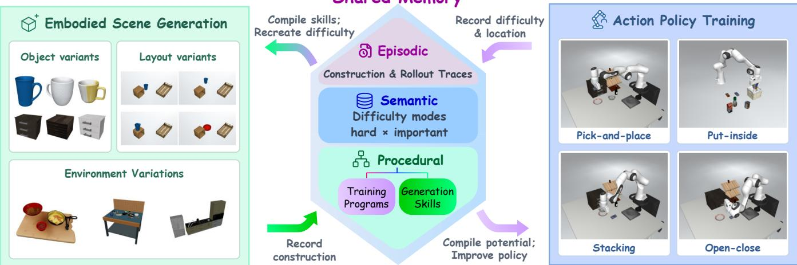  
Figure 1: CoDA Co-evolution of data generation and action policies. Shared memory integrates scene-construction experience and policy rollout diagnoses to guide both what environments to generate and how to train the policy. Generation programs produce environments targeting current policy difficulty modes, while training programs supply shaping potentials for policy improvement. Subsequent rollouts update the memory and guide the next round.

## 1. Introduction

Simulation has become a primary source of robot manipulation data, but building simulated environments has long been the bottleneck: each one requires a task design, semantically appropriate assets, a plausible layout, and a training signal, often all specified by hand [38]. Generative simulation removes much of that cost. Coding agents now synthesize scenes, articulations, and task specifications directly [25, 37–39, 43], and language models author the reward functions that accompany them [42, 48]. Environments are no longer scarce.

A central challenge remaining is deciding which environments to build next and what supervision will help the policy to learn from them. Existing engines sample variation from hand-specified ranges [29], refine a scene until it is physically valid [39, 43], or allocate budget by per-task success rate [10]. These signals indicate whether an environment is valid and how well the current policy performs, but do not by themselves measure how much the policy improves through training. Without such feedback, a generator risks spending its budget on environments the policy has already mastered or cannot yet learn to solve.

CoDA closes this loop with a heterogeneous memory shared by the data generator and the action policy. It records repairs needed to make scenes valid, together with policy failure diagnoses grounded in rollout evidence and localized to one generative factor and one trajectory phase. The memory tracks learning progress for recurring difficulty modes to guide subsequent generation. This evidence is compiled into separate programs for scene generation and policy training, with the latter specifying subgoals and learning tools [38, 42].

As tasks involve longer sequences of dependent subtasks, sparse success signals can slow value learning, while designing effective dense rewards can require manual effort. We therefore introduce Text2potential, which compiles a failure diagnosis into a potential over the simulator state and uses it to densify value targets for action chunks [7, 15]. The resulting value estimates guide policy updates through weighted regression on the policy’s own rollouts, favoring action chunks with higher estimated value.

Across four manipulation tasks, CoDA achieves 27.6% out-of-distribution success, compared with 5.3% for the supervised fine-tuning baseline. With the same budget for generating environments, a loop guided by per-task success rates achieves 18.1%, while open-loop variants yield 8.5%. Extending our loop to more rounds increases out-of-distribution success to 42.1%. Moreover, on LIBERO-Pro, training on source-task variants generated by CoDA increases success from 25% to 84% on position generalization and from 1% to 76% on task generalization. Finally, we observe that reusing memory across policy backbones transfers accumulated experience, enabling a second backbone to increase out-of-distribution success from 3.8% to 21.1%.

In summary, the contributions of our work are:

• Closed-loop co-evolution. We introduce CoDA, a framework that co-evolves a simulation data engine with a trainable action policy. Failure diagnoses grounded in policy rollouts guide environment generation and training, while measured learning progress determines which difficulties to revisit.

• Shared heterogeneous memory. We introduce a memory shared by the generator and policy that combines episodic evidence, reusable difficulty modes, and procedural programs. The same diagnosis compiles into a generation program that recreates the difficulty and a training program that helps the policy overcome it. Both programs are indexed by difficulty mode, making them reusable across tasks.

• Dense supervision through Text2potential. Text2potential compiles failure diagnoses into potentials over simulator states that provide dense targets for learning the value of action chunks [15]. Reward shaping requires potential evaluations only at chunk endpoints and preserves the policies that maximize the original task return.

• Improved out-of-distribution generalization. Across four manipulation task families, CoDA achieves 27.6% out-of-distribution success, compared with 5.3% after supervised fine-tuning and 18.1% for successrate-guided generation using the same acceptedenvironment budget. On LIBERO-Pro, fifteen rounds of CoDA training increase π0.5’s success from 25% to 84% under position perturbations and from 1% to 76% under instruction perturbations. Reusing memory across policy backbones also improves OpenVLA-OFT’s out-of-distribution success from 3.8% to 21.1% without additional environment generation.

## 2. Related Work

Agentic asset and scene synthesis. Recent methods improve visual asset quality [40, 50] and model part structure, articulation, or physical properties [2, 3, 13, 17, 36, 46, 47, 51]. For robot learning, RoboGen [38] generates tasks, scenes, and training supervision, while RoboTwin 2.0 [4] scales bimanual manipulation data through expert data synthesis and domain randomization. Sim-Foundry [29] generates variations across objects, scenes and tasks, and agentic systems automate scene construction and refinement for simulation [25, 37, 39, 43, 44]. Our work focuses on adapting environment generation to the policy’s learning progress, using feedback from training to guide what is generated next.

Curriculum learning and policy improvement. Curriculum methods prioritize environments using regret, learning potential, or parameter changes [6, 9, 23, 27, 49]. POET [35] coevolves agents and parameterized environments, while language models synthesize rewards [19, 41, 42] and generate adaptive environment programs [10, 16]. For policy improvement, VLA policies learn from their rollouts using sparse success rewards [14, 32]. Q-Planning [7] improves action selection while keeping the base policy frozen. We adopt a critic over action chunks [15] with advantage-weighted regression to update the policy [24]. Lifelong methods retain reusable prompts or skill libraries [18, 45]. CoDA links scene generation and policy learning through failure diagnoses localized to scene factors and trajectory phases.

## 3. Method

CoDA couples scene generation and policy learning through a shared memory that guides both. A data engine G, implemented as a tool-augmented coding agent, writes executable scene programs against a simulator SDK. Each program defines an environment and a machine-checkable success predicate ν. An action policy π collects rollouts in these environments, and a vision– language critic C diagnoses failures by identifying the responsible factor, a trajectory phase, and supporting rollout evidence. Failures intrinsic to motor execution are recorded separately from those attributed to scene factors. The memory M consolidates this evidence into reusable difficulty modes. Validated modes are compiled into two complementary outputs: generation programs that recreate the diagnosed conditions and training programs that help the policy πθ overcome them.

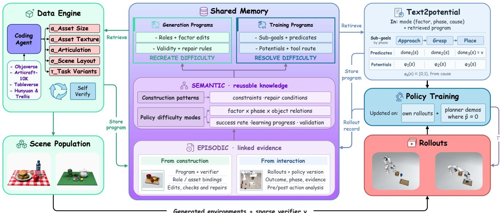  
Figure 2: The CoDA framework. The data engine G generates executable scenes with independently editable task, spatial, and object-attribute factors (τ, σ, α) and a sparse success verifier ν. Construction traces and rollout-grounded failure diagnoses enter a shared memory, which organizes them into reusable difficulty modes. Validated modes are compiled into generation programs that reproduce the diagnosed conditions and training programs that specify subgoals, potentials, and learning tools. Text2potential supplies dense feedback through chunk-level value targets that guide policy updates, and measured learning progress guides the next generation round.

We first construct seed environments (§3.1) and define the shared memory (§3.2). Each round then uses the memory to guide scene generation (§3.3), compiles validated diagnoses into training programs through Text2potential (§3.4), and updates the policy using shaped value estimates (§3.5). The resulting learning progress informs subsequent generation. Figure 2 provides an overview of the overall framework.

## 3.1. Seeding and Scene Representation

Seeding begins with an object pool [5, 33, 51]. We use a task family’s assets when available and otherwise sample from a predefined pool. Given the sampled objects, the engine proposes a task [38] and specifies its instruction, participating objects, initial and terminal object states, and executable success predicate ν. Proposals without a verifier are discarded.

Instead of committing to a specific data generation scheme, the engine writes factored scene programs. Task, layout, and object attributes can then be perturbed independently, letting the loop test a diagnosis by changing one factor while keeping the others fixed. Failure diagnosis and scene generation need to share a common representation. The critic should identify factors that the engine can directly modify. We parameterize each environment as $s = ( \tau , \sigma , \alpha )$ , generated by executing a scene program $s = \operatorname { E x e c } ( g )$ with $g \sim \mathcal { G } ( \cdot )$ . The task factor τ specifies the goal predicate, instruction, and initial and terminal object states. The object-spatial factor σ specifies poses, support and containment relations, clearances, and occlusion. The object self-attribute factor α specifies geometry, metric scale, mass, friction, articulation, and appearance. The SDK exposes these factors through set\_task, set\_layout, and set\_attributes, so the engine can resample any one factor while keeping the other two fixed. This factorization provides a common representation for the critic’s diagnoses, the engine’s interventions, and the applicability conditions of compiled generation programs.

Verification. Each program emits a sparse, machinecheckable success predicate ν over its scene objects. This predicate determines task success independently of the critic’s judgments and provides the common success criterion across the methods we compare. Dense training feedback is introduced separately through potential-based shaping, rather than replacing the task predicate with a synthesized reward [42, 48]. Before policy deployment, each scene must pass verification checks for collision-free placement, static stability during a short passive simulation, and plausible metric scale. Programs that fail these checks are excluded from policy rollouts but retained in memory to inform subsequent scene generation.

## 3.2. Shared Heterogeneous Memory

Memory combines two sources of experience: the engine’s construction and repair traces, and the policy’s rollout outcomes and failure diagnoses. Following the episodic–semantic–procedural organization of language-agent memory [30], we retain individual records (episodic tier), abstract recurring failure patterns (semantic tier), and compile reusable programs for generation and training (procedural tier).

Episodic tier: construction and rollout evidence. The append-only trace store B records each scene program g, its verifier ν, and summaries of the generation trace, including violated constraints and verification outcomes. For deployed environments, it also records the success rate ${ \widehat { p } } ( s )$ over N rollouts and the learning progress $\operatorname { L V } ( s )$ obtained from training [49]. The vision–language critic C uses scene and rollout evidence to produce a failure diagnosis $\boldsymbol { \psi } = \left( \delta , p , c , e \right)$ , where $\delta \in \left\{ \mathrm { T A S K } , \mathrm { S P A T I A L } , \right.$ ATTRIBUTE, EXECUTION} identifies the attributed factor, p the trajectory phase, c a naturallanguage description of the cause, and e the supporting evidence. These diagnoses are stored alongside the corresponding traces. The additional label EXECUTION covers motor-execution failures.

Semantic tier: reusable difficulty modes. Episodic records are clustered online into difficulty modes $\kappa _ { j }$ using the factor–phase pair $( \delta , p )$ and similarity between diagnosed causes. Each mode captures a recurring failure condition that can arise across tasks and policy backbones, such as “an occluder adjacent to the target on the approach side”. We characterize each mode by two quantities, hardness and importance. Hardness is measured by the policy’s success rate ${ \widehat { p } } _ { j } ,$ , with lower rates indicating greater difficulty. Importance $w _ { j }$ is a running score updated from mode-level learning progress, measured as the change in policy success rate on that mode before and after training [49]. These two quantities reflect different properties of a mode. A mode can remain hard even when training on it yields little learning progress, or become easy after substantial improvement. Each mode also carries a validation status determined by control batches (§3.3), and only validated modes are compiled into procedural memory.

Procedural tier: generation and training programs. The two consumers of memory improve differently. The data engine G adapts in context by retrieving and executing programs between rounds, while the action policy $\pi _ { \theta }$ learns through gradient updates and acts from observations. We therefore compile the same validated mode into two complementary programs:

• Generation programs, stored in Ω, encode how to reproduce and vary the diagnosed scene conditions. They retain the parent scene program, validated variants along one factor, compilation-check outcomes, and the required relational structure expressed over symbolic object roles.

• Training programs, stored in Φ, specify how to address the policy failure through subgoal decompositions, potentials, and learning tools. They retain the diagnosed phase and evidence of which training programs improved policy performance.

The generation compiler $\mathcal { R } _ { \mathrm { g r i n d } }$ produces the former, while Text2potential implements the training compiler $\mathcal { R } _ { \mathrm { h o n e } }$ (§3.4). During training, these programs evaluate subgoal completion and compute potentials that shape value targets. At deployment, the trained policy predicts actions from observations and the task instruction without executing these programs.

## 3.3. Memory-Guided Scene Generation

At each round, memory guides which difficulty modes to revisit and how to instantiate them in new environments. We allocate the generation budget across difficulty modes using an upper-confidence rule based on their hardness and observed learning progress. An ε-fraction of the budget is reserved for novel environments, while a separate replay fraction revisits previously encountered modes to detect performance regressions. A validated generation program is added to the pool Ω when the policy’s success rate on its variants falls within the designated success band and is removed when success rate is outside that band. For each selected mode, the engine retrieves a generation program specifying the scene conditions to reproduce and the factor to vary. Generation programs express scene conditions in terms of symbolic object roles, allowing the engine to reuse them across task families by assigning those roles to objects in a new scene (Appendix A).

For each selected candidate difficulty mode linked to a scene factor, the engine generates a targeted batch that varies the identified factor and a control batch that varies a different factor. After verification checks, we evaluate the current policy on both batches. If the targeted variants yield a lower policy success rate than the control variants, the proposed difficulty mode is compiled into reusable generation and training programs. The policy learns from its rollouts using the success predicate ν and the potential-based feedback supplied by Text2potential (§3.4). A scripted planner also attempts each valid variant, and trajectories that satisfy ν are retained as demonstrations $\mathcal { D } _ { t } ,$ providing additional imitation supervision when available.

## 3.4. Text2potential

The success predicate ν determines whether a generated task is complete, but provides little feedback on intermediate progress. This makes value learning difficult when success requires a long sequence of actions. Text2potential converts a validated failure diagnosis into subgoals and potentials over simulator states. These potentials provide dense feedback for value learning (§3.5). Prior language-based reward synthesis provides dense training feedback, but its iterative refinement relies on humans to describe policy failures observed in rollouts, and can produce rewards that favor behavior other than task completion [42]. Text2potential instead uses a critic to diagnose failures from the policy’s own rollouts and compiles these diagnoses into a potential function that shapes the value critic’s training targets, providing dense feedback without replacing the original task reward.

Let $\mathcal { K } _ { j }$ be a validated difficulty mode with record $\boldsymbol { \psi } = \left( \delta , p , c , e \right)$ , let $g$ be a scene program in $\kappa _ { j } ,$ , and let $\Phi _ { j }$ contain the training programs previously compiled for that mode, if any. Text2potential is the map

$$
\begin{array} { r l } & { \mathcal { R } _ { \mathrm { h o n e } } : ( \psi , g , \Phi _ { j } ) \longmapsto } \\ & { \quad \big ( \mathrm { g } _ { 1 : m } , \mathrm { d o n e } _ { 1 : m } , \varphi _ { 1 : m } , \mathrm { t o o l } _ { 1 : m } \big ) , } \end{array}\tag{1}
$$

where m is the number of subgoals and $g _ { 1 : m }$ is the sequence obtained by splitting the task at the diagnosed phase $p .$ For each subgoal $k ,$ donek $: S  \{ 0 , 1 \}$ is its completion predicate, $\varphi _ { k } \colon S  [ 0 , 1 )$ measures progress within the subgoal, and tool specifies the learning procedure. Here, S is the simulator state space. The final completion predicate is the task verifier, don $\mathbf { e } _ { m } \equiv \nu .$ . The completion predicates and potentials are implemented as functions over the objects and simulator quantities exposed by $g$ . The subgoal potentials are combined into a staged potential:

$$
\begin{array} { l l } { { \displaystyle k ^ { * } ( s ) = \sum _ { k = 1 } ^ { m } \mathrm { d o n e } _ { k } ( s ) } , } \\ { { \Phi ( s ) = \left\{ k ^ { * } ( s ) + \varphi _ { k ^ { * } ( s ) + 1 } ( s ) , } & { k ^ { * } ( s ) < m , \right. } } \\ { { \displaystyle } , } & { k ^ { * } ( s ) = m . } \end{array}\tag{2}
$$

Here, $k ^ { * } ( s )$ counts the subgoal predicates satisfied at state s. The compiler is instructed to make completion predicates cumulative, so earlier subgoals remain satisfied as later ones are pursued. The diagnosed phase $p$ identifies where the policy fails and guides the task decomposition, while the diagnosed cause c guides the construction of the subgoal potentials. The scene program provides the object handles, poses, and relations needed to express subgoal completion predicates and potentials as functions of simulator state.

Compilation and execution checks. The compiler $\mathcal { R } _ { \mathrm { h o n e } }$ uses a language model supplied with the failure record, the scene program’s symbol table, geometric and contact helper functions, and training programs retrieved from $\Phi _ { j }$ as examples. It produces the subgoal decomposition, completion predicates, potentials, and learning-tool assignments in Eq. (1). Each emitted program undergoes syntax checks and, when rollout states are supplied, runtime checks on those states. Detected errors are returned to the compiler for repair. These checks establish that the programs execute. Their usefulness is assessed through subsequent policy learning (§3.5).

## 3.5. Policy Training

The compiled potential shapes the training targets of a value critic over action chunks. The value critic guides data collection and supplies the advantage estimates used to weight policy updates. This value critic is distinct from the vision–language critic C, which diagnoses failures. The policy must be able to sample j candidate action chunks conditioned on observations and the task, (o, τ), and support a weighted supervised action loss.

Chunk-level value learning. The policy takes observations and the task instruction as input and emits action chunks $a _ { t : t + h }$ of length h, which are executed open-loop. The value critic $Q _ { \phi } \big ( o _ { t } , a _ { t : t + h } \big )$ takes observations, the task instruction, and an action chunk as input, using visual and language encoders separate from the policy’s. We train a value critic $Q _ { \phi } \big ( o _ { t } , a _ { t : t + h } \big )$ with an h-step temporaldifference target [15]. For sparse task reward $r _ { t }$ supplied by ν and discount factor $\gamma ,$ potential-based shaping defines $\tilde { r } _ { t } = r _ { t } + \beta \bigl [ \gamma \Phi ( s _ { t + 1 } ) - \Phi ( s _ { t } ) \bigr ]$ for nonterminal transitions, where st is the simulator state. Summing over a chunk of length h gives

$$
\sum _ { i = 0 } ^ { h - 1 } \gamma ^ { i } \tilde { r } _ { t + i } = \underbrace { \sum _ { i = 0 } ^ { h - 1 } \gamma ^ { i } r _ { t + i } } _ { \mathrm { s p a r s e r e t u r n } } + \beta \gamma ^ { h } \Phi ( s _ { t + h } ) - \beta \Phi ( s _ { t } ) ,\tag{3}
$$

so the shaping contribution requires potential evaluations only at the chunk’s endpoints. Following Giridhar et al. [7], we use the next action chunk stored in the replay buffer for bootstrapping. For a nonterminal chunk of length h, the target using the target critic $\bar { Q } _ { \phi }$ is

$$
\begin{array} { l } { { \displaystyle y _ { t } = \sum _ { i = 0 } ^ { h - 1 } \gamma ^ { i } r _ { t + i } - \beta \Phi ( s _ { t } ) } } \\ { { \displaystyle \qquad + \gamma ^ { h } \Big [ \beta \Phi ( s _ { t + h } ) + \bar { Q } _ { \phi } ( o _ { t + h } , a _ { t + h : t + h + h } ) \Big ] . } } \end{array}\tag{4}
$$

Both the endpoint-potential term and the critic bootstrap are omitted at successful task completion, and both successful and failed rollouts contribute to critic training. Failed rollouts have zero sparse task reward, but can have nonzero shaped targets. The value critic is trained by categorical value regression [7], with value bins spanning $[ - \beta m _ { \mathrm { m a x } } , 1 ]$ , where $m _ { \mathrm { m a x } }$ is the maximum number of subgoals.

Policy update. During data collection, we sample j candidate chunks from the current policy and score each chunk with $Q _ { \phi }$ . We apply a softmax to these scores and execute the weighted average of the candidate chunks. The resulting rollouts provide training data for the value critic and the policy. After fitting the critic based on Eq. (4), we update the policy by advantage-weighted regression [24]:

$$
\begin{array} { r l r } & { } & { \mathcal { L } _ { \pi } = { \mathbb E } \left[ e ^ { A ( o , a _ { t : t + h } ) / \lambda } \ \ell _ { \mathrm { B C } } ( \pi _ { \theta } ; o , a _ { t : t + h } ) \right] , } \\ & { } & { A ( o , a ) = Q _ { \phi } ( o , a ) - \frac { 1 } { j } \sum _ { a ^ { \prime } \sim \pi _ { \theta } ( \cdot \vert o ) } Q _ { \phi } ( o , a ^ { \prime } ) , \quad } \end{array}\tag{5}
$$

where $\lambda > 0$ controls the advantage weighting and $\ell _ { \mathrm { B C } }$ is the policy’s supervised action loss. Task conditioning is omitted from the notation for readability. The baseline averages the critic’s values over j chunks sampled from the policy at the same observation. The advantage weight scales the action loss. Computing this weight does not require an action-density evaluation. The same weighting can therefore be applied to the supervised losses of discrete, flow-matching, and diffusion policies [15]. Planner

Table 1: Policy generalization across four manipulation task families. OOD success rates (%) under different generation and training strategies. In denotes success on each generator’s own distribution. Values are mean ± standard error over three seeds. Best and second best highlighted.
<table><tr><td></td><td colspan="4">OOD by family</td><td colspan="2">Average</td></tr><tr><td>Data generation</td><td></td><td></td><td></td><td>Pick-place Articulated Put-inside Stack/insert</td><td>In</td><td>OOD</td></tr><tr><td>pretrained, zero-shot</td><td> $3 . 1 \pm 0 . 6$ </td><td> $1 . 6 \pm 0 . 5$ </td><td> $2 . 7 \pm 0 . 6$ </td><td> $1 . 8 \pm 0 . 6$ </td><td> $3 . 4 \pm 0 . 2$ </td><td> $2 . 3 \pm 0 . 3$ </td></tr><tr><td>+ seed demonstrations (SFT)</td><td> $6 . 4 \pm 0 . 6$ </td><td> $4 . 7 \pm 0 . 4$ </td><td> $5 . 9 \pm 0 . 5$ </td><td> $4 . 2 \pm 0 . 4$ </td><td> $1 1 . 7 { \scriptstyle \pm 0 . 4 }$ </td><td> $5 . 3 { \pm } 0 . 3 $ </td></tr><tr><td>domain randomization</td><td> $8 . 8 \pm 0 . 4$ </td><td> $8 . 3 { \pm } 0 . 6 $ </td><td> $7 . 6 \pm 0 . 4$ </td><td> $6 . 9 \pm 0 . 5$ </td><td> $1 7 . 2 { \pm } 0 . 3 $ </td><td> $7 . 9 \pm 0 . 4$ </td></tr><tr><td>uniform variants [29]</td><td> $1 0 . 6 { \pm } 0 . 4$ </td><td> $6 . 9 \pm 0 . 6$ </td><td> $9 . 7 \pm 0 . 4$ </td><td> $6 . 8 \pm 0 . 3$ </td><td> $2 1 . 6 \pm 0 . 3$ </td><td> $8 . 5 \pm 0 . 2$ </td></tr><tr><td>scalar-feedback co-evolution [10]</td><td> $2 0 . 9 \pm 0 . 7$ </td><td> $1 5 . 3 { \pm } 0 . 7 $ </td><td> $1 9 . 6 { \pm } 1 . 2$ </td><td> $1 6 . 6 { \pm } 0 . 7 $ </td><td> $3 3 . 8 \pm 0 . 4$ </td><td> $1 8 . 1 \pm 0 . 5$ </td></tr><tr><td>our critic, no memory</td><td> $2 2 . 4 \pm 0 . 7$ </td><td> $1 7 . 8 { \pm } 0 . 9 $ </td><td> $1 8 . 3 { \pm } 1 . 3 $ </td><td> $1 8 . 3 { \pm } 0 . 8 $ </td><td> $3 1 . 7 { \scriptstyle \pm 0 . 6 }$ </td><td> $1 9 . 2 \pm 0 . 7$ </td></tr><tr><td>CoDA (ours)</td><td> $3 3 . 1 \pm 1 . 2 $ </td><td> $\mathbf { 2 4 . 7 \pm 0 . 9 }$ </td><td> ${ 2 8 . 9 \pm 1 . 3 }$ </td><td> $2 3 . 7 \pm 1 . 0$ </td><td> $3 9 . 4 \pm 0 . 5$ </td><td> $\mathbf { 2 7 . 6 \pm 0 . 5 }$ </td></tr></table>

For a fixed, bounded potential with appropriate terminalstate handling, potential-based shaping preserves the policies that maximize the original task return [20]. For any fixed policy, exact action and state values shift by the same $\mathrm { t e r m } , - \beta \Phi ( s )$ , leaving action advantages unchanged: $A _ { \Phi } = ( Q - \beta \Phi ) - ( V - \beta \Phi ) = A$ . Under these conditions, shaping preserves the policies that maximize the original task return. This property concerns exact values; the effect of shaping on the learned critic and policy is assessed through subsequent policy progress.

demonstrations provide additional imitation supervision and contribute to the supervised loss with unit weight. At deployment, the trained policy predicts action chunks directly, without critic-guided candidate averaging.

Refinement and routing. We assess each training program by measuring the policy’s improvement on the corresponding difficulty mode, using ν to determine task success. We also compare how quickly the value critic converges with and without the compiled potential. If the potential provides no improvement in convergence speed over sparse task rewards alone, the vision–language critic C revisits the failure diagnosis, and $\mathcal { R } _ { \mathrm { h o n e } }$ revises the subgoal decomposition. For each subgoal, we select a learning procedure based on the policy’s measured success rate [38]. When this rate is near zero and a planner demonstration is available, we use behavior cloning on $\mathcal { D } _ { t }$ to teach the policy an initial solution. When the success rate falls within the target band, we use Text2potential to shape the value-learning targets. For difficulty modes with success rates above the band, we periodically re-evaluate the policy to detect performance regressions. If none of the subgoals falls within the target band, we return the difficulty mode to the data engine for further environment generation and reduce its importance score when allocating subsequent generation budgets.

Scheduling. Each round generates B targeted environments and their controls. After verification, we collect N policy rollouts in each valid environment. The vision–language critic examines a stratified sample of at most C failed rollouts per mode. Between generation rounds, the value critic receives $K _ { Q }$ updates and the policy receives $K _ { \pi }$ updates using the accumulated buffer.

After validation, difficulty modes are compiled into training programs for policy learning and generation programs for subsequent rounds. A new generation round is triggered when fewer than eight difficulty modes remain within the success band or when learning progress plateaus for 2k policy-update steps. The loop terminates when no mode remains in the band or the generation budget is exhausted.

## 4. Experiments

Experimental Setup. We evaluate CoDA on four manipulation task families and LIBERO-Pro [52] using $\pi _ { 0 . 5 }$ [8] as the primary policy backbone. Our main comparison includes the released $\pi _ { 0 . 5 }$ checkpoint, supervised fine-tuning on seed demonstrations, and policies trained with domain randomization, uniform environment variants [29], or success-rate-guided generation [10]. Generation baselines use the same SDK and budgets. We ablate persistent memory and the separation of generation and training stores, comparing against singlestore alternatives that include a skill library [34]. We report per-suite success rates and average success across held-out suites, including generalization to unseen object instances, layouts, tasks, and categories. Additional metrics assess generation quality through verification pass rate and coverage entropy, and diagnosis quality through targeting precision, refutation rate, and agreement with two annotators on 100 sampled diagnoses. We report computational cost in LLM tokens, simulation hours, and GPU-hours per 1,000 accepted environments. Full experimental details are provided in Appendix B.

Main results. Table 1 shows CoDA achieves the highest OOD success across all four task families. Average OOD success reaches 27.6%, compared with 18.1% for generation guided by task success rates and 19.2% for our critic without memory, improvements of 9.5 and 8.4 percentage points, respectively. Both substantially exceed uniform generation (8.5%) and domain randomization (7.9%), but retaining and reusing experience through our memory yields the strongest performance. Figure 3 examines how performance changes as generation and training continue. Extending CoDA from five to fifteen rounds increases OOD success from 27.6% to 42.1%,

accepted environments per family

(a) OOD success vs. budget  
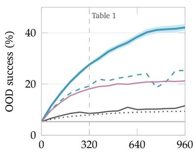

(b) difficulty modes over rounds  
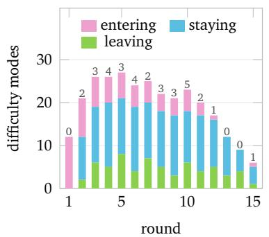

(c) OOD success improvement per round  
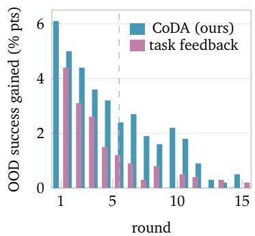  
CoDA (ours) our critic, no memory scalar feedback  
uniform variants domain randomization SFT only

Figure 3: Co-evolution over rounds. (a) Average OOD success as number of accepted environments per task family increases. Dashed line marks the comparison reported in Table 1. Curves show mean over three seeds, with standard error shaded for CoDA (b) Number of difficulty modes newly selected for training, retained for further training, and removed from the memory in each round. Labels above bars separately report the number of generation programs reused from other task families. (c) OOD success gain (percentage points) per round by CoDA and generation guided by task success rates.  
Table 2: LIBERO-Pro generalization to position and instruction perturbations. Success rates under position (Pos) and instruction (Task) perturbations for the Object, Goal, and Spatial suites. StdLBR reports success on standard LIBERO. Best and second best highlighted.
<table><tr><td>Method</td><td colspan="2">Object</td><td colspan="2">Goal</td><td colspan="2">Spatial</td><td colspan="2">Overall</td></tr><tr><td></td><td>StdLBR</td><td>Pos</td><td>Task</td><td>Pos</td><td>Task Pos</td><td>Task</td><td>Pos</td><td>Task</td></tr><tr><td>OpenVLA [11]</td><td>0.765</td><td>0.00</td><td>0.00</td><td>0.00</td><td>0.00</td><td>0.00 0.00</td><td>0.00</td><td>0.00</td></tr><tr><td>π0 [1]</td><td>0.942</td><td>0.00</td><td>0.00</td><td>0.00</td><td>0.00 0.00</td><td>0.00</td><td>0.00</td><td>0.00</td></tr><tr><td>π0.5 [8]</td><td>0.971</td><td>0.17 0.01</td><td>0.38</td><td></td><td>0.00 0.20</td><td>0.01</td><td>0.25</td><td>0.01</td></tr><tr><td>Human-written programs</td><td></td><td>0.14 0.00</td><td>0.00</td><td></td><td>0.00 0.23</td><td>0.05</td><td>0.12</td><td>0.02</td></tr><tr><td>ASPIRE (code-as-policy) [18]</td><td></td><td>0.98</td><td>0.95 0.81</td><td></td><td>0.45 0.51</td><td>0.60</td><td>0.77</td><td>0.67</td></tr><tr><td>CoDA (π0.5), n = 5 rounds</td><td>0.971</td><td>0.90</td><td>0.86</td><td>0.80</td><td>0.58</td><td>0.76 0.72</td><td>0.82</td><td>0.72</td></tr><tr><td>CoDA (π0.5), n = 15 rounds</td><td>0.974</td><td>0.91</td><td>0.88</td><td>0.83</td><td>0.64</td><td>0.78 0.76</td><td></td><td>0.84 0.76</td></tr></table>

while uniform generation, domain randomization, and success-rate-guided generation yield much smaller additional gains. In later rounds, fewer difficulty modes remain unresolved, and improvements become smaller. Removing memory produces less consistent progress, including two temporary drops in success.

LIBERO-Pro. Training on generated variants of the LIBERO-Pro source tasks substantially improves robustness to position and instruction perturbations (Table 2). After five rounds, CoDA achieves overall success rates of 82% and 72% under the two perturbations, respectively. Extending training to fifteen rounds raises these rates to 84% and 76%, compared with 25% and 1% for the initial π checkpoint. The fifteen-round model also exceeds ASPIRE [18] by 7 and 9 percentage points overall, achieving the highest success on the Goal and Spatial suites under both perturbations, while ASPIRE remains strongest on the Object suite. These robustness gains preserve performance on standard LIBERO, where success reaches 97.4%, compared with 97.1% before adaptation.

Sensitivity to the failure diagnosis critic. Table 3 varies the vision–language model used to diagnose failures while keeping the engine and compiler fixed. Replacing GPT-5.5 with Claude Opus 5, InternVL3-78B, or Qwen3-

VL-235B slightly reduces OOD success from 27.6% to 26.1%, 25.7%, and 24.9%, respectively. Models with lower agreement with human annotators also produce more diagnoses rejected by the control tests. Nevertheless, all four models outperform generation guided by task success rates: even Qwen3-VL-235B exceeds that baseline by 6.8 percentage points. The framework therefore remains effective across the tested diagnosis models.

Effect of Text2potential. Text2potential achieves 27.6% OOD success at a fixed training budget, compared with 22.3% using sparse task rewards alone (Table 4). It reaches 25% OOD success after 21k policy updates, compared with 31k for sparse rewards, requiring approximately 32% fewer updates. The ablations show that both failure diagnosis and potential refinement matter. Generating the potential from the task description instead of the failure diagnosis lowers success to 24.6%, while disabling refinement lowers it to 26.1%. Keeping the policy frozen and using the value critic only to select action chunks achieves 21.4%, showing the benefit of using the learned values to update the policy.

Qualitative results. Figure 4 shows successful rollouts on LIBERO-Pro tasks and evolved vegetable-preparation scenes. Despite changes in object position, size, and identity, the policy grasps, transports, and places the target, following the subgoal sequence encoded by the staged potential. Appendix Figures 6 and 7 show how these scenes were modified and provide additional rollouts.

Table 3: Critic ablations. OOD success at a fixed training budget, diagnoses refuted by control evaluations, and agreement with two human annotators. Best and second best results are highlighted.
<table><tr><td>Critic</td><td>OOD success (%) ↑</td><td>Refuted (%) ↓</td><td>Human agr. (%) ↑</td></tr><tr><td>Qwen3-VL-235B (open weights)</td><td> $2 4 . 9 \pm 0 . 8$ </td><td>27.5</td><td>73.8</td></tr><tr><td>InternVL3-78B (open weights)</td><td>25.7±0.7</td><td>24.1</td><td>76.3</td></tr><tr><td>Claude Opus 5</td><td>26.1 ±0.6</td><td>20.3</td><td>81.5</td></tr><tr><td>GPT-5.5 (default)</td><td>M  $\mathbf { 2 7 . 6 \pm 0 . 5 }$ </td><td>18.2</td><td>82.4</td></tr></table>

Table 4: Text2potential ablations. We report OOD success (%) at a fixed training budget, policy updates needed to reach 25% OOD success (in thousands), and agreement (%) with the sparse-only critic’s action-chunk selections after convergence. Best and second best highlighted.
<table><tr><td>Training signal</td><td>OOD success</td><td>Steps to 25% OOD (k) Agreement</td><td></td></tr><tr><td>sparse verifier only  $( \Phi \equiv 0 )$ </td><td> $2 2 . 3 \pm 0 . 8$ </td><td>31</td><td></td></tr><tr><td>potential from task description [42]</td><td> $2 4 . 6 { \pm } 0 . 7$ </td><td>29</td><td>95.3</td></tr><tr><td>free-form dense reward, not a potential</td><td> $2 3 . 5 \pm 1 . 0$ </td><td>33</td><td>72.4</td></tr><tr><td>frozen actor:  $Q _ { \phi } .$  -weighted selection only [7]</td><td> $2 1 . 4 \pm 0 . 9$ </td><td></td><td>96.8</td></tr><tr><td>Text2potential without refinement</td><td> $2 6 . 1 \pm 0 . 6 $ </td><td>27</td><td>95.9</td></tr><tr><td>Text2potential (ours)</td><td> $\mathbf { 2 7 . 6 \pm 0 . 5 }$ </td><td>21</td><td>97.2</td></tr></table>

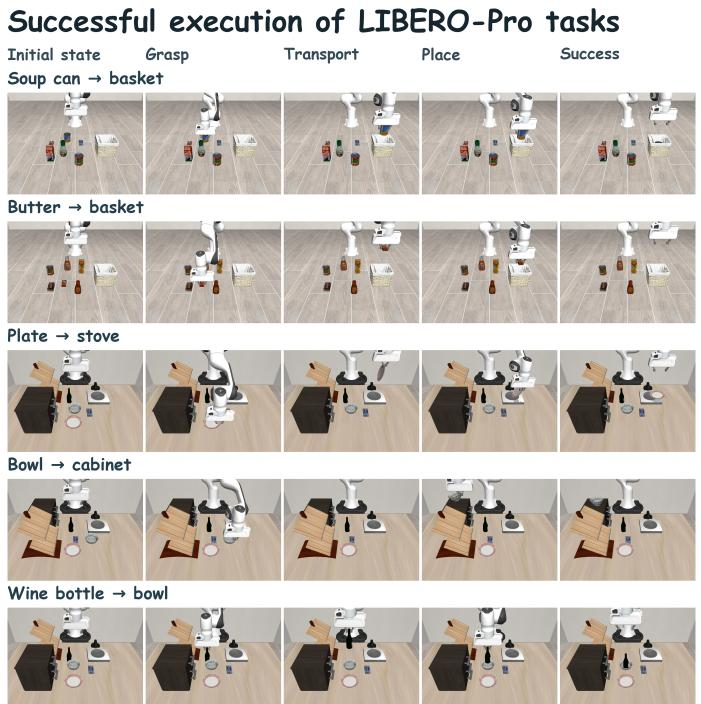

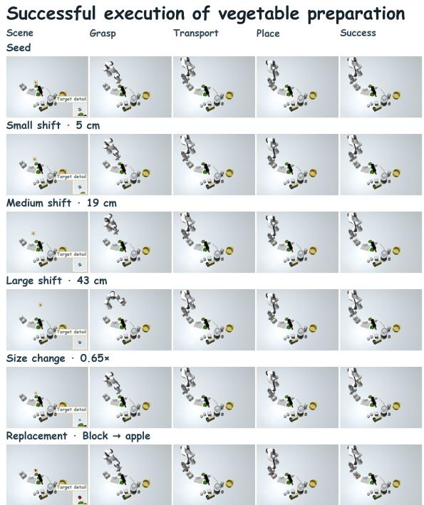  
Figure 4: Successful rollouts. Left: Pre-defined LIBERO-Pro tasks. Right: Evolved scenes, one row per variant. Columns are the initial state, grasp, transport, place, and success.

Transfer across tasks and policies. Tables 6 and 7 in Appendix C show that transferred generation programs yield greater learning progress than programs learned from scratch with the same LLM budget, while reusing memory collected with $\pi _ { 0 . 5 }$ raises OpenVLA-OFT’s OOD success from 3.8% to 21.1% without further environment generation. Appendix C provides additional results on memory design and size, training convergence, environment quality, diagnosis accuracy, computational cost,

and generation scheduling.

## 5. Conclusion

We introduce CoDA, coupling environment generation and policy learning through shared heterogeneous memory. Failure diagnoses become reusable programs for generating environments and training the policy. Text2potential provides dense supervision, while learning progress guides generation and refinement. Experiments show improved out-of-distribution success, program transfer across task families, and memory reuse across policy backbones.

## References

[1] Kevin Black, Noah Brown, Danny Driess, Adnan Esmail, Michael Equi, Chelsea Finn, Niccolo Fusai, Lachy Groom, Karol Hausman, Brian Ichter, et al. π : A vision-languageaction flow model for general robot control. arXiv preprint arXiv:2410.24164, 2024.

[2] Ziang Cao, Fangzhou Hong, Zhaoxi Chen, Liang Pan, and Ziwei Liu. Physx-anything: Simulation-ready physical 3d assets from single image. In Proceedings of the IEEE/CVF Conference on Computer Vision and Pattern Recognition, pages 5839–5848, 2026.

[3] Ziang Cao, Yinghao Liu, Haitian Li, Runmao Yao, Fangzhou Hong, Zhaoxi Chen, Liang Pan, and Ziwei Liu. Physx-omni: Unified simulation-ready physical 3d generation for rigid, deformable, and articulated objects. arXiv preprint arXiv:2605.21572, 2026.

[4] Tianxing Chen, Zanxin Chen, Baijun Chen, Zijian Cai, Yibin Liu, Zixuan Li, Qiwei Liang, Xianliang Lin, Yiheng Ge, Zhenyu Gu, et al. Robotwin 2.0: A scalable data gen erator and benchmark with strong domain randomization for robust bimanual robotic manipulation. arXiv preprint arXiv:2506.18088, 2025.

[5] Matt Deitke, Ruoshi Liu, Matthew Wallingford, Huong Ngo, Oscar Michel, Aditya Kusupati, Alan Fan, Christian Laforte, Vikram Voleti, Samir Yitzhak Gadre, et al. Objaverse-xl: A universe of 10m+ 3d objects. Advances in Neural Information Processing Systems, 36:35799–35813, 2023.

[6] Michael Dennis, Natasha Jaques, Eugene Vinitsky, Alexandre Bayen, Stuart Russell, Andrew Critch, and Sergey Levine. Emergent complexity and zero-shot transfer via unsupervised environment design. Advances in neural information processing systems, 33:13049–13061, 2020.

[7] Varun Giridhar, Anant Khandelwal, Jeremy A Collins, Ignat Georgiev, and Animesh Garg. Beyond imitation: Self-improving robot policies via off-policy q-planning. arXiv preprint arXiv:2608.21204, 2026.

[8] Physical Intelligence, Kevin Black, Noah Brown, James Darpinian, Karan Dhabalia, Danny Driess, Adnan Esmail, Michael Equi, Chelsea Finn, Niccolo Fusai, et al. π0.5: a vision-language-action model with open-world general ization. arXiv preprint arXiv:2504.16054, 2025.

[9] Minqi Jiang, Edward Grefenstette, and Tim Rocktäschel. Prioritized level replay. In International Conference on Machine Learning, pages 4940–4950. PMLR, 2021.

[10] Haoqiang Kang, Xiaokang Ye, Yuhan Liu, Siddhant Hitesh Mantri, Lingjun Mao, James Fleming, Drishti Regmi, and Lianhui Qin. Simworld studio: Automatic environment generation with evolving coding agent for embodied agent learning. arXiv preprint arXiv:2605.09423, 2026.

[11] Moo Jin Kim, Karl Pertsch, Siddharth Karamcheti, Ted Xiao, Ashwin Balakrishna, Suraj Nair, Rafael Rafailov, Ethan Foster, Pannag Sanketi, et al. Openvla: An open source vision-language-action model. Conference on Robot Learning (CoRL), 2024.

[12] Moo Jin Kim, Chelsea Finn, and Percy Liang. Fine-tuning vision-language-action models: Optimizing speed and success. arXiv preprint arXiv:2502.19645, 2025.

[13] Long Le, Jason Xie, William Liang, Hung-Ju Wang, Yue Yang, Yecheng Jason Ma, Kyle Vedder, Arjun Krishna, Dinesh Jayaraman, and Eric Eaton. Articulate-anything: Automatic modeling of articulated objects via a visionlanguage foundation model. In International Conference on Learning Representations, volume 2025, pages 17578– 17602, 2025.

[14] Haozhan Li, Yuxin Zuo, Jiale Yu, Yuhao Zhang, Zhaohui Yang, Kaiyan Zhang, Xuekai Zhu, Yuchen Zhang, Tianxing Chen, Ganqu Cui, et al. Simplevla-rl: Scaling vla training via reinforcement learning. In International Conference on Learning Representations, volume 2026, pages 125846– 125869, 2026.

[15] Qiyang Li, Zhiyuan Paul Zhou, and Sergey Levine. Reinforcement learning with action chunking. Advances in Neural Information Processing Systems, 2025.

[16] William Liang, Sam Wang, Hung-Ju Wang, Osbert Bastani, Dinesh Jayaraman, and Yecheng Jason Ma. Environment curriculum generation via large language models. In 8th annual conference on robot learning, 2024.

[17] Ruijie Lu, Yu Liu, Jiaxiang Tang, Junfeng Ni, Yuxiang Wang, Diwen Wan, Gang Zeng, Yixin Chen, and Siyuan Huang. Dreamart: Generating interactable articulated objects from a single image. arXiv preprint arXiv:2507.05763, 2025.

[18] Runyu Lu, Yubo Wu, Ethan Kou, Letian Fu, Wenli Xiao, Ajay Mandlekar, Yinzhen Xu, Guanya Shi, Ken Goldberg, Ang Chen, et al. Aspire: Agentic/skills discovery for robotics. arXiv preprint arXiv:2607.00272, 2026.

[19] Yecheng Jason Ma, William Liang, Guanzhi Wang, De-An Huang, Osbert Bastani, Dinesh Jayaraman, Yuke Zhu, Jim Fan, et al. Eureka: Human-level reward design via coding large language models. In International conference on learning Representations, volume 2024, pages 26516– 26560, 2024.

[20] Andrew Y Ng, Daishi Harada, and Stuart Russell. Policy invariance under reward transformations: Theory and application to reward shaping. In Icml, volume 99, pages 278–287, 1999.

[21] OpenAI. GPT-5.5 System Card. https://openai.com/ index/gpt-5-5-system-card/, 2026.

[22] Maxime Oquab, Timothée Darcet, Théo Moutakanni, Huy Vo, Marc Szafraniec, Vasil Khalidov, Pierre Fernandez, Daniel Haziza, Francisco Massa, Alaaeldin El-Nouby, et al. Dinov2: Learning robust visual features without supervision. arXiv preprint arXiv:2304.07193, 2023.

[23] Jack Parker-Holder, Minqi Jiang, Michael Dennis, Mikayel Samvelyan, Jakob Foerster, Edward Grefenstette, and Tim Rocktäschel. Evolving curricula with regret-based environment design. In International Conference on Machine Learning, pages 17473–17498. PMLR, 2022.

[24] Xue Bin Peng, Aviral Kumar, Grace Zhang, and Sergey Levine. Advantage-weighted regression: Simple and scal able off-policy reinforcement learning. arXiv preprint arXiv:1910.00177, 2019.

[25] Nicholas Pfaff, Thomas Cohn, Sergey Zakharov, Rick Cory, and Russ Tedrake. Scenesmith: Agentic generation of simulation-ready indoor scenes. In International Conference on Machine Learning, 2026.

[26] Physical Intelligence. openpi: Open-source models and code from Physical Intelligence. https://github. com/Physical-Intelligence/openpi, 2025. Accessed: 2026-09-26.

[27] Rémy Portelas, Cédric Colas, Lilian Weng, Katja Hofmann, and Pierre-Yves Oudeyer. Automatic curriculum learning for deep rl: A short survey. arXiv preprint arXiv:2003.04664, 2020.

[28] Colin Raffel, Noam Shazeer, Adam Roberts, Katherine Lee, Sharan Narang, Michael Matena, Yanqi Zhou, Wei Li, and Peter J Liu. Exploring the limits of transfer learning with a unified text-to-text transformer. Journal of machine learning research, 21(140):1–67, 2020.

[29] Nadun Ranawaka, Josiah Wong, Wei-Lin Pai, Wei-Teng Chu, Tianyuan Dai, Masoud Moghani, Hang Yin, Yunfan Jiang, Wesley Durbano, Brandon Huynh, et al. Simfoundry: Modular and automated scene generation for policy learning and evaluation. arXiv preprint arXiv:2606.28276, 2026.

[30] Theodore R Sumers, Shunyu Yao, Karthik Narasimhan, and Thomas L Griffiths. Cognitive architectures for language agents. arXiv preprint arXiv:2309.02427, 2023.

[31] Balakumar Sundaralingam, Siva Kumar Sastry Hari, Adam Fishman, Caelan Garrett, Karl Van Wyk, Valts Blukis, Alexander Millane, Helen Oleynikova, Ankur Handa, Fabio Ramos, et al. curobo: Parallelized collisionfree minimum-jerk robot motion generation. arXiv preprint arXiv:2310.17274, 2023.

[32] Shuhan Tan, Kairan Dou, Yue Zhao, and Philipp Krähenbühl. Interactive post-training for vision-language-action models. arXiv preprint arXiv:2505.17016, 2025.

[33] Boyuan Wang, Yue Zhang, Xutao Xue, Xueyu Song, and Yu Sun. Tableverse: A large-scale tabletop dataset with real-world grounded layouts for generalizable manipulation. arXiv preprint arXiv:2607.21017, 2026.

[34] Guanzhi Wang, Yuqi Xie, Yunfan Jiang, Ajay Mandlekar, Chaowei Xiao, Yuke Zhu, Linxi Fan, and Anima Anandkumar. Voyager: An open-ended embodied agent with large language models. arXiv preprint arXiv:2305.16291, 2023.

[35] Rui Wang, Joel Lehman, Jeff Clune, and Kenneth O Stanley. Paired open-ended trailblazer (poet): Endlessly generating increasingly complex and diverse learning environments and their solutions. arXiv preprint arXiv:1901.01753, 2019.

[36] Xinjie Wang, Liu Liu, Yu Cao, Ruiqi Wu, Wenkang Qin, Dehui Wang, Wei Sui, and Zhizhong Su. Embodiedgen: Towards a generative 3d world engine for embodied intelligence. arXiv preprint arXiv:2506.10600, 2025.

[37] Xinjie Wang, Liu Liu, Taojun Ding, Andrew Choi, Chaodong Huang, Mengao Zhao, Ziang Li, Jackson Jiang, Chunlei Yu, Shengxiang Liu, et al. Embodiedgen v2: An agentic, simulation-ready 3d world engine for embodied ai. arXiv preprint arXiv:2607.07459, 2026.

[38] Yufei Wang, Zhou Xian, Feng Chen, Tsun-Hsuan Wang, Yian Wang, Katerina Fragkiadaki, Zackory Erickson, David Held, and Chuang Gan. Robogen: Towards unleashing infinite data for automated robot learning via generative simulation. arXiv preprint arXiv:2311.01455, 2023.

[39] Hongchi Xia, Xuan Li, Zhaoshuo Li, Qianli Ma, Jiashu Xu, Ming-Yu Liu, Yin Cui, Tsung-Yi Lin, Wei-Chiu Ma, Shenlong Wang, et al. Sage: Scalable agentic 3d scene generation for embodied ai. arXiv preprint arXiv:2602.10116, 2026.

[40] Jianfeng Xiang, Zelong Lv, Sicheng Xu, Yu Deng, Ruicheng Wang, Bowen Zhang, Dong Chen, Xin Tong, and Jiaolong Yang. Structured 3d latents for scalable and versatile 3d generation. In 2025 IEEE/CVF Conference on Computer Vision and Pattern Recognition (CVPR), pages 21469–21480. IEEE, 2025.

[41] Wenli Xiao, Jia Xie, Tonghe Zhang, Haotian Lin, Letian Fu, Haoru Xue, Jalen Lu, Yi Yang, Cunxi Dai, Zi Wang, et al. Enpire: Agentic robot policy self-improvement in the real world. arXiv preprint arXiv:2606.19980, 2026.

[42] Tianbao Xie, Siheng Zhao, Chen Wu, Yitao Liu, Qian Luo, Victor Zhong, Yanchao Yang, and Tao Yu. Text2reward: Reward shaping with language models for reinforcement learning. In International Conference on Learning Representations, volume 2024, pages 35663–35699, 2024.

[43] Yandan Yang, Baoxiong Jia, Shujie Zhang, and Siyuan Huang. Sceneweaver: All-in-one 3d scene synthesis with an extensible and self-reflective agent. Advances in neural information processing systems, 38:140319–140351, 2025.

[44] Yue Yang, Fan-Yun Sun, Luca Weihs, Eli VanderBilt, Alvaro Herrasti, Winson Han, Jiajun Wu, Nick Haber, Ranjay Kr ishna, Lingjie Liu, et al. Holodeck: Language guided generation of 3d embodied ai environments. In 2024 IEEE/CVF Conference on Computer Vision and Pattern Recognition (CVPR), pages 16277–16287. IEEE, 2024.

[45] Yuanqi Yao, Siao Liu, Haoming Song, Delin Qu, Qizhi Chen, Yan Ding, Bin Zhao, Zhigang Wang, Xuelong Li, and Dong Wang. Think small, act big: Primitive prompt learning for lifelong robot manipulation. In 2025 IEEE/CVF Conference on Computer Vision and Pattern Recognition (CVPR), pages 22573–22583. IEEE, 2025.

[46] Tianjiao Yu, Xinzhuo Li, Muntasir Wahed, Jerry Xiong, Yifan Shen, Ying Shen, and Ismini Lourentzou. Dreampartgen: Semantically grounded part-level 3d generation via collaborative latent denoising. arXiv preprint arXiv:2603.19216, 2026.

[47] Tianjiao Yu, Vedant Shah, Muntasir Wahed, Ying Shen, Kiet A Nguyen, and Ismini Lourentzou. Part2gs: Partaware modeling of articulated objects using 3d gaussian splatting. In Proceedings of the IEEE/CVF Conference on Computer Vision and Pattern Recognition, pages 18913– 18923, 2026.

[48] Wenhao Yu, Nimrod Gileadi, Chuyuan Fu, Sean Kirmani, Kuang-Huei Lee, Montse Gonzalez Arenas, Hao-Tien Lewis Chiang, Tom Erez, Leonard Hasenclever, Jan Humplik, et al. Language to rewards for robotic skill synthesis. arXiv preprint arXiv:2306.08647, 2023.

[49] Fang Yuan, Quanjun Yin, Siqi Shen, Yuxiang Xie, Junqiang Yang, Long Qin, Junjie Zeng, and Qinglun Li. Pace: Parameter change for unsupervised environment design. arXiv preprint arXiv:2605.01358, 2026.

[50] Zibo Zhao, Zeqiang Lai, Qingxiang Lin, Yunfei Zhao, Haolin Liu, Shuhui Yang, Yifei Feng, Mingxin Yang, Sheng Zhang, Xianghui Yang, et al. Hunyuan3d 2.0: Scaling diffusion models for high resolution textured 3d assets generation. arXiv preprint arXiv:2501.12202, 2025.

[51] Matt Zhou, Ruining Li, Xiaoyang Lyu, Zhaomou Song, Zhening Huang, Chuanxia Zheng, Christian Rupprecht, Andrea Vedaldi, and Shangzhe Wu. Articraft: An agentic system for scalable articulated 3d asset generation. arXiv preprint arXiv:2605.15187, 2026.

[52] Xueyang Zhou, Yangming Xu, Guiyao Tie, Yongchao Chen, Guowen Zhang, Duanfeng Chu, Pan Zhou, and Lichao Sun. Libero-pro: Towards robust and fair evaluation of vision-language-action models beyond memorization. arXiv preprint arXiv:2510.03827, 2025.

## A. Transferring Generation Programs Across Task Families

A generation program can be reused in a new task family when its object requirements and relational constraints are satisfied in the new scene. We call this transfer lifting. Each program refers to objects by symbolic role, such as target, obstacle, or support, rather than by a specific object instance. Each role specifies a required object category, such as container, or an affordance, such as graspable. The program also specifies the relations required between these roles, such as an obstacle occupying the approach path to the target.

To apply a program to a new scene, ${ \mathcal { R } } _ { \mathrm { g r i n d } }$ matches these requirements against the scene program’s symbol table, which records object identifiers, categories, affordances, poses, and relations. This information is available directly because the data engine constructs the scene program. A valid binding assigns each role to a distinct scene object and satisfies all role requirements and relational constraints. If no valid binding exists, the program is not transferred to that scene. Matching is exhaustive: our programs contain at most five roles and our scenes contain a few dozen objects, with matching taking milliseconds in this setting.

When several bindings are valid, they are ranked first by how closely their object categories match those in the difficulty mode’s previously validated variants. Ties are broken using the margins by which the relational constraints are satisfied. We retain at most three bindings and execute the generation program separately for each, producing a scene variant and its own matched control batch.

Transferred programs undergo the same validation as programs learned within the new task family. Their generated variants must pass the scene-validity checks, and policy rollouts evaluate both the targeted variants and their controls. A transferred program enters Ω for the new family only when the control comparison supports the attributed difficulty and the measured success rates of its variants fall within the success band. Thus, matching establishes whether a program is applicable to the new scene; evaluation establishes whether it reproduces a useful training difficulty.

## B. Implementation Details

Environments and evaluation. We construct MuJoCo environments for four task families: pick-and-place, articulated open/close, put-inside, and stack/insert. Each family includes an in-distribution evaluation suite and four held-out suites of 100 environments each, testing generalization to unseen object instances, layouts, tasks, and categories, respectively. Held-out environments never enter M. In a second setting, we initialize the loop with the 30 LIBERO source tasks and evaluate on LIBERO-Pro [52] (Table 2). All results are reported as mean ± standard error over three random seeds.

Assets, observations, and actions. The asset collection comprises 1,200 rigid objects from Objaverse across 60 categories, 300 articulated objects from ArtiCraft-10K, and 500 seed layouts from TableVerse [5, 33, 51]. The robot is a 7-DoF Franka Panda with front and wrist cameras, each providing $2 2 4 \times 2 2 4$ RGB observations. Control runs at 10 Hz using seven-dimensional actions: six dimensions for the change in end-effector pose and one for the gripper command. Each action chunk contains $h = 8$ control steps.

Policy backbones. Our primary policy is $\pi _ { 0 . 5 }$ , a 3Bparameter model with a flow-matching action head [8]. We initialize it from the released openpi base checkpoint, or from its LIBERO-fine-tuned checkpoint for the LIBERO experiments [26]. We also evaluate the 7B-parameter OpenVLA-OFT [12] in table 7. Both policies are finetuned using LoRA with rank 32 and a learning rate of $1 0 ^ { - 5 }$ . At each rollout decision, the policy samples $j = 8$ candidate action chunks. These are combined using softmax weights computed from $Q _ { \phi } ,$ with temperature 0.5.

Scene generation, diagnosis, and potential compilation. The data engine, rollout-diagnosis model, and potential compiler all use GPT-5.5 [21]. Planner-certified demonstrations are obtained using cuRobo [31]. The diagnosis model receives rollout video, contact information, joint states, and the task success verifier’s output at each timestep. It assigns each diagnosed failure to one of four factors (TASK, SPATIAL, ATTRIBUTE, or EXECUTION) and one of five trajectory phases (approach, grasp, transport, place or insert, and release). For potential compilation, Text2potential retrieves three exemplar programs from $\Phi _ { j }$ and uses a library of 12 helper functions. Generated programs undergo at most two rounds of repair for syntax or runtime errors.

Value learning and policy optimization. The value critic $Q _ { \phi }$ uses frozen DINOv2-B [22] and T5-base [28] encoders followed by a four-layer transformer decoder. It is trained by categorical value regression with 101 bins spanning $[ - \beta m _ { \mathrm { m a x } } , 1 ]$ , where $\beta = 0 . 5$ is the shaping coefficient and $m _ { \operatorname* { m a x } } = 4$ is the maximum number of subgoals. We use a discount factor of $\gamma = 0 . 9 9$ and an exponential moving average target network with update coefficient $\tau = 0 . 0 0 5$ Each round includes $K _ { Q } = 2 0 { , } 0 0 0$ critic-update steps with batch size 256 and $\check { K _ { \pi } } = 5 , 0 0 0$ policy-update steps with batch size 64. The advantage-weighted policy update uses $\lambda = 1$

Generation budgets and rollout protocol. Experiments use n = 5 rounds, with per-family budgets of 320 accepted environments, 1,280 planner-certified demonstrations, and 2.5M LLM tokens. Token counts include scene generation, diagnosis, and potential compilation. Extended runs use $n = 1 5$ rounds. Each round generates B = 64 targeted environments and 64 control environments per task family. The policy is evaluated on each environment using $N { = } 1 6$ rollouts from the same initial simulator state. The diagnosis model processes at most C = 32 failed rollouts per difficulty mode. The success band is [0.2, 0.8]. We reserve a fraction ε = 0.15 of the generation budget for novel environments and 0.10 for replay, and use an upper-confidence-bound exploration coefficient of 1 when selecting difficulty modes.

Table 5: Effect of memory design on policy learning. OOD success (%), mean ± standard error over three seeds at the same fixed generation budget, and # rounds required to reach 25% OOD success. Ω and Φ denote scene generation and policy training programs, respectively. The full method retains both program types. Best and second highlighted.
<table><tr><td>Memory configuration</td><td>OOD success</td><td>Rounds to target</td></tr><tr><td>No memory</td><td> $1 9 . 2 \pm 0 . 7$ </td><td>14</td></tr><tr><td>Ω only (engine side)</td><td> $2 2 . 8 \pm 0 . 7$ </td><td>9</td></tr><tr><td>Φ only (policy side)</td><td> $2 2 . 1 \pm 0 . 8$ </td><td>11</td></tr><tr><td>Single memory: raw trajectory retrieval</td><td> $2 0 . 1 \pm 0 . 9$ </td><td>13</td></tr><tr><td>Single memory: distilled insights</td><td> $2 1 . 6 \pm 0 . 7$ </td><td>12</td></tr><tr><td>Single memory: skill library [34]</td><td> $2 1 . 0 { \pm } 0 . 8 $ </td><td>12</td></tr><tr><td>Φ with free-form reward (not potential)</td><td> $2 4 . 3 \pm 0 . 9$ </td><td>8</td></tr><tr><td>Ω without lifting (task-bound programs)</td><td> $2 5 . 4 \pm 0 . 6$ </td><td>7</td></tr><tr><td>Forked (ours)</td><td> $\mathbf { 2 7 . 6 \pm 0 . 5 }$ </td><td>5</td></tr></table>

Table 6: Transfer of generation programs across task families. Rows indicate the family in which programs were learned, and columns indicate the family in which they are evaluated. Each entry reports two percentages: variants within the success band / learning progress relative to programs learned within the target family. Diagonal entries provide the within-family reference, with learning progress normalized to 100%. The final row reports programs learned from scratch in the target family using the same LLM token budget as transfer.
<table><tr><td>Learned on ↓ / lifted to →</td><td>Pick-place</td><td>Articulated</td><td>Put-inside</td><td>Stack/insert</td></tr><tr><td>Pick-place</td><td>72 /100</td><td> $3 8 / 4 6$ </td><td> $6 1 / 7 9$ </td><td>55/68</td></tr><tr><td>Articulated</td><td> $4 1 / 5 2$ </td><td> $6 9 / 1 0 0$ </td><td> $4 4 / 5 5$ </td><td> $3 7 / 4 8$ </td></tr><tr><td>Put-inside</td><td> $6 3 / 8 1$ </td><td> $4 0 / 5 0$ </td><td> $7 0 / 1 0 0$ </td><td> $5 2 / 6 4$ </td></tr><tr><td>Stack/insert</td><td> $5 7 \%$ </td><td> $3 6 / 4 5$ </td><td>54/66</td><td>66/100</td></tr><tr><td>Re-learned from scratch on target</td><td>31/38</td><td> $2 8 / 3 5$ </td><td>30/37</td><td>27/33</td></tr></table>

Round scheduling and randomization. A new round is triggered when fewer than eight difficulty modes remain within the success band, or when success on modes within the band changes by less than two percentage points over the preceding 2,000 policy-update steps. The three random seeds jointly vary environment generation, policy rollouts, and model training.

Table 5 evaluates the contributions of the generation and training programs retained in memory. Retaining only scene generation programs raises OOD success from 19.2% to 22.8%, while retaining only policy training programs raises it to 22.1%. Retaining both reaches 27.6%: the resulting 8.4-percentage-point improvement exceeds the sum of the individual gains, 3.6 and 2.9 points. The three baseline variants that reuse the same memory representation for both scene generation and policy training perform worse than retaining either type of specialized program alone. With both generation and training programs, the policy reaches 25% OOD success in five rounds, compared with fourteen rounds without memory.

Transfer across task families. Table 6 evaluates generation programs transferred to a different task family by rebinding their object roles, without relearning the

## C. Additional Experiments

## Complementary generation and training programs.

programs. The baseline learns programs from scratch in the target family using the same LLM token budget as transfer. Averaged across all cross-family transfers, reused programs achieve 60.3% of the learning progress obtained with programs learned within the target family, compared with 35.8% for the from-scratch baseline. This advantage holds in every cross-family comparison, demonstrating that generation experience can be reused to support policy learning in new task families.

Transfer across policy backbones. Table 7 evaluates whether memory collected with one policy backbone can support training another, with the memory held fixed and no additional environment generation. Transferred memory improves OOD success by an average of 18.9 percentage points over the SFT baseline without memory. In both transfer directions, performance remains within two percentage points of running the full framework with the target backbone. These results show that the accumulated difficulty modes and programs can support policy learning beyond the backbone used to collect them.

Learning speed, action agreement, and performance as memory accumulates. On the same generated data, potential shaping accelerates policy learning relative to sparse-only training (Figure 5(a,b)). Both conditions reach similar final in-distribution success rates, but shaping reaches this level approximately 20,000 policy-update steps earlier. At the end of training, the two value critics select the same action chunk in 97% of comparisons. These results support the practical benefit of the shaping method: faster learning with closely aligned final action preferences. Figure 5(c) tracks OOD success at successive memory snapshots during training. Success increases as more difficulty modes are validated and recorded. Retaining both scene generation and policy training programs achieves the highest final success, approximately ten percentage points above retaining either program type alone.

Table 7: Transfer of shared memory across policy backbones. OOD success (%), with rows identifying the backbone used to collect memory and columns identifying the backbone trained and evaluated. Off-diagonal entries use frozen memory from the other backbone, with no additional environment generation. Diagonal entries report the full CoDA framework run with the corresponding backbone. The final row gives each backbone’s SFT baseline without memory. Best and second best results in each column are highlighted.
<table><tr><td>Loop run around ↓ / policy trained →</td><td>π0.5</td><td>OpenVLA-OFT</td></tr><tr><td> $\pi _ { 0 . 5 }$ </td><td>27.6</td><td>21.1</td></tr><tr><td>OpenVLA-OFT</td><td>25.8</td><td>22.7</td></tr><tr><td>no memory</td><td>5.3</td><td>3.8</td></tr></table>

Table 8: Generation quality and validation of failure diagnoses. Verification (%) measures the percentage of scene proposals passing physical validity checks. Coverage is the entropy over task, spatial, and object-attribute factors $( \tau , \sigma , \alpha )$ . Targeting measures the percentage of generated variants within the success band. Refuted reports the percentage of failure diagnoses rejected after comparing policy performance on targeted and control scene variants. Best and second best highlighted.
<table><tr><td></td><td>Verification (%) ↑</td><td>Coverage (bits) ↑</td><td>Targeting (%) ↑</td><td>Refuted (%)</td><td>Human agr. (%) ↑</td></tr><tr><td>uniform variants</td><td>71.3</td><td>3.42</td><td>24.6</td><td></td><td></td></tr><tr><td>CoDA, no controls</td><td>88.2</td><td>3.21</td><td>58.4</td><td></td><td>73.6</td></tr><tr><td>CoDA (ours)</td><td>88.9</td><td>3.18</td><td>66.7</td><td>18.2</td><td>82.4</td></tr></table>

(a) faster learning with shaping  
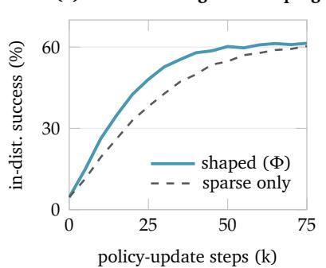

(b) agreement in action-chunk selection  
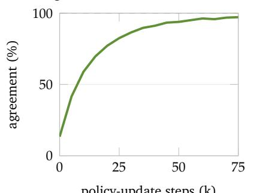  
policy-update steps (k)

(c) OOD success as memory grows  
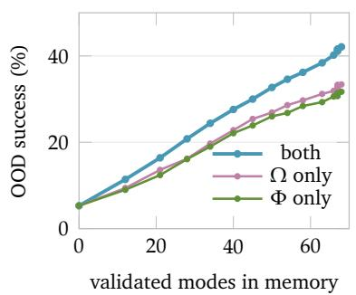  
Figure 5: Learning dynamics and memory accumulation. (a) In-distribution success on pick-and-place tasks during policy training, using the same generated data with potential shaping or sparse rewards alone. Shaping accelerates learning, with both conditions reaching similar final success rates. (b) Agreement between the action chunks selected by the two value critics, reaching approximately 97% at the end of training. (c) OOD success at successive memory snapshots, indexed by the number of validated difficulty modes. Using both program stores yields higher final success than retaining generation or training programs alone.

Generation quality and diagnosis validation. Table 8 shows that 88.9% of scene proposals pass the physical validity checks, compared with 71.3% under uniform sampling. Coverage entropy remains close to that of uniform sampling (3.18 versus 3.42 bits), while targeting precision increases from 24.6% to 66.7%. The engine therefore improves scene validity and targeting while maintaining broad coverage. We reject 18.2% of the critic’s failure diagnoses because variants that modify the identified scene factor are no harder than control variants that modify a different factor. In the evaluation with two annotators and 100 sampled diagnoses, this validation step improves agreement with human annotations from 73.6% to 82.4%.

Computational cost and adaptive scheduling. CoDA improves OOD success from 18.1% to 27.6% over scalar feedback, a 52% relative improvement (Table 9). Its computational requirements are 7.4M LLM tokens and 66 GPU-hours per 1,000 accepted environments. Adaptive scheduling improves efficiency, reducing both token usage and GPU time by approximately 11% relative to fixed round intervals while increasing OOD success from 26.1% to 27.6%. Thus, adapting when to generate new environments reduces computational cost while improving policy performance.

Qualitative results. Figure 6 illustrates the scene variations produced by the data engine from four seed scenes. For each seed, we show three spatial perturbations of increasing magnitude, a target-size change, and a targetobject replacement. All displayed variants pass the scenevalidity checks. Additional successful policy rollouts on LIBERO-Pro tasks and generated fruit preparation scenes are shown in Figure 7.

Seed

  
Small spatial shift

Table 9: Computational cost and effect of round scheduling. LLM token usage, simulation time, and GPU time are reported per 1,000 accepted environments. Token counts include scene generation, failure diagnosis, and potential compilation. The fixed schedule starts a new generation round every $K _ { \pi }$ policy-update steps, while the adaptive schedule uses the remaining difficulty modes and recent learning progress. Best and second best highlighted.
<table><tr><td></td><td>LLM tokens (M) ↓</td><td>Sim-hours ↓</td><td>GPU-hours ↓</td><td>OOD success ↑</td></tr><tr><td>uniform variants</td><td>3.1</td><td>14.2</td><td>38</td><td>8.5</td></tr><tr><td>scalar-feedback</td><td>4.6</td><td>22.5</td><td>51</td><td>18.1</td></tr><tr><td>CoDA, fixed schedule</td><td>8.3</td><td>27.8</td><td>74</td><td>26.1</td></tr><tr><td>CoDA, adaptive schedule</td><td>7.4</td><td>25.1</td><td>66</td><td>27.6</td></tr></table>

## Tool sorting / authored scene evolution

  
Small spatial shift  
Black pliers / original layout  
Large spatial change

  
Small spatial edit / up to 5 cm  
Target size change  
Medium spatial shift

  
Medium spatial edit / up to 18 cm  
Target replacement

  
Large spatial edit / up to Black pliers / 1.65x size 76 cm

  
Black pliers -> Toy mallet

## Serving board / authored scene evolution

  
Small spatial shift  
Ramekin / original layout

  
Large spatial change  
Small spatial edit / up to 8 cm  
Medium spatial shift

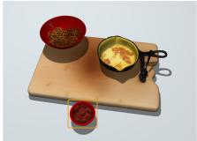  
Target size change  
Medium spatial edit / up to 20 cm

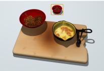  
Target replacement

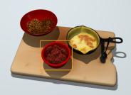  
Large spatial edit / up to Ramekin / 1.50x size 56 cm

  
Ramekin -> Mug

## Craft station / authored scene evolution

  
Toy mallet / original layout  
Large spatial change

  
Small spatial edit / up to 5 cm  
Target size change  
Medium spatial shift

  
Medium spatial edit / up to 22 cm  
Target replacement  
Small spatial shift

## Noodle preparation / authored scene evolution

  
White mug / original layout

  
Small spatial edit / up to 5 cm  
Medium spatial shift

  
Medium spatial edit / up to 24 cm  
Large spatial change  
Target size change  
Target replacement

  
Large spatial edit / up 76 cm  
Large spatial edit / up to Toy mallet / 1.60x size 99 cm  
Toy mallet -> Black pliers

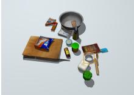  
White mug / 0.60x size  
White mug -> Ramekin

Figure 6: Scene variations generated by CoDA. Four examples show changes in object layout, size, and identity for tool sorting, serving-board arrangement, craft-station organization, and noodle preparation tasks. Each panel contains a seed scene, three spatial perturbations of increasing magnitude, a target-size change, and a target-object replacement. All displayed variants pass validity checks.

## D. Limitations

CoDA relies on foundation models for scene generation, failure diagnosis, and potential compilation. Errors in these models’ understanding of objects, physical interactions, or task requirements can affect the resulting scenes and training signals. Physical validity checks and control experiments help detect such errors, but their coverage depends on the checks and interventions used. Results may also vary with changes to the underlying models, making model versions and configurations important for reproducibility. The framework requires additional simulation and model inference to generate environments, evaluate policy rollouts, and validate diagnoses. These costs constrain the number of rounds and task families that can be explored under a fixed budget. Our evaluation also focuses on simulated manipulation. Transfer to physical robots remains to be established, particularly for tasks sensitive to differences in contact dynamics, sensing, and actuation.

Successful execution of LIBERO-Pro tasks  
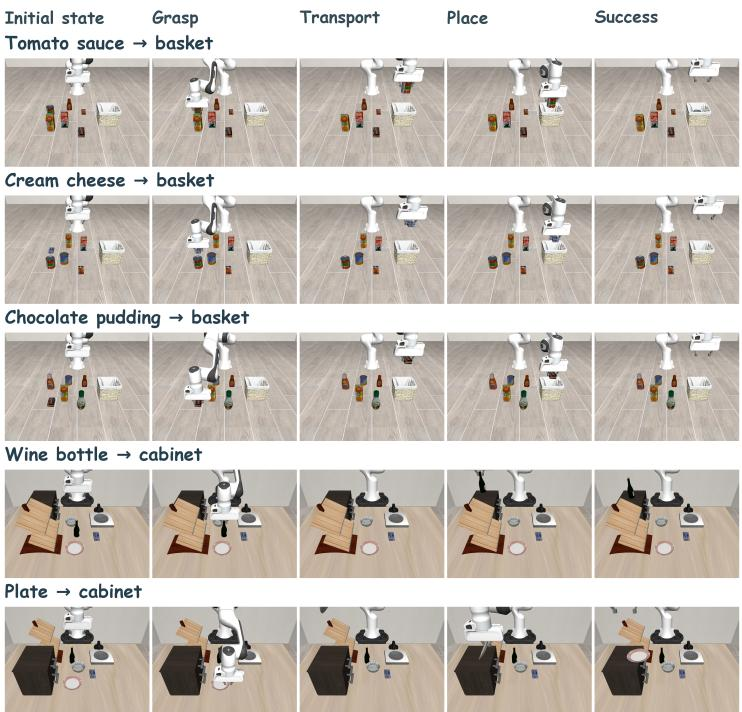

## Successful execution of fruit preparation

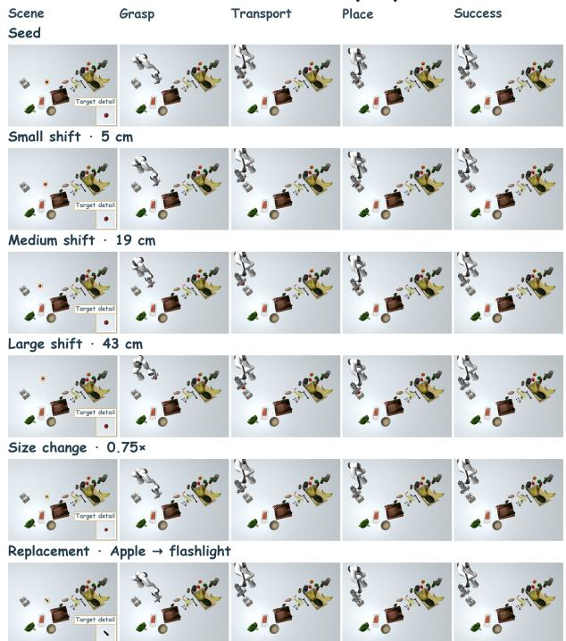  
Figure 7: Successful policy rollouts on benchmark and generated environments. Left: five LIBERO-Pro tasks involving object placement into a basket or cabinet. Right: a fruit-preparation seed scene and five generated variants, covering three spatial perturbations, target resizing, and target replacement. Each row shows one rollout, with columns depicting the initial scene, grasp, transport, placement, and successful task completion.

## E. Broader Impact

The ability to generate environments and training signals automatically has far-reaching implications for robot learning, simulation, and embodied AI. CoDA contributes to this space by turning environment generation into a closed loop that responds to what a policy has learned, which lowers the cost of producing diverse, verifiable training data. This can accelerate the development of capable manipulation policies, improve the fidelity and coverage of simulated benchmarks, and support scalable data generation for research groups without large teleoperation budgets. While lowering the barrier to training capable robot policies raises potential concerns about misuse and about biases inherited from the underlying foundation models, our framework is designed for research use, judges success only through machinecheckable verifiers, and audits every automated diagnosis with control experiments. We encourage responsible deployment practices that keep such audits in place. Compared to collecting real-robot demonstrations at scale, the approach is computationally efficient and requires no physical data collection, and we view its benefits in controllable, verifiable data generation as outweighing its risks when applied responsibly.