# CoWorld Reasoner: Agentic Multimodal Reasoning with the Evolving Video World Model-Driven Harness

Dongjie Cheng<sup>1</sup> Ruifeng Yuan<sup>2</sup> Ran Wei<sup>2</sup> Ning Song<sup>2</sup> Yongqi Li<sup>1†</sup> Wenjie Li<sup>1</sup>

<sup>1</sup> The Hon<sub>g</sub> Kon<sub>g</sub> Pol<sub>y</sub>technic Universit<sub>y</sub> <sup>2</sup> Han<sub>g</sub>zhou Dia<sub>g</sub>ens Biotechnolo<sub>gy</sub> Co.<sub>,</sub> Ltd dong-jie.cheng@connect.polyu.hk, liyongqi0@gmail.com

## Abstract

As Vision-Lan<sub>g</sub>ua<sub>g</sub>e Models (VLMs) advance, the<sub>y</sub> are increasin<sub>g</sub>l<sub>y</sub> ex<sub>p</sub>ected to <sub>p</sub>erform s<sub>p</sub>ati<sub>o</sub>t<sub>empora</sub>l <sub>reason</sub>i<sub>ng over mo</sub>ti<sub>on, ac</sub>ti<sub>ons, an</sub>d <sub>v</sub>i<sub>ew c</sub>h<sub>anges</sub> b<sub>eyon</sub>d <sub>w</sub>h<sub>a</sub>t th<sub>e</sub> i<sub>npu</sub>t i<sub>mages</sub> show. Video World Models (VWMs) <sub>p</sub>rovide a natural unified en<sub>g</sub>ine for visual ima<sub>g</sub>ination b<sub>y</sub> <sub>genera</sub>ti<sub>ng</sub> t<sub>as</sub>k<sub>-re</sub>l<sub>evan</sub>t <sub>v</sub>i<sub>sua</sub>l <sub>con</sub>t<sub>en</sub>t <sub>as</sub> <sub>a</sub>dditi<sub>ona</sub>l <sub>ev</sub>id<sub>ence.</sub> H<sub>owever,</sub> <sub>ex</sub>i<sub>s</sub>ti<sub>ng</sub> <sub>approac</sub>h<sub>es</sub> t<sub>yp-</sub> i<sub>ca</sub>ll<sub>y</sub> i<sub>nvo</sub>k<sub>e a</sub> VWM th<sub>roug</sub>h fi<sub>xe</sub>d <sub>p</sub>i<sub>pe</sub>li<sub>nes cen</sub>t<sub>ere</sub>d <sub>on a pre</sub>d<sub>e</sub>fi<sub>ne</sub>d f<sub>orm o</sub>f <sub>v</sub>i<sub>sua</sub>l i<sub>mag</sub>i<sub>na</sub>ti<sub>on,</sub> <sub>suc</sub>h <sub>as</sub> <sub>nove</sub>l<sub>-v</sub>i<sub>ew</sub> <sub>syn</sub>th<sub>es</sub>i<sub>s.</sub> T<sub>o</sub> <sub>suppor</sub>t fl<sub>ex</sub>ibl<sub>e</sub> <sub>v</sub>i<sub>sua</sub>l i<sub>mag</sub>i<sub>na</sub>ti<sub>on</sub> f<sub>or</sub> di<sub>verse</sub> <sub>reason</sub>i<sub>ng</sub> t<sub>as</sub>k<sub>s,</sub> we introduce CoWorld Reasoner, an agentic framework that uses a VWM as a unified visual <sub>reason</sub>i<sub>ng eng</sub>i<sub>ne.</sub> It<sub>s</sub> Vid<sub>eo</sub> W<sub>or</sub>ld M<sub>o</sub>d<sub>e</sub>l<sub>-</sub>D<sub>r</sub>i<sub>ven</sub> H<sub>arness exposes mu</sub>lti<sub>p</sub>l<sub>e v</sub>i<sub>sua</sub>l <sub>opera</sub>ti<sub>ons</sub> th<sub>roug</sub>h t<sub>oo</sub>l<sub>s an</sub>d <sub>uses s</sub>kill<sub>s</sub> t<sub>o gu</sub>id<sub>e</sub> th<sub>e</sub> VLM i<sub>n</sub> d<sub>ec</sub>idi<sub>ng w</sub>h<sub>e</sub>th<sub>er</sub> t<sub>o</sub> i<sub>mag</sub>i<sub>ne, se</sub>l<sub>ec</sub>ti<sub>ng an</sub> <sub>opera</sub>ti<sub>on,</sub> <sub>cons</sub>t<sub>ruc</sub>ti<sub>ng</sub> <sub>a</sub> <sub>genera</sub>ti<sub>on</sub> <sub>reques</sub>t<sub>,</sub> <sub>an</sub>d i<sub>n</sub>t<sub>erpre</sub>ti<sub>ng</sub> th<sub>e</sub> <sub>resu</sub>lti<sub>ng</sub> <sub>v</sub>i<sub>sua</sub>l <sub>ev</sub>id<sub>ence.</sub> We further introduce VLM-VWM Harness Co-Evolution, which jointly revises tools, skills, and <sub>execu</sub>ti<sub>on</sub> <sub>co</sub>d<sub>e</sub> b<sub>ase</sub>d <sub>on</sub> <sub>execu</sub>ti<sub>on</sub> f<sub>ee</sub>db<sub>ac</sub>k <sub>w</sub>hil<sub>e</sub> k<sub>eep</sub>i<sub>ng</sub> b<sub>o</sub>th <sub>mo</sub>d<sub>e</sub>l <sub>we</sub>i<sub>g</sub>ht<sub>s</sub> fi<sub>xe</sub>d<sub>.</sub> A<sub>cross</sub> <sub>seven</sub> b<sub>enc</sub>h<sub>mar</sub>k<sub>s spann</sub>i<sub>ng spa</sub>ti<sub>a</sub>l i<sub>n</sub>t<sub>e</sub>lli<sub>gence,</sub> t<sub>empora</sub>l <sub>an</sub>d <sub>causa</sub>l <sub>reason</sub>i<sub>ng, an</sub>d <sub>percep</sub>t<sub>ua</sub>l reasonin<sub>g,</sub> CoWorld Reasoner out<sub>p</sub>erforms direct reasonin<sub>g</sub> with the same VLM. The stron<sub>g</sub>est <sub>var</sub>i<sub>an</sub>t i<sub>mproves on a</sub>ll <sub>seven</sub> b<sub>enc</sub>h<sub>mar</sub>k<sub>s,</sub> i<sub>nc</sub>l<sub>u</sub>di<sub>ng re</sub>l<sub>a</sub>ti<sub>ve accuracy ga</sub>i<sub>ns o</sub>f 11<sub>.</sub>8% <sub>on</sub> MMSI and 13.0% on ERQA, and outperforms all five evolving baselines using the same backbone across fi<sub>ve</sub> b<sub>enc</sub>h<sub>mar</sub>k<sub>s.</sub>

§ Project Pa<sub>g</sub>e: https://modalitydance.github.io/CoWorld-Reasoner

## 1 Introduction

Lar<sub>g</sub>e Lan<sub>g</sub>ua<sub>g</sub>e Models (LLMs) have demonstrated stron<sub>g</sub> instruction-followin<sub>g</sub> and reasonin<sub>g</sub> abilities, but the<sub>y</sub> o<sub>p</sub>erate <sub>p</sub>rimaril<sub>y</sub> over text. Vision-Lan<sub>g</sub>ua<sub>g</sub>e Models (VLMs) extend these <sub>capa</sub>biliti<sub>es</sub> t<sub>o</sub> <sub>v</sub>i<sub>sua</sub>l i<sub>npu</sub>t<sub>s,</sub> <sub>ena</sub>bli<sub>ng</sub> <sub>mu</sub>lti<sub>mo</sub>d<sub>a</sub>l <sub>un</sub>d<sub>ers</sub>t<sub>an</sub>di<sub>ng</sub> <sub>an</sub>d <sub>reason</sub>i<sub>ng.</sub> R<sub>ecen</sub>t VLM<sub>s</sub> such as Qwen3.8 [1] and Gemini 3.8 [2] can efectivel<sub>y</sub> inter<sub>p</sub>ret ima<sub>g</sub>es and anal<sub>y</sub>ze charts, and th<sub>ey are</sub> i<sub>ncreas</sub>i<sub>ng</sub>l<sub>y use</sub>d i<sub>n rea</sub>l<sub>-wor</sub>ld <sub>mu</sub>lti<sub>mo</sub>d<sub>a</sub>l <sub>app</sub>li<sub>ca</sub>ti<sub>ons.</sub>

Be<sub>y</sub>ond static ima<sub>g</sub>e understandin<sub>g,</sub> VLMs are increasin<sub>g</sub>l<sub>y</sub> ex<sub>p</sub>ected to <sub>p</sub>erform s<sub>p</sub>atiotem<sub>p</sub>oral <sub>reason</sub>i<sub>ng</sub> <sub>over</sub> <sub>mo</sub>ti<sub>on,</sub> <sub>ac</sub>ti<sub>ons,</sub> <sub>an</sub>d <sub>v</sub>i<sub>ew</sub> <sub>c</sub>h<sub>anges.</sub> F<sub>or</sub> <sub>examp</sub>l<sub>e,</sub> <sub>a</sub> <sub>mo</sub>d<sub>e</sub>l <sub>may</sub> <sub>nee</sub>d t<sub>o</sub> <sub>pre</sub>di<sub>c</sub>t whether two objects would overlap if one were moved, reconstruct what happened between two <sub>o</sub>b<sub>serva</sub>ti<sub>ons,</sub> <sub>or</sub> i<sub>n</sub>f<sub>er</sub> <sub>w</sub>h<sub>a</sub>t <sub>ano</sub>th<sub>er</sub> <sub>v</sub>i<sub>ewpo</sub>i<sub>n</sub>t <sub>wou</sub>ld <sub>revea</sub>l<sub>.</sub> S<sub>o</sub>l<sub>v</sub>i<sub>ng</sub> <sub>suc</sub>h <sub>pro</sub>bl<sub>ems</sub> <sub>requ</sub>i<sub>res</sub> <sub>go</sub>i<sub>ng</sub> b<sub>eyon</sub>d <sub>o</sub>b<sub>serve</sub>d <sub>v</sub>i<sub>sua</sub>l <sub>ev</sub>id<sub>ence</sub> t<sub>o reason a</sub>b<sub>ou</sub>t <sub>uno</sub>b<sub>serve</sub>d t<sub>rans</sub>iti<sub>ons an</sub>d <sub>re</sub>l<sub>a</sub>ti<sub>ons.</sub> O<sub>ne</sub> <sub>prom</sub>i<sub>s</sub>i<sub>ng approac</sub>h i<sub>s v</sub>i<sub>sua</sub>l i<sub>mag</sub>i<sub>na</sub>ti<sub>on: exp</sub>li<sub>c</sub>itl<sub>y genera</sub>ti<sub>ng</sub> t<sub>as</sub>k<sub>-re</sub>l<sub>evan</sub>t <sub>v</sub>i<sub>sua</sub>l <sub>pre</sub>di<sub>c</sub>ti<sub>ons</sub> <sub>o</sub>f <sub>w</sub>h<sub>a</sub>t i<sub>s no</sub>t <sub>o</sub>b<sub>serve</sub>d <sub>an</sub>d <sub>us</sub>i<sub>ng</sub> th<sub>em as a</sub>dditi<sub>ona</sub>l <sub>ev</sub>id<sub>ence</sub> f<sub>or reason</sub>i<sub>ng.</sub> Thi<sub>s ra</sub>i<sub>ses a</sub> f<sub>un</sub>d<sub>amen</sub>t<sub>a</sub>l <sub>ques</sub>ti<sub>on:</sub> h<sub>ow</sub> <sub>can</sub> <sub>a</sub> VLM <sub>genera</sub>t<sub>e</sub> <sub>an</sub>d <sub>exp</sub>l<sub>o</sub>it th<sub>e</sub> <sub>r</sub>i<sub>g</sub>ht <sub>v</sub>i<sub>sua</sub>l i<sub>mag</sub>i<sub>na</sub>ti<sub>on</sub> f<sub>or</sub> th<sub>e</sub> <sub>reason</sub>i<sub>ng</sub> <sub>pro</sub>bl<sub>em</sub> <sub>a</sub>t h<sub>an</sub>d?

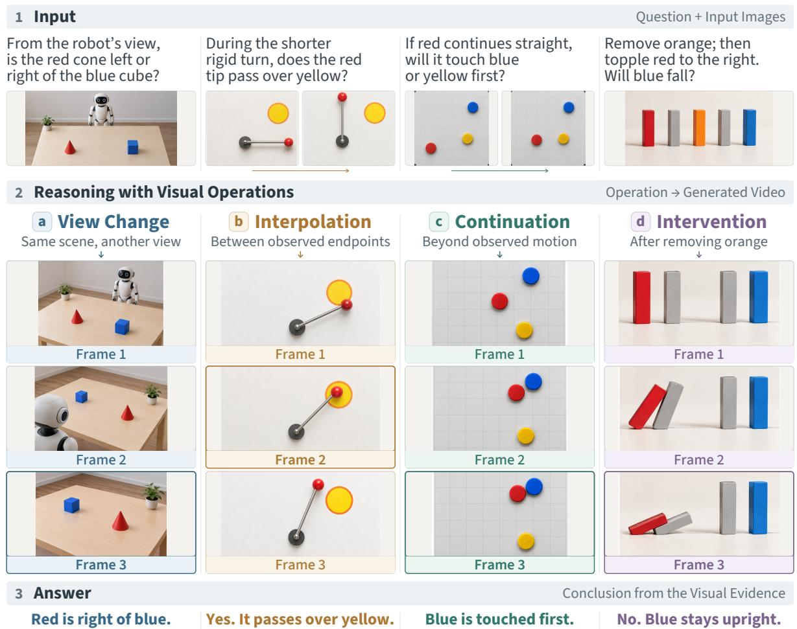  
Figure 1: Illustration of how diferent multimodal reasoning tasks require diferent visual operations: (a) view chan<sub>g</sub>e for s<sub>p</sub>atial <sub>p</sub>ers<sub>p</sub>ective takin<sub>g</sub>; (b) inter<sub>p</sub>olation to infer hidden motion between observed end<sub>p</sub>oints; (c) continuation to <sub>p</sub>redict first contact from observed motion; and (d) intervention to reason <sub>a</sub>b<sub>ou</sub>t th<sub>e ou</sub>t<sub>come o</sub>f <sub>a con</sub>t<sub>ro</sub>ll<sub>e</sub>d <sub>c</sub>h<sub>ange.</sub>

Video World Models (VWMs), such as MiniMax H3 [3] and LTX-Video [4], <sub>p</sub>rovide a natural <sub>eng</sub>i<sub>ne</sub> f<sub>or v</sub>i<sub>sua</sub>l i<sub>mag</sub>i<sub>na</sub>ti<sub>on</sub> b<sub>y mo</sub>d<sub>e</sub>li<sub>ng v</sub>i<sub>sua</sub>l d<sub>ynam</sub>i<sub>cs</sub> f<sub>rom</sub> l<sub>arge-sca</sub>l<sub>e v</sub>id<sub>eo</sub> d<sub>a</sub>t<sub>a.</sub> Gi<sub>ven</sub> i<sub>npu</sub>t i<sub>mages an</sub>d <sub>an appropr</sub>i<sub>a</sub>t<sub>e v</sub>i<sub>sua</sub>l <sub>opera</sub>ti<sub>on,</sub> th<sub>ey can genera</sub>t<sub>e v</sub>id<sub>eo</sub> d<sub>ep</sub>i<sub>c</sub>ti<sub>ng uno</sub>b<sub>serve</sub>d <sub>v</sub>i<sub>ews,</sub> i<sub>n</sub>t<sub>erme</sub>di<sub>a</sub>t<sub>e s</sub>t<sub>a</sub>t<sub>es,</sub> f<sub>u</sub>t<sub>ure even</sub>t<sub>s, or</sub> i<sub>n</sub>t<sub>erven</sub>ti<sub>on ou</sub>t<sub>comes.</sub> R<sub>ecen</sub>t <sub>approac</sub>h<sub>es,</sub> i<sub>nc</sub>l<sub>u</sub>di<sub>ng</sub> MindJourne<sub>y</sub> [5] and AVIC [6], use a VWM to <sub>g</sub>enerate additional visual evidence for s<sub>p</sub>atial rea-<sub>son</sub>i<sub>ng,</sub> i<sub>nc</sub>l<sub>u</sub>di<sub>ng syn</sub>th<sub>es</sub>i<sub>ze</sub>d <sub>v</sub>i<sub>ews</sub> f<sub>or cross-v</sub>i<sub>ew reason</sub>i<sub>ng.</sub> H<sub>owever,</sub> th<sub>ese approac</sub>h<sub>es</sub> t<sub>yp</sub>i<sub>ca</sub>ll<sub>y</sub> i<sub>nvo</sub>k<sub>e</sub> <sub>a</sub> VWM th<sub>roug</sub>h fi<sub>xe</sub>d <sub>p</sub>i<sub>pe</sub>li<sub>nes</sub> <sub>cen</sub>t<sub>ere</sub>d <sub>on</sub> <sub>a</sub> <sub>pre</sub>d<sub>e</sub>fi<sub>ne</sub>d f<sub>orm</sub> <sub>o</sub>f <sub>v</sub>i<sub>sua</sub>l i<sub>mag</sub>i<sub>na</sub>ti<sub>on,</sub> <sub>suc</sub>h <sub>as nove</sub>l<sub>-v</sub>i<sub>ew syn</sub>th<sub>es</sub>i<sub>s.</sub> Thi<sub>s</sub> li<sub>m</sub>it<sub>s</sub> th<sub>e</sub>i<sub>r app</sub>li<sub>ca</sub>bilit<sub>y</sub> t<sub>o</sub> di<sub>verse reason</sub>i<sub>ng pro</sub>bl<sub>ems, w</sub>hi<sub>c</sub>h <sub>may</sub> <sub>requ</sub>i<sub>re</sub> f<sub>un</sub>d<sub>amen</sub>t<sub>a</sub>ll<sub>y</sub> dif<sub>eren</sub>t f<sub>orms</sub> <sub>o</sub>f <sub>v</sub>i<sub>sua</sub>l i<sub>mag</sub>i<sub>na</sub>ti<sub>on:</sub> <sub>c</sub>h<sub>ang</sub>i<sub>ng</sub> <sub>v</sub>i<sub>ewpo</sub>i<sub>n</sub>t<sub>s</sub> f<sub>or</sub> <sub>perspec</sub>ti<sub>ve</sub> t<sub>a</sub>ki<sub>ng,</sub> i<sub>n</sub>t<sub>erpo</sub>l<sub>a</sub>ti<sub>ng</sub> b<sub>e</sub>t<sub>ween o</sub>b<sub>serva</sub>ti<sub>ons</sub> t<sub>o recons</sub>t<sub>ruc</sub>t hidd<sub>en</sub> t<sub>rans</sub>iti<sub>ons, con</sub>ti<sub>nu</sub>i<sub>ng o</sub>b<sub>serve</sub>d d<sub>ynam</sub>i<sub>cs</sub> t<sub>o an</sub>ti<sub>c</sub>i<sub>pa</sub>t<sub>e</sub> f<sub>u</sub>t<sub>ure even</sub>t<sub>s, or</sub> i<sub>n</sub>t<sub>erven</sub>i<sub>ng on</sub> th<sub>e scene</sub> t<sub>o reason a</sub>b<sub>ou</sub>t i<sub>n</sub>t<sub>erven</sub>ti<sub>on</sub> <sub>ou</sub>t<sub>comes, as</sub> ill<sub>us</sub>t<sub>ra</sub>t<sub>e</sub>d i<sub>n</sub> Fi<sub>gure</sub> 1<sub>.</sub> A <sub>v</sub>i<sub>sua</sub>l <sub>reasoner s</sub>h<sub>ou</sub>ld th<sub>ere</sub>f<sub>ore ac</sub>ti<sub>ve</sub>l<sub>y</sub> d<sub>e</sub>t<sub>erm</sub>i<sub>ne w</sub>h<sub>a</sub>t t<sub>o</sub> i<sub>mag</sub>i<sub>ne accor</sub>di<sub>ng</sub> t<sub>o</sub> th<sub>e reason</sub>i<sub>ng pro</sub>bl<sub>em an</sub>d h<sub>ow</sub> t<sub>o exp</sub>l<sub>o</sub>it th<sub>e genera</sub>t<sub>e</sub>d <sub>v</sub>i<sub>sua</sub>l <sub>ev</sub>id<sub>ence</sub> t<sub>o so</sub>l<sub>ve</sub> it<sub>.</sub>

To enable task-dependent visual imagination, we introduce CoWorld Reasoner, an agentic f<sub>ramewor</sub>k th<sub>a</sub>t <sub>uses a</sub> VWM <sub>as a un</sub>ifi<sub>e</sub>d <sub>v</sub>i<sub>sua</sub>l <sub>reason</sub>i<sub>ng eng</sub>i<sub>ne.</sub> U<sub>n</sub>lik<sub>e an agen</sub>t <sub>con</sub>fi<sub>ne</sub>d t<sub>o</sub> <sub>a</sub> fi<sub>xe</sub>d <sub>wor</sub>kfl<sub>ow,</sub> it <sub>se</sub>l<sub>ec</sub>t<sub>s among</sub> VWM<sub>-</sub>d<sub>r</sub>i<sub>ven</sub> t<sub>oo</sub>l<sub>s</sub> t<sub>o genera</sub>t<sub>e unseen v</sub>i<sub>ews,</sub> i<sub>n</sub>t<sub>erme</sub>di<sub>a</sub>t<sub>e</sub> <sub>s</sub>t<sub>a</sub>t<sub>es, con</sub>ti<sub>nua</sub>ti<sub>ons, or</sub> i<sub>n</sub>t<sub>erven</sub>ti<sub>on ou</sub>t<sub>comes accor</sub>di<sub>ng</sub> t<sub>o</sub> th<sub>e ques</sub>ti<sub>on.</sub> Skill<sub>s gu</sub>id<sub>e w</sub>h<sub>en</sub> t<sub>o</sub> i<sub>nvo</sub>k<sub>e</sub> th<sub>ese</sub> t<sub>oo</sub>l<sub>s,</sub> h<sub>ow</sub> t<sub>o cons</sub>t<sub>ruc</sub>t <sub>reques</sub>t<sub>s, an</sub>d h<sub>ow</sub> t<sub>o</sub> i<sub>n</sub>t<sub>erpre</sub>t th<sub>e genera</sub>t<sub>e</sub>d <sub>v</sub>id<sub>eo; a</sub> <sub>ver</sub>ifi<sub>er an</sub>d <sub>execu</sub>ti<sub>on co</sub>d<sub>e comp</sub>l<sub>e</sub>t<sub>e</sub> th<sub>e</sub> h<sub>arness.</sub> A <sub>pre</sub>d<sub>e</sub>fi<sub>ne</sub>d h<sub>arness may</sub> f<sub>a</sub>il t<sub>o e</sub>li<sub>c</sub>it th<sub>e v</sub>i<sub>sua</sub>l <sub>ev</sub>id<sub>ence requ</sub>i<sub>re</sub>d b<sub>y</sub> dif<sub>eren</sub>t <sub>reason</sub>i<sub>ng</sub> t<sub>as</sub>k<sub>s or</sub> t<sub>o gu</sub>id<sub>e</sub> it<sub>s</sub> i<sub>n</sub>t<sub>erpre</sub>t<sub>a</sub>ti<sub>on.</sub> R<sub>e</sub>fi<sub>nemen</sub>t <sub>mus</sub>t <sub>coor</sub>di<sub>na</sub>t<sub>e ev</sub>id<sub>ence genera</sub>ti<sub>on an</sub>d i<sub>n</sub>t<sub>erpre</sub>t<sub>a</sub>ti<sub>on,</sub> b<sub>ecause w</sub>h<sub>a</sub>t th<sub>e</sub> VLM <sub>can</sub> i<sub>n</sub>f<sub>er</sub> d<sub>epen</sub>d<sub>s on</sub> what the VWM can reliabl<sub>y g</sub>enerate. We therefore introduce VLM-VWM Harness Co-Evolution<sub>,</sub> which iteratively refines the interface between the VLM and VWM by jointly revising tools, skills, <sub>an</sub>d <sub>execu</sub>ti<sub>on co</sub>d<sub>e</sub> b<sub>ase</sub>d <sub>on execu</sub>ti<sub>on</sub> f<sub>ee</sub>db<sub>ac</sub>k<sub>.</sub> With b<sub>o</sub>th <sub>mo</sub>d<sub>e</sub>l <sub>we</sub>i<sub>g</sub>ht<sub>s</sub> fi<sub>xe</sub>d<sub>, co-evo</sub>l<sub>u</sub>ti<sub>on</sub> i<sub>mproves</sub> h<sub>ow</sub> th<sub>e</sub> t<sub>wo mo</sub>d<sub>e</sub>l<sub>s</sub> i<sub>n</sub>t<sub>erac</sub>t <sub>an</sub>d <sub>use</sub> t<sub>as</sub>k<sub>-re</sub>l<sub>evan</sub>t <sub>v</sub>i<sub>sua</sub>l <sub>ev</sub>id<sub>ence.</sub>

We evaluated CoWorld Reasoner on seven benchmarks s<sub>p</sub>annin<sub>g</sub> s<sub>p</sub>atial intelli<sub>g</sub>ence [7, 8, 9, 10], tem<sub>p</sub>oral and causal reasonin<sub>g</sub> [11, 12], and <sub>p</sub>erce<sub>p</sub>tual reasonin<sub>g</sub> [13]. Across VLM/VWM <sub>var</sub>i<sub>an</sub>t<sub>s,</sub> C<sub>o</sub>W<sub>or</sub>ld R<sub>easoner</sub> i<sub>mproves</sub> <sub>aggrega</sub>t<sub>e</sub> <sub>accuracy</sub> <sub>over</sub> di<sub>rec</sub>t <sub>reason</sub>i<sub>ng</sub> <sub>w</sub>ith th<sub>e</sub> <sub>same</sub> VLM. The stron<sub>g</sub>est variant (GPT-5.6 and MiniMax H3) im<sub>p</sub>roves all seven benchmarks, with relative gains of 11.8% on MMSI and 13.0% on ERQA. It also outperforms all five evolving baselines <sub>us</sub>i<sub>ng</sub> th<sub>e same</sub> b<sub>ac</sub>kb<sub>one on</sub> fi<sub>ve</sub> b<sub>enc</sub>h<sub>mar</sub>k<sub>s.</sub> F<sub>ur</sub>th<sub>er ana</sub>l<sub>ys</sub>i<sub>s</sub> hi<sub>g</sub>hli<sub>g</sub>ht<sub>s</sub> th<sub>e con</sub>t<sub>r</sub>ib<sub>u</sub>ti<sub>ons o</sub>f <sub>genera</sub>t<sub>e</sub>d <sub>v</sub>i<sub>sua</sub>l <sub>ev</sub>id<sub>ence an</sub>d <sub>co-evo</sub>l<sub>ve</sub>d <sub>con</sub>t<sub>ro</sub>l <sub>o</sub>f it<sub>s reques</sub>t <sub>an</sub>d i<sub>n</sub>t<sub>erpre</sub>t<sub>a</sub>ti<sub>on.</sub>

O<sub>ur ma</sub>i<sub>n con</sub>t<sub>r</sub>ib<sub>u</sub>ti<sub>ons are summar</sub>i<sub>ze</sub>d b<sub>e</sub>l<sub>ow:</sub>

1<sub>.</sub> W<sub>e</sub> l<sub>everage</sub> <sub>a</sub> VWM <sub>as</sub> <sub>a</sub> <sub>un</sub>ifi<sub>e</sub>d <sub>v</sub>i<sub>sua</sub>l <sub>reason</sub>i<sub>ng</sub> <sub>eng</sub>i<sub>ne</sub> f<sub>or</sub> <sub>v</sub>i<sub>sua</sub>l i<sub>mag</sub>i<sub>na</sub>ti<sub>on,</sub> <sub>ena</sub>bli<sub>ng</sub> th<sub>e</sub> <sub>agen</sub>t t<sub>o</sub> <sub>genera</sub>t<sub>e</sub> t<sub>as</sub>k<sub>-re</sub>l<sub>evan</sub>t <sub>v</sub>i<sub>sua</sub>l <sub>ev</sub>id<sub>ence</sub> th<sub>roug</sub>h di<sub>verse</sub> <sub>v</sub>i<sub>sua</sub>l <sub>opera</sub>ti<sub>ons.</sub>

2<sub>.</sub> W<sub>e</sub> d<sub>es</sub>i<sub>gn a</sub> Vid<sub>eo</sub> W<sub>or</sub>ld M<sub>o</sub>d<sub>e</sub>l<sub>-</sub>D<sub>r</sub>i<sub>ven</sub> H<sub>arness</sub> th<sub>a</sub>t <sub>exposes</sub> di<sub>verse v</sub>i<sub>sua</sub>l <sub>opera</sub>ti<sub>ons</sub> th<sub>roug</sub>h <sub>s</sub>t<sub>an</sub>d<sub>ar</sub>di<sub>ze</sub>d t<sub>oo</sub>l<sub>s an</sub>d <sub>enco</sub>d<sub>es reusa</sub>bl<sub>e reason</sub>i<sub>ng wor</sub>kfl<sub>ows as s</sub>kill<sub>s, ena</sub>bli<sub>ng</sub> th<sub>e agen</sub>t t<sub>o</sub> d<sub>ec</sub>id<sub>e w</sub>h<sub>e</sub>th<sub>er v</sub>i<sub>sua</sub>l i<sub>mag</sub>i<sub>na</sub>ti<sub>on</sub> i<sub>s nee</sub>d<sub>e</sub>d<sub>, w</sub>hi<sub>c</sub>h <sub>opera</sub>ti<sub>on</sub> t<sub>o</sub> i<sub>nvo</sub>k<sub>e, an</sub>d h<sub>ow</sub> t<sub>o</sub> i<sub>n</sub>t<sub>erpre</sub>t th<sub>e genera</sub>t<sub>e</sub>d <sub>v</sub>i<sub>sua</sub>l <sub>ev</sub>id<sub>ence.</sub>

3<sub>.</sub> W<sub>e</sub> i<sub>n</sub>t<sub>ro</sub>d<sub>uce</sub> VLM<sub>-</sub>VWM H<sub>arness</sub> C<sub>o-</sub>E<sub>vo</sub>l<sub>u</sub>ti<sub>on, w</sub>hi<sub>c</sub>h it<sub>era</sub>ti<sub>ve</sub>l<sub>y re</sub>fi<sub>nes</sub> th<sub>e</sub> i<sub>n</sub>t<sub>er</sub>f<sub>ace</sub> b<sub>e</sub>t<sub>ween</sub> the VLM and VWM by jointly revising tools, skills, and execution code based on execution f<sub>ee</sub>db<sub>ac</sub>k<sub>.</sub>

4. We evaluate CoWorld Reasoner with multi<sub>p</sub>le VLMs and VWMs across seven benchmarks <sub>spann</sub>i<sub>ng</sub> <sub>spa</sub>ti<sub>a</sub>l i<sub>n</sub>t<sub>e</sub>lli<sub>gence,</sub> t<sub>empora</sub>l <sub>an</sub>d <sub>causa</sub>l <sub>reason</sub>i<sub>ng,</sub> <sub>an</sub>d <sub>percep</sub>t<sub>ua</sub>l <sub>reason</sub>i<sub>ng,</sub> <sub>s</sub>h<sub>ow</sub>i<sub>ng</sub> <sub>ga</sub>i<sub>ns</sub> <sub>over</sub> di<sub>rec</sub>t <sub>reason</sub>i<sub>ng</sub> <sub>an</sub>d <sub>s</sub>t<sub>rong</sub> <sub>per</sub>f<sub>ormance</sub> <sub>aga</sub>i<sub>ns</sub>t <sub>evo</sub>l<sub>v</sub>i<sub>ng</sub> b<sub>ase</sub>li<sub>nes,</sub> <sub>w</sub>hil<sub>e</sub> <sub>ana</sub>l<sub>yz</sub>i<sub>ng</sub> th<sub>e con</sub>t<sub>r</sub>ib<sub>u</sub>ti<sub>ons o</sub>f th<sub>e</sub> h<sub>arness an</sub>d it<sub>s co-evo</sub>l<sub>u</sub>ti<sub>on.</sub>

## 2 Related Work

## 2.1 Multimodal Reasoning

R<sub>ecen</sub>t <sub>wor</sub>k <sub>uses v</sub>i<sub>sua</sub>l <sub>ev</sub>id<sub>ence</sub> t<sub>o suppor</sub>t <sub>mu</sub>lti<sub>mo</sub>d<sub>a</sub>l <sub>reason</sub>i<sub>ng, par</sub>ti<sub>cu</sub>l<sub>ar</sub>l<sub>y spa</sub>ti<sub>a</sub>l t<sub>as</sub>k<sub>s.</sub> MVoT [14] and ThinkMor<sub>p</sub>h [15] incor<sub>p</sub>orate <sub>g</sub>enerated ima<sub>g</sub>es into intermediate reasonin<sub>g</sub> ste<sub>p</sub>s, while Omni-R1 [16] uses ima<sub>g</sub>e <sub>g</sub>eneration to unif<sub>y</sub> diverse visual o<sub>p</sub>erations. Thinkin<sub>g</sub> with Video [17] uses video <sub>g</sub>eneration for visual reasonin<sub>g</sub>. For s<sub>p</sub>atial reasonin<sub>g</sub>, SenseNova-SI [18] and O<sub>p</sub>enS<sub>p</sub>atial [19] use lar<sub>g</sub>e-scale trainin<sub>g</sub> datasets, while World2VLM [20] uses views <sub>g</sub>enerated b<sub>y</sub> world models as su<sub>p</sub>ervision. At inference time, MindJourne<sub>y</sub> [5] searches camera movements

VLM-VWM Harness Co-Evolution  
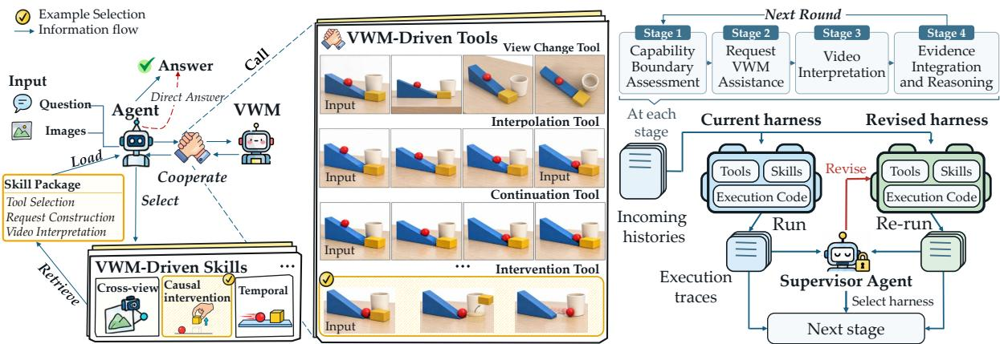  
Figure 2: Overview of CoWorld Reasoner. Left: VWM-driven tools provide visual operations, while skills <sub>enco</sub>d<sub>e reusa</sub>bl<sub>e wor</sub>kfl<sub>ows</sub> f<sub>or</sub> th<sub>e agen</sub>t’<sub>s</sub> t<sub>oo</sub>l <sub>se</sub>l<sub>ec</sub>ti<sub>on, reques</sub>t <sub>cons</sub>t<sub>ruc</sub>ti<sub>on, an</sub>d <sub>v</sub>id<sub>eo</sub> i<sub>n</sub>t<sub>erpre</sub>t<sub>a</sub>ti<sub>on.</sub> Ri<sub>g</sub>ht<sub>: a</sub>t <sub>eac</sub>h <sub>o</sub>f f<sub>our reason</sub>i<sub>ng s</sub>t<sub>ages, a superv</sub>i<sub>sor rev</sub>i<sub>ews execu</sub>ti<sub>on</sub> t<sub>races an</sub>d <sub>rev</sub>i<sub>ses</sub> th<sub>e re</sub>l<sub>evan</sub>t t<sub>oo</sub>l<sub>s,</sub> <sub>s</sub>kill<sub>s, an</sub>d <sub>execu</sub>ti<sub>on co</sub>d<sub>e.</sub> Th<sub>e agen</sub>t <sub>reruns</sub> th<sub>e s</sub>t<sub>age</sub> f<sub>rom</sub> th<sub>e same</sub> i<sub>ncom</sub>i<sub>ng</sub> i<sub>n</sub>t<sub>erac</sub>ti<sub>on</sub> hi<sub>s</sub>t<sub>or</sub>i<sub>es.</sub> Th<sub>e</sub> <sub>se</sub>l<sub>ec</sub>t<sub>e</sub>d h<sub>arness an</sub>d hi<sub>s</sub>t<sub>or</sub>i<sub>es are passe</sub>d t<sub>o</sub> th<sub>e nex</sub>t <sub>s</sub>t<sub>age.</sub> Th<sub>ese</sub> f<sub>our s</sub>t<sub>ages repea</sub>t <sub>over mu</sub>lti<sub>p</sub>l<sub>e evo</sub>l<sub>u</sub>ti<sub>on</sub> <sub>roun</sub>d<sub>s.</sub>

to ex<sub>p</sub>lore a scene, and S<sub>p</sub>atialDreamer [21] uses a learned <sub>p</sub>olic<sub>y</sub> to ex<sub>p</sub>lore <sub>g</sub>enerated views.   
AVIC [6] controls world-model use and the amount of visual content <sub>g</sub>enerated.

## 2.2 World Models

W<sub>or</sub>ld <sub>mo</sub>d<sub>e</sub>l<sub>s</sub> <sub>cap</sub>t<sub>ure</sub> th<sub>e</sub> <sub>s</sub>t<sub>ruc</sub>t<sub>ure</sub> <sub>an</sub>d d<sub>ynam</sub>i<sub>cs</sub> <sub>o</sub>f <sub>env</sub>i<sub>ronmen</sub>t<sub>s</sub> t<sub>o</sub> <sub>suppor</sub>t <sub>pre</sub>di<sub>c</sub>ti<sub>on</sub> <sub>an</sub>d simulation. Video <sub>g</sub>eneration models such as Wan [22], Seedance 2.0 [23], and MiniMax H3 [3] learn visual d<sub>y</sub>namics from video data, and Cosmos-Predict2.5 [24] focuses on world simulation. Marble [25] <sub>g</sub>enerates ex<sub>p</sub>licit 3D environments that users can ex<sub>p</sub>lore and edit. Interactive models such as RTFM [26] <sub>g</sub>enerate video in real time in res<sub>p</sub>onse to user actions. Our a<sub>pp</sub>roach t<sub>rea</sub>t<sub>s</sub> <sub>a</sub> VWM <sub>as</sub> <sub>a</sub> <sub>un</sub>ifi<sub>e</sub>d <sub>v</sub>i<sub>sua</sub>l <sub>reason</sub>i<sub>ng</sub> <sub>eng</sub>i<sub>ne</sub> <sub>an</sub>d <sub>exposes</sub> it th<sub>roug</sub>h <sub>mu</sub>lti<sub>p</sub>l<sub>e</sub> VWM<sub>-</sub>d<sub>r</sub>i<sub>ven</sub> t<sub>oo</sub>l<sub>s.</sub>

## 2.3 Self-Evolving Agents

Recent a<sub>pp</sub>roaches im<sub>p</sub>rove a<sub>g</sub>ents b<sub>y</sub> iterativel<sub>y</sub> revisin<sub>g p</sub>rom<sub>p</sub>ts<sub>,</sub> skills<sub>,</sub> and code. GEPA [27] o<sub>p</sub>timizes <sub>p</sub>rom<sub>p</sub>ts from execution traces, while SkillO<sub>p</sub>t [28] refines reusable skills from execution feedback. DGM [29] revises the a<sub>g</sub>ent’s own code, while Meta-Harness [30] o<sub>p</sub>timizes harness im<sub>p</sub>lementations. CoEvoSkills [31] jointl<sub>y</sub> evolves skills and a verifier that <sub>g</sub>uides their refinement. Our co-evolution supervisor jointly revises the VWM-driven harness to improve both th<sub>e genera</sub>ti<sub>on o</sub>f <sub>v</sub>i<sub>sua</sub>l <sub>ev</sub>id<sub>ence an</sub>d th<sub>e agen</sub>t’<sub>s</sub> i<sub>n</sub>t<sub>erpre</sub>t<sub>a</sub>ti<sub>on o</sub>f it<sub>.</sub>

## 3 Method

C<sub>o</sub>W<sub>or</sub>ld R<sub>easoner uses a</sub> VWM <sub>as a un</sub>ifi<sub>e</sub>d <sub>v</sub>i<sub>sua</sub>l <sub>reason</sub>i<sub>ng eng</sub>i<sub>ne.</sub> It h<sub>as</sub> t<sub>wo par</sub>t<sub>s: a</sub> Vid<sub>eo</sub> W<sub>or</sub>ld M<sub>o</sub>d<sub>e</sub>l<sub>-</sub>D<sub>r</sub>i<sub>ven</sub> H<sub>arness</sub> f<sub>or reques</sub>ti<sub>ng an</sub>d i<sub>n</sub>t<sub>erpre</sub>ti<sub>ng v</sub>i<sub>sua</sub>l <sub>ev</sub>id<sub>ence, an</sub>d VLM<sub>-</sub>VWM H<sub>arness</sub> C<sub>o-</sub>E<sub>vo</sub>l<sub>u</sub>ti<sub>on</sub> f<sub>or</sub> i<sub>mprov</sub>i<sub>ng</sub> th<sub>e</sub> h<sub>arness</sub> th<sub>roug</sub>h <sub>execu</sub>ti<sub>on</sub> f<sub>ee</sub>db<sub>ac</sub>k<sub>.</sub> Fi<sub>gure</sub> 2 ill<sub>us</sub>t<sub>ra</sub>t<sub>es</sub> b<sub>o</sub>th <sub>par</sub>t<sub>s,</sub> <sub>an</sub>d Al<sub>gor</sub>ith<sub>m</sub> 1 <sub>spec</sub>ifi<sub>es</sub> th<sub>e</sub> <sub>co-evo</sub>l<sub>u</sub>ti<sub>on</sub> <sub>proce</sub>d<sub>ure.</sub>

W<sub>e cons</sub>id<sub>er a ques</sub>ti<sub>on � w</sub>ith <sub>an or</sub>d<sub>ere</sub>d <sub>sequence o</sub>f <sub>�</sub> i<sub>npu</sub>t i<sub>mages</sub> $\mathbf { I } = \left( I _ { 1 } , \ldots , I _ { n } \right)$ . A VLM � <sub>powers</sub> th<sub>e agen</sub>t<sub>, an</sub>d <sub>a</sub> VWM � <sub>prov</sub>id<sub>es</sub> th<sub>e un</sub>d<sub>er</sub>l<sub>y</sub>i<sub>ng v</sub>i<sub>sua</sub>l <sub>genera</sub>ti<sub>on capa</sub>biliti<sub>es</sub> f<sub>or</sub> th<sub>e</sub>

VWM<sub>-</sub>d<sub>r</sub>i<sub>ven</sub> t<sub>oo</sub>l<sub>s</sub> i<sub>n</sub> <sub>an</sub> <sub>e</sub>dit<sub>a</sub>bl<sub>e</sub> h<sub>arness</sub> �<sub>.</sub> Th<sub>e</sub> <sub>answer</sub>i<sub>ng</sub> <sub>process</sub> <sub>can</sub> b<sub>e</sub> f<sub>ormu</sub>l<sub>a</sub>t<sub>e</sub>d <sub>as</sub>

$$
\hat { a } = \mathrm { C o W o r l d R e a s o n e r } ( q , { \bf I } ; M , W , H ) ,\tag{1}
$$

<sub>w</sub>h<sub>ere</sub> C<sub>o</sub>W<sub>or</sub>ldR<sub>easoner</sub> d<sub>eno</sub>t<sub>es</sub> h<sub>arness-gu</sub>id<sub>e</sub>d <sub>execu</sub>ti<sub>on</sub> <sub>an</sub>d <sub>�</sub>ˆ i<sub>s</sub> th<sub>e</sub> <sub>pre</sub>di<sub>c</sub>t<sub>e</sub>d <sub>answer.</sub>

## 3.1 Video World Model-Driven Harness

Harness components. The harness comprises � VWM-driven tools $T _ { \ell } ,$ � VWM<sub>-</sub>d<sub>r</sub>i<sub>ven</sub> <sub>s</sub>kill<sub>s</sub> $S _ { j { \mathrm { : } } }$ , a <sub>ver</sub>ifi<sub>er</sub> $V ,$ <sub>an</sub>d <sub>an execu</sub>ti<sub>on</sub> l<sub>ayer</sub> �<sub>:</sub>

$$
H = ( \mathcal T , S , V , E ) , \qquad \mathcal T = \{ T _ { \ell } \} _ { \ell = 1 } ^ { L } , \quad S = \{ S _ { j } \} _ { j = 1 } ^ { J } .\tag{2}
$$

E<sub>ac</sub>h t<sub>oo</sub>l $T _ { \ell }$ <sub>exposes</sub> <sub>a</sub> <sub>v</sub>i<sub>sua</sub>l <sub>opera</sub>ti<sub>on</sub> th<sub>roug</sub>h <sub>a</sub> <sub>s</sub>t<sub>an</sub>d<sub>ar</sub>di<sub>ze</sub>d i<sub>n</sub>t<sub>er</sub>f<sub>ace.</sub> O<sub>ur</sub> <sub>exper</sub>i<sub>men</sub>t<sub>s</sub> <sub>use</sub> f<sub>our</sub> t<sub>ypes</sub> <sub>o</sub>f <sub>v</sub>i<sub>sua</sub>l <sub>opera</sub>ti<sub>ons:</sub> <sub>v</sub>i<sub>ew</sub> <sub>c</sub>h<sub>ange,</sub> i<sub>n</sub>t<sub>erpo</sub>l<sub>a</sub>ti<sub>on,</sub> <sub>con</sub>ti<sub>nua</sub>ti<sub>on,</sub> <sub>an</sub>d i<sub>n</sub>t<sub>erven</sub>ti<sub>on.</sub> A<sub>ppen</sub>di<sub>x</sub> A<sub>.</sub>4 <sub>summar</sub>i<sub>zes</sub> th<sub>ese</sub> <sub>opera</sub>ti<sub>ons</sub> <sub>an</sub>d th<sub>e</sub> <sub>correspon</sub>di<sub>ng</sub> <sub>reason</sub>i<sub>ng</sub> <sub>s</sub>kill<sub>s.</sub> A <sub>reques</sub>t <sub>�</sub> <sub>spec</sub>ifi<sub>es</sub> <sub>w</sub>hi<sub>c</sub>h <sub>source</sub> i<sub>mages</sub> t<sub>o</sub> <sub>use</sub> <sub>an</sub>d i<sub>n</sub> <sub>w</sub>h<sub>a</sub>t <sub>or</sub>d<sub>er,</sub> th<sub>e</sub> i<sub>n</sub>t<sub>en</sub>d<sub>e</sub>d <sub>opera</sub>ti<sub>on,</sub> <sub>an</sub>d th<sub>e</sub> <sub>con</sub>diti<sub>ons</sub> t<sub>o preserve.</sub> Th<sub>e</sub> t<sub>oo</sub>l <sub>execu</sub>t<sub>es</sub> thi<sub>s reques</sub>t th<sub>roug</sub>h th<sub>e s</sub>h<sub>are</sub>d VWM <sub>an</sub>d <sub>re</sub>t<sub>urns</sub> th<sub>e genera</sub>t<sub>e</sub>d videoeI:

$$
\widetilde { \mathbf { I } } = T _ { \ell } ( \mathbf { I } , r ; W ) .\tag{3}
$$

A <sub>s</sub>kill $S _ { j }$ <sub>gu</sub>id<sub>es cross-v</sub>i<sub>ew,</sub> t<sub>empora</sub>l<sub>, or causa</sub>l <sub>reason</sub>i<sub>ng</sub> th<sub>roug</sub>h <sub>a reusa</sub>bl<sub>e wor</sub>kfl<sub>ow</sub> f<sub>or se</sub>l<sub>ec</sub>ti<sub>ng</sub> <sub>v</sub>i<sub>sua</sub>l <sub>opera</sub>ti<sub>ons, cons</sub>t<sub>ruc</sub>ti<sub>ng reques</sub>t<sub>s, an</sub>d i<sub>n</sub>t<sub>erpre</sub>ti<sub>ng</sub> th<sub>e genera</sub>t<sub>e</sub>d <sub>v</sub>id<sub>eo.</sub> F<sub>or examp</sub>l<sub>e, a</sub> <sub>cross-v</sub>i<sub>ew</sub> <sub>s</sub>kill <sub>gu</sub>id<sub>es</sub> th<sub>e</sub> <sub>agen</sub>t t<sub>o</sub> <sub>reques</sub>t <sub>a</sub> <sub>connec</sub>ti<sub>ng</sub> <sub>v</sub>i<sub>ew</sub> <sub>w</sub>hil<sub>e</sub> <sub>preserv</sub>i<sub>ng</sub> <sub>scene</sub> <sub>anc</sub>h<sub>ors,</sub> th<sub>en</sub> <sub>compare</sub> th<sub>e</sub> <sub>genera</sub>t<sub>e</sub>d <sub>v</sub>id<sub>eo</sub> <sub>w</sub>ith th<sub>e</sub> i<sub>npu</sub>t i<sub>mages</sub> t<sub>o</sub> <sub>reso</sub>l<sub>ve</sub> th<sub>e</sub> <sub>spa</sub>ti<sub>a</sub>l <sub>re</sub>l<sub>a</sub>ti<sub>on.</sub> Th<sub>e</sub> <sub>ver</sub>ifi<sub>er</sub> � d<sub>escr</sub>ib<sub>es v</sub>i<sub>s</sub>ibl<sub>e even</sub>t<sub>s</sub> i<sub>n</sub> th<sub>e genera</sub>t<sub>e</sub>d <sub>v</sub>id<sub>eo an</sub>d <sub>repor</sub>t<sub>s ar</sub>tif<sub>ac</sub>t<sub>s an</sub>d <sub>uncer</sub>t<sub>a</sub>i<sub>n</sub>t<sub>y.</sub> Th<sub>e</sub> <sub>execu</sub>ti<sub>on</sub> l<sub>ayer</sub> � <sub>con</sub>t<sub>a</sub>i<sub>ns</sub> th<sub>e co</sub>d<sub>e</sub> th<sub>a</sub>t <sub>prov</sub>id<sub>es execu</sub>ti<sub>on</sub> i<sub>ns</sub>t<sub>ruc</sub>ti<sub>ons, coor</sub>di<sub>na</sub>t<sub>es componen</sub>t <sub>ca</sub>ll<sub>s, an</sub>d <sub>a</sub>dd<sub>s</sub> th<sub>e</sub>i<sub>r resu</sub>lt<sub>s</sub> t<sub>o</sub> th<sub>e agen</sub>t’<sub>s</sub> i<sub>n</sub>t<sub>erac</sub>ti<sub>on</sub> hi<sub>s</sub>t<sub>ory.</sub>

Agent execution. Given $( q , \mathbf { I } )$ <sub>,</sub> th<sub>e agen</sub>t <sub>assesses w</sub>h<sub>e</sub>th<sub>er</sub> th<sub>e</sub> i<sub>npu</sub>t i<sub>mages reso</sub>l<sub>ve</sub> th<sub>e ques</sub>ti<sub>on</sub> <sub>an</sub>d l<sub>oa</sub>d<sub>s a re</sub>l<sub>evan</sub>t <sub>s</sub>kill <sub>w</sub>h<sub>en</sub> f<sub>ur</sub>th<sub>er gu</sub>id<sub>ance</sub> i<sub>s use</sub>f<sub>u</sub>l<sub>.</sub> L<sub>e</sub>t ℎ d<sub>eno</sub>t<sub>e</sub> th<sub>e curren</sub>t i<sub>n</sub>t<sub>erac</sub>ti<sub>on</sub> hi<sub>s</sub>t<sub>ory an</sub>d <sub>�</sub> th<sub>e</sub> l<sub>oa</sub>d<sub>e</sub>d <sub>s</sub>kill<sub>.</sub> Th<sub>e same</sub> VLM fi<sub>rs</sub>t d<sub>ec</sub>id<sub>es on s</sub>kill l<sub>oa</sub>di<sub>ng,</sub> th<sub>en on</sub> th<sub>e</sub> t<sub>oo</sub>l <sub>an</sub>d <sup>r</sup>eques<sup>t</sup>:

$$
\begin{array} { c } { { s = \mathrm { L o a d } _ { M } ( q , { \bf I } , h ; H ) , } } \\ { { \mathrm { } ( \ell , r ) = \mathrm { R e q u e s t } _ { M } ( q , { \bf I } , h , s ; H ) . } } \end{array}\tag{4}
$$

Here $s \in S \cup \{ \emptyset \}$ <sub>, w</sub>ith $s = \emptyset$ <sub>w</sub>h<sub>en s</sub>kill l<sub>oa</sub>di<sub>ng</sub> i<sub>s s</sub>ki<sub>ppe</sub>d<sub>.</sub> Wh<sub>en genera</sub>ti<sub>on</sub> i<sub>s nee</sub>d<sub>e</sub>d<sub>,</sub> th<sub>e agen</sub>t <sub>se</sub>l<sub>ec</sub>t<sub>s a</sub> t<sub>oo</sub>l i<sub>n</sub>d<sub>ex</sub> $\ell \in \{ 1 , \ldots , L \}$ <sub>an</sub>d <sub>reques</sub>t <sub>�</sub> t<sub>o</sub> <sub>o</sub>bt<sub>a</sub>i<sub>n</sub> th<sub>e</sub> <sub>v</sub>id<sub>eo</sub> i<sub>n</sub> E<sub>q.</sub> 3<sub>.</sub> If <sub>genera</sub>ti<sub>on</sub> i<sub>s</sub> <sub>s</sub>ki<sub>ppe</sub>d<sub>,</sub> $( \ell , r ) = ( 0 , 0 )$ <sub>an</sub>d $\mathbf { I } = \varnothing$

Wh<sub>en genera</sub>t<sub>e</sub>d <sub>v</sub>id<sub>eo</sub> i<sub>s ava</sub>il<sub>a</sub>bl<sub>e,</sub> th<sub>e agen</sub>t <sub>compares</sub> it <sub>w</sub>ith th<sub>e</sub> i<sub>npu</sub>t i<sub>mages.</sub> It <sub>c</sub>h<sub>ec</sub>k<sub>s</sub> <sub>w</sub>h<sub>e</sub>th<sub>er</sub> th<sub>e reques</sub>t<sub>e</sub>d t<sub>rans</sub>f<sub>orma</sub>ti<sub>on was rea</sub>li<sub>ze</sub>d <sub>an</sub>d i<sub>n</sub>t<sub>erpre</sub>t<sub>s</sub> th<sub>e ev</sub>id<sub>ence re</sub>l<sub>evan</sub>t t<sub>o �.</sub> F<sub>or</sub> <sub>c</sub>l<sub>oser</sub> i<sub>nspec</sub>ti<sub>on,</sub> it <sub>may reques</sub>t <sub>a</sub> d<sub>escr</sub>i<sub>p</sub>ti<sub>on �</sub> f<sub>rom</sub> $V ,$ <sub>w</sub>hi<sub>c</sub>h <sub>ana</sub>l<sub>yzes on</sub>l<sub>y</sub> th<sub>e genera</sub>t<sub>e</sub>d <sub>v</sub>id<sub>eo</sub> <sub>us</sub>i<sub>ng</sub> <sub>�</sub> <sub>an</sub>d <sub>�</sub> <sub>as</sub> <sub>con</sub>t<sub>ex</sub>t<sub>.</sub> If <sub>ver</sub>ifi<sub>ca</sub>ti<sub>on</sub> i<sub>s</sub> <sub>s</sub>ki<sub>ppe</sub>d<sub>,</sub> $\nu = \emptyset$ . Let $h ^ { + }$ d<sub>eno</sub>t<sub>e</sub> th<sub>e</sub> i<sub>n</sub>t<sub>erac</sub>ti<sub>on</sub> hi<sub>s</sub>t<sub>ory</sub> <sub>up</sub>d<sub>a</sub>t<sub>e</sub>d <sub>w</sub>ith th<sub>e</sub> l<sub>oa</sub>d<sub>e</sub>d <sub>gu</sub>id<sub>ance, ca</sub>ll<sub>s, an</sub>d <sub>re</sub>t<sub>urne</sub>d <sub>ev</sub>id<sub>ence.</sub> Th<sub>e agen</sub>t <sub>pre</sub>di<sub>c</sub>t<sub>s</sub> th<sub>e answer �</sub>ˆ f<sub>rom</sub> th<sub>e</sub> i<sub>npu</sub>t i<sub>mages an</sub>d th<sub>e ava</sub>il<sub>a</sub>bl<sub>e genera</sub>t<sub>e</sub>d <sub>v</sub>i<sub>sua</sub>l <sub>ev</sub>id<sub>ence:</sub>

$$
\begin{array} { r l } & { \nu = \left\{ \begin{array} { l l } { V ( q , r , \widetilde { \mathbf { I } } ) , } & { \mathrm { i f ~ v e r i f i c a t i o n ~ i s ~ r e q u e s t e d , } } \\ { \varnothing , } & { \mathrm { o t h e r w i s e } } \end{array} \right. } \\ & { \hat { a } = M \Big ( q , \mathbf { I } , \widetilde { \mathbf { I } } , \nu ; h ^ { + } \Big ) . } \end{array}\tag{5}
$$

Algorithm 1 VLM-VWM Harness Co-Evolution.   
Require: VLM: �; VWM: �; Initial harness: $H _ { 1 } ^ { ( 0 ) }$ <sub>;</sub> Develo<sub>p</sub>ment set: $\mathcal { D } _ { \mathrm { d e v } } ;$   
E<sub>vo</sub>l<sub>u</sub>ti<sub>on roun</sub>d<sub>s:</sub> $R ;$ Revision bud<sub>g</sub>et <sub>p</sub>er sta<sub>g</sub>e: �   
1: for $t = 1 , \ldots , R$ do   
2: $\tau _ { 0 } ^ { * } \gets$ InitHistories $\left( \mathcal { D } _ { \mathrm { d e v } } \right)$   
3: for $k = 1 , \ldots , 4$ do   
4: $C _ { k } \gets \emptyset$   
5: for $e = 0 , \ldots , B$ do   
6: $\tau _ { k } ^ { ( e ) } \gets \mathrm { R U N S T A G E } ( \mathcal { D } _ { \mathrm { d e v } } , H _ { k } ^ { ( e ) } , \tau _ { k - 1 } ^ { * } , k )$   
7: $\dot { P _ { k } ^ { ( e ) } }$ ← Summarize $( \tau _ { k } ^ { \left( e \right) } , \ddot { H } _ { k } ^ { \left( e \right) }$ , �; available scorer feedback)   
8: Add $( H _ { k } ^ { ( e ) } , \tau _ { k } ^ { ( e ) } , P _ { k } ^ { ( e ) } )$ to $C _ { k }$   
9: if $e = B$ then break   
10: $\Delta _ { k } ^ { ( e ) } \gets \mathrm { R e v i e w } _ { M } ( H _ { k } ^ { ( e ) } , P _ { k } ^ { ( e ) } ; k )$   
11: if the supervisor ends revision then break   
12: $H _ { k } ^ { ( e + 1 ) } \gets \mathrm { R E V I S E } ( H _ { k } ^ { ( e ) } , \Delta _ { k } ^ { ( e ) } )$   
13: $( H _ { k } ^ { * } , \tau _ { k } ^ { * } ) \gets \mathsf { S e l e c t } _ { M } ( C _ { k } ; k )$   
14: if $k < 4$ then $H _ { k + 1 } ^ { ( 0 ) }  H _ { k } ^ { * }$   
15: if $t < R$ then $H _ { 1 } ^ { ( 0 ) } \gets H _ { 4 } ^ { * }$   
16: return $H _ { 4 } ^ { * }$

## 3.2 VLM-VWM Harness Co-Evolution

VLM-VWM Harness Co-Evolution jointly refines the components that govern visual generation and <sub>ev</sub>id<sub>ence use, w</sub>hil<sub>e</sub> k<sub>eep</sub>i<sub>ng</sub> th<sub>e</sub> VLM <sub>an</sub>d VWM <sub>we</sub>i<sub>g</sub>ht<sub>s</sub> fi<sub>xe</sub>d<sub>.</sub> Th<sub>ese componen</sub>t<sub>s are coup</sub>l<sub>e</sub>d<sub>:</sub> <sub>c</sub>h<sub>anges</sub> t<sub>o</sub> <sub>reques</sub>t <sub>cons</sub>t<sub>ruc</sub>ti<sub>on</sub> <sub>can</sub> <sub>a</sub>lt<sub>er</sub> th<sub>e</sub> <sub>v</sub>i<sub>sua</sub>l <sub>cues</sub> <sub>ava</sub>il<sub>a</sub>bl<sub>e</sub> i<sub>n</sub> th<sub>e</sub> <sub>genera</sub>t<sub>e</sub>d <sub>v</sub>id<sub>eo,</sub> <sub>w</sub>hi<sub>c</sub>h i<sub>n</sub> t<sub>urn a</sub>f<sub>ec</sub>t th<sub>e gu</sub>id<sub>ance nee</sub>d<sub>e</sub>d t<sub>o</sub> i<sub>n</sub>t<sub>erpre</sub>t <sub>an</sub>d i<sub>n</sub>t<sub>egra</sub>t<sub>e</sub> th<sub>em.</sub>

A<sub>gen</sub>t <sub>execu</sub>ti<sub>on</sub> f<sub>o</sub>ll<sub>ows</sub> f<sub>our</sub> <sub>reason</sub>i<sub>ng</sub> <sub>s</sub>t<sub>ages.</sub> At <sub>eac</sub>h <sub>s</sub>t<sub>age,</sub> <sub>co-evo</sub>l<sub>u</sub>ti<sub>on</sub> <sub>a</sub>lt<sub>erna</sub>t<sub>es</sub> b<sub>e</sub>t<sub>ween</sub> f<sub>orwar</sub>d <sub>execu</sub>ti<sub>on an</sub>d f<sub>ee</sub>db<sub>ac</sub>k<sub>-gu</sub>id<sub>e</sub>d <sub>rev</sub>i<sub>s</sub>i<sub>on.</sub> Th<sub>e agen</sub>t fi<sub>rs</sub>t <sub>runs</sub> th<sub>e curren</sub>t h<sub>arness on</sub> th<sub>e</sub> d<sub>eve</sub>l<sub>opmen</sub>t <sub>se</sub>t<sub>.</sub> A <sub>superv</sub>i<sub>sor powere</sub>d b<sub>y</sub> th<sub>e same</sub> VLM � <sub>uses</sub> th<sub>e resu</sub>lti<sub>ng</sub> f<sub>ee</sub>db<sub>ac</sub>k t<sub>o rev</sub>i<sub>se</sub> th<sub>e</sub> h<sub>arness an</sub>d <sub>rerun</sub> th<sub>a</sub>t <sub>s</sub>t<sub>age</sub> f<sub>rom</sub> th<sub>e same</sub> i<sub>ncom</sub>i<sub>ng</sub> i<sub>n</sub>t<sub>erac</sub>ti<sub>on</sub> hi<sub>s</sub>t<sub>or</sub>i<sub>es.</sub> Thi<sub>s cyc</sub>l<sub>e can</sub> <sub>repea</sub>t b<sub>e</sub>f<sub>ore</sub> th<sub>e</sub> <sub>superv</sub>i<sub>sor</sub> <sub>se</sub>l<sub>ec</sub>t<sub>s</sub> th<sub>e</sub> b<sub>es</sub>t <sub>can</sub>did<sub>a</sub>t<sub>e</sub> <sub>an</sub>d <sub>passes</sub> it<sub>s</sub> h<sub>arness</sub> <sub>an</sub>d hi<sub>s</sub>t<sub>or</sub>i<sub>es</sub> t<sub>o</sub> th<sub>e</sub> <sub>nex</sub>t <sub>s</sub>t<sub>age.</sub> W<sub>e repea</sub>t th<sub>ese</sub> f<sub>our s</sub>t<sub>ages</sub> f<sub>or</sub> � <sub>evo</sub>l<sub>u</sub>ti<sub>on roun</sub>d<sub>s.</sub>

Progressive execution. During Capability Boundary Assessment $( k = 1 )$ , the agent judges whether the VWM can supply useful missing evidence and may load a relevant skill. In Request VWM Assistance $\left( k = 2 \right)$ <sub>,</sub> it <sub>can</sub> <sub>rev</sub>i<sub>se</sub> thi<sub>s</sub> <sub>assessmen</sub>t b<sub>e</sub>f<sub>ore</sub> <sub>cons</sub>t<sub>ruc</sub>ti<sub>ng</sub> <sub>an</sub>d <sub>execu</sub>ti<sub>ng</sub> <sub>a</sub> <sub>genera</sub>ti<sub>on</sub> request or skipping generation. During Video Interpretation $\left( k = 3 \right)$ <sub>,</sub> it <sub>rev</sub>i<sub>ews</sub> th<sub>e</sub> i<sub>npu</sub>t i<sub>mages</sub> <sub>an</sub>d i<sub>n</sub>t<sub>erpre</sub>t<sub>s</sub> <sub>any</sub> <sub>genera</sub>t<sub>e</sub>d <sub>v</sub>id<sub>eo</sub> <sub>a</sub>l<sub>ongs</sub>id<sub>e</sub> th<sub>em,</sub> <sub>op</sub>ti<sub>ona</sub>ll<sub>y</sub> <sub>reques</sub>ti<sub>ng</sub> <sub>ver</sub>ifi<sub>ca</sub>ti<sub>on.</sub> Fi<sub>na</sub>ll<sub>y,</sub> i<sub>n</sub> Evidence Integration and Reasoning $( k = 4 )$ <sub>,</sub> it <sub>com</sub>bi<sub>nes</sub> th<sub>e</sub> i<sub>npu</sub>t i<sub>mages w</sub>ith <sub>genera</sub>t<sub>e</sub>d <sub>v</sub>i<sub>sua</sub>l <sub>ev</sub>id<sub>ence</sub> t<sub>o</sub> i<sub>n</sub>f<sub>er</sub> th<sub>e</sub> fi<sub>na</sub>l <sub>answer.</sub> Th<sub>e s</sub>t<sub>age an</sub>d <sub>can</sub>did<sub>a</sub>t<sub>e no</sub>t<sub>a</sub>ti<sub>on</sub> b<sub>e</sub>l<sub>ow</sub> i<sub>s</sub> l<sub>oca</sub>l t<sub>o</sub> th<sub>e curren</sub>t round. At sta<sub>g</sub>e $k ,$ <sub>eac</sub>h <sub>can</sub>did<sub>a</sub>t<sub>e</sub> $H _ { k } ^ { ( e ) }$ <sub>a</sub>ft<sub>er � rev</sub>i<sub>s</sub>i<sub>ons</sub> i<sub>s run</sub> f<sub>rom</sub> th<sub>e same se</sub>l<sub>ec</sub>t<sub>e</sub>d i<sub>n</sub>t<sub>erac</sub>ti<sub>on</sub> hi<sub>s</sub>t<sub>or</sub>i<sub>es</sub> $\tau _ { k - 1 } ^ { * }$ <sub>, re</sub>t<sub>a</sub>i<sub>n</sub>i<sub>ng ear</sub>li<sub>er reason</sub>i<sub>ng an</sub>d <sub>ev</sub>id<sub>ence.</sub> E<sub>xecu</sub>ti<sub>on on</sub> th<sub>e</sub> d<sub>eve</sub>l<sub>opmen</sub>t <sub>se</sub>t ${ \mathcal { D } } _ { \mathrm { d e v } }$ <sub>pro</sub>d<sub>uces</sub> <sub>up</sub>d<sub>a</sub>t<sub>e</sub>d hi<sub>s</sub>t<sub>or</sub>i<sub>es</sub> $\tau _ { k } ^ { \left( e \right) }$

$$
\begin{array} { r } { \tau _ { k } ^ { \left( e \right) } = \mathrm { R u n } S \mathrm { t a g e } \left( \mathcal { D } _ { \mathrm { d e v } } , H _ { k } ^ { \left( e \right) } , \tau _ { k - 1 } ^ { * } , k \right) . } \end{array}\tag{6}
$$

Here $e = 0$ d<sub>eno</sub>t<sub>es</sub> th<sub>e</sub> <sub>s</sub>t<sub>age</sub>’<sub>s</sub> i<sub>n</sub>iti<sub>a</sub>l <sub>can</sub>did<sub>a</sub>t<sub>e,</sub> <sub>an</sub>d $\boldsymbol { \tau } _ { 0 } ^ { * }$ <sub>con</sub>t<sub>a</sub>i<sub>ns</sub> th<sub>e</sub> i<sub>n</sub>iti<sub>a</sub>li<sub>ze</sub>d t<sub>as</sub>k hi<sub>s</sub>t<sub>or</sub>i<sub>es.</sub> Feedback-guided revision and selection. Each run produces stage feedback $P _ { k } ^ { ( e ) }$ <sub>:</sub> <sub>s</sub>t<sub>age-spec</sub>ifi<sub>c</sub> <sub>me</sub>t<sub>r</sub>i<sub>cs, samp</sub>l<sub>e</sub>d <sub>execu</sub>ti<sub>on</sub> t<sub>races, an</sub>d<sub>, w</sub>h<sub>en an answer</sub> i<sub>s ava</sub>il<sub>a</sub>bl<sub>e, correc</sub>t<sub>ness</sub> f<sub>ee</sub>db<sub>ac</sub>k f<sub>rom</sub> <sub>an</sub> <sub>ex</sub>t<sub>erna</sub>l <sub>answer</sub> <sub>scorer.</sub> D<sub>ur</sub>i<sub>ng</sub> <sub>capa</sub>bilit<sub>y</sub> b<sub>oun</sub>d<sub>ary</sub> <sub>assessmen</sub>t<sub>,</sub> f<sub>or</sub> <sub>examp</sub>l<sub>e,</sub> th<sub>e</sub> <sub>superv</sub>i<sub>sor</sub> <sub>exam</sub>i<sub>nes s</sub>kill<sub>-</sub>l<sub>oa</sub>di<sub>ng ra</sub>t<sub>es an</sub>d <sub>samp</sub>l<sub>e</sub>d l<sub>oa</sub>d/<sub>s</sub>ki<sub>p</sub> d<sub>ec</sub>i<sub>s</sub>i<sub>ons</sub> t<sub>o re</sub>fi<sub>ne gu</sub>id<sub>ance on w</sub>h<sub>en an</sub>d <sub>w</sub>hi<sub>c</sub>h <sub>s</sub>kill<sub>s</sub> t<sub>o</sub> l<sub>oa</sub>d<sub>.</sub> Th<sub>e</sub> <sub>superv</sub>i<sub>sor</sub> <sub>rea</sub>d<sub>s</sub> <sub>a</sub>dditi<sub>ona</sub>l <sub>execu</sub>ti<sub>on</sub> t<sub>races,</sub> <sub>genera</sub>t<sub>e</sub>d <sub>v</sub>id<sub>eo,</sub> <sub>an</sub>d h<sub>arness source</sub> fil<sub>es as nee</sub>d<sub>e</sub>d t<sub>o</sub> li<sub>n</sub>k <sub>recurr</sub>i<sub>ng pro</sub>bl<sub>ems</sub> t<sub>o</sub> th<sub>e re</sub>l<sub>evan</sub>t h<sub>arness componen</sub>t<sub>s.</sub>

The <sub>p</sub>ro<sub>p</sub>osed chan<sub>g</sub>es $\Delta _ { k } ^ { ( e ) }$ <sub>can a</sub>f<sub>ec</sub>t t<sub>oo</sub>l i<sub>n</sub>t<sub>er</sub>f<sub>aces, s</sub>kill <sub>wor</sub>kfl<sub>ows, ver</sub>ifi<sub>er an</sub>d <sub>s</sub>t<sub>age</sub> i<sub>ns</sub>t<sub>ruc-</sub> ti<sub>ons, an</sub>d <sub>execu</sub>ti<sub>on co</sub>d<sub>e:</sub>

$$
\begin{array} { r l } & { \quad \Delta _ { k } ^ { ( e ) } = \mathrm { R e v i e w } _ { M } \Bigl ( H _ { k } ^ { ( e ) } , P _ { k } ^ { ( e ) } ; k \Bigr ) , } \\ & { \quad H _ { k } ^ { ( e + 1 ) } = \mathrm { R e v i s e } \Bigl ( H _ { k } ^ { ( e ) } , \Delta _ { k } ^ { ( e ) } \Bigr ) . } \end{array}\tag{7}
$$

E<sub>ac</sub>h <sub>rev</sub>i<sub>se</sub>d <sub>can</sub>did<sub>a</sub>t<sub>e</sub> i<sub>s eva</sub>l<sub>ua</sub>t<sub>e</sub>d <sub>v</sub>i<sub>a</sub> E<sub>q.</sub> 6<sub>.</sub> A<sub>ppen</sub>di<sub>x</sub> A<sub>.</sub>5 <sub>summar</sub>i<sub>zes</sub> th<sub>e c</sub>h<sub>ec</sub>k<sub>s use</sub>d t<sub>o assess</sub> <sub>s</sub>t<sub>ages</sub> <sub>an</sub>d <sub>se</sub>l<sub>ec</sub>t <sub>can</sub>did<sub>a</sub>t<sub>es.</sub>

E<sub>ac</sub>h <sub>s</sub>t<sub>age a</sub>ll<sub>ows up</sub> t<sub>o</sub> � <sub>rev</sub>i<sub>s</sub>i<sub>ons, as spec</sub>ifi<sub>e</sub>d i<sub>n</sub> A<sub>ppen</sub>di<sub>x</sub> A<sub>.</sub>3<sub>;</sub> th<sub>e superv</sub>i<sub>sor may s</sub>t<sub>op ear</sub>li<sub>er.</sub> Let $C _ { k }$ <sub>co</sub>ll<sub>ec</sub>t th<sub>e</sub> i<sub>n</sub>iti<sub>a</sub>l <sub>can</sub>did<sub>a</sub>t<sub>e an</sub>d <sub>a</sub>ll <sub>comp</sub>l<sub>e</sub>t<sub>e</sub>d <sub>rev</sub>i<sub>s</sub>i<sub>ons, eac</sub>h <sub>s</sub>t<sub>ore</sub>d <sub>w</sub>ith it<sub>s</sub> hi<sub>s</sub>t<sub>or</sub>i<sub>es an</sub>d <sub>s</sub>t<sub>age</sub> f<sub>ee</sub>db<sub>ac</sub>k<sub>.</sub> Th<sub>e</sub> <sub>superv</sub>i<sub>sor</sub> <sub>se</sub>l<sub>ec</sub>t<sub>s</sub> th<sub>e</sub> b<sub>es</sub>t <sub>comp</sub>l<sub>e</sub>t<sub>e</sub>d <sub>can</sub>did<sub>a</sub>t<sub>e</sub> b<sub>y</sub> <sub>compar</sub>i<sub>ng</sub> <sub>s</sub>t<sub>age-spec</sub>ifi<sub>c</sub> <sub>me</sub>t<sub>r</sub>i<sub>cs</sub> <sub>an</sub>d <sub>samp</sub>l<sub>e</sub>d <sub>execu</sub>ti<sub>on</sub> t<sub>races,</sub> <sub>we</sub>i<sub>g</sub>hi<sub>ng</sub> t<sub>arge</sub>t<sub>e</sub>d i<sub>mprovemen</sub>t<sub>s</sub> <sub>aga</sub>i<sub>ns</sub>t <sub>regress</sub>i<sub>ons</sub> <sub>across</sub> t<sub>as</sub>k<sub>s.</sub> Thi<sub>s se</sub>l<sub>ec</sub>ti<sub>on re</sub>t<sub>urns</sub> th<sub>e</sub> h<sub>arness</sub> $H _ { k } ^ { * }$ <sub>an</sub>d hi<sub>s</sub>t<sub>or</sub>i<sub>es</sub> $\tau _ { k } ^ { * } \colon$

$$
\begin{array} { r } { \left( H _ { k } ^ { * } , \tau _ { k } ^ { * } \right) = { \cal S } \mathrm { e l e c t } _ { M } ( C _ { k } ; k ) , } \\ { H _ { k + 1 } ^ { ( 0 ) } = H _ { k } ^ { * } , \qquad k < 4 . } \end{array}\tag{8}
$$

At <sub>eac</sub>h h<sub>an</sub>d<sub>-o</sub>f<sub>,</sub> th<sub>e nex</sub>t <sub>s</sub>t<sub>age resumes</sub> f<sub>rom</sub> th<sub>e se</sub>l<sub>ec</sub>t<sub>e</sub>d h<sub>arness an</sub>d it<sub>s correspon</sub>di<sub>ng</sub> hi<sub>s</sub>t<sub>or</sub>i<sub>es.</sub> Aft<sub>er</sub> St<sub>age</sub> 4<sub>,</sub> th<sub>e</sub> <sub>se</sub>l<sub>ec</sub>t<sub>e</sub>d h<sub>arness</sub> $H _ { 4 } ^ { * }$ i<sub>n</sub>iti<sub>a</sub>li<sub>zes</sub> St<sub>age</sub> 1 <sub>o</sub>f th<sub>e</sub> <sub>nex</sub>t <sub>roun</sub>d<sub>,</sub> <sub>w</sub>ith t<sub>as</sub>k hi<sub>s</sub>t<sub>or</sub>i<sub>es</sub> <sub>re</sub>i<sub>n</sub>iti<sub>a</sub>li<sub>ze</sub>d f<sub>rom</sub> th<sub>e or</sub>i<sub>g</sub>i<sub>na</sub>l <sub>ques</sub>ti<sub>ons an</sub>d i<sub>mages.</sub> L<sub>a</sub>t<sub>er rev</sub>i<sub>s</sub>i<sub>ons can</sub> th<sub>us a</sub>f<sub>ec</sub>t <sub>ear</sub>li<sub>er-s</sub>t<sub>age</sub> b<sub>e</sub>h<sub>av</sub>i<sub>or</sub> i<sub>n</sub> <sub>su</sub>b<sub>sequen</sub>t <sub>roun</sub>d<sub>s.</sub> Aft<sub>er</sub> � <sub>roun</sub>d<sub>s,</sub> th<sub>e</sub> fi<sub>na</sub>l <sub>se</sub>l<sub>ec</sub>t<sub>e</sub>d h<sub>arness</sub> i<sub>s</sub> <sub>use</sub>d f<sub>or</sub> i<sub>n</sub>f<sub>erence.</sub>

## 4 Experiments

## 4.1 Experimental Setup

Benchmarks. We evaluated CoWorld Reasoner on the seven benchmarks in Table 1. MMSI [7] assesses reasonin<sub>g</sub> about <sub>p</sub>ositions and motion across ima<sub>g</sub>es; SAT [8] covers e<sub>g</sub>o and object motion, action outcomes, <sub>g</sub>oals, and <sub>p</sub>ers<sub>p</sub>ective takin<sub>g</sub>; and S<sub>p</sub>in [9] tests <sub>p</sub>ers<sub>p</sub>ective takin<sub>g</sub> under translation and rotation. S<sub>p</sub>atiaLab [10] uses Multi<sub>p</sub>le-Choice (MCQ) and O<sub>p</sub>en-Ended (O<sub>p</sub>en) <sub>q</sub>uestions about real scenes. ERQA [11] combines s<sub>p</sub>atial, <sub>p</sub>h<sub>y</sub>sical, and world knowled<sub>g</sub>e, while CausalSpatial [12] tests reasoning about collisions, occlusions, and trajectories under object interventions. Perce<sub>p</sub>tionBench [13] covers countin<sub>g</sub>, attributes, and text readin<sub>g</sub>.

Baselines. We compare with five evolving agents adapted to the same GPT-5.6 inputs and scoring <sub>p</sub>rotocol (HSI, Reasonin<sub>g</sub>Bank, Meta-Harness, Ex<sub>p</sub>eL, and GEPA) and use direct GPT-5.6 reasonin<sub>g</sub> <sub>as</sub> th<sub>e re</sub>f<sub>erence.</sub> Th<sub>e compar</sub>i<sub>son</sub> t<sub>a</sub>bl<sub>es a</sub>l<sub>so</sub> i<sub>nc</sub>l<sub>u</sub>d<sub>e pu</sub>bli<sub>s</sub>h<sub>e</sub>d <sub>resu</sub>lt<sub>s</sub> f<sub>or</sub> fi<sub>ne-</sub>t<sub>une</sub>d <sub>em</sub>b<sub>o</sub>di<sub>e</sub>d <sub>mo</sub>d<sub>e</sub>l<sub>s,</sub> <sub>spec</sub>i<sub>a</sub>li<sub>s</sub>t <sub>spa</sub>ti<sub>a</sub>l <sub>mo</sub>d<sub>e</sub>l<sub>s,</sub> <sub>an</sub>d <sub>v</sub>i<sub>s</sub>i<sub>on-</sub>b<sub>ase</sub>d <sub>agen</sub>t<sub>s;</sub> <sub>mec</sub>h<sub>an</sub>i<sub>sms,</sub> <sub>con</sub>fi<sub>gura</sub>ti<sub>ons,</sub> <sub>an</sub>d <sub>source-pro</sub>t<sub>oco</sub>l <sub>no</sub>t<sub>es</sub> <sub>are</sub> <sub>prov</sub>id<sub>e</sub>d i<sub>n</sub> A<sub>ppen</sub>di<sub>x</sub> A<sub>.</sub>

Evaluation Protocol. We use 120 development examples, excluded from testing, to evolve C<sub>o</sub>W<sub>or</sub>ld R<sub>easoner</sub> <sub>an</sub>d th<sub>e</sub> fi<sub>ve</sub> <sub>evo</sub>l<sub>v</sub>i<sub>ng</sub> b<sub>ase</sub>li<sub>nes;</sub> 30 <sub>examp</sub>l<sub>es</sub> <sub>come</sub> f<sub>rom</sub> <sub>eac</sub>h <sub>o</sub>f MMSI<sub>,</sub> S<sub>p</sub>i<sub>n,</sub> CausalS<sub>p</sub>atial<sub>,</sub> and Perce<sub>p</sub>tionBench. Accurac<sub>y</sub> is $1 0 0 \times N _ { \mathrm { c o r r e c t } } / N _ { \mathrm { ; } }$ <sub>;</sub> dif<sub>erences</sub> <sub>are</sub> i<sub>n</sub> <sub>percen</sub>t<sub>age</sub> <sub>po</sub>i<sub>n</sub>t<sub>s,</sub> <sub>an</sub>d <sub>averages</sub> <sub>are</sub> it<sub>em-we</sub>i<sub>g</sub>ht<sub>e</sub>d<sub>.</sub> W<sub>e</sub> <sub>measure</sub> <sub>error</sub> <sub>recovery</sub> <sub>as</sub> <sub>accuracy</sub> <sub>on</sub> th<sub>e</sub> <sub>su</sub>b<sub>se</sub>t <sub>o</sub>f t<sub>es</sub>t it<sub>ems</sub> th<sub>a</sub>t th<sub>e</sub> GPT<sub>-</sub>5<sub>.</sub>6 di<sub>rec</sub>t <sub>reason</sub>i<sub>ng</sub> b<sub>ase</sub>li<sub>ne answers</sub> i<sub>ncorrec</sub>tl<sub>y.</sub> A<sub>ppen</sub>di<sub>x</sub> A d<sub>e</sub>t<sub>a</sub>il<sub>s</sub> <sub>eva</sub>l<sub>ua</sub>ti<sub>on s</sub>i<sub>zes an</sub>d <sub>scor</sub>i<sub>ng pro</sub>t<sub>oco</sub>l<sub>s.</sub>

Table 1: Multimodal reasoning accuracy (%, ↑). Base Models and Fine-tuned Models use published results; d<sub>as</sub>h<sub>es</sub> d<sub>eno</sub>t<sub>e</sub> b<sub>enc</sub>h<sub>mar</sub>k <sub>scores unrepor</sub>t<sub>e</sub>d i<sub>n</sub> th<sub>ese sources.</sub> A<sub>vg. requ</sub>i<sub>res comp</sub>l<sub>e</sub>t<sub>e</sub> b<sub>enc</sub>h<sub>mar</sub>k <sub>coverage.</sub> SL and PB denote S<sub>p</sub>atiaLab and Perce<sub>p</sub>tionBench.
<table><tr><td rowspan="2">Method</td><td colspan="4">Spatial Intelligence</td><td colspan="2">Temporal/Causal</td><td>Perception</td><td rowspan="2">Avg.</td></tr><tr><td>MMSI</td><td>SAT</td><td>Spin</td><td>SL-MCQ SL-Open</td><td></td><td>ERQA Causal</td><td>PB</td></tr><tr><td colspan="9">Base Models</td></tr><tr><td>GPT-5-mini</td><td>34.10</td><td>75.40</td><td></td><td>54.29</td><td>40.93</td><td></td><td>45.44</td><td></td></tr><tr><td>GPT-5</td><td>41.90</td><td>80.10</td><td>78.50</td><td></td><td></td><td></td><td>54.17</td><td></td></tr><tr><td>Gemini-2.5-Pro</td><td>36.90</td><td>76.70</td><td>75.20</td><td>50.07</td><td>33.61</td><td>55.80</td><td>50.55</td><td></td></tr><tr><td>Qwen3-VL-8B</td><td>31.10</td><td>52.70</td><td>67.40</td><td></td><td></td><td>40.10</td><td>43.53</td><td></td></tr><tr><td colspan="9">Fine-tuned Models</td></tr><tr><td>MiMo-Embodied</td><td>30.20 78.67</td><td></td><td></td><td></td><td></td><td>46.75</td><td></td><td></td></tr><tr><td>RoboBrain2.0</td><td>28.50 86.67</td><td></td><td></td><td></td><td></td><td>46.00</td><td></td><td></td></tr><tr><td colspan="9">Evolving Agents</td></tr><tr><td>GPT-5.6</td><td>38.35 88.33</td><td></td><td>82.24</td><td>56.64</td><td>36.21</td><td>51.75</td><td>60.72</td><td>50.84 58.29</td></tr><tr><td>+ HSI</td><td>35.05</td><td>87.67</td><td>73.46</td><td>55.71</td><td>29.57</td><td>57.25</td><td>58.06</td><td>48.92 54.39</td></tr><tr><td>+ ReasoningBank</td><td>36.80</td><td>86.67</td><td>81.69</td><td>56.57</td><td>30.29</td><td>59.00</td><td>60.65 50.07</td><td>57.30</td></tr><tr><td>+ Meta-Harness</td><td>37.42</td><td>88.33</td><td>83.31</td><td>55.86</td><td>30.57</td><td>60.00 60.07</td><td>49.83</td><td>57.63</td></tr><tr><td>+ ExpeL</td><td>37.42</td><td>89.00</td><td>82.36</td><td>56.64</td><td>29.57</td><td>57.00 61.22</td><td>49.12</td><td>57.25</td></tr><tr><td>+ GÊPA</td><td>38.87</td><td>87.67</td><td>79.92</td><td>54.86</td><td>28.21</td><td>59.75 62.51</td><td>47.61</td><td>56.25</td></tr><tr><td>+ CoWorld Reasoner</td><td>42.89 89.67 83.76</td><td></td><td></td><td>57.36</td><td>37.64</td><td>58.50</td><td>60.79 51.35</td><td>59.69</td></tr><tr><td>Gain (pp)</td><td></td><td>+4.54 +1.33</td><td>+1.51</td><td>+0.71</td><td>+1.43</td><td>+6.75</td><td>+0.07 +0.51</td><td>+1.40</td></tr></table>

Implementation. We used GPT-5.6 for the task agent, co-evolution supervisor, and external answer scorer, and MiniMax H3 Max Turbo [3] as the VWM. We tested the final co-evolved harness <sub>w</sub>ith<sub>ou</sub>t f<sub>ur</sub>th<sub>er up</sub>d<sub>a</sub>t<sub>es.</sub> A<sub>ppen</sub>di<sub>x</sub> A<sub>.</sub>3 <sub>spec</sub>ifi<sub>es mo</sub>d<sub>e</sub>l <sub>an</sub>d <sub>genera</sub>ti<sub>on se</sub>tti<sub>ngs;</sub> A<sub>ppen</sub>di<sub>x</sub> A<sub>.</sub>5 <sub>summar</sub>i<sub>zes can</sub>did<sub>a</sub>t<sub>e assessmen</sub>t<sub>.</sub>

## 4.2 Main Results

Overall Performance. Table 1 shows that CoWorld Reasoner, using its final co-evolved harness, i<sub>mproves over</sub> th<sub>e</sub> GPT<sub>-</sub>5<sub>.</sub>6 di<sub>rec</sub>t <sub>reason</sub>i<sub>ng</sub> b<sub>ase</sub>li<sub>ne on a</sub>ll <sub>seven</sub> b<sub>enc</sub>h<sub>mar</sub>k<sub>s, espec</sub>i<sub>a</sub>ll<sub>y on</sub> MMSI and ERQA, with gains of 4.54 and 6.75 percentage points, respectively. It leads all five evolving b<sub>ase</sub>li<sub>nes</sub> <sub>on</sub> fi<sub>ve</sub> b<sub>enc</sub>h<sub>mar</sub>k<sub>s</sub> <sub>an</sub>d <sub>ac</sub>hi<sub>eves</sub> th<sub>e</sub> hi<sub>g</sub>h<sub>es</sub>t <sub>aggrega</sub>t<sub>e</sub> <sub>accuracy.</sub> All fi<sub>ve</sub> <sub>evo</sub>l<sub>v</sub>i<sub>ng</sub> b<sub>ase</sub>li<sub>nes</sub> <sub>a</sub>l<sub>so</sub> <sub>score</sub> b<sub>e</sub>l<sub>ow</sub> th<sub>e</sub> GPT<sub>-</sub>5<sub>.</sub>6 di<sub>rec</sub>t <sub>reason</sub>i<sub>ng</sub> b<sub>ase</sub>li<sub>ne</sub> <sub>overa</sub>ll<sub>.</sub> Th<sub>e</sub> <sub>a</sub>d<sub>van</sub>t<sub>age</sub> <sub>over</sub> th<sub>e</sub> b<sub>es</sub>t <sub>evo</sub>l<sub>v</sub>i<sub>ng</sub> b<sub>ase</sub>li<sub>ne</sub> <sub>reac</sub>h<sub>es</sub> 7<sub>.</sub>07 <sub>po</sub>i<sub>n</sub>t<sub>s</sub> <sub>on</sub> <sub>open-en</sub>d<sub>e</sub>d S<sub>pa</sub>ti<sub>a</sub>L<sub>a</sub>b<sub>.</sub> G<sub>a</sub>i<sub>ns</sub> <sub>a</sub>l<sub>so</sub> <sub>ex</sub>t<sub>en</sub>d t<sub>o</sub> SAT, SpatiaLab, and ERQA, which provide no development examples; these results show that the fi<sub>na</sub>l h<sub>arness</sub> t<sub>rans</sub>f<sub>ers</sub> <sub>across</sub> b<sub>enc</sub>h<sub>mar</sub>k<sub>s.</sub> A<sub>ppen</sub>di<sub>x</sub> A<sub>.</sub>6 f<sub>ur</sub>th<sub>er</sub> <sub>compares</sub> d<sub>eve</sub>l<sub>opmen</sub>t <sub>an</sub>d t<sub>es</sub>t <sub>p</sub>er<sup>f</sup>ormance.

Spatial Intelligence. As shown in Table 2, gains span all four MMSI categories and reach 6.56 <sub>po</sub>i<sub>n</sub>t<sub>s</sub> f<sub>or pos</sub>iti<sub>ona</sub>l <sub>re</sub>l<sub>a</sub>ti<sub>ons</sub>hi<sub>ps.</sub> O<sub>vera</sub>ll <sub>accuracy approac</sub>h<sub>es</sub> S<sub>ense</sub>N<sub>ova-</sub>SI’<sub>s repor</sub>t<sub>e</sub>d <sub>resu</sub>lt<sub>.</sub> SAT <sub>p</sub>ers<sub>p</sub>ective takin<sub>g</sub> reaches 84.85%<sub>,</sub> the hi<sub>g</sub>hest amon<sub>g</sub> the com<sub>p</sub>ared methods<sub>;</sub> <sub>g</sub>oal reasonin<sub>g</sub> also improves, while object motion declines. Accuracy on Spin likewise improves in the View, M<sub>en</sub>t<sub>a</sub>l R<sub>o</sub>t<sub>a</sub>ti<sub>on, an</sub>d P<sub>erspec</sub>ti<sub>ve ca</sub>t<sub>egor</sub>i<sub>es, as</sub> d<sub>e</sub>t<sub>a</sub>il<sub>e</sub>d i<sub>n</sub> A<sub>ppen</sub>di<sub>x</sub> A<sub>.</sub>7<sub>.</sub> Th<sub>e cross-v</sub>i<sub>ew s</sub>kill guides the agent to track object identity and interpret relations in the question’s reference frame.

## 4.3 Analysis

Contribution of VWM-Driven Tools. To assess the contribution of generated visual evidence, <sub>we</sub> di<sub>sa</sub>bl<sub>e</sub>d VWM<sub>-</sub>d<sub>r</sub>i<sub>ven</sub> t<sub>oo</sub>l<sub>s an</sub>d th<sub>e ver</sub>ifi<sub>er w</sub>hil<sub>e re</sub>t<sub>a</sub>i<sub>n</sub>i<sub>ng</sub> th<sub>e evo</sub>l<sub>ve</sub>d <sub>s</sub>kill<sub>s an</sub>d f<sub>our-s</sub>t<sub>age</sub> execution. Fi<sub>g</sub>ure 3a shows the lar<sub>g</sub>est tool <sub>g</sub>ains on CausalS<sub>p</sub>atial Occlusion (Occl.) and Collision (Coll.). Generated video ex<sub>p</sub>oses the intermediate interactions needed to answer these <sub>q</sub>uestions.

Table 2: Spatial intelligence accuracy on MMSI and SAT (%, ↑). PR, Mot., MSR, and Persp. denote <sub>pos</sub>iti<sub>ona</sub>l <sub>re</sub>l<sub>a</sub>ti<sub>ons</sub>hi<sub>p, mo</sub>ti<sub>on, mu</sub>lti<sub>-s</sub>t<sub>ep reason</sub>i<sub>ng, an</sub>d <sub>perspec</sub>ti<sub>ve</sub> t<sub>a</sub>ki<sub>ng, respec</sub>ti<sub>ve</sub>l<sub>y.</sub> D<sub>as</sub>h<sub>es</sub> d<sub>eno</sub>t<sub>e</sub> <sub>scores unrepor</sub>t<sub>e</sub>d i<sub>n</sub> th<sub>e source pu</sub>bli<sub>ca</sub>ti<sub>ons.</sub> B<sub>es</sub>t <sub>resu</sub>lt<sub>s are</sub> b<sub>o</sub>ld<sub>e</sub>d<sub>.</sub>
<table><tr><td rowspan="2">Method</td><td colspan="5">MMSI</td><td colspan="7">SAT</td></tr><tr><td>PR</td><td>Attr.</td><td>Mot.</td><td>MSR</td><td>All</td><td>Ego</td><td>Obj</td><td>Act.</td><td>Goal</td><td></td><td>Persp.</td><td>All</td></tr><tr><td>Base Models</td><td></td><td></td><td></td><td></td><td></td><td></td><td></td><td></td><td></td><td></td><td></td><td></td></tr><tr><td>01</td><td></td><td></td><td></td><td></td><td></td><td>78.30</td><td></td><td>82.60</td><td>73.00</td><td>73.50</td><td>69.7074.60</td><td></td></tr><tr><td>GPT-4.1</td><td>30.65</td><td>30.77</td><td>34.67</td><td>28.79</td><td>30.90</td><td>95.70</td><td></td><td>73.90</td><td>78.30</td><td>88.20</td><td>39.40</td><td>74.00</td></tr><tr><td>GPT-5.4</td><td></td><td></td><td></td><td></td><td>37.50</td><td></td><td></td><td></td><td></td><td></td><td></td><td></td></tr><tr><td>Qwen3-VL-8B</td><td>33.72 26.15</td><td></td><td>28.00</td><td>29.80</td><td>31.10</td><td></td><td></td><td></td><td></td><td></td><td></td><td>52.70</td></tr><tr><td>Fine-tuned Models</td><td></td><td></td><td></td><td></td><td></td><td></td><td></td><td></td><td></td><td></td><td></td><td></td></tr><tr><td>SenseNova-SI</td><td>52.87</td><td>40.77</td><td>32.67</td><td>27.78</td><td>43.30</td><td></td><td></td><td></td><td></td><td></td><td></td><td></td></tr><tr><td>ViewFusion</td><td>39.66</td><td>35.38</td><td>36.67</td><td>23.23</td><td>35.40</td><td></td><td></td><td></td><td></td><td></td><td></td><td></td></tr><tr><td>OpenSpatial</td><td></td><td></td><td></td><td></td><td>41.90</td><td></td><td></td><td></td><td></td><td></td><td></td><td></td></tr><tr><td>World2VLM</td><td></td><td></td><td></td><td></td><td></td><td></td><td>100.0065.22</td><td></td><td>67.57</td><td>79.41</td><td>57.57</td><td>72.67</td></tr><tr><td>MiMo-Embodied</td><td></td><td></td><td></td><td></td><td>30.20</td><td></td><td></td><td></td><td></td><td></td><td></td><td>78.67</td></tr><tr><td>RoboBrain2.0</td><td>26.44 33.85</td><td></td><td>30.00</td><td>29.29</td><td>28.50</td><td></td><td></td><td></td><td></td><td></td><td></td><td>86.67</td></tr><tr><td>Spatial-Interactor</td><td></td><td></td><td></td><td></td><td>32.20</td><td></td><td></td><td></td><td></td><td></td><td></td><td>74.00</td></tr><tr><td>Agents with Vision Models</td><td></td><td></td><td></td><td></td><td></td><td></td><td></td><td></td><td></td><td></td><td></td><td></td></tr><tr><td>AVIC</td><td></td><td></td><td></td><td></td><td></td><td></td><td>31.23 44.62 35.33 32.32 33.80 100.00 78.20</td><td></td><td>83.70</td><td>85.20</td><td>54.50</td><td>79.30</td></tr><tr><td>AVIC-R</td><td></td><td></td><td></td><td></td><td></td><td></td><td>91.30</td><td>86.90</td><td>83.70</td><td>85.20</td><td>57.50</td><td>80.00</td></tr><tr><td>MindJourney SandboxVLM</td><td></td><td></td><td></td><td></td><td></td><td></td><td>95.70</td><td>82.60</td><td>83.80</td><td>88.20</td><td>75.80</td><td>84.70</td></tr><tr><td></td><td></td><td></td><td></td><td></td><td></td><td></td><td>100.00</td><td>82.60</td><td>79.40</td><td>92.90</td><td>70.00</td><td>84.10</td></tr><tr><td>Evolving Agents</td><td></td><td></td><td></td><td></td><td></td><td></td><td></td><td></td><td></td><td></td><td></td><td></td></tr><tr><td>GPT-5.6 + HSI</td><td>35.59</td><td>42.40</td><td>40.00</td><td>41.62</td><td>38.35</td><td></td><td>100.00</td><td>95.65</td><td>89.19</td><td>83.82</td><td>78.79</td><td>88.33</td></tr><tr><td>+ ReasoningBank</td><td>30.22</td><td>42.40</td><td>38.62</td><td>40.10</td><td>35.05</td><td></td><td>100.00</td><td>91.30</td><td>91.89</td><td>82.35</td><td>77.27</td><td>87.67</td></tr><tr><td>+ Meta-Harness</td><td>33.60 34.19</td><td>43.20 45.60</td><td>40.69</td><td>38.07</td><td>36.80</td><td></td><td>97.83</td><td>91.30</td><td>87.84</td><td>83.82</td><td>77.27</td><td>86.67</td></tr><tr><td></td><td></td><td></td><td>36.55</td><td>41.12</td><td>37.42</td><td></td><td>91.30</td><td>97.83</td><td>93.24</td><td>80.88</td><td>81.82</td><td>88.33</td></tr><tr><td>+ ExpeL + GEPA</td><td>32.41 36.18</td><td>48.80 44.00</td><td>37.24</td><td>43.15 42.13</td><td>37.42</td><td></td><td>100.00 93.48</td><td>97.83 93.48</td><td>89.19 89.19</td><td>83.82 85.29</td><td>80.30</td><td>89.00</td></tr><tr><td>+ CoWorld Reasoner</td><td>42.15</td><td>46.40</td><td>39.31 43.45</td><td>42.13</td><td>38.87 42.89</td><td></td><td>100.00</td><td>93.48</td><td>89.19</td><td>85.29</td><td>80.30 84.85</td><td>87.67</td></tr><tr><td>Gain (pp)</td><td></td><td>+6.56 +4.00</td><td>+3.45</td><td></td><td>+0.51 +4.54</td><td></td><td>+0.00</td><td>-2.17</td><td>+0.00</td><td>+1.47</td><td>+6.06 +1.33</td><td>89.67</td></tr><tr><td></td><td></td><td></td><td></td><td></td><td></td><td></td><td></td><td></td><td></td><td></td><td></td><td></td></tr></table>

SAT Pers<sub>p</sub>ective Takin<sub>g</sub> (Pers<sub>p</sub>.) alread<sub>y</sub> im<sub>p</sub>roves without tools and <sub>g</sub>ains no further benefit f<sub>rom</sub> <sub>genera</sub>ti<sub>on.</sub> G<sub>a</sub>i<sub>ns</sub> <sub>w</sub>ith<sub>ou</sub>t t<sub>oo</sub>l<sub>s</sub> i<sub>n</sub>di<sub>ca</sub>t<sub>e</sub> th<sub>a</sub>t h<sub>arness</sub> <sub>gu</sub>id<sub>ance</sub> <sub>can</sub> <sub>a</sub>l<sub>so</sub> i<sub>mprove</sub> <sub>reason</sub>i<sub>ng</sub> <sub>over</sub> th<sub>e</sub> i<sub>npu</sub>t i<sub>mages.</sub>

VWM-Driven Skill and Tool Use. We measured skill-loading and tool-use rates to examine task-de<sub>p</sub>endent selection. Fi<sub>g</sub>ure 3b shows that on MMSI, the a<sub>g</sub>ent mainl<sub>y</sub> loads cross-view (CV) and tem<sub>p</sub>oral (Tem<sub>p</sub>) skills and calls view chan<sub>g</sub>e (View) and inter<sub>p</sub>olation (Int<sub>p</sub>) tools to relate views and infer hidden motion. On CausalS<sub>p</sub>atial, it uses the causal intervention (Caus) skill with intervention (Act) and continuation (Cont) tools to <sub>p</sub>redict intervention outcomes. Skills and tools <sub>are rare</sub>l<sub>y use</sub>d <sub>on</sub> P<sub>ercep</sub>ti<sub>on</sub>B<sub>enc</sub>h<sub>, w</sub>h<sub>ere</sub> di<sub>rec</sub>t <sub>percep</sub>ti<sub>on o</sub>ft<sub>en su</sub>fi<sub>ces.</sub>

Efect of VWM Choice. We compared H3 Max Turbo with LTX-2.3 using GPT-5.6, retaining th<sub>e</sub> <sub>evo</sub>l<sub>ve</sub>d <sub>s</sub>kill<sub>s</sub> <sub>an</sub>d f<sub>our-s</sub>t<sub>age</sub> <sub>execu</sub>ti<sub>on.</sub> B<sub>o</sub>th VWM <sub>var</sub>i<sub>an</sub>t<sub>s</sub> i<sub>mprove</sub> <sub>overa</sub>ll <sub>accuracy</sub> <sub>an</sub>d <sub>p</sub>erformance on MMSI<sub>,</sub> S<sub>p</sub>in<sub>,</sub> and S<sub>p</sub>atiaLab<sub>,</sub> as shown in Fi<sub>g</sub>ure 3c. The H3 variant <sub>y</sub>ields lar<sub>g</sub>er <sub>ga</sub>i<sub>ns across</sub> th<sub>e eva</sub>l<sub>ua</sub>t<sub>e</sub>d b<sub>enc</sub>h<sub>mar</sub>k<sub>s an</sub>d <sub>a</sub>l<sub>so</sub> i<sub>mproves</sub> SAT<sub>, w</sub>hil<sub>e</sub> LTX<sub>-</sub>2<sub>.</sub>3 f<sub>a</sub>ll<sub>s</sub> b<sub>e</sub>l<sub>ow</sub> GPT<sub>-</sub>5<sub>.</sub>6 <sub>on</sub> C<sub>ausa</sub>lS<sub>pa</sub>ti<sub>a</sub>l<sub>.</sub> Th<sub>ese resu</sub>lt<sub>s s</sub>h<sub>ow</sub> th<sub>a</sub>t th<sub>e</sub> h<sub>arness can reuse spa</sub>ti<sub>a</sub>l <sub>reason</sub>i<sub>ng wor</sub>kfl<sub>ows</sub> <sub>across</sub> VWM<sub>s an</sub>d b<sub>ene</sub>fit f<sub>rom a s</sub>t<sub>ronger v</sub>i<sub>sua</sub>l <sub>genera</sub>ti<sub>on eng</sub>i<sub>ne.</sub>

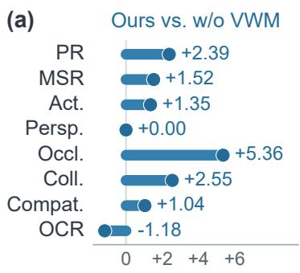

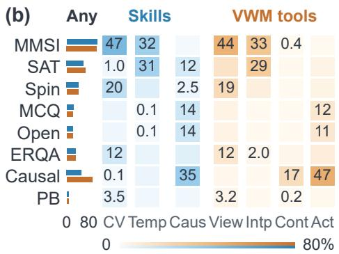

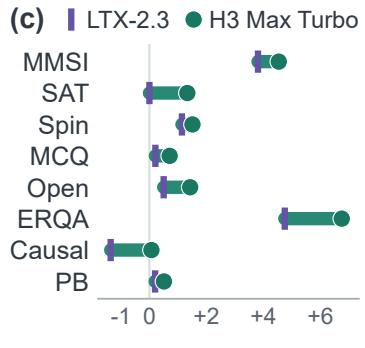  
Figure 3: Analysis of VWM contributions. (a) Subtask gains over Ours (w/o VWM). (b) Skill-loading and tool-use rates b<sub>y</sub> benchmark; tool calls are <sub>g</sub>rou<sub>p</sub>ed b<sub>y</sub> visual o<sub>p</sub>eration (% of items). (c) Benchmark <sub>g</sub>ains <sub>o</sub>v<sub>e</sub>r th<sub>e</sub> GPT-5<sub>.</sub>6 dir<sub>ec</sub>t r<sub>easo</sub>nin<sub>g</sub> b<sub>ase</sub>lin<sub>e</sub> with tw<sub>o</sub> VWM<sub>s.</sub>

Recovery from GPT-5.6 Errors. For each benchmark, <sub>we eva</sub>l<sub>ua</sub>t<sub>e</sub>d <sub>a</sub>ll h<sub>arness var</sub>i<sub>an</sub>t<sub>s an</sub>d <sub>evo</sub>l<sub>v</sub>i<sub>ng</sub> b<sub>ase-</sub> li<sub>nes on</sub> th<sub>e su</sub>b<sub>se</sub>t <sub>o</sub>f t<sub>es</sub>t <sub>examp</sub>l<sub>es</sub> th<sub>a</sub>t th<sub>e</sub> GPT<sub>-</sub>5<sub>.</sub>6 di<sub>-</sub> <sub>rec</sub>t <sub>reason</sub>i<sub>ng</sub> b<sub>ase</sub>li<sub>ne answere</sub>d i<sub>ncorrec</sub>tl<sub>y.</sub> C<sub>o</sub>W<sub>or</sub>ld Reasoner leads on MMSI<sub>,</sub> S<sub>p</sub>atiaLab<sub>,</sub> CausalS<sub>p</sub>atial<sub>,</sub> and Perce<sub>p</sub>tionBench (Fi<sub>g</sub>ure 4). Without VWM tools, it <sub>excee</sub>d<sub>s</sub> th<sub>e</sub> <sub>evo</sub>l<sub>v</sub>i<sub>ng</sub> b<sub>ase</sub>li<sub>nes</sub> <sub>on</sub> MMSI <sub>an</sub>d S<sub>pa-</sub> ti<sub>a</sub>L<sub>a</sub>b<sub>;</sub> <sub>a</sub>ddi<sub>ng</sub> th<sub>em</sub> i<sub>mproves</sub> C<sub>ausa</sub>lS<sub>pa</sub>ti<sub>a</sub>l <sub>recovery,</sub> leaves SAT unchanged, and reduces ERQA recovery. Th<sub>ese</sub> C<sub>ausa</sub>lS<sub>pa</sub>ti<sub>a</sub>l <sub>ga</sub>i<sub>ns</sub> <sub>m</sub>i<sub>rror</sub> th<sub>e</sub> <sub>occ</sub>l<sub>us</sub>i<sub>on</sub> <sub>an</sub>d <sub>co</sub>lli<sub>s</sub>i<sub>on</sub> i<sub>mprovemen</sub>t<sub>s</sub> i<sub>n</sub> Fi<sub>gure</sub> 3<sub>a:</sub> th<sub>e</sub> h<sub>arness re-</sub> <sub>so</sub>lv<sub>es a</sub>dditi<sub>o</sub>n<sub>a</sub>l GPT-5<sub>.</sub>6 <sub>e</sub>rr<sub>o</sub>r<sub>s</sub> whil<sub>e</sub> it<sub>s o</sub>v<sub>e</sub>r<sub>a</sub>ll C<sub>a</sub> GPT-5.6 baseline.

Harness Transfer Across VLMs. We transferred the GPT-5<sub>.</sub>6 h<sub>a</sub>rn<sub>ess</sub> t<sub>o</sub> Gr<sub>o</sub>k-4<sub>.</sub>5 <sub>a</sub>nd r<sub>a</sub>n <sub>o</sub>n<sub>e</sub> <sub>a</sub>dditi<sub>o</sub>n<sub>a</sub>l <sub>co</sub>- <sub>evo</sub>l<sub>u</sub>ti<sub>on roun</sub>d b<sub>e</sub>f<sub>ore eva</sub>l<sub>ua</sub>ti<sub>on.</sub> Fi<sub>gure</sub> 5 <sub>s</sub>h<sub>ows</sub> th<sub>a</sub>t item-wei<sub>g</sub>hted accurac<sub>y</sub> rises from 32.86% to 39.78%<sub>,</sub> <sub>w</sub>ith th<sub>e</sub> l<sub>arges</sub>t <sub>ga</sub>i<sub>ns on</sub> P<sub>ercep</sub>ti<sub>on</sub>B<sub>enc</sub>h <sub>an</sub>d S<sub>p</sub>i<sub>n.</sub> MMSI and CausalS<sub>p</sub>atial also im<sub>p</sub>rove<sub>,</sub> while SAT de-<sub>c</sub>li<sub>nes</sub> <sub>s</sub>li<sub>g</sub>htl<sub>y.</sub> Th<sub>e</sub> <sub>ga</sub>i<sub>ns</sub> <sub>span</sub> t<sub>as</sub>k<sub>s</sub> th<sub>a</sub>t <sub>use</sub> th<sub>e</sub> i<sub>npu</sub>t i<sub>mages</sub> di<sub>rec</sub>tl<sub>y</sub> <sub>an</sub>d t<sub>as</sub>k<sub>s</sub> th<sub>a</sub>t <sub>requ</sub>i<sub>re</sub> <sub>reason</sub>i<sub>ng</sub> <sub>a</sub>b<sub>ou</sub>t unseen views or outcomes. After ada<sub>p</sub>tation<sub>,</sub> Grok-4.5 <sub>reuses</sub> th<sub>e source</sub> h<sub>arness</sub>’<sub>s proce</sub>d<sub>ures</sub> f<sub>or se</sub>l<sub>ec</sub>ti<sub>ng,</sub> i<sub>n</sub>t<sub>erpre</sub>ti<sub>ng, an</sub>d i<sub>n</sub>t<sub>egra</sub>ti<sub>ng v</sub>i<sub>sua</sub>l <sub>ev</sub>id<sub>ence across</sub> b<sub>enc</sub>h<sub>mar</sub>k<sub>s.</sub>

<table><tr><td rowspan=1 colspan=1>Ours</td><td rowspan=1 colspan=1>25.9</td><td rowspan=1 colspan=1>45.7</td><td rowspan=1 colspan=1>43.2</td><td rowspan=1 colspan=1>16.4</td><td rowspan=1 colspan=1>33.2</td><td rowspan=1 colspan=1>28.1</td><td rowspan=1 colspan=1>20.3</td></tr><tr><td rowspan=1 colspan=1>Ours (w/o VWM)</td><td rowspan=1 colspan=1>23.2</td><td rowspan=1 colspan=1>45.7</td><td rowspan=1 colspan=1>42.8</td><td rowspan=1 colspan=1>14.7</td><td rowspan=1 colspan=1>35.8</td><td rowspan=1 colspan=1>16.6</td><td rowspan=1 colspan=1>18.5</td></tr><tr><td rowspan=1 colspan=1>GEPA</td><td rowspan=1 colspan=1>19.2</td><td rowspan=1 colspan=1>48.6</td><td rowspan=1 colspan=1>41.6</td><td rowspan=1 colspan=1>11.5</td><td rowspan=1 colspan=1>34.2</td><td rowspan=1 colspan=1>23.2</td><td rowspan=1 colspan=1>17.3</td></tr><tr><td rowspan=1 colspan=1>ExpeL</td><td rowspan=1 colspan=1>18.4</td><td rowspan=1 colspan=1>31.4</td><td rowspan=1 colspan=1>41.8</td><td rowspan=1 colspan=1>12.3</td><td rowspan=1 colspan=1>31.6</td><td rowspan=1 colspan=1>21.0</td><td rowspan=1 colspan=1>18.2</td></tr><tr><td rowspan=1 colspan=1>Meta-Harness</td><td rowspan=1 colspan=1>15.9</td><td rowspan=1 colspan=1>37.1</td><td rowspan=1 colspan=1>44.9</td><td rowspan=1 colspan=1>11.2</td><td rowspan=1 colspan=1>35.8</td><td rowspan=1 colspan=1>18.4</td><td rowspan=1 colspan=1>17.5</td></tr><tr><td rowspan=1 colspan=1>HSI</td><td rowspan=1 colspan=1>15.1</td><td rowspan=1 colspan=1>42.9</td><td rowspan=1 colspan=1>38.5</td><td rowspan=1 colspan=1>11.9</td><td rowspan=1 colspan=1>32.1</td><td rowspan=1 colspan=1>17.3</td><td rowspan=1 colspan=1>19.4</td></tr><tr><td rowspan=1 colspan=1>ReasoningBank</td><td rowspan=1 colspan=1>16.4</td><td rowspan=1 colspan=1>34.3</td><td rowspan=1 colspan=1>39.7</td><td rowspan=1 colspan=1>10.7</td><td rowspan=1 colspan=1>32.1</td><td rowspan=1 colspan=1>18.8</td><td rowspan=1 colspan=1>18.7</td></tr><tr><td rowspan=1 colspan=8>MMSI SATSpinSL ERQA Caus PBRecovery (%)0   10   20   30   40  50</td></tr></table>

Figure 4: Recovery on GPT-5.6 errors; SL combines SpatiaLab MCQ and Open.

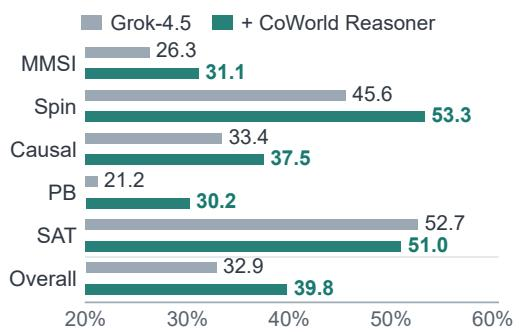  
Figure 5: Grok-4.5 accuracy with direct rea-<sub>son</sub>i<sub>ng an</sub>d th<sub>e</sub> t<sub>rans</sub>f<sub>erre</sub>d h<sub>arness.</sub>

## 5 Conclusion and Future Work

W<sub>e</sub> <sub>presen</sub>t<sub>e</sub>d C<sub>o</sub>W<sub>or</sub>ld R<sub>easoner,</sub> <sub>w</sub>hi<sub>c</sub>h t<sub>rea</sub>t<sub>s</sub> <sub>a</sub> VWM <sub>as</sub> <sub>a</sub> <sub>un</sub>ifi<sub>e</sub>d <sub>v</sub>i<sub>sua</sub>l <sub>reason</sub>i<sub>ng</sub> <sub>eng</sub>i<sub>ne</sub> th<sub>roug</sub>h <sub>a</sub> Vid<sub>eo</sub> W<sub>or</sub>ld M<sub>o</sub>d<sub>e</sub>l<sub>-</sub>D<sub>r</sub>i<sub>ven</sub> H<sub>arness o</sub>f t<sub>oo</sub>l<sub>s, s</sub>kill<sub>s, an</sub>d <sub>a ver</sub>ifi<sub>er.</sub> VLM<sub>-</sub>VWM H<sub>arness</sub> C<sub>o-</sub>

E<sub>vo</sub>l<sub>u</sub>ti<sub>on</sub> <sub>uses</sub> <sub>execu</sub>ti<sub>on</sub> f<sub>ee</sub>db<sub>ac</sub>k t<sub>o</sub> i<sub>mprove</sub> h<sub>ow</sub> th<sub>e</sub> <sub>agen</sub>t <sub>reques</sub>t<sub>s,</sub> <sub>eva</sub>l<sub>ua</sub>t<sub>es,</sub> <sub>an</sub>d i<sub>n</sub>t<sub>egra</sub>t<sub>es</sub> <sub>v</sub>i<sub>sua</sub>l <sub>ev</sub>id<sub>ence.</sub> C<sub>o</sub>W<sub>or</sub>ld R<sub>easoner</sub> i<sub>mproves over</sub> di<sub>rec</sub>t <sub>reason</sub>i<sub>ng w</sub>ith th<sub>e same</sub> VLM <sub>on a</sub>ll <sub>seven</sub> b<sub>enc</sub>h<sub>mar</sub>k<sub>s an</sub>d <sub>ou</sub>t<sub>per</sub>f<sub>orms a</sub>ll fi<sub>ve evo</sub>l<sub>v</sub>i<sub>ng</sub> b<sub>ase</sub>li<sub>nes on</sub> fi<sub>ve o</sub>f th<sub>ese</sub> b<sub>enc</sub>h<sub>mar</sub>k<sub>s.</sub> A<sub>gen</sub>ti<sub>c</sub> t<sub>oo</sub>l <sub>use an</sub>d h<sub>arness co-evo</sub>l<sub>u</sub>ti<sub>on ex</sub>t<sub>en</sub>d VWM<sub>-</sub>b<sub>ase</sub>d <sub>reason</sub>i<sub>ng</sub> b<sub>eyon</sub>d fi<sub>xe</sub>d <sub>nove</sub>l<sub>-v</sub>i<sub>ew syn</sub>th<sub>es</sub>i<sub>s</sub> <sub>p</sub>i<sub>pe</sub>li<sub>nes.</sub> F<sub>u</sub>t<sub>ure wor</sub>k <sub>w</sub>ill <sub>exp</sub>l<sub>ore</sub> t<sub>es</sub>t<sub>-</sub>ti<sub>me</sub> t<sub>ra</sub>i<sub>n</sub>i<sub>ng</sub> t<sub>o co-evo</sub>l<sub>ve</sub> th<sub>e</sub> h<sub>arness,</sub> VLM<sub>, an</sub>d VWM f<sub>or v</sub>i<sub>sua</sub>l <sub>genera</sub>ti<sub>on an</sub>d <sub>mu</sub>lti<sub>mo</sub>d<sub>a</sub>l <sub>reason</sub>i<sub>ng across</sub> di<sub>verse reason</sub>i<sub>ng</sub> t<sub>as</sub>k<sub>s.</sub>

## References

[1] Qwen Team. Qwen3.8-27B mo<sup>d</sup>e<sup>l</sup> car<sup>d</sup>, August 202<sup>6</sup>. URL https://huggingface.co/Qwen/Qwen3.8-27B.

[2] Goog<sup>l</sup>e DeepM<sup>i</sup>n<sup>d</sup>. Gem<sup>i</sup>n<sup>i</sup> 3.8 F<sup>l</sup>as<sup>h</sup>. Mo<sup>d</sup>e<sup>l</sup> car<sup>d</sup>, Septem<sup>b</sup>er 202<sup>6</sup>. URL https://deepmind.google/ models/model-cards/gemini-3-8-flash/.

[3] MiniMax. MiniMax H3: An o<sub>p</sub>en model breakin<sub>g</sub> the boundaries between tasks and modalities. M<sup>i</sup>n<sup>i</sup>Max Researc<sup>h</sup>, 202<sup>6</sup>. URL https://www.minimax.io/blog/minimax-h3.

[4] Yoav HaCohen, Nisan Chi<sub>p</sub>rut, Benn<sub>y</sub> Brazowski, et al. LTX-Video: Realtime video latent difusion. arXiv preprint arXiv:2501.00103, 2024. URL https://arxiv.org/abs/2501.00103.

[5] Yuncon<sub>g</sub> Yan<sub>g</sub>, Jia<sub>g</sub>en<sub>g</sub> Liu, Zhe<sub>y</sub>uan Zhan<sub>g</sub>, Si<sub>y</sub>uan Zhou, Reuben Tan, Jianwei Yan<sub>g</sub>, Yilun Du, and Chuang Gan. MindJourney: Test-time scaling with world models for spatial reasoning. In Advances in Neural Information Processing Systems, 2025. URL https://papers.nips.cc/paper\_files/paper/2025/ file/9e3b203e72c4e058de26d02a92a81844-Paper-Conference.pdf.

[6] Shoubin Yu, Yue Zhan<sub>g</sub>, Zun Wan<sub>g</sub>, Jaehon<sub>g</sub> Yoon, Huaxiu Yao, Min<sub>gy</sub>u Din<sub>g</sub>, and Mohit Bansal. Wh<sub>en an</sub>d h<sub>ow muc</sub>h t<sub>o</sub> i<sub>mag</sub>i<sub>ne:</sub> Ad<sub>ap</sub>ti<sub>ve</sub> t<sub>es</sub>t<sub>-</sub>ti<sub>me sca</sub>li<sub>ng w</sub>ith <sub>wor</sub>ld <sub>mo</sub>d<sub>e</sub>l<sub>s</sub> f<sub>or v</sub>i<sub>sua</sub>l <sub>spa</sub>ti<sub>a</sub>l reasoning. arXiv preprint arXiv:2602.08236, 2026. URL https://arxiv.org/abs/2602.08236v2. Version 2.

[7] Sihan Yan<sub>g</sub>, Runsen Xu, Yiman Xie, et al. MMSI-Bench: A benchmark for multi-ima<sub>g</sub>e s<sub>p</sub>atial intelligence. In International Conference on Learning Representations, 2026. URL https://arxiv.org/ abs/2505.23764v3.

[8] Arijit Ra<sub>y</sub>, Jiafei Duan, Ellis Brown, et al. SAT: D<sub>y</sub>namic s<sub>p</sub>atial a<sub>p</sub>titude trainin<sub>g</sub> for multimodal <sup>l</sup>anguage mo<sup>d</sup>e<sup>l</sup>s, 2025. URL https://arxiv.org/abs/2412.07755.

[9] Yu<sub>y</sub>ou Zhan<sub>g</sub>, Radu Corcodel, Chiori Hori, et al. S<sub>p</sub>inBench: Pers<sub>p</sub>ective and rotation as a lens on spat<sup>i</sup>a<sup>l</sup> reason<sup>i</sup>ng <sup>i</sup>n VLMs, 202<sup>6</sup>. URL https://arxiv.org/abs/2509.25390.

[10] Azmine Toushik Wasi, Wahid Faisal, Abdur Rahman, et al. S<sub>p</sub>atiaLab: Can vision-lan<sub>g</sub>ua<sub>g</sub>e models per<sup>f</sup>orm spat<sup>i</sup>a<sup>l</sup> reason<sup>i</sup>ng <sup>i</sup>n t<sup>h</sup>e w<sup>ild</sup>?, 202<sup>6</sup>. URL https://arxiv.org/abs/2602.03916.

[11] Gemini Robotics Team, Saminda Abe<sub>y</sub>ruwan, Joshua Ainslie, et al. Gemini Robotics: Brin<sub>g</sub>in<sub>g</sub> AI into t<sup>h</sup>e p<sup>h</sup>ys<sup>i</sup>ca<sup>l</sup> wor<sup>ld</sup>, 2025. URL https://arxiv.org/abs/2503.20020.

[12] Wenxin Ma, Chenlon<sub>g</sub> Wan<sub>g</sub>, Ruishen<sub>g</sub> Yuan, et al. CausalS<sub>p</sub>atial: A benchmark for object-centric causa<sup>l</sup> spat<sup>i</sup>a<sup>l</sup> reason<sup>i</sup>ng, 202<sup>6</sup>. URL https://arxiv.org/abs/2601.13304.

[13] Zichao Lin, Yifen<sub>g</sub> Xie, Bowen Qu, et al. Perce<sub>p</sub>tionBench: Evaluatin<sub>g</sub> atomic visual <sub>p</sub>erce<sub>p</sub>tion in mu<sup>l</sup>t<sup>i</sup>mo<sup>d</sup>a<sup>l l</sup>arge <sup>l</sup>anguage mo<sup>d</sup>e<sup>l</sup>s, 202<sup>6</sup>. URL https://arxiv.org/abs/2607.24957.

[14] Chen<sub>g</sub>zu Li, Wenshan Wu, Huan<sub>y</sub>u Zhan<sub>g</sub>, Yan Xia, Shao<sub>g</sub>uan<sub>g</sub> Mao, Li Don<sub>g</sub>, Ivan Vulić, and Furu Wei. Imagine while reasoning in space: Multimodal visualization-of-thought. arXiv preprint arXiv:2501.07542, 2025. URL https://arxiv.org/abs/2501.07542.

[15] Jiawei Gu, Yunzhuo Hao, Huichen Will Wang, Linjie Li, Michael Qizhe Shieh, Yejin Choi, Ranjay K<sub>r</sub>i<sub>s</sub>h<sub>na, an</sub>d Y<sub>u</sub> Ch<sub>eng.</sub> Thi<sub>n</sub>kM<sub>orp</sub>h<sub>:</sub> E<sub>mergen</sub>t <sub>proper</sub>ti<sub>es</sub> i<sub>n mu</sub>lti<sub>mo</sub>d<sub>a</sub>l i<sub>n</sub>t<sub>er</sub>l<sub>eave</sub>d <sub>c</sub>h<sub>a</sub>i<sub>n-o</sub>f<sub>-</sub>th<sub>oug</sub>ht reasoning. arXiv preprint arXiv:2510.27492, 2025. URL https://arxiv.org/abs/2510.27492.

[16] Dongjie Cheng, Yongqi Li, Zhixin Ma, Hongru Cai, Yupeng Hu, Wenjie Wang, Liqiang Nie, and Wenjie Li. Omni-R1: Towards the unified generative paradigm for multimodal reasoning. In Findings of the Associationfor Computational Linguistics: ACL 2026, pages 38907–38924, 2026. doi: 10.18653/v1/ 202<sup>6</sup>.<sup>fi</sup>n<sup>di</sup>ngs-ac<sup>l</sup>.1937. URL https://aclanthology.org/2026.findings-acl.1937/.

[17] Jin<sub>gq</sub>i Ton<sub>g</sub>, Yuron<sub>g</sub> Mou, Han<sub>g</sub>chen<sub>g</sub> Li, Min<sub>g</sub>zhe Li, Yon<sub>g</sub>zhuo Yan<sub>g</sub>, Min<sub>g</sub> Zhan<sub>g</sub>, Qi<sub>g</sub>uan<sub>g</sub> Chen, Tianyi Liang, Xiaomeng Hu, Yining Zheng, Xinchi Chen, Jun Zhao, Xuanjing Huang, and Xipeng Qiu. Thinking with Video: Video generation as a promising multimodal reasoning paradigm. In Proceedings of the IEEE/CVF Conference on Computer Vision and Pattern Recognition, pages 41121–41129, 202<sup>6</sup>. URL https://openaccess.thecvf.com/content/CVPR2026/html/Tong\_Thinking\_ with\_Video\_Video\_Generation\_as\_a\_Promising\_Multimodal\_Reasoning\_CVPR\_2026\_paper.html.

[18] Zhon<sub>g</sub>an<sub>g</sub> Cai, Ruisi Wan<sub>g</sub>, Chen<sub>y</sub>an<sub>g</sub> Gu, et al. Scalin<sub>g</sub> s<sub>p</sub>atial intelli<sub>g</sub>ence with multimodal foundat<sup>i</sup>on mo<sup>d</sup>e<sup>l</sup>s, 202<sup>6</sup>. URL https://arxiv.org/abs/2511.13719.

[19] Jianhui Liu, Haoze Sun, Wenbo Li, et al. O<sub>p</sub>enS<sub>p</sub>atial: A <sub>p</sub>rinci<sub>p</sub>led data en<sub>g</sub>ine for em<sub>p</sub>owerin<sub>g</sub> spat<sup>i</sup>a<sup>l i</sup>nte<sup>lli</sup>gence, 202<sup>6</sup>. URL https://arxiv.org/abs/2604.07296.

[20] Wan<sub>y</sub>ue Zhan<sub>g</sub>, Wenxian<sub>g</sub> Wu, Wan<sub>g</sub> Xu, et al. World2VLM: Distillin<sub>g</sub> world model ima<sub>g</sub>ination into VLMs <sup>f</sup>or <sup>d</sup>ynam<sup>i</sup>c spat<sup>i</sup>a<sup>l</sup> reason<sup>i</sup>ng, 202<sup>6</sup>. URL https://arxiv.org/abs/2604.26934.

[21] Men<sub>g</sub> Cao, Xin<sub>gy</sub>u Li, Xue Liu, Ian Reid, and Xiaodan Lian<sub>g</sub>. S<sub>p</sub>atialDreamer: Incentivizin<sub>g</sub> S<sub>p</sub>atial Reasoning via Active Mental Imagery. arXiv preprint arXiv:2512.07733, 2025. URL https://arxiv.org/ abs/2512.07733v1. Vers<sup>i</sup>on 1.

[22] Team Wan. Wan: Open and Advanced Large-Scale Video Generative Models. arXiv preprint arXiv:2503.20314, 2025. URL https://arxiv.org/abs/2503.20314v2. Version 2.

[23] Team Seedance, De Chen, Li<sub>y</sub>an<sub>g</sub> Chen, et al. Seedance 2.0: Advancin<sub>g</sub> video <sub>g</sub>eneration for world complexity. arXiv preprint arXiv:2604.14148, 2026. URL https://arxiv.org/abs/2604.14148.

[24] NVIDIA. World Simulation with Video Foundation Models for Physical AI. arXiv preprint arXiv:2511.00062, 2025. URL https://arxiv.org/abs/2511.00062v2. Version 2.

[25] World Labs. Marble: A multimodal world model. World Labs Research and Insi<sub>g</sub>hts, 2025. URL https://www.worldlabs.ai/blog/marble-world-model.

[26] World Labs. RTFM: A real-time frame model. World Labs Research and Insi<sub>g</sub>hts, 2025. URL https://www.worldlabs.ai/blog/rtfm.

[27] Laksh<sub>y</sub>a A A<sub>g</sub>rawal, Shan<sub>gy</sub>in Tan, Dilara So<sub>y</sub>lu, Noah Ziems, Rishi Khare, Krista O<sub>p</sub>sahl-On<sub>g</sub>, Arnav Sin<sub>g</sub>hvi<sub>,</sub> Herumb Shandil<sub>y</sub>a<sub>,</sub> Michael J R<sub>y</sub>an<sub>,</sub> Men<sub>g</sub> Jian<sub>g,</sub> Christo<sub>p</sub>her Potts<sub>,</sub> Koushik Sen<sub>,</sub> Alexandros G. Dimakis<sub>,</sub> Ion Stoica<sub>,</sub> Dan Klein<sub>,</sub> Matei Zaharia<sub>,</sub> and Omar Khattab. GEPA: Reflective prompt evolution can outperform reinforcement learning. In International Conference on Learning Representations, 2026. URL https://proceedings.iclr.cc/paper\_files/paper/2026/file/ 0e9e708b6f48e14fd0ac29e167413f76-Paper-Conference.pdf.

[28] Yifan Yang et al. SkillOpt: Executive strategy for self-evolving agent skills. arXiv preprint arXiv:2605.23904, 2026. URL https://arxiv.org/abs/2605.23904.

[29] Jenn<sub>y</sub> Zhan<sub>g</sub>, Shen<sub>g</sub>ran Hu, Con<sub>g</sub> Lu, Robert Lan<sub>g</sub>e, and Jef Clune. Darwin Gödel machine: Open-ended evolution of self-improving agents. arXiv preprint arXiv:2505.22954, 2025. URL https://arxiv.org/abs/2505.22954.

[30] Yoonho Lee, Roshen Nair, Qizhen<sub>g</sub> Zhan<sub>g</sub>, Kan<sub>g</sub>wook Lee, Omar Khattab, and Chelsea Finn. Meta-Harness: En<sup>d</sup>-to-en<sup>d</sup> opt<sup>i</sup>m<sup>i</sup>zat<sup>i</sup>on o<sup>f</sup> mo<sup>d</sup>e<sup>l h</sup>arnesses, 202<sup>6</sup>. URL https://arxiv.org/abs/2603.28052.

[31] Hanron<sub>g</sub> Zhan<sub>g</sub>, Shichen<sub>g</sub> Fan, Henr<sub>y</sub> Pen<sub>g</sub> Zou, Yankai Chen, Zhentin<sub>g</sub> Wan<sub>g</sub>, Jia<sub>y</sub>u Zhou, Chen<sub>g</sub>ze Li<sub>,</sub> W<sub>e</sub>i<sub>-</sub>Chi<sub>e</sub>h H<sub>uang,</sub> Yif<sub>e</sub>i Y<sub>ao,</sub> K<sub>en</sub>i<sub>ng</sub> Zh<sub>eng,</sub> X<sub>ue</sub> Li<sub>u,</sub> Xi<sub>aox</sub>i<sub>ao</sub> Li<sub>, an</sub>d Phili<sub>p</sub> S<sub>.</sub> Y<sub>u.</sub> C<sub>o</sub>E<sub>vo</sub>Skill<sub>s:</sub> Self-Evolving Agent Skills via Co-Evolutionary Verification. arXiv preprint arXiv:2604.01687, 2026. URL https://arxiv.org/abs/2604.01687v3. Vers<sup>i</sup>on 3.

[32] Tailin Zhou. Hierarchical self-im<sub>p</sub>rovement: A framework for task-s<sub>p</sub>ecific evolvable a<sub>g</sub>ent harnesses, 202<sup>6</sup>. URL https://arxiv.org/abs/2608.08466.

[33] Siru Ou<sub>y</sub>an<sub>g</sub>, Jun Yan, I-Hun<sub>g</sub> Hsu, et al. Reasonin<sub>g</sub>Bank: Scalin<sub>g</sub> a<sub>g</sub>ent self-evolvin<sub>g</sub> with reasonin<sub>g</sub> memory. In International Conference on Learning Representations, 2026. URL https://openreview.net/ forum?id=jL7fwchScm.

[34] Andrew Zhao, Daniel Huan<sub>g</sub>, Quentin Xu, Matthieu Lin, Yon<sub>g</sub>-Jin Liu, and Gao Huan<sub>g</sub>. Ex<sub>p</sub>eL: LLM Agents Are Experiential Learners. Proceedings of the AAAI Conference on Artificial Intelligence,

38(17):19<sup>6</sup>32–19<sup>6</sup>42, 2024. <sup>d</sup>o<sup>i</sup>: 10.1<sup>6</sup>09/aaa<sup>i</sup>.v38<sup>i</sup>17.2993<sup>6</sup>. URL https://doi.org/10.1609/ aaai.v38i17.29936.

[35] Shuai Bai, Yuxuan Cai, Ruizhe Chen, et al. Qwen3-VL technical report. arXiv preprint arXiv:2511.21631, 2025. URL https://arxiv.org/abs/2511.21631.

[36] Xiaoshuai Hao, Lei Zhou, Zhijian Huan<sub>g</sub>, et al. MiMo-Embodied: X-embodied foundation model tec<sup>h</sup>n<sup>i</sup>ca<sup>l</sup> report, 2025. URL https://arxiv.org/abs/2511.16518.

[37] BAAI RoboBrain Team, Min<sub>gy</sub>u Cao, Huajie Tan, et al. RoboBrain 2.0 technical re<sub>p</sub>ort, 2025. URL https://arxiv.org/abs/2507.02029.

[38] Kaixian<sub>g</sub> Yao, Xu Wan<sub>g</sub>, Miao Pan, et al. S<sub>p</sub>atial-Interactor: Learnin<sub>g</sub> s<sub>p</sub>atial reasonin<sub>g</sub> throu<sub>g</sub>h <sup>i</sup>nteract<sup>i</sup>on w<sup>i</sup>t<sup>h</sup> t<sup>h</sup>e o<sup>b</sup>serva<sup>bl</sup>e p<sup>h</sup>ys<sup>i</sup>ca<sup>l</sup> wor<sup>ld</sup>, 202<sup>6</sup>. URL https://arxiv.org/abs/2609.23038.

[39] Yifan Liu, Fan<sub>g</sub>nen<sub>g</sub> Zhan, Kaichen Zhou, et al. Abstract 3d <sub>p</sub>erce<sub>p</sub>tion for s<sub>p</sub>atial intelli<sub>g</sub>ence in v<sup>i</sup>s<sup>i</sup>on-<sup>l</sup>anguage mo<sup>d</sup>e<sup>l</sup>s, 2025. URL https://arxiv.org/abs/2511.10946.

[40] Xingjian Tao, Yiwei Wang, Yujun Cai, Yifan Song, and Jing Tang. ViewFusion: Structured spatial thinking chains for multi-view reasoning. In Computer Vision – ECCV 2026, Lecture Notes in Computer Sc<sup>i</sup>ence, pages 135–151, 202<sup>6</sup>. <sup>d</sup>o<sup>i</sup>: 10.1007/978-3-032-37447-9\_8. URL https://doi.org/10.1007/ 978-3-032-37447-9\_8.

[41] Kehan Li, Bohan Hou, Min<sub>g</sub>hao Zhu, et al. R<sub>y</sub>nnBrain 1.1: Towards more ca<sub>p</sub>able and <sub>g</sub>eneralizable em<sup>b</sup>o<sup>di</sup>e<sup>d</sup> <sup>f</sup>oun<sup>d</sup>at<sup>i</sup>on mo<sup>d</sup>e<sup>l</sup>, 202<sup>6</sup>. URL https://arxiv.org/abs/2607.17977.

## A Appendix

## A.1 Evaluation Data

T<sub>a</sub>bl<sub>e</sub> 3 <sub>summar</sub>i<sub>zes</sub> th<sub>e</sub> d<sub>eve</sub>l<sub>opmen</sub>t <sub>an</sub>d <sub>eva</sub>l<sub>ua</sub>ti<sub>on se</sub>t<sub>s.</sub> W<sub>e use</sub>d th<sub>e</sub> 120 d<sub>eve</sub>l<sub>opmen</sub>t <sub>examp</sub>l<sub>es</sub> t<sub>o</sub> <sub>evo</sub>l<sub>ve</sub> th<sub>e</sub> <sub>reusa</sub>bl<sub>e</sub> <sub>componen</sub>t<sub>s</sub> <sub>o</sub>f <sub>our</sub> <sub>me</sub>th<sub>o</sub>d<sub>.</sub> W<sub>e</sub> <sub>a</sub>d<sub>ap</sub>t<sub>e</sub>d th<sub>e</sub> fi<sub>ve</sub> <sub>evo</sub>l<sub>v</sub>i<sub>ng</sub> b<sub>ase</sub>li<sub>nes</sub> t<sub>o</sub> th<sub>e</sub> <sub>same v</sub>i<sub>sua</sub>l i<sub>npu</sub>t<sub>s an</sub>d <sub>scor</sub>i<sub>ng</sub> i<sub>n</sub>t<sub>er</sub>f<sub>ace,</sub> th<sub>en eva</sub>l<sub>ua</sub>t<sub>e</sub>d th<sub>e se</sub>l<sub>ec</sub>t<sub>e</sub>d <sub>var</sub>i<sub>an</sub>t<sub>s on</sub> b<sub>enc</sub>h<sub>mar</sub>k<sub>s</sub> <sub>exc</sub>l<sub>u</sub>di<sub>ng</sub> th<sub>ese</sub> d<sub>eve</sub>l<sub>opmen</sub>t <sub>examp</sub>l<sub>es.</sub>

Table 3: Development examples and evaluation items.
<table><tr><td rowspan="2"></td><td rowspan="2">MMSI</td><td rowspan="2">SAT</td><td rowspan="2">Spin</td><td colspan="2">SpatiaLab</td><td rowspan="2">ERQA</td><td rowspan="2">CausalSpatial</td><td rowspan="2">PerceptionBench</td></tr><tr><td>MCQ</td><td>Open</td></tr><tr><td>Development</td><td>30</td><td>0</td><td>30</td><td>0</td><td>0</td><td>0</td><td>30</td><td>30</td></tr><tr><td>Evaluation</td><td>970</td><td>300</td><td>2,709</td><td>1,400</td><td>1,400</td><td>400</td><td>1,395</td><td>2,970</td></tr></table>

SAT evaluates 150 questions under two option permutations, yielding 300 items. SpatiaLab MCQ and O<sub>p</sub>en use the same 1<sub>,</sub>400 <sub>q</sub>uestions in two answer formats.

Baseline configurations. The evolving-agent comparison uses HSI [32], ReasoningBank [33], Meta-Harness [30], Ex<sub>p</sub>eL [34], and GEPA [27], all ada<sub>p</sub>ted to GPT-5.6 with the same visual i<sub>npu</sub>t<sub>s an</sub>d <sub>scor</sub>i<sub>ng</sub> i<sub>n</sub>t<sub>er</sub>f<sub>ace.</sub> T<sub>a</sub>bl<sub>e</sub> 4 <sub>summar</sub>i<sub>zes</sub> th<sub>e</sub>i<sub>r ma</sub>i<sub>n mec</sub>h<sub>an</sub>i<sub>sms.</sub> Th<sub>ey opera</sub>t<sub>e</sub> di<sub>rec</sub>tl<sub>y</sub> <sub>on</sub> th<sub>e</sub> i<sub>npu</sub>t i<sub>mages</sub> <sub>an</sub>d <sub>evo</sub>l<sub>ve</sub> <sub>promp</sub>t<sub>s,</sub> <sub>memor</sub>i<sub>es,</sub> <sub>or</sub> <sub>co</sub>d<sub>e;</sub> <sub>none</sub> <sub>uses</sub> VWM<sub>-</sub>d<sub>r</sub>i<sub>ven</sub> t<sub>oo</sub>l<sub>s.</sub> O<sub>ur</sub> h<sub>arness co-evo</sub>l<sub>ves</sub> VWM<sub>-</sub>d<sub>r</sub>i<sub>ven</sub> t<sub>oo</sub>l<sub>s, s</sub>kill<sub>s, an</sub>d <sub>execu</sub>ti<sub>on co</sub>d<sub>e.</sub> Th<sub>e</sub> di<sub>rec</sub>t GPT<sub>-</sub>5<sub>.</sub>6 <sub>sys</sub>t<sub>em</sub> <sub>answers</sub> f<sub>rom</sub> th<sub>e</sub> i<sub>npu</sub>t i<sub>mages an</sub>d i<sub>s</sub> th<sub>e re</sub>f<sub>erence</sub> b<sub>ase</sub>li<sub>ne.</sub>

For the <sub>p</sub>ublished com<sub>p</sub>arison rows, Qwen3-VL [35] uses the 8B-Instruct model; MiMo-Embodied [36] and RoboBrain2.0 [37] use their 7B and 32B models, res<sub>p</sub>ectivel<sub>y</sub>. S<sub>p</sub>atial-Interactor [38] uses Qwen3-VL-8B with SFT and on-<sub>p</sub>olic<sub>y</sub> distillation. SandboxVLM [39] uses GPT-5-mini; AVIC-R uses a Qwen2.5-VL-7B policy with GPT-4.1 for question answering. Table 2 also includes ViewFusion [40]. MMSI cate<sub>g</sub>or<sub>y</sub> scores for Qwen3-VL and RoboBrain2.0 are com<sub>p</sub>uted b<sub>y</sub> wei<sub>g</sub>htin<sub>g</sub> re<sub>p</sub>orted subcate<sub>g</sub>or<sub>y</sub> scores b<sub>y</sub> sam<sub>p</sub>le count [18, 7]. MiMo-Embodied’s MMSI score and RoboBrain2.0’s ERQA score are re<sub>p</sub>orted b<sub>y</sub> Li et al. [41]. Av<sub>g</sub>. is re<sub>p</sub>orted for <sub>me</sub>th<sub>o</sub>d<sub>s eva</sub>l<sub>ua</sub>t<sub>e</sub>d <sub>on a</sub>ll b<sub>enc</sub>h<sub>mar</sub>k<sub>s an</sub>d <sub>we</sub>i<sub>g</sub>ht<sub>e</sub>d b<sub>y</sub> th<sub>e eva</sub>l<sub>ua</sub>ti<sub>on s</sub>i<sub>zes</sub> i<sub>n</sub> T<sub>a</sub>bl<sub>e</sub> 3<sub>.</sub>

Table 4: Main mechanisms of the evolving-agent baselines.
<table><tr><td>Method</td><td>Main mechanism</td></tr><tr><td>HSI</td><td>Hierarchically revises task-specific agent harnesses.</td></tr><tr><td>ReasoningBank</td><td>Builds and retrieves reusable reasoning memories from agent experience.</td></tr><tr><td>Meta-Harness</td><td>Proposes and evaluates changes to executable harness code.</td></tr><tr><td>ExpeL</td><td>Distills insights from task experience and retrieves examples for later tasks.</td></tr><tr><td>GEPA</td><td>Reflectively revises prompts using execution and evaluation feedback.</td></tr></table>

## A.2 Scoring and Usage Statistics

W<sub>e compu</sub>t<sub>e</sub>d <sub>accuracy over a</sub>ll it<sub>ems</sub> i<sub>n eac</sub>h b<sub>enc</sub>h<sub>mar</sub>k <sub>or ca</sub>t<sub>egory.</sub> W<sub>e norma</sub>li<sub>ze</sub>d <sub>mu</sub>lti<sub>p</sub>l<sub>e-</sub> <sub>c</sub>h<sub>o</sub>i<sub>ce answers</sub> b<sub>e</sub>f<sub>ore compar</sub>i<sub>ng</sub> th<sub>em w</sub>ith th<sub>e correc</sub>t <sub>op</sub>ti<sub>on.</sub> F<sub>or</sub> P<sub>ercep</sub>ti<sub>on</sub>B<sub>enc</sub>h<sub>, we use</sub>d d<sub>e</sub>t<sub>erm</sub>i<sub>n</sub>i<sub>s</sub>ti<sub>c</sub> <sub>op</sub>ti<sub>on</sub> <sub>ma</sub>t<sub>c</sub>hi<sub>ng</sub> <sub>w</sub>h<sub>en</sub> <sub>an</sub> <sub>answer</sub> <sub>maps</sub> t<sub>o</sub> <sub>a</sub> <sub>supp</sub>li<sub>e</sub>d <sub>c</sub>h<sub>o</sub>i<sub>ce;</sub> <sub>o</sub>th<sub>erw</sub>i<sub>se,</sub> <sub>a</sub> GPT<sub>-</sub>5<sub>.</sub>6 judge evaluates correctness under the benchmark’s general-QA criterion. The same judge evaluates semantic equivalence for open-ended SpatiaLab questions. The judge operates in an evaluation <sub>con</sub>t<sub>ex</sub>t f<sub>u</sub>ll<sub>y</sub> i<sub>n</sub>d<sub>epen</sub>d<sub>en</sub>t <sub>o</sub>f th<sub>e</sub> t<sub>as</sub>k <sub>agen</sub>t<sub>.</sub>

R<sub>eco</sub>v<sub>e</sub>r<sub>y</sub> m<sub>easu</sub>r<sub>es accu</sub>r<sub>acy o</sub>n th<sub>e su</sub>b<sub>se</sub>t <sub>o</sub>f t<sub>es</sub>t it<sub>e</sub>m<sub>s a</sub>n<sub>s</sub>w<sub>e</sub>r<sub>e</sub>d in<sub>co</sub>rr<sub>ec</sub>tl<sub>y</sub> b<sub>y</sub> th<sub>e</sub> GPT-5<sub>.</sub>6 direct reasoning baseline. When combining SpatiaLab MCQ and Open, we aggregated correct <sub>answers an</sub>d it<sub>em coun</sub>t<sub>s across</sub> b<sub>o</sub>th f<sub>orma</sub>t<sub>s.</sub>

Skill<sub>-</sub>l<sub>oa</sub>di<sub>ng ra</sub>t<sub>e</sub> i<sub>s</sub> th<sub>e percen</sub>t<sub>age o</sub>f it<sub>ems on w</sub>hi<sub>c</sub>h th<sub>e correspon</sub>di<sub>ng s</sub>kill i<sub>s</sub> l<sub>oa</sub>d<sub>e</sub>d<sub>.</sub> T<sub>oo</sub>l<sub>-use</sub> <sub>ra</sub>t<sub>e</sub> i<sub>s</sub> th<sub>e percen</sub>t<sub>age o</sub>f it<sub>ems w</sub>ith <sub>a</sub> VWM<sub>-</sub>d<sub>r</sub>i<sub>ven</sub> t<sub>oo</sub>l <sub>ca</sub>ll f<sub>or</sub> th<sub>e correspon</sub>di<sub>ng v</sub>i<sub>sua</sub>l <sub>opera</sub>ti<sub>on.</sub> A<sub>n</sub> it<sub>em</sub> <sub>can</sub> <sub>con</sub>t<sub>r</sub>ib<sub>u</sub>t<sub>e</sub> t<sub>o</sub> <sub>mu</sub>lti<sub>p</sub>l<sub>e</sub> <sub>co</sub>l<sub>umns;</sub> th<sub>e</sub> A<sub>ny</sub> <sub>co</sub>l<sub>umn</sub> <sub>coun</sub>t<sub>s</sub> it<sub>ems</sub> <sub>w</sub>ith <sub>a</sub>t l<sub>eas</sub>t <sub>one</sub> <sub>s</sub>kill l<sub>oa</sub>d <sub>or</sub> t<sub>oo</sub>l <sub>ca</sub>ll i<sub>n</sub> th<sub>e</sub> <sub>correspon</sub>di<sub>ng</sub> <sub>group.</sub>

## A.3 Agent and Generation Configuration

Th<sub>e</sub> t<sub>as</sub>k <sub>age</sub>nt<sub>, co</sub>-<sub>e</sub>v<sub>o</sub>l<sub>u</sub>ti<sub>o</sub>n <sub>supe</sub>rvi<sub>so</sub>r<sub>, a</sub>nd <sub>e</sub>xt<sub>e</sub>rn<sub>a</sub>l <sub>a</sub>n<sub>s</sub>w<sub>e</sub>r <sub>sco</sub>r<sub>e</sub>r <sub>eac</sub>h <sub>use</sub> th<sub>e gp</sub>t-5<sub>.</sub>6-l<sub>u</sub>n<sub>a</sub> d<sub>ep</sub>l<sub>oymen</sub>t i<sub>n separa</sub>t<sub>e con</sub>t<sub>ex</sub>t<sub>s.</sub> Th<sub>e</sub> GPT<sub>-</sub>5<sub>.</sub>6 di<sub>rec</sub>t <sub>reason</sub>i<sub>ng</sub> b<sub>ase</sub>li<sub>ne answers eac</sub>h it<sub>em</sub> f<sub>rom</sub> th<sub>e</sub> i<sub>npu</sub>t i<sub>mages</sub> i<sub>n one s</sub>t<sub>age.</sub> All fi<sub>ve evo</sub>l<sub>v</sub>i<sub>ng</sub> b<sub>ase</sub>li<sub>nes use</sub> thi<sub>s</sub> GPT<sub>-</sub>5<sub>.</sub>6 d<sub>ep</sub>l<sub>oymen</sub>t<sub>.</sub> T<sub>a</sub>bl<sub>e</sub> 5 li<sub>s</sub>t<sub>s agen</sub>t <sub>an</sub>d <sub>v</sub>id<sub>eo genera</sub>ti<sub>on se</sub>tti<sub>ngs.</sub>

Th<sub>e agen</sub>t <sub>carr</sub>i<sub>es</sub> it<sub>s</sub> i<sub>n</sub>t<sub>erac</sub>ti<sub>on</sub> hi<sub>s</sub>t<sub>ory</sub> th<sub>roug</sub>h <sub>s</sub>t<sub>ages</sub> 1<sub>–</sub>4<sub>,</sub> f<sub>o</sub>ll<sub>ow</sub>i<sub>ng</sub> th<sub>e or</sub>d<sub>er</sub> i<sub>n</sub> S<sub>ec</sub>ti<sub>on</sub> 3<sub>.</sub>2<sub>.</sub> The verifier receives the <sub>g</sub>enerated video. The “Ours (w/o VWM)” variant retains the VWM-driven <sub>s</sub>kill<sub>s an</sub>d f<sub>our-s</sub>t<sub>age execu</sub>ti<sub>on w</sub>hil<sub>e</sub> di<sub>sa</sub>bli<sub>ng a</sub>ll VWM<sub>-</sub>d<sub>r</sub>i<sub>ven</sub> t<sub>oo</sub>l<sub>s an</sub>d th<sub>e ver</sub>ifi<sub>er.</sub>

We used the MiniMax H3 Max Turbo ima<sub>g</sub>e-to-video end<sub>p</sub>oint on FAL. A re<sub>q</sub>uest su<sub>pp</sub>lies one <sub>source</sub> i<sub>mage or</sub> t<sub>wo</sub> i<sub>mages</sub> d<sub>e</sub>fi<sub>n</sub>i<sub>ng</sub> th<sub>e s</sub>t<sub>ar</sub>t <sub>an</sub>d <sub>en</sub>d f<sub>rames.</sub> G<sub>enera</sub>ti<sub>on reques</sub>t<sub>s</sub> d<sub>escr</sub>ib<sub>e</sub> th<sub>e</sub> <sub>v</sub>i<sub>sua</sub>l t<sub>rans</sub>f<sub>orma</sub>ti<sub>on w</sub>ith<sub>ou</sub>t <sub>prescr</sub>ibi<sub>ng</sub> th<sub>e</sub> t<sub>as</sub>k <sub>answer.</sub>

We used � = 3 evolution rounds. At each stage, the supervisor evaluates the initial candidate and up to � = 5 revisions, with early stopping.

F<sub>or</sub> t<sub>rans</sub>f<sub>er</sub> t<sub>o</sub> G<sub>ro</sub>k<sub>-</sub>4<sub>.</sub>5<sub>,</sub> <sub>we</sub> i<sub>n</sub>iti<sub>a</sub>li<sub>ze</sub>d th<sub>e</sub> h<sub>arness</sub> f<sub>rom</sub> th<sub>e</sub> <sub>comp</sub>l<sub>e</sub>t<sub>e</sub>d GPT<sub>-</sub>5<sub>.</sub>6 <sub>co-evo</sub>l<sub>u</sub>ti<sub>on,</sub> <sub>rep</sub>l<sub>ace</sub>d th<sub>e</sub> VLM <sub>w</sub>ith G<sub>ro</sub>k<sub>-</sub>4<sub>.</sub>5<sub>, an</sub>d <sub>ran one a</sub>dditi<sub>ona</sub>l <sub>co-evo</sub>l<sub>u</sub>ti<sub>on roun</sub>d b<sub>e</sub>f<sub>ore eva</sub>l<sub>ua</sub>ti<sub>on.</sub>

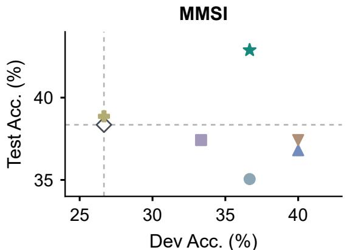

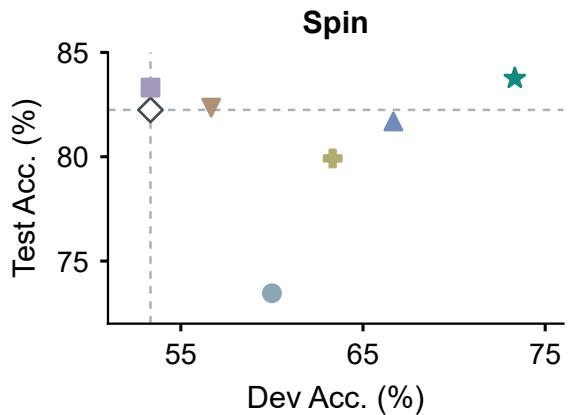  
PB

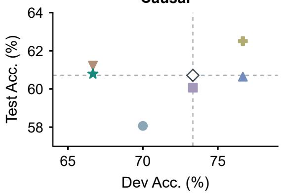

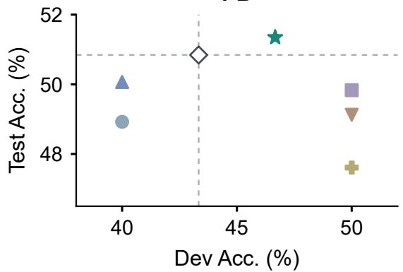  
GPT-5.6 HSI ReasoningBank Meta-Harness ExpeL GEPA Ours

Figure 6: Development and test accuracy. Dashed lines show the GPT-5.6 direct reasoning baseline; stars mark CoWorld Reasoner.  
Table 5: Agent and video generation settings.
<table><tr><td colspan="2">Task agent</td><td colspan="2">Video generation</td></tr><tr><td>Reasoning effort</td><td>Medium</td><td>Duration</td><td>5 seconds</td></tr><tr><td>Temperature</td><td>0</td><td>Resolution</td><td>480P</td></tr><tr><td>Max. output tokens/model call</td><td>4,096</td><td>Prompt expansion</td><td>Balanced</td></tr><tr><td>Model-turn limits (stages 1–4)</td><td>4/6/6/6</td><td>Frames for agent reasoning</td><td>9</td></tr></table>

## A.4 VWM-Driven Skills and Visual Operations

T<sub>a</sub>bl<sub>e</sub> 6 <sub>summar</sub>i<sub>zes</sub> th<sub>e</sub> th<sub>ree</sub> <sub>s</sub>kill<sub>s</sub> <sub>an</sub>d f<sub>our</sub> <sub>v</sub>i<sub>sua</sub>l <sub>opera</sub>ti<sub>on</sub> <sub>ca</sub>t<sub>egor</sub>i<sub>es,</sub> <sub>us</sub>i<sub>ng</sub> th<sub>e</sub> <sub>a</sub>bb<sub>rev</sub>i<sub>a</sub>ti<sub>ons</sub> in Fi<sub>g</sub>ure 3b.

## A.5 Stage Assessment and Candidate Selection

At <sub>eac</sub>h <sub>evo</sub>l<sub>u</sub>ti<sub>on roun</sub>d<sub>,</sub> th<sub>e superv</sub>i<sub>sor se</sub>l<sub>ec</sub>t<sub>s</sub> th<sub>e</sub> b<sub>es</sub>t <sub>comp</sub>l<sub>e</sub>t<sub>e</sub>d <sub>can</sub>did<sub>a</sub>t<sub>e us</sub>i<sub>ng s</sub>t<sub>age-spec</sub>ifi<sub>c</sub> <sub>assessmen</sub>t<sub>s, samp</sub>l<sub>e</sub>d t<sub>races, an</sub>d <sub>answer-correc</sub>t<sub>ness</sub> f<sub>ee</sub>db<sub>ac</sub>k<sub>.</sub> It <sub>c</sub>h<sub>ec</sub>k<sub>s s</sub>kill <sub>c</sub>h<sub>o</sub>i<sub>ce, genera</sub>t<sub>e</sub>d <sub>v</sub>i<sub>sua</sub>l <sub>ev</sub>id<sub>ence coverage, reques</sub>t <sub>va</sub>lidit<sub>y, source-</sub>i<sub>mage or</sub>d<sub>er,</sub> t<sub>oo</sub>l <sub>execu</sub>ti<sub>on,</sub> i<sub>n</sub>t<sub>erpre</sub>t<sub>e</sub>d <sub>even</sub>t<sub>s</sub> <sub>an</sub>d <sub>ar</sub>tif<sub>ac</sub>t<sub>s, re</sub>f<sub>erence</sub> f<sub>rames, an</sub>d <sub>answer correc</sub>t<sub>ness across</sub> th<sub>e</sub> f<sub>our s</sub>t<sub>ages.</sub> It <sub>we</sub>i<sub>g</sub>h<sub>s cross-</sub> b<sub>enc</sub>h<sub>mar</sub>k <sub>ga</sub>i<sub>ns aga</sub>i<sub>ns</sub>t <sub>regress</sub>i<sub>ons.</sub>

Table 6: Skills and visual operations used in the experiments.
<table><tr><td>Component</td><td></td><td>Abbr. Function</td></tr><tr><td colspan="3">VWM-driven skills</td></tr><tr><td>Cross-view</td><td>CV</td><td>Guides reasoning about identity, viewpoint, and layout relations across images.</td></tr><tr><td>Temporal</td><td>Temp</td><td>Guides reasoning about transitions between ordered observations and about short temporal continuations.</td></tr><tr><td>Causal intervention</td><td>Caus</td><td>Guides reasoning about the outcome of a specified action on a visible target.</td></tr><tr><td colspan="3">VWM-driven visual operations</td></tr><tr><td>View change</td><td>View</td><td>Generates a new or connecting viewpoint to expose a spatial relation.</td></tr><tr><td>Interpolation</td><td>Intp</td><td>Generates intermediate states between ordered observations.</td></tr><tr><td>Continuation</td><td>Cont</td><td>Extends an observed state forward or backward in time.</td></tr><tr><td>Intervention</td><td>Act</td><td>Generates the predicted outcome of a specified action on a visible target.</td></tr></table>

## A.6 Development and Test Performance

Fi<sub>gu</sub>r<sub>e</sub> 6 <sub>co</sub>m<sub>pa</sub>r<sub>es</sub> th<sub>e</sub> fin<sub>a</sub>l <sub>e</sub>v<sub>o</sub>lv<sub>e</sub>d <sub>age</sub>nt<sub>s</sub> <sub>o</sub>n th<sub>e</sub> 120 d<sub>e</sub>v<sub>e</sub>l<sub>op</sub>m<sub>e</sub>nt <sub>e</sub>x<sub>a</sub>m<sub>p</sub>l<sub>es</sub> <sub>a</sub>nd 8<sub>,</sub>044 h<sub>e</sub>ld-<sub>ou</sub>t test exam<sub>p</sub>les from MMSI<sub>,</sub> S<sub>p</sub>in<sub>,</sub> CausalS<sub>p</sub>atial<sub>,</sub> and Perce<sub>p</sub>tionBench. A<sub>gg</sub>re<sub>g</sub>ate accurac<sub>y</sub> is <sub>we</sub>i<sub>g</sub>ht<sub>e</sub>d b<sub>y</sub> th<sub>e</sub> <sub>num</sub>b<sub>er</sub> <sub>o</sub>f <sub>examp</sub>l<sub>es</sub> <sub>w</sub>ithi<sub>n</sub> <sub>eac</sub>h <sub>sp</sub>lit<sub>.</sub>

Reasonin<sub>g</sub>Bank im<sub>p</sub>roves over GPT-5.6 on MMSI<sub>,</sub> S<sub>p</sub>in<sub>,</sub> and CausalS<sub>p</sub>atial durin<sub>g</sub> develo<sub>p</sub>ment<sub>,</sub> <sub>ye</sub>t f<sub>a</sub>ll<sub>s</sub> b<sub>e</sub>l<sub>ow</sub> it <sub>on a</sub>ll th<sub>ree</sub> t<sub>es</sub>t <sub>se</sub>t<sub>s.</sub> A<sub>cross</sub> th<sub>e</sub> f<sub>our</sub> b<sub>enc</sub>h<sub>mar</sub>k<sub>s,</sub> C<sub>o</sub>W<sub>or</sub>ld R<sub>easoner an</sub>d Reasonin<sub>g</sub>Bank both reach an a<sub>gg</sub>re<sub>g</sub>ate develo<sub>p</sub>ment accurac<sub>y</sub> of 55.83%<sub>,</sub> but their test accuracies are 62.88% and 60.95%<sub>,</sub> res<sub>p</sub>ectivel<sub>y,</sub> com<sub>p</sub>ared with 61.62% for GPT-5.6. CoWorld Reasoner i<sub>mproves over</sub> GPT<sub>-</sub>5<sub>.</sub>6 <sub>on eac</sub>h <sub>o</sub>f th<sub>e</sub> f<sub>our</sub> t<sub>es</sub>t b<sub>enc</sub>h<sub>mar</sub>k<sub>s.</sub>

Table 7: Spin accuracy by task category (%, ↑).
<table><tr><td>Method</td><td>Identity Relation Translation Rotation</td><td></td><td></td><td></td><td>View</td><td></td><td>Mental rot. Perspective</td><td>All</td></tr><tr><td colspan="9">Evolving Agents</td></tr><tr><td>GPT-5.6</td><td>98.51</td><td>88.68</td><td>100.00</td><td>90.65</td><td>67.17</td><td>66.97</td><td>69.00</td><td>82.24</td></tr><tr><td>+ HSI</td><td>99.01</td><td>64.78</td><td>94.87</td><td>82.72</td><td>66.26</td><td>64.68</td><td>61.83</td><td>73.46</td></tr><tr><td>+ ReasoningBank</td><td>99.26</td><td>84.43</td><td>100.00</td><td>90.65</td><td>68.09</td><td>72.48</td><td>68.03</td><td>81.69</td></tr><tr><td>+ Meta-Harness</td><td>98.76</td><td>88.52</td><td>98.72</td><td>89.24</td><td>65.65</td><td>76.61</td><td>72.27</td><td>83.31</td></tr><tr><td>+ ExpeL</td><td>98.76</td><td>87.74</td><td>100.00</td><td>86.12</td><td>66.87</td><td>71.56</td><td>71.45</td><td>82.36</td></tr><tr><td>+ GEPA</td><td>98.51</td><td>78.14</td><td>98.08</td><td>88.10</td><td>65.96</td><td>72.48</td><td>70.31</td><td>79.92</td></tr><tr><td>+ Ours</td><td>99.01</td><td>91.35</td><td>100.00</td><td>87.25</td><td>71.73</td><td>69.72</td><td>71.13</td><td>83.76</td></tr><tr><td>Gain (pp)</td><td>+0.50</td><td>+2.67</td><td>+0.00</td><td>-3.40</td><td>+4.56</td><td>+2.75</td><td>+2.12</td><td>+1.51</td></tr></table>

## A.7 Results by Task Category

Tables 7–12 report category accuracies for Spin, SpatiaLab, ERQA, CausalSpatial, and Perception-Bench. All denotes overall benchmark accurac<sub>y</sub>, and Gain (<sub>pp</sub>) is the diference from GPT-5.6 in <sub>p</sub>ercenta<sub>g</sub>e <sub>p</sub>oints. Best results are bolded. Cate<sub>g</sub>or<sub>y</sub> results for MMSI and SAT a<sub>pp</sub>ear in Table 2.

Table 8: SpatiaLab (MCQ) accuracy by task category (%, ↑).
<table><tr><td>Method</td><td></td><td>3D geo. Depth/occl.</td><td>Orient.</td><td>Rel. pos.</td><td></td><td>Size/scale Navigation</td><td>All</td></tr><tr><td>Evolving Agents</td><td></td><td></td><td></td><td></td><td></td><td></td><td></td></tr><tr><td>GPT-5.6</td><td>47.90</td><td>55.21</td><td>60.40</td><td>67.92</td><td>53.17</td><td>57.38</td><td>56.64</td></tr><tr><td>+ HSI</td><td>47.48</td><td>57.53</td><td>60.40</td><td>64.62</td><td>50.40</td><td>55.70</td><td>55.71</td></tr><tr><td>+ ReasoningBank</td><td>47.48</td><td>59.46</td><td>60.40</td><td>63.68</td><td>54.37</td><td>55.27</td><td>56.57</td></tr><tr><td>+ Meta-Harness</td><td>47.06</td><td>57.53</td><td>59.41</td><td>66.04</td><td>49.60</td><td>57.38</td><td>55.86</td></tr><tr><td>+ ExpeL</td><td>49.58</td><td>59.85</td><td>60.89</td><td>67.45</td><td>52.78</td><td>51.05</td><td>56.64</td></tr><tr><td>+ GEPA</td><td>49.58</td><td>55.98</td><td>59.90</td><td>61.32</td><td>46.83</td><td>57.38</td><td>54.86</td></tr><tr><td>+ Ours</td><td>52.10</td><td>57.14</td><td>64.36</td><td>67.45</td><td>48.02</td><td>57.81</td><td>57.36</td></tr><tr><td>Gain (pp)</td><td>+4.20</td><td>+1.93</td><td>+3.96</td><td>-0.47</td><td>-5.16</td><td>+0.42</td><td>+0.71</td></tr></table>

Table 9: SpatiaLab (Open) accuracy by task category (%, ↑).
<table><tr><td>Method</td><td></td><td>3D geo. Depth/occl.</td><td>Orient.</td><td></td><td>Rel. pos. Size/scale Navigation</td><td></td><td>All</td></tr><tr><td>Evolving Agents</td><td></td><td></td><td></td><td></td><td></td><td></td><td></td></tr><tr><td>GPT-5.6</td><td>34.87</td><td>28.19</td><td>36.14</td><td>41.51</td><td>40.48</td><td>37.13</td><td>36.21</td></tr><tr><td>+ HSI</td><td>26.89</td><td>23.55</td><td>30.69</td><td>37.26</td><td>30.56</td><td>29.96</td><td>29.57</td></tr><tr><td>+ ReasoningBank</td><td>27.73</td><td>23.55</td><td>32.18</td><td>33.96</td><td>34.13</td><td>31.22</td><td>30.29</td></tr><tr><td>+ Meta-Harness</td><td>28.57</td><td>23.55</td><td>33.17</td><td>37.74</td><td>32.94</td><td>29.11</td><td>30.57</td></tr><tr><td>+ ExpeL</td><td>28.15</td><td>22.39</td><td>29.70</td><td>34.43</td><td>30.95</td><td>32.91</td><td>29.57</td></tr><tr><td>+ GEPA</td><td>25.63</td><td>23.55</td><td>32.67</td><td>31.60</td><td>27.38</td><td>29.96</td><td>28.21</td></tr><tr><td>+ Ours</td><td>37.82</td><td>30.12</td><td>38.12</td><td>41.04</td><td>40.87</td><td>38.82</td><td>37.64</td></tr><tr><td>Gain (pp)</td><td>+2.94</td><td>+1.93</td><td>+1.98</td><td>-0.47</td><td>+0.40</td><td>+1.69</td><td>+1.43</td></tr></table>

Table 10: ERQA accuracy by task category (%, ↑).
<table><tr><td>Method</td><td>Action</td><td>Multi-view</td><td>Other</td><td>Pointing</td><td>Spatial</td><td>State</td><td>Task</td><td>Trajectory</td><td>All</td></tr><tr><td colspan="8">Evolving Agents</td><td></td><td></td></tr><tr><td>GPT-5.6</td><td>45.83</td><td>35.14</td><td>21.43</td><td>79.41</td><td>57.14</td><td>47.27 65.79</td><td></td><td>48.48</td><td>51.75</td></tr><tr><td>+ HSI</td><td>54.17</td><td>40.54</td><td>42.86</td><td>79.41</td><td>59.52</td><td>56.36 65.79</td><td></td><td>54.55</td><td>57.25</td></tr><tr><td>+ ReasoningBank</td><td>48.61</td><td>48.65</td><td>57.14</td><td>79.41</td><td>60.71</td><td>65.45 63.16</td><td></td><td>56.06</td><td>59.00</td></tr><tr><td>+ Meta-Harness</td><td>52.78</td><td>43.24</td><td>57.14</td><td>85.29</td><td>57.14</td><td>70.91 65.79</td><td></td><td>56.06</td><td>60.00</td></tr><tr><td>+ ExpeL</td><td>50.00</td><td>43.24</td><td>42.86</td><td>79.41</td><td>59.52</td><td>63.64 60.53</td><td></td><td>53.03</td><td>57.00</td></tr><tr><td>+ GEPA</td><td>54.17</td><td>48.65</td><td>42.86</td><td>73.53</td><td>63.10</td><td></td><td>63.64 57.89</td><td>62.12</td><td>59.75</td></tr><tr><td>+ Ours</td><td>56.94</td><td>48.65</td><td>35.71</td><td>85.29</td><td>58.33</td><td></td><td>52.73 60.53</td><td>60.61</td><td>58.50</td></tr><tr><td>Gain (pp)</td><td>+11.11</td><td>+13.51</td><td>+14.29</td><td>+5.88</td><td>+1.19</td><td>+5.45</td><td>-5.26</td><td>+12.12</td><td>+6.75</td></tr></table>

Table 11: CausalSpatial accuracy by task category (%, ↑).
<table><tr><td>Method</td><td>Collision</td><td>Compat.</td><td>Occlusion</td><td>Physics</td><td>All</td></tr><tr><td colspan="6">Evolving Agents</td></tr><tr><td>GPT-5.6</td><td>54.92</td><td>64.58</td><td>57.74</td><td>76.62</td><td>60.72</td></tr><tr><td>+ HSI</td><td>52.13</td><td>60.42</td><td>51.79</td><td>76.62</td><td>58.06</td></tr><tr><td>+ ReasoningBank</td><td>53.95</td><td>64.58</td><td>58.93</td><td>78.25</td><td>60.65</td></tr><tr><td>+ Meta-Harness</td><td>54.68</td><td>59.38</td><td>58.93</td><td>75.32</td><td>60.07</td></tr><tr><td>+ ExpeL</td><td>53.83</td><td>64.58</td><td>63.10</td><td>78.90</td><td>61.22</td></tr><tr><td>+ GEPA</td><td>55.65</td><td>59.38</td><td>64.29</td><td>80.84</td><td>62.51</td></tr><tr><td>+ Ours</td><td>54.56</td><td>62.50</td><td>52.98</td><td>81.17</td><td>60.79</td></tr><tr><td>Gain (pp)</td><td>-0.36</td><td>-2.08</td><td>-4.76</td><td>+4.55</td><td>+0.07</td></tr></table>

Table 12: PerceptionBench accuracy by error category (%, ↑).
<table><tr><td>Method</td><td>Context</td><td>Depth/3D</td><td>Fine gr.</td><td>Halluc.</td><td>OCR</td><td>Attr.</td><td>Comp.</td><td>Count</td><td>Loc.</td><td>Rel.</td><td>All</td></tr><tr><td>Evolving Agents</td><td></td><td></td><td></td><td></td><td></td><td></td><td></td><td></td><td></td><td></td><td></td></tr><tr><td>GPT-5.6</td><td>46.03</td><td>44.95</td><td>48.60</td><td>26.49</td><td>50.98 53.37</td><td></td><td>56.36</td><td>49.24</td><td>65.44 62.08 50.84</td><td></td><td></td></tr><tr><td>+ HSI</td><td>41.67</td><td>43.12</td><td>46.15</td><td>27.24</td><td>49.02</td><td>250.00</td><td>51.64</td><td>49.24</td><td>66.06</td><td>59.6348.92</td><td></td></tr><tr><td>+ ReasoningBank</td><td>47.22</td><td>42.20</td><td>45.10</td><td>29.10</td><td>52.16</td><td>54.29</td><td>57.82</td><td>47.40</td><td>63.30</td><td>58.72</td><td>50.07</td></tr><tr><td>+ Meta-Harness</td><td>44.84</td><td>43.73</td><td>46.15</td><td>26.49</td><td>51.76</td><td>53.68</td><td>57.45</td><td>47.40</td><td>62.08</td><td>60.55</td><td>49.83</td></tr><tr><td>+ ExpeL</td><td>44.05</td><td>40.98</td><td>46.85</td><td>29.10</td><td>52.16</td><td>53.99</td><td>52.36</td><td>45.57</td><td>63.00</td><td>59.33</td><td>49.12</td></tr><tr><td>+ GEPA</td><td>42.46</td><td>41.59</td><td>42.31</td><td>22.39</td><td>50.59</td><td>50.92</td><td>54.55</td><td>48.93</td><td>60.86</td><td>56.88</td><td>47.61</td></tr><tr><td>+ Ours</td><td>48.81</td><td>46.79</td><td>46.50</td><td>30.97</td><td>49.41 57.36</td><td></td><td>54.18</td><td>48.62</td><td>64.53</td><td>61.47 51.35</td><td></td></tr><tr><td>Gain (pp)</td><td>+2.78</td><td>+1.83</td><td>-2.10</td><td>+4.48</td><td>-1.57</td><td>+3.99</td><td>-2.18</td><td>-0.61</td><td>-0.92</td><td>-0.61 +0.51</td><td></td></tr></table>

## A.8 Examples of Evolved Guidance

Binding requests to their visual sources. The request-construction instructions align image <sub>re</sub>f<sub>erences</sub> <sub>w</sub>ith th<sub>e</sub> <sub>source</sub> <sub>or</sub>d<sub>er</sub> <sub>supp</sub>li<sub>e</sub>d t<sub>o</sub> th<sub>e</sub> VWM<sub>.</sub> I<sub>n</sub> Fi<sub>gure</sub> 7<sub>,</sub> th<sub>e</sub> <sub>secon</sub>d i<sub>npu</sub>t i<sub>mage</sub> becomes Picture 1 in the generation request. They also ground object-relative movement in visible front and rear features. The interpretation instructions guide the agent to check object identity <sub>an</sub>d <sub>express</sub> <sub>spa</sub>ti<sub>a</sub>l <sub>re</sub>l<sub>a</sub>ti<sub>ons</sub> i<sub>n</sub> th<sub>e</sub> <sub>re</sub>f<sub>erence</sub> f<sub>rame</sub> <sub>spec</sub>ifi<sub>e</sub>d b<sub>y</sub> th<sub>e</sub> <sub>ques</sub>ti<sub>on.</sub>

Distinguishing view changes from object motion. The interpretation instructions guide the agent and verifier to compare the subject with background landmarks across early, middle, and late frames. A turning subject against a fixed background can indicate object rotation rather than <sub>camera</sub> <sub>mo</sub>ti<sub>on.</sub> I<sub>n</sub> Fi<sub>gure</sub> 10<sub>,</sub> th<sub>e</sub> <sub>agen</sub>t t<sub>rac</sub>k<sub>s</sub> th<sub>e</sub> SUV <sub>re</sub>l<sub>a</sub>ti<sub>ve</sub> t<sub>o</sub> th<sub>e</sub> <sub>s</sub>t<sub>a</sub>ti<sub>onary</sub> <sub>c</sub>h<sub>a</sub>i<sub>r,</sub> <sub>p</sub>l<sub>an</sub>t<sub>,</sub> <sub>an</sub>d <sub>vase,</sub> th<sub>en re</sub>l<sub>a</sub>t<sub>es</sub> it<sub>s mo</sub>ti<sub>on</sub> t<sub>o</sub> th<sub>e</sub> i<sub>npu</sub>t i<sub>mage an</sub>d <sub>ques</sub>ti<sub>on.</sub>

Figures 7–12 show reasoning trajectories for six examples. In Figure 9, the generated video <sub>s</sub>h<sub>ows</sub> th<sub>e rema</sub>i<sub>n</sub>i<sub>ng p</sub>l<sub>a</sub>t<sub>es s</sub>t<sub>ay</sub>i<sub>ng</sub> i<sub>n p</sub>l<sub>ace a</sub>ft<sub>er</sub> th<sub>e</sub> b<sub>o</sub>tt<sub>om p</sub>l<sub>a</sub>t<sub>e</sub> i<sub>s remove</sub>d<sub>, promp</sub>ti<sub>ng</sub> th<sub>e</sub> <sub>agen</sub>t t<sub>o rev</sub>i<sub>se</sub> it<sub>s</sub> i<sub>n</sub>iti<sub>a</sub>l <sub>answer.</sub> B<sub>o</sub>ldf<sub>ace</sub> hi<sub>g</sub>hli<sub>g</sub>ht<sub>s</sub> k<sub>ey cues, an</sub>d <sub>[...]</sub> i<sub>n</sub>di<sub>ca</sub>t<sub>es om</sub>itt<sub>e</sub>d <sub>s</sub>kill text.

## A.9 Qualitative Case Studies

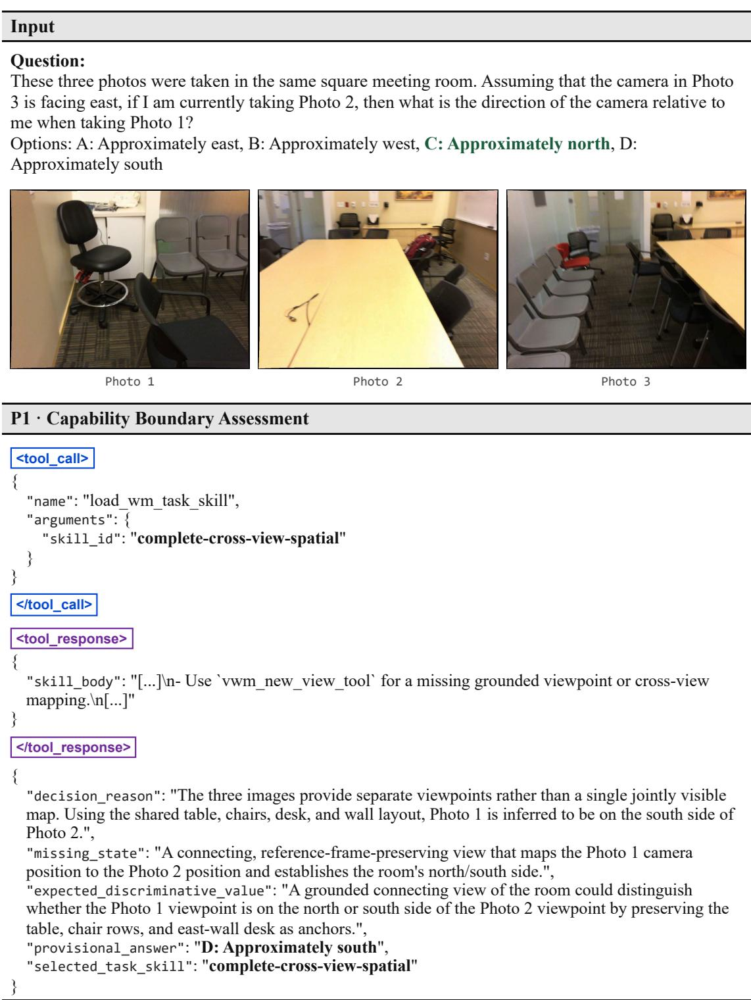  
Figure 7: Reasoning trajectory for MMSI-Bench/MMSI-0071.

## P2 · Request VWM Assistance

"name": "vwm\_new\_view\_tool",

"arguments": {

"generation\_instruction": "Local Picture 1 shows a large light meeting table filling the foreground, a rear desk with wall controls beyond it, office chairs around the table, and a red backpack near the right-side chairs. Local Picture 2 shows gray chairs along one wall, red and black chairs near glass doors, and the meeting table along the right. Render one coherent same-room connecting view during the repositioning, retaining the identities and layout of the meeting table, rear desk, carpet, walls, glass doors, chair rows, and red backpack wherever visible. Show enough of the intervening room layout to map the two viewpoints without adding new objects, labels, or an assumed answer direction.",

"camera\_instruction": "Starting from the viewpoint shown in local Picture 1, make a grounded lateral repositioning and modest reorientation through the same square meeting room toward the complementary room layout represented by local Picture 2. Keep the path inside the room and preserve stable landmarks. Do not add compass labels or encode any preferred cardinal direction. Expose the spatial arrangement between the two viewpoints using the meeting table, chair rows, glass doors, and rear desk as anchors.",

"source\_image\_indices": [1, 0],

"source\_order\_mode": "reference\_to\_anchor",

"reference\_image\_index": 1

Local Picture 1 = input image 2; Local Picture 2 = input image 1.

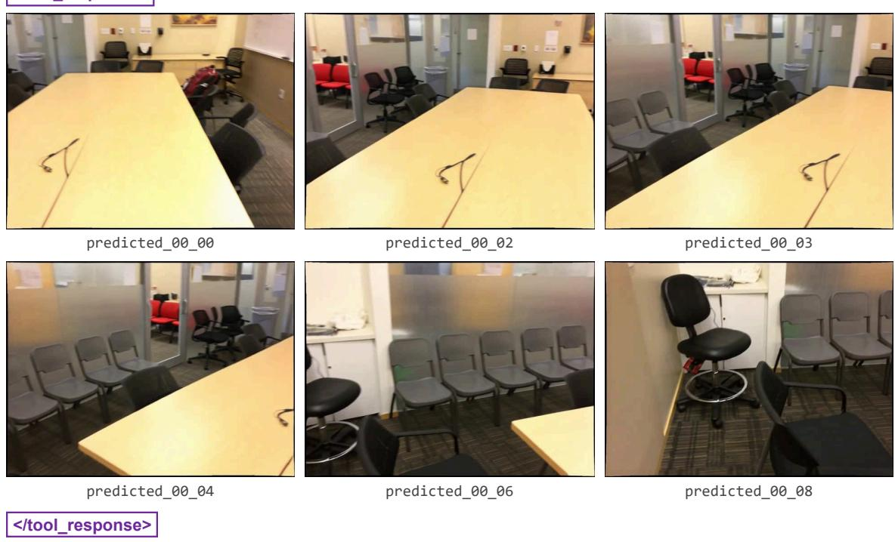  
Fi<sub>g</sub>ure 7 (continued).

```csv
P3 · Video Interpretation
<tool_call>
"name": "viewpoint_layout_verifier",
"arguments": {
"generation_index": 0,
"question_focus": "Map the camera viewpoint of Photo 1 relative to the photographer's viewpoint in
Photo 2, using Photo 3's stipulated east-facing orientation and the persistent meeting-room
landmarks."
}
</tool_call>
<tool_response>
"request_execution": {
"finding": "The requested connecting view is partially executed as a leftward camera sweep with
modest reorientation, while clear lateral camera translation is not distinguishable from rotation.",
"sources": ["predicted_00_00", "predicted_00_03", "predicted_00_08"],
"uncertainty": "The supplied frames do not establish the exact camera path or displacement."
},
"defects": []
</tool_response>
{
"observations": [
"Across generated frames, the meeting table remains consistent while the rear desk and red backpack
leave view and the glass doors, red/black chairs, and then gray-chair row become prominent."
],
"defects_and_uncertainty": [
"The generated sequence preserves the room and furniture identities, but it mainly shows a leftward
rotational sweep; exact camera translation and displacement are not clearly established."
],
"reference_frame_mapping": "Keep Photo 3's stipulated heading fixed: image-left when facing east is
north, and image-right is south. Use the gray-chair row and cabinet as persistent anchors linking Photo
1 to Photo 3, and the table/rear-desk view as the Photo 2 anchor. This maps the Photo 1 viewpoint
toward the north side relative to the Photo 2 viewpoint, subject to the generated sequence's uncertainty
about exact translation. No final option is selected in this stage."
P4 · Evidence Integration and Reasoning
{
"discriminating_evidence": "Photo 3 is stipulated to face east. In that view, the distinctive row of gray
chairs is on the image-left side, which converts to the north side. Photo 1 is positioned by that same
gray-chair row and cabinet, while Photo 2 is the table/rear-desk viewpoint farther from that north-side
row. The strongest contrary cue is the earlier provisional south reading, but it incorrectly assigned the
chair-wall side without first converting Photo 3's east-facing image axes."
}
Answer
```

C: Approximately north

Fi<sub>g</sub>ure 7 (continued).

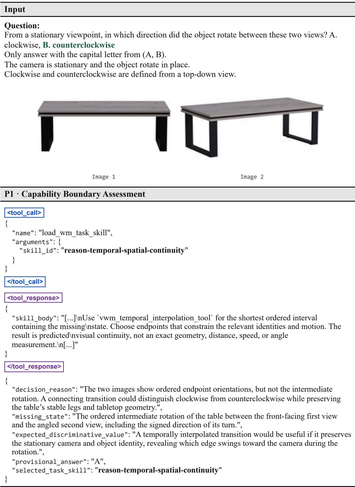  
Figure 8: Reasoning trajectory for Spin-Bench/SPIN-2511.

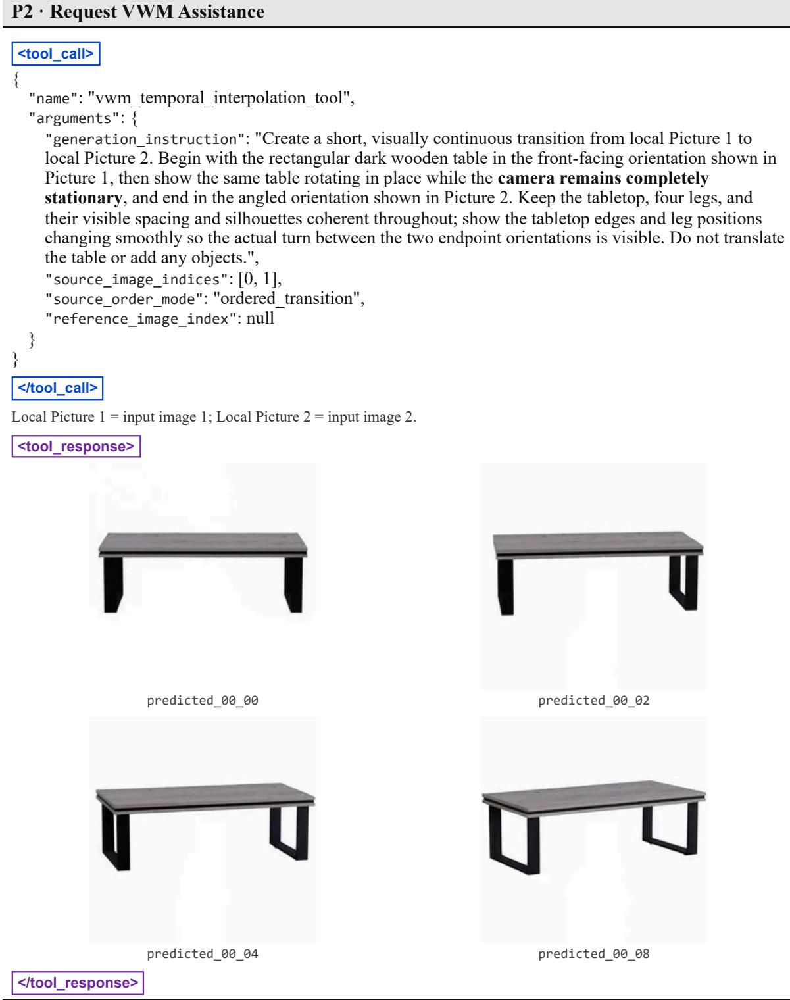  
Fi<sub>g</sub>ure 8 (continued).

```jsonl
P3 · Video Interpretation
<tool_call>
"name": "temporal_motion_verifier",
"arguments": {
"generation_index": 0,
"question_focus": "Inspect the generated transition of the same rectangular table from the first front
facing source view to the second angled source view. Assess whether the table rotates rigidly in place
with a stationary camera, and describe the visible direction of its top-down turn using persistent
tabletop and leg anchors, without choosing an answer."
}
</tool_call>
<tool_response>
"request_execution": {
"finding": "The table visibly turns in place as its tabletop orientation and visible leg spacing change
progressively, with no evident translation or added object.",
"sources": ["predicted_00_00", "predicted_00_04", "predicted_00_08"],
"uncertainty": "The supplied frames support apparent in-place rotation, but the original source
images are not attached for comparison."
},
"defects": []
}
</tool_response>
"observations": [
"The right-side legs progressively separate in depth, while the left-side structure exposes more side
depth, matching the endpoint’s angled presentation.",
"The artifact shows apparent rigid in-place rotation without obvious translation or deformation."
],
"defects_and_uncertainty": [
"The white background supplies no independent stationary landmarks, though the framing remains
stable."
],
"reference_frame_mapping": "The requested convention is clockwise/counterclockwise as viewed from
directly above the table, not the viewer-relative screen direction. The generated sequence supplies the
visible 3D turn cues needed for that mapping, but the verifier correctly leaves the final top-down label
for interpretation against the original ordered views."
}
```  
P4 · Evidence Integration and Reasoning  
Fi<sub>g</sub>ure 8 (continued).

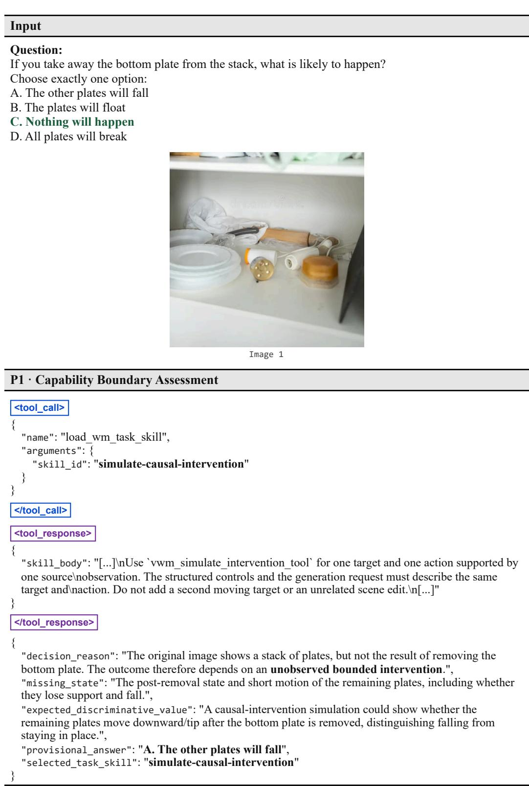  
Figure 9: Reasoning trajectory for SpatiaLab/SPATIALAB-590.

## P2 · Request VWM Assistance

"name": "vwm\_simulate\_intervention\_tool",

"generation\_instruction": "Show the visible stack of white plates on the lower-left shelf in Picture 1. A hand carefully takes the lowest plate out from underneath the stack, sliding it fully clear while leaving the other plates initially together. Keep the shelf, the remaining plates, and the surrounding toiletries and wooden-handled object visible and otherwise unchanged. Show the immediate short progression after the lowest plate has been removed, without adding any other action or scene edit.", "target\_object": "The lowest white plate in the stack at the lower-left of the shelf, visibly supporting the plates above it.",

"source\_image\_indices": [0]

Local Picture 1 = input image 1.

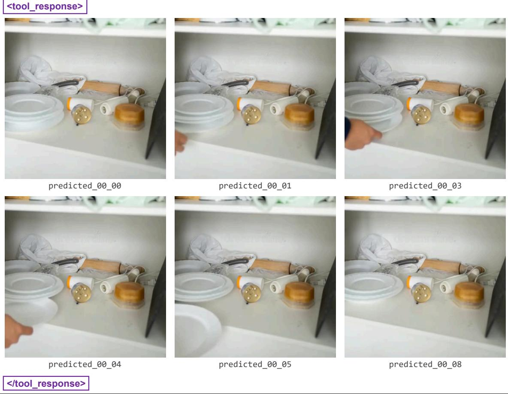  
Fi<sub>g</sub>ure 9 (continued).

```csv
P3 · Video Interpretation
<tool_call>
"name": "intervention_outcome_verifier",
"arguments": {
"generation_index": 0,
"question_focus": "Inspect whether removing the lowest white plate from the identified stack causes
the remaining plates to lose support and visibly fall, while checking target identity, contact, and
continuity against the original shelf scene."
}
</tool_call>
<tool_response>
{
"request_execution": {
"finding": "The requested removal is depicted: a hand slides a white plate out from the stack and the
plate is clear of the stack by the later frames, with no other scene edit visible.",
"sources": ["predicted_00_01", "predicted_00_04", "predicted_00_05", "predicted_00_06"],
"uncertainty": ""
},
"defects": []
</tool_response>
{
"observations": [
"Early frames show the hand approaching and beginning to pull the lowest plate outward.",
"Middle frames show the removed plate moving toward the foreground and becoming clear of the
stack.",
"Late frames show the remaining plates still together in approximately the same shelf position, with
no visible fall, float, or breakage."
],
"defects_and_uncertainty": [
"The simulation depicts removal clearly, but its mechanics are approximate and cannot guarantee
the real physical result."
],
"reference_frame_mapping": "The relevant frame is the original shelf scene viewed from the camera
facing perspective. The intervention is evaluated relative to the shelf and the persistent plate stack: the
bottom plate is removed horizontally toward the foreground, and the remaining plates are tracked in the
same lower-left shelf region. Their lack of visible displacement after removal is the task-relevant
generated relation."
P4 · Evidence Integration and Reasoning
"discriminating_evidence": "The generated sequence shows the lowest plate being slid out toward the
foreground and removed, while the remaining plates stay grouped in the same shelf position. They
do not visibly tip, separate, fall, float, or break. The strongest contrary possibility is a physical settling or
collapse after support is removed, but no such movement appears in the predicted endpoint frames."
Answer
```

## C. Nothing will happen

Fi<sub>g</sub>ure 9 (continued).

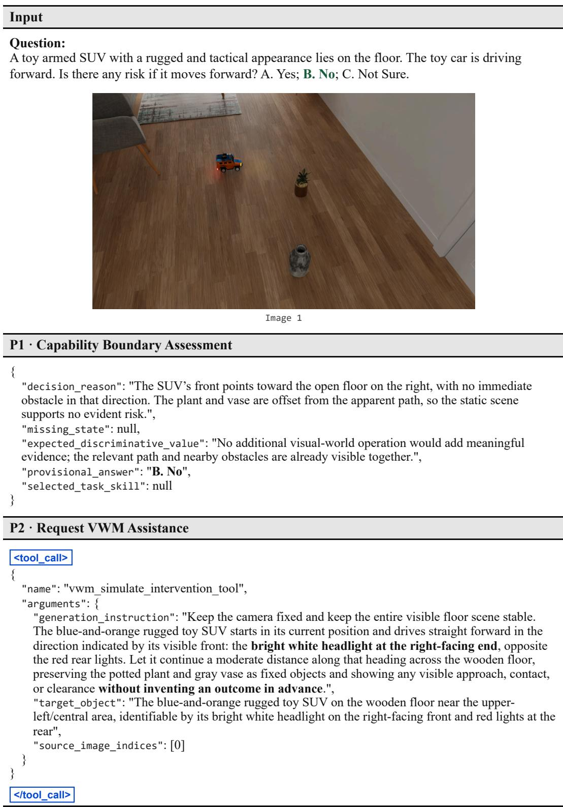  
Figure 10: Reasoning trajectory for CausalSpatial/CS-COLL-6169db902026.

P2 · Request VWM Assistance (continued)

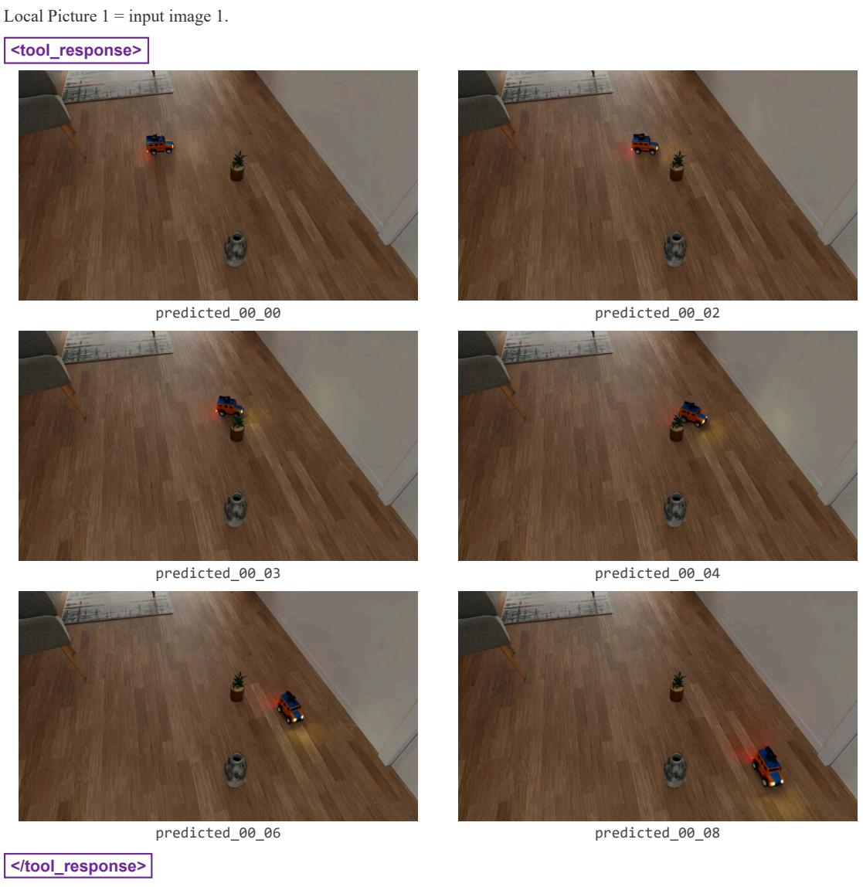

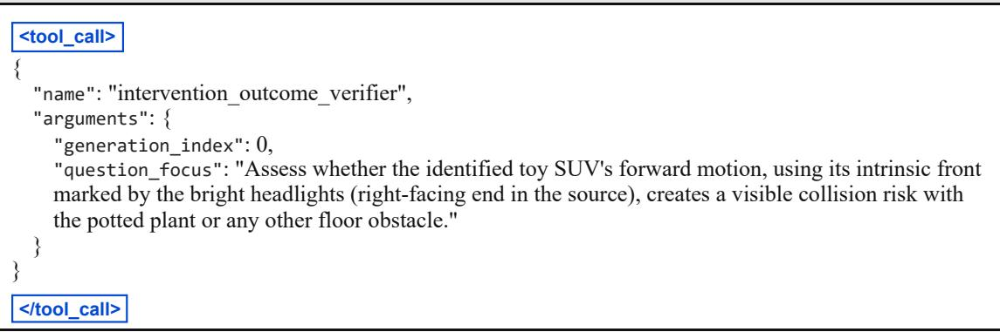  
Fi<sub>g</sub>ure 10 (continued).

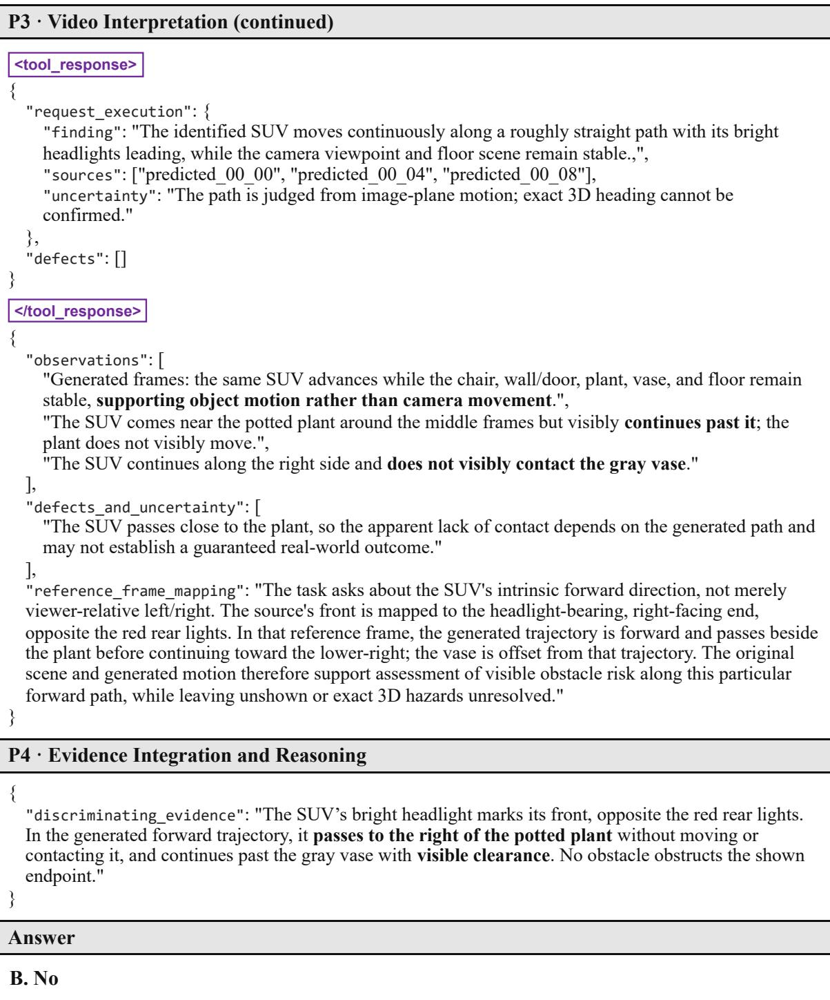  
Fi<sub>g</sub>ure 10 (continued).

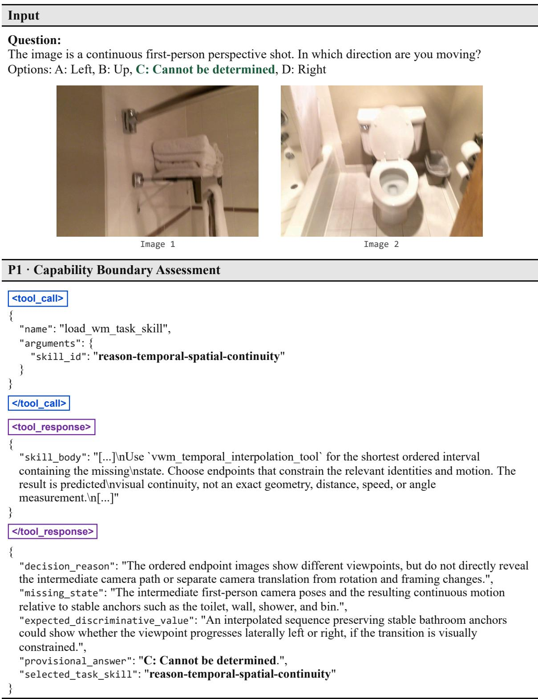  
Figure 11: Reasoning trajectory for MMSI-Bench/MMSI-0821.

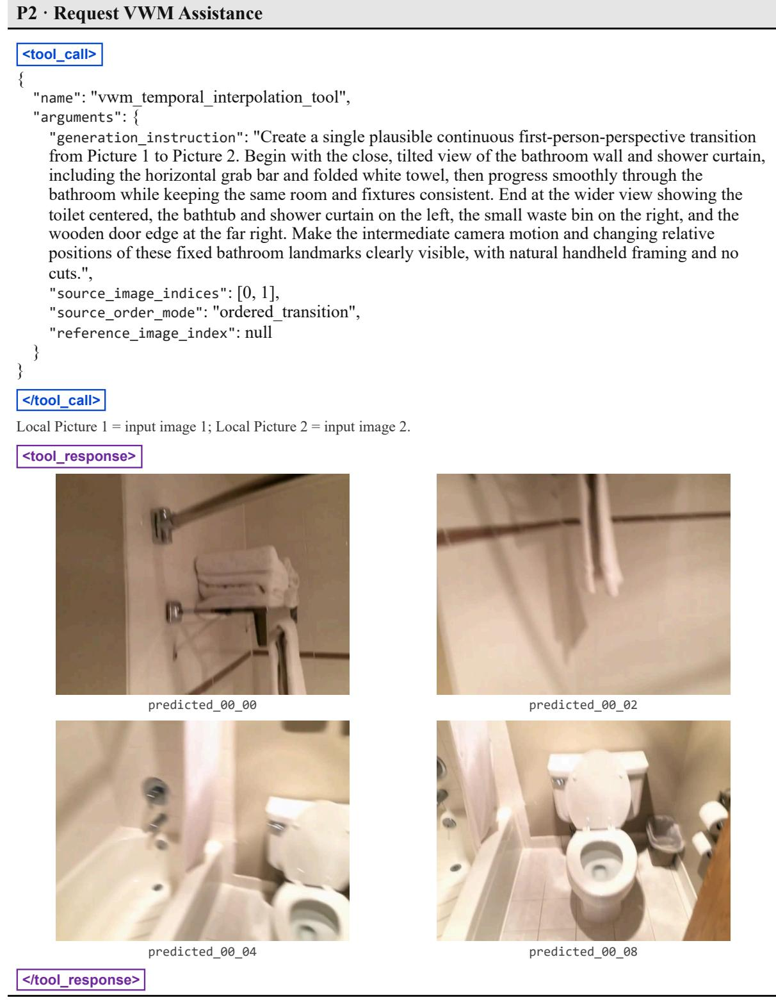  
Fi<sub>g</sub>ure 11 (continued).

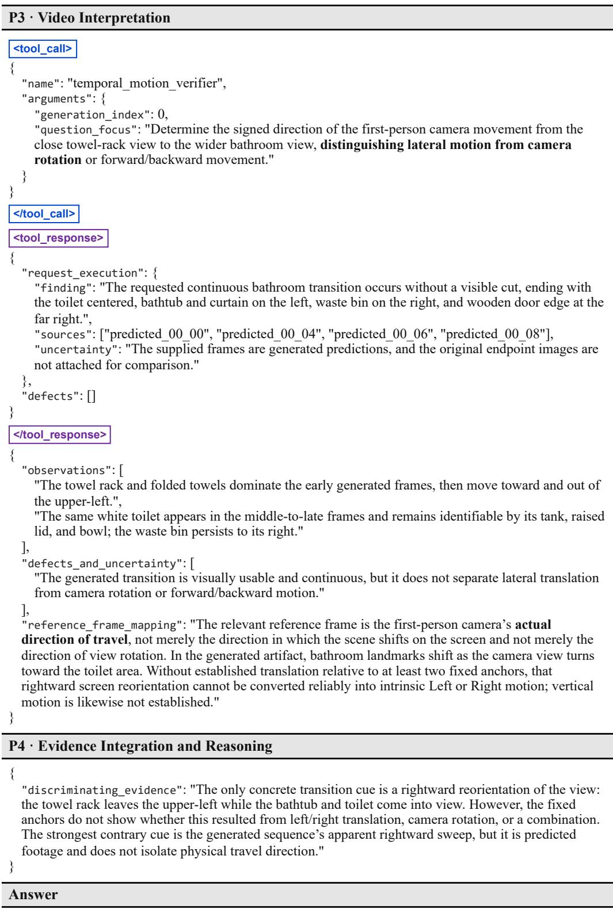  
Fi<sub>g</sub>ure 11 (continued).

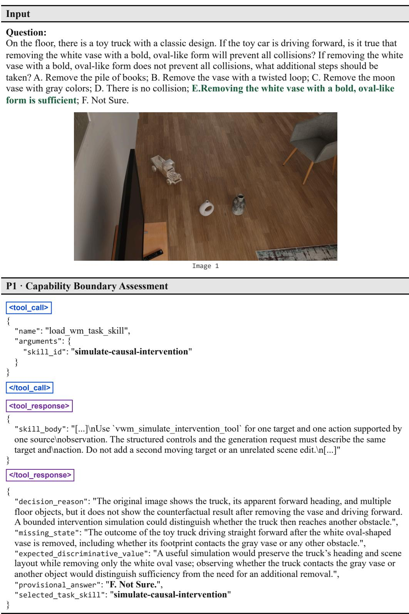  
Figure 12: Reasoning trajectory for CausalSpatial/CS-COLL-6a01e625175f.

## P2 · Request VWM Assistance

"name": "vwm\_simulate\_intervention\_tool",

"arguments": {

"generation\_instruction": "Starting from Picture 1, keep the fixed overhead camera and the entire room layout unchanged. Identify the classic toy truck near the upper-left floor area and the white ovalshaped vase with a large central opening positioned ahead of it. Remove only that white ovalshaped vase from the floor, leaving the gray mottled vase, furniture, television, and all other objects unchanged. Then show the toy truck traveling straight forward along its existing visible heading across the floor, with the truck’s path and any resulting contact with remaining objects clearly visible. Do not remove or move any other object.",

"target\_object": "the white vase with a bold oval-like form and a large central opening on the floor ahead of the toy truck",

"source\_image\_indices": [0]

</tool\_call>

Local Picture 1 = input image 1.

<tool\_response>

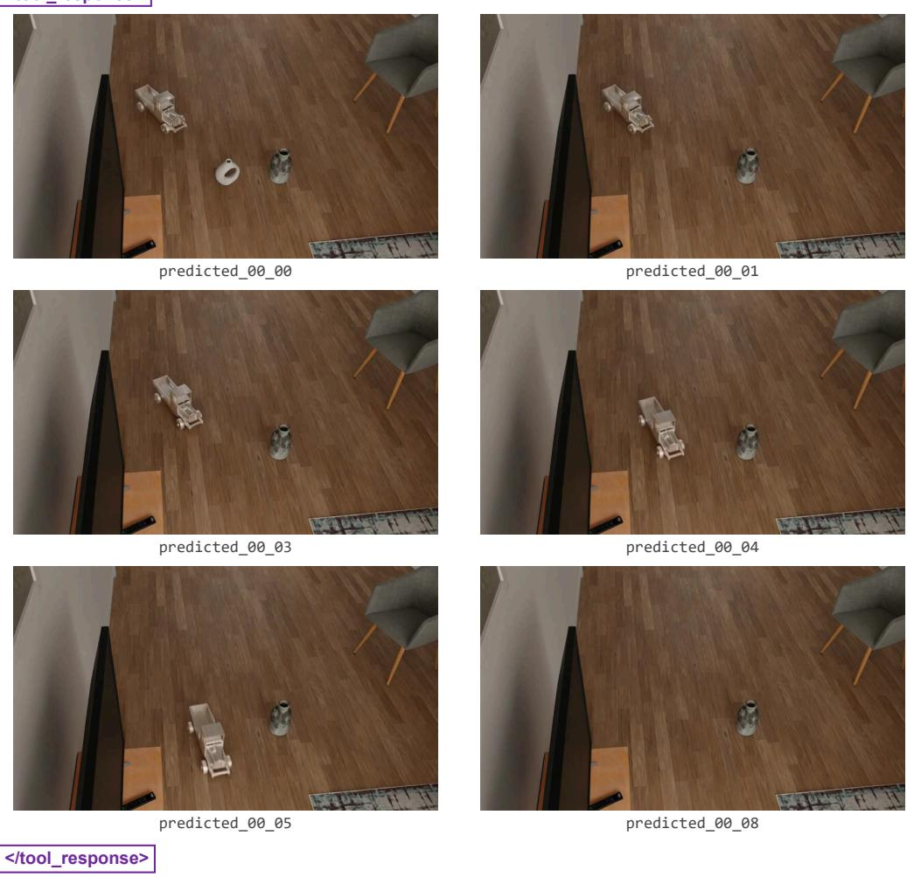  
Fi<sub>g</sub>ure 12 (continued).

```csv
P3 · Video Interpretation
<tool_call>
"name": "intervention_outcome_verifier",
"arguments": {
"generation_index": 0,
"question_focus": "Whether the classic toy truck, traveling forward along its original visible heading
after only the white oval-shaped vase is removed, collides with the remaining gray mottled vase or
any other object."
}
</tool_call>
<tool_response>
"request_execution": {
"finding": "The white oval-shaped vase is present initially, absent from the next supplied frame
onward, and the truck then travels forward along its visible grille-facing heading with the gray
mottled vase left in place.",
"sources": ["predicted_00_00", "predicted_00_01", "predicted_00_05"],
"uncertainty": "The supplied frames support the requested removal and forward travel, but do not
show the truck contacting any remaining object."
},
"defects": []
</tool_response>
"observations": [
"The white oval vase disappears between the first and second generated frames, while the gray
mottled vase remains in place.",
"By the middle frames, the truck is visibly to the left of the gray vase and there is no visible
contact."
],
"defects_and_uncertainty": [
"The truck is partly or fully offscreen in the final frames, so the complete trajectory and any later
collision are unresolved."
],
"reference_frame_mapping": "The task uses the original overhead room view and asks about the toy
truck driving forward, meaning forward relative to the truck’s intrinsic front, identified by its grille and
bumper—not merely downward on the screen. In that fixed viewer-relative frame, the simulated truck
moves generally downward and slightly right while the gray vase stays fixed near center-right; the
visible path remains left of the gray vase. This mapping supports a noncontact segment but does not
establish the full forward route beyond the bottom edge."
}
P4 · Evidence Integration and Reasoning
{
"discriminating_evidence": "After the white oval vase is removed, the gray mottled vase remains in
place, but the truck’s front grille and bumper lead it downward and to the left of that vase. The
generated frames show no contact with the gray vase or another remaining obstacle before the truck
leaves the visible floor area. Thus no additional removal, including the gray vase, is indicated."
}
Answer
E. Removing the white vase with a bold, oval-like form is sufficient.
```