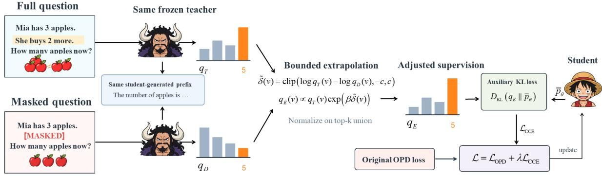
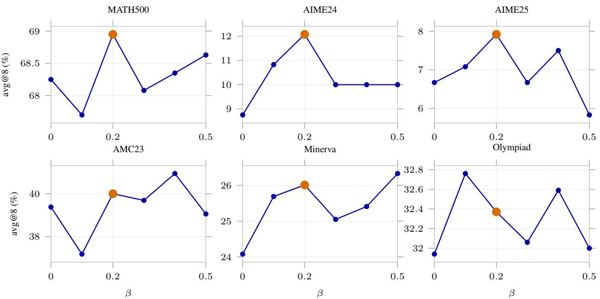

# Condition-Contrastive Extrapolation for On-Policy Distillation of Language Models

Wenxuan Luo1\* Chenxi Li1\* Haoyue Liu1,2\*

Yongxin Guo4 Xiaoying Tang1,2,3†

1School of Science and Engineering, The Chinese University of Hong Kong, Shenzhen

2Shenzhen Future Network of Intelligence Institute (FNii-Shenzhen)

3Guangdong Provincial Key Laboratory of Future Networks of Intelligence, CUHK(SZ)

4ByteDance

wenxuanluo@link.cuhk.edu.cn tangxiaoying@cuhk.edu.cn

## Abstract

On-policy distillation (OPD) improves a student language model by training on its own generated trajectories with supervision from a stronger teacher. However, when conditioned on student-generated prefixes, the teacher can favor invalid continuations that violate the question’s premises, causing OPD to encourage erroneous reasoning steps. As a remedy, we in troduce Condition-Contrastive Extrapolated On-Policy Distillation (CCE-OPD), which makes teacher supervision sensitive to question conditions. CCE-OPD incorporates (1) a fixedprefix comparison in which the same frozen teacher evaluates the complete question and a counterpart with a selected condition masked, and (2) a bounded log-probability contrast that reweights the teacher distribution into an auxiliary distillation target. On 200 diagnostic reasoning states, condition contrast reduces the rate of preferring invalid continuations from 27.0% to 16.0%. Extensive experiments across six mathematical benchmarks show that CCE-OPD improves avg@8 over OPD by an average of 1.60 and 1.95 percentage points when distilling Qwen3-8B into 0.6B and 1.7B students, respectively. It also achieves the strongest results on four transfer benchmarks.

## 1 Introduction

Knowledge distillation (Hinton et al., 2015) transfers the predictive behavior of a larger teacher to a smaller student, offering a practical route to reducing the cost of deploying capable language models. For autoregressive generation, supervision can take the form of teacher-produced responses or token distributions that convey preferences among alternative continuations. Training on teacher-generated trajectories, however, exposes the student to prefixes that can differ from those it produces at inference time (Agarwal et al., 2024). This mismatch is particularly relevant to multi-step reasoning, where each generated step determines the context for subsequent decisions.

On-policy distillation (OPD) addresses this mismatch by collecting trajectories from the student and querying the teacher at the resulting prefixes (Agarwal et al., 2024). The teacher thus provides feedback at states the student actually visits, including those arising from its own mistakes. Sampled reverse-KL objectives turn teacher–student logprobability differences into dense token-level learning signals (Li et al., 2026). Recent approaches refine this supervision through reliable regions of teacher–student agreement (Xing et al., 2026) and additional distributional matching at high-entropy positions (Jin et al., 2026). These developments make OPD a useful framework for transferring reasoning capabilities while accounting for the student’s evolving generation behavior.

However, these approaches improve how teacher feedback is applied on student-generated trajectories, but they do not by themselves ensure that a preferred continuation satisfies the question’s conditions. We refer to continuations whose reasoning conflicts with the question’s stated conditions as condition-violating continuations (CVC). Our diagnostics show that, conditioned on a studentgenerated prefix, the teacher can favor CVC that follow an erroneous reasoning direction. For example, suppose a question specifies x > 0 and $x ^ { 2 } = 9$ After a student prefix such as “Taking the negative root, x =”, continuing with “−3” follows the prefix’s reasoning direction but violates the question’s positivity constraint. We find that OPD can assign a positive local advantage to a sampled token that begins a CVC, producing a learning signal that favors that continuation. To refine this supervision, we seek to distinguish continuations supported by the question’s conditions from those that merely follow the student’s reasoning direction. We therefore keep the student prefix fixed and compare the teacher’s predictions with and without a selected condition. The resulting contrast provides an additional signal for reweighting the distillation target toward valid continuations.

  
Figure 1: Overview of CCE-OPD. The same frozen teacher evaluates a shared student prefix under the complete question and a version with a selected condition masked. The clipped condition contrast reweights the full-teacher distribution to form the auxiliary target $q _ { E }$ . The student is trained with the resulting auxiliary KL loss together with the original OPD objective.

We propose Condition-Contrastive Extrapolated On-Policy Distillation (CCE-OPD) to refine teacher supervision on student trajectories $( { \mathrm { F i g } } -$ ure 1). At the same student prefix, a frozen teacher scores the complete question and a version with a selected condition masked. Their clipped condition contrast reweights the teacher distribution into an auxiliary target that complements sampled-token OPD.

Our contributions are threefold:

• Diagnosing supervision errors. We identify teacher preferences for CVC on student trajectories and use fixed-prefix comparisons to examine how question conditions affect those preferences.

• Refining continuation preferences. We introduce CCE-OPD, which uses clipped condition contrast to reweight an auxiliary distillation target.

• Evaluating effectiveness and design choices. Across two student scales, CCE-OPD achieves the best or tied-best avg@8 on six mathematical benchmarks. Inputconstruction, extrapolation-strength, and entropy-gate ablations assess its design choices, and four transfer tasks evaluate generalization beyond mathematics.

## 2 Preliminaries

Student trajectories and teacher feedback. Let x be a question and pθ an autoregressive student over vocabulary V. A rollout policy $p _ { \mathrm { o l d } }$ , held fixed during each update, generates a response $\hat { y } ~ = ~ \left( \hat { y } _ { 1 } , \ldots , \hat { y } _ { T } \right)$ At position t, the state is $\boldsymbol { s } _ { t } = \left( x , \hat { y } _ { < t } \right)$ , containing the complete question and the student’s preceding tokens. A frozen teacher $q _ { T } ( \cdot \mid s _ { t } )$ evaluates continuations at the same state. Both models therefore condition on the student’s trajectory, while $p _ { \theta }$ is optimized using the collected responses (Agarwal et al., 2024).

Sampled-token on-policy distillation. At a fixed state s, reverse-KL distillation measures the discrepancy from the student distribution to the teacher distribution:

$$
D _ { \mathrm { K L } } ( p _ { \theta } \| q _ { T } \mid s ) = \sum _ { v \in \mathcal { V } } p _ { \theta } ( v \mid s ) \log \frac { p _ { \theta } ( v \mid s ) } { q _ { T } ( v \mid s ) } .\tag{1}
$$

Sampled-token OPD uses teacher–student logprobability differences on generated tokens to provide local learning signals. For a token sampled from $p _ { \mathrm { o l d } }$ , the advantage is (Li et al., 2026)

$$
A _ { t } = \log q _ { T } ( \hat { y } _ { t } \mid s _ { t } ) - \log p _ { \mathrm { o l d } } ( \hat { y } _ { t } \mid s _ { t } ) .\tag{2}
$$

The teacher scores and rollout probabilities are held fixed during the update. The current student is optimized through a clipped policy ratio $r _ { t } ( \theta ) =$ $p _ { \theta } ( \hat { y } _ { t } \mid s _ { t } ) / p _ { \mathrm { o l d } } ( \hat { y } _ { t } \mid s _ { t } )$ ; we denote this sampled reverse-KL training objective by $\mathcal { L } _ { \mathrm { O P D } }$ . Before clipping becomes active, a positive $A _ { t }$ encourages the sampled token and a negative $A _ { t }$ discourages it. This sign reflects the teacher’s relative preference at the given prefix, which is the local supervision signal examined in Section 3.

Distributional supervision. A distributional target $q _ { \star }$ provides feedback on alternative next tokens as well as the sampled token. A forward-KL auxiliary objective at state s takes the form

$$
D _ { \mathrm { K L } } ( q _ { \star } \| p _ { \theta } \mid s ) = \sum _ { v \in \mathcal { V } } q _ { \star } ( v \mid s ) \log \frac { q _ { \star } ( v \mid s ) } { p _ { \theta } ( v \mid s ) } .\tag{3}
$$

For a fixed target, minimizing this objective matches the student’s relative probabilities to the target weights. CCE-OPD constructs such an auxiliary target from two teacher predictions, normalizing the target on a restricted candidate support while retaining full-vocabulary student probabilities, as defined in Section 4. In the following diagnostics, pS denotes the frozen rollout student and thus plays the role of $p _ { \mathrm { o l d } }$ in Equation 2.

## 3 Diagnosing Teacher Continuation Preferences

We first examine teacher feedback at the decision immediately preceding a verified mathematical error (Table 1), then evaluate teacher preferences over valid continuations and CVC across a larger diagnostic set (Table 2).

## 3.1 A Local Error Before It Is Committed

The question gives 3400 ≡ 1 (mod 1000) and asks for the last three digits of $3 ^ { 1 2 0 0 0 }$ . After restating the condition, the student writes: “This tells us that the order of 3 modulo 1000 is 400.” This is the first false assertion: the congruence implies that the order divides $4 0 0 ,$ whereas its actual value is 100. Appendix A gives the mathematical verification and the exact decision context.

We truncate the student response immediately before the first digit of 400. The retained prefix ends with “the order of 3 modulo 1000 is \*\*”. The token 4 begins the CVC; the alternative 1 begins the valid assertion with value 100. The teacher receives this identical prefix under the complete question $( q _ { T } )$ and a question with the given congruence masked $\left( q _ { D } \right)$ . We also form the auxiliary target $q _ { E }$ using the bounded extrapolation in Section 4.

<table><tr><td>Source</td><td>4 (CVC)</td><td>1 (valid)</td><td>Other</td></tr><tr><td>Student  $p _ { S }$ </td><td>51.8624</td><td>30.2846</td><td>17.8530</td></tr><tr><td>Full teacher  $q _ { T }$ </td><td>59.7318</td><td>31.1267</td><td>9.1415</td></tr><tr><td>Masked teacher  $q _ { D }$ </td><td>89.6143</td><td>1.0278</td><td>9.3579</td></tr><tr><td>Target  $q _ { E }$ </td><td>43.7999</td><td>48.9643</td><td>7.2358</td></tr></table>

Table 1: Decision-token probabilities (%) at the same error-before state. Labels refer to the complete assertions with values 400 and 100. The first three rows use full-vocabulary probabilities; $q _ { E }$ is normalized on the teacher candidate union with $\beta = 0 . 2$ and $c = 5$ “Other” contains all remaining probability mass.

In Table 1, the full teacher assigns the token beginning the CVC more probability than the student does, giving $A _ { t } \ = \ \log ( 0 . 5 9 7 3 1 8 / 0 . 5 1 8 6 2 4 )$ ≈ +0.141. The resulting local OPD signal favors the CVC. Masking the condition raises this token’s probability to 89.61% and lowers the alternative to 1.03%. The valid candidate consequently has a larger condition contrast $\delta _ { t }$ . Incorporating that contrast reverses their ordering: $q _ { E }$ assigns 48.96% to 1 and 43.80% to 4.

This example shows that condition contrast can redirect the auxiliary target toward a valid continuation despite the full teacher’s preference for CVC.

## 3.2 Teacher Preferences Across Reasoning States

To extend the analysis in Section 3.1 beyond a single example, we evaluate 200 reasoning states. At each state, we compare two candidate next steps under the same question and student prefix: a valid inference and a CVC candidate. In 60 states, the student’s original next step is erroneous. We score each complete candidate by averaging its token log probabilities. The CVC preference rate is the percentage of states where the CVC candidate scores higher.

We compare scores from the student and from the teacher with the complete or masked question. We also test whether adding condition contrast improves the full-teacher score. For each token, we subtract the masked-input log probability from the full-input log probability and clip the difference to [−5, 5]. We add 0.2 times the clipped contrast to each full-teacher token log probability, subtract the corresponding log normalizer, and average the resulting normalized log probabilities over the candidate. We repeat the same procedure with lengthmatched random masking as a control. Appendix B provides the construction and scoring details.

<table><tr><td>Scoring source</td><td>All 200 Error subset (60)</td></tr><tr><td>Student</td><td>61 (30.50) 56 (93.33)</td></tr><tr><td>Full teacher</td><td>54 (27.00) 49 (81.67)</td></tr><tr><td>Masked teacher</td><td>64 (32.00) 57 (95.00)</td></tr><tr><td>Teacher + condition contrast 32 (16.00)</td><td>27 (45.00)</td></tr><tr><td>Teacher + random contrast</td><td>51 (25.50) 46 (76.67)</td></tr></table>

Table 2: States preferring CVC: count (%). Lower is better. The second column covers all diagnostic states; the third is the subset whose naturally generated next step is erroneous. All sources score the same candidate pairs.

As shown in Table 2, the full teacher prefers the CVC candidate in 54 of 200 states (27.00%). Among the 60 states where the student’s next step is erroneous, the teacher prefers CVC in 49 states (81.67%), compared with 56 states (93.33%) for the student. Thus, the teacher does not consistently favor a valid next step when the student makes an error.

Adding condition contrast lowers the CVC preference rate from 27.00% to 16.00% overall and from 81.67% to 45.00% in the error subset. By comparison, random-masking contrast lowers the overall rate only to 25.50%. All comparisons use the same prefixes and candidate pairs. The larger improvement from condition contrast motivates its use for refining teacher supervision.

To examine how the aggregate reduction arises, we compare the two rankings state by state. Condition contrast corrects 23 full-teacher preferences for CVC and reverses one previously correct preference, yielding a net reduction of 22 states. All 24 changes occur within the 60-state subset whose naturally generated next inference is erroneous. Rankings remain unchanged in the other 140 states, including five that favor CVC under both scoring schemes. Thus, the improvement is concentrated at the student error states central to our diagnosis: condition contrast shifts the teacher’s preference toward a valid alternative at the same prefix. Appendix B reports the paired counts.

## 4 Condition-Contrastive Extrapolated OPD

Motivated by the diagnostic findings in Section 3, we introduce CCE-OPD to refine teacher continuation preferences through condition contrast. We first construct complete and masked question pairs and compare teacher predictions at the same student prefix. We then use bounded extrapolation to form the auxiliary target and apply it at highentropy positions alongside the original OPD objective.

## 4.1 Masked Inputs

We first construct a question counterpart with a selected condition masked. For each training question $x ,$ a DeepSeek-Flash annotator with thinking disabled proposes a minimal condition and identifies the requested output. Exact-span checks and semantic review retain conditions whose removal changes an answer constraint or necessary solution path while preserving the request. Masking the accepted span with a fixed marker yields $x ^ { - }$ , with masked spans denoted by [MASKED] in Figure 1. These counterparts are fixed before training.

Of 7,498 training questions, 3,402 have accepted counterparts. They receive both OPD and the auxiliary loss of CCE-OPD; the remaining 4,096 receive OPD. The student always generates from the complete question. Construction details appear in Appendix D.

## 4.2 Condition Contrast

With these question pairs fixed, we compare teacher predictions at the same student prefix $\hat { y } _ { < t }$ . The frozen teacher scores both views:

$$
\begin{array} { l } { q _ { T } ( v ) = q ( v \mid x , \hat { y } _ { < t } ) , } \\ { q _ { D } ( v ) = q ( v \mid x ^ { - } , \hat { y } _ { < t } ) . } \end{array}\tag{4}
$$

We define the condition contrast as

$$
\delta _ { t } ( v ) = \log q _ { T } ( v ) - \log q _ { D } ( v ) .\tag{5}
$$

A positive contrast means that candidate v receives more probability when the selected condition is present in the question. Candidates with larger clipped contrasts gain relative weight over the fullteacher distribution. Both evaluations retain the exact student prefix, including any earlier restatement of that condition.

## 4.3 Bounded Extrapolation

To convert this contrast into an auxiliary target, we reweight the full-teacher distribution with a bounded adjustment. Let $\nu _ { t }$ be the union of the top-k candidates from qT and $q _ { D }$ . With $k = 1 6 .$ the support has at most 32 tokens. We clip the contrast, $\tilde { \boldsymbol { \delta } } _ { t } ( \boldsymbol { v } ) = \mathrm { c l i p } ( \delta _ { t } ( \boldsymbol { v } ) , - \boldsymbol { c } , \boldsymbol { c } )$ , and construct

$$
q _ { E } ( v ) = \frac { q _ { T } ( v ) \exp ( \beta \tilde { \delta } _ { t } ( v ) ) } { \sum _ { u \in \mathcal { V } _ { t } } q _ { T } ( u ) \exp ( \beta \tilde { \delta } _ { t } ( u ) ) } ,\tag{6}
$$

for $v \in \mathcal { V } _ { t }$ . The complete-input teacher supplies the base distribution, and $\beta$ controls the strength of the condition adjustment. We use $\beta = 0 . 2$ and $c = 5$

To see how this target changes local preferences, consider two candidate tokens $a , b \in \mathcal { V } _ { t }$ at the same student prefix. Their shared normalizer cancels, giving

$$
\log \frac { q _ { E } ( a ) } { q _ { E } ( b ) } = \log \frac { q _ { T } ( a ) } { q _ { T } ( b ) } + \beta [ \tilde { \delta } _ { t } ( a ) - \tilde { \delta } _ { t } ( b ) ] .\tag{7}
$$

The target thus combines the teacher’s original log odds with a condition-dependent adjustment. For $\beta > 0$ , if token a begins a valid continuation and token b begins a CVC, a larger clipped contrast for a increases its weight relative to b. If the contrastive adjustment is large enough to overcome the teacher’s initial preference for $b ,$ the target assigns higher probability to a than to $b .$ This relation explains how the contrast can redirect the local preference in Section 3.1: the valid candidate gains relative support because its probability depends more strongly on the selected condition.

Without clipping, the target has the ratio form

$$
q _ { E } ( v ) \propto q _ { T } ( v ) \left( \frac { q _ { T } ( v ) } { q _ { D } ( v ) } \right) ^ { \beta } .\tag{8}
$$

It extrapolates in log-probability space from the prediction under the masked question through the complete prediction. Clipping bounds each multiplicative adjustment to $[ e ^ { - \beta c } , e ^ { \beta c } ]$ before normalization. At $\beta = 0$ , the target is the full teacher renormalized on $\nu _ { t }$ , which provides the matched reweighting control in Section 5.4.

## 4.4 Entropy-Gated Auxiliary Supervision

Having constructed the auxiliary target $q _ { E } ,$ , we next determine where to apply its supervision. High entropy indicates a more dispersed teacher distribution, with multiple continuation candidates competing for probability mass, giving condition contrast more scope to shift their relative preferences. We therefore use an entropy gate to concentrate auxiliary supervision on these positions.

Specifically, we compute the full-input teacher entropy over the complete vocabulary V:

$$
H ( q _ { T } ) = - \sum _ { v \in \mathcal { V } } q _ { T } ( v ) \log q _ { T } ( v ) .\tag{9}
$$

Entropy uses natural logarithms and is computed before top-k support construction and renormalization. The gate therefore evaluates the original teacher distribution $q _ { T }$ , while the auxiliary loss uses the extrapolated target $q _ { E }$ . We retain the fixed threshold $\tau = 0 . 8$ nats from the existing auxiliaryloss training configuration and keep it unchanged across gated runs. Section 5.5 assesses this selection rule by comparing it with applying auxiliary supervision at every valid position on eligible questions.

On questions with an accepted counterpart, the auxiliary loss is active at valid response positions satisfying $H ( q _ { T } ) \ge \tau$ . Let $m _ { t }$ indicate positions satisfying these three conditions and N be the number of all valid response tokens in the update. The target $q _ { E }$ is normalized on $\nu _ { t }$ and assigned zero probability outside it, while the student distribution $p _ { \theta , t }$ retains full-vocabulary normalization. The loss is

$$
\mathcal { L } _ { \mathrm { C C E } } = \frac { 1 } { N } \sum _ { t } m _ { t } D _ { \mathrm { K L } } ( q _ { E } | | p _ { \theta , t } ) ,\tag{10}
$$

$$
\begin{array} { r } { \mathcal { L } = \mathcal { L } _ { \mathrm { O P D } } + \lambda \mathcal { L } _ { \mathrm { C C E } } , \qquad \lambda = 1 . } \end{array}\tag{11}
$$

Sampled-token OPD supplies supervision throughout the trajectory, including positions excluded by the auxiliary gate. Appendix C details the mask and loss normalization.

## 5 Experiments

## 5.1 Experimental Setup

Model and training data. We distill frozen Qwen3-8B into Qwen3-0.6B-Base and Qwen3- 1.7B-Base (Yang et al., 2025) using 7,498 questions from the training split of the MATH dataset (Hendrycks et al., 2021). We compare Base, GRPO (Shao et al., 2024), OPD (Li et al., 2026), TrOPD (Xing et al., 2026), and EOPD (Jin et al., 2026).

Evaluation. We sample eight responses per question at temperature 1.0 and $\mathrm { t o p } \mathrm { - } p ~ = ~ 0 . 8 .$ , with an 8,192-token limit. avg@8 is mean sampledanswer accuracy, and pass@8 is the fraction of questions solved at least once. Five mathematics tasks use the Qwen2.5-Math evaluator (Yang et al., 2024); OlympiadBench uses TINA/LightEval’s latex\_gold\_metric. All methods share the task-specific evaluation protocol. Macro gains average the six differences between CCE-OPD and the best competing score for each benchmark. Dataset sizes appear in Appendix D.

## 5.2 Main Results

We evaluate whether CCE-OPD improves mathematical reasoning over standard OPD and other competing methods at both student scales. CCE-OPD achieves the highest avg@8 on all six 1.7B benchmarks and five 0.6B benchmarks, tying GRPO on 0.6B AIME25 (Table 3). At 1.7B, improvements over the strongest competing score range from 0.20 points on OlympiadBench to 4.69 on AMC23. At 0.6B, Minerva-Math shows the largest gain of 3.22 points. The corresponding macro gains are 1.45 and 1.33 points. CCE-OPD also obtains the best pass@8 on four tasks at 1.7B and three at 0.6B, showing improvements in both average answer accuracy and eight-attempt solution coverage.

<table><tr><td rowspan="2">Benchmark Metric</td><td rowspan="2"></td><td colspan="6">Qwen3-0.6B-Base (MATH)</td><td colspan="6">Qwen3-1.7B-Base (MATH)</td></tr><tr><td>Base</td><td>GRPO</td><td>OPD</td><td>TrOPD</td><td>EOPD CCE-OPD</td><td></td><td>Base</td><td>GRPO</td><td>OPD</td><td></td><td>TrOPD EOPD CCE-OPD</td><td></td></tr><tr><td rowspan="2">MATH500</td><td>Avg@8 27.40 Pass@8</td><td></td><td>49.35 77.60</td><td>52.08 77.00</td><td>43.48 73.20</td><td>52.45 76.80</td><td>54.00</td><td>53.78</td><td>63.58</td><td>68.45</td><td>59.98</td><td>68.50</td><td>68.95</td></tr><tr><td></td><td>67.60</td><td></td><td></td><td></td><td></td><td>77.40</td><td>82.20</td><td>83.80</td><td>86.40</td><td>86.00</td><td>85.40</td><td>87.60</td></tr><tr><td>AIME24</td><td>Avg@8 Pass@8</td><td>0.42 3.33</td><td>2.08 6.67</td><td>3.75 6.67</td><td>2.50 16.67</td><td>3.33 13.33</td><td>4.58 10.00</td><td>3.33 16.67</td><td>6.25 20.00</td><td>9.17 20.00</td><td>9.17 26.67</td><td>10.42 23.33</td><td>12.08 23.33</td></tr><tr><td>AIME25</td><td>Avg@8 Pass@8</td><td>0.00 0.00</td><td>3.33 20.00</td><td>2.08 13.33</td><td>0.83 3.33</td><td>1.67 13.33</td><td>3.33 10.00</td><td>1.25 10.00</td><td>4.17 16.67</td><td>7.08 16.67</td><td>6.25 16.67</td><td>5.83 16.67</td><td>7.92 26.67</td></tr><tr><td>AMC23</td><td>Avg@8 Pass@8</td><td>9.69 47.50</td><td>22.19 55.00</td><td>30.00 55.00</td><td>22.81 60.00</td><td>28.44 60.00</td><td>31.25 67.50</td><td>31.56 65.00</td><td>31.25 67.50</td><td>35.00 62.50</td><td>33.44 67.50</td><td>35.31 65.00</td><td>40.00 75.00</td></tr><tr><td>Minerva</td><td>Avg@8 Pass@8</td><td>5.19 22.79</td><td>12.22 32.35</td><td>14.98 34.93</td><td>10.66 29.78</td><td>14.38 31.62</td><td>18.20 35.66</td><td>16.82 39.34</td><td>25.18 45.59</td><td>24.08 42.65</td><td>22.01 45.59</td><td>21.51 38.24</td><td>26.01 44.85</td></tr><tr><td>Olympiad</td><td>Avg@8 Pass@8 27.70</td><td>7.04</td><td>17.44 40.30</td><td>20.35 40.44</td><td>17.28 37.19</td><td>20.13 38.96</td><td>21.50 43.11</td><td>20.98 46.07</td><td>27.63 50.67</td><td>31.83 53.19</td><td>30.24 54.07</td><td>32.17 53.33</td><td>32.37 54.22</td></tr></table>

Table 3: Mathematical reasoning results (%). Bold and underlined values denote the best and second-best scores within each student scale and metric, including ties. Light blue highlights CCE-OPD. Evaluation protocols are specified in Section 5.1.

Compared with OPD, CCE-OPD improves avg@8 on all six benchmarks at both student scales, with macro-average gains of 1.60 and 1.95 percentage points for the 0.6B and 1.7B students, respectively. The largest gains occur on Minerva-Math for the 0.6B student (+3.22 points) and AMC23 for the 1.7B student (+5.00 points). These improvements span both student scales and benchmarks with different levels of baseline accuracy, supporting the use of condition contrast to improve the effectiveness of OPD across the evaluated mathematical reasoning tasks.

## 5.3 Which Part of the Question Should Be Masked?

To assess whether the benefit depends on masking a condition, we vary the second teacher input on the same 3,402 eligible questions at 1.7B and $\beta = 0 . 2$ Alternatives are a length-matched random span that preserves the request, whole-question deletion retaining format instructions, another question from a fixed training-set permutation, and symbols matched to the question’s token count. Each arm retains the original questions for student rollouts and the same loss settings.

<table><tr><td colspan="6">Avg@8 (%)</td></tr><tr><td>Benchmark</td><td>CCE-OPD</td><td>Random</td><td>Delete</td><td>Other</td><td>Symbols</td></tr><tr><td>MATH500</td><td>68.95</td><td>67.38</td><td>68.23</td><td>67.03</td><td>67.58</td></tr><tr><td>AIME24</td><td>12.08</td><td>11.25</td><td>9.58</td><td>9.17</td><td>9.17</td></tr><tr><td>AIME25</td><td>7.92</td><td>7.92</td><td>4.58</td><td>5.83</td><td>5.83</td></tr><tr><td>AMC23</td><td>40.00</td><td>37.81</td><td>39.69</td><td>38.75</td><td>39.69</td></tr><tr><td>Minerva</td><td>26.01</td><td>23.62</td><td>25.28</td><td>25.14</td><td>24.86</td></tr><tr><td>Olympiad</td><td>32.37</td><td>32.07</td><td>32.19</td><td>31.93</td><td>32.22</td></tr><tr><td colspan="6">Pass@8 (%)</td></tr><tr><td>Benchmark</td><td>CCE-OPD</td><td>Random</td><td>Delete</td><td>Other</td><td>Symbols</td></tr><tr><td>MATH500</td><td>87.60</td><td>84.60</td><td>86.00</td><td>85.40</td><td>86.00</td></tr><tr><td>AIME24</td><td>23.33</td><td>23.33</td><td>16.67</td><td>20.00</td><td>26.67</td></tr><tr><td>AIME25</td><td>26.67</td><td>23.33</td><td>20.00</td><td>20.00</td><td>23.33</td></tr><tr><td>AMC23</td><td>75.00</td><td>75.00</td><td>75.00</td><td>72.50</td><td>70.00</td></tr><tr><td>Minerva</td><td>44.85</td><td>42.65</td><td>44.49</td><td>44.12</td><td>45.59</td></tr><tr><td>Olympiad</td><td>54.22</td><td>53.48</td><td>53.63</td><td>54.52</td><td>54.81</td></tr><tr><td></td><td></td><td></td><td></td><td></td><td></td></tr></table>

Table 4: Second-input ablation for the 1.7B student (β = 0.2). CCE-OPD masks the condition; Random masks a length-matched span; Delete removes the question; Other substitutes another question; Symbols matches its token count. Bold marks the best score in each row, including ties.

These controls examine distinct aspects of the second teacher view. Random tests the value of selecting a specific condition under matched masking lengths. Delete tests the role of retaining the remaining question information. Other tests whether replacing the question with different mathematical content yields similar benefits, while Symbols tests whether preserving input length without meaningful question content is sufficient. Together, these comparisons assess the contribution of condition masking.

  
Figure 2: Sensitivity to extrapolation strength on the six mathematics benchmarks (1.7B student). Orange marks the main setting $\beta = 0 . 2$ . Each panel uses its own vertical scale. Full avg@8 and pass@8 scores appear in Table 11.

Condition masking improves avg@8 over random masking on five benchmarks and ties on AIME25 (Table 4). Its largest advantages are 2.39 points on Minerva-Math and 2.19 on AMC23. It also outperforms each broader question perturbation on all six avg@8 metrics. The comparison links the benefit of the second teacher view to the condition selected for masking. Changes to pass@8 are less uniform, particularly for Minerva-Math and OlympiadBench.

## 5.4 How Much Extrapolation Is Useful?

Having examined the input construction, we next evaluate sensitivity to extrapolation strength by varying $\beta \in \{ 0 , 0 . 1 , 0 . 2 , 0 . 3 , 0 . 4 , 0 . 5 \}$ for the 1.7B student. The $\beta = 0$ arm retains the paired teacher queries, candidate union, entropy gate, and auxiliary loss, allowing the effect of reweighting to be measured within the same training setup.

Relative to $\beta = 0$ , the main setting $\beta = 0 . 2$ improves avg@8 on all six tasks, by 0.70, 3.33, 1.25, 0.62, 1.93, and 0.43 points in benchmark order (Figure 2). It improves pass@8 on five tasks and ties on Minerva-Math. Larger coefficients do not yield monotonic gains: $\beta = 0 . 4$ leads on AMC23, while $\beta = 0 . 5$ leads on Minerva-Math. The results favor a moderate adjustment to the full teacher, with task-dependent sensitivity to its strength.

<table><tr><td></td><td colspan="2">Entropy gate</td><td colspan="2">No gate</td></tr><tr><td>Benchmark</td><td>Avg@8</td><td>Pass@8</td><td> $\operatorname { A v g } @ ^ { \bigotimes 8 }$ </td><td>Pass@8</td></tr><tr><td>MATH500</td><td>68.95</td><td>87.60</td><td>68.65</td><td>87.20</td></tr><tr><td>AIME24</td><td>12.08</td><td>23.33</td><td>10.83</td><td>23.33</td></tr><tr><td>AIME25</td><td>7.92</td><td>26.67</td><td>6.67</td><td>23.33</td></tr><tr><td>AMC23</td><td>40.00</td><td>75.00</td><td>39.38</td><td>72.50</td></tr><tr><td>Minerva</td><td>26.01</td><td>44.85</td><td>23.53</td><td>45.59</td></tr><tr><td>Olympiad</td><td>32.37</td><td>54.22</td><td>31.44</td><td>53.93</td></tr></table>

Table 5: Entropy-gate ablation for the 1.7B student $( \beta ~ = ~ 0 . 2 ;$ scores in %). The gate selects positions with $H ( q _ { T } ) \ge 0 . 8$ nats; No gate supervises all valid response positions on eligible questions. Bold marks the best score for each benchmark and metric, including ties.

## 5.5 Does Entropy Gating Improve Distillation?

To assess the value of selective auxiliary supervision, we compare the entropy gate with applying the auxiliary loss to every valid response position on eligible questions. Both arms use $\beta \ = \ 0 . 2 .$ $\lambda = 1$ , and normalization by all valid response tokens. The remaining 4,096 questions receive OPD in both arms.

The gated configuration improves avg@8 on all six tasks (Table 5), with gains ranging from 0.30 points on MATH500 to 2.48 on Minerva-Math. It also improves pass@8 on four tasks and ties on AIME24. Concentrating the auxiliary loss at uncertain teacher positions is therefore effective under the fixed coefficient and normalization used here.

<table><tr><td>Method</td><td>GPQA D</td><td>MMLU Pro</td><td>IFEval</td><td>CRUX 0</td></tr><tr><td>Base</td><td>24.24</td><td>35.90</td><td>16.64</td><td>34.2250</td></tr><tr><td>OPD</td><td>29.29</td><td>40.23</td><td>29.57</td><td>39.5125</td></tr><tr><td>EOPD</td><td>29.29</td><td>39.99</td><td>30.50</td><td>40.3625</td></tr><tr><td>CCE-OPD</td><td>30.81</td><td>40.72</td><td>32.53</td><td>41.1125</td></tr></table>

Table 6: Cross-domain results for 1.7B students (%). Bold denotes the best score per task. CRUX-O denotes CRUXEval-O.

The macro-average avg@8 gain is 1.14 percentage points, with improvements of 1.25 points on both AIME24 and AIME25. Minerva-Math illustrates the distinction between the two metrics: gating raises avg@8 by 2.48 points while reducing pass@8 by 0.74 points, indicating higher average answer accuracy alongside slightly lower eightattempt coverage. Because the loss coefficient and denominator are fixed, removing the gate adds auxiliary contributions from low-entropy positions. Their inclusion does not improve avg@8 on any evaluated benchmark. This pattern supports the selection rule in Section 4: focusing conditionbased preference refinement on positions where the teacher distributes probability across competing continuations.

## 5.6 Transfer Beyond Mathematics

Finally, to test transfer beyond the training domain, we evaluate the mathematics-trained 1.7B models on GPQA-Diamond (Rein et al., 2023), MMLU-Pro (Wang et al., 2024), IFEval (Zhou et al., 2023), and CRUXEval-O (Gu et al., 2024a), using a shared task-specific protocol across models.

CCE-OPD obtains the highest score on all four transfer tasks (Table 6). Gains over the strongest competing result are 1.52 points on GPQA-Diamond, 0.49 on MMLU-Pro, 2.03 on IFEval, and 0.75 on CRUXEval-O. These results extend the observed benefits to knowledge, instruction following, and code reasoning after mathematics-only training.

## 6 Related Work

On-policy distillation. OPD extends sequencelevel distillation (Kim and Rush, 2016) by learning on student-generated trajectories (Agarwal et al.,

2024; Gu et al., 2024b), connecting to earlier work on learner-generated histories (Ross et al., 2011; Bengio et al., 2015). DistiLLM improves loss design and sample reuse (Ko et al., 2024). Further studies examine supervision failures (Li et al., 2026; Fu et al., 2026; Liu et al., 2026), stabilize targets or select compatible positions (Jang et al., 2026; Xing et al., 2026; Wang et al., 2026), and provide step-level corrections (Sun et al., 2026). EOPD adds forward KL at high-entropy teacher positions (Jin et al., 2026), while ExOPD scales the distillation reward relative to KL regularization (Yang et al., 2026). CCE-OPD also uses entropy-gated auxiliary supervision, refining its target through condition contrast to reduce preferences for CVC.

Contrastive and extrapolative supervision. Predictive contrasts guide generation across models (Liu et al., 2021; Li et al., 2023), control codes (Krause et al., 2021), layers (Chuang et al., 2024), and context views (Shi et al., 2024). Proxy-tuning transfers the difference between tuned and untuned small-model predictions to a larger model (Liu et al., 2024). For distillation, DistiLLM-2 contrasts teacher- and student-response objectives (Ko et al., 2025), while Delta Distillation and weak-tostrong OPD construct supervision from capability contrasts (Heo et al., 2026; Yu et al., 2026). CCE-OPD shares the unclipped probability-ratio form of context-aware decoding. It compares full and masked questions under the same frozen teacher and student prefix, using bounded extrapolation to form an auxiliary training target.

## 7 Conclusion

Teacher feedback on student trajectories can assign positive local advantage to a sampled token that begins a CVC. CCE-OPD uses the teacher’s response to a masked condition to refine that supervision. The paired diagnostic shows improved candidate ranking, and training experiments show higher or tied-highest avg@8 on six mathematical benchmarks at two student scales, together with gains on four transfer tasks. The input-construction ablations highlight the value of selecting a relevant condition for masking. The extrapolation-strength and entropy-gate ablations further support moderate reweighting at positions with competing teacher predictions. The results support condition contrast as a practical way to refine continuation preferences in on-policy distillation.

## Limitations

Our training experiments use mathematical reasoning data from the MATH dataset. Future work could extend CCE-OPD to training data from a broader range of domains, such as code generation and scientific reasoning, to investigate its effectiveness across different types of tasks.

## Ethical Considerations

We use existing benchmark datasets and pretrained Qwen models, whose use and redistribution are governed by the applicable licenses and access conditions. Distilled students may inherit biases or undesirable behaviors from their teachers, warranting evaluation before downstream deployment.

DeepSeek-Flash assists condition annotation and semantic review, while ChatGPT-6 Sol assists mathematical verification of diagnostic candidates. The authors are responsible for the annotation decisions and reported results.

## References

Rishabh Agarwal, Nino Vieillard, Yongchao Zhou, Piotr Stanczyk, Sabela Ramos Garea, Matthieu Geist, and Olivier Bachem. 2024. On-policy distillation of language models: Learning from self-generated mistakes. In International Conference on Learning Representations, volume 2024, pages 21246–21263.

Samy Bengio, Oriol Vinyals, Navdeep Jaitly, and Noam Shazeer. 2015. Scheduled sampling for sequence prediction with recurrent neural networks. Advances in neural information processing systems, 28.

Yung-Sung Chuang, Yujia Xie, Hongyin Luo, Yoon Kim, James R Glass, and Pengcheng He. 2024. DoLa: Decoding by contrasting layers improves factuality in large language models. In International Conference on Learning Representations, volume 2024, pages 54158–54183.

Yuqian Fu, Haohuan Huang, Kaiwen Jiang, Jiacai Liu, Zhuo Jiang, Yuanheng Zhu, and Dongbin Zhao. 2026. Revisiting on-policy distillation: Empirical failure modes and simple fixes. arXiv preprint arXiv:2603.25562.

Alex Gu, Baptiste Rozière, Hugh Leather, Armando Solar-Lezama, Gabriel Synnaeve, and Sida I Wang. 2024a. CRUXEval: A benchmark for code reasoning, understanding and execution. arXiv preprint arXiv:2401.03065.

Yuxian Gu, Li Dong, Furu Wei, and Minlie Huang. 2024b. MiniLLM: Knowledge distillation of large language models. In International Conference on Learning Representations, volume 2024, pages 32694–32717.

Chaoqun He, Renjie Luo, Yuzhuo Bai, Shengding Hu, Zhen Thai, Junhao Shen, Jinyi Hu, Xu Han, Yujie Huang, Yuxiang Zhang, et al. 2024. OlympiadBench: A challenging benchmark for promoting AGI with olympiad-level bilingual multimodal scientific problems. In Proceedings ofthe 62nd Annual Meeting of the Associationfor Computational Linguistics (Volume 1: Long Papers), pages 3828–3850.

Dan Hendrycks, Collin Burns, Saurav Kadavath, Akul Arora, Steven Basart, Eric Tang, Dawn Song, and Jacob Steinhardt. 2021. Measuring mathematical problem solving with the MATH dataset. arXiv preprint arXiv:2103.03874.

Byeongho Heo, Jaehui Hwang, Sangdoo Yun, and Dongyoon Han. 2026. On-policy delta distillation. arXiv preprint arXiv:2607.15161.

Geoffrey Hinton, Oriol Vinyals, and Jeff Dean. 2015. Distilling the knowledge in a neural network. arXiv preprint arXiv:1503.02531.

Ijun Jang, Jewon Yeom, Juan Yeo, Hyunggyu Lim, and Taesup Kim. 2026. Stable on-policy distillation through adaptive target reformulation. In Findings of the Association for Computational Linguistics: ACL 2026, pages 42217–42227.

Woogyeol Jin, Taywon Min, Yongjin Yang, Dennis Wei, Yi Zhou, Swanand Ravindra Kadhe, Nathalie Baracaldo, and Kimin Lee. 2026. Entropy-aware onpolicy distillation of language models. arXiv preprint arXiv:2603.07079.

Yoon Kim and Alexander M Rush. 2016. Sequencelevel knowledge distillation. In Proceedings of the 2016 conference on empirical methods in natural language processing, pages 1317–1327.

Jongwoo Ko, Tianyi Chen, Sungnyun Kim, Tianyu Ding, Luming Liang, Ilya Zharkov, and Se-Young Yun. 2025. DistiLLM-2: A contrastive approach boosts the distillation of LLMs. arXiv preprint arXiv:2503.07067.

Jongwoo Ko, Sungnyun Kim, Tianyi Chen, and Se-Young Yun. 2024. DistiLLM: Towards streamlined distillation for large language models. arXiv preprint arXiv:2402.03898.

Ben Krause, Akhilesh Deepak Gotmare, Bryan McCann, Nitish Shirish Keskar, Shafiq Joty, Richard Socher, and Nazneen Fatema Rajani. 2021. GeDi: Generative discriminator guided sequence generation. In Findings ofthe Associationfor Computational Linguistics: EMNLP 2021, pages 4929–4952.

Aitor Lewkowycz, Anders Andreassen, David Dohan, Ethan Dyer, Henryk Michalewski, Vinay Ramasesh, Ambrose Slone, Cem Anil, Imanol Schlag, Theo Gutman-Solo, et al. 2022. Solving quantitative reasoning problems with language models. Advances in neural information processing systems, 35:3843– 3857.

Xiang Lisa Li, Ari Holtzman, Daniel Fried, Percy Liang, Jason Eisner, Tatsunori B Hashimoto, Luke Zettlemoyer, and Mike Lewis. 2023. Contrastive decoding: Open-ended text generation as optimization. In Proceedings ofthe 61st annual meeting ofthe associationfor computational linguistics (volume 1: Long papers), pages 12286–12312.

Yaxuan Li, Yuxin Zuo, Bingxiang He, Jinqian Zhang, Chaojun Xiao, Cheng Qian, Tianyu Yu, Huan-ang Gao, Wenkai Yang, Zhiyuan Liu, et al. 2026. Rethinking on-policy distillation of large language models: Phenomenology, mechanism, and recipe. arXiv preprint arXiv:2604.13016.

Alisa Liu, Xiaochuang Han, Yizhong Wang, Yulia Tsvetkov, Yejin Choi, and Noah A Smith. 2024. Tuning language models by proxy. arXiv preprint arXiv:2401.08565.

Alisa Liu, Maarten Sap, Ximing Lu, Swabha Swayamdipta, Chandra Bhagavatula, Noah A Smith, and Yejin Choi. 2021. DExperts: Decoding-time controlled text generation with experts and anti-experts. In Proceedings of the 59th Annual Meeting of the Association for Computational Linguistics and the 11th International Joint Conference on Natural Language Processing (Volume 1: Long Papers), pages 6691–6706.

Yanjiang Liu, Jie Lou, Xinyan Guan, Yuqiu Ji, Hongyu Lin, Ben He, Xianpei Han, Le Sun, Xing Yu, and Yaojie Lu. 2026. Your teacher can’t help you here: Combating supervision fidelity decay in on-policy distillation. arXiv preprint arXiv:2605.30833.

David Rein, Betty Li Hou, Asa Cooper Stickland, Jackson Petty, Richard Yuanzhe Pang, Julien Dirani, Julian Michael, and Samuel R Bowman. 2023. GPQA: A graduate-level google-proof q&a benchmark. arXiv preprint arXiv:2311.12022.

Stéphane Ross, Geoffrey Gordon, and Drew Bagnell. 2011. A reduction of imitation learning and structured prediction to no-regret online learning. In Proceedings ofthefourteenth international conference on artificial intelligence and statistics, pages 627– 635. JMLR Workshop and Conference Proceedings.

Zhihong Shao, Peiyi Wang, Qihao Zhu, Runxin Xu, Junxiao Song, Xiao Bi, Haowei Zhang, Mingchuan Zhang, YK Li, Yang Wu, et al. 2024. DeepSeekMath: Pushing the limits of mathematical reasoning in open language models. arXiv preprint arXiv:2402.03300.

Weijia Shi, Xiaochuang Han, Mike Lewis, Yulia Tsvetkov, Luke Zettlemoyer, and Wen-tau Yih. 2024. Trusting your evidence: Hallucinate less with contextaware decoding. In Proceedings ofthe 2024 Conference of the North American Chapter of the Association for Computational Linguistics: Human Language Technologies (Volume 2: Short Papers), pages 783–791.

Changhui Sun, Lanbo Liu, Hang Lei, Tong Ling, Jiahang Xie, Zhiyong Zheng, Yujia Wang, Hao Liu,

Feng Xiao, Lu Liu, et al. 2026. Step-level on-policy distillation: Interpolating between on-policy distillation and supervised fine-tuning. arXiv preprint arXiv:2608.16333.

Yuanyi Wang, Su Lu, Yanggan Gu, Pengkai Wang, Yifan Yang, Zhaoyi Yan, Congkai Xie, Jianmin Wu, and Hongxia Yang. 2026. Not all disagreement is learnable: Token teachability in on-policy distillation. arXiv preprint arXiv:2605.26844.

Yubo Wang, Xueguang Ma, Ge Zhang, Yuansheng Ni, Abhranil Chandra, Shiguang Guo, Weiming Ren, Aaran Arulraj, Xuan He, Ziyan Jiang, et al. 2024. MMLU-Pro: A more robust and challenging multitask language understanding benchmark. Advances in Neural Information Processing Systems, 37:95266– 95290.

Xingrun Xing, Haoqing Wang, Boyan Gao, Ziheng Li, and Yehui Tang. 2026. Trust region on-policy distillation. arXiv preprint arXiv:2606.01249.

An Yang, Anfeng Li, Baosong Yang, Beichen Zhang, Binyuan Hui, Bo Zheng, Bowen Yu, Chang Gao, Chengen Huang, Chenxu Lv, et al. 2025. Qwen3 technical report. arXiv preprint arXiv:2505.09388.

An Yang, Beichen Zhang, Binyuan Hui, Bofei Gao, Bowen Yu, Chengpeng Li, Dayiheng Liu, Jianhong Tu, Jingren Zhou, Junyang Lin, et al. 2024. Qwen2.5- Math technical report: Toward mathematical expert model via self-improvement. arXiv preprint arXiv:2409.12122.

Wenkai Yang, Weijie Liu, Ruobing Xie, Kai Yang, Saiyong Yang, and Yankai Lin. 2026. Learning beyond teacher: Generalized on-policy distillation with reward extrapolation. arXiv preprint arXiv:2602.12125.

Fangxu Yu, Weijia Xu, Michael Xu, Tianyi Zhou, and Zinan Lin. 2026. Weak-to-strong on-policy distillation. arXiv preprint arXiv:2607.26246.

Jeffrey Zhou, Tianjian Lu, Swaroop Mishra, Siddhartha Brahma, Sujoy Basu, Yi Luan, Denny Zhou, and Le Hou. 2023. Instruction-following evaluation for large language models. arXiv preprint arXiv:2311.07911.

## A Mathematical Verification of the Local Example

The question is: “You are given that $3 ^ { 4 0 0 } \equiv 1$ (mod 1000). What are the last three digits of 312000?” The given congruence yields 312000 = $( 3 ^ { 4 0 0 } ) ^ { 3 0 } \equiv 1$ (mod 1000), so the requested digits are 001. It does not identify the smallest positive exponent giving residue 1.

Direct modular calculations give

$$
\begin{array} { c l } { { 3 ^ { 1 0 0 } \equiv 1 ~ ( \mathrm { m o d ~ 1 0 0 0 } ) , } } \\ { { } } \\ { { 3 ^ { 5 0 } \equiv 2 4 9 ~ ( \mathrm { m o d ~ 1 0 0 0 } ) , } } \\ { { } } \\ { { 3 ^ { 2 0 } \equiv 4 0 1 ~ ( \mathrm { m o d ~ 1 0 0 0 } ) . } } \end{array}
$$

The multiplicative order divides 100. Every proper divisor of 100 divides either 50 or 20, ruling out all smaller possibilities. The order is therefore exactly 100.

Before the erroneous assertion, the student has restated the given congruence. The scored prefix ends immediately before the first digit in “the order of 3 modulo 1000 is $* * 4 0 0 ^ { * * }$ . The two decision tokens begin the complete assertions with values 400 and 100. Their probabilities describe this specific decision, while other tokens can begin valid continuations or CVC. In the masked question, the given-congruence clause is replaced by [MASKED]; the student prefix is retained verbatim.

## B Candidate-Preference Diagnostic

State construction. To examine continuation preferences at student reasoning states, we construct the diagnostic set from the 3,402 questions eligible for condition masking in the MATH training split. An OPD-trained Qwen3-1.7B student generates one response per question with temperature 1.0, top- $p = 1 . 0$ , thinking disabled, and a maximum response length of 8,096 tokens. Questions are processed in a predetermined hash-based order, excluding previously examined pilot questions. We retain the first 200 qualifying states, with at most one state per question.

Next, for each response, we identify the first substantive inference that uses the selected condition and truncate the student prefix immediately before that inference. States with an earlier uncorrected mathematical error or an ambiguous candidate pair are excluded. The original inference forms one candidate; a minimally edited alternative forms the other, yielding a valid continuation and a CVC with comparable wording and the same reasoning purpose. Candidate validity is established through ChatGPT-6 Sol-assisted mathematical verification against the question and prefix, before teacher candidate scores are inspected. The resulting set contains 200 states, including 60 whose naturally generated next inference is erroneous.

Scoring protocol. With the states and candidate pairs fixed, the frozen Qwen3-8B teacher evaluates identical prefixes and candidate sequences under the complete question, the masked question, and a question with length-matched random masking. For a prefix h and a candidate inference $z ~ = ~ ( z _ { 1 } , \dots , z _ { L } )$ , we use the mean token log-probability score

$$
S _ { q } ( z ) = \frac { 1 } { L } \sum _ { j = 1 } ^ { L } \log q ( z _ { j } \mid x , h , z _ { < j } ) .\tag{12}
$$

Each candidate supplies its own continuation history during teacher forcing, and the teacher under the masked question substitutes $x ^ { - }$ for x. We then score each candidate using the normalized condition-contrastive target:

$$
S _ { \mathrm { c o n t r a s t } } ( z ) = S _ { T } ( z ) + \frac { 1 } { L } \sum _ { j = 1 } ^ { L } \bigl [ \beta \tilde { \delta } _ { j } ( z _ { j } ) - \log Z _ { j } \bigr ] ,\tag{13}
$$

where $\tilde { \delta } _ { j }$ is the condition contrast clipped to $[ - 5 , 5 ]$ $\beta = 0 . 2 $ , and $Z _ { j }$ is the per-position normalizing constant of $q _ { E }$ at the candidate-specific history $( x , h , z _ { < j } )$ . The normalizer is evaluated separately at each candidate’s own history before sequence averaging. Thus, $S _ { \mathrm { c o n t r a s t } } ( z )$ is the mean token log probability under the normalized target, following the scoring procedure in Section 3.2.

For a controlled comparison, random masking preserves the requested output and response-format instruction and matches the number of source tokens masked by the condition-masking intervention. We average the normalized contrast scores over three fixed random-masking views before ranking the candidates. All question variants retain the same student prefix, including any earlier restatement of the selected condition. The reported preference rate counts states in which the CVC receives a higher score than the valid candidate. This span-level diagnostic complements the singletoken analysis in Section 3.1.

Paired preference changes. Finally, we compare the full-teacher and condition-augmented rankings state by state. Condition contrast corrects 23 fullteacher preferences and reverses one previously correct preference, reducing the number of states preferring the CVC from 54 to 32. All 24 reversals occur within the 60-state error subset. Preferences remain unchanged in the remaining 140 states, five of which favor the CVC under both scoring schemes. Table 7 summarizes these transitions.

<table><tr><td>Preference change</td><td>All states (200)</td><td>Error subset (60)</td></tr><tr><td>CVC → valid</td><td>23</td><td>23</td></tr><tr><td>Valid → CVC</td><td>1</td><td>1</td></tr><tr><td>Unchanged</td><td>176</td><td>36</td></tr></table>

Table 7: Paired preference changes after adding condition contrast to the full-teacher score.

Together, these paired comparisons show how condition contrast changes continuation rankings at fixed student states. The reported proportions describe preferences within the diagnostic set, rather than error rates during unrestricted generation.

## C Auxiliary-Loss Position Selection

Following Section 4, auxiliary supervision is applied only when the question has an accepted masked counterpart, the position is a valid response token, and the full-input teacher entropy satisfies $H ( q _ { T } ) \geq 0 . 8$ nats. Entropy is computed over the complete vocabulary using natural logarithms, before candidate-support construction and renormalization. The same mask is used in the main experiments and the input-construction and extrapolationstrength ablations; the no-gate ablation removes only the entropy criterion. In all settings, the auxiliary loss is normalized by the total number of valid response tokens in the update.

## D Construction and Training Details

Condition construction. The annotator proposes one minimal, semantically complete condition and the smallest span specifying the requested output. Condition types include quantities, constraints, relations, domain restrictions, structural properties, and definitions. The two proposed spans must match the source exactly and must not overlap. Semantic review checks that the masked condition affects an answer constraint or necessary solution path while the request remains identifiable. Accepted spans are replaced with a fixed masking marker before training. For presentation, we denote this marker by [MASKED], following Figure 1.

To illustrate the resulting inputs, Table 8 presents three examples from the MATH training set. They cover numerical information, a geometric relation, and a constraint on a complex variable. In each case, masking the condition changes the information available for solving the question while retaining the requested output.

Length-matched random masking. For comparison, Table 9 shows a saved random-masking view of the geometric example above. Both source spans contain 10 tokens under the shared Qwen tokenizer and are replaced with the same masking marker. The random window is sampled from the question while preserving the requested output; such windows may mask other relevant information or overlap the selected condition.

<table><tr><td>Masking</td><td>Source span</td><td>Tokens</td></tr><tr><td>Condition</td><td>If a cube has the same volume as the prism</td><td>10</td></tr><tr><td>Random span</td><td>dimensions 8 inches by 2 inches by</td><td>10</td></tr></table>

Table 9: An example of token-length matching between condition masking and random masking. Lengths refer to the replaced source spans.

The resulting randomly masked question is:

A rectangular prism has[MASKED]32 inches. If a cube has the same volume as the prism, what is the surface area of the cube, in square inches?

Annotation prompts. We use DeepSeek-Flash with thinking disabled for both candidate annotation and semantic review. The system message for candidate annotation is: You are a careful mathematical dataset annotator. The user template below is instantiated with the original question in the final Problem field.

For the Problem below, identify the smallest target text that   
must remain and exactly one smallest semantically   
complete premise whose removal materially changes the   
constraints, answer determinacy, or necessary solution   
path while leaving a coherent question.   
Return exactly one JSON object and no explanation.   
Accepted schema:   
{"status":"accepted","target":{"text":"exact source substring   
"},"spans":[{"text":"exact source substring","kind":"   
constraint","provenance":"short explanation","confidence   
":0.0}]}   
Rejected schema:   
{"status":"rejected","rejection\_reason":"short reason","target   
":null,"spans":[]}   
Hard rules:   
- Every text value in an accepted response must be copied from   
Problem as one contiguous, character-for-character   
substring.   
- Never paraphrase, normalize, correct, translate, reformat   
LaTeX, alter backslashes, alter punctuation, or alter   
whitespace in copied text.   
- The target and removed condition must not overlap.   
- Select exactly one condition. It must be an atomic,   
semantically complete proposition, not a fragment such   
as only a number, a conjunction, or a trailing phrase.   
- The target must still identify what answer is requested   
after the condition is removed.   
- kind must be one of: quantity, constraint, relation, domain,   
structural\_property, definition.   
- Reject rather than guess when no separable target and   
removable premise exist.

<table><tr><td>Original question</td><td>Masked question</td><td>Rationale</td></tr><tr><td>Numerical information. Margo walks to her friend&#x27;s house in 10 minutes. Using the same route, it takes Margo 20 minutes ing rate for the entire trip is 4 miles per hour, how many total miles did she walk?</td><td>Margo walks to her friend&#x27;s house in 10 minutes. Using the same route, it takes Margo 20 minutes to get back home. to get back home. If her average walk- [MASKED], how many total miles did she walk?</td><td>The average speed connects the total travel time to the requested distance, giv- ing  $4 \times ( 3 0 / 6 0 ) = \dot { 2 }$  miles. Masking it removes the information needed to de- termine that distance.</td></tr><tr><td>Geometric relation. A rectangular prism has dimensions 8 inches by 2 inches by ume as the prism, what is the surface cube, in square inches? area of the cube, in square inches?</td><td>A rectangular prism has dimensions 8 inches by 2 inches by 32 inches. mines the cube&#x27;s side length as 32 inches. If a cube has the same vol- [MASKED], what is the surface area of the</td><td>The equal-volume relation deter-  $\sqrt [ 3 ] { 8 \times 2 \times 3 2 } = 8$  and its surface area as 6 ×  $8 ^ { 2 } = 3 8 4$  . Masking it leaves the cube&#x27;s size unspecified.</td></tr><tr><td>nonreal complex number such that  $| z | =$  1. Find the real part of  ${ \frac { 1 } { 1 - z } } .$ </td><td>Complex-variable constraint. Let z be a Let z be a nonreal complex number [MASKED]. Find the real part of  ${ \frac { 1 } { 1 - z } } .$ </td><td>The unit-modulus constraint fixes the requested real part at  $1 / 2 .$  Without it, the real part varies with z: it equals  $1 / 2$  for z = i and  $1 / 5$  for  $z = 2 i .$ </td></tr></table>

Table 8: Masked inputs from the MATH training set. Bold identifies the selected source span; [MASKED] denotes the masking marker. The shared response-format instruction is omitted.

Validation and semantic review. For an accepted response, the validator resolves the target and condition to unique, nonempty source substrings and records their character offsets. It checks that exactly one condition is returned, the two spans do not overlap, the condition kind belongs to the specified set, the provenance is nonempty, and the confidence lies in [0, 1]. Candidates passing these checks are submitted to a second DeepSeek-Flash call using the following template, with the question and extracted spans inserted into the corresponding fields.

Judge one proposed CCE premise deletion. Return only JSON:   
{"decision":"accept" or "reject","reason":"max 12 words"}   
Accept when Condition is one semantically complete   
mathematical premise, definition, domain restriction, or   
geometric construction; it must materially constrain   
the answer or a necessary solution path, and Target must   
remain the requested output. It is VALID and desired if   
deleting Condition makes the remaining question   
underdetermined or unsolvable.   
Reject only output-format instructions, text fragments, the   
requested expression/question itself rather than a   
premise, duplicated/leaked information, or information   
immaterial to solving. Do NOT reject merely because   
Condition supplies all decisive constraints or is a   
necessary definition/construction.   
Problem: {problem}   
Target: {target}   
Condition: {condition}

The semantic review retains conditions that affect the answer constraints or a necessary solution path while preserving the requested output. A question may become underdetermined after masking; the retained request must still identify the quantity or expression to be answered. The accepted condition spans are frozen before training, and the response-format instruction is preserved in both question views. This process yields the 3,402 eligible questions used for auxiliary supervision.

Optimization. Table 10 summarizes the optimization, rollout, and evaluation settings used in our experiments, together with the main CCE-OPD hyperparameters.

Evaluation sets. We evaluate MATH500, a subset of MATH (Hendrycks et al., 2021); AIME 2024; AIME 2025; AMC 2023; Minerva-Math (Lewkowycz et al., 2022); and OlympiadBench (He et al., 2024). Their sizes are 500, 30, 30, 40, 272, and 675 questions, respectively. Eight responses per question yield 12,376 evaluated responses per checkpoint. Benchmark scores use the task evaluators described in Section 5.1; training rewards are not used to populate the evaluation tables.

## E Full Extrapolation-Strength Results

Table 11 reports the complete scores corresponding to Figure 2.

## F CCE-OPD Training Algorithm

The complete question is used for every rollout. For eligible questions, both teacher evaluations retain the same student-generated prefix. Teacher predictions, rollout probabilities, and the auxiliary target are held fixed during the update; gradients flow through the current student probabilities. We use $k = 1 6 , \beta = 0 . 2 , c = 5 , \tau = 0 . 8$ nats, and λ = 1.

<table><tr><td>Hyperparameter</td><td>Value</td></tr><tr><td>Optimization</td><td></td></tr><tr><td>Optimizer</td><td>AdamW</td></tr><tr><td>Learning rate</td><td> $3 \times 1 0 ^ { - 6 }$ </td></tr><tr><td>Learning-rate schedule</td><td>Cosine</td></tr><tr><td>Weight decay</td><td>0.01</td></tr><tr><td>Gradient clipping norm</td><td>1.0 1</td></tr><tr><td>PPO epochs per update</td><td></td></tr><tr><td>Training rollouts</td><td></td></tr><tr><td>Maximum prompt length</td><td>2,048 tokens</td></tr><tr><td>Maximum response length</td><td>2,048 tokens</td></tr><tr><td>Sampling temperature</td><td>1.0</td></tr><tr><td>Top-p</td><td>1.0</td></tr><tr><td>Thinking mode</td><td>Disabled</td></tr><tr><td>CCE-OPD</td><td></td></tr><tr><td>Top-k per teacher distribution</td><td>16</td></tr><tr><td>Extrapolation coefficient  $\beta$ </td><td>0.2</td></tr><tr><td>Contrast clipping bound c</td><td>5</td></tr><tr><td>Entropy threshold τ</td><td>0.8 nats</td></tr><tr><td>Auxiliary-loss coefficient λ</td><td>1</td></tr><tr><td>Evaluation</td><td></td></tr><tr><td>Responses per question</td><td>8</td></tr><tr><td>Sampling temperature</td><td>1.0</td></tr><tr><td>Top-p</td><td>0.8</td></tr><tr><td>Maximum response length</td><td>8,192 tokens</td></tr></table>

Table 10: Hyperparameter settings for training and evaluation. CCE-OPD uses the same main settings for both student scales; the extrapolation-strength and entropygate ablations vary their respective settings.
<table><tr><td colspan="7">Avg@8 (%)</td></tr><tr><td>Benchmark</td><td>0</td><td>0.1</td><td>0.2</td><td>0.3</td><td>0.4</td><td>0.5</td></tr><tr><td>MATH500 AIME24 AIME25 AMC23</td><td>68.25 8.75 6.67 39.38 24.08</td><td>67.70 10.83 7.08 37.19 25.69</td><td>68.95 12.08 7.92 40.00 26.01</td><td>68.08 10.00 6.67 39.69 25.05</td><td>68.35 10.00 7.50 40.94 25.41</td><td>68.63 10.00 5.83 39.06 26.33</td></tr><tr><td colspan="7">Olympiad 31.94 32.76 32.37 32.06 32.59 32.00 Pass@8 (%)</td></tr><tr><td colspan="7"></td></tr><tr><td>Benchmark MATH500</td><td>0 87.20</td><td>0.1 86.20</td><td>0.2 87.60</td><td>0.3 87.40</td><td>0.4</td><td>0.5</td></tr><tr><td>AIME24</td><td>16.67</td><td>30.00</td><td>23.33</td><td>20.00</td><td>87.00 20.00</td><td>86.80 30.00</td></tr><tr><td>AIME25</td><td>20.00</td><td>20.00</td><td>26.67</td><td>16.67</td><td>20.00</td><td>20.00</td></tr><tr><td>AMC23</td><td>70.00</td><td>62.50</td><td>75.00</td><td>72.50</td><td>67.50</td><td>70.00</td></tr><tr><td></td><td></td><td></td><td></td><td></td><td></td><td></td></tr><tr><td>Minerva</td><td>44.85</td><td>44.85</td><td>44.85</td><td>41.91</td><td>45.96</td><td>46.69</td></tr><tr><td>Olympiad</td><td>53.93</td><td>55.70</td><td>54.22</td><td>55.11</td><td>55.26</td><td>54.37</td></tr></table>

Table 11: Extrapolation strength β for the 1.7B student. The $\beta = 0$ control retains auxiliary supervision without condition reweighting. Blue marks the main setting; bold marks the best score in each row, including ties.

The candidate union is deduplicated and contains at most 2k tokens. Condition contrast uses teacher log probabilities normalized over the complete vocabulary; only $q _ { E }$ is normalized on $\nu _ { t }$ . The student probabilities in the auxiliary KL retain fullvocabulary normalization, and qE is zero outside its support. Positions excluded by eligibility or entropy selection contribute zero auxiliary loss while retaining sampled-token OPD supervision. The denominator N includes all valid response tokens, as in Section 4.

Algorithm 1 CCE-OPD training   
Require: Student ${ \mathit { p } } _ { \theta } ,$ frozen teacher q, questions D, and ac  
cepted counterparts $x ^ { - }$   
Require: $k , \beta , c ,$ entropy threshold $\tau ,$ and coefficient λ   
1: repeat   
2: Freeze the rollout policy $p _ { \mathrm { o l d } }  p _ { \theta }$   
3: Sample questions from $\mathcal { D }$ and responses from $p _ { \mathrm { o l d } } ( \cdot |$   
$x )$   
$4 { : }$ Store sampled-token rollout probabilities   
5: Score all valid prefixes with $q _ { T } = q ( \cdot \mid x , \hat { y } _ { < t } )$   
6: Score eligible prefixes with $q _ { D } = q ( \cdot \mid x ^ { - } , { \hat { y } } _ { < t } )$   
7: $A _ { t } \gets \log q _ { T } ( \bar { y } _ { t } ) - \log p _ { \mathrm { o l d } } ( \hat { y } _ { t } )$   
8: Compute current $p _ { \theta , t }$ over the full vocabulary   
9: $N \gets$ total number of valid response tokens   
10: $L _ { \mathrm { a u x } }  0$   
11: for each eligible valid response position t do   
12: $\begin{array} { r } { H _ { t }  - \sum _ { v \in \mathcal { V } } q _ { T } ( v ) \log \hat { q _ { T } } ( v ) } \end{array}$   
13: if $H _ { t } \geq \tau$ then   
14: $\mathcal { V } _ { t } \gets \mathrm { T o p K } ( q _ { T } , k ) \cup \mathrm { T o p K } ( q _ { D } , k )$   
15: $\delta _ { t } ( v ) \gets \log { q _ { T } ( v ) } - \log q _ { D } ( v ) , v \in \mathcal V _ { t }$   
16: $\tilde { \delta } _ { t } ( v ) \gets \mathrm { c l i p } ( \delta _ { t } ( v ) , - c , c )$   
17: $w _ { t } ( v ) \gets \log q _ { T } ( v ) + \beta \tilde { \delta } _ { t } ( v )$   
18: $q _ { E }  \mathrm { s o f t m a x } _ { \mathcal { V } _ { t } } ( w _ { t } )$   
19: $\dot { L } _ { \mathrm { a u x } }  L _ { \mathrm { a u x } } + \dot { D } _ { \mathrm { K L } } ( q _ { E } | | p _ { \theta , t } )$   
20: end if   
21: end for   
22: Compute $\scriptstyle { \mathcal { L } } _ { \mathrm { O P D } }$ using $A _ { t }$ and the clipped policy ratios   
over all valid response tokens   
23: $\mathcal { L } _ { \mathrm { C C E } }  L _ { \mathrm { a u x } } / N$   
24: Update θ using $\dot { \mathcal { L } } _ { \mathrm { O P D } } + \lambda \mathcal { L } _ { \mathrm { C C E } }$   
25: until training is complete   
26: return $p _ { \theta }$

## G Transfer Evaluation Protocols

We evaluate the mathematics-trained 1.7B models on four transfer benchmarks using the same task-specific prompts, decoding settings, and scoring procedures across methods. Thinking mode is disabled throughout. Table 12 summarizes the evaluation settings.

Prompts. GPQA-Diamond, IFEval, and CRUXEval-O use the Qwen tokenizer’s chat template. GPQA-Diamond presents each question with four answer options and selects the option with the highest conditional log likelihood. MMLU-Pro uses a subject-specific multiple-choice prompt with five demonstrations in plain text; generation stops at Question: or the token limit. IFEval directly supplies the benchmark instruction as the user prompt. CRUXEval-O provides a Python function and an incomplete assertion, assert f(input) == ??, and requests the literal output in a complete assertion enclosed in [ANSWER] and [/ANSWER] tags. Its two fixed demonstrations are formatted as preceding user–assistant turns.

<table><tr><td>Benchmark</td><td>Questions</td><td>Shots</td><td>Max. tokens</td><td>Responses per question</td></tr><tr><td>GPQA-Diamond</td><td>198</td><td>0</td><td></td><td>一</td></tr><tr><td>MMLU-Pro</td><td>12,032</td><td>5</td><td>2,048</td><td>1</td></tr><tr><td>IFEval</td><td>541</td><td>0</td><td>1,280</td><td>1</td></tr><tr><td>CRUXEval-O</td><td>800</td><td>2</td><td>8,096</td><td>10</td></tr></table>

Table 12: Transfer evaluation settings. GPQA-Diamond scores four options by log likelihood. MMLU-Pro and IFEval use greedy decoding; CRUXEval-O uses temperature 0.2 and top-p = 0.95.

Scoring and versions. GPQA-Diamond and IFEval use task versions 2.2-local-56686c06 and 4.0-local-966cd895, respectively. GPQA-Diamond reports option accuracy. IFEval reports strict prompt-level accuracy, requiring every instruction associated with a prompt to be satisfied. MMLU-Pro uses task version 3.1-local-b189ec76 and scorer mmlu-pro-saved-final-choice-v1, which extracts a terminal answer letter or boxed choice, falls back to the original answer is filter, and compares the extracted choice with the gold answer to report exact-match accuracy.

CRUXEval-O uses task version 1.1-local-crux8096-20260925. Its scoring pipeline comprises cruxeval-saved-cpu-v1, crux8096-final-assertion-diagnostic-v1, and crux8096-output-final-assertinput-checked-v1. The pipeline extracts the final assertion, verifies that its function-call input matches the benchmark input, and checks correctness by execution with a three-second timeout. The reported pass@1 averages the tenresponse success fraction over all 800 questions (8,000 responses).