# Constrained Multi-Agent Reinforcement Learning in Imagination

Raz Shmueli

Shahaf S. Shperberg

razshmue@post.bgu.ac.il

shperbsh@bgu.ac.il

Ben-Gurion University of the Negev

Beer-Sheva, Israel

## Abstract

Constrained multi-agent reinforcement learning pays for every policy update with interactions with the real system, which are slow, costly, and can be unsafe. We show that a world model, a learned simulator of the system, can move most of this learning into imagination, onto episodes the model simulates. Cost-Aware MAMBA (CA-MAMBA) extends MAMBA, a multi-agent worldmodel learner, to predict each agent’s cost, trains per-agent policies on imagined reward and cost, and prices cost for the whole team with a Lagrange multiplier, a weight on cost set from the cost of real episodes. On two benchmarks, one with discrete and one with continuous control, constrained methods without a world model need at least an order of magnitude more interactions on most tasks to match CA-MAMBA’s cost and task performance. An exact decomposition of the gap between imagined and real cost, with a bound that splits across the agents’ communication structure, explains what decides whether a constraint learned in imagination holds on the real system, and why the price should be set from measured cost. In controlled tests on one task per benchmark, weighting cost as much as reward more than halved a cost-blind learner’s cost on one task and met a tight limit that the learned price missed on the other, without losing task performance. This suggests the model’s cost estimates support tighter limits than our learned price reaches. CA-MAMBA cuts the interactions that constrained multi-agent learning needs.

## Keywords

Multi-Agent Reinforcement Learning, Safe Reinforcement Learning, World Models, Constrained MDPs

## 1 Introduction

Cooperative agents that share a safety cost must learn how much task return to give up for it. Existing constrained multi-agent methods learn this trade-of without a model [6], so every policy update is paid for with interactions with the team’s real system. These interactions are slow and expensive, and each one can incur the very cost the constraint is meant to limit. Learned world models change this accounting. A world model is a learned simulator of the environment; once it is accurate, most policy updates can be taken on imagined rollouts instead of collected ones [8], and MAMBA extends this to cooperative agents that each see only part of the environment [5]. A world model that predicts no cost, however, cannot teach a policy to respect a constraint.

This paper introduces Cost-Aware MAMBA (CA-MAMBA), a multi-agent method that moves the constraint into the world model and so learns it in imagination. CA-MAMBA predicts each agent’s cost from the model’s summary of its history, as SafeDreamer does for one agent [12], trains per-agent policies on imagined reward and cost, and prices cost for the team with one Lagrange multiplier set from measured cost, where SafeDreamer, training in imagination, sets it from imagined cost. Its components are known; we show what combining them buys, where it falls short, and why.

Learning in imagination raises a question that model-free meth-ods do not face: does a constraint met in imagination hold in the real system? We answer it with an exact decomposition of the imaginedto-real cost gap (Theorem 4.1). The gap is a sum oftwo model biases, one in the predicted cost and one in its next-step prediction of the remaining cost, both averaged over the states the real system visits, and the bound on its transition part splits across agents by who communicates with whom. The decomposition shapes the design: a safety margin sized from model error would need error bounds that training data cannot usefully estimate, whereas a price set from measured cost targets the real constraint and is unafected by a uniform rescaling of the predicted cost.

Learning in imagination pays of in interaction eficiency. We test CA-MAMBA on two benchmarks that difer in cost structure and action space: sparse, irreversible unit losses in StarCraft battles under discrete control, and dense, reversible speed violations under continuous control. At equal interaction budgets it has lower cost than two model-free constrained baselines on 23 of 24 discrete control configurations (pairs of a task and a cost limit) and a higher win rate, the fraction ofbattles won, on 22; under continuous control it earns 2.8 to 12 times their reward while all three methods end within the limit. On the median configuration the stronger of the two baselines needs ten to twenty times as many interactions to match CA-MAMBA’s cost and win rate.

Meeting the limit itself is harder, for every method. At the matched budget no method meets a zero-casualty limit, and CA- MAMBA meets 5 of the 12 nonzero ones, which the stronger base- line matches only with ten times the interactions. Controlled exper- iments on one task per benchmark suggest that the model’s cost estimates are not what limits cost. At parity, the price at which cost and reward weigh equally in the policy update, these estimates more than halve the cost of a learner that ignores cost, at a higher win rate, and on continuous control they meet a tight limit that our learned price misses, at equal reward. Our learned price nearly matches parity under the zero-casualty limit and meets the looser continuous-control limit; under the tight one it rises too slowly, and a tenfold larger step meets that limit at lower reward. Too high a price fails the other way: at five times parity the agents avoid combat and win no battle. The paper contributes:

• CA-MAMBA, which composes MAMBA with Safe-Dreamer’s cost prediction so that per-agent cost predictions form one team constraint, priced from measured cost;

• an exact decomposition of the imagined-to-real cost gap, extended to the policy’s returns, whose bound splits across agents to expose communication and inter-agent correlation;

• evidence on both benchmarks that model-free constrained methods need at least an order of magnitude more interac- tions on most tasks to match CA-MAMBA;

• controlled multiplier experiments, including a cost-blind learner on both benchmarks, that separate the price from the model, and evidence that acting without messages can cost reward under continuous control.

## 2 Related Work

CA-MAMBA joins constrained multi-agent learning, which has no model, and multi-agent world models, which have no cost.

Constrained multi-agent learning. Constrained reinforcement learning maximizes return subject to a limit on expected cumulative cost. Constrained policy optimization enforces the limit in every policy update while keeping the new policy close to the current one, a trust region [1]. Gu et al. [6] carry this to teams with two methods, which are our baselines: MACPO (multi-agent constrained policy optimization) keeps the trust-region update, and MAPPO-Lagrangian instead subtracts a learned multiple of the cost from the reward inside MAPPO, the multi-agent form of proximal policy optimization (PPO), which keeps updates small by clipping the ratio of new to old action probabilities. Other work changes the objective, constraining peak as well as average cost [15] or optimizing the mean of each agent’s worst returns [16]; Gu et al. [7] survey the field. All of these methods learn without a model, so every policy update is paid for with environment interactions, which are what we aim to reduce. A complementary approach, shielding, checks each action before it is executed, in training and deployment alike, and replaces it when a safety model predicts a violation [23]; its guarantees are only as good as that model.

Learning in imagination. World-model methods supply what these methods lack: they learn the environment’s dynamics from collected experience and train the policy on trajectories the model imagines, so most policy updates need no new interaction. Dreamer learns these dynamics in a compact learned state space with a recurrent network [8] and now trains agents across many domains [11], but has no notion of cost. Two single-agent methods add a constraint: LAMBDA uses the uncertainty of a Bayesian world model to stay pessimistic about cost [2], and SafeDreamer adds a cost predictor, a cost critic that estimates future cost, and a Lagrange multiplier to Dreamer; it plans actions online or trains a policy in imagination, and in the latter its multiplier follows imagined cost [12]. For a team, the model must also capture how agents afect one another. MAMBA, on which we build, gives each agent its own dynamics and couples them through attention, a learned weighting with which each agent reads the other agents’ states and actions [5]; other designs use interacting local models [22] or per-agent transformers, stacks of attention layers, whose representations are aggregated centrally [24]. To our knowledge, none of these multi-agent models predicts cost. CA-MAMBA combines MAMBA with SafeDreamer’s cost prediction, which raises questions neither line answers: how per-agent cost predictions form one team constraint, how the choice of whom each agent attends to and the correlations between agents enter the gap between imagined and real cost, which signal should drive the shared multiplier, and, when the cost limit is missed, whether the model or the multiplier is at fault.

Benchmarks. Testing these questions needs constraints that difer in kind. For continuous control we use the multi-agent MuJoCo (MAMuJoCo) velocity tasks of the Safety-Gymnasium benchmark, in which agents jointly move one simulated robot and incur cost while it exceeds a speed limit; its library SafePO supplies our baselines [13]. For discrete control we add a casualty cost to the Star-Craft Multi-Agent Challenge (SMAC) [17], a standard benchmark in which agents control allied units fighting the game’s scripted enemy. This cost is constructed, not standard.

## 3 CA-MAMBA

After stating the problem, this section builds CA-MAMBA in three steps: a world model that also predicts cost (Section 3.2), the messages through which agents’ models interact (Section 3.3), and the imagined actor (policy) and critics (value estimators) with a price on cost set from measured cost (Section 3.4).

## 3.1 Constrained Dec-POMDP with Messages

We model the team as follows. Let

$$
\begin{array} { r } { M = \langle \mathcal { I } , S , \{ \mathcal { A } _ { i } \} _ { i = 1 } ^ { N } , P , R , \{ C _ { i } \} _ { i = 1 } ^ { N } , } \\ { \{ O _ { i } \} _ { i = 1 } ^ { N } , \Omega , \mu _ { 0 } , H , \gamma , d \rangle } \end{array}
$$

be a finite-horizon decentralized partially observable Markov de- cision process (Dec-POMDP) [3] extended with costs. Here $\boldsymbol { \mathcal { T } } =$ $\{ 1 , \ldots , N \}$ is the agent set, S the state space, $\mathcal { A } _ { i }$ and $O _ { i }$ agent �’s action and observation spaces, $\textstyle P ( s _ { t + 1 } \mid s _ { t } , \mathbf { a } _ { t } )$ the transition distribution, $R ( s _ { t } , \mathbf { a } _ { t } )$ the shared reward, $C _ { i } ( s _ { t } , \mathbf { a } _ { t } )$ agent �’s expected cost, $\boldsymbol { \Omega } = \{ \Omega _ { i } \} _ { i = 1 } ^ { N }$ the observation distributions $\Omega _ { i } ( o _ { t } ^ { i } \mid s _ { t } ) , \mu _ { 0 }$ the initialstate distribution, � the episode horizon, $\gamma \in \left[ 0 , 1 \right]$ the discount, and $l \geq ($ the team-cost limit. The joint action is $\mathbf { a } _ { t } = ( a _ { t } ^ { 1 } , \ldots , a _ { t } ^ { N } )$

Agent � has local history $\tau _ { t } ^ { i } = ( o _ { 0 } ^ { i } , a _ { 0 } ^ { i } , \ldots , a _ { t - 1 } ^ { i } , o _ { t } ^ { i } )$ and, before acting, may receive a message $m _ { t } ^ { i }$ from teammates, whose form is a design choice (Section 3.3). The joint policy factorizes as

$$
\pi _ { \phi } ( \mathbf { a } _ { t } \mid \tau _ { t } , \mathbf { m } _ { t } ) = \prod _ { i = 1 } ^ { N } \pi _ { \phi ^ { i } } ^ { i } ( a _ { t } ^ { i } \mid \tau _ { t } ^ { i } , m _ { t } ^ { i } ) ,
$$

where $\phi = ( \phi ^ { 1 } , \dots , \phi ^ { N } )$ collects the agents’ policy parameters, $\tau _ { t } =$ $( \tau _ { t } ^ { 1 } , . . . , \tau _ { t } ^ { N } )$ , and $\mathbf { m } _ { t } = ( m _ { t } ^ { 1 } , . . . , m _ { t } ^ { N } )$ . Execution is decentralized in that no agent uses the state ��; whether it also needs communication depends on the message function.

Each agent incurs a realized cost $c _ { t } ^ { i }$ , and the team cost is their mean $\begin{array} { r } { c _ { t } = \frac { 1 } { N } \sum _ { i = 1 } ^ { N } c _ { t } ^ { i } } \end{array}$ . The $c _ { t } ^ { i }$ difer when each agent is charged for its own events, such as its own collisions, and all equal $c _ { t }$ when the environment charges every agent the same team cost. With $r _ { t }$ the realized shared reward, the team maximizes expected discounted (a) World-model learning on replay

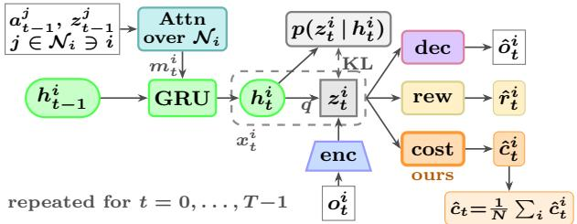

(b) Actor–critic in imagination, dual on measured cost

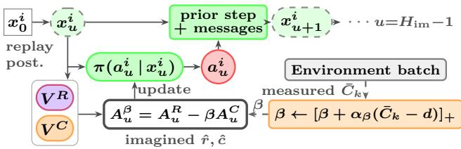  
Figure 1: The two training phases for agent $i ;$ Sections 3.2 to 3.4 define each component (GRU: gated recurrent unit, the recurrent network $f _ { \boldsymbol { \theta } } ;$ enc: the observation encoder; dec: the decoder). (a) On replay, attention over ${ \cal N } _ { i }$ turns the previous actions and stochastic states into a message $m _ { t } ^ { i }$ that drives the recurrent update; the posterior combines $h _ { t } ^ { i }$ with the encoded observation, and a Kullback–Leibler (KL) penalty ties the prior, which predicts $ { \boldsymbol { z } } _ { t } ^ { i }$ from $h _ { t } ^ { i }$ alone, to it. The decoder reads $\boldsymbol { x } _ { t } ^ { i } = ( h _ { t } ^ { i } , z _ { t } ^ { i } )$ ; the reward and cost heads read $\boldsymbol { z } _ { t } ^ { i }$ with $h _ { t + 1 } ^ { i } ,$ which carries the agents’ actions $a _ { t }$ , and the per-agent costs are averaged into $\hat { c } _ { t }$ . (b) From replay posteriors, the actor (policy) and prior roll out $H _ { \mathrm { i m } }$ imagined steps; the critics (value estimators) form $A _ { u } ^ { \beta }$ for the actor, while the price $\beta$ steps on the measured cost $\bar { C } _ { k }$ of the latest real episode.

return subject to a limit on expected undiscounted episode cost:

$$
\begin{array} { r l } & { \underset { \phi } { \operatorname* { m a x } } ~ J _ { R } ( \pi _ { \phi } ) = \mathbb { E } _ { \pi _ { \phi } , P } \left[ \sum _ { t = 0 } ^ { H - 1 } \gamma ^ { t } r _ { t } \right] } \\ & { ~ \mathrm { s . t . } ~ J _ { C } ( \pi _ { \phi } ) = \mathbb { E } _ { \pi _ { \phi } , P } \left[ \sum _ { t = 0 } ^ { H - 1 } c _ { t } \right] \leq d . } \end{array}
$$

## 3.2 Cost-Aware Multi-Agent World Model

To solve the constrained problem of Section 3.1 with few inter- actions, CA-MAMBA learns a world model, a learned simulator of the team: once it is accurate, policy updates can use generated trajectories instead of collected ones. We build on the recurrent state-space model (RSSM) [8, 9] and add a per-agent cost predictor (Figure 1). The RSSM compresses each agent’s history into a latent state, learns to predict the next latent state without the next ob- servation, and trains that prediction against latent states inferred from observations stored in a replay bufer of collected episodes; imagination then rolls it forward without observations.

Latent state. Agent �’s latent state $\boldsymbol { x } _ { t } ^ { i } = ( h _ { t } ^ { i } , z _ { t } ^ { i } )$ has two parts. The deterministic state $h _ { t } ^ { i }$ is the hidden state of a recurrent network and accumulates history,

$$
h _ { t } ^ { i } = f _ { \theta } \left( h _ { t - 1 } ^ { i } , m _ { t } ^ { i } \right) ,
$$

where the message $m _ { t } ^ { i }$ of $\operatorname { E q . } \left( 2 \right)$ carries the previous action and stochastic state of agent � and of the teammates it attends to. The stochastic state $ { \boldsymbol { z } } _ { t } ^ { i }$ is sampled at each step and represents what history alone does not determine; as in DreamerV2, Dreamer’s discrete-latent version, it is a vector of categorical variables [10]. Together, $\boldsymbol { x } _ { t } ^ { i }$ summarizes agent �’s history, so the actor and critics read $\boldsymbol { x } _ { t } ^ { i }$ instead of $\tau _ { t } ^ { i } .$

Prior and posterior. Imagination must predict $ { \boldsymbol { z } } _ { t } ^ { i }$ without an obser- vation, so the model keeps two distributions over it. The posterior $q _ { \theta } ( z _ { t } ^ { i } \mid h _ { t } ^ { i } , o _ { t } ^ { i } )$ also sees the current observation, through an observa- tion encoder, so it is available only on replay. The prior $p _ { \theta } ( z _ { t } ^ { i } \mid h _ { t } ^ { i } )$ predicts $ { \boldsymbol { z } } _ { t } ^ { i }$ from history alone; imagined steps have no observation, so imagination samples from the prior.

Heads. From the latent state, small networks called heads predict the observable quantities that training and imagination need. The observation head, or decoder, reconstructs $o _ { t } ^ { i }$ from $x _ { t } ^ { i } ;$ it is unused in imagination and only trains the latent to retain what the observation shows. The reward and cost heads read $ { \boldsymbol { z } } _ { t } ^ { i }$ together with the next deterministic state $h _ { t + 1 } ^ { i }$ . That state already contains the action $a _ { t } ^ { i }$ and, through the message, the actions of the teammates it attends to, so when it attends to all of them each head sees the joint action that team reward and cost depend on. The cost head is our addition. Without it the latent has no incentive to encode cost, and a cost critic would read a representation blind to the quantity it estimates. Each cost head regresses its own $c _ { t } ^ { i }$ and each reward head the shared $r _ { t } ;$ imagination uses the team means $\begin{array} { r } { \hat { c } _ { t } = \frac { 1 } { N } \sum _ { i } \hat { c } _ { t } ^ { i } } \end{array}$ and $\begin{array} { r } { \hat { r } _ { t } = \frac { 1 } { N } \sum _ { i } \hat { r } _ { t } ^ { i } } \end{array}$ Objective. Training fits the heads to recorded data and pulls the prior toward the posterior. For a length-� replay sequence, write $q _ { t } ^ { i } = q _ { \theta } ( z _ { t } ^ { i } \mid h _ { t } ^ { i } , o _ { t } ^ { i } )$ and $p _ { t } ^ { i } = p _ { \theta } ( z _ { t } ^ { i } \mid h _ { t } ^ { i } )$ . The parameters � minimize

$$
\begin{array} { r l } & { \mathcal { L } _ { \mathrm { w m } } ( \boldsymbol { \theta } ) = \displaystyle \sum _ { t = 0 } ^ { T - 1 } \sum _ { i = 1 } ^ { N } \bigl ( \mathcal { L } _ { o } ( o _ { t } ^ { i } , \hat { o } _ { t } ^ { i } ) + \mathcal { L } _ { r } ( r _ { t } , \hat { r } _ { t } ^ { i } ) + \mathcal { L } _ { c } ( c _ { t } ^ { i } , \hat { c } _ { t } ^ { i } ) \bigr ) } \\ & { \qquad + \omega _ { \mathrm { K L } } \displaystyle \sum _ { t = 0 } ^ { T - 1 } \sum _ { i = 1 } ^ { N } D _ { \mathrm { K L } } \bigl ( q _ { t } ^ { i } \| \boldsymbol { \hat { p } } _ { t } ^ { i } \bigr ) . } \end{array}\tag{1}
$$

This is the RSSM training objective, derived from a tractable lower bound on the log-likelihood of the recorded sequence [8, 9], with each log-likelihood term replaced by a smooth- $\cdot \ell _ { 1 }$ regression loss on observation, reward, and cost $( \mathcal { L } _ { o } , \mathcal { L } _ { r } , \mathcal { L } _ { c } ;$ squared error for small residuals, absolute error for large ones). The Kullback–Leibler (KL) divergence �KL, weighted by $\omega _ { \mathrm { K L } } \ge 0$ , penalizes the gap between prior and posterior, so that rollouts from the prior alone stay close to the latent states the posterior infers from real observations. KL balancing [10] weights the part of this penalty that moves the prior more heavily than the part that moves the posterior, so the posterior is not pulled toward a poor prior. Three further terms come from MAMBA: heads that predict whether the episode continues and which actions are available, and, for discrete actions, a classifier that recovers the agent’s action from its latent state (Appendix C).

## 3.3 The Message Function and Its Neighborhood

The world model couples agents only through the message $m _ { t } ^ { i }$ which reads the model features of a chosen set of teammates:

$$
m _ { t } ^ { i } = g _ { \theta } \Bigl ( i , \bigl ( j , a _ { t - 1 } ^ { j } \oplus z _ { t - 1 } ^ { j } \bigr ) _ { j \in N _ { i } } \Bigr ) , \quad i \in N _ { i } \subseteq \bar { \cal I } ,\tag{2}
$$

Algorithm 1 CA-MAMBA training loop (quantities defined below)   
1: for $k = 0 , 1 , 2 , \ldots$ do   
2: Add the next episode finished by one of the $W$ workers (each   
acts with parameters last sent to it and messages over $N _ { i } )$ to   
replay; $\bar { C } _ { k } \gets$ its team cost; skip the rest in warm-up   
3: Update � on replay sequences by $\operatorname { E q . } \left( 1 \right)$   
4: for $e = 1 , \ldots , E$ do   
5: Freeze $\theta ;$ from replay posteriors, roll out $H _ { \mathrm { i m } }$ imagined   
steps under $\pi _ { \phi } ; \hat { r } _ { u } , \hat { c } _ { u }$ average the agents’ heads   
6: Compute $A _ { u } ^ { \beta , i } = A _ { u } ^ { R , i } - \beta A _ { u } ^ { C , i }$ ; for several passes, step $\phi$ on   
$\mathcal { T } _ { \mathrm { c l i p } }$ and $V ^ { R } , V ^ { C }$ on �-returns per minibatch   
7: $\beta  [ \beta + \alpha _ { \beta } ( \bar { C } _ { k } - d ) ] _ { + }$ , using measured cost only   
8: end for   
9: Send the updated $\theta , \phi$ to the worker that finished   
10: end for

where $N _ { i }$ is agent �’s attention neighborhood and ⊕ concatenates. The function �� is a Transformer encoder [21]: a stack of attention layers, each of which updates every agent’s input vector by a learned weighting of the other agents’ vectors. Agent �’s input is an embedding of $a _ { t - 1 } ^ { j } \oplus z _ { t - 1 } ^ { j }$ plus a fixed sine–cosine code of its index $j ,$ and agent � may weight only the agents in $N _ { i } .$ The message $m _ { t } ^ { i }$ is the encoder’s output at agent �’s own position, so no averaging over agents is needed. The encoder sits inside the recurrent transition and is the only input of $f _ { \theta }$ besides $h _ { t - 1 } ^ { i } ,$ , as in MAMBA [5]. Agents exchange their previous action and stochastic state, not their current action, so an agent can condition on what its teammates did and believe but not on what they are about to do. The actor, one multilayer perceptron shared by all agents, reads each $\boldsymbol { x } _ { t } ^ { i }$ with no attention of its own, so ${ \cal N } _ { i }$ is the only channel between agents.

Choosing ${ \cal N } _ { i }$ changes only whom each agent may attend to. The full neighborhood $N _ { i } = \mathcal { I }$ needs a reliable channel at deployment; the self-only neighborhood $N _ { i } = \left\{ i \right\}$ needs no communication, and nearest-neighbor choices lie in between. The neighborhood used when acting can difer from the one used to learn the model and to imagine, which lets a policy trained with messages act without them (Appendix B diagrams the execution path).

## 3.4 Imagined Actor–Critic and Measured-Cost Multiplier

With the model and its messages in place, the policy is trained in imagination under a price on cost. We relax the constraint $J _ { C } ( \pi _ { \phi } ) \leq$ � with a multiplier $\beta \geq 0$ and train against the Lagrangian $J _ { R } { - } \beta ( J _ { C } { - }$ $d )$ , where $\beta$ is the price of cost. This is the standard Lagrangian treatment of constrained problems [20], applied to a world model as in SafeDreamer [12]. With factorized policies the relaxation need not be tight: the best policy at the best price can still miss the constrained optimum in cooperative multi-agent learning [4]. We use it as a training signal and claim nothing that depends on its being tight. One multiplier serves the team (Algorithm 1) because the problem of Section 3.1 has one constraint, on the team cost $J _ { C } ;$ per-agent constraints would need one multiplier each.

Critics. The policy update needs critics, which estimate the return expected from a state. From posterior states sampled from replay, the frozen model rolls out imagined joint latents $\mathbf { x } _ { 0 } , \ldots , \mathbf { x } _ { H _ { \mathrm { i m } } } ,$ , with $\mathbf { x } _ { u } = ( x _ { u } ^ { 1 } , \dots , x _ { u } ^ { N } )$ . The first $H _ { \mathrm { i m } }$ steps, $u \in \{ 0 , \ldots , H _ { \mathrm { i m } } - 1 \}$ , carry imagined reward and cost; beyond them, the critics’ own estimate at $\mathbf { x } _ { H _ { \mathrm { i m } } }$ stands in for the rest of the return. One critic network, an attention layer over all agents’ latent states feeding two output heads, estimates for each agent the imagined reward return $\bar { V } ^ { R }$ and team-cost return $V ^ { C }$ ; separate heads let a changed $\beta$ reweight two estimates that stay valid. Both heads are trained on �-returns: averages of the imagined returns of every length up to the horizon, each completed by the critic, with weights decaying geometrically in � ∈ [0, 1]. Generalized advantage estimation [18] turns the critics’ prediction errors into per-agent advantages $A _ { u } ^ { R , i }$ and $A _ { u } ^ { C , i }$ how much more reward, or cost, an action led to than the critic expected. Each is standardized to zero mean and unit standard deviation over the batch, and the actor advantage

$$
A _ { u } ^ { \beta , i } = A _ { u } ^ { R , i } - \beta A _ { u } ^ { C , i }
$$

favors an action only if its reward advantage outweighs its cost advantage at the current price. After standardization, $\beta$ weights one standard deviation of cost advantage against one of reward advantage, so $\beta < 1$ weights cost below reward.

Actor. The actor turns these advantages into a policy update. Agent � draws $a _ { u } ^ { i }$ from the shared actor $\pi _ { \phi } ( a _ { u } ^ { i } \mid x _ { u } ^ { i } )$ , so ${ \bar { \phi } } ^ { 1 } { \bar { = } } \cdot \cdot \cdot = { \bar { \phi } } ^ { N }$ Let $\phi _ { \mathrm { o l d } }$ be the parameters that generated the imagined batch, $\rho _ { u } ^ { i } ( \phi ) \ = \ \pi _ { \phi } ( a _ { u } ^ { i } \ \mid \ x _ { u } ^ { i } ) / \pi _ { \phi _ { \mathrm { o l d } } } ( a _ { u } ^ { i } \ \mid \ x _ { u } ^ { i } )$ agent $i ^ { \prime } s$ importance ratio, $\varepsilon > 0$ the clipping parameter, and $\bar { \rho } _ { u } ^ { i } ( \phi ) = \mathrm { c l i p } ( \rho _ { u } ^ { i } ( \phi ) , 1 - \varepsilon , 1 + \varepsilon )$ with clip(�, �, ℎ) = min{ℎ, max $\{ l , v \} \}$ }. The actor maximizes the objective of proximal policy optimization (PPO) [19],

$$
\begin{array} { r } { \mathcal { T } _ { \mathrm { c l i p } } ( \phi ) = \mathbb { E } _ { u , i } \left[ \operatorname* { m i n } \left\{ \rho _ { u } ^ { i } ( \phi ) A _ { u } ^ { \beta , i } , \bar { \rho } _ { u } ^ { i } ( \phi ) A _ { u } ^ { \beta , i } \right\} \right] , } \end{array}
$$

over imagined steps and agents, plus an entropy bonus that rewards randomness in the policy to keep it exploring. Clipping keeps each update near $\pi _ { \phi _ { \mathrm { o l d } } }$ while several gradient steps reuse one imagined batch; it bounds the policy step, not the model error.

Multiplier. The price $\beta$ is the one quantity set from measured rather than imagined data. After a warm-up that collects data be- fore any update, learner step � starts when one of the � workers, parallel processes that collect episodes, finishes an episode, and $\bar { C } _ { k }$ is that episode’s undiscounted team cost. Its worker acted with the parameters received when its previous episode ended, $\phi _ { k - \ell _ { k } }$ for some lag $\ell _ { k } \geq 0 ,$ , so $\bar { C } _ { k }$ is a one-episode estimate of $J _ { C } ( \pi _ { \phi _ { k - \ell _ { k } } } )$ biased only by the order in which episodes finish (Section 4). After each ofthe � policy-update rounds ofthe step (each imagines a fresh replay batch and runs several passes over it), the multiplier takes the projected step $\beta  [ \beta + \alpha _ { \beta } ( \bar { C } _ { k } - d ) ]$ + with $[ v ] _ { + } = \operatorname* { m a x } \{ 0 , v \}$ and step size $\alpha _ { \beta } > 0$ . For $\beta \geq 0 ;$ , repeating this step � times with the same $\bar { C } _ { k }$ gives, per learner step,

$$
\beta _ { k + 1 } = \left[ \beta _ { k } + E \alpha _ { \beta } ( \bar { C } _ { k } - d ) \right] _ { + } :\tag{3}
$$

the price rises while the team overspends, falls while it underspends, and stops at zero. The actor ascends ${ \mathcal { T } } _ { \mathrm { c l i p } } .$ built from discounted, standardized imagined cost advantages, while the multiplier reads undiscounted measured episode cost. Even with an exact model these are not gradients of one objective, so the procedure is an inexact primal–dual method: it alternates policy (primal) updates with price (dual) updates. Section 4 analyzes the two statistics separately: Theorem 4.1 covers the discounted cost the actor sees, and the dual analysis the episode cost the multiplier measures.

## 4 What Model Error Permits

CA-MAMBA’s actor never sees real cost: it improves the policy on cost that the world model imagines (Section 3.4), while the constraint of Section 3.1 is on real cost. This raises three questions, which this section answers in turn. First, when a policy looks safe in imagination, how far can its real cost be from its imagined cost, and what does the diference depend on? Second, how does the team structure of the model, per-agent dynamics coupled through messages, enter that diference? Third, since the diference cannot be bounded in practice, what does setting the price from measured cost achieve, and what can it not repair? We state the main results here, summarize the others, and prove all of them in Appendix L.

The gap between imagined and real cost. Consider running one policy � twice from the same start for the $H _ { \mathrm { i m } }$ steps the actor imagines: once on the real system and once in the world model. The diference between the two discounted costs is what the actor gets wrong about safety. We compare the two runs in the latent space of Section 3.2. Let $\boldsymbol { x } _ { t } \stackrel { \cdot } { = } ( x _ { t } ^ { 1 } , \ldots , \bar { } x _ { t } ^ { N } )$ be the joint latent state, with $x _ { t } ^ { i } =$ $( h _ { t } ^ { i } , z _ { t } ^ { i } )$ , and $a _ { t }$ the joint action drawn from $\textstyle \pi ( a \mid x ) = \prod _ { i } \pi ^ { i } ( { \dot { a } } ^ { i } \mid$ $x ^ { i } )$ . On the real system the latents are computed from observations by the posterior; let $P _ { t } ( \cdot \mid x , a )$ be the resulting distribution of ��+1 given $( x _ { t } , a _ { t } ) = ( x , a )$ , and $c _ { t } ( x , a )$ the mean of the team cost $c _ { t }$ given that pair. In imagination the world model replaces both: $\widehat { P } ( \cdot \mid x , a )$ is the distribution of the next latent under the recurrent update and the prior, and $\widehat { c } ( \boldsymbol { x } , \boldsymbol { a } )$ is the team mean of the cost heads. Because $P _ { t }$ is defined on the network’s own latents, the results hold whether or not the latents retain all of the history that predicts the future, which a learned model cannot guarantee.

Theorem 4.1 (Imagination-to-reality cost gap). Fix the policy �, a horizon $H _ { \mathrm { i m } } \geq 1 $ , and a discount $\gamma \in \left[ 0 , 1 \right]$ . Let the latent space X be a standard Borel space (regular enough for conditional distributions to exist), let both processes draw �0 from the same distribution and their actions from $\pi ,$ and let $c _ { t }$ and b� take values in a common interval of length $c _ { \mathrm { m a x } } < \infty$ . Define the real and imagined discounted costs over $H _ { \mathrm { i m } }$ steps as

$$
J _ { C , H _ { \mathrm { i m } } } ( \pi ) = \mathbb { E } \left[ \sum _ { t = 0 } ^ { H _ { \mathrm { i m } } - 1 } \gamma ^ { t } c _ { t } ( x _ { t } , a _ { t } ) \right] ,
$$

$$
\widehat { J } _ { C , H _ { \mathrm { i m } } } ( \pi ) = \mathbb { E } _ { \widehat { P } , \pi } \left[ \sum _ { t = 0 } ^ { H _ { \mathrm { i m } } - 1 } \gamma ^ { t } \widehat { c } ( x _ { t } , a _ { t } ) \right] ,
$$

the first along the real process. Let $\nu _ { t }$ be the distribution of $\cdot ( x _ { t } , a _ { t } )$ on the real system, and $\widehat { V } _ { k } ( x )$ the model’s expected discounted cost over � steps from � under � (its cost-to-go), with $\widehat { V } _ { 0 } \equiv 0$

(i) The gap decomposes exactly as

$$
J _ { C , H _ { \mathrm { i m } } } ( \pi ) - \widehat { J } _ { C , H _ { \mathrm { i m } } } ( \pi ) = \sum _ { t = 0 } ^ { H _ { \mathrm { i m } } - 1 } \gamma ^ { t } \big ( B _ { c } ( t ) + \gamma B _ { V } ( t ) \big ) ,
$$

where $\boldsymbol { B _ { c } } ( t ) = \mathbb { E } _ { \boldsymbol { \nu _ { t } } } \left[ \boldsymbol { c _ { t } } - \boldsymbol { \widehat { c } } \right]$ is the cost head’s bias and

$$
B _ { V } ( t ) = \mathbb { E } _ { ( x , a ) \sim \nu _ { t } } \left[ \left( \mathbb { E } _ { P _ { t } ( \cdot | x , a ) } - \mathbb { E } _ { \widehat { P } ( \cdot | x , a ) } \right) \widehat { V } _ { H _ { \mathrm { i m } } - t - 1 } \right]
$$

is the model’s one-step bias in predicting the cost-to-go.

(ii) If, for every $t < H _ { \mathrm { i m } } , | B _ { c } ( t ) | \leq \epsilon _ { c }$ and the mean total variation (the largest diference in the probability two distributions

give one event) $\begin{array} { r } { \mathbb { E } _ { ( x , a ) \sim \nu _ { t } } \left[ D _ { \mathrm { T V } } \big ( P _ { t } ( \cdot \mid x , a ) , \widehat { P } ( \cdot \mid x , a ) \big ) \right] \leq \epsilon _ { P } , } \end{array}$ then

$$
\left| J _ { C , H _ { \mathrm { i m } } } \left( \pi \right) - \widehat { J } _ { C , H _ { \mathrm { i m } } } \left( \pi \right) \right| \leq \Delta _ { C , H _ { \mathrm { i m } } } ,\tag{4}
$$

$$
\Delta _ { C , H _ { \mathrm { i m } } } : = \epsilon _ { c } \sum _ { t = 0 } ^ { H _ { \mathrm { i m } } - 1 } \gamma ^ { t } + c _ { \mathrm { m a x } } \epsilon _ { P } \sum _ { t = 0 } ^ { H _ { \mathrm { i m } } - 1 } t \gamma ^ { t } ,
$$

and $\widehat { J } _ { C , H _ { \mathrm { i m } } } ( \pi ) \le b - \Delta _ { C , H _ { \mathrm { i m } } }$ implies $J _ { C , H _ { \mathrm { i m } } } ( \pi ) \le b$ for any �.

Here $D _ { \mathrm { T V } } ( p , q ) = \operatorname* { s u p } _ { Y } | p ( Y ) - q ( Y ) |$ over events �; $\epsilon _ { c } , \epsilon _ { P } \ge 0$ are the average cost and transition errors. The proof (Appendix L.1) adapts the simulation lemma [14], which bounds how one-step errors accumulate, to the cost-to-go along the real trajectory.

Part (i) says that the gap is exactly the sum, over the imagined steps, of two errors the model makes on the states the real system actually visits: an error in the cost of the current step $( B _ { c }$ , the bias of the cost heads) and an error in where the team goes next, counted only through its efect on the remaining cost $( B _ { V }$ , the bias of the prior). Both are averaged where the real system goes, though $B _ { V }$ weighs them by the model’s cost-to-go, and errors of opposite sign cancel. Part (ii) turns bounds on the average errors into a safety margin: a policy whose imagined cost is at least $\Delta _ { C , H _ { \mathrm { i m } } }$ below a threshold also has real $H _ { \mathrm { i m } } { \cdot } s \mathrm { t e p }$ cost at or below it, without worst-case bounds on every state–action pair. At our $\gamma = 0 . 9 9$ and $H _ { \mathrm { i m } } = 1 4$ the margin is $1 3 . 1 \epsilon _ { c } + 8 3 . 2 c _ { \mathrm { m a x } } \epsilon _ { P ; }$ , so a transition error weighs far more than a cost-head error. The actor’s �-returns do not stop at step $H _ { \mathrm { i m } }$ but end in the cost critic’s estimate; Corollary L.2 in Appendix L.2 extends part (i) to them, adding one term, the critic’s bias at the state where each return is cut of.

Where the agents enter. The transition error �� of part (ii) be-lon s to the team’s joint model, but the world model of Section 3.2 samples each agent’s next stochastic state independently given the current joint state and action, so the error splits across agents. With the full or self-only neighborhood of Section 3.3, agent �’s next state depends only on the states and actions in $N _ { i } ,$ , written $x ^ { N _ { i } } = ( x ^ { j } ) _ { j \in N _ { i } } \overline { { \mathbf { \Lambda } } }$ and likewise $a ^ { N _ { i } } ;$ a general restriction on whom each agent attends to would replace N� by the agents it reaches through the encoder’s layers.

Proposition 4.2 (Factorized transition error). Let $\widehat { P } ( \cdot \mid$ $\begin{array} { r } { { \boldsymbol x } , { \boldsymbol a } ) = \bigotimes _ { i = 1 } ^ { N } \widehat { P } _ { i } ( \cdot \mid { \boldsymbol x } ^ { N _ { i } } , { \boldsymbol a } ^ { N _ { i } } ) } \end{array}$ , so agents’ next states are drawn independently, each from a distribution $\widehat { P } _ { i }$ over agent �’s states, and let $P _ { t , i } ( \cdot \mid x , a )$ be the �-th marginal o $\because P _ { t } ( \cdot \mid x , a )$ . Then

$$
\begin{array} { r } { D _ { \mathrm { T V } } ( P _ { t } , \widehat { P } ) \leq D _ { \mathrm { T V } } \Big ( P _ { t } , \bigotimes _ { i } P _ { t , i } \Big ) + \sum _ { i = 1 } ^ { N } D _ { \mathrm { T V } } ( P _ { t , i } , \widehat { P } _ { i } ) } \end{array}
$$

at every (�, �), so Theorem $4 . 1 ( i i )$ holds with $\begin{array} { r } { \epsilon _ { P } = \eta + \sum _ { i } \epsilon _ { P } ^ { i } } \end{array}$ , where � and $\epsilon _ { P } ^ { i }$ are the largest averages over $\nu _ { t } ~ ( t < H _ { \operatorname { i m } } )$ of the first term and the �-th summand. For a fixed state space, enlarging $N _ { i }$ cannot raise the smallest $\epsilon _ { P } ^ { i }$ that a model with inputs $( x ^ { N _ { i } } , a ^ { N _ { i } } )$ can approach. With the mean team cost, $B _ { c } ( t )$ averages the agents’ cost-head biases.

The proposition, proved in Appendix L.3, says that the team’s transition error is at most the sum of one error per agent plus a team term �. Each $\epsilon _ { P } ^ { i }$ depends on whom agent � attends to, so communication enters the safety margin through it. The team term � measures cor-relations between agents’ next states that a world model sampling agents independently, MAMBA’s included, cannot represent: exact per-agent predictors leave a team error of exactly �.

How large the gap is in practice. Whether part (ii) can certify a policy’s real cost depends on the error levels, which we estimate on tasks of Section 5 (8m is a StarCraft battle, HalfCheetah a simulated robot). Replay data stand in for $\nu _ { t } ,$ and $c _ { \mathrm { m a x } }$ is about 1 for MAMuJoCo’s binary velocity cost and the team size � for SMAC casualties. On MAMuJoCo at $d = 2 5$ the cost head’s average bias is estimated at no more than 0.004 per step (Appendix H), so its term in $\Delta _ { C , H _ { \mathrm { i m } } }$ is about 0.05. The transition term cannot be bounded usefully from logs: through Pinsker’s inequality $D _ { \mathrm { T V } } \leq \sqrt { D _ { \mathrm { K L } } / 2 } .$ the prior–posterior divergence, 3.2 to 6.5 nats (natural-log units) per agent, bounds each agent’s transition error only by a number above 1, no better than the trivial bound (Appendix I), and the diver-gence is positive even for a perfect model, since the posterior also sees the next observation. Part (ii) is therefore uninformative here: any $\epsilon _ { P }$ above 0.16 makes $\Delta c , H _ { \mathrm { i m } }$ exceed $\begin{array} { r } { c _ { \mathrm { m a x } } \sum _ { t < 1 4 } \gamma ^ { t } \approx 1 3 . 1 c _ { \mathrm { m a x } } , } \end{array}$ the largest gap any model could produce. The gap itself can be measured: on 18 runs (Appendix I), we compare realized and imag ined cost over the 14-step window, a proxy for the left-hand side of part (i). The model under-predicts in 17 of the 18 runs, by 33% of realized cost on 8m at $d = 0$ and by 35% on HalfCheetah 2×3 at $d = 2 5$ under the learned multiplier; the exception is a run with near-zero realized cost. The cost heads explain little of this (their replay bias $\hat { B } _ { c }$ is under 1% of realized cost on 8m); the prior’s bias has the matching sign on 8m (Appendix I). In short, the safety margin of part (ii) cannot be computed, and under the learned multiplier the model under-predicts real cost by about a third.

Why the multiplier reads measured cost. The measured gap answers the third question. A multiplier driven by imagined cost, as SafeDreamer’s is when its policy trains in imagination [12], would enforce $\widehat { J } _ { C , H _ { \mathrm { i m } } } \ \leq \ b$ for some threshold �, and by part (i) the real cost would then miss � by the bias sum, which varies across configurations and whose measured proxy is positive in 17 of our 18 runs: such a multiplier would under-enforce the real constraint, and correcting it would need the margin that part (ii) cannot supply. CA-MAMBA’s multiplier instead reads the measured episode cost (Section 3.4), so if its update settles, it settles where the real constraint holds, whatever the sign of the model’s bias (Proposition L.4, proved in Appendix L.4); whether it settles depends on the model. The model still sets the actor’s direction. Because each advantage is standardized over the batch, a change $A _ { u } ^ { C , i } \mapsto s A _ { u } ^ { C , i } + \delta$ with one $s > 0$ and one � for the whole batch leaves the actor’s step unchanged; a positive rescaling ofb� is such a change once the cost critic has rescaled with it. Other errors generally change the step, including one that keeps each state’s ranking of actions but rescales states diferently, and Appendix L.5 gives one that no multiplier repairs. Section 5.3 tests the model’s cost advantages.

What the measured-cost multiplier guarantees. With the true Lagrangian $\mathcal { L } ( \phi , \beta ) = J _ { R } ( \pi _ { \phi } ) - \beta ( J _ { C } ( \pi _ { \phi } ) - d )$ of Section 3.4, $\partial \mathcal { L } / \partial \beta = - ( J _ { C } - d )$ , so the update of $\operatorname { E q . }$ (3) is projected stochastic descent in $\beta \colon$ a noisy gradient step, clipped at zero, on the cost of the policy that collected the episode. Episodes reach the learner in the order they finish, which can depend on their cost, so a single step is not exactly unbiased; but if an episode’s expected cost given the past is $J _ { C }$ of its starting parameters, the summed bias over � steps is at most $2 ( W - 1 ) C _ { \operatorname* { m a x } }$ , where $C _ { \mathrm { m a x } }$ bounds episode cost (under the scheduling assumptions of Appendix L.4).

Proposition L.4 then shows that the average measured cost over � steps exceeds � by at most $( \beta _ { K } - \beta _ { 0 } ) / ( E \alpha _ { \beta } K )$ , so if $\dot { \boldsymbol { { \beta } } }$ grows slower than linearly, the long-run average cost, measured and expected, meets the limit. Any fixed point of the mean update, the projected step taken with the expected cost, satisfies $J _ { C } \leq d ,$ with $\beta > 0$ only if the constraint holds with equality (complementary slackness). None of this bounds the number of violating episodes or proves the iterates converge, and a cost head blind to an unsafe action can leave no point where the loop settles: Appendix L.5 gives a one-step problem where $\beta$ diverges while the policy stays unsafe, because the actor has no cost-reducing direction. Appendix J shows the loop closing as prescribed where the cost head is accurate.

## 5 Experiments

With the transfer question analyzed, we turn to what CA-MAMBA achieves. The evaluation asks three questions, which Sections 5.1– 5.4 answer in turn. RQ1: how man environment interactions does CA-MAMBA save relative to model-free constrained baselines, in cost and in task erformance? RQ2: when CA-MAMBA misses its cost limit, is the world model or the multiplier responsible? RQ3: what does a policy optimized with messages lose without them? Appendices A and C give the training procedure, every hyperparameter, and every loss; the code and the scripts behind the main tables and figures will be released once the paper is accepted. Environments and metrics. We answer the three questions on the two benchmarks of Section 2. In the StarCraft Multi-Agent Challenge (SMAC) [17] each allied unit is one agent that sees only a local field of view and picks a discrete move, attack, or stop action against the game’s scripted enemy. A map is a fixed battle scenario whose name lists each side’s units by count and type: 8m pits eight Marines (basic infantr ) a ainst ei ht, and 3s5z\_vs\_3s6z three Stalkers (ranged) and five Zealots (melee) against three and six; c stands for Colossus, and bane\_vs\_bane is a battle of Zerglings and Banelings. Every agent is charged the team cost: the number of allied units lost in a ste , so a unit that sacrifices itself counts against the whole team. An episode that ends with enemies alive also charges the units still alive, unless a unit died on that final step. E isode cost thus counts lost units, lus survivors when enemies remain: a sparse, discrete, irreversible signal. A configuration is a map paired with a cost limit �. We report win rate, the fraction of battles won, and cost. MAMuJoCo artitions a simulated robot, the four-legged Ant or the two-legged HalfCheetah, among agents that each actuate and observe a disjoint subset of its joints, so Ant 4×2 means four a ents of two joints each; the team cost, shared b all agents, accrues while the body’s speed exceeds a threshold [13]. Be cause both benchmarks charge every agent the same cost, the team mean of Section 3.1 equals each agent’s cost. One interaction is one joint environment step. Each metric is a training-time mean over the episodes in a window before a checkpoint, averaged over three runs (two if marked), with sample standard deviations. The window is CA-MAMBA’s last 5k interactions; on SMAC the baselines log per rollout batch, with wider windows (Appendix M).

Baselines. We compare with MACPO [6], in a discrete-action adaptation for SMAC (settings in Appendix N), and with MAPPO-Lagrangian (MAPPO-Lag in tables and figures), which replaces

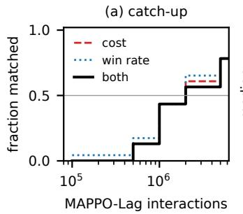

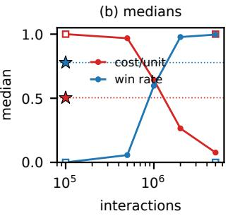  
Figure 2: How many interactions MAPPO-Lagrangian needs to catch up with CA-MAMBA at 100k on SMAC. (a) Among the 23 configurations where CA-MAMBA wins any episode, the fraction on which MAPPO-Lagrangian has matched CA-MAMBA’s 100k mean cost (dashed), mean win rate (dotted), or both (solid) by each checkpoint; the solid curve is the distribution of �(�), defined in the text. (b) Medians over the 24 configurations of casualties per allied unit (red) and win rate (blue): MAPPO-Lagrangian (lines), MACPO at 100k and 5M (squares), CA-MAMBA at 100k (stars).

MACPO’s trust-region step with clipped gradient steps on a La-grangian. Both come from the SafePO code base [13] and run on both benchmarks. We read each baseline at the matched budget and at larger budgets from the same runs. SafeDreamer is single-agent; in its place, Section 5.3 runs CA-MAMBA with the price set from imagined cost, as SafeDreamer sets it.

## 5.1 Interaction Eficiency on SMAC

We answer RQ1 first on SMAC. At the matched budget of 100k interactions, CA-MAMBA has lower mean cost than both MACPO and MAPPO-Lagrangian on 23 ofthe 24 configurations and a higher win rate on 22 (Appendix M). On 3s5z\_vs\_3s6z at � = 0 all three methods incur the full cost of 8; on bane\_vs\_bane at $d = 0 \mathrm { C A } \cdot$ MAMBA trades win rate for far lower cost. Configurations on one map are not independent, so we also test per map: CA-MAMBA is ahead of MAPPO-Lagrangian on every configuration of 11 of the 12 maps in cost and of 10 in win rate (one-sided sign tests, which compare these counts with fair coin flips: $\mathnormal { p } = 0 . 0 0 3$ and $\begin{array} { r } { p = 0 . 0 2 ) } \end{array}$

Figure 2 turns this into the quantity that matters for a costly system: how many more interactions the baseline needs. For each con- figuration �, the interaction multiple �(�) is the smallest multiple of 100k, among 1, 5, 10, 20, and 50, at which MAPPO-Lagrangian’s mean cost is at most and its mean win rate at least CA-MAMBA’s at 100k. Over the 23 configurations where CA-MAMBA wins any episode, the median multiple is 20 on this grid, so more than 10 (Table 14 in Appendix M gives the counts and a check that redraws each configuration’s runs at random). MAPPO-Lagrangian does not match CA-MAMBA within 50 times on 5 configurations, all on maps where its win rate stays below 0.01 through 5M. With ten times the data the comparison is roughly even (CA-MAMBA lower in cost on 14 of 24, higher in win rate on 13); at 50 times MAPPO-Lagrangian is ahead in both on 18. CA-MAMBA’s advantage is therefore the interactions it saves. Against MACPO the ordering largely persists at 5M (lower cost on 16 of 24, higher win rate on 17); Appendix M lists every configuration for all three methods, and Appendix E plots learning curves against MACPO on four maps.

<table><tr><td>Method (interactions)</td><td>Reward ↑</td><td>Cost ↓</td></tr><tr><td>Ant 2×4</td><td></td><td></td></tr><tr><td>MACPO</td><td> $2 6 8 \pm 7 0$ </td><td> $0 . 2 \pm 0 . 1$ </td></tr><tr><td>MAPPO-Lag</td><td> $4 3 9 \pm 4 6$ </td><td> $0 . 1 \pm 0 . 2$ </td></tr><tr><td>CA-MAMBA</td><td> $1 8 3 6 \pm 6 7 8$ </td><td> $1 7 . 4 \pm 1 5 . 1$ </td></tr><tr><td>no comm.</td><td> $1 4 9 1 \pm 8 0$ </td><td> $1 9 . 4 \pm 3 0 . 3$ </td></tr><tr><td>Ant 4×2</td><td></td><td></td></tr><tr><td>MACPO</td><td> $3 7 4 \pm 9 6$ </td><td> $0 . 3 \pm 0 . 2$ </td></tr><tr><td>MAPPO-Lag</td><td> $5 6 2 \pm 5 2$ </td><td> $0 . 3 \pm 0 . 3$ </td></tr><tr><td>CA-MAMBA</td><td> $1 5 7 4 \pm 3 0 4$ </td><td> $0 . 5 \pm 0 . 8$ </td></tr><tr><td>no comm.</td><td> $1 6 5 7 \pm 1 6 2$ </td><td> $0 . 5 \pm 0 . 9$ </td></tr><tr><td>HalfCheetah 2×3</td><td></td><td></td></tr><tr><td>MACPO</td><td> $2 0 7 \pm 2 6 ^ { * }$ </td><td> $0 . 0 \pm 0 . 0$ </td></tr><tr><td>MAPPO-Lag</td><td> $7 9 1 \pm 6 6$ </td><td> $0 . 2 \pm 0 . 3$ </td></tr><tr><td>CA-MAMBA</td><td> $2 5 2 7 \pm 2 2 9$ </td><td> $1 6 . 6 \pm 2 . 0$ </td></tr><tr><td>no comm.</td><td> $9 8 2 \pm 1 3 0 3$ </td><td> $6 4 . 4 \pm 1 0 3 . 8 ^ { \dagger }$ </td></tr></table>

Table 1: MAMuJoCo at the SafePO default limit �=25, every method at a matched budget of 1M interactions. No comm. acts without messages $( N _ { i } = \{ i \} )$ but learns and imagines with them. Mean ± sample standard deviation over three seeds (∗: two). Bold: highest mean reward; †: mean cost above �.

Much of the lower cost at 100k comes from learning the task faster; pricing cost adds a further reduction: on 8m at $d = 0$ the same learner with its price fixed at zero incurs cost 5.28 at win rate 0.63, against CA-MAMBA’s 2.05 at 0.95 (Section 5.3), and removing the cost critic as well raised cost on 1c3s5z within 20k interactions (Appendix G). Under a second, dense SMAC team cost that counts pairs of moving allied units too close together, CA-MAMBA at 100k still has a higher win rate than MACPO at 1M on 9 of 10 maps, but lower cost on only 4, with one tie (Appendix F).

## 5.2 Interaction Eficiency on MAMuJoCo

MAMuJoCo tests whether these savings hold when cost structure and action space both change: cost is dense and reversible, actions are continuous, and reward opposes cost. We use SafePO’s default limit � = 25 and run CA-MAMBA for 1M interactions.

At the matched bud et CA-MAMBA earns 2.8 to 12 times the reward of either baseline in all three environments (Table 1). At the 1M checkpoint every method’s mean cost is under � = 25, apart from acting without messages on HalfCheetah (Section 5.4), so the comparison is decided on reward; the baselines’ near-zero cost reflects policies that have not yet learned to move. CA-MAMBA’s cost exceeds the limit at some earlier checkpoints, up to 83 on Ant 2×4 at 800k (Table 5 in Appendix D). With ten times the interactions MAPPO-Lagrangian exceeds CA-MAMBA’s 1M reward only on Ant 4×2 (1866 against 1574); MACPO trails on all three.

## 5.3 Why Cost Limits Are Sometimes Missed

Saving interactions does not by itself meet the cost limit, which RQ2 examines. Only MAPPO-Lagrangian meets a zero-casualty limit within 5M interactions, on 2m\_vs\_1z at 2M. At the 12 nonzero limits CA-MAMBA’s mean cost meets 5 at 100k, as many as MAPPO-Lagrangian at 1M and MACPO at 5M; MAPPO-Lagrangian meets 8 at 5M. At the tight MAMuJoCo limits $( d = 0 . 2 ,$ 1, and 5 on Ant 2×4, Ant 4×2, and HalfCheetah) CA-MAMBA at $\alpha _ { \beta } = 1 0 ^ { - 5 }$ exceeds the limit in all three environments, while with ten times the in- teractions MAPPO-Lagrangian meets all three and MACPO only HalfCheetah’s, at exactly the limit (Appendix D). The model is partly responsible: on the two configurations measured under the learned multiplier, its imagined cost falls short of realized cost by about a third (Section 4). A multiplier that reads measured cost targets the real constraint despite that bias, but ours moves slowly: at $d = 0 ,$ � reaches only 0.025 to 0.54, below parity, after 100k interactions on five maps (Appendix J).

<table><tr><td></td><td colspan="3">At 100k</td></tr><tr><td>Multiplier</td><td>Cost ↓</td><td>Win rate ↑</td><td>β</td></tr><tr><td>Imagined</td><td> $2 . 4 9 \pm 0 . 4 3$ </td><td> $0 . 9 5 \pm 0 . 0 2$ </td><td> $0 . 2 2 \pm 0 . 0 1$ </td></tr><tr><td>Measured</td><td> $2 . 0 5 \pm 0 . 4 2$ </td><td> $0 . 9 5 \pm 0 . 0 2$ </td><td> $0 . 5 4 \pm 0 . 0 2$ </td></tr><tr><td>PID</td><td> $8 . 0 0 \pm 0 . 0 0$ </td><td> $0 . 0 0 \pm 0 . 0 0$ </td><td> $8 . 2 8 \pm 0 . 0 1$ </td></tr><tr><td>β=5</td><td> $8 . 0 0 \pm 0 . 0 0$ </td><td> $0 . 0 0 \pm 0 . 0 0$ </td><td> $5 . 0 0 \pm 0 . 0 0$ </td></tr><tr><td>β=1</td><td> $1 . 7 5 \pm 0 . 2 0$ </td><td> $0 . 9 7 \pm 0 . 0 2$ </td><td> $1 . 0 0 \pm 0 . 0 0$ </td></tr><tr><td> $\scriptstyle { \beta = 0 }$ </td><td> $5 . 2 8 \pm 0 . 9 5$ </td><td> $0 . 6 3 \pm 0 . 1 8$ </td><td> $0 . 0 0 \pm 0 . 0 0$ </td></tr></table>

Table 2: Multiplier rules on SMAC 8m at � = 0. Mean ± sample standard deviation over three runs (seeds 1–3) of each run’s episodes between 95k and 100k interactions; � at 100k. Imagined and Measured update $\beta ( \alpha _ { \beta } = 1 0 ^ { - 5 } )$ from imagined or measured cost; PID uses �� = 1, �� = 10−5, $K _ { D } = 1 ;$ the $\beta { = } 5 , 1 , 0$ rows hold $\beta$ fixed, so � does not enter them.

Multiplier rules on 8m. To separate the multiplier from the model, we run 8m at $d = 0 ,$ a limit CA-MAMBA misses on every map, with six multiplier rules: an imagined input, which feeds the multiplier the mean imagined cost return instead of $\bar { C } _ { k }$ , as SafeDreamer does when it trains its policy in imagination [12], there with a diferent step rule; the measured-cost update of Eq. (3); PID control on measured cost [20], which sets � from the current violation ${ \bar { C } } _ { k } - d ,$ its running sum, and its change, with gains $K _ { P } , K _ { I } , K _ { D } ;$ fixed $\beta = 1 ,$ which weights the standardized advantages equally, and fixed $\beta = 5 ;$ and $\beta = 0 ;$ , the cost-blind learner. A fixed price is the reward-penalty baseline: it optimizes reward minus a fixed multiple of cost, applied to standardized advantages. The cost-blind learner tests the model: if pricing its cost advantages lowers cost, those advantages are informative enough. The fixed prices test the multiplier: if one lowers cost well below the learned multiplier, the multiplier is too slow.

Table 2 answers both. The model’s cost advantages work: priced at parity, they cut cost from 5.28 for the cost-blind learner to 1.75 and raise the win rate from 0.63 to 0.97. The measured-cost multi- plier reaches $\beta = 0 . 5 4$ and cost $2 . 0 5 \pm 0 . 4 2$ , most of the reduction parity gives, but no rule meets the limit. SafeDreamer’s imagined input sets a lower price: its � reaches only 0.22, and its cost ends at $2 . 4 9 \pm 0 . 4 3$ . Too high a price, set before the model has learned the task, fails diferently: with gains chosen for MAMuJoCo $( K _ { P } = 1 )$ PID’s current-violation term $K _ { P } ( \bar { C } _ { k } - d )$ is 8 once episode cost reaches 8, � passes 8 within 600 interactions, and the agents learn to avoid combat until nearly every episode times out at full cost. A fixed $\beta = 5$ fails the same way, so the reward-penalty baseline works only when its weight is chosen well.

The same test on HalfCheetah. To check the 8m findings beyond discrete control, we repeat the test on HalfCheetah 2×3 (Table 8 in Appendix D). At the tight limit $d = 5 ,$ , the learned multiplier misses by a factor of 3.6, while a fixed $\beta = 1$ ends all six of its runs within the limit (two sets: cost $0 . 6 \pm 0 . 3$ and $2 . 4 \pm 2 . 1 )$ at the same reward (1954 and 1985 against 1974). $\operatorname { A t } d = 2 5 .$ , which the learned multiplier already meets, the fixed price is more cautious than needed: cost 2.7 and 1.2 for 10% and 25% less reward. A tenfold $\alpha _ { \beta }$ also meets $d = 5 ;$ for 25% less reward; none of the three multiplier rules we ran on Ant meets the tight Ant limits (Appendix D). Without a price, cost ends at 474 and 400, far above both limits; on both tasks the model’s cost advantages lower cost once priced.

## 5.4 Acting Without Messages

Finally, RQ3 asks what a policy optimized with messages loses when it acts without them. All our runs learn the world model and imagine with $N _ { i } \ = \ { \cal { I } } ;$ in the no-communication runs, the agents nevertheless act with $N _ { i } = \left\{ i \right\}$ in every collected episode (Section 3.3). At 1M, reward does not drop on Ant 4×2 (1657 versus 1574, Table 1), drops 19% on Ant 2×4, within run-to-run spread, and falls from 2527 to 982 on HalfCheetah, a gap present from 500k on (Table 9 in Appendix D). Messages thus appear to matter for reward on HalfCheetah, with no consistent efect on cost.

## 6 Limitations

Five limitations qualify these results. First, the evidence supports lower cost (SMAC) or more reward within the limit (MAMuJoCo) at a matched budget, not a guarantee that no episode exceeds the limit, and not safer learning: on Ant 2×4, CA-MAMBA’s cumulative cost above the limit over the first 1M interactions exceeds MACPO’s (Appendix K). Deployments that cannot tolerate a single violation would also need a shield (Section 2).

Second, the model-error evidence is average-case, and on the sparse SMAC casualty cost we have not measured how often the cost head predicts the steps on which a unit is actually lost. Third, both benchmarks charge every agent the same team cost, so constraints on costs charged to individual agents remain untested. Fourth, the communication experiment removes messages only when acting; training a self-only model would test whether a domain needs them and how they change the per-agent errors of Proposition 4.2. Fifth, the multiplier experiments cover one task per benchmark, at one limit on 8m and two on HalfCheetah, with three runs per setting.

## 7 Conclusion

Predicting cost in a multi-agent world model moves most constrained policy updates into imagination: the stronger model-free baseline needs 10 to 20 times CA-MAMBA’s interactions on the me- dian SMAC configuration, and CA-MAMBA earns 2.8 to 12 times the baselines’ MAMuJoCo reward at equal budget. In controlled tests on one task per benchmark, pricing the model’s cost advantages at parity more than halves a cost-blind learner’s cost and meets a tight continuous-control limit the learned multiplier misses, suggesting the model’s cost estimates are not the bottleneck.

## References

[1] Joshua Achiam, David Held, Aviv Tamar, and Pieter Abbeel. 2017. Constrained Policy Optimization. In ICML. 22–31.

[2] Yarden As, Ilnura Usmanova, Sebastian Curi, and Andreas Krause. 2022. Con strained Polic O timization via Ba esian World Models. In ICLR.

[3] Daniel S. Bernstein, Robert Givan, Neil Immerman, and Shlomo Zilberstein. 2002. The Com lexit of Decentralized Control of Markov Decision Processes. Math. Oper. Res. 27, 4 (2002), 819–840. doi:10.1287/MOOR.27.4.819.297

[4] Ziyi Chen, Yi Zhou, and Heng Huang. 2024. On the Hardness of Constrained Cooperative Multi-Agent Reinforcement Learning. In ICLR

[5] Vladimir Egorov and Alexei Shpilman. 2022. Scalable Multi-Agent Model-Based Reinforcement Learning. In AAMAS. 381–390.

[6] Shangding Gu, Jakub Grudzien Kuba, Yuanpei Chen, Yali Du, Long Yang, Alois C. Knoll, and Yaodong Yang. 2023. Safe Multi-Agent Reinforcement Learning for Multi-Robot Control. Artif. Intell. 319 (2023), 103905. doi:10.1016/J.ARTINT.2023. 103905

[7] Shangding Gu, Long Yang, Yali Du, Guang Chen, Florian Walter, Jun Wang, and Alois Knoll. 2024. A Review of Safe Reinforcement Learning: Methods, Theories, and Applications. IEEE Trans. Pattern Anal. Mach. Intell. 46, 12 (2024), 11216–11235.

[8] Danijar Hafner, Timothy P. Lillicrap, Jimmy Ba, and Mohammad Norouzi. 2020. Dream to Control: Learning Behaviors by Latent Imagination. In ICLR.

[9] Danijar Hafner, Timothy P. Lillicrap, Ian Fischer, Ruben Villegas, David Ha, Honglak Lee, and James Davidson. 2019. Learning Latent Dynamics for Planning from Pixels. In ICML. 2555–2565.

[10] Danijar Hafner, Timothy P. Lillicrap, Mohammad Norouzi, and Jimmy Ba. 2021. Mastering Atari with Discrete World Models. In ICLR.

[11] Danijar Hafner, Jurgis Pasukonis, Jimmy Ba, and Timothy P. Lillicrap. 2025. Mastering diverse control tasks through world models. Nat. 640, 8059 (2025), 647–653.

[12] Weidong Huang, Jiaming Ji, Chunhe Xia, Borong Zhang, and Yaodong Yang. 2024. SafeDreamer: Safe Reinforcement Learning with World Models. In ICLR.

[13] Jiaming Ji, Borong Zhang, Jiayi Zhou, Xuehai Pan, Weidong Huang, Ruiyang Sun, Yiran Geng, Yifan Zhong, Josef Dai, and Yaodong Yang. 2023. Safety Gymnasium: A Unified Safe Reinforcement Learning Benchmark. In NeurIPS.

[14] Michael J. Kearns and Satinder Singh. 2002. Near-Optimal Reinforcement Learning in Polynomial Time. Mach. Learn. 49, 2-3 (2002), 209–232. doi:10.1023/A: 1017984413808

[15] Chenyi Liu, Nan Geng, Vaneet Aggarwal, Tian Lan, Yuan Yang, and Mingwei Xu. 2021. CMIX: Deep Multi-agent Reinforcement Learning with Peak and Average Constraints. In ECML/PKDD (1) (Lecture Notes in Computer Science, Vol. 12975). Springer, 157–173.

[16] Wei Qiu, Xinrun Wang, Runsheng Yu, Rundong Wang, Xu He, Bo An, Svetlana Obraztsova, and Zinovi Rabinovich. 2021. RMIX: Learning Risk-Sensitive Policies for Cooperative Reinforcement Learning Agents. In NeurIPS. 23049–23062.

[17] Mikayel Samvelyan, Tabish Rashid, Christian Schröder de Witt, Gregory Far-quhar, Nantas Nardelli, Tim G. J. Rudner, Chia-Man Hung, Philip H. S. Torr, Jakob N. Foerster, and Shimon Whiteson. 2019. The StarCraft Multi-Agent Challen e. In AAMAS. 2186–2188.

[18] John Schulman, Philipp Moritz, Sergey Levine, Michael I. Jordan, and Pieter Abbeel. 2016. High-Dimensional Continuous Control Using Generalized Advan tage Estimation. In ICLR.

[19] John Schulman, Filip Wolski, Prafulla Dhariwal, Alec Radford, and Oleg Klimov. 2017. Proximal Policy Optimization Algorithms. CoRR abs/1707.06347 (2017).

[20] Adam Stooke, Joshua Achiam, and Pieter Abbeel. 2020. Responsive Safety in Reinforcement Learning by PID Lagrangian Methods. In ICML. 9133–9143.

[21] Ashish Vaswani, Noam Shazeer, Niki Parmar, Jakob Uszkoreit, Llion Jones, Aidan N. Gomez, Lukasz Kaiser, and Illia Polosukhin. 2017. Attention is Al you Need. In NeurIPS. 5998–6008.

[22] Zifan Wu, Chao Yu, Chen Chen, Jianye Hao, and Hankz Hankui Zhuo. 2023. Models as Agents: Optimizing Multi-Step Predictions of Interactive Local Models in Model-Based Multi-Agent Reinforcement Learning. In AAAI. 10435–10443.

[23] Wenli Xiao, Yiwei Lyu, and John M. Dolan. 2023. Model-Based Dynamic Shielding for Safe and Eficient Multi-Agent Reinforcement Learning. In AAMAS. 1587– 1596.

[24] Yang Zhang, Chenjia Bai, Bin Zhao, Junchi Yan, Xiu Li, and Xuelong Li. 2025. Decentralized Transformers with Centralized Aggregation are Sample-Eficient Multi-Agent World Models. Trans. Mach. Learn. Res. 2025 (2025).

## A Training Procedure

This section expands Algorithm 1. Let � denote world-model param- eters, � actor parameters, � the parameters of the critic network, whose two heads give $V _ { \psi } ^ { R }$ and $V _ { \psi } ^ { C } , \beta \geq 0$ the shared team multiplier, $H _ { \mathrm { i m } } = 1 4$ the number of costed imagined steps, � the team-cost limit, and D the replay bufer. $W = 4$ workers collect episodes asynchronously; each acts with the parameters it received when its previous episode ended.

(1) Receive the next finished episode from any worker. Store local observations, joint actions, shared rewards, local costs, termination flags, and agent-availability masks in D. Set $\bar { C } _ { k }$ to this episode’s undiscounted team cost.

(2) Sample length-� sequences from D. Infer posterior recur-rent states and minimize the observation, reward, local-cost, and KL terms in Eq. (1) with respect to �.

(3) Repeat � = 4 times:

(a) Freeze �. Sample posterior start states from replay and roll out 15 imagined latent states. Store predicted rewards $\hat { r } _ { u }$ and team costs $\begin{array} { r } { \hat { c } _ { u } = \frac { 1 } { N } \sum _ { i = 1 } ^ { N } \hat { c } _ { u } ^ { i } } \end{array}$ for � ∈ $\{ 0 , \ldots , H _ { \mathrm { i m } } - 1 \}$ , action log-probabilities, and termination predictions. The mean matches the realized ag gregation of Section 3, so prediction and target share granularity.

(b) Construct per-agent reward and cost �-returns that bootstrap from the critic at the last imagined state. Fit� by minimizing the squared target errors of both heads. Standardize each advantage over the batch, form $A _ { u } ^ { \beta , i } =$ $A _ { u } ^ { R , i } - \beta A _ { u } ^ { C , i }$ , and maximize the per-agent clipped PPO surrogate with respect to �.

(c) Update the shared multiplier from the measured episode cost: $\beta  [ \beta + \alpha _ { \beta } ( \bar { C } _ { k } - d ) ] .$ +.

(4) Send the updated �, � to the worker that finished, and return to Step 1.

Over one learner step the � multiplier updates compose to $\beta _ { k + 1 } =$ $\begin{array} { r } { [ \beta _ { k } + E \alpha _ { \beta } ( \bar { C } _ { k } - d ) ] . } \end{array}$ +, the dual update of Section 3. The multiplier update is projected descent in the dual variable for the reward- maximization Lagrangian, not actor maximization. Because the episode was collected before the update, $\bar { C } _ { k }$ is a statistic of the policy that generated it, $\pi _ { \phi _ { k - \ell _ { k } } }$ with lag $\ell _ { k } \geq 0 ,$ , rather than of the policy that follows.

## B Execution Under the Full Neighborhood

Figure 3 draws the execution path the main text describes. Every agent runs its own copy of the world model and a parameter-tied actor, and the only inter-agent channel is the attention over the neighborhood ${ \cal N } _ { i }$ . Under ${ N } _ { i } = { \cal T }$ the agents exchange their previous actions and stochastic latents before acting; setting $N _ { i } = \left\{ i \right\}$ removes that exchange and changes nothing else. The communica- tion ablation makes this substitution at action selection in every collected episode, while world-model learning and imagination keep $N _ { i } = \mathcal { I }$ . No privileged global state enters either setting.

## C Verified Implementation Settings

The values in Tables 3 and 4 are read directly from our train- ing code (the configuration classes, the world-model and actor– critic losses, and the Lagrangian update), so they describe the runs that produced the reported numbers rather than an intended configuration. CA-MAMBA runs on SMAC use the casualty cost dead\_allies\_incremental (the collision study uses the dense collision cost), MAMuJoCo runs use the velocity cost of Appendix D, and every configuration has three independent runs, labeled

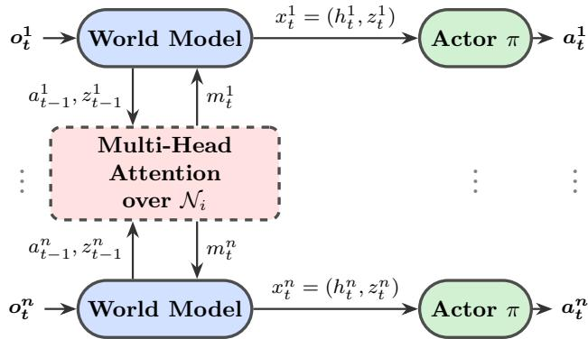  
Figure 3: Execution: every agent runs its own world model and a parameter-tied actor. Each world model sends its previous action and stochastic latent $a _ { t - 1 } ^ { i } , z _ { t - 1 } ^ { i }$ to an attention layer over the neighborhood ${ \cal N } _ { i }$ and receives the message $m _ { t } ^ { i } ,$ which drives its recurrent update; the actor then reads the latent $x _ { t } ^ { i } = ( h _ { t } ^ { i } , z _ { t } ^ { i } )$ . Under $N _ { i } = \mathcal { I }$ the attention is all-to-all; setting $N _ { i } = \left\{ i \right\}$ removes the exchange and changes nothing else. No privileged global state is used.

seeds 1 to 3 (the label does not seed the random number generators; see below).
<table><tr><td>Quantity</td><td>Value</td></tr><tr><td>World-model learning rate</td><td> $2 \times 1 0 ^ { - 4 }$ </td></tr><tr><td>Actor learning rate (Adam, wd 10−5) Critic learning rate</td><td> $5 \times 1 0 ^ { - 4 }$   $5 \times 1 0 ^ { - 4 }$ </td></tr><tr><td>Multiplier step  $\alpha _ { \beta }$  (applied E = 4 times per step)</td><td> $1 0 ^ { - 5 }$ </td></tr><tr><td>Initial multiplier  $\beta _ { 0 }$  PPO clip ε</td><td> $1 0 ^ { - 4 }$  0.2</td></tr><tr><td>Entropy coefficient (anneal 0.99998)</td><td></td></tr><tr><td>Model/agent batch size</td><td>0.001</td></tr><tr><td></td><td>40</td></tr><tr><td>Sequence length T</td><td>20</td></tr><tr><td>Replay capacity / min. buffer</td><td>250,000 / 500</td></tr><tr><td>Imagined states / costed steps  $H _ { \mathrm { i m } }$ </td><td></td></tr><tr><td>Discount γ</td><td>15 / 14</td></tr><tr><td></td><td>0.99</td></tr><tr><td>GAE parameter λ</td><td>0.95</td></tr><tr><td>Gradient clip (model / policy)</td><td>100 / 100</td></tr><tr><td>Advantage standardization (per batch)</td><td>on</td></tr><tr><td>KL weight  $\omega _ { \mathrm { K I } }$  (on the mean over categoricals)</td><td>1</td></tr><tr><td>KL balance (prior / posterior)</td><td>0.8 / 0.2</td></tr></table>

Table 3: Optimization and training settings, read from the training code. Every term of Eq. (1), including the divergence and the three terms inherited from MAMBA (the continuation and action-availability heads and, for discrete actions, the action classifier), enters the world-model loss with weight 1; KL balancing splits the divergence 0.8 toward the direction that updates the prior and 0.2 toward the posterior.

Update schedule. The learner updates once per collected episode. Each update performs 60 world-model gradient steps on mini- batches of 40 length-20 sequences, then 4 policy-update rounds; each round generates a fresh imagined rollout and runs 5 PPO epochs over minibatches of 2,000 imagined transitions. The imag- ined reward and cost returns are �-returns at $\gamma = 0 . 9 9 ;$ ; the shared multiplier takes one step after each of the 4 rounds, all from the same measured undiscounted episode cost. Data collection uses four parallel workers. The divergence in Eq. (1) is averaged over the 32 categorical variables of $\boldsymbol { z } _ { t } ^ { i } ,$ , so relative to a divergence summed over the full latent the efective weight is $1 / 3 2$

<table><tr><td>Component</td><td>Specification</td></tr><tr><td>Deterministic state h</td><td>256 (GRU)</td></tr><tr><td>Stochastic state z</td><td>32×32 categ. (DreamerV2)</td></tr><tr><td>Feature x = (h, z)</td><td>1280</td></tr><tr><td>Observation embedding</td><td>256</td></tr><tr><td>Reward / cost heads Continuation head</td><td>2-layer MLP, width 256</td></tr><tr><td></td><td>2-layer MLP, width 256</td></tr><tr><td>Actor (per agent, tied)</td><td>2-layer MLP, width 256</td></tr><tr><td>Critic (augmented)</td><td>1 attn. layer, 1-layer heads</td></tr><tr><td>Transition attention</td><td>8 heads, 3 layers, drop 0.1</td></tr><tr><td>Positional encoding</td><td>sinusoidal in agent index, ≤ 30 agents</td></tr></table>

Table 4: Network architecture, read from the training code. The transition attention is the only inter-agent communication path; the actor is a per-agent MLP over the communication-conditioned latent.

Continuous-control settings. The MAMuJoCo runs share the architecture above but override the optimizer settings on the command line, since a Gaussian policy over a squashed continuous action is far less tolerant of the SMAC step sizes: world-model rate $1 0 ^ { - 4 }$ , actor rate $3 \times 1 0 ^ { - 5 }$ , critic rate $1 0 ^ { - 4 }$ , gradient clip 10 (model) and 5 (policy), with PPO epochs, policy-update rounds, imagination horizon, and $\alpha _ { \beta }$ unchanged. The policy is a Normal distribution with a tanh squash; its log-probability is evaluated at the pre-squash sample rather than the squashed action, without which the PPO importance ratio is wrong and the policy collapses through entropy death within roughly 55k interactions. Communication mode is selected by a –comm\_mode flag (full or none).

Compute. Every run used a single NVIDIA RTX 3090 on a Slurm cluster, one GPU er job, with four arallel data-collection workers. Per-job timing was not retained for every run, so we report it for three runs of each timed configuration. On HalfCheetah 2×3 at $d = 2 5$ , 1M interactions take about 4.5 hours $( 4 . 9 \pm 0 . 5$ hours to 1.075M, three runs). The learner updates once per finished episode, so wall-clock time scales with the number of episodes rather than of interactions: 8m episodes are about 30 times shorter than HalfCheetah’s 1000 steps, and 100k interactions on 8m take $1 6 . 3 \pm 0 . 4$ hours (three runs). In wall-clock time the model-free baselines are faster per interaction: on 8m, MACPO takes 2.5 hours to 1M and 12.0 to 5M, and MAPPO-Lagrangian $6 . 3 \pm 1 . 3$ and $3 3 . 4 \pm 7 . 4$ hours; on HalfCheetah, 1M takes 1.1 and 0.7 hours. These times exclude queueing. CA-MAMBA jobs request 64 GB of memory; the cluster did not record peak usage.

Determinism. The training entry point accepts a –seed argument and all reported results use seeds {1, 2, 3}, but that value is used to label runs and to seed an environment curriculum that no reported experiment uses. It is not propagated to Python’s random, NumPy, PyTorch, CUDA, or the SMAC and MAMuJoCo environment processes, and no deterministic-algorithm flags are set. Consequently the three runs per configuration are genuinely independent samples, which is what the reported sample standard deviations describe, but an individual run is not bit-reproducible from its seed. Fixing this requires seeding those five sources at process start; it is a defect of the implementation, not of the protocol, and we state it rather than imply stronger reproducibility than the code supports. Library versions are likewise unpinned in requirements.txt.

The hyperparameters of MACPO on SMAC, a discrete-action adaptation, are listed in Appendix N. Its discrete-SMAC adaptation is not part of the CA-MAMBA code, so its commit and implementa- tion details accompany that code rather than this one.

## D MAMuJoCo Details

This section documents the MAMuJoCo runs behind Sections 5.2 and 5.3.

Environments and provenance. The three velocity-constrained tasks are Safety2x4AntVelocity-v0 (2 agents, 4 actuators each, 29-dimensional local observation, velocity threshold 2.522), Safety4x2AntVelocity-v0 (4 agents, 2 actuators, 31 dimensions, threshold 2.418), and Safety2x3HalfCheetahVelocity-v0 (2 agents, 3 actuators, 19 dimensions, threshold 3.227). Continuous actions use a Gaussian policy with a tanh squash; the log-probability is evaluated at the pre-squash sample, which is required for the PPO importance ratio to be correct. The schedule, step-size and no-communication tables of this section are generated by scripts/generate\_mamujoco\_tables.py from the aggregated run record data/mamujoco\_experiment8\_phase5\_full.csv, reading each run as the mean over its episodes in the last 5k interactions before a checkpoint; seeds 2 and 3 of HalfCheetah at $d = 5$ and $\alpha _ { \beta } = 1 0 ^ { - 5 }$ are read from their full training histories by the same rule. Both baselines are our own runs of the SafePO implementations [13] at 10M interactions and three seeds (two for MACPO on HalfCheetah 2×3 at $d \ : = \ : 2 5 )$ under the settings that library ships, so the budget is the only deliberate asymmetry against CA-MAMBA’s 1M.

Interaction budget. Table 5 traces CA-MAMBA at $d = 2 5$ across checkpoints and gives both baselines at the matched 1M budget and at 10M, the two checkpoints of the same runs. Mean cost is 0.0 at 100k interactions on both Ant partitions and grows as the policy converts constraint slack into reward, which is the expected behavior of a Lagrangian method below its limit; on Ant 2×4 it overshoots the limit between 700k and 900k before returning under it. Reward at 100k already exceeds the 10M-interaction MACPO run on Ant 2×4 (836 versus 798) but not on Ant 4×2 or HalfCheetah, so the cross-environment statement in the main text is made at 1M rather than 100k. The 1M baseline rows are what make the main text’s comparison matched: at that budget neither model-free learner has left the low-velocity regime, so their near-zero cost reflects an undeveloped gait rather than constraint satisfaction that CA-MAMBA failed to achieve.

<table><tr><td>Environment</td><td>Steps n</td><td></td><td>Reward ↑</td><td>Cost ↓</td></tr><tr><td>Ant 2×4</td><td>100k</td><td></td><td> $8 3 6 \pm 9 3$ </td><td> $0 . 0 \pm 0 . 0$ </td></tr><tr><td></td><td>500k</td><td>3</td><td> $1 0 8 6 \pm 4 1 2$ </td><td> $6 . 8 \pm 1 1 . 5$ </td></tr><tr><td></td><td>700k</td><td>3</td><td> $1 6 1 4 \pm 5 5 3$ </td><td> $5 3 . 1 \pm 4 7 . 1$ </td></tr><tr><td></td><td>800k</td><td>3</td><td> $1 7 9 4 \pm 6 7 2$ </td><td> $8 2 . 9 \pm 7 2 . 0$ </td></tr><tr><td></td><td>900k</td><td>3</td><td> $1 8 3 8 \pm 5 8 3$ </td><td> $3 2 . 7 \pm 3 3 . 7$ </td></tr><tr><td></td><td>1M</td><td>3</td><td> $1 8 3 6 \pm 6 7 8$ </td><td> $1 7 . 4 \pm 1 5 . 1$ </td></tr><tr><td>MACPO</td><td>1M</td><td>3</td><td> $2 6 8 \pm 7 0$ </td><td> $0 . 2 \pm 0 . 1$ </td></tr><tr><td>MACPO</td><td>10M</td><td>3</td><td> $7 9 8 \pm 1 0 9$ </td><td> $1 0 . 5 \pm 1 . 7$ </td></tr><tr><td>MAPPO-Lag</td><td>1M</td><td>3</td><td> $4 3 9 \pm 4 6$ </td><td> $0 . 1 \pm 0 . 2$ </td></tr><tr><td>MAPPO-Lag</td><td>10M</td><td>3</td><td> $1 5 8 0 \pm 1 8 5$ </td><td> $1 . 4 \pm 0 . 3$ </td></tr><tr><td>Ant 4×2</td><td>100k</td><td>3</td><td> $9 0 2 \pm 4 9$ </td><td> $0 . 0 \pm 0 . 0$ </td></tr><tr><td></td><td>500k</td><td>3</td><td> $9 9 7 \pm 8 3$ </td><td> $0 . 0 \pm 0 . 0$ </td></tr><tr><td></td><td>700k</td><td>3</td><td> $1 1 9 3 \pm 8 7$ </td><td> $0 . 0 \pm 0 . 0$ </td></tr><tr><td></td><td>800k</td><td>3</td><td> $1 2 6 6 \pm 1 0 2$ </td><td> $0 . 0 \pm 0 . 0$ </td></tr><tr><td></td><td>900k</td><td>3</td><td> $1 4 0 7 \pm 1 7 2$ </td><td> $0 . 0 \pm 0 . 0$ </td></tr><tr><td></td><td>1M</td><td>3</td><td> $1 5 7 4 \pm 3 0 4$ </td><td> $0 . 5 \pm 0 . 8$ </td></tr><tr><td>MACPO</td><td>1M</td><td>3</td><td> $3 7 4 \pm 9 6$ </td><td> $0 . 3 \pm 0 . 2$ </td></tr><tr><td>MACPO</td><td>10M</td><td>3</td><td> $1 2 8 7 \pm 1 4 8$ </td><td> $2 3 . 6 \pm 6 . 0$ </td></tr><tr><td> $M A P P O  – L a g$ </td><td>1M</td><td>3</td><td> $5 6 2 \pm 5 2$ </td><td> $0 . 3 \pm 0 . 3$ </td></tr><tr><td>MAPPO-Lag</td><td>10M</td><td>3</td><td> $1 8 6 6 \pm 4 2$ </td><td> $0 . 1 \pm 0 . 2$ </td></tr><tr><td>HalfCheetah 2×3</td><td>100k</td><td>3</td><td> $1 1 3 6 \pm 5 6 5$ </td><td> $3 0 . 1 \pm 3 0 . 2$ </td></tr><tr><td></td><td>500k</td><td>3</td><td> $2 0 0 0 \pm 1 2 1$ </td><td> $5 . 4 \pm 6 . 9$ </td></tr><tr><td></td><td>700k</td><td>3</td><td> $2 5 8 8 \pm 1 8 1$ </td><td> $2 2 . 3 \pm 2 2 . 2$ </td></tr><tr><td></td><td>800k</td><td>3</td><td> $2 5 4 5 \pm 2 1 2$ </td><td> $3 7 . 6 \pm 9 . 4$ </td></tr><tr><td></td><td>900k</td><td>3</td><td> $2 5 2 8 \pm 1 6 3$ </td><td> $3 . 9 \pm 3 . 7$ </td></tr><tr><td></td><td>1M</td><td>3</td><td> $2 5 2 7 \pm 2 2 9$ </td><td> $1 6 . 6 \pm 2 . 0$ </td></tr><tr><td>MACPO</td><td>1M</td><td>2</td><td> $2 0 7 \pm 2 6$ </td><td> $0 . 0 \pm 0 . 0$ </td></tr><tr><td>MACPO</td><td>10M</td><td>2</td><td> $1 3 7 4 \pm 8 6$ </td><td> $2 2 . 0 \pm 4 . 2$ </td></tr><tr><td> $M A P P O  – L a g$ </td><td>1M</td><td>3</td><td> $7 9 1 \pm 6 6$ </td><td> $0 . 2 \pm 0 . 3$ </td></tr><tr><td> $M A P P O  – L a g$ </td><td>10M</td><td>3</td><td> $1 1 4 1 \pm 3 6$ </td><td> $0 . 0 \pm 0 . 0$ </td></tr></table>

Table 5: CA-MAMBA at �=25 against interaction budget, with both model-free baselines at the matched 1M budget and at 10M. The baseline rows are the same runs read at two checkpoints. Cost is not monotone in the budget: it exceeds � on Ant 2×4 at 700k to 900k and on HalfCheetah 2×3 at 100k and 800k.

Tight cost limits. Table 6 repeats the comparison at much tighter limits, $d = 0 . 2 , 1 . 0 ,$ and 5.0 for Ant 2×4, Ant 4×2, and HalfCheetah 2×3, near the bounds 0.2, 0.2, and 5 (five times looser on Ant 4×2) that Gu et al. [6] set for their obstacle costs. No CA-MAMBA multi-plier rule meets either Ant limit at 1M. The model-free baselines meet these limits at 1M only at very low reward, MACPO on all three tasks and MAPPO-Lagrangian on two; with ten times the interactions MAPPO-Lagrangian meets all three, at reward 1549 and 1723 on the Ant partitions, and MACPO only HalfCheetah’s. HalfCheetah is where CA-MAMBA meets the tight limit: at $\alpha _ { \beta } { = } 1 0 ^ { - 4 }$ its mean cost is 4.6 at reward 1481 after 1M interactions, against 1317 for MACPO and 1138 for MAPPO-Lagrangian after 10M.

Multiplier learning rate. Table 7 gives the full $\alpha _ { \beta }$ sweep. The asymmetry is the useful part: raising the rate helps only where a persistent positive residual exists. Under the tight limits it removes

<table><tr><td rowspan="2">Method</td><td rowspan="2">Steps</td><td colspan="2">Ant 2×4, d = 0.2</td><td colspan="2">Ant 4×2, d = 1.0</td><td colspan="2">HalfCheetah 2×3, d = 5.0</td></tr><tr><td>Reward ↑</td><td> $\cos t \downarrow$ </td><td>Reward ↑</td><td> $\cos t \downarrow$ </td><td>Reward ↑</td><td> $\cos t \downarrow$ </td></tr><tr><td> $\mathrm { C A } – \mathrm { M A M B A } , \alpha _ { \beta } = 1 0 ^ { - 5 }$ </td><td>1M</td><td> $2 2 6 8 \pm 1 3 4$ </td><td> $2 4 . 2 7 \pm 5 . 6 2 ^ { \dagger }$ </td><td> $1 2 4 1 \pm 5 6 6$ </td><td> $2 . 5 3 \pm 3 . 1 1 ^ { \dagger }$ </td><td> $1 9 7 3 \pm 5 0 6$ </td><td> $1 8 . 1 7 \pm 1 5 . 9 5 ^ { \dagger }$ </td></tr><tr><td> $\mathrm { C A } { - } \mathrm { M A M B A } , \dot { \alpha _ { \beta } } { = } 1 0 ^ { - 4 }$ </td><td>1M</td><td> $1 6 1 8 \pm 6 4 1$ </td><td> $4 . 0 7 \pm 5 . 8 4 ^ { \dagger }$ </td><td> $1 5 5 9 \pm 3 5 9$ </td><td> $4 . 2 0 \pm 7 . 2 7 ^ { \dagger }$ </td><td> $1 4 8 1 \pm 9 8$ </td><td> $4 . 5 6 \pm 1 . 9 9$ </td></tr><tr><td>0  $\mathrm { \Sigma ^ { - } A { - } M A M B A , P I D }$ </td><td>1M</td><td> $1 2 8 9 \pm 4 2 1$ </td><td> $0 . 9 1 \pm 0 . 5 4 ^ { \dagger }$ </td><td> $1 4 1 7 \pm 1 9 6$ </td><td> $2 . 4 0 \pm 1 . 6 0 ^ { \dag }$ </td><td> $2 2 7 1 \pm 2 8 2$ </td><td> $5 . 2 2 \pm 2 . 8 7 ^ { \dagger }$ </td></tr><tr><td>MACPO</td><td>1M</td><td> $2 9 9 \pm 4 2$ </td><td> $0 . 1 9 \pm 0 . 1 7$ </td><td> $3 1 5 \pm 4 7$ </td><td> $0 . 6 0 \pm 0 . 6 6$ </td><td> $1 8 1 \pm 4 3$ </td><td> $0 . 0 0 \pm 0 . 0 0$ </td></tr><tr><td>MAPPO-Lag</td><td>1M</td><td> $5 2 0 \pm 3 7$ </td><td> $0 . 2 9 \pm 0 . 3 7 ^ { \dagger }$ </td><td> $5 5 2 \pm 5 8$ </td><td> $0 . 9 2 \pm 0 . 0 7$ </td><td> $7 7 5 \pm 6 0$ </td><td> $0 . 2 3 \pm 0 . 3 2$ </td></tr><tr><td>MACPO</td><td>10M</td><td> $8 5 9 \pm 3 3$ </td><td> $1 . 2 1 \pm 0 . 6 9 ^ { \dagger }$ </td><td> $1 0 9 8 \pm 9 7$ </td><td> $3 . 3 6 \pm 1 . 0 2 ^ { \dagger }$ </td><td> $1 3 1 7 \pm 1 1 6$ </td><td> $5 . 0 0 \pm 1 . 7 4$ </td></tr><tr><td> ${ \mathrm { M A P P O - L a g } }$ </td><td>10M</td><td> $1 5 4 9 \pm 4 3$ </td><td> $0 . 1 3 \pm 0 . 1 5$ </td><td> $1 7 2 3 \pm 4 6$ </td><td> $0 . 4 3 \pm 0 . 5 9$ </td><td> $1 1 3 8 \pm 4 1$ </td><td> $0 . 1 0 \pm 0 . 0 0$ </td></tr></table>

Table 6: Reward and cost on the multi-agent MuJoCo velocity tasks at tight cost limits: $d = 0 . 2$ on Ant 2×4, � = 1.0 on Ant 4×2, � = 5.0 on HalfCheetah 2×3. CA-MAMBA updates its multiplier � from the measured episode cost with step size $\alpha _ { \beta } ,$ or sets it with a PID controller on the same signal $( K _ { P } = 1 , K _ { I } = 1 0 ^ { - 5 } , K _ { D } = 1 )$ , and is read after 1M interactions; MACPO and MAPPO-Lag are read after 1M and 10M. Each run’s reward and cost average its episodes (CA-MAMBA) or logged interval means (MACPO, MAPPO-Lag) in the last 5k interactions before the budget; entries are mean ± sample standard deviation over three seeds per cell. †: mean cost above �. The PID multiplier reached its clip value $\beta = 1 0 0$ within the first 1M interactions in 1 of 3 runs on HalfCheetah 2×3.

<table><tr><td>Environment</td><td></td><td>d αβ</td><td>Reward ↑</td><td>Cost ↓</td><td> $\bar { c } \leq d$ </td></tr><tr><td>Ant 2×4</td><td>0.2</td><td> $1 0 ^ { - 5 }$ </td><td> $2 2 6 8 \pm 1 3 4$ </td><td> $2 4 . 3 \pm 5 . 6$ </td><td>X</td></tr><tr><td></td><td></td><td> $1 0 ^ { - 4 }$ </td><td> $1 6 1 8 \pm 6 4 1$ </td><td> $4 . 1 \pm 5 . 8$ </td><td>X</td></tr><tr><td></td><td>25</td><td> ${ 1 0 } ^ {  { - } 5 }$ </td><td> $1 8 3 6 \pm 6 7 8$ </td><td> $1 7 . 4 \pm 1 5 . 1$ </td><td> $\checkmark$ </td></tr><tr><td></td><td></td><td> $1 0 ^ { - 4 }$ </td><td> $1 5 5 2 \pm 4 7 5$ </td><td> $2 2 . 6 \pm 1 8 . 3$ </td><td> $\checkmark$ </td></tr><tr><td>Ant 4×2</td><td>1.0</td><td> $1 0 ^ { - 5 }$ </td><td> $1 2 4 1 \pm 5 6 6$ </td><td> $2 . 5 \pm 3 . 1$ </td><td> $\times$ </td></tr><tr><td></td><td></td><td> $1 0 ^ { - 4 }$ </td><td> $1 5 5 9 \pm 3 5 9$ </td><td> $4 . 2 \pm 7 . 3$ </td><td> $\times$ </td></tr><tr><td></td><td>25</td><td> $1 0 ^ { - 5 }$ </td><td> $1 5 7 4 \pm 3 0 4$ </td><td> $0 . 5 \pm 0 . 8$ </td><td> $\checkmark$ </td></tr><tr><td></td><td></td><td> $1 0 ^ { - 4 }$ </td><td> $1 5 0 4 \pm 5 2 0$ </td><td> $2 . 9 \pm 4 . 8$ </td><td> $\checkmark$ </td></tr><tr><td>HalfCheetah 2×3 5.0</td><td></td><td> $1 0 ^ { - 5 }$ </td><td> $1 9 7 4 \pm 5 0 6$ </td><td> $1 8 . 2 \pm 1 5 . 9$ </td><td> $\times$ </td></tr><tr><td></td><td></td><td> $1 0 ^ { - 4 }$ </td><td> $1 4 8 1 \pm 9 8$ </td><td> $4 . 6 \pm 2 . 0$ </td><td> $\checkmark$ </td></tr><tr><td></td><td></td><td> $2 5 \_ 1 0 ^ { - 5 }$ </td><td> $2 5 2 7 \pm 2 2 9$ </td><td> $1 6 . 6 \pm 2 . 0$ </td><td> $\checkmark$ </td></tr><tr><td></td><td></td><td> $1 0 ^ { - 4 }$ </td><td> $1 1 4 9 \pm 3 1 3$ </td><td> $0 . 0 \pm 0 . 0$ </td><td> $\checkmark$ </td></tr></table>

Table 7: Multiplier learning rate $\alpha _ { \beta }$ at 1M interactions, at both cost limits per environment.

83% of the cost on Ant 2×4 for 29% of reward and 75% on HalfCheetah for 25%, making the latter feasible at 1M, though not at 800k or 900k; on Ant 4×2 cost does not fall (2.5 to 4.2, within run-to-run spread). HalfCheetah seeds 2 and 3 at the slow rate were run twice; we use the documented reruns, and the earlier pair would give a 10% reward drop instead of 25%. A PID controller on the measured cost $( K _ { P } = 1 , K _ { I } = 1 0 ^ { - 5 } , K _ { D } = 1 )$ reaches, at 1M, cost 0.91 and reward 1289 on Ant 2×4, 2.40 and 1417 on Ant 4×2, and 5.22 and 2271 on HalfCheetah: the lowest cost of CA-MAMBA’s three rules on both Ant partitions and the highest reward on HalfCheetah, still above every limit (Table 6). Under $d = 2 5 ,$ , where the constraint is already met, raising �� tenfold reduces HalfCheetah reward by 55% in exchange for driving an already-satisfied cost from 16.6 to 0.0. A faster dual is a remedy for violation, not a free improvement.

Fixed price and parity start. Table 8 gives the HalfCheetah com-parison of the main text’s multiplier section at � = 5 and $d = 2 5 .$ The parity-start runs and fixed-price set (A) were trained on the current code and logged locally; the imagined-input, PID, fixed- price (B), and � = 0 rows are a second October 2026 set on the same code; Learned is the June–July record of the main MAMuJoCo table. Learned runs on the current code at � = 25 give reward 2511 ± 377 and cost $1 0 . 2 \pm 4 . 4$ (three runs), within spread in reward and lower in cost. The PID row here is a separate set of three runs from that of Table 6, with the same gains; both miss � = 5. Every endpoint uses the reading rule of this section.

<table><tr><td></td><td colspan="2">d = 5</td><td colspan="2"> $d = 2 5$ </td></tr><tr><td>Multiplier</td><td>Reward ↑</td><td>Cost ↓</td><td>Reward ↑</td><td>Cost ↓</td></tr><tr><td>Learned</td><td> $1 9 7 4 \pm 5 0 6$ </td><td> $1 8 . 2 ^ { \dagger } \pm 1 5 . 9 \left( 1 / 3 \right)$ </td><td> $2 5 2 7 \pm 2 2 9$ </td><td> $1 6 . 6 \pm 2 . 0$ </td></tr><tr><td>Parity start</td><td> $2 2 6 6 \pm 4 8 0$ </td><td> $4 . 0 \pm 6 . 1 \left( 2 / 3 \right)$ </td><td> $2 6 0 5 \pm 2 3 5$ </td><td> $1 9 . 1 \pm 2 5 . 5 \ : ( 2 / 3 )$ </td></tr><tr><td>Imagined</td><td> $1 9 7 1 \pm 3 1 0$ </td><td> $2 9 . 1 ^ { \dagger } \pm 4 8 . 0 \left( 2 / 3 \right)$ </td><td> $1 9 1 3 \pm 3 9 5$ </td><td> $8 7 . 0 ^ { \dagger } \pm 7 5 . 0 \left( 1 / 3 \right)$ </td></tr><tr><td>PID</td><td> $2 0 7 7 \pm 4 5$ </td><td> $6 . 1 ^ { \dagger } \pm 4 . 4 \left( 1 / 3 \right)$ </td><td> $1 5 5 5 \pm 2 2$ </td><td> $2 5 . 3 ^ { \dagger } \pm 9 . 1 \left( 2 / 3 \right)$ </td></tr><tr><td> $\beta { = } 1 \left( \mathrm { A } \right)$ </td><td> $1 9 5 4 \pm 2 9 8$ </td><td> $0 . 6 \pm 0 . 3 \left( 3 / 3 \right)$ </td><td> $2 2 8 2 \pm 2 1 9$ </td><td> $2 . 7 \pm 1 . 4 \left( 3 / 3 \right)$ </td></tr><tr><td> $\scriptstyle { \beta = 1 } ( \mathrm { B } )$ </td><td> $1 9 8 5 \pm 5 6 0$ </td><td> $2 . 4 \pm 2 . 1 \left( 3 / 3 \right)$ </td><td> $1 9 0 5 \pm 7 1 3$ </td><td> $1 . 2 \pm 2 . 1 \ : ( 3 / 3 )$ </td></tr><tr><td>β=0</td><td> $2 6 8 3 \pm 1 4 0 2$ </td><td> $4 7 3 . 7 ^ { \dagger } \pm 3 1 8 . 4 ( 0 / 3 )$ </td><td> $2 5 5 0 \pm 1 6 2 3$ </td><td> $3 9 9 . 5 ^ { \dagger } \pm 3 8 1 . 3 ( 0 / 3 )$ </td></tr></table>

Table 8: Multiplier rules on HalfCheetah 2×3 after 1M interactions. Each run’s reward and cost average its episodes in the last 5k interactions; cells give mean ± sample standard deviation over three runs and, in parentheses, how many runs end within � (not available for Learned at $d = 2 5 )$ . Learned updates � from the measured episode cost $( \alpha _ { \beta } = 1 0 ^ { - 5 } , \beta _ { 0 } = 1 0 ^ { - 4 }$ ; the June–July 2026 runs of the main MAMuJoCo table); Parity start starts it at $\beta _ { 0 } = 1 ;$ Imagined feeds it the imagined cost return instead; PID sets � by PID control on the measured cost $( K _ { P } = 1 , K _ { I } = 1 0 ^ { - 5 } , K _ { D } = 1 )$ . The last three rows hold � fixed; $\beta = 1$ weights the standardized cost and reward advantages equally, and (A) and (B) are two independent sets of runs with the same settings. With � fixed, � does not enter training, so the two columns of a fixed row difer only by run-to-run variation. †: mean cost above �.

Communication ablation. The no-communication rows ofTable 1 come from runs with –comm\_mode none. In the collection worker this sets the attention mask to the boolean complement of the identity, so each agent attends only to itself when selecting an environment action. The learner path does not receive a mask, so world-model learning and imagined rollouts remain all-to-all. The ablation therefore measures whether a policy optimized with communication still works when it acts without the channel in every collected episode; it is not a test of training the world model without communication, which we did not run. Table 9 pairs the two settings at every checkpoint from 500k and at both limits. We report only the MAMuJoCo environments for this ablation.

## E SMAC Learning Curves

Figure 4 gives the � = 0 learning curves for four maps. They separate into two regimes. On the easier maps (bane\_vs\_bane, 2m\_vs\_1z) MACPO-Discrete eventually matches CA-MAMBA’s win rate, but only after the full 5M interactions, against CA-MAMBA’s 100k. On the harder maps (8m, 1c3s5z) it never leaves zero win rate at any budget we ran, while CA-MAMBA converges within 100k. The CA- MAMBA curves use the imagined-cost multiplier input, so their values difer from the measured-input runs of the main results; they are shown for dynamics, not as a separate measurement.

## F Dense Collision-Cost Results

As a second SMAC cost, dense and reversible unlike casualties, each step charges one unit for every pair of moving allied units closer than a fixed distance. Table 10 gives the per-map endpoint results at $d = 0 ;$ , with seed standard deviations. CA-MAMBA at 100k attains a higher score and win rate than MACPO at 1M on 9 of 10 maps, but a higher collision cost on 5: the lead in task performance carries over to this cost structure, the lead in cost only partly. At 1M, MACPO still wins no episode on 7 of the 10 maps.

## G Safety-Mechanism Ablation

Removing the cost critic and the multiplier reduces CA-MAMBA to the unconstrained MAMBA world-model learner. Figure 5 contrasts the two at � = 0. On 1c3s5z the constrained agent separates within roughly 20k interactions; the curves meet again near 100k, and it ends two to three casualties below the unconstrained one. On 8m the two are comparable until about 150k and separate after it, ending about one casualty apart. Return does not drop in either, and on 1c3s5z the constrained agent wins more often: the cost-aware components buy the cost reduction without paying for it in task performance, and the world model alone does not deliver it. These are separate runs from those of the main results, so we read them for shape and do not attach endpoint statistics to them.

## H Cost-Model Accuracy

Theorem L.1 below needs the cost head’s bias $\boldsymbol { B _ { c } } = \mathbb { E } _ { \boldsymbol { \nu _ { t } } } [ \boldsymbol { c } - \boldsymbol { \widehat { c } } ]$ on the states the real process visits, so this section measures it. Throughout the first 1M interactions of the MAMuJoCo runs at � = 25 and $\alpha _ { \beta } ~ = ~ 1 0 ^ { - 5 }$ , we log the cost head’s predicted team cost alongside the realized team cost on the same training batches. Both quantities are per-timestep averages over a batch rather than episode totals, which keeps the vertical scales small (from 0 to 0.15 in Figures 6 and 7). Curves are unsmoothed; the band is one sample standard deviation over three seeds.

Because each point averages a batch, the diference between the two curves estimates $B _ { c }$ directly rather than a per-sample error, and averaging its absolute value over training gives an upper estimate of $| B _ { c } | ,$ inflated by batch noise. That average is 0.004 on HalfCheetah 2×3, 0.003 on Ant 2×4, and 0.001 on Ant 4×2; on the first two it is roughly 3% of peak cost. Two features matter beyond the magnitude. The HalfCheetah run traverses a full rise-and-fall arc as the multiplier takes hold, and the prediction tracks it without visible lag or systematic ofset, so the head is following the cost process rather than regressing to its mean. And both Ant partitions spend a long opening phase at exactly zero cost, which is the sparse regime in miniature: the head neither invents cost there nor misses the onset when cost appears at roughly 0.4M interactions on Ant 2×4 (Figure 7). The visible negative excursions on Ant 4×2 (Figure 8) are regression noise around a zero target, of about 0.01.

Two limits on what this establishes. Replay batches stand in for the laws $\nu _ { t }$ of the theorem, and the estimate pools checkpoints across training, so it fixes the scale of $\epsilon _ { c }$ for these runs rather than certifying it for one policy. And it is measured on the continuous velocity cost; the sparse, irreversible SMAC casualty cost is not covered here, which is why Appendix K still lists positive-event recall as outstanding. At $H _ { \mathrm { i m } } = 1 4$ costed steps the measured value puts the cost-head term of $\Delta _ { C , H _ { \mathrm { i m } } }$ near 0.05 per 14-step window. The episode budget lives on a diferent scale: with 1000-step episodes, � = 25 is 0.025 per step, or about 0.33 per window, so even this term is about a sixth of the budget. The transition term cannot be bounded from the logs at all (Appendix I), so the measured gap between imagined and realized cost, not the margin, is the evidence on transfer.

## I Model-Error Estimates

Theorem L.1 relates the gap between imagined and real cost to two model errors. This section reports what training logs say about each, and the gap itself (Table 11), for the 18 runs whose local logs record the exact length of every episode: 8m at � = 0 under the learned multiplier, and HalfCheetah 2×3 under three price rules at � = 25 and two at � = 5. The realized cost per step needs those lengths, and the exported logs of the other configurations do not record them, so we do not estimate the gap there. Every quantity is an average over the last 10% of a run’s interactions.

The transition error is logged as the divergence between the prior and the posterior over each agent’s stochastic latent. The logged value averages over the latent’s 32 categorical variables, so the divergence of one agent’s full latent is 32 times larger, 3.2 to 6.5 nats here. Pinsker’s and Jensen’s inequalities then bound each agent’s expected total variation only by 1.27 or more, above its trivial value 1, so the logs give no useful $\epsilon _ { P } .$ The real next-latent law is the posterior averaged over the next observation, so by joint convexity this divergence does upper-bound the one the theorem needs. But the proxy cannot certify a small �� even for an exact model: it then equals the information the next observation adds about the latent, which is positive whenever that observation is informative. The imagined and realized costs are both scaled to the discounted window of $H _ { \mathrm { i m } } = 1 4$ costed steps: imagined team cost per imagined step, and realized episode cost divided by episode length, each times $\begin{array} { r } { \sum _ { t < 1 4 } \gamma ^ { t } \approx 1 3 . 1 . } \end{array}$ . Their diference is a proxy for the left-hand side of the theorem. It treats realized cost as spread evenly over an episode, which understates bursty windows, so it is a check on average transfer, not a worst-case one.

<table><tr><td>Environment</td><td>d</td><td>Steps</td><td>Reward, messages</td><td>Reward, none</td><td>Cost, messages</td><td>Cost, none</td></tr><tr><td>Ant 2×4</td><td>25</td><td>500k</td><td> $1 0 8 6 \pm 4 1 2$ </td><td> $1 0 8 3 \pm 1 1 5$ </td><td> $6 . 8 \pm 1 1 . 5$ </td><td> $0 . 0 \pm 0 . 0$ </td></tr><tr><td></td><td></td><td>700k</td><td> $1 6 1 4 \pm 5 5 3$ </td><td> $1 2 1 6 \pm 2 4 4$ </td><td> $5 3 . 1 \pm 4 7 . 1$ </td><td> $1 . 0 \pm 1 . 1$ </td></tr><tr><td></td><td></td><td>800k</td><td> $1 7 9 4 \pm 6 7 2$ </td><td> $1 2 2 1 \pm 6 0$ </td><td> $8 2 . 9 \pm 7 2 . 0$ </td><td> $1 . 3 \pm 1 . 3$ </td></tr><tr><td></td><td></td><td>900k</td><td> $1 8 3 8 \pm 5 8 3$ </td><td> $1 5 0 6 \pm 3 4 6$ </td><td> $3 2 . 7 \pm 3 3 . 7$ </td><td> $4 . 7 \pm 7 . 6$ </td></tr><tr><td></td><td></td><td>1M</td><td> $1 8 3 6 \pm 6 7 8$ </td><td> $1 4 9 1 \pm 8 0$ </td><td> $1 7 . 4 \pm 1 5 . 1$ </td><td> $1 9 . 4 \pm 3 0 . 3$ </td></tr><tr><td></td><td>0.2</td><td>500k</td><td> $1 4 1 0 \pm 3 9 5$ </td><td> $8 1 6 \pm 1 8 1$ </td><td> $2 . 0 \pm 1 . 8$ </td><td> $8 . 6 \pm 1 4 . 8$ </td></tr><tr><td></td><td></td><td>700k</td><td> $1 5 6 6 \pm 8 5 7$ </td><td> $8 2 7 \pm 2 5 2$ </td><td> $1 8 . 0 \pm 1 1 . 8$ </td><td> $3 . 9 \pm 6 . 8$ </td></tr><tr><td></td><td></td><td>800k</td><td> $1 6 2 7 \pm 1 5 9$ </td><td> $1 1 0 2 \pm 2 2 3$ </td><td> $4 3 . 5 \pm 8 . 2$ </td><td> $2 . 6 \pm 4 . 5$ </td></tr><tr><td></td><td></td><td>900k</td><td> $1 9 0 2 \pm 3 5 9$ </td><td> $1 1 2 6 \pm 2 8 2$ </td><td> $4 3 . 9 \pm 2 9 . 7$ </td><td> $1 . 7 \pm 3 . 0$ </td></tr><tr><td></td><td></td><td>1M</td><td> $2 2 6 8 \pm 1 3 4$ </td><td> $1 1 9 2 \pm 4 4 5$ </td><td> $2 4 . 3 \pm 5 . 6$ </td><td> $0 . 9 \pm 1 . 2$ </td></tr><tr><td>Ant 4×2</td><td>25</td><td>500k</td><td> $9 9 7 \pm 8 3$ </td><td> $1 1 6 5 \pm 1 7 6$ </td><td> $0 . 0 \pm 0 . 0$ </td><td> $0 . 0 \pm 0 . 0$ </td></tr><tr><td></td><td></td><td>700k</td><td> $1 1 9 3 \pm 8 7$ </td><td> $1 3 0 2 \pm 2 8 6$ </td><td> $0 . 0 \pm 0 . 0$ </td><td> $0 . 0 \pm 0 . 0$ </td></tr><tr><td></td><td></td><td>800k</td><td> $1 2 6 6 \pm 1 0 2$ </td><td> $1 3 3 5 \pm 2 7 9$ </td><td> $0 . 0 \pm 0 . 0$ </td><td> $0 . 0 \pm 0 . 0$ </td></tr><tr><td></td><td></td><td>900k</td><td> $1 4 0 7 \pm 1 7 2$ </td><td> $1 5 1 6 \pm 2 5 4$ </td><td> $0 . 0 \pm 0 . 0$ </td><td> $0 . 0 \pm 0 . 0$ </td></tr><tr><td></td><td></td><td>1M</td><td> $1 5 7 4 \pm 3 0 4$ </td><td> $1 6 5 7 \pm 1 6 2$ </td><td> $0 . 5 \pm 0 . 8$ </td><td> $0 . 5 \pm 0 . 9$ </td></tr><tr><td></td><td>1.0</td><td>500k</td><td> $9 6 5 \pm 3 4$ </td><td> $8 5 1 \pm 1 0 2$ </td><td> $0 . 3 \pm 0 . 6$ </td><td> $0 . 0 \pm 0 . 0$ </td></tr><tr><td></td><td></td><td>700k</td><td> $8 8 6 \pm 1 1 1$ </td><td> $1 1 0 5 \pm 1 9 4$ </td><td> $0 . 0 \pm 0 . 0$ </td><td> $0 . 0 \pm 0 . 0$ </td></tr><tr><td></td><td></td><td>800k</td><td> $1 1 3 4 \pm 1 7 0$ </td><td> $1 1 0 4 \pm 1 4 0$ </td><td> $0 . 1 \pm 0 . 1$ </td><td> $0 . 0 \pm 0 . 0$ </td></tr><tr><td></td><td></td><td>900k</td><td> $1 1 4 1 \pm 3 3$ </td><td> $1 1 5 9 \pm 1 9 0$ </td><td> $0 . 5 \pm 0 . 8$ </td><td> $0 . 0 \pm 0 . 0$ </td></tr><tr><td></td><td></td><td>1M</td><td> $1 2 4 1 \pm 5 6 6$ </td><td> $1 0 3 2 \pm 5 7$ </td><td> $2 . 5 \pm 3 . 1$ </td><td> $0 . 0 \pm 0 . 0$ </td></tr><tr><td>HalfCheetah 2×3</td><td>25</td><td>500k</td><td> $2 0 0 0 \pm 1 2 1$ </td><td> $9 6 0 \pm 9 4 2$ </td><td> $5 . 4 \pm 6 . 9$ </td><td> $4 5 . 2 \pm 5 2 . 7$ </td></tr><tr><td></td><td></td><td>700k</td><td> $2 5 8 8 \pm 1 8 1$ </td><td> $1 5 8 2 \pm 5 9 0$ </td><td> $2 2 . 3 \pm 2 2 . 2$ </td><td> $4 1 . 8 \pm 4 0 . 3$ </td></tr><tr><td></td><td></td><td>800k</td><td> $2 5 4 5 \pm 2 1 2$ </td><td> $1 1 2 0 \pm 4 6 8$ </td><td> $3 7 . 6 \pm 9 . 4$ </td><td> $1 8 . 2 \pm 1 7 . 5$ </td></tr><tr><td></td><td></td><td>900k</td><td> $2 5 2 8 \pm 1 6 3$ </td><td> $8 2 4 \pm 4 6 5$ </td><td> $3 . 9 \pm 3 . 7$ </td><td> $2 . 9 \pm 1 . 8$ </td></tr><tr><td></td><td></td><td>1M</td><td> $2 5 2 7 \pm 2 2 9$ </td><td> $9 8 2 \pm 1 3 0 3$ </td><td> $1 6 . 6 \pm 2 . 0$ </td><td> $6 4 . 4 \pm 1 0 3 . 8$ </td></tr><tr><td></td><td>5.0</td><td>500k</td><td> $1 6 4 2 \pm 3 0 6$ </td><td> $7 1 7 \pm 9 6 3$ </td><td> $2 . 2 \pm 2 . 5$ </td><td> $1 5 . 4 \pm 2 1 . 4$ </td></tr><tr><td></td><td></td><td>700k</td><td> $1 8 1 9 \pm 5 8 5$ </td><td> $7 2 9 \pm 1 0 4 1$ </td><td> $7 . 0 \pm 7 . 1$ </td><td> $0 . 6 \pm 0 . 5$ </td></tr><tr><td></td><td></td><td>800k</td><td> $1 7 3 6 \pm 2 4 9$ </td><td> $8 3 9 \pm 1 1 6 1$ </td><td> $1 0 . 6 \pm 1 0 . 0$ </td><td> $3 . 2 \pm 3 . 0$ </td></tr><tr><td></td><td></td><td>900k</td><td> $1 9 8 2 \pm 3 8 8$ </td><td> $7 2 2 \pm 4 3 9$ </td><td> $1 5 . 1 \pm 1 9 . 9$ </td><td> $4 . 8 \pm 7 . 7$ </td></tr><tr><td></td><td></td><td>1M</td><td> $1 9 7 4 \pm 5 0 6$ </td><td> $1 1 6 6 \pm 5 1 3$ </td><td> $1 8 . 2 \pm 1 5 . 9$ </td><td> $1 1 . 1 \pm 1 8 . 9$ </td></tr></table>

Table 9: CA-MAMBA acting with messages $( N _ { i } = \mathcal { I } )$ and without them $( N _ { i } = \{ i \}$ in every collected episode; world-model learning and imagination use $N _ { i } = \mathcal { I }$ in both), $\alpha _ { \beta } = 1 0 ^ { - 5 }$ , mean ± sample standard deviation over three runs per cell.

<table><tr><td rowspan="2">Scenario</td><td colspan="3">MACPO (1M)</td><td colspan="3">CA-MAMBA (100k)</td></tr><tr><td>Score ↑</td><td> $\cos t \downarrow$ </td><td> $\mathrm { W i n ~ r a t e ~ } \uparrow$ </td><td>Score ↑</td><td> $\cos t \downarrow$ </td><td>Win rate ↑</td></tr><tr><td> $2 s \_ { \mathsf { V S } _ { - } } 1 s \mathsf { c }$ </td><td> $1 2 . 2 3 \pm 0 . 4 8$ </td><td> $0 . 0 0 \pm 0 . 0 0$ </td><td> $0 . 1 1 \pm 0 . 0 4$ </td><td> $1 9 . 8 6 \pm 0 . 2 2$ </td><td> $0 . 0 0 \pm 0 . 0 0$ </td><td> $\mathbf { 0 . 9 5 \pm 0 . 0 3 }$ </td></tr><tr><td>3m</td><td> $1 1 . 2 0 \pm 0 . 9 6$ </td><td> $0 . 1 2 \pm 0 . 0 3$ </td><td> $0 . 3 4 \pm 0 . 0 7$ </td><td> $1 9 . 0 3 \pm 0 . 9 1 $ </td><td> $0 . 0 2 \pm 0 . 0 2$ </td><td> $\mathbf { 0 . 9 2 \pm 0 . 0 7 }$ </td></tr><tr><td> $2 s 3 z$ </td><td> $9 . 2 4 \pm 0 . 2 1$ </td><td> $0 . 0 7 \pm 0 . 0 2$ </td><td> $0 . 0 0 \pm 0 . 0 0$ </td><td> $1 8 . 7 2 \pm 0 . 4 4$ </td><td> $0 . 1 6 \pm 0 . 1 1$ </td><td> ${ \bf 0 . 7 9 \pm 0 . 0 7 }$ </td></tr><tr><td> $3 s \_ { \mathsf { V S } _ { - } 3 z }$ </td><td> $8 . 3 2 \pm 0 . 0 7$ </td><td> $0 . 0 0 \pm 0 . 0 0$ </td><td> $0 . 0 0 \pm 0 . 0 0$ </td><td> $1 9 . 8 9 \pm 0 . 0 5$ </td><td> $0 . 0 2 \pm 0 . 0 3$ </td><td> $\mathbf { 0 . 9 7 \pm 0 . 0 1 }$ </td></tr><tr><td> $3 s _ { - } \mathsf { v s } _ { - } 4 z$ </td><td> $5 . 7 7 \pm 0 . 1 3$ </td><td> $0 . 0 0 \pm 0 . 0 0$ </td><td> $0 . 0 0 \pm 0 . 0 0$ </td><td> $1 5 . 4 9 \pm 3 . 7 1$ </td><td> $0 . 2 6 \pm 0 . 2 3$ </td><td> $\mathbf { 0 . 0 6 \pm 0 . 0 9 }$ </td></tr><tr><td> $3 s \_ { \mathsf { V S } _ { - } 5 z }$ </td><td> $4 . 7 8 \pm 0 . 2 6$ </td><td> $0 . 0 0 \pm 0 . 0 0$ </td><td> $0 . 0 0 \pm 0 . 0 0$ </td><td> $1 3 . 7 2 \pm 2 . 9 7$ </td><td> $0 . 0 8 \pm 0 . 0 7$ </td><td> $\mathbf { 0 . 0 1 \pm 0 . 0 3 }$ </td></tr><tr><td>8m</td><td> $7 . 2 1 \pm 0 . 3 2$ </td><td> $0 . 7 0 \pm 0 . 0 5$ </td><td> $0 . 0 0 \pm 0 . 0 0$ </td><td> $1 7 . 4 9 \pm 0 . 4 3$ </td><td> $\pm 0 . 5 8 \pm 0 . 0 6$ </td><td> $\mathbf { 0 . 7 1 \pm 0 . 0 5 }$ </td></tr><tr><td>MMM</td><td> $6 . 9 2 \pm 0 . 1 5$ </td><td> $1 . 5 0 \pm 0 . 0 2$ </td><td> $0 . 0 0 \pm 0 . 0 0$ </td><td> $1 5 . 1 2 \pm 0 . 1 7$ </td><td> ${ \bf 1 . 2 0 \pm 0 . 5 2 }$ </td><td> ${ \bf 0 . 3 9 \pm 0 . 0 3 }$ </td></tr><tr><td>3s5z_vs_3s6z</td><td> $6 . 8 3 \pm 0 . 0 7$ </td><td> $0 . 1 0 \pm 0 . 0 1$ </td><td> $0 . 0 0 \pm 0 . 0 0$ </td><td> $1 0 . 6 5 \pm 0 . 8 2$ </td><td> $0 . 8 6 \pm 0 . 0 8$ </td><td> $\mathbf { 0 . 0 1 \pm 0 . 0 1 }$ </td></tr><tr><td>bane_vs_bane</td><td> $1 9 . 6 6 \pm 0 . 0 9$ </td><td> $0 . 6 5 \pm 0 . 0 0$ </td><td> $\pm 0 . 8 8 \pm 0 . 0 6$ </td><td> $1 8 . 2 0 \pm 0 . 5 9$ </td><td> $\mathbf { 0 . 1 5 \pm 0 . 1 3 }$ </td><td> $0 . 5 7 \pm 0 . 1 0$ </td></tr></table>

Table 10: Dense collision cost at � = 0: CA-MAMBA after 100k interactions versus MACPO after 1M. Score is SMAC’s episode return, which credits damage and kills as well as the win (near 20 for a clean win). Mean ± sample standard deviation over three seeds; bold marks the better mean of the two methods per metric.

The model under-predicts the window cost in every row of Ta- ble 11 and in 17 ofthe 18 runs; the exception, a parity-start HalfChee- tah run at $d = 5 ,$ has a realized window cost of 0.004. The three runs of a row are too few to separate the price rules.

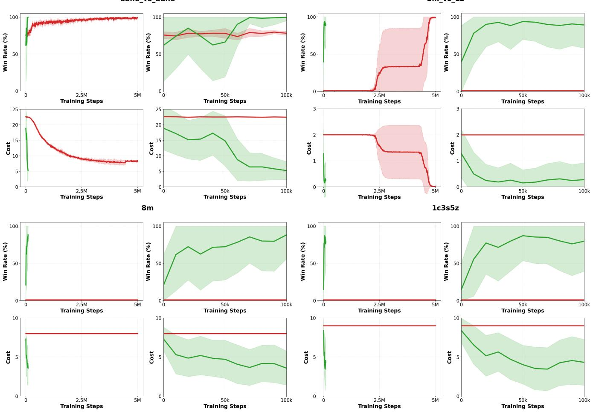  
Figure 4: Training dynamics at � = 0. Top row, the easier maps bane\_vs\_bane and $2 \mathsf { m } _ { - } \mathsf { v } \mathsf { s } _ { - } \mathsf { 1 } \mathsf { z } ,$ where MACPO-Discrete catches up only at 5M; bottom row, 8m and 1c3s5z, where it stays at zero win rate. Each panel pairs the full 0–5M baseline range with the zoomed 0–100k range. CA-MAMBA is green, MACPO-Discrete red.

Direct diagnostics. The table’s $\begin{array} { r l } { \hat { B } _ { c } , } & { { } \hat { B } _ { V } . } \end{array}$ , and total-variation columns, and the 8m runs at $d \ = \ 4$ below, come from three estimates we log on replay sequences every 50 model updates. $\hat { B } _ { c }$ is the mean realized minus predicted team cost. $\hat { B } _ { V }$ is the cost critic’s value at the posterior latent minus its mean over 8 latents sampled from the prior, which estimates the transition term �� of the theorem with the critic in place of $\widehat { V } _ { H _ { \mathrm { i m } } - t - 1 } ;$ the critic attends over all agents, so the estimate includes the inter-agent dependence � of Proposition L.3. The third is a Monte Carlo estimate of each agent’s total variation between posterior and prior over the 32 categorical variables. By convexity it upper-bounds that agent’s one-step transition error under the replay distribution, and like the divergence it is positive even for an exact model. The sampling uses its own seeded generator and restores the training random state, so training is unafected.

On HalfCheetah 2×3 at $d \ : = \ : 2 5$ under the learned multi lier (means ± sample standard deviations over three runs, signs as in the theorem, real minus model), $\hat { B } _ { c } = ( 3 . 6 \pm 6 . 0 ) \cdot 1 0 ^ { - 4 }$ per step, 2% ± 14% of the realized cost; $\hat { B } _ { V } = ( - 2 . 3 \pm 5 . 2 ) \cdot 1 0 ^ { - 4 }$ per step, with mean absolute value 0.0086 against a cost-critic value of 0.24; and the per-agent total variation is 0.73 ± 0.04; this upper estimate of $\epsilon _ { P } ^ { i }$ is far above the 0.16 beyond which part (ii) is vacuous, so the logs cannot certify a useful $\epsilon _ { P } .$ . Over the 14-step window the two one- step terms sum to $\textstyle \sum _ { t < 1 4 } \gamma ^ { t } { \bigl ( } { \hat { B } } _ { c } + \gamma { \hat { B } } _ { V } { \bigr ) } \approx 0 . 0 0 2$ , while realized cost exceeds imagined cost by $0 . 0 2 0 \pm 0 . 0 2 0$ (35% of the mean realized cost; 68%, 23%, and 4% in the three runs). The estimates pool replay states, whereas the theorem’s terms are taken along the real process from the imagination start and use the model’s own cost-to-go $\widehat { V } _ { H _ { \mathrm { i m } } - t - 1 }$ rather than the critic, so the diference bounds neither term. The multiplier ends at $\beta = 0 . 4 4 \pm 0 . 1 2$

On 8m at � = 0 the cost head is as accurate, $\hat { B } _ { c } = ( 3 . 4 \pm 1 . 5 ) \cdot 1 0 ^ { - 4 }$ per step against a realized 0.083, but $\hat { B } _ { V }$ is 0.063 ± 0.003 per step, 7% to 8% of the critic’s value, and positive in all three runs: the model under-predicts the cost-to-go of the next state, in the same direction as the window gap of $0 . 3 5 \pm 0 . 1 3 , \mathrm { a }$ third of the realized cost. The multiplier ends at $\beta = 0 . 5 4 \pm 0 . 0 2$

On 8m at $d \ : = \ : 4$ (Table 12), averaged over the second half of training, $\hat { B } _ { V }$ is positive for every multiplier rule of Section 5.3, run at this limit, from 2.5% to 5% of the critic’s cost value; for the measured-cost multiplier it is $0 . 0 6 9 \pm 0 . 0 0 5$ per step against a value of 1.85. The model therefore under-predicts the cost-to-go of the next state. The per-agent total variation is 0.45 to 0.66, again too large to certify $\epsilon _ { P } < 0 . 1 6 .$ . The 8m export does not include the cost head’s average prediction, so $\hat { B } _ { c }$ is not available there.

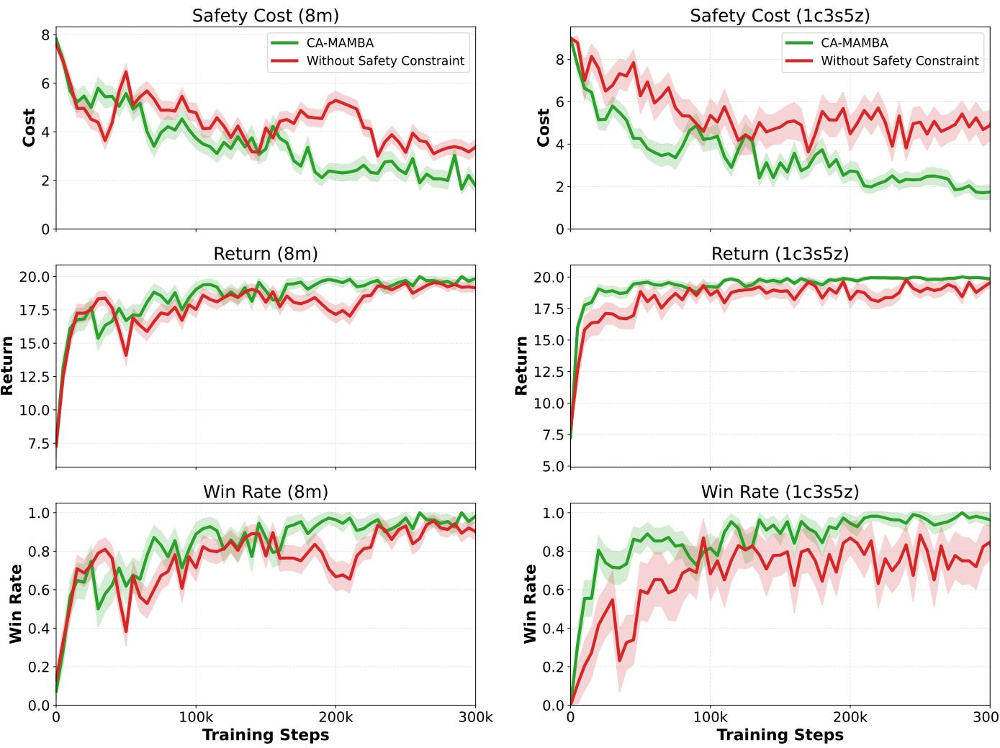  
Figure 5: Safety-mechanism ablation on 8m (left) and 1c3s5z (right), � = 0. Constrained CA-MAMBA (green) versus the unconstrained MAMBA learner (red), over cost, return, and win rate.

## J Multiplier Dynamics

Proposition L.4 below says the measured-cost update has the right sign, and the counterexample of Appendix L.5 shows it cannot repair a cost-blind actor gradient. These trajectories show what the update does when the cost head is accurate, which Appendix H establishes for these runs. We log $\beta$ at every update together with the realized episode cost, over the first 1M interactions at $d = 2 5$ and $\alpha _ { \beta } = 1 0 ^ { - 5 }$ , mean and one standard deviation over three seeds.

All three environments show the behavior the dual prescribes, in the three regimes available. On HalfCheetah 2×3 (Figure 9) episode cost overshoots the limit early, � climbs from zero to 0.64 while it does, cost returns below � near 0.4M interactions, and $\beta$ then decays and settles. On Ant 2×4 (Figure 10) the constraint is inactive for the first 0.4M interactions and $\beta$ correctly stays at zero, then rises once cost appears. On Ant 4×2 (Figure 11) cost never reaches the limit and � never leaves zero, so the constraint costs the policy nothing where it does not bind. No run shows oscillation or divergence, and � stays below 1.1 throughout.

This is the regime on the favorable side of the counterexample in Appendix L.5: there the cost head is blind and $\beta$ diverges without improving the policy, here $\epsilon _ { c }$ is small and the loop closes. The trajectories demonstrate the mechanism working under a measured error, not that a cost-blind failure cannot occur.

SMAC at � = 0. Figure 12 shows the same quantities on SMAC, from the $d \ : = \ : 0$ runs of Table 15 (Appendix M), which use the measured-cost multiplier with $\alpha _ { \beta } = 1 0 ^ { - 5 }$ . A zero casualty budget is never met in combat, so $\bar { C } _ { k } - d$ is never negative and � never decreases. After 100k interactions it has reached 0.54 on 8m (Table 2), 0.50 on MMM, 0.30 on 1c3s5z, 0.13 on 3m, and 0.025 on 2m\_vs\_1z, means over three runs. The reward and cost advantages are each standardized, so cost is still weighted below reward when training stops. Casualty cost falls while $\beta$ rises, which is the mechanism working; on 8m the measured-cost multiplier ends with most of the reduction that the parity price $\beta = 1$ gives (Table 2), and no rule there meets the zero-casualty limit within 100k.

<table><tr><td></td><td></td><td></td><td> $\operatorname { K L } \mathrm { p e r }$ </td><td> $\mathrm { T V } \mathrm { p e r }$ </td><td> $\hat { B } _ { c }$ </td><td> ${ \hat { B } } _ { V }$ </td><td>Imagined</td><td>Real</td><td>Real –</td></tr><tr><td>Env</td><td></td><td>d Price</td><td>agent</td><td>agent</td><td> $[ 1 0 ^ { - 4 } ]$ </td><td> $[ 1 0 ^ { - 3 } ]$ </td><td>14-step cost</td><td>14-step cost</td><td>imagined</td></tr><tr><td>8m</td><td></td><td>0 Learned</td><td> $4 . 1 \pm 0 . 1$ </td><td> $0 . 6 6 \pm 0 . 0 1$ </td><td> $3 . 4 \pm 1 . 5$ </td><td> $6 3 . 3 \pm 2 . 7$ </td><td> $0 . 7 2 8 \pm 0 . 0 1 7$ </td><td> $1 . 0 8 3 \pm 0 . 1 2 8$ </td><td> $0 . 3 5 4 \pm 0 . 1 3 2 \ : \left( + 3 3 \% \right)$ </td></tr><tr><td>HalfCheetah 2×3</td><td></td><td>3 5 Parity start</td><td></td><td> $5 . 6 \pm 1 . 0 0 . 7 6 \pm 0 . 0 4$ </td><td> $- 1 . 0 \pm 1 . 9$ </td><td> $- 0 . 0 \pm 0 . 2$ </td><td> $0 . 0 1 4 \pm 0 . 0 3 0$ </td><td> $0 . 0 6 8 \pm 0 . 1 1 2$ </td><td> $0 . 0 5 4 \pm 0 . 0 8 4 \left( + 7 9 \% ^ { \circ } \right)$ </td></tr><tr><td></td><td></td><td>5 Fixed  $\beta { = } 1$ </td><td></td><td> $5 . 4 \pm 0 . 6 0 . 7 2 \pm 0 . 0 7$ </td><td> $2 . 0 \pm 2 . 5$ </td><td> $0 . 1 \pm 0 . 2$ </td><td> $- 0 . 0 1 1 \pm 0 . 0 0 9$ </td><td> $0 . 0 0 9 \pm 0 . 0 0 4$ </td><td> $0 . 0 2 0 \pm 0 . 0 1 2 \left( + 2 2 0 \% \right)$ </td></tr><tr><td></td><td></td><td>25 Learned</td><td></td><td> $4 . 9 \pm 0 . 8 0 . 7 3 \pm 0 . 0 4$ </td><td> $3 . 6 \pm 6 . 0$ </td><td> $- 0 . 2 \pm 0 . 5$ </td><td> $0 . 0 3 7 \pm 0 . 0 1 7$ </td><td> $0 . 0 5 6 \pm 0 . 0 1 5$ </td><td> $0 . 0 2 0 \pm 0 . 0 2 0 \ : ( + 3 5 \% ^ { \circ } )$ </td></tr><tr><td></td><td></td><td>25 Parity start</td><td> $4 . 1 \pm 1 . 0$ </td><td> $0 . 6 8 \pm 0 . 0 6$ </td><td> $0 . 3 \pm 6 . 7$ </td><td> $0 . 0 \pm 1 . 2$ </td><td> $0 . 0 9 2 \pm 0 . 0 4 6$ </td><td> $0 . 2 8 1 \pm 0 . 1 0 9$ </td><td> $0 . 1 8 9 \pm 0 . 0 9 3 \ : \left( + 6 7 \% \right)$ </td></tr><tr><td></td><td></td><td>25 Fixed  $\beta { = } 1$ </td><td> $5 . 9 \pm 0 . 0$ </td><td> $0 . 7 7 \pm 0 . 0 1$ </td><td> $0 . 1 \pm 2 . 3$ </td><td> $0 . 3 \pm 0 . 2$ </td><td> $0 . 0 0 6 \pm 0 . 0 2 8$ </td><td> $0 . 0 3 5 \pm 0 . 0 2 5$ </td><td> $0 . 0 2 9 \pm 0 . 0 0 9 \left( + 8 3 \% \right)$ </td></tr></table>

Table 11: World-model error on the runs whose logs record every episode’s exact length, three runs (seeds 1–3) per row. Each quantity is a run’s average over its last 10% of interactions (100k for 8m, 1M for HalfCheetah), then mean ± sample standard deviation over runs. Learned is the measured-cost multiplier of the main results; Parity start runs the same update from $\beta _ { 0 } = 1 ;$ Fixed $\beta { = } 1$ holds the price at parity. KL is between the prior and the posterior over one agent’s latent (32 categoricals), TV a Monte Carlo estimate of their total variation. $\hat { B } _ { c }$ and $\hat { B } _ { V }$ are per-step estimates on replay, real minus model as in Theorem L.1. Imagined and real costs are discounted windows of the 14 costed imagined steps $\begin{array} { r } { ( \sum _ { t < 1 4 } 0 . 9 9 ^ { t } \approx 1 3 . 1 ) } \end{array}$ : imagined team cost per step, and realized episode cost divided by exact episode length, each times that sum. The cost head is an unconstrained regressor, so imagined cost can fall slightly below zero where real cost is near zero. The percentage is $( \bar { R } - \bar { I } ) / \bar { R }$ from the row means $\bar { R }$ and ${ \bar { I } } ,$ positive when the model under-predicts; ⋄ marks rows whose mean gap is within one standard deviation of the per-run gaps.

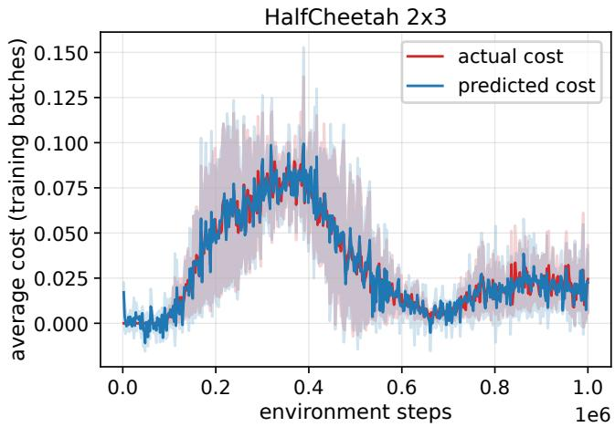  
Figure 6: HalfCheetah 2×3, $d = 2 5 \colon$ predicted against realized team cost on training batches. The prediction follows the full rise-and-fall arc.

## K Evidence Needed for the Remaining Claims

Three questions remain open, and we state what each would take rather than leave them implicit.

Cost accumulated during learning. The endpoint comparisons in this paper say what a policy costs once trained, not what training itself costs. We can report the second on MAMuJoCo, and the answer splits. Summing episode cost over training on Ant 2×4 at � = 25, CA-MAMBA accumulates roughly 23k over its 1M interactions against MACPO’s 93k over 10M, so reaching a stronger policy costs a quarter as much cost in total. Restricted to matched interaction counts the ordering reverses: over the same first 1M interactions MACPO accumulates less total cost and almost no excess above �, while CA-MAMBA’s cumulative excess $\begin{array} { r } { E _ { K } = \sum _ { e = 1 } ^ { K } [ C _ { e } - d ] } \end{array}$ + reaches roughly 14.5k, concentrated between 0.6M and 0.9M interactions, while the multiplier is still rising from zero (Table 5, Figure 10). Sample eficiency therefore reduces the cost of getting to a policy without making learning safer per interaction. Reporting $E _ { K }$ and the violation count $\begin{array} { r } { V _ { K } = \sum _ { e = 1 } ^ { K } \pmb { 1 } \{ C _ { e } > d \} } \end{array}$ on ${ \mathrm { S M A C } } ,$ where cost is irreversible, is the measurement that would tell us whether that overshoot is specific to a reversible velocity cost.

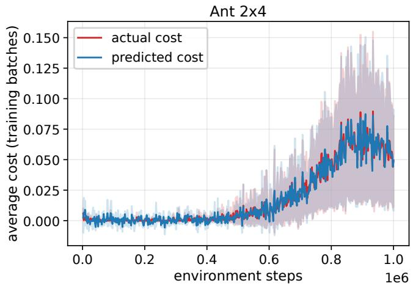  
Figure 7: Ant 2×4, $d \ : = \ : 2 5 \colon$ cost is zero until roughly 0.4M interactions. The head predicts the zero phase and the onset.

Positive-event recall under sparse cost. Appendix H measures $\epsilon _ { c }$ on the continuous velocity cost. The SMAC casualty cost is sparser and irreversible, and the quantity that would settle it is recall on positive events, with area under the precision–recall curve and the absolute error of the 14-step cumulative predicted cost, evaluated on held-out replay without retraining.

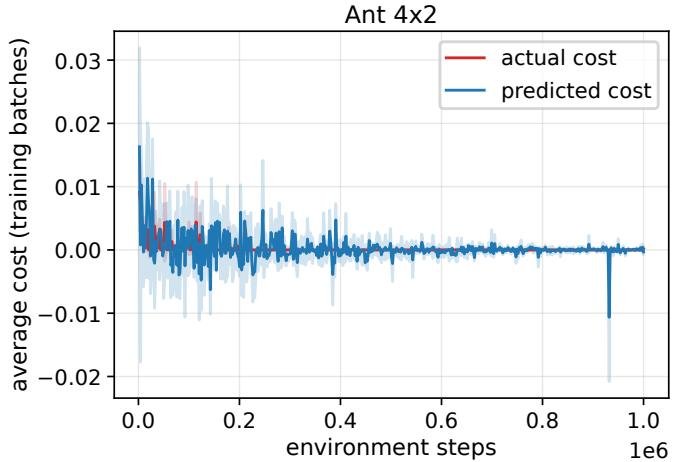

Figure 8: Ant 4×2, $d = 2 5 \colon$ cost stays near zero throughout and the prediction stays with $\mathbf { i t } ,$ within regression noise.
<table><tr><td>Multiplier</td><td> ${ \hat { B } } _ { V }$ </td><td> $\overline { { | \delta | } }$ </td><td> $\bar { V } _ { C }$ </td><td> $\widehat { \mathrm { T V } }$ </td><td> $\widehat { \mathrm { T V } } _ { \operatorname* { m a x } }$ </td></tr><tr><td>Imagined</td><td>0.06</td><td>0.23</td><td>2.39</td><td>0.65</td><td>0.70</td></tr><tr><td rowspan="2">Measured</td><td>±0.01</td><td>±0.01</td><td>±0.38</td><td>±0.00</td><td>±0.00</td></tr><tr><td>0.07</td><td>0.21</td><td>1.85</td><td>0.64</td><td>0.69</td></tr><tr><td rowspan="2">PID</td><td>±0.00</td><td>±0.01</td><td>±0.04</td><td>±0.01</td><td>±0.01</td></tr><tr><td>0.01</td><td>0.04</td><td>0.28</td><td>0.45</td><td>0.50</td></tr><tr><td rowspan="2"> $\beta { = } 5$ </td><td>±0.00</td><td>±0.02</td><td>±0.14</td><td>±0.05</td><td>±0.07</td></tr><tr><td>0.01</td><td>0.02</td><td>0.13</td><td>0.63</td><td>0.69</td></tr><tr><td rowspan="2"> $\beta { = } 1$ </td><td>±0.00</td><td>±0.01</td><td>±0.07</td><td>±0.04</td><td>±0.02</td></tr><tr><td>0.04</td><td>0.12</td><td>0.82</td><td>0.52</td><td>0.56</td></tr><tr><td rowspan="2"> $\scriptstyle { \beta = 0 }$ </td><td>±0.01</td><td>±0.03</td><td>±0.29</td><td>±0.05</td><td>±0.05</td></tr><tr><td>0.06</td><td>0.22</td><td>2.19</td><td>0.66</td><td>0.71</td></tr><tr><td></td><td>±0.01</td><td>±0.02</td><td>±0.19</td><td>±0.01</td><td>±0.01</td></tr></table>

Table 12: World-model transition diagnostics on SMAC 8m at $d = 4 ,$ logged on replayed sequences during training and averaged over the second half of training (50k to 100k environment interactions); each entry is a mean over the seeds that logged $\mathbf { i t } ,$ with the sample standard deviation (±) below it (three per row). For a replay step with deterministic state $\begin{array} { r } { h , \delta = V _ { C } ( h , z ^ { q } ) - \frac { 1 } { K } \sum _ { k = 1 } ^ { K } V _ { C } ( h , z ^ { p , k } ) } \end{array}$ compares the cost critic $V _ { C }$ at a posterior latent $z ^ { q }$ with its mean over � prior latents $z ^ { p , k }$ ${ \hat { B } } _ { V }$ is the mean of $\delta ,$ an estimate of $B _ { V }$ in Theorem $\mathbf { L . 1 ( i ) }$ with the cost critic as the cost-to-go. |�| is the mean of $| \delta | .$ �¯� is the mean critic value at posterior latents, the scale for the first two columns. $\widehat { \mathrm { T V } }$ is the Monte Carlo total-variation distance between an agent’s posterior and prior over its whole latent, averaged over agents, which upper-bounds the latent-space per-agent transition error $\epsilon _ { P } ^ { i }$ of Proposition L.3 on replay states. $\widehat { \mathrm { T V } } _ { \mathrm { m a x } }$ is the largest per-agent average. Rows list the arms whose runs logged these diagnostics.

Communication trained end to end. The communication ablation masks messages only at action selection, from a model trained with them, and is reported on MAMuJoCo. Training a self-only model end to end, with the mask applied in world-model learning and imagination as well, would show whether a domain needs communication rather than whether a trained policy depends on it, and would measure how the neighborhood changes the per-agent transition errors of Proposition L.3.

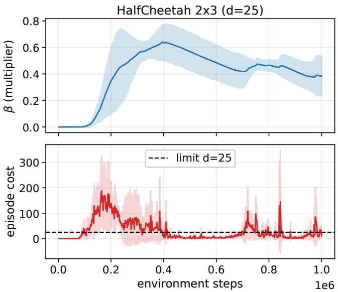  
Figure 9: HalfCheetah 2×3, $d = 2 5 \colon \beta$ rises while episode cost exceeds the limit, then relaxes once cost returns below it.

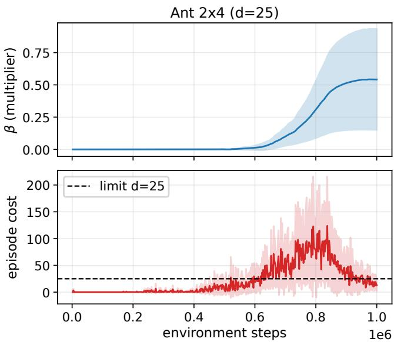  
Figure 10: $\mathbf { A n t } 2 { \times } 4 , d = 2 5 \colon \mu$ holds at zero while the constraint is inactive and rises when it activates.

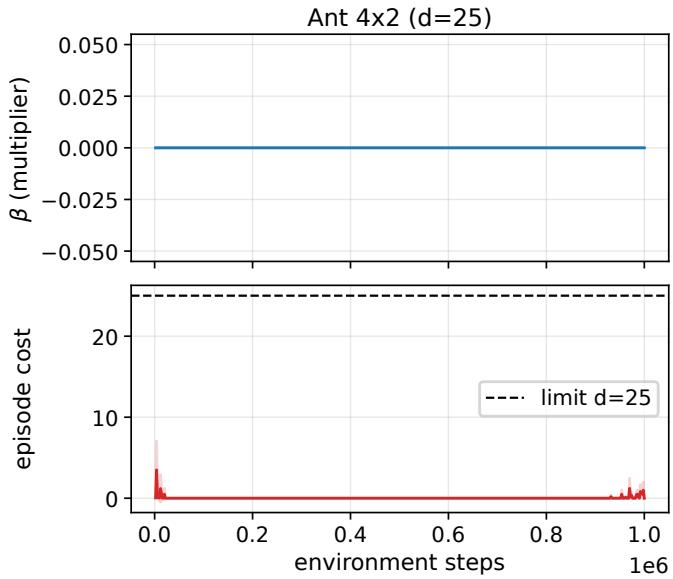  
Figure 11: Ant 4×2, $d = 2 5 \colon$ cost never exceeds the limit and $\beta$ never leaves zero.

## L Proofs and Sparse-Cost Boundary Case

This section proves the results of Section 4 in order: the cost-gap theorem (Appendix $\mathrm { L } . 1 ) ,$ its extension to bootstrapped returns $( \mathrm { A p \cdot }$ pendix L.2), the factorized transition error (Appendix L.3), the measured-cost dual (Appendix L.4), and the sparse-cost counterexample (Appendix L.5).

## L.1 Proof of the Imagination-to-Reality Cost Gap

We restate the main text’s imagination-to-reality theorem and prove it. The argument is the telescoping form of the simulation lemma [14], applied to the imagined team cost.

Theorem L.1 (Imagination-to-reality cost gap). Fix a joint policy �, an imagination horizon $H _ { \mathrm { i m } } ~ \geq ~ 1$ , and a discount $\gamma \in$ [0, 1]. Let X be a standard Borel space ofjoint information states $\boldsymbol { x } = ( x ^ { 1 } , \ldots , x ^ { N } )$ , where $x ^ { i }$ is what agent � conditions on, so that $\textstyle \pi ( a \mid x ) = \prod _ { i = 1 } ^ { N } \pi ^ { i } ( a ^ { i } \mid x ^ { i } )$ is well defined. Along the real process, let $P _ { t } ( \cdot \mid x , a )$ be a regular conditional law $o f x _ { t + 1 }$ given $( x _ { t } , a _ { t } ) = ( x , a )$ and let $c _ { t } ( x , a )$ be the conditional expectation of the team cost at step � given $( x _ { t } , a _ { t } ) = ( x , a )$ . Let $\widehat { P }$ be the learned kernel on X and b� the predicted team cost, and let $c _ { t }$ andb� take values in a common interval of length $c _ { \mathrm { m a x } } < \infty$ . With

$$
\begin{array} { r l } & { J _ { C , H _ { \mathrm { i m } } } ( \pi ) = \mathbb { E } \Bigg [ \displaystyle \sum _ { t = 0 } ^ { H _ { \mathrm { i m } } - 1 } \gamma ^ { t } c _ { t } ( x _ { t } , a _ { t } ) \Bigg ] , } \\ & { \widehat { J } _ { C , H _ { \mathrm { i m } } } ( \pi ) = \mathbb { E } _ { \widehat { P } , \pi } \Bigg [ \displaystyle \sum _ { t = 0 } ^ { H _ { \mathrm { i m } } - 1 } \gamma ^ { t } \widehat { c } ( x _ { t } , a _ { t } ) \Bigg ] , } \end{array}
$$

the first along the real process, assume the two processes share an initial-state law and that in both the action $a _ { t }$ is drawn from $\pi ( \cdot \mid x _ { t } )$ Let $\nu _ { t }$ be the law $o f \left( x _ { t } , a _ { t } \right)$ under the real process, and define the

model’s �-step cost-to-go by $\widehat { V } _ { 0 } \equiv 0$ and

$$
\begin{array} { r } { \widehat { V } _ { k } ( x ) = \mathbb { E } _ { a \sim \pi ( \cdot | x ) } \left[ \widehat { c } ( x , a ) + \gamma \mathbb { E } _ { x ^ { \prime } \sim \widehat { P } ( \cdot | x , a ) } \widehat { V } _ { k - 1 } ( x ^ { \prime } ) \right] } \end{array}
$$

for $k \geq 1$ . Then (i)

$$
J _ { C , H _ { \mathrm { i m } } } ( \pi ) - \widehat { J } _ { C , H _ { \mathrm { i m } } } ( \pi ) = \sum _ { t = 0 } ^ { H _ { \mathrm { i m } } - 1 } \gamma ^ { t } \big ( B _ { c } ( t ) + \gamma B _ { V } ( t ) \big ) ,
$$

with $\boldsymbol { B _ { c } } ( t ) ~ = ~ \mathbb { E } _ { \boldsymbol { \nu _ { t } } } [ c _ { t } - \widehat { c } ]$ and $B _ { V } ( t ) ~ = ~ \mathbb { E } _ { ( x , a ) \sim \nu _ { t } } \left[ ( \mathbb { E } _ { P _ { t } ( \cdot | x , a ) } - \right.$ $\mathbb { E } _ { \widehat { P } ( \cdot | x , a ) } ) \widehat { V } _ { H _ { \mathrm { i m } } - t - 1 } \big ] . \mathrm { ( i i ) }$ If moreover $| B _ { c } ( t ) | \le \epsilon _ { c }$ and

$$
\begin{array} { r } { \mathbb { E } _ { ( x , a ) \sim \nu _ { t } } \left[ D _ { \mathrm { T V } } ( P _ { t } ( \cdot \mid x , a ) , \widehat { P } ( \cdot \mid x , a ) ) \right] \leq \epsilon _ { P } } \end{array}
$$

for every $t < H _ { \operatorname* { i m } } .$ , then

$$
\begin{array} { r l r } {  {  J _ { C , H _ { \mathrm { i m } } } ( \boldsymbol { \pi } ) - \widehat { J } _ { C , H _ { \mathrm { i m } } } ( \boldsymbol { \pi } )  \le \Delta _ { C , H _ { \mathrm { i m } } } , } } \\ & { } & { \Delta _ { C , H _ { \mathrm { i m } } } : = \epsilon _ { c } \sum _ { t = 0 } ^ { H _ { \mathrm { i m } } - 1 } \gamma ^ { t } } \\ & { } & { + c _ { \mathrm { m a x } } \epsilon _ { P } \sum _ { t = 0 } ^ { H _ { \mathrm { i m } } - 1 } t \gamma ^ { t } , } \end{array}
$$

and consequently $\widehat { J } _ { C , H _ { \mathrm { i m } } } ( \pi ) \le b - \Delta _ { C , H _ { \mathrm { i m } } }$ implies $J _ { C , H _ { \mathrm { i m } } } ( \pi ) \le b$ for any threshold �.

Because $P _ { t }$ and $c _ { t }$ are conditional laws along the real process, the theorem needs no Markov or suficiency assumption on the latents: it holds for the network’s own latents $x _ { t } ^ { i } = ( h _ { t } ^ { i } , z _ { t } ^ { i } )$ of Section 3. Imagination branches from posterior replay states, so the shared initial law is the replay distribution, and the result governs an $H _ { \mathrm { i m } ^ { - } }$ step cost-to-go from visited states. The assumptions of the bound are averages under the real process; pointwise bounds on every reachable state–action pair imply them, so the bound also holds under that stronger worst-case reading. The learned cost head is unclipped regression, and the bound evaluates $\widehat { V } _ { H _ { \mathrm { i m } } - t - 1 }$ at next states drawn from $\widehat { P }$ as well as from $P _ { t } ,$ so $c _ { \mathrm { m a x } }$ must cover the range ofb� on every state the model’s rollouts reach from visited states, including imagined states the real system never visits, and not only the range of the real cost.

Proof. Decomposition. Write $H = H _ { \mathrm { i m } }$ and, for $t \in \{ 0 , \ldots , H \}$ let $D _ { t } = \gamma ^ { t } \mathbb { E } [ \widehat { V } _ { H - t } ( x _ { t } ) ]$ , where $x _ { t }$ follows the real process. The two processes share the initial law, so $D _ { 0 } = \mathbb { E } [ \widehat { V } _ { H } ( x _ { 0 } ) ] = \widehat { J } _ { C , H } ( \pi )$ and $D _ { H } = 0$ because $\widehat { V } _ { 0 } \equiv 0$ . In the real process $a _ { t }$ is drawn from $\pi ( \cdot \mid x _ { t } )$ , the same policy that defines ${ \widehat { V } } ,$ , so the definition of $\widehat { V } _ { H - t }$ gives

$$
\begin{array} { r } { \mathbb { E } \left[ \widehat { V } _ { H - t } ( x _ { t } ) \right] = \mathbb { E } _ { ( x , a ) \sim \nu _ { t } } \left[ \widehat { c } ( x , a ) + \gamma \mathbb { E } _ { \widehat { P } ( \cdot \vert x , a ) } \widehat { V } _ { H - t - 1 } \right] . } \end{array}
$$

By the definition of $P _ { t }$ and the tower property,

$$
\begin{array} { r } { \mathbb { E } \left[ \widehat { V } _ { H - t - 1 } ( x _ { t + 1 } ) \right] = \mathbb { E } _ { ( x , a ) \sim \nu _ { t } } \left[ \mathbb { E } _ { P _ { t } ( \cdot | x , a ) } \widehat { V } _ { H - t - 1 } \right] . } \end{array}
$$

Subtracting $\gamma ^ { t + 1 }$ times the second identity from $\gamma ^ { t }$ times the first,

$$
D _ { t } - D _ { t + 1 } = \gamma ^ { t } \mathbb { E } _ { \nu _ { t } } \left[ \widehat { c } + \gamma \big ( \mathbb { E } _ { \widehat { P } } - \mathbb { E } _ { P _ { t } } \big ) \widehat { V } _ { H - t - 1 } \right] .
$$

Summing over $t = 0 , \ldots , H - 1$ telescopes the left side to $D _ { 0 } \mathrm { ~ - ~ }$ $D _ { H } = \widehat { J } _ { C , H } ( \pi )$ . By the tower property, $\begin{array} { r } { J _ { C , H } ( \pi ) = \sum _ { t = 0 } ^ { H - 1 } \gamma ^ { t } \mathbb { E } _ { \nu _ { t } } [ c _ { t } ] } \end{array}$

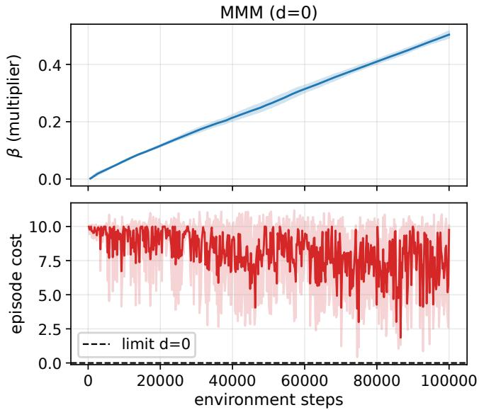

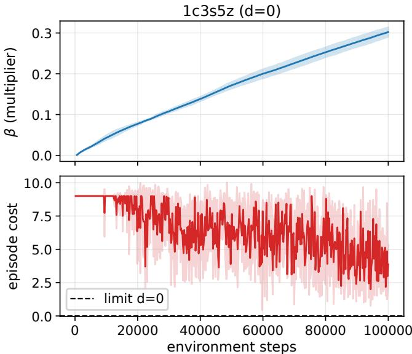  
Figure 12: SMAC at $d = 0$ with the measured-cost multiplier, $\alpha _ { \beta } = 1 0 ^ { - 5 } \colon$ MMM (left) and 1c3s5z (right). The multiplier $\beta$ (top, mean and one standard deviation over three seeds) rises linearly and stays below 1 at 100k interactions, while episode cost (bottom) falls but stays above the limit.

so subtraction gives

$$
J _ { C , H } ( \pi ) - \widehat { J } _ { C , H } ( \pi ) = \sum _ { t = 0 } ^ { H - 1 } \gamma ^ { t } \Big ( \mathbb { E } _ { \nu _ { t } } \big [ c _ { t } - \widehat { c } \big ] + \gamma \mathbb { E } _ { \nu _ { t } } \big [ ( \mathbb { E } _ { P _ { t } } - \mathbb { E } _ { \widehat { P } } ) \widehat { V } _ { H - t - 1 } \big ] \Big ) ,
$$

which is the decomposition.

Bound. Ifb� takes values in [�, $m + c _ { \mathrm { m a x } } ]$ , induction on � shows that $\widehat { V } _ { k }$ takes values in [� $\begin{array} { r } { \ i \sum _ { j = 0 } ^ { k - 1 } \gamma ^ { j } , ( m + c _ { \mathrm { m a x } } ) \sum _ { j = 0 } ^ { k - 1 } \gamma ^ { j } ] } \end{array}$ , an interval of length $\begin{array} { r } { c _ { \operatorname* { m a x } } \sum _ { i = 0 } ^ { k - 1 } \gamma ^ { j } } \end{array}$ . For any measurable � with values in an interval of length � and probability laws � and �, $| \mathbb { E } _ { P } [ f ] - \mathbb { E } _ { q } [ f ] | \leq$ $L D _ { \mathrm { T V } } ( p , q )$ . Hence, at every (�, �),

$$
\Big | \big ( \mathbb { E } _ { P _ { t } } - \mathbb { E } _ { \widehat { P } } \big ) \widehat { V } _ { H - t - 1 } \Big | \leq c _ { \operatorname* { m a x } } \Big ( \sum _ { j = 0 } ^ { H - t - 2 } \gamma ^ { j } \Big ) D _ { \mathrm { T V } } \big ( P _ { t } ( \cdot \mid x , a ) , \widehat { P } ( \cdot \mid x , a ) \big ) ,
$$

with an empty sum, and hence zero, at $t = H - 1$ . Averaging over $\nu _ { t }$ and using the assumption, $\begin{array} { r } { | B _ { V } ( t ) | \le c _ { \mathrm { m a x } } \epsilon _ { P } \sum _ { j = 0 } ^ { H - t - 2 } \gamma ^ { j } } \end{array}$ . With $| B _ { c } ( t ) | \le \epsilon _ { c }$ and the triangle inequality,

$$
\left| J _ { C , H } ( \pi ) - \widehat { J } _ { C , H } ( \pi ) \right| \le \epsilon _ { c } \sum _ { t = 0 } ^ { H - 1 } \gamma ^ { t } + c _ { \operatorname* { m a x } } \epsilon _ { P } \sum _ { t = 0 } ^ { H - 1 } \sum _ { j = 0 } ^ { H - t - 2 } \gamma ^ { t + 1 + j } .
$$

In the double sum, each exponent $s = t + 1 + j$ with $1 \leq s \leq H - 1$ arises from exactly � pairs $( t , j )$ , namely $t = 0 , \ldots , s - 1$ . The double sum therefore equals $\textstyle \sum _ { s = 0 } ^ { H - 1 } s \gamma ^ { s }$ , and the ri ht side is $\Delta _ { C , H }$

For $\gamma \ < 1$ , if the assumptions hold for every $t \ \geq \ 0 ,$ , absolute convergence permits $H  \infty ,$ and

$$
\sum _ { t = 0 } ^ { \infty } \gamma ^ { t } = { \frac { 1 } { 1 - \gamma } } , \qquad \sum _ { t = 0 } ^ { \infty } t \gamma ^ { t } = { \frac { \gamma } { ( 1 - \gamma ) ^ { 2 } } } .
$$

Substitution gives the infinite-horizon margin

$$
\Delta _ { C , \infty } = \frac { \epsilon _ { c } } { 1 - \gamma } + \frac { \gamma c _ { \mathrm { m a x } } \epsilon _ { P } } { ( 1 - \gamma ) ^ { 2 } } ,
$$

which the main text does not use because the implementation imagines a fixed $H _ { \mathrm { i m } } = 1 4$ costed steps. Setting $\gamma = 1$ instead gives the undiscounted specialization over the same finite horizon,

$$
\Delta _ { C , H } = H \epsilon _ { c } + \frac { H ( H - 1 ) } { 2 } c _ { \mathrm { m a x } } \epsilon _ { P } .
$$

Finally, if $\begin{array} { r } { \cdot \widehat { J } _ { C , H } ( \pi ) \leq b - \Delta _ { C , H } , } \end{array}$ , then

$$
J _ { C , H } ( \pi ) \le \widehat { J } _ { C , H } ( \pi ) + \Delta _ { C , H } \le b .
$$

Each implication uses only the assumptions stated in the theorem.

## L.2 Bootstrapped Returns

The actor’s targets are �-returns that bootstrap from the cost critic at the imagination horizon. This subsection extends the decompo-sition to them.

Corollary L.2 (Bootstrapped returns). Keep the setting of Theorem L.1, let $\gamma < 1 _ { : }$ , let the real team costs be bounded, and let $V : X  \mathbb { R }$ be bounded and measurable (the implementation’s critic head is unconstrained in sign). Define $\widehat { V } _ { 0 } ^ { V } = V$ and, $f o r k \geq 1 .$

$$
\widehat { V } _ { k } ^ { V } ( \boldsymbol { x } ) = \mathbb { E } _ { a \sim \pi ( \cdot | \boldsymbol { x } ) } \Big [ \widehat { c } ( \boldsymbol { x } , a ) + \gamma \mathbb { E } _ { \boldsymbol { x } ^ { \prime } \sim \widehat { P } ( \cdot | \boldsymbol { x } , a ) } \widehat { V } _ { k - 1 } ^ { V } ( \boldsymbol { x } ^ { \prime } ) \Big ] ,
$$

so that $\begin{array} { r } { \widehat { J } _ { C } ^ { ( n ) } ( \pi ) = \mathbb { E } [ \widehat { V } _ { n } ^ { V } ( x _ { 0 } ) ] = \mathbb { E } _ { \widehat { P } , \pi } [ \sum _ { t < n } \gamma ^ { t } \widehat { c } ( x _ { t } , a _ { t } ) + \gamma ^ { n } V ( x _ { n } ) ] } \end{array}$ Along the real process, let $\begin{array} { r } { J _ { C } ^ { Y } ( \pi ) = \mathbb { E } [ \sum _ { t \geq 0 } \gamma ^ { t } c _ { t } ( x _ { t } , a _ { t } ) ] } \end{array}$ and let $G _ { n } =$ $\textstyle \sum _ { s \geq n } { \gamma ^ { s - n } c _ { s } }$ be the realized discounted costfrom step �, where $c _ { s }$ is the realized team cost at step �. Then, for every $n \geq 1$

$$
\begin{array} { l } { { \displaystyle { J _ { C } ^ { Y } } ( \pi ) - \widehat { J } _ { C } ^ { ( n ) } ( \pi ) = \sum _ { t = 0 } ^ { n - 1 } \gamma ^ { t } \Big ( B _ { c } ( t ) + \gamma \mathbb { E } _ { \nu _ { t } } \big [ ( \mathbb { E } _ { P _ { t } } - \mathbb { E } _ { \widehat { P } } ) \widehat { V } _ { n - t - 1 } ^ { V } \big ] \Big ) } } \\ { { \displaystyle ~ + \gamma ^ { n } \mathbb { E } \big [ G _ { n } - V ( x _ { n } ) \big ] . } } \end{array}
$$

For the truncated �-return $\begin{array} { r } { \widehat { J } _ { C } ^ { \lambda } = \sum _ { n = 1 } ^ { H _ { \mathrm { i m } } } w _ { n } \widehat { J } _ { C } ^ { ( n ) } } \end{array}$ with $w _ { n } = ( 1 - \lambda ) \lambda ^ { n - 1 }$ for $\begin{array} { r } { n < H _ { \mathrm { i m } } \ a n d w _ { H _ { \mathrm { i m } } } = \lambda ^ { H _ { \mathrm { i m } } - 1 } , J _ { C } ^ { Y } - \widehat { J } _ { C } ^ { \lambda } = \sum _ { n = 1 } ^ { H _ { \mathrm { i m } } } w _ { n } \big ( J _ { C } ^ { Y } - \widehat { J } _ { C } ^ { ( n ) } \big ) } \end{array}$

Proof. All quantities are finite: the costs and � are bounded and $\gamma ~ < ~ 1$ . Let $D _ { t } \ = \ \gamma ^ { t } \mathbb { E } [ \widehat { V } _ { n - t } ^ { V } ( x _ { t } ) ]$ along the real process for $t \in \{ 0 , \ldots , n \}$ . The initial laws agree, so $D _ { 0 } = \widehat { J } _ { C } ^ { ( n ) } ( \pi )$ , and $D _ { n } =$ $\gamma ^ { n } \mathbb { E } [ V ( x _ { n } ) ]$ because $\widehat V _ { 0 } ^ { V } = V$ . The two one-step identities in the proof of Theorem L.1 use only the recursion defining $\widehat { V }$ for $k \geq 1$ not its terminal value, so they hold here for $t \leq n - 1$ and give

$$
D _ { t } - D _ { t + 1 } = \gamma ^ { t } \mathbb { E } _ { \nu _ { t } } \left[ \widehat { c } + \gamma \big ( \mathbb { E } _ { \widehat { P } } - \mathbb { E } _ { P _ { t } } \big ) \widehat { V } _ { n - t - 1 } ^ { V } \right] .
$$

Summing over $t = 0 , \ldots , n - 1$

$$
\widehat { J } _ { C } ^ { ( n ) } ( \pi ) - \gamma ^ { n } \mathbb { E } [ V ( x _ { n } ) ] = \sum _ { t = 0 } ^ { n - 1 } \gamma ^ { t } \mathbb { E } _ { \nu _ { t } } \left[ \widehat { c } + \gamma \big ( \mathbb { E } _ { \widehat { P } } - \mathbb { E } _ { P _ { t } } \big ) \widehat { V } _ { n - t - 1 } ^ { V } \right] .
$$

For the real process, split the discounted sum at � and use linearity, which absolute convergence allows, and the tower property for the first � terms:

$$
J _ { C } ^ { Y } ( \pi ) = \sum _ { t = 0 } ^ { n - 1 } \gamma ^ { t } \mathbb { E } _ { \nu _ { t } } \left[ c _ { t } \right] + \gamma ^ { n } \mathbb { E } [ G _ { n } ] .
$$

No Markov property is needed. Subtracting the previous display from this one gives the stated identity. For the �-return, with $H =$ $\begin{array} { r l } {  { H _ { \mathrm { i m } } , \sum _ { n = 1 } ^ { H } w _ { n } = ( 1 - \lambda ) \sum _ { n = 1 } ^ { H - 1 } \lambda ^ { n - 1 } + \lambda ^ { \dot { H } - 1 } = ( 1 - \lambda ^ { H - 1 } ) + \lambda ^ { H - 1 } = 1 } } \end{array}$ so $\begin{array} { r } { J _ { C } ^ { Y } - \widehat { J } _ { C } ^ { \lambda } = \sum _ { n } w _ { n } J _ { C } ^ { Y } - \sum _ { n } w _ { n } \widehat { J } _ { C } ^ { ( n ) } = \sum _ { n } w _ { n } ( J _ { C } ^ { Y } - \widehat { J } _ { C } ^ { ( n ) } ) } \end{array}$ □

The implementation also multiplies each imagined step by a predicted continuation probability. Treating episode termination as an absorbing state with zero cost and zero critic value, in both processes, folds that factor into $\widehat { P }$ and $P _ { t }$ and leaves the identity unchanged. Because $P _ { t }$ is indexed by time, a time limit on episodes needs no further assumption; a model that cannot see the time step simply carries the resulting error in its transition term. The corollary covers the �-return from replay start states; the advantages at later imagined steps start from model states and are not covered.

## L.3 Factorized Transition Error

This subsection proves Proposition 4.2. Write $\ b { \chi } = \ b { \chi } ^ { 1 } \times \dots \times \ b { \chi } ^ { N }$ with standard Borel factors, $x ^ { N _ { i } } = ( x ^ { j } ) _ { j \in N _ { i } }$ , and likewise $a ^ { N _ { i } }$

Proposition L.3 (Factorized transition error). Suppose $\widehat { P } ( \cdot \mid$ $\begin{array} { r } { { \boldsymbol x } , { \boldsymbol a } ) = \bigotimes _ { i = 1 } ^ { N } \widehat { P } _ { i } ( \cdot \mid { \boldsymbol x } ^ { N _ { i } } , { \boldsymbol a } ^ { N _ { i } } ) } \end{array}$ for kernels $\widehat { P } _ { i }$ into $\chi ^ { i }$ , and let $P _ { t , i } ( \cdot \mid$ $x , a )$ be the �-th marginal of $\cdot P _ { t } ( \cdot \mid x , a )$

(i) At every (�, �),

$$
\begin{array} { r } { D _ { \mathrm { T V } } ( P _ { t } , \widehat { P } ) \leq D _ { \mathrm { T V } } \Big ( P _ { t } , \bigotimes _ { i } P _ { t , i } \Big ) + \sum _ { i = 1 } ^ { N } D _ { \mathrm { T V } } ( P _ { t , i } , \widehat { P } _ { i } ) . } \end{array}
$$

(ii) With $\begin{array} { r l r } { \eta } & { = } & { \operatorname* { m a x } _ { t < H _ { \mathrm { i m } } } \mathbb { E } _ { \nu _ { t } } \left[ D _ { \mathrm { T V } } ( P _ { t } , \bigotimes _ { i } P _ { t , i } ) \right] } \end{array}$ and $\begin{array} { r l } { \epsilon _ { P } ^ { i } } & { { } = } \end{array}$ $\begin{array} { r } { \operatorname* { m a x } _ { t < H _ { \mathrm { i m } } } \mathbb { E } _ { \nu _ { t } } [ D _ { \mathrm { T V } } ( P _ { t , i } , \widehat { P } _ { i } ) ] } \end{array}$ , the smallest admissible $\epsilon _ { P }$ ofTheorem L.1 satisfies $\begin{array} { r } { \epsilon _ { P } \leq \eta + \sum _ { i } \epsilon _ { P } ^ { i } } \end{array}$

(iii) $I f N _ { i } \subseteq N _ { i } ^ { \prime } ,$ , the infimum ofma $\tau _ { t < H _ { \mathrm { i m } } } \mathbb { E } _ { \nu _ { t } } \left[ D _ { \mathrm { T V } } ( P _ { t , i } , Q ) \right]$ over kernels � with inputs $( x ^ { N _ { i } ^ { \prime } } , a ^ { N _ { i } ^ { \prime } } )$ is at most the same infimum over kernels with inputs $( x ^ { N _ { i } } , a ^ { N _ { i } } )$

(iv) If the real and predicted team costs are the means ofperagent costs, $\begin{array} { r } { c _ { t } \ = \ \frac { 1 } { N } \sum _ { i } c _ { t } ^ { i } } \end{array}$ and $\begin{array} { r } { \widehat { c } = \frac { 1 } { N } \sum _ { i } \widehat { c } ^ { i } } \end{array}$ , then $B _ { c } ( t ) \ =$ $\begin{array} { r } { \frac { 1 } { N } \sum _ { i } \mathbb { E } _ { \nu _ { t } } \big [ c _ { t } ^ { i } - \widehat { c } ^ { i } \big ] } \end{array}$

Proof. (i). Total variation is a metric on probability measures, so $D _ { \mathrm { T V } } ( P _ { t } , \widehat { P } ) \leq D _ { \mathrm { T V } } ( P _ { t } , \bigotimes _ { i } P _ { t , i } ) + D _ { \mathrm { T V } } ( \bigotimes _ { i } P _ { t , i } , \bigotimes _ { i } \widehat { P } _ { i } )$ . For the second term, let $R _ { k } = \widehat { P } _ { 1 } \otimes \cdot \cdot \cdot \otimes \widehat { P } _ { k } \otimes P _ { t , k + 1 } \otimes \cdot \cdot \cdot \otimes P _ { t , N }$ for � ∈ $\left\{ 0 , \ldots , N \right\}$ , so that $R _ { 0 } = \bigotimes _ { i } P _ { t , i }$ and $R _ { N } = \bigotimes _ { i } \widehat { P } _ { i }$ . By the triangle inequality, $\begin{array} { r } { D _ { \mathrm { T V } } ( R _ { 0 } , R _ { N } ) \le \sum _ { k = 1 } ^ { N } D _ { \mathrm { T V } } ( R _ { k - 1 } , R _ { k } ) } \end{array}$ . The measures $R _ { k - 1 }$ and $R _ { k }$ share every factor except the �-th, so $R _ { k - 1 } - R _ { k } = \alpha \otimes ( P _ { t , k } -$ ${ \widehat { P } } _ { k } ) \otimes \beta$ with probability measures � and $\beta .$ The total-variation norm of a product of a signed measure with probability measures equals the norm of the signed measure (Fubini applied to densities with respect to a common dominating measure), so $D _ { \mathrm { T V } } ( R _ { k - 1 } , R _ { k } ) \ =$ $D _ { \mathrm { T V } } ( P _ { t , k } , \widehat { P } _ { k } )$ .

(ii). Take expectations of(i) under $\nu _ { t }$ ; by linearity the right side becomes $\begin{array} { r } { \mathbb { E } _ { \nu _ { t } } [ D _ { \mathrm { T V } } ( P _ { t } , \bigotimes _ { i } P _ { t , i } ) ] + \sum _ { i } \mathbb { E } _ { \nu _ { t } } [ D _ { \mathrm { T V } } ( P _ { t , i } , \widehat { P } _ { i } ) ] } \end{array}$ . Its maximum over � is at most the sum of the maxima of its terms, $\eta + \textstyle \sum _ { i } \epsilon _ { P } ^ { i }$

(iii). A kernel with inputs $( x ^ { N _ { i } } , a ^ { N _ { i } } )$ , composed with the coordi- nate projection, is a kernel with inputs $( x ^ { N _ { i } ^ { \prime } } , a ^ { N _ { i } ^ { \prime } } )$ that ignores the extra coordinates. The smaller class is therefore contained in the larger one, and an infimum over a larger set is no larger.

(iv). Linearity of expectation.

The product form holds for the model of Section 3 with the full and self-only neighborhoods used in the paper. With a general attention mask, each of the encoder’s three layers mixes information from one more hop, so N� must be replaced by its neighborhood within three hops. Part (iii) holds the state space fixed. In the implementation, changing N� also changes what the deterministic states ℎ� summarize, which the statement does not cover; that is why the main text treats the efect of communication on a trained model as an open experiment.

## L.4 Proof of the Measured-Cost Dual Statements

Proposition L.4 (Measured-cost dual). Let $\begin{array} { r l } { \mathcal { L } ( \phi , \beta ) } & { { } = } \end{array}$ $J _ { R } ( \pi _ { \phi } ) - \beta ( J _ { C } ( \pi _ { \phi } ) - d )$ and let $\beta _ { k + 1 } = [ \beta _ { k } + \alpha ( \bar { C } _ { k } - d ) ]$ + with � $> 0 ;$ in CA-MAMBA $\alpha = E \alpha _ { \beta }$ (Section 3.4). Let F� be everything observed before the episode whose completion starts learner step � began, and call $T _ { \phi } ( \beta ) = [ \beta + \alpha ( J _ { C } ( \pi _ { \phi } ) - d ) ]$ the mean dual map. Then: (i) the update is projected stochastic gradient descent on $\mathcal { L }$ in $\beta ,$ and is conditionally unbiased whenever E $[ \bar { C } _ { k } \mid \mathcal { F } _ { k } ] = J _ { C } ( \pi _ { \phi _ { k } } )$ . In the implementation $\bar { C } _ { k }$ is the cost of the episode whose completion starts learner step $k ,$ collected by one of $W$ workers with parameters $\phi _ { k - \ell _ { k } }$ , and episodes that finish during an initial warm-up start no learner step. Suppose each worker runs at most one episode at a time, starting its first at time zero, the warm-up ends, at a time decided by the episodes received so far, within the first ¯� completions for a fixed ¯�, episode cost lies in $[ 0 , C _ { \mathrm { m a x } } ]$ , and each episode’s cost, given everything observed before it starts, has mean �� ofthe parameters it starts with. Then for every $\begin{array} { r } { K \ge 1 , \left| \sum _ { k = 0 } ^ { K - 1 } \mathbb { E } [ \bar { C } _ { k } - J _ { C } ( \pi _ { \phi _ { k - \ell _ { k } } } ) ] \right| \le 2 ( W - 1 ) C _ { \mathrm { m a x } } ; \mathrm { ( i i ) } } \end{array}$ for every $\begin{array} { r } { K \ge 1 , \frac { 1 } { K } \sum _ { k = 0 } ^ { K - 1 } ( \bar { C } _ { k } - d ) \le ( \beta _ { K } - \beta _ { 0 } ) / ( \alpha K ) , s o \beta _ { K } / K \longrightarrow 0 } \end{array}$ makes the average signed residual asymptotically nonpositive; $i f$ moreover the assumptions $o f ( i )$ hold and $\beta _ { K } / K \to 0$ almost surely, then lim sup� $\begin{array} { r } { \mathopen { } \mathclose \bgroup \cdot \frac { 1 } { K } \sum _ { k = 0 } ^ { \hat { K } - 1 } \mathbb { E } [ J _ { C } ( \pi _ { \phi _ { k - \ell _ { k } } } ) - d ] \leq 0 ; } \end{array}$ and (iii) any finite fixed point $( \phi ^ { \star } , \beta ^ { \star } )$ of the mean dual map, that $i s ,$ any pair with $\beta ^ { \star } = T _ { \phi ^ { \star } } ( \beta ^ { \star } )$ , satisfies ${ \cal J } _ { C } ( \pi _ { \phi ^ { \star } } ) \leq d$ and $\beta ^ { \star } ( J _ { C } ( \pi _ { \phi ^ { \star } } ) - d ) = 0$

Proof. For the true Lagrangian

$$
\mathcal { L } ( \phi , \beta ) = J _ { R } ( \pi _ { \phi } ) - \beta \big ( J _ { C } ( \pi _ { \phi } ) - d \big ) ,
$$

diferentiation with respect to the scalar multiplier $\beta$ gives

$$
\frac { \partial \mathcal { L } ( \phi , \beta ) } { \partial \beta } = - \big ( J _ { C } ( \pi _ { \phi } ) - d \big ) .
$$

Projected gradient descent with step size $\alpha > 0$ therefore has the mean update

$$
\beta ^ { + } = \left[ \beta - \alpha \frac { \partial \mathcal { L } ( \phi , \beta ) } { \partial \beta } \right] _ { + } = \left[ \beta + \alpha ( J _ { C } ( \pi _ { \phi } ) - d ) \right] _ { + } = T _ { \phi } ( \beta ) .
$$

If

$$
\mathbb { E } [ \bar { C } _ { k } \mid \mathcal { F } _ { k } ] = J _ { C } ( \pi _ { \phi _ { k } } ) ,
$$

then the measured-cost multiplier update is a conditionally un- biased stochastic version of this dual step. The actor’s imagined objective omits the additive term $\beta d ,$ , but that term has zero de- rivative with respect to $\phi$ and therefore does not alter the actor direction.

With � workers this conditional statement fails: the learner receives episodes in the order they finish, and an episode’s finishing time can depend on its cost, as when a team that loses every unit ends its episode early. To bound the efect, index episodes by the order in which they start, and let $C _ { ( j ) }$ be the cost of the �-th started episode, $J _ { ( j ) } = J _ { C } ( \pi _ { \phi _ { ( j ) } } )$ the expected cost of the parameters $\phi _ { ( j ) }$ it starts with, and $\mathcal { G } _ { j }$ everything observed before that start. By assumption the diference $D _ { j } = C _ { ( j ) } - J _ { ( j ) }$ satisfies $\mathbb { E } [ D _ { j } \mid { \mathcal { G } } _ { j } ] = 0$ Hence, for any random index set $\mathcal { T } \subseteq \{ 0 , \ldots , \bar { n } - 1 \}$ with $\{ j \in$ ${ \mathcal { T } } \} \in { \mathcal { G } } _ { J }$ � for every �, conditioning each term on $\mathcal { G } _ { j }$ gives

$$
{ \mathbb E } \Big [ \sum _ { j \in \mathcal { I } } D _ { j } \Big ] = \sum _ { j < \bar { n } } { \mathbb E } \big [ 1 \{ j \in \mathcal { I } \} { \mathbb E } [ D _ { j } \mid { \mathcal G } _ { j } ] \big ] = 0 .
$$

For $n \geq 0$ let $S _ { n }$ be the episodes started before the learner receives its �-th episode, $\textstyle { \mathcal { E } } _ { n }$ the � episodes received up to and including that one, and $\mathcal { R } _ { n } = S _ { n } \ \backslash \ \mathcal { E } _ { n } \ ( S _ { 0 } = \mathcal { E } _ { 0 } = \mathcal { R } _ { 0 } = \emptyset )$ . Each worker has at most one episode in ${ \mathcal { R } } _ { n }$ and the worker whose episode is being received has none, so $\left. \mathcal { R } _ { n } \right. \le W - 1$ and $\begin{array} { r } { | S _ { n } | \le n + W - 1 ; } \end{array}$ the episodes started by any time are the first ones in start order. Let $\bar { k _ { 0 } } \leq \bar { k }$ be the number of warm-up completions. Learner steps $0 , \ldots , K - 1$ receive $\mathcal { E } _ { k _ { 0 } + K } \backslash \mathcal { E } _ { k _ { 0 } }$ , so, with $J _ { e }$ the expected cost of the parameters episode � starts with,

$$
\sum _ { k = 0 } ^ { K - 1 } ( \bar { C } _ { k } - J _ { C } ( \pi _ { \phi _ { k - \ell _ { k } } } ) ) = \sum _ { j \in \mathcal { I } } D _ { j } - \sum _ { e \in \mathcal { R } _ { k _ { 0 } + K } } \left( C _ { e } - J _ { e } \right) + \sum _ { e \in \mathcal { R } _ { k _ { 0 } } } \left( C _ { e } - J _ { e } \right) ,
$$

where $\mathcal { T } = S _ { k _ { 0 } + K } \backslash S _ { k _ { 0 } }$ . Episode � lies in $\mathcal { T }$ exactly when, at its start, the learner has received at least $k _ { 0 }$ and fewer than $k _ { 0 } + K$ episodes; since the end of the warm-up is decided by the episodes received so far, $\{ j \in { \mathcal { T } } \} \in { \mathcal { G } } _ { j }$ , and $\mathcal { T } \subseteq \left\{ 0 , \ldots , \bar { n } - 1 \right\}$ with $\bar { n } : = \bar { k } + K + W - 1$ so the first sum has expectation zero. Both $C _ { e }$ and $J _ { e }$ lie in $[ 0 , C _ { \mathrm { m a x } } ]$ so each of the at most $2 ( W - 1 )$ terms of the other two sums lies in $[ - C _ { \mathrm { m a x } } , C _ { \mathrm { m a x } } ]$ , and taking expectations proves the bound of (i). To prove the pathwise result, use $[ u ] _ { + } \geq u$ in every update:

$$
\beta _ { k + 1 } \geq \beta _ { k } + \alpha ( \bar { C } _ { k } - d ) .
$$

Because $\alpha > 0 ;$ , rearrangement preserves the inequality:

$$
\bar { C } _ { k } - d \leq \frac { \beta _ { k + 1 } - \beta _ { k } } { \alpha } .
$$

Summing from $k = 0$ through $K - 1$ retains both boundary terms and gives

$$
\sum _ { k = 0 } ^ { K - 1 } ( \bar { C } _ { k } - d ) \leq \frac { \beta _ { K } - \beta _ { 0 } } { \alpha } .
$$

Division by $K > 0$ proves the pathwise signed-residual inequality. If $\beta _ { K } / K \to 0 ,$ taking the upper limit on both sides shows that the average signed empirical residual is asymptotically nonpositive. For the expected statement, episode cost lies in $[ 0 , C _ { \mathrm { m a x } } ]$ , so $| \bar { C } _ { k } - d | \leq$ $M : = \operatorname* { m a x } \{ C _ { \operatorname* { m a x } } , d \}$ and $0 \leq \beta _ { K } \leq \beta _ { 0 } + \alpha K M$ . Then $0 \leq \beta _ { K } / K \leq \beta _ { 0 } +$ �� for $K \geq 1$ , and $\beta _ { K } / K \to 0$ almost surely gives $\mathbb { E } [ \beta _ { K } ] / K  0$ by dominated convergence. Taking expectations in the pathwise inequality gives $\begin{array} { r } { \frac { 1 } { K } \sum _ { k < K } \mathbb { E } [ \bar { C } _ { k } - d ] \leq \bar { ( \mathbb { E } [ \beta _ { K } ] - \beta _ { 0 } ) } / ( \alpha \bar { K } ) } \end{array}$ , whose upper limit is at most 0. By (i),

$$
\frac { 1 } { K } \sum _ { k < K } \mathbb { E } \big [ J _ { C } ( \pi _ { \phi _ { k - \ell _ { k } } } ) - d \big ] \leq \frac { 1 } { K } \sum _ { k < K } \mathbb { E } \big [ \bar { C } _ { k } - d \big ] + \frac { 2 ( W - 1 ) C _ { \operatorname* { m a x } } } { K } ,
$$

and the last term vanishes as $K  \infty ,$ , which proves the expected statement.

For completeness, consider a finite fixed point $( \phi ^ { \star } , \beta ^ { \star } )$ of the deterministic mean dual map. $\mathrm { I f } \beta ^ { \star } > 0 ;$ , the positive branch of the projection must be active, and

$$
\beta ^ { \star } = \beta ^ { \star } + \alpha \big ( J _ { C } ( \pi _ { \phi ^ { \star } } ) - d \big )
$$

implies $J _ { C } ( \pi _ { \phi ^ { \star } } ) = d . \operatorname { I f } \beta ^ { \star } = 0 ,$ , the fixed-point equality

$$
0 = \left[ \alpha \big ( J _ { C } ( \pi _ { \phi ^ { \star } } ) - d \big ) \right] _ { + }
$$

implies $J _ { C } ( \pi _ { \phi ^ { \star } } ) \leq d .$ . Both cases establish

$$
J _ { C } ( \pi _ { \phi ^ { \star } } ) \leq d , \qquad \beta ^ { \star } \bigl ( J _ { C } ( \pi _ { \phi ^ { \star } } ) - d \bigr ) = 0 .
$$

These are the dual feasibility and complementary-slackness condi- tions, not a convergence or policy-optimality theorem. □

## L.5 Sparse-Cost Counterexample

Consider a one-step problem with two actions, $a _ { s }$ and $a _ { \mathrm { u } } .$ , and budget $d = 0$ . The safe action has reward and true cost

$$
r ( a _ { s } ) = 0 , \qquad c ( a _ { s } ) = 0 ,
$$

whereas the unsafe action has

$$
r ( a _ { \mathrm { u } } ) = 1 , \qquad c ( a _ { \mathrm { u } } ) = 1 .
$$

Suppose the learned reward is exact but the sparse unsafe event was not represented in the model data, so

$$
\widehat { c } ( a _ { \mathrm { s } } ) = \widehat { c } ( a _ { \mathrm { u } } ) = 0 .
$$

For every finite multiplier $\beta \geq 0$ , the imagined actor objective assigns value 0 to $a _ { s }$ and value 1 to $a _ { \mathrm { u } }$ . The actor therefore selects $a _ { \mathrm { u } } .$ The real-cost dual update then becomes

$$
\beta _ { k + 1 } = \beta _ { k } + \alpha ,
$$

so $\beta _ { k }$ diverges while the policy remains unsafe. Real-cost feedback detects the persistent violation, but it cannot create a corrective actor direction when the cost model assigns equal predicted cost to both actions. On the action the policy actually takes, the cost head’s bias is $B _ { c } = c ( a _ { \mathrm { u } } ) - \widehat { c } ( a _ { \mathrm { u } } ) = 1$ , so $\epsilon _ { c } \ge 1$ and the margin of Theorem L.1 correctly fails to certify the zero-cost budget. The example shows that a cost head blind to a positive-cost event inflates $\epsilon _ { c }$ by the missed cost, so the margin cannot certify a budget tighter than that cost; positive-cost recall on the states the policy visits is what keeps $\epsilon _ { c }$ small.

<table><tr><td>Baseline</td><td>CA-MAMBA lower cost</td><td>CA-MAMBA higher win rate</td><td>Baseline never wins</td></tr><tr><td>MACPO (100k)</td><td>23/24</td><td>22/24</td><td>22/24</td></tr><tr><td>MACPO (5M)</td><td>16/24</td><td>17/24</td><td>16/24</td></tr><tr><td>MAPPO-Lag (100k)</td><td>23/24</td><td>22/24</td><td>22/24</td></tr><tr><td>MAPPO-Lag (1M)</td><td>14/24</td><td>13/24</td><td>10/24</td></tr><tr><td>MAPPO-Lag (5M)</td><td>5/24</td><td>5/24</td><td>5/24</td></tr><tr><td>CA-MAMBA feasible</td><td></td><td>5/24</td><td></td></tr><tr><td></td><td></td><td></td><td></td></tr><tr><td>CA-MAMBA win rate ≥ 0.9</td><td></td><td>10/24</td><td></td></tr></table>

Table 13: CA-MAMBA after 100k interactions against MACPO and MAPPO-Lag at the listed interaction budgets, over the 24 SMAC scenario–limit configurations all methods ran. Counts compare unrounded seed means at the same configuration with strict inequalities; a baseline never wins when its mean win rate is zero, and CA-MAMBA is feasible when its mean cost is at most �.

## M Full Casualty-Cost Results

These tables give every SMAC configuration for all three meth- ods and are generated by scripts/generate\_aamas\_tables.py. CA-MAMBA’s rows use the measured-cost multiplier with the set- tings of Appendix C. Every value is a training-time statistic with no separate evaluation pass: for CA-MAMBA, the mean over the episodes a run logged between 95k and 100k interactions. MACPO and MAPPO-Lagrangian log once per rollout batch rather than per episode, so their values average wider windows; for MAPPO-Lagrangian the window is 10k at 100k and up to 50k at later check- points. MAPPO-Lagrangian’s logged episode cost can exceed the number of allied units by a few percent (for example 10.11 on MMM, which has ten), and we report it unchanged. The script filters exact interaction checkpoints, rejects non-finite or out-of-range metrics, computes sample standard deviations, and asserts every aggregate claim used in the main text; seed counts below three are starred. Table 13 restates the paired counts quoted in the main text so they can be read against the per-configuration tables that follow, and Table 14 gives the distribution of the interaction multiple. Table 15 gives CA-MAMBA’s per-configuration results at 100k.

Table 16 adds MAPPO-Lagrangian on the 24 shared configu- rations at 100k, 1M, and 5M interactions, generated by scripts/ generate\_aamas\_tables.py from per-seed files. With the 500k and 2M checkpoints of the same files, it is the source of the MAPPO- Lagrangian counts and of the interaction multiples in the main text.

Table 17 gives MACPO on the same configurations at 100k and 5M interactions, the source of the MACPO counts in the main text.

<table><tr><td>MAPPO-Lag budget m(g)</td><td>Configurations</td></tr><tr><td>1× (100k)</td><td>0</td></tr><tr><td>5× (500k)</td><td>3</td></tr><tr><td>10× (1M)</td><td>7</td></tr><tr><td>20× (2M)</td><td>3</td></tr><tr><td>50× (5M)</td><td>5</td></tr><tr><td>Not within 50×</td><td>5</td></tr><tr><td>Excluded  $( w _ { g } ^ { \mathrm { C A } } = 0 )$ </td><td>1</td></tr><tr><td>Median m(g)</td><td>20×</td></tr></table>

Table 14: The interaction multiple �(�) of a SMAC configuration � is the smallest multiple of CA-MAMBA’s 100k interactions, among 1×, 5×, 10×, 20×, 50×, at which MAPPO-Lag’s mean cost is at most and its mean win rate at least CA-MAMBA’s at 100k, ties counting as matched. Configurations where CA-MAMBA never wins are excluded, and the median is over the remaining 23, counting unmatched ones as +∞. Resampling runs within each configuration, the median exceeds 10× in 99% of 2000 resamples and equals 20× in 97%.

<table><tr><td>Scenario</td><td> $d$ </td><td>Score ↑</td><td> $\cos t \downarrow$ </td><td>Win rate ↑</td></tr><tr><td>1c3s5z</td><td>0</td><td> $1 9 . 2 9 \pm 0 . 1 4$ </td><td> $4 . 2 3 \pm 0 . 2 7$ </td><td> $0 . 8 2 \pm 0 . 0 2$ </td></tr><tr><td>1c3s5z</td><td>4</td><td> $1 9 . 1 5 \pm 0 . 5 2$ </td><td> $4 . 8 3 \pm 0 . 9 4$ </td><td> $0 . 7 9 \pm 0 . 1 2$ </td></tr><tr><td>2m_vs_1z</td><td>0</td><td> $1 9 . 3 0 \pm 0 . 4 9$ </td><td> $0 . 1 4 \pm 0 . 0 8$ </td><td> $0 . 9 5 \pm 0 . 0 4$ </td></tr><tr><td>2m_vs_1z</td><td>1</td><td> $1 9 . 3 4 \pm 0 . 3 8$ </td><td> $0 . 1 4 \pm 0 . 0 9$ </td><td> $0 . 9 5 \pm 0 . 0 3$ </td></tr><tr><td> $2 s \_ { \mathsf { V S } _ { - } 1 s \mathsf { c } }$ </td><td>0</td><td> $1 9 . 9 5 \pm 0 . 2 1$ </td><td> $0 . 2 3 \pm 0 . 1 1$ </td><td> $0 . 9 6 \pm 0 . 0 3$ </td></tr><tr><td>2s_vs_1sc</td><td>1</td><td> $1 9 . 5 6 \pm 0 . 4 9$ </td><td> $0 . 3 1 \pm 0 . 1 0$ </td><td> $0 . 9 2 \pm 0 . 0 6$ </td></tr><tr><td>2s3z</td><td>0</td><td> $1 8 . 4 4 \pm 0 . 2 5$ </td><td> $2 . 2 8 \pm 0 . 3 8$ </td><td> $0 . 7 7 \pm 0 . 0 4$ </td></tr><tr><td>2s3z</td><td>4</td><td> $1 7 . 3 7 \pm 1 . 3 8$ </td><td> $2 . 9 8 \pm 0 . 6 3$ </td><td> $0 . 6 3 \pm 0 . 1 5$ </td></tr><tr><td>3m</td><td>0</td><td> $1 9 . 5 8 \pm 0 . 2 5$ </td><td> $0 . 3 5 \pm 0 . 1 4$ </td><td> $0 . 9 7 \pm 0 . 0 2$ </td></tr><tr><td>3m</td><td>1</td><td> $1 9 . 4 6 \pm 0 . 4 2$ </td><td> $0 . 6 0 \pm 0 . 1 7$ </td><td> $0 . 9 6 \pm 0 . 0 3$ </td></tr><tr><td> $3 s \_ { \mathsf { V S } _ { - } 3 z }$ </td><td>0</td><td> $1 9 . 8 3 \pm 0 . 2 0$ </td><td> $0 . 9 5 \pm 0 . 1 8$ </td><td> $0 . 9 6 \pm 0 . 0 2$ </td></tr><tr><td> $3 s \_ { \mathsf { V S } _ { - } 3 z }$ </td><td>1</td><td> $1 9 . 8 7 \pm 0 . 2 5 ^ { \ast }$ </td><td> $0 . 9 2 \pm 0 . 5 9 ^ { \ast }$ </td><td> $0 . 9 5 \pm 0 . 0 5 ^ { \ast }$ </td></tr><tr><td> $3 s \_ { \mathsf { V S } _ { - } 4 z }$ </td><td>0</td><td> $1 8 . 1 9 \pm 1 . 5 8$ </td><td> $2 . 6 4 \pm 0 . 3 4$ </td><td> $0 . 2 3 \pm 0 . 1 6$ </td></tr><tr><td> $3 s \_ { \mathsf { V S } _ { - } 4 z }$ </td><td>1</td><td> $1 6 . 9 6 \pm 0 . 7 4$ </td><td> $2 . 4 7 \pm 0 . 3 5$ </td><td> $0 . 3 1 \pm 0 . 1 1$ </td></tr><tr><td> $3 s \_ { \mathsf { V S } _ { - } 5 z }$ </td><td>0</td><td> $1 6 . 8 8 \pm 1 . 5 8 $ </td><td> $2 . 6 7 \pm 0 . 4 0$ </td><td> $0 . 1 5 \pm 0 . 1 9$ </td></tr><tr><td> $3 s \_ { \mathsf { V S } _ { - } 5 z }$ </td><td>1</td><td> $1 7 . 4 4 \pm 1 . 4 9$ </td><td> $2 . 6 7 \pm 0 . 4 3$ </td><td> $0 . 1 7 \pm 0 . 2 2$ </td></tr><tr><td> $3 { \tt S } 5 z \_ { \tt V S \_ 3 { \tt S } 6 z }$ </td><td>0</td><td> $9 . 6 0 \pm 0 . 8 4$ </td><td> $8 . 0 0 \pm 0 . 0 0$ </td><td> $0 . 0 0 \pm 0 . 0 0$ </td></tr><tr><td> $3 { \tt S } 5 z \_ { \tt V S \_ 3 { \tt S } 6 z }$ </td><td>4</td><td> $1 3 . 2 8 \pm 1 . 1 0$ </td><td> $7 . 5 4 \pm 0 . 4 0$ </td><td> $0 . 1 1 \pm 0 . 0 6$ </td></tr><tr><td>8m</td><td>0</td><td> $1 9 . 5 8 \pm 0 . 1 4$ </td><td> $2 . 0 5 \pm 0 . 4 2$ </td><td> $0 . 9 5 \pm 0 . 0 2$ </td></tr><tr><td>8m</td><td>4</td><td> $1 7 . 2 6 \pm 1 . 0 4$ </td><td> $5 . 0 3 \pm 0 . 4 2$ </td><td> $0 . 6 9 \pm 0 . 1 0$ </td></tr><tr><td>MMM</td><td>0</td><td> $1 7 . 0 5 \pm 2 . 3 6$ </td><td> $6 . 7 7 \pm 1 . 7 9$ </td><td> $0 . 6 0 \pm 0 . 2 5$ </td></tr><tr><td>MMM</td><td>4</td><td> $1 7 . 0 2 \pm 1 . 3 2$ </td><td> $7 . 8 8 \pm 0 . 1 6$ </td><td> $0 . 5 5 \pm 0 . 0 7$ </td></tr><tr><td>bane_vs_bane</td><td>0</td><td> $1 7 . 7 5 \pm 2 . 8 2$ </td><td> $1 3 . 9 1 \pm 7 . 1 1$ </td><td> $0 . 6 2 \pm 0 . 3 9$ </td></tr><tr><td>bane_vs_bane</td><td>4</td><td> $1 9 . 9 1 \pm 0 . 1 1$ </td><td> $6 . 3 7 \pm 1 . 2 0$ </td><td> $0 . 9 8 \pm 0 . 0 2$ </td></tr></table>

Table 15: CA-MAMBA results at exactly 100k interactions on the 24 SMAC configurations shared with the baselines, with the multiplier updated from the measured episode cost. Score is SMAC’s episode return, which credits damage and kills as well as the win (near 20 for a clean win). Entries are mean ± sample standard deviation across seeds; CA-MAMBA uses three valid seeds except the starred configuration, which uses two.

<table><tr><td rowspan="2">Scenario</td><td rowspan="2">d</td><td colspan="2">CA-MAMBA (100k)</td><td colspan="2">MAPPO-Lag (100k)</td><td colspan="2">MAPPO-Lag (1M)</td><td colspan="2">MAPPO-Lag (5M)</td></tr><tr><td> $\cos t \downarrow$ </td><td> $\operatorname { W i n } \uparrow$ </td><td> $\cos t \downarrow$ </td><td> $\operatorname { W i n } \uparrow$ </td><td> $\cos t \downarrow$ </td><td> $\mathrm { W i n } \uparrow$ </td><td> $\cos t \downarrow$ </td><td> $\operatorname { W i n } \uparrow$ </td></tr><tr><td>1c3s5z</td><td>0</td><td> $4 . 2 3 \pm 0 . 2 7$ </td><td> $0 . 8 2 \pm 0 . 0 2$ </td><td> $9 . 0 0 \pm 0 . 0 0$ </td><td> $0 . 0 0 \pm 0 . 0 0$ </td><td> $2 . 2 2 \pm 0 . 6 4$ </td><td> $0 . 9 6 \pm 0 . 0 4$ </td><td> $0 . 4 4 \pm 0 . 1 1$ </td><td> $1 . 0 0 \pm 0 . 0 0$ </td></tr><tr><td> $1 { \tt c } 3 { \tt s } 5 z$ </td><td>4</td><td> $4 . 8 3 \pm 0 . 9 4$ </td><td> $0 . 7 9 \pm 0 . 1 2$ </td><td> $9 . 0 0 \pm 0 . 0 0$ </td><td> $0 . 0 0 \pm 0 . 0 0$ </td><td> $2 . 0 8 \pm 0 . 6 6$ </td><td> $0 . 9 6 \pm 0 . 0 4$ </td><td> $0 . 3 7 \pm 0 . 1 4$ </td><td> $1 . 0 0 \pm 0 . 0 0$ </td></tr><tr><td> $2 \mathsf { m } _ { - } \mathsf { v } \mathsf { s } _ { - } 1 z$ </td><td>0</td><td> $0 . 1 4 \pm 0 . 0 8$ </td><td> $0 . 9 5 \pm 0 . 0 4$ </td><td> $2 . 0 0 \pm 0 . 0 0$ </td><td> $0 . 0 0 \pm 0 . 0 0$ </td><td> $0 . 0 1 \pm 0 . 0 0$ </td><td> $1 . 0 0 \pm 0 . 0 0$ </td><td> $0 . 0 0 \pm 0 . 0 0 ^ { \dagger }$ </td><td> $1 . 0 0 \pm 0 . 0 0 ^ { \dag }$ </td></tr><tr><td> $2 \mathsf { m } _ { - } \mathsf { v } \mathsf { s } _ { - } 1 z$ </td><td>1</td><td> $0 . 1 4 \pm 0 . 0 9$ </td><td> $0 . 9 5 \pm 0 . 0 3$ </td><td> $2 . 0 0 \pm 0 . 0 0$ </td><td> $0 . 0 0 \pm 0 . 0 0$ </td><td> $0 . 0 1 \pm 0 . 0 0$ </td><td> $1 . 0 0 \pm 0 . 0 0$ </td><td> $0 . 0 0 \pm 0 . 0 0$ </td><td> $1 . 0 0 \pm 0 . 0 0$ </td></tr><tr><td> $2 s \_ { \mathsf { v s \_ } } 1 s \mathsf { c }$ </td><td>0</td><td> $0 . 2 3 \pm 0 . 1 1$ </td><td> $0 . 9 6 \pm 0 . 0 3$ </td><td> $2 . 0 0 \pm 0 . 0 0$ </td><td> $0 . 0 0 \pm 0 . 0 0$ </td><td> $0 . 2 1 \pm 0 . 0 1$ </td><td> $1 . 0 0 \pm 0 . 0 0$ </td><td> $0 . 1 1 \pm 0 . 0 7$ </td><td> $1 . 0 0 \pm 0 . 0 0$ </td></tr><tr><td> $2 s \_ { \mathsf { v s \_ } } 1 s \mathsf { c }$ </td><td>1</td><td> $0 . 3 1 \pm 0 . 1 0$ </td><td> $0 . 9 2 \pm 0 . 0 6$ </td><td> $2 . 0 0 \pm 0 . 0 0$ </td><td> $0 . 0 0 \pm 0 . 0 0$ </td><td> $0 . 1 8 \pm 0 . 0 4$ </td><td> $1 . 0 0 \pm 0 . 0 0$ </td><td> $0 . 1 0 \pm 0 . 0 3$ </td><td> $1 . 0 0 \pm 0 . 0 0$ </td></tr><tr><td> $2 s 3 z$ </td><td>0</td><td> $2 . 2 8 \pm 0 . 3 8$ </td><td> $0 . 7 7 \pm 0 . 0 4$ </td><td> $5 . 0 0 \pm 0 . 0 0$ </td><td> $0 . 0 0 \pm 0 . 0 0$ </td><td> $2 . 8 8 \pm 1 . 8 6$ </td><td> $0 . 5 9 \pm 0 . 5 1$ </td><td> $0 . 2 8 \pm 0 . 1 5$ </td><td> $0 . 9 9 \pm 0 . 0 1$ </td></tr><tr><td>2s3z</td><td>4</td><td> $2 . 9 8 \pm 0 . 6 3$ </td><td> $0 . 6 3 \pm 0 . 1 5$ </td><td> $5 . 0 0 \pm 0 . 0 0$ </td><td> $0 . 0 0 \pm 0 . 0 0$ </td><td> $2 . 2 6 \pm 1 . 1 0$ </td><td> $0 . 7 4 \pm 0 . 3 0$ </td><td> $0 . 1 8 \pm 0 . 0 6$ </td><td> $0 . 9 9 \pm 0 . 0 1$ </td></tr><tr><td>3m</td><td>0</td><td> $0 . 3 5 \pm 0 . 1 4$ </td><td> $0 . 9 7 \pm 0 . 0 2$ </td><td> $3 . 0 0 \pm 0 . 0 0$ </td><td> $0 . 0 0 \pm 0 . 0 0$ </td><td> $0 . 1 6 \pm 0 . 1 3$ </td><td> $0 . 9 9 \pm 0 . 0 0$ </td><td> $0 . 0 2 \pm 0 . 0 1$ </td><td> $1 . 0 0 \pm 0 . 0 0$ </td></tr><tr><td>3m</td><td>1</td><td> $0 . 6 0 \pm 0 . 1 7$ </td><td> $0 . 9 6 \pm 0 . 0 3$ </td><td> $3 . 0 0 \pm 0 . 0 0$ </td><td> $0 . 0 0 \pm 0 . 0 0$ </td><td> $0 . 0 5 \pm 0 . 0 1$ </td><td> $1 . 0 0 \pm 0 . 0 0$ </td><td> $0 . 0 2 \pm 0 . 0 0$ </td><td> $1 . 0 0 \pm 0 . 0 0$ </td></tr><tr><td>3s_vs_3z</td><td>0</td><td> $0 . 9 5 \pm 0 . 1 8$ </td><td> $0 . 9 6 \pm 0 . 0 2$ </td><td> $3 . 0 0 \pm 0 . 0 0$ </td><td> $0 . 0 0 \pm 0 . 0 0$ </td><td> $3 . 0 2 \pm 0 . 0 0$ </td><td> $0 . 0 0 \pm 0 . 0 0$ </td><td> $0 . 0 1 \pm 0 . 0 0$ </td><td> $1 . 0 0 \pm 0 . 0 0$ </td></tr><tr><td>3s_vs_3z</td><td>1</td><td> $0 . 9 2 \pm 0 . 5 9 ^ { \ast }$ </td><td> $0 . 9 5 \pm 0 . 0 5 ^ { \ast }$ </td><td> $3 . 0 0 \pm 0 . 0 0$ </td><td> $0 . 0 0 \pm 0 . 0 0$ </td><td> $3 . 0 1 \pm 0 . 0 0$ </td><td> $0 . 0 0 \pm 0 . 0 0$ </td><td> $0 . 0 1 \pm 0 . 0 1$ </td><td> $1 . 0 0 \pm 0 . 0 0$ </td></tr><tr><td>3s_vs_4z</td><td>0</td><td> $2 . 6 4 \pm 0 . 3 4$ </td><td> $0 . 2 3 \pm 0 . 1 6$ </td><td> $3 . 0 0 \pm 0 . 0 0$ </td><td> $0 . 0 0 \pm 0 . 0 0$ </td><td> $3 . 0 1 \pm 0 . 0 1$ </td><td> $0 . 0 0 \pm 0 . 0 0$ </td><td> $3 . 0 0 \pm 0 . 0 0$ </td><td> $0 . 0 0 \pm 0 . 0 0$ </td></tr><tr><td>3s_vs_4z</td><td>1</td><td> $2 . 4 7 \pm 0 . 3 5$ </td><td> $0 . 3 1 \pm 0 . 1 1$ </td><td> $3 . 0 0 \pm 0 . 0 0$ </td><td> $0 . 0 0 \pm 0 . 0 0$ </td><td> $3 . 0 2 \pm 0 . 0 1$ </td><td> $0 . 0 0 \pm 0 . 0 0$ </td><td> $3 . 0 0 \pm 0 . 0 0$ </td><td> $0 . 0 0 \pm 0 . 0 0$ </td></tr><tr><td> $3 s \_ { \mathsf { V S } _ { - } 5 z }$ </td><td>0</td><td> $2 . 6 7 \pm 0 . 4 0$ </td><td> $0 . 1 5 \pm 0 . 1 9$ </td><td> $3 . 0 0 \pm 0 . 0 0$ </td><td> $0 . 0 0 \pm 0 . 0 0$ </td><td> $3 . 0 2 \pm 0 . 0 1$ </td><td> $0 . 0 0 \pm 0 . 0 0$ </td><td> $3 . 0 1 \pm 0 . 0 1$ </td><td> $0 . 0 0 \pm 0 . 0 0$ </td></tr><tr><td> $3 s \_ { \mathsf { V S } _ { - } 5 z }$ </td><td>1</td><td> $2 . 6 7 \pm 0 . 4 3$ </td><td> $0 . 1 7 \pm 0 . 2 2$ </td><td> $3 . 0 0 \pm 0 . 0 0$ </td><td> $0 . 0 0 \pm 0 . 0 0$ </td><td> $3 . 0 2 \pm 0 . 0 2$ </td><td> $0 . 0 0 \pm 0 . 0 0$ </td><td> $3 . 0 0 \pm 0 . 0 0$ </td><td> $0 . 0 0 \pm 0 . 0 0$ </td></tr><tr><td> $3 { \tt S } 5 z _ { - } { \tt V } { \tt S } _ { - } 3 { \tt S } 6 z$ </td><td>0</td><td> $8 . 0 0 \pm 0 . 0 0$ </td><td> $0 . 0 0 \pm 0 . 0 0$ </td><td> $8 . 0 0 \pm 0 . 0 0$ </td><td> $0 . 0 0 \pm 0 . 0 0$ </td><td> $8 . 0 7 \pm 0 . 0 2$ </td><td> $0 . 0 0 \pm 0 . 0 0$ </td><td> $8 . 0 0 \pm 0 . 0 0$ </td><td> $0 . 0 0 \pm 0 . 0 0$ </td></tr><tr><td> $3 { \tt S } 5 z _ { - } { \tt V } { \tt S } _ { - } 3 { \tt S } 6 z$ </td><td>4</td><td> $7 . 5 4 \pm 0 . 4 0$ </td><td> $0 . 1 1 \pm 0 . 0 6$ </td><td> $8 . 0 0 \pm 0 . 0 0$ </td><td> $0 . 0 0 \pm 0 . 0 0$ </td><td> $8 . 0 8 \pm 0 . 0 0$ </td><td> $0 . 0 0 \pm 0 . 0 0$ </td><td> $8 . 0 0 \pm 0 . 0 0$ </td><td> $0 . 0 0 \pm 0 . 0 0$ </td></tr><tr><td>8m</td><td>0</td><td> $2 . 0 5 \pm 0 . 4 2$ </td><td> $0 . 9 5 \pm 0 . 0 2$ </td><td> $8 . 0 0 \pm 0 . 0 0$ </td><td> $0 . 0 0 \pm 0 . 0 0$ </td><td> $5 . 6 7 \pm 0 . 4 6$ </td><td> $0 . 6 1 \pm 0 . 0 8$ </td><td> $0 . 9 0 \pm 0 . 1 7$ </td><td> $1 . 0 0 \pm 0 . 0 0$ </td></tr><tr><td>8m</td><td>4</td><td> $5 . 0 3 \pm 0 . 4 2$ </td><td> $0 . 6 9 \pm 0 . 1 0$ </td><td> $8 . 0 0 \pm 0 . 0 0$ </td><td> $0 . 0 0 \pm 0 . 0 0$ </td><td> $5 . 9 6 \pm 1 . 2 0$ </td><td> $0 . 5 3 \pm 0 . 2 5$ </td><td> $1 . 1 0 \pm 0 . 3 6$ </td><td> $0 . 9 9 \pm 0 . 0 0$ </td></tr><tr><td>MMM</td><td>0</td><td> $6 . 7 7 \pm 1 . 7 9$ </td><td> $0 . 6 0 \pm 0 . 2 5$ </td><td> $1 0 . 0 0 \pm 0 . 0 0$ </td><td> $0 . 0 0 \pm 0 . 0 0$ </td><td> $1 0 . 1 1 \pm 0 . 0 1$ </td><td> $0 . 0 0 \pm 0 . 0 0$ </td><td> $0 . 9 7 \pm 0 . 6 1$ </td><td> $0 . 9 9 \pm 0 . 0 2$ </td></tr><tr><td>MMM</td><td>4</td><td> $7 . 8 8 \pm 0 . 1 6$ </td><td> $0 . 5 5 \pm 0 . 0 7$ </td><td> $1 0 . 0 0 \pm 0 . 0 0$ </td><td> $0 . 0 0 \pm 0 . 0 0$ </td><td> $1 0 . 1 1 \pm 0 . 0 2$ </td><td> $0 . 0 0 \pm 0 . 0 0$ </td><td> $1 . 4 1 \pm 1 . 0 7$ </td><td> $0 . 9 7 \pm 0 . 0 3$ </td></tr><tr><td>bane_vs_bane 0</td><td></td><td> $1 3 . 9 1 \pm 7 . 1 1$ </td><td> $0 . 6 2 \pm 0 . 3 9$ </td><td> $2 1 . 3 6 \pm 0 . 1 0$ </td><td> $0 . 8 9 \pm 0 . 0 1$ </td><td> $1 0 . 2 8 \pm 0 . 4 0$ </td><td> $0 . 9 6 \pm 0 . 0 0$ </td><td> $5 . 1 7 \pm 0 . 1 9 ^ { \dagger }$ </td><td> $1 . 0 0 \pm 0 . 0 0 ^ { \dag }$ </td></tr><tr><td>bane_vs_bane 4</td><td></td><td> $6 . 3 7 \pm 1 . 2 0 $ </td><td> $0 . 9 8 \pm 0 . 0 2$ </td><td> $2 1 . 4 6 \pm 0 . 2 0$ </td><td> $0 . 8 7 \pm 0 . 0 2$ </td><td> $9 . 1 3 \pm 1 . 1 8$ </td><td> $0 . 9 8 \pm 0 . 0 1$ </td><td> $5 . 2 2 \pm 0 . 1 7$ </td><td> $1 . 0 0 \pm 0 . 0 0$ </td></tr></table>

Table 16: CA-MAMBA after 100k environment interactions against MAPPO-Lag after 100k, 1M and 5M interactions on the 24 SMAC scenario–limit configurations both methods ran. Read each row across: at the same scenario and limit $d ,$ lower cost and higher win rate are better, and a method is feasible when its mean cost is at most �. Entries are mean ± sample standard deviation across seeds. MAPPO-Lag uses three seeds at every checkpoint; CA-MAMBA uses three valid seeds except the starred configuration, which uses two. Each daggered entry includes one run that stopped before 5M and contributes its last logged window (2m\_vs\_1z at $d = 0 ,$ seed 1, stopped at 3.01M; bane\_vs\_bane at $d = 0 ,$ seed 1, stopped at 4.52M).

<table><tr><td rowspan="2">Scenario d</td><td rowspan="2"></td><td colspan="2">CA-MAMBA (100k)</td><td colspan="2">MACPO (100k)</td><td colspan="2">MACPO (5M)</td></tr><tr><td> $\cos t \downarrow$ </td><td> $\operatorname { W i n } \uparrow$ </td><td> $\cos t \downarrow$ </td><td> $\operatorname { W i n } \uparrow$ </td><td> $\cos t \downarrow$ </td><td> $\operatorname { W i n } \uparrow$ </td></tr><tr><td>1c3s5z</td><td>0</td><td> $4 . 2 3 \pm 0 . 2 7$ </td><td> $0 . 8 2 \pm 0 . 0 2$ </td><td> $9 . 0 0 \pm 0 . 0 0$ </td><td> $0 . 0 0 \pm 0 . 0 0$ </td><td> $9 . 0 0 \pm 0 . 0 0 ^ { \dagger }$ </td><td> $0 . 0 0 \pm 0 . 0 0 ^ { \dagger }$ </td></tr><tr><td>1c3s5z</td><td>4</td><td> $4 . 8 3 \pm 0 . 9 4$ </td><td> $0 . 7 9 \pm 0 . 1 2$ </td><td> $9 . 0 0 \pm 0 . 0 0$ </td><td> $0 . 0 0 \pm 0 . 0 0$ </td><td> $9 . 0 0 \pm 0 . 0 0 ^ { \dagger }$ </td><td> $0 . 0 0 \pm 0 . 0 0 ^ { \dagger }$ </td></tr><tr><td> $2 \mathsf { m } _ { - } \mathsf { v } \mathsf { s } _ { - } 1 z$ </td><td>0</td><td> $0 . 1 4 \pm 0 . 0 8$ </td><td> $0 . 9 5 \pm 0 . 0 4$ </td><td> $2 . 0 0 \pm 0 . 0 0$ </td><td> $0 . 0 0 \pm 0 . 0 0$ </td><td> $0 . 0 2 \pm 0 . 0 2$ </td><td> $0 . 9 9 \pm 0 . 0 1$ </td></tr><tr><td> $2 \mathsf { m } _ { - } \mathsf { v } \mathsf { s } _ { - } 1 z$ </td><td>1</td><td> $0 . 1 4 \pm 0 . 0 9$ </td><td> $0 . 9 5 \pm 0 . 0 3$ </td><td> $2 . 0 0 \pm 0 . 0 0$ </td><td> $0 . 0 0 \pm 0 . 0 0$ </td><td> $0 . 0 0 \pm 0 . 0 0$ </td><td> $1 . 0 0 \pm 0 . 0 0$ </td></tr><tr><td> $2 s _ { - } \mathsf { v s } _ { - } 1 s \mathsf { c }$ </td><td>0</td><td> $0 . 2 3 \pm 0 . 1 1$ </td><td> $0 . 9 6 \pm 0 . 0 3$ </td><td> $2 . 0 0 \pm 0 . 0 0$ </td><td> $0 . 0 0 \pm 0 . 0 0$ </td><td> $2 . 0 0 \pm 0 . 0 0$ </td><td> $0 . 0 0 \pm 0 . 0 0$ </td></tr><tr><td> $2 s _ { - } \mathsf { v s } _ { - } 1 s \mathsf { c }$ </td><td>1</td><td> $0 . 3 1 \pm 0 . 1 0$ </td><td> $0 . 9 2 \pm 0 . 0 6$ </td><td> $2 . 0 0 \pm 0 . 0 0$ </td><td> $0 . 0 0 \pm 0 . 0 0$ </td><td> $0 . 1 6 \pm 0 . 0 3$ </td><td> $0 . 9 9 \pm 0 . 0 1$ </td></tr><tr><td>2s3z</td><td>0</td><td> $2 . 2 8 \pm 0 . 3 8$ </td><td> $0 . 7 7 \pm 0 . 0 4$ </td><td> $5 . 0 0 \pm 0 . 0 0$ </td><td> $0 . 0 0 \pm 0 . 0 0$ </td><td> $5 . 0 0 \pm 0 . 0 0$ </td><td> $0 . 0 0 \pm 0 . 0 0$ </td></tr><tr><td>2s3z</td><td>4</td><td> $2 . 9 8 \pm 0 . 6 3$ </td><td> $0 . 6 3 \pm 0 . 1 5$ </td><td> $5 . 0 0 \pm 0 . 0 0$ </td><td> $0 . 0 0 \pm 0 . 0 0$ </td><td> $1 . 9 4 \pm 0 . 2 8$ </td><td> $0 . 9 3 \pm 0 . 0 4$ </td></tr><tr><td>3m</td><td>0</td><td> $0 . 3 5 \pm 0 . 1 4$ </td><td> $0 . 9 7 \pm 0 . 0 2$ </td><td> $3 . 0 0 \pm 0 . 0 0$ </td><td> $0 . 0 0 \pm 0 . 0 0$ </td><td> $3 . 0 0 \pm 0 . 0 0$ </td><td> $0 . 0 0 \pm 0 . 0 0$ </td></tr><tr><td>3m</td><td>1</td><td> $0 . 6 0 \pm 0 . 1 7$ </td><td> $0 . 9 6 \pm 0 . 0 3$ </td><td> $3 . 0 0 \pm 0 . 0 0$ </td><td> $0 . 0 0 \pm 0 . 0 0$ </td><td> $0 . 2 7 \pm 0 . 2 9$ </td><td> $1 . 0 0 \pm 0 . 0 0$ </td></tr><tr><td>3s_vs_3z</td><td>0</td><td> $0 . 9 5 \pm 0 . 1 8$ </td><td> $0 . 9 6 \pm 0 . 0 2$ </td><td> $3 . 0 0 \pm 0 . 0 0$ </td><td> $0 . 0 0 \pm 0 . 0 0$ </td><td> $3 . 0 0 \pm 0 . 0 0$ </td><td> $0 . 0 0 \pm 0 . 0 0$ </td></tr><tr><td>3s_vs_3z</td><td>1</td><td> $0 . 9 2 \pm 0 . 5 9 ^ { \ast }$ </td><td> $0 . 9 5 \pm 0 . 0 5 ^ { \ast }$ </td><td> $3 . 0 0 \pm 0 . 0 0$ </td><td> $0 . 0 0 \pm 0 . 0 0$ </td><td> $0 . 8 2 \pm 0 . 8 6$ </td><td> $0 . 8 2 \pm 0 . 2 2$ </td></tr><tr><td>3s_vs_4z</td><td>0</td><td> $2 . 6 4 \pm 0 . 3 4$ </td><td> $0 . 2 3 \pm 0 . 1 6$ </td><td> $3 . 0 0 \pm 0 . 0 0$ </td><td> $0 . 0 0 \pm 0 . 0 0$ </td><td> $3 . 0 0 \pm 0 . 0 0$ </td><td> $0 . 0 0 \pm 0 . 0 0$ </td></tr><tr><td>3s_vs_4z</td><td>1</td><td> $2 . 4 7 \pm 0 . 3 5$ </td><td> $0 . 3 1 \pm 0 . 1 1$ </td><td> $3 . 0 0 \pm 0 . 0 0 ^ { \ast }$ </td><td> $0 . 0 0 \pm 0 . 0 0 ^ { \ast }$ </td><td> $3 . 0 0 \pm 0 . 0 0 ^ { \ast }$ </td><td> $0 . 0 0 \pm 0 . 0 0 ^ { \ast }$ </td></tr><tr><td>3s_vs_5z</td><td>0</td><td> $2 . 6 7 \pm 0 . 4 0$ </td><td> $0 . 1 5 \pm 0 . 1 9$ </td><td> $3 . 0 0 \pm 0 . 0 0$ </td><td> $0 . 0 0 \pm 0 . 0 0$ </td><td> $3 . 0 0 \pm 0 . 0 0 ^ { \dagger }$ </td><td> $0 . 0 0 \pm 0 . 0 0 ^ { \dagger }$ </td></tr><tr><td> $3 s \_ { \mathsf { V S } _ { - } 5 z }$ </td><td>1</td><td> $2 . 6 7 \pm 0 . 4 3$ </td><td> $0 . 1 7 \pm 0 . 2 2$ </td><td> $3 . 0 0 \pm 0 . 0 0$ </td><td> $0 . 0 0 \pm 0 . 0 0$ </td><td> $3 . 0 0 \pm 0 . 0 0 ^ { \dagger }$ </td><td> $0 . 0 0 \pm 0 . 0 0 ^ { \dagger }$ </td></tr><tr><td> $3 s 5 z \_ { \lor { \mathbb { S } } _ { - } } 3 s 6 z$ </td><td>0</td><td> $8 . 0 0 \pm 0 . 0 0$ </td><td> $0 . 0 0 \pm 0 . 0 0$ </td><td> $8 . 0 0 \pm 0 . 0 0$ </td><td> $0 . 0 0 \pm 0 . 0 0$ </td><td> $8 . 0 0 \pm 0 . 0 0 ^ { \dagger }$ </td><td> $0 . 0 0 \pm 0 . 0 0 ^ { \dagger }$ </td></tr><tr><td> $3 s 5 z \_ { \lor { \mathbb { S } } _ { - } } 3 s 6 z$ </td><td>4</td><td> $7 . 5 4 \pm 0 . 4 0$ </td><td> $0 . 1 1 \pm 0 . 0 6$ </td><td> $8 . 0 0 \pm 0 . 0 0$ </td><td> $0 . 0 0 \pm 0 . 0 0$ </td><td> $8 . 0 0 \pm 0 . 0 0 ^ { \dagger }$ </td><td> $0 . 0 0 \pm 0 . 0 0 ^ { \dagger }$ </td></tr><tr><td>8m</td><td>0</td><td> $2 . 0 5 \pm 0 . 4 2$ </td><td> $0 . 9 5 \pm 0 . 0 2$ </td><td> $8 . 0 0 \pm 0 . 0 0$ </td><td> $0 . 0 0 \pm 0 . 0 0$ </td><td> $8 . 0 0 \pm 0 . 0 0$ </td><td> $0 . 0 0 \pm 0 . 0 0$ </td></tr><tr><td>8m</td><td>4</td><td> $5 . 0 3 \pm 0 . 4 2$ </td><td> $0 . 6 9 \pm 0 . 1 0$ </td><td> $8 . 0 0 \pm 0 . 0 0$ </td><td> $0 . 0 0 \pm 0 . 0 0$ </td><td> $8 . 0 0 \pm 0 . 0 0$ </td><td> $0 . 0 0 \pm 0 . 0 0$ </td></tr><tr><td>MMM</td><td>0</td><td> $6 . 7 7 \pm 1 . 7 9$ </td><td> $0 . 6 0 \pm 0 . 2 5$ </td><td> $1 0 . 0 0 \pm 0 . 0 0$ </td><td> $0 . 0 0 \pm 0 . 0 0$ </td><td> $1 0 . 0 0 \pm 0 . 0 0$ </td><td> $0 . 0 0 \pm 0 . 0 0$ </td></tr><tr><td>MMM</td><td>4</td><td> $7 . 8 8 \pm 0 . 1 6$ </td><td> $0 . 5 5 \pm 0 . 0 7$ </td><td> $1 0 . 0 0 \pm 0 . 0 0$ </td><td> $0 . 0 0 \pm 0 . 0 0$ </td><td> $1 0 . 0 0 \pm 0 . 0 0$ </td><td> $0 . 0 0 \pm 0 . 0 0$ </td></tr><tr><td>bane_vs_bane</td><td>0</td><td> $1 3 . 9 1 \pm 7 . 1 1$ </td><td> $0 . 6 2 \pm 0 . 3 9$ </td><td> $2 2 . 5 5 \pm 0 . 0 2$ </td><td> $0 . 7 9 \pm 0 . 0 2$ </td><td> $7 . 7 9 \pm 0 . 5 9$ </td><td> $0 . 9 9 \pm 0 . 0 1$ </td></tr><tr><td>bane_vs_bane</td><td>4</td><td> $6 . 3 7 \pm 1 . 2 0 $ </td><td> $0 . 9 8 \pm 0 . 0 2$ </td><td> $2 2 . 4 0 \pm 0 . 0 8$ </td><td> $0 . 8 0 \pm 0 . 0 2$ </td><td> $1 1 . 8 0 \pm 3 . 6 7 ^ { \dagger }$ </td><td> $0 . 9 6 \pm 0 . 0 4 ^ { \dagger }$ </td></tr></table>

Table 17: CA-MAMBA after 100k environment interactions against MACPO after 100k and 5M interactions on the 24 SMAC scenario–limit configurations all methods ran. Read each row across: at the same scenario and limit �, lower cost and higher win rate are better. Entries are mean ± sample standard deviation over three seeds, or two where starred. Daggered MACPO (5M) entries include runs that stopped before 5M, whose tracked values predate 5M (1c3s5z at $d = 0 ,$ seed 1, last logged at 2.155M; 1c3s5z at � = 4, seed 2, last logged at 2.025M; 3s\_vs\_5z at $d = 0 ,$ seed 1, last logged at 4.25M; 3s\_vs\_5z at � = 0, seed 2, last logged at 4.28M; 3s\_vs\_5z at � = 1, seed 1, last logged at 4.05M; 3s5z\_vs\_3s6z at � = 0, seed 2, last logged at 2.55M; 3s5z\_vs\_3s6z at � = 4, seed 2, last logged at 2.295M; bane\_vs\_bane at $d = 4 ,$ seed 2, last logged at 0.735M; bane\_vs\_bane at $d = 4 ,$ seed 3, last logged at 1.29M).

## N Baseline Hyperparameters

Table 18 lists the hyperparameters of the MACPO baseline on SMAC: the defaults of its code base and the values our SMAC runs override. Table 18: Hyperparameters of the MACPO baseline on SMAC. SMAC-specific overrides are listed separately; all other parameters use the defaults shown.

<table><tr><td>Parameter</td><td>Default</td><td>SMAC override</td></tr><tr><td>Network</td><td></td><td></td></tr><tr><td>Hidden size</td><td>512</td><td>128</td></tr><tr><td>Layers</td><td>2</td><td>1</td></tr><tr><td>Activation</td><td>ReLU</td><td></td></tr><tr><td>Orthogonal init (gain)</td><td>0.01</td><td></td></tr><tr><td>Feature normalization</td><td>yes</td><td></td></tr><tr><td>Optimisation</td><td></td><td></td></tr><tr><td>Actor lr</td><td> $9 \times 1 0 ^ { - 5 }$ </td><td></td></tr><tr><td>Critic lr</td><td> $5 \times 1 0 ^ { - 3 }$ </td><td></td></tr><tr><td>Adam €</td><td> $1 0 ^ { - 5 }$ </td><td></td></tr><tr><td>Weight decay</td><td>0</td><td></td></tr><tr><td>Learning iters / update</td><td>5</td><td>15</td></tr><tr><td>Mini-batches</td><td>1</td><td>一</td></tr><tr><td>Max grad norm</td><td>10</td><td>一</td></tr><tr><td>RL</td><td></td><td></td></tr><tr><td>γ</td><td>0.96</td><td>0.99</td></tr><tr><td>GAE λ</td><td>0.95</td><td></td></tr><tr><td>Entropy coeff</td><td>0.0</td><td>0.01</td></tr><tr><td>Clip €</td><td>0.2</td><td></td></tr><tr><td>Value loss coeff</td><td>1</td><td></td></tr><tr><td>Safety / MACPO</td><td></td><td></td></tr><tr><td>Cost limit</td><td>0</td><td>per configuration (d)</td></tr><tr><td>Safety γ</td><td>0.09</td><td>0.2</td></tr><tr><td>Target KL</td><td>0.016</td><td>0.01</td></tr><tr><td>Searching steps</td><td>10</td><td></td></tr><tr><td>CG iterations</td><td>10</td><td></td></tr><tr><td>Accept ratio</td><td>0.5</td><td></td></tr><tr><td>Step fraction</td><td>0.5</td><td></td></tr><tr><td>g-step dir coeff</td><td>0.1</td><td></td></tr><tr><td>b-step dir coeff</td><td>0.1</td><td></td></tr><tr><td>Fraction coeff</td><td>0.1</td><td></td></tr><tr><td>Rollout</td><td></td><td></td></tr><tr><td>Rollout length per update</td><td>8</td><td>1000</td></tr><tr><td>Rollout threads</td><td>5</td><td>5</td></tr><tr><td>Env steps</td><td>108</td><td>107</td></tr></table>