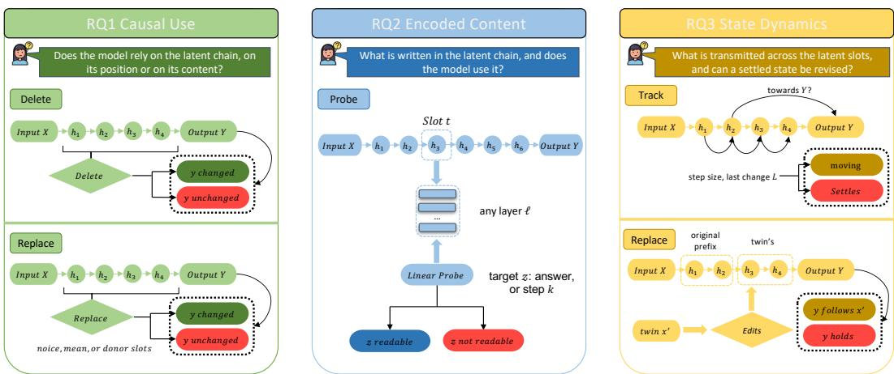
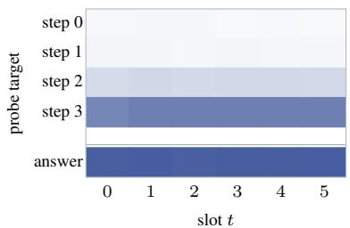
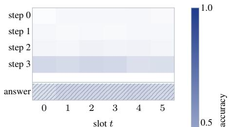
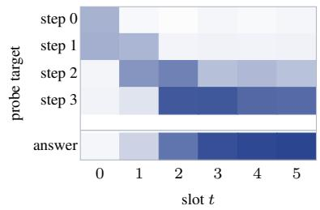
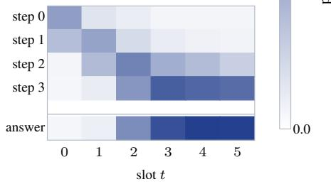
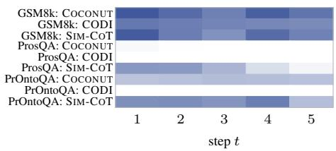
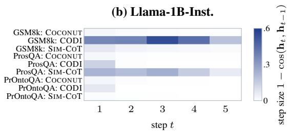
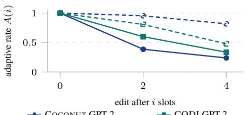
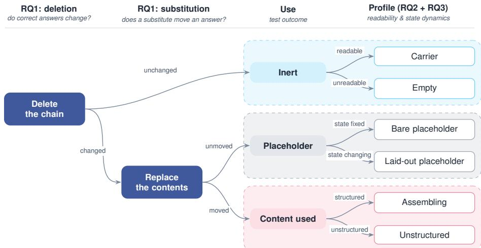
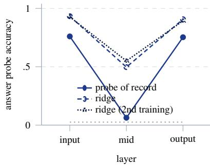

# DOES LATENT CHAIN-OF-THOUGHT ACTUALLY REA-SON? A SINGLE, UNIFYING TAXONOMY FOR LATENTREASONING

Jingjie Qiu1, Sheldon Yu1, Xunyi Jiang2, Jiajin Liu2, Zihan Huang1, Zhendong Chu3, Tong Yu4, Julian McAuley1, Junda Wu4

1University of California, San Diego 2New York University 3University of Virginia 4Adobe Research

{jiq013,ziy040,zih043,jmcauley}@ucsd.edu {tyu,jundaw}@adobe.com {xj2511,jiajinliu}@nyu.edu zc9uy@virginia.edu

## ABSTRACT

Latent chain-of-thought replaces written reasoning steps with continuous hidden states, giving models additional steps to compute before answering. It remains unclear what computation these steps actually perform. High task accuracy and decodable intermediate answers do not establish that a model uses its latent chain to reach an answer. We study this question across twenty-one model-task configurations covering three training recipes, three reasoning tasks, and two backbones. We combine chain deletion and content replacement with probes and trajectory analysis to test whether the chain affects the answer, what it encodes, and how its states change. On logical tasks, COCONUT often carries an answer that is already readable before the chain begins. Its states settle early, and deleting the chain leaves predictions almost unchanged. Per-step supervision produces an ordered layout of reasoning steps and can make the model depend on the chain. Yet even an ordered chain can act as a placeholder, with deletion hurting performance while content replacement leaves answers unchanged. On arithmetic tasks, all tested recipes show dependence on chain content. These results show why readable latent states alone are insufficient evidence of reasoning. We introduce a taxonomy that separates what a chain represents from how the model uses it. Seen this way, earlier reports no longer compete: placeholder tokens, collapsed superposition and step-dependent causal roles are each consistent with a different kind of chain, each obtained on a different task, training recipe or measurement. Once a study says which property it tested, whether the model uses the chain, what the chain holds, or how its state moves, claims about latent reasoning can be compared.

## 1 INTRODUCTION

Chain-of-thought gives a language model intermediate steps to work through before answering (Yu et al., 2025; Wei et al., 2026a). Latent reasoning methods aim to do this without writing out every step. In the methods we study, the model feeds continuous hidden states back as inputs, forming a latent chain between the question and the answer (Hao et al., 2025; Shen et al., 2025; Wei et al., 2026b). Each position in this chain, which we call a slot, provides an additional computation step. But what do these steps actually do? A model may use them to build an answer, or it may already have enough information to answer after reading the question. Distinguishing these cases matters for understanding the benefit of latent steps and how to train models to use them. Task accuracy alone cannot tell us where the answer was formed, and decoding an intermediate result from a state does not show that the model uses it (Elazar et al., 2021). Prior studies report several behaviors, including slots that act as placeholders (Zhang et al., 2025), candidate superposition that collapses or goes unused after fine-tuning (Rizvi-Martel et al., 2026), and different causal roles across steps (Li et al., 2026). These studies use different tasks, training recipes and measurements, leaving open how their observations fit together.

  
Figure 1: The three questions and the five tests, drawn on one latent chain. RQ1 deletes the slots or replaces their contents and reads the answer. RQ2 probes one slot at one layer against a permuted-label null. RQ3 tracks the state across slots and edits the chain mid-way. Answering all three lets us separate what a chain represents from how the model uses it, and place the resulting behaviors in a single taxonomy.

We study how latent chains contribute to answering across tasks and training recipes within a common experimental framework. Our grid covers twenty-one model-task configurations across ProsQA, PrOntoQA and GSM8k, using GPT-2 and Llama-3.2-1B-Instruct. We compare COCONUT, which recycles hidden states without direct supervision of slot content, CODI, which aligns latent and written reasoning at the answer position, and SIM-COT-COCONUT, which adds per-step supervision to COCONUT. The last comparison holds the inference mechanism and slot budget fixed. Continued training controls help separate the effect of per-step supervision from that of extra training. On this grid, we ask three questions about causal use, encoded content and state dynamics (Figure 1).

RQ1: Does the model rely on the latent chain, on its positions or on its contents? We first test whether the model depends on the chain by deleting its slots. Where prior causal tests apply a single corruption (deletion (Dilgren & Wiegreffe, 2026) or noise (Cui et al., 2026)) each, we pair deletion with three replacements (noise, the dataset mean, and another problem’s vectors) plus a same-base training-time control that switches off the per-step loss (Section 4). This isolates a placeholder pattern a single corruption cannot: on one backbone’s logical-task cell, deletion costs accuracy yet no replacement moves an answer, while on most content-used cells another problem’s slots hurt more than deleting the chain outright. Deleting the unsupervised recipe’s chains changes at most 3 answers on the logical tasks but hurts accuracy on arithmetic. Per-step supervision can establish reliance on a chain where the same base model had little.

RQ2: What is written in the latent chain, and does the model use it? A chain that does not affect the answer may still contain information about it. Prior probing has asked one question at a time, whether the answer is decodable early (Rizvi-Martel et al., 2026; Li et al., 2026) or whether a slot superposes candidates (Rizvi-Martel et al., 2026; Aswal et al., 2026); we probe for the final answer, the candidates and each reasoning step, at every slot and layer, and read each profile against its RQ1 verdict (Section 5). On the logical tasks, unsupervised chains carry an answer that is already readable at the question’s final hidden state, before the chain begins, and hold the path spread across slots rather than in order; no slot holds both candidates. Per-step supervision lays the steps out one per slot, and that ordered layout appears even in a chain whose contents can be replaced without changing an answer. Placed beside RQ1, this gives the paper’s central observation: on the logical tasks the chains with the richest readable content are ones the model does not rely on, and an ordered layout can sit in a chain whose contents are never consulted.

RQ3: What is transmitted across the latent slots, and can a settled state be revised? Knowing what individual slots contain leaves open how the state evolves between them. State movement has been described by trajectory geometry and answer commitment (Duraipandian et al., 2026; Aswal et al., 2026; Li et al., 2026) but not decided against a null for whether a chain settles; we turn it into a decision across all recipes and both backbones, and add a mid-chain edit that splices a twin problem’s content into the chain (Section 6). On the logical tasks, chains without per-step supervision settle within the first slots, while per-step chains keep changing to the last slot, though the movement is directed toward the answer on only one task. The edit, a test the prior studies do not include, shows that revising an answer is set by the backbone, not the mechanism or the supervision: one backbone increasingly ignores later edits while the other follows them. State movement and the ability to revise an answer thus describe different aspects of the chain.

These results show why a single measurement gives an incomplete account of latent reasoning. A chain can carry a readable answer without affecting the output, or encode ordered steps while serving only as a set of extra positions under the tested interventions. We combine the three measurements in a taxonomy that distinguishes six types of latent chain, while leaving unresolved cases unclassified (Section 7.1). Its value is that the scattered reports above no longer appear to make conflicting claims about latent chains in general. Placeholder behaviour, collapsed superposition, and step-dependent causal roles are each consistent with a different kind of chain, arising under different tasks, training recipes, or measurements. By stating what each test establishes about a chain, the taxonomy explains why earlier findings seem to disagree and clarifies which property—use, content, or dynamics—a claim about latent reasoning addresses.

## 2 RELATED WORK

Latent reasoning methods. Written chains are costly both to train, as post-training samples and scores many rollouts per problem (Surana et al., 2026b; Mundada et al., 2026; Xiong et al., 2026; Surana et al., 2026a), and to decode token by token (Lu et al., 2024). Several approaches give language models more computation before an answer without requiring a full written chain. Pause and filler tokens provide extra positions without explicit reasoning content (Goyal et al., 2024; Pfau et al., 2024), and learned soft prompts likewise feed continuous vectors rather than tokens (Wu et al., 2023). Recurrent-depth models apply additional computation within the network (Geiping et al., 2025). Other methods train models to internalize written reasoning or compress it into continuous representations (Deng et al., 2024; Cheng & Van Durme, 2024). We focus on methods that feed hidden states back as inputs to form a chain of latent slots. COCONUT gradually replaces written steps with recycled hidden states during training (Hao et al., 2025). CODI uses self-distillation to align the latent pathway with written reasoning at the answer position (Shen et al., 2025). SIM-COT adds direct supervision of individual slots through an auxiliary decoder (Wei et al., 2026b). These training signals offer different ways to shape a latent chain. Comparing COCONUT with its per-step supervised variant lets us test how slot supervision changes the chain while keeping its inference mechanism fixed.

Interpreting latent states. Prior work has looked for recognizable reasoning structure inside continuous states. Hao et al. (2025) interpret vocabulary projections of COCONUT states as evidence of breadth-first search, and Zhu et al. (2025) study how continuous thoughts can represent multiple search paths. Work on CODI and SIM-COT examines whether intermediate reasoning content can be recovered from latent states (Shen et al., 2025; Wei et al., 2026b). These interpretations depend on how the model is trained. For example, Rizvi-Martel et al. (2026) find that candidate superposition can collapse after fine-tuning. Analyses of state transitions also provide ways to study how reasoning evolves across steps (Yu et al., 2025; Wu et al., 2026). Such measurements, like information-theoretic analyses of what representations carry (Huang et al., 2025b), describe the information and structure present in a trajectory, but their relevance to the answer needs separate evidence. This distinction follows a broader lesson from probing: a target can be predictable from a representation without being used for the model’s task (Ravichander et al., 2021; Elazar et al., 2021). We pair content and trajectory measurements with interventions on the same model and task configurations.

Causal use of latent chains. Studies of written chain-of-thought evaluate reasoning traces offline (Wu et al., 2025) and use interventions to test, or correct, how traces affect model answers (Lanham et al., 2023; Wu et al., 2024). Interventions on hidden states can also steer reasoning, for example to break repetitive self-loops (Yu et al., 2026d), elicit latent skills (Jiang et al., 2026) or adjust modality preference (Huang et al., 2026); we use them only as diagnostics. For latent chains, Dilgren & Wiegreffe (2026) study both trace readability and necessity, finding that removing latent steps can preserve performance on logical tasks. Zhang et al. (2025) report insensitivity to content interventions and describe a placeholder role, while Li et al. (2026) find different causal roles across steps and information flow between nonadjacent positions. Closely related to our study, Aswal et al. (2026)

combine matched controls, causal interventions and trajectory analysis. They show that observable reasoning patterns can also appear in controls, and that behavioral influence can be concentrated in a small subspace even when the full states appear nearly static.

## 3 EXPERIMENTAL SETUP

## 3.1 LATENT-CHAIN FORMULATION

Given a question x, a latent-reasoning model with parameters $\theta$ produces $T$ continuous states before decoding an answer. We index these slots from zero to match the recorded trajectories. Let $\mathbf { h } _ { t } ^ { ( \ell ) } \in \mathbb { R } ^ { d }$ be the hidden state at layer ℓ of slot $t ,$ and let $\mathbf { h } _ { t }$ denote its final-layer state. The latent chain and answer distribution can be written as

$$
\mathbf { h } _ { t } = F _ { \theta } ( x , \mathbf { h } _ { 0 : t - 1 } ) , \qquad p _ { \theta } ( y \mid x , \mathbf { h } _ { 0 : T - 1 } ) .\tag{1}
$$

Here $F _ { \theta }$ includes the model-specific mapping from a hidden state to the next input. This is the identity map for COCONUT and includes a projection network for CODI. The model can attend to the question as well as earlier slots, so the notation does not assume that each state depends only on the preceding one. We write $y ^ { \star }$ for the gold answer and $z _ { k }$ for step k of an annotated reasoning path, where available. Probe targets z are defined for each task in RQ2.

## 3.2 MODELS, TASKS, AND CONTROLS

We compare three training recipes on GPT-2 and Llama-3.2-1B-Instruct. COCONUT recycles hidden states without a direct loss on slot content (Hao et al., 2025). CODI aligns the hidden state at the answer position with that of its written reasoning pathway (Shen et al., 2025). SIM-COT-COCONUT adds the per-step supervision of SIM-COT to COCONUT: an auxiliary decoder reconstructs written step k from slot k during training and is discarded at inference (Wei et al., 2026b). All main-grid models use $T = 6$ slots. Table 2 summarizes the input mapping, supervision and checkpoint coverage of each recipe.

The tasks cover proof search, syllogisms and arithmetic. ProsQA asks which of two candidate concepts follows from a set of facts and rules (Hao et al., 2025). PrOntoQA asks yes/no questions about logical implications (Saparov & He, 2023). GSM8k contains arithmetic word problems with numerical answers (Cobbe et al., 2021).

For COCONUT and CODI, we use the public checkpoints of Dilgren & Wiegreffe (2026) on both backbones. We also include a second independently trained public COCONUT/ProsQA checkpoint on GPT-2. We train SIM-COT-COCONUT on all three tasks and both backbones at the matched slot budget. On ProsQA, a control on each backbone continues the same COCONUT base for the same training schedule with the auxiliary loss weighted to zero. These controls separate the effect of per-step supervision from extra training. The grid contains twenty-one cells, where a cell is one checkpoint evaluated on one task. Checkpoint sources and training details are in App. A. The Llama-3.2-1B-Instruct/PrOntoQA per-step checkpoint was selected by a saved sweep before interventions, as described in App. E.1.

The COCONUT and SIM-COT-COCONUT comparison holds the inference mechanism and slot budget fixed. Comparisons involving CODI change both mechanism and supervision, so they do not isolate either factor. The two backbones differ in scale and instruction tuning as well as model family. We report them separately and interpret their differences as backbone effects.

## 3.3 EVALUATION PROTOCOL

Every cell is evaluated on the same frozen set of N = 300 held-out problems for its task. Public checkpoints are checked against their reported accuracy before analysis. Our trained checkpoints are anchored to the base models they continue. Split differences and parity checks are reported in App. A.

We keep the model parameters fixed during evaluation. Following the interventional view of causal analysis in LLMs (Liu et al., 2025), an intervention I changes the latent computation during the

Table 1: Deleting the chain and replacing its contents on the 3×3 grid of both backbones, with the outcome of each test.
<table><tr><td colspan="2"></td><td colspan="4">Delete the chain</td><td colspan="4">Replace the contents (∆ accuracy)</td></tr><tr><td>Task</td><td>Recipe</td><td> $C _ { 0 }$ </td><td> $C _ { 1 }$ </td><td>helped/hurt verdict</td><td></td><td>noise</td><td>mean</td><td>donor</td><td>verdict</td></tr><tr><td colspan="10">GPT-2</td></tr><tr><td>GSM8k</td><td>COCONUT</td><td>0.333 0.103</td><td></td><td>74/5</td><td>consulted</td><td>-0.243</td><td>-0.220</td><td>-0.307</td><td>content used</td></tr><tr><td></td><td>CODI</td><td>0.4300.263</td><td></td><td>69/19</td><td>consulted</td><td>-0.370</td><td>-0.283</td><td>-0.380</td><td>content used</td></tr><tr><td></td><td>SIM-COT-COCONUT</td><td>0.360</td><td>0.080</td><td>85/1</td><td>consulted</td><td>-0.290</td><td>-0.263</td><td>-0.333</td><td>content used</td></tr><tr><td>ProsQA</td><td>COCONUT</td><td>0.973</td><td>0.973</td><td>0/0</td><td>inert</td><td>0.000</td><td>0.000</td><td>0.000</td><td>not reached</td></tr><tr><td></td><td>CODI</td><td>0.853</td><td>0.850</td><td>10/9</td><td>unresolved</td><td>-0.787a</td><td>0.000</td><td>0.000</td><td>not reached</td></tr><tr><td></td><td>SIM-CoT-COCONUT 0.993</td><td></td><td>0.800</td><td>58/0</td><td>consulted</td><td>-0.047</td><td>-0.073</td><td>-0.077</td><td>content used</td></tr><tr><td>PrOntoQA</td><td>COCONUT</td><td></td><td>0.990 0.993</td><td>0/1</td><td>inert</td><td>+0.003</td><td>+0.003</td><td>+0.003</td><td>not reached</td></tr><tr><td></td><td>CODI</td><td>0.933</td><td>0.940</td><td>0/2</td><td>inert</td><td>-0.020</td><td>+0.003</td><td>+0.003</td><td>not reached</td></tr><tr><td></td><td>SIM-COT-COCONUT</td><td>1.000</td><td>0.827</td><td>52/0</td><td>consulted</td><td>-0.157</td><td>-0.440</td><td>-0.507</td><td>content used</td></tr><tr><td colspan="10">Llama-3.2-1B-Instruct</td></tr><tr><td>GSM8k</td><td>COCONUT</td><td></td><td>0.3700.253</td><td>59/24</td><td>consulted</td><td>-0.060</td><td>-0.047</td><td>-0.080</td><td>content used</td></tr><tr><td></td><td>CODI</td><td>0.553 0.360</td><td></td><td>67/9</td><td>consulted</td><td>-0.423</td><td>-0.247</td><td>-0.373</td><td>content used</td></tr><tr><td></td><td>SIM-COT-COCONUT</td><td>0.390</td><td>0.307</td><td>56/31</td><td>consulted</td><td>-0.093</td><td>-0.070</td><td>-0.087</td><td>content used</td></tr><tr><td>ProsQA</td><td>COCONUT</td><td>0.983</td><td>0.987</td><td>0/1</td><td>inert</td><td>0.000</td><td>0.000</td><td>0.000</td><td>not reached</td></tr><tr><td></td><td>CODI</td><td>0.983</td><td>0.940</td><td>13/0</td><td>consulted</td><td>0.000</td><td>0.000</td><td>0.000</td><td>placeholder</td></tr><tr><td></td><td>SIM-CoT-COCONUT</td><td>0.997</td><td>0.077</td><td>276/0</td><td>consulted</td><td>0.000</td><td>0.000</td><td>0.000</td><td>placeholder</td></tr><tr><td>PrOntoQA</td><td>COCONUT</td><td>0.990</td><td>0.987</td><td>1/0</td><td>inert</td><td>+0.003</td><td>0.000</td><td>0.000</td><td>not reached</td></tr><tr><td></td><td>CODI</td><td>0.940</td><td>0.937</td><td>1/0</td><td>inert</td><td>0.000</td><td>0.000</td><td>+0.003</td><td>not reached</td></tr><tr><td></td><td>SIM-CoT-COCONUT 0.993 0.990</td><td></td><td></td><td>2/1</td><td>inert</td><td>0.000</td><td>0.000</td><td>0.000</td><td>not reached</td></tr></table>

a An off-manifold effect: random noise breaks the readout, while the dataset mean and donor vectors move no answer (∆=0, App. B.3).  
forward pass, giving the clean and intervened predictions

$$
\hat { y } = \mathrm { D e c o d e } _ { \theta } ( x ) , \qquad \hat { y } ^ { \mathcal { T } } = \mathrm { D e c o d e } _ { \theta } ( x ; \mathcal { T } ) .\tag{2}
$$

Deletion skips latent slots. Content replacement substitutes the vectors fed into the latent loop while keeping the slot positions, and subsequent states are computed under that intervention. Mid-chain edits use the separate protocol described in RQ3. We compare predictions on the same problems and report both accuracy and changes in individual answers, since unchanged average accuracy can hide changes in opposite directions.

Probes are trained and evaluated with folds split by problem, so states from one problem do not appear in both training and test folds. Probe readouts are compared with permuted-label nulls, and trajectory statistics with the nulls specified in RQ3. Each test reports its minimum detectable effect (MDE). Effects too small to resolve are kept separate from bounded null results. Confirming and falsifying criteria were recorded before the first forward pass of each experiment, with later amendments retained alongside the originals. The following sections define the measurements for each RQ, and the appendices give their settings and per-cell results.

## 4 RQ1: DOES THE MODEL RELY ON THE LATENT CHAIN, ON ITS POSITIONS OR ON ITS CONTENTS?

A latent chain gives the model extra computation before answering, but its presence does not establish that the model needs it. Even when deleting the chain hurts performance, the loss could reflect missing computation steps rather than missing problem-specific content. We therefore test two forms of dependence: whether the model needs the latent slots, and whether its answers are sensitive to the vectors supplied at those slots.

Interventions and readouts. For each cell, we evaluate the same 300 problems with the model parameters and question held fixed. Deletion skips every latent slot and decodes the answer. This tests whether the chain is necessary under that intervention, but removes both its contents and its computation steps. Substitution keeps the slot positions and replaces the vectors fed into the loop with norm-matched Gaussian noise, the dataset-mean vector, or recorded vectors from another problem at the same positions. Subsequent states are recomputed under the intervention. These tests measure how replacement inputs affect the remaining computation and the answer. Noise can move states away from their natural distribution, so noise sensitivity alone is not evidence that the model uses problem-specific content. Mean and donor replacements provide complementary tests, with direction-by-scale controls on selected cells (App. B.4). Pairing deletion with substitution separates two patterns a single corruption cannot: cells where a donor’s contents are more disruptive than removing the chain outright, and cells that resist deletion but are also immune to any replacement (the placeholder signature reported below).

We report intact and deleted accuracy $( C _ { 0 } , C _ { 1 } )$ , prediction changes, and paired counts of problems helped by the chain (correct only when intact) and hurt (correct only when deleted). These counts distinguish unchanged predictions from changes in opposite directions that cancel in the average. In Table 1, consulted means deletion reduces accuracy beyond the cell’s MDE, and inert means at most 3 answers change. Other deletion outcomes are unresolved. Among consulted cells, content used denotes sensitivity to replacement beyond the MDE, while placeholder denotes no prediction changes under any tested replacement. Smaller unresolved effects are not assigned to either outcome. Full thresholds and per-cell tests are in App. B. An inert outcome does not prove that the chain has no role in the intact forward pass, just as replacement sensitivity does not by itself establish step-by-step reasoning.

Finding 1: Dependence on the chain varies across tasks. On GPT-2, deleting COCONUT’s chain leaves ProsQA accuracy unchanged at 0.973, but reduces GSM8k accuracy from 0.333 to 0.103 (Table 1). The same logical-versus-arithmetic split appears on Llama-3.2-1B-Instruct. CODI also depends on the chain on GSM8k and has little deletion effect on PrOntoQA. Its ProsQA behavior differs by backbone. On GPT-2, deletion loses 10 correct answers and gains 9, leaving the direction unresolved despite the small average gap. On Llama-3.2-1B-Instruct, deletion causes a clear loss. These results show that the training recipe alone does not specify whether the chain is needed.

Finding 2: Per-step supervision can establish dependence on the chain. On GPT-2, SIM-COT-COCONUT depends on its chain on both logical tasks, where the COCONUT base has little deletion effect. On ProsQA, accuracy falls from 0.993 to 0.800, with 58 correct answers lost. The continuedtraining control remains inert, supporting an effect of the per-step loss beyond extra training time (App. B.1). Truncation provides a further check: in every consulted GPT-2 cell, accuracy rises monotonically as more slots are retained (App. B.2). The Llama-3.2-1B-Instruct/ProsQA per-step model also depends on its chain, while its continued-training control has an unresolved deletion effect below its MDE. This pattern is not universal. The selected Llama-3.2-1B-Instruct/PrOntoQA perstep checkpoint remains inert, and the Llama-3.2-1B-Instruct/GSM8k per-step cell has no matched training-time control.

Finding 3: Dependence on slots does not always imply sensitivity to their contents. All tested GSM8k recipes on both backbones are sensitive to content replacement. Donor vectors can be more harmful than removing the chain altogether. For GPT-2 COCONUT/GSM8k, the accuracy change is −0.307 under donor replacement, compared with −0.230 under deletion. This supports dependence on the supplied vectors beyond the presence of extra slots. The ordering is not required for content sensitivity. On GPT-2 SIM-COT-COCONUT/ProsQA, donor replacement hurts less than deletion, even though the replacement effect is detectable. Other donor-versus-deletion contrasts remain bounded by their MDE (App. B.3). Across the eight content-used cells (Table 5), donor replacement is more harmful than deletion in five, less harmful in one, and undetermined in two.

The Llama-3.2-1B-Instruct/ProsQA CODI and per-step cells show a different pattern. Deletion hurts performance, but no tested replacement changes an answer, including a different-answer donor at twice the natural norm. This is placeholder-like behavior, consistent with the benefit of extra positions studied by Goyal et al. (2024); Pfau et al. (2024). It is bounded by the tested interventions and their sensitivity, since no replacement moves an answer in any Llama-3.2-1B-Instruct/ProsQA cell. The model also retains access to the question during replacement, so this result does not imply that its later computation uses no problem information.

The model’s dependence on its latent chain varies with task, supervision and backbone. Deletion and replacement distinguish chains that can be skipped, chains whose supplied vectors affect the answer, and chains that show dependence only when the slots are removed. These tests establish behavioral effects under intervention. RQ2 next examines what information the states contain, including in chains that are not necessary to answer.

(a) COCONUT, GPT-2  

(b) COCONUT, Llama-1B-Inst.  

(c) SIM-COT, GPT-2  

(d) SIM-COT, Llama-1B-Inst.  
  
Figure 2: Linear probe accuracy across slots on ProsQA. Upper rows: path steps $k \in \{ 0 , \ldots , 3 \}$ bottom row: final answer; shared colour scale. Probes read each slot’s final-layer state, the vector fed back as the next input (layer 12 on GPT-2, 16 on Llama-1B-Inst.). Hatched: projection artefact of the record probe on the Llama-1B-Inst. COCONUT answer row (App. C.1).

## 5 RQ2: WHAT IS WRITTEN IN THE LATENT CHAIN, AND DOES THE MODEL USE IT?

RQ1 showed which chains the model reads, but not what they contain. An unused chain may still encode information, and the main accounts make different predictions: superposition puts multiple candidate answers in the same slot (Hao et al., 2025; Zhu et al., 2025); stepwise reasoning lays the path out in order, one step per slot (Wei et al., 2026b; Deng et al., 2024); and computed-at-the-question reasoning predicts that the answer is already present before the chain begins (Pal et al., 2023; Yang et al., 2024).

Setup. We fit a linear probe ${ p } _ { t , \ell }$ to predict a target z from $\mathbf { h } _ { t } ^ { ( \ell ) }$ . Targets include the final answer concept and gold path step $z _ { k }$ on ProsQA, and a magnitude bin of the numerical answer on GSM8k. We report final-layer readouts by slot here and the full layer sweep in App. C.2. Probe accuracy is measured on held-out problems using the cross-validation protocol of Section 3.3. A target is called readable only when its accuracy exceeds the permuted-label null by more than the cell’s MDE. We do not compare amounts of readable content across backbones. The probe of record uses 30 principal components followed by logistic regression. On ProsQA, we also fit a full-dimension ridge probe and state an unqualified finding only where both agree. A nonlinear probe at the same points provides a further check (largest gain 0.0067). These readouts test access to information in a state. They do not establish that the model uses that information to answer.

Finding 4: The unsupervised chain carries an answer that is already readable before the chain begins; per-step supervision distributes computation across the slots. The answer rows of Figure 2 show two regimes on both backbones. Inert COCONUT chains read the answer from the first slot as well as from the last, while per-step chains start near chance and build the answer monotonically toward the last slot. The hatched Llama-3.2-1B-Instruct COCONUT row is a projection artefact of the probe of record; the ridge probe reads 0.760 from slot 0. The answer is already readable at the question’s final hidden state, before any latent slot is written, on both independent trainings (App. C.1): the unsupervised chain is a carrier rather than a workspace, consistent with RQ1’s inert verdict and with prior work showing that answers form during the question pass (Pal et al., 2023; Yang et al., 2024). On GSM8k the answer’s magnitude becomes more readable along the chain in the GPT-2 COCONUT-mechanism cells and on the Llama-3.2-1B-Instruct per-step twin (App. C.3).

Finding 5: Per-step supervision installs an ordered layout, with step k written into slot k. In the supervised panels, the step rows are diagonal on both backbones: step k becomes readable at slot $k ;$ early steps fade along the chain, while later steps and the answer persist to the last slot. In both probe arms, no node off the gold path is readable, even when off-path nodes are matched to on-path nodes in graph degree (App. C.4). The training-time control, trained equally long without the per-step loss, shows no ordered path (App. C.4). This ordered layout is not restricted to chains the model consults: the Llama-3.2-1B-Instruct SIM-COT-COCONUT/ProsQA cell shows the same diagonal structure while RQ1 found its contents replaceable without changing the answer (Section 4).

Finding 6: The unsupervised chain stores the path uniformly, not step by step: the chains with the richest readable content are inert. The unsupervised step rows are flat. Early steps are not linearly readable from any slot, and the readable steps read about equally from every slot, on both backbones and on an independent training, the opposite of the frontier expansion a search account predicts. Nor does any ProsQA cell hold both candidates at once: the highest both-readable rate in either arm is 0.113, against a bar of 30% (App. C.5). Answer-aligned chains hold little of the path at all (App. C.4).

Together, these results show that content follows the training objective: unsupervised chains carry a finished answer across the slots, and per-step supervision lays the path out one step per slot.

## 6 RQ3: WHAT IS TRANSMITTED ACROSS THE LATENT SLOTS, AND CAN A SETTLED STATE BE REVISED?

RQ2 showed what each slot contains. RQ3 asks whether that content is merely carried forward or transformed across slots; only the second uses the recurrence that gives a latent chain its capacity for serial computation.

Setup. We measure step size as the cosine distance between consecutive states. To locate the last change in a discrete state sequence, we follow the state-transition approach of Yu et al. (2025):

$$
s _ { t } = c \big ( P \bar { \mathbf { h } } _ { t } \big ) , \qquad L = \operatorname* { m a x } \{ t : s _ { t } \neq s _ { t - 1 } \} .\tag{3}
$$

Here $\bar { \mathbf { h } } _ { t }$ is the mean hidden state across layers, P is a shared random projection, and c is a K-means clustering fitted jointly to the model’s latent and written-step states. This gives all positions a common set of state labels without fitting them to the answer. Chains with no transition are counted separately. A cross-problem null replaces slots with those of other problems at the same positions. A chain settles early when its last change $L$ precedes its null $L ^ { 0 }$ by at least 0.5 slots under all 5 clustering seeds. The reading is unresolved when the null reaches the last slot (App. D.1). The along-answer ratio r measures the share of a step along a fitted answer direction. We call movement answer-directed only when it exceeds a label-permuted refit null (App. D.4). Step size alone is descriptive.

For mid-chain edits, we retain the first i slots of the original problem and use an edited twin with a different gold answer for the remaining computation. The recycling-model driver splices in the twin’s recorded suffix, while the CODI driver recomputes later slots. We therefore use this battery to measure the answer response, not to infer re-planning from post-edit trajectories. The adaptive rate $A ( i )$ is the fraction of answers that follow the twin, restricted to problems solved on the twin from scratch. Backbone comparisons use matched problems and are reported separately (App. D.5).

(a) GPT-2  

  
Figure 3: Step size along the chain, measured as $1 - \cos ( \mathbf { h } _ { t } , \mathbf { h } _ { t - 1 } )$ , for every grid cell on (a) GPT-2 and (b) Llama-3.2-1B-Instruct, on the layer-mean state $\bar { \mathbf { h } } _ { t }$ of Eq. 3. Shared colour scale; darker is a larger step size.

  
COCONUT Llama-1B-Inst. CODI Llama-1B-Inst.

Figure 4: Answers after a mid-chain edit. Adaptive rate A(i), the fraction of answers that follow an edit made after i slots, for GPT-2 (solid) and Llama-3.2-1B-Instruct (dashed) on 480-twin sets; every backbone gap exceeds chance after Holm correction (Table 14). After the edit only the prefix belongs to the original problem (App. D.5).

Finding 7: On logical tasks, unsupervised and answer-aligned chains settle early; per-step supervision sustains state movement to the last slot and, on ProsQA, toward the answer. Both the discrete reading and the step size show early settling (App. D.2; Figure 3): settled chains halt state changes up to three slots before their null and remain nearly stationary from the first step. Conversely, per-step chains continue moving to the end. Directional analysis reveals that this movement rarely turns toward the answer: in 11 of 15 cells with a usable answer direction, each step’s along-answer component stays at or below its null. Per-step ProsQA is the one exception confirmed under both probe arms; the other three are not confirmed under both arms (App. D.4). Even there, the state’s identity alone never predicts the answer (Figure 2). As RQ2 implies, a chain whose answer is already readable at its first input has no reason to evolve, whereas per-step supervision forces a new readable step at each slot. On GSM8k the Llama-3.2-1B-Instruct per-step twin settles early like the unsupervised chains, so the split is a finding about the logical tasks (App. D.3).

Finding 8: Whether a mid-chain edit revises the answer is set by the backbone, not by the mechanism or the supervision. Disrupting settled states mid-chain reveals a split by backbone. On GPT-2, answers remain locked to the original prefix: the adaptive rate falls at each later edit point in every consulted cell, directly measuring premature commitment (Wu et al., 2026). On Llama-3.2-1B-Instruct, the answer follows the edit: A(i) stays high under the same edits on matched problems (Figure 4). A held answer on GPT-2 reflects a readout anchored in the prefix slots; on Llama-3.2-1B-Instruct, the same readout follows the twin.

Together, these results show that the recurrence is largely unused for serial computation. Answer aligned chains transmit a state fixed at the question; per-step supervision keeps the state moving, though only on ProsQA is that movement confirmed as answer-directed.

## 7 DISCUSSION

## 7.1 A TAXONOMY OF LATENT CHAINS

The three RQs describe different aspects of the same chains. We now combine them to summarize the behaviors observed in our grid (Figure 5). Deletion and substitution determine the use category. Content probes and state dynamics describe the profile within that category. Readability does not override an intervention result, and cells with unresolved measurements are left unclassified.

Inert chains are called carriers when they carry a readable answer and settle early, or empty when little is readable under our probes. Among chains with the placeholder signature, bare placeholders settle early with little content, while laid-out placeholders contain ordered steps and continue changing. Content-used chains are assembling when they show an ordered step layout and sustained state changes, or unstructured when no such layout is recovered. These names summarize the measured profiles. In particular, “assembling” does not establish that slots causally correspond decoded step. The full decision rules, thresholds and per-cell assignments are in App. F.

Where the cells land. The taxonomy (Figure 5) places cells in all six leaves. Every inert chain we profiled is either a carrier or empty. Both placeholders occur on Llama-3.2-1B-Instruct/ProsQA, while content-consulted chains are assembling on the logical tasks and unstructured on GSM8k. The full census and node thresholds appear in App. F (Table 16).

Each leaf predicts an intervention not used to define it. This makes the taxonomy predictive rather than descriptive: carriers are unaffected by corruption, placeholders remain immune even to a different-answer donor at twice the natural norm, and the only chain helped by donor thoughts is classified as assembling (App. E.2).

Reading a latent trace certifies representation, not computation. Our results reconcile prior findings once we distinguish what a chain represents from what the model uses. The placeholder signature reported by Zhang et al. (2025) appears in two cells, whereas COCONUT is a carrier on our logical tasks. The collapsed superposition reported by Rizvi-Martel et al. (2026) is consistent with what carriers hold, while the staged causal structure and non-local routing of Li et al. (2026) match our consulted GSM8k leaf.

Implications for agents. LLM agents chain many reasoning steps to act, recommend, optimize content and manage memory (Yu et al., 2026c; Huang et al., 2025a; Yu et al., 2026b; Zhou et al., 2026). If such agents adopt latent chains, a readable trace would not certify the computation behind an action, which matters for auditing and securing them (Yu et al., 2026a; Wang et al., 2025).

## 8 CONCLUSION

We identify three separate properties of latent chains. First, the model relies on a chain only when the task requires it or per-step supervision installs that reliance. Second, the chains that encode the most are the ones the model does not use: their answers are already readable before the chain begins, and the slots only carry them. Third, most chains transmit a fixed state from the third slot onward; on the logical tasks, only per-step supervision keeps the state changing, and on ProsQA that movement is directed toward the answer. The three properties are thus separate, and a claim about latent reasoning should say which of them it concerns.

## USE OF LARGE LANGUAGE MODELS

In this work, we used generative AI tools to implement analysis code, to provide feedback on the experimental design and on the interpretation of results, and to help draft the paper, its figures and its LaTeX.

## REFERENCES

Darpan Aswal, Thomas Palmeira Ferraz, Yongxin Zhou, and Maxime Peyrard. Observable patterns are not explanations: A causal-geometric analysis of latent reasoning models. arXiv preprint arXiv:2606.12689, 2026.

Jeffrey Cheng and Benjamin Van Durme. Compressed chain of thought: Efficient reasoning through dense representations. arXiv preprint arXiv:2412.13171, 2024.

Karl Cobbe et al. Training verifiers to solve math word problems. arXiv preprint arXiv:2110.14168, 2021.

Yingqian Cui, Zhenwei Dai, Bing He, Zhan Shi, Hui Liu, Rui Sun, Zhiji Liu, Yue Xing, Jiliang Tang, and Benoit Dumoulin. How do latent reasoning methods perform under weak and strong supervision? arXiv preprint arXiv:2602.22441, 2026.

Yuntian Deng, Yejin Choi, and Stuart Shieber. From explicit CoT to implicit CoT: Learning to internalize CoT step by step. arXiv preprint arXiv:2405.14838, 2024.

Connor Dilgren and Sarah Wiegreffe. Are latent reasoning models easily interpretable? arXiv preprint arXiv:2604.04902, 2026.

Sabari Iyyappan Duraipandian, Shreya Sanjay Boyane, Manju Nagesh, Jerome Francis, Archana Vaidheeswaran, and Kevin Zhu. Interpreting latent CoT reasoning as dynamical systems. In ICML 2026 Workshop on Foundations ofDeep Generative Models (FoGen), 2026. arXiv:2607.09698.

Yanai Elazar, Shauli Ravfogel, Alon Jacovi, and Yoav Goldberg. Amnesic probing: Behavioral explanation with amnesic counterfactuals. Transactions of the Association for Computational Linguistics, 9:160–175, 2021.

Jonas Geiping, Sean McLeish, Neel Jain, John Kirchenbauer, Siddharth Singh, Brian R. Bartoldson, Bhavya Kailkhura, Abhinav Bhatele, and Tom Goldstein. Scaling up test-time compute with latent reasoning: A recurrent depth approach. In Advances in Neural Information Processing Systems (NeurIPS), 2025.

Sachin Goyal, Ziwei Ji, Ankit Singh Rawat, Aditya Krishna Menon, Sanjiv Kumar, and Vaishnavh Nagarajan. Think before you speak: Training language models with pause tokens. In International Conference on Learning Representations (ICLR), 2024.

Shibo Hao, Sainbayar Sukhbaatar, DiJia Su, Xian Li, Zhiting Hu, Jason Weston, and Yuandong Tian. Training large language models to reason in a continuous latent space. In Conference on Language Modeling (COLM), 2025.

Chengkai Huang, Junda Wu, Yu Xia, Zixu Yu, Ruhan Wang, Tong Yu, Ruiyi Zhang, Ryan A. Rossi, Branislav Kveton, Dongruo Zhou, Julian McAuley, and Lina Yao. Towards agentic recommender systems in the era of multimodal large language models. arXiv preprint arXiv:2503.16734, 2025a.

Zihan Huang, Junda Wu, Rohan Surana, Raghav Jain, Tong Yu, Raghavendra Addanki, David Arbour, Sungchul Kim, and Julian McAuley. Traceable and explainable multimodal large language models: An information-theoretic view. In Second Conference on Language Modeling (COLM), 2025b.

Zihan Huang, Xintong Li, Rohan Surana, Tong Yu, Rui Wang, Julian McAuley, Jingbo Shang, and Junda Wu. AMPS: Adaptive modality preference steering via functional entropy. arXiv preprint arXiv:2602.12533, 2026.

Xunyi Jiang, Junda Wu, Yuxin Xiong, Sheldon Yu, Tong Yu, David Arbour, Ritwik Sinha, Julian McAuley, and Hongyi Wen. Toward latent language model skills steering and optimization: An empirical study. arXiv preprint arXiv:2608.29459, 2026.

Tamera Lanham, Anna Chen, Ansh Radhakrishnan, Benoit Steiner, Carson Denison, Danny Hernan dez, Dustin Li, Esin Durmus, Evan Hubinger, Jackson Kernion, et al. Measuring faithfulness in chain-of-thought reasoning. arXiv preprint arXiv:2307.13702, 2023.

Zirui Li, Xuefeng Bai, Kehai Chen, Yizhi Li, Jian Yang, Chenghua Lin, and Min Zhang. Dynamics within latent chain-of-thought: An empirical study of causal structure. In Proceedings ofthe 43rd International Conference on Machine Learning (ICML), 2026.

Xiaoyu Liu, Paiheng Xu, Junda Wu, Jiaxin Yuan, Yifan Yang, Yuhang Zhou, Fuxiao Liu, Tianrui Guan, Haoliang Wang, Tong Yu, Julian McAuley, Wei Ai, and Furong Huang. Large language models and causal inference in collaboration: A comprehensive survey. In Findings ofthe Associationfor Computational Linguistics: NAACL 2025, pp. 7668–7684, 2025.

Xiaofan Lu, Yixiao Zeng, Feiyang Ma, Zixu Yu, and Marco Levorato. Improving multi-candidate speculative decoding. In NeurIPS 2024 Workshop on Efficient Natural Language and Speech Processing (ENLSP), 2024. arXiv:2409.10644.

Gagan Mundada, Zihan Huang, Rohan Surana, Sheldon Yu, Jennifer Yuntong Zhang, Xintong Li, Tong Yu, Lina Yao, Jingbo Shang, Julian McAuley, and Junda Wu. WS-GRPO: Weakly-supervised group-relative policy optimization for rollout-efficient reasoning. arXiv preprint arXiv:2602.17025, 2026.

Koyena Pal, Jiuding Sun, Andrew Yuan, Byron C. Wallace, and David Bau. Future lens: Anticipating subsequent tokens from a single hidden state. In Proceedings of the 27th Conference on Computational Natural Language Learning (CoNLL), 2023.

Jacob Pfau, William Merrill, and Samuel R. Bowman. Let’s think dot by dot: Hidden computation in transformer language models. In First Conference on Language Modeling (COLM), 2024.

Abhilasha Ravichander, Yonatan Belinkov, and Eduard Hovy. Probing the probing paradigm: Does probing accuracy entail task relevance? In Proceedings ofthe 16th Conference ofthe European Chapter of the Association for Computational Linguistics (EACL), pp. 3363–3377, 2021.

Michael Rizvi-Martel, Guillaume Rabusseau, and Marius Mosbach. The illusion of superposition? a principled analysis of latent thinking in language models. arXiv preprint arXiv:2604.06374, 2026.

Abulhair Saparov and He He. Language models are greedy reasoners: A systematic formal analysis of chain-of-thought. In International Conference on Learning Representations (ICLR), 2023.

Zhenyi Shen, Hanqi Yan, Linhai Zhang, Zhanghao Hu, Yali Du, and Yulan He. CODI: Compressing chain-of-thought into continuous space via self-distillation. In Proceedings ofthe 2025 Conference on Empirical Methods in Natural Language Processing (EMNLP), pp. 677–693, 2025.

Rohan Surana, Xintong Li, Sheldon Yu, Yiran Jenny Shen, Chuhan Wang, Tong Yu, Prithviraj Ammanabrolu, Jingbo Shang, Julian McAuley, and Junda Wu. MASS-DPO: Multi-negative active sample selection for direct policy optimization. arXiv preprint arXiv:2605.10784, 2026a.

Rohan Surana, Gagan Mundada, Xunyi Jiang, Chuhan Wang, Zhenwei Tang, Difan Jiao, Zihan Huang, Yuxin Xiong, Junda Wu, Sheldon Yu, Xintong Li, Raghav Jain, Nikki Kuang, Sizhe Zhou, Bowen Jin, Zhendong Chu, Tong Yu, Ryan Rossi, Kuan-Hao Huang, Jingbo Shang, Jiawei Han, and Julian McAuley. Generate, filter, control, replay: A comprehensive survey of rollout strategies for LLM reinforcement learning. Transactions on Machine Learning Research (TMLR), 2026b. arXiv:2605.02913.

Rui Wang, Junda Wu, Yu Xia, Tong Yu, Ruiyi Zhang, Ryan Rossi, Subrata Mitra, Lina Yao, and Julian McAuley. CachePrune: Teaching LLMs what not to follow via KV-cache editing. arXiv preprint arXiv:2504.21228, 2025.

Hui Wei, Junda Wu, Sheldon Yu, Sizhe Zhou, Yizhu Jiao, Ming Zhong, Bowen Jin, Tong Yu, Shijia Pan, Jiawei Han, and Julian McAuley. How hard does it think? analyzing step-aware reasoning energy in LLM chain-of-thought trajectories. arXiv preprint arXiv:2607.28674, 2026a.

Xilin Wei, Xiaoran Liu, Yuhang Zang, Xiaoyi Dong, Yuhang Cao, Jiaqi Wang, Xipeng Qiu, and Dahua Lin. SIM-CoT: Supervised implicit chain-of-thought. In International Conference on Learning Representations (ICLR), 2026b.

Junda Wu, Tong Yu, Rui Wang, Zhao Song, Ruiyi Zhang, Handong Zhao, Chaochao Lu, Shuai Li, and Ricardo Henao. InfoPrompt: Information-theoretic soft prompt tuning for natural language understanding. In Advances in Neural Information Processing Systems (NeurIPS), volume 36, pp. 61060–61084, 2023.

Junda Wu, Tong Yu, Xiang Chen, Haoliang Wang, Ryan Rossi, Sungchul Kim, Anup Rao, and Julian McAuley. DeCoT: Debiasing chain-of-thought for knowledge-intensive tasks in large language models via causal intervention. In Proceedings ofthe 62nd Annual Meeting ofthe Associationfor Computational Linguistics (Volume 1: Long Papers), pp. 14073–14087, 2024.

Junda Wu, Xintong Li, Ruoyu Wang, Yu Xia, Yuxin Xiong, Jianing Wang, Tong Yu, Xiang Chen, Branislav Kveton, Lina Yao, Jingbo Shang, and Julian McAuley. OCEAN: Offline chain-of-thought evaluation and alignment in large language models. In International Conference on Learning Representations (ICLR), 2025.

Junda Wu, Yuxin Xiong, Xintong Li, Sheldon Yu, Zhengmian Hu, Tong Yu, Rui Wang, Xiang Chen, Jingbo Shang, and Julian McAuley. CTRLS: Chain-of-thought reasoning via latent state transition. In Proceedings of the 29th International Conference on Artificial Intelligence and Statistics (AISTATS), 2026.

Yuxin Xiong, Xunyi Jiang, Rohan Surana, Xintong Li, Sheldon Yu, Nikki Lijing Kuang, Ryan A. Rossi, Jingbo Shang, Tong Yu, Julian McAuley, and Junda Wu. RRPO: Reference-relative policy optimization with stratified conditional rollouts. arXiv preprint arXiv:2607.18470, 2026.

Sohee Yang, Elena Gribovskaya, Nora Kassner, Mor Geva, and Sebastian Riedel. Do large language models latently perform multi-hop reasoning? In Proceedings of the 62nd Annual Meeting of the Association for Computational Linguistics (Volume 1: Long Papers), 2024.

Sheldon Yu, Yuxin Xiong, Junda Wu, Xintong Li, Tong Yu, Xiang Chen, Ritwik Sinha, Jingbo Shang, and Julian McAuley. Explainable chain-of-thought reasoning: An empirical analysis on state-aware reasoning dynamics. In Findings of the Association for Computational Linguistics: EMNLP, 2025.

Sheldon Yu, Yingcheng Sun, Hanqing Guo, and Qianqian Tong. A fraud-detection-inspired framework for LLM agents security. In KDD 2026 Workshop on Evaluation and Trustworthiness of Agentic AI, 2026a.

Sheldon Yu, Rui Wang, Tong Yu, Sungchul Kim, Doga Dogan, Junda Wu, and Julian McAuley. Agent2UCB: Agentic system for generative engine optimization. arXiv preprint arXiv:2608.29063, 2026b.

Sheldon Yu, Junda Wu, Xintong Li, Nikki Lijing Kuang, Sizhe Zhou, Tong Yu, Jiawei Han, Jingbo Shang, and Julian McAuley. OLIVIA: Online learning via inference-time action adaptation for decision making in LLM ReAct agents. In Proceedings of the 2026 Conference on Empirical Methods in Natural Language Processing (EMNLP), 2026c. arXiv:2605.11169.

Sheldon Yu, Tong Yu, Xunyi Jiang, Rohan Surana, Gagan Mundada, Sungchul Kim, Lina Yao, Julian McAuley, and Junda Wu. Can we break LLMs out of self-loops? fine-grained reasoning control with activation steering. arXiv preprint arXiv:2607.18100, 2026d.

Yuyi Zhang, Boyu Tang, Tianjie Ju, Sufeng Duan, and Gongshen Liu. Do latent tokens think? a causal and adversarial analysis of chain-of-continuous-thought. arXiv preprint arXiv:2512.21711, 2025.

Sizhe Zhou, Sheldon Yu, Hui Wei, Junda Wu, Siru Ouyang, Yizhu Jiao, Shijia Pan, Julian McAuley, Yu Zhang, Tong Yu, and Jiawei Han. Filesystem-based memory for LLM agents: Organization, evolution, and sustainability. arXiv preprint arXiv:2607.26637, 2026.

Hanlin Zhu, Shibo Hao, Zhiting Hu, Jiantao Jiao, Stuart Russell, and Yuandong Tian. Reasoning by superposition: A theoretical perspective on chain of continuous thought. In Advances in Neural Information Processing Systems (NeurIPS), 2025.

## A EXPERIMENTAL DETAILS

## A.1 MODELS AND THE GRID

Table 2: The model axis. Input to each slot, what supervises the slots, the slot budget and the grid cells per model. “ours”: trained by us; †: trained at COCONUT’s slot budget (the released SIM-COT-COCONUT checkpoint with 10 slots is the parity anchor, App. E.2).
<table><tr><td>Model</td><td>Input to slot k+1</td><td>What supervises the slots</td><td>Slots Inst. twins)</td><td>Cells (GPT-2; Llama-1B-</td></tr><tr><td>COCONUT</td><td>recycled as the next input embedding</td><td>last hidden state at slot k, nothing beyond the answer loss</td><td>6</td><td>GSM8k, ProsQA (×2), PrOn- toQA; all three twinned</td></tr><tr><td>continued (control)</td><td>identical to COCONUT</td><td>nothing; base continued for SIM- CoT-COCONUT&#x27;s schedule, aux- iliary loss = 0</td><td>6</td><td>ProsQA (ours; Llama-1B-Inst. twin ours)</td></tr><tr><td>SIM-CoT-COCONUT identical to COCONUT</td><td></td><td>per-step content: an auxiliary de- coder reconstructs written step k from slot k; discarded at infer- ence</td><td>6†</td><td>GSM8k, ProsQA, PrOn- toQA (all ours); ProsQA and GSM8k twins (ours); PrOntoQA twin at a swept checkpoint (ours)</td></tr><tr><td>CODI</td><td>projection network</td><td>recycled state through a answer-position alignment: self- distillation from the model&#x27;s own written pathway</td><td>6</td><td>GSM8k, ProsQA, PrOntoQA; all three twinned</td></tr></table>

Parity. No analysis runs on a checkpoint before it reproduces its published accuracy. On ProsQA our frozen 300-problem prefixes score above the published numbers; our scorer on the original full split reproduces the published table to within 0.002 (0.818 against 0.816), so the gap comes from the split, not the scoring, and no within-paper contrast is affected.

  
Figure 5: A taxonomy based on the three RQs. Deletion and content replacement distinguish causal-use outcomes. Readability and state movement describe the profile within each outcome. Unresolved cases are not assigned to a leaf.

## A.2 INTERVENTIONS, PROBES AND EDITS

Interventions. Each condition replaces the vector fed at a slot, and downstream slots recompute from it. Noise is an isotropic Gaussian draw rescaled to the mean natural slot norm at that position; it matches magnitude only and is near-orthogonal to the vector it replaces. Dataset mean is the mean slot vector over the evaluation set, and donor is another problem’s recorded vector at the same slot. The mean and donor substitutes stay nearly parallel to natural slot vectors (cosine 0.98–1.00), so noise probes the removal of content and mean and donor its replacement by wrong content.

Probes. Probes are PCA to 30 dimensions followed by logistic regression, five-fold cross-validated over problems, against a label null permuted 200 times; on ProsQA a full-dimension ridge arm is added and a verdict is stated alone only where both arms agree. Each cell reports its minimum detectable effect, and cells that could not resolve an effect are excluded from verdicts rather than counted as nulls.

Mid-chain edits. An edit is valid only if the pre-edit answer is unreachable in the edited problem (0.810 of GSM8k twins survive, 0.640 on ProsQA). Analysis is restricted to problems the model solves from scratch, and an answer-preserving twin controls for editing itself: flip-minus-control displacement is +0.25 to +0.40 against null 95th percentiles of 0.04–0.07. The backbone comparison was enlarged once, to 480 twins set by a power calculation under a protocol frozen before scoring; gaps that had reached 83%–86% of their minimum detectable effect before the enlargement cleared it after.

## A.3 THE TAXONOMY

## B RQ1 SUPPLEMENT: DELETION AND SUBSTITUTION

GPT-2 and Llama-3.2-1B-Instruct are reported apart and never pooled.

## B.1 REPLICATION AND TRAINING-TIME CONTROLS

Table 3: The three control cells under deletion, in the format of Table 1. The second training is an independent COCONUT/ProsQA run on GPT-2; the loss-off controls continue the checkpoint of each backbone for the per-step twin’s schedule with the auxiliary loss weighted to zero (Section 3.2).
<table><tr><td>Control</td><td>Backbone</td><td> $C _ { 0 }$ </td><td> $C _ { 1 }$ </td><td>helped/hurt verdict</td><td></td></tr><tr><td>2nd training</td><td>GPT-2</td><td>0.9730.977</td><td></td><td>0/1</td><td>inert</td></tr><tr><td>loss off</td><td>GPT-2</td><td>0.9700.973</td><td></td><td>0/1</td><td>inert</td></tr><tr><td>loss off</td><td>Llama-1B-Inst. 0.877 0.850</td><td></td><td></td><td>16/8</td><td>unresolved</td></tr></table>

The second training agrees with the primary cell on every condition within 0.010 (Section 4). The GPT-2 loss-off control is as inert as the cell it continues; the Llama-3.2-1B-Instruct control moves answers both ways below its MDE (0.031) and is unresolved.

## B.2 TRUNCATION

Table 4: Accuracy by slots kept. $k { = } 0$ is full deletion $( C _ { 1 } ) .$ , all is the intact chain $( C _ { 0 } ) ;$ the interior conditions keep two and four slots.
<table><tr><td>Cell</td><td>k=0</td><td>k=2</td><td>k=4</td><td>all</td><td>shape</td></tr><tr><td colspan="6">GPT-2 — the supervision grid</td></tr><tr><td>COCONUT/GSM8k</td><td>0.103</td><td>0.197</td><td>0.260</td><td>0.333</td><td>monotone</td></tr><tr><td>COCONUT/ProsQA</td><td>0.973</td><td>0.970</td><td>0.973</td><td>0.973</td><td>flat</td></tr><tr><td>COCONUT/PrOntoQA</td><td>0.993</td><td>0.993</td><td>0.993</td><td>0.990</td><td>flat</td></tr><tr><td>SIM-CoT-COCONUT/GSM8k</td><td>0.080</td><td>0.203</td><td>0.270</td><td>0.360</td><td>monotone</td></tr><tr><td>SIM-CoT-COCONUT/ProsQA</td><td>0.800</td><td>0.960</td><td>0.993</td><td>0.993</td><td>monotone</td></tr><tr><td>SIM-CoT-CoCONUT/PrOntoQA</td><td>0.827</td><td>0.857</td><td>0.913</td><td>1.000</td><td>monotone</td></tr><tr><td>CODI/GSM8k</td><td>0.263</td><td>0.287</td><td>0.387</td><td>0.430</td><td>monotone</td></tr><tr><td>CODI/ProsQA</td><td>0.850</td><td>0.867</td><td>0.853</td><td>0.853</td><td>flat</td></tr><tr><td>CODI/PrOntoQA</td><td>0.940</td><td>0.937</td><td>0.940</td><td>0.933</td><td>flat</td></tr><tr><td colspan="6">Llama-3.2-1B-Instruct — the backbone twins</td></tr><tr><td>COCONUT/GSM8k</td><td>0.253</td><td>0.367</td><td>0.373</td><td>0.370</td><td>saturates early</td></tr><tr><td>CODI/GSM8k</td><td>0.360</td><td>0.487</td><td>0.453</td><td>0.553</td><td>dips at k=4</td></tr><tr><td>SIM-CoT-COCONUT/GSM8k</td><td>0.307</td><td>0.383</td><td>0.387</td><td>0.390</td><td>saturates early</td></tr></table>

Truncation keeps the first k slots and inserts the end-of-thought marker, so k=0 is deletion and $k { = } T$ the intact chain. On GPT-2 every inert cell is flat at all depths and every consulted cell rises monotonically, so the shape tracks reliance rather than architecture; the last two slots of every consulted GSM8k cell still carry 24%–32% of the deletion gap. On Llama-3.2-1B-Instruct the GSM8k curves saturate early: the model has finished, not that thinking hurts.

## B.3 SUBSTITUTION: PER-CELL CONTRASTS

Table 5: Substitution, per cell. Change in accuracy against the intact chain when every slot is replaced by noise, by the dataset-mean vector or by another problem’s recorded thoughts (donor), and the donor-versus-deletion contrast. Discordant pairs read donor-worse / deletion-worse; p is McNemar. GPT-2 and Llama-3.2-1B-Instruct are never pooled.
<table><tr><td>Cell</td><td>noise</td><td>mean</td><td>donor</td><td>donor vs. deletion</td></tr><tr><td colspan="5">GPT-2 — the supervision grid</td></tr><tr><td>COCONUT/GSM8k</td><td>-0.243</td><td>-0.220</td><td>-0.307</td><td>donor worse  $2 7 / 4 , p { = } 0 . 0 0 0$ </td></tr><tr><td>SIM-CoT-COCONUT/GSM8k</td><td>-0.290</td><td>-0.263</td><td>-0.333</td><td>donor worse 20/4, 0.053&gt;0.048</td></tr><tr><td>SIM-CoT-COCONUT/PrOntoQA</td><td>-0.157</td><td>-0.440</td><td>-0.507</td><td>donor worse  $1 2 4 / 2 4 , 0 . 3 3 3 > 0 . 1 1 6$ </td></tr><tr><td>CODI/GSM8k</td><td>-0.370</td><td>-0.283</td><td>-0.380</td><td>donor worse  $7 3 / 9 , p { = } 0 . 0 0 0$ </td></tr><tr><td>SIM-CoT-COCONUT/ProsQA</td><td>-0.047</td><td>-0.073</td><td>-0.077</td><td>donor above deletion:  $1 4 / 4 9 , 0 . 1 1 7 > 0 . 0 7 4$ </td></tr><tr><td>CODI/ProsQA</td><td>-0.787</td><td>0.000</td><td>0.000</td><td>bounded (9/10; needs N&gt;30000)</td></tr><tr><td>COCONUT/ProsQA</td><td>0.000</td><td>0.000</td><td>0.000</td><td>not applicable (inert under deletion)</td></tr><tr><td>CoCONUT/PrOntoQA</td><td>+0.003</td><td>+0.003</td><td>+0.003</td><td>not applicable (inert under deletion)</td></tr><tr><td>CODI/PrOntoQA</td><td>-0.020</td><td>+0.003</td><td>+0.003</td><td>not applicable (inert under deletion)</td></tr><tr><td colspan="5">Llama-3.2-1B-Instruct — the backbone twins</td></tr><tr><td>CODI/GSM8k</td><td>-0.423</td><td>-0.247</td><td>-0.373</td><td>donor worse  $6 6 / 1 2 , p { = } 0 . 0 0 0$ </td></tr><tr><td>COCONUT/GSM8k</td><td>-0.060</td><td>-0.047</td><td>-0.080</td><td>bounded (needs  $N { \approx } 1 8 0 0 ; \mathrm { p o o l } 1 3 1 9 )$ </td></tr><tr><td>SIM-CoT-COCONUT/GSM8k</td><td>-0.093</td><td>-0.070</td><td>-0.087</td><td>bounded (44/43,  $p { = } 1 . 0 0 0 ;$  needs N≈271000; pool 1319)</td></tr><tr><td>CODI/ProsQA</td><td>0.000</td><td>0.000</td><td>0.000</td><td>donor above deletion: 0/13, p=0.000</td></tr><tr><td>COCONUT/ProsQA</td><td>0.000</td><td>0.000</td><td>0.000</td><td>not applicable (inert under deletion)</td></tr><tr><td>COCONUT/PrOntoQA</td><td>+0.003</td><td>0.000</td><td>0.000</td><td>not applicable (inert under deletion)</td></tr><tr><td>CODI/PrOntoQA</td><td>0.000</td><td>0.000</td><td>+0.003</td><td>not applicable (inert under deletion)</td></tr><tr><td> $\mathrm { S I M - C o T - C o C O N U T / P r o s Q A }$ </td><td>0.000</td><td>0.000</td><td>0.000</td><td>donor above deletion: no substitute moves an answer (placeholder)</td></tr><tr><td> $\mathrm { S I M - C O T - C o C O N U T / P r O n i o Q A }$ </td><td>0.000</td><td>0.000</td><td>0.000</td><td>not applicable (inert under deletion)</td></tr></table>

Across the eighteen cells the tally is 5 donor worse than deletion, 7 not applicable, 3 bounded and 3 with the donor above deletion. In every content-used GSM8k cell and on PrOntoQA, another problem’s thoughts cost more than none, an ordering a format account of ablation damage cannot produce; on per-step ProsQA, by contrast, a donor’s thoughts beat having none.

## B.4 THE DIRECTION-BY-SCALE CONTROL

Table 6: Direction-by-scale $2 \times 2$ on the pre-registered cell list, noise seed reused. Columns: random direction at the noise norm ε and at the norm of the dataset-mean vector; mean direction at its own norm and at ε.
<table><tr><td>Cell</td><td></td><td>rand@ε rand@∥µ∥|</td><td>mean@∥µ∥|</td><td>mean@ε reading</td><td></td></tr><tr><td colspan="6">GPT-2 — the supervision grid</td></tr><tr><td>CODI/ProsQA</td><td>-0.787</td><td>-0.790</td><td>0.000</td><td>0.007</td><td>direction</td></tr><tr><td>CODI/GSM8k</td><td>-0.370</td><td>-0.320</td><td>-0.283</td><td>-0.297</td><td>direction</td></tr><tr><td>COCONUT/GSM8k</td><td>-0.243</td><td>-0.257</td><td>-0.220</td><td>-0.223</td><td>mixed (all four within 0.037)</td></tr><tr><td>SIM-CoT-COCONUT/PrOntoQA</td><td>-0.157</td><td>-0.150</td><td>-0.440</td><td>-0.440</td><td>direction</td></tr><tr><td colspan="6">Llama-3.2-1B-Instruct — the backbone twins</td></tr><tr><td>CODI/GSM8k</td><td>-0.423</td><td>-0.420</td><td>-0.247</td><td>-0.247</td><td>direction</td></tr><tr><td>SIM-CoT-COCONUT/GSM8k</td><td>-0.093</td><td>-0.080</td><td>-0.070</td><td>-0.070</td><td>mixed (all four within 0.023)</td></tr></table>

CODI/ProsQA does not read its chain for content (a donor changes zero answers), yet needs whatever occupies the slots to lie on its training manifold; its Llama-3.2-1B-Instruct twin drops even that, a clean placeholder signature. On SIM-COT-COCONUT/PrOntoQA the dataset-mean thought is far more damaging than a random one at both norms. On the per-step Llama-3.2-1B-Instruct/GSM8k twin the four deltas lie within 0.023 of each other, so direction and scale cannot be separated there.

## C RQ2 SUPPLEMENT: PROBING

## C.1 THE ANSWER THROUGH DEPTH AND BY SLOT

  
Figure 6: The unsupervised chain’s answer through the stack at the first slot (COCONUT/ProsQA, GPT-2), under both probe arms and on the second training.

The answer is present at the slot’s input layer, the question’s final hidden state, weaker mid-stack and re-linearised at the output, under both probe arms and on the second training (Figure 6). Under the probe of record it reads 0.760 at the embedding layer, 0.063 at the mid-stack trough and 0.753 at the output (0.933, 0.497 and 0.907 under ridge). By slot, the unsupervised chain runs from 0.597 to 0.607, while the supervised chain is unreadable at its first two slots and reaches 0.963 at the last.

## C.2 POSITION-BY-LAYER SWEEP

## C.3 ACCUMULATION ON GSM8K

Accumulation appears in every GPT-2 recycling cell (first-to-last gains +0.23 to +0.29, p < 0.0001) and, at the readout’s own resolution, on the Llama-3.2-1B-Instruct per-step twin, and in no other cell. Cross-backbone amounts are not compared.

## C.4 LAYOUT AND HELD-OUT CELLS

The replication checkpoint agrees with the primary in both arms. The two answer-aligned cells fail localisation under both arms (on-path accuracy 0.026–0.107 against the supervised cell’s 0.034– 0.872), and their degree-matched specificity control flips with the probe arm, so specificity there is unresolved. Both arms are linear, so “holds little” is a statement about linear accessibility.

Table 7: Position × layer sweep under both probe arms. cleared: cells above their own permutation null; ≥5×: cells at five times chance; peak: the strongest cell and its location. Numeric rows use chance 0.200 and MDE 0.238; concept rows 0.026 and 0.042. The ridge arm exists on ProsQA only. The last layer column (12 on GPT-2, 16 on Llama-1B-Inst.) is the representation Figure 2 reports.
<table><tr><td>Cell</td><td>Task / arm</td><td>cleared</td><td>≥5× </td><td>peak at</td><td></td></tr><tr><td colspan="6">GPT-2</td></tr><tr><td>COCONUT</td><td>ProsQA, record</td><td>78/78 78/78</td><td>71 78</td><td></td><td>0.820 p2 L0</td></tr><tr><td>COCONUT&#x27;</td><td>ProsQA, ridge ProsQA, record</td><td>78/78</td><td>66</td><td>0.823 p5 L1</td><td>0.927 p0 L0</td></tr><tr><td>SIM-COT-COCONUT</td><td>ProsQA, ridge ProsQA, record</td><td>78/78 56/78</td><td>78 54</td><td>0.933 0.967</td><td>p0 L0 p5 L7</td></tr><tr><td>CODI</td><td>ProsQA, ridge ProsQA, record</td><td>55/78 27/78</td><td>54 0</td><td>0.100 p0 L1</td><td>0.987 p5 L10</td></tr><tr><td>CODI</td><td>ProsQA, ridge GSM8k</td><td>20/78 78/78</td><td>7</td><td>0.177 0.417</td><td>p2 L1</td></tr><tr><td>SIM-COT-COCONUT (10 sl.)</td><td>GSM8k</td><td>130/130</td><td></td><td>0.650</td><td>p4 L12 p9 L5</td></tr><tr><td colspan="6">Llama-3.2-1B-Instruct</td></tr><tr><td>COCONUT</td><td>ProsQA, record 102/102</td><td></td><td>86</td><td>0.217p4 L7</td><td></td></tr><tr><td></td><td>ProsQA, ridge</td><td>102/102</td><td>102</td><td>0.797 p2 L2</td><td></td></tr><tr><td>CODI</td><td>ProsQA, record</td><td>63/102</td><td>6</td><td>0.220 p1 L7</td><td></td></tr><tr><td></td><td>ProsQA, ridge</td><td>70/102</td><td>32</td><td>0.410 p1 L6</td><td></td></tr></table>

Table 8: Content accumulation across slots on GSM8k, target magnitude of the final answer (chance 0.200, MDE 0.238): first-slot and last-slot accuracy and their difference.
<table><tr><td>Cell</td><td>Mechanism</td><td>frst</td><td>last</td><td>∆</td><td>Profile</td></tr><tr><td colspan="6">GPT-2</td></tr><tr><td>COCONUT</td><td>recycling</td><td>0.310</td><td>0.587</td><td>+0.277</td><td>builds</td></tr><tr><td>SIM-COT-COCONUT (6 sl.)</td><td>recycling + per-step</td><td>0.320</td><td>0.553</td><td>+0.233</td><td>builds</td></tr><tr><td>SIM-CoT-COCONUT (10 sl.)</td><td>recycling + per-step</td><td>0.320</td><td>0.607</td><td>+0.287</td><td>builds</td></tr><tr><td>CODI</td><td>distillation</td><td>0.407</td><td>0.377</td><td>-0.030</td><td>flat (p=0.452)</td></tr><tr><td colspan="6">Llama-3.2-1B-Instruct</td></tr><tr><td>COCONUT</td><td>recycling</td><td>0.370</td><td>0.383</td><td>+0.013</td><td>flat (p=0.736)</td></tr><tr><td>CODI</td><td>distillation</td><td>0.393</td><td>0.380</td><td>-0.013</td><td>flat (p=0.737)</td></tr><tr><td>SIM-COT-COCONUT (6 sl.)</td><td>recycling + per-step</td><td>0.363</td><td>0.487</td><td>0.123</td><td>builds at the MDD (0.112; App. E.1)</td></tr></table>

## C.5 ONE CANDIDATE AT A TIME

Each ProsQA candidate is scored with its own binary probe, since a multinomial softmax couples the two scores and manufactures anti-correlation (-0.94 on synthetic data). Problems on which both read from the same slot are counted against a bar fixed before measurement at 30% (co-occurrence null 0.0025, MDE 0.0072); no cell reaches it in either arm. Where the question cannot be asked (CODI on GPT-2 has no readable answer, PrOntoQA is yes/no, GSM8k has no candidate list) the cell is not applicable rather than negative.

Table 9: Layout on ProsQA: cells held out of the body and the chain funnel under both probe arms (record / ridge). elig./both: eligible slots and the pooled both-readable rate at the adjudicating slot; present: path cells present of 24; local.: localisation; off-path: live off-path cells. COCONUT′ is the independently trained replication checkpoint.
<table><tr><td>Cell</td><td>Superv.</td><td>elig.</td><td>both</td><td>present</td><td>local.</td><td>off-path</td><td>Chain verdict</td></tr><tr><td colspan="8">GPT-2</td></tr><tr><td>COCONUT (primary)</td><td>none</td><td>6/6</td><td>0.080/0.090</td><td>15/24/23/24</td><td></td><td>0/24/0/24</td><td>present, not localised (both arms)</td></tr><tr><td>COCONUT&#x27; (replication)</td><td>none</td><td>6/6</td><td>0.100/0.067</td><td>18/24/24/24</td><td></td><td>0/24/0/24</td><td>present, not localised (both arms)</td></tr><tr><td>SIM-COT-COCONUT</td><td>per-step</td><td>5/6</td><td>0.067/0.083</td><td>18/24/20/24</td><td>√</td><td>0/24/0/24</td><td>localised and ordered (both arms)</td></tr><tr><td>CODI</td><td>aligned</td><td>0/6/0/6</td><td>n/a</td><td>15/24/18/24</td><td></td><td>4/24/0/24</td><td>not localised; specificity probe-dependent</td></tr><tr><td colspan="8">Llama-3.2-1B-Instruct</td></tr><tr><td>COCONUT</td><td>none</td><td>6/6</td><td>0.017/0.060</td><td>11/24/12/24</td><td></td><td>0/24/0/24</td><td>present, not localised (both arms)</td></tr><tr><td>CODI</td><td>aligned</td><td>0/6/6/6</td><td>n/a/0.023</td><td>13/24/17/24</td><td></td><td>0/24/2/24</td><td>not localised; specificity probe-dependent</td></tr></table>

Table 10: One candidate at a time. Rate at which both offered ProsQA answers are readable from the same slot, at each cell’s most generous eligible slot, under both probe arms, against a bar of 90 problems of 300; ceilings are the readout’s measured sensitivity per arm.
<table><tr><td></td><td></td><td></td><td></td><td colspan="2">both</td><td></td></tr><tr><td>Cell</td><td>Superv.</td><td>elig.</td><td>slot</td><td>record</td><td>ridge</td><td>Verdict</td></tr><tr><td colspan="7">GPT-2 (ceiling 0.817 record, 1.000 ridge)</td></tr><tr><td>COCONUT</td><td>none</td><td>6/6</td><td>p0</td><td>0.080</td><td>0.090</td><td>sub-bar, both arms</td></tr><tr><td>SIM-COT-COCONUT</td><td>per-step</td><td>5/6</td><td>p4</td><td>0.067</td><td>0.083</td><td>sub-bar, both arms</td></tr><tr><td colspan="7">Llama-3.2-1B-Instruct (ceiling 0.627 record, 0.960 ridge)</td></tr><tr><td></td><td></td><td></td><td></td><td></td><td></td><td></td></tr><tr><td>COCONUT CODI</td><td>none aligned</td><td>6/6 0/6, 6/6</td><td>p4 p0</td><td>0.017 n/a</td><td>0.060 0.023 sub-bar, ridge only</td><td>sub-bar, both arms</td></tr></table>

## D RQ3 SUPPLEMENT: DYNAMICS

## D.1 STATE-MACHINE SETTINGS

Settling needs an event rather than a threshold, so we read the last slot at which a discrete state label changes, following the state-transition view of written reasoning (Yu et al., 2025). The projection P of Eq. 3 is a shared random Gaussian map to 128 dimensions rather than a fitted one, so state labels cannot be tuned toward the answer, and it is shared across slots and across latent and written states, so a label means the same thing at every position. The clustering c is one K-means fitted jointly over the model’s latent and written-step states. Every $K \in \{ 5 , 8 , 1 2 \}$ is reported and none is privileged, and a verdict is stated only where all 5 clustering seeds agree (146 of 153 verdicts are unanimous). Nulls replace slot t of one problem with slot t of another (200 draws); the settling floor is 0.5 slots, and the reading is unresolved when the null itself sits at the last slot. A mid-chain edit keeps $\mathbf { h } _ { 0 : i - 1 }$ and continues on a twin whose gold answer differs by one changed quantity; an output that keeps the original answer is rigid.

## D.2 SETTLING

Table 11: When the chain stops changing. Slot of the last state transition at $K { = } 5$ (mean over chains with at least one transition), the cross-problem null and their difference in slots; single-state chains counted apart. ceiling: the null itself sits at the last slot. Verdicts obey the 0.5-slot floor.
<table><tr><td>Cell</td><td>1-state</td><td>Last</td><td>Null</td><td>∆</td><td>Verdict</td></tr><tr><td>ProsQA</td><td></td><td></td><td></td><td></td><td></td></tr><tr><td>COCONUT</td><td>14</td><td>2.07</td><td>4.21</td><td>2.14</td><td>early</td></tr><tr><td>COCONUT (2nd)</td><td>113</td><td>1.51</td><td>4.46</td><td>2.94</td><td>early</td></tr><tr><td>COCONUT (Llama)</td><td>0</td><td>1.65</td><td>4.26</td><td>2.61</td><td>early</td></tr><tr><td>CODI</td><td>53</td><td>1.93</td><td>4.17</td><td>2.24</td><td>early</td></tr><tr><td>CODI (Llama)</td><td>0</td><td>2.03</td><td>3.47</td><td>1.44</td><td>early</td></tr><tr><td>SIM-CoT</td><td>0</td><td>3.78</td><td>3.85</td><td>0.07</td><td>keeps changing</td></tr><tr><td>PrOntoQA</td><td></td><td></td><td></td><td></td><td></td></tr><tr><td>COCONUT</td><td>6</td><td>2.77</td><td>3.29</td><td>0.52</td><td>early</td></tr><tr><td>CoCoNUT (Llama)</td><td>35</td><td>1.50</td><td>4.61</td><td>3.11</td><td>early</td></tr><tr><td>CODI</td><td>0</td><td>2.56</td><td>4.09</td><td>1.53</td><td>early</td></tr><tr><td>CODI (Llama)</td><td>0</td><td>1.00</td><td>1.00</td><td>0.00</td><td>unres.</td></tr><tr><td>SIM-CoT</td><td>0</td><td>4.00</td><td>4.49</td><td>0.49</td><td>keeps changing</td></tr><tr><td>GSM8k</td><td></td><td></td><td></td><td></td><td></td></tr><tr><td>COCONUT</td><td>0</td><td>4.96</td><td>4.96</td><td>0.00</td><td>unres., ceiling</td></tr><tr><td>SIM-CoT</td><td>0</td><td>4.98</td><td>4.99</td><td>0.01</td><td>unres., ceiling</td></tr><tr><td>CODI</td><td>0</td><td>4.98</td><td>4.99</td><td>0.01</td><td>unres., ceiling</td></tr><tr><td>COCONUT (Llama)</td><td>254</td><td>1.65</td><td>4.74</td><td>3.09</td><td>early</td></tr><tr><td>CODI (Llama)</td><td>0</td><td>4.80</td><td>4.89</td><td>0.09</td><td>at null, ceiling</td></tr><tr><td>SIM-CoT (Llama)</td><td></td><td>2.470</td><td>4.650</td><td>2.18</td><td>early</td></tr></table>

## D.3 CONSECUTIVE-SLOT SIMILARITY

cos $\left( \mathbf { h } _ { t } , \mathbf { h } _ { t - 1 } \right)$ is computed per problem against a null that pairs slot t of one problem with slot t−1 of another. On ProsQA it is 0.981 for COCONUT and 1.000 for CODI at the first step and stays there, whereas the per-step chain climbs from 0.687 to 0.971 on GPT-2 and from 0.771 to 0.939 on Llama-3.2-1B-Instruct; PrOntoQA shows the same split. On GSM8k every GPT-2 recipe keeps moving, whereas on Llama-3.2-1B-Instruct the unsupervised and per-step chains settle from the first step (0.972, 0.930) and only CODI keeps moving (Figure 3). The pre-registered reading for this instrument (settled when the curve stays inside the null band) misfires, because a trajectory that stops moving has cosine near one and leaves the band upward; no settling verdict in the body rests on it.

## D.4 ANSWER ALIGNMENT: FITTING POINT AND NULLS

The answer direction of Section 6 was pre-registered at the first latent slot, where it falls below its MDE on every cell that assembles its answer across slots (SIM-COT-COCONUT/ProsQA reads 0.030 there and 0.963 at the last slot). It is therefore fitted at the last latent slot, fixed for all 17 cells before any verdict was read; 18 of 69 cell×K verdicts moved (9 gained a reading, 6 lost one). The pre-registered cross-problem null is answer-aligned almost by construction, since the answer direction separates problems, so the body reads a null that permutes the answer labels and refits the direction with the same estimator; 32 of 69 verdicts differ between the two nulls, and Table 12 gives every cell under both. On SIM-COT-COCONUT/ProsQA the along-component is 1.94 times its null under the probe of record and 1.23 under ridge, with a state lift of -0.014 against an MDE of 0.0085.

Table 12: Reconciliation at the last-slot fit under both nulls, all K. probe: accuracy of the answer direction at the last slot; along: the along-component of consecutive-slot displacement; ratio: along over the refit-null mean; (i) refit / cross: whether the alignment condition fires under the label-permuted refit null and under the pre-registered cross-problem null; (ii): whether state identity lifts answer prediction above the majority prior by its MDE at K=5/8/12. dist. distinct, mix. mixed, re-m. re-measurement, unr. unresolved; n/a: direction below its MDE at the last slot.
<table><tr><td>Cell</td><td>arm</td><td>probe</td><td>along</td><td>ratio</td><td>(i) refit</td><td>(i) cross</td><td>(ii) 5/8/12</td><td>verdict, refit</td><td>verdict, cross</td></tr><tr><td>COCONUT/ProsQA</td><td>record</td><td>0.607</td><td>0.064</td><td>1.00</td><td>no</td><td>no</td><td>no/yes/yes</td><td>unr./mix./mix.</td><td>dist./mix./mix.</td></tr><tr><td></td><td>ridge</td><td>0.813</td><td>0.033</td><td>0.49</td><td>no</td><td>no</td><td>no/yes/yes</td><td>dist./mix./mix.</td><td>dist./mix./mix.</td></tr><tr><td>CoCONUT&#x27;/ProsQA</td><td>record</td><td>0.513</td><td>0.069</td><td>1.16</td><td>yes</td><td>no</td><td>yes/yes/yes</td><td>re-m. ×3</td><td>mix. ×3</td></tr><tr><td></td><td>ridge</td><td>0.850</td><td>0.036</td><td>0.62</td><td>no</td><td>no</td><td>yes/yes/yes</td><td>mix. ×3</td><td>mix. ×3</td></tr><tr><td>CoCONUT/ProsQA, Llama-3.2-1B-Instruct</td><td>record</td><td>0.210</td><td>0.052</td><td>1.21</td><td>yes</td><td>no</td><td>yes/no/yes</td><td>re-m./mix./re-m.</td><td>mix./dist./mix.</td></tr><tr><td></td><td>ridge</td><td>0.720</td><td>0.041</td><td>0.82</td><td>no</td><td>no</td><td>yes/no/yes</td><td>mix./dist./mix.</td><td>mix./dist./mix.</td></tr><tr><td>SIM-CoT-CoCONUT/ProsQA</td><td>record</td><td>0.963</td><td>0.170</td><td>1.94</td><td>yes</td><td>no</td><td>no/no/no</td><td>mix. ×3</td><td>dist. ×3</td></tr><tr><td></td><td>ridge</td><td>0.973</td><td>0.111</td><td>1.23</td><td>yes</td><td>no</td><td>no/no/no</td><td>mix. ×3</td><td>dist. ×3</td></tr><tr><td>CODI/ProsQA</td><td>record</td><td>0.043</td><td>0.041</td><td>1.08</td><td>no</td><td>no</td><td>no/yes/no</td><td>unr./mix./unr.</td><td>dist./mix./dist.</td></tr><tr><td></td><td>ridge</td><td>0.030</td><td></td><td></td><td></td><td></td><td>no/yes/no</td><td>n/a</td><td>n/a</td></tr><tr><td>CODI/ProsQA, Llama-3.2-1B-Instruct</td><td>record</td><td>0.037</td><td></td><td></td><td></td><td></td><td>no/no/no</td><td>n/a</td><td>n/a</td></tr><tr><td></td><td>ridge</td><td>0.027</td><td></td><td></td><td></td><td></td><td>no/no/no</td><td>n/a</td><td>n/a</td></tr><tr><td>COCONUT/GSM8k</td><td>record</td><td>0.603</td><td>0.051</td><td>0.81</td><td>no</td><td>no</td><td>no/no/no</td><td>dist. ×3</td><td>dist. ×3</td></tr><tr><td>SIM-CoT-CoCONUT/GSM8k (6 sl.)</td><td>record</td><td>0.613</td><td>0.039</td><td>0.72</td><td>no</td><td>no</td><td>no/no/no</td><td>dist. ×3</td><td>dist. ×3</td></tr><tr><td>SIM-CoT-CoCONUT/GSM8k (10 sl.)</td><td>record</td><td>0.660</td><td>0.095</td><td>1.09</td><td>no</td><td>no</td><td>no/no/no</td><td>unr. ×3</td><td>dist. ×3</td></tr><tr><td>CODI/GSM8k</td><td>record</td><td>0.547</td><td>0.043</td><td>0.80</td><td>no</td><td>no</td><td>no/no/yes</td><td>unr./unr./mix.</td><td>dist./dist./mix.</td></tr><tr><td>CoCONUT/GSM8k, Llama-3.2-1B-Instruct CODI/GSM8k, Llama-3.2-1B-Instruct</td><td>record</td><td>0.557</td><td>0.036</td><td>0.78</td><td>no</td><td>no</td><td>no/no/yes</td><td>dist./dist./mix.</td><td>dist./dist./mix.</td></tr><tr><td></td><td>record</td><td>0.567</td><td>0.075</td><td>0.90</td><td>no</td><td>no</td><td>no/no/yes</td><td>unr./unr./mix.</td><td>dist./dist./mix.</td></tr><tr><td>CoCONUT/PrOntoQA</td><td>record</td><td>0.587</td><td>0.032</td><td>0.67</td><td>no</td><td>no</td><td>no/yes/yes</td><td>unr./mix./mix.</td><td>dist./mix./mix.</td></tr><tr><td>CODI/PrOntoQA</td><td>record</td><td>0.530</td><td></td><td></td><td></td><td></td><td>no/yes/yes</td><td>n/a</td><td>n/a</td></tr><tr><td>CoCONUT/PrOntoQA, Llama-3.2-1B-Instruct</td><td>record</td><td>0.983</td><td>0.123</td><td>2.25</td><td>yes</td><td>no</td><td>yes/yes/yes</td><td>re-m. ×3</td><td>mix. ×3</td></tr><tr><td>CODI/PrOntoQA, Llama-3.2-1B-Instruct</td><td>record</td><td>0.913</td><td>0.020</td><td>0.33</td><td>no</td><td>no</td><td>no/no/no</td><td>unr. ×3</td><td>dist. ×3</td></tr><tr><td>SIM-CoT-CoCONUT/PrOntoQA</td><td>record</td><td>1.000</td><td>0.046</td><td>0.69</td><td>no</td><td>yes</td><td>no/no/no</td><td>dist. ×3</td><td>mix. ×3</td></tr></table>

D.5 MID-CHAIN EDITS: COMMITMENT AND BACKBONE COMPARISON

Table 13: Commitment on the GPT-2 grid: adaptive and rigid rates by injection position i on ceiling-solvable problems. COCONUT and CODI rows use the enlarged 480-twin set, SIM-COT-COCONUT rows the original 300-twin set; i=0 rates are 1.000/0.000 by construction. Terminal labels are descriptive only.
<table><tr><td>Cell</td><td>usable n</td><td>adaptive i=0/2/4</td><td>rigid i=0/2/4</td><td>Terminal</td></tr><tr><td>COCONUT/GSM8k</td><td>111</td><td>1.000 / 0.405 / 0.225</td><td>0.000 / 0.459 / 0.532</td><td>rigid-dominant</td></tr><tr><td>SIM-COT-COCONUT/GSM8k</td><td>57</td><td>1.000 / 0.421 / 0.211</td><td>0.000 / 0.386 / 0.526</td><td>rigid-dominant</td></tr><tr><td>SIM-CoT-COCONUT/ProsQA</td><td>64</td><td>1.000 / 0.750 / 0.250</td><td>0.000 / 0.250 / 0.750</td><td>rigid-dominant</td></tr><tr><td>CODI/GSM8k</td><td>153</td><td>1.000 / 0.582 / 0.327</td><td>0.000 / 0.072 / 0.268</td><td>corruption-dominant</td></tr></table>

Adaptation falls monotonically with injection position in every cell (Table 13). Under identical edits on identical problems the larger instruction-tuned backbone re-computes where GPT-2 holds or corrupts, with the latent mechanism held fixed; every gap in Table 14 clears its own minimum detectable effect. A pre-registered drift readout is degenerate by construction on the recycling family, whose edit driver takes every post-edit slot from the twin’s clean run, so the body reads only the answer-side rate A(i).

Table 14: The paired backbone comparison on the intersection of the two models’ ceiling subsets after the enlargement to 480 twins. discordant: problems adaptive on exactly one backbone (GPT-2- only / Llama-3.2-1B-Instruct-only); p is Holm-corrected McNemar.
<table><tr><td>Paired contrast</td><td>n</td><td>GPT-2</td><td>Llama-3.2-1B-Instruct</td><td>discordant</td><td>Holm p</td><td>gap vs MDE</td></tr><tr><td>COCONUT, i=2</td><td>88</td><td>0.386</td><td>0.955</td><td>1/51</td><td>0.0000</td><td>0.568 &gt; 0.234</td></tr><tr><td>COCONUT, i=4</td><td>88</td><td>0.239</td><td>0.818</td><td>4/55</td><td>0.0000</td><td>0.580 &gt; 0.251</td></tr><tr><td>CODI, i=2</td><td>140</td><td>0.600</td><td>0.807</td><td>5/34</td><td>0.0000</td><td>0.207 &gt; 0.133</td></tr><tr><td>CODI, i=4</td><td>140</td><td>0.336</td><td>0.479</td><td>9/29</td><td>0.0017</td><td>0.143 &gt; 0.125</td></tr></table>

## E ADDITIONAL CHECKPOINTS

## E.1 PER-STEP SUPERVISION ON LLAMA-3.2-1B-INSTRUCT

We trained the per-step recipe on Llama-3.2-1B-Instruct for ProsQA, with a training-time control that continues the same base for the same schedule with the auxiliary loss weighted to zero (N=300, seed 0). The PrOntoQA training saved 13 checkpoints; a sweep on 60 held-out problems, run before any intervention, found 8 emitting a single answer string and selected checkpoint 9, the earliest with both answer classes present (sweep accuracy 1.000). The GSM8k twin was trained last and has no training-time control; its battery is in Tables 4, 5 and 6, and its answer magnitude rises from 0.363 at slot 0 to 0.487 at slot 5, at the readout’s resolution (MDD 0.112). Table 15 collects the ProsQA and PrOntoQA cells.

Two caveats bind these readings. No substitute moves an answer in any Llama-3.2-1B-Instruct/ProsQA cell, even a donor with a different gold answer at twice the natural norm (0 of 300), while the same code moves 16, 24 and 23 answers on the GPT-2 twin; the placeholder verdicts therefore bound the range the harness can express on this backbone. The paired backbone comparison for the per-step family is descriptive only: its twin sets (53, 64 and 76 usable problems) are too small to form the test of Table 14. On them the Llama-3.2-1B-Instruct twin and its control follow every edit (1.000 at i=4), while the GPT-2 twin falls to 0.250.

Table 15: The Llama-3.2-1B-Instruct per-step cells (ProsQA and PrOntoQA, N=300). Deletion: C , C , helped/hurt. Truncation: accuracy with one, two and four slots kept. Substitution: answers moved under each substitute. Content on ProsQA: gold readability at slots 0 and 5, probe of record / ridge (chance 0.026; ceilings 0.627 / 0.960), path cells live of 24. Dynamics: distinct states at K=5, slots settled before the null (floor 0.5), along-answer component at the last slot against the refit and cross-problem nulls.
<table><tr><td></td><td>per-step, ProsQA</td><td>control, ProsQA</td><td>per-step, PrOntoQA</td></tr><tr><td>C0/C1</td><td>0.997 / 0.077</td><td>0.877 / 0.850</td><td>0.993 / 0.990</td></tr><tr><td>helped / hurt</td><td>276 /0</td><td>16 / 8</td><td>2/1</td></tr><tr><td>test</td><td>Holm p=0.0006</td><td>∆= − 0.027, ∆= − 0.003, MDE 0.031</td><td>MDE 0.008</td></tr><tr><td>node 1</td><td>consulted</td><td>unresolved</td><td>inert (3 of 300 changed, within the rule-of-three</td></tr><tr><td>kept 1 / 2 / 4 slots</td><td>0.997</td><td>0.987 / 0.997 / 0.860 / 0.863 / — / 0.990 / 0.867</td><td>bound) 0.993</td></tr><tr><td>moved under substitu- 0 of 300 tion</td><td></td><td>0 of 300</td><td></td></tr><tr><td>node 2</td><td>placeholder</td><td></td><td></td></tr><tr><td>answer at slot 0 → 5</td><td>(caveat) 0.070 → 0.923 / 0.250 → 0.217 / n/a</td><td></td><td></td></tr><tr><td>both candidates</td><td>0.457 → 0.777 (bar 0.083 / 0.103</td><td>0.587 → 0.497 0.043 / 0.077</td><td>n/a</td></tr><tr><td>30%) path cells live / 24</td><td>23 / 24</td><td>12 / 17</td><td>n/a</td></tr><tr><td>layout</td><td>dered</td><td>localised and or- neighbourhood, not chain</td><td>n/a</td></tr><tr><td>distinct states (K=5)</td><td>3.88</td><td>2.00</td><td>1.000</td></tr><tr><td>settled before null</td><td>0.106 (at null)</td><td>1.48 (early)</td><td>undefined</td></tr><tr><td>along-answer / refit / 0.165 / 0.099 / 0.097 / 0.078 / at chance</td><td></td><td></td><td></td></tr></table>

## E.2 THE RELEASED TEN-SLOT SIM-COT-COCONUT CHECKPOINT

The publicly released SIM-COT-COCONUT checkpoint (GSM8k, 10 slots) differs in slot budget from every other cell and is kept out of the body. It is the parity anchor for our six-slot training and an independent replication of the step-supervised regime on GSM8k: deleting its chain flips 122 of 300 answers $( C _ { 0 } 0 . \dot { 4 } 5 0 , C _ { 1 } 0 . 0 4 7 )$ , truncation rises monotonically, and a donor’s thoughts are worse than deletion at a pre-registered $N { = } 9 0 0 \ ( p { = } 0 . 0 0 0 0 6 )$ . Its commitment window spans the whole chain, with adaptation falling to 0.123 at i=8.

## F CLASSIFICATION RULES AND CENSUS

## F.1 CLASSIFICATION RULES

Node 1: delete the chain. If at most 3 answers change (the rule-of-three bound on an absent effect at N=300), the cell is inert; if it loses correct answers beyond its MDE, it is consulted; answers that move both ways without a net direction leave it unresolved.

Node 2: replace the contents. A consulted cell keeps every slot but has its contents replaced by noise, the dataset mean or another problem’s slots. If no substitute moves an answer, it is a placeholder, the filler-token regime of Pfau et al. (2024) and Goyal et al. (2024) realised by a trained chain; if substitutes move answers beyond the MDE, it is content used; otherwise it is unresolved.

Profile. Within each outcome, readability (whether a linear probe decodes the answer or the stepby-step path) and state dynamics (whether the state keeps changing across slots) describe the chain; the profile never overrides the nodes. The two readings agree in every cell where both resolve, so Figure 5 labels each branch with one of them; a cell where they disagreed would name no leaf.

• Carrier (inert, readable): the answer is readable from the first slot and the state settles early.

• Empty (inert, unreadable): little is readable and the state settles early.

• Bare placeholder (placeholder, state fixed): the positions are needed, little is readable, and the state settles early.

• Laid-out placeholder (placeholder, state changing): step k is readable at slot k and the state changes through the last slot, yet no substitute moves the answer.

• Assembling (content used, structured): step k is readable at slot k, the state changes through the last slot, and the contents affect the answer.

• Unstructured (content used, unstructured): the contents are consulted, but no step-by-slot layout is read.

## F.2 CELL ASSIGNMENTS

Table 16: The twenty-one cells on the tree. Node 1: the deletion verdict; node 2: the substitution verdict (consulted cells only); profile: the RQ2/RQ3 reading; the leaf follows from the tree. $\stackrel { \scriptscriptstyle * 6 } { - } - \stackrel { \scriptscriptstyle * 9 } { : }$ not reached; $\mathrm { \ddot { \Omega } n / a \mathrm { \Omega } } ^ { 5 } ;$ not applicable. The second COCONUT/ProsQA training and the two training-time controls are listed as cells of their own.
<table><tr><td>Backbone</td><td>Cell</td><td>Node 1</td><td>Node 2</td><td>Profile</td><td>Leaf</td></tr><tr><td>GPT-2</td><td>COCONUT/ProsQA</td><td>inert</td><td></td><td>readable, state fixed</td><td>carrier</td></tr><tr><td>GPT-2</td><td>COCONUT/ProsQA (2nd)</td><td>inert</td><td></td><td>readable, state fixed</td><td>carrier</td></tr><tr><td>GPT-2</td><td>COCONUT/PrOntoQA</td><td>inert</td><td></td><td>readable, state fixed</td><td>carrier</td></tr><tr><td>GPT-2</td><td>control/ProsQA</td><td>inert</td><td></td><td>state fixed, readability n/a</td><td>inert, unprofiled</td></tr><tr><td>GPT-2</td><td>CODI/PrOntoQA</td><td>inert</td><td></td><td>unreadable, state fixed</td><td>empty</td></tr><tr><td>GPT-2</td><td>CODI/ProsQA</td><td>unresolved</td><td></td><td></td><td></td></tr><tr><td>GPT-2</td><td>COCONUT/GSM8k</td><td>consulted</td><td>content</td><td>unstructured</td><td>unstructured</td></tr><tr><td>GPT-2</td><td>CODI/GSM8k</td><td>consulted</td><td>content</td><td>unstructured</td><td>unstructured</td></tr><tr><td>GPT-2</td><td>SIM-COT-COCONUT/GSM8k</td><td>consulted</td><td>content</td><td>unstructured</td><td>unstructured</td></tr><tr><td>GPT-2</td><td>SIM-CoT-COCONUT/ProsQA</td><td>consulted</td><td>content</td><td>structured, state changing</td><td>assembling</td></tr><tr><td>GPT-2</td><td>SIM-CoT-CoCONUT/PrOntoQA</td><td>consulted</td><td>content</td><td>structured, state changing</td><td>assembling</td></tr><tr><td>Llama-1B-Inst.</td><td>COCONUT/ProsQA</td><td>inert</td><td></td><td>readable, state fixed</td><td>carrier</td></tr><tr><td>Llama-1B-Inst.</td><td>COCONUT/PrOntoQA</td><td>inert</td><td></td><td>readable, state fixed</td><td>carrier</td></tr><tr><td>Llama-1B-Inst.</td><td>CODI/PrOntoQA</td><td>inert</td><td></td><td>unreadable, state fixed</td><td>empty</td></tr><tr><td>Llama-1B-Inst.</td><td>CODI/ProsQA</td><td>consulted</td><td>placeholder</td><td>unreadable, state fixed</td><td>bare placeholder</td></tr><tr><td>Llama-1B-Inst.</td><td>SIM-CoT-COCONUT/ProsQA</td><td>consulted</td><td>placeholder</td><td>structured, state changing</td><td>laid-out placeholder</td></tr><tr><td>Llama-1B-Inst.</td><td>CODI/GSM8k</td><td>consulted</td><td>content</td><td>unstructured</td><td>unstructured</td></tr><tr><td>Llama-1B-Inst.</td><td>COCONUT/GSM8k</td><td>consulted</td><td>content</td><td>unstructured</td><td>unstructured</td></tr><tr><td>Llama-1B-Inst.</td><td>SIM-CoT-COCONUT/GSM8k</td><td>consulted</td><td>content</td><td>unstructured</td><td>unstructured</td></tr><tr><td>Llama-1B-Inst.</td><td>control/ProsQA</td><td>unresolved</td><td></td><td></td><td></td></tr><tr><td>Llama-1B-Inst.</td><td>SIM-CoT-COCONUT/PrOntoQA</td><td>inert</td><td></td><td>state fixed, readability n/a inert, unprofiled</td><td></td></tr></table>