# Dexterity from Supervised Play

Botao He1,2, Yiming Dou1, Yiannis Aloimonos2, Jitendra Malik1, Akash Sharma1, and Ruoshi Liu1,2

Abstract— How can robots autonomously collect the contactrich experience needed to learn dexterous manipulation? We present DSP: Dexterity from supervised play, a framework in which a robot learns a play policy from minutes of human play through behavior cloning, then deploys it autonomously to collect hours of interaction data to train a world model. During inference, the same play policy then guides model-predictive control (MPC) by proposing candidate action sequences for evaluation under the learned world model. To accelerate inference, we also introduce a method for distilling a closed-loop, goal-conditioned policy through self-play within the learned world model. We evaluate this framework on underactuated pushing and any-to-any in-hand pose reorientation with a multifingered hand, in simulation and real world. In real world experiment, our method outperforms hindsight behavior cloning by 69.6% in success rate and achieves comparable success to reinforcement learning with 490 less interaction data. These results demonstrate that supervised play can autonomously collect interaction data, guide model-based planning, and enable policy learning without any task-specific demonstrations or simto-real transfer.

## I. INTRODUCTION

Humans, especially infants and children, develop dexterity from playing [1]. Play offers a task-agnostic source of interaction. Similarly, for robots, learning via playing holds tremendous potential for learning a rich physical understanding of the world required for dexterous manipulation without human supervision. In practice, however, play is a difficult behavior to engineer.

Prior works model play by manually defining explicit heuristics as guidance [2], [3], [4] and by engineering restrictive safety boundaries to prevent hardware damage [5]. However, play is inherently intuitive and difficult to formalize with hand-crafted rules, while manual safety constraints require excessive tuning that limits scalability.

In this work, our core hypothesis is that play is a behavior that can be modeled as a ‘goal-agnostic’ state-conditioned probabilistic model in a Markov Decision Process (MDP) and therefore be learned through a standard behavior cloning pipeline. In other words, even though a safe play behavior is hard to be defined explicitly with heuristics, it can easily be learned implicitly through demonstration data.

Therefore, we propose DSP: Dexterity from Supervised Play, a framework that turns minutes of human play into a policy that can continue collecting robot interaction autonomously. An action-conditioned world model learns from these data, while the same play policy provides candidate action sequences for model-predictive control (MPC). As a preliminary acceleration study, we also explore distilling a closed-loop, goal-conditioned policy through self-play within the learned world model.

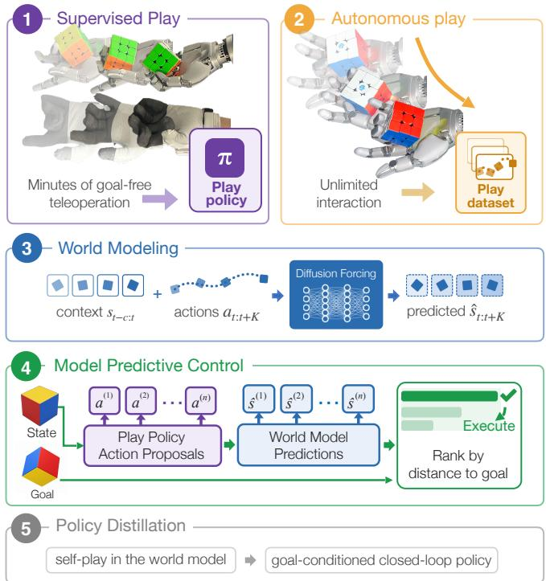  
Fig. 1. DSP Pipeline Overview. (1) Human teleoperation trains a goal-agnostic play policy. (2) The policy collects interaction data through autonomous play. (3) These data train a world model to predict future states from past observations and proposed actions. (4) MPC uses the model to select actions for a requested goal. (5) Optionally, we can distill a goalconditioned policy from self-play in the learned world model.

Our primary contribution is a framework for learning dexterous manipulation from data collected by an autonomous play policy. We evaluate how autonomous play supports world-model learning and goal-directed planning through four technical contributions:

Supervised play. We formulate supervised play as a mechanism for turning a limited human interaction prior into autonomous contact-rich data collection.

Scaling autonomous play data. We show that held-out world-model prediction improves monotonically as the real-robot autonomous-play dataset grows from 0.5 to 5 hours.

Play policy as an action prior. We show that using play policy as an action-proposal model for MPC significantly improves manipulation performance.

Self-play policy distillation. A method for distilling a closed-loop, goal-conditioned policy through worldmodel self-play to accelerate inference.

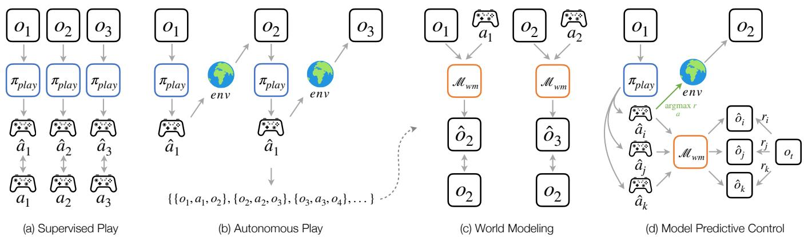  
Fig. 2. Dexterity from Supervised Play. (a) A goal-agnostic play policy is trained by behavior cloning on human teleoperation data. (b) The learned policy interacts autonomously with the environment to collect observation–action transitions. (c) These transitions train an action-conditioned world model to predict future observations. (d) At inference time, the play policy proposes candidate actions, the world model predicts their outcomes, and modelpredictive control selects the candidate with the highest goal-conditioned reward. The selected action is executed in the environment, and planning repeats from the new observation.

Experimental results show DSP reaches within 0.6 rad on 91.4% of trials and within 0.4 rad on 72.7%, compared with 53.9% and 25.8% for hindsight BC. PPO reaches 86.7% at both thresholds after 344M counted frames, about 490 times the counted-frame budget. Real world experiment shows DSP is able to transfer to real world with matched performance. We further validate DSP on Push-T and visual in-hand manipulation, demonstrating that the framework generalizes across tasks and observation representations. We also provide detailed analysis to carefully examine the characteristics of the proposed algorithm and the impacts of the key design decisions. The code, data, and training details will be publicly available for reproducing our results.

## II. RELATED WORK

## A. Play and interaction in RL

RL agents can acquire sophisticated behavior via openended interaction and planning. Model-based agents such as MuZero [6] learn a latent dynamics model and plan within it to master board games and Atari without access to the rules. In multi-agent settings, emergent autocurricula produce complex strategies purely from self-play and environment interaction, as in the hide-and-seek tool-use environment [7]. Comparable interaction-driven pipelines now reach elite performance on physical systems such as competitive table tennis [5]. These results establish that interaction and planning are powerful, but they depend on well-specified rewards, simulators, or game rules. DSP instead targets contact-rich manipulation, where reward engineering and designing safe exploration plans are difficult, and obtains its behavior from human play rather than from reward-driven search.

## B. Curiosity and intrinsic motivation

To reduce dependence on hand-designed rewards, intrinsic-motivation methods reward the agent for reaching novel or hard-to-predict states. Prediction-error curiosity uses the error of a learned forward as an intrinsic signal [3], [8], while Random Network Distillation measures novelty as the error of predicting a fixed random network’s features [9].

While such signals drive broad exploration, they are still heuristics and they do not bias interactions toward safe, object-centric contact that dexterous manipulation requires.

## C. Learning from play

Closest to our framing is robot learning from play: goalfree, human-generated interaction used as a task-agnostic source of supervision. Play-LMP learns latent plans from teleoperated play and reuses them for goal-conditioned con trol [10], and subsequent work distills affordances from play to improve sample efficiency [4]. These approaches largely treat play as a fixed dataset for imitation. In contrast, DSP uses a human play data seed to train a policy that serves as a reusable, autonomous data-collection mechanism.

## D. Dexterous manipulation

Dexterous, multi-fingered manipulation has been approached both by model-free reinforcement learning and by imitation. RL methods learn agile in-hand skills such as general object reorientation [11], [12], [13], [14] and sim-toreal cube manipulation [15], [16], [17], but require carefully shaped task rewards and hundreds of millions of simulated interactions. DSP differs from existing work and does not use simulation data: it learns contact-rich dynamics purely from autonomous play, without task-specific demonstrations or rewards, and plans for arbitrary goals by scoring playpolicy proposals with the learned world model under MPC.

## III. METHOD

## A. Overview

Given a dexterous manipulation task, our pipeline DSP achieves it in 4 stages described in Fig. 2. We first collect data through teleoperation to train a play policy (see Sec. III-B). We then rollout this policy on the robot autonomously to collect a play dataset that contains observation–action transitions (see Sec. III-C). This play dataset is used to train an action-conditioned world model to model the dynamics of the interaction (see Sec. III-D). For inference, we could either directly perform online MPC to predict optimal action sequences (see Sec. III-E) or optionally distill a goalconditioned closed-loop policy from self-play to amortize the inference cost (see Sec. III-F).

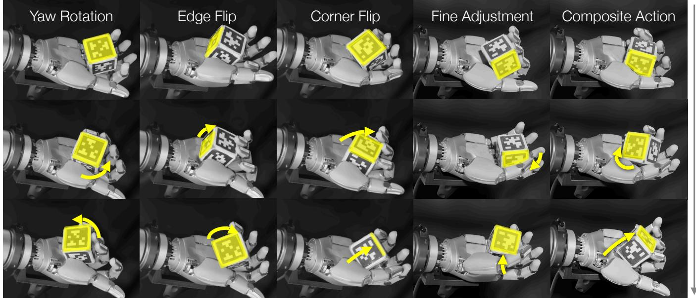  
Fig. 3. Dexterous skills emerge through play-guided planning. MPC selects motions from a goal-agnostic play policy using their predicted outcomes, producing yaw rotations, edge and corner flips, fine adjustments, and composite actions without task-specific skill demonstrations. These examples illustrate how a shared repertoire of play motions can support both large reorientations and precise corrections toward a goal. Time progresses downward in each column; yellow arrows indicate object motion.

## B. Supervised Play

Play is difficult to engineer but intuitive for humans. We therefore train a diffusion-transformer [18] play policy by behavior cloning on goal-free human teleoperation $\mathcal { D } _ { \mathrm { h u m a n } }$ (Fig. 2(a)). Let $o _ { t }$ denote the observation of the robot and object and $a _ { t }$ a recorded joint command. The policy samples action chunks $\hat { a } _ { t : t + H - 1 }$ conditioned on observation history:

$$
\hat { a } _ { t : t + H - 1 } \sim \pi _ { \mathrm { p l a y } } ( \cdot \mid o _ { \le t } ) ,\tag{1}
$$

where H is the action horizon. The demonstrations capture continued object interaction without prescribed goals or taskspecific rewards. Safe behavior are not explicitly engineered but implicitly demonstrated in the data.

## C. Autonomous Play

We then roll out the policy autonomously on the robot to collect a play dataset $\mathcal { D } _ { \mathrm { p l a y } }$ which achieves sufficient coverage in the state-transition space as described in Fig. 2b. This autonomous data collection process requires little human supervision and can be parallelized across mutliple robots and environments. We record sensory and proprioceptive observations as transitions $\left( o _ { t } , a _ { t } , o _ { t + 1 } \right)$

## D. World Modeling

With the play dataset collected from Sec. III-C, we train a world model to predict future observations conditioned on recent observation history and an input action chunk:

$$
\hat { O } _ { t + 1 : t + K } = \mathcal { M } _ { \mathrm { w m } } \big ( o _ { t - C + 1 : t } , a _ { t : t + K - 1 } \big ) .\tag{2}
$$

Here, C and K denote the context length and prediction horizon, respectively. The training objective has the generic form

$$
\mathcal { L } ( \phi ) = \mathbb { E } _ { ( o , a ) \sim \mathcal { D } _ { \mathrm { p l a y } } } \left[ \sum _ { k = 1 } ^ { K } \lambda _ { k } \ell ( \hat { o } _ { t + k } , o _ { t + k } ) \right] ,\tag{3}
$$

where $\phi$ denotes the parameters of $\mathcal { M } _ { \mathrm { w m } }$ . We train our action-conditioned world model using Diffusion Forcing [19], which assigns independent noise levels to observations at different time steps and learns to denoise them causally. This allows the model to condition on clean observed history while progressively denoising future observations, supporting autoregressive rollouts under candidate action sequences.

## E. Model Predictive Control

We combine the learned play policy $\pi _ { \mathrm { p l a y } }$ and world model $\mathcal { M } _ { \mathrm { w m } }$ for MPC (Fig. 2d). The play policy provides an action prior that focuses search on demonstrated interaction behaviors. At time t, we sample N candidate action chunks and predict their outcomes over $K \leq H$ steps:

$$
\begin{array} { r l } & { \hat { a } _ { t : t + H - 1 } ^ { ( i ) } \sim \pi _ { \mathrm { p l a y } } ( \cdot \mid o _ { \le t } ) , } \\ & { \hat { o } _ { t + 1 : t + K } ^ { ( i ) } = \mathcal { M } _ { \mathrm { w m } } \left( o _ { t - C + 1 : t } , \hat { a } _ { t : t + K - 1 } ^ { ( i ) } \right) , } \end{array}\tag{4}
$$

for $i = 1 , \ldots , N$ . Given a target observation $o _ { g } ,$ we score each candidate by its best predicted goal reward and select

$$
\begin{array} { r l } & { r _ { i } = \underset { 1 \leq k \leq K } { \operatorname* { m a x } } r \left( \hat { o } _ { t + k } ^ { ( i ) } , o _ { g } \right) , } \\ & { i ^ { \star } = \arg \underset { 1 \leq i \leq N } { \operatorname* { m a x } } r _ { i } . } \end{array}\tag{5}
$$

Here, $r ( o , o _ { g } )$ measures how well observation o satisfies the goal $o _ { g }$ . We execute the first E actions $( 1 \leq E \leq K )$ of the

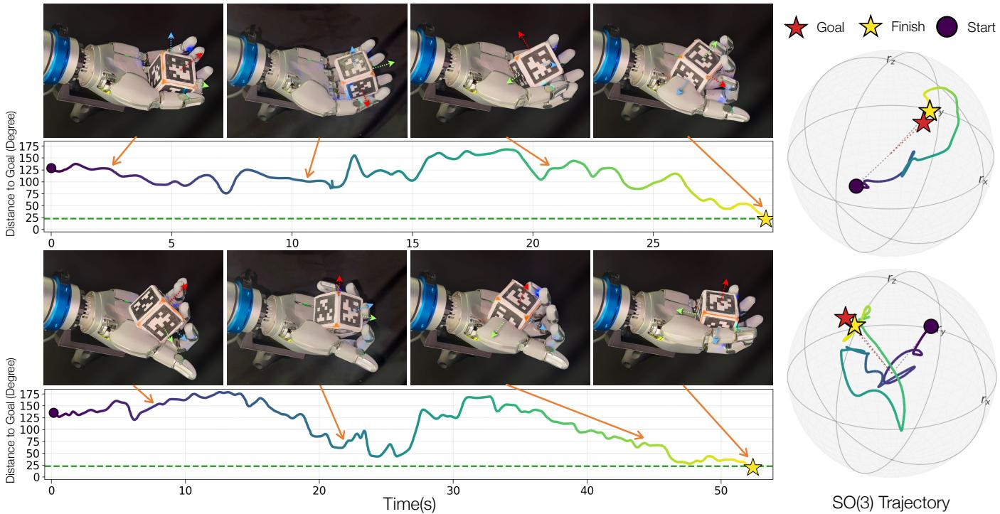  
Fig. 4. Any-to-any pose in-hand object reorientation deployed on Sharpa hands. Two real-robot trials show the cube approaching the requested orientation despite substantial intermediate increases in angular error. Image sequences and the linked error curves show this evolution over time, while the SO(3) trajectories on the right show the overall paths from the starting orientations to finishes near the goals.

selected chunk, receive a new observation, and replan. The goal thus enters through the reward, while the play policy and world model remain goal-agnostic.

## F. Policy Distillation

MPC incurs inference latency from repeated candidate evaluation. We therefore propose optional policy distillation through self-play in the learned world model. Starting from recorded observation histories and sampled goals $o _ { g } .$ , we run MPC within $\mathcal { M } _ { \mathrm { w m } }$ , advancing the history with model predictions after each selected action prefix. This produces a dataset $\mathcal { D } _ { \mathrm { d i s t i l l } }$ of tuples $\left( h , o _ { g } , \hat { a } ^ { \star } \right)$ , where h is the current observation history and $\hat { a } ^ { \star } = \hat { a } _ { t : t + E - 1 } ^ { ( i ^ { \star } ) }$ is the prefix selected by MPC. We train a goal-conditioned policy $\pi _ { \theta }$ by behavior cloning:

$$
\begin{array} { r } { \mathcal { L } _ { \mathrm { d i s t i l l } } ( \theta ) = - \mathbb { E } _ { \mathcal { D } _ { \mathrm { d i s t i l l } } } \left[ \log \pi _ { \theta } ( \hat { a } ^ { \star } \mid h , o _ { g } ) \right] . } \end{array}\tag{6}
$$

At deployment, $\pi _ { \theta }$ directly predicts an action prefix from the actual observation history and goal. It executes the prefix and updates its prediction from new observations, yielding a closed-loop policy that amortizes MPC search.

## IV. EXPERIMENTS

Our experiments evaluate whether DSP can turn goal-free play into goal-directed manipulation across tasks and on real hardware, whether play-guided MPC is more interactionefficient than direct policy learning and task-specific RL, and how play-policy design, autonomous-play scale, and worldmodel design affect prediction and control.

## A. Experimental Setup

a) Tasks.: We organize the evaluation around three tasks. Task A: Push-T tests state-based planar pushing to target poses under a fixed tight 10k-frame teleoperation budget, measuring success and best mask overlap. Task B: simulated reorientation asks a multifingered hand to move a cube between initial and goal orientations separated by more than 90◦. Task C: real-world reorientation tests whether the same play-guided framework can achieve arbitrary-goal reorientation on hardware while retaining performance comparable to simulation. Task D: visual reorientation tests whether play-guided planning transfers from object-state observations to RGB input. The play policy observes RGB images, and the world model evaluates candidate actions in a learned 64-dimensional latent representation.

For reorientation, the task error and goal constraint are

$$
e _ { t } = d _ { \mathrm { S O ( 3 ) } } ( R _ { t } , R _ { g } ) , \qquad e _ { 0 } > 9 0 ^ { \circ } .\tag{7}
$$

For Task B, we sample initial and goal orientations uniformly from SO(3) subject to Eq. (7). This removes shortdisplacement trials included by unconstrained random-goal protocols.

b) Simulation setup.: We use Isaac Lab as the simulator. Each Task B controller is evaluated on the same 128 seeded trials for 2,500 control frames. Dropped cubes are respawned and the trial continues. The robot observes hand state and cube pose and commands 22 joint positions. The world-model planner samples 1,024 play-policy proposals, predicts 50 steps and executes 25 steps. For Task D, we replaces observed cube pose with RGB input. As the task difficulty increases, we set the horizon for each trial as 3,600

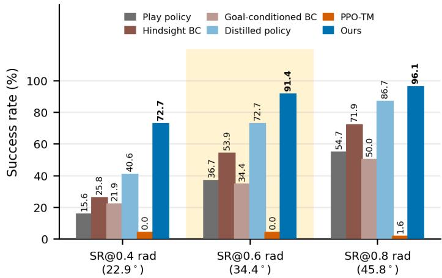

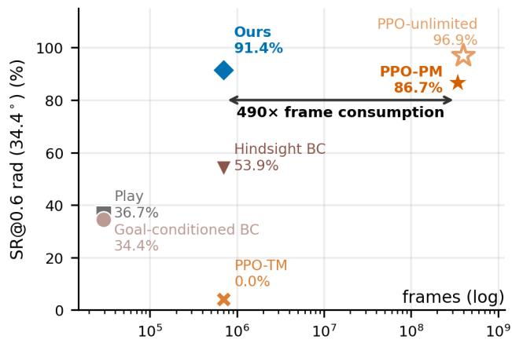  
Fig. 5. Quantitative results of real-world object reorientation. (a) DSP outperforms all baselines. Scoring predicted outcomes lets the controller direct the motions learned from play toward a requested goal. (b) Ours uses 701K counted frames; timesteps-matched PPO (PPO-TM) achieves 0% at this budget, while performance-matched PPO (PPO-PM) reaches 86.7% after 344M frames, about 490 the budget. PPO-unlimited serves as an upper bound of PPO with unlimited interaction frames.

control frames.

c) Real setup.: As shown in Fig. 6, the hardware platform uses a fixed Sharpa right hand with 22 commanded joints, a Manus glove collecting teleoperation data for human play, a ZED 2i camera, and cube-mounted tags for sixdegree-of-freedom pose tracking. Logged signals include proprioception and tracked cube pose. As the real world controller runs slower than the simulation, we increase the time budget to 120 seconds.

d) Push-T.: For Push-T, we compare play-guided MPC with four direct-policy baselines under the same evaluation protocol. Behavior cloning (BC) learns from the collected play trajectories and is executed directly, without a task goal or online search. Hindsight BC relabels each play trajectory with its achieved T-block pose and trains a goalconditioned policy on the resulting state–action–goal tuples. Goal-conditioned BC is trained directly from goal-labeled demonstrations, testing whether task-conditioned imitation can replace planning. Finally, RL, matched data trains a task-specific reinforcement-learning policy with the same interaction budget as our play-and-model pipeline.

e) Simulated Reorientation.: We compare with: (1) the play policy executed without a task goal; (2) hindsight BC, trained from the same 701K transitions as our method after relabeling achieved outcomes; (3) goal-conditioned BC, a policy trained from 15-min teleoperation data, same data amount as our human-collected play data, that rotate the cube from random initial pose to arbitrary-goal pose. (4) PPO-TM (timesteps matched), PPO trained on the same 701K-frame budget as Ours/hindsight BC; (5) PPO-PM (performance matched), the checkpoint at 344M frames with comparable SR@0.6 rad; Our method uses the play policy as the action proposer and scores proposals with the learned world model.

f) Real-world Reorientation: The real-world experiment tests whether our method transfers to hardware while retaining near-simulation performance. We compare with joint random walk, cube random walk on SO(3) with the same average angular velocity as the play policy, and the play policy. The remaining simulation baselines are not transferable to hardware. For example, RL requires millions of interaction frames, and its unstable early exploration can damage the hardware.

## B. Results

1) Task A: Push-T: Table I tests whether a goal-agnostic, autonomously collected play dataset can be reused for precise planar goals. Play-guided MPC reaches 98% SR@0.90 and 74% SR@0.95, compared with 74% and 36% for the strongest policy baseline, hindsight BC, under the same amount of data. The advantage grows from 24 to 38 percentage points as the tolerance tightens. This widening gap, together with the increase in mean coverage from 0.764 to 0.953, indicates that model-based selection improves placement accuracy rather than merely bringing the object into the target vicinity. Timesteps-matched RL fails under the same data budget, showing that task-specific reward learning does not yield useful control at this interaction scale.

Figure 5(a) isolates the value of planning on 128 distantgoal trials. Executing the play policy directly reaches 15.6/36.7/54.7% at 0.4/0.6/0.8 rad. Hindsight relabeling improves these rates to 25.8/53.9/71.9%, but play-guided MPC reaches 72.7/91.4/96.1%. Thus, the play data contain useful motions, but relabeling alone cannot reliably compose them toward a requested orientation. Our method is able to benefit from the diverse samples from the play policy and effectively plan on it with the learned world model. The inference time still meets real-time requirement via batched inference, as detailed in Analysis.

The RL comparison exposes a precision–interaction tradeoff rather than a uniform winner. With the same 701Kframe budget, PPO-TM reaches only 0.0/0.0/1.6%, whereas our controller already acquires most goal neighborhoods. PPO-PM requires 344M frames, more than 490 than ours, to match the same performance. Planning with reusable play data is therefore highly interaction-efficient for goal acquisition; task-specific PPO remains stronger at fine convergence for simulate-able tasks, as shown in PPO-unlimited in Figure. 5. Our method does not require the task to be simulate-able and does not suffer from sim-to-real gap.

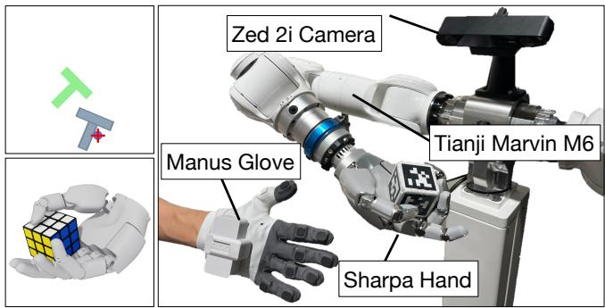  
Fig. 6. Experiment setup. Left: simulated environments for planar Push-T and in-hand cube reorientation. Right: the real-world setup uses a Sharpa hand mounted on a Tianji Marvin M6 arm. A Manus glove records human teleoperation, and a ZED 2i camera tracks the tagged cube.

2) Task C: Real-World Reorientation: The real-world results separate useful play from undirected motion (Figure 7). Joint-space random walk never reaches a goal threshold, and an SO(3) random walk matched to the play policy’s angular speed reaches only 6.3/11.4/17.5%. The learned play policy raises these rates to 20.9/38.3/54.1%. Because the cubespace random walk already controls for gross rotation speed, this gap points to the structure of the learned contacts and regrasp motions—not motion magnitude alone—as the source of useful exploration.

World-model search then converts that exploration into directed control: play-guided MPC reaches 68.6/90.0/97.1%, gains of 47.7/51.7/43.0 percentage points over play alone. Its hardware results remain within 4.1 points of simulation at every threshold (72.7/91.4/96.1%). The small sim-to-real gap suggests that the method transfers as a closed-loop decision rule: the play policy supplies feasible contact motions, while replanning can correct local model and execution error.

3) Task D: Visual Reorientation: Table II reports anytime success from RGB observations. Figure 8 shows predictions from the trained world model that takes RGB as input. The RGB policy alone reaches 34.4/53.1/76.6% SR@0.4/0.6/0.8 rad, showing that visual play still generates useful reorientation motions. Adding world-model MPC raises these rates to 56.2/78.1/89.1%, improvements of 21.8, 25.0, and 12.5 percentage points, respectively. The larger gains at the tighter 0.4 and 0.6 rad thresholds indicate that model-based selection primarily improves goal-directed precision rather than merely inducing object motion. Thus, the core mechanism of DSP—using play as an action prior and a world model to select goal-relevant outcomes—transfers to a learned visual observation representation. Because Task D uses 64 trials and a 3,600-step horizon, we use this experiment to establish representation transfer rather than as a protocol-matched state-versus-RGB comparison.

Table I. Quantitative results on Push-T vs. baselines.
<table><tr><td>Controller</td><td>SR@0.90 (%)</td><td>SR@0.95 (%)</td><td>Coverage</td></tr><tr><td>Behavior cloning [19]</td><td>64</td><td>28</td><td>0.751</td></tr><tr><td>Hindsight BC</td><td>74</td><td>36</td><td>0.764</td></tr><tr><td>Goal-conditioned BC [19]</td><td>60</td><td>34</td><td>0.733</td></tr><tr><td>RL, matched data [20]</td><td>0</td><td>0</td><td>0.155</td></tr><tr><td>Ours</td><td>98</td><td>74</td><td>0.953</td></tr></table>

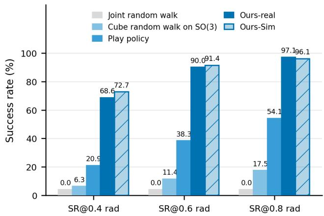  
Fig. 7. Real vs. Sim. Our DSP achieves matched performance with the simulation experiment (Hatched bars), and outperforms other baselines.

4) Distilled policy.: The planner’s cost is its inference: 1,024 proposals rolled through the world model at every replan. Distilling it into a policy removes that cost, and the world model makes the distillation data free of any simulator: at 54K recorded states we paired 24 goals each, drawn uniformly in angular distance, with the chunk the planner selects, producing 1.3M labels entirely inside the world model. No new interaction is collected, no physics engine needed, so the same recipe applies universally for simulation and real-world, and the data scales with sampling compute. The distilled policy is accordingly the strongest imitation baseline at 40.6/72.7/86.7% SR@0.4/0.6/0.8 rad (Figure 5(a)): it recovers over 90% of the MPC planner’s performance at 0.8 rad and takes only 21.8 ms per run, 7x faster than an MPC replan, a good balance between efficiency and precision.

## C. Analysis

a) Inference time in Real-world.: Table IV summarizes real-world inference latency. Perception and planning run on a single RTX 5090 over a local network. Cube tracking keeps pace with the 30fps camera, while each replan takes 134ms: 61ms for sampling 1024 play-policy proposals, 44ms for batched world-model rollout, and 23ms for scoring and refinement. Real-time control is enabled by batched candidate evaluation and action chunking: planning overlaps execution of the current action prefix, so the hand continues moving while the next plan is computed. This allows the closed-loop system to operate in real time at 15–18Hz.

Table II. Quantitative results on visual reorientation from RGB. Our RGB-space method is able to achieve comparable results against state-space method without access to the object pose.
<table><tr><td>Controller</td><td>SR@0.4 rad</td><td>SR@0.6 rad</td><td>SR@0.8 rad</td></tr><tr><td>RGB-space DSP</td><td>34.4</td><td>53.1</td><td>76.6</td></tr><tr><td>State-space DSP</td><td>56.2</td><td>78.1</td><td>89.1</td></tr></table>

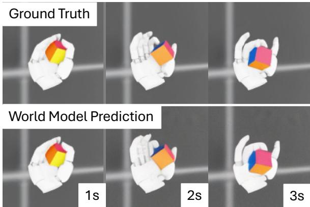  
Fig. 8. RGB world model. Snapshots of the pixel-space world model predictions across 3 seconds in Task D.

## 1) Task B: Simulated Reorientation:

a) A useful play prior must cover transitions, not only states.: The deterministic and diffusion policies have similar held-out command error (0.192 versus 0.181), yet produce very different closed-loop data (Table III). Diffusion more than doubles rotation speed and improves orientation coverage by 11.2 points, but its largest gain is in transition coverage: 84.2% versus 55.4%. The deterministic policy therefore reaches many of the same orientations through a much narrower set of motions, behavior consistent with mode averaging. This distinction matters for both stages of our method: diverse local transitions improve the action conditioning available to the world model and give MPC multiple ways to approach a goal. Open-loop imitation error alone does not measure either property.

b) More autonomous play improves world model prediction.: With the model and held-out evaluation fixed, increasing real-robot play data from 0.54 to 5.11 hours reduces 50-step rotation MAE monotonically from 34.96◦ to 28.40◦, an 18.8% reduction (Figure 10). The final model is also 26.4% below the 38.60◦ persistence baseline. Most of the gain arrives in the first two hours, after which the curve flattens but continues to improve. Autonomous play therefore remains useful beyond the initial corpus, with diminishing marginal returns at the tested scale.

## V. DISCUSSION

## A. DSP vs. behavior cloning

Supervised play changes the role of human demonstrations: rather than specifying how to solve each task, they specify how to sustain useful interaction with the environment. Goal-agnostic behavior is not unstructured behavior.

Table III. Coverage comparison of different play policy design.
<table><tr><td>Transformer Policy</td><td>Avg. Rot. Speed (deg/s)</td><td>SO(3) Cov. (%)</td><td>Trans. Cov. (%)</td></tr><tr><td>Deterministic</td><td>57.8</td><td>87.6</td><td>55.4</td></tr><tr><td>Diffusion</td><td>124.9</td><td>98.8</td><td>84.2</td></tr></table>

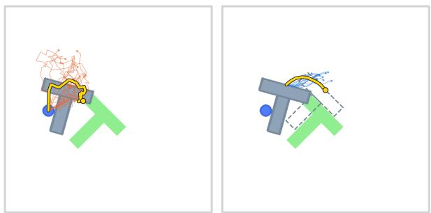  
Fig. 9. Play-guided planning on Push-T. (a) The play policy proposes candidate action chunks (Orange) from the current state. (b) The world model predicts the resulting T-block trajectories (Blue), and MPC selects the best proposal (Yellow) that moves the block toward the target

Choices about maintaining contact, safe exploration, and transitioning between grasps contain physical knowledge even without a prescribed outcome. Learning this interaction priors allows human guidance to support experience beyond the demonstrations themselves. In this view, the primary purpose of supervision is not a finished controller or a dataset of expert demonstrations, but a mechanism for collecting further data. This offers a more efficient approach to leveraging human supervision: humans provide the behavioral structure needed to begin interacting, while the robot acquires knowledge of action consequences through its own experience.

Additionally, demonstrating play behavior is almost always easier than demonstrating solution to a dexterous manipulation task. And in this paper, we show that a goalagnostic policy is learnable via human demonstration and is highly data-efficient.

## B. DSP vs. RL

Compared to task-specific RL which organizes learning around reward optimization, DSP separates acquiring physical knowledge from task goal. The goal enters at planning time, allowing the same interaction prior and world model to serve different target goals without retraining. Learning dynamics directly from autonomous robot interaction also removes the prerequisite of a task-specific simulator and subsequent sim-to-real transfer. Supervised play is therefore not merely an initialization for RL, but the basis of a complete learning-and-control framework. It opens a route to scaling dexterity through reusable physical experience, with human guidance initiating autonomous learning rather than prescribing the behaviors it must ultimately achieve.

## C. DSP vs. curiosity vs. random exploration

Curiosity-driven exploration typically rewards novelty or prediction error, but these objectives do not, by themselves, specify the sustained, coordinated object interaction needed for dexterous manipulation, which has been a pain point in applying curiosity in contact-rich manipulation. Our approach addresses this challenge by learning the structure of interaction from human play, rather than requiring it to emerge through intrinsic-reward, which is especially important for contact-rich manipulation tasks. This suggests a broader principle for embodied learning: useful exploration need not be discovered from scratch through a generic novelty objective. Human intuition can supply its behavioral structure, while autonomous interaction supplies the physical knowledge needed to turn that structure into dexterity.

Table IV. Inference Time.
<table><tr><td>Stage</td><td>Median</td><td>p95</td></tr><tr><td>Visual Cube Pose Tracking</td><td>19.4</td><td>29.4</td></tr><tr><td>3 Play policy (N=1,024 proposal chunks)</td><td>60.5</td><td>64.3</td></tr><tr><td>World model (1,024 × 25-step rollout)</td><td>44.2</td><td>50.3</td></tr><tr><td>MPC scoring and selection</td><td>23.4</td><td>26.4</td></tr><tr><td>Replan, end to end</td><td>133.6</td><td>141.1</td></tr></table>

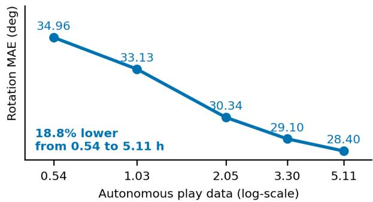  
Fig. 10. More autonomous play improves world model prediction.

## D. Behavior foundation models as play policies.

The modular role of the play policy suggests a possible connection to behavior foundation models [21]. A broader pretrained model could provide an initial repertoire of interactions, while autonomous experience grounds their predicted consequences in a particular robot and environment. A promising future direction is to leverage large behavior models and turn them into a generalizable play policy.

## VI. CONCLUSION

Dexterity from Supervised Play turns limited goal-free human play into autonomous contact-rich data, an actionconditioned world model, and goal-directed control through play-guided MPC. In simulation, the learned model supports arbitrary-goal reorientation with far fewer interactions than PPO-Match in counted training frames, and a controlled model-stack comparison shows improved goal acquisition under a fixed planner. On real-robot data, held-out prediction improves monotonically as autonomous play grows. A provisional hardware summary is consistent with a benefit from world-model search, but requires a frozen protocol and uncertainty before supporting a final task-success claim. The final evaluation includes both Push-T and RGB reorientation; their frozen quantitative results, together with curiosity and matched play-policy and world-model architecture comparisons, remain to be inserted.

## REFERENCES

[1] A. W. Needham, T. M. Barrett, and K. Peterman, “A pick-me-up for infants’ exploratory skills: Early simulated experiences reaching for objects using ‘sticky mittens’ enhances young infants’ object exploration skills,” Infant Behavior & Development, vol. 25, pp.

279–295, 2002. [Online]. Available: https://api.semanticscholar.org/ CorpusID:16427970

[2] D. Ferguson, M. Likhachev, and A. Stentz, “A guide to heuristicbased path planning,” in Proceedings of the International Workshop on Planning under Uncertaintyfor Autonomous Systems, International Conference on Automated Planning and Scheduling (ICAPS), 2005.

[3] D. Pathak, P. Agrawal, A. A. Efros, and T. Darrell, “Curiosity-driven exploration by self-supervised prediction,” in International Conference on Machine Learning. PMLR, 2017, pp. 2778–2787.

[4] J. Borja-Diaz, O. Mees, G. Kalweit, L. Hermann, J. Boedecker, and W. Burgard, “Affordance learning from play for sample-efficient policy learning,” in 2022 International Conference on Robotics and Automation (ICRA). IEEE, 2022, pp. 6372–6378.

[5] P. Durr, M. El Gheche, G. V. Maeda ¨ et al., “Outplaying elite table tennis players with an autonomous robot,” Nature, vol. 652, no. 8111, pp. 886–891, 2026. [Online]. Available: https://www.nature.com/articles/s41586-026-10338-5

[6] J. Schrittwieser, I. Antonoglou, T. Hubert, K. Simonyan, L. Sifre, S. Schmitt, A. Guez, E. Lockhart, D. Hassabis, T. Graepel et al., “Mastering Atari, Go, chess and shogi by planning with a learned model,” Nature, vol. 588, no. 7839, pp. 604–609, 2020.

[7] B. Baker, I. Kanitscheider, T. Markov, Y. Wu, G. Powell, B. McGrew, and I. Mordatch, “Emergent tool use from multi-agent autocurricula,” arXiv preprint arXiv:1909.07528, 2019.

[8] D. Pathak, D. Gandhi, and A. Gupta, “Self-supervised exploration via disagreement,” in International Conference on Machine Learning. PMLR, 2019, pp. 5062–5071.

[9] Y. Burda, H. Edwards, A. Storkey, and O. Klimov, “Exploration by random network distillation,” arXiv preprint arXiv:1810.12894, 2018.

[10] C. Lynch, M. Khansari, T. Xiao, V. Kumar, J. Tompson, S. Levine, and P. Sermanet, “Learning latent plans from play,” in Proceedings of the Conference on Robot Learning, ser. Proceedings of Machine Learning Research, L. P. Kaelbling, D. Kragic, and K. Sugiura, Eds., vol. 100. PMLR, 30 Oct–01 Nov 2020, pp. 1113–1132. [Online]. Available: https://proceedings.mlr.press/v100/lynch20a.html

[11] T. Chen, J. Xu, and P. Agrawal, “A system for general in-hand object re-orientation,” in Conference on Robot Learning. PMLR, 2022, pp. 297–307.

[12] H. Qi, B. Yi, S. Suresh, M. Lambeta, Y. Ma, R. Calandra, and J. Malik, “General In-Hand Object Rotation with Vision and Touch,” in Conference on Robot Learning (CoRL), 2023.

[13] R. Chen, M. Mukadam, M. Kaess, T. Wu, F. R. Hogan, J. Malik, and A. Sharma, “PTLD: Sim-to-real privileged tactile latent distillation for dexterous manipulation,” arXiv preprint arXiv:2603.04531, 2026.

[14] H. Qi, A. Kumar, R. Calandra, Y. Ma, and J. Malik, “In-hand object rotation via rapid motor adaptation,” in Conference on Robot Learning. PMLR, 2023, pp. 1722–1732.

[15] A. Handa, A. Allshire, V. Makoviychuk, A. Petrenko, R. Singh, J. Liu, D. Makoviichuk, K. Van Wyk, A. Zhurkevich, B. Sundaralingam et al., “DeXtreme: Transfer of agile in-hand manipulation from simulation to reality,” in 2023 IEEE International Conference on Robotics and Automation (ICRA). IEEE, 2023, pp. 5977–5984.

[16] OpenAI, M. Andrychowicz, B. Baker, M. Chociej, R. Jozefowicz, B. McGrew, J. Pachocki, A. Petron, M. Plappert, G. Powell, A. Ray et al., “Learning dexterous in-hand manipulation,” The International Journal of Robotics Research, vol. 39, no. 1, pp. 3–20, 2020.

[17] T. Chen, M. Tippur, S. Wu, V. Kumar, E. Adelson, and P. Agrawal, “Visual dexterity: In-hand reorientation of novel and complex object shapes,” Science Robotics, vol. 8, no. 84, p. eadc9244, 2023.

[18] W. Peebles and S. Xie, “Scalable diffusion models with transformers,” in 2023 IEEE/CVF International Conference on Computer Vision (ICCV). IEEE, 2023, pp. 4172–4182.

[19] B. Chen, D. Mart´ı Monso, Y. Du, M. Simchowitz, R. Tedrake,´ and V. Sitzmann, “Diffusion forcing: Next-token prediction meets full-sequence diffusion,” Advances in Neural Information Processing Systems, vol. 37, pp. 24 081–24 125, 2024.

[20] J. Schulman, F. Wolski, P. Dhariwal, A. Radford, and O. Klimov, “Proximal policy optimization algorithms,” arXiv preprint arXiv:1707.06347, 2017.

[21] J. Barreiros, A. Beaulieu, A. Bhat, R. Cory, E. Cousineau, H. Dai, C.-H. Fang, K. Hashimoto, M. Z. Irshad, M. Itkina et al., “A careful examination of large behavior models for multitask dexterous manipulation,” Science Robotics, vol. 11, no. 113, p. eaea6201, 2026.