# Disagreement-Guided Weak-to-Strong Routing

Sima Noorani<sup>∗1</sup>, Shayan Kiyani<sup>∗1</sup>, George Pappas<sup>1</sup>, and Hamed Hassani<sup>1</sup>

<sup>1</sup>University of Pennsylvania

## Abstract

Small language models are increasingly deployed on edge devices and robotic systems to meet cost and latency constraints, yet their limited capabilities can make reliable deployment challenging. Stronger models can provide assistance when needed, but deciding when to route a weak-model response to a stronger model often relies on signals of response correctness. In open-ended and agentic tasks, however, obtaining such signals can require costly ground-truth supervision that is dificult to obtain at scale. We revisit the foundations of weak-to-strong routing and ask whether routing decisions can instead be guided by signals that do not require ground-truth supervision. We first characterize the optimal weak-to-strong routing policy, while allowing for multiple weak-model responses generated through local inference. Building on this characterization, we derive a principled approximation to the optimal routing based on model-to-model comparison. In particular, we introduce a notion of model disagreement that can be measured directly from model-generated responses, without ground-truth supervision. Importantly, the approximation becomes increasingly accurate as the strong model becomes a better proxy for the ground-truth distribution. Across agentic and single-turn tasks, our approach efectively navigates the trade-of between routing cost and response accuracy without ground-truth supervision. Moreover, even when ground-truth correctness signals are available for training, disagreement-based routing can outperform methods trained directly to predict correctness.

## 1 Introduction

Small language models ofer a practical path to deploying AI agents on edge devices, robots, and other systems constrained by cost, latency, connectivity, or privacy. Yet their limited capabilities make it dificult to rely on them across the full range of tasks they may encounter [4, 30]. This has motivated growing interest in systems that primarily rely on a weak LLM, but occasionally route dificult instances to a stronger model when additional capability is needed [5, 15, 51].

The possibility of such routing changes how we should think about inference with weak LLMs. Rather than simply generating a response and returning it, inference now involves three decisions: whether to accept the current response, spend additional local computation on further reasoning or sampling, or seek assistance from a stronger model at substantially higher cost. These choices introduce a new trade-of: Stopping local inference too early miss improvements achievable through inexpensive additional computation; persisting locally for too long waste time and resources when stronger assistance is ultimately needed; and routing too readily undermines the cost and latency advantages of the weak model.

A natural way to navigate this trade-of is to assess response correctness through learned confidence scores, verifiers, or reward models [27, 45]. In practical agentic applications, however, correctness is often dificult to evaluate. For a robotic agent, assessing a proposed next action may require knowledge of the physical environment and consequences that become apparent after execution. For a computer-use agent, whether an action is appropriate may depend on the state of an external application, user preferences, or the downstream efects of modifying a file or sending a message. More broadly, in long-horizon agentic workflows, a locally plausible action may undermine the eventual outcome, violate a user constraint, or introduce an error that becomes apparent several steps later [11, 32, 42]. Obtaining correctness labels in such settings may require subjective or expert judgment, interaction with the environment, or evaluation of entire trajectories. Such supervision is costly and does not readily scale across tasks and deployment conditions. These challenges motivate our central question:

Can we learn when to rely on weak-model inference and when to seek stronger assistance—without ground-truth correctness labels?

To answer this question, we take a step back and shift the perspective from asking when the weak model needs help to asking about the value of using a stronger model. From this perspective, routing is fundamentally a comparative decision: what matters is not simply whether the weak model’s response is incorrect, but whether using the strong model instead is likely to improve the outcome. If we had access to the true likelihood that each response is correct, the value of using the strong model instead would naturally be captured by the diference

$$
\mathrm { s t r o n g - m o d e l \ c o r r e c t n e s s \ l i k e l i h o o d - w e a k \mathrm { - } r e s p o n s e \ c o r r e c t n e s s \ l i k e l i h o o d } .\tag{1}
$$

This diference represents the gain in correctness likelihood from going from the current weak-model response to a strong-model response. In Section3, we formalize a generalized version of (1) and characterize optimal routing within a broader framework that jointly accounts for weak-model test-time inference allocation.

Both correctness quantities in (1), however, are dificult to access without ground-truth supervision. This motivates us to ask how (1) can be approximated using only quantities available from the models themselves. A key observation is that (1) depends on the diference between the two correctness likelihoods, rather than requiring either likelihood individually. This naturally shifts our attention from model-to-ground-truth comparison to model-to-model comparison, and in particular to how much the models disagree, which can be measured directly from model-generated responses.

In Section 4, we derive a principled, ground-truth-free approximation to (1) using only modelgenerated responses. At a high level, the resulting score takes a simple form:

$$
\underbrace { \mathrm { w e a k - s t r o n g ~ d i s a g r e e m e n t } } _ { \mathrm { d i f f e r e n c e ~ a c r o s s ~ m o d e l s } } - \underbrace { \mathrm { s t r o n g - s t r o n g ~ d i s a g r e e m e n t } } _ { \mathrm { u n c e r t a i n t y ~ w i t h i n ~ t h e ~ s t r o n g ~ m o d e l } } .\tag{2}
$$

The first term asks whether the strong model is likely to provide something diferent from the weak response. The second then accounts for how uncertain the strong model itself is, since a diferent response is less likely to represent a useful correction when the strong model is itself uncertain.

This approximation is principled in a natural sense: it becomes increasingly accurate as the strong model’s predictive distribution approaches the ground-truth distribution, and is exact when the two coincide. To this end, our contributions are summarized as follows:

Our contributions are summarized as follows:

• Fundamentals of weak-to-strong routing. In Section 3, we characterize optimal routing within a broader framework that jointly accounts for weak-model test-time inference allocation, identifying the population quantities governing when to continue locally and when to seek stronger assistance.

• Routing through model disagreement. In Section 4, we derive a novel, ground-truth-free approximation to the optimal routing signal based on two disagreement signals: how much the weak and strong models disagree, and how much the strong model disagrees with itself. Importantly, (i) the approximation gap shrinks as the strong model becomes more accurate, and (ii) both signals can be eficiently learned from scalable model-generated data, without ground-truth supervision.

• Empirical evaluation in agentic and reasoning tasks. In Section 6, we evaluate disagreementbased routing across multi-step agentic environments, where step-level correctness is dificult to define or supervise, and controlled single-turn reasoning tasks <sup>1</sup>. Across both regimes, our learned disagreement-based signals consistently outperform label-free baselines, validating that disagreement-based approximation provides a reliable, scalable learning signal when ground-truth supervision is unavailable.

## 2 Related Work

We briefly discuss the works most closely related to our evaluation setting and baselines, and defer a discussion to Appendix A.1.

Learning to defer and supervised routing. The fundamental problem of knowing when a model should abstain or seek help has been extensively studied under the umbrella of learning-to-defer and selective prediction [19, 33]. With the advent of large language models, this challenge translates into determining when a weak model should autonomously escalate to a stronger one. In parallel to frameworks that study deferral for verification [22], our focus is on routing model generations. Many current cascade methods rely on ground-truth correctness labels to train quality scorers, process verifiers, or token-level confidence predictors [1, 5, 6, 15, 38]. In our experiments, we represent this paradigm using a ground-truth supervised baseline highlighting that our proposed framework fundamentally eliminates the need for such expensive, task-specific supervision.

Label-free routing signals. To avoid human annotations, recent work extracts reliability signals directly from a single unlabeled generation using internal uncertainty metrics or hidden-state probes [10, 15, 24]. A prevalent alternative assesses reliability by generating multiple responses to measure internal agreement or semantic overlap [12, 25, 46, 51]. These two paradigms motivate our label-free baselines in both settings to demonstrate that our single-pass, disagreement-trained probe yields a better routing signal than standard internal uncertainty metrics.

Step-level routing in agentic tasks. In sequential environments, determining when to escalate an action to a stronger model is typically guided by process-level verifiers and trajectory-level rewards [17, 20, 41], or frameworks for cost-aware decision support policies [21]. Because these approaches rely on explicit step-level correctness labels or complex episode-success evaluations, they are dificult to scale in open-ended domains. We contrast these paradigms with our agentic experiments, demonstrating that our framework can route actions autonomously at each step by predicting ofline action disagreement, entirely bypassing the need for process verifiers or trajectory rewards.

## 3 Fundamentals of Weak-to-Strong Routing

In this section, we study the problem of weak-to-strong routing jointly with the allocation of loca inference computation.<sup>2</sup> We first study this problem at the population level, assuming access to the underlying probabilistic quantities, which allows us to characterize the optimal solution and identify the fundamental principles governing sampling, selection, and routing. In the next sections, we use these principles to develop practical methods that do not require access to such population quantities.

Setup and sampling. Let $( P , Y , Y _ { w } , Y _ { s } )$ follow a joint distribution, where $P \in \mathcal { P }$ is a prompt, $Y \in \mathcal { V }$ its correct answer, and $Y _ { w } , Y _ { s } \in \mathcal { V }$ are the weak- and strong-model responses, respectively.<sup>3</sup>

A sampling policy $\sigma : \mathcal { P }  \mathbb { N } _ { + }$ specifies the number of weak-model responses generated for each prompt. Given P, let $Y _ { w , 1 } , \ldots , Y _ { w , \sigma ( P ) }$ denote these responses, and define the resulting history as

$$
H _ { \sigma } = ( P , Y _ { w , 1 } , \ldots , Y _ { w , \sigma ( P ) } ) .
$$

Selection and routing. Given the sampled weak responses, we define two policies. The routing policy decides whether to settle for one of the weak-model responses or query the strong model, while the selection policy determines which weak-model response to return if we settle for the weak model. Formally,

$$
\pi ( H _ { \sigma } ) \in [ 0 , 1 ] , \qquad \phi ( H _ { \sigma } ) \in \{ 1 , \ldots , \sigma ( P ) \} ,
$$

where $\pi ( H _ { \sigma } )$ is the probability of querying the strong model and $\phi ( H _ { \sigma } )$ is the index of the selected weak response.

Together, $( \sigma , \phi , \pi )$ determine how much local inference to use, which weak response to return, and when to seek strong-model assistance. Our goal is to maximize the accuracy of the final response while controlling the use of both weak- and strong-model inference. We impose separate budgets: $B _ { w }$ on the expected number of weak-model samples and $B _ { s }$ on the expected frequency of strong-model queries. This gives the following optimization problem:

$$
\begin{array} { r l } { \overbrace { \underbrace { \operatorname* { B u d g e t e d } { \mathrm { ~ W e a k . t o - S t r o n g ~ R o u t i n g } } } _ { \sigma , \phi , \boldsymbol { \pi } } } ^ { \mathrm { { B u d g e t e d ~ W e a k . t o - S t r o n g ~ R o u t i n g } } } } & { \qquad ( 3 ) } \\ { \mathrm { s u b j e c t ~ t o } } & { \mathbb { E } [ \sigma ( P ) ] \leq { B } _ { w } , \qquad \mathbb { E } [ \pi ( H _ { \sigma } ) ] \leq { B } _ { s } . } \end{array}
$$

The expectations are over the prompt–answer distribution and model randomness. The two constraints allow weak-model inference and strong-model queries to be allocated across prompts according to their respective benefits.

Population quantities. To characterize the optimal policy, define

$$
q _ { p } ( y ) : = \operatorname* { P r } ( Y = y \mid P = p ) , \qquad t _ { p } : = \operatorname* { P r } ( Y _ { s } = Y \mid P = p ) .\tag{4}
$$

Here, y is a fixed candidate response, Y is the random ground-truth answer, and $Y _ { s }$ is a response drawn from the strong model. Thus, $q _ { p } ( y )$ is the probability that $y$ is correct, while $t _ { p }$ is the probability that the strong-model response is correct.

Theorem 3.1. Fix any sampling policy σ satisfying $\mathbb { E } [ \sigma ( P ) ] \le B _ { w }$ . For a realized history $h _ { \sigma } =$ $( p , y _ { w , 1 } , \ldots , y _ { w , \sigma ( p ) } )$ , define

$$
\Delta ( h _ { \sigma } ) : = t _ { p } - \operatorname* { m a x } _ { i \leq \sigma ( p ) } q _ { p } ( y _ { w , i } ) .\tag{5}
$$

In words, $\Delta ( h _ { \sigma } )$ is the gain in correctness probability from querying the strong model rather than returning the best available weak response. The optimal selection and routing policies are

$$
\phi ^ { * } ( h _ { \sigma } ) \in \mathop { \operatorname { a r g m a x } } _ { i \leq \sigma ( p ) } q _ { p } ( y _ { w , i } ) , \qquad \pi ^ { * } ( h _ { \sigma } ) = \left\{ 1 , \quad \Delta ( h _ { \sigma } ) > \tau , \right.\tag{6}
$$

where $\tau \geq 0$ is a global threshold chosen to satisfy the strong-model budget.<sup>4</sup>

Interpreting the optimal policies. From (6), the optimal selection rule is straightforward: among the sampled weak responses, it selects the one with the highest probability of being correct. However, the optimal routing policy is more involved: it is a threshold rule over the score $\Delta ( h _ { \sigma } )$ defined in (5). This score measures the improvement in correctness probability from querying the strong model, $t _ { p } .$ instead of returning the best weak response, $\mathrm { m a x } _ { i \leq \sigma ( \boldsymbol { p } ) } q _ { \boldsymbol { p } } ( y _ { \boldsymbol { w } , i } )$ . The policy routes whenever this improvement exceeds the global threshold $\tau ,$ which controls the routing budget. Thus, routing depends not only on how reliable the weak response is, but on how much the strong model is expected to improve upon it.

One-shot sampling as a special case. When $\sigma ( P ) \equiv 1$ , selection is trivial and routing is the only remaining decision. In this case, (5) reduces to $\Delta ( h _ { \sigma } ) = t _ { p } - q _ { p } ( y _ { w , 1 } )$ . This formalizes the accuracy-gain intuition introduced in (1), also recovering the known one-shot characterization of Jitkrittum et al. [19], Mozannar & Sontag [33].

## 4 Approximations

The optimal routing rule derived in Section 3, particularly equations 5 and 6, depends on the conditional correctness probabilities $q _ { p }$ and $t _ { p }$ defined in (4). In many practical tasks, these population quantities are unavailable without expensive human labels or exhaustive ground-truth verifiers. In this section, we derive a principled approximation to the optimal routing score in (5) that eliminates this dependence on ground-truth correctness. We first present the resulting routing score and its practical interpretation, and then derive it from the population-optimal rule.

Our approximation, which we call corrected disagreement, takes a simple form. Recall that $h _ { \sigma } =$ $( p , y _ { w , 1 } , \ldots , y _ { w , \sigma ( p ) } )$ contains the prompt and its sampled weak-model responses, and that $Y _ { s }$ and $Y _ { s } ^ { \prime }$ are independent responses drawn from the strong model for the same prompt. We define the corrected-disagreement routing score as

$$
{ \biggl | } S _ { \mathrm { C D } } ( h _ { \sigma } ) = \underbrace { \underset { i \leq \sigma ( p ) } { \mathrm { m i n } } \operatorname* { P r } ( Y _ { s } \neq y _ { w , i } \mid P = p ) } _ { \mathrm { w e a k - s t r o n g ~ d i s a g r e e m e n t } } - \underbrace { \operatorname* { P r } ( Y _ { s } \neq Y _ { s } ^ { \prime } \mid P = p ) } _ { \mathrm { s t r o n g - m o d e l ~ s e l f - d i s a g r e e m e n t } } { \biggr | } .\tag{7}
$$

The first term measures the disagreement of the strong model with the collection of sampled weak responses. It corresponds to selecting the weak response that the strong model is least likely to disagree with. The second term corrects for disagreement arising from uncertainty within the strong model itself. Importantly, both terms can be learned from model-generated data without ground-truth labels. We discuss how to learn these quantities in practice in Section 5.

We next show $S _ { \mathrm { C D } }$ arises as a principled approximation to the population-optimal routing rule.

## 4.1 Deriving Corrected Disagreement

The population-optimal routing gain in (5) is $\begin{array} { r } { \Delta ( h _ { \sigma } ) = t _ { p } - \operatorname* { m a x } _ { i \leq \sigma ( p ) } q _ { p } ( y _ { w , i } ) } \end{array}$ , where $q _ { p }$ and $t _ { p }$ are defined in (4).

Let $s _ { p } ( y ) : = \operatorname* { P r } ( Y _ { s } = y \mid P = p )$ denote the strong model’s predictive distribution. Then

$$
\begin{array} { l } { \displaystyle \Delta ( h _ { \sigma } ) \overset { ( a ) } { = } \sum _ { y \in \mathcal { Y } } q _ { p } ( y ) s _ { p } ( y ) - \underset { i \leq \sigma ( p ) } { \operatorname* { m a x } } q _ { p } ( y _ { w , i } ) \overset { ( b ) } { \approx } \sum _ { y \in \mathcal { Y } } s _ { p } ( y ) ^ { 2 } - \underset { i \leq \sigma ( p ) } { \operatorname* { m a x } } s _ { p } ( y _ { w , i } ) } \\ { \displaystyle \overset { ( c ) } { = } \underset { i \leq \sigma ( p ) } { \operatorname* { m i n } } \operatorname* { P r } ( Y _ { s } \neq y _ { w , i } \mid P = p ) - \operatorname* { P r } ( Y _ { s } \neq Y _ { s } ^ { \prime } \mid P = p ) = S _ { \mathrm { C D } } ( h _ { \sigma } ) . } \end{array}\tag{8}
$$

Here, (a) uses the conditional independence $Y _ { s } \perp \perp Y \mid P$ to write $\begin{array} { r } { t _ { p } = \sum _ { y } q _ { p } ( y ) s _ { p } ( y ) } \end{array}$ . In (b), we replace the unknown ground-truth distribution $q _ { p }$ by the strong model’s predictive distribution $s _ { p } .$ . Finally, (c) follows from $\operatorname* { P r } ( Y _ { s } \neq y \mid P = p ) = 1 - s _ { p } ( y )$ and $\mathrm { P r } ( Y _ { s } \neq Y _ { s } ^ { \prime } \mid P = p ) =$ $\begin{array} { r } { \dot { 1 } - \sum _ { y } s _ { p } ( y ) ^ { 2 } } \end{array}$ . Thus, corrected disagreement approximates the population-optimal routing gain using only comparisons between model-generated responses.

Approximation quality. The only approximation in (8) occurs in step (b), where the unknown ground-truth distribution $q _ { p }$ is replaced by the strong model’s predictive distribution $s _ { p }$ . As the strong model becomes a better proxy for the ground-truth distribution, this approximation becomes more accurate. In the ideal case $s _ { p } = q _ { p } ,$ , step (b) is exact, and corrected disagreement recovers the population-optimal routing gain: $S _ { \mathrm { C D } } ( h _ { \sigma } ) = \Delta ( h _ { \sigma } )$ . Thus, the approximation gap naturally shrinks as $s _ { p }$ approaches $q _ { p }$

## 4.2 Population Comparison of Routing Scores

In this section, we compare the quality of diferent routing scores at the population level. We use extensive Monte Carlo sampling to accurately estimate the probabilities defining each score, allowing us to compare the underlying routing signals independently of how they are learned in practice. For simplicity, we consider the one-shot setting $\sigma ( P ) \equiv 1$ . We compare four routing signals:

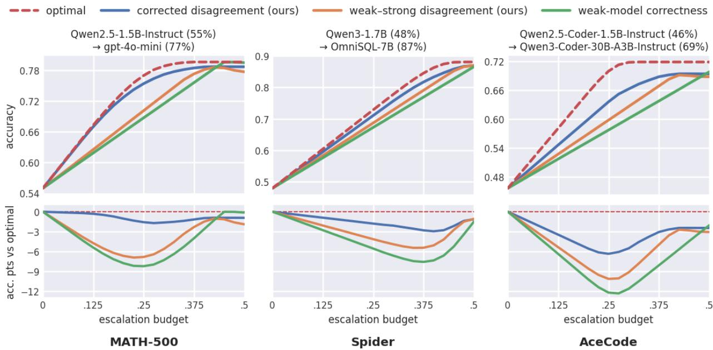  
Figure 1: Corrected disagreement better approximates optimal routing than alternatives.

• Optimal routing gain: $\Delta ( p , y _ { w } ) = \operatorname* { P r } ( Y _ { s } = Y \mid P = p ) - \operatorname* { P r } ( Y = y _ { w } \mid P = p )$ . This is the exact gain defined in Theorem 3.1. It serves as an oracle upper bound representing full knowledge of both models’ correctness, and requires ground-truth supervision.

• Weak-model correctness: $S _ { \mathrm { c o r } } ( p , y _ { w } ) = 1 - \operatorname* { P r } ( Y = y _ { w } \mid P = p )$ . This represents optimal confidence-based routing, routing when the weak model is likely incorrect. It serves as the population oracle for confidence- and consistency-based methods and requires ground-truth labels.

• Weak-strong disagreement: $S _ { \mathrm { d i s a g r e e } } ( p , y _ { w } ) = \operatorname* { P r } ( Y _ { s } \neq y _ { w } \mid P = p )$ . This baseline routes purely based on raw cross-model disagreement, without using ground-truth labels.

• Corrected disagreement: $S _ { \mathrm { C D } } ( p , y _ { w } )$ (Equation 7). This represents our proposed approximation and requires no ground-truth supervision.

Figure 1 reports results across the three varying benchmarks. In each panel, the top row displays weak-to-strong routing accuracy across informative escalation budget regime $B \in [ 0 , 0 . 5 ]$ , and the bottom row illustrates the gap relative to optimal routing. The results reveal three central insights:

(i) Corrected disagreement, $S _ { \mathrm { C D } }$ , consistently outperforms uncorrected weak–strong disagreement, $S _ { \mathrm { d i s a g r e e } } ,$ across all budgets. (ii) In operational regimes where the escalation budget is constrained $( B \leq 0 . 4 )$ $S _ { \mathrm { C D } }$ and $S _ { \mathrm { d i s a g r e e } }$ outperform the weak-model correctness baseline. The reason is, while correctness indicates when the weak model is wrong, it cannot anticipate whether the strong model will succeed. (iii) Because $S _ { \mathrm { C D } }$ replaces ground truth with the strong model’s predictive distribution, the approximation gap of $S _ { \mathrm { C D } }$ is smaller for more accurate strong models.

## 5 Finite-Sample Routing Algorithms

We now turn the corrected-disagreement score into a practical routing algorithm. We describe two components: first, how the learned score is used at test time to route between the weak and strong models. Second, how this score can be learned using only weak- and strong-model generations.

Routing algorithm. Following Theorem 3.1, we fix a sampling policy $\sigma$ and a selection policy $\phi .$ . Recall from Section 3 that $\sigma ( p )$ specifies the number of weak responses generated for prompt $p ,$ $\phi ( h _ { \sigma } )$ selects one of these responses, and $h _ { \sigma } = ( p , y _ { w , 1 } , . . . , y _ { w , \sigma ( p ) } )$ denotes the resulting history.

Given a routing score $\widehat { S } ( h _ { \sigma } ) \in \mathbb { R }$ , test-time routing proceeds as follows:

```perl
1. Generate $\sigma ( p )$ weak-model responses, forming $h _ { \sigma }$
2. Compute the routing score $\widehat { S } ( h _ { \sigma } )$
3. If $\widehat { S } ( h _ { \sigma } ) > \tau ,$ query the strong model; otherwise, return the weak response selected by
$\phi ( h _ { \sigma } )$
```

The threshold $\tau$ can be calibrated on held-out data to meet a desired strong-model budget $B _ { s }$ . More generally, the threshold can be updated online to maintain budget constraints over time, as in Kiyani et al. [21].

To recap, Theorem 3.1 shows that the optimal routing rule is obtained by setting the routing score to the accuracy gain $\Delta ( h _ { \sigma } )$ in (5). In Section 4.1, we approximated this optimal score by $S _ { \mathrm { C D } } ( h _ { \sigma } )$ in (7), which, unlike $\Delta ( h _ { \sigma } )$ , depends only on model disagreement and does not require ground-truth supervision. We now complete the framework by showing how $S _ { \mathrm { C D } }$ can be learned in practice using only model-generated data.

Learning corrected disagreement. The corrected-disagreement score in (7) consists of two quantities: weak–strong disagreement and strong-model self-disagreement. We learn both ofline using only model-generated responses, without ground-truth labels.

For each training prompt $p ,$ we generate $K _ { w }$ independent responses from the weak model, $y _ { w , 1 } , \ldots , y _ { w , K _ { w } }$ and $K _ { s }$ independent responses from the strong model, $y _ { s , 1 } , \ldots , y _ { s , K _ { s } }$ . Let $A ( y , y ^ { \prime } ) \in \{ 0 , 1 \}$ indicate whether two responses y and $y ^ { \prime }$ disagree. These generations allow us to construct empirical training targets for the two terms appearing in $S _ { \mathrm { C D } }$

Weak–strong disagreement. For each weak response $y _ { w , i }$ , we define

$$
\widehat { d } ( p , y _ { w , i } ) : = \frac { 1 } { K _ { s } } \sum _ { k = 1 } ^ { K _ { s } } A ( y _ { w , i } , y _ { s , k } ) , \qquad i = 1 , \ldots , K _ { w } .\tag{9}
$$

This is the fraction of strong-model responses that disagree with $y _ { w , i } .$ , and hence provides an empirical estimate of the weak–strong disagreement probability $\mathrm { P r } ( Y _ { s } \neq y _ { w , i } \ | \ P = p )$

Strong-model self-disagreement. We similarly define

$$
\widehat g ( p ) : = \frac { 1 } { K _ { s } ( K _ { s } - 1 ) } \sum _ { k \neq k ^ { \prime } } A ( y _ { s , k } , y _ { s , k ^ { \prime } } ) .\tag{10}
$$

This is the fraction of pairs of strong responses that disagree, and hence provides an empirical estimate of the strong-model self-disagreement probability $\operatorname* { P r } ( Y _ { s } \neq Y _ { s } ^ { \prime } \mid P = p )$

The disagreement indicator A depends on the task and only needs to determine whether two responses are equivalent, rather than whether either response is correct. For example, it can be implemented using exact matching, task-specific parsing or execution, or an LLM judge. Importantly, A is used only ofline to construct the training targets and is not required at test time.

We train two predictors, $\widehat { f _ { d } } ( p , y _ { w } )$ and ${ \widehat { f } } _ { g } ( p )$ , to predict the targets in (9) and (10), respectively. The first predicts the probability that the strong model disagrees with a given weak response, while the second predicts the strong model’s self-disagreement from the prompt alone. In Appendix A.5, we provide implementation details for the predictors used in our experiments.

At test time, we combine the two predictors according to the corrected-disagreement score:

$$
\widehat S _ { \mathrm { C D } } ( h _ { \sigma } ) = \operatorname* { m i n } _ { i \leq \sigma ( p ) } \widehat f _ { d } ( p , y _ { w , i } ) - \widehat f _ { g } ( p ) .\tag{11}
$$

Thus, $\widehat { S } _ { \mathrm { C D } }$ can be computed using only the prompt and the sampled weak-model responses. In particular, neither the strong model nor ground-truth labels are required at test time.

## 6 Experiments

In this section, we evaluate our disagreement-based routing framework across two settings. Section 6.1 first examines multi-step agentic environments, where step-level correctness is notoriously dificult to define. Section 6.2 considers single-turn reasoning tasks, where gold answers provide a rigorous testbed to directly compare our approach with ground-truth-supervised baselines.

Baselines. We benchmark against established routing signals, categorized by their test-time inference cost and reliance on ground-truth labels:

Single-response, label-free signals $( N = 1 )$ : Evaluating a single weak response adds zero test-time generation overhead. We compare Corrected disagreement (ours) (Equation 7); Weak– strong disagreement (ours), isolating the value of the self-disagreement penalty; and Token entropy [15], averagin internal predictive uncertainty over the generated sequence.

Multi-response, label-free signals $( N > 1 )$ : These assess confidence via weak-model self-agreement, a standard approach for cascade deferral [51]. Though label-free, generating and clustering N responses significantly increases inference overhead. We compare against Self-consistency [46], routing via the plurality cluster’s vote share, and Semantic entropy [25], routing via the cluster distribution’s entropy.

Supervised reference: For benchmark with ground-truth labels, we train a Proxy reward linear probe $\widehat { f } _ { c }$ . Requiring privileged supervision unavailable in open-ended tasks, it serves strictly as a supervised upper-bound reference rather than a fair label-free competitor.

Evaluation metrics. We evaluate cascade performance by plotting task success (final-answer accuracy for single-turn benchmarks, and end-to-end trajectory success for agentic environments) against the realized routing budget (the fraction of escalated queries or actions). To isolate the quality of the routing signal, we fix sampling and selection across all baselines and, at each routing budget, escalate the instances with the highest scores. This allows us to compare routing signals under the same sampling and selection policies without introducing error from threshold calibration. Selection ablations are deferred to Appendix A.3.

## 6.1 Agentic Environments: Routing Without Ground Truth

In multi-step environments, an agent completes a goal through a sequence of actions. Let $H _ { t } =$ $( p , y ^ { 1 } , o ^ { 1 } , \dots , y ^ { t - 1 } , o ^ { t - 1 } )$ denote the trajectory history at step $t ,$ comprising the prompt $p ,$ past actions $y _ { i } .$ , and observations $o _ { i }$ . Rather than escalating entire trajectories, we formulate routing at the action level: given $H _ { t } .$ , the router decides whether to execute the weak model’s action locally $( y _ { w } ^ { t } )$ or defer that specific step to the strong model $( y _ { s } ^ { t } )$ . Defining step-level correctness in sequential environments is fundamentally dificult. Because tasks admit multiple valid paths, and expert evaluation is costly to scale[32]. Furthermore, locally plausible actions may cause delayed downstream failures, making long-horizon credit assignment ambiguous [11]. Consequently, correctness-supervised routers and automated LLM judges remain notoriously unreliable in agentic domains [42, 54].

While correctness is ambiguous, step-level disagreement remains objective and easily verifiable. Let $\mathcal { T } ( H _ { t } , y )$ denote the transition triggered by action y (e.g., a parsed tool call or state change). Two actions are equivalent if they induce identical transitions: $A ( y _ { w } , y _ { s } ) = \mathbb { 1 } \{ T ( H _ { t } , y _ { w } ) = T ( H _ { t } , y _ { s } ) \}$ Relying on observable mechanics rather than subjective evaluation enables efortless data collection from ofline rollouts, entirely bypassing human labels and complex reward engineering.

Datasets and models. We evaluate two interactive environments, generating K = 10 samples per step for training targets and multi-sample baselines. In BFCL Multi-Turn [36] (160 train / 40 test tasks), Qwen3-8B routes to GPT-5-mini; action agreement requires identical function calls and arguments. In WebShop [48] (2,000 train / 500 test), Qwen3-8B routes to a task-specialized RL policy. To prevent distribution shifts by test-time strong-model interventions, we collect training data via an iterative, DAgger-style schedule [26] (Appendix A.6).

Figure 2 shows both disagreement-based signals consistently outperform the best label-free baseline. Crucially, contrasting the two environments reveals how teacher capability dictates the value of the self-disagreement correction. In WebShop, where the strong model is highly capable, corrected disagreement significantly outperforms raw weak–strong disagreement. This reinforces our populationlevel finding: under a stronger teacher, the self-disagreement penalty prevents wasteful queries and the approximation approaches optimal routing. Conversely, in BFCL, the strong model itself struggles; here, the self-disagreement correction provides negligible benefit, rendering the gap between the two scores statistically insignificant. Beyond performance gains, the results highlight a practica advantage for agentic workflows. Because step-level correctness is inherently vague, determining exactly when an action requires escalation remains a persistent challenge. Relying instead on observable cross-model disagreement provides practitioners with a reliable, objective signal to safely guide routing decisions.

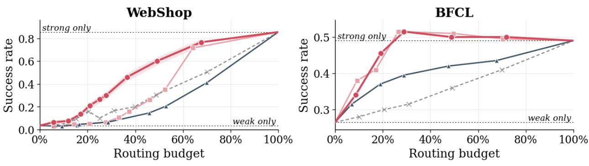  
Corrected disagreement (ours)  Weak-strong disagreement (ours)  Best competitor (self-consistency) - · Random  
Figure 2: Action-level routing performance in agentic environments. For clarity, we plot our proposed signals against only the best-performing label-free baseline. Results are averaged over m=5 runs; comprehensive baselines, standard deviations, and tabular data are provided in Appendix A.4.

## 6.2 Controlled Ablations on Single-Turn Benchmarks

Single-turn reasoning benchmarks provide an ideal testbed for controlled ablations that are dificult to isolate in multi-step settings. Because these tasks feature canonical gold answers, they allow us to directly compare our label-free signals against a supervised proxy reward and study the impact of the weak-model sampling budget.

Datasets and models. We use three diverse datasets spanning a spectrum of evaluation complexity: Math-500 [18] (Phi-3.5-mini-instruct → GPT-4o-mini; Disagreement indicator A is based on exact final-answer match), Spider [49] (Qwen3-1.7B → OmniSQL-7B; A is identical SQL execution), and AceCode [52] (Qwen2.5-Coder-1.5B-Instruct → Qwen3-Coder-30B-A3B-Instruct; A is identical hidden unit test behavior). These tasks progress from closed-form verification to open-ended generation, where structurally distinct outputs can yield identical functional results. This spectrum allows us to observe how routing methods scale as as simple answer-matching becomes insuficient, reflecting the practical challenges of open-ended generations. Finally, to confirm that our findings hold across diferent capability gaps, we evaluate additional Weak–strong model pairings in Appendix A.2.

## Results and discussion.

Figure 3 shows cascade accuracy at representative representative escalation budgets (further budgets in Appendix A.2). We compare the one-shot regime (N = 1), where consistency scores are undefined, against a multi-sample regime using uniform sampling (N = 8). For clarity, we plot our scores against the supervised proxy reward and only the strongest label-free baseline (exhaustive comparisons and additional budget values and sample sizes are deferred to Appendix A.2).

The empirical results validate our population-level analysis from Section 4.2. First, at these practical budget constraints, corrected disagreement consistently outperforms the supervised proxy reward. Second, across all three benchmarks, corrected disagreement yields higher accuracy than raw weak– strong disagreement, confirming that penalizing strong-model self-inconsistency successfully prevents the cascade from wasting queries on ambiguous prompts.

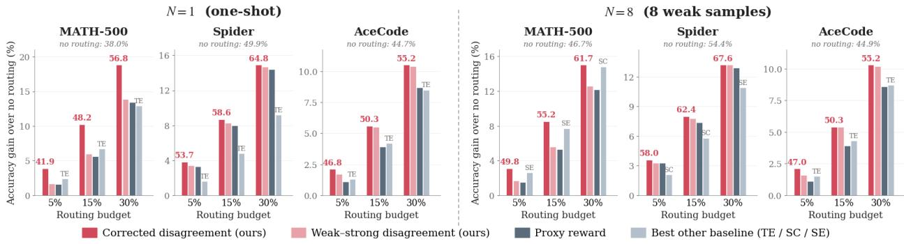  
Figure 3: Finite-sample routing performance on single-turn benchmarks for one-shot (N = 1) and multi-sample (N = 8) regimes. Corrected disagreement consistently outperforms raw disagreement and the best label-free baselines. Multi-sample baselines only close the gap on closed-form tasks (MATH) where clustering is trivial, but break down on open-ended tasks (Spider, AceCode).

Finally, the multi-sample (N = 8) results expose the brittleness of consistency-based routing. On MATH-500, where answers are easily grouped, self-consistency leverages additional samples to narrow the gap with our approach. However, on Spider and AceCode, where semantic clustering is dificult, consistency baselines fail to scale. In these domains, our learned probe maintains superior performance without additional inference overhead of generating and clustering multiple responses.

## 7 Conclusion

In this work, we study weak-to-strong routing in its general setting, jointly accounting for test-time sampling of candidate weak responses, candidate selection, and escalation to a stronger model. Conventional cascades and standard routing approaches rely on signals of response correctness, which are often costly to obtain and ambiguous to define in open-ended or agentic tasks. To bypass the need for ground-truth supervision, we introduce a perspective based on model disagreement. We derive corrected disagreement, a principled approximation to the optimal routing rule that balances cross-model disagreement against the strong model’s internal uncertainty. This formulation provides an objective learning signal that can be collected at scale from model-generated responses alone. Across multi-step agentic environments and reasoning benchmarks, our learned disagreement signal consistently outperforms label-free baselines, showing that our principled approximation ofers a practical and scalable path to guiding hybrid inference without ground-truth supervision.

## 8 Acknowledgments

This work was supported by EnCORE, the Institute for Emerging CORE Methods in Data Science, and NSF award 2502489 through the MFAI: Mathematical Foundations of Alignment in Generative

Artificial Intelligence program. SK also received support through an AWS gift to Penn Engineering’s ASSET Center for Trustworthy AI.

## References

[1] Pranjal Aggarwal, Aman Madaan, Ankit Anand, Srividya Pranavi Potharaju, Swaroop Mishra, Pei Zhou, Aditya Gupta, Dheeraj Rajagopal, Karthik Kappaganthu, Yiming Yang, Shyam Upadhyay, Manaal Faruqui, and Mausam. Automix: Automatically mixing language models, 2025. URL https://arxiv.org/abs/2310.12963.

[2] Marija akota, Maxime Peyrard, and Robert West. Fly-swat or cannon? cost-efective language model choice via meta-modeling. In Proceedings of the 17th ACM International Conference on Web Search and Data Mining, pp. 606–615. ACM, March 2024. doi: 10.1145/3616855.3635825. URL http://dx.doi.org/10.1145/3616855.3635825.

[3] Jianhao Chen, Zishuo Xun, Bocheng Zhou, Han Qi, Hangfan Zhang, Qiaosheng Zhang, Yang Chen, Wei Hu, Yuzhong Qu, Wanli Ouyang, and Shuyue Hu. Do we truly need so many samples? multi-llm repeated sampling eficiently scales test-time compute, 2025. URL https: //arxiv.org/abs/2504.00762.

[4] Lijie Chen, Binghui Peng, and Hongxun Wu. Theoretical limitations of multi-layer transformer, 2024. URL https://arxiv.org/abs/2412.02975.

[5] Lingjiao Chen, Matei Zaharia, and James Zou. Frugalgpt: How to use large language models while reducing cost and improving performance, 2023. URL https://arxiv.org/abs/2305. 05176.

[6] Yu-Neng Chuang, Prathusha Kameswara Sarma, Parikshit Gopalan, John Boccio, Sara Bolouki, Xia Hu, and Helen Zhou. Learning to route llms with confidence tokens, 2025. URL https: //arxiv.org/abs/2410.13284.

[7] Jasper Dekoninck, Maximilian Baader, and Martin Vechev. A unified approach to routing and cascading for llms, 2025. URL https://arxiv.org/abs/2410.10347.

[8] Dujian Ding, Ankur Mallick, Chi Wang, Robert Sim, Subhabrata Mukherjee, Victor Ruhle, Laks V. S. Lakshmanan, and Ahmed Hassan Awadallah. Hybrid llm: Cost-eficient and quality-aware query routing, 2024. URL https://arxiv.org/abs/2404.14618.

[9] Dujian Ding, Ankur Mallick, Shaokun Zhang, Chi Wang, Daniel Madrigal, Mirian Del Carmen Hipolito Garcia, Menglin Xia, Laks V. S. Lakshmanan, Qingyun Wu, and Victor Rühle. Best-route: Adaptive llm routing with test-time optimal compute, 2025. URL https://arxiv.org/abs/2506.22716.

[10] Xuefeng Du, Chaowei Xiao, and Yixuan Li. Haloscope: Harnessing unlabeled llm generations for hallucination detection, 2024. URL https://arxiv.org/abs/2409.17504.

[11] Shengda Fan, Xuyan Ye, Yupeng Huo, Zhi-Yuan Chen, Yiju Guo, Shenzhi Yang, Wenkai Yang, Shuqi Ye, Jingwen Chen, Haotian Chen, Xin Cong, and Yankai Lin. Agentprocessbench: Diagnosing step-level process quality in tool-using agents, 2026. URL https://arxiv.org/ abs/2603.14465.

[12] Sebastian Farquhar, Jannik Kossen, Lorenz Kuhn, and Yarin Gal. Detecting hallucinations in large language models using semantic entropy. Nature, 630:625–630, 06 2024. doi: 10.1038/ s41586-024-07421-0.

[13] Matt Gorbett and Suman Jana. Cross-model disagreement as a label-free correctness signal, 2026. URL https://arxiv.org/abs/2603.25450.

[14] Neel Guha, Mayee F. Chen, Trevor Chow, Ishan S. Khare, and Christopher Ré. Smoothie: Label free language model routing, 2024. URL https://arxiv.org/abs/2412.04692.

[15] Neha Gupta, Harikrishna Narasimhan, Wittawat Jitkrittum, Ankit Singh Rawat, Aditya Krishna Menon, and Sanjiv Kumar. Language model cascades: Token-level uncertainty and beyond, 2024. URL https://arxiv.org/abs/2404.10136.

[16] Kimia Hamidieh, Veronika Thost, Walter Gerych, Mikhail Yurochkin, and Marzyeh Ghassemi. Complementing self-consistency with cross-model disagreement for uncertainty quantification, 2026. URL https://arxiv.org/abs/2604.17112.

[17] Raghu Vamshi Hemadri, Humaira Firdowse Mohammed, Rishabh Maheshwary, Srivatsava Daruru, Sagar Davasam, Vikas Yadav, Srinivas Sunkara, and Sai Rajeswar. R2v agent: Teaching slms when to ask for help, 2026. URL https://arxiv.org/abs/2605.16604.

[18] Dan Hendrycks, Collin Burns, Saurav Kadavath, Akul Arora, Steven Basart, Eric Tang, Dawn Song, and Jacob Steinhardt. Measuring mathematical problem solving with the math dataset, 2021. URL https://arxiv.org/abs/2103.03874.

[19] Wittawat Jitkrittum, Neha Gupta, Aditya Krishna Menon, Harikrishna Narasimhan, Ankit Singh Rawat, and Sanjiv Kumar. When does confidence-based cascade deferral sufice?, 2024. URL https://arxiv.org/abs/2307.02764.

[20] Vansh Kapoor, Aman Gupta, Hao Chen, Anurag Beniwal, Jing Huang, and Aviral Kumar. Trim: Hybrid inference via targeted stepwise routing in multi-step reasoning tasks, 2026. URL https://arxiv.org/abs/2601.10245.

[21] Shayan Kiyani, Sima Noorani, George Pappas, and Hamed Hassani. Strategic decision support for ai agents, 2026. URL https://arxiv.org/abs/2606.12587.

[22] Shayan Kiyani, Sima Noorani, George Pappas, and Hamed Hassani. When to trust the cheap check: Weak and strong verification for reasoning, 2026. URL https://arxiv.org/abs/2602. 17633.

[23] Steven Kolawole, Don Dennis, Ameet Talwalkar, and Virginia Smith. Agreement-based cascading for eficient inference, 2025. URL https://arxiv.org/abs/2407.02348.

[24] Jannik Kossen, Jiatong Han, Muhammed Razzak, Lisa Schut, Shreshth Malik, and Yarin Gal. Semantic entropy probes: Robust and cheap hallucination detection in llms, 2024. URL https://arxiv.org/abs/2406.15927.

[25] Lorenz Kuhn, Yarin Gal, and Sebastian Farquhar. Semantic uncertainty: Linguistic invariances for uncertainty estimation in natural language generation, 2023. URL https://arxiv.org/ abs/2302.09664

[26] Changhao Li, Rushi Qiang, Jiawei Huang, Chenxiao Gao, Chao Zhang, Niao He, and Bo Dai. Revisiting dagger in the era of llm-agents, 2026. URL https://arxiv.org/abs/2605.12913.

[27] Hunter Lightman, Vineet Kosaraju, Yura Burda, Harri Edwards, Bowen Baker, Teddy Lee, Jan Leike, John Schulman, Ilya Sutskever, and Karl Cobbe. Let’s verify step by step, 2023. URL https://arxiv.org/abs/2305.20050.

[28] Zechun Liu, Changsheng Zhao, Forrest Iandola, Chen Lai, Yuandong Tian, Igor Fedorov, Yunyang Xiong, Ernie Chang, Yangyang Shi, Raghuraman Krishnamoorthi, Liangzhen Lai, and Vikas Chandra. Mobilellm: Optimizing sub-billion parameter language models for on-device use cases, 2024. URL https://arxiv.org/abs/2402.14905.

[29] Keming Lu, Hongyi Yuan, Runji Lin, Junyang Lin, Zheng Yuan, Chang Zhou, and Jingren Zhou. Routing to the expert: Eficient reward-guided ensemble of large language models, 2023. URL https://arxiv.org/abs/2311.08692.

[30] Zhenyan Lu, Xiang Li, Dongqi Cai, Rongjie Yi, Fangming Liu, Wei Liu, Jian Luan, Xiwen Zhang, Nicholas D. Lane, and Mengwei Xu. Demystifying small language models for edge deployment. In Wanxiang Che, Joyce Nabende, Ekaterina Shutova, and Mohammad Taher Pilehvar (eds.), Proceedings of the 63rd Annual Meeting of the Association for Computational Linguistics (Volume 1: Long Papers), pp. 14747–14764, Vienna, Austria, July 2025. Association for Computational Linguistics. ISBN 979-8-89176-251-0. doi: 10.18653/v1/2025.acl-long.718. URL https://aclanthology.org/2025.acl-long.718/.

[31] Yingfeng Luo, Hongyu Liu, Dingyang Lin, Kaiyan Chang, Chenglong Wang, Bei Li, Quan Du, Tong Xiao, and Jingbo Zhu. Routelmt: Learned sample routing for hybrid llm translation deployment, 2026. URL https://arxiv.org/abs/2604.22520.

[32] Xing Han Lù, Amirhossein Kazemnejad, Nicholas Meade, Arkil Patel, Dongchan Shin, Alejandra Zambrano, Karolina Stańczak, Peter Shaw, Christopher J. Pal, and Siva Reddy. Agentrewardbench: Evaluating automatic evaluations of web agent trajectories, 2025. URL https://arxiv.org/abs/2504.08942.

[33] Hussein Mozannar and David Sontag. Consistent estimators for learning to defer to an expert, 2021. URL https://arxiv.org/abs/2006.01862.

[34] Tianyi Niu, Justin Chih-Yao Chen, Genta Indra Winata, Shi-Xiong Zhang, Supriyo Chakraborty, Sambit Sahu, Yue Zhang, Elias Stengel-Eskin, and Mohit Bansal. Routing with generated data: Annotation-free llm skill estimation and expert selection, 2026. URL https://arxiv.org/abs/ 2601.09692.

[35] Isaac Ong, Amjad Almahairi, Vincent Wu, Wei-Lin Chiang, Tianhao Wu, Joseph E. Gonzalez, M Waleed Kadous, and Ion Stoica. Routellm: Learning to route llms with preference data, 2025. URL https://arxiv.org/abs/2406.18665.

[36] Shishir G Patil, Huanzhi Mao, Fanjia Yan, Charlie Cheng-Jie Ji, Vishnu Suresh, Ion Stoica, and Joseph E. Gonzalez. The berkeley function calling leaderboard (BFCL): From tool use to agentic evaluation of large language models. In Forty-second International Conference on Machine Learning, 2025. URL https://openreview.net/forum?id=2GmDdhBdDk.

[37] Charlotte Peale, Siddartha Devic, Parikshit Gopalan, Udi Wieder, and Aravind Gollakota. Flexible routing via uncertainty decomposition, 2026. URL https://arxiv.org/abs/2605. 07805.

[38] Stephan Rabanser, Nathalie Rauschmayr, Achin Kulshrestha, Petra Poklukar, Wittawat Jitkrittum, Sean Augenstein, Congchao Wang, and Federico Tombari. Gatekeeper: Improving model cascades through confidence tuning, 2025. URL https://arxiv.org/abs/2502.19335.

[39] Zachary Ravichandran, Ignacio Hounie, Fernando Cladera, Alejandro Ribeiro, George J. Pappas, and Vijay Kumar. Distilling on-device language models for robot planning with minimal human intervention, 2025. URL https://arxiv.org/abs/2506.17486.

[40] Stephane Ross, Geofrey J. Gordon, and J. Andrew Bagnell. A reduction of imitation learning and structured prediction to no-regret online learning, 2011. URL https://arxiv.org/abs/ 1011.0686.

[41] Vishnu Sarukkai, Asanshay Gupta, James Hong, Michaël Gharbi, and Kayvon Fatahalian. Inference-time distillation: Cost-eficient agents without fine-tuning or manual prompt engineering, 2026. URL https://arxiv.org/abs/2512.02543.

[42] Noah Shinn, Federico Cassano, Edward Berman, Ashwin Gopinath, Karthik Narasimhan, and Shunyu Yao. Reflexion: Language agents with verbal reinforcement learning, 2023. URL https://arxiv.org/abs/2303.11366.

[43] Charlie Snell, Jaehoon Lee, Kelvin Xu, and Aviral Kumar. Scaling llm test-time compute optimally can be more efective than scaling model parameters, 2024. URL https://arxiv. org/abs/2408.03314.

[44] KV Aditya Srivatsa, Kaushal Kumar Maurya, and Ekaterina Kochmar. Harnessing the power of multiple minds: Lessons learned from llm routing, 2024. URL https://arxiv.org/abs/2405. 00467.

[45] Peiyi Wang, Lei Li, Zhihong Shao, R. X. Xu, Damai Dai, Yifei Li, Deli Chen, Y. Wu, and Zhifang Sui. Math-shepherd: Verify and reinforce llms step-by-step without human annotations, 2024. URL https://arxiv.org/abs/2312.08935.

[46] Xuezhi Wang, Jason Wei, Dale Schuurmans, Quoc Le, Ed Chi, Sharan Narang, Aakanksha Chowdhery, and Denny Zhou. Self-consistency improves chain of thought reasoning in language models, 2023. URL https://arxiv.org/abs/2203.11171.

[47] Yihao Xue, Kristjan Greenewald, Youssef Mroueh, and Baharan Mirzasoleiman. Verify when uncertain: Beyond self-consistency in black box hallucination detection, 2026. URL https: //arxiv.org/abs/2502.15845.

[48] Shunyu Yao, Howard Chen, John Yang, and Karthik Narasimhan. Webshop: Towards scalable real-world web interaction with grounded language agents, 2023. URL https://arxiv.org/ abs/2207.01206.

[49] Tao Yu, Rui Zhang, Kai Yang, Michihiro Yasunaga, Dongxu Wang, Zifan Li, James Ma, Irene Li, Qingning Yao, Shanelle Roman, Zilin Zhang, and Dragomir Radev. Spider: A large-scale human-labeled dataset for complex and cross-domain semantic parsing and text-to-sql task, 2019. URL https://arxiv.org/abs/1809.08887.

[50] Zhongzhi Yu, Zheng Wang, Yuhan Li, Haoran You, Ruijie Gao, Xiaoya Zhou, Sreenidhi Reedy Bommu, Yang Katie Zhao, and Yingyan Celine Lin. Edge-llm: Enabling eficient large language model adaptation on edge devices via layerwise unified compression and adaptive layer tuning and voting, 2024. URL https://arxiv.org/abs/2406.15758.

[51] Murong Yue, Jie Zhao, Min Zhang, Liang Du, and Ziyu Yao. Large language model cascades with mixture of thoughts representations for cost-eficient reasoning, 2024. URL https://arxiv. org/abs/2310.03094.

[52] Huaye Zeng, Dongfu Jiang, Haozhe Wang, Ping Nie, Xiaotong Chen, and Wenhu Chen. Acecoder: Acing coder rl via automated test-case synthesis. ArXiv, abs/2207.01780, 2025.

[53] Tuo Zhang, Asal Mehradfar, Dimitrios Dimitriadis, and Salman Avestimehr. Leveraging uncertainty estimation for eficient llm routing, 2025. URL https://arxiv.org/abs/2502. 11021.

[54] Lianmin Zheng, Wei-Lin Chiang, Ying Sheng, Siyuan Zhuang, Zhanghao Wu, Yonghao Zhuang, Zi Lin, Zhuohan Li, Dacheng Li, Eric P. Xing, Hao Zhang, Joseph E. Gonzalez, and Ion Stoica. Judging llm-as-a-judge with mt-bench and chatbot arena, 2023. URL https://arxiv.org/ abs/2306.05685.

## A Appendix

## A.1 Extended Related Works

As large language models are increasingly deployed, a broad literature has emerged around adaptive inference to balance response quality and computational cost. This design space generally splits into two paradigms: prompt-based routing, which selects a model before any text is generated [8, 35], and sequential cascades, which evaluate a cheaper model’s output before deciding whether to escalate [5, 19, 51]. While recent works such as [7] develop a unified formulation bridging both approaches, our work is specifically grounded in the cascade paradigm. Motivated by the growing need to deploy LLMs locally on resource-constrained edge devices [28, 39, 50], we study a two-model cascade with a significant capability gap. In this setting, a weak local model first generates candidate responses, and the system subsequently decides whether to invoke a more capable, expensive strong model based entirely on the realized generation history. To contextualize our contributions, the remainder of this section categorizes prior work along three critical axes: when the routing decision occurs, the required test-time inference compute, and the reliance on ground-truth supervision.

Prompt-Based Routing and Learning to Defer. Prompt-based routers learn which model should answer an input without first observing its generated response. Building on classical literature regarding optimal deferral rules [19, 33], methods like Hybrid LLM [8] and Route LLM [35] allocate queries between models using learned predictions of quality. Other approaches focus on selecting a suitable expert from a larger pool of LLMs by predicting model performance through meta-models [2], distilling reward assessments to identify expertise [29], using input-dependent routing [44], estimating translation improvements using prompt representations [31], or decomposing input uncertainty using labeled calibration data to avoid routing inherently ambiguous queries [37]. These methods fundamentally difer from our approach in two ways: they make routing decisions before observing the generated weak response, and they heavily rely on ground-truth correctness or reward signals for training. In contrast, our cascade evaluates the realized weak response before routing, strictly in an unannotated two-model setting.

Supervised Confidence and Deferral (N = 1). Cascade methods commonly assess whether a single generated weak response is reliable enough to retain. FrugalGPT [5] trains a response-quality scorer to escalate when its confidence is insuficient. [15] study token-level uncertainty and learned deferral predictors supervised directly by whether the strong model corrects a weak-model error. Automix [1] utilizes a POMDP routing policy trained on self-verification judgments and ground-truth signals. Finally, SELF-REF [6] and Gatekeeper [38] train the weak model to express verbalized confidence or produce more useful confidence scores. All of these methods rely on task-specific correctness labels for supervision, and cannot be deployed in our purely label-free setting. Motivated by these works, our supervised weak-correctness probe Proxy Reward serves as a controlled oracle reference to represent this category of quality-based deferral. Our proposed framework assumes no access to ground-truth correctness or improvement signals.

Consistency and Ensemble-Based Cascades (N > 1 Label-Free). Consistency-based approaches assess reliability without labels by comparing multiple generated responses. [51] use self-consistency([46]) agreement among reasoning paths for deferral. Semantic Entropy [25] and Kernel Language Entropy [12] measure uncertainty over clusters of equivalent answers which can be used as deferral rules in cascades. Similarly, [53] rely on clustering to compute the semantic entropies of both student and teacher models to construct routing preferences. Other methods evaluate consensus across an ensemble of multiple models: ABC [23] uses pairwise similarities across inexpensive models, SMOOTHIE [14] estimates quality from distances between embedded outputs (which requires generator triplets), and [34] groups queries into skill clusters via confidence-weighted ensemble consensus. These within-model consistency methods (particularly self-consistency and semantic entropy) directly motivate our multi-sample (N > 1) baselines. However, as a broader category, these approaches fundamentally difer from our framework in their operational assumptions and mechanics. First, ensemble routers ([14, 34]) are designed to select among a diverse pool of multiple models, whereas we study a strict cascade between a single local weak model and a more capable strong model. Consequently, our framework only requires the weak model’s internal representations; the strong model can remain entirely black-box, accessed only for its text outputs during ofline training. Second, consistency methods require generating multiple responses at inference time and rely heavily on semantic clustering. As we demonstrate in Section 6.2, grouping responses into equivalence classes is notoriously brittle for open-ended tasks.

Learned Label-Free Reliability and Cross-Model Verification. Recent work has explored learning reliability predictors from unlabeled outputs or cross-model comparisons. Semantic Entropy Probes [24] predict semantic-entropy targets directly from model representations to enable singleresponse uncertainty estimation. HaloScope [10] derives pseudo-labels from unlabeled response representations to train a truthfulness classifier. Additionally, [47], [16], and [13] explore cross-model disagreement and verifier surprise to quantify uncertainty. These works provide strong conceptual motivation for comparing models and utilizing hidden-state probes. However, rather than detecting hallucinations or requiring test-time queries to a second model, our approach uniquely trains a probe on ofline strong-model disagreement to directly approximate the optimal cascade routing gain, evaluating it autonomously at test time.

Allocating Test-Time Computation. Additional inference computation can significantly improve response quality by generating and selecting among multiple candidates. For example, self-consistency [46] aggregates sampled reasoning paths, while broader test-time compute strategies [43] scale sampling and refinement based on input dificulty. For routing specifically, BEST-Route [9] predetermines a sampling budget combined with model selection, and ModelSwitch [3] evaluates consistency across multi-model samples to adaptively halt generation. Our work studies when to escalate after observing the weak model’s candidate responses. We characterize the expected improvement from replacing the selected weak response with a strong-model response and develop a disagreement-based approximation to guide this decision without ground-truth correctness labels.

Sequential Tasks and Step-Level Routing. In sequential tasks, escalation decisions must be made repeatedly as the agent’s state evolves. TRIM [20] uses process-level feedback to decide when to replace a weak reasoning step with a strong-model step. R2V-Agent [17] learns step-level escalation from weak-policy episode outcomes by combining uncertainty statistics with task-specific verifier features trained via verifier-guided DPO. Alternatively, Inference-Time Distillation [41] determines escalation based on consistency among candidate actions to guide a weak agent. These methods typically rely on explicit step-level correctness labels, task-specific process verifiers, or expensive test-time consistency checks (which we benchmark via our multi-sample baselines). Our agentic experiments (Section 6.1) show that by learning from objective action disagreement, we can outperform consistency based alternatives and efectively route at the step level without ever requiring episode-success labels or step-correctness annotations.

## A.1.1 Population estimates of routing signals across varying weak-strong model pairs

We extend the population-level comparison in Section 4.2 to the full routing-budget range $B \in [ 0 , 1 ]$ for completeness and additional weak–strong model pairs and examine how the findings vary across models, datasets, and numbers of weak-model samples. Figure 4 reports the one-shot setting, while Figures 5 and 6 report results with $N = 4$ and $N = 8$ weak-model samples, respectively.

The results support the main observations: corrected disagreement generally improves on raw weak– strong disagreement and closely approximates optimal routing when the strong model is accurate. Its advantage over weak-model correctness is most apparent at limited routing budgets; the ordering can change at larger budgets. We first report the one-shot setting $( N = 1 )$ , then vary the number of weak-model samples N. While correctness flags when the weak model is wrong, it cannot anticipate whether the strong model will actually succeed. In practice, weak-model correctness is often viewed as a highly accessible baseline because the strong model can act as an automated judge to provide those labels. Conversely, obtaining ground-truth labels for the strong model’s own correctness is notoriously dificult because it typically surpasses available automated judges. Our disagreement scores bypass this labeling bottleneck entirely while explicitly capturing potential accuracy gains. At very high escalation budgets, weak-model correctness slightly surpasses corrected disagreement because it strictly avoids routing those rare instances where the weak model is correct but the strong model fails. However, in typical weak-to-strong deployments, these failure modes are infrequent, making low-budget eficiency the governing practical metric.

## A.2 Extended Finite-Sample Results Across Routing and Sampling Budgets

We supplement Section 6.2 with detailed results on Math-500, Spider, and AceCode in Tables 1, 2, and 3, respectively. The tables include baselines omitted from the main-text plots, additional routing budgets, and $N \in \{ 1 , 4 , 8 , 1 6 \}$ weak-model samples per prompt.

The results support the findings in the main text. On Math-500, self-consistency and semantic entropy approach corrected disagreement as the routing budget and sample count increase, and slightly outperform it at the 50% budget for $N > 1$ . These consistency-based scores are less efective on Spider and AceCode, where grouping equivalent responses is more dificult. On AceCode, increasing N provides little benefit to either the selected weak response or consistency-based routing.

Disagreement-based scores remain competitive across all three datasets, with corrected disagreement generally matching or improving on raw weak–strong disagreement.

Table 1: Math-500 routing results for the weak–strong pair Phi-3.5-mini-instruct → GPT-4omini. The student answer is kept unless routed to the strong model. Each panel reports accuracy at diferent routing budgets. The b = 0 value is the accuracy of the kept weak answer before routing.
<table><tr><td>Setting</td><td>Routing score</td><td>5%</td><td>10%</td><td></td><td>15%</td><td>20% 25%</td><td>30%</td><td>50%</td></tr><tr><td>N = 1 weak sample per prompt</td><td colspan="6">(b = 0: 0.380)</td><td></td><td></td><td></td></tr><tr><td>Corrected disagreement</td><td>ours</td><td>0.419</td><td>0.452</td><td>0.482</td><td>0.513</td><td></td><td>0.540</td><td>0.568</td><td>0.659</td></tr><tr><td>Weak-strong disagreement</td><td>ours</td><td></td><td>0.397</td><td>0.418</td><td>0.440</td><td>0.464</td><td>0.491</td><td>0.519</td><td>0.631</td></tr><tr><td>Token entropy</td><td>baseline</td><td></td><td>0.404</td><td>0.427</td><td>0.447</td><td>0.468</td><td>0.489</td><td>0.509</td><td>0.584</td></tr><tr><td>Proxy reward†</td><td>baseline</td><td></td><td>0.396</td><td>0.415</td><td>0.436</td><td>0.460</td><td>0.487</td><td>0.514</td><td>0.629</td></tr><tr><td>Oracle routing gain</td><td>oracle</td><td></td><td>0.429</td><td>0.479</td><td>0.529</td><td>0.578</td><td>0.626</td><td>0.670</td><td>0.776</td></tr><tr><td>N = 4 weak samples per prompt</td><td colspan="9">(b = 0: 0.430)</td><td></td></tr><tr><td>Corrected disagreement</td><td>ours</td><td></td><td>0.465</td><td>0.495</td><td>0.524</td><td>0.551</td><td>0.576</td><td>0.599</td><td>0.677</td></tr><tr><td>Weak-strong disagreement</td><td>ours</td><td></td><td>0.447</td><td>0.467</td><td>0.489</td><td>0.512</td><td>0.539</td><td>0.563</td><td>0.664</td></tr><tr><td>Self-consistency</td><td>baseline</td><td></td><td>0.456</td><td>0.482</td><td>0.509</td><td>0.536</td><td>0.564</td><td>0.590</td><td>0.679</td></tr><tr><td>Semantic entropy</td><td>baseline</td><td></td><td>0.456</td><td>0.483</td><td>0.509</td><td>0.536</td><td>0.563</td><td>0.590</td><td>0.676</td></tr><tr><td>Token entropy</td><td>baseline</td><td></td><td>0.449</td><td>0.469</td><td>0.486</td><td>0.505</td><td>0.524</td><td>0.542</td><td>0.607</td></tr><tr><td>Proxy reward†</td><td>baseline</td><td></td><td>0.445</td><td>0.463</td><td>0.484</td><td>0.507</td><td>0.533</td><td>0.558</td><td>0.661</td></tr><tr><td>Oracle routing gain</td><td>oracle</td><td></td><td>0.480</td><td>0.529</td><td>0.579</td><td>0.627</td><td>0.672</td><td>0.712</td><td>0.783</td></tr><tr><td colspan="12">N = 8 weak samples per prompt (b = 0: 0.467)</td></tr><tr><td>Corrected disagreement</td><td>ours</td><td></td><td>0.498</td><td>0.524</td><td>0.552</td><td>0.575</td><td>0.596</td><td>0.617</td><td>0.686</td></tr><tr><td>Weak-strong disagreement</td><td>ours</td><td></td><td>0.484</td><td>0.503</td><td>0.523</td><td>0.547</td><td>0.571</td><td>0.593</td><td>0.680</td></tr><tr><td>Self-consistency</td><td>baseline</td><td></td><td>0.492</td><td>0.518</td><td>0.544</td><td>0.568</td><td>0.592</td><td>0.615</td><td>0.694</td></tr><tr><td>Semantic entropy</td><td>baseline</td><td></td><td>0.493</td><td>0.518</td><td>0.544</td><td>0.567</td><td>0.589</td><td>0.612</td><td>0.690</td></tr><tr><td>Token entropy</td><td>baseline</td><td></td><td>0.483</td><td>0.501</td><td>0.516</td><td>0.532</td><td>0.549</td><td>0.564</td><td>0.623</td></tr><tr><td>Proxy reward†</td><td>baseline</td><td></td><td>0.482</td><td>0.499</td><td>0.520</td><td>0.543</td><td>0.566</td><td>0.589</td><td>0.680</td></tr><tr><td>Oracle routing gain</td><td>oracle</td><td></td><td>0.516</td><td>0.566</td><td>0.615</td><td>0.662</td><td>0.704</td><td>0.741</td><td>0.787</td></tr><tr><td colspan="10">N = 16 weak samples per prompt (b = 0: 0.490)</td></tr><tr><td>Corrected disagreement</td><td>ours</td><td></td><td>0.518</td><td>0.541</td><td>0.567</td><td>0.588</td><td>0.609</td><td>0.628</td><td>0.691</td></tr><tr><td>Weak-strong disagreement</td><td>ours</td><td></td><td>0.507</td><td>0.525</td><td>0.544</td><td>0.566</td><td>0.588</td><td>0.609</td><td>0.687</td></tr><tr><td>Self-consistency</td><td>baseline</td><td></td><td>0.514</td><td>0.538</td><td>0.562</td><td>0.584</td><td>0.606</td><td>0.627</td><td>0.700</td></tr><tr><td>Semantic entropy</td><td>baseline</td><td></td><td>0.514</td><td>0.538</td><td>0.561</td><td>0.582</td><td>0.602</td><td>0.624</td><td>0.697</td></tr><tr><td>Token entropy</td><td>baseline</td><td></td><td>0.505</td><td>0.519</td><td>0.533</td><td>0.548</td><td>0.564</td><td>0.577</td><td>0.634</td></tr><tr><td>Proxy reward†</td><td>baseline</td><td></td><td>0.505</td><td>0.522</td><td>0.542</td><td>0.562</td><td>0.585</td><td>0.606</td><td>0.687</td></tr><tr><td>Oracle routing gain</td><td>oracle</td><td></td><td>0.539</td><td>0.588</td><td>0.637</td><td>0.682</td><td>0.723</td><td>0.754</td><td>0.789</td></tr></table>

Consistency-based scores are undefined for N = 1 and are therefore omitted in that panel. Bold numbers mark the best non-oracle routing score at each budget within a fixed N. <sup>†</sup>Proxy reward denotes the reward-model-based routing baseline.

## A.3 Ablations on Selection Policy

In the main experiments, we use the same selection policy across routing methods to isolate the efect of the routing score. Here, we examine how the choice of weak response afects cascade accuracy.

Table 2: Spider routing results for the weak–strong pair Qwen3-1.7B → OmniSQL-7B. The weak query is kept unless routed to the strong model. Each panel reports accuracy at diferent routing budgets. The b = 0 value is the accuracy of the kept weak query before routing.
<table><tr><td>Setting</td><td>Routing score</td><td></td><td>5%</td><td>10%</td><td>15%</td><td>20%</td><td>25%</td><td>30%</td><td>50%</td></tr><tr><td>N = 1 weak sample per prompt</td><td></td><td>(b = 0: 0.499)</td><td></td><td></td><td></td><td></td><td></td><td></td><td></td></tr><tr><td>Corrected disagreement</td><td>ours</td><td></td><td>0.537</td><td>0.563</td><td>0.586</td><td>0.608</td><td>0.628</td><td>0.648</td><td>0.716</td></tr><tr><td>Weak-strong disagreement</td><td>ours</td><td></td><td>0.533</td><td>0.559</td><td>0.582</td><td>0.605</td><td>0.626</td><td>0.646</td><td>0.716</td></tr><tr><td>Token entropy</td><td>baseline</td><td></td><td>0.515</td><td>0.530</td><td>0.547</td><td>0.562</td><td>0.577</td><td>0.591</td><td>0.647</td></tr><tr><td>Proxy reward†</td><td>baseline</td><td></td><td>0.532</td><td>0.557</td><td>0.579</td><td>0.601</td><td>0.623</td><td>0.643</td><td>0.714</td></tr><tr><td>Oracle routing gain</td><td>oracle</td><td></td><td>0.549</td><td>0.598</td><td>0.648</td><td>0.698</td><td>0.744</td><td>0.783</td><td>0.818</td></tr><tr><td>N = 4 weak samples per prompt</td><td></td><td>(b = 0: 0.529)</td><td></td><td></td><td></td><td></td><td></td><td></td><td></td></tr><tr><td>Corrected disagreement</td><td>ours</td><td></td><td>0.565</td><td>0.591</td><td>0.612</td><td>0.632</td><td>0.650</td><td>0.668</td><td>0.728</td></tr><tr><td>Weak-strong disagreement</td><td>ours</td><td></td><td>0.561</td><td>0.586</td><td>0.608</td><td>0.629</td><td>0.647</td><td>0.666</td><td>0.729</td></tr><tr><td>Self-consistency</td><td>baseline</td><td></td><td>0.552</td><td>0.573</td><td>0.590</td><td>0.608</td><td>0.625</td><td>0.643</td><td>0.700</td></tr><tr><td>Semantic entropy</td><td>baseline</td><td></td><td>0.552</td><td>0.573</td><td>0.591</td><td>0.609</td><td>0.626</td><td>0.644</td><td>0.701</td></tr><tr><td>Token entropy</td><td>baseline</td><td></td><td>0.542</td><td>0.555</td><td>0.569</td><td>0.582</td><td>0.595</td><td>0.609</td><td>0.659</td></tr><tr><td>Proxy reward†</td><td>baseline</td><td></td><td>0.561</td><td>0.585</td><td>0.605</td><td>0.625</td><td>0.645</td><td>0.663</td><td>0.727</td></tr><tr><td>Oracle routing gain</td><td>oracle</td><td></td><td>0.579</td><td>0.628</td><td>0.678</td><td>0.728</td><td>0.771</td><td>0.802</td><td>0.820</td></tr><tr><td>N = 8 weak samples per prompt</td><td></td><td rowspan="16">(b = 0: 0.544)</td><td></td><td></td><td></td><td></td><td></td><td></td><td></td><td></td></tr><tr><td>Corrected disagreement</td><td>ours</td><td></td><td>0.580</td><td>0.604</td><td>0.624</td><td>0.642</td><td>0.660</td><td>0.676</td><td>0.734</td></tr><tr><td>Weak-strong disagreement</td><td>ours</td><td></td><td>0.577</td><td>0.601</td><td>0.622</td><td>0.642</td><td>0.659</td><td>0.676</td><td>0.735</td></tr><tr><td>Self-consistency</td><td>baseline</td><td></td><td>0.565</td><td>0.583</td><td>0.602</td><td>0.620</td><td>0.637</td><td>0.653</td><td>0.708</td></tr><tr><td>Semantic entropy</td><td>baseline</td><td></td><td>0.564</td><td>0.583</td><td>0.601</td><td>0.620</td><td>0.637</td><td>0.653</td><td>0.709</td></tr><tr><td>Token entropy</td><td>baseline</td><td></td><td>0.557</td><td>0.569</td><td>0.582</td><td>0.594</td><td>0.607</td><td>0.619</td><td>0.666</td></tr><tr><td>Proxy reward†</td><td>baseline</td><td></td><td>0.577</td><td>0.600</td><td>0.618</td><td>0.636</td><td>0.655</td><td>0.673</td><td>0.732</td></tr><tr><td>Oracle routing gain</td><td>oracle</td><td></td><td>0.594</td><td>0.643</td><td>0.693</td><td>0.742</td><td>0.782</td><td>0.809</td><td>0.820</td></tr><tr><td>N = 16 weak samples per prompt</td><td></td><td>(b = 0: 0.552)</td><td></td><td></td><td></td><td></td><td></td><td></td><td></td></tr><tr><td>Corrected disagreement</td><td>ours</td><td></td><td>0.588</td><td>0.612</td><td>0.631</td><td>0.649</td><td>0.666</td><td>0.682</td><td>0.737</td></tr><tr><td>Weak-strong disagreement</td><td>ours</td><td></td><td>0.585</td><td>0.608</td><td>0.629</td><td>0.647</td><td>0.664</td><td>0.681</td><td>0.737</td></tr><tr><td>Self-consistency</td><td>baseline</td><td></td><td>0.570</td><td>0.588</td><td>0.606</td><td>0.625</td><td>0.642</td><td>0.658</td><td>0.712</td></tr><tr><td>Semantic entropy</td><td>baseline</td><td></td><td>0.570</td><td>0.589</td><td>0.605</td><td>0.622</td><td>0.640</td><td>0.658</td><td>0.714</td></tr><tr><td>Token entropy</td><td>baseline</td><td></td><td>0.564</td><td>0.575</td><td>0.587</td><td>0.600</td><td>0.611</td><td>0.624</td><td>0.668</td></tr><tr><td>Proxy reward†</td><td>baseline</td><td></td><td>0.584</td><td>0.607</td><td>0.625</td><td>0.643</td><td>0.661</td><td>0.677</td><td>0.734</td></tr><tr><td>Oracle routing gain</td><td>oracle</td><td></td><td>0.602</td><td>0.651</td><td>0.701</td><td>0.749</td><td>0.788</td><td>0.811</td><td>0.821</td></tr></table>

Consistency-based scores are undefined for N = 1 and are therefore omitted in that panel. Bold numbers mark the best non-oracle routing score at each budget within a fixed N. <sup>†</sup>Proxy reward denotes the reward-model-based routing baseline.

Table 3: AceCode routing results for the weak–strong pair Qwen2.5-Coder-1.5B-Instruct → Qwen3-Coder-10B-A3B-Instruct. The weak program is kept unless routed to the strong model. Each panel reports accuracy at diferent routing budgets. The b = 0 value is the accuracy of the kept weak program before routing.
<table><tr><td>Routing score</td><td>Type</td><td>5%</td><td>10%</td><td>15%</td><td>20%</td><td>25%</td><td>30%</td><td>50%</td></tr><tr><td colspan="7">N = 1 weak sample per prompt (b = 0: 0.447)</td><td></td><td></td></tr><tr><td>Corrected disagreement</td><td>ours</td><td>0.468</td><td>0.486</td><td>0.503</td><td>0.519</td><td>0.535</td><td>0.552</td><td>0.608</td></tr><tr><td>Weak-strong disagreement</td><td>ours</td><td>0.464</td><td>0.484</td><td>0.502</td><td>0.518</td><td>0.535</td><td>0.551</td><td>0.606</td></tr><tr><td>Token entropy</td><td>baseline</td><td>0.460</td><td>0.475</td><td>0.489</td><td>0.504</td><td>0.518</td><td>0.532</td><td>0.591</td></tr><tr><td>Proxy reward†</td><td>baseline</td><td>0.458</td><td>0.471</td><td>0.486</td><td>0.501</td><td>0.517</td><td>0.534</td><td>0.594</td></tr><tr><td>Oracle routing gain</td><td>oracle</td><td>0.497</td><td>0.547</td><td>0.596</td><td>0.646</td><td>0.690</td><td>0.708</td><td>0.709</td></tr><tr><td colspan="7">N = 4 weak samples per prompt (b = 0: 0.449)</td><td></td><td></td></tr><tr><td>Corrected disagreement</td><td>ours</td><td>0.469</td><td>0.487</td><td>0.503</td><td>0.520</td><td>0.535</td><td>0.552</td><td>0.608</td></tr><tr><td>Weak-strong disagreement</td><td>ours</td><td>0.465</td><td>0.485</td><td>0.503</td><td>0.519</td><td>0.536</td><td>0.552</td><td>0.607</td></tr><tr><td>Self-consistency</td><td>baseline</td><td>0.460</td><td>0.472</td><td>0.484</td><td>0.495</td><td>0.507</td><td>0.519</td><td>0.565</td></tr><tr><td>Semantic entropy</td><td>baseline</td><td>0.459</td><td>0.470</td><td>0.482</td><td>0.494</td><td>0.506</td><td>0.518</td><td>0.564</td></tr><tr><td>Token entropy</td><td>baseline</td><td>0.461</td><td>0.476</td><td>0.490</td><td>0.505</td><td>0.520</td><td>0.535</td><td>0.592</td></tr><tr><td>Proxy reward†</td><td>baseline</td><td>0.460</td><td>0.472</td><td>0.488</td><td>0.503</td><td>0.519</td><td>0.535</td><td>0.594</td></tr><tr><td>Oracle routing gain</td><td>oracle</td><td>0.500</td><td>0.550</td><td>0.599</td><td>0.649</td><td>0.692</td><td>0.709</td><td>0.710</td></tr><tr><td>N = 8 weak samples per prompt</td><td></td><td>(b = 0: 0.449)</td><td></td><td></td><td></td><td></td><td></td><td></td></tr><tr><td>Corrected disagreement</td><td>ours</td><td>0.470</td><td>0.487</td><td>0.503</td><td>0.520</td><td>0.536</td><td>0.552</td><td>0.608</td></tr><tr><td>Weak-strong disagreement</td><td>ours</td><td>0.465</td><td>0.485</td><td>0.503</td><td>0.519</td><td>0.535</td><td>0.551</td><td>0.607</td></tr><tr><td>Self-consistency</td><td>baseline</td><td>0.459</td><td>0.471</td><td>0.482</td><td>0.494</td><td>0.505</td><td>0.517</td><td>0.563</td></tr><tr><td>Semantic entropy</td><td>baseline</td><td>0.459</td><td>0.470</td><td>0.482</td><td>0.493</td><td>0.506</td><td>0.517</td><td>0.564</td></tr><tr><td>Token entropy</td><td>baseline</td><td>0.464</td><td>0.478</td><td>0.492</td><td>0.507</td><td>0.521</td><td>0.536</td><td>0.592</td></tr><tr><td>Proxy reward†</td><td>baseline</td><td>0.460</td><td>0.472</td><td>0.488</td><td>0.503</td><td>0.519</td><td>0.535</td><td>0.594</td></tr><tr><td>Oracle routing gain</td><td>oracle</td><td>0.499</td><td>0.549</td><td>0.598</td><td>0.648</td><td>0.691</td><td>0.708</td><td>0.709</td></tr><tr><td colspan="7">N = 16 weak samples per prompt (b = 0: 0.448)</td><td></td><td></td></tr><tr><td>Corrected disagreement</td><td>ours</td><td>0.468</td><td>0.486</td><td>0.503</td><td>0.519</td><td>0.536</td><td>0.551</td><td>0.608</td></tr><tr><td>Weak-strong disagreement</td><td>ours</td><td>0.464</td><td>0.484</td><td>0.502</td><td>0.518</td><td>0.534</td><td>0.550</td><td>0.606</td></tr><tr><td>Self-consistency</td><td>baseline</td><td>0.459</td><td>0.471</td><td>0.483</td><td>0.495</td><td>0.507</td><td>0.518</td><td>0.565</td></tr><tr><td>Semantic entropy</td><td>baseline</td><td>0.458</td><td>0.470</td><td>0.481</td><td>0.493</td><td>0.504</td><td>0.516</td><td>0.563</td></tr><tr><td>Token entropy</td><td>baseline</td><td>0.463</td><td>0.477</td><td>0.491</td><td>0.506</td><td>0.521</td><td>0.535</td><td>0.592</td></tr><tr><td>Proxy reward†</td><td>baseline</td><td>0.460</td><td>0.473</td><td>0.488</td><td>0.504</td><td>0.519</td><td>0.535</td><td>0.594</td></tr><tr><td>Oracle routing gain</td><td>oracle</td><td>0.499</td><td>0.549</td><td>0.599</td><td>0.648</td><td>0.691</td><td>0.708</td><td>0.709</td></tr><tr><td></td><td></td><td></td><td></td><td></td><td></td><td></td><td></td><td></td></tr></table>

Consistency-based scores are undefined for N = 1 and are therefore omitted in that panel. For N > 1, judge-based clusters do not improve the kept-program accuracy, so gains come from improved routing signals rather than a better plurality answer. Bold numbers mark the best non-oracle routing score at each budget within a fixed N. <sup>†</sup>Proxy reward denotes the reward-model-based routing baseline.

Recall from Section 3 that, given $h _ { \sigma } = ( p , y _ { w , 1 } , \dots , y _ { w , N } )$ , the optimal selection policy is

$$
\phi ^ { * } ( h _ { \sigma } ) \in \arg \operatorname* { m a x } _ { i \leq N } \operatorname* { P r } ( Y = y _ { w , i } \mid P = p ) .
$$

Thus, the selection policy should choose the weak response most likely to be correct. Learning this probability directly requires correctness labels. We compare several selection rules that do not require ground-truth supervision, together with a supervised correctness probe:

• Majority vote. Group equivalent responses and select a response from the largest group.

• Token entropy. Select the response with the lowest mean token entropy under the weak model.

• Disagreement (ours). Select the response with the lowest predicted weak–strong disagreement, $\phi ( h _ { \sigma } ) \in$ arg min<sub>i≤N</sub> $\widehat { f _ { d } } ( \mathbf { h } ( p , y _ { w , i } ) )$ . This favors responses that the strong model is more likely to agree with.

• Correctness probe. Select the response with the highest predicted probability of correctness. This probe uses ground-truth correctness labels during training and serves as a supervised comparison.

Selection across routing scores. Figure 7 compares these selection policies on Math-500 with N = 8 weak responses per prompt. Each panel fixes the routing score and varies the selection policy and routing budget. Majority vote achieves the highest accuracy at every reported budget for all four routing scores. This is consistent with the efectiveness of grouping equivalent final answers in mathematical reasoning. Disagreement-based selection performs similarly to the supervised correctness probe, and both improve on random selection and token entropy.

Selection across sample counts. Figures 8 and 9 extend the comparison to Spider and AceCode. We fix the routing score to corrected disagreement and vary both the routing budget and the number of weak responses N. These experiments examine whether selection policies can benefit from additional candidates in tasks where identifying equivalent responses is more dificult.

## A.4 Additional Results for the Agentic Experiments

In this section, we provide complementary results for the multi-step agentic experiments presented in Section 6.1. Table 4 reports additional results, including the token-entropy baseline omitted from the main text. Alongside full-trajectory success, we report the mean task score for completeness.

## A.5 Probe Representations and Training

We provide additional details on the probes used to estimate the routing signals in Section 5. The probes are trained on empirical targets computed from ofline model generations, while the weak model remains frozen. We extract both probe inputs from the weak model’s hidden states. For the strong-model self-disagreement probe, we use the hidden state at the final prompt token, denoted by h(p). For the weak–strong disagreement probe, we use the mean hidden state over the generated response tokens, denoted by $\mathbf { h } ( p , y _ { w } )$ . The second representation depends on both the prompt and the generated response from the weak model. In the agentic environments, the trajectory history $H _ { t }$ serves as the prompt and the proposed action serves as the response.

Table 4: WebShop routing performance (200 evaluation tasks) comparing realized routing budget, end-to-end success rate, and average task score across multiple label-free baselines.
<table><tr><td rowspan="2">Routing Strategy</td><td colspan="3">Success Rate (SE)</td><td colspan="3">Average Task Score</td></tr><tr><td>20%</td><td>40%</td><td>60%</td><td>20%</td><td>40%</td><td>60%</td></tr><tr><td>Realized Budget  $( \approx )$  Corrected disagreement (ours)</td><td>0.210 (0.029)</td><td>0.460 (0.035)</td><td>0.765 (0.030)</td><td>0.665</td><td>0.748</td><td>0.828</td></tr><tr><td>Weak-strong disagreement (ours)</td><td>0.065 (0.017)</td><td>0.260 (0.031)</td><td>0.715 (0.032)</td><td>0.466</td><td>0.716</td><td>0.880</td></tr><tr><td>Self-consistency</td><td>0.045 (0.015)</td><td>0.145 (0.025)</td><td>0.410 (0.035)</td><td>0.448</td><td>0.536</td><td>0.755</td></tr><tr><td>Token entropy</td><td>0.040 (0.014)</td><td>0.150 (0.025)</td><td>0.405 (0.035)</td><td>0.448</td><td>0.535</td><td>0.698</td></tr><tr><td>Random baseline</td><td>0.160 (0.026)</td><td>0.200 (0.028)</td><td>0.505 (0.035)</td><td>0.543</td><td>0.590</td><td>0.776</td></tr></table>

We train each probe:

$$
\widehat { f } \in \arg \operatorname* { m i n } _ { f \in \mathcal { F } } \frac { 1 } { | \mathcal { D } | } \sum _ { ( z , \widehat { u } ) \in \mathcal { D } } \ell \big ( f ( \mathbf { h } ( z ) ) , \widehat { u } \big )\tag{12}
$$

by minimizing binary cross-entropy with empirical probabilities as soft targets. For ${ \widehat { f } } _ { d } .$ , each example pairs a prompt–response representation $\mathbf { h } ( p , y _ { w } )$ with the target $\widehat { d } ( p , y _ { w } )$ defined in Equation 9. For $\widehat { f } _ { g }$ , each example pairs a prompt representation $\mathbf { h } ( p )$ with the target ${ \widehat { g } } ( p )$ defined in Equation 10. Probe outputs are restricted to [0, 1]. For brevity, the main text writes these predictors as $\widehat { f _ { d } } ( p , y _ { w } )$ and ${ \widehat { f } } _ { g } ( p )$ , leaving the representation extraction implicit.

Additionally, when ground-truth answers are available, we also train the proxy-reward probe $\widehat { f } _ { c }$ using the same prompt–response representation and binary cross-entropy loss, with correctness target $1 - A ( y _ { w } , Y )$ . This probe provides a supervised comparison; the two disagreement probes require no ground-truth correctness labels. At inference, computing the learned routing scores requires only weak-model representations; the strong model is queried only when the router chooses to escalate. We will release the training code and experiment configurations upon acceptance, which will including feature-extraction layers used for each model and hyperparameter details.

## A.6 On-Policy Data Collection for Agentic Probes

To ensure our learned probes generalize to test-time deployments where strong-model interventions alter the trajectory state, we collect training data using an iterative, on-policy schedule inspired by DAgger [26, 40].

During test-time routing, executing strong-model actions steers the agent into states that the weak model would not visit autonomously. Fitting probes exclusively on purely weak-model trajectories results in a distribution mismatch (the classic compounding-shift problem of behavioral cloning [40].) We mitigate this by collecting training data across iterative phases: each phase rolls out the current routed policy, labels every visited state, and trains subsequent probes on the aggregated dataset from all preceding phases.

Dataset aggregation. In multi-step environments, let $H _ { t } = ( p , y ^ { 1 } , o ^ { 1 } , \ldots , y ^ { t - 1 } , o ^ { t - 1 } )$ denote the trajectory history at step t, comprising the instruction prompt $p ,$ past actions $y _ { i }$ , and observations $o _ { i }$ At each step, both models propose actions: the weak model generates K sampled actions $\{ y _ { 1 } ^ { w } , \ldots , y _ { K } ^ { w } \}$ and K sampled actions $\{ y _ { 1 } ^ { s } , \dotsc , y _ { K } ^ { s } \}$ from the strong model. $( K = 1 0$ across all environments). For simplicity and consistency across agentic baselines, we fix the weak-model candidate selection policy $\phi ( H _ { t } )$ to execute the first sampled action $( y _ { 1 } ^ { w } )$ ). Using the task-specific transition agreement indicator A defined in Section 5, we compute empirical disagreement targets $\widehat { d } ( H _ { t } , y _ { i } ^ { w } )$ and $\widehat g ( H _ { t } )$ We record the weak model’s hidden states: the final history token representation $\mathbf { h } ( H _ { t } )$ for the self-disagreement probe $\widehat { f } _ { g } .$ and the mean hidden-state representation over action tokens $\mathbf { h } ( H _ { t } , y _ { i } ^ { w } )$ for the weak–strong disagreement probe $\widehat { f _ { d } }$

Stochastic routing during collection. In the first phase, the weak model acts at every step. In subsequent phases, we fit the probes on the accumulated training data and keep them fixed throughout collection. At each visited history $H _ { t }$ , we map the corrected disagreement score to a routing probability:

$$
\begin{array} { r } { p _ { \mathrm { r o u t e } } ^ { ( m ) } ( H _ { t } , y _ { 1 } ^ { w } ) = \left\{ \begin{array} { l l } { 0 , } & { m = 1 , } \\ { \frac { 1 + \widehat f _ { d } ^ { ( m ) } ( \mathbf { h } ( H _ { t } , y _ { 1 } ^ { w } ) ) - \widehat f _ { g } ^ { ( m ) } ( \mathbf { h } ( H _ { t } ) ) } { 2 } , } & { m \geq 2 . } \end{array} \right. } \end{array}\tag{13}
$$

Both probes take values in [0, 1], so the corrected disagreement score lies in $[ - 1 , 1 ]$ and the routing probability lies in [0, 1]. We sample a routing decision from this probability and execute either the strong model’s greedy action or the first weak sample.

Algorithm 1 On-Policy Collection of Disagreement Data   
Require: Tasks $\mathcal { T } _ { \mathrm { t r a i n } } , \mathcal { T } _ { \mathrm { t e s t } }$ ; weak and strong models; selection policy $\phi ;$ samples $K ;$ phases M   
1: $\mathcal { D }  \emptyset$   
2: for $m = 1 , \ldots , M$ do   
3: if $m \geq 2$ then   
4: Fit $\hat { f } _ { d } ^ { ( m ) } , \hat { f } _ { g } ^ { ( m ) }$ on training-task records in $\mathcal { D }$   
5: end if   
6: for each task u $\in \mathcal { T } _ { \mathrm { t r a i n } } \cup \mathcal { T } _ { \mathrm { t e s t } }$ do   
7: Initialize trajectory history $H _ { 1 } ;$ set $t \gets 1$   
8: while task u is not finished do   
9: Draw $y _ { w , 1 } , \ldots , y _ { w , K }$ independently from the weak model given $H _ { t }$   
10: Draw $y _ { s , 1 } , \ldots , y _ { s , K }$ independently from the strong model given $H _ { t }$   
11: $h _ { t , K } \gets ( H _ { t } , y _ { w , 1 } , \dots , y _ { w , K } ) ; i _ { t } \gets \phi ( h _ { t , K } )$   
12: Compute $\widehat g ( H _ { t } )$ and $\{ \widehat { d } ( H _ { t } , y _ { w , i } ) \} _ { i = 1 } ^ { K }$ from the sampled actions   
13: Add these targets and their weak-model representations to $\mathcal { D } ,$ , tagged by task u   
14: $p _ { t } \gets 0$   
15: if m $\geq 2$ then   
16: p<sub>t</sub> $\begin{array} { r l r } {  { \sum _ { i } = \widehat { f } _ { d } ^ { ( m ) } \big ( \mathbf { h } ( H _ { t } , y _ { w , i _ { t } } ) \big ) - \widehat { f } _ { g } ^ { ( m ) } \big ( \mathbf { h } ( H _ { t } ) \big ) } } \quad  & { { } } & { } \end{array}$   
2   
17: end if   
18: Draw $b _ { t } \sim$ Bernoulli(p<sub>t</sub>)   
19: if $b _ { t } = 1$ then   
20: Draw $y _ { s }$ from the strong model given $H _ { t }$   
21: $y ^ { t }  y _ { s }$   
22: else   
23: $y ^ { t } \gets y _ { w , i _ { t } }$   
24: end if   
25: Execute $y ^ { t }$ and observe $o ^ { t }$   
26: $H _ { t + 1 } \gets ( H _ { t } , y ^ { t } , o ^ { t } ) ; t \gets t + 1$   
27: end while   
28: end for   
29: end for   
30: return $\mathcal { D }$

## B Proof of Theorem 3.1

We first give a more detailed statement of the result, including the optimal sampling policy. The proof has a simple structure. For a fixed number of weak samples, we condition on the sampled responses: the best weak response is the one with the largest correctness probability, and routing is optimal when the improvement ofered by the strong model is large enough. To optimize sampling, we introduce prices for weak-model samples and strong-model queries. For each prompt, the optimal number of weak samples then maximizes its expected value net of the sampling price.

For the sampling characterization, assume that at most $K < \infty$ weak responses may be generated. Conditional on $P = p$ , the weak responses are i.i.d. and independent of $( Y , Y _ { s } )$ . Recall

$$
q _ { p } ( y ) : = \operatorname* { P r } ( Y = y \mid P = p ) , \qquad t _ { p } : = \operatorname* { P r } ( Y _ { s } = Y \mid P = p ) .
$$

Theorem B.1 (Full version of Theorem 3.1). Let $1 \le B _ { w } \le K$ and $0 \leq B _ { s } \leq 1$

(i) Fixed sampling. Fix any sampling policy σ satisfying $\mathbb { E } [ \sigma ( P ) ] \le B _ { w }$ . For a realized history

$$
h _ { \sigma } = ( p , y _ { w , 1 } , \ldots , y _ { w , \sigma ( p ) } ) ,
$$

define

$$
\Delta ( h _ { \sigma } ) : = t _ { p } - \operatorname* { m a x } _ { i \leq \sigma ( p ) } q _ { p } ( y _ { w , i } ) .\tag{14}
$$

Then an optimal selection and routing policy is

$$
\phi ^ { * } ( h _ { \sigma } ) \in \mathop { \mathrm { a r g } \operatorname* { m a x } } _ { i \leq \sigma ( p ) } q _ { p } ( y _ { w , i } ) , \qquad \pi ^ { * } ( h _ { \sigma } ) = \left\{ \begin{array} { l l } { 1 , } & { \Delta ( h _ { \sigma } ) > \tau , } \\ { 0 , } & { \Delta ( h _ { \sigma } ) < \tau , } \\ { \rho ( h _ { \sigma } ) , } & { \Delta ( h _ { \sigma } ) = \tau , } \end{array} \right.\tag{15}
$$

where $\tau \geq 0$ and $\rho ( h _ { \sigma } ) \in [ 0 , 1 ]$ can be chosen so that

$$
\begin{array} { r } { \mathbb { E } [ \pi ^ { * } ( H _ { \sigma } ) ] \leq B _ { s } , \qquad \tau \big ( \mathbb { E } [ \pi ^ { * } ( H _ { \sigma } ) ] - B _ { s } \big ) = 0 . } \end{array}\tag{16}
$$

(ii) Optimal sampling. For $n \in \{ 1 , \ldots , K \}$ , define

$$
M _ { p , n } : = \operatorname* { m a x } _ { i \leq n } q _ { p } ( Y _ { w , i } )
$$

and

$$
U _ { p } ( n ; \tau ) : = \mathbb { E } [ \operatorname* { m a x } \{ M _ { p , n } , t _ { p } - \tau \} | P = p ] .\tag{17}
$$

Then, for some global weak-sampling price $\beta \geq 0$ , an optimal sampling policy satisfies

$$
\sigma ^ { * } ( p ) \in \underset { 1 \leq n \leq K } { \arg \operatorname* { m a x } } \left\{ U _ { p } ( n ; \tau ) - \beta n \right\} .\tag{18}
$$

Together with the selection and routing rules in (15), the prices can be chosen so that

$$
\begin{array} { r } { \mathbb { E } [ \sigma ^ { * } ( P ) ] \leq B _ { w } , \qquad \beta \bigl ( \mathbb { E } [ \sigma ^ { * } ( P ) ] - B _ { w } \bigr ) = 0 , } \end{array}\tag{19}
$$

and (16) holds.

If needed at a budget boundary, the policy may randomize between tied maximizers in (18) or at $\Delta ( h _ { \sigma } ) = \tau$

Proof. We prove the result in a few simple steps.

Claim 1. For fixed sampling, the selection rule in (15) is optimal.

Condition on a realized history $h _ { \sigma } = ( p , y _ { w , 1 } , \ldots , y _ { w , \sigma ( p ) } )$ . Because the weak-model samples are independent of $( Y , Y _ { s } )$ conditional on $P$ , the conditional correctness probabilities are

$$
\operatorname* { P r } ( Y _ { w , i } = Y \mid H _ { \sigma } = h _ { \sigma } ) = q _ { p } ( y _ { w , i } ) , \qquad \operatorname* { P r } ( Y _ { s } = Y \mid H _ { \sigma } = h _ { \sigma } ) = t _ { p } .
$$

Hence, for any selection and routing decisions, the conditional expected accuracy is

$$
( 1 - \pi ( h _ { \sigma } ) ) q _ { p } ( y _ { w , \phi ( h _ { \sigma } ) } ) + \pi ( h _ { \sigma } ) t _ { p } .
$$

For any fixed routing decision, this is maximized by selecting a weak response with the largest value of $q _ { p } ( y _ { w , i } )$ . Therefore

$$
\phi ^ { * } ( h _ { \sigma } ) \in \mathop { \mathrm { a r g } } _ { i \leq \sigma ( p ) } \operatorname { m a x } { q _ { p } ( y _ { w , i } ) } .
$$

With this choice, the conditional expected accuracy becomes

$$
\operatorname* { m a x } _ { i \leq \sigma ( p ) } q _ { p } ( y _ { w , i } ) + \pi ( h _ { \sigma } ) \Delta ( h _ { \sigma } ) .
$$

Thus, after optimizing selection, routing only needs to decide where to spend the strong-model budget based on the gain $\Delta ( h _ { \sigma } )$

Claim 2. The optimal routing policy is a threshold rule on $\Delta ( h _ { \sigma } )$

For fixed $\sigma ,$ maximizing accuracy is equivalent to

$$
\operatorname* { m a x } _ { \pi } \mathbb { E } [ \pi ( H _ { \sigma } ) \Delta ( H _ { \sigma } ) ] \qquad \mathrm { s u b j e c t ~ t o } \qquad \mathbb { E } [ \pi ( H _ { \sigma } ) ] \leq B _ { s } .
$$

Therefore the budget should be allocated to histories with the largest values of $\Delta$

More formally, choose $\tau \geq 0$ and, if necessary, randomize on $\{ \Delta = \tau \}$ so that (16) holds. For any other feasible routing policy $\pi _ { \mathrm { : } }$

$$
( \pi ^ { * } - \pi ) ( \Delta - \tau ) \geq 0
$$

pointwise. Hence

$$
\begin{array} { r l } & { \mathbb { E } [ ( \pi ^ { * } - \pi ) \Delta ] = \mathbb { E } [ ( \pi ^ { * } - \pi ) ( \Delta - \tau ) ] + \tau \left( \mathbb { E } [ \pi ^ { * } ] - \mathbb { E } [ \pi ] \right) } \\ & { \qquad \ge 0 , } \end{array}
$$

where the second term is nonnegative by feasibility and complementary slackness. Thus $\pi ^ { * }$ is optimal, proving part (i).

Claim 3. For fixed prices $( \beta , \tau )$ , the optimal number of weak samples satisfies (18).

Introduce a price $\beta$ for each weak-model sample and a price $\tau$ for each strong-model query. Consider a prompt $p$ for which we choose n weak samples.

After the samples are observed, Claim 1 shows that the best weak-model accuracy is

$$
M _ { p , n } = \operatorname* { m a x } _ { i \leq n } q _ { p } ( Y _ { w , i } ) .
$$

If we return the weak response, the priced value is $M _ { p , n }$ . If we query the strong model, the priced value is $t _ { p } - \tau$ . Therefore the optimal terminal value is

$$
\operatorname* { m a x } \{ M _ { p , n } , t _ { p } - \tau \} .
$$

Before the weak responses are sampled, its expected value is exactly $U _ { p } ( n ; \tau )$ from (17). After subtracting the sampling cost $\beta n$ , the value of choosing n samples is

$$
U _ { p } ( n ; \tau ) - \beta n .
$$

Since $\sigma$ depends only on the prompt, the optimal choice can be made separately for each $p ,$ giving

$$
\sigma ^ { * } ( p ) \in \mathop { \mathrm { a r g } } _ { 1 \leq n \leq K } \{ U _ { p } ( n ; \tau ) - \beta n \} .
$$

The sampling rule also has a useful marginal interpretation. Define

$$
G _ { p } ( n ; \tau ) : = U _ { p } ( n + 1 ; \tau ) - U _ { p } ( n ; \tau ) , \qquad n < K .
$$

These marginal gains are nonincreasing in n. To see this, write

$$
Z _ { i } : = q _ { p } ( Y _ { w , i } ) , \qquad R _ { n } : = \operatorname* { m a x } \{ t _ { p } - \tau , Z _ { 1 } , \dots , Z _ { n } \} .
$$

Then

$$
G _ { p } ( n ; \tau ) = \mathbb { E } [ ( Z _ { n + 1 } - R _ { n } ) _ { + } \mid P = p ] .
$$

Since $R _ { n + 1 } \geq R _ { n }$ and a fresh weak response has the same distribution at every step, the expected improvement from one additional sample cannot increase with n. Thus (18) can equivalently be viewed as increasing the planned number of weak samples while the expected marginal gain exceeds $\beta ,$ and stopping once it falls below $\beta .$

Claim 4. Suitable prices recover the constrained optimum.

Let

$$
A ( \sigma , \phi , \pi )
$$

denote expected accuracy, and define

$$
W ( \sigma ) : = \mathbb { E } [ \sigma ( P ) ] , \qquad S ( \sigma , \pi ) : = \mathbb { E } [ \pi ( H _ { \sigma } ) ] .
$$

For prices $\beta , \tau \geq 0$ , consider the priced objective

$$
A ( \sigma , \phi , \pi ) - \beta W ( \sigma ) - \tau S ( \sigma , \pi ) .
$$

Claims 1–3 characterize a policy that maximizes this objective.

Under the standard randomized-policy formulation with finite K, the set of achievable triples $( W , S , A )$ is convex and compact. Therefore a supporting-hyperplane argument gives prices $\beta , \tau \geq 0$ and boundary randomization, when necessary, satisfying (16) and (19).

It remains only to verify that these conditions imply constrained optimality. Let $( \sigma ^ { * } , \phi ^ { * } , \pi ^ { * } )$ be the resulting policy, and let $( \sigma , \phi , \pi )$ be any other feasible policy. Since the former maximizes the priced objective,

$$
\begin{array} { r l } & { A ( \sigma , \phi , \pi ) \leq A ( \sigma ^ { * } , \phi ^ { * } , \pi ^ { * } ) - \beta W ( \sigma ^ { * } ) - \tau S ( \sigma ^ { * } , \pi ^ { * } ) } \\ & { \qquad + \beta W ( \sigma ) + \tau S ( \sigma , \pi ) } \\ & { \qquad \leq A ( \sigma ^ { * } , \phi ^ { * } , \pi ^ { * } ) + \beta ( B _ { w } - W ( \sigma ^ { * } ) ) + \tau ( B _ { s } - S ( \sigma ^ { * } , \pi ^ { * } ) ) } \\ & { \qquad = A ( \sigma ^ { * } , \phi ^ { * } , \pi ^ { * } ) , } \end{array}
$$

where the last equality follows from complementary slackness. Hence the stated sampling, selection, and routing policies are jointly optimal. □

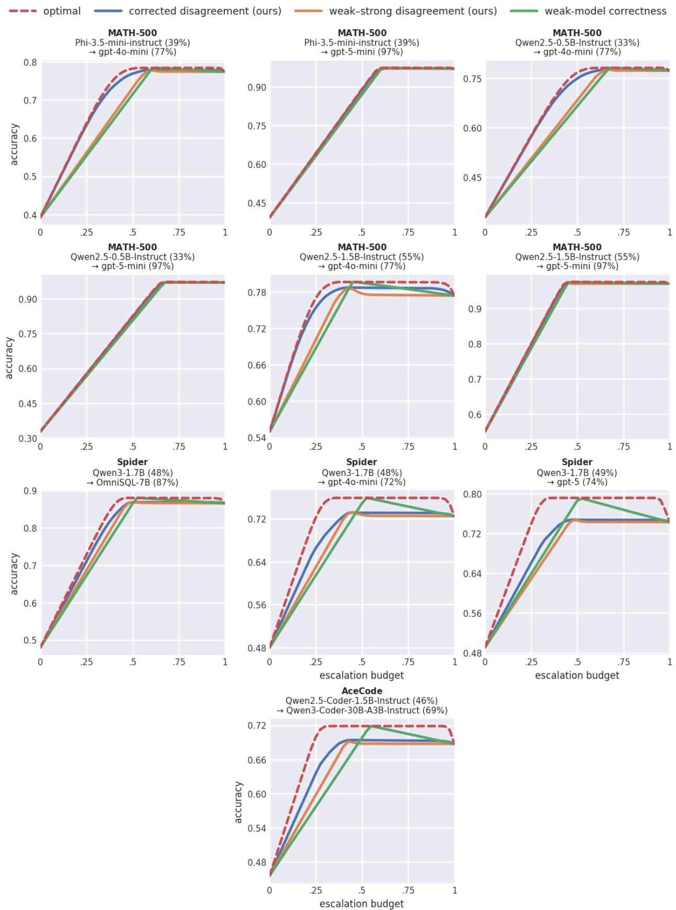  
Figure 4: Population-level comparison of routing signals with N = 1 weak-model response. Each panel shows routing accuracy over the full budget range $B \in [ 0 , 1 ]$ for a diferent dataset and weak–strong model pair. We compare optimal routing, corrected disagreement, raw weak–strong30 disagreement, and weak-model correctness.

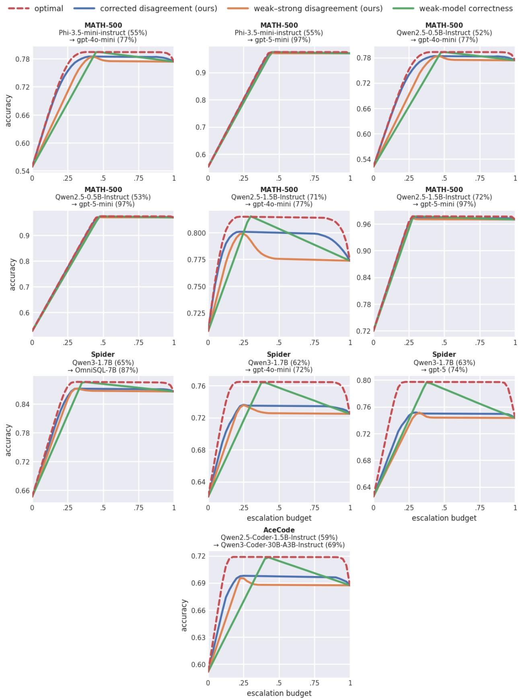  
Figure 5: Population-level comparison of routing signals with N = 4 weak-model responses per prompt. Panels and routing signals follow Figure 4.

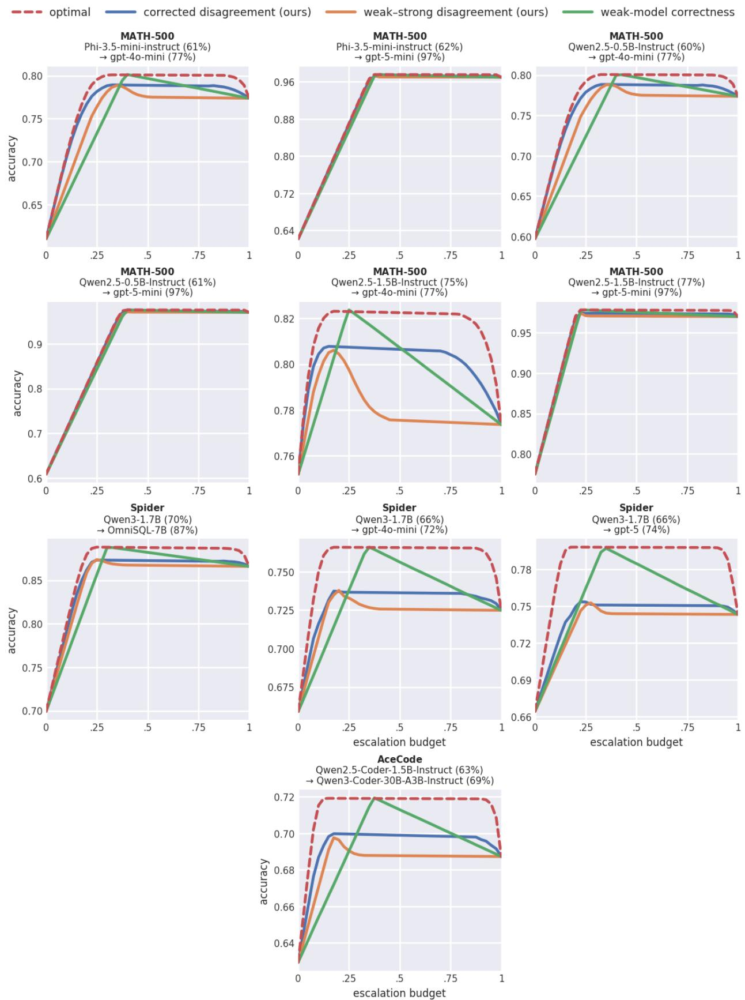  
Figure 6: Population-level comparison of routing signals with N = 8 weak-model responses per prompt. Panels and routing signals follow Figure 4.

Routing: corrected disagreement (ours)  
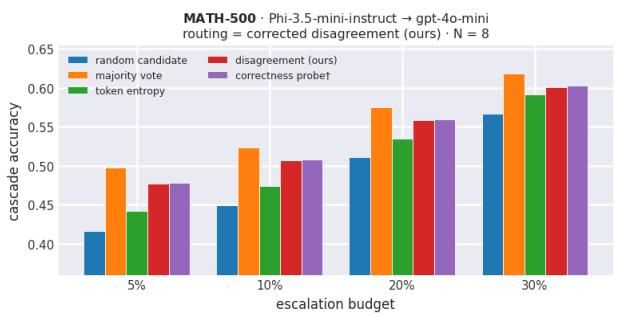  
Selection b = 0% b = 5% b = 10% b = 20% b = 30%

Routing: weak–strong disagreement (ours)  
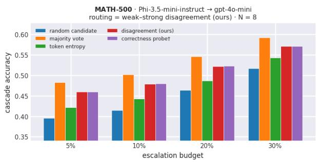  
Selection b = 0% b = 5% b = 10% b = 20% b = 30%

<table><tr><td>Random candidate</td><td>0.377</td><td>0.416</td><td>0.449</td><td>0.511</td><td>0.567</td></tr><tr><td>Majority vote</td><td>0.467</td><td>0.498</td><td>0.524</td><td>0.575</td><td>0.619</td></tr><tr><td>Token entropy</td><td>0.404</td><td>0.443</td><td>0.474</td><td>0.535</td><td>0.592</td></tr><tr><td>Disagreement (ours)</td><td>0.449</td><td>0.478</td><td>0.507</td><td>0.558</td><td>0.601</td></tr><tr><td>Correctness probe†</td><td>0.450</td><td>0.478</td><td>0.508</td><td>0.560</td><td>0.602</td></tr></table>

<table><tr><td>Random candidate</td><td>0.377</td><td>0.395</td><td>0.415</td><td>0.464</td><td>0.517</td></tr><tr><td>Majority vote</td><td>0.467</td><td>0.483</td><td>0.502</td><td>0.546</td><td>0.593</td></tr><tr><td>Token entropy</td><td>0.404</td><td>0.422</td><td>0.443</td><td>0.487</td><td>0.543</td></tr><tr><td>Disagreement (ours)</td><td>0.449</td><td>0.460</td><td>0.479</td><td>0.522</td><td>0.571</td></tr><tr><td>Correctness probe†</td><td>0.450</td><td>0.460</td><td>0.480</td><td>0.523</td><td>0.571</td></tr></table>

Routing: proxy reward<sup>†</sup>  
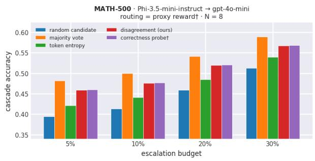

## Routing: self-consistency

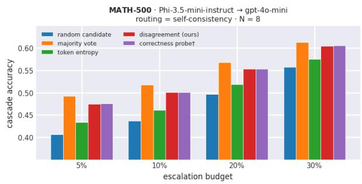

<table><tr><td>Selection</td><td>b = 0% b = 5%</td><td></td><td>b = 10%</td><td>b = 20% b = 30%</td><td></td></tr><tr><td>Random candidate</td><td>0.377</td><td>0.394</td><td>0.413</td><td>0.459</td><td>0.513</td></tr><tr><td>Majority vote</td><td>0.467</td><td>0.482</td><td>0.500</td><td>0.542</td><td>0.589</td></tr><tr><td>Token entropy</td><td>0.404</td><td>0.421</td><td>0.441</td><td>0.485</td><td>0.539</td></tr><tr><td>Disagreement (ours)</td><td>0.449</td><td>0.459</td><td>0.476</td><td>0.520</td><td>0.567</td></tr><tr><td>Correctness probe†</td><td>0.450</td><td>0.460</td><td>0.477</td><td>0.521</td><td>0.568</td></tr></table>

<table><tr><td>Selection</td><td>b = 0% b = 5%</td><td></td><td>b = 10%</td><td>b = 20% b = 30%</td><td></td></tr><tr><td>Random candidate</td><td>0.377</td><td>0.407</td><td>0.437</td><td>0.496</td><td>0.557</td></tr><tr><td>Majority vote</td><td>0.467</td><td>0.492</td><td>0.518</td><td>0.567</td><td>0.613</td></tr><tr><td>Token entropy</td><td>0.404</td><td>0.433</td><td>0.461</td><td>0.519</td><td>0.575</td></tr><tr><td>Disagreement (ours)</td><td>0.449</td><td>0.475</td><td>0.501</td><td>0.553</td><td>0.604</td></tr><tr><td>Correctness probe†</td><td>0.450</td><td>0.475</td><td>0.501</td><td>0.553</td><td>0.605</td></tr></table>

Figure 7: Efect of weak-response selection on Math-500 for Phi-3.5-mini-instruct → GPT-4omini, using N = 8 weak responses per prompt and 500 test prompts. Each panel fixes the routing score and reports cascade accuracy for diferent selection policies and routing budgets. At b = 0, accuracy depends only on the selection policy. Bold values indicate the highest accuracy in each column. <sup>†</sup> denotes methods that use ground-truth supervision during training.

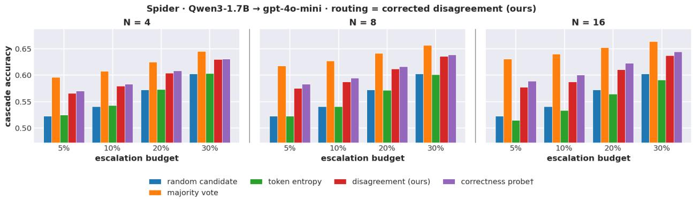  
Figure 8: Efect of weak-response selection on Spider. Routing uses corrected disagreement throughout. We compare selection policies across routing budgets and diferent numbers of weakmodel samples N.

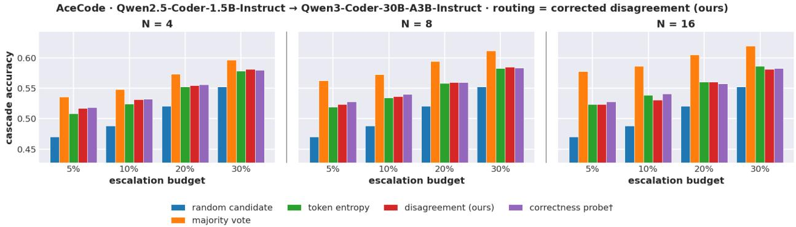  
Figure 9: Efect of weak-response selection on AceCode. Routing uses corrected disagreement throughout. We compare selection policies across routing budgets and diferent numbers of weakmodel samples N.