# Discovering state-of-the-art quantum circuits with large language models

Andi Gu,1, 2, 3, ∗ Alek H. Kemeny,4 Susanne F. Yelin,1, 2 and Mikhail D. Lukin1, 2, 5

1Harvard Quantum Initiative for Science and Engineering, Cambridge, MA 02138, USA

2Department of Physics, Harvard University, Cambridge, MA 02138, USA

3Anthropic STEM Fellows Program

4Anthropic

5QuEra Computing, 1380 Soldiers Field Road, Boston, MA 02135, USA

Significant eforts are currently being directed toward the implementation of large-scale quantum information processors, but realizing useful quantum advantage also requires the development of eficient quantum algorithms. While for many practical problems the dominant resource costs are associated with a small set of computational primitives, optimizing them in the quantum setting presents unique challenges, including a reversibility constraint absent from ordinary classical computation. Here we introduce an evolutionary framework in which large language models (LLMs) propose circuit designs and an independent evaluator verifies and scores them. We apply this framework to tasks spanning numerical computation, chemistry, optimization, quantum simulation, and number theory. In seven of the eight tasks, the discovered circuits significantly reduce both Tofoli and qubit counts relative to the state of the art. In the eighth, the search discovers a new reversible architecture for prime-field modular inversion. By handling reversibility diferently, the architecture makes divsteps—a classical algorithm previously impractical for reversible integer arithmetic—viable and substantially improves the Tofoli–qubit trade-of for modular inversion. These results open the door for evaluator-guided LLM co-design of new algorithmic structures for quantum computation.

Computational primitives based on classical function evaluation play a central role in a wide range of quantum algorithms. Such primitives include decoding routines for optimization [1], numerical functions for quantum simulation [2], arithmetic routines for number theory [3], and quantum read-only memory (QROM), which coherently loads classically specified data into quantum registers [4]. To operate on quantum data, these functions must be compiled into circuits that can be executed coherently on quantum hardware. This imposes two constraints absent from ordinary classical programs. First, because the input may be in superposition, the circuit cannot inspect an intermediate value and select an ordinary classical control-flow path. Data-dependent behavior is instead expressed through controlled operations within a fixed gate sequence, so every branch contributes to the circuit’s cost even if it applies only to some inputs. Second, the computation must be reversible: intermediate information cannot simply be overwritten or discarded. Temporary values must eventually be uncomputed, returning their qubits to their initial state and preventing residual information from remaining entangled with the output. Until they are uncomputed, these values occupy additional qubits. At the same time, when bounded error is permitted, machinery needed only for rare or atypical inputs can sometimes be omitted, reducing resource requirements while keeping the failure probability controlled. Eficient coherent compilation is of major practical importance, and recent reductions in resource requirements have come from coordinated changes to arithmetic algorithms, data representations, and their reversible implementation [5, 6]. Such redesigns are dificult for general quantum circuits because directly testing correctness can require exponentially expensive classical simulation or fully operational large-scale quantum processors. Automated circuit optimizers therefore typically preserve correctness by restricting the search to predefined equivalence-preserving rewrites [7], limiting them to variations of a fixed design.

Here we introduce a framework that pairs large language model (LLM) proposals with an independent evaluator that verifies and scores each candidate. We focus on a class of quantum circuits that compute a classical function f: for an arbitrary input $\begin{array} { r } { \left| \psi \right. = \bar { \sum } _ { x , y } \alpha _ { x , y } \left| x \right. \left| y \right. } \end{array}$ ， the circuit must act as $\begin{array} { r } { | \psi \rangle \longmapsto \sum _ { x , y } \alpha _ { x , y } | \overset { \circ } { x } \rangle | y \oplus f ( x ) \rangle } \end{array}$ where |x⟩ and |y⟩ are computational-basis states of the input and output registers, respectively. By linearity, this coherent action is correct if the circuit performs the required map on every computational-basis input: $| x \rangle | y \rangle \longmapsto | x \rangle | y \oplus f ( x ) \rangle$ . This basis-state reduction makes candidate circuits amenable to programmatic evaluation, since every allowed operation maps a computational-basis state to another computational-basis state, possibly changing its phase, but never creating a superposition [8]. The action of a candidate on any chosen input can therefore be simulated by tracking a bit string and its phase, rather than 2n amplitudes. Resource accounting is also simple: we use the Tofoli count T and the peak qubit count Q, and rank circuits by their product, the TQ-cost. Together, these properties let us build an eficient, programmatic evaluator that checks the correctness and resource cost of any candidate circuit design.

Each search begins from a hand-written task specification and a blank program; the specification states the required circuit behavior but provides no implementation guidance. The LLM proposes a candidate and iteratively revises it using evaluator feedback (Figure 1(a)). Previous work represents candidates as sequences of gates or predefined circuit blocks [9, 10], which can obscure the algorithmic structure of the circuit. Our framework instead lets the LLM propose and revise candidates through a high-level Python interface, where reusable functions and ordinary programming constructs make that structure explicit. This allows a single conceptual change to reorganize operations throughout the circuit, while the evaluator tests its consequences for correctness and resource cost. However, purely iterative refinement of a single candidate can remain tied to the architecture from which it began, resulting in convergence to local (but not necessarily global) optima. We therefore start with an ideation stage in which the LLM is prompted to propose several distinct algorithm families, each representing a diferent approach to the problem. Circuits within each family are optimized independently in parallel, allowing the search to explore diferent strategies rather than only variations of one design. Well-performing candidates are periodically shared between families so that an idea discovered in one approach can inform another.

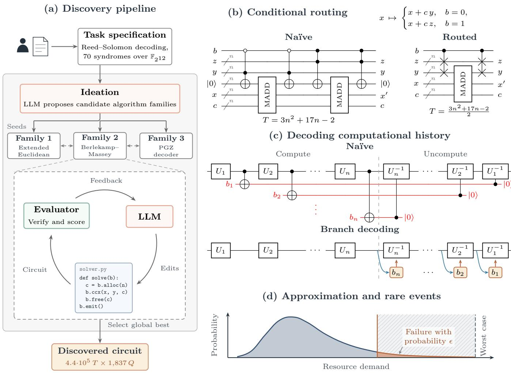  
FIG. 1 Overview of the circuit-discovery framework. (a) A hand-written task specification defines the circuit design task (for example, Reed–Solomon decoding) and is given to an LLM. The LLM proposes architecturally diferent approaches (algorithm families; here extended Euclidean, Berlekamp–Massey, and Peterson–Gorenstein–Zierler (PGZ) decoders), which are then developed and optimized in parallel. Strong candidates are periodically shared between families to allow for cross-pollination of useful ideas. (b) Conditional routing reduces the cost of coherent control flow: for instance, two controlled multiply-adds (MADDs) become inexpensive controlled swaps and one shared arithmetic block. (c) Branch decisions that a naïve reversible computation stores during the forward pass (red) can instead be decoded from the current state during uncomputation. (d) When an application permits bounded error, allowing rare failures on atypical, costly inputs reduces resource requirements.

Across eight diverse compilation tasks, the discovered circuits repeatedly exhibit three common principles of algorithm–circuit co-design. These principles address the features of coherent compilation described above: expressing data-dependent control flow, making intermediate computations reversible without retaining their entire history, and using a failure budget to remove circuit resources devoted to atypical cases (see Figure 1).

## DESIGN PRINCIPLES

One recurring principle in the circuits discovered by the search is to replace conditional arithmetic with conditional routing. A naïve coherent translation of a casewise classical algorithm includes a separately controlled arithmetic block for every branch. The discovered circuits instead use a representation in which the branches difer primarily in which values occupy particular computational roles. Relatively cheap controlled swaps then route the appropriate values into those roles, one unconditional arithmetic path performs the expensive work, and further routing places the results in their required registers. In this sense, where a classical program routes execution to the selected operation, the coherent circuit routes the selected data through a shared operation. The idea resembles bucket-brigade quantum random-access memory (QRAM) [11].

For example, consider four n-qubit fixed-point registers $c , x , y ,$ and $z ,$ together with a control qubit b. Suppose that we wish to perform

$$
x \longmapsto { \left\{ \begin{array} { l l } { x + c y } & { { \mathrm { f o r ~ } } b = 0 , } \\ { x + c z } & { { \mathrm { f o r ~ } } b = 1 , } \end{array} \right. }\tag{1}
$$

while returning $c , y ,$ and z unchanged. A naïve implementation uses two controlled multiply-adds. Conditional routing instead swaps y and z according to $b ,$ applies one uncontrolled multiply-add, and undoes the swap. For the standard schoolbook construction [12], this reduces the Tofoli count from $T _ { \mathrm { n a i v e } } ( n ) = 3 n ^ { 2 } + \bar { 1 7 } n - 2$ to $T _ { \mathrm { r o u t e d } } ( n ) = ( 3 n ^ { 2 } + 1 7 n - 2 ) / 2 .$ , as shown in Figure 1(b).

More generally, conditional routing requires canonicalizing branch-dependent states into a representation on which the same expensive computation applies. Schematically, when the branch can be expressed as $\bar { U } _ { b } = R _ { b } ^ { - 1 } K R _ { b }$ the circuit need only control the inexpensive routing transformation $R _ { b } ;$ the expensive kernel K appears once and need not be controlled. Finding such a decomposition typically takes more than recognizing identical arithmetic in two branches: it exploits an equivalence in the required output so that apparently diferent updates become instances of the same computation. The dificulty lies less in the routing circuit than in determining which branchdependent diferences matter and which can be absorbed into a shared representation.

Reversibility creates a second challenge: reversing a conditional update requires knowing which branch was taken during the forward computation. A naïve implementation records each decision in a history stack whose size grows with the number of updates. But the branch decisions need not always be stored explicitly: diferent branches may leave distinguishable patterns in registers that remain available during uncomputation. As illustrated in Figure 1(c), the circuit can recover the branch bit from such a pattern, use it to select the appropriate inverse update, and then clear the recovered bit, so the register contents serve as an inexpensive record of the branch decisions. For example, suppose we have a register $g$ that begins at $g _ { 0 } = 0$ . In round $j ,$ conditioned on some branch bit $b _ { j }$ , we add $2 ^ { j }$ , so that

$$
g _ { j + 1 } = g _ { j } + b _ { j } 2 ^ { j } .\tag{2}
$$

For arbitrary values of $g _ { j }$ , there is no way to tell from $g _ { j + 1 }$ which branch was taken. Globally, however, there is an important invariant: $g _ { j } < 2 ^ { j }$ , and therefore bit $j$ of $g _ { j + 1 }$ must equal $b _ { j } .$ . During uncomputation, the circuit can simply read this bit to recover $b _ { j }$ . The computation’s evolving state thus supplies the branch decisions in reverse order without a separate history stack. In general, finding such a decoder requires the forward algorithm, its data representation, and its uncomputation procedure to be designed together. Viewed locally, an update may be ambiguous, since either branch can appear to admit a valid predecessor. The ambiguity can disappear once the circuit is restricted to states reachable from the prescribed initialization, where a relation across the registers can distinguish histories that no single register can.

The third principle exploits the small but finite failure probability permitted by most quantum algorithms. Turning this failure budget into resource savings, however, is not automatic. One must first identify the rare inputs that determine worst-case resource requirements. Unlike a classical program, a quantum circuit must contain the gates and ancillas required by every supported path. A rare input can therefore determine the circuit’s Tofoli count or peak qubit count. Yet identifying such inputs is not enough: the circuitry supporting them may not be separable from the computation on typical inputs. The co-design task is to reorganize the computation so that the additional resources required by rare inputs are localized—for example, to extra iterations, stack entries, or arithmetic lanes. Those components can then be omitted while confining failure to the low-probability inputs that require them (Figure 1(d)). In what follows we show how these design principles result in significantly improved algorithmic circuits across a wide variety of quantum tasks.

## REVERSIBLE SYNDROME DECODING FOR DQI

Decoded quantum interferometry (DQI) is a quantum algorithm that turns certain optimization problems into decoding problems for classical error-correcting codes, using quantum interference to favor better solutions. A central application is optimal polynomial intersection (OPI), a form of polynomial fitting over finite fields for which DQI ofers a superpolynomial speedup over known classical algorithms. DQI achieves this by using a Reed– Solomon decoder as a subroutine within the quantum computation [1]. The decoder identifies the positions and values of errors from a collection of algebraic checks called syndromes. DQI requires this decoding to run coherently on a superposition of inputs, making the reversible decoder a dominant resource cost. Khattar et al. [13] compiled

DQI circuits for OPI over binary extension fields using reversible Reed–Solomon decoders based on the extended Euclidean algorithm.

We study their primary Reed–Solomon instance, in which 70 syndrome values uniquely determine an error pattern containing at most 35 errors. Our search framework discovered a circuit that replaces their synchronized Euclidean solve with the Berlekamp–Massey (BM) recurrence. BM substantially reduces the arithmetic cost, but its updates overwrite intermediate values that a naïve reversible implementation would retain in a large history stack. The discovered circuit preserves BM’s arithmetic advantage while avoiding most of this storage (Figure 2).

Reed–Solomon decoding amounts to determining which positions in the data contain errors. The L error positions are encoded in a locator polynomial $\begin{array} { r } { \sigma ( z ) = \sum _ { k = 0 } ^ { L } \sigma _ { k } z ^ { k } } \end{array}$ whose roots identify those positions. To recover the locator coeficients, BM solves for the lowest-degree nonzero polynomial whose convolution (see Figure 2(d)) with the syndrome sequence vanishes:

$$
( S * \sigma ) _ { r } = \sum _ { k = 0 } ^ { L } \sigma _ { k } S _ { r - k } = 0 , \qquad r = L + 1 , \ldots , 7 0 .\tag{3}
$$

BM constructs the locator incrementally. At each round, the convolution evaluated at the next syndrome gives the discrepancy $\Delta { : }$ if it vanishes, no correction is needed; otherwise, BM adjusts the locator coeficients and, when necessary, increases its degree.

To make a correction without invalidating previous rounds of updates, BM retains an earlier polynomial $\tau$ as a correction template, together with its nonzero discrepancy $\delta .$ When $\Delta \neq 0$ , BM scales τ by $\alpha = \Delta / \delta$ and applies the correction $\sigma  \sigma - \alpha \tau$ . BM keeps the template until the current locator has accumulated enough information from subsequent syndromes to take over its role:

$$
( \sigma , \tau , \delta ) \gets \left\{ { ( \sigma - \alpha \tau , \tau , \delta ) } \quad { \mathrm { ( r e t a i n ) } } , \right.\tag{4a}
$$

(4b)

The replace update in Equation (4b) creates the main reversibility problem: it overwrites the previous template τ and discrepancy δ. A naïve reversible implementation stores these displaced values so that the update can later be undone. Over repeated rounds, this accumulates a history of whole polynomials (Figure 2(b)).

The discovered circuit avoids this polynomial history by exploiting a freedom in the decoding task: the locator is needed only up to a nonzero multiplicative factor, because rescaling leaves its roots unchanged. The circuit (Figure 2(c)) therefore implements a rescaled version of both branches of Equation (4), using simple conditional routing and a single shared update:

$$
\begin{array} { r } { ( \sigma , \tau , \delta )  \{ \begin{array} { l l } { ( \sigma - \alpha \tau , \tau , \delta ) } & { ( \mathrm { r e t a i n } ) , } \\ { ( \tau - \alpha ^ { - 1 } \sigma , \sigma , \Delta ) } & { ( \mathrm { r e p l a c e } ) . } \end{array}  } \end{array}\tag{5a}
$$

(5b)

The result $\tau - \alpha ^ { - 1 } \sigma = - \alpha ^ { - 1 } ( \sigma - \alpha \tau )$ difers from the locator in the unrescaled update only by the nonzero scale factor $- \alpha ^ { - 1 }$ and so has the same roots. Both branches can then use one shared arithmetic path without storing the displaced template τ .

This resolves the history problem for the polynomial registers, but the discrepancies present a second reversibility problem. To uncompute a correction, the circuit must recover whichever discrepancy is no longer present after the update. The replace case of Equation (5b) overwrites the stored value $\delta _ { \mathrm { o l d } }$ with $\delta _ { \mathrm { n e w } } = \Delta$ , but the circuit can decode $\delta _ { \mathrm { o l d } }$ from the constant coeficients of the updated locator registers. BM shifts the template by one power of z every round, so τ has zero constant coeficient entering the round. Writing $\sigma _ { 0 }$ and $\tau _ { 0 }$ for the constant coeficients after the update gives $\delta _ { \mathrm { o l d } } = \sigma _ { 0 } \tau _ { 0 } ^ { - 1 } \delta _ { \mathrm { n e w } }$ . This case thus adds no entry to the history stack. In fact, the circuit never stores δ at all: the same relation fixes δ in terms of the locator’s constant coeficient (Supplementary Information [SI] I.1). The retain update of Equation (5a) is the exception: it keeps the previous discrepancy δ, while the current discrepancy $\Delta$ , which is needed to reverse the correction, remains only in a temporary register. Each retain update therefore stores $\Delta$ on the history stack. In the worst case, 35 stack entries (665 qubits) would be needed. Under the DQI input distribution, a second stack entry is required with probability $1 . 0 \times 1 0 ^ { - 4 }$ , so the discovered circuit allocates only one stack entry (19 qubits instead of 665) and permits failure on these rare inputs.

Together, these transformations make the arithmetically eficient BM algorithm suitable for reversible computation.

## REVERSIBLE MODULAR INVERSION

Modular inversion is the task of finding x such that wx ≡ 1 (mod $p )$ , given a nonzero input w and a prime $p .$ It is a central arithmetic subroutine in a range of quantum algorithms [3, 14]. A standard way to compute the inverse is through the extended Euclidean algorithm. Euclidean algorithms repeatedly simplify a pair of integers while preserving their greatest common divisor. By tracking how this divisor is expressed in terms of the original inputs, they also recover coeficients $\alpha , \beta$ satisfying $\alpha p + \beta w = 1$ so $\beta$ is the inverse of w modulo $p .$

Divsteps is a variant of the Euclidean algorithm that replaces division with conditional additions, subtractions, and halving [15]. Starting from $f = p$ and $g = w$ , the goal is to reduce the pair to $f = \pm 1$ and $g = 0$ while preserving their greatest common divisor. The basic strategy is to hold the odd integer $f$ fixed while reducing $g \colon$ if $g$ is even, it can be halved directly; if g is odd, adding or subtracting $f$ first makes it even. These operations preserve the greatest common divisor because $f$ is odd. Holding $f$ fixed indefinitely, however, would leave only one integer being reduced, so the algorithm must periodically swap their roles. A small signed counter z schedules these swaps without ever comparing $f$ and $g \colon$ it roughly tracks how many more bits $f$ has than $^ { g , }$ so a swap occurs once $g$ is likely the smaller of the two. This allows both integers to be reduced using only inexpensive arithmetic and control. Two auxiliary integers $f _ { v }$ and $g _ { v }$ track the input’s contribution in a scaled form: after t steps, they satisfy $f _ { v } w \equiv 2 ^ { t } f$ (mod p) and $g _ { v } w \equiv 2 ^ { t } g$ (mod p). Thus, at termination, $f f _ { v }$ gives the desired inverse up to the scaling factor $2 ^ { t } .$ . The scaling keeps the coeficient updates free of division. Starting from $( z , f , g , f _ { v } , g _ { v } ) = ( 0 , p , w , 0 , 1 )$ each step applies one of three updates:

(a) Synchronized Euclid (Khattar et al.)  
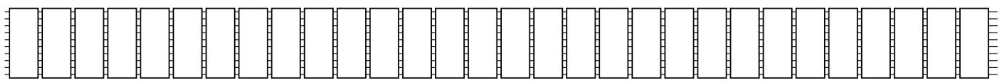

(b) Naïve Berlekamp–Massey  
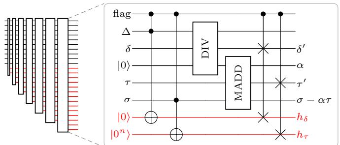

(c) Berlekamp–Massey with conditional routing  
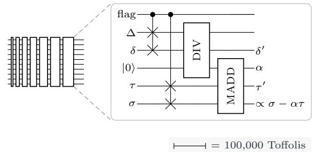

(d) Locator construction by convolution  
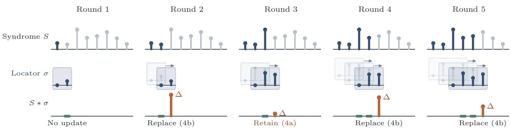  
FIG. 2 Reversible Reed–Solomon decoding. (a) The synchronized extended-Euclidean construction of Khattar et al. [13] requires approximately 1.9 million Tofolis for the locator solve. (b) Berlekamp–Massey reduces this cost to approximately 140,000 Tofolis but naïvely accumulates intermediate information (red). DIV forms $\alpha = \Delta / \delta$ MADD applies the multiply-add, and the flag marks the replace case. (c) Conditional routing preserves this arithmetic advantage while avoiding most history storage. Block widths are proportional to Tofoli count. (d) Locator construction as convolution with the syndrome sequence. The discrepancy ∆ is the convolution at the next syndrome; a nonzero value requires updating the locator.

$$
\begin{array} { r } { \Big ( ( - z , ~ g , ~ ( g - f ) / 2 , ~ 2 g _ { v } , ~ g _ { v } - f _ { v } ) \qquad \mathrm { f o r } ~ z \ge 0 , ~ g \mathrm { ~ o d d } , } \end{array}\tag{6a}
$$

$$
( z ^ { \prime } , f ^ { \prime } , g ^ { \prime } , f _ { v } ^ { \prime } , g _ { v } ^ { \prime } ) = \left\{ ( z + 1 , \ f , \ ( g + f ) / 2 , \ 2 f _ { v } , \ g _ { v } + f _ { v } ) \quad \mathrm { f o r \ z < 0 , \ g \ o d d , } \right.\tag{6b}
$$

$$
{ \bf { \zeta } } \left( { z + 1 , ~ f , ~ g / 2 , ~ 2 f _ { v } , ~ g _ { v } } \right) \mathrm { { f o r } ~ } g \mathrm { { e v e n . } }\tag{6c}
$$

Classically, each update overwrites the current state. Reversing the computation, however, requires knowing which of the three updates was applied. A naïve implementation would store this choice at every step, accumulating a history stack alongside the arithmetic registers. The discovered circuit instead recovers decisions from the current arithmetic state. Some decisions are easy to recover from the updated registers, while others require a more involved decoding procedure. We label each update by two bits: s records whether the step swaps the roles of $f$ and $^ { g , }$ and b records whether the incoming $g$ is odd. The updates in Equations (6a) to (6c) have labels $( s , b ) =$ (1, 1), (0, 1), (0, 0), respectively. The task during uncomputation is to recover these bits from the updated state.

For many steps, recovering b and s requires only a few observations about the updated registers. A swap (Equation (6a)) always leaves a distinctive pattern in $f _ { v } ^ { \prime }$ To see this, note that throughout the recurrence, $f _ { v }$ is even and $g _ { v }$ is odd. A swap sets $f _ { v } ^ { \prime } = 2 g _ { v }$ , which has exactly one trailing zero bit, whereas a nonswap sets $f _ { v } ^ { \prime } = 2 f _ { v } ^ { \prime }$ which is divisible by four. Thus the updated coeficient identifies every swap, recovering both $s = 1$ and $b = 1$ ; otherwise, $s = 0$ , so the swap bit s is always cheaply recoverable. For nonswaps, two further tests determine $b .$ I $\vdots z ^ { \prime } \geq 1$ , the incoming $g$ must have been even, since an odd value would have triggered a swap. If the step first reaches $g ^ { \prime } = 0$ , the incoming $g$ must instead have been odd, since halving a nonzero even integer cannot give zero. Together, these simple tests recover about two thirds of the decisions in a typical walk (the sequence of divsteps applied to one input). The only unresolved cases are nonterminating nonswaps with $z ^ { \prime } \leq 0$ , where the circuit must determine whether the step added $f _ { v }$ to $g _ { v } .$ that is, the bit b in the update $( f _ { v } ^ { \prime } , g _ { v } ^ { \prime } ) = ( 2 f _ { v } , g _ { v } + b f _ { v } )$

Consider a swap followed by a sequence of these ambiguous nonswaps, which we call an excursion. Immediately after the swap, $f _ { v } = 2 q$ for some odd q. On the jth step of the excursion, $f _ { v } = 2 ^ { j - 1 } q$ (hence $f _ { v } ^ { \prime } = 2 ^ { j } q )$ , where the excursion depth $j$ counts the initiating swap as step 1. Equivalently, $j$ is the number of trailing zero bits in the updated coeficient $f _ { v } ^ { \prime } ,$ . The update to $g _ { v }$ becomes

$$
g _ { v } ^ { \prime } = g _ { v } + b 2 ^ { j - 1 } q .\tag{7}
$$

Note that this almost matches the binary-record construction in Equation (2). The only diference is the shared factor $q \colon$ to recover b, we need to remove the factor q from the update. Since $f _ { v } ^ { \prime } = 2 ^ { j } q$ is known, we can recover $q$ by removing the trailing zero bits from $f _ { v } ^ { \prime }$ . To remove the same factor from both sides of the update, we multiply by $q ^ { - 1 }$ modulo $2 ^ { j } ;$ this inverse exists because $q$ is odd. The update rule then becomes

$$
g _ { v } ^ { \prime } q ^ { - 1 } { \mathrm { ~ m o d ~ } } 2 ^ { j } = ( g _ { v } q ^ { - 1 } { \mathrm { ~ m o d ~ } } 2 ^ { j } ) + b 2 ^ { j - 1 } .\tag{8}
$$

Crucially, in Appendix $\mathrm { A }$ , we show that $( g _ { v } q ^ { - 1 }$ mod $2 ^ { j } ) <$ $2 ^ { j - 1 }$ . Therefore,

$$
b = { \mathrm { b i t } } _ { j - 1 } \left( g _ { v } ^ { \prime } q ^ { - 1 } { \mathrm { m o d } } \ 2 ^ { j } \right) ,\tag{9}
$$

where bit positions are counted from zero at the least significant (rightmost) bit. Every quantity on the righthand side is determined by the updated registers, so the rule recovers the branch decision without access to the previous state. This recovery relies on a global invariant ensuring that earlier branch history cannot contaminate the deciding bit. The LLM identified this invariant, which links information accumulated across successive updates to the branch decisions needed during uncomputation, and developed it into a proof that the arithmetic state retains the information required for recovery [16].

For a given $j ,$ the rule in Equation (9) depends only on the lowest $j$ bits of $g _ { v } ^ { \prime }$ and the lowest $j$ bits of $q .$ Therefore, for each small value of $j ,$ , we treat the decoding rule as a truth table mapping $2 j$ input bits to a single bit b, and compile it directly into a Boolean circuit. For larger $j ,$ the decoder must inspect more bits and becomes increasingly expensive. Although every decision is recoverable in principle, decoding all of them does not give the cheapest circuit. A tunable cutof $j _ { \mathrm { s t o r e } }$ determines which ambiguous decisions are decoded and which are stored. At depths $j < j _ { \mathrm { s t o r e } } ,$ the circuit uses a decoder; at depths $j \geq j _ { \mathrm { s t o r e } } ,$ it writes the decision to a history stack. Increasing the cutof spends more Tofolis on decoding while reducing the required history storage, giving a family of circuits that trade Tofoli count against qubit count (SI II).

Further savings are possible when the application permits a small failure probability. We use this failure budget to exclude rare, unusually demanding inputs through two resource limits: a fixed history-stack size and a fixed window of supported stopping times. The history-stack limit builds on the decoding trade-of. With $j _ { \mathrm { s t o r e } } = 5 _ { \mathrm { : } }$ , only 12.4% of ambiguous decisions are written to the stack (Figure 3(a)). On average, the required stack size is 21 history qubits, but it can reach 263 in the worst case. We instead reserve 60 and allow the circuit to fail on rare inputs for which the stack overflows. Such overflows occur with probability $2 . 4 \times 1 0 ^ { - 6 }$ per inversion (Figure 3(b)), saving 203 history qubits relative to the worst case. The stopping-time limit addresses a separate cost. A fixed quantum circuit must schedule enough steps for every input it supports. Although 590 divsteps sufice even in the worst case, stopping times are concentrated in a much narrower range (Figure 3(b)). The discovered circuit therefore schedules 533 steps and tests for termination only from step 499 onward; inputs that terminate outside this window are allowed to fail.

Branch decoding and bounded resource allocation thus make divsteps practical for reversible modular inversion. $\mathrm { A }$ complete benchmark circuit built on this inversion (SI II) uses 4.0 million Tofolis and 935 qubits.

## DISCUSSION AND OUTLOOK

The DQI and modular inversion constructions illustrate how redesigning the representation and uncomputation of an algorithm can substantially reduce its quantum resource requirements. Similar gains arise across the other tasks studied here. For seven of the eight tasks, the discovered circuit uses both fewer Tofolis and fewer qubits than the corresponding baseline. Table I summarizes these improvements, and the Supplementary Information gives details for each task.

A recurring source of these gains is the recovery of classical algorithmic eficiency under the constraints of quantum computation. In a naïve reversible implementation, coherent control and cleanup can introduce enough overhead to obscure the advantages of an eficient classical method. Our Berlekamp–Massey and divstep constructions show how jointly choosing the algorithm, representation, and uncomputation can recover those advantages. These results suggest that some apparent costs of quantum arithmetic reflect limitations of existing reversible constructions rather than of the algorithms themselves.

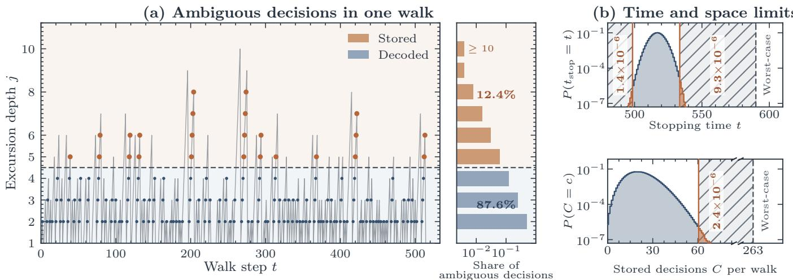  
FIG. 3 Making divsteps reversible with minimal overhead. (a) Excursion depth j in one representative walk. Dots mark ambiguous decisions. We use a cutof $j _ { \mathrm { s t o r e } } = 5 ,$ , so all ambiguous decisions with $j \geq 5$ are stored rather than decoded. The histogram shows the distribution of excursion depths over uniformly sampled walks: only 12.4% of ambiguous decisions reach $j \geq 5 .$ . (b) Empirical stopping-time and history-size distributions. The discovered circuit assumes that every walk terminates between steps 499 and 533; this assumption fails with probability $\sim 1 0 ^ { - 5 }$ . It also allocates enough qubits to store at most 60 branch decisions, which is suficient for all but a $2 . 4 \times 1 0 ^ { - 6 }$ fraction of walks.

TABLE I Tofoli–qubit results across the eight compilation tasks, comparing baselines against our discovered circuits (see Extended Data Table 1 for details); $G _ { T Q } = ( T Q ) _ { \mathrm { b a s e l i n e } } / ( T Q ) _ { \mathrm { o u r s } }$ . Where a baseline contains free parameters, we choose them to minimize its T Q-cost. HHL: Harrow–Hassidim–Lloyd.
<table><tr><td>Task</td><td>Baseline  $( T , Q )$  Ours  $( T , Q )$ </td><td> $G _ { T Q }$ </td></tr><tr><td>Reed-Solomon DQI decoder</td><td> $\left( 5 . 1 { \cdot } 1 0 ^ { 6 } , 1 , 9 3 8 \right)$   $( 4 . 4 { \cdot } 1 0 ^ { 5 } , 1 , 8 3 7 )$ </td><td>12</td></tr><tr><td>Hermitian DQI decoder</td><td> $( 1 . 0 { \cdot } 1 0 ^ { 8 } , 1 . 9 { \cdot } 1 0 ^ { 5 } ) ^ { \dagger }$   $( 9 . 3 { \cdot } 1 0 ^ { 5 } , 2 , 3 9 5 )$ </td><td></td></tr><tr><td>HHL rotation angle</td><td> $( 1 . 6 { \cdot } 1 0 ^ { 4 } , 3 0 0 )$  (1,348, 115)</td><td>32</td></tr><tr><td>Coulomb potential</td><td> $( 6 , 3 5 5 , 2 5 2 )$  (1,140, 142)</td><td>9.9</td></tr><tr><td>Fixed-point Gaussian</td><td> $( 2 . 4 { \cdot } 1 0 ^ { 4 } , 3 6 2 )$ </td><td>(1,583, 139) 39</td></tr><tr><td> $\mathrm { F e _ { 2 } S _ { 2 } }$  alias-SELECT</td><td> $( 5 . 5 { \cdot } 1 0 ^ { 4 } , 1 3 9 )$   $( \mathrm { i . 5 { \cdot } 1 0 ^ { 4 } , 1 2 \mathrm { 6 } } )$ </td><td>4.1</td></tr><tr><td>Nonabelian lattice-gauge simulation</td><td> $( 1 . 3 { \cdot } 1 0 ^ { 6 } , 1 , 9 2 7 )$ </td><td> $( 1 . 7 { \cdot } 1 0 ^ { 5 } , 1 , 8 5 9 )$  7.7</td></tr><tr><td>Prime-field modular inversion</td><td>‡  $( 4 . 0 { \cdot } 1 0 ^ { 6 } , 9 3 5 )$ </td><td></td></tr></table>

† Naïve reversible implementation; no prior reversible compilation exists in the literature.  
‡ Costs are for the complete benchmark circuit; see SI II for the benchmark and prior constructions.

Finding such constructions requires reasoning about choices whose benefits depend on one another. An arithmetic saving may become useful only after the associated control and uncomputation costs have also been reduced. A candidate design must therefore be carried through several unresolved mathematical and implementation problems before its resource advantage becomes apparent.

The framework is bounded by the choices that define each task. One is the objective that ranks circuits: we use the TQ-cost for a uniform comparison, but other objectives are equally reasonable. In practice, the relative importance of qubit count, depth, routing, and measurements depends on details such as hardware constraints, decoder performance, and error-correction architecture. The scoring function can be replaced with a hardwareappropriate combination of these resources, but determining that objective remains a matter of application and hardware judgment. The circuit interface defines a second boundary. Here, the required transformation is specified in a fixed computational basis, excluding optimizations whose advantage comes from changing the encoding itself. For example, coset representations can make modular addition cheaper by encoding each residue as a superposition of congruent integers, which avoids conventional comparisons and corrections at the cost of an exponentially small error [17, 18], but such encodings lie outside the present framework. More generally, the task boundary, input distribution, data representations, and accuracy target make a search well posed while also encoding assumptions about how the circuit is embedded in a larger algorithm (in particular, which states it receives and how its outputs are consumed).

The same choices that bound the search also make reliable programmatic feedback possible: they specify what each candidate must preserve and which resource tradeofs the evaluator should reward. Within these boundaries, our results show that evaluator-guided LLM search can go beyond refining a fixed circuit to uncover new reversible algorithms and representations. Related approaches have produced new algorithms in combinatorics and linear algebra [19, 20]. These observations suggest a practical criterion for extending the approach: wherever a problem admits a suficiently expressive task interface and its correctness and resource costs can be evaluated cheaply enough to sustain many rounds of search, the same evaluatorguided search may provide a route to new algorithms.

These results, together with related progress in reinforcement learning and LLM-guided discovery of quantum error-correcting codes and encoding circuits [21–23], create an opportunity for end-to-end co-design of faulttolerant computation. Choices that are usually made separately—the algorithm and its logical circuit, the error-correcting code and its method for universal logic, the supply of magic states, and the physical execution architecture—strongly determine one another’s costs. A programmatic evaluator that propagates logical errors, resource demand, and hardware requirements across these layers could allow an LLM search to redesign them together, potentially discovering fault-tolerant algorithms and architectures that cannot be found by optimizing each layer in isolation.

## ACKNOWLEDGMENTS

We thank Pablo Bonilla, Arjun Kar, Nazli Ugur Koyluoglu, Rohan Mehta, Varun Menon, and Vinay Ramasesh for feedback on the manuscript. AG conducted part of this work under the Anthropic STEM Fellows Program. Work at Harvard was supported by IARPA and the Army Research Ofice under the Entangled Logical Qubits program (Cooperative Agreement Number W911NF-23-2-0219) and by the National Science Foundation (NVQL grant PHY-2410716).

## METHODS

A classical function cannot generally be applied directly within a quantum algorithm, because quantum evolution must be reversible. Instead, a function f is embedded in a reversible map $| x \rangle | y \rangle \longmapsto | x \rangle | y \oplus f ( x ) \rangle$ . A natural model for these subroutines is the kickmix circuit model of Babbush et al. [8], which augments reversible classical computation with measurement-based uncomputation (MBU) and diagonal sign gates. Despite these additional operations, kickmix circuits remain eficiently classically simulable. This allows candidate circuits to be tested for their action on coherent quantum superpositions, providing the reliable correctness signal needed for evolutionary search.

Circuits that implement the same specification can have very diferent time and space requirements. We use Tofoli count and peak qubit count as proxies for these costs. Tofoli gates require expensive non-Cliford resources, so their count tracks a large part of the logical work and often the runtime [24, 25]. The peak qubit count measures the data and ancillas that must coexist during execution and therefore approximates the required logical processor footprint [26]. The two resources also typically trade against each other: additional ancillas can avoid recomputation, while recycling ancillas can reduce space at the cost of additional gates. We multiply these quantities to obtain the $T Q \mathrm { - c o s t }$ , which provides a single objective for comparing such designs.

Together, the correctness tests and TQ-cost define a constrained optimization problem over circuit-generating programs. Motivated by recent advances in coding and reasoning agents and LLM-guided algorithmic discovery, we use an LLM to propose coordinated, task-specific redesigns within an evolutionary search [20, 27, 28].

## Circuit model and validity

A compilation task specifies a reversible action on computational-basis states: a permutation π and, when needed, a Boolean phase g. A circuit may use a ancilla qubits, but must return them to zero:

$$
V \left| x \right. \left| 0 ^ { a } \right. = ( - 1 ) ^ { g ( x ) } \left| \pi ( x ) \right. \left| 0 ^ { a } \right. .\tag{10}
$$

Every ancilla must return to |0⟩ because quantum operations must be unitary, and thus reversible. For a numerical approximation, the required output relation may instead specify an error bound; interface preservation, phase correctness, and ancilla uncomputation remain exact. We separately allow some circuits to fail on a bounded fraction of inputs drawn from a stated distribution; this fraction is the failure budget. Following Babbush et al. [8], the kickmix model permits three classes of operation:

1. classical reversible gates: X, CNOT, Tofoli, and swap;

2. diagonal sign gates: Z, CZ, CCZ, and global sign flips; and

3. destructive X-basis measurements.

Before any measurement, the evolution of a computational-basis input is simple. Reversible gates update its stored bit string, while diagonal gates update only its sign, so the state remains of the form $( - 1 ) ^ { \phi } \bar { | } x \rangle$ . A classical simulator therefore need only track the current bits x and the sign ϕ, rather than a full state vector. The operations apply phase kickback while mixing basis states, giving kickmix its name.

To illustrate why uncomputation is costly, consider a temporary AND. A Tofoli computes t = uv into an ancilla. After t has been used, applying the same Tofoli again returns that qubit to zero:

$$
\left| u , v \right. \left| 0 \right. \xrightarrow { \mathrm { \bf ~ T o f f o l i } } \left| u , v \right. \left| u v \right. \xrightarrow { \mathrm { \bf ~ u s e ~ } u v } \left| u , v \right. \left| u v \right. \xrightarrow { \mathrm { \bf ~ T o f f o l i } } \left| u , v \right. \left| 0 \right. .\tag{11}
$$

Computing and uncomputing this temporary AND therefore costs two Tofolis.

MBU, introduced by Gidney [29], replaces the second Tofoli with a destructive X-basis measurement and a cheap phase correction. Measuring t produces a uniformly random outcome r and releases the ancilla, which can be restored to |0⟩:

$$
\left| u , v \right. \left| 0 \right. \xrightarrow { \mathrm { \bf ~ T o f e n i } } \left| u , v \right. \left| u v \right. \xrightarrow { \mathrm { \bf ~ u s e ~ } u v } \left| u , v \right. \left| u v \right. \xrightarrow { \mathrm { \bf ~ X . m e a s u r e ~ } r } \left( - 1 \right) ^ { r u v } \left| u , v \right. \left| 0 \right. \xrightarrow { \mathrm { \bf ~ C Z ~ i f ~ } r = 1 } \left| u , v \right. \left| 0 \right. .\tag{12}
$$

Because CZ is Cliford, the temporary AND is computed and cleared using only one Tofoli. By linearity, the same reasoning applies component by component when the retained bits are in superposition.

More generally, suppose an ancilla contains a Boolean function $f ( y )$ of retained basis data y. If m records any earlier measurement outcomes, the simulator represents the ancilla’s destructive X-basis measurement by the transition

$$
( ( y , f ( y ) ) , m , \phi ) \longmapsto ( y , m r , \phi \oplus r f ( y ) ) , \qquad \operatorname* { P r } ( r = 0 ) = \operatorname* { P r } ( r = 1 ) = { \frac { 1 } { 2 } } .\tag{13}
$$

On a coherent input, the retained state is therefore

$$
\sum _ { y } \alpha _ { y } ( - 1 ) ^ { r f ( y ) } | y \rangle .\tag{14}
$$

When $r = 1$ , a classically conditioned diagonal circuit for $( - 1 ) ^ { f ( y ) }$ cancels this sign.

For a fixed computational-basis input and a particular sequence of measurement outcomes m, we call the resulting evolution a computational-basis trajectory. A kickmix circuit may perform several such measurements. Their outcomes may be combined by classical XOR and may control diagonal corrections, but cannot control gates that change the stored basis string. Every measurement record therefore induces the same basis permutation:

$$
V _ { m } \left| x \right. = ( - 1 ) ^ { \phi ( x , m ) } \left| \pi ( x ) \right. .\tag{15}
$$

Exact coherent correctness additionally requires

$$
\phi ( x , m ) = g ( x )\tag{16}
$$

for every allowed input and every record of nonzero probability. The measurement register then factors from the logical output. Allowing an outcome to control a basis-changing gate would instead make the permutation depend on the record and could leave the logical output correlated with the measurement environment.

## Validation and statistical guarantees

The circuits are ultimately applied to coherent superpositions, whereas the evaluator follows one computational-basis trajectory at a time. Each test must therefore capture enough information to determine the trajectory’s coherent action. For a basis input x and measurement record m, the evaluator checks that the output matches the target, required inputs are unchanged, every ancilla has returned to |0⟩, and the phase agrees with the target exactly. These checks compare the complete final state rather than only its classical output. An ancilla that retains input-dependent information can become entangled with the logical registers, while an incorrect sign can alter subsequent interference without changing any output bit. Resetting or tracing out a dirty ancilla is therefore not a substitute for uncomputing it.

If every pair $( x , m )$ passes these tests, the measurement record factors from the logical output, and linearity extends agreement on every trajectory to any coherent input. For large input domains, however, the evaluator samples these trajectories rather than checking them all.

Consider a coherent input $\begin{array} { r } { | \psi \rangle = \sum _ { x } \alpha _ { x } \left| x \right. } \end{array}$ ⟩, with $\mathcal { D } ( x ) = | \alpha _ { x } | ^ { 2 }$ , and let M be the set of possible measurement records. After deferring the measurements, the candidate and target states can be written as

$$
\left| \Phi _ { V } \right. = { \frac { 1 } { \sqrt { \left| { \mathcal { M } } \right| } } } \sum _ { x , m } \alpha _ { x } V _ { m } \left| { x } \right. \left| { m } \right. , \qquad \left| \Phi _ { U } \right. = { \frac { 1 } { \sqrt { \left| { \mathcal { M } } \right| } } } \sum _ { x , m } \alpha _ { x } U \left| { x } \right. \left| { m } \right. .\tag{17}
$$

Let B be the set of pairs (x, m) on which $V _ { m } \left| x \right. \neq U \left| x \right.$ , and let

$$
\varepsilon = \frac { 1 } { | \mathcal { M } | } \sum _ { ( x , m ) \in B } | \alpha _ { x } | ^ { 2 }\tag{18}
$$

be the probability of B under D and the uniform distribution over measurement records. Projecting onto the span of these defective trajectories gives

$$
\left\| | \Phi _ { V } \rangle - | \Phi _ { U } \rangle \right\| \leq 2 { \sqrt { \varepsilon } } .\tag{19}
$$

Consequently, the state fidelity is at least $( 1 - 2 \varepsilon ) ^ { 2 }$ . Any subsequent measurement distribution changes by at most $2 \sqrt \varepsilon$ in total variation distance. We bound ε by drawing x from D and sampling every measurement outcome uniformly, exactly as in a basis trajectory. For a candidate fixed before the test draw, k independent tests all pass with probability $( 1 - \varepsilon ) ^ { k }$ . Thus, if all k tests pass, then with confidence 1 − δ

$$
\varepsilon \le 1 - \delta ^ { 1 / k } \approx \frac { \ln ( 1 / \delta ) } { k } .\tag{20}
$$

More generally, if a test with k random samples accepts at most b failures, a candidate with true failure probability ε passes with probability

$$
P _ { k , b } ( \varepsilon ) = \sum _ { j = 0 } ^ { b } { \binom { k } { j } } \varepsilon ^ { j } ( 1 - \varepsilon ) ^ { k - j } .\tag{21}
$$

# Cost model and scoring

We define the T Q-cost of a circuit by

$$
T Q = \mathrm { T o f f o l i ~ c o u n t } \times \mathrm { p e a k ~ q u b i t ~ c o u n t } ,\tag{22}
$$

where T counts Tofoli and CCZ gates equally and Q is the largest number of logical qubits allocated at once.

We weight space and time equally in this cost function for simplicity. In practice, their relative importance depends on the hardware and application. When qubits are scarce, for example, a cost of the form (qubit count)κ ×Tofoli count with κ > 1 may be more appropriate; resource estimates for factoring have used κ between 1 and 3 [6, 30]. Either T or Q can also be replaced with other measures of time or space. In particular, when there is limited magic-state-factory throughput (as is typically the case), runtime is bottlenecked by the Tofoli count, motivating its widespread use as a time proxy [24, 25]. However, with enough factories to supply magic states in parallel, Tofoli depth rather than Tofoli count limits runtime. Similarly, for architectures with cheap cold storage for inactive qubits [31], Q can be replaced by active volume [32], which counts only the qubits participating in logical operations.

The search is not tied to the specific form of the TQ-cost: it can run with any computable objective. A later case study illustrates the available trade-ofs: the modular-inversion search (SI II) produces a family of circuits along a Tofoli–qubit frontier (SI II.1), and an objective that weights qubit count more heavily selects a lower-qubit member of that family.

## Evolutionary search

We encode each candidate as Python code that constructs a circuit. Functions, loops, and named registers preserve the organization of the computation, allowing the LLM to reason about arithmetic subroutines and their composition without reconstructing that structure from a flattened gate sequence. For example, changing a shared arithmetic routine changes every place where it is used, while reorganizing calls to that routine can change when intermediate values are computed, retained, and uncomputed. The representation thus makes coordinated changes expressible as revisions to the underlying algorithm.

We search over these circuit-generating programs with OpenEvolve [33], using Claude Mythos 5 [28] to propose architectures and program rewrites. Each of the eight searches uses a fixed, hand-written task specification, and al share the same generic circuit-building interface. During ideation, the LLM receives only the specification, circuit model, and correctness criteria, and proposes several distinct circuit architectures. The LLM has no access to the evaluator beyond the feedback returned after each submission. Starting from a blank program, it chooses the algorithm, representation, and circuit structure and produces the discovered circuits without substantive human intervention.

Each architecture proposed during ideation founds a separate family of candidate programs. Later iterations improve descendants of the first working implementation. Keeping the families separate at first gives each approach time to mature, even if its earliest circuits are less eficient than those based on another approach. Periodically, leading programs are shared across families, allowing successful ideas from diferent approaches to combine.

The search retains candidate programs and their evaluation results, tracking which family each belongs to and which earlier program it was derived from. It also saves feedback on failures and short notes in which the LLM records useful insights. These programs, results, and notes carry information between iterations; the sessions do not share a continuously growing conversation.

Each iteration starts a new LLM agent session with the task specification, a parent program to improve, and its evaluation feedback. The agent also receives alternative programs from the archive and their resource costs, brief summaries of earlier attempts, and recorded insights where available. This context is limited; the agent never sees the complete search history. Within the session, it may rewrite the program, run drafts on test inputs, query a classica oracle for the required function on chosen inputs, and use the results to revise its design. It may also delegate focused subtasks to subagents. The iteration ends with submission of a revised program. The evaluator rejects a circuit that does not meet the task specification; a valid one is scored by its TQ-cost and considered for retention in its family. Thus the LLM is free to propose broad changes without having to judge their correctness: the evaluator supplies an independent test of every completed design. Extended Data Figure 1 shows the ideation and rewrite calls and a concrete feedback-and-repair cycle for a small finite-field inversion task.

To decide which valid candidates remain available within each family, the search retains circuits with diferent trade-ofs between Tofoli count and qubit count. We implement this selection with MAP-Elites [34], which divides the (T, Q) resource plane into cells and keeps the circuit with the lowest TQ-cost in each cell. A space-eficient circuit can therefore remain available for later development even when its higher Tofoli count gives it a worse TQ-cost.

Because the families preserve alternatives, progress need not be monotonic in either resource. The Gaussian lineage in Extended Data Figure 2, for example, contains descendants that temporarily worsen Tofoli count or qubit count before reaching a region of lower TQ-cost. We report the lowest TQ-cost reached across all families at the end of the search.

[1] S. P. Jordan, N. Shutty, M. Wootters, A. Zalcman, A. Schmidhuber, R. King, S. V. Isakov, and R. Babbush, Optimization by Decoded Quantum Interferometry, Nature 646, 831 (2025), arXiv:2408.08292.

[2] R. Babbush, D. W. Berry, I. D. Kivlichan, A. Y. Wei, P. J. Love, and A. Aspuru-Guzik, Exponentially more precise quantum simulation of fermions in second quantization, New Journal of Physics 18, 033032 (2016).

[3] M. Roetteler, M. Naehrig, K. M. Svore, and K. Lauter, Quantum resource estimates for computing elliptic curve discrete logarithms, in Advances in Cryptology – ASIACRYPT 2017 , Lecture Notes in Computer Science, Vol. 10625 (2017) pp. 241–270, arXiv:1706.06752.

[4] R. Babbush, C. Gidney, D. W. Berry, N. Wiebe, J. R. McClean, A. Paler, A. G. Fowler, and H. Neven, Encoding electronic spectra in quantum circuits with linear T complexity, Physical Review X 8, 041015 (2018).

[5] C. Chevignard, P.-A. Fouque, and A. Schrottenloher, Reducing the number of qubits in quantum factoring, in Advances in Cryptology – CRYPTO 2025, Part II, Lecture Notes in Computer Science, Vol. 16001 (2025) pp. 384–415.

[6] C. Gidney, How to factor 2048 bit RSA integers with less than a million noisy qubits (2025), arXiv:2505.15917.

[7] Y. Nam, N. J. Ross, Y. Su, A. M. Childs, and D. Maslov, Automated optimization of large quantum circuits with continuous parameters, npj Quantum Information 4, 23 (2018).

[8] R. Babbush, A. Zalcman, C. Gidney, M. Broughton, T. Khattar, H. Neven, T. Bergamaschi, J. Drake, and D. Boneh, Securing elliptic curve cryptocurrencies against quantum vulnerabilities: Resource estimates and mitigations, PRX Quantum 7, 031001 (2026), arXiv:2603.28846.

[9] Z. Liang, J. Cheng, R. Yang, H. Ren, Z. Song, D. Wu, X. Qian, T. Li, and Y. Shi, Unleashing the potential of LLMs for quantum computing: A study in quantum architecture design (2023), arXiv:2307.08191 [quant-ph].

[10] A. Macarone-Palmieri and R. Lo Franco, Quantum circuit generation via test-time learning with large language models (2026), arXiv:2602.03466 [quant-ph].

[11] V. Giovannetti, S. Lloyd, and L. Maccone, Quantum random access memory, Physical Review Letters 100, 160501 (2008), arXiv:0708.1879.

[12] T. Häner, M. Roetteler, and K. M. Svore, Optimizing quantum circuits for arithmetic (2018), arXiv:1805.12445 [quant-ph].

[13] T. Khattar, N. Shutty, C. Gidney, A. Zalcman, N. Yosri, D. Maslov, R. Babbush, and S. P. Jordan, Verifiable quantum advantage via optimized DQI circuits (2025), arXiv:2510.10967.

[14] W. van Dam and G. Seroussi, Eficient quantum algorithms for estimating Gauss sums (2002), arXiv:quant-ph/0207131.

[15] D. J. Bernstein and B.-Y. Yang, Fast constant-time GCD computation and modular inversion, IACR Transactions on Cryptographic Hardware and Embedded Systems 2019, 340 (2019).

[16] A. Gu, uncompute (2026).

[17] C. Zalka, Shor’s algorithm with fewer (pure) qubits (2006), arXiv:quant-ph/0601097.

[18] C. Gidney, Approximate encoded permutations and piecewise quantum adders (2019), arXiv:1905.08488.

[19] B. Romera-Paredes, M. Barekatain, A. Novikov, M. Balog, M. P. Kumar, E. Dupont, F. J. R. Ruiz, J. S. Ellenberg, P. Wang, O. Fawzi, P. Kohli, and A. Fawzi, Mathematical discoveries from program search with large language models, Nature 625, 468 (2024).

[20] A. Novikov, N. V˜u, M. Eisenberger, E. Dupont, P.-S. Huang, A. Z. Wagner, S. Shirobokov, B. Kozlovskii, F. J. R. Ruiz, A. Mehrabian, M. P. Kumar, A. See, S. Chaudhuri, G. Holland, A. Davies, S. Nowozin, P. Kohli, and M. Balog, AlphaEvolve: A coding agent for scientific and algorithmic discovery (2025), arXiv:2506.13131.

[21] V. P. Su, C. Cao, H.-Y. Hu, Y. Yanay, C. Tahan, and B. Swingle, Discovery of optimal quantum codes via reinforcement learning, Physical Review Applied 23, 034048 (2025), arXiv:2305.06378.

[22] J. Olle, R. Zen, M. Puviani, and F. Marquardt, Simultaneous discovery of quantum error correction codes and encoders with a noise-aware reinforcement learning agent, npj Quantum Information 10, 126 (2024), arXiv:2311.04750 [quant-ph].

[23] G. Yan, S. Li, P. Ma, Q. Zhang, P. Ma, J. Wang, M.-H. Hsieh, and Y. Du, OmniQEC: Discovering practical quantum error-correcting codes by an AI scientist (2026), arXiv:2607.25865 [quant-ph].

[24] A. G. Fowler, Time-optimal quantum computation (2012), arXiv:1210.4626.

[25] C. Gidney and A. G. Fowler, Flexible layout of surface code computations using AutoCCZ states (2019), arXiv:1905.08916.

[26] M. E. Beverland, P. Murali, M. Troyer, K. M. Svore, T. Hoefler, V. Kliuchnikov, G. H. Low, M. Soeken, A. Sundaram, and A. Vaschillo, Assessing requirements to scale to practical quantum advantage (2022), arXiv:2211.07629.

[27] Anthropic, Claude Opus 5 system card (2026).

[28] Anthropic, Claude Fable 5 & Claude Mythos 5 system card (2026).

[29] C. Gidney, Halving the cost of quantum addition, Quantum 2, 74 (2018), arXiv:1709.06648.

[30] C. Gidney and M. Ekerå, How to factor 2048 bit RSA integers in 8 hours using 20 million noisy qubits, Quantum 5, 433 (2021), arXiv:1905.09749.

[31] C. Gidney, M. Newman, P. Brooks, and C. Jones, Yoked surface codes, Nature Communications 16, 4498 (2025), arXiv:2312.04522 [quant-ph].

[32] D. Litinski and N. Nickerson, Active volume: An architecture for eficient fault-tolerant quantum computers with limited non-local connections (2022), arXiv:2211.15465.

[33] A. Sharma, OpenEvolve: an open-source evolutionary coding agent (2025).

[34] J.-B. Mouret and J. Clune, Illuminating search spaces by mapping elites (2015), arXiv:1504.04909.

[35] T. Khattar, N. Shutty, C. Gidney, A. Zalcman, N. Yosri, D. Maslov, R. Babbush, and S. Jordan, Data for “Verifiable Quantum Advantage via Optimized DQI Circuits” (2025).

[36] P. Wuille, safegcd-bounds: bounds on divsteps iterations in safegcd (2021), exact hull-threshold computation for divstep iteration bounds.

[37] S. Osorio Perez, E. M. Murairi, E. J. Gustafson, and H. Lamm, Primitive quantum gates for an SU(3) discrete subgroup: Σ(72 × 3) (2025), arXiv:2511.17437 [hep-lat].

[38] A. Schrottenloher, Optimized point addition circuits for elliptic curve discrete logarithms (2026), arXiv:2606.02235 [quant-ph].

[39] S. Sakata, H. E. Jensen, and T. Høholdt, Generalized Berlekamp–Massey decoding of algebraic-geometric codes up to half the Feng–Rao bound, IEEE Transactions on Information Theory 41, 1762 (1995).

[40] H. Luo, Z. Yang, J. Luo, Z. Wang, Y. Su, X. Sun, L. Li, and T. Li, Quantum algorithm for elliptic curve discrete logarithms with space-eficient point addition (2026), arXiv:2607.13816v3 [quant-ph].

[41] A. Gu and S. P. Jordan, Algebraic geometry codes and Decoded Quantum Interferometry (2025), arXiv:2510.06603.

[42] E. Prange, The use of information sets in decoding cyclic codes, IRE Transactions on Information Theory 8, 5 (1962).

[43] R. T. Chien, Cyclic decoding procedures for Bose-Chaudhuri-Hocquenghem codes, IEEE Transactions on Information Theory 10, 357 (1964).

[44] G. D. Forney, Jr., On decoding BCH codes, IEEE Transactions on Information Theory 11, 549 (1965).

[45] This agrees with the decoder-stage estimate recomputed from the authors’ released code [35] (5.0 million Tofolis, 1,885 qubits) within about 2% in Tofoli count; the qubit counts difer because the estimate takes stage-wise maxima while the composed circuit retains the Euclidean state during the scan.

[46] J. L. Massey, Shift-register synthesis and BCH decoding, IEEE Transactions on Information Theory 15, 122 (1969).

[47] Here a ≥ 0 and 0 ≤ b ≤ 7.

[48] A. N. Skorobogatov and S. G. Vlăduţ, On the decoding of algebraic-geometric codes, IEEE Transactions on Information Theory 36, 1051 (1990).

[49] A. L. Toom, The complexity of a scheme of functional elements simulating the multiplication of integers, Doklady Akademii Nauk SSSR 150, 496 (1963).

[50] M. Cenk and F. Özbudak, On multiplication in finite fields, Journal of Complexity 26, 172 (2010).

[51] H. Stichtenoth, Algebraic Function Fields and Codes, 2nd ed., Graduate Texts in Mathematics, Vol. 254 (Springer, Berlin, Heidelberg, 2009).

[52] J. Proos and C. Zalka, Shor’s discrete logarithm quantum algorithm for elliptic curves, Quantum Information and Computation 3, 317 (2003), arXiv:quant-ph/0301141.

[53] B. C. developers, The safegcd implementation in libsecp256k1 explained.

[54] G. Banegas, D. J. Bernstein, I. van Hoof, and T. Lange, Concrete quantum cryptanalysis of binary elliptic curves, IACR Transactions on Cryptographic Hardware and Embedded Systems 2021, 451 (2021).

[55] We draw P and Q independently and nearly uniformly from the points of the curve, omitting the cases on which the afine formulas are incomplete.

[56] An exact worst-case analysis guarantees that every nonzero input modulo p terminates within 590 divsteps, compared with the circuit’s 533-step schedule [36]. Within 533 scheduled steps, an excursion whose swap fires at counter value z = D consumes 2D + 1 steps and stores at most D − 3 decisions, so a walk can store at most $( 5 3 3 - 1 ) / 2 - 3 = 2 6 3$ decisions. The hatching in Figure 3(b) extends to this ceiling.

[57] W. J. Cody and W. M. Waite, Software Manual for the Elementary Functions, Prentice-Hall Series in Computational Mathematics (Prentice-Hall, Englewood Clifs, NJ, 1980).

[58] A. W. Harrow, A. Hassidim, and S. Lloyd, Quantum algorithm for linear systems of equations, Physical Review Letters 103, 150502 (2009), arXiv:0811.3171.

[59] I. D. Kivlichan, N. Wiebe, R. Babbush, and A. Aspuru-Guzik, Bounding the costs of quantum simulation of many-body physics in real space, Journal of Physics A: Mathematical and Theoretical 50, 305301 (2017), arXiv:1608.05696.

[60] Y. Su, D. W. Berry, N. Wiebe, N. Rubin, and R. Babbush, Fault-tolerant quantum simulations of chemistry in first quantization, PRX Quantum 2, 040332 (2021), arXiv:2105.12767.

[61] M. K. Bhaskar, S. Hadfield, A. Papageorgiou, and I. Petras, Quantum algorithms and circuits for scientific computing, Quantum Information and Computation 16, 197 (2016), arXiv:1511.08253.

[62] T. Häner, M. Soeken, M. Roetteler, and K. M. Svore, Quantum circuits for floating-point arithmetic, in Reversible Computation (RC 2018), Lecture Notes in Computer Science, Vol. 11106 (2018) pp. 162–174, arXiv:1807.02023.

[63] Throughout this section, round denotes nearest-integer rounding, with half-integer ties away from zero. Because each result is accumulated modulo 2n in an n-bit register, we measure the error between a and b by the circular distance mi $\mathbb { 1 } _ { m \in \mathbb { Z } } \left| a - b + m 2 ^ { n } \right|$ , so that values that difer only by wraparound count as close. Behavior outside the promised domain is unrestricted.

[64] D. W. Berry, C. Gidney, M. Motta, J. R. McClean, and R. Babbush, Qubitization of arbitrary basis quantum chemistry leveraging sparsity and low rank factorization, Quantum 3, 208 (2019), arXiv:1902.02134.

[65] S. McArdle, A. Gilyén, and M. Berta, Quantum state preparation without coherent arithmetic, Physical Review Letters 136, 240603 (2026), arXiv:2210.14892.

[66] Y. R. Sanders, D. W. Berry, P. C. S. Costa, L. W. Tessler, N. Wiebe, C. Gidney, H. Neven, and R. Babbush, Compilation of fault-tolerant quantum heuristics for combinatorial optimization, PRX Quantum 1, 020312 (2020), arXiv:2007.07391.

[67] Z. Li and G. K.-L. Chan, Spin-projected matrix product states: Versatile tool for strongly correlated systems, Journal o Chemical Theory and Computation 13, 2681 (2017).

[68] S. Sharma, K. Sivalingam, F. Neese, and G. K.-L. Chan, Low-energy spectrum of iron-sulfur clusters directly from many-particle quantum mechanics, Nature Chemistry 6, 927 (2014), arXiv:1408.5080.

[69] G. H. Low, R. King, D. W. Berry, Q. Han, A. E. DePrince, III, A. White, R. Babbush, R. D. Somma, and N. C. Rubin, Fast

quantum simulation of electronic structure by spectral amplification, Physical Review X 15, 041016 (2025), arXiv:2502.15882.

[70] A. J. Walker, An eficient method for generating discrete random variables with general distributions, ACM Transactions on Mathematical Software 3, 253 (1977).

[71] M. D. Vose, A linear algorithm for generating random numbers with a given distribution, IEEE Transactions on Software Engineering 17, 972 (1991).

[72] J. Lee, D. W. Berry, C. Gidney, W. J. Huggins, J. R. McClean, N. Wiebe, and R. Babbush, Even more eficient quantum computations of chemistry through tensor hypercontraction, PRX Quantum 2, 030305 (2021), arXiv:2011.03494.

[73] H. Lamm, S. Lawrence, and Y. Yamauchi, General methods for digital quantum simulation of gauge theories, Physica Review D 100, 034518 (2019), arXiv:1903.08807.

[74] M. Carena, H. Lamm, Y.-Y. Li, and W. Liu, Improved Hamiltonians for quantum simulations of gauge theories, Physical Review Letters 129, 051601 (2022), arXiv:2203.02823 [hep-lat].

[76] E. J. Gustafson, Y. Ji, H. Lamm, E. M. Murairi, S. Osorio Perez, and S. Zhu, Primitive quantum gates for an SU(3) discrete subgroup: Σ(36 × 3), Physical Review D 110, 034515 (2024), arXiv:2405.05973 [hep-lat].

[75] The resource estimate of Osorio Perez et al. [37] uses a $1 0 ^ { 3 }$ lattice. In this work, we use $4 ^ { 3 }$ for ease of evaluation.

## EXTENDED DATA

## (a) Ideation

## Instructions

From the task specification alone, propose up to five distinct circuit architectures that reduce executed Toffolis and peak live qubits. Give one implementable datapath per family; merge families with the same main datapath.

## Task specification

Task: x h x h XOR x−1 in $\mathbb { F } _ { 2 ^ { 4 } } :$ , with 0−1 = 0 and p(X) = X4 + X + 1.

Interface: preserve four-qubit x and XOR the result into arbitrary four-qubit h. Be exact for every x, h, clean every ancilla, and leave zero global phase.

Model: X, CNOT, Toffoli, SWAP, phase gates, and corrected X-basis measurement; emission-time classical computation is allowed.

## Example structured response

F1 Fermat chain: compute $x ^ { 1 4 }$ by free squarings and field multiplications.

F2 Full lookup: select one of 16 inverse words with QROM.

F3 Tower field: change basis and invert through $\mathbb { F } _ { ( 2 ^ { 2 } ) ^ { 2 } }$

## (b) Evolutionary rewrite

## Instructions Instructions

Task: Optimize a reversible circuit for F inversion. Objective: Minimize executed Toffoli peak live qubits. API: alloc/free, ccx, free Clifford gates, and corrected measurement-based uncomputation. Return the complete Python program; the evaluator is ground truth. Discoveries: Print up to three lines beginning DISCOVERY:; these notes travel with the program.

## Parent and feedback

\# Parent fitness=<score>, qubits=<Q>, toffoli=<T>

\# FOUNDING DIRECTION –- F1 Fermat chain

[complete selected parent program]

\# Feedback [phase costs and evaluator output]

– DISCOVERY: squaring in a binary field is CNOT-only.

\# Archive context [recent attempts; complete elite and cell-diverse

inspiration programs]

\# Task Rewrite the parent to improve fitness; return the complete program.

## Model–tool transcript

MODEL run\_candidate([Fermat chain], trial\_eval=true) TOOL RESULT valid: executed\_toffoli=66; qubits=20 MODEL run\_candidate([five products], trial\_eval=true) TOOL RESULT invalid: ancilla t not returned to 0 at free MODEL run\_candidate([+ measured uncompute], trial\_eval=true) TOOL RESULT valid: executed\_toffoli=5; qubits=10

(c) Model–evaluator loop  
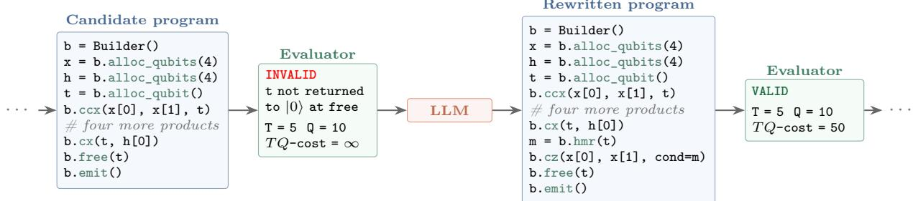

Extended Data Figure 1 Sample inputs and outputs for inversion in $\mathbb { F } _ { 2 ^ { 4 } }$ . (a) During ideation, the LLM is given the complete task specification but no prior implementation and returns distinct candidate architectures. (b) During evolution, the input additionally contains a selected parent program, its evaluator feedback, and limited archive context; the LLM returns a proposed rewrite. (c) One such rewrite computes the inverse with five nonlinear products but fails to return an ancilla to |0⟩, so the evaluator rejects it. Seeing this feedback, the LLM adds MBU; the resulting circuit is valid with $T = 5 , Q = 1 0$ , and a TQ-cost of 50.

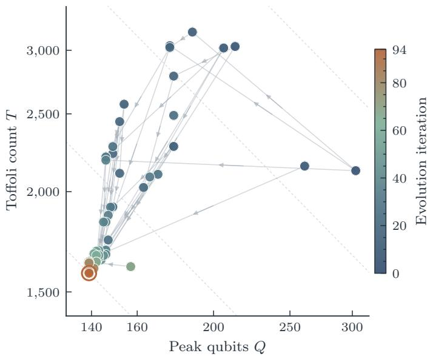  
Extended Data Figure 2 Search lineage for the Gaussian circuit in the resource plane. Each marker is a distinct valid circuit, colored by the iteration in which it was discovered; arrows point from each parent to its mutated child. Dashed curves are contours of constant $T Q \cdot$ -cost, which decreases toward the lower left. The ring marks the discovered circuit at $T = 1 { , } 5 8 3$ and $Q = 1 3 9$

Extended Data Table 1 Main results across eight compilation tasks. Input/output gives the number of qubits in read-only input registers and target registers, respectively; a target may carry an initial value and be updated in place, and “—” denotes a task with no target register. The correctness columns give the error tolerance and the number of tests. The resource columns report Tofoli count T and peak qubit count $Q$ for the baseline and discovered circuits; $G _ { T Q } = ( T Q ) _ { \mathrm { b a s e l i n e } } / ( T Q ) _ { \mathrm { o u r s } } .$ HHL: Harrow–Hassidim–Lloyd.
<table><tr><td></td><td></td><td></td><td colspan="2">Correctness criteria</td><td colspan="3">Resources</td></tr><tr><td>Task</td><td></td><td>Details Input/output</td><td>Error tolerance</td><td>Tests</td><td>Baseline  $( T , Q )$ </td><td>Ours (T, Q)</td><td> $G _ { T Q }$ </td></tr><tr><td>Prime-field modular inversion</td><td>SI II</td><td>512/512</td><td>Failure  ${ \mathrm { b u d g e t } } \leq 2 { \cdot } 1 0 ^ { - 4 } \ \mathrm { [ 8 , 3 8 ] }$ </td><td> $1 0 ^ { 5 }$ </td><td>_†</td><td> $( 4 . 0 { \cdot } 1 0 ^ { 6 } , 9 3 5 )$ </td><td></td></tr><tr><td>Reed-Solomon DQI decoder</td><td>SI I.1</td><td> $8 4 0 / -$ </td><td>Failure  $\mathrm { b u d g e t } \le 1 0 ^ { - 3 }$ </td><td> $1 0 ^ { 5 }$ </td><td> $\left( 5 . 1 { \cdot } 1 0 ^ { 6 } , 1 { , } 9 3 8 \right)$  [13]</td><td> $( 4 . 4 { \cdot } 1 0 ^ { 5 } , 1 , 8 3 7 )$ </td><td>12</td></tr><tr><td>Hermitian DQI decoder</td><td>SI I.2</td><td> $7 3 8 / -$ </td><td>Failure  $\mathrm { b u d g e t } \le 1 0 ^ { - 3 }$ </td><td> $1 0 ^ { 5 }$ </td><td> $( 1 . 0 { \cdot } 1 0 ^ { 8 } , 1 . 9 { \cdot } 1 0 ^ { 5 } ) ^ { \dagger } [ 3 9 ]$ </td><td>(9.3.105, 2,395)</td><td>__$</td></tr><tr><td>HHL rotation angle</td><td>SI III.1</td><td>21/33</td><td> $< 1 0 ^ { - 7 }$  rad</td><td> $9 { \cdot } 1 0 ^ { 3 }$ </td><td> $\left( 1 . 6 { \cdot } 1 0 ^ { 4 } , 3 0 0 \right) \left[ 1 \bar { 2 } \right]$ </td><td>(1,348, 115)</td><td>32</td></tr><tr><td>Coulomb potential</td><td>SI III.2</td><td>48/25</td><td> $\leq 2 { \cdot } 1 0 ^ { - 6 }$  absolute error</td><td> $9 { \cdot } 1 0 ^ { 3 }$ </td><td> $\left( 6 , 3 5 5 , 2 5 2 \right) \left[ 1 2 \right]$ </td><td>(1,140, 142)</td><td>9.9</td></tr><tr><td>Fixed-point Gaussian</td><td>SI III.3</td><td>39/39</td><td> $< 1 0 ^ { - 7 }$  absolute error</td><td> $9 { \cdot } 1 0 ^ { 3 }$ </td><td> $( 2 . 4 { \cdot } 1 0 ^ { 4 } , 3 6 2 ) \dot { [ 1 2 ] }$ </td><td>(1,583, 139)</td><td>39</td></tr><tr><td> $\mathrm { F e _ { 2 } S _ { 2 } }$  alias-SELECT</td><td>SI IV</td><td>32/40</td><td>Exact on the entire domain</td><td> $2 { \cdot } 1 0 ^ { 7 }$ </td><td> $( 5 . 5 { \cdot } 1 0 ^ { 4 } , 1 3 9 ) \ \bar { [ 4 ] }$ </td><td>(1.5.104, 126)</td><td>4.1</td></tr><tr><td>Nonabelian lattice-gauge simulation</td><td>SI V</td><td>1,728/51</td><td>Exact on the entire domain</td><td> $1 0 ^ { 5 }$ </td><td> $( 1 . 3 { \cdot } 1 0 ^ { 6 } , 1 , 9 2 7 )$  [37]</td><td> $( 1 . 7 { \cdot } 1 0 ^ { 5 } , 1 , 8 5 9 )$ </td><td>7.7</td></tr></table>

† Costs are for the complete benchmark circuit of SI II, whose cost is dominated by modular inversion. Several prior implementations trade Tofolis against qubits diferently (Table S3) [8, 38, 40], so we report no single baseline or gain. Separately from the divstep design reported in the table, we specialize Luo’s space-eficient construction, reducing its Tofoli count by a factor of 3.4 at the cost of five additional qubits (SI II.2). ‡ Naïve reversible implementation; no prior reversible compilation exists in the literature.

## SUPPLEMENTARY INFORMATION

I Syndrome decoding for DQI 1   
I.1 Reed–Solomon decoding for OPI 2   
I.2 Hermitian-code decoding for HOPI 7   
II Prime-field modular inversion 10   
II.1 Divsteps . 11   
II.2 Specialized Euclidean construction 13   
IIINumerical function evaluation 16   
III.1 HHL rotation angle . 17   
III.2 Coulomb potential . 18   
III.3 Fixed-point Gaussian . . 19   
IV Quantum chemistry simulation 19   
V Nonabelian lattice-gauge simulation 23   
Appendix 27   
A Exact branch recovery for divstep inversion 27

## I. SYNDROME DECODING FOR DQI

Consider an optimization problem over a finite field $\mathbb { F } _ { q }$ . An assignment $\boldsymbol { x } \in \mathbb { F } _ { a } ^ { n }$ produces m linear values $B x .$ Given a set $F _ { i } \subset \mathbb { F } _ { q }$ of acceptable values for each constraint, let $f ( \boldsymbol { x } ) = | \{ i : ( B x ) _ { i } \in F _ { i } ^ { \ast } \}$ | count the constraints satisfied by $x ;$ the goal is to maximize $f ( x )$ . This family, known as max-LINSAT, includes linear constraint-satisfaction problems such as Max-Cut and max-XORSAT, as well as nearest-codeword problems and polynomial fitting over finite fields. Decoded quantum interferometry (DQI) is a quantum algorithm that aims to solve these optimization problems by arranging for constructive interference on assignments satisfying many constraints and destructive interference on assignments satisfying fewer [1].

DQI prepares a superposition over sparse vectors $e \in \mathbb { F } _ { q } ^ { m }$ , each supported on at most ℓ constraints. Here $H = B ^ { \mathsf { T } }$ can be viewed as a parity-check matrix, making e a low-weight error and $H e$ its syndrome. If the associated code has minimum distance $d _ { \operatorname* { m i n } } \geq 2 \ell + 1$ , a decoder can recover e uniquely from that syndrome. DQI uses the decoder in the following state-preparation sequence:

$$
\begin{array} { r l } & { ~ \displaystyle \sum _ { \mathrm { w t } ( e ) \le \ell } a _ { e } \left. e \right. \left. 0 \right. \xrightarrow { s = H e } \displaystyle \sum _ { \mathrm { w t } ( e ) \le \ell } a _ { e } \left. e \right. \left. H e \right. } \\ & { ~ \xrightarrow [ ] { \mathrm { u n c o m p u t e ~ } e } \left. 0 \right. \displaystyle \sum _ { \mathrm { w t } ( e ) \le \ell } a _ { e } \left. H e \right. \xrightarrow [ ] { \mathrm { Q F T } ^ { - 1 } } \displaystyle \sum _ { x } A _ { x } \left. x \right. . } \end{array}\tag{23}
$$

The middle step must erase e while retaining its syndrome $s = H e ;$ otherwise the diferent contributions remain distinguishable and cannot interfere. The inverse quantum Fourier transform (QFT) then produces amplitudes $A _ { x }$ that favor assignments satisfying more constraints. The dominant cost in Equation (23) is uncomputing $e ,$ which requires solving a classical decoding problem; DQI thus reduces optimization to decoding.

The space-eficient construction of Khattar et al. [13] replaces the middle decoding-and-uncomputation step with a phase correction. It generates one field symbol $e _ { i }$ at a time, adds its contribution to $s ,$ and then removes it with an X-basis measurement. This avoids retaining all m symbols of $e ,$ but the measurement outcomes $c _ { i }$ leave a known phase. We expand each symbol of $e \in \mathbb { F } _ { q } ^ { m }$ in the fixed binary basis used by the circuit, so that c and e are bit strings of equal length; the phase is then $( - 1 ) ^ { \langle c , \bar { e } \rangle _ { 2 } }$ , where $\langle \cdot , \cdot \rangle _ { 2 }$ denotes the binary inner product. We call c the mask. In this section, we use a fixed, randomly chosen mask. A reversible decoder must remove this phase using s, after which the inverse Fourier transform produces the desired interference over assignments $x .$ The case studies below isolate and optimize this decoder-dependent phase correction. We require

$$
| s \rangle \longmapsto ( - 1 ) ^ { \langle c , e ( s ) \rangle _ { 2 } } | s \rangle .\tag{24}
$$

We study two instances of DQI. In optimal polynomial intersection (OPI), x specifies a univariate polynomial and the constraints restrict its values at prescribed points on a line; the associated code is a Reed–Solomon code. Hermitian optimal polynomial intersection (HOPI) generalizes this picture from a line to a Hermitian curve: x specifies a function on the curve, the constraints restrict its values at curve points, and the corresponding code is a Hermitian code [41]. Table S1 lists the parameters of the two benchmark instances.

TABLE S1 Parameters of the two DQI decoding instances. The syndrome-input column gives the number of syndrome symbols and the bits per symbol; ℓ is the maximum decoded error weight. The last column compares expected satisfied fractions for ideal DQI and a single trial of Prange’s information-set decoding [42], which is the best known eficient classical algorithm for these instances.
<table><tr><td></td><td></td><td></td><td></td><td>Problem Code field Positions Syndrome input l DQI/Prange</td></tr><tr><td>OPI</td><td> $\mathbb { F } _ { 2 ^ { 1 2 } }$ </td><td>4,095</td><td> $7 0 \times 1 2$ </td><td>35 0.5763/0.5009</td></tr><tr><td>HOPI</td><td> $\mathbb { F } _ { 6 4 }$ </td><td>512</td><td> $1 2 3 \times 6$ </td><td>470.7145/0.5726</td></tr></table>

We test implementations on syndromes drawn from the DQI input distribution (defined by $| a _ { e } | ^ { 2 } )$ and accept implementations with at most 100 detected wrong signs in $1 0 0 { , } 0 0 0$ tests. Let ε be the failure probability: the total probability, under this distribution, of the inputs on which the circuit fails. A failure applies the wrong sign or resets an ancilla that still holds input-dependent data. The discovered circuit satisfies [16]

$$
\left| \langle f \rangle _ { \mathrm { i m p l } } - \langle f \rangle \right| \leq 4 \varepsilon \langle f \rangle .\tag{25}
$$

Under our testing framework, a wrong sign is detected with probability at least $\textstyle { \frac { 1 } { 2 } } \colon$ for any fixed input, whether the sign is wrong is given by a constant plus a linear function (modulo $2 )$ of the uniformly random measurement record, and a reset of a nonzero qubit adds a fresh uniformly random bit to the sign. Thus the acceptance limit of 100 failures in 100,000 tests gives $\varepsilon \le 2 . 4 3 4 \times 1 0 ^ { - 3 }$ at 97.5% confidence. At that value, Equation (25) bounds the loss in satisfied fraction by $5 . 6 \times 1 0 ^ { - 3 }$ (Reed–Solomon) and $7 . 0 \times 1 0 ^ { - 3 }$ (Hermitian)—at most 7.4% and 4.9% of the two instances advantage over single-trial Prange.

## I.1. Reed–Solomon decoding for OPI

We use the Reed–Solomon instance and reversible decoder of Khattar et al. [13] as our baseline. Let $\gamma$ be a primitive element of $\mathbb { F } _ { 2 ^ { 1 2 } }$ . An error word $e \in \mathbb { F } _ { 2 ^ { 1 2 } } ^ { 4 0 9 5 }$ produces 70 syndromes

$$
S _ { i } = \sum _ { j = 0 } ^ { 4 0 9 4 } e _ { j } \gamma ^ { i j } , \qquad i = 1 , \dots , 7 0 .\tag{26}
$$

This syndrome map defines $\mathrm { ~ a ~ } [ 4 0 9 5 , 4 0 2 5 , 7 1 ] _ { 2 ^ { 1 2 } }$ Reed–Solomon code. The 70 twelve-bit syndromes occupy 840 qubits.   
Assuming the error weight is at most 35, the decoding task is to recover the error from the syndromes.

Decoding proceeds in two stages: first find the positions of the errors, then recover their values in $\mathbb { F } _ { 2 ^ { 1 2 } }$ . The first stage packages the unknown set of error positions into a single polynomial. For each nonzero error symbol $e _ { j }$ , include one factor $1 - \gamma ^ { j } z$ , giving

$$
\sigma ( z ) = \prod _ { j : e _ { j } \neq 0 } ( 1 - \gamma ^ { j } z ) .\tag{27}
$$

The factor associated with position $j$ vanishes at $z = \gamma ^ { - j }$ , so the roots of $\sigma$ identify exactly the positions at which the error word is nonzero. The decoder’s first task is therefore to recover this locator polynomial from the syndromes. The input |s⟩ supplies the first 70 syndromes, which we collect into a polynomial

$$
S ( z ) = S _ { 1 } + S _ { 2 } z + \cdot \cdot \cdot + S _ { 7 0 } z ^ { 6 9 } .\tag{28}
$$

Summing the geometric series in Equation (26) shows that the product $\sigma ( z ) S ( z )$ agrees, through degree 69, with a polynomial $\omega ( z )$ of degree less than deg σ, called the error-evaluator polynomial:

$$
\sigma ( z ) S ( z ) = \omega ( z ) { \pmod { z ^ { 7 0 } } } .\tag{29}
$$

The decoder recovers the locator $\sigma$ of least degree and the corresponding evaluator $\omega$ from this key equation. The baseline does so with the extended Euclidean algorithm (EEA) applied to $S ( z )$ and $z ^ { 7 0 }$ . It repeatedly divides the higher-degree polynomial by the lower-degree one, replaces the former by the remainder, and stops when the remainder has degree below 35. That remainder is $\omega ,$ and the coeficient that accompanies it is $\sigma ,$ up to normalization. The promise of at most 35 errors ensures deg $\sigma \leq 3 5$ and determines this pair uniquely.

The baseline next locates the errors by evaluating σ at every possible position. Associate position $j$ with the field point $\beta _ { j } = \gamma ^ { - j }$ (since $\gamma$ is primitive, these points enumerate all 4,095 nonzero field elements). The scan visits them one by one and tests whether $\sigma ( \beta _ { j } ) = 0$ . It need not evaluate $\sigma$ independently each time: advancing to $\beta _ { j + 1 } = \gamma ^ { - 1 } \beta _ { j }$ multiplies its degree-r term by the fixed constant $\gamma ^ { - r }$ . This eficient scan is known as a Chien search [43]. Finding a root reveals an error’s position but not its value. At $\beta _ { j }$ , the evaluator $\omega ( \beta _ { j } )$ contains the error value multiplied by the contributions of the other locator factors, while the formal derivative $\sigma ^ { \prime } ( \beta _ { j } )$ the usual coeficientwise polynomial derivative over the field—contains those same factors without the error value. Their ratio therefore isolates $e _ { j }$ , up to a fixed factor $\kappa _ { j }$ that depends only on the position:

$$
e _ { j } = \kappa _ { j } \frac { \omega ( \beta _ { j } ) } { \sigma ^ { \prime } ( \beta _ { j } ) } .\tag{30}
$$

This recovery step is Forney’s formula [44]. The circuit immediately uses that value and the matching twelve-bit block $c _ { j }$ to apply the phase (24). It then reverses the computation to restore the syndrome and clear its ancillas.

The EEA is the dominant cost of this baseline because its classical control flow depends on the syndromes: diferent inputs require diferent shifts, swaps, and numbers of iterations. A quantum circuit must instead apply one fixed sequence of gates across the syndrome superposition. The baseline therefore spreads the Euclidean solve over 222 synchronized cycles, controlling each operation so that it acts only when needed. Our implementation of this baseline, based on the authors’ released code [35], uses 5.1 million Tofoli gates and 1,938 qubits at peak, with the forward Euclidean solve and its reversal accounting for 3.8 million of the Tofolis [45].

The discovered circuit changes both stages of this baseline. First, it replaces the Euclidean solve with the arithmetically cheaper Berlekamp–Massey (BM) recurrence and arranges the recurrence so that reversibility does not require retaining much history state. Second, although the decoded error word contains 49,140 bits, DQI extracts only the single bit $\langle c , e \rangle _ { 2 }$ from it. The circuit therefore computes this phase bit directly from the locator and syndromes rather than materializing the full decoded error, and it precomputes one reciprocal polynomial so that no field division is performed during the scan.

An alternative to solving the key equation by EEA is the standard BM algorithm, which recovers the locator from a linear recurrence among the syndromes. We first review how BM reads Equation (29) one coeficient at a time. Write $\begin{array} { r } { \sigma ( z ) = \sum _ { k = 0 } ^ { L } \sigma _ { k } z ^ { k } } \end{array}$ , where $L = \deg \sigma$ . The coeficient of $z ^ { r - 1 }$ in $\sigma ( z ) S ( z )$ is the convolution $\scriptstyle \sum _ { k = 0 } ^ { L } \sigma _ { k } S _ { r - k }$ . Because $\deg \omega < L$ , the key equation requires every such coeficient from degree L through degree 69 to vanish:

$$
0 = [ z ^ { r - 1 } ] \sigma ( z ) S ( z ) = \sum _ { k = 0 } ^ { L } \sigma _ { k } S _ { r - k } , \qquad r = L + 1 , \ldots , 7 0 .\tag{31}
$$

Since we can set $\sigma _ { 0 } = 1$ without loss of generality, and subtraction is the same as addition in $\mathbb { F } _ { 2 ^ { 1 2 } }$ , every syndrome after the first L satisfies

$$
S _ { r } = \sigma _ { 1 } S _ { r - 1 } + \cdot \cdot \cdot + \sigma _ { L } S _ { r - L } .\tag{32}
$$

Thus the locator coeficients give a rule for predicting each syndrome from the preceding L syndromes. We call L the order of this recurrence. BM finds this recurrence by maintaining a candidate locator σ and refining it as the syndromes are incorporated [46]. At the start of round $r ,$ the candidate defines a lowest-order recurrence for the already processed syndromes $S _ { 1 } , \ldots , S _ { r - 1 }$ . The round tests whether that recurrence also fits $S _ { r }$ . The discrepancy $\begin{array} { r } { \Delta = \sum _ { k = 0 } ^ { L } \sigma _ { k } S _ { r - k } } \end{array}$ is the sum in Equation (31) for round $r ,$ computed with the current candidate. It measures the amount by which the recurrence fails: $\Delta = 0$ means that the current candidate already fits $S _ { r }$ , while $\Delta \neq 0$ requires the candidate to be refined.

When $\Delta \neq 0 ,$ , BM needs a correction that fixes the equation for $S _ { r }$ without invalidating any of the earlier equations. For this purpose, it retains an earlier candidate $\tau$ as a correction template, together with the nonzero discrepancy δ that candidate produced. At the start of each subsequent round, BM multiplies τ by $z ,$ shifting every coeficient one degree higher as the recurrence advances to the next syndrome. Thus, if the template was saved k rounds earlier, it has acquired a factor $z ^ { k }$ and is aligned with the current syndrome equation while leaving the earlier equations unchanged. BM then scales this aligned template by $\alpha = \Delta / \delta$ and applies $\sigma \gets \sigma - \alpha \tau \colon$ at $S _ { r }$ , the correction contributes exactly $\alpha \delta = \Delta$ and so cancels the discrepancy.

On a round with a nonzero discrepancy, BM must also decide whether the current candidate takes over as the template. A candidate of order $L$ that fits n syndromes has predicted $n - L$ of them. BM seeks the recurrence of lowest order, and a correction raises the order less when its template had predicted more syndromes at the time it was saved. BM therefore replaces the template when the current candidate has predicted more syndromes than the stored template had when it was saved, and retains it when the current candidate has predicted fewer. When the two counts are equal, either choice gives a correct decoder [46, p. 125]. Textbook BM retains in that case. The circuit instead chooses to replace, which reduces the history it must store (see “Reconstructing BM history” below).

The circuit makes this decision with a signed counter d. The counter is nonnegative whenever a replacement is required and negative whenever the template must be retained; when the counts are equal it may have either sign. Starting from $( \sigma , \tau , \delta , d ) = ( 1 , 1 , 1 , 0 )$ , each round $r = 1 , \ldots , 7 0$ applies

$$
\widetilde { \tau } = z \tau , \qquad \Delta = \sum _ { i = 0 } ^ { \operatorname* { m i n } ( \deg \sigma , r - 1 ) } \sigma _ { i } S _ { r - i } ,
$$

$$
\begin{array} { r } { ( \sigma , \tau , \delta , d )  \{ \begin{array} { l l } { ( \sigma , \widetilde { \tau } , \delta , d + 1 ) , } & { \Delta = 0 , } \\ { ( \sigma - ( \Delta / \delta ) \widetilde { \tau } , \sigma , \Delta , - d ) , } & { \Delta \neq 0 , d \geq 0 , } \\ { ( \sigma - ( \Delta / \delta ) \widetilde { \tau } , \widetilde { \tau } , \delta , d + 1 ) , } & { \Delta \neq 0 , d < 0 . } \end{array}  } \end{array}\tag{33}
$$

After the final round, σ is the error locator.

Adaptive coeficient ranges. A naïve implementation would apply every BM update across all 36 possible coeficient positions in every round. Even in the worst case, this is unnecessary: after r syndromes have been processed, only coeficients through degree min $( r , 3 5 )$ can be active, so the update range need only grow by one position per round. The dashed line in Figure S1(b) shows this worst-case bound. On the DQI input distribution, however, the candidate polynomials typically grow more slowly still. A degree-L locator σ has L unknown coeficients after fixing $\sigma _ { 0 } = 1$ while its evaluator $\omega ,$ whose degree is less than L, has at most L unknown coeficients. Since each syndrome supplies one coeficient constraint, r syndromes typically determine a locator of degree $L \approx r / 2$ , consistent with the samples in Figure S1(b).

The discovered circuit exploits this typical behavior, at the price of failing on rare inputs. Before compiling the circuit, we classically simulate BM on the DQI input distribution to choose a cutof k for each round. The circuit then updates only the prefix $\sigma _ { 0 } , \ldots , \sigma _ { k }$ , treating higher coeficients as zero. The prefixes expand as the rounds progress, which produces the rising per-round cost in Figure S1(a).

Shared BM updates. Compiled directly, the two correction cases of Equation (33) would produce two separately controlled arithmetic paths. Only one path acts on any basis state, but both would appear in the fixed circuit and contribute to its Tofoli count. The main text shows how the circuit avoids this (Equation (5)). Under a flag that marks the replace case, it exchanges σ with the shifted template τe. One shared update then subtracts a multiple of the template register from the locator register. The multiplier is α in the retain case and $\alpha ^ { - 1 }$ in the replace case. The replace result difers from the standard update only by the nonzero factor $- \alpha ^ { - 1 }$ and therefore has the same roots.

The circuit also stores no discrepancy δ. The rescaled update maintains the invariant

$$
\sigma _ { 0 } \delta = 1 .\tag{34}
$$

The invariant holds initially. The shifted template has zero constant coeficient, so the retain case changes neither $\sigma _ { 0 }$ nor $\delta .$ In the replace case, the new constant coeficient comes entirely from the correction term: $\sigma _ { 0 } \gets \alpha ^ { - 1 } \sigma _ { 0 } = ( \delta / \Delta ) \sigma _ { 0 } = \Delta ^ { - 1 }$ while $\delta \gets \Delta$ . The circuit therefore reads $\delta = \sigma _ { 0 } ^ { - 1 }$ from the locator. In each round it forms the product $\Delta \sigma _ { 0 } .$ which equals $\alpha ,$ and inverts it. A controlled selection between the product and its inverse supplies the multiplier for the shared update.

Reconstructing BM history. Reversing a round requires the discrepancy that the round used, which the round computes into a temporary register. Keeping a twelve-bit history word for every round would raise the qubit count to 2,677. A replace round leaves $\sigma _ { 0 } = \Delta ^ { - 1 }$ by Equation (34), so the locator determines the round’s discrepancy. The circuit therefore erases the temporary discrepancy register by MBU, and the reverse pass recomputes the erased value from the locator. A round with $\Delta = 0$ changes nothing and has nothing to recover.

A retain round with $\Delta \neq 0$ is the exception. No exchange occurs and $\sigma _ { 0 }$ is unchanged, so the constant coeficient that reveals the discrepancy on a replace round carries no trace of it here. The current $\Delta$ remains only in the temporary discrepancy register, and the circuit stores it on the history stack before erasing that register. A stack that never overflows needs 35 entries, or 665 qubits.

Retain rounds are rare on the DQI input distribution. Starting from $d = 0 ,$ a run of nonzero discrepancies repeatedly selects replace and leaves $d = 0 , \mathrm { ~ A ~ }$ zero discrepancy raises $d ;$ a later replacement can then make it negative, producing retain rounds while d returns to zero. Such accidental zero discrepancies are uncommon over $\mathbb { F } _ { 2 ^ { 1 2 } }$ before the locator reaches its final degree. Once it has, subsequent discrepancies stay zero and do not start new runs of retain rounds.

(a) Key-equation schedules  
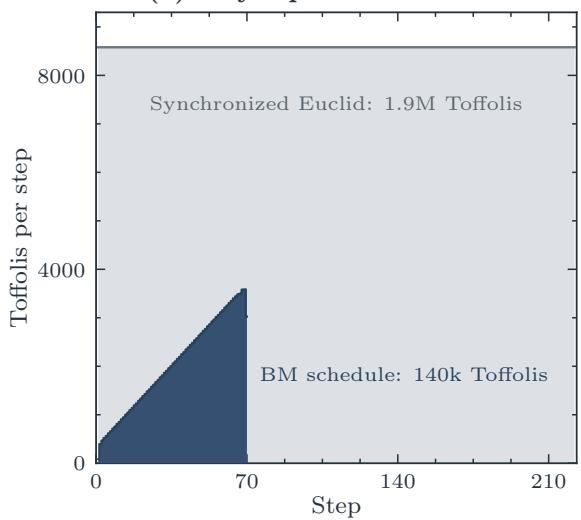

(b) Locator degree and discrepancy stack  
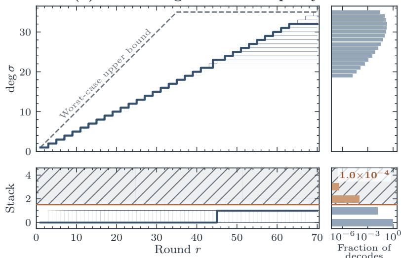  
FIG. S1 The Reed–Solomon decoder. (a) Measured forward Tofoli cost per step: one cycle of the 222-cycle synchronized EEA baseline of Khattar et al. [13], or one round of our $7 0 -$ -round BM decoder. (b) Locator degree (top) and number of stored discrepancies (bottom) by round, across 20,000 samples drawn from the DQI input distribution, with one sample highlighted; the dashed line is the worst-case degree bound min(r, 35). The right-hand panels show the final locator-degree distribution and the distribution of maximum discrepancy-stack depth. Inputs in the hatched region need more than the one allocated stack entry and may produce a wrong sign; this occurs with probability $1 . { \overset { - } { 0 } } \times 1 0 ^ { - 4 }$

Consequently, most inputs need few saved discrepancies. The discovered circuit allocates only one stack entry, which costs 19 qubits (Figure S1(b)).

Across 400 million samples from the DQI input distribution, the two failure modes (overflow of the one-entry stack and activation of a coeficient beyond the cutof) occur with a combined probability of $1 . 4 \times 1 0 ^ { - 4 }$ . This completes locator construction; the circuit next forms the evaluator $\omega ,$ , which will be used together with σ to compute the required phase.

In-place construction of the evaluator polynomial. The key equation (29) gives ω by multiplying the locator by the syndrome polynomial. The circuit first normalizes σ so that $\sigma _ { 0 } = 1$ . This leaves the locator roots unchanged, and the corresponding ω acquires the same nonzero factor, so the ratio $\omega / \sigma ^ { \prime }$ used to recover the error values is unchanged. Write $\omega _ { < 3 5 } = ( \omega _ { 0 } , \dots , \omega _ { 3 4 } )$ for the first 35 coeficients of $\omega \cdot$

$$
( \sigma ; S _ { 1 } , \ldots , S _ { 3 5 } ; S _ { 3 6 } , \ldots , S _ { 7 0 } ) \longmapsto ( \sigma ; \omega _ { < 3 5 } = \sigma S \bmod z ^ { 3 5 } ; S _ { 3 6 } , \ldots , S _ { 7 0 } ) .\tag{35}
$$

With this normalization, each output coeficient is

$$
\omega _ { i } = S _ { i + 1 } + \sum _ { j = 1 } ^ { i } \sigma _ { j } S _ { i - j + 1 } , \qquad 0 \leq i < 3 5 ,\tag{36}
$$

so it equals the syndrome symbol being overwritten plus a function of earlier symbols. The transformation is therefore reversible: the circuit can overwrite the first 35 syndrome symbols with the first 35 coeficients of ω and later restore them. This avoids a separate 420-qubit register for ω. The same map extends to all 70 syndrome symbols; by the key equation, the coeficients of $\sigma { \cal S }$ from degree 35 through 69 vanish whenever the locator is correct, so the last 35 become zero and serve as workspace until the map is reversed.

Phase-only error recovery. At this point the decoder could use σ and ω to recover every error value. An ordinary decoder does so by applying Forney’s formula (30) to construct the twelve-bit field element $e _ { j }$ at each located error. The DQI task (24), however, needs only the single accumulated parity $\textstyle \sum _ { j } \langle c _ { j } , e _ { j } \rangle _ { 2 }$ . Constructing all twelve bits of each $e _ { j }$ only to retain one parity would waste most of this work, so the discovered circuit computes the required phase bit directly.

Any parity of a field element can be expressed as a field trace after multiplication by a fixed constant. In particular, with $\begin{array} { r } { \dot { \mathrm { T r } } ( x ) = \sum _ { r = 0 } ^ { 1 1 } x ^ { 2 ^ { r } } \in \mathbb { F } _ { 2 } } \end{array}$ , the twelve mask bits $c _ { j }$ determine a unique element $\mu _ { j } \in \mathbb { F } _ { 2 ^ { 1 2 } }$ such that

$$
\langle c _ { j } , e _ { j } \rangle _ { 2 } = \operatorname { T r } ( \mu _ { j } e _ { j } ) .\tag{37}
$$

Part of the total phase is linear in the supplied syndromes and can be applied with Cliford $Z$ gates. Choosing that linear part ofline cancels the mask at 71 positions and leaves residual constants $\widetilde { \mu } _ { j }$ at the remaining 4,024 positions to scan.

At each remaining position the circuit tests whether $\beta _ { j }$ is a root of the locator. If it is, the error word is nonzero there. Absorb the fixed factor $\kappa _ { j }$ from Forney’s formula into $\nu _ { j } = \widetilde { \mu } _ { j } \kappa _ { j }$ . Substituting that formula directly into the trace gives the residual phase bit

$$
\mathrm { T r } ( \widetilde { \mu } _ { j } e _ { j } ) = \mathrm { T r } \left( \nu _ { j } \frac { \omega ( \beta _ { j } ) } { \sigma ^ { \prime } ( \beta _ { j } ) } \right) ,\tag{38}
$$

without materializing $e _ { j }$

Precomputed reciprocal. The quotient in Equation (38) is required only at the roots of $\sigma ,$ of which there are at most 35. A quantum circuit, however, applies one fixed gate sequence to every syndrome in the superposition, so it cannot skip the positions that are not roots. A direct implementation would therefore perform the division at each of the 4,024 positions, and this division would dominate the decoder’s cost.

The circuit instead performs one division before the scan. Because only the values at the roots matter, any function that agrees with $1 / \sigma ^ { \prime }$ there serves equally well. The roots of σ are distinct, so $\sigma ^ { \prime }$ is nonzero at each of them, and a single polynomial Ψ of degree less than deg σ takes the value $1 / \sigma ^ { \prime } ( \beta )$ at every root $\beta .$ Equivalently, $\Psi \sigma ^ { \prime } \equiv 1$ (mod $\sigma )$ Evaluating Ψ and $\omega$ at a fixed point is linear in their coeficients and uses only CNOTs, so the residual phase bit becomes

$$
\mathrm { T r } ( \widetilde { \mu } _ { j } e _ { j } ) = \mathrm { T r } \big ( \nu _ { j } \omega ( \beta _ { j } ) \Psi ( \beta _ { j } ) \big ) ,\tag{39}
$$

which is bilinear in $\omega ( \beta _ { j } )$ and $\Psi ( \beta _ { j } )$ . In a basis of $\mathbb { F } _ { 2 ^ { 1 2 } }$ over $\mathbb { F } _ { 2 } .$ , it splits into 12 terms, each the product of one parity of the bits of $\omega ( \beta _ { j } )$ with one parity of the bits of $\Psi ( \beta _ { j } )$ ). The parities cost only CNOTs, and each product costs one Tofoli, applied only when the root test succeeds. The root test itself is a zero test on the twelve bits of $\sigma ( \beta _ { j } )$ and costs 11 Tofolis, so each position costs $1 1 + 1 2 = 2 3$ Tofolis.

Computing Ψ is itself a division: Ψ is the inverse of $\sigma ^ { \prime }$ modulo σ. The circuit computes it with the EEA (the algorithm that BM replaced for the key equation) on a smaller problem. Two observations make it afordable.

The Tofoli cost of the EEA grows roughly with the square of the operand degree. The first observation halves that degree, which cuts the Tofoli cost to about a quarter. In characteristic 2, squaring is linear: $( a + b ) ^ { 2 } = a ^ { 2 } + b ^ { 2 }$ . It therefore acts on the twelve bits of a field element as a fixed linear map, as does its inverse, the square root, and both cost only CNOTs. Group the coeficients of σ by the parity of their degree:

$$
\sigma ( z ) = \left( \sigma _ { 0 } + \sigma _ { 2 } z ^ { 2 } + \sigma _ { 4 } z ^ { 4 } + \cdot \cdot \cdot \right) + z \bigl ( \sigma _ { 1 } + \sigma _ { 3 } z ^ { 2 } + \sigma _ { 5 } z ^ { 4 } + \cdot \cdot \cdot \bigr ) .\tag{40}
$$

Each group is a polynomial in $z ^ { 2 }$ and hence a square, $\sigma _ { 0 } + \sigma _ { 2 } z ^ { 2 } + \cdot \cdot \cdot = \left( \sqrt { \sigma _ { 0 } } + \sqrt { \sigma _ { 2 } } z + \cdot \cdot \cdot \right) ^ { 2 } , \mathrm { s o } \ \sigma ( z ) = E ( z ) ^ { 2 } + z O ( z ) ^ { 2 }$ with $E _ { i } = \sqrt { \sigma _ { 2 i } } , O _ { i } = \sqrt { \sigma _ { 2 i + 1 } }$ , and deg E, deg $O \leq 1 7$ . In characteristic 2 the derivative of any square is zero, since $( f ^ { 2 } ) ^ { \prime } = 2 f f ^ { \prime }$ , so $\sigma ^ { \prime } = O ^ { \dot { 2 } }$ . The polynomials E and O share no factor, because a common factor would divide both σ and $\sigma ^ { \prime }$ . The EEA on this half-degree pair $( E , O )$ returns A and B of degree at most 17 with $A E + B O = 1$ . Then $B O = 1 + A E .$ so $\begin{array} { r } { ( B ^ { 2 } + z A ^ { 2 } ) \sigma ^ { \prime } \stackrel { \sim } { = } ( B \hat { O } ) ^ { 2 } + z \dot { A } ^ { 2 } \hat { O } ^ { 2 } = 1 + A ^ { 2 } E ^ { 2 } + z A ^ { 2 } O ^ { 2 } \stackrel { \sim } { = } 1 + A ^ { 2 } \sigma . } \end{array}$ , and $B ^ { 2 } + z A ^ { 2 }$ agrees with Ψ at every root of σ. Forming E and O from $\sigma ,$ and $B ^ { 2 } + z A ^ { 2 }$ from $( A , B )$ , uses only square roots and squares. The only costly step, the EEA, thus runs on degree-17 rather than degree-35 operands.

The second observation concerns qubit usage. A fresh register for Ψ would raise the peak qubit count by 420. Instead, the circuit makes room inside the syndrome register itself. As described above, the in-place product over all 70 syndrome symbols leaves ω in the first 35 and zeros in the last 35 on every correct decode. The circuit stores A and B in these zeroed words and evaluates $\Psi ( \beta _ { j } ) = B ( \beta _ { j } ) ^ { 2 } + \beta _ { j } A ( \beta _ { j } ) ^ { 2 }$ at each position with CNOTs only. After the scan, i reverses the Euclidean pass, which returns these words to zero, and then reverses the product to restore the syndromes.

Unlike the baseline’s Euclidean solve, this pass follows a fixed schedule. Every input runs the same 17 elimination blocks. Each block parks its quotients in the coeficient words that it clears, so the pass needs no separate history.

In total, the 4,024-position scan costs 93,000 Tofolis, and the Euclidean pass 44,000 in each direction, compared with 1.3 million for the baseline’s scan. The scan’s Tofoli count barely depends on the choice of c: every scanned position uses the same 23-Tofoli circuit, and a diferent c changes the number of scanned positions by at most one.

The discovered circuit uses 440,000 Tofolis and 1,837 qubits, for a TQ-cost of $8 . 1 \times 1 0 ^ { 8 }$ . Relative to the Reed–Solomon baseline, this reduces the Tofoli count by 12×, the qubit count by 5.2%, and the TQ-cost by 12×. In 100,000 tests of the complete circuit, seven produce the wrong sign.

## I.2. Hermitian-code decoding for HOPI

HOPI requires the same phase (24) as the Reed–Solomon instance above, but its error word belongs to a 512-symbol Hermitian code over $\mathbb { F } _ { 6 4 }$ . A Reed–Solomon code with 512 positions would require symbols of about nine bits, since each position needs a distinct field element. A Hermitian code instead obtains 512 positions while retaining six-bit symbols by using the points $( x , y ) \in \mathbb { F } _ { 6 4 } ^ { 2 }$ on

$$
y ^ { 8 } = x ^ { 9 } + y .\tag{41}
$$

Polynomials in x and y are ordered by a weighted degree, the analogue of polynomial degree for Reed–Solomon codes. Here x has weight 8 and $y$ has weight 9, so the monomial $x ^ { a } y ^ { b }$ has weighted degree $8 a + 9 b$ . These weights give the leading terms $y ^ { 8 }$ and $x ^ { 9 }$ of Equation (41) the same weighted degree, 72. Each finite point $P _ { j } = ( x _ { j } , y _ { j } )$ is one code position. The syndrome construction is the two-variable analogue of the Reed–Solomon map above. A function $\psi ( x , y )$ assigns a field value to every position and therefore defines one parity check

$$
S ( \psi ) = \sum _ { j = 1 } ^ { 5 1 2 } e _ { j } \psi ( P _ { j } ) .\tag{42}
$$

The value $S ( \psi )$ is one syndrome symbol. This instance uses the 123 monomials $\psi _ { a , b } ( x , y ) = x ^ { a } y ^ { b }$ of weighted degree 8a + 9b ≤ 150 [41]. We enumerate them as $\psi _ { 0 } , \ldots$ , ψ in increasing weighted degree [47]. The input |s⟩ supplies the 123 symbols

$$
S _ { k } : = S ( \psi _ { k } ) , \qquad k = 0 , \ldots , 1 2 2 .\tag{43}
$$

This syndrome map defines a [512, 389, $d _ { \operatorname* { m i n } } \geq 9 6 ] _ { 6 4 }$ Hermitian code, so the syndrome uniquely determines every error afecting at most 47 positions. The 123 six-bit syndromes occupy 738 qubits. Table S2 lists the correspondences with the Reed–Solomon decoder that the rest of this subsection uses.

TABLE S2 Correspondence between the Reed–Solomon and Hermitian decoders.
<table><tr><td></td><td>Reed-Solomon</td><td>Hermitian</td></tr><tr><td>Positions</td><td>4,095 nonzero field elements 512 points</td><td> $( x , y )$  on the curve</td></tr><tr><td>Symbol size</td><td>12 bits</td><td>6 bits</td></tr><tr><td>Check functions</td><td> $z ^ { i }$ </td><td> $x ^ { a } y ^ { b }$ </td></tr><tr><td>Ordered by</td><td>degree i</td><td>weighted degree  $8 a + 9 b$ </td></tr><tr><td>Syndromes</td><td>70</td><td>123</td></tr><tr><td>Locator</td><td>polynomial  $\sigma ( z )$ </td><td>function  $\sigma ( x , y )$ </td></tr><tr><td>Evaluator</td><td> $\omega = \sigma S$ </td><td> $\omega = \sigma \widehat { S }$ </td></tr><tr><td>Error value</td><td> $\kappa _ { j } \omega / { \sigma } ^ { \prime }$ </td><td> $\omega / \sigma ^ { \prime }$ </td></tr></table>

As in Reed–Solomon decoding, the first task is to find a locator σ that vanishes at every error point; here it is a function of two variables on the curve. Multiplying each root condition by $e _ { j } \psi _ { k ^ { \prime } } ( P _ { j } )$ and summing over positions gives, for $\begin{array} { r } { \sigma = \sum _ { k } \sigma _ { k } \psi _ { k } } \end{array}$

$$
0 = S ( \sigma \psi _ { k ^ { \prime } } ) = \sum _ { k } \sigma _ { k } S ( \psi _ { k } \psi _ { k ^ { \prime } } ) .\tag{44}
$$

This has the same form as the Reed–Solomon recurrence (31): a sum of syndromes weighted by the locator coeficients. Whereas multiplying Reed–Solomon monomials simply shifts the syndrome index, the curve relation (41) reduces each product $\psi _ { k } \psi _ { k ^ { \prime } }$ to one or two basis monomials. Beyond error weight 33, some of the syndromes that the recurrence needs have weighted degree above 150, which the input does not supply. The Feng–Rao baseline reconstructs these missing syndromes by majority voting among recurrence predictions, then uses the extended sequence to locate and evaluate the errors [39].

Our reversible implementation of this baseline uses 100 million Tofolis at a peak of 190,000 qubits, for a TQ-cost of $2 . 0 \times 1 0 ^ { 1 3 }$ . The large qubit count comes from retaining the intermediate states of the recurrence updates until the circuit reverses the computation.

The discovered circuit instead turns locator finding into a null-space problem for a symmetric matrix A built directly from the supplied syndromes. It never stores $A ;$ instead, it computes the efect of multiplying a vector by A directly from the syndromes. Repeating this operation produces a sequence of vectors that must eventually become linearly dependent, and such a dependence yields the desired null vector. The circuit processes this sequence incrementally, retaining only a few vectors at a time and grouping several consecutive vectors when a vector cannot be processed alone. Once the null vector supplies a locator $\sigma ,$ the circuit still avoids constructing the whole evaluator ω or the decoded error word. It scans the curve points in small batches called stripes, combines the locator and syndromes only for the current stripe, applies those points’ phase contributions, and clears the temporary data before continuing. The circuit thus has two stages: a locator walk that never stores the matrix, and a space-eficient phase scan. The walk freezes on the rare inputs that need extra work and repairs them at scheduled rounds. Its reversal recomputes most decisions and stores one bit per round.

The locator as a null vector. The discovered circuit looks for the locator in a fixed space that is large enough to always contain one. Following the linear-algebra strategy of Skorobogatov and Vlăduţ [48], it uses the span of the 48 monomials $\psi _ { 0 } , \ldots , \psi _ { 4 7 }$ of weighted degree at most 75. Writing $\textstyle { \boldsymbol { \sigma } } = \sum _ { k = 0 } ^ { 4 7 } { \boldsymbol { \sigma } } _ { k } \psi _ { k }$ , each error point imposes one linear condition $\begin{array} { r } { \sum _ { k = 0 } ^ { 4 7 } \sigma _ { k } \psi _ { k } ( P _ { j } ) = 0 } \end{array}$ on the 48 coeficients. There are at most 47 conditions on 48 unknowns, so a nonzero locator always exists.

The error points are unknown, so the circuit cannot impose these conditions directly. It replaces them with a condition that it can compute from the syndromes. Define the symmetric $4 8 \times 4 8$ matrix $A _ { k k ^ { \prime } } = S ( \psi _ { k } \psi _ { k ^ { \prime } } )$ . Each product $\psi _ { k } \psi _ { k ^ { \prime } }$ has weighted degree at most 150, so every entry of A is a linear function of the supplied syndromes. The coeficient vector $\pmb { \sigma } = ( \sigma _ { 0 } , \ldots , \sigma _ { 4 7 } ) ^ { \mathsf { T } }$ of every locator lies in the null space of A, and almost always the converse holds as well.

To see this, let E be the set of error points and let $M _ { j k } = \psi _ { k } ( P _ { j } )$ for $P _ { j } \in { \mathcal { E } }$ . Then

$$
A = M ^ { \mathsf { T } } \mathrm { d i a g } ( e _ { j } ) M , \qquad M \pmb { \sigma } = ( \sigma ( P _ { j } ) : P _ { j } \in \mathcal { E } ) ^ { \mathsf { T } } .\tag{45}
$$

A locator has $M { \boldsymbol { \sigma } } = 0$ and therefore $A \pmb { \sigma } = 0$ . Conversely, when the conditions $\sigma ( P _ { j } ) = 0$ are independent, M has full row rank. The error values are nonzero, so $A \pmb { \sigma } = 0$ then implies $M \pmb { \sigma } = 0$ , and σ is a locator. The conditions are dependent with probability ≈ $8 \times 1 0 ^ { - 8 }$ under the DQI input distribution.

Applying A without storing it. The circuit needs only the product Au for a given vector u. Computing it directly would take $4 8 ^ { 2 } = 2 { , } 3 0 { \bar { 4 } }$ field multiplications. Let $\begin{array} { r } { \dot { U } = \sum _ { k } u _ { k } \psi _ { k } } \end{array}$ be the function with coeficient vector u. Then $( A u ) _ { k ^ { \prime } } = S ( \psi _ { k ^ { \prime } } U )$ : each entry is the syndrome of a product of two functions. Every such product lies in the span of the 123 monomials, so its values at 123 suitably chosen curve points $R _ { 1 } , \ldots , R _ { 1 2 3 }$ determine it. On this span the syndrome is therefore a weighted sum of point values, $\begin{array} { r } { S ( f ) = \sum _ { i = 1 } ^ { 1 2 3 } \eta _ { i } f ( R _ { i } ) } \end{array}$ , with weights $\eta _ { i }$ that are a fixed linear function of the supplied syndromes. Writing $\Phi _ { i k } = \psi _ { k } ( R _ { i } )$ gives

$$
A \pmb { u } = \Phi ^ { \mathsf { T } } \mathrm { d i a g } ( \pmb { \eta } ) \Phi \pmb { u } .\tag{46}
$$

Here Φu evaluates U at the points, the diagonal map multiplies each value by its weight, and $\Phi ^ { \mathsf { T } }$ returns the weighted values to the 48 coeficients. The maps Φ and $\Phi ^ { \mathsf { T } }$ are fixed and linear, so they cost only CNOTs. The only Tofolis are in the 123 pointwise products, each a 15-Tofoli multiplication in $\mathbb { F } _ { 6 4 } \ \left[ 4 9 , \ 5 0 \right]$ . One application of A thus costs $1 2 3 \times 1 5 = 1 , 8 4 5$ Tofolis. The same pattern recurs below, and we call it evaluation–interpolation: the circuit evaluates at fixed points, multiplies the values pointwise, and maps the products back linearly.

Lanczos recurrence. A null vector of A can be found from repeated applications of A. Starting from a fixed seed $\mathbf { \delta } _ { \mathbf { y } _ { 0 } } .$ , generate the Krylov vectors ${ \pmb y } _ { 0 } , A { \pmb y } _ { 0 } , A ^ { 2 } { \pmb y } _ { 0 } , . . . .$ They all lie in a 48-dimensional space, so they must become linearly dependent: there are coeficients, not all zero, with $\lambda _ { 0 } { \pmb y } _ { 0 } + \lambda _ { 1 } { \pmb A } { \pmb y } _ { 0 } + \dots + \lambda _ { N } { \pmb A } ^ { N } { \pmb y } _ { 0 } = 0$ . If the seed is not orthogonal to the entire null space, symmetry forces $\lambda _ { 0 } = 0$ . To see this, choose v in the null space of A with ${ \pmb v } ^ { \top } { \pmb y } _ { 0 } \neq 0$ . Symmetry gives ${ \pmb v } ^ { \top } A ^ { r } { \pmb y } _ { 0 } = 0$ for $r \geq 1$ , so the inner product of the dependence with v leaves $\lambda _ { 0 } { \pmb v } ^ { \top } { \pmb y } _ { 0 } = 0$ . Then

$$
\pmb { \sigma } = \sum _ { r = 1 } ^ { N } \lambda _ { r } A ^ { r - 1 } \pmb { y } _ { 0 } , \qquad \pmb { A } \pmb { \sigma } = \sum _ { r = 1 } ^ { N } \lambda _ { r } A ^ { r } \pmb { y } _ { 0 } = 0\tag{47}
$$

is the desired null vector. In the rare case where $\lambda _ { 0 } \neq 0$ , the decoding fails.

Used directly, this would require storing every Krylov vector until the dependence appears. The Lanczos algorithm avoids that. It maintains an orthogonal basis $\mathbf { \Delta } w _ { 0 } , \mathbf { \Delta } w _ { 1 } , \ldots$ . whose first $r + 1$ vectors span the first $r + 1$ Krylov vectors: it applies A to the newest basis vector and subtracts the components along the existing basis. Because A is symmetric, ${ A w } _ { \tau }$ is already orthogonal to every basis vector except ${ \pmb w } _ { r - 1 }$ and $w _ { r } ,$ , so

$$
A w _ { r } \in \operatorname { s p a n } \{ w _ { r - 1 } , w _ { r } , w _ { r + 1 } \} .\tag{48}
$$

Constructing the next vector therefore needs only the current and the preceding basis vectors. A zero result means that the Krylov vectors have become dependent.

The null vector can be built in the same pass. By Equation (48), the coeficients $\xi _ { r }$ of a null vector $\begin{array} { r } { \pmb { \sigma } = \sum _ { r } \xi _ { r } \pmb { w } _ { r } } \end{array}$ satisfy a three-term recurrence of their own, so each follows from the two before it. The circuit computes each coeficient while its basis vector is still stored and immediately adds $\xi _ { r } w _ { r }$ into a 48-symbol register, the locator register. When the walk ends, that register holds $\sigma .$

Breakdowns and scheduled repairs. Lanczos removes the component of a vector v along a basis vector w by subtracting $\rho { \pmb w } ,$ with $\rho = ( \pmb { w } ^ { \top } \pmb { v } ) / ( \pmb { w } ^ { \top } \pmb { w } )$ . Over $\mathbb { F } _ { 6 4 }$ , however, a nonzero vector can be orthogonal to itself, which leaves this quotient undefined. Block Lanczos repairs such a breakdown by treating the consecutive Krylov vectors w, $A w , \ldots , \bar { A } ^ { d - 1 }$ w as one block and removing the components along all of them at once. This is possible once their Gram matrix, the matrix of their inner products, is invertible:

$$
\begin{array} { r } { G _ { d } = \left[ ( A ^ { i } w ) ^ { \top } ( A ^ { j } w ) \right] _ { i , j = 0 } ^ { d - 1 } = \left[ g _ { i + j } \right] _ { i , j = 0 } ^ { d - 1 } , \qquad g _ { k } = w ^ { \top } A ^ { k } w . } \end{array}\tag{49}
$$

We call d the depth of the block. The circuit supports depths two and three.

A breakdown is rare, and the machinery that repairs it is expensive. An ordinary round of the walk costs 5,400 Tofolis; a round that can also repair at depth two costs 12,000, and one that can repair at depth three costs 17,000. A fixed circuit that repaired each breakdown where it occurred would carry this machinery in every round. The circuit instead concentrates it in scheduled repair rounds. It conditions the ordinary update on $g _ { 0 } = \pmb { w } ^ { \top } \pmb { w } \neq 0$ . This test is cheap: in characteristic 2, wTw is the square of the sum of the components of ${ \pmb w } .$ , which needs only CNOTs. On an input with $g _ { 0 } = 0$ the update gates do not act, and the walk state stays frozen until the next repair round, which forms the block and advances the walk past it in one step. The walk has 52 rounds, four more than the dimension, so that delayed inputs can finish. Of these, 17 carry repair machinery. An input that needs a deeper block, or that has not finished after 52 rounds, fails.

Ending and reversing the walk. For a given input, the walk ends when $g _ { 0 } = g _ { 1 } = g _ { 2 } = 0$ , because no block of depth up to three is then invertible. The circuit freezes the walk there and records the round, as the divstep circuit does (SI II.1). After the last round, it tests which of three cases holds and routes the corresponding vector into the locator register. If ${ \pmb w } = 0$ , the Krylov vectors have become dependent, and the accumulated vector is the null vector. If $\pmb { w } \neq 0$ and $A w = 0$ , then w itself is a null vector. If $A w \ne 0$ and $\overset { \cdot } { A ^ { 2 } } w = 0$ , then Aw is a null vector. An input in none of these cases fails.

After the phase scan described below, the circuit must undo the walk. It first measures the locator register in the X basis. The walk built that register by adding multiples of basis vectors, so the reverse walk can correct the phase left by the measurement as it retraces the rounds: each addition becomes a set of controlled-Z gates conditioned on the measurement outcomes, at no Tofoli cost. The reverse walk recomputes most of the decisions of the forward walk, such as its zero tests, while the vectors they depend on are present. One decision per round cannot be recomputed in time: whether the round advanced the walk, which controls an exchange of the two stored basis vectors. The forward walk stores that decision in one history qubit per round, 52 in all, and the reverse walk clears them. The reverse walk uses 52,000 fewer Tofolis than the forward walk.

Error values. The locator gives the possible error points, and the phase also needs the error values. The circuit uses two facts, both counterparts of the Reed–Solomon decoder (Table S2). First, there is an evaluator ω whose coeficients are bilinear in the locator and the syndromes, as $\omega = \sigma S$ is for Reed–Solomon codes. Second, the error value at a simple zero of the locator is

$$
e _ { j } = { \frac { \omega ( P _ { j } ) } { \sigma ^ { \prime } ( P _ { j } ) } } , \qquad \sigma ^ { \prime } = \partial _ { x } \sigma + x ^ { 8 } \partial _ { y } \sigma ,\tag{50}
$$

the counterpart of Forney’s formula (30). Here $\sigma ^ { \prime }$ is the derivative of the locator along the curve. Diferentiating Equation (41) in characteristic 2 gives $d \dot { y } = x ^ { 8 } d x$ , so a step dx along the curve changes σ by $\sigma ^ { \prime } d x$ . The evaluator is $\omega = \sigma { \widehat { S } } .$ , where $\widehat { S }$ is the counterpart of the syndrome polynomial $S ( z ) { \mathrm { : } }$ : a series whose leading coeficients, in decreasing weighted degree, are the 123 syndromes [51].

The locator comes from a 48-dimensional space and is not necessarily the minimal-degree locator. It can therefore also vanish at a point that carries no error, or have a repeated zero at an error point. At a point with no error, ω vanishes as well and the point contributes nothing. At a repeated zero the quotient becomes $0 / 0 .$ . As in L’Hôpital’s rule, the error value then comes from the first few coeficients of the expansions of ω and $\sigma$ at that point, which we call local coeficients. The circuit supports repeated zeros up to multiplicity three.

Striped phase scan. For a curve point $P _ { j }$ , write $c _ { j }$ for its six mask bits and $e _ { j }$ for its error value. As in the Reed–Solomon decoder, the mask bits define $\mu _ { j } \in \mathbb { F } _ { 6 4 }$ with $\langle c _ { j } , e _ { j } \rangle _ { 2 } = \mathrm { T r } _ { \mathbb { F } _ { 6 4 } / \mathbb { F } _ { 2 } } ( \mu _ { j } e _ { j } ) ^ { \bullet }$ , and part of the phase is linear in the syndromes and costs only $Z$ gates. The residual constant $\widetilde { \mu } _ { j }$ vanishes at 128 points, which leaves 384 points to scan.

At each of these points the circuit needs three local coeficients of $\omega .$ . Computing ω once and storing it would hold more than 100 field symbols through the whole scan. The circuit instead works in 24 stripes of 16 points. For each stripe it computes only the $1 6 \times 3 = 4 8$ symbols that the stripe needs, uses them, and erases them by MBU at no Tofoli cost. The matching local coeficients of the locator are linear in its coeficient vector and cost only CNOTs.

Recomputing for every stripe is afordable only because ω is cheap to form. A direct construction multiplies the expansion of $\widehat { S }$ by $\sigma$ coeficient by coeficient, which uses $^ { 2 , 4 5 2 }$ field multiplications, or 37,000 Tofolis. The circuit uses evaluation–interpolation instead, as in Equation (46). One obstacle is that the syndromes give $\widehat { S }$ only as the leading coeficients of an expansion, which cannot be evaluated at a curve point. The circuit therefore replaces $\widehat { S }$ by a function that can be evaluated: a fraction $h _ { s } = n _ { s } / q$ of two polynomials in x and $y ,$ with a fixed denominator and a numerator that is linear in the syndromes $\pmb { \mathscr { s } } = ( S _ { 0 } , \ldots , S _ { 1 2 2 } ) ^ { \mathsf { T } }$ . The fraction is chosen so that its product with any locator agrees with $\sigma \widehat { S }$ in every coeficient that the scan uses. All products $\sigma h _ { s }$ lie in a fixed 206-dimensional space, so their values at 206 suitably chosen curve points determine those coeficients, at $2 0 6 \times 1 5 = 3 . 0 9 0$ Tofolis per stripe. The 24 stripes cost 74,000 Tofolis in total. This is more than the 37,000 Tofolis of one direct construction, but it avoids storing ω.

At each point, the circuit then forms the phase bit $\operatorname { T r } ( \widetilde { \mu } _ { j } \omega / \sigma ^ { \prime } )$ from the local coeficients. Division in $\mathbb { F } _ { 6 4 }$ is cheap: the circuit computes the inverse with arithmetic in the smaller field $\mathbb { F } _ { 8 } .$ and the whole computation costs 33 Tofolis per point.

On 100,000 random inputs, 30 produce the wrong sign. The circuit uses 930,000 Tofolis and 2,395 qubits, for a TQ-cost of $2 . 2 \times 1 0 ^ { 9 }$ . Relative to the Feng–Rao baseline, this reduces the Tofoli count by 110×, the qubit count by 81×, and the T Q-cost by 9,100×.

## II. PRIME-FIELD MODULAR INVERSION

We benchmark modular inversion within a complete arithmetic circuit: point addition on an elliptic curve over a 256-bit prime field. Each point on this curve is a pair of integers $( x , y )$ satisfying the curve equation

$$
y ^ { 2 } \equiv x ^ { 3 } + 7 { \pmod { p } } ,\tag{51}
$$

where $p = 2 ^ { 2 5 6 } - 2 ^ { 3 2 } - 9 7 7$ is a 256-bit prime number. The curve defines point addition, an operation that combines two points P and $Q$ into a third point $R = P + Q$ on the same curve (note that this addition is not the usual coordinate-wise addition). Geometrically, one draws the line through $P$ and $Q ,$ finds its third intersection with the curve, and reflects that point across the horizontal axis. Algebraically, for the inputs considered here, with $Q _ { x } \neq P _ { x }$ , one first computes the slope

$$
\lambda \equiv ( Q _ { y } - P _ { y } ) ( Q _ { x } - P _ { x } ) ^ { - 1 } { \pmod { p } } ,\tag{52}
$$

where $( Q _ { x } - P _ { x } ) ^ { - 1 }$ denotes the inverse modulo $p .$ The coordinates of the sum are then

$$
R _ { x } = \lambda ^ { 2 } - P _ { x } - Q _ { x } , \qquad R _ { y } = \lambda ( P _ { x } - R _ { x } ) - P _ { y } .\tag{53}
$$

We study the reversible point adder [52]: given an input point $P$ and another, classically supplied point $Q$ , it performs

$$
| P \rangle \longmapsto | P + Q \rangle .\tag{54}
$$

The modular inverse required by Equation (52) is the dominant cost of point addition: once the slope λ is known, the remaining coordinate updates require only a fixed sequence of relatively cheap modular additions and multiplications. In contrast, modular inversion follows a long input-dependent sequence of arithmetic transitions, which the circuit must later recover to reverse the computation and clear its ancillas.

Prior point-addition constructions [8, 38] use the binary greatest common divisor (gcd) algorithm for modular inversion. The connection between gcd and inversion comes from expressing the gcd in terms of the original inputs. Because $p$ is prime and $w = Q _ { x } - P _ { x } \neq 0$ , there are integers α and $\beta$ such that $\operatorname* { g c d } ( p , w ) = 1 = \alpha p + \beta w$ . Reducing this identity modulo $p$ gives $\beta w \equiv 1$ , so $\beta \equiv w ^ { - 1 }$ (mod $p )$ . The extended binary-gcd algorithm finds these coeficients by tracking expressions for the two current values u and v as integer combinations of $p$ and w. Binary gcd rests on two elementary identities. If u is even and v is odd, then gcd $( u , v ) = \operatorname* { g c d } ( u / 2 , v )$ ; if u and v are both odd, then, for $u > v ,$ $\operatorname* { g c d } ( u , v ) = \operatorname* { g c d } ( ( u - v ) / 2 , v )$ . Applying these identities symmetrically gives the reduction

$$
( u , v ) \longmapsto { \left\{ \begin{array} { l l } { ( u / 2 , v ) } & { { \mathrm { f o r ~ } } u { \mathrm { ~ e v e n } } , } \\ { ( u , v / 2 ) } & { { \mathrm { f o r ~ } } v { \mathrm { ~ e v e n } } , } \\ { ( ( u - v ) / 2 , v ) } & { { \mathrm { f o r ~ } } u > v , \quad u , v { \mathrm { ~ o d d } } , } \\ { ( u , ( v - u ) / 2 ) } & { { \mathrm { f o r ~ } } v > u , \quad u , v { \mathrm { ~ o d d } } . } \end{array} \right. }\tag{55}
$$

Each case preserves the gcd and makes one value smaller.

Making this reduction reversible is dificult because its control flow is input-dependent: which line of Equation (55) applies changes from one step to the next, and the reduced pair does not in general reveal which line produced it. A quantum circuit therefore cannot simply run the reduction backward to restore its input and clear its workspace; it must preserve enough information to identify each step. The prior constructions do so using the dialog introduced by Khattar et al. [13]. The direct approach would update the coeficients that become $\alpha$ and $\bar { \beta }$ alongside the two values throughout the reduction. The dialog avoids holding these growing coeficients in memory. Its first pass updates only the pair being reduced and records a compact symbol identifying each subtraction, swap, and halving choice. A second pass replays the same transformations to construct the required coeficient. Initializing this replay from the numerator $a = Q _ { y } - P _ { y }$ produces $a \beta = a w ^ { - 1 }$ mod $p$ directly, without ever storing $w ^ { - 1 }$ in a separate register. The simple binary updates and the replay trick reduce the gate count, but the complete dialog record requires hundreds of additional qubits. Table S3 compares these constructions with the two circuits reported below.

TABLE S3 Resource comparison for point addition. All circuits use the same afine-coordinate input and output; counts include reversible cleanup but exclude application-specific storage or lookup used to supply the classical addend.
<table><tr><td>Construction</td><td>Inversion strategy</td><td>Toffolis Qubits</td><td></td><td>TQ</td></tr><tr><td>Schrottenloher [38]</td><td>Binary gcd and dialog trick [13]</td><td> $1 . 9 { \cdot } 1 0 ^ { 6 }$ </td><td>1,446</td><td> $2 . 7 { \cdot } 1 0 ^ { 9 }$ </td></tr><tr><td>Divstep circuit, SI II.1</td><td>Divsteps with decoding</td><td> $\bf 4 . 0 { \cdot } 1 0 ^ { 6 }$ </td><td>935</td><td> $\mathbf { 3 . 7 . 1 0 ^ { 9 } }$ </td></tr><tr><td>Luo et al. [40]</td><td>Packed Euclidean walk</td><td> $7 . 0 { \cdot } 1 0 ^ { 7 }$ </td><td>838</td><td> $5 . 8 { \cdot } 1 0 ^ { 1 0 }$ </td></tr><tr><td>Specialized Euclidean, SI II.2 Specialized packed walk</td><td></td><td> $\mathbf { 2 . 1 . 1 0 ^ { 7 } }$ </td><td>843</td><td> $\mathbf { 1 . 7 . 1 0 ^ { 1 0 } }$ </td></tr></table>

## II.1. Divsteps

Rather than reorganize the binary-gcd constructions above, the search finds a new reversible prime-field inversion architecture built on divsteps [15, 53]. In the divstep recurrence of Equation (6), a small signed counter z, called the half delta, replaces the repeated magnitude comparisons in Equation (55): the sign of z and the parity of one value alone determine the next update. We call the choice of update at a step its decision. Appendix A proves that every decision can be computed exactly from the registers as they stand after the step. When a decision is cheap to decode the circuit decodes it from the updated state. Otherwise, the circuit stores the decision as a single bit on a fixed-size history stack. We call the sequence of divsteps for one input a walk. The point adder uses this inversion twice, once to form the slope λ and once to erase it after the coordinate update. Each use runs a forward walk and a reverse walk, for four walks in total.

Unlike the quotient-based extended Euclidean algorithm (EEA) of SI II.2, which divides one remainder by the other at every iteration, a divstep never computes a multi-bit quotient or adds a multiple of one full register to another. A divstep walk needs more steps than the quotient-based EEA needs divisions, but each step is much cheaper. Reversible divsteps were previously developed over binary fields and polynomial rings [13, 54]. There, each step shrinks the polynomial pair by one coeficient, and the freed space can hold that step’s record. Integer divsteps free no such fixed space, so a stored history costs additional qubits. To our knowledge, this is the first reversible divstep inversion circuit over a prime field.

We recall the notation of the main text. The walk state is $\left( z , f , g , f _ { v } , g _ { v } \right)$ , and each step applies one of the three updates in Equation (6). Two bits label the update: s records whether the step swaps the roles of $f$ and $^ { g , }$ and b records whether the incoming g is odd. To run a step backward, the circuit must know s and $b ,$ and the updated state does not hold them explicitly. Cheap tests on a few bits of the updated state recover s at every step and b at about two thirds of the steps. We call the remaining decisions ambiguous. Each ambiguous decision has a depth $j ,$ the number of trailing zero bits of the updated coeficient $f _ { v } ^ { \prime } ,$ and we write $f _ { v } ^ { \prime } = 2 ^ { j } q$ with q odd. A swap followed by a run of ambiguous decisions is an excursion, and the depth counts the steps of the excursion so far, with the swap as step 1. The cost of a depth-j decoder grows with j. The cutof $j _ { \mathrm { s t o r e } }$ is the depth from which the circuit stops decoding: it decodes an ambiguous decision at depth $j < j _ { \mathrm { s t o r e } }$ and stores one at depth $j \geq j _ { \mathrm { s t o r e } }$

The cutof $j _ { \mathrm { s t o r e } }$ trades qubits for Tofolis: a higher cutof decodes more and stores less. At $j _ { \mathrm { s t o r e } } = 0 ,$ the circuit uses only the cheap tests and stores every remaining decision, requiring 198 history qubits for the 533-step schedule and 1,065 qubits in total. The discovered circuit chooses the intermediate cutof $j _ { \mathrm { s t o r e } } = 5 \colon$ it decodes depths two through four with the rules given below. Storing only the deeper decisions shrinks the history stack from 198 to 60 qubits. At the low-qubit extreme, $j _ { \mathrm { s t o r e } } = 9$ decodes through $j = 8$ and reserves 24 history qubits. Varying the cutof and the workspace produces a family of circuits that spans from 3.6 million Tofolis and 1,031 qubits to 7.9 million Tofolis and 893 qubits; an additional higher-qubit configuration uses 3.3 million Tofolis and 1,191 qubits.

Branch decoders. A forward step computes b from the parity of $g$ and uses it to control the update. After the update, g no longer holds that parity, so the step is left with b in a qubit of its own. Uncomputing b there would require the decoder on the forward walk as well. The forward step instead disposes of b in one of two ways. If the decision is ambiguous at depth $j \geq j _ { \mathrm { s t o r e } ; }$ , the step pushes b onto the history stack. Otherwise, the step removes b by MBU: it measures b in the X basis. The measurement frees the qubit but leaves a phase that depends on b and on the measurement outcome.

The reverse walk is the uncomputation of the forward walk. Once the circuit has used the inverse, it undoes the forward steps in the opposite order, which restores w and returns the walk registers to zero. The matching reverse step obtains b again, either by popping the stack or by applying the tests and decoders to the updated state. It applies the phase correction for the measurement outcome and uses b to choose which update to undo. The restored g then holds b as its parity, so a CNOT from the low bit of g clears it. Decoders therefore appear only in reverse steps. A walk that stores more decisions than the stack holds overflows it and fails

The decoders evaluate the second form of Equation (A11), $b = \operatorname { b i t } _ { j - 1 } ( p ( f ^ { \prime } q ) ^ { - 1 }$ mod $2 ^ { j } )$ . Both $f ^ { \prime }$ and q are odd, so the depth-j decoder is a Boolean function of $2 ( j - 1 )$ bits. Write ${ \dot { f } } _ { i } = f ^ { \prime } [ i ]$ and $q _ { i } = q [ i ] = f _ { v } ^ { \prime } [ j + i ]$ for $1 \leq i < j$ 2 where $u [ i ]$ is bit i of u. For the prime p of Equation (51), the decoders at depths two through five are

$$
j = 2 : \quad b = 1 \oplus f _ { 1 } \oplus q _ { 1 } ,\tag{56a}
$$

$$
j = 3 : \quad b = 1 \oplus f _ { 2 } \oplus q _ { 2 } ,\tag{56b}
$$

$$
j = 4 : \quad b = 1 \oplus f _ { 1 } \oplus f _ { 2 } \oplus f _ { 3 } \oplus q _ { 1 } \oplus q _ { 2 } \oplus q _ { 3 } \oplus ( f _ { 1 } \oplus f _ { 2 } ) ( q _ { 1 } \oplus q _ { 2 } ) ,\tag{56c}
$$

$$
j = 5 : \quad b = f _ { 3 } \oplus f _ { 4 } \oplus q _ { 3 } \oplus q _ { 4 } \oplus M _ { f } \oplus M _ { q } \oplus f _ { 1 } q _ { 1 } \oplus f _ { 2 } q _ { 3 } \oplus f _ { 3 } q _ { 2 } \oplus f _ { 3 } q _ { 3 }
$$

$$
\oplus M _ { f } ( q _ { 1 } \oplus q _ { 2 } ) \oplus ( f _ { 1 } \oplus f _ { 2 } ) M _ { q } ,\tag{56d}
$$

where $M _ { f } = f _ { 1 } f _ { 2 } \oplus f _ { 1 } f _ { 3 } \oplus f _ { 2 } f _ { 3 }$ is the majority of $f _ { 1 } , f _ { 2 } , f _ { 3 }$ and $M _ { q }$ is the majority of $q _ { 1 } , q _ { 2 } , q _ { 3 }$ . Written out as sums of products, these four rules have 3, 3, 11, and 26 terms. The decoders at depths six, seven, and eight have 79, 268, and 1,092 terms. The growth reflects Equation (A13): the deciding bit sits above the bit of every earlier decision in the excursion, and the multiplication by $q ^ { - 1 }$ carries through all of them.

The circuit implements equivalent forms of these rules. The determinant identity of Equation (A3) fixes $g _ { v } ^ { \prime }$ mod 2j once $f ^ { \prime }$ is known, so a decoder may read a bit of $g _ { v } ^ { \prime }$ in place of bits of $f ^ { \prime }$ . The depth-two decoder is Equation (A14), which costs two Tofolis. At depths three and four, the rule is an XOR of bits of q, with no products, once $f ^ { \prime }$ mod 16 is fixed. From depth five on, the rule contains products of bits of q.

These rules explain where the cutof sits. Every reverse step must contain the decoder for every depth below $j _ { \mathrm { s t o r e } } ,$ whether or not that step needs it. Each decoder is conditioned on a flag marking the depth, so each term that reads a register bit costs at least one Tofoli. The benefit shrinks as the cost grows: among ambiguous decisions in sampled walks, 50.1% occur at depth two, 25.0% at depth three, 12.5% at depth four, and 12.4% at all greater depths. Beyond depth four, each further depth roughly triples the number of terms and removes half as much history as the depth before it.

Early stopping. A walk terminates when g reaches zero: at that point $f = \pm 1$ and the inverse can be read from $f _ { v } .$ Diferent inputs terminate at diferent steps, typically between steps 505 and 530 (Figure 3(b)), but the circuit runs a fixed schedule of 533 steps. The steps after termination must leave the state unchanged. Left alone, the recurrence would treat $g = 0$ as an even value, so it would keep doubling $f _ { v }$ and incrementing z until both outgrow their registers.

The circuit therefore freezes a terminated walk. Each forward step tests whether $g = 0$ . On the first step where the test succeeds, the circuit sets a one-qubit frozen flag, and from then on the flag disables every update. The reverse walk must clear the flag at that same step. A frozen state looks identical at every later step, so the state alone cannot reveal when the walk froze. The circuit writes the step index into a small register when it sets the flag. Each reverse step compares the register with its own index, and a match clears both the flag and the register.

This machinery costs Tofolis at every step: a test that every bit of $g$ is zero, and one more control on every update. The test is most expensive in the early steps, where $g$ is widest and termination is least likely. The first 498 steps omit the test, the flag, and the flag’s controls. A walk that terminates within those steps fails. The measured probability is $1 . 4 \times 1 0 ^ { - 6 }$ per inversion, and Table S4 uses $3 \times 1 0 ^ { - 6 }$ as an upper bound.

A walk whose counter z outgrows its register also fails, with probability $9 \times 1 0 ^ { - 8 }$ per inversion; the two events give the early-stopping row of Table S4.

Removing the power-of-two scale. At termination, $f f _ { v }$ equals the desired inverse times $2 ^ { t }$ , where t counts the active steps, those before the walk freezes (Proposition A.2):

$$
f f _ { v } \equiv 2 ^ { t } w ^ { - 1 } { \pmod { p } } .\tag{57}
$$

The stopping time t depends on the input, so diferent branches of a superposition carry diferent scales. Classical implementations avoid this by running a fixed number of steps, which makes the scale a known constant; the circuit instead freezes when $g = 0$ . A direct approach would count t in a register, apply a multiplication by $2 ^ { - t }$ controlled on that register, and then uncompute the count.

The circuit avoids this count. It sets $r = a f f _ { v } \equiv 2 ^ { t } a w ^ { - 1 }$ (mod $p )$ , where a is the field value to be multiplied by the inverse. For the slope of Equation (52), $w = Q _ { x } - P _ { x }$ is the denominator and $a = Q _ { y } - P _ { y }$ is the numerator. The reverse walk then undoes exactly t active steps, and the frozen flag marks which steps are active. The circuit attaches one modular halving of r to each active reverse step: $r \mapsto r / 2 { \mathrm { ~ i f ~ } } r$ is even and $r \mapsto ( r + p ) / 2$ otherwise. After the reverse walk, $r = a w ^ { - 1 }$ , the input w is restored, and no record of t remains.

Step-dependent qubit reuse. A naïve layout would give each of the four signed integers $f , g , f _ { v } , g _ { v }$ its own permanent 256-bit register, consuming 1,024 qubits before the counter, controls, or history stack are included. These registers do not all need their full capacity simultaneously: as the walk progresses, f and g need progressively fewer bits, while $f _ { v }$ and $g _ { v }$ need more. Each step halves $^ { g , }$ and swaps alternate which value plays the role of $g .$ Each step also doubles a coeficient. The packed Euclidean construction of Luo et al. [40] and its specialization in SI II.2 use the same fact: a shrinking remainder and growing coeficient occupy opposite ends of one register, as visualized in $\mathrm { F i g u r e ~ S 2 ( a ) }$ . The discovered divstep circuit applies this idea to $f , g , f _ { v } , g _ { v }$ using two 256-qubit registers rather than four: $g$ and $f _ { v }$ share the register that initially holds w, and $f$ and $g _ { v }$ share the other. Within each register, the growing coeficient claims positions vacated by its shrinking partner. The width and position of every value at every step are fixed when the circuit is built. A walk in which a value outgrows its assigned width fails; this event is the integer-size limit in Table S4.

Fused coordinate arithmetic. For the remaining coordinate arithmetic, the circuit does not call general multiplication, squaring, or reduction circuits. It adds each term of the coordinate formulas straight into the register that needs it. For the square, the coordinate update needs $\lambda ^ { 2 }$ only while forming $R _ { x }$ . Splitting $\bar { \lambda } = \lambda _ { 0 } + 2 ^ { 1 2 8 } \lambda _ { 1 }$ gives

$$
\lambda ^ { 2 } = \lambda _ { 0 } ^ { 2 } + 2 ^ { 1 2 9 } \lambda _ { 0 } \lambda _ { 1 } + 2 ^ { 2 5 6 } \lambda _ { 1 } ^ { 2 } { \pmod { p } } .\tag{58}
$$

This expresses the 256-bit square as three products involving only 128-bit halves. The circuit adds them one at a time directly into the coordinate register and clears each temporary product before computing the next. It therefore avoids both a register for the completed square and the second full multiplication of the usual approach, which computes the square, copies it, and uncomputes it.

The remaining coordinate products exploit the special form of the prime $p .$ Since

$$
2 ^ { 2 5 6 } \equiv 2 ^ { 3 2 } + 9 7 7 { \pmod { p } } ,\tag{59}
$$

the circuit can replace any bits above bit 255 with a small correction to the low bits instead of performing a general modular reduction. The circuit applies this correction while it forms each product, so it never holds a complete product that it must later clear.

We require the exact map in Equation (54), including its phase and the return of every ancilla to zero, except on at most a $2 \times 1 0 ^ { - 4 }$ fraction of inputs [55]. The 16-bit-window algorithm of Babbush et al. [8] invokes the point adder 28 times; by a union bound, the failure budget adds less than $0 . 6 \%$ retry overhead.

The four divstep walks use 2.5 million Tofolis, 63% of the circuit. The field multiplications around the walks use 1.4 million, 35% of the circuit. The fused square and the coordinate additions use the remaining 0.10 million. The 935-qubit peak occurs during a walk. The algebraic identities behind the recurrence, branch decoders, fused square, and sparse-prime reductions are exact. Failures arise only from the finite stopping-time, integer-size, history, carry, and comparison limits.

Reducing modulo the sparse prime adds a short constant, $2 ^ { 3 2 } + 9 7 7$ or a small multiple of it, to the low end of a 256-bit register. In principle the carry from this addition can travel up the whole register. In practice it rarely travels far, because it keeps moving only while the bits above it are ones. The circuit therefore propagates each such carry through only the low 58 bits (60 in the fused square) and drops any carry that would go further. This happens with probability about $2 ^ { - 2 6 }$ per reduction. The comparison limit uses the same idea: to decide whether a modular addition overflowed, the circuit compares only the top 27 bits of the two operands, which gives the wrong answer only when those bits all agree. Table S4 collects all contributions [56]; each entry is the per-use failure rate times the number of uses in one point addition. Among 100,000 tests of the full circuit, four fail.

## II.2. Specialized Euclidean construction

This subsection reports a second discovered circuit, at the low-qubit end of the Tofoli–qubit frontier (Table S3): 843 qubits against 935 for the divstep circuit, at about five times the Tofoli count. Here the search does not find a new inversion algorithm. It starts from the space-eficient Euclidean point adder of Luo et al. [40], which we rebuilt as a complete circuit, and specializes its schedule for the prime $p .$ The schedule is the fixed list of steps, and of bit positions within each step, that the circuit runs. Our reconstruction, the baseline below, uses 69.5 million Tofolis and 838 qubits. The discovered specialization uses 843 qubits while reducing the Tofoli count to 20.5 million, a factor of 3.4. We use the same inputs and outputs, input distribution, and failure budget as above.

TABLE S4 Contributions to the union bound on the point-addition failure probability. Each entry is per point addition, which contains two inversions. Probabilities for the walk limits are estimated from 200 million independent random 256-bit walks.
<table><tr><td>Failure source</td><td>Probability (upper bound)</td></tr><tr><td>Multiplier carry and comparison limits</td><td> $7 . 0 7 \times 1 0 ^ { - 5 }$ </td></tr><tr><td>Stopping-time and integer-size limits</td><td> $7 . 5 6 \times 1 0 ^ { - 5 }$ </td></tr><tr><td>Early-stopping and z-register limits</td><td> $6 . 1 8 \times 1 0 ^ { - 6 }$ </td></tr><tr><td>Branch-history storage</td><td> $6 . 8 \times 1 0 ^ { - 6 }$ </td></tr><tr><td>Fused-square carry limit</td><td> $6 \times 1 0 ^ { - 7 }$ </td></tr><tr><td>Union bound</td><td> $1 . 5 9 9 \times 1 0 ^ { - 4 }$ </td></tr></table>

To invert w modulo $p ,$ the EEA starts from $r _ { - 1 } = p$ and $r _ { 0 } = w$ and computes

$$
a _ { i } = \left\lfloor { \frac { r _ { i - 1 } } { r _ { i } } } \right\rfloor , \qquad r _ { i + 1 } = r _ { i - 1 } - a _ { i } r _ { i } .\tag{60}
$$

Alongside the remainders, it maintains coeficients $t _ { - 1 } = 0 , t _ { 0 } = 1$ , with $t _ { i + 1 } = t _ { i - 1 } + a _ { i } t _ { i }$ . When a remainder reache one, the corresponding coeficient gives the modular inverse up to sign.

Each iteration of Equation (60) is an integer division. The quotient $a _ { i }$ of the two current remainders drives both updates: the remainder update subtracts $a _ { i }$ copies of one remainder from the other, and the coeficient update adds $a _ { i }$ copies of one coeficient to the other. The quotients depend on the input and vary in size, so the circuit must compute each one coherently before it can apply it. It performs each division by binary long division. We call one elementary move of this division a step; a division whose quotient has ℓ bits takes 4ℓ steps. The total over an inversion depends on the input and is at most 1,616 for the prime $p ,$ so the baseline schedules 1,616 steps.

The baseline circuit exploits the fact that the remainders $r _ { i }$ shrink as the coeficients $t _ { i }$ grow. It stores a remainder and a coeficient from opposite ends of the same register, and stores the succeeding pair in a second such register. We call values that share a register in this way packed. Four short counters record where the four values begin and end. The circuit processes these packed values by scanning across their possible bit positions. At each position, it uses the counters to decide whether that bit belongs to the value currently being processed; we call this check a counter test. If it does, the circuit performs the required one-bit arithmetic; otherwise it does nothing. The fixed circuit must include this test and arithmetic for every position that any input could require, even though a particular input uses only a much smaller range of positions.

Each step runs several scans, one each for the remainder update, the coeficient update, and the rearrangement of the packed values. The path that the boundary between a remainder and a coeficient traces during an inversion is the input’s Euclidean walk.

Each use of the inversion performs an in-place division or multiplication. For the slope, a forward pass replaces w by its inverse, one multiplication forms the quotient in an accumulator, an X-basis measurement erases the old numerator, and the reverse pass restores w. The second inversion runs the same sequence in the opposite order to erase the slope. Every step consists of in-place reversible operations on the packed registers and counters, so the reverse pass is the inverse circuit and needs no stored history. By contrast, the divstep circuit must recover a decision at every step.

The discovered circuit keeps the baseline’s packed register layout and reduces the cost of its schedule mainly in three ways. First, it omits scan positions that inputs rarely use. Second, it removes selected counter tests. Third, it recompiles the scans of a step together so that they share intermediate results. The first two changes fail on rare inputs, which count against the $2 \times 1 0 ^ { - 4 }$ failure budget per point addition. The third is exact.

Fitted windows and the schedule cut. The baseline circuit includes arithmetic at every bit position required by its worst-case bounds. Most inputs occupy a much narrower range at each step. The specialized schedule therefore replaces each worst-case range with a fitted window: a range chosen separately for each step and fitted to the positions that sampled walks use. The same fit shortens the schedule from the worst-case 1,616 steps to 1,432 steps; we call this shortening the schedule cut. Figure S2(b) shows how closely sampled walks concentrate within the windows, compared with the worst-case bounds.

Test-free positions. A fitted window still leaves a counter test at every position inside ${ \mathrm { i t } } ,$ and a counter test is expensive. In the baseline, a position whose arithmetic is conditioned on a counter costs about ten Tofolis, severa times the cost of the arithmetic alone. Where every sampled input uses a position at a given step, the schedule marks the position test-free, and the circuit performs its arithmetic unconditionally. Counter tests remain at the other positions inside the window, near the moving boundaries of the values. On an input that does not use a test-free position, the unconditional arithmetic produces a wrong result. The two approximations remove diferent costs. A fitted window deletes both the test and the arithmetic at the positions outside it. A test-free position keeps the arithmetic and deletes the test. Figure S2(c) shows the resulting per-step cost.

(b) Euclidean-walk coverage  
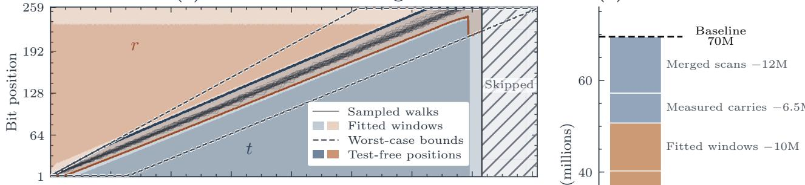  
(d) Mechanism ablation

(c) Per-step executed Tofoli  
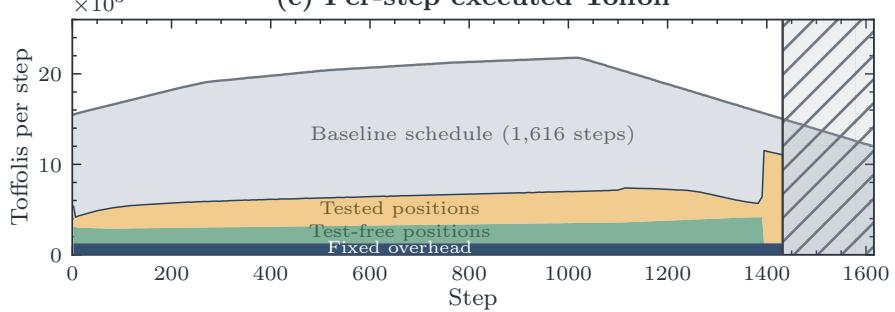

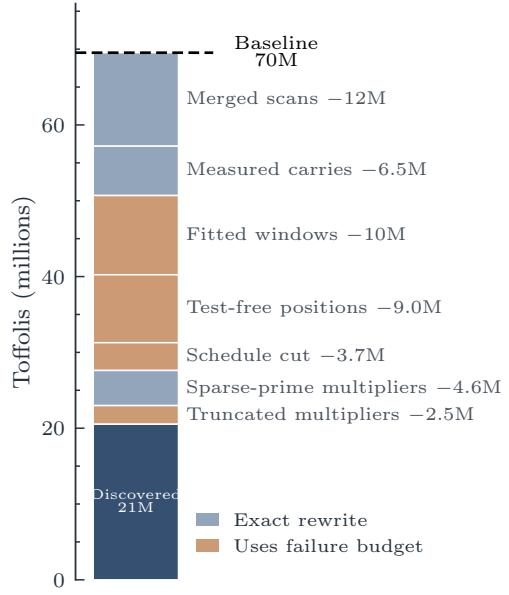  
FIG. S2 Specializing the Euclidean schedule and its contribution to the Tofoli reduction. (a) Two 259-qubit registers store coeficients $t , t ^ { \prime }$ from their low ends and remainders $r , r ^ { \prime }$ from their high ends. Four counters mark the boundaries of these values as the coeficients grow and the remainders shrink. (b) Each thin curve traces the moving boundary between the shrinking remainder r and growing coeficient t for one sampled walk. Light shading shows the fitted windows retained by the discovered circuit, dashed curves show the exact worst-case bounds, and dark shading marks the test-free positions, processed without first testing the counters. The hatched region is removed by the schedule cut from 1,616 to 1,432 steps. (c) Executed Tofolis per step. The gray profile is the baseline schedule; the discovered circuit’s profile splits into the fixed overhead of a step, arithmetic at test-free positions, and arithmetic at tested positions. (d) Cumulative ablation from 70 million to 21 million Tofolis. Blue changes are exact, whereas brown changes count against the failure budget.

Merged scans and measured carries. The baseline circuit compiles the scans within a step separately, so neighboring scans repeat some of the same comparisons and compute some of the same control bits. Compiling the complete step as one operation removes this repetition; we call this change merged scans. The clearest instance is the remainder update. The comparison that decides whether a subtraction applies and the subtraction itself run over the same two remainders, and the baseline compiles them as two passes. The discovered circuit merges them into one compare-and-subtract scan whose intermediate bits serve both operations. It then erases those bits by measurement, which needs no Tofolis, instead of uncomputing them. The baseline also shifts a register’s contents, by an amount that depends on the input, as the values change size. The discovered circuit renumbers the positions instead of moving the qubits, which costs no gates. In the additions that remain, a carry that only one position needs is likewise erased by measurement (measured carries). These changes are exact.

Multiplier arithmetic. The coordinate update also requires modular squaring and multiplication. The discovered circuit specializes these operations to the sparse prime p. The exact part of the rewrite, the sparse-prime multipliers, uses the fold of Equation (59), as in SI II.1. The approximate part, the truncated multipliers, limits how far a carry

propagates and how many bits a comparison inspects.

Figure S2(d) shows the cumulative Tofoli reduction. The two inversions, including their forward and reverse passes, together account for 98% of the Tofolis.

We estimate the failure probability empirically. Across 10 million sampled walks, 72 use a position outside a fitted window and 258 do not use a test-free position, a combined rate of about $6 . 6 \times 1 0 ^ { - 5 }$ per point addition. The schedule cut adds $1 . 3 \times 1 0 ^ { - 5 }$ , and the truncated multipliers add at most $2 \times 1 0 ^ { - 6 }$ . The total is about $8 \times 1 0 ^ { - 5 }$ per point addition. Among 100,000 tests of the full circuit, four fail.

## III. NUMERICAL FUNCTION EVALUATION

Elementary-function evaluation has been a central problem in numerical computing since the earliest mathematical software libraries. The routines conventionally collected in libm, the mathematical-function library supplied by C and Unix systems, evaluate roots, exponentials, logarithms, and trigonometric functions by combining range reduction, table lookup, polynomial approximation, and iterative refinement [57]. These functions also appear throughout quantum algorithms. They determine controlled rotation angles in quantum linear-systems algorithms [12, 58], set interaction phases in real-space Hamiltonian simulation [59, 60], and enter the amplitudes prepared for Hamiltonian simulation [4].

These classical techniques cannot simply be ported into coherent quantum circuits. Data-dependent choices must be compiled into a fixed gate sequence, and all temporary state must ultimately be returned to |0⟩. The latter reversibility constraint is particularly costly for numerical routines because many classical methods proceed through a long sequence of large, high-precision intermediate values. An ordinary implementation can overwrite each value and reuse the same storage as soon as the next value is formed. A reversible implementation must instead retain enough information to reconstruct the overwritten value, or recompute it when clearing the circuit. Consequently, composing individually eficient routines can accumulate many large live registers and may require running the complete computation backward after its result has been consumed. Iterative Newton-style methods repeatedly replace one full-precision estimate with another, so their reversible implementations carry large intermediate registers through every step [61]. Floating-point representations add exponent bits to every such register to track a wide range of magnitudes [62]. The approximation, fixed-point representation, and uncomputation schedule therefore become inseparable parts of circuit design [12].

We consider three numerical subroutines: Harrow–Hassidim–Lloyd (HHL) rotation-angle evaluation (arcsin), Coulomb-potential evaluation $( 1 / { \sqrt { \| x \| ^ { 2 } } } )$ , and Gaussian evaluation $( e ^ { - x ^ { 2 } } )$ [2, 58, 59]. Each implements an additive fixed-point map |x⟩ $\left| k \right. \mapsto \left| x \right. \left| k + { \widetilde f } ( x ) \right.$ , with a uniform error bound over its promised domain [63]. The additive form serves both common uses of the result. An ordinary accumulator k holds the value for later bitwise-controlled operations, while a phase-gradient accumulator converts the addition directly into a phase.

Our baselines use the piecewise-polynomial construction of Häner, Roetteler, and Svore (HRS) [12]. HRS partitions the domain, fits a low-degree polynomial on each interval, and coherently loads the selected polynomial’s coeficients. It evaluates the polynomial in general fixed-point arithmetic by Horner’s rule, which uses one multiplication per degree. It adds the result to the output and reverses the computation to clear its temporary registers. Its cost has four sources: locating an interval with arbitrary boundaries; the wide multiplications of the Horner polynomial-evaluation stage; the registers that hold intermediate products and the polynomial value; and the reverse pass that erases the loaded coeficients. For each task we tune the polynomial degree, fixed-point format, and published recomputation trade-ofs, and widen each interval until it reaches the error bound. We then use the complete gate-level implementation with the lowest T Q-cost.

The three discovered circuits still implement piecewise-polynomial approximations. They keep the HRS approximation family but reorganize it for reversible execution, addressing the four costs in turn. They choose finer partitions whose intervals can be identified from the input bits. No comparison is then needed, and a polynomial of lower degree on fewer input bits sufices: the HHL and Gaussian circuits replace cubics by quadratics, and the Coulomb circuit replaces quadratics by lines. Where the intervals difer in width, as in the HHL circuit, a rearrangement of the input bits maps them into one shared local coordinate, so that one arithmetic kernel serves every interval. This is the conditiona routing of the main text: a cheap, interval-dependent rearrangement of the data surrounds one shared kernel. The arithmetic accumulates directly into its destination, avoiding registers for full products and for the function value. MBU (Methods) then clears the loaded coeficients without reversing the lookup.

One supporting technique makes these choices safe. An ofline search fits the coeficients to the exact quantized and truncated integer computation that the circuit performs, rather than rounding an ideal real-valued approximation afterward. Coeficient widths, omitted product columns, shifts, truncation, and rounding therefore share one end-to-end error budget.

All three circuits use these techniques. They difer in how the input reaches the arithmetic. The HHL circuit, which we describe in full, uses intervals of unequal width and cyclically shifts the input bits into a shared coordinate. The

Coulomb circuit first builds the squared distance and normalizes it. The Gaussian circuit folds its input onto the nonnegative axis, prunes its lookup, and reuses coeficient qubits.

## III.1. HHL rotation angle

After phase estimation, HHL applies an eigenvalue-dependent rotation whose angle is $\theta = \arcsin ( C / { \widetilde { \lambda } } ) ;$ conditioning on the rotated ancilla reweights each eigencomponent by $1 / \widetilde { \lambda } \ [ 5 8 ]$ . We take $C = 1 / 2$ and represent the eigenvalue estimate by a 21-bit integer $X$ , with $x = X / 2 ^ { 1 6 } { \overset { \cdot } { \in } } [ 1 , 3 2 )$ . The circuit adds the 33-bit angle

$$
f ( X ) = \mathrm { { r o u n d } } \left( 2 ^ { 3 2 } \arcsin \left( { \frac { 2 ^ { 1 5 } } { X } } \right) \right)\tag{61}
$$

to an accumulator k. We require error below $1 0 ^ { - 7 }$ radians throughout the domain.

The tuned HRS baseline uses cubic fits on 35 intervals and general 44-bit fixed-point arithmetic. It meets the error bound with 16,000 Tofolis and 300 qubits. Locating the interval requires coherent comparisons against arbitrary boundaries, and each evaluation performs three multiplications on 44-bit numbers.

The discovered circuit restructures this dataflow with three transformations, illustrated in Figure $_ \mathrm { S 3 . }$

Power-of-two-aligned intervals. The function arcsin $( 1 / ( 2 x ) )$ changes rapidly near $x = 1$ and progressively more slowly as x increases. An arbitrary adaptive partition could follow this variation, but reversibly locating one of its intervals would require comparisons against general boundaries. The discovered circuit instead uses narrow intervals near $x = 1$ and wider ones where the function is flatter, while restricting every interval to the power-of-two-aligned, or dyadic, form $[ L , L + 2 ^ { b } )$ with $L$ a multiple of $2 ^ { b }$ . We call such an interval a $l e a f ,$ because these intervals are the leaves of a binary tree over the input bits. The leading bits of the input then determine the leaf.

Because selection is cheap, a much finer partition is afordable: the circuit uses 345 intervals of widths $2 ^ { 8 }$ through $2 ^ { 1 5 }$ , whereas the baseline uses 35 arbitrary intervals. The finer partition simplifies the arithmetic in two ways. A quadratic sufices instead of the baseline cubic, reducing the number of multiplications, and each polynomial depends only on the narrow local displacement $\delta = X - L$ , reducing its operand widths. A uniform partition at the finest width would require 7,936 intervals (Figure S3(b)), so the dyadic tree obtains these benefits without paying for uniforml fine resolution.

Shared local coordinate. After selecting a leaf, a conventional polynomial-evaluation stage would form $\delta = X - L$ and rescale it according to the leaf width, requiring arithmetic and temporary storage. Moreover, leaves of diferent widths initially present diferently scaled inputs to the polynomial-evaluation stage. The circuit replaces this coordinate arithmetic with an in-place cyclic shift of the input bits. For $X = L + \delta$ in a width $- 2 ^ { b }$ leaf, cyclically shifting the low 15 bits produces

$$
d = 2 ^ { 1 5 - b } \delta + c _ { L } .\tag{62}
$$

The varying bits $\delta$ move to a common scale, while the fixed leaf bits wrap around to form $c _ { L }$ . Because $c _ { L }$ is constant within the leaf, the ofline fit absorbs it into the coeficients. Thus every leaf feeds the same 15-bit polynomial-evaluation stage without subtraction, arithmetic rescaling, or a coordinate register (Figure S3(b)). For example, in a width-212 leaf, the low 15 bits consist of three bits fixed by the leaf followed by the 12 varying bits of δ. Shifting those bits cyclically left by three places produces $d = 2 ^ { 3 } \delta + c _ { L }$

Narrow direct accumulation. For each leaf, the coeficient table defines the integer quadratic

$$
\begin{array} { r } { q _ { L } ( d ) = g _ { 0 } - d ( g _ { 1 } - g _ { 2 } d ) , } \end{array}\tag{63}
$$

with intercept $g _ { 0 } .$ , slope $g _ { 1 }$ , and curvature $g _ { 2 }$ . A general Horner polynomial-evaluation stage multiplies large fixed-point numbers, retains work registers for those products, and materializes the polynomial value before adding it to the output. The shared polynomial-evaluation stage instead consumes the selected coeficients in place. It first overwrites the loaded slope $g _ { 1 }$ with the inner Horner value, then accumulates the outer product directly into $k \colon$

$$
t  g _ { 1 } - g _ { 2 } d \quad ( { \mathrm { s t o r e d ~ o v e r ~ } } g _ { 1 } ) , \qquad k  k + g _ { 0 } - d t .\tag{64}
$$

No separate register ever holds the completed polynomial or either full product.

The products themselves are also truncated: the circuit omits the low-order partial-product columns whose combined efect stays inside the error budget. The ofline search fits the integer coeficients $g _ { i }$ to the exact updates in Equation (64), including the truncated columns.

The worst-case error over all inputs is $9 . 9 5 \times 1 0 ^ { - 8 }$ radians. The circuit uses 1,348 Tofolis and 115 qubits, for a T Q-cost of 160,000. Relative to the tuned HRS baseline, this reduces the Tofoli count by $1 2 \times .$ the qubit count by $2 . 6 \times$ , and the $T Q \mathrm { - c o s t }$ by 32×.

(a) Circuit structure  
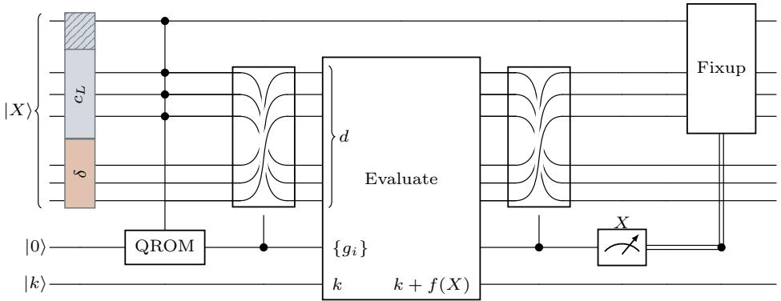

(b) Leaf selection and the shared coordinate  
(c) Multiplication footprint  
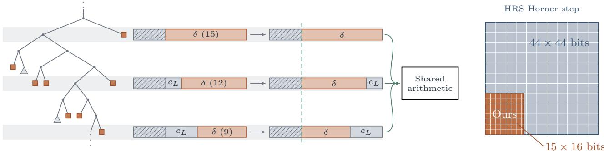  
FIG. S3 Co-designed HHL rotation-angle circuit. (a) Complete reversible dataflow: a dyadic lookup selects a local quadratic and a cyclic shift, the input is mapped into a shared local coordinate, and the quadratic is accumulated directly into k. The inverse shift restores $X ;$ measurement and a shared phase correction clear the consumed coeficients without reversing the lookup. (b) Dyadic leaves and the shared coordinate. Power-of-two-aligned leaves are selected by the leading input bits. Shifting each leaf’s varying bits δ to a common scale allows leaves of diferent widths to feed one 15-bit polynomial-evaluation stage without subtraction or arithmetic rescaling. (c) Arithmetic consequence: the circuit multiplies the 15-bit coordinate by a 16-bit slope, compared with $4 4 \times 4 4$ bits for each multiplication in the general HRS Horner polynomial-evaluation stage.

## III.2. Coulomb potential

Real-space simulation repeatedly applies phases proportional to the inverse distance between particle pairs [59, 60]. For distinct points $r _ { i } , r _ { j } \in \{ 0 , \ldots , 2 5 5 \} ^ { 3 }$ , our circuit adds

$$
F ( r _ { i } , r _ { j } ) = \operatorname { r o u n d } \left( \frac { 2 ^ { 2 4 } } { \sqrt { \sum _ { c \in \{ x , y , z \} } ( r _ { i , c } - r _ { j , c } ) ^ { 2 } } } \right)\tag{65}
$$

to a 25-bit accumulator k. We require error below $2 \times 1 0 ^ { - 6 }$ in the inverse distance. The tuned HRS baseline normalizes the squared distance and evaluates quadratics over 16 intervals, using 6,355 Tofolis and 252 qubits. The discovered circuit instead builds the squared distance in a single accumulation, replaces the quadratics by a finer table of lines, and erases that larger lookup cheaply.

Direct squared-distance accumulation. The inverse-square-root approximation begins from the exact squared distance $\begin{array} { r } { \hat { d ^ { 2 } } = \sum _ { c } ( r _ { i , c } - r _ { j , c } ) ^ { 2 } } \end{array}$ . A conventional implementation would form the three coordinate squares in separate product registers and then add them. The discovered circuit instead adds the partial products of all three squares directly into one accumulator. This yields $d ^ { 2 }$ exactly, without three product registers or a separate summation stage.

A finer table of lines. The central approximation trade-of is to spend more lookup entries in order to use a lower-degree polynomial. HRS uses 16 intervals and evaluates a quadratic in each. The discovered circuit uses 128 intervals and evaluates only a line in each: the larger lookup is cheaper than the additional reversible multiplication required by a quadratic.

Both constructions first write $d ^ { 2 } = 2 ^ { e } u$ , with mantissa $1 \leq u < 2 ,$ , so that

$$
\frac { 1 } { \sqrt { d ^ { 2 } } } = 2 ^ { - e / 2 } \frac { 1 } { \sqrt { u } } .\tag{66}
$$

A few flag qubits record the scale $2 ^ { - e / 2 }$ . The parity of e and the six leading bits of the mantissa select one of 128 lines, and the next six bits give a local coordinate. The remaining low bits are irrelevant within the error bound. The selected line therefore needs at most six controlled additions rather than a general multiplication, after which the circuit restores the scale and adds the result to k. As in the HHL circuit, the coeficients are fitted to the exact integer computation.

The larger table is afordable because MBU of a lookup [64] removes it with 17 Tofolis, instead of the 126 that reversing it would take.

The worst-case error over all attainable squared distances is $1 . 9 1 \times 1 0 ^ { - 6 }$ in the inverse distance. The circuit uses 1,140 Tofolis and 142 qubits, for a TQ-cost of 160,000. Relative to the tuned HRS baseline, this reduces the Tofoli count by 5.6×, the qubit count by 1.8×, and the TQ-cost by 9.9×.

## III.3. Fixed-point Gaussian

The Gaussian $e ^ { - x ^ { 2 } }$ enters chemistry simulation through on-the-fly evaluation of molecular basis functions [2] and Gaussian state preparation [65]. The input is a 39-bit two’s-complement integer $X _ { s }$ representing $x = X _ { s } / 2 ^ { 3 2 }$ , and the promised domain is $x \in [ - 8 , 8 )$ . The circuit adds

$$
f ( X _ { s } ) = \mathtt { r o u n d } \left( 2 ^ { 3 2 } e ^ { - x ^ { 2 } } \right)\tag{67}
$$

to a 39-bit accumulator with error below $1 0 ^ { - 7 }$ . The tuned HRS baseline first forms $x ^ { 2 }$ and evaluates cubics over 32 intervals using general 40-bit arithmetic, for 24,000 Tofolis and 362 qubits.

The discovered circuit never forms $x ^ { 2 }$ . It folds the input onto the nonnegative axis and approximates $e ^ { - y ^ { 2 } }$ directly. For a negative two’s-complement input, forming |x| would complement the data bits and add one. The circuit omits that addition, so the complement, which needs only Cliford gates, instead represents $y = | x | - 2 ^ { - 3 2 }$ . This removes an entire carry chain, and the resulting one-unit ofset lies within the error budget.

Pruned coeficient lookup. Ten bits of y directly select one of 1,024 equal intervals of width $2 ^ { - 7 }$ that cover [0, 8), while the lower bits give the local coordinate. The Gaussian’s decay divides these intervals into three regimes: 455 require quadratics, the next 59 need only constants, and the remaining 510 return zero. A conventional QROM would nevertheless spend gates on every interval. The variable-spaced QROM of Sanders et al. [66] instead stops whenever an entire subtree shares one value. Pruning the constant and zero intervals reduces the lookup from 1,022 Tofolis to 495.

Direct quadratic accumulation. On a quadratic interval, the lookup returns an intercept, slope, and curvature. A truncated product updates the slope register in place, after which the circuit adds the intercept and accumulates the final product directly into k. Consequently, it never forms $y ^ { 2 }$ or a completed product, and it needs no separate Gaussian-value register. The coeficients are again fitted to the exact integer computation.

After MBU, the freed coeficient qubits serve as carry ancillas for the later arithmetic [64]. Together with direct accumulation, this reuse lowers the peak qubit count from 362 in the baseline to 139.

The worst-case error over the full domain is $9 . 9 9 \times 1 0 ^ { - 8 }$ . The circuit uses 1,583 Tofolis and 139 qubits, for a TQ-cost of 220,000. Relative to the tuned HRS baseline, this reduces the Tofoli count by 15×, the qubit count by 2.6×, and the TQ-cost by 39×.

Across the three tasks, these techniques reduce T Q-cost by $9 . 9 { \times } { - } 3 9 { \times }$ relative to the tuned HRS baselines.

## IV. QUANTUM CHEMISTRY SIMULATION

In Pauli-based electronic-structure simulation, the electronic Hamiltonian is a weighted sum of Pauli operators:

$$
H = \sum _ { \ell = 0 } ^ { L - 1 } w _ { \ell } P _ { \ell } ,\tag{68}
$$

where each $P _ { \ell }$ is a tensor product of $I , X , Y .$ , and $Z .$ Qubitization encodes this Hamiltonian in a unitary circuit. Such an encoding is needed because H is not itself unitary and therefore cannot simply be applied to a quantum state. Writing $\lambda = \textstyle \sum _ { \ell } | w _ { \ell } |$ , an ideal Prepare creates a superposition of term labels,

$$
\mathrm { P R E P A R E } \left| 0 \right. = \sum _ { \ell } \sqrt { | w _ { \ell } | / \lambda } \left| \ell \right. ,\tag{69}
$$

while Select applies the signed Pauli operator with that label:

$$
\operatorname { S E L E C T } \left| \ell \right. \left| \psi \right. = \left| \ell \right. \operatorname { s g n } ( w _ { \ell } ) P _ { \ell } \left| \psi \right. .\tag{70}
$$

Preparing this superposition, applying the selected term, and reversing the preparation embeds the normalized Hamiltonian as a block of a larger unitary:

$$
( \langle 0 | \otimes I ) \mathrm { P R E P A R E } ^ { \dag } \mathrm { S E L E C T P R E P A R E } ( | 0 \rangle \otimes I ) = \sum _ { \ell } \frac { w _ { \ell } } { \lambda } P _ { \ell } = \frac { H } { \lambda } .\tag{71}
$$

Qubitization combines this block encoding with a reflection about the prepared state to form a quantum walk operator $U$ with eigenvalues $e ^ { \pm i \operatorname { a r c c o s } ( E / \lambda ) }$ , where $E$ ranges over the eigenenergies of $H$ . Phase estimation on U therefore yields the energies; because it applies $U$ many times, the cost of one application sets the cost of the simulation.

We use the Fe2S2 integral data published by Li and Chan [67], which models 30 active electrons in 20 spatial orbitals. Iron–sulfur clusters are important strongly correlated targets, in which many electronic configurations contribute significantly to the ground state [68, 69]. Each spatial orbital has a spin-up and a spin-down mode, so these 20 orbitals become 40 spin-orbitals and, after the Jordan–Wigner mapping, 40 qubits. Discarding terms with $\vert w _ { \ell } \vert < 1 0 ^ { - 4 } ~ \mathrm { H a }$ following the truncation practice of sparse qubitization [64], leaves $L = 4 1 , 0 5 2$ signed Pauli operators.

State-of-the-art resource estimates for this system use double-factorized tensor hypercontraction (DFTHC), which compresses the Hamiltonian into factors and orbital rotations before circuit construction [69]. However, studying the DFTHC walk operator would require validating networks of continuously parameterized Givens rotations acting on superposed states, which goes beyond the kickmix framework. We therefore focus on the more direct sparse compilation, which stores the Hamiltonian as an explicit list of its Pauli terms.

In this section we study the data-dependent part of one application of $U { : }$ the alias selection inside Prepare, the Select application, and the erasure of the selection. Directly preparing the unequal amplitudes in Equation (69) is expensive, so a standard construction uses the alias method [4, 64, 70, 71]. Classical preprocessing spreads the probabilities $| w \ell | / \lambda$ over L equal-sized buckets, one per term. Bucket i is shared between term i and one other term alt(i), and a 16-bit threshold keep(i) sets the split. The circuit draws a bucket i and a 16-bit value τ uniformly. It selects term i if $\tau <$ < keep(i) and term alt(i) otherwise:

$$
h ( i , \tau ) = \mathbf { 1 } [ \tau < \ker ( i ) ] , \qquad \operatorname { s e l } ( i , \tau ) = { \left\{ \begin{array} { l l } { i } & { { \mathrm { f o r ~ } } h = 1 , } \\ { { \mathrm { a l t } } ( i ) } & { { \mathrm { f o r ~ } } h = 0 . } \end{array} \right. }\tag{72}
$$

The preprocessing chooses the alternate terms and thresholds so that, across all pairs $( i , \tau )$ , each term ℓ is selected a number of times proportional to its weight, rounded to 16 bits. Thus choosing i and τ uniformly produces the rounded distribution. Let $U _ { \mathrm { a l i a s } }$ denote the reversible computation of h and sel from i and τ. The data-dependent circuit studied here is $U _ { \mathrm { a l i a s } } ^ { \dagger }$ Select $\boldsymbol { U } _ { \mathrm { a l i a s } } \colon$ it computes the selected term, applies its signed Pauli operator, and erases the selection, leaving i and τ unchanged. The uniform-superposition preparation of i and $\tau ,$ its reversal, and the walk reflection lie outside this circuit.

Each table row stores its threshold, its alternate index, and the signs of both possible coeficients. We call this 34-bit record the alias word. Write $\theta _ { \ell } = 0$ for a positive coeficient and $\theta _ { \ell } = 1$ for a negative one.

To state the required action on the system register $x ,$ observe that on a computational-basis state, X flips a bit, Z contributes a sign determined by that bit, and $\overset { \smile } { Y }$ does both. For term $\ell ,$ let $a _ { \ell }$ mark the qubits on which $\bar { P } _ { \ell }$ contains $X$ or $Y$ , and let $z _ { \ell }$ mark those on which it contains $Z$ or Y. Write $n _ { Y } ( P _ { \ell } )$ for the number of Y factors in $P _ { \ell }$ . Every Pauli operator in the table contains an even number of Y factors, so its phase is real:

$$
P _ { \ell } \left| x \right. = ( - 1 ) ^ { \eta _ { \ell } \oplus \mathrm { p a r i t y } ( x \wedge z _ { \ell } ) } \left| x \oplus a _ { \ell } \right. , \qquad \eta _ { \ell } = \frac { n _ { Y } ( P _ { \ell } ) \mathrm { m o d } 4 } { 2 } .\tag{73}
$$

The required map is therefore

$$
\left| i \right. _ { 1 6 } \left| \tau \right. _ { 1 6 } \left| x \right. _ { 4 0 } \longmapsto ( - 1 ) ^ { \phi } \left| i \right. _ { 1 6 } \left| \tau \right. _ { 1 6 } \left| x \oplus a _ { \mathrm { s e l } } \right. _ { 4 0 } ,\tag{74}
$$

$$
\phi = \theta _ { \mathrm { s e l } } \oplus \eta _ { \mathrm { s e l } } \oplus \mathrm { p a r i t y } ( x \wedge z _ { \mathrm { s e l } } ) .\tag{75}
$$

The comparison bit h and the selected index do not appear in this map: they are intermediate values that the circui must return to zero. We require this map exactly for every $i < 4 1 , 0 5 2$ , every $\tau ,$ and every 40-bit system state.

The baseline combines the circuits used in sparse qubitization [4, 64]. QROM loads the 34-bit alias word, merging repeated alias words [66]. A comparator then calculates $h ( i , \tau )$ to choose between i and alt(i) and apply the selected coeficient sign. A second, independent traversal over sel applies the selected Pauli operator to the 40 system qubits. The baseline then erases the selected index, the comparison bit $h ,$ and the alias word.

The lookup and the row-by-row Select traversal cost 13,000 and 41,000 Tofolis, respectively; together they contribute more than 97% of the total. The remaining comparison, selection, and cleanup bring the baseline to 55,000 Tofolis and 139 qubits. The main opportunity is to shorten the two table traversals.

For arbitrary, unstructured table data, QROM has no pattern to exploit: in the worst case, every address may store an unrelated word. However, this table is not arbitrary. Its Pauli operators and coeficients come from a physica system with exact spin symmetries and repeated orbital environments, so many coeficients are equal and many Paul operators are related. We therefore choose the table to suit the circuits. Two degrees of freedom make this possible. First, permuting terms together with their coeficients and Pauli operators leaves Equation (68) unchanged. Second, many diferent alias tables realize the same rounded distribution. The preprocessing uses the first freedom to group Pauli operators related by fixed Cliford transformations into blocks, shortening Select. It uses the second to place equal alias words into repeated patterns, shortening QROM.

Frame-block Select. Many Pauli operators in this Hamiltonian are related by fixed Cliford transformations, which we call frames. Suppose, for example, that two commuting frames generate four related Pauli operators from one representative. Instead of selecting four operators independently, the circuit selects the representative once and uses two bits of the address (the selected row index) to control the two frames. More generally, k such bits can identify up to $2 ^ { k }$ operators in a block. The circuit pays for one block representative plus its controlled frames, rather than every Pauli operator separately.

The circuit applies a frame by conjugation. It applies $\sigma ^ { \dagger }$ to the system register under a control, then the representative $P ,$ then σ under the same control. The result is $\sigma P \sigma ^ { \dagger }$ when the control is set and $P$ otherwise. Each frame is applied once for the whole table rather than once per block. Blocks that use the same frames are contiguous, so a few comparisons of the address with fixed boundaries determine which frames are active.

These relations have a physical origin: the model contains two equivalent spin channels, two similar iron sites, and corresponding orbitals on repeated parts of the cluster. These repetitions create Pauli operators that are related by a fixed transformation. Each frame is a permutation or change of basis of the spin-orbitals. The Jordan–Wigner mapping turns it into a fixed Cliford transformation of the 40 system qubits.

Two of the frames used here come from exact spin symmetries of the Hamiltonian. Because the model treats the spin-up and spin-down channels identically, $\sigma _ { \alpha \beta }$ exchanges the spin-up and spin-down modes of every spatial orbital. Spin-rotation symmetry produces a second pairing after the Jordan–Wigner mapping: $\sigma _ { X Y }$ exchanges the X and Y factors and adjusts the accompanying $Z$ strings required by that mapping. Both transformations preserve the corresponding coeficient magnitudes.

The other five frames come from parts of the cluster that resemble each other; unlike the two spin frames, they are not symmetries of the full Hamiltonian. The frame $\sigma _ { \mathrm { F e } }$ is the approximate left–right reflection of the cluster, which exchanges the two iron centers and their surrounding orbitals. The frame $\sigma _ { \mathrm { F e } } ^ { \prime }$ combines this reflection with several local orbital swaps and matches Pauli operators that the bare reflection misses. The frames $\sigma _ { \mathrm { t h i o } } , \sigma _ { 3 d } .$ , and $\sigma _ { \mu \mathrm { S } }$ exchange corresponding orbitals on the terminal thiolates, the iron 3d shells, and the bridging sulfur atoms. These sites have similar but not identical electronic environments: the permutation often maps one term’s Pauli operator onto another’s, but the coeficients difer. Only the Pauli relation $\bar { P } _ { \ell ^ { \prime } } = \sigma P _ { \ell } \sigma ^ { \dagger }$ must hold exactly; w and $w _ { \ell }$ remain independent entries in the alias table.

The preprocessing thus finds a commuting family of seven frames and orders related Pauli operators into blocks whose sizes are powers of two, so that address bits index the operators within a block. The 41,052 terms form 3,221 blocks. Selecting the block representatives costs 3,327 Tofolis. Applying the seven frames and determining which are active costs 534. Figure S4 shows the resulting structure.

Alias table with repeated rows. Recall that each alias-table row is a probability bucket split between its own term and one alternate term. A term whose weight is smaller than one bucket leaves empty space in its $\operatorname { r o w } ;$ a term whose weight is larger than one bucket fills such space in other rows.

A standard alias construction may pair underfilled rows with heavy terms in many diferent ways. Our preprocessing chooses these pairings to make nearby rows identical. For example, if four light rows of equal weight must draw their alternate terms from two heavy terms A and $B ,$ an ordinary schedule might alternate $A , B , A , B ;$ ours prefers A, A, B, B. Rows 1–2 then share a threshold, an alternate term, and hence an alias word, as do rows 3–4.

(a) Frame-blocked table layout  
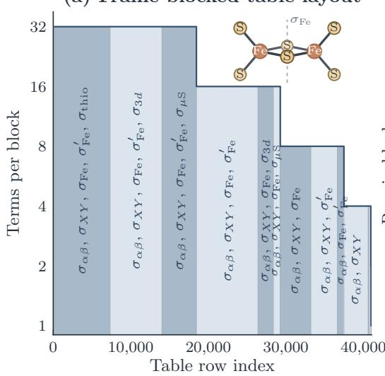

(b) One five-frame block  
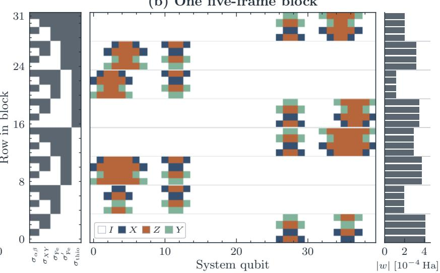  
FIG. S4 Frame structure of the $\mathrm { F e _ { 2 } S _ { 2 } }$ alias table. (a) The preprocessing places Pauli operators related by fixed Cliford frames into contiguous blocks. This groups the 41,052 table rows into 3,221 blocks that Select handles as units. Band height gives the number of terms in each block, and the labels give the frames used to generate them. Inset: the Fe2S2 cluster core (thiolate substituents omitted); the dashed line marks the iron-site reflection $\sigma _ { \mathrm { F e } }$ . (b) One block of 32 Pauli operators generated from a representative operator using five frames. Each row of the left matrix specifies which frames are applied; a dark cell means that the frame named below its column is included. The center shows the resulting Pauli operator on the 40 system qubits, and the bar on the right gives its coeficient magnitude. The spin frames $\sigma _ { \alpha \beta }$ and $\sigma _ { X Y }$ , shown in the first two columns, preserve coeficient magnitudes and therefore produce equal-weight groups of four. The other three frames need not preserve the coeficients.

This strategy is particularly efective here because the two exact spin frames produce many groups of four equa weights (Figure S4(b)). The coeficients also span a broad range, so heavier terms can supply the missing weight of many lighter rows. Because the pairing only redistributes each term’s weight among buckets, it preserves the rounded distribution and creates long runs of identical alias words without breaking the frame blocks. Of the 20,374 $\sigma _ { \alpha \beta }$ -related row pairs it places next to each other, 18,463 store identical alias words.

The alias-table QROM realizes this saving by pruning the binary tree over its address i. Whenever the two halves of a subtree contain the same sequence of alias words, the QROM visits one copy and skips the address bit that distinguishes them. For example, the eight-row pattern A, A, B, B, A, A, B, B consists of two identical halves, so the top address bit is irrelevant and the circuit looks up only A, A, B, B. Together, this scheduling and repeated-subtree pruning reduce the cost of the alias-table QROM to 10,000 Tofolis, compared with 41,000 for a row-by-row traversal and 13,000 for the baseline lookup with merged repeated alias words.

The rest of the circuit follows the baseline. A comparator computes $h ,$ a controlled swap moves the selected index into place, and both are reversed after Select, for 64 Tofolis. The circuit then clears the keep and alt fields by MBU and corrects the resulting phase in one pass over the address i, for 782 Tofolis.

We test every table row and a further $2 ^ { 2 4 }$ uniformly random inputs. The discovered circuit uses 15,000 Tofolis and 126 qubits, for a TQ-cost of $1 . 9 \times 1 0 ^ { 6 }$ . Relative to the baseline, this reduces the Tofoli count by 3.7×, the qubit count by 9.4%, and the TQ-cost by 4.1×.

The amount of compression is specific to this Hamiltonian, but the preprocessing can search for such relations in other sparse Pauli tables, and it falls back to conventional Select and QROM costs when it finds none. Exact spin symmetry is common in spin-independent molecular Hamiltonians, so the scheduling strategy should carry over. The opportunity is smaller when a Zeeman term or spin–orbit coupling breaks the spin symmetries. In DFTHC, analogous choices arise in the factorization itself [69, 72]: the factorization is not unique, and a circuit-aware choice could make its coeficient data repeated or sparse and therefore cheaper to load.

## V. NONABELIAN LATTICE-GAUGE SIMULATION

In Hamiltonian lattice gauge theory, space is replaced by a grid. A gauge-field configuration assigns a group element $U _ { i } ( \mathbf { x } )$ to each directed edge, or link, from site x in direction i. This element describes how the gauge field transports a state between neighboring sites; traversing the link backward contributes its inverse $U _ { i } ( { \bf x } ) ^ { - 1 }$ . Multiplying the links around a closed path therefore describes the net transport along that loop. Although this product depends on an arbitrary convention at each site (the gauge), the real part of its matrix trace does not, and these loop traces form the magnetic energy [73]. Because the gauge group is nonabelian, its elements need not commute, so the links must be multiplied in the order in which the path traverses them.

We consider the group-register formulation of Hamiltonian lattice gauge theory [73], in which a register holds the group element of each link. The Hamiltonian separates into an electric (kinetic) term $H _ { E }$ and a magnetic (potential) term $H _ { B }$ . A Trotter step evolves these terms separately. Here we implement the magnetic evolution $e ^ { - i \Delta t \hat { H } _ { B } }$ for the improved Hamiltonian of Carena et al. [74]. The smallest loop contributing to $H _ { B }$ goes around one square face of the lattice and is called a plaquette; the standard magnetic term sums a trace over these four-link loops. The improved Hamiltonian adds weighted $2 \times 1$ rectangles, which cancel the leading discretization error. Thus the magnetic evolution requires the same basic operation at many locations: follow a short closed path, multiply its links in order, extract a trace, and add the weighted result to the phase. The compilation task studied here is one application of the magnetic evolution to the whole lattice, which we call the magnetic layer.

We use a periodic $4 \times 4 \times 4$ lattice [75]. The lattice has 192 links, and the layer contains 192 four-link plaquettes and 384 six-link rectangles. For directions i and $j ,$ representative loop products are

$$
\begin{array} { c } { P _ { i j } ( { \bf x } ) = U _ { i } ( { \bf x } ) U _ { j } ( { \bf x } + \hat { i } ) U _ { i } ( { \bf x } + \hat { j } ) ^ { - 1 } U _ { j } ( { \bf x } ) ^ { - 1 } , } \\ { R _ { i j } ( { \bf x } ) = U _ { i } ( { \bf x } ) U _ { i } ( { \bf x } + \hat { i } ) U _ { j } ( { \bf x } + 2 \hat { i } ) U _ { i } ( { \bf x } + \hat { i } + \hat { j } ) ^ { - 1 } U _ { i } ( { \bf x } + \hat { j } ) ^ { - 1 } U _ { j } ( { \bf x } ) ^ { - 1 } . } \end{array}\tag{76}
$$

Here $\hat { i }$ is one lattice step in direction $i ,$ with coordinates wrapping modulo four. Plaquettes use the pairs $i < j$ , and rectangles use both orderings $i \neq j$

To store each link in a finite register, we restrict its value from the continuous group $S U ( 3 )$ to the 216-element subgroup $G = \Sigma ( 7 2 \times 3 ) \subset S U ( 3 )$ used by Osorio Perez et al. [37]. We encode these elements using the unique normal form

$$
g = \omega ^ { p } C ^ { q } E ^ { r } V ^ { 2 s + t } X ^ { u } , \qquad p , q , r \in \{ 0 , 1 , 2 \} , \qquad s , t , u \in \{ 0 , 1 \} ,\tag{77}
$$

where $\omega = e ^ { 2 \pi i / 3 }$ and $C , E , V , X$ are fixed matrices that generate the group. These six exponents are the coordinates of a group element. Each three-valued exponent uses two qubits and each binary exponent one, for nine qubits per link and 1,728 in total. We write $g$ for the value of one link and $g _ { 0 } , \ldots , g _ { 1 9 1 }$ for all of them. Setting $u = 0$ in Equation (77) gives the 108-element subgroup $\Sigma ( 3 6 \times 3 )$ , while $u = 1$ gives its other coset.

The main dificulty in multiplying two group elements is that the generators do not commute. For instance, within the $\omega , C , E$ part, the relation $E C = \omega C E$ gives

$$
( \omega ^ { P } C ^ { Q } E ^ { R } ) ( \omega ^ { p } C ^ { q } E ^ { r } ) = \omega ^ { P + p + R q } C ^ { Q + q } E ^ { R + r } ,\tag{78}
$$

with exponents modulo three. Moving V through the $C , E$ part similarly transforms several coordinates. The action of X is more involved:

$$
X C = C ^ { 2 } E X , \qquad X E = \omega ^ { 2 } C E X , \qquad X V = \omega ^ { 2 } E V ^ { 3 } X , \qquad X ^ { 2 } = C ^ { 2 } V ^ { 2 } .\tag{79}
$$

Consequently, when the left factor contains $X$ , every coordinate of the right factor must be rewritten before the two can be combined. Algorithm S1(a) gives the general rule.

Each $g \in G$ can be written as a $3 \times 3$ matrix $M _ { g }$ , and each completed loop product contributes to $H _ { B }$ only through the seven-valued function

$$
f ( g ) = 2 \operatorname { R e } \operatorname { T r } ( M _ { g } ) \in \{ - 3 , - 2 , - 1 , 0 , 1 , 2 , 6 \} .\tag{80}
$$

Let $S _ { P }$ and $S _ { R }$ be the sums of $f$ over all plaquettes and rectangles, respectively. For the improved discretization, $H _ { B }$ is proportional to $S _ { P } - { \textstyle { \frac { 1 } { 2 0 } } } S _ { R } \left[ 7 4 \right]$ . We represent these phase weights as 51-bit integers $a _ { P }$ and $a _ { R }$ . The weight $a _ { P }$ depends on the time step and the coupling, so we use a generic 51-bit value, and we choose $a _ { R }$ so that $a _ { R } / a _ { P } \approx - 1 / 2 0$ Because all of the loop traces are diagonal in the group-element basis, the magnetic evolution leaves each link configuration unchanged. In our 51-bit representation, the target operation multiplies each link configuration by the phase $e ^ { 2 \pi i ( a _ { P } S _ { P } + a _ { R } S _ { R } ) / 2 ^ { 5 1 } }$ . We implement this operation using a reusable phase-gradient state, which satisfies

$$
\left| \mathrm { P G } _ { 5 1 } \right. = \frac { 1 } { \sqrt { 2 ^ { 5 1 } } } \sum _ { k = 0 } ^ { 2 ^ { 5 1 } - 1 } e ^ { - 2 \pi i k / 2 ^ { 5 1 } } \left| k \right. , \qquad \mathrm { A D D } _ { y } \left| \mathrm { P G } _ { 5 1 } \right. = e ^ { 2 \pi i y / 2 ^ { 5 1 } } \left| \mathrm { P G } _ { 5 1 } \right. ,\tag{81}
$$

Algorithm S1 General normal-form multiplication and the specialized running-product update. The former supports two arbitrary operands in the original normal form; the latter uses diferent factor orders for the running product and two arbitrary operands in the original normal form; the latter uses orders for the running product and the incoming link, stores the incoming link, stores ${ \widetilde { P } } = P + Q R .$ , and writes , and writes $m = 2 s + t .$

(a) General normal-form product (b) Specialized running-product update   
Input: running product $W = \omega ^ { P } C ^ { Q } E ^ { R } V ^ { M } X ^ { \upsilon }$ Input: running product $W = \omega ^ { P } V ^ { M } X _ { o } ^ { \upsilon } C ^ { Q } E ^ { R }$   
link $g = \omega ^ { p } \tilde { C } ^ { q } E ^ { r } V ^ { m } X ^ { u }$ link $g = \omega ^ { p } \bar { C } ^ { q } E ^ { r } V ^ { 2 s + t } X _ { o } ^ { u }$   
Output: $W  W g$ in the original normal form Output: $W  W g$ in the specialized representation   
1: if $\upsilon = 1$ then ▷ apply Equation (79) 1: $\widetilde { P } \gets \widetilde { P } + p + q r + Q r + 2 R q$ (mod 3)   
2: Write $m = 2 s + t ,$ with $s , t \in \{ 0 , 1 \}$ 2: $( Q , R ) \gets ( Q + q , R + r )$ (mod 3)   
3: $p _ { 0 } \gets p + q r + 2 \cdot { \bf 1 } [ q = 2 ] + 2 \cdot { \bf 1 } [ r \neq 0 ]$ (mod 3) 3: if t = 1 then   
4: $( q _ { 0 } , r _ { 0 } ) \gets ( 2 q + r , q + r )$ (mod 3) 4: $( Q , R )  ( R , - Q )$ (mod 3)   
5: $p \gets p _ { 0 } + 2 s + s r _ { 0 } + 2 t$ (mod 3) 5: end if   
6: $( q , r ) \gets ( q _ { 0 } + s , r _ { 0 } + s + t ( 1 + s ) )$ (mod 3) 6: if $s = 1$ then   
7: s  s  t 7: $( Q , R ) \gets ( - Q , - R )$ (mod 3)   
8: $m \gets 2 s + t$ 8: end if   
9: if u = 1 then ▷ apply $X ^ { 2 } = C ^ { 2 } V ^ { 2 }$ 9: if $u = 1$ then   
10: $p  p + ( 1 - t ) ( 2 - s ) r$ (mod 3) 10: $( Q , R )  ( Q - R , - Q - R )$ (mod 3)   
11: $q  q + ( 1 - t ) ( 2 - s )$ (mod 3) 11: end if   
12: $r  r + t ( 2 - s )$ (mod 3) 12: $M  M + ( - 1 ) ^ { v } ( 2 s + t ) + 2 v u \ ( \mathrm { m o d } \ 4 )$   
13: $s  s \oplus 1$ 13: $\boldsymbol { v }  \boldsymbol { v } \oplus \boldsymbol { u }$   
14: $m \gets 2 s + t$   
15: end if   
16: end if   
17: if $M = 0$ then ▷ commute $C ^ { q } E ^ { r }$ through $V ^ { M }$   
18: $( \delta p , q ^ { \prime } , r ^ { \prime } ) \gets ( 0 , q , r )$   
19: else if M = 1 then   
20: $( \delta p , q ^ { \prime } , r ^ { \prime } ) \gets ( 2 q r , - r , q )$   
21: else if $M = 2$ then   
22: $( \delta p , q ^ { \prime } , r ^ { \prime } ) \gets ( 0 , - q , - r )$   
23: else   
24: $( \delta p , q ^ { \prime } , r ^ { \prime } ) \gets ( 2 q r , r , - q )$   
25: end if   
26: $P  P + p + \delta p + R q ^ { \prime }$ (mod 3)   
27: $( Q , R ) \gets \bar { ( Q + q ^ { \prime } , R + r ^ { \prime } ) }$ (mod 3)   
28: $M \gets M +$ m (mod 4)   
29: υ υ u

where $\mathrm { A D D } _ { y }$ denotes modular addition by y. Taking $y = a _ { P } S _ { P } + a _ { R } S _ { R }$ therefore applies the desired phase to the link registers while leaving the phase-gradient state unchanged. This reduces the compilation task to constructing the underlying reversible addition

$$
\left| g _ { 0 } \cdot \cdot \cdot g _ { 1 9 1 } \right. \left| k \right. \longmapsto \left| g _ { 0 } \cdot \cdot \cdot g _ { 1 9 1 } \right. \left| k + a _ { P } S _ { P } + a _ { R } S _ { R } \bmod 2 ^ { 5 1 } \right. ,\tag{82}
$$

The baseline treats all 576 loops independently, combining the inversion and multiplication circuits of Osorio Perez et al. [37], whose inner $\Sigma ( 3 6 \times 3 )$ circuits come from Gustafson et al. [76]; we implement these circuits from the published descriptions. For a loop L, let $a ( L ) = a _ { P }$ for a plaquette and $a ( L ) = a _ { R }$ for a rectangle. For each loop, the baseline starts with $W = 1$ and successively multiplies the four or six directed links into it, so W is the running product of the links traversed so far. After completing the loop, the baseline looks up the 51-bit addend $a ( L ) f ( W )$ by QROM [4], adds it to $k ,$ and reverses the lookup and loop product. Each multiplication costs 146 Tofolis and each link inversion costs 87. A plaquette costs 1,702 Tofolis and a rectangle costs 2,460, so the 192 plaquettes and 384 rectangles cost 1.3 million Tofolis. The baseline peaks at 1,927 qubits.

The discovered circuit combines three optimizations. First, it uses diferent factor orders for the links and the running product, which makes updates of W cheap. Second, it reuses partial loop products across the layer instead of computing every loop from the identity. Third, it avoids QROM by reading the trace value directly from the coordinates of $W$ and using the result to control the addition of a known constant.

Specialized running-product representation. Repeatedly multiplying the running product W by links dominates the cost, so the circuit uses a representation tailored to the restricted update $W  W g$ rather than to arbitrary group multiplication. Multiplication in the original normal form is costly in part because X has a complicated conjugation action. However, the normal form can use any element of the $u = 1$ coset in place of X. We replace X by $X _ { o } = C E X$ Because $X _ { o }$ difers from X only by factors of $C$ and $E ,$ rewriting a link in terms of $X _ { o }$ changes only $p , q , r . \ X _ { o }$ is the unique such element that satisfies

$$
X _ { o } V X _ { o } ^ { - 1 } = V ^ { - 1 } , \qquad X _ { o } ^ { 2 } = V ^ { 2 } .\tag{83}
$$

Compare these relations with Equation (79): the $V , X _ { o }$ part now closes on itself instead of spilling corrections into the other coordinates.

After making this replacement, the circuit uses diferent factor orders for the links and for W. Each link is recoded as

$$
g = \omega ^ { p } C ^ { q } E ^ { r } V ^ { m } X _ { o } ^ { u } ,\tag{84}
$$

whereas the frequently updated product is stored in the opposite order,

$$
W = \omega ^ { P } V ^ { M } X _ { o } ^ { v } C ^ { Q } E ^ { R } ,\tag{85}
$$

with $p , q , r , P , Q , R \in \mathbb { Z } _ { 3 } , m , M \in \mathbb { Z } _ { 4 }$ , and $u , v \in \mathbb { Z } _ { 2 }$ . This places the incoming and accumulated C, E factors next to one another in $W g ,$ so they can be combined directly before a few fixed permutations account for the remaining factors. One complication remains: reordering the factors would ordinarily introduce recurring corrections to the coordinate $P .$ The circuit stores $\widetilde { P } = P + Q R$ (mod 3), folding those corrections into the coordinate itself rather than recomputing them during every multiplication.

The 192 links are recoded once before the first loop and restored after the last. Each recoded link remains in a compact nine-qubit encoding; storing every link one-hot would cost three additional qubits per link. In contrast, there is only one running product, so we can aford to store its three-valued coordinates ${ \tilde { P } } , Q ,$ and R one-hot (three qubits, exactly one set), increasing the size of W from nine to twelve qubits. Adding one modulo three then becomes a cyclic permutation of three qubits, while negation becomes a single swap. Controlled additions and the fixed transformations above can therefore use controlled qubit permutations rather than arithmetic on the two-qubit encoding. Together, these representation choices reduce each update of W from 146 Tofolis in the baseline’s general multiplication circuit to 35 Tofolis. Multiplying by an inverse link $g ^ { - 1 }$ costs the same, so the circuit needs no separate link inversion. Algorithm S1 gives the complete coordinate rules for both representations.

Reusing loop products. The baseline constructs each loop product from the identity and then reverses the construction. Neighboring loops, however, often share a sequence of factors. The discovered circuit therefore retains W after one trace evaluation and edits it into the product needed for the next, reusing the shared factors instead of rebuilding them.

More loops share factors than first appears, because the real trace is invariant under cyclic rotation and inversion:

$$
f ( h _ { 1 } h _ { 2 } \cdot \cdot \cdot h _ { n } ) = f ( h _ { 2 } \cdot \cdot \cdot h _ { n } h _ { 1 } ) = f ( ( h _ { 1 } h _ { 2 } \cdot \cdot \cdot h _ { n } ) ^ { - 1 } ) .\tag{86}
$$

The first equality is cyclicity of the matrix trace; the second follows because these matrices are unitary and $f$ takes the real part. For example, to change abcde into abcxy, the circuit right-multiplies by $e ^ { - 1 }$ and $d ^ { - 1 }$ to cancel the old sufix, then appends x and $y ,$ retaining the common prefix abc. Inverting $W$ , which costs 21 Tofolis, makes the other end of the product available for the same operation. Cyclic rotations and inversion also give several equivalent ways to write each loop, which we call its representatives, all with the same value of $f .$ As Figure S5(a) illustrates, a good choice can expose a longer segment shared with the next loop. A classical dynamic program chooses the representatives and the order in which the loops are evaluated, minimizing the cost of transforming W between consecutive representatives. The chosen schedule uses 3,136 link multiplications and 480 inversions of W for the 576 loops, about 5.4 multiplications per loop. By comparison, building and reversing each loop separately takes 6 multiplications for a plaquette and 10 for a rectangle.

Reading the trace directly. The baseline in Figure S5(b) uses W as the address of a 216-entry QROM and loads a full 51-bit addend, although $f ( W )$ has only seven possible values. The discovered circuit instead computes which of the seven values occurs. In the specialized representation, a small Boolean circuit acting directly on $( \widetilde { P } , M , v , Q , R )$ computes six flag qubits, one per nonzero trace value, of which at most one is set (Figure S5(c)). Each flag controls the addition of the corresponding constant $a ( L ) v$ to $k ,$ where v is the flagged trace value, so the circuit never stores a 51-bit lookup result. Computing the six flags costs 20 Tofolis. Readout, addition, and cleanup cost 76 Tofolis for a plaquette and 75 for a rectangle, compared with 478 for the baseline QROM lookup, addition, and unlookup.

We test the complete circuit on 100,000 random inputs and each group operation on all of its inputs. The discovered circuit uses 170,000 Tofolis and 1,859 qubits, for a TQ-cost of $3 . 2 \times 1 0 ^ { 8 }$ . Relative to the baseline, this reduces the Tofoli count by 7.4×, the qubit count by 3.5%, and the TQ-cost by $7 . 7 \times$ . Updates of $W$ account for 110,000 of the Tofolis, trace readout and addition for 43,000, inversions of W for 10,000, and link recoding for 8,832.

(a) Local loop representatives  
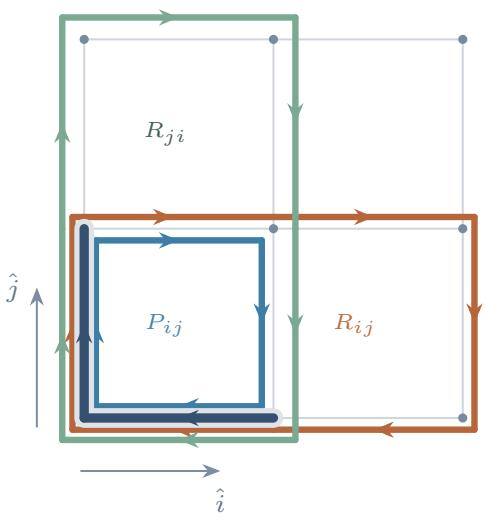

(b) Baseline lookup and addition  
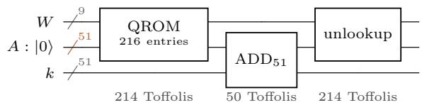

(c) Trace readout and addition  
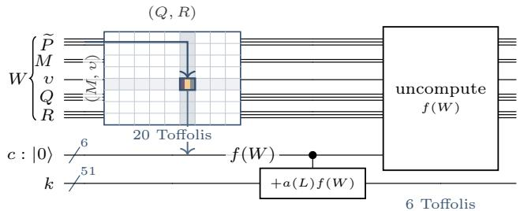  
FIG. S5 Loop geometry and trace accumulation in the nonabelian lattice-gauge circuit. (a) The blue, orange, and green paths are cyclic or inverted representatives of $P _ { i j } , R _ { i j }$ , and $R _ { j i }$ whose trace values equal those of Equation (76) by Equation (86); the dark segment is shared after these symmetry choices. (b) The baseline lookup, modular addition, and unlookup for a completed loop product. (c) The trace readout, drawn as a truth table over the coordinates $( \widetilde { P } , M , v , Q , R )$ of the specialized representation, followed by the controlled addition. Rows encode $( M , \upsilon )$ , columns encode (Q, R), and the highlighted cell and stripes show how $( M , v , Q , R )$ and then $\widetilde { P }$ determine the trace value.

## Appendix

## Appendix A: Exact branch recovery for divstep inversion

This appendix proves the decoding rule of Equation (9) [16]. The argument first establishes the invariants carried by the coeficients $f _ { v }$ and $g _ { v }$ , then identifies the decisions already visible from the updated state, and finally shows how the remaining bit b is encoded in a window of low-order bits. Let $p$ be an odd positive integer and let $0 \leq w < p$ . The walk begins at

$$
( z , f , g , f _ { v } , g _ { v } ) = ( 0 , p , w , 0 , 1 ) .\tag{A1}
$$

Every step follows the recurrence

$$
( z ^ { \prime } , f ^ { \prime } , g ^ { \prime } , f _ { v } ^ { \prime } , g _ { v } ^ { \prime } ) = \left\{ \begin{array} { l l } { ( - z , ~ g , ~ ( g - f ) / 2 , ~ 2 g _ { v } , ~ g _ { v } - f _ { v } ) } & { \mathrm { f o r ~ } z \geq 0 , ~ g \mathrm { ~ o d d } , } \\ { ( z + 1 , ~ f , ~ ( g + f ) / 2 , ~ 2 f _ { v } , ~ g _ { v } + f _ { v } ) } & { \mathrm { f o r ~ } z < 0 , ~ g \mathrm { ~ o d d } , } \\ { ( z + 1 , ~ f , ~ g / 2 , ~ 2 f _ { v } , ~ g _ { v } ) } & { \mathrm { f o r ~ } g \mathrm { ~ e v e n } . } \end{array} \right.\tag{A2}
$$

Let s indicate whether the step swaps, and let $b = 1$ exactly when g is odd, so b records whether the two values are combined before halving. In this notation, $s = 1$ selects the first case of Equation $( \operatorname { A 2 } ) ;$ when $s = 0$ , the value of b selects the second or third case. The walk freezes when g first becomes zero; the steps before that are active.

For an integer u and $k \geq 0 ,$ , write $u [ k ] \in \{ 0 , 1 \}$ for bit k of u mod $2 ^ { k + 1 }$ , counted from zero. This notation agrees with the usual binary digit for $u \geq 0$ and with the two’s-complement digit for $u < 0$ . We also write $\mathrm { b i t } _ { k } ( u ) = u [ k ]$ . Let $v _ { 2 } ( u )$ denote the number of trailing zero bits of u (its 2-adic valuation), with $v _ { 2 } ( 0 ) = + \infty$

We first show, via the determinant and scaling relations, that the integer recurrence computes a modular inverse.

Lemma A.1 (Basic invariants). Every reachable state satisfies

$$
f g _ { v } - g f _ { v } = p .\tag{A3}
$$

Moreover, f and $g _ { v }$ are odd and $f _ { v }$ is even.

Proof. The initial state gives $p \cdot 1 - w \cdot 0 = p ,$ . Direct substitution in the nonswap and swap cases gives

$$
\begin{array} { l } { { \displaystyle f ( g _ { v } + b f _ { v } ) - \frac { g + b f } { 2 } ( 2 f _ { v } ) = f g _ { v } - g f _ { v } , \quad \mathrm { ( n o n s w a p ) } , } } \\ { { \displaystyle g ( g _ { v } - f _ { v } ) - \frac { g - f } { 2 } ( 2 g _ { v } ) = f g _ { v } - g f _ { v } , \quad \mathrm { ( s w a p ) } . } } \end{array}\tag{A4}
$$

Hence every active step preserves the determinant, while a frozen step leaves the state unchanged. The parity claims also hold at the initial state. On a nonswap, $f$ remains odd, $f _ { v } ^ { \prime } = 2 f _ { v }$ is even, and $g _ { v } ^ { \prime } = g _ { v } + b f _ { v }$ is odd. On a swap, the swap condition (g odd) makes $f ^ { \prime } = g$ odd, while $f _ { v } ^ { \prime } = 2 g _ { \imath }$ v is even and $g _ { v } ^ { \prime } = g _ { v } - f _ { v }$ is odd. Induction proves all four claims. □

Proposition A.2 (Scaling and termination). After t active steps,

$$
f _ { v } w \equiv 2 ^ { t } f { \pmod { p } } , \qquad g _ { v } w \equiv 2 ^ { t } g { \pmod { p } } .\tag{A5}
$$

If $\operatorname* { g c d } ( p , w ) = 1$ , then at termination $f = \pm 1 , g _ { v } = f p ,$ and

$$
w ^ { - 1 } \equiv f f _ { v } 2 ^ { - t } { \pmod { p } } .\tag{A6}
$$

Proof. The congruences hold at the initial state. Substitution in Equation (A2) shows that if they hold after t active steps, the updated coeficients satisfy them with $t + 1$ in place of t. They therefore hold for every t. Every step also preserves $\operatorname { g c d } ( f , g )$ , so termination with $g = 0 { \mathrm { ~ g i v e s ~ } } | f | = \operatorname* { g c d } ( p , w ) = 1$ . The determinant invariant then gives $g _ { v } = f p ,$ and multiplying the first congruence by f yields Equation (A6). □

Before turning to the decoding rule, we record the independent worst-case termination guarantee used by the circuit analysis.

Proposition A.3 (Worst-case step bound). Let $p = 2 ^ { 2 5 6 } - 2 ^ { 3 2 } - 9 7 7$ . For every $0 \leq w < p ,$ the walk in Equation (A1) reaches $g = 0$ within 590 active steps. $I f w > 0$ , its final coeficients satisfy Equation $( \mathrm { A 6 } ) ; i f w = 0$ , the walk starts frozen.

Proof. The worst-case analysis of Wuille [36] guarantees that every $0 < w < p$ reaches $g = 0$ within 590 divsteps. The case $w = 0$ starts with $g = 0$ . For $0 < w < p , \operatorname* { g c d } ( p , w ) = 1$ because p is prime, so once the walk terminates, the remaining claims follow from Proposition A.2. □

We now recover the bits s and b of an active step from its updated state. The bit s, and b in two special cases, can be read from a few bits of that state.

Lemma A.4 (Locally visible decisions). Every active step has the following properties:

1. The swap is visible from the updated coeficient:

$$
s = 1 \quad \Longleftrightarrow \quad f _ { v } ^ { \prime } \equiv 2 { \pmod { 4 } } \quad \Longleftrightarrow \quad v _ { 2 } ( f _ { v } ^ { \prime } ) = 1 .\tag{A7}
$$

$I f s = 0$ , then 4 $\mid f _ { v } ^ { \prime } ,$ moreover, $s = 1$ implies $b = 1$

2. $I f s = 0$ and $z ^ { \prime } \geq 1$ , then $b = 0$

3. $H f g ^ { \prime } = 0 ;$ , then $b = 1$

Proof. On a swap step, the incoming g is odd, so $b = 1 ;$ the update also gives $f ^ { \prime } = g ,$ , preserving the oddness of f. Moreover, $f _ { v } ^ { \prime } = 2 g _ { v }$ , which is twice an odd integer by Lemma A.1. On a nonswap step, $f _ { v } ^ { \prime } = 2 f _ { v }$ , which is divisible by four. This proves part 1. For part 2, a nonswap has $z = z ^ { \prime } - 1 \ge 0$ . Since the swap condition nevertheless failed, the incoming value g was even, and hence $b = 0$ . Finally, on a nonswap, $g ^ { \prime } = ( g + b f ) / 2$ . If $b = 0$ and $g ^ { \prime } = 0$ , then $g = 0$ contrary to the step being active; a swap already has $b = 1$ by part 1. This proves part 3. □

The steps these tests leave undecided, apart from a terminating step, are the nonswaps entered with $z < 0 ;$ we call them negative-counter nonswaps. Their decisions are the ambiguous decisions of SI II.1: the preceding tests do not determine b, but the coeficients still retain it. Whenever $f _ { v } \neq 0 , \mathrm { p u t } j = v _ { 2 } ( f _ { v } )$ and write $f _ { v } = 2 ^ { j } q$ with q odd. On an updated state, j is the excursion depth defined in the main text, and a swap followed by a run of ambiguous decisions is an excursion. The j low-order bits of $g _ { v } q ^ { - 1 }$ , which we call the window, accumulate successive decisions.

Lemma A.5 (Window invariant). Every reachable state satisfies the following conditions:

1. $H z \geq 0 .$ , then $2 ^ { z + 1 } \mid f _ { v }$

2. $I f z < 0$ , then $f _ { v } \neq 0$ and, with $j = v _ { 2 } ( f _ { v } )$ and $q = f _ { v } / 2 ^ { j }$ , there is an integer c such that $0 \leq c < 2 ^ { j }$ and

$$
g _ { v } \equiv q c \quad ( \mathrm { m o d ~ } 2 ^ { j - z } ) .\tag{A8}
$$

Because q is odd, part 2 says that $g _ { v } q ^ { - 1 }$ mod $2 ^ { j - z }$ fits in j bits: the −z bits above position $j - 1$ vanish.

Proof. Proceed by induction along the walk. A frozen step changes nothing. At the initial state, $z = 0 , f _ { v } = 0$ , and $2 \mid f _ { v } .$

Suppose first that a nonswap begins with $z \geq 0$ . Then $z ^ { \prime } = z + 1$ and $f _ { v } ^ { \prime } = { 2 f _ { v } , \mathrm { s o ~ } 2 ^ { z ^ { \prime } + 1 } \mid f _ { v } ^ { \prime } } ,$

Suppose next that a swap occurs at $z = D \ge 0$ . Then $z ^ { \prime } = - D$ and $f _ { v } ^ { \prime } = 2 g _ { v } . \mathrm {  ~ \mathrm { ~ B y ~ } }$ Lemma $\mathrm { A . 1 } , g _ { v }$ is odd, so $v _ { 2 } ( f _ { v } ^ { \prime } ) = 1$ and the odd part of $f _ { v } ^ { \prime }$ is $g _ { v }$ . Moreover, $g _ { v } ^ { \prime } = g _ { v } - f _ { v } ,$ , while the induction hypothesis gives $2 ^ { D + 1 } \mid f _ { v }$ . Hence

$$
g _ { v } ^ { \prime } \equiv g _ { v } { \pmod { 2 ^ { D + 1 } } } .\tag{A9}
$$

If $D > 0 ,$ , part 2 holds with $j = 1$ and $c = 1 ; \mathrm { i f } \ D = 0 .$ , part 1 asks only that $2 \mid f _ { v } ^ { \prime }$

Finally, suppose that a nonswap begins with $z < 0$ . Let $j = v _ { 2 } ( f _ { v } )$ and let c be the witness from part 2. Then $z ^ { \prime } = z + 1 , f _ { v } ^ { \prime } = 2 f _ { v }$ , and the odd part q is unchanged. Since $g _ { v } ^ { \prime } = g _ { v } + b f _ { v }$

$$
g _ { v } ^ { \prime } \equiv q ( c + b 2 ^ { j } ) { \pmod { 2 ^ { j - z } } } , \qquad 0 \leq c + b 2 ^ { j } < 2 ^ { j + 1 } .\tag{A10}
$$

The required modulus after the step is unchanged because $2 ^ { ( j + 1 ) - z ^ { \prime } } = 2 ^ { j - z } . \mathrm { ~ I f ~ } z ^ { \prime } < 0$ , this proves part 2; if $z ^ { \prime } = 0$ J, then part 1 asks only that $2 \mid f _ { v } ^ { \prime } .$ □

The invariant makes the bit b of every negative-counter nonswap an exact function of the updated state.

Theorem A.6 (Decoding rule for an ambiguous decision). Let $( z ^ { \prime } , f ^ { \prime } , g ^ { \prime } , f _ { v } ^ { \prime } , g _ { v } ^ { \prime } )$ be the updated state of a negative-counter nonswap. Put $j = v _ { 2 } ( f _ { v } ^ { \prime } )$ and $q = f _ { v } ^ { \prime } / 2 ^ { j }$ . Then $j \geq 2$ , q is odd, and

$$
b = \mathrm { b i t } _ { j - 1 } \left( g _ { v } ^ { \prime } q ^ { - 1 } \mathrm { ~ m o d ~ } 2 ^ { j } \right) = \mathrm { b i t } _ { j - 1 } \left( p ( f ^ { \prime } q ) ^ { - 1 } \mathrm { ~ m o d ~ } 2 ^ { j } \right) .\tag{A11}
$$

In particular, for fixed odd $p ,$ the bit b is determined by $( j , f ^ { \prime }$ mod $2 ^ { j } , q$ mod $2 ^ { j } )$ .

Proof. The step doubles $f _ { v } ,$ so its incoming valuation is $j - 1$ . The window invariant makes the incoming $f _ { v }$ nonzero, while Lemma $\mathrm { A . 1 }$ makes it even; hence $j \geq 2$ . By definition, q is odd. The modulus provided by part 2 of Lemma $\mathrm { A . 5 }$ is $2 ^ { ( j - 1 ) - z }$ , which is divisible by $2 ^ { j }$ . The invariant therefore supplies a c with $0 \leq c < 2 ^ { j - 1 }$ and $g _ { v } \equiv q c$ (mod 2j). The odd part q is unchanged, and the update gives

$$
g _ { v } ^ { \prime } \equiv q ( c + b 2 ^ { j - 1 } ) { \pmod { 2 ^ { j } } } .\tag{A12}
$$

Since $q$ is odd and $0 \leq c + b 2 ^ { j - 1 } < 2 ^ { j }$ , bit $j - 1$ of $g _ { v } ^ { \prime } q ^ { - 1 }$ mod $2 ^ { j }$ is exactly b. For the second form, reduce the determinant identity $f ^ { \prime } g _ { v } ^ { \prime } - g ^ { \prime } f _ { v } ^ { \prime } = p$ modulo 2j. Because $2 ^ { j } \mid f _ { v } ^ { \prime }$ and $f ^ { \prime }$ is odd, $g _ { v } ^ { \prime } \equiv p ( f ^ { \prime } ) ^ { - 1 }$ (mod 2j). Substitution into the first form gives the second. □

The proof also shows how the window records the decisions. Immediately after the swap that begins an excursion, the window contains $1 ;$ each subsequent negative-counter nonswap places its bit b in the next higher position. Thus, at depth $j ,$ , the window contains

$$
1 + \sum _ { k = 1 } ^ { j - 1 } b _ { k } 2 ^ { k } ,\tag{A13}
$$

where $b _ { k }$ is the bit b of the kth negative-counter nonswap after the swap.

Corollary A.7 (Finite dependence). For each fixed odd $p ,$ the bit b at depth j is determined by at most 2j bits of the updated state.

Proof. By Theorem A.6, the residues of $f ^ { \prime }$ and $q$ modulo $2 ^ { j }$ determine $b ,$ and each residue is represented by $j$ bits.

Corollary A.8 (Depth-two rule). At every negative-counter nonswap with $j = 2$

$$
b = g _ { v } ^ { \prime } [ 1 ] \oplus f _ { v } ^ { \prime } [ 3 ] .\tag{A14}
$$

Proof. By Theorem $\mathrm { A } . 6 , b = \mathrm { b i t } _ { 1 } ( g _ { v } ^ { \prime } q ^ { - 1 }$ mod 4) with $q = f _ { v } ^ { \prime } / 4$ . Every odd q satisfies $q ^ { - 1 } \equiv q$ (mod 4). For odd u and $v , u v \equiv 1 + 2 ( u [ 1 ] \oplus v [ 1 ] )$ (mod 4), so $\mathrm { b i t } _ { 1 } ( u v \mathrm { m o d } 4 ) = u [ 1 ] \oplus v [ 1 ]$ . Taking $u = g _ { v } ^ { \prime }$ and $v = q$ gives the result because $q [ 1 ] = f _ { v } ^ { \prime } [ 3 ]$ □